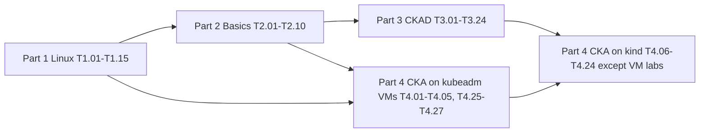

# TOPIC-BACKLOG — Linux → Kubernetes → CKAD → CKA

Every entry below is self-contained, so a writer can produce one lesson from one entry without any other context.
- Order = learning order. Topic IDs are `T{part}.{nn}`.
- Exam target: Kubernetes v1.37; curricula CKAD v1.37 and CKA v1.37, fetched 2026-10-27.
- Sources and verification status for all exam facts are in `00-research-summary.md`.
- Resource codes R1–R17 and B1–B3 refer to the resource table in that file; each code below is expanded to its URL.
- Writers must produce original content. Never use real exam questions or dumps.

Default environments (exact pins are in the summary §5):
- **kind**: kind v0.33.0, `kindest/node:v1.37.0`, 3 nodes, plus Calico v3.33.0 when NetworkPolicy is needed.
- **VMs**: 3 Ubuntu LTS VMs running kubeadm 1.37.x with containerd 2.x.

## Part 1 — Linux required for Kubernetes

### T1.01 Bash shell essentials for exam speed
- Part / order / estimated study hours: Part 1 — Linux required for Kubernetes / 1 of 76 / 3 h
- Official competency covered (verbatim, or "n/a, foundation topic"): n/a, foundation topic
- Exam domain and weight: n/a (foundation; supports both exams)
- Prerequisite topics (IDs): none
- Why it matters (2 sentences, plain language): Every exam task is solved in a Bash terminal over SSH, so typing speed and shell habits decide how many tasks you finish. Variables, redirection and pipes are also how you build, check and save Kubernetes manifests.
- Subtopics checklist (every concept, command, flag, and YAML field the lesson must cover; 10-30 bullets, specific, not vague):
  - Shell vs terminal; interactive vs login shell; ~/.bashrc vs ~/.bash_profile and when each is read
  - Navigation: pwd, cd -, ls -la, absolute vs relative paths, ~ expansion
  - Files: cp -r, mv, rm -rf (danger), mkdir -p, touch, ln -s, file, stat
  - Globbing: *, ?, [abc], brace expansion {a,b}, and quoting so globs don't expand
  - Quoting rules: single vs double quotes, escaping \$, why `$(...)` beats backticks
  - Variables and export; env and printenv; PATH lookup; `which` / `type -a`
  - Redirection: >, >>, 2>, 2>&1, &>, /dev/null, tee, tee -a
  - Here-documents: cat <<'EOF' > file.yaml (quoted delimiter stops expansion), used to write manifests
  - Pipes and exit codes: $?, set -o pipefail, &&, ||, ;
  - History: Ctrl+R, !!, !$, history | grep; readline shortcuts Ctrl+A/E/W/U (note: Ctrl+W closes the exam browser tab, use Ctrl+Alt+W)
  - Aliases and functions: alias k=kubectl; complete -o default -F __start_kubectl k; export do='--dry-run=client -o yaml'
  - Command substitution and simple loops: for n in $(kubectl get ns -o name); do ...; done
  - watch -n 2, sleep, timeout, and `time` for measuring
  - man and --help usage (man pages are allowed in the exam)
  - Bash completion: source <(kubectl completion bash)
- Key kubectl/Linux commands to demonstrate: `alias`, `type -a kubectl`, `echo $?`, `set -o pipefail`, `cat <<'EOF' > pod.yaml`, `tee`, `history`, `man bash`, `source <(kubectl completion bash)`, `watch -n1 kubectl get pods`
- Imperative shortcut + declarative YAML the learner must be able to produce fast: `export do='--dry-run=client -o yaml'; k run web --image=nginx $do > web.yaml` and a heredoc that writes a 10-line YAML file without variable expansion.
- Common mistakes and failure modes to teach (symptom -> cause -> fix):
  - `$HOME` shows up literally in a heredoc file -> delimiter was quoted 'EOF' (or wasn't) -> pick quoted vs unquoted on purpose
  - Alias `k` has no tab completion -> completion not registered for the alias -> `complete -o default -F __start_kubectl k`
  - Output file is empty after `cmd > f 2>&1 | grep` -> the redirection order is wrong -> explain left-to-right fd duplication
  - The browser tab closes when deleting a word -> Ctrl+W in the PSI browser -> use Ctrl+Alt+W (verified exam instruction)
  - Script keeps going after a failure -> no `set -euo pipefail` -> add it, and show `echo $?`
- Hands-on lab ideas (3: easy / medium / break-fix) with the environment needed:
  - Easy: Set up ~/.bashrc with alias k, completion and $do; prove they survive a new shell
  - Medium: Write a 3-document YAML file with one heredoc, then split it with csplit or yq
  - Break-fix: Given a broken .bashrc (missing quote) where new shells fail -> find it with `bash -x`, fix it
  - Environment: Any Linux VM (Ubuntu LTS via Multipass); kubectl installed for the alias part
- Diagram to draw (what mechanism, which Mermaid/ASCII type): ASCII diagram of file descriptors 0/1/2 and how `2>&1` and pipes rewire them.
- kubernetes.io docs pages to bookmark (exact URLs):
  - https://kubernetes.io/docs/reference/kubectl/quick-reference/
  - https://kubernetes.io/docs/reference/kubectl/generated/kubectl_completion/
- Reference resources to study for coverage (URL from your research table):
  - B1 The Linux Command Line (TLCL 25.12A, CC BY-NC-ND) — https://linuxcommand.org/tlcl.php (Part 1 ch 1-8)
  - B2 TLDP Bash Guide for Beginners — https://tldp.org/LDP/Bash-Beginners-Guide/html/
  - R1 kubernetes.io docs + kubectl Quick Reference — https://kubernetes.io/docs/reference/kubectl/quick-reference/
- Facts the writer must VERIFY on a real cluster (version-dependent items):
  - Shell defaults on the exam hosts (are alias and completion preconfigured? The LF page says "kubectl with kalias and Bash autocompletion" — the alias name is UNVERIFIED)
  - `kubectl completion bash` output works with the installed bash-completion package version
- Done criteria (3-5 checkable statements, e.g. "includes real kubectl output for X", "lab has setup, hints, collapsed solution, cleanup"):
  - Includes real terminal output for `type -a k` and for completion on the alias
  - Covers every redirection operator with a one-line demo
  - Every lab has setup, task, hints, collapsed solution, verification command and cleanup.
  - Has a 10-item speed drill with target times

### T1.02 Text processing: grep, sed, awk, cut, sort, find, xargs
- Part / order / estimated study hours: Part 1 — Linux required for Kubernetes / 2 of 76 / 3 h
- Official competency covered (verbatim, or "n/a, foundation topic"): n/a, foundation topic
- Exam domain and weight: n/a (foundation; supports both exams)
- Prerequisite topics (IDs): T1.01
- Why it matters (2 sentences, plain language): Logs, kubectl output and config files are text, and filtering them fast is how you find the broken thing. The exam often asks you to save filtered output to a file, which takes exact text tools.
- Subtopics checklist (every concept, command, flag, and YAML field the lesson must cover; 10-30 bullets, specific, not vague):
  - less, head -n, tail -n, tail -f, wc -l
  - grep -i -v -n -r -E -o -A/-B/-C, grep -c; basic vs extended regex
  - sed -n 'p', sed -i 's/a/b/g', in-place edit of manifests (backups with -i.bak)
  - awk '{print $1}', -F, NR>1 to skip headers, simple conditionals on columns
  - cut -d' ' -f, tr -s ' ', tr -d, column -t
  - sort -k -n -r -u, uniq -c, sort | uniq -c | sort -rn pattern
  - find / -name -type -mmin -size -exec {} \; and -print0 with xargs -0
  - xargs -n1 -I{} to drive kubectl over a list of names
  - diff -u and vimdiff for comparing manifests and configs
  - Regex for K8s: matching pod names with hash suffixes, IPs, ports
  - Parsing `kubectl get` tabular output vs `-o jsonpath` (prefer jsonpath; show both)
  - Reading /var/log/pods, /var/log/containers and /etc/kubernetes/manifests with grep
  - Saving exact answers: `> /opt/answer.txt`, no trailing junk, checked with cat -A
- Key kubectl/Linux commands to demonstrate: `kubectl get pods -A --no-headers | awk '$4!="Running"{print $1,$2}'`, `grep -rn image: /etc/kubernetes/manifests`, `sed -i 's/replicas: 1/replicas: 3/' d.yaml`, `find /var/log/pods -name '*.log' -mmin -5`, `kubectl get pods -o name | xargs -I{} kubectl label {} tier=web`
- Imperative shortcut + declarative YAML the learner must be able to produce fast: Count pods per node into a file: `kubectl get pods -A -o wide --no-headers | awk '{print $8}' | sort | uniq -c > /tmp/podcount.txt`.
- Common mistakes and failure modes to teach (symptom -> cause -> fix):
  - Awk prints the wrong column with -A -> the NAMESPACE column shifts fields -> count columns or use jsonpath/custom-columns
  - `sed -i` broke YAML indentation -> the regex matched more lines than intended -> anchor it with ^ and preview with sed -n first
  - xargs fails on names with spaces/newlines -> default delimiter -> use -0/-d '\n'
  - grep shows no matches in a gzipped rotated log -> compressed file -> use zgrep
- Hands-on lab ideas (3: easy / medium / break-fix) with the environment needed:
  - Easy: Extract all container images in the cluster, sorted and de-duplicated, into a file
  - Medium: From kubelet journal output, list the top 5 error messages by count
  - Break-fix: A sed one-liner corrupted a static pod manifest (wrong indent) -> find it with diff, fix it, confirm the pod returns
  - Environment: kind cluster + one Ubuntu VM for the /var/log tasks
- Diagram to draw (what mechanism, which Mermaid/ASCII type): ASCII pipeline diagram: kubectl -> grep -> awk -> sort -> uniq -> file, with the sample text at each stage.
- kubernetes.io docs pages to bookmark (exact URLs):
  - https://kubernetes.io/docs/reference/kubectl/jsonpath/
  - https://kubernetes.io/docs/reference/kubectl/quick-reference/
- Reference resources to study for coverage (URL from your research table):
  - B1 The Linux Command Line (TLCL 25.12A, CC BY-NC-ND) — https://linuxcommand.org/tlcl.php (ch 17, 19, 20)
  - R1 kubernetes.io docs + kubectl Quick Reference — https://kubernetes.io/docs/reference/kubectl/quick-reference/
- Facts the writer must VERIFY on a real cluster (version-dependent items):
  - Column positions of `kubectl get pods -A -o wide` in v1.37 (NOMINATED NODE/READINESS GATES columns)
  - Log paths /var/log/pods/<ns>_<pod>_<uid>/<container>/ on containerd 2.x
- Done criteria (3-5 checkable statements, e.g. "includes real kubectl output for X", "lab has setup, hints, collapsed solution, cleanup"):
  - Includes real output for every command at each pipe stage
  - Has a jsonpath alternative for every awk-on-kubectl example
  - Every lab has setup, task, hints, collapsed solution, verification command and cleanup.

### T1.03 Vim and tmux for YAML editing
- Part / order / estimated study hours: Part 1 — Linux required for Kubernetes / 3 of 76 / 2 h
- Official competency covered (verbatim, or "n/a, foundation topic"): n/a, foundation topic
- Exam domain and weight: n/a (foundation; supports both exams)
- Prerequisite topics (IDs): T1.01
- Why it matters (2 sentences, plain language): `kubectl edit` and most file editing in the exam happen in vim, and YAML breaks if indentation is wrong. Knowing a few vim settings and motions saves minutes on every task.
- Subtopics checklist (every concept, command, flag, and YAML field the lesson must cover; 10-30 bullets, specific, not vague):
  - Modes: normal, insert (i, a, o, O — the INSERT key is prohibited in the exam), visual (v, V, Ctrl+V), command (:)
  - Save/quit: :w, :q!, :wq, :x, ZZ; recover a swap file (.swp)
  - Motions: gg, G, :N, w, b, 0, $, %, /search, n, N
  - Edit: dd, yy, p, P, u, Ctrl+R, x, cw, ., >> and << for indent, 5>> with counts
  - Visual-block indent of a YAML block: V + j + > ; Ctrl+V for column inserts
  - ~/.vimrc for YAML: set expandtab tabstop=2 shiftwidth=2 autoindent; set number; syntax on
  - :set paste / :set nopaste before pasting from the docs (avoids stair-step indentation)
  - :%s/old/new/g with confirm flag c; :g/pattern/d
  - KUBE_EDITOR / EDITOR env vars; kubectl edit error temp file in /tmp/kubectl-edit-*.yaml
  - Showing tabs and trailing spaces: :set list
  - tmux basics: new session, split panes (Ctrl+B %/"), switch panes, scrollback (Ctrl+B [) — for home labs (exam tmux availability UNVERIFIED)
  - nano as a fallback; VSCodium is available in the exam remote desktop (verified)
- Key kubectl/Linux commands to demonstrate: `vim pod.yaml`, `:set paste`, `kubectl edit deploy web`, `export KUBE_EDITOR=vim`, `tmux new -s lab`, `cat -A file.yaml | grep -n '\^I'` (find tabs)
- Imperative shortcut + declarative YAML the learner must be able to produce fast: Edit a Deployment with `kubectl edit`, add an env var block of 4 lines in under 30 seconds; write a ~/.vimrc of 3 lines from memory.
- Common mistakes and failure modes to teach (symptom -> cause -> fix):
  - `error converting YAML to JSON: yaml: line N: found character that cannot start any token` -> tab characters -> set expandtab, :retab
  - Pasted YAML indents in a staircase -> autoindent during paste -> :set paste
  - `kubectl edit` changes silently lost -> the edit failed validation and was saved to /tmp -> read the message, `kubectl apply -f /tmp/kubectl-edit-xxxx.yaml`
  - Can't exit vim / stuck in a mode -> Esc then :q!
- Hands-on lab ideas (3: easy / medium / break-fix) with the environment needed:
  - Easy: Configure ~/.vimrc and fix a YAML file containing tabs
  - Medium: Indent a 12-line block two levels with visual mode; replace an image tag in 5 Deployments with :%s
  - Break-fix: A kubectl edit was rejected (immutable field) -> recover from the /tmp file and apply as a new object
  - Environment: Any VM + kind
- Diagram to draw (what mechanism, which Mermaid/ASCII type): ASCII state diagram of vim modes and the keys that move between them.
- kubernetes.io docs pages to bookmark (exact URLs):
  - https://kubernetes.io/docs/reference/kubectl/generated/kubectl_edit/
- Reference resources to study for coverage (URL from your research table):
  - B1 The Linux Command Line (TLCL 25.12A, CC BY-NC-ND) — https://linuxcommand.org/tlcl.php (ch 12)
  - R1 kubernetes.io docs + kubectl Quick Reference — https://kubernetes.io/docs/reference/kubectl/quick-reference/
- Facts the writer must VERIFY on a real cluster (version-dependent items):
  - Whether the exam hosts ship a ~/.vimrc (UNVERIFIED) — the lesson must teach typing it
  - kubectl edit temp file naming in v1.37
- Done criteria (3-5 checkable statements, e.g. "includes real kubectl output for X", "lab has setup, hints, collapsed solution, cleanup"):
  - Includes a printable vim cheat-sheet table limited to 25 keys
  - Shows a real `kubectl edit` validation failure and the recovery
  - Every lab has setup, task, hints, collapsed solution, verification command and cleanup.

### T1.04 Users, groups, permissions and sudo
- Part / order / estimated study hours: Part 1 — Linux required for Kubernetes / 4 of 76 / 2 h
- Official competency covered (verbatim, or "n/a, foundation topic"): n/a, foundation topic
- Exam domain and weight: n/a (foundation; supports both exams)
- Prerequisite topics (IDs): T1.01
- Why it matters (2 sentences, plain language): Kubernetes certificates, kubeconfigs and kubelet files only work with the right owner and mode, and the exam uses `sudo -i` on nodes. Pod securityContext runAsUser/fsGroup is the same UID/GID model.
- Subtopics checklist (every concept, command, flag, and YAML field the lesson must cover; 10-30 bullets, specific, not vague):
  - Users and groups: id, whoami, /etc/passwd, /etc/group, getent; UID 0
  - useradd -m -s /bin/bash, usermod -aG, groups, passwd (lab only)
  - rwx bits for files vs directories; octal (0644, 0600, 0755) vs symbolic chmod
  - chown user:group, chown -R; chgrp
  - umask and the default mode of new files
  - setuid/setgid/sticky bits (ls shows s/t); why /tmp is 1777
  - sudo, sudo -i, sudo -u; /etc/sudoers.d; visudo
  - File modes Kubernetes expects: /etc/kubernetes/pki/*.key 0600, admin.conf 0600, kubelet.conf
  - ~/.kube/config setup after kubeadm: mkdir -p; cp -i; chown $(id -u):$(id -g)
  - Linking UIDs to Pods: runAsUser, runAsGroup, fsGroup and volume ownership (preview of T3.17)
  - ACL basics (getfacl/setfacl) as awareness
  - Capabilities overview: getcap/setcap, CAP_NET_BIND_SERVICE (preview of T3.17)
- Key kubectl/Linux commands to demonstrate: `id`, `ls -l /etc/kubernetes/pki`, `stat -c '%a %U:%G' file`, `chmod 600`, `chown -R`, `sudo -i`, `umask`, `getcap`
- Imperative shortcut + declarative YAML the learner must be able to produce fast: The three post-kubeadm commands that set up ~/.kube/config with the right owner, from memory.
- Common mistakes and failure modes to teach (symptom -> cause -> fix):
  - `kubectl` -> 'permission denied' reading ~/.kube/config -> file is owned by root after sudo cp -> chown $(id -u):$(id -g)
  - Container 'permission denied' writing to a volume -> UID mismatch -> fsGroup or a chown init container
  - `sudo: command not found` for kubectl in the exam -> PATH differs under sudo -> use sudo -i or the full path
- Hands-on lab ideas (3: easy / medium / break-fix) with the environment needed:
  - Easy: Create a user and group, set up a shared directory with setgid
  - Medium: Copy admin.conf to a non-root user's kubeconfig with correct ownership; test kubectl
  - Break-fix: A key file was set to 0644 and a tool refuses it -> diagnose with stat, fix the mode
  - Environment: Ubuntu VM (kubeadm node for the pki part)
- Diagram to draw (what mechanism, which Mermaid/ASCII type): ASCII table mapping the rwx bits to octal, plus a flow of UID inside the container -> UID on the host volume.
- kubernetes.io docs pages to bookmark (exact URLs):
  - https://kubernetes.io/docs/tasks/configure-pod-container/security-context/
  - https://kubernetes.io/docs/setup/production-environment/tools/kubeadm/create-cluster-kubeadm/
- Reference resources to study for coverage (URL from your research table):
  - B1 The Linux Command Line (TLCL 25.12A, CC BY-NC-ND) — https://linuxcommand.org/tlcl.php (ch 9)
  - R1 kubernetes.io docs + kubectl Quick Reference — https://kubernetes.io/docs/reference/kubectl/quick-reference/
- Facts the writer must VERIFY on a real cluster (version-dependent items):
  - Default modes/ownership of files under /etc/kubernetes after kubeadm 1.37 init
- Done criteria (3-5 checkable statements, e.g. "includes real kubectl output for X", "lab has setup, hints, collapsed solution, cleanup"):
  - Includes real `ls -l /etc/kubernetes/pki` output from a kubeadm node
  - Explains octal with 3 worked examples
  - Every lab has setup, task, hints, collapsed solution, verification command and cleanup.

### T1.05 Processes and signals
- Part / order / estimated study hours: Part 1 — Linux required for Kubernetes / 5 of 76 / 2 h
- Official competency covered (verbatim, or "n/a, foundation topic"): n/a, foundation topic
- Exam domain and weight: n/a (foundation; supports both exams)
- Prerequisite topics (IDs): T1.01
- Why it matters (2 sentences, plain language): Container processes are ordinary Linux processes, and Pod termination is SIGTERM, a grace period, then SIGKILL. Exit codes like 137 and 143 only make sense if you know signals.
- Subtopics checklist (every concept, command, flag, and YAML field the lesson must cover; 10-30 bullets, specific, not vague):
  - Process model: PID, PPID, PID 1, fork/exec, process states (R, S, D, Z, T)
  - ps -ef, ps aux, ps -o pid,ppid,cmd --forest, pstree, pgrep -a, pidof
  - top / htop: load average, %CPU, RES, sorting
  - Signals: SIGTERM(15), SIGKILL(9), SIGINT(2), SIGHUP(1), SIGSTOP; kill -l; kill vs pkill vs killall
  - Exit codes: 0, 1, 126, 127, 128+N (137 = SIGKILL/OOM, 143 = SIGTERM)
  - Foreground/background jobs: &, jobs, fg, bg, nohup, disown
  - /proc/<pid>: cmdline, environ, status, fd, cgroup, ns
  - Zombies and why PID 1 in a container must reap (tini, shareProcessNamespace)
  - lsof -i :port, lsof -p, fuser
  - nice/renice awareness
  - Mapping to K8s: terminationGracePeriodSeconds, preStop hook, SIGTERM handling, kubectl delete --grace-period=0 --force
  - Finding a container's host PID: crictl inspect | jq .info.pid, then nsenter (bridge to T1.10)
- Key kubectl/Linux commands to demonstrate: `ps -ef --forest`, `pgrep -a kubelet`, `kill -TERM <pid>`, `kill -l`, `cat /proc/<pid>/status`, `lsof -i :6443`, `sleep 1000 &; jobs; fg`
- Imperative shortcut + declarative YAML the learner must be able to produce fast: Pod with `terminationGracePeriodSeconds: 5` and a `lifecycle.preStop.exec` sleep; show a real exit code in `kubectl get pod -o jsonpath='{.status.containerStatuses[0].lastState}'`.
- Common mistakes and failure modes to teach (symptom -> cause -> fix):
  - Pod takes 30s to delete -> app ignores SIGTERM (shell-form CMD makes sh PID 1) -> exec-form ENTRYPOINT or handle the signal
  - Exit code 137 with no OOM in describe -> killed after the grace period -> check terminationGracePeriodSeconds vs shutdown time
  - Port already in use -> a stray process -> `ss -ltnp` / `lsof -i` then kill
- Hands-on lab ideas (3: easy / medium / break-fix) with the environment needed:
  - Easy: Run a process, send SIGTERM/SIGKILL, record the exit codes
  - Medium: Write a trap-based shell script that handles SIGTERM; run it as a Pod and time `kubectl delete`
  - Break-fix: A Pod hangs Terminating -> diagnose (finalizer vs process) and resolve with the correct method
  - Environment: VM for the Linux part, kind for the Pod part
- Diagram to draw (what mechanism, which Mermaid/ASCII type): Mermaid sequenceDiagram: kubectl delete -> API server -> kubelet -> preStop -> SIGTERM -> grace timer -> SIGKILL.
- kubernetes.io docs pages to bookmark (exact URLs):
  - https://kubernetes.io/docs/concepts/workloads/pods/pod-lifecycle/#pod-termination
  - https://kubernetes.io/docs/concepts/containers/container-lifecycle-hooks/
- Reference resources to study for coverage (URL from your research table):
  - B1 The Linux Command Line (TLCL 25.12A, CC BY-NC-ND) — https://linuxcommand.org/tlcl.php (ch 10)
  - R1 kubernetes.io docs + kubectl Quick Reference — https://kubernetes.io/docs/reference/kubectl/quick-reference/
- Facts the writer must VERIFY on a real cluster (version-dependent items):
  - Exit-code and reason strings shown by `kubectl describe` in v1.37 (e.g. OOMKilled, Error, Completed)
  - Default terminationGracePeriodSeconds is 30
- Done criteria (3-5 checkable statements, e.g. "includes real kubectl output for X", "lab has setup, hints, collapsed solution, cleanup"):
  - Includes real output showing exit codes 137 and 143
  - Termination sequence diagram matches the docs
  - Every lab has setup, task, hints, collapsed solution, verification command and cleanup.

### T1.06 systemd and journalctl
- Part / order / estimated study hours: Part 1 — Linux required for Kubernetes / 6 of 76 / 3 h
- Official competency covered (verbatim, or "n/a, foundation topic"): n/a, foundation topic
- Exam domain and weight: n/a (foundation; supports both exams)
- Prerequisite topics (IDs): T1.05
- Why it matters (2 sentences, plain language): kubelet and containerd are systemd services on every kubeadm node, and most node-level failures in the CKA are found with systemctl and journalctl. If you can't read a unit file and its logs, you can't fix a NotReady node.
- Subtopics checklist (every concept, command, flag, and YAML field the lesson must cover; 10-30 bullets, specific, not vague):
  - Units: service, socket, target, timer; unit file locations /lib/systemd/system vs /etc/systemd/system
  - systemctl status, start, stop, restart, reload, enable --now, disable, is-active, is-enabled, list-units --failed
  - Unit file anatomy: [Unit] After/Wants/Requires, [Service] ExecStart, Restart, Environment, EnvironmentFile, [Install] WantedBy
  - Drop-ins: /etc/systemd/system/kubelet.service.d/10-kubeadm.conf; systemctl cat kubelet; systemctl edit
  - systemctl daemon-reload after changing unit files (and why it's needed)
  - kubelet flags sources: /var/lib/kubelet/config.yaml, /var/lib/kubelet/kubeadm-flags.env, /etc/default/kubelet
  - containerd.service and /etc/containerd/config.toml (SystemdCgroup = true)
  - journalctl -u kubelet, -f, -n 50, --since '10 min ago', -p err, -b, --no-pager, -o cat
  - Persistent journal (/var/log/journal) vs volatile
  - systemd-analyze, systemctl list-dependencies (awareness)
  - Restart policies and crash loops: Restart=always, RestartSec, StartLimitBurst
  - Reading the kubelet exit messages: wrong flag, bad config path, cgroup driver mismatch, swap enabled, cgroup v1 (failCgroupV1)
- Key kubectl/Linux commands to demonstrate: `systemctl status kubelet`, `systemctl cat kubelet`, `journalctl -u kubelet -f`, `journalctl -u containerd --since '5 min ago'`, `systemctl daemon-reload && systemctl restart kubelet`, `systemctl list-units --failed`
- Imperative shortcut + declarative YAML the learner must be able to produce fast: Write a 10-line custom unit file for a toy service with Restart=on-failure and enable it; add a drop-in override with `systemctl edit`.
- Common mistakes and failure modes to teach (symptom -> cause -> fix):
  - Edit to 10-kubeadm.conf has no effect -> no daemon-reload -> systemctl daemon-reload; restart
  - kubelet 'activating (auto-restart)' loop -> bad config.yaml path/field -> journalctl -u kubelet shows the parse error
  - kubelet refuses to start on an old distro -> cgroup v1 node with v1.35+ default failCgroupV1=true -> migrate to cgroup v2 (or temporary override)
  - No logs after reboot -> volatile journal -> enable persistent storage
- Hands-on lab ideas (3: easy / medium / break-fix) with the environment needed:
  - Easy: Create, enable and debug a custom service with a deliberate ExecStart typo
  - Medium: Inspect the kubelet unit, its drop-in and config files; list every place a kubelet flag can come from
  - Break-fix: Instructor breaks kubelet (wrong --config path in the drop-in) -> learner restores the node to Ready
  - Environment: kubeadm VM node (Part 4 env) or any systemd VM for the generic part
- Diagram to draw (what mechanism, which Mermaid/ASCII type): Mermaid flowchart: systemd -> kubelet.service + drop-in + env files -> kubelet -> config.yaml -> CRI socket -> containerd.
- kubernetes.io docs pages to bookmark (exact URLs):
  - https://kubernetes.io/docs/setup/production-environment/tools/kubeadm/kubelet-integration/
  - https://kubernetes.io/docs/tasks/debug/debug-cluster/
  - https://kubernetes.io/docs/setup/production-environment/container-runtimes/
- Reference resources to study for coverage (URL from your research table):
  - B1 The Linux Command Line (TLCL 25.12A, CC BY-NC-ND) — https://linuxcommand.org/tlcl.php (ch 10)
  - R10 David-VTUK/CKA-StudyGuide — https://github.com/David-VTUK/CKA-StudyGuide
  - R12 kodekloudhub/certified-kubernetes-administrator-course — https://github.com/kodekloudhub/certified-kubernetes-administrator-course
- Facts the writer must VERIFY on a real cluster (version-dependent items):
  - Exact name/content of the kubeadm drop-in file for v1.37 packages from pkgs.k8s.io
  - failCgroupV1 default and the error text on cgroup v1 (blog: default true since v1.35)
  - containerd 2.x config.toml version and SystemdCgroup key path
- Done criteria (3-5 checkable statements, e.g. "includes real kubectl output for X", "lab has setup, hints, collapsed solution, cleanup"):
  - Includes a real `systemctl cat kubelet` from a v1.37 kubeadm node
  - Shows real journalctl output for at least 2 kubelet failure modes
  - Every lab has setup, task, hints, collapsed solution, verification command and cleanup.

### T1.07 Linux networking I: interfaces, IPs, routes, bridges, veth
- Part / order / estimated study hours: Part 1 — Linux required for Kubernetes / 7 of 76 / 3 h
- Official competency covered (verbatim, or "n/a, foundation topic"): n/a, foundation topic
- Exam domain and weight: n/a (foundation; supports both exams)
- Prerequisite topics (IDs): T1.01
- Why it matters (2 sentences, plain language): Every Pod gets a network namespace wired by veth pairs, bridges and routes. Pod connectivity problems in the CKA are routing problems you debug with `ip`.
- Subtopics checklist (every concept, command, flag, and YAML field the lesson must cover; 10-30 bullets, specific, not vague):
  - IPv4 addressing and CIDR (/16, /24, /32), private ranges; Pod CIDR vs Service CIDR vs node network
  - ip addr / ip -br a, ip link, ip link set up/down
  - ip route, default gateway, ip route get <ip> (which path a packet takes)
  - ARP/neighbour table: ip neigh
  - Linux bridge (bridge link, ip link add br0 type bridge), veth pairs (ip link add veth0 type veth peer name veth1)
  - Moving an interface into a netns: ip link set veth1 netns red; ip netns add/exec
  - IP forwarding: sysctl net.ipv4.ip_forward=1; persistence in /etc/sysctl.d/k8s.conf
  - br_netfilter and net.bridge.bridge-nf-call-iptables=1 (why kubeadm wants it)
  - Overlay vs routed networking (VXLAN, BGP) as concepts
  - MTU and why encapsulation lowers it
  - IPv6 and dual-stack awareness
  - Reading the CNI-created interfaces on a node: cali*, cni0, flannel.1, vxlan.calico
- Key kubectl/Linux commands to demonstrate: `ip -br a`, `ip route`, `ip route get 10.244.1.5`, `ip neigh`, `ip netns add red`, `ip link add v0 type veth peer name v1`, `sysctl net.ipv4.ip_forward`, `bridge link`
- Imperative shortcut + declarative YAML the learner must be able to produce fast: Build two network namespaces joined by a bridge and ping between them in ≤10 commands.
- Common mistakes and failure modes to teach (symptom -> cause -> fix):
  - Pods on different nodes can't talk -> no route to the remote Pod CIDR / CNI not running -> ip route on both nodes; fix the CNI
  - Ping works but large transfers hang -> MTU mismatch with overlay -> lower the MTU
  - kubeadm preflight: bridge-nf-call-iptables does not exist -> br_netfilter not loaded -> modprobe br_netfilter + /etc/modules-load.d
- Hands-on lab ideas (3: easy / medium / break-fix) with the environment needed:
  - Easy: Inspect a kind node: list Pod veths and map each to a Pod
  - Medium: Build the 2-namespace + bridge lab, then add a route to reach the host
  - Break-fix: ip_forward was disabled on a worker -> cross-node Pod traffic fails -> find it and fix it persistently
  - Environment: Ubuntu VM (needs root); kind node via docker exec for the inspection part
- Diagram to draw (what mechanism, which Mermaid/ASCII type): ASCII diagram: two netns -> veth pairs -> bridge -> host eth0 -> route to the other node.
- kubernetes.io docs pages to bookmark (exact URLs):
  - https://kubernetes.io/docs/concepts/cluster-administration/networking/
  - https://kubernetes.io/docs/setup/production-environment/container-runtimes/#prerequisite-ipv4-forwarding-optional
- Reference resources to study for coverage (URL from your research table):
  - B1 The Linux Command Line (TLCL 25.12A, CC BY-NC-ND) — https://linuxcommand.org/tlcl.php (ch 16)
  - R14 The Kubernetes Networking Guide — https://www.tkng.io/
- Facts the writer must VERIFY on a real cluster (version-dependent items):
  - Interface names created by the chosen CNI version (Calico 3.33)
  - Whether kubeadm 1.37 preflight still checks bridge-nf-call-iptables
- Done criteria (3-5 checkable statements, e.g. "includes real kubectl output for X", "lab has setup, hints, collapsed solution, cleanup"):
  - Includes real `ip` output from a kind or kubeadm node
  - Namespace lab is reproducible from a copy-paste block
  - Every lab has setup, task, hints, collapsed solution, verification command and cleanup.

### T1.08 Linux networking II: DNS, ports, sockets and test tools
- Part / order / estimated study hours: Part 1 — Linux required for Kubernetes / 8 of 76 / 3 h
- Official competency covered (verbatim, or "n/a, foundation topic"): n/a, foundation topic
- Exam domain and weight: n/a (foundation; supports both exams)
- Prerequisite topics (IDs): T1.07
- Why it matters (2 sentences, plain language): Most 'service not working' tasks come down to name resolution or a wrong port. curl, dig, nc and ss let you prove which layer is broken.
- Subtopics checklist (every concept, command, flag, and YAML field the lesson must cover; 10-30 bullets, specific, not vague):
  - Ports, TCP vs UDP, listening vs established sockets
  - ss -ltnp, ss -lunp, ss -tnp state established; netstat equivalence
  - DNS: resolv.conf (nameserver, search, options ndots), /etc/hosts, /etc/nsswitch.conf
  - dig +short, dig @server, dig -t SRV, nslookup; getent hosts
  - FQDN vs short names; how search domains plus ndots:5 drive Pod DNS lookups
  - curl -v, -I, -k, -s -o /dev/null -w '%{http_code}', --connect-timeout, -H Host:, --resolve
  - wget -qO-, -T (both on the exam hosts per LF)
  - nc -zv host port, nc -l for a test listener
  - tcpdump -i any port 53 -nn (awareness), traceroute/tracepath
  - Testing from inside the cluster: kubectl run tmp --image=busybox:1.36 --rm -it --restart=Never -- wget -qO- svc:80
  - Debug images: busybox nslookup quirks vs a dnsutils/netshoot image
  - Well-known K8s ports: 6443, 2379-2380, 10250, 10257, 10259, 30000-32767
- Key kubectl/Linux commands to demonstrate: `ss -ltnp`, `dig +short kubernetes.default.svc.cluster.local @10.96.0.10`, `curl -sv http://svc:8080/healthz`, `nc -zv 10.0.0.10 6443`, `cat /etc/resolv.conf`, `kubectl run tmp --rm -it --image=busybox:1.36 --restart=Never -- nslookup kubernetes`
- Imperative shortcut + declarative YAML the learner must be able to produce fast: A one-liner in-cluster HTTP probe that prints only the status code: `kubectl run t --rm -i --image=curlimages/curl --restart=Never -- curl -s -o /dev/null -w '%{http_code}' http://web.default:80`.
- Common mistakes and failure modes to teach (symptom -> cause -> fix):
  - `curl: (6) Could not resolve host` -> DNS failure vs `(7) Failed to connect` -> port/endpoint failure -> teach the error-code ladder
  - busybox nslookup prints odd errors though DNS works -> busybox resolver quirks -> use dig from a dnsutils image
  - Service reachable by IP but not by name from another namespace -> short name used -> use svc.ns or the FQDN
  - Connection refused on a NodePort -> port outside 30000-32767 or wrong nodePort -> check the Service spec
- Hands-on lab ideas (3: easy / medium / break-fix) with the environment needed:
  - Easy: Map every listening port on a kubeadm control-plane node to its component
  - Medium: Resolve Services and Pods across namespaces from a test Pod; explain each search-domain attempt
  - Break-fix: A Pod has a wrong dnsPolicy/dnsConfig -> resolution fails -> diagnose with resolv.conf in the Pod and fix it
  - Environment: kind for the in-cluster parts; kubeadm VM for the node port map
- Diagram to draw (what mechanism, which Mermaid/ASCII type): Mermaid flowchart: app -> resolv.conf search list -> CoreDNS Service IP -> CoreDNS Pod -> answer; side branch for /etc/hosts.
- kubernetes.io docs pages to bookmark (exact URLs):
  - https://kubernetes.io/docs/concepts/services-networking/dns-pod-service/
  - https://kubernetes.io/docs/reference/networking/ports-and-protocols/
  - https://kubernetes.io/docs/tasks/administer-cluster/dns-debugging-resolution/
- Reference resources to study for coverage (URL from your research table):
  - B1 The Linux Command Line (TLCL 25.12A, CC BY-NC-ND) — https://linuxcommand.org/tlcl.php (ch 16)
  - R14 The Kubernetes Networking Guide — https://www.tkng.io/
  - R1 kubernetes.io docs + kubectl Quick Reference — https://kubernetes.io/docs/reference/kubectl/quick-reference/
- Facts the writer must VERIFY on a real cluster (version-dependent items):
  - Default cluster DNS IP in kind/kubeadm (10.96.0.10 typical)
  - Image tags for busybox/dnsutils/curl that exist today
- Done criteria (3-5 checkable statements, e.g. "includes real kubectl output for X", "lab has setup, hints, collapsed solution, cleanup"):
  - Includes real dig and curl output for success and for each failure type
  - Has a port-to-component table verified on a v1.37 node
  - Every lab has setup, task, hints, collapsed solution, verification command and cleanup.

### T1.09 Packet filtering: iptables and nftables basics
- Part / order / estimated study hours: Part 1 — Linux required for Kubernetes / 9 of 76 / 3 h
- Official competency covered (verbatim, or "n/a, foundation topic"): n/a, foundation topic
- Exam domain and weight: n/a (foundation; supports both exams)
- Prerequisite topics (IDs): T1.07
- Why it matters (2 sentences, plain language): kube-proxy implements Services by writing iptables or nftables rules on every node, and both firewalls and NetworkPolicies work at this layer. You need to read these rules to troubleshoot Services.
- Subtopics checklist (every concept, command, flag, and YAML field the lesson must cover; 10-30 bullets, specific, not vague):
  - Netfilter hooks: PREROUTING, INPUT, FORWARD, OUTPUT, POSTROUTING
  - iptables tables: filter, nat, mangle; chains; targets ACCEPT/DROP/REJECT/DNAT/SNAT/MASQUERADE
  - iptables -L -n -v --line-numbers; iptables -t nat -S; iptables-save | grep
  - Adding/deleting rules: -A, -I, -D; why rule order matters
  - conntrack basics: conntrack -L (awareness), stateful matching
  - nftables model: tables, chains, rules; nft list ruleset; nft list table ip kube-proxy
  - iptables-nft vs iptables-legacy (update-alternatives) and the mixed-backend problem
  - kube-proxy modes: iptables, nftables (GA in v1.33), ipvs (deprecated since v1.35)
  - Reading kube-proxy chains: KUBE-SERVICES, KUBE-SVC-*, KUBE-SEP-*, KUBE-NODEPORTS
  - How a ClusterIP is DNAT-ed to a Pod IP with probability-based load balancing
  - Checking the kube-proxy mode: kubectl -n kube-system get cm kube-proxy -o jsonpath='{.data.config\.conf}' | grep mode
  - Host firewalls (ufw, firewalld) and the ports kubeadm needs open
- Key kubectl/Linux commands to demonstrate: `iptables -t nat -L KUBE-SERVICES -n | grep <clusterIP>`, `iptables-save | grep KUBE-SVC`, `nft list ruleset | less`, `kubectl -n kube-system get cm kube-proxy -o yaml | grep mode`, `ufw status`
- Imperative shortcut + declarative YAML the learner must be able to produce fast: Trace one Service from ClusterIP to Pod IP through the KUBE-SVC/KUBE-SEP chains with three grep commands.
- Common mistakes and failure modes to teach (symptom -> cause -> fix):
  - Service has endpoints but times out from nodes -> host firewall drops it -> ufw/firewalld rules for the ports
  - Rules look empty -> wrong backend (legacy vs nft) -> check `iptables --version` and use nft list ruleset
  - Stale rules after deleting a Service -> kube-proxy down -> check kube-proxy Pod logs
- Hands-on lab ideas (3: easy / medium / break-fix) with the environment needed:
  - Easy: Write and remove a DNAT rule redirecting port 8080 to 80 on a VM
  - Medium: Find a Service's chains in iptables mode, then redeploy kube-proxy in nftables mode and find them again
  - Break-fix: kube-proxy DaemonSet scaled to 0 / broken config -> new Services don't work -> diagnose from the rules and logs
  - Environment: kubeadm VMs (preferred) or kind nodes via docker exec
- Diagram to draw (what mechanism, which Mermaid/ASCII type): Mermaid flowchart of a packet: PREROUTING -> KUBE-SERVICES -> KUBE-SVC-X -> KUBE-SEP-Y (DNAT) -> routing -> Pod.
- kubernetes.io docs pages to bookmark (exact URLs):
  - https://kubernetes.io/docs/reference/networking/virtual-ips/
  - https://kubernetes.io/docs/reference/command-line-tools-reference/kube-proxy/
- Reference resources to study for coverage (URL from your research table):
  - R14 The Kubernetes Networking Guide — https://www.tkng.io/
  - B1 The Linux Command Line (TLCL 25.12A, CC BY-NC-ND) — https://linuxcommand.org/tlcl.php (ch 16)
- Facts the writer must VERIFY on a real cluster (version-dependent items):
  - Default kube-proxy mode for kubeadm v1.37 and for kind v0.33 (iptables vs nftables)
  - Chain/table names in nftables mode on v1.37
- Done criteria (3-5 checkable statements, e.g. "includes real kubectl output for X", "lab has setup, hints, collapsed solution, cleanup"):
  - Includes real iptables-save and nft output for the same Service
  - States the current deprecation status of ipvs with the blog link
  - Every lab has setup, task, hints, collapsed solution, verification command and cleanup.

### T1.10 Linux namespaces and cgroups v2
- Part / order / estimated study hours: Part 1 — Linux required for Kubernetes / 10 of 76 / 3 h
- Official competency covered (verbatim, or "n/a, foundation topic"): n/a, foundation topic
- Exam domain and weight: n/a (foundation; supports both exams)
- Prerequisite topics (IDs): T1.05, T1.07
- Why it matters (2 sentences, plain language): A container is a process with namespaces for isolation and cgroups for limits. Pod CPU and memory limits are cgroup v2 settings, and the kubelet refuses cgroup v1 by default since v1.35.
- Subtopics checklist (every concept, command, flag, and YAML field the lesson must cover; 10-30 bullets, specific, not vague):
  - Namespace types: pid, net, mnt, uts, ipc, user, cgroup, time
  - lsns, ls -l /proc/<pid>/ns, unshare --fork --pid --mount-proc bash, nsenter -t <pid> -n -m
  - Pod = shared net (and optionally pid) namespace; the pause/sandbox container
  - User namespaces in Pods (hostUsers: false, GA in v1.36) as awareness
  - cgroup v2 unified hierarchy at /sys/fs/cgroup; checking: stat -fc %T /sys/fs/cgroup (cgroup2fs)
  - Controllers: cpu.max, cpu.weight, memory.max, memory.high, memory.current, pids.max, io.max
  - Mapping requests/limits to cgroup files (limit -> memory.max; CPU limit -> cpu.max quota/period; request -> cpu.weight)
  - kubepods.slice hierarchy and QoS slices (guaranteed, burstable, besteffort)
  - systemd vs cgroupfs cgroup driver (kubelet autodetects from CRI since v1.34 GA; cgroupDriver setting deprecated)
  - OOM killer: dmesg / journalctl -k, memory.events, exit code 137, OOMKilled
  - CPU throttling: cpu.stat nr_throttled
  - systemd-cgls, systemd-cgtop
- Key kubectl/Linux commands to demonstrate: `lsns -t net`, `nsenter -t $PID -n ip a`, `unshare --pid --fork --mount-proc bash`, `cat /sys/fs/cgroup/kubepods.slice/.../memory.max`, `systemd-cgls`, `journalctl -k | grep -i oom`
- Imperative shortcut + declarative YAML the learner must be able to produce fast: Find a running Pod's cgroup directory from its container ID and read its memory.max and cpu.max.
- Common mistakes and failure modes to teach (symptom -> cause -> fix):
  - Pod OOMKilled under the limit 'in theory' -> page cache/tmpfs counted -> read memory.current/memory.stat
  - App slow at low CPU -> CFS throttling from a CPU limit -> cpu.stat nr_throttled, raise/remove the limit
  - kubelet won't start -> node on cgroup v1 -> boot with systemd.unified_cgroup_hierarchy=1 / newer distro
  - Container sees all host processes -> hostPID: true -> remove it
- Hands-on lab ideas (3: easy / medium / break-fix) with the environment needed:
  - Easy: Create PID and net namespaces with unshare; enter them with nsenter
  - Medium: Deploy Pods of the 3 QoS classes and find their cgroup files and values
  - Break-fix: A memory-hungry Pod keeps restarting -> prove OOM from the cgroup and kernel log, fix the limit
  - Environment: Ubuntu VM with cgroup v2 + kind or kubeadm node
- Diagram to draw (what mechanism, which Mermaid/ASCII type): ASCII tree of /sys/fs/cgroup/kubepods.slice -> QoS slice -> pod slice -> container scope, annotated with the files.
- kubernetes.io docs pages to bookmark (exact URLs):
  - https://kubernetes.io/docs/concepts/architecture/cgroups/
  - https://kubernetes.io/docs/concepts/workloads/pods/user-namespaces/
  - https://kubernetes.io/docs/concepts/configuration/manage-resources-containers/
- Reference resources to study for coverage (URL from your research table):
  - R14 The Kubernetes Networking Guide — https://www.tkng.io/
  - https://kubernetes.io/blog/2026/10/06/kubernetes-cgroups-v2-shift/ (official blog)
- Facts the writer must VERIFY on a real cluster (version-dependent items):
  - cgroup path layout on kind v0.33 nodes vs kubeadm nodes (systemd driver)
  - Exact cgroup values written for a given request/limit on v1.37
- Done criteria (3-5 checkable statements, e.g. "includes real kubectl output for X", "lab has setup, hints, collapsed solution, cleanup"):
  - Includes real cgroup file output for a Guaranteed and a Burstable Pod
  - Covers the v1.35 cgroup v1 change with the blog citation
  - Every lab has setup, task, hints, collapsed solution, verification command and cleanup.

### T1.11 Containers: images, registries and runtimes (OCI, containerd, runc, crictl)
- Part / order / estimated study hours: Part 1 — Linux required for Kubernetes / 11 of 76 / 3 h
- Official competency covered (verbatim, or "n/a, foundation topic"): n/a, foundation topic
- Exam domain and weight: n/a (foundation; supports both exams)
- Prerequisite topics (IDs): T1.10
- Why it matters (2 sentences, plain language): Kubernetes doesn't run containers itself; it asks a CRI runtime (containerd) that uses runc and OCI images from registries. Image pull errors and runtime issues are among the most common exam failures.
- Subtopics checklist (every concept, command, flag, and YAML field the lesson must cover; 10-30 bullets, specific, not vague):
  - OCI image spec: layers, manifest, config, index (multi-arch); tags vs digests (@sha256)
  - Registries: docker.io default, fully qualified names, private registries, auth
  - Image pull policy behaviour: Always/IfNotPresent/Never; :latest implies Always
  - Container engines vs runtimes: docker/podman/nerdctl vs containerd vs runc
  - CRI: kubelet -> CRI gRPC socket (unix:///run/containerd/containerd.sock)
  - crictl: ps, ps -a, pods, images, pull, inspect, inspectp, logs, rmi, info; /etc/crictl.yaml runtime-endpoint
  - ctr -n k8s.io images ls / containers ls (namespace k8s.io)
  - containerd config: /etc/containerd/config.toml, SystemdCgroup, sandbox image, registry mirrors (containerd 2.x config version 3)
  - containerd 1.x support ended after K8s v1.35; need ≥2.0 for v1.36+
  - Image save/load: docker save | ctr -n k8s.io images import; kind load docker-image
  - RuntimeClass awareness
  - Image volumes (OCI volume source GA in v1.36) as awareness
- Key kubectl/Linux commands to demonstrate: `crictl ps -a`, `crictl pods`, `crictl images`, `crictl inspect <id> | jq .info.pid`, `crictl logs <id>`, `ctr -n k8s.io images ls`, `containerd config default`, `systemctl status containerd`
- Imperative shortcut + declarative YAML the learner must be able to produce fast: `crictl --runtime-endpoint unix:///run/containerd/containerd.sock ps` and `/etc/crictl.yaml` from memory.
- Common mistakes and failure modes to teach (symptom -> cause -> fix):
  - ErrImagePull / ImagePullBackOff -> typo, missing tag, private registry without imagePullSecrets, or rate limit -> describe event text tells which
  - crictl warns about default endpoints -> no /etc/crictl.yaml -> create it
  - Pods stuck ContainerCreating after a containerd upgrade -> config.toml version/SystemdCgroup lost -> regenerate config, restart
  - Image exists locally but kubelet pulls anyway -> :latest implies Always -> pin the tag or use IfNotPresent
- Hands-on lab ideas (3: easy / medium / break-fix) with the environment needed:
  - Easy: List the containers of a Pod with crictl and match them to kubectl output (incl. the pause sandbox)
  - Medium: Build an image, export it and import it into a kubeadm node's containerd without a registry
  - Break-fix: containerd stopped/misconfigured on a worker -> node NotReady -> fix it via systemctl/journalctl/crictl
  - Environment: kubeadm VM node (kind nodes also run containerd via docker exec)
- Diagram to draw (what mechanism, which Mermaid/ASCII type): Mermaid flowchart: kubelet -> CRI (gRPC) -> containerd -> shim -> runc -> container process; side box for image pull from the registry.
- kubernetes.io docs pages to bookmark (exact URLs):
  - https://kubernetes.io/docs/setup/production-environment/container-runtimes/
  - https://kubernetes.io/docs/concepts/containers/images/
  - https://kubernetes.io/docs/tasks/debug/debug-cluster/crictl/
  - https://kubernetes.io/docs/concepts/architecture/cri/
- Reference resources to study for coverage (URL from your research table):
  - R7 kelseyhightower/kubernetes-the-hard-way — https://github.com/kelseyhightower/kubernetes-the-hard-way
  - R12 kodekloudhub/certified-kubernetes-administrator-course — https://github.com/kodekloudhub/certified-kubernetes-administrator-course
  - R1 kubernetes.io docs + kubectl Quick Reference — https://kubernetes.io/docs/reference/kubectl/quick-reference/
- Facts the writer must VERIFY on a real cluster (version-dependent items):
  - containerd 2.x config.toml version and key paths
  - crictl v1.37 flags/subcommands
  - Image pull policy defaulting in v1.37
- Done criteria (3-5 checkable statements, e.g. "includes real kubectl output for X", "lab has setup, hints, collapsed solution, cleanup"):
  - Includes real crictl output matching a kubectl get pods listing
  - Covers the containerd ≥2.0 requirement with the v1.35 release blog citation
  - Every lab has setup, task, hints, collapsed solution, verification command and cleanup.

### T1.12 TLS, PKI and openssl for Kubernetes
- Part / order / estimated study hours: Part 1 — Linux required for Kubernetes / 12 of 76 / 3 h
- Official competency covered (verbatim, or "n/a, foundation topic"): n/a, foundation topic
- Exam domain and weight: n/a (foundation; supports both exams)
- Prerequisite topics (IDs): T1.04
- Why it matters (2 sentences, plain language): Every component talks over mutual TLS, and kubeconfigs hold client certificates. Certificate expiry, a wrong SAN or a wrong CA breaks the cluster, and the CKA expects you to inspect and renew certificates.
- Subtopics checklist (every concept, command, flag, and YAML field the lesson must cover; 10-30 bullets, specific, not vague):
  - Symmetric vs asymmetric crypto; public/private keys; what a CA signs
  - X.509 fields: Subject CN and O (O maps to K8s groups), Issuer, SANs, Not Before/After, key usage, extended key usage
  - openssl genrsa / genpkey, openssl req -new -subj '/CN=jane/O=dev', openssl x509 -req -CA -CAkey -days
  - openssl x509 -in cert -noout -text / -subject -issuer -dates -ext subjectAltName
  - openssl s_client -connect host:6443 -showcerts; verify chains with openssl verify -CAfile
  - base64 -w0 / base64 -d (kubeconfig *-data fields, Secrets)
  - Kubernetes PKI layout: /etc/kubernetes/pki ca.crt, apiserver.crt, apiserver-kubelet-client, front-proxy, etcd/ca.crt, sa.key/sa.pub
  - kubeconfig structure: clusters, users, contexts, certificate-authority-data, client-certificate-data
  - kubeadm certs check-expiration and kubeadm certs renew (link to T4.04)
  - CertificateSigningRequest API: kubectl certificate approve, signerName kubernetes.io/kube-apiserver-client, expirationSeconds
  - kubelet serving vs client certs and rotation (awareness)
  - Pod certificates / ClusterTrustBundles (stable in v1.37) as awareness
- Key kubectl/Linux commands to demonstrate: `openssl x509 -in /etc/kubernetes/pki/apiserver.crt -noout -text | grep -A1 'Alternative'`, `openssl req -new -newkey rsa:2048 -nodes -keyout jane.key -subj '/CN=jane/O=dev' -out jane.csr`, `kubeadm certs check-expiration`, `kubectl get csr`, `kubectl certificate approve jane`
- Imperative shortcut + declarative YAML the learner must be able to produce fast: CertificateSigningRequest YAML with `request: $(base64 -w0 jane.csr)`, signerName and usages [client auth], then build a kubeconfig user with `kubectl config set-credentials --client-certificate --client-key --embed-certs`.
- Common mistakes and failure modes to teach (symptom -> cause -> fix):
  - `x509: certificate signed by unknown authority` -> wrong CA in the kubeconfig -> compare issuer vs ca.crt
  - `x509: certificate is valid for X, not Y` -> SAN missing -> add certSANs and regenerate the apiserver cert
  - CSR stays Pending -> not approved -> kubectl certificate approve
  - User authenticates but every call is Forbidden -> RBAC missing for CN/O -> add a RoleBinding (T4.06)
- Hands-on lab ideas (3: easy / medium / break-fix) with the environment needed:
  - Easy: Create a CA with openssl, sign a server cert with SANs, verify it with s_client
  - Medium: Create a K8s user via the CSR API and a kubeconfig context for them
  - Break-fix: apiserver cert has expired / is missing a SAN on a kubeadm cluster -> diagnose with openssl and fix with kubeadm certs
  - Environment: VM for openssl; kubeadm VM for the PKI/renew parts; kind works for the CSR API
- Diagram to draw (what mechanism, which Mermaid/ASCII type): Mermaid flowchart of the cluster PKI: cluster CA -> apiserver, kubelet-client, admin.conf; etcd CA -> etcd server/peer/healthcheck; front-proxy CA.
- kubernetes.io docs pages to bookmark (exact URLs):
  - https://kubernetes.io/docs/setup/best-practices/certificates/
  - https://kubernetes.io/docs/tasks/administer-cluster/kubeadm/kubeadm-certs/
  - https://kubernetes.io/docs/reference/access-authn-authz/certificate-signing-requests/
  - https://kubernetes.io/docs/concepts/configuration/organize-cluster-access-kubeconfig/
- Reference resources to study for coverage (URL from your research table):
  - R7 kelseyhightower/kubernetes-the-hard-way — https://github.com/kelseyhightower/kubernetes-the-hard-way
  - R5 bmuschko/cka-study-guide — https://github.com/bmuschko/cka-study-guide
  - R9 walidshaari/Kubernetes-Certified-Administrator — https://github.com/walidshaari/Kubernetes-Certified-Administrator
- Facts the writer must VERIFY on a real cluster (version-dependent items):
  - Default cert lifetimes in kubeadm 1.37 (leaf vs CA)
  - kubeadm certs subcommand output format
  - Default key algorithm in kubeadm 1.37
- Done criteria (3-5 checkable statements, e.g. "includes real kubectl output for X", "lab has setup, hints, collapsed solution, cleanup"):
  - Includes real `openssl x509 -text` output of a kubeadm apiserver cert
  - CSR flow runs end-to-end with a working kubeconfig
  - Every lab has setup, task, hints, collapsed solution, verification command and cleanup.

### T1.13 YAML and JSON with jq, yq and JSONPath
- Part / order / estimated study hours: Part 1 — Linux required for Kubernetes / 13 of 76 / 2 h
- Official competency covered (verbatim, or "n/a, foundation topic"): n/a, foundation topic
- Exam domain and weight: n/a (foundation; supports both exams)
- Prerequisite topics (IDs): T1.01
- Why it matters (2 sentences, plain language): Kubernetes objects are YAML on input and JSON on the wire, and the exam asks you to extract exact fields into files. yq is preinstalled on the exam hosts (verified), so YAML surgery is fair game.
- Subtopics checklist (every concept, command, flag, and YAML field the lesson must cover; 10-30 bullets, specific, not vague):
  - YAML syntax: maps, lists, scalars, indentation with spaces only, multi-document ---
  - Quoting pitfalls: 'yes'/'no'/'on' booleans, numbers vs strings ('8080' vs 8080), octal-looking values
  - Block scalars | and > (multi-line ConfigMap data)
  - YAML <-> JSON equivalence; kubectl get -o json; KYAML (stable in v1.37) output -o kyaml awareness
  - jq: ., .items[], .metadata.name, select(), map(), -r, length, keys, to_entries
  - yq v4: yq '.spec.replicas' f.yaml, yq -i '.spec.replicas = 3', yq e 'select(.kind == "Service")' multi.yaml, yq -o json
  - kubectl JSONPath: {.items[*].metadata.name}, range/end, filters ?(@.type=="Ready"), escaping dots in keys
  - custom-columns and --sort-by=.metadata.creationTimestamp
  - kubectl explain pod.spec.containers --recursive for field discovery
  - Validating manifests: kubectl apply --dry-run=server, kubectl create --dry-run=client -o yaml
  - Common field paths: .status.podIP, .spec.nodeName, .status.conditions, .metadata.labels
- Key kubectl/Linux commands to demonstrate: `kubectl get nodes -o jsonpath='{range .items[*]}{.metadata.name}{"\t"}{.status.addresses[?(@.type=="InternalIP")].address}{"\n"}{end}'`, `kubectl get pods -o json | jq -r '.items[]|select(.status.phase!="Running")|.metadata.name'`, `yq -i '.spec.template.spec.containers[0].image="nginx:1.27"' d.yaml`, `kubectl get pods --sort-by=.metadata.creationTimestamp`
- Imperative shortcut + declarative YAML the learner must be able to produce fast: Write all node InternalIPs, one per line, to /opt/ips.txt with JSONPath; change replicas in a multi-doc file with yq.
- Common mistakes and failure modes to teach (symptom -> cause -> fix):
  - `error: error parsing ... did not find expected key` -> mixed indentation -> fix with yq or an editor
  - env value `true` rejected -> YAML boolean where a string is expected -> quote it
  - JSONPath prints nothing -> wrong case or path (.status.podIP vs .status.podIp) -> use kubectl explain / -o json first
  - jq `null` output -> iterating .items without [] -> .items[]
- Hands-on lab ideas (3: easy / medium / break-fix) with the environment needed:
  - Easy: Extract 5 specific fields from Pods using JSONPath, jq and custom-columns (same answers)
  - Medium: Patch a multi-document manifest with yq in place; validate with --dry-run=server
  - Break-fix: A Helm-values-style YAML with boolean/number quoting bugs fails to apply -> fix each error
  - Environment: kind cluster + yq v4.54.1 + jq 1.8.2
- Diagram to draw (what mechanism, which Mermaid/ASCII type): ASCII side-by-side of the same object in YAML, JSON and the JSONPath expression selecting each field.
- kubernetes.io docs pages to bookmark (exact URLs):
  - https://kubernetes.io/docs/reference/kubectl/jsonpath/
  - https://kubernetes.io/docs/reference/kubectl/quick-reference/
  - https://kubernetes.io/docs/reference/kubectl/generated/kubectl_explain/
- Reference resources to study for coverage (URL from your research table):
  - R1 kubernetes.io docs + kubectl Quick Reference — https://kubernetes.io/docs/reference/kubectl/quick-reference/
  - R2 dgkanatsios/CKAD-exercises — https://github.com/dgkanatsios/CKAD-exercises
- Facts the writer must VERIFY on a real cluster (version-dependent items):
  - yq version on the exam hosts (UNVERIFIED); syntax shown must be yq v4 (mikefarah)
  - `-o kyaml` availability in kubectl 1.37 (KYAML stable per release blog)
- Done criteria (3-5 checkable statements, e.g. "includes real kubectl output for X", "lab has setup, hints, collapsed solution, cleanup"):
  - Includes real outputs for JSONPath, jq and custom-columns giving identical answers
  - Has a 10-question extraction drill
  - Every lab has setup, task, hints, collapsed solution, verification command and cleanup.

### T1.14 SSH and remote work across nodes
- Part / order / estimated study hours: Part 1 — Linux required for Kubernetes / 14 of 76 / 1.5 h
- Official competency covered (verbatim, or "n/a, foundation topic"): n/a, foundation topic
- Exam domain and weight: n/a (foundation; supports both exams)
- Prerequisite topics (IDs): T1.04
- Why it matters (2 sentences, plain language): Every exam task begins with `ssh <host>`, and nested ssh is not supported (verified). In your own labs, SSH keys and config make multi-node kubeadm practice painless.
- Subtopics checklist (every concept, command, flag, and YAML field the lesson must cover; 10-30 bullets, specific, not vague):
  - ssh user@host, ssh host (config-based), exit back to the jump host (exam: return to `base`)
  - Keys: ssh-keygen -t ed25519, ssh-copy-id, ~/.ssh/authorized_keys modes (700 dir, 600 file)
  - ~/.ssh/config: Host, HostName, User, IdentityFile
  - scp and rsync -avz between nodes; ssh host 'command' for one-off remote commands
  - known_hosts warnings and StrictHostKeyChecking (lab-only relaxations)
  - sudo -i after ssh (exam pattern) and why the root PATH/env differs
  - Copying files between nodes during labs (e.g. etcd snapshot, join command)
  - ssh -L port forwarding to reach a NodePort or the dashboard from a laptop (awareness)
  - Multipass shell / multipass transfer as alternatives for local VMs
  - Exam discipline: read the infobox, ssh to the right host, do the task there, exit
- Key kubectl/Linux commands to demonstrate: `ssh-keygen -t ed25519`, `ssh-copy-id ubuntu@w1`, `ssh w1 'sudo systemctl status kubelet'`, `scp /tmp/snap.db cp1:/tmp/`, `ssh -L 8080:localhost:30080 w1`
- Imperative shortcut + declarative YAML the learner must be able to produce fast: A ~/.ssh/config with three hosts (cp1, w1, w2), so `ssh w1` works.
- Common mistakes and failure modes to teach (symptom -> cause -> fix):
  - `Permissions 0644 for 'id_ed25519' are too open` -> key mode -> chmod 600
  - Task done on the wrong host and graded 0 -> skipped the ssh step -> always check `hostname` first
  - `Host key verification failed` after rebuilding a VM -> stale known_hosts -> ssh-keygen -R host
- Hands-on lab ideas (3: easy / medium / break-fix) with the environment needed:
  - Easy: Generate keys and set up passwordless SSH between 3 VMs
  - Medium: Drive kubelet status checks on all nodes with one loop over ssh
  - Break-fix: SSH fails due to wrong authorized_keys permissions -> fix it
  - Environment: 3 Multipass/KVM Ubuntu VMs (the Part 4 environment)
- Diagram to draw (what mechanism, which Mermaid/ASCII type): ASCII topology: laptop/base -> ssh -> cp1, w1, w2, showing that nested ssh is not used.
- kubernetes.io docs pages to bookmark (exact URLs):
  - https://kubernetes.io/docs/setup/production-environment/tools/kubeadm/create-cluster-kubeadm/
- Reference resources to study for coverage (URL from your research table):
  - B1 The Linux Command Line (TLCL 25.12A, CC BY-NC-ND) — https://linuxcommand.org/tlcl.php (ch 16)
  - R7 kelseyhightower/kubernetes-the-hard-way — https://github.com/kelseyhightower/kubernetes-the-hard-way
- Facts the writer must VERIFY on a real cluster (version-dependent items):
  - Exact exam host naming and the ssh pattern (only the general pattern is verified from LF)
- Done criteria (3-5 checkable statements, e.g. "includes real kubectl output for X", "lab has setup, hints, collapsed solution, cleanup"):
  - Includes a working ~/.ssh/config sample
  - Lab sets up all 3 VMs reproducibly
  - Every lab has setup, task, hints, collapsed solution, verification command and cleanup.

### T1.15 Packages, kernel modules, sysctl, swap and disks
- Part / order / estimated study hours: Part 1 — Linux required for Kubernetes / 15 of 76 / 2 h
- Official competency covered (verbatim, or "n/a, foundation topic"): n/a, foundation topic
- Exam domain and weight: n/a (foundation; supports both exams)
- Prerequisite topics (IDs): T1.06
- Why it matters (2 sentences, plain language): kubeadm installs and upgrades are package operations (apt, apt-mark hold), and the kubelet needs kernel modules, sysctls and swap set correctly. Storage labs need basic mount and disk commands.
- Subtopics checklist (every concept, command, flag, and YAML field the lesson must cover; 10-30 bullets, specific, not vague):
  - apt update/install/policy/list --installed; apt-cache madison kubeadm to list versions
  - apt-mark hold/unhold kubelet kubeadm kubectl (and why hold matters for upgrades)
  - Kubernetes package repo: pkgs.k8s.io/core:/stable:/v1.37/deb, signed-by keyring in /etc/apt/keyrings
  - Switching minor repo for upgrades (edit /etc/apt/sources.list.d/kubernetes.list)
  - dnf/yum equivalents awareness (exam distro UNVERIFIED)
  - Kernel modules: lsmod, modprobe overlay br_netfilter, /etc/modules-load.d/k8s.conf
  - sysctl -w, /etc/sysctl.d/k8s.conf, sysctl --system
  - Swap: swapon --show, swapoff -a, /etc/fstab; swap support GA (LimitedSwap, v1.34) vs the kubelet failSwapOn default
  - Disks and mounts: lsblk, df -h, du -sh, mount, /etc/fstab, findmnt
  - Disk pressure: imagefs/nodefs, crictl rmi --prune, journal vacuum
  - Time sync (chrony/timesyncd) and why cert validation needs it
  - hostnamectl and /etc/hosts entries for nodes
- Key kubectl/Linux commands to demonstrate: `apt-cache madison kubeadm`, `apt-mark showhold`, `modprobe br_netfilter`, `sysctl --system`, `swapoff -a`, `lsblk`, `df -h /var/lib/containerd`, `journalctl --vacuum-size=200M`
- Imperative shortcut + declarative YAML the learner must be able to produce fast: The full node-prep snippet (modules + sysctl + swap + repo + install + hold) written from memory.
- Common mistakes and failure modes to teach (symptom -> cause -> fix):
  - `apt install kubeadm=1.37.1-*` not found -> repo still points at v1.36 -> edit kubernetes.list to v1.37
  - Node DiskPressure, Pods evicted -> /var full of images/logs -> prune images, vacuum the journal
  - kubelet fails: swap on -> failSwapOn default -> swapoff + fstab (or configure swap behaviour)
- Hands-on lab ideas (3: easy / medium / break-fix) with the environment needed:
  - Easy: Prepare a fresh VM: modules, sysctls, swap, repo, install and hold the packages
  - Medium: Find what fills /var on a node and free 1 GB safely
  - Break-fix: Packages were accidentally upgraded (no hold) and broke version skew -> detect and downgrade/hold
  - Environment: Ubuntu VMs (Part 4 env)
- Diagram to draw (what mechanism, which Mermaid/ASCII type): Mermaid flowchart of the node prep sequence with a check command for each step.
- kubernetes.io docs pages to bookmark (exact URLs):
  - https://kubernetes.io/docs/setup/production-environment/tools/kubeadm/install-kubeadm/
  - https://kubernetes.io/docs/setup/production-environment/container-runtimes/
  - https://kubernetes.io/docs/concepts/cluster-administration/swap-memory-management/
- Reference resources to study for coverage (URL from your research table):
  - B1 The Linux Command Line (TLCL 25.12A, CC BY-NC-ND) — https://linuxcommand.org/tlcl.php (ch 14, 15)
  - R9 walidshaari/Kubernetes-Certified-Administrator — https://github.com/walidshaari/Kubernetes-Certified-Administrator
- Facts the writer must VERIFY on a real cluster (version-dependent items):
  - Exact package version string format on pkgs.k8s.io for 1.37.x
  - kubelet swap defaults in 1.37 (failSwapOn, swapBehavior)
- Done criteria (3-5 checkable statements, e.g. "includes real kubectl output for X", "lab has setup, hints, collapsed solution, cleanup"):
  - Includes the real apt-cache madison output
  - The node-prep script runs clean on a fresh VM
  - Every lab has setup, task, hints, collapsed solution, verification command and cleanup.

## Part 2 — Basic Kubernetes

### T2.01 Kubernetes architecture and the API model
- Part / order / estimated study hours: Part 2 — Basic Kubernetes / 16 of 76 / 3 h
- Official competency covered (verbatim, or "n/a, foundation topic"): n/a, foundation topic
- Exam domain and weight: n/a (foundation; supports both exams)
- Prerequisite topics (IDs): T1.11
- Why it matters (2 sentences, plain language): Every exam task means telling the API server your desired state and letting controllers make it real. Knowing which component does what tells you where to look when something breaks.
- Subtopics checklist (every concept, command, flag, and YAML field the lesson must cover; 10-30 bullets, specific, not vague):
  - Control plane: kube-apiserver, etcd, kube-scheduler, kube-controller-manager, cloud-controller-manager
  - Node: kubelet, kube-proxy, container runtime; static Pods for the control plane in kubeadm
  - Desired vs observed state; spec vs status; reconciliation loop; level-triggered controllers
  - API structure: groups (core '', apps, batch, networking.k8s.io, rbac.authorization.k8s.io), versions (v1, v1beta1), resources vs kinds
  - Namespaced vs cluster-scoped resources (kubectl api-resources --namespaced=false)
  - Object metadata: name, namespace, uid, labels, annotations, ownerReferences, finalizers, resourceVersion, generation
  - Request flow: authn -> authz -> mutating admission -> schema validation -> validating admission -> etcd (preview of T3.16)
  - Watches and informers (concept); events
  - kubectl as an HTTP client: kubectl get --raw /api/v1/namespaces, -v=6/-v=8 to see the requests
  - What happens on `kubectl create deployment` end to end (Deployment -> ReplicaSet -> Pods -> scheduler -> kubelet)
  - Add-ons: CoreDNS, CNI, metrics-server, Ingress/Gateway controllers
  - Version skew policy at a glance (apiserver vs kubelet vs kubectl)
- Key kubectl/Linux commands to demonstrate: `kubectl cluster-info`, `kubectl get --raw /readyz?verbose`, `kubectl api-resources`, `kubectl api-versions`, `kubectl get pods -n kube-system -o wide`, `kubectl create deploy web --image=nginx -v=8`
- Imperative shortcut + declarative YAML the learner must be able to produce fast: `kubectl api-resources --namespaced=true -o name > /tmp/ns-res.txt` and explain one resource's group/version/kind.
- Common mistakes and failure modes to teach (symptom -> cause -> fix):
  - `error: the server doesn't have a resource type` -> wrong name/group or a CRD not installed -> kubectl api-resources | grep
  - Edits to status are ignored -> status is written by controllers -> change spec
  - Object recreated after delete -> owned by a controller -> delete the owner
- Hands-on lab ideas (3: easy / medium / break-fix) with the environment needed:
  - Easy: List all control-plane Pods and map each to its role
  - Medium: Trace a Deployment creation with -v=8 and kubectl get events --watch
  - Break-fix: Scheduler Pod stopped (kind: move its manifest out) -> Pods Pending -> learner identifies the missing component
  - Environment: kind v0.33.0 multi-node
- Diagram to draw (what mechanism, which Mermaid/ASCII type): Mermaid flowchart: kubectl -> apiserver <-> etcd; scheduler/controller-manager watch apiserver; kubelet on nodes -> CRI; kube-proxy -> iptables.
- kubernetes.io docs pages to bookmark (exact URLs):
  - https://kubernetes.io/docs/concepts/overview/components/
  - https://kubernetes.io/docs/concepts/overview/kubernetes-api/
  - https://kubernetes.io/docs/concepts/overview/working-with-objects/
  - https://kubernetes.io/releases/version-skew-policy/
- Reference resources to study for coverage (URL from your research table):
  - R16 jamiehannaford/what-happens-when-k8s — https://github.com/jamiehannaford/what-happens-when-k8s
  - R5 bmuschko/cka-study-guide — https://github.com/bmuschko/cka-study-guide (ch 1-3)
  - R1 kubernetes.io docs + kubectl Quick Reference — https://kubernetes.io/docs/reference/kubectl/quick-reference/
- Facts the writer must VERIFY on a real cluster (version-dependent items):
  - Component list and static Pod names on kind v0.33 / kubeadm 1.37
  - `/readyz?verbose` output in v1.37
- Done criteria (3-5 checkable statements, e.g. "includes real kubectl output for X", "lab has setup, hints, collapsed solution, cleanup"):
  - Includes the architecture diagram plus real kube-system Pod output
  - Explains the create-deployment flow step by step with events
  - Every lab has setup, task, hints, collapsed solution, verification command and cleanup.

### T2.02 kubectl fluency and productivity
- Part / order / estimated study hours: Part 2 — Basic Kubernetes / 17 of 76 / 4 h
- Official competency covered (verbatim, or "n/a, foundation topic"): n/a, foundation topic
- Exam domain and weight: n/a (foundation; supports both exams)
- Prerequisite topics (IDs): T2.01, T1.13
- Why it matters (2 sentences, plain language): Both exams are timed kubectl marathons, so generating YAML imperatively and querying precisely is the biggest speed lever. This topic is the toolkit every later lesson assumes.
- Subtopics checklist (every concept, command, flag, and YAML field the lesson must cover; 10-30 bullets, specific, not vague):
  - kubeconfig: clusters/users/contexts; kubectl config get-contexts, use-context, current-context, set-context --current --namespace
  - -n, -A, --all-namespaces; -l, --field-selector status.phase=Running
  - get, describe, explain (--recursive), logs, exec, cp, port-forward, top
  - Output: -o wide/yaml/json/name/jsonpath/custom-columns; --show-labels; -w
  - Imperative generators: run, create deployment/service/configmap/secret/job/cronjob/role/rolebinding/serviceaccount/ingress, expose
  - --dry-run=client -o yaml > file.yaml as the YAML factory; --dry-run=server for validation
  - kubectl run flags: --image, --port, --env, --labels, --command --, --restart=Never, --rm -it
  - Modifying: apply, edit, patch (strategic/merge/json), set image/env/resources, scale, label, annotate, replace --force
  - Delete: --grace-period, --force, --now, --wait=false, delete by label
  - kubectl explain as offline docs; kubectl api-resources short names (po, deploy, svc, cm, sa, pv, pvc, netpol, ing)
  - .kuberc user preferences (beta, on by default since v1.34): aliases and default flags; KUBECTL_KUBERC=false to disable
  - kubectl run -f deprecated in v1.37 (don't teach it)
  - kubectl auth can-i, kubectl diff, kubectl wait --for=condition=Ready
  - Exam habits: always set the namespace, verify with get after each change, save outputs to the path asked
- Key kubectl/Linux commands to demonstrate: `k config set-context --current --namespace=dev`, `k run p --image=nginx $do`, `k create deploy web --image=nginx --replicas=3 $do`, `k expose deploy web --port=80 --target-port=8080`, `k set image deploy/web nginx=nginx:1.27`, `k explain deploy.spec.strategy`, `k wait --for=condition=Available deploy/web`
- Imperative shortcut + declarative YAML the learner must be able to produce fast: Produce Pod, Deployment, Service, ConfigMap, Secret, Job and CronJob YAML purely from `kubectl create/run ... $do` in under 5 minutes total.
- Common mistakes and failure modes to teach (symptom -> cause -> fix):
  - Resource created in the default namespace -> forgot -n/context -> set-context --current --namespace
  - `kubectl run` created a Pod not a Deployment -> modern run creates only Pods -> use create deployment
  - Patch fails with `unable to find api field` -> wrong patch type -> --type=merge/json
  - `kubectl apply` warning about the last-applied annotation -> object created imperatively -> fine, or use create then apply consistently
- Hands-on lab ideas (3: easy / medium / break-fix) with the environment needed:
  - Easy: Speed drill: 15 imperative one-liners with target times
  - Medium: Multi-context exercise: 2 kind clusters, perform tasks in the right context/namespace, verify
  - Break-fix: A manifest generated with the wrong flags (selector mismatch) -> fix it
  - Environment: Two kind clusters (kind create cluster --name a/b)
- Diagram to draw (what mechanism, which Mermaid/ASCII type): ASCII map of kubeconfig: clusters + users -> contexts -> current-context.
- kubernetes.io docs pages to bookmark (exact URLs):
  - https://kubernetes.io/docs/reference/kubectl/quick-reference/
  - https://kubernetes.io/docs/reference/kubectl/conventions/
  - https://kubernetes.io/docs/reference/kubectl/kuberc/
  - https://kubernetes.io/docs/concepts/configuration/organize-cluster-access-kubeconfig/
- Reference resources to study for coverage (URL from your research table):
  - R1 kubernetes.io docs + kubectl Quick Reference — https://kubernetes.io/docs/reference/kubectl/quick-reference/
  - R2 dgkanatsios/CKAD-exercises — https://github.com/dgkanatsios/CKAD-exercises
  - R3 bmuschko/ckad-crash-course — https://github.com/bmuschko/ckad-crash-course
  - R15 killer.sh / Killercoda Killer Shell scenarios — https://killer.sh/faq , https://killercoda.com/killer-shell-cka , https://killercoda.com/killer-shell-ckad
- Facts the writer must VERIFY on a real cluster (version-dependent items):
  - Which `kubectl create` subcommands exist in 1.37 (list with `kubectl create --help`)
  - .kuberc file format/apiVersion in 1.37
  - Default output of `kubectl get` columns
- Done criteria (3-5 checkable statements, e.g. "includes real kubectl output for X", "lab has setup, hints, collapsed solution, cleanup"):
  - Includes a 1-page cheat sheet generated from real 1.37 help output
  - Speed drill has measured target times
  - Every lab has setup, task, hints, collapsed solution, verification command and cleanup.

### T2.03 Pods in depth
- Part / order / estimated study hours: Part 2 — Basic Kubernetes / 18 of 76 / 3 h
- Official competency covered (verbatim, or "n/a, foundation topic"): n/a, foundation topic
- Exam domain and weight: n/a (foundation; supports both exams)
- Prerequisite topics (IDs): T2.02, T1.05
- Why it matters (2 sentences, plain language): The Pod is the unit everything else creates, and most exam tasks either write one or fix one. Phases, restart behaviour and container states are the vocabulary of troubleshooting.
- Subtopics checklist (every concept, command, flag, and YAML field the lesson must cover; 10-30 bullets, specific, not vague):
  - Pod spec: containers[], image, command vs args (vs ENTRYPOINT/CMD), ports, env, workingDir
  - restartPolicy Always/OnFailure/Never; per-container restartPolicy and restart rules (finer-grained restarts, v1.34+, verify status)
  - Phases: Pending, Running, Succeeded, Failed, Unknown; container states Waiting/Running/Terminated with reasons
  - Conditions: PodScheduled, Initialized, ContainersReady, Ready, PodReadyToStartContainers
  - CrashLoopBackOff backoff timing; restartCount
  - Init containers (intro; deep dive in T3.08)
  - Pod networking: one IP per Pod, containers share localhost
  - env from fieldRef (downward API) and resourceFieldRef
  - hostname/subdomain, hostNetwork, dnsPolicy (overview)
  - Static Pods vs API Pods (preview; nodes' /etc/kubernetes/manifests)
  - kubectl exec -it -- sh, -c container, kubectl cp, port-forward pod/x 8080:80
  - Pod immutability: which fields can be changed (image, activeDeadlineSeconds, tolerations additions) vs recreate (kubectl replace --force)
  - In-place resource resize (GA in v1.35) as awareness, linking to T3.05
- Key kubectl/Linux commands to demonstrate: `k run nginx --image=nginx --port=80 --labels=app=web`, `k run bb --image=busybox:1.36 --restart=Never -- sh -c 'echo hi; sleep 3600'`, `k get pod -o jsonpath='{.status.phase}'`, `k describe pod`, `k exec -it nginx -- sh`, `k replace --force -f pod.yaml`
- Imperative shortcut + declarative YAML the learner must be able to produce fast: Pod YAML with command+args, 2 env vars (one from fieldRef status.podIP) and a containerPort, produced from `k run ... $do` then edited.
- Common mistakes and failure modes to teach (symptom -> cause -> fix):
  - Container exits immediately, CrashLoopBackOff -> image has no long-running process -> add command sleep or fix args
  - `Forbidden: pod updates may not change fields other than ...` -> immutable field -> replace --force
  - args ignored -> used command to override ENTRYPOINT incorrectly -> explain the command/args vs ENTRYPOINT/CMD table
- Hands-on lab ideas (3: easy / medium / break-fix) with the environment needed:
  - Easy: Create 5 Pods with different command/args combinations; predict and verify the output
  - Medium: Use the downward API to expose the node name, Pod IP and memory limit as env vars
  - Break-fix: A Pod with the wrong image tag and wrong args -> diagnose from describe/logs and fix
  - Environment: kind
- Diagram to draw (what mechanism, which Mermaid/ASCII type): Mermaid stateDiagram of the Pod phases plus container states, with the transitions labelled by event.
- kubernetes.io docs pages to bookmark (exact URLs):
  - https://kubernetes.io/docs/concepts/workloads/pods/
  - https://kubernetes.io/docs/concepts/workloads/pods/pod-lifecycle/
  - https://kubernetes.io/docs/tasks/inject-data-application/define-command-argument-container/
  - https://kubernetes.io/docs/tasks/inject-data-application/environment-variable-expose-pod-information/
- Reference resources to study for coverage (URL from your research table):
  - R2 dgkanatsios/CKAD-exercises — https://github.com/dgkanatsios/CKAD-exercises
  - R6 bmuschko/ckad-study-guide — https://github.com/bmuschko/ckad-study-guide (ch 5)
  - R3 bmuschko/ckad-crash-course — https://github.com/bmuschko/ckad-crash-course
- Facts the writer must VERIFY on a real cluster (version-dependent items):
  - Which Pod fields are mutable in 1.37
  - Status of per-container restartPolicy/restart rules in 1.37
  - CrashLoopBackOff max backoff
- Done criteria (3-5 checkable statements, e.g. "includes real kubectl output for X", "lab has setup, hints, collapsed solution, cleanup"):
  - Includes real describe output for CrashLoopBackOff and ErrImagePull
  - Has the command/args vs ENTRYPOINT/CMD table with verified outputs
  - Every lab has setup, task, hints, collapsed solution, verification command and cleanup.

### T2.04 Labels, selectors, annotations and namespaces
- Part / order / estimated study hours: Part 2 — Basic Kubernetes / 19 of 76 / 2 h
- Official competency covered (verbatim, or "n/a, foundation topic"): n/a, foundation topic
- Exam domain and weight: n/a (foundation; supports both exams)
- Prerequisite topics (IDs): T2.02
- Why it matters (2 sentences, plain language): Services, Deployments, NetworkPolicies and scheduling all find Pods through labels. A single label typo is a classic 'nothing works' exam trap.
- Subtopics checklist (every concept, command, flag, and YAML field the lesson must cover; 10-30 bullets, specific, not vague):
  - Label syntax rules (prefix/name, 63 chars), recommended labels app.kubernetes.io/*
  - Equality-based (app=web, tier!=db) and set-based (env in (dev,qa), !legacy) selectors
  - matchLabels vs matchExpressions (In, NotIn, Exists, DoesNotExist)
  - kubectl label (--overwrite, key- to remove), kubectl get -l, -L, --show-labels
  - Annotations vs labels; kubectl annotate; common annotations (kubernetes.io/change-cause)
  - Field selectors (--field-selector metadata.namespace!=default, spec.nodeName=)
  - Namespaces: create, default namespaces (default, kube-system, kube-public, kube-node-lease)
  - Namespace-scoped DNS names (svc.ns.svc.cluster.local) preview
  - Deleting a namespace: what goes with it; Terminating namespaces and finalizers; ordered namespace deletion (GA v1.34)
  - Selector immutability on Deployments (spec.selector can't change)
  - Node labels (kubernetes.io/hostname, topology.kubernetes.io/zone) preview for scheduling
- Key kubectl/Linux commands to demonstrate: `k label pod web tier=frontend`, `k label pod web tier-`, `k get pods -l 'env in (dev,qa)' -L env`, `k annotate deploy web kubernetes.io/change-cause='v2'`, `k create ns dev`, `k get all -n dev`
- Imperative shortcut + declarative YAML the learner must be able to produce fast: Deployment YAML whose selector.matchExpressions and template labels match; `k get pods -l app=web,tier!=db`.
- Common mistakes and failure modes to teach (symptom -> cause -> fix):
  - Service has no endpoints -> selector/label mismatch -> compare `k get svc -o wide` vs `k get pods --show-labels`
  - `field is immutable` changing a Deployment selector -> immutable -> recreate
  - Namespace stuck Terminating -> resources with finalizers -> find and resolve them (don't blindly strip finalizers)
- Hands-on lab ideas (3: easy / medium / break-fix) with the environment needed:
  - Easy: Label 6 Pods and answer 8 selector queries
  - Medium: Move an app to a new namespace keeping its labels; verify the Service still selects it
  - Break-fix: A Deployment and Service with subtle label typos -> fix until endpoints appear
  - Environment: kind
- Diagram to draw (what mechanism, which Mermaid/ASCII type): ASCII diagram of a Service and a Deployment selecting the same Pods by label, with one stray Pod excluded.
- kubernetes.io docs pages to bookmark (exact URLs):
  - https://kubernetes.io/docs/concepts/overview/working-with-objects/labels/
  - https://kubernetes.io/docs/concepts/overview/working-with-objects/namespaces/
  - https://kubernetes.io/docs/concepts/overview/working-with-objects/annotations/
  - https://kubernetes.io/docs/concepts/overview/working-with-objects/field-selectors/
- Reference resources to study for coverage (URL from your research table):
  - R2 dgkanatsios/CKAD-exercises — https://github.com/dgkanatsios/CKAD-exercises
  - R6 bmuschko/ckad-study-guide — https://github.com/bmuschko/ckad-study-guide (ch 9)
- Facts the writer must VERIFY on a real cluster (version-dependent items):
  - Supported field selectors per resource in 1.37
- Done criteria (3-5 checkable statements, e.g. "includes real kubectl output for X", "lab has setup, hints, collapsed solution, cleanup"):
  - Includes real output for set-based selector queries
  - Has a selector-mismatch break-fix with a solution
  - Every lab has setup, task, hints, collapsed solution, verification command and cleanup.

### T2.05 Controllers: ReplicaSets, Deployments (basics) and garbage collection
- Part / order / estimated study hours: Part 2 — Basic Kubernetes / 20 of 76 / 2 h
- Official competency covered (verbatim, or "n/a, foundation topic"): n/a, foundation topic
- Exam domain and weight: n/a (foundation; supports both exams)
- Prerequisite topics (IDs): T2.04
- Why it matters (2 sentences, plain language): Controllers are how Kubernetes self-heals, and knowing the owner chain explains why deleting a Pod 'does nothing'. This foundation sits under T3.02, T3.10 and T4.12.
- Subtopics checklist (every concept, command, flag, and YAML field the lesson must cover; 10-30 bullets, specific, not vague):
  - ReplicaSet spec: replicas, selector, template; how it counts matching Pods (it can adopt orphans)
  - Deployment -> ReplicaSet -> Pod ownership chain; pod-template-hash label
  - ownerReferences and garbage collection; cascading deletion --cascade=background|foreground|orphan
  - kubectl scale, kubectl create deployment --replicas
  - Self-healing demo: delete a Pod and watch it be recreated
  - Deployment status fields: replicas, readyReplicas, updatedReplicas, availableReplicas, terminatingReplicas (beta v1.35), conditions Available/Progressing
  - generation vs observedGeneration
  - Why you don't create bare ReplicaSets
  - Finalizers: what they are, foregroundDeletion
  - kubectl get rs,deploy,pods --show-labels to see the chain
- Key kubectl/Linux commands to demonstrate: `k create deploy web --image=nginx --replicas=3`, `k scale deploy web --replicas=5`, `k delete pod -l app=web`, `k get rs -o wide`, `k delete rs <rs> --cascade=orphan`, `k get pod -o jsonpath='{.metadata.ownerReferences}'`
- Imperative shortcut + declarative YAML the learner must be able to produce fast: ReplicaSet YAML (only by editing Deployment YAML: change the kind, remove strategy) — teaches the shared template structure.
- Common mistakes and failure modes to teach (symptom -> cause -> fix):
  - Pods keep coming back after delete -> owned by RS/Deployment -> scale or delete the owner
  - Extra Pods adopted unexpectedly -> a bare Pod matches the RS selector -> use unique labels
  - Deployment stuck with old RS Pods -> new Pods not Ready -> see T3.10
- Hands-on lab ideas (3: easy / medium / break-fix) with the environment needed:
  - Easy: Scale up/down and watch with -w
  - Medium: Orphan a ReplicaSet, then re-adopt it by recreating the Deployment
  - Break-fix: A bare Pod matching a RS selector causes 'missing' replicas -> explain and fix
  - Environment: kind
- Diagram to draw (what mechanism, which Mermaid/ASCII type): Mermaid graph: Deployment -> ReplicaSet(hash) -> Pods, with ownerReferences arrows and the GC direction.
- kubernetes.io docs pages to bookmark (exact URLs):
  - https://kubernetes.io/docs/concepts/workloads/controllers/replicaset/
  - https://kubernetes.io/docs/concepts/workloads/controllers/deployment/
  - https://kubernetes.io/docs/concepts/architecture/garbage-collection/
  - https://kubernetes.io/docs/concepts/overview/working-with-objects/finalizers/
- Reference resources to study for coverage (URL from your research table):
  - R2 dgkanatsios/CKAD-exercises — https://github.com/dgkanatsios/CKAD-exercises
  - R6 bmuschko/ckad-study-guide — https://github.com/bmuschko/ckad-study-guide (ch 10)
  - R17 k8spatterns/examples — https://github.com/k8spatterns/examples
- Facts the writer must VERIFY on a real cluster (version-dependent items):
  - Deployment status field names in 1.37 (terminatingReplicas beta)
- Done criteria (3-5 checkable statements, e.g. "includes real kubectl output for X", "lab has setup, hints, collapsed solution, cleanup"):
  - Includes real ownerReferences output
  - The self-healing demo shows a real watch output
  - Every lab has setup, task, hints, collapsed solution, verification command and cleanup.

### T2.06 Services and EndpointSlices fundamentals
- Part / order / estimated study hours: Part 2 — Basic Kubernetes / 21 of 76 / 2 h
- Official competency covered (verbatim, or "n/a, foundation topic"): n/a, foundation topic
- Exam domain and weight: n/a (foundation; supports both exams)
- Prerequisite topics (IDs): T2.04, T1.08
- Why it matters (2 sentences, plain language): Pods are short-lived and their IPs change; a Service gives them one stable name and IP. This topic covers the mechanics; T3.12 and T4.18 build on it for the exams.
- Subtopics checklist (every concept, command, flag, and YAML field the lesson must cover; 10-30 bullets, specific, not vague):
  - Why Services: stable virtual IP + DNS name over changing Pod IPs
  - ClusterIP default; port, targetPort (number or named port), protocol
  - Selector -> EndpointSlice (discovery.k8s.io/v1); v1 Endpoints deprecated since v1.33
  - kubectl expose (pod/deploy) vs kubectl create service clusterip
  - DNS name pattern <svc>.<ns>.svc.cluster.local
  - kube-proxy turns Services into node rules (link T1.09)
  - Readiness gates which Pods appear as ready endpoints
  - Service without a selector + manual EndpointSlice (awareness)
  - Headless intro (clusterIP: None) -> per-Pod DNS
  - Testing with a temporary client Pod
- Key kubectl/Linux commands to demonstrate: `k expose deploy web --port=80 --target-port=8080 --name=web`, `k get svc,endpointslices -l kubernetes.io/service-name=web`, `k describe svc web`, `k run c --rm -it --image=busybox:1.36 --restart=Never -- wget -qO- web`
- Imperative shortcut + declarative YAML the learner must be able to produce fast: ClusterIP Service YAML with a named targetPort referencing containerPort name `http`.
- Common mistakes and failure modes to teach (symptom -> cause -> fix):
  - Service exists, curl hangs -> no endpoints (selector mismatch or Pods not Ready) -> check EndpointSlices
  - Connection refused -> wrong targetPort -> match the containerPort the app listens on
  - Scripts using `kubectl get endpoints` show a deprecation warning -> Endpoints API deprecated -> use endpointslices
- Hands-on lab ideas (3: easy / medium / break-fix) with the environment needed:
  - Easy: Expose a Deployment and reach it by name from another namespace
  - Medium: Use a named port; change the container port without touching the Service
  - Break-fix: A Service with the wrong targetPort and a typo selector -> fix both
  - Environment: kind
- Diagram to draw (what mechanism, which Mermaid/ASCII type): Mermaid flowchart: client Pod -> DNS -> ClusterIP -> kube-proxy rules -> EndpointSlice -> Pods.
- kubernetes.io docs pages to bookmark (exact URLs):
  - https://kubernetes.io/docs/concepts/services-networking/service/
  - https://kubernetes.io/docs/concepts/services-networking/endpoint-slices/
  - https://kubernetes.io/docs/concepts/services-networking/connect-applications-service/
- Reference resources to study for coverage (URL from your research table):
  - R2 dgkanatsios/CKAD-exercises — https://github.com/dgkanatsios/CKAD-exercises
  - R14 The Kubernetes Networking Guide — https://www.tkng.io/
- Facts the writer must VERIFY on a real cluster (version-dependent items):
  - Endpoints deprecation warning text in kubectl 1.37
  - EndpointSlice label key kubernetes.io/service-name
- Done criteria (3-5 checkable statements, e.g. "includes real kubectl output for X", "lab has setup, hints, collapsed solution, cleanup"):
  - Includes real EndpointSlice YAML for a live Service
  - Shows the 'no endpoints' symptom and fix
  - Every lab has setup, task, hints, collapsed solution, verification command and cleanup.

### T2.07 Declarative object management: apply, diff, patch, replace
- Part / order / estimated study hours: Part 2 — Basic Kubernetes / 22 of 76 / 2 h
- Official competency covered (verbatim, or "n/a, foundation topic"): n/a, foundation topic
- Exam domain and weight: n/a (foundation; supports both exams)
- Prerequisite topics (IDs): T2.02
- Why it matters (2 sentences, plain language): The exam mixes imperative creation with editing existing objects, and choosing the wrong method costs time or breaks things. Server-side apply and diff are also how Helm and Kustomize work underneath.
- Subtopics checklist (every concept, command, flag, and YAML field the lesson must cover; 10-30 bullets, specific, not vague):
  - Imperative commands vs imperative config (create -f/replace -f) vs declarative (apply -f, directories, -k)
  - Client-side apply and the last-applied-configuration annotation
  - Server-side apply: --server-side, field managers, conflicts, --force-conflicts
  - kubectl diff -f before apply
  - kubectl patch: --type=strategic (default), merge, json (op/path/value)
  - kubectl replace and replace --force (delete + recreate) for immutable fields
  - kubectl apply -f dir/ -R; --prune awareness
  - kubectl edit vs patch vs set
  - Delete semantics: delete -f, --cascade, --wait
  - Validation: --dry-run=server, --validate=strict field validation
  - kubectl convert is a plugin (link T3.21)
- Key kubectl/Linux commands to demonstrate: `k diff -f d.yaml`, `k apply -f d.yaml --server-side`, `k patch deploy web -p '{"spec":{"replicas":4}}'`, `k patch deploy web --type=json -p '[{"op":"replace","path":"/spec/template/spec/containers/0/image","value":"nginx:1.27"}]'`, `k replace --force -f pod.yaml`
- Imperative shortcut + declarative YAML the learner must be able to produce fast: A JSON-patch and a strategic-merge patch that both add an env var to container 0.
- Common mistakes and failure modes to teach (symptom -> cause -> fix):
  - `apply` fights a controller (HPA) on replicas -> both own the field -> drop replicas from the manifest
  - `unknown field` errors -> typo caught by strict validation -> fix the field name using explain
  - replace --force caused downtime -> it deletes first -> use it only for Pods/immutable cases
- Hands-on lab ideas (3: easy / medium / break-fix) with the environment needed:
  - Easy: Change an object 4 ways (edit, patch, set, apply) and compare managedFields
  - Medium: Use kubectl diff in a review workflow; apply a directory
  - Break-fix: Server-side apply conflict between two managers -> resolve correctly
  - Environment: kind
- Diagram to draw (what mechanism, which Mermaid/ASCII type): ASCII 3-column table: imperative / imperative-config / declarative, with when-to-use rows.
- kubernetes.io docs pages to bookmark (exact URLs):
  - https://kubernetes.io/docs/concepts/overview/working-with-objects/object-management/
  - https://kubernetes.io/docs/tasks/manage-kubernetes-objects/declarative-config/
  - https://kubernetes.io/docs/reference/using-api/server-side-apply/
  - https://kubernetes.io/docs/tasks/manage-kubernetes-objects/update-api-object-kubectl-patch/
- Reference resources to study for coverage (URL from your research table):
  - R1 kubernetes.io docs + kubectl Quick Reference — https://kubernetes.io/docs/reference/kubectl/quick-reference/
  - R5 bmuschko/cka-study-guide — https://github.com/bmuschko/cka-study-guide (ch 3)
- Facts the writer must VERIFY on a real cluster (version-dependent items):
  - Default field validation level in kubectl 1.37
- Done criteria (3-5 checkable statements, e.g. "includes real kubectl output for X", "lab has setup, hints, collapsed solution, cleanup"):
  - Includes real kubectl diff output
  - Shows managedFields before/after SSA
  - Every lab has setup, task, hints, collapsed solution, verification command and cleanup.

### T2.08 Events, describe and reading object status
- Part / order / estimated study hours: Part 2 — Basic Kubernetes / 23 of 76 / 1.5 h
- Official competency covered (verbatim, or "n/a, foundation topic"): n/a, foundation topic
- Exam domain and weight: n/a (foundation; supports both exams)
- Prerequisite topics (IDs): T2.03
- Why it matters (2 sentences, plain language): The fastest way to find out why something isn't working is the Events section and the status conditions. Debugging lessons in Parts 3 and 4 assume this reading skill.
- Subtopics checklist (every concept, command, flag, and YAML field the lesson must cover; 10-30 bullets, specific, not vague):
  - kubectl describe sections: Conditions, Events, Last State
  - kubectl get events -n ns --sort-by=.lastTimestamp / .metadata.creationTimestamp, -w, --field-selector involvedObject.name=x, type=Warning
  - kubectl events (newer command) with --for kind/name --types=Warning
  - Event retention (default TTL ~1h) and why old failures vanish
  - Common event reasons: FailedScheduling, FailedMount, BackOff, Unhealthy, FailedCreate, Killing, Pulled
  - Status conditions per object (Pod Ready, Deployment Progressing, Node Ready/MemoryPressure)
  - kubectl wait --for=condition / --for=jsonpath
  - Reading .status of nodes, PVCs, Jobs
  - Recording what you found into an answer file
  - Node and component events in kube-system and events for cluster-scoped objects (nodes) — no namespace
- Key kubectl/Linux commands to demonstrate: `k get events -A --sort-by=.lastTimestamp | tail`, `k events --for pod/web --types=Warning`, `k describe pod web | sed -n '/Events/,$p'`, `k wait --for=condition=Ready pod/web --timeout=60s`
- Imperative shortcut + declarative YAML the learner must be able to produce fast: `k get events --field-selector type=Warning -A -o custom-columns=NS:.metadata.namespace,OBJ:.involvedObject.name,REASON:.reason,MSG:.message`.
- Common mistakes and failure modes to teach (symptom -> cause -> fix):
  - No events shown -> expired after the TTL or wrong namespace -> reproduce, check -A
  - Pod Pending, no obvious error -> FailedScheduling event explains it -> read the message (taints, resources, affinity)
- Hands-on lab ideas (3: easy / medium / break-fix) with the environment needed:
  - Easy: Create 4 broken Pods (bad image, too-large request, missing ConfigMap, failing probe); classify by events
  - Medium: Build a custom-columns event report for warnings
  - Break-fix: Mystery Pending Deployment -> use only events/describe to find the cause
  - Environment: kind
- Diagram to draw (what mechanism, which Mermaid/ASCII type): ASCII flow 'symptom -> where to look (get/describe/events/logs)' decision tree.
- kubernetes.io docs pages to bookmark (exact URLs):
  - https://kubernetes.io/docs/reference/kubectl/generated/kubectl_events/
  - https://kubernetes.io/docs/tasks/debug/debug-application/debug-pods/
  - https://kubernetes.io/docs/reference/kubernetes-api/cluster-resources/event-v1/
- Reference resources to study for coverage (URL from your research table):
  - R1 kubernetes.io docs + kubectl Quick Reference — https://kubernetes.io/docs/reference/kubectl/quick-reference/
  - R15 killer.sh / Killercoda Killer Shell scenarios — https://killer.sh/faq , https://killercoda.com/killer-shell-cka , https://killercoda.com/killer-shell-ckad
- Facts the writer must VERIFY on a real cluster (version-dependent items):
  - `kubectl events` flags in 1.37
  - Default event TTL in the apiserver (--event-ttl)
- Done criteria (3-5 checkable statements, e.g. "includes real kubectl output for X", "lab has setup, hints, collapsed solution, cleanup"):
  - Includes real event output for all 4 failure types
  - Decision tree verified against the labs
  - Every lab has setup, task, hints, collapsed solution, verification command and cleanup.

### T2.09 Local practice clusters: kind and minikube
- Part / order / estimated study hours: Part 2 — Basic Kubernetes / 24 of 76 / 1.5 h
- Official competency covered (verbatim, or "n/a, foundation topic"): n/a, foundation topic
- Exam domain and weight: n/a (foundation; supports both exams)
- Prerequisite topics (IDs): T1.11, T2.01
- Why it matters (2 sentences, plain language): You need a disposable multi-node cluster to practise daily without cost. kind matches the exam's Kubernetes version (v1.37) and runs on a laptop.
- Subtopics checklist (every concept, command, flag, and YAML field the lesson must cover; 10-30 bullets, specific, not vague):
  - kind install (v0.33.0) and node image kindest/node:v1.37.0 (pin by digest)
  - kind config: kind: Cluster, apiVersion kind.x-k8s.io/v1alpha4, nodes roles, extraPortMappings, networking.disableDefaultCNI, podSubnet, kubeProxyMode
  - kind create/delete/get clusters, --name, --config, kind get kubeconfig, contexts kind-<name>
  - kind load docker-image for local images
  - Installing Calico on kind for NetworkPolicy labs
  - Installing metrics-server on kind (kubelet TLS flag; verify)
  - minikube v1.39 alternative: start --nodes, --kubernetes-version, addons (ingress, metrics-server), default runtime containerd
  - Resource sizing on a laptop; Docker vs Podman providers
  - Resetting quickly between labs (script)
  - Limitations: no real systemd/kubeadm upgrade practice -> use VMs for Part 4 node topics
- Key kubectl/Linux commands to demonstrate: `kind create cluster --name ckad --config kind.yaml`, `kind get clusters`, `kind load docker-image myapp:1 --name ckad`, `kubectl config get-contexts`, `docker exec -it ckad-worker bash`, `minikube start --nodes 3`
- Imperative shortcut + declarative YAML the learner must be able to produce fast: A 3-node kind config with disableDefaultCNI and extraPortMappings 30080, from memory.
- Common mistakes and failure modes to teach (symptom -> cause -> fix):
  - kind create hangs at 'Starting control-plane' -> low memory/inotify limits -> raise fs.inotify limits, free RAM
  - Pods NotReady after disableDefaultCNI -> no CNI installed yet -> install Calico
  - Local image ErrImagePull -> not loaded into kind -> kind load docker-image + imagePullPolicy IfNotPresent
- Hands-on lab ideas (3: easy / medium / break-fix) with the environment needed:
  - Easy: Create the standard 3-node cluster used by all Part 2-3 labs
  - Medium: Add Calico + metrics-server + an Ingress/Gateway controller via a bootstrap script
  - Break-fix: kind cluster with a broken CNI -> nodes NotReady -> fix
  - Environment: Laptop with Docker/Podman; kind v0.33.0
- Diagram to draw (what mechanism, which Mermaid/ASCII type): ASCII: host -> docker -> kind node containers (cp, w1, w2) -> containerd inside each -> Pods.
- kubernetes.io docs pages to bookmark (exact URLs):
  - https://kubernetes.io/docs/tasks/tools/
  - https://kubernetes.io/docs/tasks/tools/install-kubectl-linux/
- Reference resources to study for coverage (URL from your research table):
  - R1 kubernetes.io docs + kubectl Quick Reference — https://kubernetes.io/docs/reference/kubectl/quick-reference/
  - https://kind.sigs.k8s.io/docs/user/configuration/ (kind docs)
- Facts the writer must VERIFY on a real cluster (version-dependent items):
  - kind v0.33.0 default node image digest
  - metrics-server flags needed on kind
  - Calico manifest URL for v3.33.0
- Done criteria (3-5 checkable statements, e.g. "includes real kubectl output for X", "lab has setup, hints, collapsed solution, cleanup"):
  - Includes the exact kind.yaml and bootstrap script used by later lessons
  - Script runs clean on a fresh laptop
  - Every lab has setup, task, hints, collapsed solution, verification command and cleanup.

### T2.10 Exam environment, docs navigation and time strategy
- Part / order / estimated study hours: Part 2 — Basic Kubernetes / 25 of 76 / 1.5 h
- Official competency covered (verbatim, or "n/a, foundation topic"): n/a, foundation topic
- Exam domain and weight: n/a (foundation; supports both exams)
- Prerequisite topics (IDs): T2.02, T1.03, T1.14
- Why it matters (2 sentences, plain language): Plenty of candidates who know the material fail on time or environment mistakes. This topic turns the verified exam rules into habits you practise in every later lab.
- Subtopics checklist (every concept, command, flag, and YAML field the lesson must cover; 10-30 bullets, specific, not vague):
  - Verified facts: 2 hours, 15-20 tasks, 66% pass, Kubernetes v1.37, results within 24 h (cite the LF URLs)
  - Per-task SSH host, return to `base`, no nested ssh, sudo -i; tools on hosts: kubectl (+alias/completion), yq, curl, wget, man
  - Remote desktop: terminal, Firefox for allowed docs, VSCodium; copy/paste Ctrl+Shift+C/V; Ctrl+Alt+W; no INSERT key
  - Allowed docs: kubernetes.io/docs, /blog, helm.sh/docs, the Quick Reference box links, gateway-api.sigs.k8s.io (CKA only)
  - Docs search tactics: in-site search, known page paths, Ctrl+F; prepared mental bookmarks per topic
  - Task triage: read the weight, skip and flag long tasks, come back later; 30/15/5-minute alerts
  - Context/namespace discipline at the start of each task
  - Verification habit: get/describe/curl after each task; write outputs exactly where asked
  - Killer.sh simulator usage: 2 sessions x 36 h included (not in SINGLE registrations)
  - Exam-day checklist from the LF pages: ID, room, single monitor, PSI Secure Browser, no VM
- Key kubectl/Linux commands to demonstrate: `ssh <host>`, `sudo -i`, `k config current-context`, `alias k`, `k explain`, docs search for 'networkpolicy'
- Imperative shortcut + declarative YAML the learner must be able to produce fast: A 60-second start-of-task routine: ssh host -> check hostname -> set namespace -> read the task twice -> generate YAML with $do.
- Common mistakes and failure modes to teach (symptom -> cause -> fix):
  - Task done in the wrong context/host -> skipped setup -> the routine
  - Ran out of time on one task -> no triage -> skip at 2x the expected time
  - Lost work after closing a browser tab -> Ctrl+W -> Ctrl+Alt+W
- Hands-on lab ideas (3: easy / medium / break-fix) with the environment needed:
  - Easy: Timed 10-task mini mock on kind with namespace/context switches
  - Medium: Docs scavenger hunt: find 15 YAML examples on kubernetes.io in under 10 minutes
  - Break-fix: Mock with 3 deliberate traps (wrong ns, wrong host, output file path) -> score yourself
  - Environment: kind (2 clusters) + ssh to a VM
- Diagram to draw (what mechanism, which Mermaid/ASCII type): Mermaid flowchart of the per-task routine and the triage decision.
- kubernetes.io docs pages to bookmark (exact URLs):
  - https://kubernetes.io/docs/home/
  - https://kubernetes.io/docs/reference/kubectl/quick-reference/
  - https://kubernetes.io/blog/
- Reference resources to study for coverage (URL from your research table):
  - R15 killer.sh / Killercoda Killer Shell scenarios — https://killer.sh/faq , https://killercoda.com/killer-shell-cka , https://killercoda.com/killer-shell-ckad
  - R1 kubernetes.io docs + kubectl Quick Reference — https://kubernetes.io/docs/reference/kubectl/quick-reference/
- Facts the writer must VERIFY on a real cluster (version-dependent items):
  - Re-check the LF pages for any rule changes right before publishing (they were updated 5 days before research)
  - Alias name on the exam hosts (UNVERIFIED)
- Done criteria (3-5 checkable statements, e.g. "includes real kubectl output for X", "lab has setup, hints, collapsed solution, cleanup"):
  - Every exam fact cites the LF URL from the research summary
  - Includes the docs scavenger-hunt answer key with URLs
  - Every lab has setup, task, hints, collapsed solution, verification command and cleanup.

## Part 3 — CKAD

### T3.01 Define, build and modify container images
- Part / order / estimated study hours: Part 3 — CKAD / 26 of 76 / 3 h
- Official competency covered (verbatim, or "n/a, foundation topic"): "Define, build and modify container images" (CKAD-1.1)
- Exam domain and weight: CKAD — Application Design and Build (20%)
- Prerequisite topics (IDs): T1.11, T2.09
- Why it matters (2 sentences, plain language): CKAD tasks can ask you to fix a Dockerfile, build and tag an image, or export it to a tarball. Image choices also decide how fast and secure your Pods are.
- Subtopics checklist (every concept, command, flag, and YAML field the lesson must cover; 10-30 bullets, specific, not vague):
  - Dockerfile/Containerfile instructions: FROM, RUN, COPY vs ADD, WORKDIR, ENV, ARG, EXPOSE, USER, ENTRYPOINT, CMD, HEALTHCHECK (ignored by K8s)
  - Exec vs shell form of ENTRYPOINT/CMD and the PID 1 signal impact
  - Layer caching and instruction ordering; .dockerignore
  - Multi-stage builds (FROM ... AS build; COPY --from=build)
  - Small/secure bases: alpine, distroless, scratch; running as non-root (USER 10001)
  - docker build -t name:tag -f Dockerfile .; podman build; buildah awareness; BuildKit
  - Tagging and digests: docker tag, docker images --digests, pinning image@sha256
  - Registry push/pull: docker login, push to a local registry (registry:2 on localhost:5000)
  - Saving/exporting: docker save -o app.tar / podman save --format oci-archive; docker load
  - Modifying an existing image: new FROM + layer, or editing the Dockerfile and rebuilding
  - Getting images into kind (kind load docker-image) or into containerd (ctr -n k8s.io images import)
  - Mapping Dockerfile -> Pod: command overrides ENTRYPOINT, args overrides CMD
  - imagePullSecrets for private registries (docker-registry Secret)
  - Exam tooling on hosts beyond kubectl/yq/curl/wget/man (docker/podman availability) is UNVERIFIED
- Key kubectl/Linux commands to demonstrate: `docker build -t web:1.0 .`, `podman build -t web:1.0 .`, `docker tag web:1.0 localhost:5000/web:1.0`, `docker push localhost:5000/web:1.0`, `docker save web:1.0 -o /opt/web.tar`, `kind load docker-image web:1.0`, `k create secret docker-registry regcred --docker-server=... --docker-username=... --docker-password=...`
- Imperative shortcut + declarative YAML the learner must be able to produce fast: A 6-line multi-stage Dockerfile ending with USER nonroot and exec-form ENTRYPOINT; a Pod using `image: localhost:5000/web:1.0` with imagePullSecrets.
- Common mistakes and failure modes to teach (symptom -> cause -> fix):
  - Build is slow on each change -> COPY . before installing dependencies -> reorder layers
  - Pod CrashLoop 'exec format error' -> image built for the wrong arch -> buildx --platform / multi-arch
  - `permission denied` binding port 80 as non-root -> privileged port -> use 8080 or NET_BIND_SERVICE
  - Pod ErrImagePull from a private registry -> no imagePullSecrets -> create and reference the secret
- Hands-on lab ideas (3: easy / medium / break-fix) with the environment needed:
  - Easy: Write a Dockerfile for a static site, build, run locally, load into kind and deploy
  - Medium: Convert a single-stage Go/Node build to multi-stage; compare sizes; export to a tar with podman save
  - Break-fix: Given an image that ignores SIGTERM and runs as root -> fix the Dockerfile (exec form, USER) and prove it
  - Environment: Laptop with Docker or Podman + BuildKit v0.34.1 + kind; local registry:2
- Diagram to draw (what mechanism, which Mermaid/ASCII type): Mermaid flowchart: Dockerfile -> build (layers) -> image (manifest+config) -> tag -> registry -> kubelet pull -> container.
- kubernetes.io docs pages to bookmark (exact URLs):
  - https://kubernetes.io/docs/concepts/containers/images/
  - https://kubernetes.io/docs/tasks/configure-pod-container/pull-image-private-registry/
  - https://kubernetes.io/docs/concepts/containers/
- Reference resources to study for coverage (URL from your research table):
  - R6 bmuschko/ckad-study-guide — https://github.com/bmuschko/ckad-study-guide (ch 4)
  - R2 dgkanatsios/CKAD-exercises — https://github.com/dgkanatsios/CKAD-exercises
  - R3 bmuschko/ckad-crash-course — https://github.com/bmuschko/ckad-crash-course
- Facts the writer must VERIFY on a real cluster (version-dependent items):
  - Whether docker/podman exist on exam hosts (UNVERIFIED) — practise both
  - podman save --format options
  - kind load behaviour with containerd 2.x nodes
- Done criteria (3-5 checkable statements, e.g. "includes real kubectl output for X", "lab has setup, hints, collapsed solution, cleanup"):
  - Includes real `docker images` size output before/after multi-stage
  - Covers both docker and podman commands
  - Every lab has setup, task, hints, collapsed solution, verification command and cleanup.

### T3.02 Choose and use the right workload resource
- Part / order / estimated study hours: Part 3 — CKAD / 27 of 76 / 4 h
- Official competency covered (verbatim, or "n/a, foundation topic"): "Choose and use the right workload resource (Deployment, DaemonSet, CronJob, etc.)" (CKAD-1.2)
- Exam domain and weight: CKAD — Application Design and Build (20%)
- Prerequisite topics (IDs): T2.05
- Why it matters (2 sentences, plain language): Picking Deployment vs StatefulSet vs DaemonSet vs Job vs CronJob decides how your app scales, restarts and keeps identity. The exam gives a scenario and expects the right kind with the right fields.
- Subtopics checklist (every concept, command, flag, and YAML field the lesson must cover; 10-30 bullets, specific, not vague):
  - Decision table: stateless long-running -> Deployment; one-per-node -> DaemonSet; stable identity/storage -> StatefulSet; run-to-completion -> Job; scheduled -> CronJob
  - Job: completions, parallelism, backoffLimit, activeDeadlineSeconds, ttlSecondsAfterFinished, restartPolicy OnFailure/Never
  - Job completionMode Indexed (JOB_COMPLETION_INDEX), podFailurePolicy, successPolicy (GA v1.33), podReplacementPolicy (GA v1.34)
  - CronJob: schedule cron syntax, timeZone, concurrencyPolicy Allow/Forbid/Replace, startingDeadlineSeconds, successfulJobsHistoryLimit, failedJobsHistoryLimit, suspend
  - kubectl create job --from=cronjob/x to trigger manually
  - DaemonSet: tolerations for control-plane nodes, updateStrategy RollingUpdate/OnDelete, nodeSelector
  - StatefulSet: serviceName (headless Service), ordinal names, volumeClaimTemplates, podManagementPolicy, updateStrategy partition
  - StatefulSet DNS: pod-0.svc.ns.svc.cluster.local
  - ReplicaSet vs Deployment (why Deployment)
  - Bare Pods: when acceptable
  - Imperative: create deployment/job/cronjob; no imperative generator for DaemonSet/StatefulSet (convert from Deployment YAML)
  - kubectl rollout status works for deploy/ds/sts
- Key kubectl/Linux commands to demonstrate: `k create job pi --image=perl:5.34 -- perl -Mbignum=bpi -wle 'print bpi(200)'`, `k create cronjob tick --image=busybox:1.36 --schedule='*/1 * * * *' -- date`, `k create job manual --from=cronjob/tick`, `k get jobs,cronjobs`, `k rollout status ds/agent`
- Imperative shortcut + declarative YAML the learner must be able to produce fast: Generate Deployment YAML with $do, then turn it into a DaemonSet (change kind; drop replicas/strategy) in under 60s; Job YAML with completions: 5, parallelism: 2, backoffLimit: 3.
- Common mistakes and failure modes to teach (symptom -> cause -> fix):
  - Job never finishes / keeps creating Pods -> restartPolicy Always is not allowed / failing container -> OnFailure/Never; read backoffLimit
  - CronJob runs pile up -> long jobs with concurrencyPolicy Allow -> Forbid/Replace
  - DaemonSet missing on control-plane nodes -> taint -> add a toleration
  - StatefulSet Pods Pending -> volumeClaimTemplates with no default StorageClass -> set storageClassName
- Hands-on lab ideas (3: easy / medium / break-fix) with the environment needed:
  - Easy: Create a Job with 6 completions, 3 parallel; read the logs of each Pod
  - Medium: Build a StatefulSet with a headless Service and per-Pod PVCs; resolve pod-0 by DNS
  - Break-fix: A CronJob never fires (bad schedule / suspend: true / wrong timeZone) -> fix
  - Environment: kind with a default StorageClass (kind ships local-path)
- Diagram to draw (what mechanism, which Mermaid/ASCII type): Mermaid decision flowchart for picking a workload kind, plus a sequence for CronJob -> Job -> Pod.
- kubernetes.io docs pages to bookmark (exact URLs):
  - https://kubernetes.io/docs/concepts/workloads/controllers/
  - https://kubernetes.io/docs/concepts/workloads/controllers/job/
  - https://kubernetes.io/docs/concepts/workloads/controllers/cron-jobs/
  - https://kubernetes.io/docs/concepts/workloads/controllers/daemonset/
  - https://kubernetes.io/docs/concepts/workloads/controllers/statefulset/
- Reference resources to study for coverage (URL from your research table):
  - R2 dgkanatsios/CKAD-exercises — https://github.com/dgkanatsios/CKAD-exercises
  - R6 bmuschko/ckad-study-guide — https://github.com/bmuschko/ckad-study-guide (ch 6)
  - R3 bmuschko/ckad-crash-course — https://github.com/bmuschko/ckad-crash-course
  - B3 Kubernetes Patterns 2nd ed. (free PDF, Red Hat registration) — https://k8spatterns.com/
- Facts the writer must VERIFY on a real cluster (version-dependent items):
  - CronJob timeZone support and the history-limit defaults in 1.37
  - Job podFailurePolicy/successPolicy field names in 1.37
  - kind default StorageClass name (standard)
- Done criteria (3-5 checkable statements, e.g. "includes real kubectl output for X", "lab has setup, hints, collapsed solution, cleanup"):
  - Includes a decision table with one scenario per kind
  - Real output of a Job with completions/parallelism
  - Every lab has setup, task, hints, collapsed solution, verification command and cleanup.

### T3.03 ConfigMaps
- Part / order / estimated study hours: Part 3 — CKAD / 28 of 76 / 2 h
- Official competency covered (verbatim, or "n/a, foundation topic"): "Understand ConfigMaps" (CKAD-4.5)
- Exam domain and weight: CKAD — Application Environment, Configuration and Security (25%)
- Prerequisite topics (IDs): T2.03
- Why it matters (2 sentences, plain language): ConfigMaps keep configuration out of images, and almost every CKAD exam has a task to create one and mount or inject it. Knowing how updates propagate (or don't) avoids silent bugs.
- Subtopics checklist (every concept, command, flag, and YAML field the lesson must cover; 10-30 bullets, specific, not vague):
  - kubectl create configmap --from-literal, --from-file (key = filename or custom key=path), --from-env-file
  - data vs binaryData; 1 MiB size limit; immutable: true
  - Consumption: env.valueFrom.configMapKeyRef, envFrom.configMapRef (+prefix), volume mount (all keys or items with key/path)
  - optional: true behaviour for missing ConfigMaps/keys
  - subPath mounts and why they don't receive updates
  - Update propagation: mounted volumes update eventually (kubelet sync); env vars never update -> restart (kubectl rollout restart)
  - defaultMode and file permissions on mounted keys
  - Using a ConfigMap as command-line args ($(VAR) expansion)
  - Projected volumes combining ConfigMap+Secret+downwardAPI
  - Static Pods can no longer reference ConfigMaps (v1.37 change)
  - kubectl describe cm / get cm -o yaml; editing data
- Key kubectl/Linux commands to demonstrate: `k create cm app-cfg --from-literal=MODE=prod --from-file=nginx.conf`, `k create cm env-cfg --from-env-file=app.env`, `k set env deploy/web --from=configmap/app-cfg`, `k rollout restart deploy/web`, `k exec web -- cat /etc/cfg/MODE`
- Imperative shortcut + declarative YAML the learner must be able to produce fast: Pod YAML consuming one key as env, all keys via envFrom, and mounting two selected keys at /etc/app with items/path.
- Common mistakes and failure modes to teach (symptom -> cause -> fix):
  - Pod CreateContainerConfigError -> ConfigMap/key missing -> create it or set optional
  - Config change not visible -> env var or subPath -> restart / avoid subPath
  - `--from-file` key name unexpected -> key defaults to the filename -> use key=path syntax
- Hands-on lab ideas (3: easy / medium / break-fix) with the environment needed:
  - Easy: Create ConfigMaps three ways and verify inside a Pod
  - Medium: Mount nginx.conf from a ConfigMap and reload after an update
  - Break-fix: A Deployment fails with CreateContainerConfigError due to a wrong key ref -> fix
  - Environment: kind
- Diagram to draw (what mechanism, which Mermaid/ASCII type): Mermaid flowchart: ConfigMap -> (env | envFrom | volume -> files) -> container; note on the update paths.
- kubernetes.io docs pages to bookmark (exact URLs):
  - https://kubernetes.io/docs/concepts/configuration/configmap/
  - https://kubernetes.io/docs/tasks/configure-pod-container/configure-pod-configmap/
  - https://kubernetes.io/docs/concepts/storage/projected-volumes/
- Reference resources to study for coverage (URL from your research table):
  - R2 dgkanatsios/CKAD-exercises — https://github.com/dgkanatsios/CKAD-exercises
  - R6 bmuschko/ckad-study-guide — https://github.com/bmuschko/ckad-study-guide (ch 19)
  - R3 bmuschko/ckad-crash-course — https://github.com/bmuschko/ckad-crash-course
- Facts the writer must VERIFY on a real cluster (version-dependent items):
  - Propagation delay for mounted ConfigMaps on kind (kubelet syncFrequency)
  - Static Pod reference prohibition text in 1.37
- Done criteria (3-5 checkable statements, e.g. "includes real kubectl output for X", "lab has setup, hints, collapsed solution, cleanup"):
  - Real output showing env not updating vs volume updating
  - All three create methods demonstrated
  - Every lab has setup, task, hints, collapsed solution, verification command and cleanup.

### T3.04 Create & consume Secrets
- Part / order / estimated study hours: Part 3 — CKAD / 29 of 76 / 2 h
- Official competency covered (verbatim, or "n/a, foundation topic"): "Create & consume Secrets" (CKAD-4.6)
- Exam domain and weight: CKAD — Application Environment, Configuration and Security (25%)
- Prerequisite topics (IDs): T3.03, T1.12
- Why it matters (2 sentences, plain language): Secrets carry passwords, tokens and TLS keys, and the exam regularly asks you to create one and inject it safely. You also need to know they are only base64-encoded by default.
- Subtopics checklist (every concept, command, flag, and YAML field the lesson must cover; 10-30 bullets, specific, not vague):
  - Secret types: Opaque, kubernetes.io/tls, kubernetes.io/dockerconfigjson, kubernetes.io/basic-auth, kubernetes.io/ssh-auth, kubernetes.io/service-account-token
  - kubectl create secret generic --from-literal/--from-file/--from-env-file; secret tls --cert --key; secret docker-registry
  - data (base64) vs stringData (plain, write-only convenience)
  - Decoding: k get secret s -o jsonpath='{.data.password}' | base64 -d
  - Consumption: env secretKeyRef, envFrom secretRef, volume (tmpfs) with items/defaultMode 0400
  - imagePullSecrets on Pod or ServiceAccount
  - immutable Secrets; size limit 1 MiB
  - Security: base64 is not encryption; RBAC on secrets; encryption at rest (CKA, T4.10); avoid env for highly sensitive values
  - Projected volume combining a Secret with a ServiceAccount token
  - Static Pods can't reference Secrets (v1.37)
  - External secret operators as awareness only
- Key kubectl/Linux commands to demonstrate: `k create secret generic db --from-literal=user=app --from-literal=password='S3cr3t!'`, `k create secret tls web-tls --cert=tls.crt --key=tls.key`, `k get secret db -o jsonpath='{.data.password}' | base64 -d`, `k set env deploy/api --from=secret/db`
- Imperative shortcut + declarative YAML the learner must be able to produce fast: Pod YAML with one secretKeyRef env var and a Secret volume mounted read-only at /etc/creds with defaultMode: 0400.
- Common mistakes and failure modes to teach (symptom -> cause -> fix):
  - Value has a trailing newline -> created with `echo` without -n or from a file -> echo -n / --from-literal
  - YAML Secret rejected `illegal base64 data` -> plain text in data -> use stringData or encode
  - Special characters mangled -> shell interpolation -> single-quote literals
- Hands-on lab ideas (3: easy / medium / break-fix) with the environment needed:
  - Easy: Create a Secret, inject it as env and as files; verify inside the Pod
  - Medium: Create a TLS Secret from openssl-generated certs (T1.12) for later Ingress use
  - Break-fix: A Pod can't start: wrong secret key name + wrong type -> fix
  - Environment: kind
- Diagram to draw (what mechanism, which Mermaid/ASCII type): ASCII: Secret object (base64 in etcd) -> kubelet -> tmpfs files / env -> container, with the trust boundary marked.
- kubernetes.io docs pages to bookmark (exact URLs):
  - https://kubernetes.io/docs/concepts/configuration/secret/
  - https://kubernetes.io/docs/tasks/inject-data-application/distribute-credentials-secure/
  - https://kubernetes.io/docs/tasks/configmap-secret/managing-secret-using-kubectl/
  - https://kubernetes.io/docs/concepts/security/secrets-good-practices/
- Reference resources to study for coverage (URL from your research table):
  - R2 dgkanatsios/CKAD-exercises — https://github.com/dgkanatsios/CKAD-exercises
  - R6 bmuschko/ckad-study-guide — https://github.com/bmuschko/ckad-study-guide (ch 19)
  - R3 bmuschko/ckad-crash-course — https://github.com/bmuschko/ckad-crash-course
- Facts the writer must VERIFY on a real cluster (version-dependent items):
  - Secret volume tmpfs behaviour on kind nodes
  - Default defaultMode (0644) in 1.37
- Done criteria (3-5 checkable statements, e.g. "includes real kubectl output for X", "lab has setup, hints, collapsed solution, cleanup"):
  - Real base64 encode/decode outputs
  - TLS Secret created from real certs
  - Every lab has setup, task, hints, collapsed solution, verification command and cleanup.

### T3.05 Define resource requirements
- Part / order / estimated study hours: Part 3 — CKAD / 30 of 76 / 2 h
- Official competency covered (verbatim, or "n/a, foundation topic"): "Define resource requirements" (CKAD-4.4)
- Exam domain and weight: CKAD — Application Environment, Configuration and Security (25%)
- Prerequisite topics (IDs): T2.03, T1.10
- Why it matters (2 sentences, plain language): Requests decide where a Pod can be scheduled and limits decide when it gets throttled or OOM-killed. Wrong numbers cause Pending Pods or random restarts, and the exam asks you to set them precisely.
- Subtopics checklist (every concept, command, flag, and YAML field the lesson must cover; 10-30 bullets, specific, not vague):
  - resources.requests and resources.limits for cpu and memory; units (m, Mi, Gi, M vs Mi)
  - Scheduling uses requests only; node allocatable vs capacity
  - CPU limit -> CFS throttling; memory limit -> OOMKill (exit 137)
  - QoS classes: Guaranteed (req=lim for all containers), Burstable, BestEffort; status.qosClass
  - Eviction order under node pressure by QoS
  - Init container and sidecar resource calculation (effective request)
  - ephemeral-storage requests/limits
  - Pod-level resources (spec.resources, beta) awareness
  - In-place resize (GA v1.35): kubectl patch --subresource resize, resizePolicy, status.resize conditions
  - kubectl set resources deploy/x --requests=cpu=100m,memory=128Mi --limits=...
  - Extended resources awareness (nvidia.com/gpu)
  - Interaction with LimitRange defaults (link T3.06)
- Key kubectl/Linux commands to demonstrate: `k set resources deploy web -c web --requests=cpu=100m,memory=64Mi --limits=cpu=200m,memory=128Mi`, `k get pod web -o jsonpath='{.status.qosClass}'`, `k describe node w1 | grep -A8 'Allocated resources'`, `k patch pod web --subresource resize -p '{...}'`
- Imperative shortcut + declarative YAML the learner must be able to produce fast: Container resources block with requests/limits; a Guaranteed Pod; the in-place resize patch command.
- Common mistakes and failure modes to teach (symptom -> cause -> fix):
  - Pod Pending `Insufficient cpu` -> request exceeds allocatable -> lower the request or add nodes
  - OOMKilled restarts -> limit below the working set -> raise the limit, check memory.current
  - `resources: limits` written as `limit:` -> unknown field -> strict validation catches it
- Hands-on lab ideas (3: easy / medium / break-fix) with the environment needed:
  - Easy: Create one Pod per QoS class; verify qosClass
  - Medium: Resize a running Pod's CPU in place without a restart; observe restartCount
  - Break-fix: A Deployment with requests larger than any node -> Pending -> fix using node allocatable data
  - Environment: kind (+ metrics-server for observing)
- Diagram to draw (what mechanism, which Mermaid/ASCII type): ASCII bar chart of node allocatable vs summed requests vs limits (overcommit), labelled with QoS classes.
- kubernetes.io docs pages to bookmark (exact URLs):
  - https://kubernetes.io/docs/concepts/configuration/manage-resources-containers/
  - https://kubernetes.io/docs/concepts/workloads/pods/pod-qos/
  - https://kubernetes.io/docs/tasks/configure-pod-container/resize-container-resources/
  - https://kubernetes.io/docs/concepts/scheduling-eviction/node-pressure-eviction/
- Reference resources to study for coverage (URL from your research table):
  - R6 bmuschko/ckad-study-guide — https://github.com/bmuschko/ckad-study-guide (ch 18)
  - R2 dgkanatsios/CKAD-exercises — https://github.com/dgkanatsios/CKAD-exercises
  - R3 bmuschko/ckad-crash-course — https://github.com/bmuschko/ckad-crash-course
- Facts the writer must VERIFY on a real cluster (version-dependent items):
  - In-place resize command syntax and resizePolicy defaults in 1.37
  - Pod-level resources feature stage in 1.37
- Done criteria (3-5 checkable statements, e.g. "includes real kubectl output for X", "lab has setup, hints, collapsed solution, cleanup"):
  - Real output of qosClass for three Pods
  - Real resize demo with restartCount unchanged
  - Every lab has setup, task, hints, collapsed solution, verification command and cleanup.

### T3.06 Requests, limits and quotas: ResourceQuota and LimitRange
- Part / order / estimated study hours: Part 3 — CKAD / 31 of 76 / 2.5 h
- Official competency covered (verbatim, or "n/a, foundation topic"): "Understand requests, limits, quotas" (CKAD-4.3)
- Exam domain and weight: CKAD — Application Environment, Configuration and Security (25%)
- Prerequisite topics (IDs): T3.05
- Why it matters (2 sentences, plain language): Teams share clusters through namespaces with quotas and default limits, and a Pod that violates them is rejected at admission. Exam tasks often create a quota and then ask why a Pod won't start.
- Subtopics checklist (every concept, command, flag, and YAML field the lesson must cover; 10-30 bullets, specific, not vague):
  - ResourceQuota compute: requests.cpu, requests.memory, limits.cpu, limits.memory
  - Object count quotas: pods, services, configmaps, persistentvolumeclaims, count/deployments.apps
  - Storage quotas: requests.storage, <sc>.storageclass.storage.k8s.io/requests.storage
  - Quota scopes (BestEffort, NotBestEffort, PriorityClass scopeSelector)
  - Effect: once a compute quota exists, Pods must specify those requests/limits (or get LimitRange defaults)
  - kubectl create quota --hard=...; kubectl describe quota (Used/Hard)
  - LimitRange types Container/Pod/PersistentVolumeClaim: default, defaultRequest, min, max, maxLimitRequestRatio
  - Admission order: LimitRange defaults applied, then quota checked
  - Errors: `exceeded quota`, `must specify limits.cpu`, `maximum cpu usage per Container is`
  - Deployment with quota violations: ReplicaSet FailedCreate events (Pods never appear)
  - Namespace-level vs cluster-level effects
- Key kubectl/Linux commands to demonstrate: `k create quota team-q --hard=requests.cpu=2,requests.memory=2Gi,limits.cpu=4,limits.memory=4Gi,pods=10 -n team`, `k describe quota -n team`, `k get limitrange -n team -o yaml`, `k describe rs -n team | grep -A3 FailedCreate`
- Imperative shortcut + declarative YAML the learner must be able to produce fast: LimitRange YAML with default and defaultRequest for containers; ResourceQuota YAML with compute + object counts.
- Common mistakes and failure modes to teach (symptom -> cause -> fix):
  - Deployment shows 0/3 ready, no Pods -> quota rejected the RS -> describe rs events
  - Pod rejected `must specify limits.memory` -> quota present without a LimitRange default -> add resources or a LimitRange
  - LimitRange max smaller than an existing Pod -> only new Pods are affected -> explain that admission is create-time
- Hands-on lab ideas (3: easy / medium / break-fix) with the environment needed:
  - Easy: Create a quota and fill it until rejection; read describe quota
  - Medium: Add a LimitRange so Pods without resources get defaults; verify the injected values
  - Break-fix: A team namespace can't deploy: quota pods=2 plus missing requests -> fix without deleting the quota
  - Environment: kind
- Diagram to draw (what mechanism, which Mermaid/ASCII type): Mermaid sequenceDiagram: Pod create -> LimitRanger admission (defaults) -> ResourceQuota admission (check/increment) -> persisted or rejected.
- kubernetes.io docs pages to bookmark (exact URLs):
  - https://kubernetes.io/docs/concepts/policy/resource-quotas/
  - https://kubernetes.io/docs/concepts/policy/limit-range/
  - https://kubernetes.io/docs/tasks/administer-cluster/manage-resources/quota-memory-cpu-namespace/
  - https://kubernetes.io/docs/tasks/administer-cluster/manage-resources/memory-default-namespace/
- Reference resources to study for coverage (URL from your research table):
  - R6 bmuschko/ckad-study-guide — https://github.com/bmuschko/ckad-study-guide (ch 18)
  - R2 dgkanatsios/CKAD-exercises — https://github.com/dgkanatsios/CKAD-exercises
  - R3 bmuschko/ckad-crash-course — https://github.com/bmuschko/ckad-crash-course
- Facts the writer must VERIFY on a real cluster (version-dependent items):
  - Exact error strings for quota/limitrange rejection in 1.37
- Done criteria (3-5 checkable statements, e.g. "includes real kubectl output for X", "lab has setup, hints, collapsed solution, cleanup"):
  - Real rejection messages for each failure
  - Shows the defaults injected by a LimitRange
  - Every lab has setup, task, hints, collapsed solution, verification command and cleanup.

### T3.07 Utilize persistent and ephemeral volumes
- Part / order / estimated study hours: Part 3 — CKAD / 32 of 76 / 3.5 h
- Official competency covered (verbatim, or "n/a, foundation topic"): "Utilize persistent and ephemeral volumes" (CKAD-1.4)
- Exam domain and weight: CKAD — Application Design and Build (20%)
- Prerequisite topics (IDs): T3.03, T3.04
- Why it matters (2 sentences, plain language): Containers lose their filesystem on restart, so data that must survive or be shared needs volumes. The exam asks for emptyDir sharing, PVC mounts and sometimes projected or image volumes.
- Subtopics checklist (every concept, command, flag, and YAML field the lesson must cover; 10-30 bullets, specific, not vague):
  - Volume vs volumeMount; mountPath, readOnly, subPath, subPathExpr
  - emptyDir (medium: Memory, sizeLimit) for scratch and container sharing
  - hostPath (types Directory, DirectoryOrCreate, File) and why it's risky
  - configMap, secret, downwardAPI, projected volumes
  - Generic ephemeral volumes (spec.volumes[].ephemeral.volumeClaimTemplate)
  - Image volumes (OCI volume source, GA v1.36): image.reference, pullPolicy
  - PersistentVolumeClaim from the developer side: accessModes, resources.requests.storage, storageClassName, volumeMode
  - Binding modes: Immediate vs WaitForFirstConsumer (Pending PVC until a Pod uses it)
  - Using a PVC in Pod/Deployment; ReadWriteOnce caveats with replicas>1
  - StatefulSet volumeClaimTemplates (link T3.02)
  - fsGroup and permissions on volumes (link T3.17)
  - gitRepo volume removed/disabled in v1.36 — use an init container (git-sync) instead
  - Checking: kubectl get pvc,pv; describe pvc events
- Key kubectl/Linux commands to demonstrate: `k get sc`, `k get pvc,pv`, `k describe pvc data`, `k exec app -- df -h /data`, `k exec app -c sidecar -- ls /shared`
- Imperative shortcut + declarative YAML the learner must be able to produce fast: Pod with emptyDir shared by 2 containers; a PVC (1Gi RWO, storageClassName standard) + Pod mounting it at /data; a generic ephemeral volume.
- Common mistakes and failure modes to teach (symptom -> cause -> fix):
  - PVC Pending forever -> WaitForFirstConsumer with no Pod, or no matching SC/PV -> describe pvc
  - Second replica stuck ContainerCreating `Multi-Attach error` -> RWO volume on another node -> RWX storage or StatefulSet
  - Mount hides existing image files -> mountPath over a populated dir -> use subPath or another path
  - Permission denied writing -> volume owned by root -> fsGroup
- Hands-on lab ideas (3: easy / medium / break-fix) with the environment needed:
  - Easy: Two containers exchange files via emptyDir
  - Medium: Deployment writes to a PVC; delete the Pod and prove the data persists
  - Break-fix: A Pod using a gitRepo volume (now disabled) plus a wrong claimName -> migrate to an init container and fix the claim
  - Environment: kind (local-path provisioner as the default SC)
- Diagram to draw (what mechanism, which Mermaid/ASCII type): Mermaid flowchart: Pod -> volumeMount -> volume -> (emptyDir | PVC -> PV -> storage | projected sources).
- kubernetes.io docs pages to bookmark (exact URLs):
  - https://kubernetes.io/docs/concepts/storage/volumes/
  - https://kubernetes.io/docs/concepts/storage/ephemeral-volumes/
  - https://kubernetes.io/docs/concepts/storage/persistent-volumes/
  - https://kubernetes.io/docs/tutorials/configuration/configure-persistent-volume-storage/
  - https://kubernetes.io/docs/tasks/configure-pod-container/image-volumes/
- Reference resources to study for coverage (URL from your research table):
  - R6 bmuschko/ckad-study-guide — https://github.com/bmuschko/ckad-study-guide (ch 7)
  - R2 dgkanatsios/CKAD-exercises — https://github.com/dgkanatsios/CKAD-exercises
  - R3 bmuschko/ckad-crash-course — https://github.com/bmuschko/ckad-crash-course
- Facts the writer must VERIFY on a real cluster (version-dependent items):
  - Image volume field names/feature status in 1.37
  - kind default SC name and binding mode
  - gitRepo behaviour in 1.37 (blog: disabled in 1.36)
- Done criteria (3-5 checkable statements, e.g. "includes real kubectl output for X", "lab has setup, hints, collapsed solution, cleanup"):
  - Real persistence proof (write, delete Pod, read)
  - Covers emptyDir, PVC, projected, ephemeral and image volumes
  - Every lab has setup, task, hints, collapsed solution, verification command and cleanup.

### T3.08 Multi-container Pod patterns: init, sidecar, adapter, ambassador
- Part / order / estimated study hours: Part 3 — CKAD / 33 of 76 / 3 h
- Official competency covered (verbatim, or "n/a, foundation topic"): "Understand multi-container Pod design patterns (e.g. sidecar, init and others)" (CKAD-1.3)
- Exam domain and weight: CKAD — Application Design and Build (20%)
- Prerequisite topics (IDs): T3.07, T2.03
- Why it matters (2 sentences, plain language): Many apps need a helper container to prepare data, ship logs or proxy traffic, and the exam names these patterns explicitly. Native sidecars (GA since v1.33) changed how you write them.
- Subtopics checklist (every concept, command, flag, and YAML field the lesson must cover; 10-30 bullets, specific, not vague):
  - initContainers: run in order to completion before app containers; restartPolicy effects; use cases (wait-for-db, fetch config)
  - Native sidecar: initContainers entry with restartPolicy: Always — starts before and stops after app containers (GA v1.33)
  - Classic sidecar as a second regular container vs native sidecar (Job completion, startup ordering)
  - Patterns: sidecar (log shipper), adapter (format conversion), ambassador (local proxy)
  - Sharing: emptyDir volumes, localhost networking, shareProcessNamespace
  - Probes on sidecars
  - Resource accounting for init/sidecar containers
  - kubectl logs -c, exec -c, describe showing Init:0/2, PodInitializing
  - Container ordering and termination order
  - Debugging stuck init: Init:CrashLoopBackOff, Init:Error
- Key kubectl/Linux commands to demonstrate: `k logs app -c init-fetch`, `k logs app -c log-shipper -f`, `k get pod app -o jsonpath='{.spec.initContainers[*].name}'`, `k exec -it app -c main -- sh`
- Imperative shortcut + declarative YAML the learner must be able to produce fast: Pod YAML with 1 init container (wait for a Service via nslookup loop), 1 native sidecar (restartPolicy: Always) tailing a shared emptyDir log, and the main container.
- Common mistakes and failure modes to teach (symptom -> cause -> fix):
  - Pod stuck Init:0/1 -> init loops waiting for an unreachable dependency -> check init logs and the dependency
  - Job never completes -> sidecar as a regular container keeps running -> make it a native sidecar
  - Sidecar reads an empty file -> containers mount different volumes/paths -> same volume name
  - `kubectl logs app` errors on a multi-container Pod -> needs -c
- Hands-on lab ideas (3: easy / medium / break-fix) with the environment needed:
  - Easy: Init container that writes index.html for nginx
  - Medium: Log shipper native sidecar plus an adapter that reformats logs; inspect each container
  - Break-fix: Broken multi-container Pod: wrong volume mounts and an init that never exits -> fix
  - Environment: kind
- Diagram to draw (what mechanism, which Mermaid/ASCII type): Mermaid gantt or sequenceDiagram showing init1 -> init2 -> sidecar start -> main start -> main exit -> sidecar stop.
- kubernetes.io docs pages to bookmark (exact URLs):
  - https://kubernetes.io/docs/concepts/workloads/pods/init-containers/
  - https://kubernetes.io/docs/concepts/workloads/pods/sidecar-containers/
  - https://kubernetes.io/docs/tasks/access-application-cluster/communicate-containers-same-pod-shared-volume/
  - https://kubernetes.io/docs/tasks/configure-pod-container/share-process-namespace/
- Reference resources to study for coverage (URL from your research table):
  - R6 bmuschko/ckad-study-guide — https://github.com/bmuschko/ckad-study-guide (ch 8)
  - R17 k8spatterns/examples — https://github.com/k8spatterns/examples
  - B3 Kubernetes Patterns 2nd ed. (free PDF, Red Hat registration) — https://k8spatterns.com/
  - R2 dgkanatsios/CKAD-exercises — https://github.com/dgkanatsios/CKAD-exercises
- Facts the writer must VERIFY on a real cluster (version-dependent items):
  - Native sidecar shutdown ordering on 1.37
  - How describe shows the sidecar status
- Done criteria (3-5 checkable statements, e.g. "includes real kubectl output for X", "lab has setup, hints, collapsed solution, cleanup"):
  - Real `kubectl get pod` output progressing through Init states
  - Native vs classic sidecar comparison with a Job
  - Every lab has setup, task, hints, collapsed solution, verification command and cleanup.

### T3.09 Implement probes and health checks
- Part / order / estimated study hours: Part 3 — CKAD / 34 of 76 / 2.5 h
- Official competency covered (verbatim, or "n/a, foundation topic"): "Implement probes and health checks" (CKAD-3.2)
- Exam domain and weight: CKAD — Application Observability and Maintenance (15%)
- Prerequisite topics (IDs): T2.03, T1.08
- Why it matters (2 sentences, plain language): Probes tell Kubernetes when to restart a container and when to send it traffic. A wrong probe causes restart loops or outages, and fixing one is a classic exam task.
- Subtopics checklist (every concept, command, flag, and YAML field the lesson must cover; 10-30 bullets, specific, not vague):
  - livenessProbe (restart), readinessProbe (endpoints), startupProbe (delays the others)
  - Mechanisms: httpGet (path, port, httpHeaders, scheme), tcpSocket, exec (command), grpc (port, service)
  - Timing: initialDelaySeconds, periodSeconds, timeoutSeconds, successThreshold, failureThreshold, terminationGracePeriodSeconds (probe-level)
  - Effects: liveness failure -> restart (restartCount++); readiness failure -> removed from EndpointSlices
  - Designing a startupProbe for slow apps (failureThreshold * periodSeconds)
  - Named ports in probes
  - Readiness gates (awareness)
  - Probes on sidecars
  - Events: `Unhealthy ... Liveness probe failed: HTTP probe failed with statuscode: 500`
  - Container lifecycle hooks postStart/preStop and the sleep action (GA v1.34) vs probes
  - Testing probes by breaking the app (rm a file, kill the port)
- Key kubectl/Linux commands to demonstrate: `k describe pod web | grep -i -A3 liveness`, `k get pod web -w`, `k get endpointslices -l kubernetes.io/service-name=web -o yaml | grep -A3 conditions`, `k exec web -- rm /tmp/healthy`
- Imperative shortcut + declarative YAML the learner must be able to produce fast: Container block with readiness httpGet /ready:8080, liveness exec `cat /tmp/healthy`, and a startupProbe failureThreshold 30 periodSeconds 10.
- Common mistakes and failure modes to teach (symptom -> cause -> fix):
  - Endless restarts right after start -> liveness fires before the app is ready -> add a startupProbe / initialDelay
  - Service drops all traffic -> readiness path wrong (404) -> fix the path/port
  - Probe times out under load -> timeoutSeconds 1 default too low -> tune it
- Hands-on lab ideas (3: easy / medium / break-fix) with the environment needed:
  - Easy: Classic liveness exec probe with /tmp/healthy removal
  - Medium: Readiness removing a Pod from endpoints while liveness keeps it running; observe EndpointSlice conditions
  - Break-fix: A Deployment in restart loop due to a wrong probe port and path -> fix
  - Environment: kind
- Diagram to draw (what mechanism, which Mermaid/ASCII type): Mermaid stateDiagram: Started -> (startup passes) -> Live/Ready checks; liveness fail -> Restart; readiness fail -> NotReady (no traffic).
- kubernetes.io docs pages to bookmark (exact URLs):
  - https://kubernetes.io/docs/concepts/configuration/liveness-readiness-startup-probes/
  - https://kubernetes.io/docs/tasks/configure-pod-container/configure-liveness-readiness-startup-probes/
  - https://kubernetes.io/docs/concepts/containers/container-lifecycle-hooks/
- Reference resources to study for coverage (URL from your research table):
  - R6 bmuschko/ckad-study-guide — https://github.com/bmuschko/ckad-study-guide (ch 14)
  - R2 dgkanatsios/CKAD-exercises — https://github.com/dgkanatsios/CKAD-exercises
  - R17 k8spatterns/examples — https://github.com/k8spatterns/examples
  - B3 Kubernetes Patterns 2nd ed. (free PDF, Red Hat registration) — https://k8spatterns.com/
- Facts the writer must VERIFY on a real cluster (version-dependent items):
  - Probe defaults (periodSeconds 10, timeoutSeconds 1, failureThreshold 3) in 1.37
  - Event message formats
- Done criteria (3-5 checkable statements, e.g. "includes real kubectl output for X", "lab has setup, hints, collapsed solution, cleanup"):
  - Real events for a failing liveness and readiness probe
  - Explains the startupProbe math with an example
  - Every lab has setup, task, hints, collapsed solution, verification command and cleanup.

### T3.10 Deployments and rolling updates
- Part / order / estimated study hours: Part 3 — CKAD / 35 of 76 / 2.5 h
- Official competency covered (verbatim, or "n/a, foundation topic"): "Understand Deployments and how to perform rolling updates" (CKAD-2.2)
- Exam domain and weight: CKAD — Application Deployment (20%)
- Prerequisite topics (IDs): T2.05, T3.09
- Why it matters (2 sentences, plain language): Rolling updates replace Pods gradually so users don't notice a release, and rollbacks undo bad ones. Updating an image, pausing and rolling back are near-certain exam tasks.
- Subtopics checklist (every concept, command, flag, and YAML field the lesson must cover; 10-30 bullets, specific, not vague):
  - strategy.type RollingUpdate vs Recreate; rollingUpdate.maxSurge, maxUnavailable (numbers vs %)
  - Triggering a rollout: changes to the Pod template only (image, env, resources); kubectl set image
  - kubectl rollout status, history, history --revision=N, undo, undo --to-revision, pause, resume, restart
  - Change-cause via annotation kubernetes.io/change-cause (--record is removed)
  - revisionHistoryLimit; old ReplicaSets kept at 0 replicas
  - minReadySeconds, progressDeadlineSeconds and condition Progressing=False (ProgressDeadlineExceeded)
  - Readiness probes gate rollout progress
  - Scaling vs rolling (scale doesn't create a revision)
  - Watching rollouts: kubectl get rs -w; Pods from old/new hash
  - Deployment status.terminatingReplicas (beta v1.35) awareness
- Key kubectl/Linux commands to demonstrate: `k set image deploy/web nginx=nginx:1.27`, `k annotate deploy/web kubernetes.io/change-cause='nginx 1.27'`, `k rollout status deploy/web`, `k rollout history deploy/web`, `k rollout undo deploy/web --to-revision=1`, `k rollout pause/resume deploy/web`, `k rollout restart deploy/web`
- Imperative shortcut + declarative YAML the learner must be able to produce fast: Deployment YAML with strategy maxSurge: 25%, maxUnavailable: 0, minReadySeconds: 5, revisionHistoryLimit: 5.
- Common mistakes and failure modes to teach (symptom -> cause -> fix):
  - Rollout hangs half-done -> new Pods fail readiness / bad image -> rollout status + describe; undo
  - `rollout undo` 'goes nowhere' -> it reverts to the previous revision, which may be the broken one -> check history first
  - Change-cause empty -> annotation not set -> annotate after each change
- Hands-on lab ideas (3: easy / medium / break-fix) with the environment needed:
  - Easy: Update an image 3 times with change-causes; roll back to revision 1
  - Medium: Pause, make 3 changes, resume -> one new revision
  - Break-fix: A rollout stuck with ProgressDeadlineExceeded (bad tag) -> diagnose and roll back
  - Environment: kind
- Diagram to draw (what mechanism, which Mermaid/ASCII type): Mermaid sequence of a rolling update with maxSurge=1/maxUnavailable=0, showing old RS scaling down while the new RS scales up.
- kubernetes.io docs pages to bookmark (exact URLs):
  - https://kubernetes.io/docs/concepts/workloads/controllers/deployment/
  - https://kubernetes.io/docs/tutorials/kubernetes-basics/update/update-intro/
  - https://kubernetes.io/docs/reference/kubectl/generated/kubectl_rollout/
- Reference resources to study for coverage (URL from your research table):
  - R6 bmuschko/ckad-study-guide — https://github.com/bmuschko/ckad-study-guide (ch 10)
  - R2 dgkanatsios/CKAD-exercises — https://github.com/dgkanatsios/CKAD-exercises
  - R3 bmuschko/ckad-crash-course — https://github.com/bmuschko/ckad-crash-course
- Facts the writer must VERIFY on a real cluster (version-dependent items):
  - `kubectl rollout history` output format in 1.37
  - Whether --record is fully removed in 1.37
- Done criteria (3-5 checkable statements, e.g. "includes real kubectl output for X", "lab has setup, hints, collapsed solution, cleanup"):
  - Real rollout history output with change-causes
  - Stuck rollout break-fix includes the condition text
  - Every lab has setup, task, hints, collapsed solution, verification command and cleanup.

### T3.11 Deployment strategies with primitives: blue/green and canary
- Part / order / estimated study hours: Part 3 — CKAD / 36 of 76 / 2 h
- Official competency covered (verbatim, or "n/a, foundation topic"): "Use Kubernetes primitives to implement common deployment strategies (e.g. blue/green or canary)" (CKAD-2.1)
- Exam domain and weight: CKAD — Application Deployment (20%)
- Prerequisite topics (IDs): T3.10, T2.06
- Why it matters (2 sentences, plain language): Real teams release safely with blue/green or canary, and CKAD asks you to do it with plain Deployments, labels and Services (no service mesh). It's label-selector logic in practice.
- Subtopics checklist (every concept, command, flag, and YAML field the lesson must cover; 10-30 bullets, specific, not vague):
  - Recreate vs RollingUpdate recap
  - Blue/green: two Deployments (app=web, version=blue|green); Service selector switch via kubectl patch/edit
  - Instant rollback by switching the selector back
  - Canary: two Deployments sharing a common label in the Service selector; traffic split ≈ replica ratio
  - Adjusting the canary percentage by scaling (e.g. 9:1)
  - Verifying traffic distribution with a curl loop
  - Labels: version/track labels in both selector and template; selector immutability
  - Gateway API weighted HTTPRoute backends as the precise alternative (link T4.22)
  - Ingress canary annotations are controller-specific; ingress-nginx is retired
  - Cleanup: scale the old version to 0 / delete it
- Key kubectl/Linux commands to demonstrate: `k create deploy web-blue --image=nginx:1.26 --replicas=3 $do`, `k patch svc web -p '{"spec":{"selector":{"app":"web","version":"green"}}}'`, `k scale deploy web-canary --replicas=1`, `for i in $(seq 20); do curl -s web/version; done | sort | uniq -c`
- Imperative shortcut + declarative YAML the learner must be able to produce fast: Two Deployments + one Service for 90/10 canary; the one-line patch that flips blue -> green.
- Common mistakes and failure modes to teach (symptom -> cause -> fix):
  - All traffic goes to both versions in blue/green -> the Service selector lacks the version label -> add it
  - Canary gets 50% -> equal replica counts -> scale to the right ratio
  - Selector change on a Deployment rejected -> immutable -> new Deployment
- Hands-on lab ideas (3: easy / medium / break-fix) with the environment needed:
  - Easy: Blue/green switch with zero failed requests during the curl loop
  - Medium: Canary 10% -> 50% -> 100% promotion
  - Break-fix: A broken canary with wrong labels receives no traffic -> fix
  - Environment: kind
- Diagram to draw (what mechanism, which Mermaid/ASCII type): Mermaid flowchart: Service (selector) -> Deployment blue / green; second diagram showing the canary replica ratio.
- kubernetes.io docs pages to bookmark (exact URLs):
  - https://kubernetes.io/docs/concepts/workloads/controllers/deployment/
  - https://kubernetes.io/docs/concepts/services-networking/service/
  - https://kubernetes.io/docs/concepts/overview/working-with-objects/labels/
- Reference resources to study for coverage (URL from your research table):
  - R6 bmuschko/ckad-study-guide — https://github.com/bmuschko/ckad-study-guide (ch 11)
  - R3 bmuschko/ckad-crash-course — https://github.com/bmuschko/ckad-crash-course
  - R2 dgkanatsios/CKAD-exercises — https://github.com/dgkanatsios/CKAD-exercises
- Facts the writer must VERIFY on a real cluster (version-dependent items):
  - Distribution behaviour of kube-proxy (iptables/nftables random) to explain the approximate split
- Done criteria (3-5 checkable statements, e.g. "includes real kubectl output for X", "lab has setup, hints, collapsed solution, cleanup"):
  - Includes curl-loop output showing the split
  - Both strategies have rollback steps
  - Every lab has setup, task, hints, collapsed solution, verification command and cleanup.

### T3.12 Provide and troubleshoot access to applications via Services
- Part / order / estimated study hours: Part 3 — CKAD / 37 of 76 / 3 h
- Official competency covered (verbatim, or "n/a, foundation topic"): "Provide and troubleshoot access to applications via services" (CKAD-5.2)
- Exam domain and weight: CKAD — Services and Networking (20%)
- Prerequisite topics (IDs): T2.06, T3.09
- Why it matters (2 sentences, plain language): Services are how users and other Pods reach your app, and 'the app is unreachable' is a classic exam break-fix. You need the types, the port fields and a fast debugging ladder.
- Subtopics checklist (every concept, command, flag, and YAML field the lesson must cover; 10-30 bullets, specific, not vague):
  - Types: ClusterIP, NodePort (30000-32767, nodePort field), LoadBalancer (needs a provider/MetalLB), ExternalName, headless
  - port vs targetPort vs nodePort vs containerPort; named ports
  - kubectl expose deploy/pod --type --port --target-port --name; kubectl create service nodeport --tcp=80:8080 --node-port=30080
  - Selectors and EndpointSlices; readiness affects endpoints
  - DNS names: svc, svc.ns, svc.ns.svc.cluster.local; headless per-Pod records
  - sessionAffinity ClientIP; externalTrafficPolicy Local vs Cluster (source IP)
  - trafficDistribution PreferClose/PreferSameNode (awareness)
  - externalIPs deprecated in v1.36 — don't teach it as a solution
  - port-forward svc/x for local testing
  - Debug ladder: get svc -> endpointslices -> Pod labels/readiness -> targetPort listening (exec + ss/wget) -> DNS -> NetworkPolicy
  - Multi-port Services require port names
- Key kubectl/Linux commands to demonstrate: `k expose deploy web --port=80 --target-port=8080 --type=NodePort`, `k get svc web -o wide`, `k get endpointslices -l kubernetes.io/service-name=web`, `k port-forward svc/web 8080:80`, `k run t --rm -it --image=busybox:1.36 --restart=Never -- wget -qO- -T2 web.prod:80`
- Imperative shortcut + declarative YAML the learner must be able to produce fast: NodePort Service YAML with nodePort 30080 and a named targetPort; a headless Service for a StatefulSet.
- Common mistakes and failure modes to teach (symptom -> cause -> fix):
  - Empty endpoints -> selector mismatch or Pods not Ready -> compare labels/readiness
  - Connection refused -> targetPort wrong / app bound to 127.0.0.1 -> fix the port or bind address
  - NodePort unreachable from outside -> firewall/kind port mapping -> extraPortMappings / node IP
  - LoadBalancer EXTERNAL-IP <pending> -> no LB implementation -> MetalLB or NodePort
- Hands-on lab ideas (3: easy / medium / break-fix) with the environment needed:
  - Easy: Expose one app as ClusterIP and NodePort; test both
  - Medium: Multi-port Service with named ports and a headless Service with per-Pod DNS
  - Break-fix: Three-fault break-fix: wrong selector, wrong targetPort, readiness failing -> learner restores access
  - Environment: kind with extraPortMappings for 30080
- Diagram to draw (what mechanism, which Mermaid/ASCII type): Mermaid flowchart of the port chain client:nodePort -> Service port -> targetPort -> containerPort, plus the debug ladder as a flowchart.
- kubernetes.io docs pages to bookmark (exact URLs):
  - https://kubernetes.io/docs/concepts/services-networking/service/
  - https://kubernetes.io/docs/tasks/debug/debug-application/debug-service/
  - https://kubernetes.io/docs/concepts/services-networking/dns-pod-service/
  - https://kubernetes.io/docs/tutorials/services/connect-applications-service/
- Reference resources to study for coverage (URL from your research table):
  - R6 bmuschko/ckad-study-guide — https://github.com/bmuschko/ckad-study-guide (ch 21)
  - R2 dgkanatsios/CKAD-exercises — https://github.com/dgkanatsios/CKAD-exercises
  - R3 bmuschko/ckad-crash-course — https://github.com/bmuschko/ckad-crash-course
  - R14 The Kubernetes Networking Guide — https://www.tkng.io/
- Facts the writer must VERIFY on a real cluster (version-dependent items):
  - NodePort range and the externalIPs deprecation warning in 1.37
  - kind extraPortMappings for NodePort testing
- Done criteria (3-5 checkable statements, e.g. "includes real kubectl output for X", "lab has setup, hints, collapsed solution, cleanup"):
  - Debug ladder applied with real outputs at each step
  - Break-fix includes all three faults and a solution
  - Every lab has setup, task, hints, collapsed solution, verification command and cleanup.

### T3.13 Use Ingress rules to expose applications
- Part / order / estimated study hours: Part 3 — CKAD / 38 of 76 / 2.5 h
- Official competency covered (verbatim, or "n/a, foundation topic"): "Use Ingress rules to expose applications" (CKAD-5.3)
- Exam domain and weight: CKAD — Services and Networking (20%)
- Prerequisite topics (IDs): T3.12, T3.04
- Why it matters (2 sentences, plain language): Ingress routes HTTP traffic by host and path to Services through one entry point, and CKAD still lists it explicitly. The API is GA but frozen and ingress-nginx is retired, so the lesson must use a maintained controller.
- Subtopics checklist (every concept, command, flag, and YAML field the lesson must cover; 10-30 bullets, specific, not vague):
  - Ingress needs a controller; IngressClass (spec.ingressClassName, default class annotation ingressclass.kubernetes.io/is-default-class)
  - Rules: host, http.paths[].path, pathType Prefix/Exact/ImplementationSpecific, backend.service.name/port.number|name
  - defaultBackend
  - TLS: spec.tls[].hosts + secretName (kubernetes.io/tls Secret)
  - kubectl create ingress web --class=traefik --rule='app.example.com/api*=api:80' --rule='app.example.com/=web:80,tls=web-tls'
  - Testing with curl -H 'Host: app.example.com' or --resolve
  - Status: ADDRESS column and when it stays empty
  - Path matching precedence (longest path; Exact over Prefix)
  - Annotations are controller-specific (rewrite etc.); avoid relying on them
  - Ingress API frozen; ingress-nginx retired (archived March 2026); Gateway API is recommended (T4.22)
  - Lab controller: Traefik v3.7.x (Ingress + Gateway API) — exam controller UNVERIFIED
- Key kubectl/Linux commands to demonstrate: `k create ingress web --class=traefik --rule='shop.local/=web:80' --rule='shop.local/api*=api:8080'`, `k get ingress,ingressclass`, `k describe ingress web`, `curl -H 'Host: shop.local' http://<node>:<port>/api`
- Imperative shortcut + declarative YAML the learner must be able to produce fast: Ingress YAML with two hosts, Prefix and Exact paths, TLS block, ingressClassName — generated with `k create ingress ... $do` then edited.
- Common mistakes and failure modes to teach (symptom -> cause -> fix):
  - 404 from the controller -> host/path not matching or wrong pathType -> curl with the correct Host header, fix the rule
  - 503 / no endpoints -> backend Service name/port wrong -> describe ingress shows backends
  - Ingress ignored entirely -> no/incorrect ingressClassName or no controller -> check ingressclass
  - TLS serves the default cert -> secret in another namespace / wrong hosts -> same namespace, match hosts
- Hands-on lab ideas (3: easy / medium / break-fix) with the environment needed:
  - Easy: Host-based routing for two apps
  - Medium: Path-based routing with TLS from a self-signed cert
  - Break-fix: Ingress with wrong class, wrong port name and an Exact path that should be Prefix -> fix
  - Environment: kind + Traefik v3.7.16 (Helm) with extraPortMappings 80/443
- Diagram to draw (what mechanism, which Mermaid/ASCII type): Mermaid flowchart: client -> controller Service -> Ingress rules (host/path) -> Service -> Pods; TLS termination at the controller.
- kubernetes.io docs pages to bookmark (exact URLs):
  - https://kubernetes.io/docs/concepts/services-networking/ingress/
  - https://kubernetes.io/docs/concepts/services-networking/ingress-controllers/
  - https://kubernetes.io/docs/reference/kubectl/generated/kubectl_create/kubectl_create_ingress/
- Reference resources to study for coverage (URL from your research table):
  - R6 bmuschko/ckad-study-guide — https://github.com/bmuschko/ckad-study-guide (ch 22)
  - R2 dgkanatsios/CKAD-exercises — https://github.com/dgkanatsios/CKAD-exercises
  - R3 bmuschko/ckad-crash-course — https://github.com/bmuschko/ckad-crash-course
- Facts the writer must VERIFY on a real cluster (version-dependent items):
  - Traefik Helm chart values for the IngressClass name
  - Which controller the exam uses (UNVERIFIED)
  - kubectl create ingress rule syntax in 1.37
- Done criteria (3-5 checkable statements, e.g. "includes real kubectl output for X", "lab has setup, hints, collapsed solution, cleanup"):
  - Real curl outputs for each routing rule
  - Notes the ingress-nginx retirement with the official blog URL
  - Every lab has setup, task, hints, collapsed solution, verification command and cleanup.

### T3.14 Demonstrate basic understanding of NetworkPolicies
- Part / order / estimated study hours: Part 3 — CKAD / 39 of 76 / 3 h
- Official competency covered (verbatim, or "n/a, foundation topic"): "Demonstrate basic understanding of NetworkPolicies" (CKAD-5.1)
- Exam domain and weight: CKAD — Services and Networking (20%)
- Prerequisite topics (IDs): T3.12, T2.04
- Why it matters (2 sentences, plain language): By default every Pod can talk to every other Pod, and NetworkPolicies are how you lock that down. CKAD expects you to read and write simple allow rules and predict their effect.
- Subtopics checklist (every concept, command, flag, and YAML field the lesson must cover; 10-30 bullets, specific, not vague):
  - Requires a CNI that enforces policy (Calico/Cilium); kind's default CNI caveat -> use Calico in labs
  - Default allow; a Pod becomes isolated for a direction once any policy selects it with that policyType
  - spec.podSelector ({} = all Pods in the namespace), policyTypes Ingress/Egress
  - ingress.from / egress.to peers: podSelector, namespaceSelector, both in one element (AND) vs separate elements (OR), ipBlock with except
  - ports: protocol, port, endPort
  - Default-deny ingress, default-deny egress, allow-all patterns
  - Allowing DNS egress (UDP/TCP 53 to kube-system / k8s-app=kube-dns) when egress is denied
  - kubernetes.io/metadata.name namespace label for namespaceSelector
  - Policies are additive (union); no deny rules
  - Testing with wget -T2 / nc -zv from labelled client Pods
  - kubectl describe networkpolicy reading
- Key kubectl/Linux commands to demonstrate: `k get netpol -A`, `k describe netpol api-allow`, `k label ns frontend team=fe`, `k run c --rm -it --image=busybox:1.36 -l app=frontend --restart=Never -- wget -qO- -T2 api.backend`
- Imperative shortcut + declarative YAML the learner must be able to produce fast: Default-deny-ingress YAML; a policy allowing app=frontend Pods from namespace team=fe to app=api on TCP 8080; an egress policy allowing DNS + the DB only.
- Common mistakes and failure modes to teach (symptom -> cause -> fix):
  - Policy has no effect -> CNI doesn't enforce -> install Calico
  - Everything broke after egress deny -> DNS blocked -> allow port 53 to kube-dns
  - Too much allowed -> namespaceSelector and podSelector in separate list items (OR) -> combine in one item (AND)
  - Nothing allowed -> label typo on the namespace -> use kubernetes.io/metadata.name
- Hands-on lab ideas (3: easy / medium / break-fix) with the environment needed:
  - Easy: Default-deny then allow one client
  - Medium: Three-tier app (web -> api -> db) with exact allow rules incl. DNS egress
  - Break-fix: Policy set with an AND/OR mistake and a missing DNS rule -> fix to the spec
  - Environment: kind with disableDefaultCNI + Calico v3.33.0
- Diagram to draw (what mechanism, which Mermaid/ASCII type): Mermaid graph of Pods/namespaces with arrows for allowed flows, before and after policies.
- kubernetes.io docs pages to bookmark (exact URLs):
  - https://kubernetes.io/docs/concepts/services-networking/network-policies/
  - https://kubernetes.io/docs/tasks/administer-cluster/declare-network-policy/
- Reference resources to study for coverage (URL from your research table):
  - R13 ahmetb/kubernetes-network-policy-recipes — https://github.com/ahmetb/kubernetes-network-policy-recipes
  - R6 bmuschko/ckad-study-guide — https://github.com/bmuschko/ckad-study-guide (ch 23)
  - R2 dgkanatsios/CKAD-exercises — https://github.com/dgkanatsios/CKAD-exercises
- Facts the writer must VERIFY on a real cluster (version-dependent items):
  - Calico install method/manifest for v3.33 on kind
  - Whether kindnet in kind v0.33 enforces NetworkPolicy (verify; otherwise use Calico)
- Done criteria (3-5 checkable statements, e.g. "includes real kubectl output for X", "lab has setup, hints, collapsed solution, cleanup"):
  - Truth table of who-can-reach-whom verified with real wget outputs
  - AND vs OR YAML shown side by side
  - Every lab has setup, task, hints, collapsed solution, verification command and cleanup.

### T3.15 Understand ServiceAccounts
- Part / order / estimated study hours: Part 3 — CKAD / 40 of 76 / 2 h
- Official competency covered (verbatim, or "n/a, foundation topic"): "Understand ServiceAccounts" (CKAD-4.7)
- Exam domain and weight: CKAD — Application Environment, Configuration and Security (25%)
- Prerequisite topics (IDs): T2.03, T3.04
- Why it matters (2 sentences, plain language): Pods call the Kubernetes API using a ServiceAccount identity, and tasks often ask you to run a Pod as a specific SA with limited rights. Modern clusters use short-lived projected tokens, not long-lived Secrets.
- Subtopics checklist (every concept, command, flag, and YAML field the lesson must cover; 10-30 bullets, specific, not vague):
  - ServiceAccount object; default SA per namespace; spec.serviceAccountName; automountServiceAccountToken: false (SA or Pod level)
  - Projected token volume at /var/run/secrets/kubernetes.io/serviceaccount (token, ca.crt, namespace); bound, expiring tokens
  - kubectl create token <sa> --duration; TokenRequest API
  - Legacy long-lived token Secrets (type service-account-token) — only when explicitly created
  - Identity string: system:serviceaccount:<ns>:<name>; groups system:serviceaccounts
  - Granting permissions: Role/RoleBinding to the SA (link T3.16/T4.06)
  - kubectl auth can-i --as=system:serviceaccount:ns:sa
  - Calling the API from a Pod with curl + token + CA
  - imagePullSecrets attached to a ServiceAccount
  - serviceAccountName is immutable on running Pods -> set it in the Deployment template
  - ServiceAccount token for image pulls (beta v1.34) awareness
- Key kubectl/Linux commands to demonstrate: `k create sa builder`, `k set serviceaccount deploy/app builder`, `k create token builder --duration=1h`, `k auth can-i list pods --as=system:serviceaccount:dev:builder -n dev`, `k exec app -- cat /var/run/secrets/kubernetes.io/serviceaccount/namespace`
- Imperative shortcut + declarative YAML the learner must be able to produce fast: Pod YAML with serviceAccountName: builder and automountServiceAccountToken: false; a curl from a Pod to https://kubernetes.default.svc/api/v1/namespaces/dev/pods using the mounted token.
- Common mistakes and failure modes to teach (symptom -> cause -> fix):
  - API call from a Pod returns 403 -> SA lacks RBAC -> RoleBinding to the SA
  - Pod rejected `serviceaccount not found` -> SA in another namespace -> create it in the Pod's namespace
  - Edit of serviceAccountName on a Pod rejected -> immutable -> change the Deployment
- Hands-on lab ideas (3: easy / medium / break-fix) with the environment needed:
  - Easy: Create an SA, run a Pod with it, read its token claims (jwt decode with base64/jq)
  - Medium: Pod lists Pods via curl after you grant a Role
  - Break-fix: App fails because automount was disabled and the app needs the API -> re-enable just for that Pod
  - Environment: kind
- Diagram to draw (what mechanism, which Mermaid/ASCII type): Mermaid sequenceDiagram: kubelet requests token (TokenRequest) -> projected volume -> app -> apiserver authn (SA) -> RBAC authz.
- kubernetes.io docs pages to bookmark (exact URLs):
  - https://kubernetes.io/docs/concepts/security/service-accounts/
  - https://kubernetes.io/docs/tasks/configure-pod-container/configure-service-account/
  - https://kubernetes.io/docs/reference/access-authn-authz/service-accounts-admin/
- Reference resources to study for coverage (URL from your research table):
  - R6 bmuschko/ckad-study-guide — https://github.com/bmuschko/ckad-study-guide (ch 17)
  - R2 dgkanatsios/CKAD-exercises — https://github.com/dgkanatsios/CKAD-exercises
  - R3 bmuschko/ckad-crash-course — https://github.com/bmuschko/ckad-crash-course
- Facts the writer must VERIFY on a real cluster (version-dependent items):
  - Default projected token expiry and the kubelet refresh in 1.37
  - kubectl create token max duration behaviour
- Done criteria (3-5 checkable statements, e.g. "includes real kubectl output for X", "lab has setup, hints, collapsed solution, cleanup"):
  - Real decoded token claims shown
  - Working in-Pod API call
  - Every lab has setup, task, hints, collapsed solution, verification command and cleanup.

### T3.16 Understand authentication, authorization and admission control
- Part / order / estimated study hours: Part 3 — CKAD / 41 of 76 / 3 h
- Official competency covered (verbatim, or "n/a, foundation topic"): "Understand authentication, authorization and admission control" (CKAD-4.2)
- Exam domain and weight: CKAD — Application Environment, Configuration and Security (25%)
- Prerequisite topics (IDs): T3.15, T1.12
- Why it matters (2 sentences, plain language): Every request passes authentication, authorization and admission before it is stored, and errors like 'Forbidden' or 'denied by admission' map to one of those stages. CKAD expects the concepts plus basic RBAC and Pod Security Admission use.
- Subtopics checklist (every concept, command, flag, and YAML field the lesson must cover; 10-30 bullets, specific, not vague):
  - Request pipeline: authentication -> authorization -> mutating admission -> schema validation -> validating admission -> etcd
  - Authentication methods: X.509 client certs (CN user, O groups), bearer tokens (SA), OIDC (awareness); structured authentication config (stable v1.34) awareness
  - Users vs ServiceAccounts; kubeconfig users
  - Authorization modes: Node, RBAC, Webhook; --authorization-mode / structured authz config
  - RBAC objects: Role, ClusterRole, RoleBinding, ClusterRoleBinding; verbs, resources, apiGroups, resourceNames
  - kubectl create role/rolebinding imperatively; kubectl auth can-i (--list, --as, --as-group)
  - Admission controllers: NamespaceLifecycle, LimitRanger, ResourceQuota, ServiceAccount, PodSecurity, DefaultStorageClass, MutatingAdmissionWebhook, ValidatingAdmissionWebhook
  - Pod Security Admission: levels privileged/baseline/restricted; namespace labels pod-security.kubernetes.io/enforce|warn|audit (+ -version)
  - ValidatingAdmissionPolicy (CEL) and MutatingAdmissionPolicy (GA v1.36) awareness
  - Reading errors: 401 Unauthorized vs 403 Forbidden vs admission webhook denial vs `violates PodSecurity`
  - Where the CKAD stops and the CKA continues (T4.06 RBAC depth)
- Key kubectl/Linux commands to demonstrate: `k auth can-i create deploy -n dev --as=jane`, `k auth can-i --list -n dev --as=system:serviceaccount:dev:ci`, `k create role pod-reader --verb=get,list,watch --resource=pods -n dev`, `k create rolebinding rb --role=pod-reader --serviceaccount=dev:ci -n dev`, `k label ns dev pod-security.kubernetes.io/enforce=restricted`
- Imperative shortcut + declarative YAML the learner must be able to produce fast: Role + RoleBinding for an SA (imperative); namespace labels enforcing `restricted` and warning `restricted`.
- Common mistakes and failure modes to teach (symptom -> cause -> fix):
  - `Forbidden: User "jane" cannot list resource "pods"` -> no RBAC binding -> create Role/RoleBinding
  - Pod rejected `violates PodSecurity "restricted:latest"` -> missing securityContext fields -> add runAsNonRoot, drop ALL, seccompProfile RuntimeDefault, allowPrivilegeEscalation false
  - RoleBinding doesn't work -> subject namespace or kind wrong -> fix the subjects
  - Webhook denial message -> policy controller -> read the message, comply
- Hands-on lab ideas (3: easy / medium / break-fix) with the environment needed:
  - Easy: Trace an authn/authz failure for a cert user and for an SA, then fix with RBAC
  - Medium: Enforce restricted PSA on a namespace and make a Deployment compliant
  - Break-fix: A ClusterRoleBinding granting too much + a broken RoleBinding -> least-privilege fix
  - Environment: kind
- Diagram to draw (what mechanism, which Mermaid/ASCII type): Mermaid flowchart of the request pipeline with an example of where each error type originates.
- kubernetes.io docs pages to bookmark (exact URLs):
  - https://kubernetes.io/docs/reference/access-authn-authz/authentication/
  - https://kubernetes.io/docs/reference/access-authn-authz/authorization/
  - https://kubernetes.io/docs/reference/access-authn-authz/rbac/
  - https://kubernetes.io/docs/reference/access-authn-authz/admission-controllers/
  - https://kubernetes.io/docs/concepts/security/pod-security-admission/
  - https://kubernetes.io/docs/concepts/security/pod-security-standards/
- Reference resources to study for coverage (URL from your research table):
  - R6 bmuschko/ckad-study-guide — https://github.com/bmuschko/ckad-study-guide (ch 17)
  - R5 bmuschko/cka-study-guide — https://github.com/bmuschko/cka-study-guide (ch 6)
  - R2 dgkanatsios/CKAD-exercises — https://github.com/dgkanatsios/CKAD-exercises
- Facts the writer must VERIFY on a real cluster (version-dependent items):
  - Default enabled admission plugins in 1.37
  - PSA error text in 1.37
  - MutatingAdmissionPolicy API version
- Done criteria (3-5 checkable statements, e.g. "includes real kubectl output for X", "lab has setup, hints, collapsed solution, cleanup"):
  - Real 403 and PSA rejection messages shown
  - Pipeline diagram labels each error
  - Every lab has setup, task, hints, collapsed solution, verification command and cleanup.

### T3.17 Understand Application Security: SecurityContexts and capabilities
- Part / order / estimated study hours: Part 3 — CKAD / 42 of 76 / 2.5 h
- Official competency covered (verbatim, or "n/a, foundation topic"): "Understand Application Security (SecurityContexts, Capabilities, etc.)" (CKAD-4.8)
- Exam domain and weight: CKAD — Application Environment, Configuration and Security (25%)
- Prerequisite topics (IDs): T3.16, T1.04, T1.10
- Why it matters (2 sentences, plain language): SecurityContext settings decide whether a compromised container can become root or escape to the node. Exam tasks ask you to set runAsUser, read-only root filesystems or drop capabilities exactly.
- Subtopics checklist (every concept, command, flag, and YAML field the lesson must cover; 10-30 bullets, specific, not vague):
  - Pod-level securityContext: runAsUser, runAsGroup, runAsNonRoot, fsGroup, fsGroupChangePolicy, supplementalGroups, seccompProfile, sysctls
  - Container-level: allowPrivilegeEscalation, readOnlyRootFilesystem, privileged, capabilities.add/drop, runAsUser override, seccompProfile, appArmorProfile (GA v1.31)
  - Precedence: container overrides Pod
  - Linux capabilities: drop ALL, add NET_BIND_SERVICE; why NET_ADMIN/SYS_ADMIN are dangerous
  - seccomp RuntimeDefault vs Unconfined vs Localhost
  - readOnlyRootFilesystem + emptyDir for /tmp
  - hostNetwork/hostPID/hostIPC/hostPath risk
  - User namespaces: hostUsers: false (GA v1.36)
  - Verifying inside the container: id, cat /proc/1/status | grep Cap, touch /
  - Pod Security Standards mapping (restricted requires what) — link T3.16
  - procMount, SELinux options (awareness)
- Key kubectl/Linux commands to demonstrate: `k exec app -- id`, `k exec app -- grep Cap /proc/1/status`, `capsh --decode=<hex>` (on a VM), `k explain pod.spec.containers.securityContext`, `k exec app -- touch /x` (expect a read-only error)
- Imperative shortcut + declarative YAML the learner must be able to produce fast: Pod YAML: runAsUser 1000, runAsGroup 3000, fsGroup 2000, runAsNonRoot true; container drop ALL add NET_BIND_SERVICE, readOnlyRootFilesystem true, allowPrivilegeEscalation false, seccompProfile RuntimeDefault.
- Common mistakes and failure modes to teach (symptom -> cause -> fix):
  - CreateContainerConfigError `container has runAsNonRoot and image will run as root` -> image USER is root -> set runAsUser or rebuild
  - App crashes writing /tmp -> readOnlyRootFilesystem -> mount emptyDir at /tmp
  - capabilities placed at Pod level -> invalid field -> container-level only
  - Can't bind port 80 after drop ALL -> add NET_BIND_SERVICE or use 8080
- Hands-on lab ideas (3: easy / medium / break-fix) with the environment needed:
  - Easy: Run as non-root and prove it with id; check the volume ownership with fsGroup
  - Medium: Harden nginx to the restricted profile (unprivileged nginx image, ports, emptyDirs)
  - Break-fix: Over-privileged Pod (privileged, hostPath /) to be fixed to the spec without breaking the app
  - Environment: kind
- Diagram to draw (what mechanism, which Mermaid/ASCII type): ASCII table: field -> level (Pod/container) -> effect -> how to verify.
- kubernetes.io docs pages to bookmark (exact URLs):
  - https://kubernetes.io/docs/tasks/configure-pod-container/security-context/
  - https://kubernetes.io/docs/concepts/security/linux-kernel-security-constraints/
  - https://kubernetes.io/docs/tutorials/security/seccomp/
  - https://kubernetes.io/docs/concepts/workloads/pods/user-namespaces/
- Reference resources to study for coverage (URL from your research table):
  - R6 bmuschko/ckad-study-guide — https://github.com/bmuschko/ckad-study-guide (ch 20)
  - R2 dgkanatsios/CKAD-exercises — https://github.com/dgkanatsios/CKAD-exercises
  - R3 bmuschko/ckad-crash-course — https://github.com/bmuschko/ckad-crash-course
- Facts the writer must VERIFY on a real cluster (version-dependent items):
  - User namespaces support on kind nodes (kernel/runtime requirements)
  - appArmorProfile behaviour on kind
- Done criteria (3-5 checkable statements, e.g. "includes real kubectl output for X", "lab has setup, hints, collapsed solution, cleanup"):
  - Real id and Cap output before/after hardening
  - Field table complete for the subtopics
  - Every lab has setup, task, hints, collapsed solution, verification command and cleanup.

### T3.18 Discover and use resources that extend Kubernetes: CRDs and Operators
- Part / order / estimated study hours: Part 3 — CKAD / 43 of 76 / 2.5 h
- Official competency covered (verbatim, or "n/a, foundation topic"): "Discover and use resources that extend Kubernetes (CRD, Operators)" (CKAD-4.1)
- Exam domain and weight: CKAD — Application Environment, Configuration and Security (25%)
- Prerequisite topics (IDs): T2.01, T2.07
- Why it matters (2 sentences, plain language): Many clusters add their own resource types (CRDs), managed by operators, and developers must find and use them like built-ins. CKAD asks you to discover a CRD's schema and create or modify custom resources.
- Subtopics checklist (every concept, command, flag, and YAML field the lesson must cover; 10-30 bullets, specific, not vague):
  - CRD vs custom resource vs controller vs operator
  - Discovering: kubectl api-resources --api-group=..., kubectl get crd, kubectl explain <kind>.spec (schema-driven)
  - CRD anatomy: group, names (kind, plural, singular, shortNames), scope, versions[].served/storage, schema.openAPIV3Schema
  - Creating/editing/deleting CRs with kubectl; -o yaml; status subresource
  - additionalPrinterColumns and why kubectl get shows extra columns
  - Validation errors from the schema (required, enum, type)
  - Installing an operator via manifests or Helm (e.g. cert-manager or a sample operator) and using its CRs
  - Finalizers on CRs and stuck deletion
  - Deleting a CRD deletes all its CRs
  - Gateway API resources as a real-world CRD example
- Key kubectl/Linux commands to demonstrate: `k get crd`, `k api-resources --api-group=stable.example.com`, `k explain crontabs.spec`, `k get crontabs -A`, `k describe crd crontabs.stable.example.com`, `k delete crontab my-ct`
- Imperative shortcut + declarative YAML the learner must be able to produce fast: A minimal CRD (group stable.example.com, kind CronTab, schema with cronSpec string and replicas integer, shortName ct) and a matching CR.
- Common mistakes and failure modes to teach (symptom -> cause -> fix):
  - `no matches for kind "X" in version` -> CRD not installed or wrong apiVersion -> api-resources / install
  - `spec.replicas: Invalid value: "string"` -> schema violation -> fix the type
  - CR deletion hangs -> finalizer waiting for a dead operator -> restore the operator (strip the finalizer only as a last resort)
- Hands-on lab ideas (3: easy / medium / break-fix) with the environment needed:
  - Easy: Apply the docs CronTab CRD; create, list, explain and delete CRs
  - Medium: Install a small operator (e.g. cert-manager via Helm) and create a CR it reconciles; watch status
  - Break-fix: CR with schema errors + a CR stuck on a finalizer -> fix
  - Environment: kind (+ Helm v4.3.1)
- Diagram to draw (what mechanism, which Mermaid/ASCII type): Mermaid flowchart: CRD registers API -> user creates CR -> operator watches -> reconciles child objects -> updates CR status.
- kubernetes.io docs pages to bookmark (exact URLs):
  - https://kubernetes.io/docs/concepts/extend-kubernetes/api-extension/custom-resources/
  - https://kubernetes.io/docs/tasks/extend-kubernetes/custom-resources/custom-resource-definitions/
  - https://kubernetes.io/docs/concepts/extend-kubernetes/operator/
- Reference resources to study for coverage (URL from your research table):
  - R6 bmuschko/ckad-study-guide — https://github.com/bmuschko/ckad-study-guide (ch 16)
  - R5 bmuschko/cka-study-guide — https://github.com/bmuschko/cka-study-guide (ch 7)
  - R2 dgkanatsios/CKAD-exercises — https://github.com/dgkanatsios/CKAD-exercises
- Facts the writer must VERIFY on a real cluster (version-dependent items):
  - Current cert-manager chart/version if used
  - CRD validation error text in 1.37
- Done criteria (3-5 checkable statements, e.g. "includes real kubectl output for X", "lab has setup, hints, collapsed solution, cleanup"):
  - Real api-resources/explain output for a CRD
  - Operator lab shows the CR status changing
  - Every lab has setup, task, hints, collapsed solution, verification command and cleanup.

### T3.19 Use Helm to deploy existing packages
- Part / order / estimated study hours: Part 3 — CKAD / 44 of 76 / 2.5 h
- Official competency covered (verbatim, or "n/a, foundation topic"): "Use the Helm package manager to deploy existing packages" (CKAD-2.3)
- Exam domain and weight: CKAD — Application Deployment (20%)
- Prerequisite topics (IDs): T2.07
- Why it matters (2 sentences, plain language): Helm is how most third-party apps are installed, and CKAD tests installing, upgrading and inspecting existing charts, not writing them. helm.sh/docs is an allowed exam resource (verified).
- Subtopics checklist (every concept, command, flag, and YAML field the lesson must cover; 10-30 bullets, specific, not vague):
  - Helm concepts: chart, release, repository, values, revision; Helm 4 is current (v4.3.1) — exam version UNVERIFIED; note Helm 3 differences
  - helm repo add/update/list/remove; helm search repo / search hub
  - helm show values/chart/readme; helm pull --untar
  - helm install name chart -n ns --create-namespace, --set, -f values.yaml, --version, --wait, --dry-run, --generate-name
  - helm list -A, helm status, helm get values/manifest/all
  - helm upgrade (--install, --reuse-values vs --reset-values), helm rollback name rev, helm history
  - helm uninstall (--keep-history)
  - helm template to render manifests locally
  - OCI registries: helm install oci://... (awareness)
  - Where release state lives: Secrets of type helm.sh/release.v1 in the release namespace
  - Finding the values that matter (replicaCount, image.tag, service.type)
- Key kubectl/Linux commands to demonstrate: `helm repo add podinfo https://stefanprodan.github.io/podinfo`, `helm search repo podinfo --versions`, `helm show values podinfo/podinfo | less`, `helm install web podinfo/podinfo -n web --create-namespace --set replicaCount=2`, `helm upgrade web podinfo/podinfo --set service.type=NodePort -n web`, `helm rollback web 1 -n web`, `helm list -A`
- Imperative shortcut + declarative YAML the learner must be able to produce fast: `helm install` with --set for 3 values and the same via a values file; `helm get values web -n web -o yaml`.
- Common mistakes and failure modes to teach (symptom -> cause -> fix):
  - `cannot re-use a name that is still in use` -> release exists -> upgrade --install or uninstall
  - Upgrade lost earlier --set values -> reset behaviour -> --reuse-values or keep a values file
  - Release installed in the wrong namespace -> no -n -> uninstall and reinstall with -n
  - `chart not found` -> repo not added/updated -> helm repo update
- Hands-on lab ideas (3: easy / medium / break-fix) with the environment needed:
  - Easy: Install a chart with custom values; verify the objects
  - Medium: Upgrade, inspect history, roll back
  - Break-fix: A failed release (bad value causes ImagePullBackOff) -> find the value with helm get values and fix with upgrade
  - Environment: kind + Helm v4.3.1 (and a Helm 3 binary for the comparison note)
- Diagram to draw (what mechanism, which Mermaid/ASCII type): Mermaid flowchart: chart + values -> helm template engine -> manifests -> apiserver; release Secret storing the revisions.
- kubernetes.io docs pages to bookmark (exact URLs):
  - https://helm.sh/docs/ (allowed in exam)
  - https://kubernetes.io/docs/concepts/cluster-administration/manage-deployment/
- Reference resources to study for coverage (URL from your research table):
  - R6 bmuschko/ckad-study-guide — https://github.com/bmuschko/ckad-study-guide
  - R2 dgkanatsios/CKAD-exercises — https://github.com/dgkanatsios/CKAD-exercises
  - R3 bmuschko/ckad-crash-course — https://github.com/bmuschko/ckad-crash-course
- Facts the writer must VERIFY on a real cluster (version-dependent items):
  - Helm version in the exam (UNVERIFIED)
  - Helm 4 CLI flag changes vs Helm 3 (check helm.sh/docs)
  - Availability of the chart repo used in labs
- Done criteria (3-5 checkable statements, e.g. "includes real kubectl output for X", "lab has setup, hints, collapsed solution, cleanup"):
  - Real helm history and rollback output
  - States the Helm 4 vs 3 differences relevant to the commands used
  - Every lab has setup, task, hints, collapsed solution, verification command and cleanup.

### T3.20 Kustomize
- Part / order / estimated study hours: Part 3 — CKAD / 45 of 76 / 2.5 h
- Official competency covered (verbatim, or "n/a, foundation topic"): "Kustomize" (CKAD-2.4)
- Exam domain and weight: CKAD — Application Deployment (20%)
- Prerequisite topics (IDs): T2.07
- Why it matters (2 sentences, plain language): Kustomize builds variants (dev/prod) of plain YAML without templates, and it's built into kubectl (`-k`). The exam asks you to write or fix a kustomization.yaml and apply it.
- Subtopics checklist (every concept, command, flag, and YAML field the lesson must cover; 10-30 bullets, specific, not vague):
  - kustomization.yaml: resources, namespace, namePrefix/nameSuffix, labels (with includeSelectors) vs commonLabels (deprecated), commonAnnotations
  - images: name/newName/newTag/digest
  - replicas field
  - configMapGenerator / secretGenerator (files, literals, envs), hash suffix, generatorOptions.disableNameSuffixHash
  - patches: strategic merge and JSON6902 with target selectors (patchesStrategicMerge is deprecated)
  - Bases and overlays directory layout; components (awareness)
  - kubectl kustomize dir/ (render) vs kubectl apply -k dir/ vs kustomize build
  - Embedded kustomize version in kubectl 1.37.1 is v5.8.1 (from go.mod); standalone is v5.8.3
  - kustomize edit set image / add resource (standalone CLI)
  - Deleting with kubectl delete -k
- Key kubectl/Linux commands to demonstrate: `k kustomize overlays/prod`, `k apply -k overlays/prod`, `k delete -k overlays/prod`, `kustomize edit set image app=nginx:1.27`, `k diff -k overlays/prod`
- Imperative shortcut + declarative YAML the learner must be able to produce fast: base/ (deployment+service+kustomization) and overlays/prod/kustomization.yaml with namespace, namePrefix, images newTag, replicas and one strategic-merge patch — written from memory.
- Common mistakes and failure modes to teach (symptom -> cause -> fix):
  - `accumulating resources: ... no such file` -> wrong relative path in resources -> fix the paths
  - Pods don't pick up the new ConfigMap -> generator hash disabled -> keep the hash suffix
  - Patch not applied -> target name mismatch (before the prefix) -> use the original name
  - `commonLabels` changed selectors and the apply failed -> immutable selector -> use labels without includeSelectors
- Hands-on lab ideas (3: easy / medium / break-fix) with the environment needed:
  - Easy: Create a base and two overlays; render and diff them
  - Medium: Use configMapGenerator and show the rollout triggered by the content change
  - Break-fix: A broken overlay (bad path, wrong patch target, deprecated field) -> fix
  - Environment: kind (kubectl built-in kustomize)
- Diagram to draw (what mechanism, which Mermaid/ASCII type): Mermaid flowchart: base -> overlay(dev) / overlay(prod) -> kustomize build -> rendered YAML -> apply.
- kubernetes.io docs pages to bookmark (exact URLs):
  - https://kubernetes.io/docs/tasks/manage-kubernetes-objects/kustomization/
  - https://kubernetes.io/docs/reference/kubectl/generated/kubectl_kustomize/
- Reference resources to study for coverage (URL from your research table):
  - R6 bmuschko/ckad-study-guide — https://github.com/bmuschko/ckad-study-guide
  - R5 bmuschko/cka-study-guide — https://github.com/bmuschko/cka-study-guide (ch 8)
  - R2 dgkanatsios/CKAD-exercises — https://github.com/dgkanatsios/CKAD-exercises
- Facts the writer must VERIFY on a real cluster (version-dependent items):
  - Embedded kustomize version (`kubectl version --client` shows it)
  - Deprecation warnings for commonLabels/patchesStrategicMerge in v5.8
- Done criteria (3-5 checkable statements, e.g. "includes real kubectl output for X", "lab has setup, hints, collapsed solution, cleanup"):
  - Real rendered output of both overlays
  - Break-fix covers 3 distinct errors
  - Every lab has setup, task, hints, collapsed solution, verification command and cleanup.

### T3.21 Understand API depreciations (API deprecations and migration)
- Part / order / estimated study hours: Part 3 — CKAD / 46 of 76 / 2 h
- Official competency covered (verbatim, or "n/a, foundation topic"): "Understand API depreciations" (CKAD-3.1)
- Exam domain and weight: CKAD — Application Observability and Maintenance (15%)
- Prerequisite topics (IDs): T2.01, T2.07
- Why it matters (2 sentences, plain language): Kubernetes removes old API versions on a schedule, and manifests using them stop applying after an upgrade. The exam asks you to spot a deprecated or removed apiVersion and convert the manifest.
- Subtopics checklist (every concept, command, flag, and YAML field the lesson must cover; 10-30 bullets, specific, not vague):
  - API versioning levels alpha/beta/GA and the deprecation policy (removal timelines)
  - Deprecation warnings from the apiserver (`Warning: ... is deprecated in v1.X+, unavailable in v1.Y+`)
  - Finding supported versions: kubectl api-versions, kubectl api-resources, kubectl explain <kind> --api-version
  - Deprecated API migration guide (per-release removals)
  - kubectl convert plugin: install, kubectl convert -f old.yaml --output-version apps/v1
  - Manually migrating (e.g. extensions/v1beta1 Ingress -> networking.k8s.io/v1: pathType, backend.service.name/port)
  - Current deprecations to mention: v1 Endpoints API (deprecated 1.33), Service .spec.externalIPs (deprecated 1.36), kubectl run -f (1.37), kube-dns (1.37)
  - Field-level vs API-level deprecation
  - apiserver metric apiserver_requested_deprecated_apis (awareness)
  - Storage version migration (enabled by default 1.37) awareness
- Key kubectl/Linux commands to demonstrate: `k api-versions | grep autoscaling`, `k explain hpa --api-version=autoscaling/v2`, `k convert -f old-ingress.yaml --output-version networking.k8s.io/v1`, `k apply -f old.yaml` (read the warning/error)
- Imperative shortcut + declarative YAML the learner must be able to produce fast: Convert an old Deployment (extensions/v1beta1, no selector) and an old Ingress into current versions by hand.
- Common mistakes and failure modes to teach (symptom -> cause -> fix):
  - `no matches for kind "Ingress" in version "extensions/v1beta1"` -> removed API -> migrate to networking.k8s.io/v1
  - kubectl convert not found -> it's a separate plugin -> install it or migrate by hand
  - Migrated Deployment rejected -> apps/v1 requires spec.selector -> add matching selector
- Hands-on lab ideas (3: easy / medium / break-fix) with the environment needed:
  - Easy: Identify removed apiVersions in 5 manifests using the migration guide
  - Medium: Install kubectl-convert and convert 3 manifests
  - Break-fix: A manifest set fails to apply on 1.37 -> fix all apiVersions and the new required fields
  - Environment: kind
- Diagram to draw (what mechanism, which Mermaid/ASCII type): ASCII timeline of an API from alpha -> beta -> GA with deprecation/removal markers.
- kubernetes.io docs pages to bookmark (exact URLs):
  - https://kubernetes.io/docs/reference/using-api/deprecation-guide/
  - https://kubernetes.io/docs/reference/using-api/deprecation-policy/
  - https://kubernetes.io/docs/tasks/tools/install-kubectl-linux/#install-kubectl-convert-plugin
  - https://kubernetes.io/docs/reference/using-api/
- Reference resources to study for coverage (URL from your research table):
  - R6 bmuschko/ckad-study-guide — https://github.com/bmuschko/ckad-study-guide (ch 13)
  - R2 dgkanatsios/CKAD-exercises — https://github.com/dgkanatsios/CKAD-exercises
- Facts the writer must VERIFY on a real cluster (version-dependent items):
  - Current removals listed in the deprecation guide for 1.36-1.38
  - kubectl-convert install URL for 1.37
- Done criteria (3-5 checkable statements, e.g. "includes real kubectl output for X", "lab has setup, hints, collapsed solution, cleanup"):
  - Real deprecation warning output captured
  - Covers the 1.33-1.37 deprecations with release-blog citations
  - Every lab has setup, task, hints, collapsed solution, verification command and cleanup.

### T3.22 Utilize container logs
- Part / order / estimated study hours: Part 3 — CKAD / 47 of 76 / 1.5 h
- Official competency covered (verbatim, or "n/a, foundation topic"): "Utilize container logs" (CKAD-3.4)
- Exam domain and weight: CKAD — Application Observability and Maintenance (15%)
- Prerequisite topics (IDs): T2.03, T3.08
- Why it matters (2 sentences, plain language): Logs are the first thing to read when an app misbehaves, and exam tasks ask you to save logs from a specific container or previous instance to a file. Kubernetes only keeps stdout/stderr, so apps must log there.
- Subtopics checklist (every concept, command, flag, and YAML field the lesson must cover; 10-30 bullets, specific, not vague):
  - kubectl logs pod, -c container, --all-containers, -f, --tail, --since, --since-time, --timestamps, --previous (-p)
  - kubectl logs deploy/x, -l app=web --prefix --max-log-requests
  - Logs of init containers and sidecars
  - Where logs live on the node: /var/log/pods/<ns>_<pod>_<uid>/<ctr>/N.log; rotation (containerLogMaxSize, containerLogMaxFiles)
  - Logs disappear when the Pod is deleted
  - Logging patterns: stdout/stderr, sidecar streaming a file to stdout, node-level agents (awareness)
  - Saving exactly: kubectl logs ... > /opt/out.log
  - Logs of a CrashLoopBackOff container: --previous
  - Job/CronJob logs via kubectl logs job/x
  - kubectl logs --limit-bytes and --ignore-errors for large or partial outputs
- Key kubectl/Linux commands to demonstrate: `k logs web -c app --tail=50 -f`, `k logs web -p`, `k logs -l app=web --prefix --all-containers`, `k logs job/pi > /opt/pi.txt`, `k logs deploy/web --since=10m --timestamps`
- Imperative shortcut + declarative YAML the learner must be able to produce fast: Sidecar that tails /var/log/app.log from a shared emptyDir to stdout so `kubectl logs -c sidecar` works.
- Common mistakes and failure modes to teach (symptom -> cause -> fix):
  - `a container name must be specified` -> multi-container Pod -> -c
  - Logs empty for a crashing container -> current instance just started -> --previous
  - App logs to a file, kubectl logs shows nothing -> not on stdout -> sidecar or reconfigure
- Hands-on lab ideas (3: easy / medium / break-fix) with the environment needed:
  - Easy: Collect logs from 3 replicas with prefixes into one file
  - Medium: Read --previous logs of a crash-looping container to find the error
  - Break-fix: App writes logs only to a file -> add a streaming sidecar
  - Environment: kind
- Diagram to draw (what mechanism, which Mermaid/ASCII type): ASCII flow: container stdout/stderr -> runtime -> /var/log/pods file -> kubelet -> kubectl logs.
- kubernetes.io docs pages to bookmark (exact URLs):
  - https://kubernetes.io/docs/concepts/cluster-administration/logging/
  - https://kubernetes.io/docs/reference/kubectl/generated/kubectl_logs/
  - https://kubernetes.io/docs/tasks/debug/debug-application/debug-running-pod/
- Reference resources to study for coverage (URL from your research table):
  - R2 dgkanatsios/CKAD-exercises — https://github.com/dgkanatsios/CKAD-exercises
  - R6 bmuschko/ckad-study-guide — https://github.com/bmuschko/ckad-study-guide (ch 15)
- Facts the writer must VERIFY on a real cluster (version-dependent items):
  - Default log rotation settings in kubelet 1.37
- Done criteria (3-5 checkable statements, e.g. "includes real kubectl output for X", "lab has setup, hints, collapsed solution, cleanup"):
  - Real --previous output from a crash loop
  - Sidecar logging lab works end-to-end
  - Every lab has setup, task, hints, collapsed solution, verification command and cleanup.

### T3.23 Use built-in CLI tools to monitor Kubernetes applications
- Part / order / estimated study hours: Part 3 — CKAD / 48 of 76 / 1.5 h
- Official competency covered (verbatim, or "n/a, foundation topic"): "Use built-in CLI tools to monitor Kubernetes applications" (CKAD-3.3)
- Exam domain and weight: CKAD — Application Observability and Maintenance (15%)
- Prerequisite topics (IDs): T3.05, T2.08
- Why it matters (2 sentences, plain language): You must be able to tell which Pod uses the most CPU or memory and whether an app is healthy using only kubectl. kubectl top needs metrics-server, whose metrics.k8s.io API became stable in v1.37.
- Subtopics checklist (every concept, command, flag, and YAML field the lesson must cover; 10-30 bullets, specific, not vague):
  - metrics-server role and the metrics.k8s.io API (stable in v1.37); installing it in labs
  - kubectl top pods (--containers, -A, -l, --sort-by=cpu|memory), kubectl top nodes
  - Raw: kubectl get --raw /apis/metrics.k8s.io/v1beta1/namespaces/default/pods (version path: verify)
  - kubectl get -w, --watch-only; kubectl get pods -o wide; status columns READY/RESTARTS/AGE
  - kubectl describe for conditions, restarts, last state
  - kubectl get events (T2.08)
  - kubectl rollout status as a health check
  - Restart counts as a signal; sorting with --sort-by='.status.containerStatuses[0].restartCount'
  - Saving the 'highest CPU Pod' answer to a file
  - Limits of top: point-in-time, ~15s resolution, not for history
- Key kubectl/Linux commands to demonstrate: `k top pods -A --sort-by=memory | head`, `k top pod web --containers`, `k top nodes`, `k get pods --sort-by='.status.containerStatuses[0].restartCount'`, `k get pods -w`
- Imperative shortcut + declarative YAML the learner must be able to produce fast: One-liner writing the name of the Pod with the highest CPU in namespace prod to /opt/top.txt: `k top pod -n prod --sort-by=cpu --no-headers | head -1 | awk '{print $1}' > /opt/top.txt`.
- Common mistakes and failure modes to teach (symptom -> cause -> fix):
  - `error: Metrics API not available` -> metrics-server missing/not ready -> install / check its logs (kubelet TLS)
  - top shows <unknown> for new Pods -> no scrape yet -> wait ~60s
  - Answer file includes headers -> forgot --no-headers -> add it
- Hands-on lab ideas (3: easy / medium / break-fix) with the environment needed:
  - Easy: Install metrics-server; list the top 3 memory consumers
  - Medium: Generate CPU load in a Pod and watch top + HPA preview
  - Break-fix: metrics-server deployed with wrong args -> top fails -> fix
  - Environment: kind + metrics-server v0.9.0
- Diagram to draw (what mechanism, which Mermaid/ASCII type): Mermaid flowchart: kubelet (resource metrics endpoint) -> metrics-server -> metrics.k8s.io API -> kubectl top / HPA.
- kubernetes.io docs pages to bookmark (exact URLs):
  - https://kubernetes.io/docs/tasks/debug/debug-cluster/resource-metrics-pipeline/
  - https://kubernetes.io/docs/reference/kubectl/generated/kubectl_top/
  - https://kubernetes.io/docs/tasks/debug/debug-cluster/resource-usage-monitoring/
- Reference resources to study for coverage (URL from your research table):
  - R2 dgkanatsios/CKAD-exercises — https://github.com/dgkanatsios/CKAD-exercises
  - R6 bmuschko/ckad-study-guide — https://github.com/bmuschko/ckad-study-guide (ch 15)
  - R3 bmuschko/ckad-crash-course — https://github.com/bmuschko/ckad-crash-course
- Facts the writer must VERIFY on a real cluster (version-dependent items):
  - metrics.k8s.io served version path in 1.37 (blog: API definition stable)
  - metrics-server v0.9.0 args needed on kind
- Done criteria (3-5 checkable statements, e.g. "includes real kubectl output for X", "lab has setup, hints, collapsed solution, cleanup"):
  - Real top output for Pods and nodes
  - Answer-file one-liners verified
  - Every lab has setup, task, hints, collapsed solution, verification command and cleanup.

### T3.24 Debugging in Kubernetes
- Part / order / estimated study hours: Part 3 — CKAD / 49 of 76 / 3 h
- Official competency covered (verbatim, or "n/a, foundation topic"): "Debugging in Kubernetes" (CKAD-3.5)
- Exam domain and weight: CKAD — Application Observability and Maintenance (15%)
- Prerequisite topics (IDs): T3.22, T3.23, T3.12
- Why it matters (2 sentences, plain language): Debugging is a large share of both exams: find why a Pod is Pending, crashing or unreachable and fix it fast. A fixed triage order beats random poking.
- Subtopics checklist (every concept, command, flag, and YAML field the lesson must cover; 10-30 bullets, specific, not vague):
  - Triage order: get (status) -> describe (events) -> logs (--previous) -> exec -> debug
  - Pending: scheduling (resources, taints, affinity, PVC) — read FailedScheduling
  - ContainerCreating: image pull, volume mount, CNI, Secret/ConfigMap missing
  - CrashLoopBackOff: app error, bad command/args, failing liveness, OOMKilled
  - ImagePullBackOff/ErrImagePull, CreateContainerConfigError, RunContainerError, Completed
  - kubectl debug pod -it --image=busybox:1.36 --target=<ctr> (ephemeral containers)
  - kubectl debug --copy-to=<new> --container=... --set-image / --share-processes
  - kubectl debug node/<node> -it --image=busybox:1.36 (host at /host)
  - kubectl exec for env, files, DNS and connectivity checks
  - kubectl port-forward to bypass the Service layer
  - kubectl get pod -o yaml to compare spec vs status; kubectl explain to fix fields
  - Termination messages (terminationMessagePath, FallbackToLogsOnError)
  - Debug profiles (--profile=general|baseline|restricted|netadmin|sysadmin)
- Key kubectl/Linux commands to demonstrate: `k describe pod web`, `k logs web -p`, `k debug -it web --image=busybox:1.36 --target=web`, `k debug web -it --copy-to=web-dbg --container=web -- sh`, `k debug node/kind-worker -it --image=busybox:1.36`, `k get pod web -o jsonpath='{.status.containerStatuses[0].state}'`
- Imperative shortcut + declarative YAML the learner must be able to produce fast: A copy-to debug session that changes the image of a crashing container to busybox with `sleep 3600` to inspect its filesystem.
- Common mistakes and failure modes to teach (symptom -> cause -> fix):
  - Can't exec into a distroless container -> no shell -> kubectl debug with an ephemeral container
  - OOMKilled masquerading as CrashLoop -> lastState.terminated.reason -> raise the limit
  - Fixing the Pod but not the Deployment -> the controller recreates the broken spec -> fix the template
  - Ephemeral containers can't be removed -> by design -> delete the Pod/copy
- Hands-on lab ideas (3: easy / medium / break-fix) with the environment needed:
  - Easy: Five broken Pods, one per failure state; fix each within 3 minutes
  - Medium: Debug a distroless app with an ephemeral container sharing the process namespace
  - Break-fix: Multi-fault Deployment (wrong env from ConfigMap, bad probe, missing SA) -> fix all
  - Environment: kind
- Diagram to draw (what mechanism, which Mermaid/ASCII type): Mermaid decision tree: Pod status -> likely causes -> commands to confirm -> fix.
- kubernetes.io docs pages to bookmark (exact URLs):
  - https://kubernetes.io/docs/tasks/debug/debug-application/debug-pods/
  - https://kubernetes.io/docs/tasks/debug/debug-application/debug-running-pod/
  - https://kubernetes.io/docs/concepts/workloads/pods/ephemeral-containers/
  - https://kubernetes.io/docs/tasks/debug/debug-application/determine-reason-pod-failure/
- Reference resources to study for coverage (URL from your research table):
  - R6 bmuschko/ckad-study-guide — https://github.com/bmuschko/ckad-study-guide (ch 15)
  - R2 dgkanatsios/CKAD-exercises — https://github.com/dgkanatsios/CKAD-exercises
  - R3 bmuschko/ckad-crash-course — https://github.com/bmuschko/ckad-crash-course
  - R15 killer.sh / Killercoda Killer Shell scenarios — https://killer.sh/faq , https://killercoda.com/killer-shell-cka , https://killercoda.com/killer-shell-ckad
- Facts the writer must VERIFY on a real cluster (version-dependent items):
  - kubectl debug profiles and flags in 1.37
  - Node debug Pod host mount path
- Done criteria (3-5 checkable statements, e.g. "includes real kubectl output for X", "lab has setup, hints, collapsed solution, cleanup"):
  - Decision tree covers every status listed
  - Each break-fix lab has a verified root cause and fix
  - Every lab has setup, task, hints, collapsed solution, verification command and cleanup.

## Part 4 — CKA

### T4.01 Prepare underlying infrastructure for a Kubernetes cluster
- Part / order / estimated study hours: Part 4 — CKA / 50 of 76 / 3 h
- Official competency covered (verbatim, or "n/a, foundation topic"): "Prepare underlying infrastructure for installing a Kubernetes cluster" (CKA-4.2)
- Exam domain and weight: CKA — Cluster Architecture, Installation and Configuration (25%)
- Prerequisite topics (IDs): T1.06, T1.07, T1.11, T1.15
- Why it matters (2 sentences, plain language): Before kubeadm can work, every node needs a container runtime, kernel settings, open ports and the right packages. The CKA can hand you a bare node and ask you to make it join-ready.
- Subtopics checklist (every concept, command, flag, and YAML field the lesson must cover; 10-30 bullets, specific, not vague):
  - Hardware/OS minimums: 2 CPUs and 2 GB for control plane, unique hostname/MAC/product_uuid, full network connectivity
  - Required ports: 6443, 2379-2380, 10250, 10259, 10257 (control plane); 10250, 10256, 30000-32767 (workers)
  - Kernel modules overlay and br_netfilter; sysctls net.ipv4.ip_forward=1, net.bridge.bridge-nf-call-iptables/ip6tables=1
  - Swap handling (disable or configure the kubelet swap behaviour)
  - cgroup v2 required in practice (kubelet failCgroupV1 default true since 1.35)
  - containerd 2.x install; containerd config default > /etc/containerd/config.toml; SystemdCgroup = true; sandbox image; restart
  - cgroup driver: kubelet autodetects from CRI (GA v1.34); cgroupDriver in KubeletConfiguration is deprecated
  - crictl config /etc/crictl.yaml
  - Package repo pkgs.k8s.io/core:/stable:/v1.37/deb + key; install kubelet kubeadm kubectl; apt-mark hold
  - systemctl enable --now kubelet (crashloops until kubeadm init — expected)
  - kubeadm preflight checks: kubeadm init phase preflight
  - Time sync, DNS/hosts resolution between nodes
  - Load balancer/VIP planning for HA (link T4.05)
- Key kubectl/Linux commands to demonstrate: `modprobe br_netfilter`, `sysctl --system`, `swapoff -a`, `containerd config default | sudo tee /etc/containerd/config.toml`, `sed -i 's/SystemdCgroup = false/SystemdCgroup = true/' /etc/containerd/config.toml`, `apt-get install -y kubelet kubeadm kubectl && apt-mark hold kubelet kubeadm kubectl`, `kubeadm init phase preflight`
- Imperative shortcut + declarative YAML the learner must be able to produce fast: The complete node-prep script (≈25 lines) and /etc/crictl.yaml, from memory with the docs open.
- Common mistakes and failure modes to teach (symptom -> cause -> fix):
  - Preflight `[ERROR FileContent--proc-sys-net-ipv4-ip_forward]` -> sysctl not set -> set and persist it
  - kubelet crashloops before init -> expected (no config yet) -> don't chase it
  - Pods restart randomly after install -> SystemdCgroup mismatch -> set true, restart containerd
  - Preflight fails on cgroup v1 (1.35+) -> old kernel/boot params -> enable the unified hierarchy
- Hands-on lab ideas (3: easy / medium / break-fix) with the environment needed:
  - Easy: Prepare one VM until `kubeadm init phase preflight` passes
  - Medium: Script the prep and run it on 3 VMs in parallel over ssh
  - Break-fix: Node with containerd misconfigured + a missing sysctl + swap on -> make it pass preflight
  - Environment: 3 Ubuntu VMs (cp1, w1, w2) via Multipass v1.17.0 or KVM; kubeadm/kubelet/kubectl 1.37.x from pkgs.k8s.io; containerd 2.x
- Diagram to draw (what mechanism, which Mermaid/ASCII type): Mermaid flowchart of the prep checklist with the check command per step; ASCII port map per node role.
- kubernetes.io docs pages to bookmark (exact URLs):
  - https://kubernetes.io/docs/setup/production-environment/tools/kubeadm/install-kubeadm/
  - https://kubernetes.io/docs/setup/production-environment/container-runtimes/
  - https://kubernetes.io/docs/reference/networking/ports-and-protocols/
  - https://kubernetes.io/docs/setup/production-environment/tools/kubeadm/kubelet-integration/
- Reference resources to study for coverage (URL from your research table):
  - R5 bmuschko/cka-study-guide — https://github.com/bmuschko/cka-study-guide (ch 4)
  - R9 walidshaari/Kubernetes-Certified-Administrator — https://github.com/walidshaari/Kubernetes-Certified-Administrator
  - R12 kodekloudhub/certified-kubernetes-administrator-course — https://github.com/kodekloudhub/certified-kubernetes-administrator-course
  - R7 kelseyhightower/kubernetes-the-hard-way — https://github.com/kelseyhightower/kubernetes-the-hard-way
- Facts the writer must VERIFY on a real cluster (version-dependent items):
  - containerd 2.x config key paths (config version 3)
  - Preflight checks list in kubeadm 1.37
  - Swap defaults in kubelet 1.37
- Done criteria (3-5 checkable statements, e.g. "includes real kubectl output for X", "lab has setup, hints, collapsed solution, cleanup"):
  - Script runs clean on fresh VMs and preflight passes (real output)
  - Port table verified against the docs page
  - Every lab has setup, task, hints, collapsed solution, verification command and cleanup.

### T4.02 Create and manage Kubernetes clusters using kubeadm
- Part / order / estimated study hours: Part 4 — CKA / 51 of 76 / 4 h
- Official competency covered (verbatim, or "n/a, foundation topic"): "Create and manage Kubernetes clusters using kubeadm" (CKA-4.3)
- Exam domain and weight: CKA — Cluster Architecture, Installation and Configuration (25%)
- Prerequisite topics (IDs): T4.01, T1.12
- Why it matters (2 sentences, plain language): kubeadm is the official way to bootstrap a cluster, and the CKA expects you to init a control plane, join workers and manage tokens. Knowing what kubeadm writes where makes every later troubleshooting task easier.
- Subtopics checklist (every concept, command, flag, and YAML field the lesson must cover; 10-30 bullets, specific, not vague):
  - kubeadm init flags: --pod-network-cidr, --apiserver-advertise-address, --control-plane-endpoint, --kubernetes-version, --cri-socket, --upload-certs
  - kubeadm config file: InitConfiguration, ClusterConfiguration (networking.podSubnet/serviceSubnet, apiServer.certSANs), KubeletConfiguration, KubeProxyConfiguration; kubeadm config print init-defaults; API version (verify v1beta4)
  - kubeadm init phases (kubeadm init phase --help) and the kubeadm-config ConfigMap
  - Outputs: /etc/kubernetes/{admin.conf,super-admin.conf,kubelet.conf,controller-manager.conf,scheduler.conf}, manifests/, pki/
  - Setting up kubectl for a user (T1.04)
  - Installing a CNI (Calico v3.33.0) and verifying nodes Ready and CoreDNS Running
  - kubeadm join with token + --discovery-token-ca-cert-hash; kubeadm token create --print-join-command; token list/delete; TTL
  - Joining additional control planes: --control-plane --certificate-key (link T4.05)
  - Removing a node: drain, kubeadm reset on the node, kubectl delete node; cleaning CNI/iptables
  - kubeadm reset and what it doesn't clean
  - Static Pod manifests for control-plane components; editing them (kubelet restarts the Pod)
  - kubeadm config images list/pull
  - Labelling/tainting the control plane (node-role.kubernetes.io/control-plane:NoSchedule)
- Key kubectl/Linux commands to demonstrate: `kubeadm init --pod-network-cidr=192.168.0.0/16 --kubernetes-version=v1.37.1`, `kubeadm token create --print-join-command`, `kubeadm join 10.0.0.10:6443 --token ... --discovery-token-ca-cert-hash sha256:...`, `kubeadm config print init-defaults`, `kubectl -n kube-system get cm kubeadm-config -o yaml`, `kubeadm reset -f`
- Imperative shortcut + declarative YAML the learner must be able to produce fast: A kubeadm config file (InitConfiguration + ClusterConfiguration + KubeletConfiguration) and `kubeadm init --config kubeadm.yaml`.
- Common mistakes and failure modes to teach (symptom -> cause -> fix):
  - Nodes NotReady after init -> no CNI -> install Calico (podSubnet must match)
  - `join` fails: token expired -> 24h TTL -> token create --print-join-command
  - CoreDNS Pending -> no CNI / control-plane taint and no workers -> CNI first
  - Join fails with cert hash mismatch -> wrong hash -> recompute with openssl from ca.crt
- Hands-on lab ideas (3: easy / medium / break-fix) with the environment needed:
  - Easy: Init the control plane and join two workers; deploy nginx to prove it
  - Medium: Rebuild the cluster from a config file with custom serviceSubnet and certSANs; verify the apiserver cert SANs
  - Break-fix: Worker removed incorrectly (no reset) and won't rejoin -> clean and rejoin
  - Environment: 3 Ubuntu VMs (cp1, w1, w2) via Multipass v1.17.0 or KVM; kubeadm/kubelet/kubectl 1.37.x from pkgs.k8s.io; containerd 2.x
- Diagram to draw (what mechanism, which Mermaid/ASCII type): Mermaid sequenceDiagram of kubeadm init phases (preflight -> certs -> kubeconfig -> kubelet-start -> control-plane -> etcd -> upload-config -> mark-control-plane -> bootstrap-token -> addons) and the join flow.
- kubernetes.io docs pages to bookmark (exact URLs):
  - https://kubernetes.io/docs/setup/production-environment/tools/kubeadm/create-cluster-kubeadm/
  - https://kubernetes.io/docs/reference/setup-tools/kubeadm/kubeadm-init/
  - https://kubernetes.io/docs/reference/setup-tools/kubeadm/kubeadm-join/
  - https://kubernetes.io/docs/reference/config-api/kubeadm-config.v1beta4/
  - https://kubernetes.io/docs/reference/setup-tools/kubeadm/kubeadm-reset/
- Reference resources to study for coverage (URL from your research table):
  - R5 bmuschko/cka-study-guide — https://github.com/bmuschko/cka-study-guide (ch 4)
  - R9 walidshaari/Kubernetes-Certified-Administrator — https://github.com/walidshaari/Kubernetes-Certified-Administrator
  - R12 kodekloudhub/certified-kubernetes-administrator-course — https://github.com/kodekloudhub/certified-kubernetes-administrator-course
  - R4 bmuschko/cka-crash-course — https://github.com/bmuschko/cka-crash-course
- Facts the writer must VERIFY on a real cluster (version-dependent items):
  - kubeadm config API version in 1.37 (v1beta4?)
  - super-admin.conf behaviour
  - Calico podSubnet default and install method (operator vs manifest) for v3.33
- Done criteria (3-5 checkable statements, e.g. "includes real kubectl output for X", "lab has setup, hints, collapsed solution, cleanup"):
  - Real kubeadm init output (trimmed) and node/Pod listings
  - Join token lifecycle demonstrated
  - Every lab has setup, task, hints, collapsed solution, verification command and cleanup.

### T4.03 Understand extension interfaces: CNI, CSI, CRI
- Part / order / estimated study hours: Part 4 — CKA / 52 of 76 / 2.5 h
- Official competency covered (verbatim, or "n/a, foundation topic"): "Understand extension interfaces (CNI, CSI, CRI, etc.)" (CKA-4.7)
- Exam domain and weight: CKA — Cluster Architecture, Installation and Configuration (25%)
- Prerequisite topics (IDs): T4.02, T1.11, T1.07
- Why it matters (2 sentences, plain language): Kubernetes delegates networking, storage and container running to plugins through standard interfaces. Knowing where each plugin's config and socket live lets you swap, install or debug them.
- Subtopics checklist (every concept, command, flag, and YAML field the lesson must cover; 10-30 bullets, specific, not vague):
  - CRI: kubelet --container-runtime-endpoint, unix:///run/containerd/containerd.sock; RuntimeService/ImageService; crictl as a CRI client; RuntimeClass
  - CNI: spec, plugin binaries /opt/cni/bin, config /etc/cni/net.d (lowest-sorted file wins), IPAM, chained plugins
  - Who calls CNI: the runtime (containerd) on sandbox creation; kubelet NetworkReady condition
  - Installing/replacing a CNI (Calico, Cilium, Flannel) and the podCIDR alignment
  - CSI: controller vs node plugin, sidecars (external-provisioner, attacher, resizer, node-driver-registrar), CSIDriver, CSINode objects
  - CSI socket path /var/lib/kubelet/plugins/<driver>/csi.sock; kubectl get csidrivers,csinodes
  - In-tree to CSI migration (awareness)
  - Other extension points: device plugins, DRA (GA v1.34) awareness, admission webhooks, aggregated APIs, CRDs (T4.08), cloud-controller-manager
  - Diagnosing: `network plugin not ready: cni config uninitialized`, `failed to create pod sandbox`
  - Inspecting a node: ls /etc/cni/net.d, crictl info | jq .config.cni
- Key kubectl/Linux commands to demonstrate: `ls /etc/cni/net.d /opt/cni/bin`, `crictl info | jq '.status.conditions'`, `kubectl get csidrivers,csinodes`, `kubectl get runtimeclass`, `kubectl describe node w1 | grep -i ready`
- Imperative shortcut + declarative YAML the learner must be able to produce fast: RuntimeClass YAML + Pod using runtimeClassName; a CSIDriver object read from a running driver.
- Common mistakes and failure modes to teach (symptom -> cause -> fix):
  - Nodes NotReady `cni plugin not initialized` -> no CNI config -> install the CNI
  - Pods get IPs from two ranges -> two CNI configs in net.d -> remove the stale file
  - PVC Pending `waiting for a volume to be created by external provisioner` -> CSI controller down -> check its Pods/logs
- Hands-on lab ideas (3: easy / medium / break-fix) with the environment needed:
  - Easy: Map the CRI/CNI/CSI pieces on a node and draw them
  - Medium: Replace Flannel with Calico on a test cluster (podCIDR aligned)
  - Break-fix: CNI config file deleted/corrupted on a worker -> NotReady -> restore
  - Environment: 3 Ubuntu VMs (cp1, w1, w2) via Multipass v1.17.0 or KVM; kubeadm/kubelet/kubectl 1.37.x from pkgs.k8s.io; containerd 2.x (kind is fine for the CSI part)
- Diagram to draw (what mechanism, which Mermaid/ASCII type): Mermaid flowchart: kubelet -> CRI -> containerd -> CNI plugins (net.d) ; kubelet -> CSI node plugin ; external-provisioner -> CSI controller.
- kubernetes.io docs pages to bookmark (exact URLs):
  - https://kubernetes.io/docs/concepts/extend-kubernetes/
  - https://kubernetes.io/docs/concepts/extend-kubernetes/compute-storage-net/network-plugins/
  - https://kubernetes.io/docs/concepts/storage/volumes/#csi
  - https://kubernetes.io/docs/concepts/architecture/cri/
  - https://kubernetes.io/docs/concepts/containers/runtime-class/
- Reference resources to study for coverage (URL from your research table):
  - R5 bmuschko/cka-study-guide — https://github.com/bmuschko/cka-study-guide
  - R14 The Kubernetes Networking Guide — https://www.tkng.io/
  - R9 walidshaari/Kubernetes-Certified-Administrator — https://github.com/walidshaari/Kubernetes-Certified-Administrator
- Facts the writer must VERIFY on a real cluster (version-dependent items):
  - Calico v3.33 file names in /etc/cni/net.d
  - crictl info JSON paths for the CNI config in containerd 2.x
- Done criteria (3-5 checkable statements, e.g. "includes real kubectl output for X", "lab has setup, hints, collapsed solution, cleanup"):
  - Real node listings of net.d and opt/cni/bin
  - One diagram covering all 3 interfaces
  - Every lab has setup, task, hints, collapsed solution, verification command and cleanup.

### T4.04 Manage the lifecycle of Kubernetes clusters: upgrades, etcd backup/restore, certificates, node maintenance
- Part / order / estimated study hours: Part 4 — CKA / 53 of 76 / 5 h
- Official competency covered (verbatim, or "n/a, foundation topic"): "Manage the lifecycle of Kubernetes clusters" (CKA-4.4)
- Exam domain and weight: CKA — Cluster Architecture, Installation and Configuration (25%)
- Prerequisite topics (IDs): T4.02, T1.12, T1.15
- Why it matters (2 sentences, plain language): Clusters must be upgraded one minor version at a time, backed up and kept with valid certificates. Upgrade and etcd restore are high-value CKA tasks with exact, unforgiving steps.
- Subtopics checklist (every concept, command, flag, and YAML field the lesson must cover; 10-30 bullets, specific, not vague):
  - Version skew policy (kubelet up to 3 minors older than apiserver; kubectl ±1; upgrade one minor at a time)
  - Upgrade plan: switch the apt repo to v1.37, apt-mark unhold, install kubeadm=1.37.x, kubeadm upgrade plan, kubeadm upgrade apply v1.37.x
  - Other control planes: kubeadm upgrade node; then kubelet/kubectl upgrade, daemon-reload, restart kubelet
  - Workers: kubectl drain --ignore-daemonsets --delete-emptydir-data, kubeadm upgrade node, upgrade kubelet, uncordon
  - cordon/uncordon/drain semantics; PodDisruptionBudgets blocking drains
  - etcd backup: ETCDCTL_API=3 etcdctl --endpoints=https://127.0.0.1:2379 --cacert --cert --key snapshot save /opt/snap.db (certs from /etc/kubernetes/pki/etcd)
  - Verify a snapshot: etcdutl snapshot status (etcdctl snapshot status deprecated)
  - Restore: etcdutl snapshot restore --data-dir /var/lib/etcd-restore; edit /etc/kubernetes/manifests/etcd.yaml hostPath to the new dir; wait for the static Pod
  - Finding the flags from etcd.yaml (grep -E 'cert|key|trusted|listen-client')
  - Certificates: kubeadm certs check-expiration, kubeadm certs renew all, restarting control-plane static Pods, updating admin.conf
  - kubelet client cert rotation (awareness)
  - Pinning kubeadm etcd version: DefaultEtcdVersion 3.7.0-0 in kubeadm 1.37
  - Upgrading addons (CoreDNS, kube-proxy) is done by kubeadm; the CNI separately
- Key kubectl/Linux commands to demonstrate: `kubeadm upgrade plan`, `kubeadm upgrade apply v1.37.1`, `kubectl drain w1 --ignore-daemonsets --delete-emptydir-data`, `etcdctl snapshot save /opt/etcd.db --endpoints=https://127.0.0.1:2379 --cacert=/etc/kubernetes/pki/etcd/ca.crt --cert=/etc/kubernetes/pki/etcd/server.crt --key=/etc/kubernetes/pki/etcd/server.key`, `etcdutl snapshot restore /opt/etcd.db --data-dir=/var/lib/etcd-new`, `kubeadm certs renew all`
- Imperative shortcut + declarative YAML the learner must be able to produce fast: The full ordered upgrade runbook for cp1 then w1 (≈15 commands) and the etcd save/restore pair with flags read from etcd.yaml.
- Common mistakes and failure modes to teach (symptom -> cause -> fix):
  - `kubeadm upgrade apply` refuses -> skipping a minor / kubeadm not upgraded first -> upgrade kubeadm first, one minor
  - Drain hangs -> PDB or unmanaged Pods -> read the message, use --force only for bare Pods when allowed
  - etcdctl `context deadline exceeded` -> missing TLS flags/endpoint -> use the certs from etcd.yaml
  - After restore the cluster shows old/no data -> etcd.yaml still points at the old data-dir -> update the hostPath volume
  - kubectl fails after cert renewal -> admin.conf still has the old cert -> copy the renewed admin.conf
- Hands-on lab ideas (3: easy / medium / break-fix) with the environment needed:
  - Easy: Back up etcd, delete a namespace, restore, prove the namespace returned
  - Medium: Upgrade a 3-node cluster 1.36.5 -> 1.37.1 with zero failed requests to a 3-replica app
  - Break-fix: Upgrade half-done (control plane 1.37, kubelet still 1.36 and held, node cordoned) + expired certs -> finish it correctly
  - Environment: 3 Ubuntu VMs (cp1, w1, w2) via Multipass v1.17.0 or KVM; kubeadm/kubelet/kubectl 1.37.x from pkgs.k8s.io; containerd 2.x; start at 1.36.5 for the upgrade lab
- Diagram to draw (what mechanism, which Mermaid/ASCII type): Mermaid flowchart of the upgrade order (kubeadm -> plan -> apply -> kubelet -> workers drain/upgrade/uncordon) and a sequence for etcd snapshot/restore.
- kubernetes.io docs pages to bookmark (exact URLs):
  - https://kubernetes.io/docs/tasks/administer-cluster/kubeadm/kubeadm-upgrade/
  - https://kubernetes.io/docs/tasks/administer-cluster/configure-upgrade-etcd/
  - https://kubernetes.io/docs/tasks/administer-cluster/kubeadm/kubeadm-certs/
  - https://kubernetes.io/docs/tasks/administer-cluster/safely-drain-node/
  - https://kubernetes.io/releases/version-skew-policy/
- Reference resources to study for coverage (URL from your research table):
  - R5 bmuschko/cka-study-guide — https://github.com/bmuschko/cka-study-guide (ch 4-5)
  - R9 walidshaari/Kubernetes-Certified-Administrator — https://github.com/walidshaari/Kubernetes-Certified-Administrator
  - R12 kodekloudhub/certified-kubernetes-administrator-course — https://github.com/kodekloudhub/certified-kubernetes-administrator-course
  - R4 bmuschko/cka-crash-course — https://github.com/bmuschko/cka-crash-course
  - R10 David-VTUK/CKA-StudyGuide — https://github.com/David-VTUK/CKA-StudyGuide
- Facts the writer must VERIFY on a real cluster (version-dependent items):
  - etcdctl vs etcdutl subcommand status in etcd 3.7
  - kubeadm 1.37 upgrade output and preflight
  - Default cert lifetimes and whether `kubeadm upgrade` renews certs
  - Package version strings 1.36.5-*/1.37.1-*
- Done criteria (3-5 checkable statements, e.g. "includes real kubectl output for X", "lab has setup, hints, collapsed solution, cleanup"):
  - Real outputs of upgrade plan/apply and etcd snapshot status
  - Restore lab proves the data came back
  - Runbook verified end-to-end on 1.36.5 -> 1.37.1
  - Every lab has setup, task, hints, collapsed solution, verification command and cleanup.

### T4.05 Implement and configure a highly-available control plane
- Part / order / estimated study hours: Part 4 — CKA / 54 of 76 / 3.5 h
- Official competency covered (verbatim, or "n/a, foundation topic"): "Implement and configure a highly-available control plane" (CKA-4.5)
- Exam domain and weight: CKA — Cluster Architecture, Installation and Configuration (25%)
- Prerequisite topics (IDs): T4.02, T4.04
- Why it matters (2 sentences, plain language): A single control-plane node is a single point of failure, and the CKA asks you to understand and build an HA topology. That means a stable API endpoint, multiple control planes and etcd quorum.
- Subtopics checklist (every concept, command, flag, and YAML field the lesson must cover; 10-30 bullets, specific, not vague):
  - Topologies: stacked etcd vs external etcd; pros/cons
  - etcd quorum math (3 nodes tolerate 1 failure, 5 tolerate 2); why even numbers don't help
  - Stable endpoint: --control-plane-endpoint DNS/VIP; kube-vip (v1.3.1) static Pod or HAProxy+keepalived
  - kubeadm init --control-plane-endpoint vip:6443 --upload-certs; certificate-key (2h TTL); kubeadm init phase upload-certs --upload-certs
  - kubeadm join ... --control-plane --certificate-key
  - Leader election for scheduler/controller-manager (Lease objects in kube-system)
  - etcd member management: etcdctl member list -w table, endpoint health/status --cluster
  - Workers and kubeconfigs pointing at the VIP
  - Failure drills: stop one control plane; check API availability and leader moves
  - Backups in HA (snapshot from one member)
  - Removing a control plane: kubeadm reset + etcd member remove
- Key kubectl/Linux commands to demonstrate: `kubeadm init --control-plane-endpoint k8s-api:6443 --upload-certs`, `kubeadm join k8s-api:6443 --control-plane --certificate-key <key> ...`, `etcdctl member list -w table`, `etcdctl endpoint health --cluster`, `kubectl -n kube-system get lease`
- Imperative shortcut + declarative YAML the learner must be able to produce fast: kube-vip static Pod manifest generation for the VIP + the kubeadm ClusterConfiguration with controlPlaneEndpoint.
- Common mistakes and failure modes to teach (symptom -> cause -> fix):
  - Second control plane join fails `certificate-key expired` -> 2h TTL -> re-upload the certs
  - API down when cp1 dies -> clients point at cp1 not the VIP -> fix the endpoint
  - etcd loses quorum after 2 of 3 fail -> math -> restore a member / from backup
- Hands-on lab ideas (3: easy / medium / break-fix) with the environment needed:
  - Easy: Build 3 control planes + 1 worker behind kube-vip
  - Medium: Kill the leader control plane; observe the API, leases and etcd health
  - Break-fix: A broken etcd member (wrong peer URL) blocks HA -> remove and rejoin it
  - Environment: 4-5 VMs (cp1-3, w1, optional lb) via Multipass/KVM; kube-vip v1.3.1 or HAProxy
- Diagram to draw (what mechanism, which Mermaid/ASCII type): Mermaid flowchart of the stacked HA topology: VIP/LB -> 3 apiservers -> local etcd members (quorum), workers -> VIP.
- kubernetes.io docs pages to bookmark (exact URLs):
  - https://kubernetes.io/docs/setup/production-environment/tools/kubeadm/high-availability/
  - https://kubernetes.io/docs/setup/production-environment/tools/kubeadm/ha-topology/
  - https://kubernetes.io/docs/setup/production-environment/tools/kubeadm/setup-ha-etcd-with-kubeadm/
  - https://kubernetes.io/docs/tasks/administer-cluster/configure-upgrade-etcd/
- Reference resources to study for coverage (URL from your research table):
  - R5 bmuschko/cka-study-guide — https://github.com/bmuschko/cka-study-guide (ch 4)
  - R9 walidshaari/Kubernetes-Certified-Administrator — https://github.com/walidshaari/Kubernetes-Certified-Administrator
  - R12 kodekloudhub/certified-kubernetes-administrator-course — https://github.com/kodekloudhub/certified-kubernetes-administrator-course
- Facts the writer must VERIFY on a real cluster (version-dependent items):
  - kube-vip v1.3.1 manifest generation command
  - certificate-key TTL in kubeadm 1.37
  - RAM needed for 3 CP VMs on the learner host
- Done criteria (3-5 checkable statements, e.g. "includes real kubectl output for X", "lab has setup, hints, collapsed solution, cleanup"):
  - Real etcd member list with 3 members
  - Failover drill output captured
  - Every lab has setup, task, hints, collapsed solution, verification command and cleanup.

### T4.06 Manage role based access control (RBAC)
- Part / order / estimated study hours: Part 4 — CKA / 55 of 76 / 3 h
- Official competency covered (verbatim, or "n/a, foundation topic"): "Manage role based access control (RBAC)" (CKA-4.1)
- Exam domain and weight: CKA — Cluster Architecture, Installation and Configuration (25%)
- Prerequisite topics (IDs): T3.16, T1.12
- Why it matters (2 sentences, plain language): RBAC decides who can do what, and CKA tasks ask you to create users, roles and bindings with least privilege and prove them with `auth can-i`. Mistakes here either lock people out or open the whole cluster.
- Subtopics checklist (every concept, command, flag, and YAML field the lesson must cover; 10-30 bullets, specific, not vague):
  - Role vs ClusterRole; RoleBinding vs ClusterRoleBinding; binding a ClusterRole with a RoleBinding (namespaced reuse)
  - Rules: apiGroups ('' core, apps, batch...), resources, subresources (pods/log, pods/exec, deployments/scale), verbs, resourceNames
  - Subjects: User, Group, ServiceAccount (namespace required)
  - Default ClusterRoles: cluster-admin, admin, edit, view; aggregation labels (rbac.authorization.k8s.io/aggregate-to-*)
  - Creating a user end to end: key + CSR API (T1.12) -> kubeconfig -> Role/RoleBinding
  - kubectl create role/clusterrole --verb --resource --resource-name; create rolebinding/clusterrolebinding --user --group --serviceaccount
  - kubectl auth can-i <verb> <res> --as --as-group -n; --list
  - kubectl auth reconcile -f rbac.yaml (awareness)
  - roleRef immutability (delete and recreate the binding)
  - Escalation protections (can't grant what you don't have; escalate/bind verbs)
  - Node authorizer and system:nodes (awareness)
  - Auditing who has access: kubectl get rolebindings,clusterrolebindings -A -o wide | grep <name>
- Key kubectl/Linux commands to demonstrate: `k create clusterrole node-reader --verb=get,list,watch --resource=nodes`, `k create clusterrolebinding jane-nodes --clusterrole=node-reader --user=jane`, `k create rolebinding dev-edit --clusterrole=edit --group=dev -n dev`, `k auth can-i delete pods --as=jane -n dev`, `k config set-context jane --cluster=kubernetes --user=jane`
- Imperative shortcut + declarative YAML the learner must be able to produce fast: Role with rules on pods and pods/log + deployments/scale; RoleBinding to a user and an SA — imperative first, YAML second.
- Common mistakes and failure modes to teach (symptom -> cause -> fix):
  - can-i says yes but the user still gets Forbidden -> wrong kubeconfig user/CN -> openssl the cert, check CN/O
  - `cannot change roleRef` -> immutable -> delete and recreate the binding
  - SA binding ineffective -> subject missing namespace -> add it
  - Role created for `deployment` -> must be the plural resource name -> deployments
- Hands-on lab ideas (3: easy / medium / break-fix) with the environment needed:
  - Easy: Create user jane (CSR) with read-only access to namespace dev
  - Medium: Delegate namespace admin to a group via the built-in admin ClusterRole; test with --as-group
  - Break-fix: Over-broad cluster-admin binding + broken roleRef -> least-privilege fix
  - Environment: kind (CSR API works) or kubeadm VMs
- Diagram to draw (what mechanism, which Mermaid/ASCII type): Mermaid graph: Subject -> (Cluster)RoleBinding -> (Cluster)Role -> rules -> resources, with the namespace scope boxed.
- kubernetes.io docs pages to bookmark (exact URLs):
  - https://kubernetes.io/docs/reference/access-authn-authz/rbac/
  - https://kubernetes.io/docs/reference/access-authn-authz/certificate-signing-requests/#normal-user
  - https://kubernetes.io/docs/reference/kubectl/generated/kubectl_auth/kubectl_auth_can-i/
- Reference resources to study for coverage (URL from your research table):
  - R5 bmuschko/cka-study-guide — https://github.com/bmuschko/cka-study-guide (ch 6)
  - R9 walidshaari/Kubernetes-Certified-Administrator — https://github.com/walidshaari/Kubernetes-Certified-Administrator
  - R4 bmuschko/cka-crash-course — https://github.com/bmuschko/cka-crash-course
  - R10 David-VTUK/CKA-StudyGuide — https://github.com/David-VTUK/CKA-StudyGuide
- Facts the writer must VERIFY on a real cluster (version-dependent items):
  - Default ClusterRoles' rules in 1.37 (`kubectl describe clusterrole edit`)
- Done criteria (3-5 checkable statements, e.g. "includes real kubectl output for X", "lab has setup, hints, collapsed solution, cleanup"):
  - Real can-i output for allowed and denied cases
  - User creation flow works end-to-end
  - Every lab has setup, task, hints, collapsed solution, verification command and cleanup.

### T4.07 Use Helm and Kustomize to install cluster components
- Part / order / estimated study hours: Part 4 — CKA / 56 of 76 / 2.5 h
- Official competency covered (verbatim, or "n/a, foundation topic"): "Use Helm and Kustomize to install cluster components" (CKA-4.6)
- Exam domain and weight: CKA — Cluster Architecture, Installation and Configuration (25%)
- Prerequisite topics (IDs): T3.19, T3.20
- Why it matters (2 sentences, plain language): Admins install cluster add-ons (CNI, ingress/gateway controllers, metrics-server, operators) with Helm charts or kustomize overlays. The CKA expects you to install and customise one quickly and verify it works.
- Subtopics checklist (every concept, command, flag, and YAML field the lesson must cover; 10-30 bullets, specific, not vague):
  - Helm for add-ons: repo add, install with --namespace --create-namespace, --version pinning, --set/-f, --wait, upgrade/rollback
  - Inspecting what a chart will install: helm template, helm show values, helm get manifest
  - CRDs in charts (crds/ dir) and upgrade caveats (Helm doesn't upgrade CRDs)
  - Kustomize for add-ons: remote/local base manifests + overlay patches (e.g. metrics-server args patch)
  - kubectl apply -k with remote resources (github URLs) — awareness of network needs
  - Typical installs: metrics-server, Traefik/NGINX Gateway Fabric/Envoy Gateway, Gateway API CRDs, MetalLB, local-path-provisioner, cert-manager, Calico operator
  - Verifying an install: Pods Ready, CRDs present, APIService available, a smoke test
  - Uninstall and leftovers (CRDs, namespaces)
  - Helm 4 vs Helm 3 differences for these commands (exam version UNVERIFIED)
  - helm.sh/docs is allowed in the exam (verified)
- Key kubectl/Linux commands to demonstrate: `helm repo add traefik https://traefik.github.io/charts`, `helm install traefik traefik/traefik -n traefik --create-namespace --version <pinned> --set ...`, `helm get manifest traefik -n traefik | grep kind:`, `k apply -k ./metrics-server-overlay`, `k get apiservice v1beta1.metrics.k8s.io`
- Imperative shortcut + declarative YAML the learner must be able to produce fast: Kustomize overlay that pulls metrics-server manifests and patches the container args; Helm install with a pinned version and a values file.
- Common mistakes and failure modes to teach (symptom -> cause -> fix):
  - Helm upgrade didn't update CRDs -> by design -> apply CRDs separately
  - metrics-server APIService `FailedDiscoveryCheck` -> kubelet TLS issue -> args patch (lab) / proper certs
  - Component installed in the wrong namespace -> missing -n/namespace field -> reinstall
- Hands-on lab ideas (3: easy / medium / break-fix) with the environment needed:
  - Easy: Install metrics-server via kustomize with an args patch
  - Medium: Install a Gateway controller via Helm with a pinned version and custom values; smoke test
  - Break-fix: Helm release in failed state (bad value) + a kustomize overlay with a wrong path -> fix
  - Environment: kind or kubeadm VMs; Helm v4.3.1; kustomize v5.8.x
- Diagram to draw (what mechanism, which Mermaid/ASCII type): Mermaid flowchart: chart/overlay -> rendered manifests -> CRDs + controllers + RBAC -> verification steps.
- kubernetes.io docs pages to bookmark (exact URLs):
  - https://helm.sh/docs/ (allowed in exam)
  - https://kubernetes.io/docs/tasks/manage-kubernetes-objects/kustomization/
  - https://kubernetes.io/docs/concepts/cluster-administration/addons/
- Reference resources to study for coverage (URL from your research table):
  - R5 bmuschko/cka-study-guide — https://github.com/bmuschko/cka-study-guide (ch 8)
  - R9 walidshaari/Kubernetes-Certified-Administrator — https://github.com/walidshaari/Kubernetes-Certified-Administrator
  - R4 bmuschko/cka-crash-course — https://github.com/bmuschko/cka-crash-course
- Facts the writer must VERIFY on a real cluster (version-dependent items):
  - Chart names/versions current at writing time (Traefik, NGF, metrics-server)
  - Helm version in the exam (UNVERIFIED)
- Done criteria (3-5 checkable statements, e.g. "includes real kubectl output for X", "lab has setup, hints, collapsed solution, cleanup"):
  - Real helm list and Pod listings after install
  - Smoke tests prove the component works
  - Every lab has setup, task, hints, collapsed solution, verification command and cleanup.

### T4.08 Understand CRDs, install and configure operators
- Part / order / estimated study hours: Part 4 — CKA / 57 of 76 / 2.5 h
- Official competency covered (verbatim, or "n/a, foundation topic"): "Understand CRDs, install and configure operators" (CKA-4.8)
- Exam domain and weight: CKA — Cluster Architecture, Installation and Configuration (25%)
- Prerequisite topics (IDs): T3.18, T4.07
- Why it matters (2 sentences, plain language): Admins install operators that add CRDs and manage complex software like databases or certificates. The CKA expects you to install one, configure it through its custom resources, and check its health.
- Subtopics checklist (every concept, command, flag, and YAML field the lesson must cover; 10-30 bullets, specific, not vague):
  - CRD lifecycle for admins: install/upgrade/delete, versions served/storage, conversion webhooks (awareness)
  - Operator pattern: controller + CRDs + RBAC + (webhooks); Operator Lifecycle Manager awareness
  - Installing an operator via Helm or manifests (e.g. cert-manager, CloudNativePG, prometheus-operator)
  - Configuring via CRs: e.g. cert-manager Issuer/Certificate; reading .status and conditions
  - Operator RBAC (ClusterRole), ServiceAccount and namespace/watch scope
  - Checking operator health: Deployment, logs, events, CR status
  - kubectl explain on CRDs; kubectl get <cr> -A
  - Finalizers and deletion order (delete CRs before the operator)
  - Webhook failures blocking resource creation (failurePolicy)
  - Storage version migration (enabled by default in 1.37) awareness
- Key kubectl/Linux commands to demonstrate: `helm install cert-manager ... --set crds.enabled=true`, `k get crd | grep cert-manager`, `k explain certificate.spec`, `k get certificate -A`, `k describe certificate web`, `k -n cert-manager logs deploy/cert-manager`
- Imperative shortcut + declarative YAML the learner must be able to produce fast: An Issuer (self-signed) + Certificate CR that produces a TLS Secret — YAML from the operator docs pattern.
- Common mistakes and failure modes to teach (symptom -> cause -> fix):
  - CRs created but nothing happens -> operator not running / watching another namespace -> check its Deployment/args
  - `failed calling webhook` on create -> webhook Service not ready -> wait or fix the webhook Pod
  - CRD delete hangs -> CRs with finalizers -> delete CRs first, with the operator still running
- Hands-on lab ideas (3: easy / medium / break-fix) with the environment needed:
  - Easy: Install cert-manager and issue a self-signed certificate
  - Medium: Upgrade the operator chart and verify the CRs still reconcile
  - Break-fix: Operator scaled to 0 and a webhook blocking creates -> restore
  - Environment: kind or kubeadm VMs + Helm v4.3.1
- Diagram to draw (what mechanism, which Mermaid/ASCII type): Mermaid sequenceDiagram: admin installs CRDs+operator -> user applies CR -> webhook validates -> operator reconciles -> Secret/child objects -> status updated.
- kubernetes.io docs pages to bookmark (exact URLs):
  - https://kubernetes.io/docs/concepts/extend-kubernetes/operator/
  - https://kubernetes.io/docs/tasks/extend-kubernetes/custom-resources/custom-resource-definitions/
  - https://kubernetes.io/docs/reference/access-authn-authz/extensible-admission-controllers/
- Reference resources to study for coverage (URL from your research table):
  - R5 bmuschko/cka-study-guide — https://github.com/bmuschko/cka-study-guide (ch 7)
  - R9 walidshaari/Kubernetes-Certified-Administrator — https://github.com/walidshaari/Kubernetes-Certified-Administrator
  - R4 bmuschko/cka-crash-course — https://github.com/bmuschko/cka-crash-course
- Facts the writer must VERIFY on a real cluster (version-dependent items):
  - Current cert-manager chart values (crds.enabled vs installCRDs)
  - Webhook timing on kind
- Done criteria (3-5 checkable statements, e.g. "includes real kubectl output for X", "lab has setup, hints, collapsed solution, cleanup"):
  - Real CR status conditions shown
  - Break-fix shows the webhook error text
  - Every lab has setup, task, hints, collapsed solution, verification command and cleanup.

### T4.09 Application deployments: rolling updates and rollbacks (admin view)
- Part / order / estimated study hours: Part 4 — CKA / 58 of 76 / 1.5 h
- Official competency covered (verbatim, or "n/a, foundation topic"): "Understand application deployments and how to perform rolling update and rollbacks" (CKA-3.1)
- Exam domain and weight: CKA — Workloads and Scheduling (15%)
- Prerequisite topics (IDs): T3.10
- Why it matters (2 sentences, plain language): Admins are asked to roll out, pause and roll back workloads during incidents, often across namespaces and under PDBs. This topic adds the admin angle to T3.10 rather than repeating it.
- Subtopics checklist (every concept, command, flag, and YAML field the lesson must cover; 10-30 bullets, specific, not vague):
  - Recap of strategy, maxSurge/maxUnavailable, revisions (link T3.10)
  - rollout undo/history/pause/resume/restart on Deployments, DaemonSets and StatefulSets
  - DaemonSet rolling updates (maxUnavailable, maxSurge) and OnDelete
  - StatefulSet updates: RollingUpdate with partition, OnDelete; ordinal order
  - Rollouts during node maintenance (drain + PDB interplay)
  - progressDeadlineSeconds and detecting stuck rollouts cluster-wide
  - Recording the cause (annotations) and auditing revisions
  - kubectl rollout status --timeout in scripts
  - Rolling restart to pick up Secret/ConfigMap changes
  - Rollback impact on ConfigMaps/Secrets (they are not versioned with the Deployment)
- Key kubectl/Linux commands to demonstrate: `k rollout history ds/agent -n kube-system`, `k rollout undo sts/db --to-revision=2`, `k patch sts db -p '{"spec":{"updateStrategy":{"rollingUpdate":{"partition":2}}}}'`, `k rollout restart deploy -n prod`
- Imperative shortcut + declarative YAML the learner must be able to produce fast: StatefulSet partitioned update (partition: 2 of 3) and a DaemonSet with maxUnavailable: 1 + OnDelete alternative.
- Common mistakes and failure modes to teach (symptom -> cause -> fix):
  - StatefulSet update 'does nothing' -> partition too high / OnDelete -> lower the partition / delete Pods
  - Rollback to the wrong revision -> didn't read history -> history --revision=N first
  - DaemonSet update stuck on one node -> Pod can't schedule (taint/resources) -> fix that node
- Hands-on lab ideas (3: easy / medium / break-fix) with the environment needed:
  - Easy: Canary a StatefulSet with partition
  - Medium: Roll back a DaemonSet in kube-system safely
  - Break-fix: Stuck Deployment rollout across a drain (PDB minAvailable too high) -> resolve
  - Environment: kind
- Diagram to draw (what mechanism, which Mermaid/ASCII type): Mermaid sequence for a StatefulSet partitioned update (ordinal 2 updated, 0-1 held).
- kubernetes.io docs pages to bookmark (exact URLs):
  - https://kubernetes.io/docs/concepts/workloads/controllers/deployment/#rolling-back-a-deployment
  - https://kubernetes.io/docs/tasks/manage-daemon/update-daemon-set/
  - https://kubernetes.io/docs/tutorials/stateful-application/basic-stateful-set/#updating-statefulsets
- Reference resources to study for coverage (URL from your research table):
  - R5 bmuschko/cka-study-guide — https://github.com/bmuschko/cka-study-guide (ch 11)
  - R4 bmuschko/cka-crash-course — https://github.com/bmuschko/cka-crash-course
  - R11 chadmcrowell/CKA-Exercises — https://github.com/chadmcrowell/CKA-Exercises
- Facts the writer must VERIFY on a real cluster (version-dependent items):
  - DaemonSet maxSurge support status in 1.37
- Done criteria (3-5 checkable statements, e.g. "includes real kubectl output for X", "lab has setup, hints, collapsed solution, cleanup"):
  - Real rollout history for DS and STS
  - Does not duplicate T3.10; links to it
  - Every lab has setup, task, hints, collapsed solution, verification command and cleanup.

### T4.10 Use ConfigMaps and Secrets to configure applications (admin view, incl. encryption at rest)
- Part / order / estimated study hours: Part 4 — CKA / 59 of 76 / 2 h
- Official competency covered (verbatim, or "n/a, foundation topic"): "Use ConfigMaps and Secrets to configure applications" (CKA-3.2)
- Exam domain and weight: CKA — Workloads and Scheduling (15%)
- Prerequisite topics (IDs): T3.03, T3.04, T4.02
- Why it matters (2 sentences, plain language): Admins configure apps and system components with ConfigMaps and Secrets and must protect Secrets in etcd. This topic adds immutability, encryption at rest and the static Pod rules to T3.03/T3.04.
- Subtopics checklist (every concept, command, flag, and YAML field the lesson must cover; 10-30 bullets, specific, not vague):
  - Recap of creation/consumption (link T3.03, T3.04)
  - Configuring system components through ConfigMaps (kube-proxy, coredns, kubeadm-config, kubelet-config)
  - immutable ConfigMaps/Secrets and their kubelet load benefit
  - Encryption at rest: EncryptionConfiguration (aescbc/aesgcm/secretbox/kms v2, identity), --encryption-provider-config in kube-apiserver.yaml, hostPath mount
  - Verifying encryption: etcdctl get /registry/secrets/<ns>/<name> | hexdump shows the k8s:enc: prefix
  - Re-encrypting existing secrets: kubectl get secrets -A -o json | kubectl replace -f -
  - Static Pods can't reference Secrets/ConfigMaps (v1.37)
  - RBAC on secrets (get/list/watch exposure)
  - Rolling restarts after config changes
  - kubelet-config ConfigMap and kubeadm upgrade node phase kubelet-config for node-wide kubelet settings
- Key kubectl/Linux commands to demonstrate: `etcdctl get /registry/secrets/default/db --print-value-only | hexdump -C | head`, `vim /etc/kubernetes/manifests/kube-apiserver.yaml`, `k get secrets -A -o json | k replace -f -`, `k -n kube-system get cm coredns -o yaml`
- Imperative shortcut + declarative YAML the learner must be able to produce fast: EncryptionConfiguration YAML (aescbc with a 32-byte base64 key + identity) and the apiserver flag + volume/volumeMount edits.
- Common mistakes and failure modes to teach (symptom -> cause -> fix):
  - apiserver won't start after the encryption change -> bad path/missing volume mount -> crictl ps -a + logs, fix the manifest
  - Old secrets still plaintext -> not rewritten -> replace all secrets
  - Lost the key -> secrets unreadable -> keep identity/backup; teach key rotation order
- Hands-on lab ideas (3: easy / medium / break-fix) with the environment needed:
  - Easy: Edit the CoreDNS ConfigMap to add a stub domain (link T4.19) and roll it out
  - Medium: Enable encryption at rest and prove it with etcdctl
  - Break-fix: apiserver down after a misconfigured EncryptionConfiguration -> recover
  - Environment: 3 Ubuntu VMs (cp1, w1, w2) via Multipass v1.17.0 or KVM; kubeadm/kubelet/kubectl 1.37.x from pkgs.k8s.io; containerd 2.x (encryption part); kind for the rest
- Diagram to draw (what mechanism, which Mermaid/ASCII type): Mermaid flowchart: kubectl create secret -> apiserver -> encryption provider -> etcd (ciphertext); read path decrypt.
- kubernetes.io docs pages to bookmark (exact URLs):
  - https://kubernetes.io/docs/tasks/administer-cluster/encrypt-data/
  - https://kubernetes.io/docs/concepts/configuration/secret/
  - https://kubernetes.io/docs/concepts/configuration/configmap/
- Reference resources to study for coverage (URL from your research table):
  - R5 bmuschko/cka-study-guide — https://github.com/bmuschko/cka-study-guide (ch 10)
  - R9 walidshaari/Kubernetes-Certified-Administrator — https://github.com/walidshaari/Kubernetes-Certified-Administrator
  - R4 bmuschko/cka-crash-course — https://github.com/bmuschko/cka-crash-course
- Facts the writer must VERIFY on a real cluster (version-dependent items):
  - EncryptionConfiguration apiVersion in 1.37
  - Static Pod reference prohibition behaviour
- Done criteria (3-5 checkable statements, e.g. "includes real kubectl output for X", "lab has setup, hints, collapsed solution, cleanup"):
  - Real hexdump before/after encryption
  - apiserver recovery steps tested
  - Every lab has setup, task, hints, collapsed solution, verification command and cleanup.

### T4.11 Configure workload autoscaling
- Part / order / estimated study hours: Part 4 — CKA / 60 of 76 / 2.5 h
- Official competency covered (verbatim, or "n/a, foundation topic"): "Configure workload autoscaling" (CKA-3.3)
- Exam domain and weight: CKA — Workloads and Scheduling (15%)
- Prerequisite topics (IDs): T3.23, T3.05
- Why it matters (2 sentences, plain language): Autoscaling adds Pods when load rises and removes them when it drops, and the CKA asks you to configure an HPA correctly. HPA only works if metrics-server runs and the Pods have CPU/memory requests.
- Subtopics checklist (every concept, command, flag, and YAML field the lesson must cover; 10-30 bullets, specific, not vague):
  - HPA autoscaling/v2: scaleTargetRef, minReplicas, maxReplicas, metrics (Resource cpu/memory averageUtilization/averageValue; Pods; Object; External awareness)
  - kubectl autoscale deploy web --cpu-percent=50 --min=2 --max=10 (check the 1.37 flag name: --cpu-percent vs --cpu)
  - Algorithm: desired = ceil(current * currentMetric/target); 10% tolerance; configurable tolerance (stable v1.37)
  - behavior: scaleUp/scaleDown policies, stabilizationWindowSeconds (default 300s down)
  - Requests are required for utilization metrics
  - Status: kubectl get hpa (TARGETS), describe hpa conditions AbleToScale/ScalingActive/ScalingLimited
  - Scale to zero (minReplicas: 0, beta v1.37) awareness
  - Manual scaling and conflicts with HPA (don't set replicas in the manifest)
  - VPA (separate project) and in-place resize as vertical scaling awareness
  - Cluster autoscaler/Karpenter awareness (node scaling)
  - Generating load: kubectl run load --image=busybox:1.36 -- sh -c 'while true; do wget -qO- web; done'
- Key kubectl/Linux commands to demonstrate: `k autoscale deploy web --cpu-percent=50 --min=2 --max=10`, `k get hpa -w`, `k describe hpa web`, `k top pods`, `k scale deploy web --replicas=3`
- Imperative shortcut + declarative YAML the learner must be able to produce fast: HPA v2 YAML with a CPU utilization target 60%, a memory averageValue target, and behavior.scaleDown.stabilizationWindowSeconds: 60.
- Common mistakes and failure modes to teach (symptom -> cause -> fix):
  - TARGETS <unknown>/50% -> no metrics-server or no CPU requests -> install / add requests
  - Replicas flap -> short stabilization -> tune behavior
  - HPA fights kubectl apply -> replicas in the manifest -> remove the field
- Hands-on lab ideas (3: easy / medium / break-fix) with the environment needed:
  - Easy: HPA from the imperative command; drive load; watch it scale up and down
  - Medium: HPA v2 with two metrics and custom behavior
  - Break-fix: HPA stuck at <unknown> + Deployment without requests -> fix
  - Environment: kind + metrics-server v0.9.0
- Diagram to draw (what mechanism, which Mermaid/ASCII type): Mermaid flowchart of the HPA control loop: metrics-server -> HPA controller (formula) -> scale subresource -> Deployment -> Pods.
- kubernetes.io docs pages to bookmark (exact URLs):
  - https://kubernetes.io/docs/tasks/run-application/horizontal-pod-autoscale/
  - https://kubernetes.io/docs/tasks/run-application/horizontal-pod-autoscale-walkthrough/
  - https://kubernetes.io/docs/concepts/workloads/autoscaling/
- Reference resources to study for coverage (URL from your research table):
  - R5 bmuschko/cka-study-guide — https://github.com/bmuschko/cka-study-guide (ch 12)
  - R4 bmuschko/cka-crash-course — https://github.com/bmuschko/cka-crash-course
  - R9 walidshaari/Kubernetes-Certified-Administrator — https://github.com/walidshaari/Kubernetes-Certified-Administrator
- Facts the writer must VERIFY on a real cluster (version-dependent items):
  - `kubectl autoscale` flag names in 1.37
  - HPA scale-to-zero feature gate default in 1.37 (beta)
  - Configurable tolerance field name
- Done criteria (3-5 checkable statements, e.g. "includes real kubectl output for X", "lab has setup, hints, collapsed solution, cleanup"):
  - Real hpa -w output showing scale up and down
  - Formula worked example matches the observed replicas
  - Every lab has setup, task, hints, collapsed solution, verification command and cleanup.

### T4.12 Primitives for robust, self-healing application deployments
- Part / order / estimated study hours: Part 4 — CKA / 61 of 76 / 2 h
- Official competency covered (verbatim, or "n/a, foundation topic"): "Understand the primitives used to create robust, self-healing, application deployments" (CKA-3.4)
- Exam domain and weight: CKA — Workloads and Scheduling (15%)
- Prerequisite topics (IDs): T3.02, T3.09
- Why it matters (2 sentences, plain language): Self-healing comes from controllers, probes, restart policies and disruption budgets working together. The CKA tests whether you pick and configure these primitives so an app survives failures and maintenance.
- Subtopics checklist (every concept, command, flag, and YAML field the lesson must cover; 10-30 bullets, specific, not vague):
  - Controllers recreate Pods: ReplicaSet/Deployment, StatefulSet, DaemonSet, Job
  - restartPolicy and kubelet container restarts with backoff
  - Liveness/readiness/startup probes (link T3.09)
  - PodDisruptionBudget: minAvailable/maxUnavailable, selector, unhealthyPodEvictionPolicy; effect on drain/eviction
  - Replicas and anti-affinity / topologySpreadConstraints so replicas don't share a node
  - PriorityClass and preemption (awareness, link T4.13)
  - Node failure handling: node.kubernetes.io/not-ready and unreachable taints, tolerationSeconds 300 default
  - Graceful termination and preStop for zero-downtime
  - Owner references and garbage collection (link T2.05)
  - Checking resilience: delete Pods, cordon/drain nodes, kill containers
- Key kubectl/Linux commands to demonstrate: `k create pdb web-pdb --selector=app=web --min-available=2`, `k get pdb`, `k drain w1 --ignore-daemonsets`, `k delete pod -l app=web --wait=false`, `k get pods -o wide -w`
- Imperative shortcut + declarative YAML the learner must be able to produce fast: Deployment (3 replicas) with readiness/liveness, topologySpreadConstraints on kubernetes.io/hostname, and a PDB minAvailable: 2.
- Common mistakes and failure modes to teach (symptom -> cause -> fix):
  - Drain blocked forever -> PDB minAvailable equals replicas -> adjust the PDB/replicas
  - All replicas on one node die together -> no spread/anti-affinity -> add constraints
  - Pods take 5 min to move after a node dies -> default tolerationSeconds 300 -> explain/tune
- Hands-on lab ideas (3: easy / medium / break-fix) with the environment needed:
  - Easy: Kill Pods and containers; observe the controllers and restarts
  - Medium: Drain a node with a PDB in place and watch the evictions respect it
  - Break-fix: App with no probes, 1 replica and a too-strict PDB -> redesign for resilience
  - Environment: kind (3 nodes)
- Diagram to draw (what mechanism, which Mermaid/ASCII type): Mermaid flowchart of the failure scenarios (container crash, Pod delete, node down, drain) -> which primitive responds.
- kubernetes.io docs pages to bookmark (exact URLs):
  - https://kubernetes.io/docs/concepts/workloads/pods/disruptions/
  - https://kubernetes.io/docs/tasks/run-application/configure-pdb/
  - https://kubernetes.io/docs/concepts/scheduling-eviction/topology-spread-constraints/
  - https://kubernetes.io/docs/concepts/scheduling-eviction/taint-and-toleration/#taint-based-evictions
- Reference resources to study for coverage (URL from your research table):
  - R5 bmuschko/cka-study-guide — https://github.com/bmuschko/cka-study-guide (ch 11)
  - R4 bmuschko/cka-crash-course — https://github.com/bmuschko/cka-crash-course
  - B3 Kubernetes Patterns 2nd ed. (free PDF, Red Hat registration) — https://k8spatterns.com/
- Facts the writer must VERIFY on a real cluster (version-dependent items):
  - Default tolerationSeconds for not-ready/unreachable in 1.37
  - PDB unhealthyPodEvictionPolicy default
- Done criteria (3-5 checkable statements, e.g. "includes real kubectl output for X", "lab has setup, hints, collapsed solution, cleanup"):
  - Real drain output blocked by a PDB
  - Failure matrix verified by experiment
  - Every lab has setup, task, hints, collapsed solution, verification command and cleanup.

### T4.13 Configure Pod admission and scheduling (limits, node affinity, etc.)
- Part / order / estimated study hours: Part 4 — CKA / 62 of 76 / 4 h
- Official competency covered (verbatim, or "n/a, foundation topic"): "Configure Pod admission and scheduling (limits, node affinity, etc.)" (CKA-3.5)
- Exam domain and weight: CKA — Workloads and Scheduling (15%)
- Prerequisite topics (IDs): T3.06, T4.12, T3.16
- Why it matters (2 sentences, plain language): Where Pods land and whether they're admitted at all is controlled by scheduling rules and admission policies. Pending Pods and 'forbidden' errors in the CKA usually trace back to these settings.
- Subtopics checklist (every concept, command, flag, and YAML field the lesson must cover; 10-30 bullets, specific, not vague):
  - nodeName (bypasses the scheduler) and nodeSelector
  - Node affinity: requiredDuringSchedulingIgnoredDuringExecution / preferred..., nodeSelectorTerms, matchExpressions operators In/NotIn/Exists/DoesNotExist/Gt/Lt
  - Pod affinity/anti-affinity with topologyKey
  - Taints (NoSchedule, PreferNoSchedule, NoExecute) and tolerations (operator Equal/Exists, tolerationSeconds); kubectl taint ... -
  - topologySpreadConstraints: maxSkew, topologyKey, whenUnsatisfiable, labelSelector
  - Resource requests in scheduling (link T3.05); LimitRange and ResourceQuota as admission (link T3.06)
  - PriorityClass (value, globalDefault, preemptionPolicy) and preemption
  - Static Pods: /etc/kubernetes/manifests, kubelet staticPodPath, mirror Pods, naming -<node>
  - Multiple schedulers / schedulerName (awareness)
  - Admission: Pod Security Admission labels, ValidatingAdmissionPolicy (CEL), enabling plugins with --enable-admission-plugins in kube-apiserver.yaml
  - Node labels and well-known labels (kubernetes.io/hostname, topology.kubernetes.io/zone, node-role.kubernetes.io/control-plane)
  - Reading FailedScheduling messages (`0/3 nodes are available: 1 node(s) had untolerated taint...`)
- Key kubectl/Linux commands to demonstrate: `k label node w1 disk=ssd`, `k taint node w2 dedicated=gpu:NoSchedule`, `k taint node w2 dedicated-`, `k get nodes --show-labels`, `k describe pod p | grep -A5 Events`, `ls /etc/kubernetes/manifests`, `k create priorityclass high --value=100000`
- Imperative shortcut + declarative YAML the learner must be able to produce fast: Pod with required node affinity (disk In [ssd]), a toleration for dedicated=gpu:NoSchedule and a topologySpreadConstraint; a static Pod manifest dropped on a worker.
- Common mistakes and failure modes to teach (symptom -> cause -> fix):
  - Pending `didn't match Pod's node affinity/selector` -> label missing/typo -> label the node or fix the expression
  - Pod lands on the tainted node anyway -> toleration allows, it doesn't attract -> add affinity too
  - Static Pod not appearing -> wrong staticPodPath or YAML error -> check kubelet config/journal
  - New Pods rejected after enabling an admission plugin -> policy -> read the message
- Hands-on lab ideas (3: easy / medium / break-fix) with the environment needed:
  - Easy: Schedule Pods with nodeSelector, then affinity, then taints/tolerations
  - Medium: Spread 6 replicas evenly across 3 nodes; add a PriorityClass and trigger preemption
  - Break-fix: Pending Pods with 3 mixed causes (taint, affinity typo, oversize request) + a broken static Pod -> fix
  - Environment: kind (3 nodes); kubeadm VM for static Pods/admission plugins
- Diagram to draw (what mechanism, which Mermaid/ASCII type): Mermaid flowchart of the scheduler pipeline: queue -> filter (resources, taints, affinity) -> score (spread, preferred) -> bind; plus admission before scheduling.
- kubernetes.io docs pages to bookmark (exact URLs):
  - https://kubernetes.io/docs/concepts/scheduling-eviction/assign-pod-node/
  - https://kubernetes.io/docs/concepts/scheduling-eviction/taint-and-toleration/
  - https://kubernetes.io/docs/concepts/scheduling-eviction/topology-spread-constraints/
  - https://kubernetes.io/docs/concepts/scheduling-eviction/pod-priority-preemption/
  - https://kubernetes.io/docs/tasks/configure-pod-container/static-pod/
  - https://kubernetes.io/docs/reference/access-authn-authz/validating-admission-policy/
- Reference resources to study for coverage (URL from your research table):
  - R5 bmuschko/cka-study-guide — https://github.com/bmuschko/cka-study-guide (ch 13-14)
  - R4 bmuschko/cka-crash-course — https://github.com/bmuschko/cka-crash-course
  - R9 walidshaari/Kubernetes-Certified-Administrator — https://github.com/walidshaari/Kubernetes-Certified-Administrator
  - R11 chadmcrowell/CKA-Exercises — https://github.com/chadmcrowell/CKA-Exercises
- Facts the writer must VERIFY on a real cluster (version-dependent items):
  - FailedScheduling message formats in 1.37
  - Default admission plugins enabled by kubeadm 1.37
  - ValidatingAdmissionPolicy API version
- Done criteria (3-5 checkable statements, e.g. "includes real kubectl output for X", "lab has setup, hints, collapsed solution, cleanup"):
  - Real FailedScheduling messages for each cause
  - Static Pod lab shows the mirror Pod
  - Every lab has setup, task, hints, collapsed solution, verification command and cleanup.

### T4.14 Configure volume types, access modes and reclaim policies
- Part / order / estimated study hours: Part 4 — CKA / 63 of 76 / 2 h
- Official competency covered (verbatim, or "n/a, foundation topic"): "Configure volume types, access modes and reclaim policies" (CKA-1.2)
- Exam domain and weight: CKA — Storage (10%)
- Prerequisite topics (IDs): T3.07
- Why it matters (2 sentences, plain language): Admins must pick the right volume type and access mode and decide what happens to data when a claim is deleted. Wrong choices lose data or leave Pods unable to mount.
- Subtopics checklist (every concept, command, flag, and YAML field the lesson must cover; 10-30 bullets, specific, not vague):
  - PV volume sources used in labs: hostPath, local (with nodeAffinity), nfs, csi (awareness of cloud types)
  - Access modes: ReadWriteOnce, ReadOnlyMany, ReadWriteMany, ReadWriteOncePod; what each driver supports
  - volumeMode Filesystem vs Block
  - Reclaim policies: Retain, Delete (Recycle deprecated); persistentVolumeReclaimPolicy; changing it with kubectl patch
  - PV phases: Available, Bound, Released, Failed; reusing a Released PV (clear claimRef)
  - mountOptions; capacity
  - local volumes and WaitForFirstConsumer
  - Default reclaim policy from StorageClass (Delete) vs static PVs (Retain)
  - Volume expansion basics (allowVolumeExpansion; link T4.16)
  - VolumeAttributesClass (GA v1.34) awareness
- Key kubectl/Linux commands to demonstrate: `k get pv -o custom-columns=NAME:.metadata.name,MODE:.spec.accessModes,RECLAIM:.spec.persistentVolumeReclaimPolicy,STATUS:.status.phase`, `k patch pv pv1 -p '{"spec":{"persistentVolumeReclaimPolicy":"Retain"}}'`, `k patch pv pv1 --type=json -p '[{"op":"remove","path":"/spec/claimRef"}]'`
- Imperative shortcut + declarative YAML the learner must be able to produce fast: hostPath PV (1Gi, RWO, Retain, storageClassName manual) and a local PV with nodeAffinity.
- Common mistakes and failure modes to teach (symptom -> cause -> fix):
  - PV stuck Released after the PVC is deleted -> Retain keeps the claimRef -> clean the data, remove claimRef
  - PVC Pending with an RWX request -> PV/driver only RWO -> match the modes
  - Data gone after deleting the PVC -> Delete policy -> set Retain beforehand
- Hands-on lab ideas (3: easy / medium / break-fix) with the environment needed:
  - Easy: Create PVs with each reclaim policy; delete the claims; observe the phases
  - Medium: Reuse a Released PV for a new claim safely
  - Break-fix: PVC/PV mode mismatch + wrong storageClassName -> bind them
  - Environment: kind (hostPath/local) or kubeadm VMs (+ optional NFS server VM)
- Diagram to draw (what mechanism, which Mermaid/ASCII type): Mermaid stateDiagram of the PV phases with reclaim branches; ASCII access-mode matrix.
- kubernetes.io docs pages to bookmark (exact URLs):
  - https://kubernetes.io/docs/concepts/storage/persistent-volumes/#access-modes
  - https://kubernetes.io/docs/concepts/storage/persistent-volumes/#reclaiming
  - https://kubernetes.io/docs/concepts/storage/volumes/
  - https://kubernetes.io/docs/tasks/administer-cluster/change-pv-reclaim-policy/
- Reference resources to study for coverage (URL from your research table):
  - R5 bmuschko/cka-study-guide — https://github.com/bmuschko/cka-study-guide (ch 15-16)
  - R4 bmuschko/cka-crash-course — https://github.com/bmuschko/cka-crash-course
  - R9 walidshaari/Kubernetes-Certified-Administrator — https://github.com/walidshaari/Kubernetes-Certified-Administrator
- Facts the writer must VERIFY on a real cluster (version-dependent items):
  - ReadWriteOncePod support with the lab drivers
  - Recycle deprecation status in 1.37
- Done criteria (3-5 checkable statements, e.g. "includes real kubectl output for X", "lab has setup, hints, collapsed solution, cleanup"):
  - Real PV phase transitions captured
  - Access-mode matrix included
  - Every lab has setup, task, hints, collapsed solution, verification command and cleanup.

### T4.15 Manage persistent volumes and persistent volume claims
- Part / order / estimated study hours: Part 4 — CKA / 64 of 76 / 2 h
- Official competency covered (verbatim, or "n/a, foundation topic"): "Manage persistent volumes and persistent volume claims" (CKA-1.3)
- Exam domain and weight: CKA — Storage (10%)
- Prerequisite topics (IDs): T4.14
- Why it matters (2 sentences, plain language): Binding claims to volumes, resizing them and cleaning up are routine admin tasks. The CKA tests static provisioning and fixing claims that won't bind.
- Subtopics checklist (every concept, command, flag, and YAML field the lesson must cover; 10-30 bullets, specific, not vague):
  - Static provisioning: admin creates the PV, user creates the PVC; binding by size, access mode, storageClassName, volumeMode, selector
  - storageClassName: "" (no dynamic provisioning) vs omitted (default SC)
  - PVC selector (matchLabels) to target a PV; volumeName to pre-bind
  - PVC in Pod/Deployment/StatefulSet; one PVC per Pod for RWO
  - Expanding a PVC: edit spec.resources.requests.storage (needs allowVolumeExpansion); FileSystemResizePending condition
  - Recovery from failed expansion (GA v1.34) awareness
  - Protection finalizers kubernetes.io/pvc-protection, pv-protection (deletion waits for Pods)
  - Inspecting: kubectl get pvc,pv, describe events, which Pod uses a PVC
  - PVC last-used tracking (beta v1.37) awareness
  - Snapshots (VolumeSnapshot, CSI) awareness
- Key kubectl/Linux commands to demonstrate: `k get pvc,pv -A`, `k describe pvc data`, `k edit pvc data` (resize), `k get pods -A -o json | jq -r '.items[]|select(.spec.volumes[]?.persistentVolumeClaim.claimName=="data")|.metadata.name'`
- Imperative shortcut + declarative YAML the learner must be able to produce fast: PV + PVC that bind statically via a selector and storageClassName ""; a Pod using the claim.
- Common mistakes and failure modes to teach (symptom -> cause -> fix):
  - PVC Pending `no persistent volumes available for this claim and no storage class is set` -> mismatch -> align the fields
  - PVC binds the wrong (bigger) PV -> no selector -> use a label selector/volumeName
  - PVC deletion stuck Terminating -> pvc-protection while in use -> delete the Pod first
  - Resize rejected -> SC lacks allowVolumeExpansion -> enable it or use another SC
- Hands-on lab ideas (3: easy / medium / break-fix) with the environment needed:
  - Easy: Static PV/PVC bind and use
  - Medium: Resize a PVC on an expandable SC; observe the conditions
  - Break-fix: Three PVCs that won't bind for three different reasons -> fix
  - Environment: kind or kubeadm VMs
- Diagram to draw (what mechanism, which Mermaid/ASCII type): Mermaid flowchart of the binding decision (size, mode, class, selector) between a PVC and candidate PVs.
- kubernetes.io docs pages to bookmark (exact URLs):
  - https://kubernetes.io/docs/concepts/storage/persistent-volumes/
  - https://kubernetes.io/docs/tutorials/configuration/configure-persistent-volume-storage/
  - https://kubernetes.io/docs/concepts/storage/persistent-volumes/#expanding-persistent-volumes-claims
- Reference resources to study for coverage (URL from your research table):
  - R5 bmuschko/cka-study-guide — https://github.com/bmuschko/cka-study-guide (ch 16)
  - R4 bmuschko/cka-crash-course — https://github.com/bmuschko/cka-crash-course
  - R11 chadmcrowell/CKA-Exercises — https://github.com/chadmcrowell/CKA-Exercises
- Facts the writer must VERIFY on a real cluster (version-dependent items):
  - Expansion support of the lab provisioner (local-path may not support it)
  - Condition names during resize
- Done criteria (3-5 checkable statements, e.g. "includes real kubectl output for X", "lab has setup, hints, collapsed solution, cleanup"):
  - Real Pending/Bound outputs for each case
  - Lab notes which provisioner supports resize
  - Every lab has setup, task, hints, collapsed solution, verification command and cleanup.

### T4.16 Implement storage classes and dynamic volume provisioning
- Part / order / estimated study hours: Part 4 — CKA / 65 of 76 / 2 h
- Official competency covered (verbatim, or "n/a, foundation topic"): "Implement storage classes and dynamic volume provisioning" (CKA-1.1)
- Exam domain and weight: CKA — Storage (10%)
- Prerequisite topics (IDs): T4.15, T4.03
- Why it matters (2 sentences, plain language): In real clusters nobody pre-creates PVs; StorageClasses and CSI provisioners create them on demand. The CKA asks you to create a StorageClass, make it default and provision through it.
- Subtopics checklist (every concept, command, flag, and YAML field the lesson must cover; 10-30 bullets, specific, not vague):
  - StorageClass fields: provisioner, parameters, reclaimPolicy, volumeBindingMode (Immediate/WaitForFirstConsumer), allowVolumeExpansion, mountOptions, allowedTopologies
  - Default StorageClass annotation storageclass.kubernetes.io/is-default-class="true"; only one default; DefaultStorageClass admission
  - Dynamic provisioning flow: PVC -> external-provisioner -> CSI CreateVolume -> PV created and bound
  - Lab provisioners: rancher local-path-provisioner v0.0.37, csi-driver-host-path, NFS subdir/csi-driver-nfs
  - kubectl patch to switch the default SC
  - WaitForFirstConsumer and topology-aware provisioning
  - Reclaim Delete removing the backing volume
  - VolumeAttributesClass (GA v1.34) awareness
  - StatefulSet volumeClaimTemplates with a StorageClass
  - Troubleshooting provisioner logs
- Key kubectl/Linux commands to demonstrate: `k get sc`, `k patch sc local-path -p '{"metadata":{"annotations":{"storageclass.kubernetes.io/is-default-class":"true"}}}'`, `k describe pvc`, `k -n local-path-storage logs deploy/local-path-provisioner`
- Imperative shortcut + declarative YAML the learner must be able to produce fast: StorageClass YAML (provisioner rancher.io/local-path, WaitForFirstConsumer, reclaimPolicy Retain, allowVolumeExpansion true) + a PVC using it.
- Common mistakes and failure modes to teach (symptom -> cause -> fix):
  - PVC Pending `waiting for first consumer` -> expected with WFFC -> create the Pod
  - PVC Pending `waiting for a volume to be created ... external provisioner` -> provisioner down/wrong name -> fix the provisioner field/Pods
  - Two default SCs -> ambiguous defaulting -> remove one annotation
  - Pods on the wrong node for a local volume -> Immediate binding -> WFFC
- Hands-on lab ideas (3: easy / medium / break-fix) with the environment needed:
  - Easy: Install local-path-provisioner on kubeadm and make it default
  - Medium: Create two SCs (Retain/Delete) and compare the behaviour on PVC deletion
  - Break-fix: SC with a typo'd provisioner + two defaults -> fix
  - Environment: 3 Ubuntu VMs (cp1, w1, w2) via Multipass v1.17.0 or KVM; kubeadm 1.37.x; containerd 2.x; Calico v3.33.0 (kind already ships local-path)
- Diagram to draw (what mechanism, which Mermaid/ASCII type): Mermaid sequenceDiagram: PVC created -> (WFFC waits for Pod scheduling) -> provisioner -> CSI CreateVolume -> PV -> bind -> kubelet mount.
- kubernetes.io docs pages to bookmark (exact URLs):
  - https://kubernetes.io/docs/concepts/storage/storage-classes/
  - https://kubernetes.io/docs/concepts/storage/dynamic-provisioning/
  - https://kubernetes.io/docs/tasks/administer-cluster/change-default-storage-class/
- Reference resources to study for coverage (URL from your research table):
  - R5 bmuschko/cka-study-guide — https://github.com/bmuschko/cka-study-guide (ch 16)
  - R4 bmuschko/cka-crash-course — https://github.com/bmuschko/cka-crash-course
  - R9 walidshaari/Kubernetes-Certified-Administrator — https://github.com/walidshaari/Kubernetes-Certified-Administrator
- Facts the writer must VERIFY on a real cluster (version-dependent items):
  - local-path-provisioner v0.0.37 manifest URL and SC name
  - Whether it supports expansion
- Done criteria (3-5 checkable statements, e.g. "includes real kubectl output for X", "lab has setup, hints, collapsed solution, cleanup"):
  - Real dynamic PV creation output
  - Default-SC switch demonstrated
  - Every lab has setup, task, hints, collapsed solution, verification command and cleanup.

### T4.17 Understand connectivity between Pods
- Part / order / estimated study hours: Part 4 — CKA / 66 of 76 / 2.5 h
- Official competency covered (verbatim, or "n/a, foundation topic"): "Understand connectivity between Pods" (CKA-5.1)
- Exam domain and weight: CKA — Servicing and Networking (20%)
- Prerequisite topics (IDs): T1.07, T1.09, T4.03
- Why it matters (2 sentences, plain language): Kubernetes promises that every Pod can reach every other Pod without NAT, and the CNI makes it true. When cross-node traffic fails, you need to know the path to find the break.
- Subtopics checklist (every concept, command, flag, and YAML field the lesson must cover; 10-30 bullets, specific, not vague):
  - Kubernetes network model: unique Pod IPs, Pod-to-Pod without NAT, nodes-to-Pods
  - Same-node path: veth -> bridge/routes; cross-node: overlay (VXLAN/IPIP) or routed (BGP)
  - Pod CIDR allocation: --cluster-cidr, node.spec.podCIDR(s), CNI IPAM (Calico IPPools)
  - Service CIDR vs Pod CIDR vs node network (no overlap)
  - Calico specifics for labs: calico-node DaemonSet, IPPool, encapsulation mode
  - Testing: kubectl get pods -o wide, ping/wget between Pods on different nodes, ip route on nodes
  - hostNetwork Pods and port conflicts
  - NetworkPolicy effects on connectivity (link T4.20)
  - MTU and encapsulation issues
  - Dual-stack awareness
  - Debug tools: kubectl debug node, nsenter into the Pod netns, tcpdump
- Key kubectl/Linux commands to demonstrate: `k get pods -o wide`, `k exec a -- ping -c2 <podIP-on-other-node>`, `k get nodes -o jsonpath='{.items[*].spec.podCIDR}'`, `ip route` (on node), `k -n calico-system get pods`, `k get ippools -o yaml`
- Imperative shortcut + declarative YAML the learner must be able to produce fast: Two-Pod connectivity test across nodes pinned with nodeName, as one YAML file with two Pods.
- Common mistakes and failure modes to teach (symptom -> cause -> fix):
  - Same-node works, cross-node fails -> CNI broken on a node / blocked encapsulation port -> check the calico-node Pod and firewall
  - Pods get IPs overlapping the node LAN -> podSubnet collides -> rebuild with a non-overlapping CIDR
  - Intermittent large-payload failures -> MTU -> set the CNI MTU
- Hands-on lab ideas (3: easy / medium / break-fix) with the environment needed:
  - Easy: Map the Pod IPs/CIDRs per node and test every pair
  - Medium: Trace a packet with tcpdump on both nodes (VXLAN)
  - Break-fix: calico-node down on w2 / IP forwarding disabled -> cross-node traffic fails -> fix
  - Environment: 3 Ubuntu VMs (cp1, w1, w2) via Multipass v1.17.0 or KVM; kubeadm 1.37.x; containerd 2.x; Calico v3.33.0
- Diagram to draw (what mechanism, which Mermaid/ASCII type): ASCII diagram of two nodes: Pod veths -> node routing -> tunnel/route -> other node -> Pod, with the CIDRs labelled.
- kubernetes.io docs pages to bookmark (exact URLs):
  - https://kubernetes.io/docs/concepts/cluster-administration/networking/
  - https://kubernetes.io/docs/concepts/services-networking/
  - https://kubernetes.io/docs/concepts/extend-kubernetes/compute-storage-net/network-plugins/
- Reference resources to study for coverage (URL from your research table):
  - R14 The Kubernetes Networking Guide — https://www.tkng.io/
  - R5 bmuschko/cka-study-guide — https://github.com/bmuschko/cka-study-guide (ch 17)
  - R9 walidshaari/Kubernetes-Certified-Administrator — https://github.com/walidshaari/Kubernetes-Certified-Administrator
- Facts the writer must VERIFY on a real cluster (version-dependent items):
  - Calico v3.33 default encapsulation and the CRD names (ippools)
  - podCIDR field presence with Calico IPAM
- Done criteria (3-5 checkable statements, e.g. "includes real kubectl output for X", "lab has setup, hints, collapsed solution, cleanup"):
  - Real cross-node ping/tcpdump output
  - Diagram matches the lab cluster CIDRs
  - Every lab has setup, task, hints, collapsed solution, verification command and cleanup.

### T4.18 Use ClusterIP, NodePort, LoadBalancer service types and endpoints
- Part / order / estimated study hours: Part 4 — CKA / 67 of 76 / 2.5 h
- Official competency covered (verbatim, or "n/a, foundation topic"): "Use ClusterIP, NodePort, LoadBalancer service types and endpoints" (CKA-5.3)
- Exam domain and weight: CKA — Servicing and Networking (20%)
- Prerequisite topics (IDs): T3.12, T4.17
- Why it matters (2 sentences, plain language): Admins expose workloads inside and outside the cluster with the right Service type and must reason about endpoints. On bare-metal kubeadm clusters, LoadBalancer only works with an add-on like MetalLB.
- Subtopics checklist (every concept, command, flag, and YAML field the lesson must cover; 10-30 bullets, specific, not vague):
  - Service types recap with admin focus; Service CIDR (--service-cluster-ip-range) and IP allocation (ServiceCIDR/IPAddress objects awareness)
  - NodePort range (--service-node-port-range) and opening it on firewalls
  - LoadBalancer on bare metal: MetalLB IPAddressPool + L2Advertisement; status.loadBalancer.ingress
  - externalTrafficPolicy Local (preserves the client IP, health check node port) vs Cluster
  - internalTrafficPolicy
  - EndpointSlices: endpoints, conditions ready/serving/terminating, addressType; managed-by label
  - Selector-less Services with manual EndpointSlices (external DB)
  - ExternalName Services
  - Service .spec.externalIPs deprecated in v1.36 (removal planned v1.43)
  - kube-proxy implementing the types (iptables/nftables; link T1.09)
  - kubectl expose --type=LoadBalancer and checking EXTERNAL-IP
- Key kubectl/Linux commands to demonstrate: `k expose deploy web --type=LoadBalancer --port=80`, `k get svc web -o wide`, `k get endpointslices -o wide`, `k get ipaddresspools -n metallb-system`, `curl http://<lb-ip>`
- Imperative shortcut + declarative YAML the learner must be able to produce fast: MetalLB IPAddressPool + L2Advertisement YAML; a Service without a selector plus a manual EndpointSlice pointing to 10.0.0.50:5432.
- Common mistakes and failure modes to teach (symptom -> cause -> fix):
  - EXTERNAL-IP <pending> -> no LB controller/pool -> install MetalLB and a pool
  - Client IP lost -> externalTrafficPolicy Cluster SNAT -> Local (and accept the uneven spread)
  - Manual EndpointSlice ignored -> missing kubernetes.io/service-name label -> add it
- Hands-on lab ideas (3: easy / medium / break-fix) with the environment needed:
  - Easy: Expose one app as all three types; test from inside and outside
  - Medium: Selector-less Service to an external endpoint
  - Break-fix: LoadBalancer stuck pending + NodePort blocked by a host firewall -> fix both
  - Environment: 3 Ubuntu VMs (cp1, w1, w2) via Multipass v1.17.0 or KVM; kubeadm 1.37.x; containerd 2.x; Calico v3.33.0 + MetalLB (chart 0.16.1) with an address range on the VM network
- Diagram to draw (what mechanism, which Mermaid/ASCII type): Mermaid flowchart of the layered types: LoadBalancer -> NodePort -> ClusterIP -> EndpointSlice -> Pods.
- kubernetes.io docs pages to bookmark (exact URLs):
  - https://kubernetes.io/docs/concepts/services-networking/service/
  - https://kubernetes.io/docs/concepts/services-networking/endpoint-slices/
  - https://kubernetes.io/docs/tasks/access-application-cluster/create-external-load-balancer/
  - https://kubernetes.io/docs/concepts/services-networking/service-traffic-policy/
- Reference resources to study for coverage (URL from your research table):
  - R5 bmuschko/cka-study-guide — https://github.com/bmuschko/cka-study-guide (ch 17)
  - R14 The Kubernetes Networking Guide — https://www.tkng.io/
  - R4 bmuschko/cka-crash-course — https://github.com/bmuschko/cka-crash-course
- Facts the writer must VERIFY on a real cluster (version-dependent items):
  - MetalLB current version/config CRDs
  - externalIPs deprecation warning text
  - Default Service CIDR in kubeadm 1.37
- Done criteria (3-5 checkable statements, e.g. "includes real kubectl output for X", "lab has setup, hints, collapsed solution, cleanup"):
  - Real outputs for all three types
  - MetalLB setup reproducible
  - Every lab has setup, task, hints, collapsed solution, verification command and cleanup.

### T4.19 Understand and use CoreDNS
- Part / order / estimated study hours: Part 4 — CKA / 68 of 76 / 2.5 h
- Official competency covered (verbatim, or "n/a, foundation topic"): "Understand and use CoreDNS" (CKA-5.6)
- Exam domain and weight: CKA — Servicing and Networking (20%)
- Prerequisite topics (IDs): T1.08, T4.18
- Why it matters (2 sentences, plain language): Service discovery depends on CoreDNS, and a broken DNS breaks almost every app at once. The CKA tests reading and changing the Corefile and fixing DNS resolution.
- Subtopics checklist (every concept, command, flag, and YAML field the lesson must cover; 10-30 bullets, specific, not vague):
  - CoreDNS Deployment + kube-dns Service in kube-system (Service name kept for compatibility; kube-dns itself deprecated in v1.37)
  - Corefile in the coredns ConfigMap: .:53 block, plugins errors, health, ready, kubernetes cluster.local in-addr.arpa ip6.arpa, prometheus, forward . /etc/resolv.conf, cache, loop, reload, loadbalance
  - Record types: A/AAAA for Services, headless per-Pod records, SRV _port._proto.svc.ns.svc.cluster.local, Pod A records (pod-ip-dashed)
  - Pod DNS config: dnsPolicy ClusterFirst/Default/None/ClusterFirstWithHostNet, dnsConfig nameservers/searches/options ndots
  - kubelet clusterDNS and clusterDomain settings
  - Custom stub domains / forwarding (adding a server block), hosts plugin, rewrite plugin
  - Applying Corefile changes (reload plugin vs rollout restart)
  - Scaling CoreDNS; NodeLocal DNSCache awareness
  - Debugging: dnsutils Pod, nslookup/dig, CoreDNS logs (add the log plugin), check endpoints of kube-dns
  - Loop detection crash (loop plugin with systemd-resolved) and the fix
- Key kubectl/Linux commands to demonstrate: `k -n kube-system get cm coredns -o yaml`, `k -n kube-system edit cm coredns`, `k -n kube-system rollout restart deploy coredns`, `k -n kube-system logs -l k8s-app=kube-dns`, `k run dns --rm -it --image=registry.k8s.io/e2e-test-images/jessie-dnsutils:1.3 --restart=Never -- dig +search web.prod`
- Imperative shortcut + declarative YAML the learner must be able to produce fast: Corefile edit adding `example.local:53 { forward . 10.0.0.53 }` and a hosts block; a Pod with dnsPolicy None + dnsConfig.
- Common mistakes and failure modes to teach (symptom -> cause -> fix):
  - All lookups fail -> CoreDNS Pods down / kube-dns Service has no endpoints -> check the Deployment/logs
  - CoreDNS CrashLoop `Loop ... detected` -> forward to a local stub resolver -> point forward at real upstreams
  - External names fail, cluster names work -> forward misconfigured -> fix the upstream
  - Corefile typo breaks DNS cluster-wide -> syntax error -> read the logs, revert
- Hands-on lab ideas (3: easy / medium / break-fix) with the environment needed:
  - Easy: Resolve Service, headless Pod and SRV records; explain each name
  - Medium: Add a stub domain and a custom hosts entry; verify
  - Break-fix: Broken Corefile (typo + wrong forward) and CoreDNS scaled to 0 -> restore DNS
  - Environment: kind or kubeadm VMs
- Diagram to draw (what mechanism, which Mermaid/ASCII type): Mermaid sequenceDiagram: Pod -> resolv.conf search expansion -> kube-dns ClusterIP -> CoreDNS -> kubernetes plugin / forward upstream -> answer.
- kubernetes.io docs pages to bookmark (exact URLs):
  - https://kubernetes.io/docs/concepts/services-networking/dns-pod-service/
  - https://kubernetes.io/docs/tasks/administer-cluster/dns-custom-nameservers/
  - https://kubernetes.io/docs/tasks/administer-cluster/dns-debugging-resolution/
  - https://kubernetes.io/docs/tasks/administer-cluster/coredns/
- Reference resources to study for coverage (URL from your research table):
  - R5 bmuschko/cka-study-guide — https://github.com/bmuschko/cka-study-guide
  - R14 The Kubernetes Networking Guide — https://www.tkng.io/
  - R9 walidshaari/Kubernetes-Certified-Administrator — https://github.com/walidshaari/Kubernetes-Certified-Administrator
  - R4 bmuschko/cka-crash-course — https://github.com/bmuschko/cka-crash-course
- Facts the writer must VERIFY on a real cluster (version-dependent items):
  - Default Corefile shipped by kubeadm 1.37
  - CoreDNS version bundled with kubeadm 1.37 (`kubeadm config images list`)
  - dnsutils image tag availability
- Done criteria (3-5 checkable statements, e.g. "includes real kubectl output for X", "lab has setup, hints, collapsed solution, cleanup"):
  - Real dig outputs for A, SRV and headless records
  - Break-fix includes log output of the failure
  - Every lab has setup, task, hints, collapsed solution, verification command and cleanup.

### T4.20 Define and enforce Network Policies
- Part / order / estimated study hours: Part 4 — CKA / 69 of 76 / 2.5 h
- Official competency covered (verbatim, or "n/a, foundation topic"): "Define and enforce Network Policies" (CKA-5.2)
- Exam domain and weight: CKA — Servicing and Networking (20%)
- Prerequisite topics (IDs): T3.14, T4.17
- Why it matters (2 sentences, plain language): Admins must write and enforce NetworkPolicies cluster-wide, including default-deny baselines, and make sure the CNI enforces them. The CKA goes beyond CKAD with namespaces, egress and verification.
- Subtopics checklist (every concept, command, flag, and YAML field the lesson must cover; 10-30 bullets, specific, not vague):
  - Recap of the policy semantics (link T3.14)
  - Enforcement requires a policy-capable CNI (Calico); verifying the CNI enforces
  - Namespace baselines: default-deny ingress+egress per namespace, then allow DNS
  - Cross-namespace rules with kubernetes.io/metadata.name
  - Egress to external CIDRs with ipBlock/except; egress to the apiserver
  - Port ranges (endPort), named ports in policies
  - Ordering and additivity; combining with Service traffic (policies apply to Pod IPs, after DNAT)
  - Testing matrix with nc/wget from labelled clients
  - CNI-specific extensions (Calico GlobalNetworkPolicy, Cilium) awareness only — exam uses the standard API
  - AdminNetworkPolicy/BaselineAdminNetworkPolicy (network-policy-api, out of core) awareness
- Key kubectl/Linux commands to demonstrate: `k get netpol -A`, `k describe netpol -n prod`, `k run t -n other --rm -it --image=busybox:1.36 --restart=Never -- nc -zv -w2 api.prod 8080`, `k get ns --show-labels`
- Imperative shortcut + declarative YAML the learner must be able to produce fast: Default-deny-all (ingress+egress) for namespace prod + allow DNS egress + allow ingress to app=api from namespace frontend on 8080.
- Common mistakes and failure modes to teach (symptom -> cause -> fix):
  - Policies written but traffic still flows -> CNI not enforcing -> install/verify Calico
  - Pods can't resolve after default-deny -> DNS egress missing -> allow UDP/TCP 53 to kube-system
  - Rule allows the wrong peers -> OR instead of AND -> merge the selectors in one from element
- Hands-on lab ideas (3: easy / medium / break-fix) with the environment needed:
  - Easy: Baseline default-deny for 3 namespaces with DNS allowed
  - Medium: Implement a given connectivity matrix exactly; prove it with a test script
  - Break-fix: Misconfigured policies (wrong namespace label, missing DNS, an over-broad ipBlock) -> fix to the spec
  - Environment: kind + Calico or kubeadm VMs with Calico v3.33.0
- Diagram to draw (what mechanism, which Mermaid/ASCII type): Mermaid graph of namespaces/Pods with allowed edges; table of the expected connectivity matrix.
- kubernetes.io docs pages to bookmark (exact URLs):
  - https://kubernetes.io/docs/concepts/services-networking/network-policies/
  - https://kubernetes.io/docs/tasks/administer-cluster/declare-network-policy/
  - https://kubernetes.io/docs/tasks/administer-cluster/network-policy-provider/calico-network-policy/
- Reference resources to study for coverage (URL from your research table):
  - R13 ahmetb/kubernetes-network-policy-recipes — https://github.com/ahmetb/kubernetes-network-policy-recipes
  - R5 bmuschko/cka-study-guide — https://github.com/bmuschko/cka-study-guide (ch 20)
  - R4 bmuschko/cka-crash-course — https://github.com/bmuschko/cka-crash-course
- Facts the writer must VERIFY on a real cluster (version-dependent items):
  - Calico enforcement on the lab setup (test before writing the lesson)
- Done criteria (3-5 checkable statements, e.g. "includes real kubectl output for X", "lab has setup, hints, collapsed solution, cleanup"):
  - Connectivity matrix verified with a script and real output
  - Does not duplicate T3.14; references it
  - Every lab has setup, task, hints, collapsed solution, verification command and cleanup.

### T4.21 Know how to use Ingress controllers and Ingress resources
- Part / order / estimated study hours: Part 4 — CKA / 70 of 76 / 2.5 h
- Official competency covered (verbatim, or "n/a, foundation topic"): "Know how to use Ingress controllers and Ingress resources" (CKA-5.5)
- Exam domain and weight: CKA — Servicing and Networking (20%)
- Prerequisite topics (IDs): T3.13, T4.07, T4.18
- Why it matters (2 sentences, plain language): Admins install and operate the Ingress controller, not just write Ingress rules. With ingress-nginx retired, you need to install a maintained controller and wire up its IngressClass and Service.
- Subtopics checklist (every concept, command, flag, and YAML field the lesson must cover; 10-30 bullets, specific, not vague):
  - Ingress controller = Deployment/DaemonSet + Service (NodePort/LoadBalancer) + IngressClass + RBAC
  - Installing a controller via Helm (Traefik v3.7.x in labs; exam controller UNVERIFIED)
  - IngressClass spec.controller and the default-class annotation; multiple controllers side by side
  - Ingress resource recap (link T3.13): hosts, paths, pathType, TLS, defaultBackend
  - Exposing the controller: NodePort vs LoadBalancer (MetalLB) vs hostNetwork/hostPort
  - Ingress status.loadBalancer address population
  - TLS termination with a Secret; cert-manager integration (link T4.08)
  - Controller logs and the 404/502/503 meanings
  - Ingress API frozen; ingress-nginx archived; migration path ingress2gateway (awareness)
  - Testing: curl --resolve host:port:ip
- Key kubectl/Linux commands to demonstrate: `helm install traefik traefik/traefik -n traefik --create-namespace`, `k get ingressclass`, `k get svc -n traefik`, `k -n traefik logs deploy/traefik`, `curl --resolve shop.local:80:<ip> http://shop.local/`
- Imperative shortcut + declarative YAML the learner must be able to produce fast: IngressClass YAML marked default + an Ingress with TLS using that class.
- Common mistakes and failure modes to teach (symptom -> cause -> fix):
  - Ingress has no ADDRESS -> controller not watching that class / not running -> check the class and controller args
  - 502 Bad Gateway -> backend Pods not ready or wrong port -> check the endpoints
  - Two controllers fight over Ingresses -> both default / no class set -> one default, explicit ingressClassName
- Hands-on lab ideas (3: easy / medium / break-fix) with the environment needed:
  - Easy: Install Traefik, expose it via MetalLB, route two hosts
  - Medium: Run two IngressClasses side by side; route each Ingress to the right controller
  - Break-fix: Controller Service has the wrong ports + Ingress with the wrong class -> fix
  - Environment: kubeadm VMs + MetalLB, or kind with extraPortMappings
- Diagram to draw (what mechanism, which Mermaid/ASCII type): Mermaid flowchart: client -> LB/NodePort -> controller Pods -> (watch Ingress/IngressClass via API) -> backend Services -> Pods.
- kubernetes.io docs pages to bookmark (exact URLs):
  - https://kubernetes.io/docs/concepts/services-networking/ingress-controllers/
  - https://kubernetes.io/docs/concepts/services-networking/ingress/
  - https://kubernetes.io/blog/2025/11/11/ingress-nginx-retirement/
- Reference resources to study for coverage (URL from your research table):
  - R5 bmuschko/cka-study-guide — https://github.com/bmuschko/cka-study-guide (ch 18)
  - R4 bmuschko/cka-crash-course — https://github.com/bmuschko/cka-crash-course
  - R9 walidshaari/Kubernetes-Certified-Administrator — https://github.com/walidshaari/Kubernetes-Certified-Administrator
- Facts the writer must VERIFY on a real cluster (version-dependent items):
  - Traefik chart IngressClass defaults
  - Exam controller (UNVERIFIED)
- Done criteria (3-5 checkable statements, e.g. "includes real kubectl output for X", "lab has setup, hints, collapsed solution, cleanup"):
  - Real curl output through the controller
  - States the retirement facts with the official link
  - Every lab has setup, task, hints, collapsed solution, verification command and cleanup.

### T4.22 Use the Gateway API to manage Ingress traffic
- Part / order / estimated study hours: Part 4 — CKA / 71 of 76 / 3.5 h
- Official competency covered (verbatim, or "n/a, foundation topic"): "Use the Gateway API to manage Ingress traffic" (CKA-5.4)
- Exam domain and weight: CKA — Servicing and Networking (20%)
- Prerequisite topics (IDs): T4.21, T3.18
- Why it matters (2 sentences, plain language): Gateway API is the recommended successor to Ingress and is now explicitly on the CKA. Its docs site is allowed for CKA candidates (verified), so you should know how to navigate it.
- Subtopics checklist (every concept, command, flag, and YAML field the lesson must cover; 10-30 bullets, specific, not vague):
  - Install the CRDs: standard channel v1.6.3 (kubectl apply --server-side -f the standard-install.yaml from the release)
  - Roles/resources: GatewayClass (infra provider), Gateway (cluster operator), HTTPRoute/GRPCRoute (app dev); TCPRoute/UDPRoute in Standard since v1.6; TLSRoute status (verify)
  - GatewayClass controllerName; picking an implementation (Traefik, NGINX Gateway Fabric v2.8.0, Envoy Gateway v1.9.3, Cilium)
  - Gateway listeners: name, protocol HTTP/HTTPS, port, hostname, tls.mode Terminate + certificateRefs, allowedRoutes.namespaces.from Same/All/Selector
  - HTTPRoute: parentRefs (sectionName), hostnames, rules.matches (path PathPrefix/Exact, headers, queryParams, method), backendRefs (name, port, weight)
  - Filters: RequestHeaderModifier, RequestRedirect (HTTP->HTTPS), URLRewrite, RequestMirror
  - Traffic splitting/canary with backendRefs weights
  - Cross-namespace references and ReferenceGrant
  - Status conditions: Gateway Accepted/Programmed; Route Accepted/ResolvedRefs; reading them with describe
  - Migrating an Ingress to an HTTPRoute (ingress2gateway awareness)
  - No kubectl imperative generators — YAML from gateway-api.sigs.k8s.io examples
  - Gateway address assignment (LoadBalancer Service via MetalLB)
- Key kubectl/Linux commands to demonstrate: `k apply --server-side -f https://github.com/kubernetes-sigs/gateway-api/releases/download/v1.6.3/standard-install.yaml`, `k get gatewayclass,gateway,httproute -A`, `k describe gateway web-gw`, `k describe httproute shop`, `curl -H 'Host: shop.local' http://<gw-ip>/api`
- Imperative shortcut + declarative YAML the learner must be able to produce fast: Gateway (HTTP :80 + HTTPS :443 Terminate) + HTTPRoute with two path rules, a 90/10 weighted split and an HTTP->HTTPS redirect — from the docs examples in under 5 minutes.
- Common mistakes and failure modes to teach (symptom -> cause -> fix):
  - Route not attached (Accepted=False NotAllowedByListeners) -> allowedRoutes/namespace or a sectionName mismatch -> fix the listener/parentRef
  - ResolvedRefs=False BackendNotFound / RefNotPermitted -> wrong Service name/port or a cross-namespace ref without ReferenceGrant -> fix/add the grant
  - Gateway not Programmed -> no controller for the GatewayClass -> install the implementation / fix controllerName
  - `no matches for kind HTTPRoute` -> CRDs not installed / wrong channel -> install standard-install.yaml
- Hands-on lab ideas (3: easy / medium / break-fix) with the environment needed:
  - Easy: Install CRDs + a controller; route one host to one Service
  - Medium: Path routing + weighted canary + HTTPS redirect; migrate an existing Ingress
  - Break-fix: Broken Gateway setup (wrong sectionName, missing ReferenceGrant, wrong port) -> fix using status conditions
  - Environment: kind + Traefik v3.7.16 or NGINX Gateway Fabric v2.8.0 + Gateway API v1.6.3 CRDs (+ MetalLB on VMs)
- Diagram to draw (what mechanism, which Mermaid/ASCII type): Mermaid flowchart of the role model: GatewayClass -> Gateway (listeners) <- HTTPRoute (parentRefs) -> backendRefs Services; ReferenceGrant across namespaces.
- kubernetes.io docs pages to bookmark (exact URLs):
  - https://kubernetes.io/docs/concepts/services-networking/gateway/
  - https://gateway-api.sigs.k8s.io/ (allowed for CKA)
  - https://gateway-api.sigs.k8s.io/guides/
  - https://kubernetes.io/blog/2026/08/03/gateway-api-v1-6-release/
- Reference resources to study for coverage (URL from your research table):
  - R5 bmuschko/cka-study-guide — https://github.com/bmuschko/cka-study-guide (ch 19)
  - R9 walidshaari/Kubernetes-Certified-Administrator — https://github.com/walidshaari/Kubernetes-Certified-Administrator
  - R4 bmuschko/cka-crash-course — https://github.com/bmuschko/cka-crash-course
- Facts the writer must VERIFY on a real cluster (version-dependent items):
  - Gateway API v1.6.3 CRD install URL and the resources in the standard channel (TLSRoute?)
  - Chosen controller's GatewayClass name and conformance
  - Exam implementation (UNVERIFIED)
- Done criteria (3-5 checkable statements, e.g. "includes real kubectl output for X", "lab has setup, hints, collapsed solution, cleanup"):
  - Real status conditions for an accepted and a rejected route
  - Weighted split proven with a curl loop
  - Uses only gateway-api.sigs.k8s.io + kubernetes.io references
  - Every lab has setup, task, hints, collapsed solution, verification command and cleanup.

### T4.23 Manage and evaluate container output streams
- Part / order / estimated study hours: Part 4 — CKA / 72 of 76 / 1.5 h
- Official competency covered (verbatim, or "n/a, foundation topic"): "Manage and evaluate container output streams" (CKA-2.4)
- Exam domain and weight: CKA — Troubleshooting (30%)
- Prerequisite topics (IDs): T3.22, T1.06
- Why it matters (2 sentences, plain language): When an app or control-plane component fails, its stdout/stderr is the evidence, whether you reach it through kubectl, crictl or files on the node. The CKA expects you to find and save it even when the API server is down.
- Subtopics checklist (every concept, command, flag, and YAML field the lesson must cover; 10-30 bullets, specific, not vague):
  - kubectl logs recap (link T3.22): -c, -p, --all-containers, -l, --since, --tail, -f
  - Node-level log files: /var/log/pods/<ns>_<pod>_<uid>/<container>/<n>.log and /var/log/containers symlinks; CRI log format (timestamp stream tag)
  - crictl logs <id> and crictl ps -a for exited containers (when the apiserver is down)
  - Control-plane static Pod logs via crictl when kubectl is unavailable
  - kubelet/containerd logs via journalctl (link T1.06)
  - Log rotation: kubelet containerLogMaxSize, containerLogMaxFiles
  - stdout vs stderr in the CRI log file (stream tag)
  - Cluster-level logging architectures (node agent DaemonSet, sidecar) awareness
  - Saving and filtering: kubectl logs ... | grep -i error > /opt/errors.txt
  - Evaluating: spotting the first error, panic stack, OOM messages
- Key kubectl/Linux commands to demonstrate: `k logs -n kube-system kube-apiserver-cp1`, `crictl ps -a | grep apiserver`, `crictl logs <id> 2>&1 | tail`, `tail -f /var/log/pods/kube-system_etcd-cp1_*/etcd/0.log`, `journalctl -u kubelet --since '5 min ago'`
- Imperative shortcut + declarative YAML the learner must be able to produce fast: Find and save the last 20 error lines of a crashed kube-apiserver container using only crictl (no kubectl).
- Common mistakes and failure modes to teach (symptom -> cause -> fix):
  - kubectl logs unavailable because the apiserver is down -> use crictl/var/log/pods
  - Old container logs missing -> rotated/Pod deleted -> check the rotated files; the Pod's logs go with it
  - Only stderr matters but stdout was saved -> filter by the stream tag in the CRI log
- Hands-on lab ideas (3: easy / medium / break-fix) with the environment needed:
  - Easy: Collect app logs via kubectl, crictl and the node file; compare formats
  - Medium: Break the apiserver manifest and read its crash reason via crictl
  - Break-fix: A sidecar logging misconfiguration loses logs -> fix
  - Environment: 3 Ubuntu VMs (cp1, w1, w2) via Multipass v1.17.0 or KVM; kubeadm 1.37.x; containerd 2.x; Calico v3.33.0
- Diagram to draw (what mechanism, which Mermaid/ASCII type): ASCII path diagram: container stdout/stderr -> containerd shim -> /var/log/pods file -> (kubelet -> apiserver -> kubectl logs) | (crictl logs).
- kubernetes.io docs pages to bookmark (exact URLs):
  - https://kubernetes.io/docs/concepts/cluster-administration/logging/
  - https://kubernetes.io/docs/tasks/debug/debug-cluster/
  - https://kubernetes.io/docs/tasks/debug/debug-cluster/crictl/
- Reference resources to study for coverage (URL from your research table):
  - R5 bmuschko/cka-study-guide — https://github.com/bmuschko/cka-study-guide (ch 21-22)
  - R10 David-VTUK/CKA-StudyGuide — https://github.com/David-VTUK/CKA-StudyGuide
  - R4 bmuschko/cka-crash-course — https://github.com/bmuschko/cka-crash-course
- Facts the writer must VERIFY on a real cluster (version-dependent items):
  - CRI log line format on containerd 2.x
  - kubelet log rotation defaults in 1.37
- Done criteria (3-5 checkable statements, e.g. "includes real kubectl output for X", "lab has setup, hints, collapsed solution, cleanup"):
  - Real crictl logs output from a crashed control-plane container
  - Shows the same logs via three paths
  - Every lab has setup, task, hints, collapsed solution, verification command and cleanup.

### T4.24 Monitor cluster and application resource usage
- Part / order / estimated study hours: Part 4 — CKA / 73 of 76 / 1.5 h
- Official competency covered (verbatim, or "n/a, foundation topic"): "Monitor cluster and application resource usage" (CKA-2.3)
- Exam domain and weight: CKA — Troubleshooting (30%)
- Prerequisite topics (IDs): T3.23, T1.10
- Why it matters (2 sentences, plain language): Admins must see which nodes and Pods are using CPU and memory, and spot pressure before it causes evictions. kubectl top plus node conditions and allocations are the exam toolkit.
- Subtopics checklist (every concept, command, flag, and YAML field the lesson must cover; 10-30 bullets, specific, not vague):
  - metrics-server install/health (link T3.23); metrics.k8s.io stable in v1.37
  - kubectl top nodes / pods -A --sort-by / --containers
  - kubectl describe node: Capacity, Allocatable, Allocated resources (requests/limits %), Conditions (MemoryPressure, DiskPressure, PIDPressure)
  - Requests-based vs usage-based views
  - Node-level checks: free -m, df -h, top, crictl stats, systemd-cgtop
  - Eviction thresholds (evictionHard defaults) and evicted Pods
  - kubelet resource metrics endpoint /metrics/resource and summary API (awareness)
  - Monitoring stacks (Prometheus) awareness
  - Writing answers: highest-usage Pod/node to a file
  - kubectl top --containers and per-namespace aggregation with awk
- Key kubectl/Linux commands to demonstrate: `k top nodes`, `k top pods -A --sort-by=cpu | head -5`, `k describe node w1 | sed -n '/Allocated resources/,/Events/p'`, `crictl stats`, `k get pods -A --field-selector=status.phase=Failed`
- Imperative shortcut + declarative YAML the learner must be able to produce fast: One-liner saving the node with the most memory used: `k top nodes --sort-by=memory --no-headers | head -1 | awk '{print $1}' > /opt/node.txt`.
- Common mistakes and failure modes to teach (symptom -> cause -> fix):
  - `kubectl top` fails -> metrics-server unhealthy -> check the APIService/logs
  - Node shows 90% allocated but low usage -> requests vs usage confusion -> explain both
  - Evicted Pods piling up -> DiskPressure/MemoryPressure -> free resources, adjust requests
- Hands-on lab ideas (3: easy / medium / break-fix) with the environment needed:
  - Easy: Report the top consumers per namespace into a file
  - Medium: Create memory pressure on a node and observe the conditions/evictions (safely)
  - Break-fix: metrics-server broken (APIService FailedDiscoveryCheck) -> fix
  - Environment: kind or kubeadm VMs + metrics-server v0.9.0
- Diagram to draw (what mechanism, which Mermaid/ASCII type): Mermaid flowchart: kubelet/cAdvisor -> metrics-server -> metrics.k8s.io -> kubectl top / HPA; node conditions -> eviction manager.
- kubernetes.io docs pages to bookmark (exact URLs):
  - https://kubernetes.io/docs/tasks/debug/debug-cluster/resource-usage-monitoring/
  - https://kubernetes.io/docs/tasks/debug/debug-cluster/resource-metrics-pipeline/
  - https://kubernetes.io/docs/concepts/scheduling-eviction/node-pressure-eviction/
- Reference resources to study for coverage (URL from your research table):
  - R5 bmuschko/cka-study-guide — https://github.com/bmuschko/cka-study-guide (ch 22)
  - R4 bmuschko/cka-crash-course — https://github.com/bmuschko/cka-crash-course
  - R11 chadmcrowell/CKA-Exercises — https://github.com/chadmcrowell/CKA-Exercises
- Facts the writer must VERIFY on a real cluster (version-dependent items):
  - evictionHard defaults in 1.37
  - metrics.k8s.io served versions in 1.37
- Done criteria (3-5 checkable statements, e.g. "includes real kubectl output for X", "lab has setup, hints, collapsed solution, cleanup"):
  - Real top and describe-node outputs
  - Pressure lab includes safe cleanup
  - Every lab has setup, task, hints, collapsed solution, verification command and cleanup.

### T4.25 Troubleshoot cluster components
- Part / order / estimated study hours: Part 4 — CKA / 74 of 76 / 4 h
- Official competency covered (verbatim, or "n/a, foundation topic"): "Troubleshoot cluster components" (CKA-2.2)
- Exam domain and weight: CKA — Troubleshooting (30%)
- Prerequisite topics (IDs): T4.02, T4.04, T4.23, T1.06
- Why it matters (2 sentences, plain language): When the apiserver, etcd, scheduler or controller-manager breaks, kubectl may stop working entirely. The CKA hands you a broken control plane and expects you to fix it from the node.
- Subtopics checklist (every concept, command, flag, and YAML field the lesson must cover; 10-30 bullets, specific, not vague):
  - kubeadm control plane = static Pods from /etc/kubernetes/manifests; kubelet recreates them on file change
  - Symptoms per component: apiserver down -> `connection refused :6443`; scheduler down -> Pods Pending, no events; controller-manager down -> no ReplicaSet/Pod creation, no endpoints; etcd down -> apiserver errors/timeouts
  - Health endpoints: /livez, /readyz?verbose, kubectl get --raw='/readyz?verbose'; componentstatuses deprecated
  - Tools when kubectl fails: crictl ps -a, crictl logs, journalctl -u kubelet, /var/log/pods
  - Typical breakages: typo in a flag, wrong cert/key path, wrong etcd endpoint/port, bad image tag, a wrong hostPath, YAML errors in the manifest
  - Verifying file paths against /etc/kubernetes/pki and volume mounts
  - kubeconfig files for the scheduler/controller-manager (/etc/kubernetes/*.conf) and their server URL
  - Leader election leases
  - CoreDNS and kube-proxy as cluster components (DaemonSet/Deployment health)
  - Backing up a manifest before editing (cp to /root, not inside manifests/)
  - Timing: wait for kubelet to restart the static Pod (watch crictl ps)
- Key kubectl/Linux commands to demonstrate: `crictl ps -a | grep -E 'apiserver|etcd|scheduler|controller'`, `crictl logs <id>`, `journalctl -u kubelet -f`, `vim /etc/kubernetes/manifests/kube-apiserver.yaml`, `kubectl get --raw='/readyz?verbose'`, `kubectl -n kube-system get pods`
- Imperative shortcut + declarative YAML the learner must be able to produce fast: A safe edit routine: cp manifest /root/backup.yaml -> edit -> watch crictl ps -> check the logs; never leave a backup .yaml inside manifests/.
- Common mistakes and failure modes to teach (symptom -> cause -> fix):
  - kubectl connection refused -> apiserver crashlooping -> crictl logs shows the flag/cert error -> fix the manifest
  - Two apiserver Pods/odd behaviour -> backup copy left in manifests/ -> move it out
  - Pods Pending with no events -> scheduler down -> fix its manifest/kubeconfig
  - Deployments don't create Pods -> controller-manager down -> logs, fix flags
- Hands-on lab ideas (3: easy / medium / break-fix) with the environment needed:
  - Easy: Break and fix each component once with a known fault
  - Medium: Mystery outage: one of four faults injected by a script; diagnose within 10 minutes
  - Break-fix: Two simultaneous faults (etcd cert path + scheduler kubeconfig) -> restore the cluster
  - Environment: 3 Ubuntu VMs (cp1, w1, w2) via Multipass v1.17.0 or KVM; kubeadm 1.37.x; containerd 2.x; Calico v3.33.0
- Diagram to draw (what mechanism, which Mermaid/ASCII type): Mermaid decision tree from symptom (kubectl fails / Pods Pending / no Pods created / no endpoints) -> component -> command to confirm.
- kubernetes.io docs pages to bookmark (exact URLs):
  - https://kubernetes.io/docs/tasks/debug/debug-cluster/
  - https://kubernetes.io/docs/tasks/configure-pod-container/static-pod/
  - https://kubernetes.io/docs/reference/using-api/health-checks/
  - https://kubernetes.io/docs/reference/command-line-tools-reference/kube-apiserver/
- Reference resources to study for coverage (URL from your research table):
  - R5 bmuschko/cka-study-guide — https://github.com/bmuschko/cka-study-guide (ch 22)
  - R10 David-VTUK/CKA-StudyGuide — https://github.com/David-VTUK/CKA-StudyGuide
  - R12 kodekloudhub/certified-kubernetes-administrator-course — https://github.com/kodekloudhub/certified-kubernetes-administrator-course
  - R4 bmuschko/cka-crash-course — https://github.com/bmuschko/cka-crash-course
  - R15 killer.sh / Killercoda Killer Shell scenarios — https://killer.sh/faq , https://killercoda.com/killer-shell-cka , https://killercoda.com/killer-shell-ckad
- Facts the writer must VERIFY on a real cluster (version-dependent items):
  - Static Pod restart timing on kubelet 1.37
  - readyz output format
  - componentstatuses status in 1.37
- Done criteria (3-5 checkable statements, e.g. "includes real kubectl output for X", "lab has setup, hints, collapsed solution, cleanup"):
  - Fault-injection script included and tested
  - Real crictl logs for each component failure
  - Every lab has setup, task, hints, collapsed solution, verification command and cleanup.

### T4.26 Troubleshoot clusters and nodes
- Part / order / estimated study hours: Part 4 — CKA / 75 of 76 / 4 h
- Official competency covered (verbatim, or "n/a, foundation topic"): "Troubleshoot clusters and nodes" (CKA-2.1)
- Exam domain and weight: CKA — Troubleshooting (30%)
- Prerequisite topics (IDs): T4.25, T1.06, T1.11, T1.12
- Why it matters (2 sentences, plain language): A NotReady node or a cluster that won't schedule is the classic 30%-domain task. Fixing it means going from kubectl to the node's kubelet, runtime, certs and network.
- Subtopics checklist (every concept, command, flag, and YAML field the lesson must cover; 10-30 bullets, specific, not vague):
  - Node status: kubectl get nodes, describe node (Conditions Ready/MemoryPressure/DiskPressure/PIDPressure/NetworkUnavailable, taints, Lease heartbeat)
  - NotReady causes: kubelet stopped/crashlooping, containerd down, CNI not ready, expired/invalid kubelet client cert, wrong apiserver address in kubelet.conf, swap/cgroup issues, disk full
  - Node checks: systemctl status kubelet containerd, journalctl -u kubelet, crictl info, /var/lib/kubelet/config.yaml, /etc/kubernetes/kubelet.conf
  - kubelet client certificate rotation and /var/lib/kubelet/pki/kubelet-client-current.pem expiry
  - Version skew problems after a partial upgrade
  - Node conditions from v1.37 lifecycle features (node lifecycle conditions, verify)
  - Cordon/drain/uncordon in troubleshooting; deleting and rejoining a node
  - Taints applied automatically (not-ready, unreachable, disk-pressure) and their effects
  - Cluster-level checks: kubectl cluster-info, cluster-info dump (awareness), events -A
  - kubectl debug node/<n> for host access when SSH isn't possible
  - Time skew causing cert errors
- Key kubectl/Linux commands to demonstrate: `k get nodes -o wide`, `k describe node w1`, `ssh w1; sudo -i; systemctl status kubelet`, `journalctl -u kubelet -n 50 --no-pager`, `openssl x509 -in /var/lib/kubelet/pki/kubelet-client-current.pem -noout -dates`, `crictl info | jq .status`
- Imperative shortcut + declarative YAML the learner must be able to produce fast: The 6-step NotReady runbook (describe -> ssh -> kubelet status -> journal -> runtime -> config/certs) as a checklist.
- Common mistakes and failure modes to teach (symptom -> cause -> fix):
  - Node NotReady, kubelet inactive -> stopped/disabled -> systemctl enable --now kubelet
  - kubelet running but NotReady `container runtime network not ready` -> CNI -> fix the CNI Pod/config
  - kubelet logs `x509: certificate has expired` -> client cert -> renew/rejoin
  - kubelet `failed to load kubelet config file` -> bad path/YAML -> fix /var/lib/kubelet/config.yaml or the drop-in
  - Node DiskPressure taint -> full disk -> clean images/logs
- Hands-on lab ideas (3: easy / medium / break-fix) with the environment needed:
  - Easy: Stop kubelet on w1; detect and fix
  - Medium: Rotating set of 5 node faults (runtime down, CNI config gone, wrong kubelet.conf server, disk full, swap on)
  - Break-fix: Two broken nodes with different faults under a time limit
  - Environment: 3 Ubuntu VMs (cp1, w1, w2) via Multipass v1.17.0 or KVM; kubeadm 1.37.x; containerd 2.x; Calico v3.33.0
- Diagram to draw (what mechanism, which Mermaid/ASCII type): Mermaid flowchart of the NotReady runbook with branches per root cause.
- kubernetes.io docs pages to bookmark (exact URLs):
  - https://kubernetes.io/docs/tasks/debug/debug-cluster/
  - https://kubernetes.io/docs/concepts/architecture/nodes/
  - https://kubernetes.io/docs/tasks/tls/certificate-rotation/
  - https://kubernetes.io/docs/concepts/architecture/leases/
- Reference resources to study for coverage (URL from your research table):
  - R5 bmuschko/cka-study-guide — https://github.com/bmuschko/cka-study-guide (ch 22)
  - R10 David-VTUK/CKA-StudyGuide — https://github.com/David-VTUK/CKA-StudyGuide
  - R12 kodekloudhub/certified-kubernetes-administrator-course — https://github.com/kodekloudhub/certified-kubernetes-administrator-course
  - R4 bmuschko/cka-crash-course — https://github.com/bmuschko/cka-crash-course
  - R15 killer.sh / Killercoda Killer Shell scenarios — https://killer.sh/faq , https://killercoda.com/killer-shell-cka , https://killercoda.com/killer-shell-ckad
- Facts the writer must VERIFY on a real cluster (version-dependent items):
  - Node condition names in 1.37 (incl. new lifecycle conditions)
  - kubelet cert paths on kubeadm 1.37
- Done criteria (3-5 checkable statements, e.g. "includes real kubectl output for X", "lab has setup, hints, collapsed solution, cleanup"):
  - Each fault has the real journal/describe output
  - Runbook validated against all 5 faults
  - Every lab has setup, task, hints, collapsed solution, verification command and cleanup.

### T4.27 Troubleshoot services and networking
- Part / order / estimated study hours: Part 4 — CKA / 76 of 76 / 3.5 h
- Official competency covered (verbatim, or "n/a, foundation topic"): "Troubleshoot services and networking" (CKA-2.5)
- Exam domain and weight: CKA — Troubleshooting (30%)
- Prerequisite topics (IDs): T4.18, T4.19, T4.20, T1.09
- Why it matters (2 sentences, plain language): 'App unreachable' tasks combine Services, endpoints, DNS, kube-proxy, NetworkPolicies and the CNI. A layer-by-layer method finds the fault quickly.
- Subtopics checklist (every concept, command, flag, and YAML field the lesson must cover; 10-30 bullets, specific, not vague):
  - Layered method: DNS -> Service -> EndpointSlices -> Pod readiness -> container port -> NetworkPolicy -> kube-proxy rules -> CNI/routing -> node firewall
  - Service checks: selector, ports, type; endpoints empty vs present
  - kube-proxy health: DaemonSet Pods, logs, mode, the kube-proxy ConfigMap (clusterCIDR, mode)
  - Node rules: iptables-save | grep <svc>, nft list ruleset
  - CoreDNS checks (link T4.19)
  - NetworkPolicy checks (link T4.20)
  - CNI checks: calico-node Ready, Pod IP assignment, cross-node routes
  - Ingress/Gateway layer checks: controller logs, route status
  - Tools: test Pods (busybox, curl, dnsutils), kubectl debug with netshoot, port-forward to bypass layers
  - Distinguishing timeouts (drop: policy/firewall/routing) from refused (no listener/endpoint) from NXDOMAIN (DNS)
- Key kubectl/Linux commands to demonstrate: `k get svc,endpointslices -n prod`, `k -n kube-system get pods -l k8s-app=kube-proxy`, `k -n kube-system logs ds/kube-proxy`, `iptables-save | grep -i <svc>`, `k get netpol -n prod`, `k run t --rm -it --image=nicolaka/netshoot --restart=Never -- bash`
- Imperative shortcut + declarative YAML the learner must be able to produce fast: The layered checklist as a script that prints the status of each layer for a given Service.
- Common mistakes and failure modes to teach (symptom -> cause -> fix):
  - Timeout to the ClusterIP from every Pod -> kube-proxy down/broken config -> fix the DaemonSet/ConfigMap
  - NXDOMAIN -> CoreDNS/search issue -> T4.19
  - Works by Pod IP, not by Service -> kube-proxy/endpoints -> check the rules and EndpointSlices
  - Works same-node only -> CNI/routing -> T4.17
  - Blocked only from one namespace -> NetworkPolicy -> T4.20
- Hands-on lab ideas (3: easy / medium / break-fix) with the environment needed:
  - Easy: Walk the layered method on a healthy Service and record the outputs
  - Medium: One-fault-per-layer drill (6 injected faults)
  - Break-fix: Compound outage: kube-proxy ConfigMap broken + a NetworkPolicy deny + a wrong targetPort -> restore
  - Environment: 3 Ubuntu VMs (cp1, w1, w2) via Multipass v1.17.0 or KVM; kubeadm 1.37.x; containerd 2.x; Calico v3.33.0 (kind for the non-node layers)
- Diagram to draw (what mechanism, which Mermaid/ASCII type): Mermaid flowchart of the layered troubleshooting path with the error type that points to each layer.
- kubernetes.io docs pages to bookmark (exact URLs):
  - https://kubernetes.io/docs/tasks/debug/debug-application/debug-service/
  - https://kubernetes.io/docs/tasks/administer-cluster/dns-debugging-resolution/
  - https://kubernetes.io/docs/reference/networking/virtual-ips/
  - https://kubernetes.io/docs/concepts/services-networking/network-policies/
- Reference resources to study for coverage (URL from your research table):
  - R14 The Kubernetes Networking Guide — https://www.tkng.io/
  - R5 bmuschko/cka-study-guide — https://github.com/bmuschko/cka-study-guide (ch 21-22)
  - R13 ahmetb/kubernetes-network-policy-recipes — https://github.com/ahmetb/kubernetes-network-policy-recipes
  - R4 bmuschko/cka-crash-course — https://github.com/bmuschko/cka-crash-course
  - R15 killer.sh / Killercoda Killer Shell scenarios — https://killer.sh/faq , https://killercoda.com/killer-shell-cka , https://killercoda.com/killer-shell-ckad
- Facts the writer must VERIFY on a real cluster (version-dependent items):
  - netshoot image tag availability
  - kube-proxy ConfigMap keys in 1.37
- Done criteria (3-5 checkable statements, e.g. "includes real kubectl output for X", "lab has setup, hints, collapsed solution, cleanup"):
  - Each layer has a check command with real output
  - Compound outage lab includes the full solution
  - Every lab has setup, task, hints, collapsed solution, verification command and cleanup.

## Appendix 1 — Coverage matrix (official competency → topic IDs)

| ID | Exam domain (weight) | Competency (verbatim) | Topic(s) |
|---|---|---|---|
| CKAD-1.1 | CKAD — Application Design and Build (20%) | Define, build and modify container images | T3.01 |
| CKAD-1.2 | CKAD — Application Design and Build (20%) | Choose and use the right workload resource (Deployment, DaemonSet, CronJob, etc.) | T3.02 |
| CKAD-1.3 | CKAD — Application Design and Build (20%) | Understand multi-container Pod design patterns (e.g. sidecar, init and others) | T3.08 |
| CKAD-1.4 | CKAD — Application Design and Build (20%) | Utilize persistent and ephemeral volumes | T3.07 |
| CKAD-2.1 | CKAD — Application Deployment (20%) | Use Kubernetes primitives to implement common deployment strategies (e.g. blue/green or canary) | T3.11 |
| CKAD-2.2 | CKAD — Application Deployment (20%) | Understand Deployments and how to perform rolling updates | T3.10 |
| CKAD-2.3 | CKAD — Application Deployment (20%) | Use the Helm package manager to deploy existing packages | T3.19 |
| CKAD-2.4 | CKAD — Application Deployment (20%) | Kustomize | T3.20 |
| CKAD-3.1 | CKAD — Application Observability and Maintenance (15%) | Understand API depreciations | T3.21 |
| CKAD-3.2 | CKAD — Application Observability and Maintenance (15%) | Implement probes and health checks | T3.09 |
| CKAD-3.3 | CKAD — Application Observability and Maintenance (15%) | Use built-in CLI tools to monitor Kubernetes applications | T3.23 |
| CKAD-3.4 | CKAD — Application Observability and Maintenance (15%) | Utilize container logs | T3.22 |
| CKAD-3.5 | CKAD — Application Observability and Maintenance (15%) | Debugging in Kubernetes | T3.24 |
| CKAD-4.1 | CKAD — Application Environment, Configuration and Security (25%) | Discover and use resources that extend Kubernetes (CRD, Operators) | T3.18 |
| CKAD-4.2 | CKAD — Application Environment, Configuration and Security (25%) | Understand authentication, authorization and admission control | T3.16 |
| CKAD-4.3 | CKAD — Application Environment, Configuration and Security (25%) | Understand requests, limits, quotas | T3.06 |
| CKAD-4.4 | CKAD — Application Environment, Configuration and Security (25%) | Define resource requirements | T3.05 |
| CKAD-4.5 | CKAD — Application Environment, Configuration and Security (25%) | Understand ConfigMaps | T3.03 |
| CKAD-4.6 | CKAD — Application Environment, Configuration and Security (25%) | Create & consume Secrets | T3.04 |
| CKAD-4.7 | CKAD — Application Environment, Configuration and Security (25%) | Understand ServiceAccounts | T3.15 |
| CKAD-4.8 | CKAD — Application Environment, Configuration and Security (25%) | Understand Application Security (SecurityContexts, Capabilities, etc.) | T3.17 |
| CKAD-5.1 | CKAD — Services and Networking (20%) | Demonstrate basic understanding of NetworkPolicies | T3.14 |
| CKAD-5.2 | CKAD — Services and Networking (20%) | Provide and troubleshoot access to applications via services | T3.12 |
| CKAD-5.3 | CKAD — Services and Networking (20%) | Use Ingress rules to expose applications | T3.13 |
| CKA-1.1 | CKA — Storage (10%) | Implement storage classes and dynamic volume provisioning | T4.16 |
| CKA-1.2 | CKA — Storage (10%) | Configure volume types, access modes and reclaim policies | T4.14 |
| CKA-1.3 | CKA — Storage (10%) | Manage persistent volumes and persistent volume claims | T4.15 |
| CKA-2.1 | CKA — Troubleshooting (30%) | Troubleshoot clusters and nodes | T4.26 |
| CKA-2.2 | CKA — Troubleshooting (30%) | Troubleshoot cluster components | T4.25 |
| CKA-2.3 | CKA — Troubleshooting (30%) | Monitor cluster and application resource usage | T4.24 |
| CKA-2.4 | CKA — Troubleshooting (30%) | Manage and evaluate container output streams | T4.23 |
| CKA-2.5 | CKA — Troubleshooting (30%) | Troubleshoot services and networking | T4.27 |
| CKA-3.1 | CKA — Workloads and Scheduling (15%) | Understand application deployments and how to perform rolling update and rollbacks | T4.09 |
| CKA-3.2 | CKA — Workloads and Scheduling (15%) | Use ConfigMaps and Secrets to configure applications | T4.10 |
| CKA-3.3 | CKA — Workloads and Scheduling (15%) | Configure workload autoscaling | T4.11 |
| CKA-3.4 | CKA — Workloads and Scheduling (15%) | Understand the primitives used to create robust, self-healing, application deployments | T4.12 |
| CKA-3.5 | CKA — Workloads and Scheduling (15%) | Configure Pod admission and scheduling (limits, node affinity, etc.) | T4.13 |
| CKA-4.1 | CKA — Cluster Architecture, Installation and Configuration (25%) | Manage role based access control (RBAC) | T4.06 |
| CKA-4.2 | CKA — Cluster Architecture, Installation and Configuration (25%) | Prepare underlying infrastructure for installing a Kubernetes cluster | T4.01 |
| CKA-4.3 | CKA — Cluster Architecture, Installation and Configuration (25%) | Create and manage Kubernetes clusters using kubeadm | T4.02 |
| CKA-4.4 | CKA — Cluster Architecture, Installation and Configuration (25%) | Manage the lifecycle of Kubernetes clusters | T4.04 |
| CKA-4.5 | CKA — Cluster Architecture, Installation and Configuration (25%) | Implement and configure a highly-available control plane | T4.05 |
| CKA-4.6 | CKA — Cluster Architecture, Installation and Configuration (25%) | Use Helm and Kustomize to install cluster components | T4.07 |
| CKA-4.7 | CKA — Cluster Architecture, Installation and Configuration (25%) | Understand extension interfaces (CNI, CSI, CRI, etc.) | T4.03 |
| CKA-4.8 | CKA — Cluster Architecture, Installation and Configuration (25%) | Understand CRDs, install and configure operators | T4.08 |
| CKA-5.1 | CKA — Servicing and Networking (20%) | Understand connectivity between Pods | T4.17 |
| CKA-5.2 | CKA — Servicing and Networking (20%) | Define and enforce Network Policies | T4.20 |
| CKA-5.3 | CKA — Servicing and Networking (20%) | Use ClusterIP, NodePort, LoadBalancer service types and endpoints | T4.18 |
| CKA-5.4 | CKA — Servicing and Networking (20%) | Use the Gateway API to manage Ingress traffic | T4.22 |
| CKA-5.5 | CKA — Servicing and Networking (20%) | Know how to use Ingress controllers and Ingress resources | T4.21 |
| CKA-5.6 | CKA — Servicing and Networking (20%) | Understand and use CoreDNS | T4.19 |

Uncovered competencies: **0** 

Related coverage outside the 1:1 mapping (supporting topics, not counted above):
- CKA-2.4 builds on T3.22.
- CKA-3.1 builds on T3.10.
- CKA-3.2 builds on T3.03 and T3.04.
- CKA-5.2 builds on T3.14.
- CKA-5.3 builds on T2.06 and T3.12.
- CKA-5.5 builds on T3.13.
- CKA-4.6 builds on T3.19 and T3.20.
- CKA-4.8 builds on T3.18.
- CKA-2.3 builds on T3.23.
- CKA-4.1 builds on T3.16.
- CKA-2.1 and CKA-2.2 build on T1.06, T1.11 and T1.12.
- Pod Security Admission is not named in either curriculum. It is covered in T3.16, T3.17 and T4.13.

## Appendix 2 — Dependency graph and parallel writing waves

A topic's wave = 1 + the highest wave among its prerequisites. All topics in the same wave have no dependency on each other, so they can be written in parallel once the earlier waves are done. (Lessons only cross-link to earlier topics, so writing order mainly matters for consistent cross-references.)

- **Wave 1** (1 topics): T1.01
- **Wave 2** (6 topics): T1.02, T1.03, T1.04, T1.05, T1.07, T1.13
- **Wave 3** (6 topics): T1.06, T1.08, T1.09, T1.10, T1.12, T1.14
- **Wave 4** (2 topics): T1.11, T1.15
- **Wave 5** (2 topics): T2.01, T4.01
- **Wave 6** (3 topics): T2.02, T2.09, T4.02
- **Wave 7** (7 topics): T2.03, T2.04, T2.07, T2.10, T3.01, T4.03, T4.04
- **Wave 8** (12 topics): T2.05, T2.06, T2.08, T3.03, T3.05, T3.09, T3.18, T3.19, T3.20, T3.21, T4.05, T4.17
- **Wave 9** (7 topics): T3.02, T3.04, T3.06, T3.10, T3.12, T3.23, T4.07
- **Wave 10** (12 topics): T3.07, T3.11, T3.13, T3.14, T3.15, T4.08, T4.09, T4.10, T4.11, T4.12, T4.18, T4.24
- **Wave 11** (6 topics): T3.08, T3.16, T4.14, T4.19, T4.20, T4.21
- **Wave 12** (7 topics): T3.17, T3.22, T4.06, T4.13, T4.15, T4.22, T4.27
- **Wave 13** (3 topics): T3.24, T4.16, T4.23
- **Wave 14** (1 topics): T4.25
- **Wave 15** (1 topics): T4.26

Edge list (prerequisite → topic):

- T1.02 ← T1.01
- T1.03 ← T1.01
- T1.04 ← T1.01
- T1.05 ← T1.01
- T1.06 ← T1.05
- T1.07 ← T1.01
- T1.08 ← T1.07
- T1.09 ← T1.07
- T1.10 ← T1.05, T1.07
- T1.11 ← T1.10
- T1.12 ← T1.04
- T1.13 ← T1.01
- T1.14 ← T1.04
- T1.15 ← T1.06
- T2.01 ← T1.11
- T2.02 ← T2.01, T1.13
- T2.03 ← T2.02, T1.05
- T2.04 ← T2.02
- T2.05 ← T2.04
- T2.06 ← T2.04, T1.08
- T2.07 ← T2.02
- T2.08 ← T2.03
- T2.09 ← T1.11, T2.01
- T2.10 ← T2.02, T1.03, T1.14
- T3.01 ← T1.11, T2.09
- T3.02 ← T2.05
- T3.03 ← T2.03
- T3.04 ← T3.03, T1.12
- T3.05 ← T2.03, T1.10
- T3.06 ← T3.05
- T3.07 ← T3.03, T3.04
- T3.08 ← T3.07, T2.03
- T3.09 ← T2.03, T1.08
- T3.10 ← T2.05, T3.09
- T3.11 ← T3.10, T2.06
- T3.12 ← T2.06, T3.09
- T3.13 ← T3.12, T3.04
- T3.14 ← T3.12, T2.04
- T3.15 ← T2.03, T3.04
- T3.16 ← T3.15, T1.12
- T3.17 ← T3.16, T1.04, T1.10
- T3.18 ← T2.01, T2.07
- T3.19 ← T2.07
- T3.20 ← T2.07
- T3.21 ← T2.01, T2.07
- T3.22 ← T2.03, T3.08
- T3.23 ← T3.05, T2.08
- T3.24 ← T3.22, T3.23, T3.12
- T4.01 ← T1.06, T1.07, T1.11, T1.15
- T4.02 ← T4.01, T1.12
- T4.03 ← T4.02, T1.11, T1.07
- T4.04 ← T4.02, T1.12, T1.15
- T4.05 ← T4.02, T4.04
- T4.06 ← T3.16, T1.12
- T4.07 ← T3.19, T3.20
- T4.08 ← T3.18, T4.07
- T4.09 ← T3.10
- T4.10 ← T3.03, T3.04, T4.02
- T4.11 ← T3.23, T3.05
- T4.12 ← T3.02, T3.09
- T4.13 ← T3.06, T4.12, T3.16
- T4.14 ← T3.07
- T4.15 ← T4.14
- T4.16 ← T4.15, T4.03
- T4.17 ← T1.07, T1.09, T4.03
- T4.18 ← T3.12, T4.17
- T4.19 ← T1.08, T4.18
- T4.20 ← T3.14, T4.17
- T4.21 ← T3.13, T4.07, T4.18
- T4.22 ← T4.21, T3.18
- T4.23 ← T3.22, T1.06
- T4.24 ← T3.23, T1.10
- T4.25 ← T4.02, T4.04, T4.23, T1.06
- T4.26 ← T4.25, T1.06, T1.11, T1.12
- T4.27 ← T4.18, T4.19, T4.20, T1.09

Part-level graph:

## Appendix 3 — Recommended writing order and pilot topics

Pilot topics (write these 3 first). Together they exercise all three lab environments and every field of the template:
1. **T1.10 Linux namespaces and cgroups v2**: the Linux VM. It is deeply version-sensitive (cgroup v1 removal in 1.35) and tests real-output capture.
2. **T3.12 Provide and troubleshoot access to applications via Services**: kind. It is the core CKAD skill with a multi-fault break-fix lab.
3. **T4.04 Manage the lifecycle of Kubernetes clusters**: kubeadm VMs. Upgrade 1.36.5 → 1.37.1 plus etcd restore is the hardest-to-get-right lesson.

After the pilots are reviewed, write wave by wave:
1. Waves 1–3: Part 1 plus T2.01/T2.02. This fixes the alias, `$do` and environment conventions the later lessons reuse.
2. The rest of Part 2, then the remaining Part 3 topics in ID order.
3. Part 4 VM topics T4.01 → T4.05 (one VM build reused by all of them), then T4.06–T4.24, then the troubleshooting block T4.25–T4.27 last, since it reuses everything.
## Appendix 4 — Self-check

- Number of topics: **76** (Part 1: 15, Part 2: 10, Part 3: 24, Part 4: 27)
- Official competencies: **51** (CKAD 24 + CKA 27)
- Part 3 maps 1:1 to the CKAD competencies (24 topics, 24 competencies). Part 4 maps 1:1 to the CKA competencies (27 topics, 27 competencies).
- Uncovered competencies: **0**
- UNVERIFIED mentions: **17** in this backlog (every one is also a VERIFY item for the writer), plus **9** distinct UNVERIFIED items listed in `00-research-summary.md` §7
- Format check: every entry has the 15 required fields, 10–30 subtopics, 3 labs plus an environment line, and 3–5 done criteria. Every prerequisite points to an earlier topic. This was validated by the generator script.
