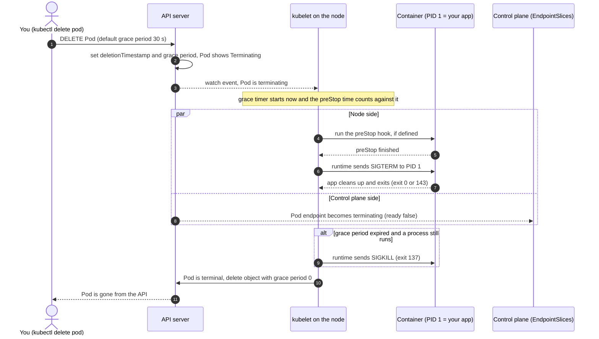

# T1.05 Processes and signals

> Competency: n/a, foundation topic | Domain/weight: n/a (foundation; supports both exams) | Est. time: 2 h | Prerequisites: T1.01

Shell setup used in this lesson (from the conventions; paste it into every new terminal until you made it permanent in [T1.01](../part1-linux/T1.01-bash-shell-essentials-for-exam-speed.md)):

```bash
alias k=kubectl
export do="--dry-run=client -o yaml"
export now="--force --grace-period=0"
source <(kubectl completion bash); complete -o default -F __start_kubectl k
```

Prerequisite: [T1.01 Bash shell essentials for exam speed](../part1-linux/T1.01-bash-shell-essentials-for-exam-speed.md) (exit codes with `$?`, redirection, quoting). This lesson does not re-teach them. Linux namespaces and cgroups, which explain why a container has its own PID 1, come later in [T1.10](../part1-linux/T1.10-linux-namespaces-and-cgroups-v2.md).

How the outputs in this lesson were produced:

- `REAL OUTPUT (Docker)` was captured in a plain Docker container on an arm64 Docker host: `ubuntu:24.04` (procps-ng, psmisc and lsof from the Ubuntu repositories) or `busybox:1.36`. It is **not** a VM result. The host kernel was the Docker Desktop VM kernel, not an Ubuntu 24.04 VM.
- `REAL OUTPUT (kind v0.33.0, v1.37.0)` was captured on a real kind cluster with node image `kindest/node:v1.37.0` and kind's default CNI (kindnet), not Calico. Pod IPs, UIDs and container IDs always differ on your cluster.
- `EXPECTED OUTPUT (not captured)` was not run. Each such block is listed in section 11.

---

## 1. Why this matters

A container is not a small virtual machine. It is an ordinary Linux process that has a PID, a parent, a state and an exit code, and it receives signals like any other process. When you run `kubectl delete pod`, Kubernetes does not "stop a container". The kubelet sends the signal SIGTERM to the process, waits for a grace period (30 seconds by default), and then sends SIGKILL.

When you do not know this, a Pod "takes 30 seconds to delete" and you cannot say why. You see `Exit Code: 137` in `kubectl describe` and cannot tell an out-of-memory kill from a shutdown that was too slow. A Pod stays in `Terminating` and you reach for `--force` when the real cause is a finalizer, and `--force` does not fix that. A port is "already in use" and you cannot find who holds it. All of these are quick wins once you know the Linux side, and the exam gives you shells on nodes (`ssh <node>`, then `sudo -i`; see [the exam tips page](https://docs.linuxfoundation.org/tc-docs/certification/tips-cka-and-ckad)) where you must read `ps`, `ss` and `/proc` yourself.

---

## 2. Concepts

### 2.1 The process model: PID, PPID, PID 1, fork and exec, states

**Process.** A running instance of a program. The kernel keeps one record per process: its number (PID), the PID of its parent (PPID), the user it runs as, its current directory, its open files, its environment variables, its memory and its state.

**PID (process ID).** A unique number the kernel gives to each process. **PPID** is the PID of the process that created it (its parent). Every process except the very first has a parent, so processes form a tree.

**PID 1.** The first process of the system. On a node, PID 1 is `systemd`. Inside a container, the container has its **own PID namespace** (a private numbering of processes, see [T1.10](../part1-linux/T1.10-linux-namespaces-and-cgroups-v2.md)), so the container's main process is PID 1 *inside* the container, while it has a different, larger PID on the node. PID 1 is special in two ways, and both matter for Kubernetes (sections 2.4 and 2.8):

- The kernel does **not** apply default signal actions to PID 1. If PID 1 has not installed a handler for SIGTERM, the signal is ignored.
- When any process loses its parent, the kernel hands it to PID 1 (it is "reparented"). PID 1 must then collect the exit status of those orphans. That job is called **reaping**.

**fork and exec.** Linux starts programs in two steps, and a shell does exactly this every time you press Enter:

1. `fork()` copies the current process. The copy is a new process with a new PID, and its PPID is the original.
2. `exec()` replaces the program inside a process with another program. The PID does **not** change.

So `ls` typed at a prompt is: the shell forks, the child execs `ls`, the shell waits. The shell builtin `exec` skips the fork: `exec sleep 1000` turns the shell itself into `sleep`, with the same PID. This is the trick that keeps your application as PID 1 in a container (section 2.11).

REAL OUTPUT (Docker): `bash -s` was PID 1 in this container. The child has a new PID and PPID 1.

```text
shell pid=1 ppid=0
child pid=6 ppid=1
```

**Process states.** The kernel gives every process one state. `ps` shows it in the `STAT` column and `/proc/<pid>/status` shows it in the `State:` line.

| Code | Name | Meaning | What it means for you |
|---|---|---|---|
| `R` | Running or runnable | On a CPU, or waiting for one | A busy process. Many `R` processes raise the load average |
| `S` | Interruptible sleep | Waiting for an event (input, timer, a child) | The normal state of most processes. Signals wake it |
| `D` | Uninterruptible sleep | Waiting for I/O inside the kernel (disk, NFS) | Cannot be killed, not even with SIGKILL, until the I/O returns. A hung network mount creates `D` processes and Pods stuck in `Terminating` |
| `Z` | Zombie (defunct) | Has exited, but the parent has not collected the exit status yet | Uses no CPU and no memory, only a slot in the process table. `kill` cannot remove it, because it is already dead (section 2.8) |
| `T` | Stopped | Paused by SIGSTOP, SIGTSTP (Ctrl+Z) or a debugger | Frozen until SIGCONT |

`ps` adds extra letters after the state: `s` = session leader, `l` = multi-threaded, `+` = in the foreground of its terminal, `<` = high priority, `N` = low priority. So `Ss` is a sleeping session leader, which is what PID 1 usually looks like.

### 2.2 Looking at processes: ps, pstree, pgrep, pidof

`ps` reads `/proc` and prints a snapshot. It has two option styles (a historical accident), and you must not mix them in one command:

| Command | Style | Columns | Use it for |
|---|---|---|---|
| `ps -ef` | UNIX (`-e` every process, `-f` full format) | `UID PID PPID C STIME TTY TIME CMD` | The standard "who started what" view; shows the PPID |
| `ps aux` | BSD (`a` all users, `u` user format, `x` also processes without a terminal) | `USER PID %CPU %MEM VSZ RSS TTY STAT START TIME COMMAND` | Quick view of CPU, memory and state |
| `ps -o pid,ppid,stat,cmd --forest` | Custom columns | Whatever you list after `-o` | Draw the process tree with the exact columns you need |
| `ps -ef --forest` | UNIX plus tree | As `-ef`, with `\_` branches in `CMD` | Find which parent started a process |
| `ps -p <pid> -o ...` | Select by PID | | Look at one process |

REAL OUTPUT (Docker): `ps -o pid,ppid,stat,cmd --forest` with two background `sleep` commands. Both are children of PID 1, which here is the shell.

```text
    PID    PPID STAT CMD
      1       0 Ss   bash -s
    344       1 S    sleep 1000
    345       1 S    sleep 1001
    346       1 R    ps -o pid,ppid,stat,cmd --forest
```

REAL OUTPUT (Docker): `ps -ef` shows `PPID` as the third column. Here `bash -c 'sleep 600 & wait'` (PID 365) is the parent of `sleep 600` (PID 367).

```text
UID          PID    PPID  C STIME TTY          TIME CMD
root           1       0  0 07:06 ?        00:00:00 bash -s
root         364       1  0 07:06 ?        00:00:00 sleep 500
root         365       1  0 07:06 ?        00:00:00 bash -c sleep 600 & wait
root         367     365  0 07:06 ?        00:00:00 sleep 600
```

REAL OUTPUT (Docker): `ps aux` (header and first rows). `STAT` is `Ss` for PID 1 and `S` for the sleeping children. `RSS` is resident memory in KiB.

```text
USER         PID %CPU %MEM    VSZ   RSS TTY      STAT START   TIME COMMAND
root           1  0.0  0.0   4044  3080 ?        Ss   07:06   0:00 bash -s
root         364  0.0  0.0   2280  1304 ?        S    07:06   0:00 sleep 500
root         365  0.0  0.0   4044  3076 ?        S    07:06   0:00 bash -c sleep 600 & wait
```

`pstree` draws the tree for you. `-p` adds the PIDs:

```text
bash(1)-+-bash(365)---sleep(367)
        |-head(369)
        |-pstree(368)
        `-sleep(364)
```

(REAL OUTPUT (Docker), `pstree -p 1`.)

To **find** a process by name, do not pipe `ps` through `grep` (the `grep` shows up in its own results). Use:

| Command | What it does | Example |
|---|---|---|
| `pgrep <pattern>` | Prints the PIDs whose **name** matches the regular expression | `pgrep kubelet` |
| `pgrep -a <pattern>` | Same, and also prints the full command line | `pgrep -a kubelet` |
| `pgrep -f <pattern>` | Matches against the **full command line**, not only the name (needed to tell two `python` processes apart) | `pgrep -af 'sleep 800'` |
| `pgrep -x <name>` | Exact name match (no partial matches) | `pgrep -x sleep` |
| `pidof <name>` | Prints the PIDs of programs with exactly this name, newest first | `pidof sleep` |

REAL OUTPUT (Docker):

```text
$ pgrep -a sleep
344 sleep 1000
345 sleep 1001
$ pidof sleep
345 344
```

`ps` shows **where** a process runs. Inside a Pod, `k exec <pod> -- ps` shows only that container's PID namespace, so `ps` there lists a few processes with the app as PID 1. On the node, the same process has another PID (section 2.11).

### 2.3 top and htop: load average, %CPU, RES, sorting

`ps` is a snapshot. `top` refreshes the view, which makes it the tool for "what is eating the node right now?". `htop` is a nicer, colored version; it is **not installed by default** and is not in the list of tools on the exam hosts (kubectl, yq, curl, wget and man, source [exam tips](https://docs.linuxfoundation.org/tc-docs/certification/tips-cka-and-ckad)), so learn `top`.

REAL OUTPUT (Docker): `top -b -n1 | head -12` (`-b` batch mode prints plain text, `-n1` prints one screen and exits; use these in scripts and when you copy output).

```text
top - 07:06:28 up 1 day, 19:40,  0 user,  load average: 1.33, 1.31, 1.02
Tasks:   6 total,   1 running,   5 sleeping,   0 stopped,   0 zombie
%Cpu(s):  2.7 us,  4.5 sy,  0.0 ni, 90.0 id,  0.9 wa,  0.0 hi,  1.8 si,  0.0 st
MiB Mem :  16039.5 total,  13277.7 free,   1861.7 used,   1199.7 buff/cache
MiB Swap:  17063.5 total,  17063.5 free,      0.0 used.  14177.9 avail Mem

    PID USER      PR  NI    VIRT    RES    SHR S  %CPU  %MEM     TIME+ COMMAND
      1 root      20   0    4044   3080   2788 S   0.0   0.0   0:00.00 bash
    364 root      20   0    2280   1304   1204 S   0.0   0.0   0:00.00 sleep
    365 root      20   0    4044   3076   2792 S   0.0   0.0   0:00.00 bash
    367 root      20   0    2280   1296   1192 S   0.0   0.0   0:00.00 sleep
    374 root      20   0    8500   4824   2696 R   0.0   0.0   0:00.00 top
```

How to read it:

| Field | Meaning |
|---|---|
| **load average** (three numbers) | The average number of tasks that were running (`R`) **or** waiting for disk I/O (`D`) over the last 1, 5 and 15 minutes. It is a count, not a percent. Compare it with the number of CPU cores (`nproc`): a load of 4 on 4 cores means "just full", 12 on 4 cores means a queue of work. A high load with an idle CPU means many `D` processes (slow disk or a hung mount) |
| `Tasks` line | Counts of processes by state. A non-zero `zombie` count means a parent is not reaping its children |
| `%Cpu(s)` | `us` user code, `sy` kernel, `ni` low-priority (niced) user code, `id` idle, `wa` waiting for I/O, `st` stolen by the hypervisor |
| `%CPU` (per process) | Share of **one core**. 100 means one full core, so a multi-threaded process can show 250 |
| `VIRT` | Address space the process has mapped. Often huge, mostly not real memory |
| `RES` | **Resident** memory: RAM the process really holds now. This is the number to watch |
| `SHR` | Part of `RES` that is shared with other processes (libraries) |
| `NI` | The nice value (section 2.10) |
| `S` | The state letter (section 2.1) |

Interactive keys inside `top` (press them while it runs):

| Key | Action |
|---|---|
| `P` | Sort by `%CPU` (the default) |
| `M` | Sort by memory (`%MEM`) |
| `N` | Sort by PID |
| `T` | Sort by cumulative CPU time |
| `1` | Show each CPU core on its own line |
| `c` | Toggle between the program name and the full command line |
| `k` | Ask for a PID and a signal to send (default 15) |
| `q` | Quit |

You can also start `top` sorted: `top -o %MEM` (sort by memory), `top -b -n1 -o %MEM | head -15` (a one-shot list of the top memory users).

Note about containers: `uptime` and `top` read `/proc/loadavg` and `/proc/meminfo`, which show the **host's** numbers, not the container's. In the capture above, the "load average 1.33" belongs to the whole Docker Desktop VM, not to the six processes in the container. In a Pod, use `k top pod` (metrics-server) for per-Pod numbers.

### 2.4 Signals: SIGTERM, SIGKILL, SIGINT, SIGHUP, SIGSTOP and kill vs pkill vs killall

**Signal.** A small numbered message the kernel delivers to a process. It interrupts the process and makes it do one of three things. This is called the signal's **disposition**:

1. **Default action**: what the kernel does if the program says nothing. For most signals it is "terminate the process".
2. **Handler (catch)**: the program installed a function for this signal and runs it, for example "flush buffers, close connections, exit 0".
3. **Ignore**: the program asked the kernel to drop the signal.

Two signals cannot be caught or ignored by any process, so the kernel can always stop a misbehaving program: **SIGKILL (9)** and **SIGSTOP (19)**.

The signals you must know (the numbers are the Linux numbers on x86-64 and arm64; other Unix systems differ, so use names in scripts):

| No. | Name | Default action | Catchable | Typical use |
|---|---|---|---|---|
| 1 | `SIGHUP` | Terminate | Yes | "Hang up": the terminal closed. Many daemons (nginx, sshd, prometheus) re-read their configuration on SIGHUP instead |
| 2 | `SIGINT` | Terminate | Yes | Ctrl+C in the terminal |
| 3 | `SIGQUIT` | Terminate (+ core dump) | Yes | Ctrl+\\. nginx treats it as "graceful shutdown" |
| 9 | `SIGKILL` | Terminate | **No** | The last resort. The process gets no chance to clean up |
| 15 | `SIGTERM` | Terminate | Yes | The polite "please stop". It is the default signal of `kill`, of `docker stop` and of the kubelet |
| 17 | `SIGCHLD` | Ignore | Yes | Sent to a parent when a child exits or stops. This is how parents learn to reap |
| 18 | `SIGCONT` | Continue | Yes | Resume a stopped process |
| 19 | `SIGSTOP` | Stop | **No** | Freeze a process |
| 20 | `SIGTSTP` | Stop | Yes | Ctrl+Z in the terminal |
| 10, 12 | `SIGUSR1`, `SIGUSR2` | Terminate | Yes | Free for the application to define (log rotation, debug dump) |

`kill -l` lists every signal with its number:

REAL OUTPUT (Docker): `kill -l` (first rows; the list continues with the real-time signals `SIGRTMIN` to `SIGRTMAX`, up to 64).

```text
 1) SIGHUP	 2) SIGINT	 3) SIGQUIT	 4) SIGILL	 5) SIGTRAP
 6) SIGABRT	 7) SIGBUS	 8) SIGFPE	 9) SIGKILL	10) SIGUSR1
11) SIGSEGV	12) SIGUSR2	13) SIGPIPE	14) SIGALRM	15) SIGTERM
16) SIGSTKFLT	17) SIGCHLD	18) SIGCONT	19) SIGSTOP	20) SIGTSTP
...
```

Converting between a number and a name: `kill -l 15` prints `TERM`, `kill -l TERM` prints `15`, and `kill -l 143` prints `TERM` too (bash subtracts 128 from an exit code above 128, which is the bridge to section 2.5).

**Sending a signal.** All of these send SIGTERM to PID 1234:

```bash
kill 1234            # no option: SIGTERM
kill -TERM 1234      # by name (no SIG prefix needed)
kill -15 1234        # by number
kill -s TERM 1234    # POSIX form
```

`kill -KILL 1234` (or `-9`) sends SIGKILL. `kill -STOP 1234` freezes the process and `kill -CONT 1234` resumes it. `kill -0 1234` sends **no signal**; it only checks that the PID exists and that you may signal it (exit code 0 or not). A negative PID, `kill -TERM -1234`, signals the whole process group 1234.

Three tools send signals. They differ in how you pick the target:

| Tool | Picks targets by | Example | Watch out for |
|---|---|---|---|
| `kill` | PID, or a shell job (`%1`) | `kill -TERM 1234`, `kill %1` | You need the PID first. It is also a shell builtin |
| `pkill` | A pattern against the process name (`-f` the full command line, `-x` exact name, `-u` user) | `pkill -f 'sleep 800'` | A loose pattern kills more than you meant. Check with `pgrep -a <pattern>` first (same matching rules) |
| `killall` | The **exact** program name | `killall -TERM sleep` | Kills every process of that name, including other users' if you are root |

REAL OUTPUT (Docker): `pkill -f 'sleep 800'` killed only the `sleep 800` process. `killall -TERM sleep` then killed every remaining `sleep` (the count afterwards is 0).

```text
$ sleep 800 & sleep 801 &
$ pkill -f 'sleep 800'; pgrep -a sleep | grep -E '80[01]'
395 sleep 801
$ killall -TERM sleep; pgrep -a sleep | wc -l
0
```

**The correct order of force.** Send SIGTERM first and give the process a few seconds. Use SIGKILL only if it does not exit. SIGKILL cannot be caught, so the process cannot delete its lock files, flush its buffers or tell a database it is leaving. Its children are not told either; they become orphans. Kubernetes follows exactly this order (SIGTERM, grace period, SIGKILL, section 2.11).

**Handlers, and why PID 1 is special.** The kernel keeps masks for each process in `/proc/<pid>/status`: `SigCgt` lists the signals the process **catches**, `SigIgn` the signals it ignores. Each is a hexadecimal number where bit *n-1* stands for signal *n* (signal 15 is bit 14, value `0x4000`).

REAL OUTPUT (Docker): the same `grep` on two PID 1 processes in `busybox:1.36` containers. The first is `sleep 1000`, which has no handlers. The second is a shell with `trap "exit 0" TERM`. `0x14002` = bits 1, 14 and 16 = signals 2 (INT), 15 (TERM) and 17 (CHLD).

```text
# PID 1 = sleep 1000
SigIgn:	0000000200000000
SigCgt:	0000000000000000
# PID 1 = sh with trap on TERM
SigCgt:	0000000000014002
```

A PID 1 with `SigCgt` = 0 **ignores SIGTERM**, because the kernel does not apply the default action to PID 1. SIGKILL still works, but only because the container runtime sends it from outside the container's PID namespace. This is the core reason a Pod "takes 30 seconds to delete" (section 6).

Shell scripts catch signals with `trap`:

```bash
trap 'echo got TERM; exit 0' TERM    # run this command when SIGTERM arrives
trap '' HUP                          # ignore SIGHUP
trap - TERM                          # restore the default action
```

REAL OUTPUT (Docker): the trap-based script from the lab, run as a background job and signalled.

```text
started pid 390
got TERM, cleaning up
exit=0
```

### 2.5 Exit codes: 0, 1, 126, 127 and 128+N

Every process ends with a number from 0 to 255, its **exit code** (or exit status). The parent reads it; in a shell it is `$?` right after the command. By convention `0` means success and anything else means failure. A process can end in two different ways, and the shell folds both into one number:

- It calls `exit(n)` itself: the code is `n`.
- It is **killed by a signal** `N`: the shell reports `128 + N`.

| Code | Meaning | Typical cause |
|---|---|---|
| `0` | Success | |
| `1` | General error | The program failed. Many tools use `1` for every error |
| `2` | Misuse | Wrong arguments to a shell builtin or CLI (many tools use 2 for "bad usage") |
| `126` | Command found but **cannot be executed** | No execute permission (`chmod +x` missing), or the path is a directory |
| `127` | Command **not found** | Typo, not in `$PATH`, or a script whose `#!` line names an interpreter that does not exist |
| `128 + N` | Killed by signal `N` | See the next rows |
| `129` | 128 + 1 | SIGHUP |
| `130` | 128 + 2 | SIGINT (Ctrl+C) |
| `137` | 128 + 9 | **SIGKILL**: the kernel OOM killer, or a runtime kill after the grace period expired, or someone ran `kill -9` |
| `143` | 128 + 15 | **SIGTERM**: the process died from the default action of SIGTERM (or exits 143 on purpose) |
| `255` and others | Out of range or app specific | A code above 255 wraps (`exit 256` returns 0, `exit 300` returns 44) |

REAL OUTPUT (Docker): the codes, produced on purpose. The lines starting with `bash:` are the shell's own messages on stderr.

```text
TERM exit=143
bash: line 12:   350 Killed                  sleep 1000
KILL exit=137
INT exit=130
bash: line 14:   352 Hangup                  sleep 1000
HUP exit=129
exit3=3
bash: line 16: /tmp/nope.sh: No such file or directory
notfound=127
bash: line 17: /tmp/x.sh: Permission denied
noexec=126
bash: line 18: nonexistentcmd: command not found
127=127
```

Two more 126/127 cases, also REAL OUTPUT (Docker). The second one surprises people: the file exists, but the interpreter on its first line does not, and bash says "required file not found" with code 127. A script saved with Windows line endings (`\r\n`) fails the same way, because the interpreter is named `/bin/bash\r`.

```text
bash: line 10: /tmp/s.sh: cannot execute: required file not found
badshebang=127
bash: line 11: /tmp/d: Is a directory
dir=126
```

**Exit codes in Kubernetes.** The container runtime reports the same convention. If the main process of a container is killed by signal 9, the container's `exitCode` is 137. You read it from the Pod status (`lastState.terminated.exitCode` after a restart, `state.terminated.exitCode` for a container that stopped for good). Remember that **137 has two origins**:

| Origin of 137 | Who sends SIGKILL | `reason` in the Pod status | Check |
|---|---|---|---|
| Out of memory | The kernel OOM killer, because the container went over its memory limit | `OOMKilled` | `reason: OOMKilled`, and a `memory` limit in the spec |
| Grace period expired | The container runtime, after the kubelet's termination timer ran out | `Error` | No `OOMKilled`. Compare `terminationGracePeriodSeconds` with the app's shutdown time |

143 means the container ended from SIGTERM without a handler taking over, for example a non-PID-1 process (see sections 2.8 and 2.11), or an app that deliberately exits 143. Java is a well-known case: the JVM handles SIGTERM, runs its shutdown hooks and exits with 143.

### 2.6 Foreground and background jobs: &, jobs, fg, bg, nohup, disown

Your shell runs one **foreground** job at a time; it holds the terminal until it ends. A **background** job runs while you keep typing. The shell keeps a **job table** of them, and each job has a small number, written `%1` for the first job, `%2` for the second, and `%3` for the third.

| Command / key | Effect |
|---|---|
| `cmd &` | Start `cmd` in the background. `$!` holds its PID |
| `jobs` (`jobs -l` adds PIDs) | List the shell's jobs with their state (`Running`, `Stopped`) |
| Ctrl+Z | Stop (SIGTSTP) the foreground job and put it in the background as `Stopped` |
| `bg %1` | Continue the stopped job `%1` in the background (sends SIGCONT) |
| `fg %1` | Bring job `%1` back to the foreground. Plain `fg` takes the most recent job (`+` in `jobs`) |
| Ctrl+C | Send SIGINT to the foreground job |
| `kill %1` | Send SIGTERM to job `%1` |
| `wait` or `wait %1` | Block until the background job(s) end, and return the exit code of the job |
| `nohup cmd &` | Run `cmd` so that it **ignores SIGHUP**, with its output in `nohup.out` unless you redirect |
| `disown %1` (or `disown -h %1`) | Remove job `%1` from the job table (or only mark it "do not send SIGHUP"), so the shell leaves it alone when it exits |

Write the job-control line like this. The entry's shorthand `sleep 1000 &; jobs; fg` is a **syntax error** in bash, because `&` already ends a command; do not add `;` after it:

```bash
sleep 1000 & jobs        # start it in the background, then list jobs
fg                       # bring the job back; Ctrl+Z stops it again, bg resumes it in the background
```

REAL OUTPUT (Docker): `jobs -l` and `kill %2` in a script run with `set -m` (job control on). Real interactive Ctrl+Z, `fg` and `bg` need a terminal, and were not captured; the sequence is listed in section 11.

```text
[1]-     7 Running                 sleep 1000 &
[2]+     8 Running                 sleep 1001 &
pid alive (kill -0)
[2]-  Terminated              sleep 1001
[1]+  Running                 sleep 1000 &
```

(The `+` marks the "current" job, which plain `fg` and `bg` use; `-` is the previous job.)

**Why SIGHUP matters.** When a terminal closes (your SSH session drops), the kernel sends SIGHUP to the session's processes, and the default action kills them. `nohup` starts a program with SIGHUP ignored, so it survives. `disown` is the fix **after** you started a job without `nohup`: the shell no longer tracks or hangs up that job. For anything long-lived on a real server, use a service manager (systemd, taught in a later Part 1 lesson), not `nohup`.

**Exam use.** Background jobs are handy for `k port-forward svc/web 8080:80 &`, then `curl localhost:8080`, then `kill %1` to close the tunnel. Forgetting `kill %1` leaves port 8080 busy for the next task (section 2.9). `$!` and `kill %N` are also how you stop a `k logs -f ... &` that you started.

### 2.7 /proc/&lt;pid&gt;: what the kernel knows about a process

`/proc` is a virtual filesystem. Nothing in it is on disk. Reading a file asks the kernel for live data, and `ps`, `top` and `lsof` are mostly readers of `/proc`. Each process has a directory `/proc/<pid>/`. `/proc/self` always points to the process that reads it.

| Path | Contents | Read it with | Use |
|---|---|---|---|
| `cmdline` | The exact command line, arguments **separated by NUL bytes** | `tr '\0' ' ' < /proc/<pid>/cmdline` | See what a process was really started with (flags the `ps` column cut off) |
| `environ` | The environment variables at start, NUL-separated. Readable by the owner and root only | `tr '\0' '\n' < /proc/<pid>/environ` | Check which `$VAR` a container really got |
| `status` | Name, `State`, `Pid`, `PPid`, `Threads`, `VmRSS`, `SigCgt`, `SigIgn`, and `NSpid` | `grep -E '^(Name\|State\|PPid\|NSpid\|VmRSS)' /proc/<pid>/status` | State, parent, memory and signal handlers in one place |
| `fd/` | One symlink per open file descriptor (0 = stdin, 1 = stdout, 2 = stderr, then files and sockets) | `ls -l /proc/<pid>/fd` | See open files, log destinations and sockets |
| `cgroup` | The control group the process belongs to | `cat /proc/<pid>/cgroup` | Find which Pod/container slice owns a process ([T1.10](../part1-linux/T1.10-linux-namespaces-and-cgroups-v2.md)) |
| `ns/` | One symlink per namespace (`pid`, `net`, `mnt`, `uts`, `ipc`, `cgroup`, `user`, `time`). Same number = same namespace | `ls -l /proc/<pid>/ns` | Check whether two processes share a namespace |

REAL OUTPUT (Docker): for a `sleep 1000` process (PID 357, started by PID 1). This is a container, so `cgroup` shows `0::/`, the process's own cgroup root.

```text
$ grep -E '^(Name|State|Pid|PPid|Threads|VmRSS)' /proc/357/status
Name:	sleep
State:	S (sleeping)
Pid:	357
PPid:	1
VmRSS:	    1316 kB
Threads:	1
$ tr '\0' ' ' < /proc/357/cmdline; echo
sleep 1000
$ ls -l /proc/357/fd
lr-x------ 1 root root 64 Oct 27 07:06 0 -> /dev/null
l-wx------ 1 root root 64 Oct 27 07:06 1 -> pipe:[2866188]
l-wx------ 1 root root 64 Oct 27 07:06 2 -> pipe:[2866189]
$ cat /proc/357/cgroup
0::/
$ tr '\0' '\n' < /proc/357/environ | head -3
HOSTNAME=127d26177ad4
PWD=/
HOME=/root
```

The namespace links, REAL OUTPUT (Docker): the number in brackets identifies the namespace. Two processes with the same `net:[...]` are in the same network namespace.

```text
cgroup -> cgroup:[4026532401]
ipc -> ipc:[4026532399]
mnt -> mnt:[4026532397]
net -> net:[4026532402]
pid -> pid:[4026532400]
user -> user:[4026531837]
uts -> uts:[4026532398]
```

States and signals are visible here too. REAL OUTPUT (Docker): `kill -STOP` then `kill -CONT` on the same process, reading `State:` each time.

```text
State:	T (stopped)
State:	S (sleeping)
```

**Kubernetes use.** `k exec <pod> -- cat /proc/1/cmdline` tells you what PID 1 of a container really is, which is the key question for signal handling. On the node, `/proc/<pid>/cgroup` of a container process contains the `kubepods` path of its Pod (section 5 shows it).

### 2.8 Zombies, and why PID 1 in a container must reap

**Zombie.** When a process exits, the kernel frees its memory and files but keeps a tiny record: the PID and the exit code. It stays until the **parent** reads it with the `wait()` system call. Between exit and `wait()`, the process is a zombie: state `Z`, shown as `[name] <defunct>` in `ps`. A zombie uses no CPU and no memory. It cannot be killed, because it is already dead: the only way to remove it is for its parent to call `wait()`, or for the parent to exit (then the zombie is reparented to PID 1, which reaps it).

REAL OUTPUT (Docker): `bash -c 'sleep 0.1 & exec sleep 30'`. The parent became `sleep 30` through `exec`. It never calls `wait()` for its child, so the exited `sleep 0.1` stays as `Z`.

```text
    368       1 S    sleep 30
    370     368 Z    [sleep] <defunct>
```

A single zombie is harmless. A parent that spawns children all day and never reaps them fills the process table. Each zombie holds a PID, and a container's cgroup has a limit on the number of PIDs, so eventually `fork` fails with "Resource temporarily unavailable" and the app cannot start any more processes.

**Orphans and PID 1.** If the parent exits first, the child is an orphan and the kernel reparents it to PID 1. A well-behaved init (systemd on a node) reaps it when it exits. In a container, **PID 1 is your application**. Most applications were never written to reap strangers' children, so orphans that exit become zombies and stay.

REAL OUTPUT (Docker): the container command is `sh -c '(sleep 0.2 &); exec sleep 1000'`. The subshell starts `sleep 0.2` and exits at once, which orphans `sleep 0.2`. PID 1 is `sleep 1000`, which does not reap. The orphan exits and stays as `Z` with PPID 1.

```text
$ docker run -d --name t105-o busybox:1.36 sh -c '(sleep 0.2 &); exec sleep 1000'
$ docker exec t105-o ps -o pid,ppid,stat,args
PID   PPID  STAT COMMAND
    1     0 S    sleep 1000
    7     1 Z    [sh]
    8     0 R    ps -o pid,ppid,stat,args
```

Fixes, from most to least common:

| Fix | How | Result |
|---|---|---|
| Use a tiny init as PID 1 (**tini**, or `docker run --init`, which injects `docker-init`, a build of tini) | `ENTRYPOINT ["/usr/bin/tini", "--", "app"]` in the image. In Kubernetes there is no `--init` flag; put tini in the image | tini reaps orphans and forwards signals (SIGTERM, SIGINT) to the app |
| `shareProcessNamespace: true` in the Pod spec | One PID namespace for the whole Pod. The Pod's hidden `pause` container becomes PID 1 and reaps orphans. Your containers are no longer PID 1 | Reaping works; but every container can see (and signal) the others' processes |
| Make the app reap | Handle `SIGCHLD` and call `wait()` | Correct, but you must write it |

REAL OUTPUT (Docker): the same container with `--init`. PID 1 is now `docker-init`. The orphan is gone (reaped) and no zombie is left.

```text
$ docker run -d --init --name t105-o busybox:1.36 sh -c '(sleep 0.2 &); exec sleep 1000'
$ docker exec t105-o ps -o pid,ppid,stat,args
PID   PPID  STAT COMMAND
    1     0 S    /sbin/docker-init -- sh -c (sleep 0.2 &); exec sleep 1000
    6     1 S    sleep 1000
    9     0 R    ps -o pid,ppid,stat,args
```

A tiny init cannot fix everything. A zombie whose **parent is alive and not waiting** is not an orphan, so PID 1 does not get it. REAL OUTPUT (Docker): with `--init` and the command `sh -c 'sleep 0.1 & exec sleep 1000'`, the exited `sleep 0.1` stayed as `Z` with PPID 6, which is the `sleep 1000` (not PID 1). The fix is then in that parent.

`shareProcessNamespace` has a second effect you will use in sections 5 and 7: because your container's main process is **not** PID 1 any more, the kernel applies the **default** action of SIGTERM to it, and it dies at once. Section 5 shows the difference with real output.

Where to look for zombies: `ps -eo pid,ppid,stat,cmd | awk '$3 ~ /^Z/'`, or the `zombie` count in the `top` header. The parent PID in that line is the process to fix or restart.

### 2.9 Who owns that port or file: ss, lsof and fuser

A common failure is "address already in use": a process holds a port you need. The fastest tools:

| Command | What it does | Notes |
|---|---|---|
| `ss -ltnp` | `-l` listening sockets, `-t` TCP, `-n` numbers (no name lookups), `-p` owning process | Ships with `iproute2`, always present. Needs `sudo` to show other users' processes |
| `lsof -i :6443` | List open files that are an Internet socket on port 6443 | `lsof` may not be installed; `-i` alone lists all network files; add `-P -n` to skip name lookups |
| `lsof -p <pid>` | Everything process `<pid>` has open: its binary, libraries, files, sockets | Same data as `ls -l /proc/<pid>/fd`, but with types |
| `lsof -t -i :6443` | **Only the PID** (`-t` = terse) | Handy in `kill $(lsof -t -i :6443)` |
| `fuser -v 6443/tcp` | Who uses the TCP port 6443 | Part of `psmisc`. `fuser -k 6443/tcp` kills them (default SIGKILL: be careful) |

REAL OUTPUT (Docker): `nc -l -p 6443` was started in the background as the "stray process".

```text
$ ss -ltnp | grep 6443
LISTEN 0      1            0.0.0.0:6443      0.0.0.0:*    users:(("nc",pid=376,fd=3))
$ lsof -i :6443
COMMAND PID USER   FD   TYPE  DEVICE SIZE/OFF NODE NAME
nc      376 root    3u  IPv4 2877775      0t0  TCP *:6443 (LISTEN)
$ fuser -v 6443/tcp
                     USER        PID ACCESS COMMAND
6443/tcp:            root      F.... nc
$ lsof -p 376 | head -4
COMMAND PID USER   FD   TYPE  DEVICE SIZE/OFF     NODE NAME
nc      376 root  cwd    DIR   0,564      102 29892847 /
nc      376 root  rtd    DIR   0,564      102 29892847 /
nc      376 root  txt    REG   0,564    68000 29900899 /usr/bin/nc.openbsd
```

(Port 6443 is the default port of the Kubernetes API server. On a control plane node `lsof -i :6443` or `ss -ltnp | grep 6443` shows `kube-apiserver`. If it shows nothing, the API server is not running, which is useful for a "kubectl cannot connect" task. A later Part 1 lesson on Linux networking covers the full socket toolbox.)

The routine for a port in use: find the owner with `ss -ltnp` or `lsof -i :PORT`, read the process name, then decide. If it is a stray test process you started, `kill <pid>` (SIGTERM first). If it is a service the system needs, **do not kill it**; change your port instead.

### 2.10 nice and renice (awareness)

**Nice value.** A number from -20 to 19 that tells the CPU scheduler how "nice" a process is to others. Higher means nicer, which means lower priority. The default is 0. It matters **only when CPUs are busy**; on an idle machine every process gets all the CPU it asks for. A normal user can only raise the nice value of its own processes (be nicer). Only root can lower it.

```bash
nice -n 10 ./batch-job.sh        # start a command with nice value 10
renice -n 15 -p 376              # change a running process (PID 376) to 15
ps -o pid,ni,cmd -p 376          # show the nice value; top shows it in the NI column
```

REAL OUTPUT (Docker): `renice -n 15 -p <pid>` on a process that was started with nice 10. The first line is `renice`'s own output (old and new priority). The `ps` line afterwards shows `NI` 15.

```text
376 (process ID) old priority 10, new priority 15
    PID  NI CMD
    376  15 sleep 1000
```

Why this is only "awareness" for Kubernetes: Pod CPU shares are not set with nice values. The kubelet writes your `resources.requests.cpu` as a cgroup weight (`cpu.weight`) and `limits.cpu` as a quota (`cpu.max`); see [T1.10](../part1-linux/T1.10-linux-namespaces-and-cgroups-v2.md). Nice values work **inside** that budget. In the exam you will not need `nice`, but you should recognize `NI` in `top` and know that a niced process is not "less memory", only "later in the CPU queue".

### 2.11 Mapping to Kubernetes: termination, grace period, preStop and SIGTERM handling

This section ties the Linux facts to the Pod lifecycle. The sources are the Pod lifecycle page, [Termination of Pods](https://kubernetes.io/docs/concepts/workloads/pods/pod-lifecycle/#pod-termination), and [Container lifecycle hooks](https://kubernetes.io/docs/concepts/containers/container-lifecycle-hooks/).

**What `kubectl delete pod` does.** This is the sequence in the docs, in plain words:

1. You delete the Pod. The API server does **not** remove it. It writes a `deletionTimestamp` and the grace period into the Pod object. `kubectl get` now shows `Terminating`.
2. The kubelet on the Pod's node sees that and starts the local shutdown. If a container has a `preStop` hook and `terminationGracePeriodSeconds` is not 0, the kubelet runs the hook **first**. The hook must finish before SIGTERM is sent.
3. The kubelet asks the container runtime to send SIGTERM to **process 1 of each container**. (Many runtimes use the `STOPSIGNAL` of the image if the image sets one.)
4. At the same time, the control plane marks the Pod as terminating in the EndpointSlices of its Services, so load balancers stop sending **new** traffic.
5. The **grace period timer** counts from the moment the delete was accepted (step 1), so the `preStop` time is part of it, not added to it. The default is 30 seconds. If the `preStop` hook is still running when the grace period ends, the kubelet adds one small extension of 2 seconds.
6. When the grace period expires and any process is still running, the runtime sends **SIGKILL**. The kubelet then marks the Pod terminal and removes the Pod object from the API server (grace period 0).

**Fields you must know:**

| Field / flag | Default | What it does | Risky or invalid values |
|---|---|---|---|
| `spec.terminationGracePeriodSeconds` | `30` | Seconds between the delete request and SIGKILL. Includes the `preStop` hook | `0` means "kill at once, no chance to shut down" (the API reference says this too). Too low a value cuts off a slow shutdown (exit 137). Too high makes deletes and rolling updates slow when an app ignores SIGTERM. Negative values are not valid: the API reference describes the field as a non-negative integer, so the API server should reject `-1` with an `Invalid value: -1: <reason placeholder>` error (exact text not captured, section 11) |
| `spec.containers[].lifecycle.preStop` | none | A hook run before SIGTERM. Handlers: `exec` (a command in the container), `httpGet`, `sleep` (just waits; `sleep.seconds`) | A hook that hangs eats the whole grace period. A failing hook does not stop the shutdown: the kubelet kills the container (event `FailedPreStopHook`) |
| `spec.shareProcessNamespace` | `false` | One PID namespace for all containers of the Pod (section 2.8) | Every container can see and signal the others. `/proc/<pid>/root` exposes other containers' filesystems |
| `kubectl delete --grace-period=N` | uses the Pod's value | Overrides the grace period for this delete | The `kubectl delete --help` text says the value "can only be set to 0 when --force is true", so always write `0` together with `--force`; what plain `--grace-period=0` does at run time was not tried (section 11) |
| `kubectl delete --now` | | Shortcut for `--grace-period=1` | |
| `kubectl delete --force --grace-period=0` (`$now`) | | Removes the object from the API **at once** without waiting for the kubelet | Not a kill. The process may still run on the node, and a StatefulSet can then have two copies of one Pod |

**Related but different: the `STOPSIGNAL` and `lifecycle.stopSignal`.** The docs say many runtimes honour the image's `STOPSIGNAL` (nginx's image sets SIGQUIT, a "graceful stop" for nginx). A per-container `lifecycle.stopSignal` field exists, but the docs mark it **alpha since v1.33 and disabled by default** (feature gate `ContainerStopSignals`, and it needs `spec.os.name`). Do not rely on it in an exam task.

**SIGTERM handling is the application's job.** Whether a container shuts down in 1 second or 30 depends on who is PID 1 and whether it has a SIGTERM handler:

| Container's PID 1 | Gets SIGTERM? | What happens at delete |
|---|---|---|
| App started in **exec form** (`command: ["app"]`, Dockerfile `ENTRYPOINT ["app"]`) with a SIGTERM handler (nginx, Go with `signal.Notify`, Java, Node with `process.on('SIGTERM')`) | Yes, handled | Clean stop in a second or two, exit 0 (or 143) |
| App in exec form **without** a handler (a bare `sleep`, many simple scripts, a Python script that never calls `signal.signal`) | Yes, but PID 1 ignores a signal without a handler | Waits the whole grace period, then SIGKILL, exit **137** |
| **Shell form** (Dockerfile `CMD app args`, or `command: ["sh","-c","app args"]`): `sh` is PID 1 and `app` is its child | `sh` gets it. A plain `sh`/`bash`/`dash` has no handler and does not forward it | Waits the whole grace period, then SIGKILL, exit **137**. The app never saw SIGTERM. Caveat: with a single simple command, bash and dash may exec it directly (`sh -c "sleep 1000"` often leaves `sleep` as PID 1), so the trap shows up with `;`, `&&`, pipes and wrapper scripts. Always check with `ps` or `/proc/1/cmdline` instead of guessing |
| Shell used only as a launcher with `exec app` as the last step | The app took over PID 1 (same PID) | Same as exec form: depends on the handler |
| Tiny init (tini) as PID 1 | tini forwards SIGTERM to the child. The child is **not** PID 1 any more, so the default action works | Immediate stop, exit **143** (128 + 15) |
| `shareProcessNamespace: true` | The container's process is not PID 1 (the pause process is) | Immediate stop of the app, exit **143** |

REAL OUTPUT (Docker): the same test with plain Docker, `docker stop -t 3 <name>` (3 s grace instead of the default 10 s, to save time; the `elapsed` line was measured around the command). `docker inspect` gave the exit code. The image in each case was `busybox:1.36`. Lines starting with `##` are labels added for this lesson, and the text in parentheses is a note.

```text
## A: PID 1 = sleep 1000 (exec form, no handler)
elapsed 3.5s
exit=137
## B: sh -c 'sleep 1000; echo done'  (shell form, sh is PID 1)
    1 root      0:00 sh -c sleep 1000; echo done
    6 root      0:00 ps
elapsed 3.1s
exit=137
## C: sh -c 'exec sleep 1000'  (exec replaces the shell; sleep is PID 1, no handler)
elapsed 3.2s
exit=137
## D: sh with trap "echo bye; exit 0" TERM
elapsed 0.2s
exit=0           (docker logs: bye)
## E: sh with trap "exit 143" TERM
elapsed 0.1s
exit=143
## G: docker run --init ... sh -c 'sleep 1000'   (docker-init is PID 1)
PID   PPID  COMMAND
    1     0  /sbin/docker-init -- sh -c sleep 1000
    6     1  sh -c sleep 1000
elapsed 0.1s
exit=143
```

Read A, B and C together: only the cases with a **handler** (D, E) or a **non-PID-1 process under an init** (G) stop at once. Exec form alone (C) is not enough if the program has no handler. Exec form is needed so that the app, not `sh`, receives the signal; the handler is what makes it act on it.

**Finding a container's PID on the node.** Containers are normal processes on the node, so you can signal and inspect them from the node. The container runtime's CLI, `crictl`, knows their host PIDs:

```bash
sudo crictl ps --name web                      # container ID (first column) for a container named web
sudo crictl inspect <container-id> | jq .info.pid      # host PID of the container's PID 1
```

`jq` is **not** guaranteed on exam hosts (summary tools: kubectl, yq, curl, wget, man). Without `jq`, use a Go template, `sudo crictl inspect -o go-template --template '{{.info.pid}}' <container-id>`, or `sudo crictl inspect <container-id> | grep -m1 '"pid"'`. With the PID in hand, `nsenter` runs a command **inside the container's namespaces**: `sudo nsenter -t <pid> -n ip addr` (its network namespace, using the node's `ip`), or `sudo nsenter -t <pid> -m -p ps` (mount plus PID namespace, using the container's own `ps`). `nsenter` and the namespaces behind it are taught in [T1.10](../part1-linux/T1.10-linux-namespaces-and-cgroups-v2.md); section 5 shows this bridge on a real node.

**Under the hood: how the kubelet's signal reaches your process.** The kubelet does not call `kill` itself. It asks the container runtime (containerd) over the CRI to stop the container with a timeout (`StopContainer`). The runtime sends the signal to the process that is PID 1 in the container's PID namespace, waits for the timeout, then sends SIGKILL from outside that namespace. That is why SIGKILL always works on PID 1 while a plain SIGTERM can be ignored.

**Exit codes in the Pod status.** After a container restarts, the previous run is in `status.containerStatuses[].lastState`. While it has stopped for good, it is in `state`. Both have `terminated` with `exitCode` and `reason`:

| Case | `exitCode` | `reason` (expected values; not yet confirmed on v1.37, see section 11) |
|---|---|---|
| Process exited 0 | `0` | `Completed` |
| Process exited non-zero (including 127 from "command not found" in a shell) | the code | `Error` |
| Killed by SIGKILL after the grace period, or by `kill -9` | `137` | `Error` |
| Killed by the OOM killer | `137` | `OOMKilled` |

**Stuck in Terminating.** If a Pod stays `Terminating` long after the grace period, there are two common causes, and they need different fixes:

| Cause | How to recognize it | Fix |
|---|---|---|
| The process is still running (app ignores SIGTERM and the grace period is long, or the node is unreachable) | `deletionGracePeriodSeconds` is large, container `state` is `running`, no `finalizers` | Wait, or shorten: `k delete pod X --grace-period=1`, or force: `k delete pod X $now` |
| A **finalizer** is set. A finalizer is a key in `metadata.finalizers` that tells the API server "do not remove this object until the controller that owns this key says so" | `metadata.finalizers` is non-empty, the container is already `terminated` | Fix or finish what the finalizer waits for, or remove it: `k patch pod X --type=merge -p '{"metadata":{"finalizers":null}}'`. `--force` does **not** remove a finalizer |

**Related but different.** `kubectl drain` and Pod eviction also end in this same SIGTERM sequence, but through a different API (eviction) that respects PodDisruptionBudgets. A rolling update (`kubectl rollout restart`) terminates old Pods with the same sequence, so a slow shutdown slows every rollout. `restartPolicy` (what the kubelet does **after** an exit) is separate from the exit code itself.

---

## 3. How it works (diagram)



Walkthrough:

1. `kubectl delete pod` only changes the Pod object: the API server records `deletionTimestamp` and the grace period (steps 1 and 2). Nothing is killed yet, and the Pod shows `Terminating`.
2. The kubelet sees the change (step 3), starts the grace timer and runs `preStop` first. The hook must finish before any signal is sent (steps 4 and 5). The `preStop` time is **inside** the grace period.
3. The runtime sends SIGTERM to PID 1 of the container (step 6). A handler turns it into a clean exit. With no handler, PID 1 ignores it and the process keeps running.
4. In parallel, the control plane removes the Pod from the ready endpoints of its Services (step 8). This is the reason to keep serving open connections briefly while shutting down.
5. If anything still runs when the grace period ends, the runtime sends SIGKILL (step 9, exit code 137). The kubelet then sets the grace period to 0 and the API server removes the object (steps 10 and 11).

---

## 4. Commands and YAML you must produce fast

### 4.1 Imperative shortcuts

Use the imperative command first, then edit YAML only for fields that have no flag.

| Command | What it does |
|---|---|
| `k delete pod web` | Graceful delete. SIGTERM, then SIGKILL after `terminationGracePeriodSeconds` (30 s unless the spec says otherwise) |
| `k delete pod web --grace-period=5` | Graceful delete with a 5 s grace period for this delete only |
| `k delete pod web --now` | Same as `--grace-period=1` (almost immediate, but still graceful) |
| `k delete pod web $now` | `--force --grace-period=0`: remove the object from the API immediately. Use when a Pod is stuck because the node is gone, **not** as a habit |
| `k wait --for=delete pod/web --timeout=60s` | Block until the Pod object is really gone (exit code non-zero on timeout) |
| `k run web --image=busybox:1.36 $do -- sleep 3600 > pod.yaml` | Generate Pod YAML as a starting point; add `terminationGracePeriodSeconds` and `lifecycle` by hand |
| `k explain pod.spec.containers.lifecycle.preStop --recursive` | Show the preStop fields (needs no internet and no docs lookup, only a reachable API server, which serves the schema; faster than the docs) |
| `k get pod web -o jsonpath='{.status.containerStatuses[0].lastState}'` | The previous run of the container: `terminated.exitCode` and `reason` |
| `k get pod web -o jsonpath='{.status.containerStatuses[0].state.terminated.exitCode}'` | The exit code of a container that stopped for good (`restartPolicy: Never`) |
| `k get pod web -o jsonpath='{.metadata.deletionTimestamp}{" "}{.metadata.finalizers}'` | Is the Pod being deleted, and what holds it? |
| `k patch pod web --type=merge -p '{"metadata":{"finalizers":null}}'` | Remove all finalizers so a stuck delete can finish |
| `k exec web -- ps` | The processes of the container (its own PID namespace; PID 1 is the app) |
| `k exec web -- cat /proc/1/cmdline` | What PID 1 really is |

Linux side:

| Command | What it does |
|---|---|
| `ps -ef --forest` or `ps -o pid,ppid,stat,cmd --forest` | Process tree with parents |
| `pgrep -a kubelet` | PID and command line of the kubelet |
| `kill -TERM <pid>`, `kill -l`, `kill -0 <pid>` | Send SIGTERM; list signals; test whether a PID exists |
| `cat /proc/<pid>/status` | State, parent, memory, signal masks |
| `ss -ltnp`, `lsof -i :6443` | Which process listens on a port |
| `sleep 1000 & jobs` then `fg` | Start a background job, list it, bring it back |

### 4.2 The Pod from the entry: grace period and a preStop hook

Create the namespace once: `k create ns lab-t105`. Then save this as `~/lab/T1.05/grace-demo.yaml`:

```yaml
apiVersion: v1
kind: Pod
metadata:
  name: grace-demo
  namespace: lab-t105
spec:
  # Seconds from the delete request to SIGKILL. Default 30. The preStop time is
  # part of it. 0 = kill at once (risky). Too small = exit 137 on a slow shutdown.
  terminationGracePeriodSeconds: 5
  containers:
  - name: app
    image: busybox:1.36            # pinned tag (never the floating latest tag)
    # "exec" makes sleep replace the shell, so sleep is PID 1. A bare sleep has
    # no SIGTERM handler, so as PID 1 it ignores SIGTERM and will be SIGKILLed.
    command: ["sh", "-c", "touch /tmp/alive; exec sleep 3600"]
    # Only here to let you make the kubelet kill and restart the container on demand:
    # delete /tmp/alive and the probe fails, so the kubelet stops the container.
    livenessProbe:
      exec:
        command: ["cat", "/tmp/alive"]   # exit code 0 = healthy
      initialDelaySeconds: 2      # wait this long after start before the first probe
      periodSeconds: 2            # probe every 2 s
      failureThreshold: 1         # one failure is enough (default is 3)
    lifecycle:
      preStop:                    # runs BEFORE SIGTERM, inside the container
        exec:
          command: ["sleep", "2"] # blocks the shutdown for 2 s. Counts against the grace period
```

Field notes:

| Field | Default | What it does | Invalid or risky |
|---|---|---|---|
| `terminationGracePeriodSeconds` | 30 | The shutdown budget (see section 2.11) | Do not set 0 for apps that need cleanup |
| `lifecycle.preStop.exec.command` | | A command run in the container before SIGTERM. The command must exist in the image (a distroless image has no `sh` or `sleep`) | If the command is missing or fails, the kubelet kills the container and records `FailedPreStopHook` |
| `livenessProbe.failureThreshold` | 3 | Consecutive failures before the kubelet restarts the container | `1` makes a flapping app restart often. Used here on purpose |
| `livenessProbe.periodSeconds` | 10 | Seconds between probes | Smallest allowed is 1 |

When the kubelet restarts a container because of a liveness failure it uses the same stop path (preStop, SIGTERM, grace period, SIGKILL), so this Pod is a safe way to see the kill sequence **without** deleting the Pod. That is the way to see `lastState`: it is filled in only after a container restarts.

**Variants of the same field set**, each one runnable (save them and `k apply -f`):

| Variant | What it shows | YAML delta | How to observe the effect |
|---|---|---|---|
| `shareProcessNamespace: true` | The app is no longer PID 1, so SIGTERM kills it at once (exit 143) | add `shareProcessNamespace: true` under `spec:` | `k exec share-demo -- ps` shows `/pause` as PID 1; the same liveness kill gives exit 143 instead of 137 (section 5) |
| `preStop.sleep` | Built-in wait without needing a `sleep` binary in the image | Pod `hook-sleep`, see the first YAML below | `k explain pod.spec.containers.lifecycle.preStop.sleep`, and a `time k delete pod hook-sleep` of at least 3 s (the hook) but well under 10 s (the Pod handles SIGTERM at once) |
| `preStop.httpGet` | Call the app's own "drain" URL | Pod `hook-http`, see the second YAML below | `k logs -f hook-http` in a second terminal shows the `GET /` request just before the shutdown |

Fields of the two non-exec handlers (the kubelet, not the container, runs them):

| Handler field | Default | What it does | Invalid or risky |
|---|---|---|---|
| `sleep.seconds` | none, required | Seconds the kubelet waits before it sends SIGTERM | A value larger than the grace period is cut off by SIGKILL. Needs no binary in the image, which is the reason to prefer it on distroless images |
| `httpGet.port` | none, required | Port on the **Pod IP** that the kubelet calls (a number or a named container port) | A port the app does not listen on makes the hook fail (`FailedPreStopHook`); the shutdown goes on anyway |
| `httpGet.path` | `/` | URL path of the request | A path that answers with an error status (for example 404) is expected to count as a failed hook (not captured, section 11) |
| `httpGet.host` | the Pod IP | Host to call | Setting it to another host sends the request there, not to the container |
| `httpGet.scheme` | `HTTP` | `HTTP` or `HTTPS` | `HTTPS` to a plain-HTTP port fails the hook |
| `httpGet.httpHeaders` | none | Extra request headers (list of `name`/`value`) | |

```yaml
apiVersion: v1
kind: Pod
metadata:
  name: hook-sleep
  namespace: lab-t105
spec:
  terminationGracePeriodSeconds: 10
  containers:
  - name: app
    image: busybox:1.36
    command: ["sh", "-c"]
    args:
    - |
      trap 'echo "app: got SIGTERM"; exit 0' TERM
      while true; do sleep 1 & wait; done
    lifecycle:
      preStop:
        sleep:
          seconds: 3        # the kubelet waits 3 s, then sends SIGTERM; the trap exits at once
```

```yaml
apiVersion: v1
kind: Pod
metadata:
  name: hook-http
  namespace: lab-t105
spec:
  terminationGracePeriodSeconds: 10
  containers:
  - name: web
    image: nginx:1.27
    ports:
    - containerPort: 80
    lifecycle:
      preStop:
        httpGet:            # the kubelet (not the container) makes this request
          path: /           # nginx answers 200 here
          port: 80
```

### 4.3 Speed drill

Targets are exam pace. Part A runs on your Linux VM (or any Linux shell), part B on kind. Answers are collapsed. Do not look before you try.

**Part A setup (Linux shell, no cluster):** `mkdir -p ~/lab/T1.05 && cd ~/lab/T1.05`.

1. (1 min) Start `sleep 900` in the background, send it SIGTERM using its job's PID, and print its exit code.
2. (1 min) Print PID, PPID, state and command of PID 1 and of your own shell in one command.
3. (1 min) Show which process listens on TCP port 8080 (start one first with `python3 -m http.server 8080 &` or `nc -l -p 8080 &`).

<details><summary>Answers A</summary>

1. `sleep 900 & P=$!; kill -TERM $P; wait $P; echo $?` prints `143`.
2. `ps -o pid,ppid,stat,cmd -p 1,$$`
3. `ss -ltnp | grep :8080` (or `sudo lsof -i :8080`). Then `kill %1` to stop the test server.

</details>

Cleanup A: `kill $(jobs -p) 2>/dev/null; jobs` prints nothing.

**Part B setup (kind, namespace `lab-t105`):** `k create ns lab-t105 && k config set-context --current --namespace=lab-t105`.

4. (2 min) Create Pod `drill1` (`busybox:1.36`, `sleep 3600`) with a termination grace period of 5 seconds, using `$do` and one text edit.
5. (1 min) Delete `drill1` at once without waiting for the 5 s.
6. (2 min) Run Pod `exit3` (`busybox:1.36`, `restartPolicy: Never`, command `sh -c 'exit 3'`) and print its exit code only.
7. (2 min) Pod `held` has the finalizer `lab.example.com/hold`. It was deleted and stays `Terminating`. Make it disappear.
8. (1 min) Without a cluster: say what a container exit code of 143, 137, 127 and 126 each means.

<details><summary>Answers B</summary>

4. `k run drill1 --image=busybox:1.36 $do -- sleep 3600 | awk '{print} /^spec:/{print "  terminationGracePeriodSeconds: 5"}' | k apply -f -`. The `awk` prints every line and adds the new line directly under `spec:` (works with GNU and macOS awk; GNU-only `sed` forms are avoided on purpose). With `yq` on the host you can use `yq '.spec.terminationGracePeriodSeconds = 5'` instead.
5. `k delete pod drill1 $now` (that is `--force --grace-period=0`). Check with `k get pod drill1` (NotFound).
6. `k run exit3 --image=busybox:1.36 --restart=Never -- sh -c 'exit 3'`, wait a few seconds, then `k get pod exit3 -o jsonpath='{.status.containerStatuses[0].state.terminated.exitCode}'` prints `3`.
7. Setup (run it first):
   ```bash
   k apply -f - <<'EOT'
   apiVersion: v1
   kind: Pod
   metadata:
     name: held
     finalizers:
     - lab.example.com/hold
   spec:
     terminationGracePeriodSeconds: 5
     containers:
     - name: app
       image: busybox:1.36
       command: ["sh", "-c", "trap 'exit 0' TERM; while true; do sleep 1 & wait; done"]
   EOT
   k wait --for=condition=Ready pod/held --timeout=60s; k delete pod held --wait=false
   ```
   Fix: `k patch pod held --type=merge -p '{"metadata":{"finalizers":null}}'`, then `k get pod held` is NotFound.
8. 143 = SIGTERM (128+15), killed by the default action or exited 143 on purpose. 137 = SIGKILL (128+9): OOM kill (`reason: OOMKilled`) or killed after the grace period. 127 = command not found (or the `#!` interpreter is missing). 126 = found but not executable (permission or a directory).

</details>

Cleanup B: `k delete ns lab-t105; k config set-context --current --namespace=default`.

---

## 5. Worked example

Goal: see the whole termination sequence on a cluster, read the exit codes 143 and 137 from the Pod status, and walk from a Pod to the real Linux process on the node. Environment: kind, cluster `lab`.

**Capture status of this section.** Every block in this section that comes from a cluster is labelled `EXPECTED OUTPUT (not captured)` (see section 11), and its unknown details (IDs, timestamps, PIDs) are written as `<placeholders>`. The Linux parts of the same behaviour were captured in Docker and are in sections 2.4, 2.5, 2.8 and 2.11. Run this section on your cluster and compare.

```bash
k create ns lab-t105 && k config set-context --current --namespace=lab-t105
mkdir -p ~/lab/T1.05 && cd ~/lab/T1.05
```

### 5.1 The default grace period, and a Pod that ignores SIGTERM

```bash
k run slow --image=busybox:1.36 -- sleep 3600
k wait --for=condition=Ready pod/slow --timeout=90s
k get pod slow -o jsonpath='{.spec.terminationGracePeriodSeconds}{"\n"}'     # the default budget
k exec slow -- ps -o pid,ppid,args                                           # PID 1 is the app
k exec slow -- grep -E 'SigCgt|SigIgn' /proc/1/status                         # does PID 1 catch any signal?
time k delete pod slow
```

EXPECTED OUTPUT (not captured). The first line is the default (30), `sleep 3600` is PID 1, `SigCgt` is all zeros (no handler), and the delete takes about 30 s because SIGTERM was ignored and the kubelet had to wait for the whole grace period:

```text
30
PID   PPID  COMMAND
    1     0  sleep 3600
    ...
SigIgn: <mask>
SigCgt: 0000000000000000
pod "slow" deleted ...

real    0m30.<x>s
```

What to look for: `ps` shows only the container's own processes (PID namespace), and the grace period runs out in full. This is the "Pod takes 30 s to delete" symptom of section 6.1.

### 5.2 A Pod that handles SIGTERM, with a preStop hook: the order of events

Save as `graceful.yaml` and apply:

```yaml
apiVersion: v1
kind: Pod
metadata:
  name: graceful
  namespace: lab-t105
spec:
  terminationGracePeriodSeconds: 10
  containers:
  - name: app
    image: busybox:1.36
    command: ["sh", "-c"]
    args:
    - |
      trap 'echo "app: got SIGTERM, cleaning up"; exit 0' TERM
      echo "app: started"
      while true; do sleep 1 & wait; done
    lifecycle:
      preStop:
        exec:
          # writes to the container's stdout (PID 1's fd 1), so it shows up in k logs
          command: ["sh", "-c", "echo 'preStop: running' >> /proc/1/fd/1; sleep 2"]
```

```bash
k apply -f graceful.yaml
k wait --for=condition=Ready pod/graceful --timeout=90s
k logs -f graceful > graceful.log 2>&1 &       # keep collecting logs during the delete
sleep 3
time k delete pod graceful
sleep 1; cat graceful.log
```

EXPECTED OUTPUT (not captured). The log shows the order: start, then the hook, then the signal. The delete takes about 2 to 3 seconds: the 2-second hook plus an immediate exit after the trap runs. It does not take 10 seconds, because the app exits as soon as it handles SIGTERM.

```text
pod "graceful" deleted ...

real    0m2.<x>s
app: started
preStop: running
app: got SIGTERM, cleaning up
```

What to look for: `preStop` before `got SIGTERM` proves the hook runs first. The trap is why the process stops quickly: the shell is PID 1, but it **has** a handler. `sleep 1 & wait` lets the trap run at once (section 7, Lab 2, hint 1).

### 5.3 Exit code 137 and exit code 143 from the Pod status

Two Pods run the **same** command. One has the ordinary PID layout, the other has `shareProcessNamespace: true`. We make the kubelet restart each container with a failing liveness probe, so that `lastState` gets filled.

```bash
k apply -f grace-demo.yaml                      # from section 4.2 (grace 5 s, preStop sleep 2, PID 1 = sleep)
awk '{print} /^spec:/{print "  shareProcessNamespace: true"}' grace-demo.yaml | sed 's/grace-demo/share-demo/' > share-demo.yaml   # same Pod plus one line (portable awk/sed)
k apply -f share-demo.yaml
k wait --for=condition=Ready pod/grace-demo pod/share-demo --timeout=90s
k exec share-demo -- ps -o pid,ppid,args        # the pause process is PID 1 in the shared namespace
k exec grace-demo -- rm /tmp/alive              # liveness probe fails within ~2 s: the kubelet restarts the container
k exec share-demo -- rm /tmp/alive
sleep 20
for p in grace-demo share-demo; do echo "--- $p"; k get pod $p -o jsonpath='{.status.containerStatuses[0].lastState}{"\n"}'; done
```

EXPECTED OUTPUT (not captured). In `share-demo` the `pause` process is PID 1 and the app has a higher PID. In `grace-demo` the container was killed after the 5-second budget (the 2 s of `preStop` count inside it), exit 137. In `share-demo` the app is not PID 1, so SIGTERM kills it by default action immediately, exit 143. The `reason` strings for both are expected to be `Error` (not confirmed, section 11), and the fields not shown here (container IDs and times) will differ:

```text
PID   PPID  COMMAND
    1     0  /pause
    <n>   0  sh -c touch /tmp/alive; exec sleep 3600     (or the sleep itself, after exec)
    ...
--- grace-demo
{"terminated":{"containerID":"containerd://<id>","exitCode":137,"finishedAt":"<time>","reason":"Error","startedAt":"<time>"}}
--- share-demo
{"terminated":{"containerID":"containerd://<id>","exitCode":143,"finishedAt":"<time>","reason":"Error","startedAt":"<time>"}}
```

`k describe pod grace-demo | grep -A6 'Last State'` prints the same data in the layout below (EXPECTED OUTPUT (not captured); `Started` and `Finished` are timestamps):

```text
    Last State:     Terminated
      Reason:       Error
      Exit Code:    137
      Started:      <time>
      Finished:     <time>
```

Read it this way: no `OOMKilled`, so memory is not the cause. 137 = SIGKILL, so something killed the process after SIGTERM had no effect. The Pod events (`k get events --field-selector involvedObject.name=grace-demo`) should list a `Killing` event that names the failed liveness probe. Now time the plain delete on both Pods:

```bash
time k delete pod grace-demo
time k delete pod share-demo
```

EXPECTED OUTPUT (not captured): both Pods keep the 2 s `preStop` hook, because `share-demo.yaml` is a copy of `grace-demo.yaml` plus one line. `grace-demo` takes about 5 seconds: the hook runs 2 s, then SIGTERM is ignored by PID 1, so the kubelet waits for the rest of the 5 s budget (the hook time is inside the budget, not added to it) and then sends SIGKILL. `share-demo` takes about 2 to 3 seconds: the same 2 s hook, then SIGTERM kills the app at once because it is not PID 1, and only the kubelet bookkeeping is left. The difference of about 2 s is the evidence that the app in `share-demo` did not wait for the budget.

### 5.4 From the Pod to the host process (bridge to T1.10)

On kind each node is a Docker container, so `docker exec <node> ...` is the same as a root shell on that node (on real nodes use `ssh <node>`, then `sudo -i`).

```bash
k run hostpid --image=busybox:1.36 -- sleep 3600
k wait --for=condition=Ready pod/hostpid --timeout=90s
NODE=$(k get pod hostpid -o jsonpath='{.spec.nodeName}'); echo $NODE
CID=$(k get pod hostpid -o jsonpath='{.status.containerStatuses[0].containerID}'); CID=${CID#containerd://}
docker exec $NODE crictl ps --name hostpid                              # the container as the runtime sees it
docker exec $NODE crictl inspect $CID | jq .info.pid                     # host PID (jq runs on your laptop here)
PID=$(docker exec $NODE crictl inspect -o go-template --template '{{.info.pid}}' $CID)
docker exec $NODE sh -c "grep -E '^(Name|State|PPid|NSpid)' /proc/$PID/status; cat /proc/$PID/cgroup"
docker exec $NODE nsenter -t $PID -n ip -br a                            # the Pod's network namespace, node's tools
docker exec $NODE nsenter -t $PID -m -p ps                               # the container's own view of its processes
```

EXPECTED OUTPUT (not captured; the PID is just a number that differs on every cluster):

```text
<node-name, for example lab-worker>
CONTAINER      IMAGE   CREATED   STATE     NAME      ATTEMPT   POD ID   POD
<cid-prefix>   ...               Running   hostpid   0         ...      hostpid
<pid>
<pid>
Name:   sleep
State:  S (sleeping)
PPid:   <shim-pid>
NSpid:  <pid>   1
0::/kubepods.slice/kubepods-<qos>.slice/kubepods-<qos>-pod<uid>.slice/cri-containerd-<cid>.scope
lo               UNKNOWN        127.0.0.1/8 ...
eth0@if<n>       UP             <pod-ip>/24 ...
PID   USER     TIME  COMMAND
    1 root      0:00 sleep 3600
    ...
```

What to look for: `NSpid` has **two** numbers: the PID on the node, then the PID inside the container (1). Same process, two names. The `cgroup` path contains `kubepods`, which is how you link a node process to its Pod. Now signal it from the node:

```bash
docker exec $NODE kill -TERM $PID; sleep 2; k get pod hostpid     # still Running, RESTARTS 0
docker exec $NODE kill -KILL $PID; sleep 8
k get pod hostpid -o jsonpath='{.status.containerStatuses[0].lastState}{"\n"}'
```

EXPECTED OUTPUT (not captured): SIGTERM from the node does nothing, because the PID 1 of that container has no handler (the same lesson as 5.1). SIGKILL kills it, the kubelet restarts the container (`RESTARTS 1`), and `lastState` shows `"exitCode":137`.

Control plane node, EXPECTED OUTPUT (not captured): the API server is a process too.

```bash
docker exec lab-control-plane sh -c 'pgrep -a kubelet; ss -ltnp | grep 6443'
```

```text
<pid> /usr/bin/kubelet --config=/var/lib/kubelet/config.yaml ...
LISTEN 0      4096               *:6443            *:*    users:(("kube-apiserver",pid=<pid>,fd=<n>))
```

Cleanup: `k delete pod hostpid grace-demo share-demo graceful slow --ignore-not-found $now; k delete ns lab-t105; k config set-context --current --namespace=default; kill %1 2>/dev/null; rm -rf ~/lab/T1.05`

---

## 6. Common mistakes and how to fix them

| Symptom | What you will see | Cause | Fix (command) |
|---|---|---|---|
| A Pod takes about 30 s to delete | `k delete pod web` prints `pod "web" deleted ...` only after ~30 s; `k get pod web` shows `Terminating` meanwhile | The app ignores SIGTERM. Usual reason: shell-form `CMD` or `command: ["sh","-c","app ..."]` makes `sh` PID 1 and `sh` does not forward the signal. Or the app is PID 1 without a handler | Use exec form (`ENTRYPOINT ["app"]`), start the app with `exec app` in wrapper scripts, add a SIGTERM handler, or add tini. Quick one-off: `k delete pod web --grace-period=1` |
| Exit code 137 but no OOM | `Last State: Terminated`, `Reason: Error`, `Exit Code: 137` in `k describe pod`. No `OOMKilled` | The container was SIGKILLed after the grace period: shutdown took longer than `terminationGracePeriodSeconds` (or never started because SIGTERM was ignored) | `k get pod web -o jsonpath='{.spec.terminationGracePeriodSeconds}'`; compare with how long the app needs; raise it or fix the handler |
| Exit code 137 with `OOMKilled` | `Reason: OOMKilled`, `Exit Code: 137` | The kernel OOM killer: the container went over `resources.limits.memory` | Raise the limit or fix the leak ([T1.10](../part1-linux/T1.10-linux-namespaces-and-cgroups-v2.md) explains the cgroup) |
| Port already in use | App log or tool says `address already in use` (Go: `bind: address already in use`; Python: `OSError: [Errno 98] Address already in use`) | A stray process holds the port (often an old `k port-forward ... &`, or a test server you forgot) | `ss -ltnp \| grep :8080` or `lsof -i :8080`, then `kill <pid>` (SIGTERM first) |
| Pod stuck in `Terminating` for minutes | `STATUS` column `Terminating` | Either the process still runs (long grace period), or a finalizer blocks removal | Look at `deletionTimestamp`, `finalizers` and the container `state` first (section 6.4). Process: `k delete pod X --grace-period=1`. Finalizer: `k patch ... finalizers null` |
| `--force` did not remove the Pod | `Warning: Immediate deletion does not wait for confirmation that the running resource has been terminated. The resource may continue to run on the cluster indefinitely.` then the Pod is still listed | A finalizer is set. `--force` only skips the kubelet's confirmation. It does not remove finalizers | `k patch pod X --type=merge -p '{"metadata":{"finalizers":null}}'` |
| Container exits 127 or 126 | `State: Terminated`, `Reason: Error`, `Exit Code: 127` (or 126). `k logs` shows the shell's message, e.g. `sh: nonexistentcmd: not found` | 127 = command or interpreter not found. 126 = found, not executable | `k logs pod`; fix the `command`, `$PATH`, the shebang or `chmod +x` |
| `kill -9` does not kill it | Process still listed after SIGKILL; `STAT` is `D` or `Z` | `D`: stuck in kernel I/O (hung mount or disk). `Z`: already dead, waiting for its parent | `ps -o pid,ppid,stat,wchan:20,cmd -p <pid>`; for `D` fix the I/O (unmount, restore the storage); for `Z` fix or restart the **parent** (`PPID` column) |
| Zombies pile up in a container | `top` shows `N zombie`; `ps` shows `Z` with PPID 1; later `fork: Resource temporarily unavailable` | PID 1 (the app) never reaps orphans | tini in the image, or `shareProcessNamespace: true` (section 2.8) |

The next four parts show the diagnostic path in the order you would type it. The outputs referred to are in section 5.

### 6.1 Pod takes 30 seconds to delete

1. Time it and confirm the symptom: `time k delete pod web`. About 30 s means the grace period ran out.
2. Read the budget: `k get pod web -o jsonpath='{.spec.terminationGracePeriodSeconds}'` (30 is the default).
3. Look at PID 1 of the container: `k exec web -- ps -o pid,args` (or `k exec web -- cat /proc/1/cmdline`). If PID 1 is `sh -c ...` and the app is a child, this is the shell-form trap. If PID 1 is the app, go on.
4. Check whether PID 1 has a handler: `k exec web -- grep SigCgt /proc/1/status`. `0000000000000000` means no handler for any signal, so SIGTERM is ignored. SIGTERM is caught when bit 14 (value `0x4000`) is set. By eye: the fourth hexadecimal digit from the right is `4`, `5`, `6`, `7`, `c`, `d`, `e` or `f` (for example `0000000000014002` ends in `4002`, so the digit is `4`). As a test: `k exec web -- sh -c 'm=0x$(awk "/SigCgt/{print \$2}" /proc/1/status); echo $(( (m >> 14) & 1 ))'` prints `1` if caught and `0` if not.
5. Fix: exec form or `exec app`, or a handler, or tini. Deploy again and time `k delete` once more. The expected result is a delete that takes a second or two.

### 6.2 Exit code 137 with no OOM in `describe`

1. `k describe pod web | grep -A6 'Last State'` shows `Reason` and `Exit Code`. `OOMKilled` points to memory. `Error` with 137 points to SIGKILL by the runtime.
2. `k get pod web -o jsonpath='{.spec.containers[0].resources}'`. No memory limit means OOM kill by the Pod's own limit is not possible (a node-level OOM can still kill it).
3. `k get events --field-selector involvedObject.name=web` and look for `Killing` events, which carry the reason (for example `failed liveness probe, will be restarted` or a deletion).
4. Compare `terminationGracePeriodSeconds` plus `preStop` duration with the real shutdown time of the app. If it needs 40 s and the budget is 30 s, the kill is expected.
5. Fix: raise `terminationGracePeriodSeconds`, shorten the `preStop` hook, or make the app exit sooner on SIGTERM.

### 6.3 Port already in use

1. `ss -ltnp | grep :8080` shows the owning process name and PID. Use `sudo` to see processes of other users.
2. If `ss` shows nothing, the port may be held by a process in a different network namespace (a container). The check then happens where that namespace is (inside the Pod, or with `nsenter -t <pid> -n ss -ltnp`).
3. Read the process: `ps -o pid,ppid,stat,cmd -p <pid>`. A parent that is your shell and a `kubectl port-forward` command means you forgot to close an earlier tunnel.
4. `kill <pid>` (or `kill %1` for a job in this shell). Check again with `ss`.

### 6.4 Pod stuck in Terminating

1. `k get pod X -o jsonpath='{.metadata.deletionTimestamp}{"  grace="}{.metadata.deletionGracePeriodSeconds}{"  finalizers="}{.metadata.finalizers}{"\n"}'`. A `deletionTimestamp` confirms that a delete was accepted.
2. `k get pod X -o jsonpath='{.status.containerStatuses[0].state}'`. If it says `running`, the process is still alive: it is a SIGTERM problem. If it says `terminated`, the process is gone and something else holds the object.
3. If `finalizers` is not empty, a controller (or a leftover) must remove that key. `--force` will not help. Find out whether the owner is still alive; if not, patch the finalizers away.
4. If the process is running and the grace period is huge (for example 600 s), shorten it: `k delete pod X --grace-period=1`. Use `$now` only when you accept leaving the container running on a dead node.

---

## 7. Labs

Lab order: Easy (Linux shell), then Medium (kind), then Break-fix (kind). Each lab leaves the system at baseline, so you can do them in any order. Medium and Break-fix both use the namespace `lab-t105` and delete it at the end.

### Lab 1 (Easy): send signals and record the exit codes

**Environment:** linux-vm (Ubuntu 24.04 or newer VM; any Linux shell works for this lab).

**Setup:**

```bash
mkdir -p ~/lab/T1.05 && cd ~/lab/T1.05
: > codes.txt
sudo apt-get install -y lsof psmisc netcat-openbsd   # lsof, fuser/killall and nc (ps, pgrep and ss are already on Ubuntu)
```

**Task:** In `~/lab/T1.05`, start a background `sleep 1000` three times, one after the other. Stop the first with SIGTERM, the second with SIGKILL and the third with SIGHUP. Collect each exit code from the shell and write three lines to `~/lab/T1.05/codes.txt` in the form `NAME=CODE` (for example `TERM=...`). Then start a fourth `sleep 1000`, freeze it with SIGSTOP, and add a fourth line `STOP=<state letter>`, where the letter is the process state that `ps` reports. Last, start `nc -l -p 9090 &`, find the PID of the process that listens on port 9090 with `ss`, write that PID alone into `~/lab/T1.05/port.txt`, and stop that process. No `sleep` or `nc` process may remain.

<details><summary>Hints</summary>

1. `$!` is the PID of the last background job. `wait $pid` returns its exit code in `$?`, also for a killed process.
2. `ps -o stat= -p <pid>` prints only the state; take its first character. Wait 0.2 s after `kill -STOP` before reading it.
3. `ss -ltnp` lists the PID in `users:(("nc",pid=...))`. Alternatively `lsof -t -i :9090` prints just the PID.

</details>

<details><summary>Solution</summary>

```bash
cd ~/lab/T1.05; : > codes.txt
for s in TERM KILL HUP; do
  sleep 1000 & p=$!              # start the job and remember its PID
  kill -$s $p                    # send the signal by name
  wait $p 2>/dev/null            # wait returns the exit code of a killed job: 128 + signal number
  echo "$s=$?" >> codes.txt      # $? is the exit code of wait, which is the job's
done
sleep 1000 & p=$!
kill -STOP $p; sleep 0.2         # SIGSTOP cannot be caught; the kernel freezes the process
echo "STOP=$(ps -o stat= -p $p | cut -c1)" >> codes.txt   # first letter of STAT: T
kill -CONT $p; kill $p; wait $p 2>/dev/null               # resume it so SIGTERM can be delivered, then end it
nc -l -p 9090 &                  # the "stray" listener
sleep 0.5
lsof -t -i :9090 > port.txt 2>/dev/null || ss -ltnp | sed -n 's/.*:9090 .*pid=\([0-9]*\).*/\1/p' > port.txt
kill "$(cat port.txt)"           # SIGTERM first; nc exits
```

Why each step: SIGTERM, SIGKILL and SIGHUP all end `sleep`, and the shell reports `128 + signal number` (143, 137, 129). A stopped process shows `T`. A stopped process still receives SIGTERM only after SIGCONT, which is why `kill -CONT` comes before `kill $p`. `nc` is a different program with its own PID, so the PID must be read from the socket table, not from `$!` of a pipeline.

</details>

**Verification** (each line prints PASS or FAIL):

```bash
cd ~/lab/T1.05
grep -qx 'TERM=143' codes.txt && grep -qx 'KILL=137' codes.txt && grep -qx 'HUP=129' codes.txt && grep -qx 'STOP=T' codes.txt \
  && test "$(wc -l < codes.txt)" -eq 4 && echo "codes PASS" || echo "codes FAIL"
test -s port.txt && grep -qx '[0-9]*' port.txt && ! kill -0 "$(cat port.txt)" 2>/dev/null \
  && ! ss -ltn | grep -q ':9090 ' && echo "port PASS" || echo "port FAIL"
! pgrep -x 'sleep|nc' >/dev/null && echo "clean PASS" || echo "clean FAIL"
```

**Cleanup:** `pkill -x sleep; pkill -x nc; rm -rf ~/lab/T1.05`

### Lab 2 (Medium): a shell script that handles SIGTERM, run as a Pod

**Environment:** kind (cluster `lab`, context `kind-lab`).

**Setup:**

```bash
mkdir -p ~/lab/T1.05 && cd ~/lab/T1.05
k create ns lab-t105
```

**Task:** In namespace `lab-t105`, create two Pods from `busybox:1.36`:

- `tidy` runs a shell script as its main process. The script prints `tidy: started`, then loops. On SIGTERM it prints `tidy: stopping` and exits with code 0. Set `terminationGracePeriodSeconds: 20`.
- `rude` runs `sleep 3600` as the only process and uses the default grace period.

Capture the log of `tidy` while it is deleted into `~/lab/T1.05/tidy.log`. Delete `tidy`, then `rude`, and write the number of whole seconds each `k delete` took to `~/lab/T1.05/times.txt` as the lines `tidy=<seconds>` and `rude=<seconds>`.

<details><summary>Hints</summary>

1. A signal handler in a shell is `trap '<commands>' TERM`. In bash and dash, a trap runs only **after** the current foreground command ends, so a `sleep 3600` in the foreground would delay it. Use `sleep 1 & wait`: the `wait` builtin returns at once when a trapped signal arrives.
2. `k logs -f tidy > tidy.log &` keeps collecting while the Pod is deleted. After the Pod is gone, give it a second and `cat tidy.log`.
3. Measure with `date +%s` before and after `k delete`. The container command goes in `command: ["sh","-c"]` plus `args`.

</details>

<details><summary>Solution</summary>

```bash
cd ~/lab/T1.05
k apply -f - <<'EOT'
apiVersion: v1
kind: Pod
metadata:
  name: tidy
  namespace: lab-t105
spec:
  terminationGracePeriodSeconds: 20
  containers:
  - name: app
    image: busybox:1.36
    command: ["sh", "-c"]
    args:
    - |
      trap 'echo "tidy: stopping"; exit 0' TERM
      echo "tidy: started"
      while true; do sleep 1 & wait; done
EOT
k run rude --image=busybox:1.36 -n lab-t105 -- sleep 3600
k wait --for=condition=Ready pod/tidy pod/rude -n lab-t105 --timeout=90s
k logs -f tidy -n lab-t105 > tidy.log 2>&1 &
sleep 2
t0=$(date +%s); k delete pod tidy -n lab-t105; echo "tidy=$(( $(date +%s) - t0 ))" > times.txt
t0=$(date +%s); k delete pod rude -n lab-t105; echo "rude=$(( $(date +%s) - t0 ))" >> times.txt
sleep 1; cat times.txt tidy.log
```

Why: `tidy` is a shell (PID 1) with a handler, so SIGTERM runs the `trap`, the script exits 0, and the delete ends in about a second. The loop `sleep 1 & wait` is what lets the trap run immediately. `rude` has a bare `sleep` as PID 1 with no handler, so SIGTERM is ignored and the kubelet waits the full default 30 s before SIGKILL. Do not use `$(...)` inside the YAML for text that is meant for the shell: Kubernetes expands `$(VAR)` in `command` and `args` itself.

</details>

**Verification:**

```bash
cd ~/lab/T1.05
t=$(sed -n 's/^tidy=//p' times.txt); r=$(sed -n 's/^rude=//p' times.txt)
test "$t" -le 5 && test "$r" -ge 28 && test "$r" -le 45 && grep -q 'tidy: stopping' tidy.log \
  && echo PASS || echo "FAIL (tidy=$t rude=$r)"
test -z "$(k get pods -n lab-t105 -o name)" && echo "pods gone PASS" || echo "pods gone FAIL"
```

**Cleanup:**

```bash
kill %1 2>/dev/null; k delete ns lab-t105; rm -rf ~/lab/T1.05
```

### Lab 3 (Break-fix): Pods that stay in Terminating

**Environment:** kind (cluster `lab`).

**Setup (`break.sh`):**

```bash
mkdir -p ~/lab/T1.05 && cd ~/lab/T1.05
cat > break.sh <<'EOS'
#!/usr/bin/env bash
kubectl create ns lab-t105 --dry-run=client -o yaml | kubectl apply -f -
kubectl get ns lab-t105 -o jsonpath='{.metadata.uid}' > ns.uid
kubectl apply -f - <<'EOT'
apiVersion: v1
kind: Pod
metadata:
  name: batch-1
  namespace: lab-t105
  finalizers:
  - lab.example.com/hold
spec:
  terminationGracePeriodSeconds: 5
  containers:
  - name: app
    image: busybox:1.36
    command: ["sh", "-c", "trap 'exit 0' TERM; while true; do sleep 1 & wait; done"]
---
apiVersion: v1
kind: Pod
metadata:
  name: batch-2
  namespace: lab-t105
spec:
  terminationGracePeriodSeconds: 600
  containers:
  - name: app
    image: busybox:1.36
    command: ["sleep", "3600"]
EOT
kubectl -n lab-t105 wait --for=condition=Ready pod/batch-1 pod/batch-2 --timeout=90s
kubectl -n lab-t105 delete pod batch-1 batch-2 --wait=false
sleep 12
kubectl -n lab-t105 get pods
EOS
bash break.sh
```

**Task:** In namespace `lab-t105`, the Pods `batch-1` and `batch-2` were deleted a while ago and are still listed. Find out why each one is stuck and make both disappear, using for each Pod the least destructive method that works. Do not delete the namespace and do not touch the nodes. The verification below can tell that the namespace was kept, but it cannot tell `--grace-period=1` from `$now` on `batch-2`; compare your method with the solution yourself. Write the cause of each Pod to `~/lab/T1.05/cause.txt` as the two lines `batch-1=<finalizer|process>` and `batch-2=<finalizer|process>`.

<details><summary>Hints</summary>

1. For each Pod print `.metadata.deletionTimestamp`, `.metadata.deletionGracePeriodSeconds`, `.metadata.finalizers` and `.status.containerStatuses[0].state`.
2. A Pod whose container is already `terminated` but whose object remains is not waiting for a process.
3. `--force --grace-period=0` is not the answer for every stuck Pod. Try it on a Pod where you expect it to fail, and read what is left.

</details>

<details><summary>Solution</summary>

Diagnose first (this is the order that avoids guessing):

```bash
cd ~/lab/T1.05
for p in batch-1 batch-2; do
  echo "--- $p"
  k get pod $p -n lab-t105 -o jsonpath='{.metadata.deletionTimestamp}{"  grace="}{.metadata.deletionGracePeriodSeconds}{"  finalizers="}{.metadata.finalizers}{"\n"}'
  k get pod $p -n lab-t105 -o jsonpath='{.status.containerStatuses[0].state}{"\n"}'
done
```

Reading the result: `batch-1` has a non-empty `finalizers` list and its container is `terminated`. The process exited when the kubelet sent SIGTERM (it has a handler); the object stays because of the finalizer. `batch-2` has no finalizer, a `deletionGracePeriodSeconds` of 600 and a container `state` of `running`. Its process (`sleep` as PID 1) ignores SIGTERM, so the kubelet waits for the whole 600 s.

Fix:

```bash
# batch-1: remove the blocker (--force would not remove a finalizer)
k patch pod batch-1 -n lab-t105 --type=merge -p '{"metadata":{"finalizers":null}}'
# batch-2: shorten the grace period instead of waiting 10 minutes
k delete pod batch-2 -n lab-t105 --grace-period=1
printf 'batch-1=finalizer\nbatch-2=process\n' > cause.txt
```

Why this is the least destructive: `--grace-period=1` still lets the kubelet send SIGTERM and then SIGKILL after 1 s, and it waits for the kubelet to confirm. `$now` (force) would remove the object without that confirmation, which also works here but is the stronger hammer. For `batch-1` the patch removes only the hold; nothing else is changed.

</details>

**Verification:**

```bash
cd ~/lab/T1.05
test "$(k get ns lab-t105 -o jsonpath='{.metadata.uid}')" = "$(cat ns.uid)" && test -z "$(k get pods -n lab-t105 -o name)" && echo "gone PASS" || echo "gone FAIL"
grep -qx 'batch-1=finalizer' cause.txt && grep -qx 'batch-2=process' cause.txt && echo "cause PASS" || echo "cause FAIL"
```

**Cleanup:** `k delete ns lab-t105; rm -rf ~/lab/T1.05`

---

## 8. Exam tips

- Open these pages only when you need the exact field names: [Pod termination](https://kubernetes.io/docs/concepts/workloads/pods/pod-lifecycle/#pod-termination) and [Container lifecycle hooks](https://kubernetes.io/docs/concepts/containers/container-lifecycle-hooks/). `k explain pod.spec.containers.lifecycle.preStop --recursive` is faster than searching.
- **Decode exit codes in your head**: 137 = 128+9 (SIGKILL), 143 = 128+15 (SIGTERM), 127 = not found, 126 = not executable. Then decide: `OOMKilled` = memory limit; `Error` + 137 = killed after the grace period.
- **Read before you force.** Before `$now` on a stuck Pod, run `k get pod X -o jsonpath='{.metadata.finalizers}'`. Forcing does nothing against a finalizer, and it can leave a process running on a dead node.
- When a task makes you delete and re-create a Pod (for example to change an immutable field) and graceful shutdown does not matter, `k delete pod X $now` saves the 30 s wait. Say it to yourself as: "I accept that no cleanup runs".
- Background jobs for `k port-forward ... &` must be closed (`kill %1`), or the next task finds the port busy. Check with `ss -ltnp` (use `lsof` or `htop` only if you checked they exist, because the documented exam tool list is kubectl, yq, curl, wget and man; source: [exam tips](https://docs.linuxfoundation.org/tc-docs/certification/tips-cka-and-ckad)).
- Timer sanity: the exam is 2 hours for 15-20 tasks (sources: [tips](https://docs.linuxfoundation.org/tc-docs/certification/tips-cka-and-ckad), [FAQ](https://docs.linuxfoundation.org/tc-docs/certification/faq-cka-ckad-cks)). Do not spend more than a few minutes on a Terminating Pod; patch the finalizer or shorten the grace period and move on.

---

## 9. Quick review

1. Which signal does the kubelet send first when a Pod is deleted, and which one does it send when the grace period ends?
2. What command lists all signal names with numbers, and which two signals can no process catch?
3. A shell reports `$?` = 143 for a command. What happened to it?
4. Why does a container whose PID 1 is a bare `sleep 3600` take the full grace period to stop?
5. What does `ps -o pid,ppid,cmd --forest` show that `ps aux` does not?
6. Why is `kubectl delete pod X --grace-period=0` alone not enough, and what do you add?
7. How do you tell a Pod stuck on a finalizer from a Pod stuck on a process, with two `jsonpath` queries?
8. What is a zombie, why can you not `kill` it, and what are two fixes for zombies inside containers?
9. Name two reasons a container exits with code 137 and the one field in `describe` that tells them apart.
10. How do you find the host PID of a container, and what do you run with that PID to look at its network namespace?

<details><summary>Answers</summary>

1. SIGTERM first (after the `preStop` hook), SIGKILL when the grace period ends (`terminationGracePeriodSeconds`, default 30 s).
2. `kill -l`. SIGKILL (9) and SIGSTOP (19).
3. It was killed by SIGTERM (143 = 128 + 15) and the default action ended it, or it exited with 143 on purpose.
4. As PID 1 it has no SIGTERM handler, and the kernel ignores signals without a handler for PID 1. Only the runtime's SIGKILL after the grace period stops it, with exit code 137.
5. The parent-child tree, drawn with indentation, with exactly the columns you listed. `ps aux` has `%CPU`, `%MEM` and `STAT` but no tree and no PPID.
6. The `kubectl delete` help says the value can only be set to 0 when `--force` is true, so write `0` only together with `--force` (this is what `$now` expands to). Or use `--now` for a 1-second grace period.
7. `k get pod X -o jsonpath='{.metadata.finalizers}'` (non-empty means a finalizer) and `k get pod X -o jsonpath='{.status.containerStatuses[0].state}'` (`terminated` means the process is gone, `running` means it is still shutting down).
8. A process that exited but whose parent has not called `wait()`. It is already dead, so a signal has no effect; only the parent reaping it (or the parent exiting) removes it. Fixes: tini (or another small init) as PID 1, or `shareProcessNamespace: true` so the `pause` process is PID 1 and reaps orphans.
9. The kernel OOM killer (memory limit exceeded), and the runtime's SIGKILL after the grace period (also a manual `kill -9`). `reason`: `OOMKilled` versus `Error`.
10. `sudo crictl inspect <container-id> | jq .info.pid` (container ID from `crictl ps` or the Pod status). Then `sudo nsenter -t <pid> -n ip addr`.

</details>

---

## 10. References

- Pod termination: <https://kubernetes.io/docs/concepts/workloads/pods/pod-lifecycle/#pod-termination>
- Container lifecycle hooks: <https://kubernetes.io/docs/concepts/containers/container-lifecycle-hooks/>
- kubectl Quick Reference: <https://kubernetes.io/docs/reference/kubectl/quick-reference/>
- Exam tips (tools, hosts, `sudo -i`): <https://docs.linuxfoundation.org/tc-docs/certification/tips-cka-and-ckad>
- Exam FAQ (duration): <https://docs.linuxfoundation.org/tc-docs/certification/faq-cka-ckad-cks>
- Study reference for coverage: *The Linux Command Line* (William Shotts, CC BY-NC-ND), chapter 10 "Processes": <https://linuxcommand.org/tlcl.php>
- Linked lessons: [T1.01](../part1-linux/T1.01-bash-shell-essentials-for-exam-speed.md) (shell, exit codes), [T1.10](../part1-linux/T1.10-linux-namespaces-and-cgroups-v2.md) (namespaces, cgroups, `nsenter`)

---

## 11. To verify

**Known limitation.** This lesson was written on a machine without Multipass, and the single allowed kind cluster could not be created: the machine-wide lock `/tmp/kind-lab.lock` stayed held by another job for the whole 20-minute wait. Two "done" criteria that need a live cluster are therefore only partly met:

- "Includes real output showing exit codes 137 and 143": met with `REAL OUTPUT (Docker)` for both codes (sections 2.5 and 2.11, from `docker stop` and from signals in a shell). It is **not** met for the Pod status (`lastState` in section 5.3), which is `EXPECTED OUTPUT (not captured)`.
- "Facts the writer must verify on a real cluster" (default grace period 30, reason strings in `describe`): the default of 30 is stated by the Pod lifecycle docs page, but neither it nor the reason strings were seen on a v1.37 cluster.

To close both, run section 5 and the labs on a 3-node kind cluster (`kindest/node:v1.37.0`), paste the output over the expected blocks, and adjust the text if it differs.

Everything below is a claim or a block that was **not** confirmed on a live v1.37 cluster or VM.

| # | Where | What to confirm |
|---|---|---|
| 1 | 5.1 | `terminationGracePeriodSeconds` shows `30` on a Pod with no value set; `time k delete pod slow` is about 30 s; exact text of the delete message (`pod "slow" deleted` with or without a namespace suffix) |
| 2 | 5.2 | Log order `app: started`, `preStop: running`, `app: got SIGTERM, cleaning up`; delete time of about 2-3 s; that writing to `/proc/1/fd/1` from the hook reaches `k logs` |
| 3 | 5.3 | `lastState.terminated.exitCode` 137 for `grace-demo` and 143 for `share-demo`; both `reason` strings; the layout of `Last State` in `k describe`; that a liveness kill runs the `preStop` hook and counts it inside the grace period; that `/pause` is PID 1 in `share-demo`; the `Killing` event text |
| 4 | 2.5, 2.11 | Reason strings `Completed` (exit 0), `Error` (non-zero exit and SIGKILL after the grace period) and `OOMKilled` (memory limit) in `state.terminated.reason` on v1.37; also whether `lastState.terminated` carries a `signal` field |
| 5 | 2.11 | `kubectl delete --grace-period=0` without `--force` is rejected or converted (local kubectl 1.37.1 help says "Can only be set to 0 when --force is true"; the runtime behaviour was not run). `--now` equals `--grace-period=1` (also from local help only) |
| 6 | 2.11, 4.2 | Exact error text of `terminationGracePeriodSeconds: -1` (the lesson says it is not valid, text is a placeholder) and that exactly 0 is accepted; whether `lifecycle.preStop.sleep.seconds` is GA in v1.37 (the lifecycle hooks page lists Sleep as a handler; `k explain` on a v1.37 cluster confirms the field) |
| 7 | 2.11 | The docs mark `lifecycle.stopSignal` as alpha since v1.33 and disabled by default (read from the Pod lifecycle page); status in v1.37 not checked on a cluster |
| 8 | 5.4 | `crictl ps`, `crictl inspect -o go-template --template '{{.info.pid}}'`, `/proc/<pid>/status` with `NSpid`, the `kubepods` cgroup path, `nsenter -t <pid> -n ip -br a` and `nsenter -t <pid> -m -p ps` on a kind node; that SIGTERM from the node is ignored and SIGKILL gives 137 and a restart |
| 9 | 5.4 | `pgrep -a kubelet` and `ss -ltnp \| grep 6443` on the kind control plane (whether `lsof` exists on kind nodes was not checked) |
| 10 | 6, Lab 3 | `k delete --force --grace-period=0` on a Pod with a finalizer leaves the object (so the warning text and the `Terminating` status stay); `k patch ... finalizers null` removes it; `k delete pod --grace-period=1` shortens a 600 s wait; the exact warning text `Warning: Immediate deletion does not wait for confirmation that the running resource has been terminated. The resource may continue to run on the cluster indefinitely.` |
| 11 | 6 | Text of `k describe` for exit 127 and 126 (reason `Error`) and of `k logs` for a shell-reported `not found` (busybox wording not captured) |
| 12 | Labs 2 and 3 | Never run end to end on a cluster. Lab 1 (the signal and port parts) was run in an Ubuntu 24.04 Docker container with `nc` and `ss`; the `lsof` branch of its solution was not run. The Docker run is not a VM result |
| 13 | 2.5 | "The JVM exits with 143 on SIGTERM" is general knowledge, not tested here |
| 14 | 2.6 | Interactive Ctrl+Z, `bg` and `fg` need a terminal and were not captured; `jobs -l` and `kill %2` were (with `set -m`) |
| 15 | 2.3 | `top` keys other than `-b -n1 -o %MEM` (interactive `P M N T 1 c k`) were not exercised; `ps -o wchan:20` in section 6 was not run |
| 16 | 4.3, 5.3 | Drills 4 to 7 were not run on a cluster. The `awk` insert line was run on a YAML stub (macOS awk), the `k run ... $do` output of kubectl 1.37.1 was not (no API server reachable), so confirm `spec:` is at column 0 in it |
| 18 | 4.2 | Pods `hook-sleep` and `hook-http` were never applied. Confirm: the `sleep.seconds` hook delays SIGTERM by 3 s (`time k delete pod hook-sleep` is 3 to 4 s), `hook-http` logs `GET /`, and an error status or a wrong port from `httpGet` raises `FailedPreStopHook` while the shutdown continues |
| 19 | 5.3, 6.1 | Delete times of `grace-demo` (about 5 s) and `share-demo` (about 2 to 3 s). The `SigCgt` bit-14 one-liner of 6.1 was run in a busybox container (prints `1` for a trapped shell and `0` for a process without handler), but not through `k exec` |
| 20 | Lab 3 | `ns.uid` check (the namespace UID is unchanged); and that `--grace-period=1` on a Pod already `Terminating` with a 600 s budget shortens it (see also row 10) |
| 17 | 2.4 | In busybox `sh`, a `trap` ran at once while a foreground `sleep` was running (Docker test), but in bash it was deferred until the `sleep` ended (Docker test: the trap printed after 3 s). Behaviour of other shells was not tested |
| 21 | 2.11 | Claim that bash and dash exec a lone `-c` command (so `sh -c "sleep 1000"` often has `sleep` as PID 1) is general shell behaviour, not tested here; check with `ps` in the container |

Exam facts used in this lesson (all from the research summary, with URLs): 2 hours and 15-20 tasks ([tips](https://docs.linuxfoundation.org/tc-docs/certification/tips-cka-and-ckad), [FAQ](https://docs.linuxfoundation.org/tc-docs/certification/faq-cka-ckad-cks)); tools on SSH hosts are kubectl, yq, curl, wget and man ([tips](https://docs.linuxfoundation.org/tc-docs/certification/tips-cka-and-ckad)); `ssh <node>` and `sudo -i` ([tips](https://docs.linuxfoundation.org/tc-docs/certification/tips-cka-and-ckad)). Whether `ps`, `ss`, `lsof` or `crictl` exist on exam hosts is UNVERIFIED.
