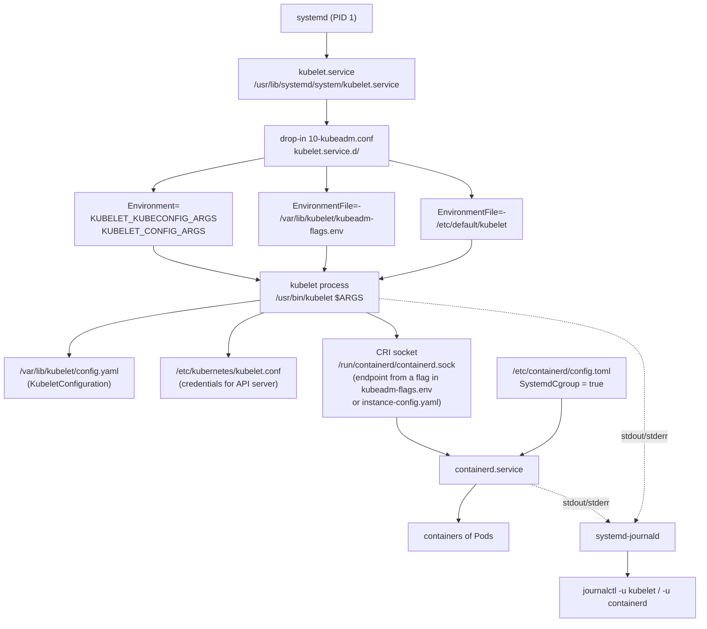

# T1.06 systemd and journalctl

> Competency: n/a, foundation topic | Domain/weight: n/a (foundation; supports both exams) | Est. time: 3 h | Prerequisites: T1.05

Prerequisite: [T1.05 Processes and signals](../part1-linux/T1.05-processes-and-signals.md). You should already know what a PID, a signal (SIGTERM, SIGKILL) and an exit code are. This lesson uses them without re-teaching them.

Shell setup used in this lesson. Parts 1 and 2 of the lab need no cluster; the `k` alias is used from section 5 on and in the kubeadm labs.

```bash
alias k=kubectl
export do="--dry-run=client -o yaml"
export now="--force --grace-period=0"
source <(kubectl completion bash); complete -o default -F __start_kubectl k
```

**How output is labelled in this lesson.** kind and multipass are not installed on the machine that wrote this lesson, so nothing here was captured on a real v1.37 kubeadm node. Blocks marked `REAL OUTPUT (Docker, Ubuntu 24.04, systemd 255)` were captured by running the exact commands in a privileged Docker container that runs systemd as PID 1 (cgroup v2 host). That is a plain Linux/systemd result, not a VM and not a Kubernetes node. Every kubelet and containerd block is labelled `EXPECTED OUTPUT (not captured)` and is listed in section 11.

---

## 1. Why this matters

On every kubeadm node, `kubelet` and `containerd` are not Pods. They are ordinary Linux services started and supervised by systemd, so when a node goes `NotReady`, `kubectl` can tell you *that* it is broken but only `systemctl` and `journalctl` tell you *why*. If you cannot read a unit file, find where a kubelet flag comes from, and read the last error in the journal, you cannot repair a node. Node problems are a common theme in CKA practice (check the current curriculum weight for troubleshooting; the exact share is UNVERIFIED here). Even for the CKAD, the same skills let you read the logs of a service you wrote yourself in two commands.

---

## 2. Concepts

### 2.1 What systemd is and the problem it solves

**systemd** is the first process the kernel starts on most modern Linux distributions (PID 1). Its job:

1. Start the other services in the right order, in parallel where it can.
2. Watch them. If one dies, decide whether to restart it.
3. Put each service in its own **cgroup** (a kernel group that tracks every process the service starts, so `stop` really stops all of them). You will meet cgroups properly later in Part 1; for now think "a labelled box around the service's processes".
4. Collect everything the services print into one searchable log, the **journal**.

Without it you would start `kubelet` by hand in a terminal, and it would die with your SSH session and never come back after a reboot. systemd is why `kubelet` survives both.

The command that talks to systemd is `systemctl`. The command that reads its log is `journalctl`. Both normally need root: on the exam hosts you run `sudo -i` first (summary E8, https://docs.linuxfoundation.org/tc-docs/certification/tips-cka-and-ckad).

### 2.2 Unit types

Everything systemd manages is a **unit**. The unit type is the file suffix.

| Type | Suffix | What it is | Example you will meet |
|---|---|---|---|
| service | `.service` | A process (or group) that systemd starts and supervises | `kubelet.service`, `containerd.service`, `ssh.service` |
| socket | `.socket` | A listening socket owned by systemd. It starts the matching service when the first connection arrives | `docker.socket` (if Docker is installed) |
| target | `.target` | A named group of units, used as a synchronisation point (like an old "run level") | `multi-user.target`, `network-online.target` |
| timer | `.timer` | Runs a matching `.service` on a schedule (a cron replacement) | `apt-daily.timer` |
| mount, path, slice, scope | `.mount` etc. | Mount points, file watchers, cgroup groupings | `sys-fs-fuse-connections.mount`, `kubepods.slice` |

You will write `.service` units. You only need to *recognise* the others, but each of the three below (timer, socket, target) has a short example so you can see it work. Note `kubepods.slice`: when the kubelet uses the systemd cgroup driver (section 2.9) the Pods' cgroups hang under slices like this.

List units by type:

```bash
systemctl list-units --type=service --no-pager     # loaded and active-or-failed services
systemctl list-unit-files --type=service --no-pager # every installed unit file and its enable state
systemctl list-timers --no-pager                    # timers and when they next fire
systemctl list-sockets --no-pager                   # listening sockets owned by systemd and the unit each one starts
```

**Timer example (a cron replacement).** A `.timer` unit starts the `.service` with the same name. The service is a one-shot job and needs no `[Install]` section; only the timer is enabled. Run as root on the linux-vm:

```bash
cat > /etc/systemd/system/tick.service <<'EOF'
[Unit]
Description=Tick job

[Service]
Type=oneshot
ExecStart=/usr/bin/bash -c 'echo tick'
EOF
cat > /etc/systemd/system/tick.timer <<'EOF'
[Unit]
Description=Run tick every 30 s

[Timer]
OnActiveSec=10s
OnUnitActiveSec=30s

[Install]
WantedBy=timers.target
EOF
systemctl daemon-reload && systemctl enable --now tick.timer
systemctl list-timers tick.timer --no-pager      # observe: NEXT and LEFT columns, and the unit it ACTIVATES
sleep 12; journalctl -u tick.service -o cat --no-pager -n 3   # observe: "tick" printed by the service the timer started
```

`OnActiveSec=10s` fires the first run 10 s after the timer itself became active. `OnUnitActiveSec=30s` fires again 30 s after the service last ran. (`OnCalendar=` is the cron-like form, for example `OnCalendar=*-*-* 03:00:00`.)

```text
EXPECTED OUTPUT (not captured)
NEXT                        LEFT LAST PASSED UNIT         ACTIVATES
<time ~10 s from enable>  <~Ns> -    -      tick.timer   tick.service
...
tick
```

**Socket example (start on first connection).** A `.socket` unit listens on a port for you; systemd starts the service only when a client connects. With `Accept=yes` systemd starts one service instance per connection, so the service file must be a template named `<name>@.service`:

```bash
cat > /etc/systemd/system/echo.socket <<'EOF'
[Unit]
Description=Echo socket

[Socket]
ListenStream=127.0.0.1:7777
Accept=yes

[Install]
WantedBy=sockets.target
EOF
cat > /etc/systemd/system/echo@.service <<'EOF'
[Unit]
Description=Echo one connection

[Service]
ExecStart=/usr/bin/cat
StandardInput=socket
EOF
systemctl daemon-reload && systemctl enable --now echo.socket
systemctl list-sockets --no-pager                # observe: 127.0.0.1:7777 owned by echo.socket
systemctl list-units 'echo@*' --no-pager         # observe: no instance yet, nothing is running
exec 3<>/dev/tcp/127.0.0.1/7777                  # connect (bash built-in, no nc needed)
echo hi >&3; read -t 2 line <&3; echo "got: $line"
systemctl list-units 'echo@*' --no-pager         # observe: one instance exists while the connection is open
exec 3>&-                                        # close the connection; cat sees EOF and the instance ends
```

```text
EXPECTED OUTPUT (not captured)
LISTEN         UNIT        ACTIVATES
127.0.0.1:7777 echo.socket echo.service
...
0 loaded units listed.
got: hi
  UNIT                                  LOAD   ACTIVE SUB     DESCRIPTION
  echo@1-127.0.0.1:7777-127.0.0.1:<port>.service loaded active running Echo one connection
```

(The ACTIVATES column for an `Accept=yes` socket and the instance name are from the systemd documentation, not captured.)

**Target example (a named group).** A target has no process; it is a milestone that pulls other units in. Observe what `multi-user.target` wants and which target the machine boots to:

```bash
systemctl get-default                                          # the target used at boot
systemctl list-dependencies multi-user.target --no-pager | head -n 8
```

```text
EXPECTED OUTPUT (not captured)
graphical.target   (or multi-user.target on a server image)
multi-user.target
● ├─<unit>.service
● ├─ssh.service
...
```

Cleanup for these three examples:

```bash
systemctl disable --now tick.timer echo.socket 2>/dev/null
rm -f /etc/systemd/system/tick.service /etc/systemd/system/tick.timer /etc/systemd/system/echo.socket /etc/systemd/system/echo@.service
systemctl daemon-reload; systemctl reset-failed
```

### 2.3 Where unit files live

systemd reads unit files from several directories. When the same name exists in more than one, the higher one wins.

| Priority | Directory | Who writes there | Meaning |
|---|---|---|---|
| 1 (highest) | `/etc/systemd/system` | You, the administrator | Local configuration. Survives package upgrades |
| 2 | `/run/systemd/system` | systemd at runtime | Temporary units. Gone on reboot |
| 3 | `/usr/lib/systemd/system` (also reachable as `/lib/systemd/system`) | Packages (`apt`, `dnf`) | Defaults shipped by the package. A package upgrade can overwrite them |

On Ubuntu and Debian `/lib` is a symlink to `/usr/lib`, so `/lib/systemd/system` and `/usr/lib/systemd/system` are the same directory (checked below). The rule for you: **never edit a file under `/lib` or `/usr/lib`; put your change in `/etc/systemd/system`**, either as a full replacement unit with the same name or, better, as a drop-in (section 2.6).

**The one exception you will meet: the kubeadm drop-in.** The kubelet's `10-kubeadm.conf` is shipped by a package and lives under `/usr/lib/systemd/system/kubelet.service.d/` (section 2.8). In a quick exam repair you fix the file that `systemctl cat kubelet` names, in place, because that is the file that is broken. On a real server a later `apt upgrade` of the package can overwrite your edit. The durable way is to copy the drop-in to `/etc/systemd/system/kubelet.service.d/10-kubeadm.conf` (same file name, so it replaces the packaged one) and change the copy.

```text
REAL OUTPUT (Docker, Ubuntu 24.04, systemd 255)
$ ls -ld /lib
lrwxrwxrwx 1 root root 7 Apr 22  2024 /lib -> usr/lib
```

To find where a given unit really comes from, use `systemctl cat` (section 2.5) or `systemctl show <unit> -p FragmentPath`.

### 2.4 systemctl: the commands you must know

A unit has two independent states you must keep apart:

- **Active state** – is it running *now*? (`active`, `inactive`, `failed`, `activating`)
- **Enable state** – will it start *at boot*? (`enabled`, `disabled`, `static`, `masked`)

`start` changes only the first one. `enable` changes only the second one. `enable --now` changes both.

| Command | What it does | Notes |
|---|---|---|
| `systemctl status kubelet` | Shows loaded file, active state, main PID, cgroup tree and the last journal lines | First command in any node problem. Add `--no-pager` in scripts |
| `systemctl start kubelet` | Starts it now | Does not survive a reboot unless also enabled |
| `systemctl stop kubelet` | Sends SIGTERM to the service's processes, waits `TimeoutStopSec`, then SIGKILL | See T1.05 for the signals |
| `systemctl restart kubelet` | Stop, then start | Works even if it was stopped. Briefly interrupts the service |
| `systemctl reload kubelet` | Asks the running process to re-read its config (needs `ExecReload=` in the unit) | If the unit has no `ExecReload`, this fails. The kubelet unit has none, so use `restart` |
| `systemctl enable kubelet` | Creates a symlink in `/etc/systemd/system/<target>.wants/` so it starts at boot | Does not start it now |
| `systemctl enable --now kubelet` | Enable and start in one command | The shape you use for a new service |
| `systemctl disable kubelet` | Removes that symlink | Does not stop a running service. `disable --now` does both |
| `systemctl is-active kubelet` | Prints `active`, `inactive`, `failed` or `activating`. Exit code 0 only when active | Good for scripts and verification |
| `systemctl is-enabled kubelet` | Prints `enabled`, `disabled`, `static`, `masked`... Exit code 0 for enabled-like states | `static` means "no [Install] section, cannot be enabled" |
| `systemctl list-units --failed` | Lists only units in the `failed` state | First check on a node that "feels wrong" |
| `systemctl reset-failed kubelet` | Clears a `failed` state and the start-limit counter | Needed after "Start request repeated too quickly" (section 2.11) |
| `systemctl mask X` / `unmask X` | Links the unit to `/dev/null` so nothing can start it | Used to stop a service coming back via a dependency |

**Exit codes matter.** `systemctl is-active` and `is-enabled` return non-zero when the answer is "no", which makes them usable in `if` and in the verification steps of the labs. Real output, captured on a unit that has no `[Install]` section and failed:

```text
REAL OUTPUT (Docker, Ubuntu 24.04, systemd 255)
$ systemctl list-units --failed --no-pager
  UNIT        LOAD   ACTIVE SUB    DESCRIPTION
● bad.service loaded failed failed bad.service
...
1 loaded units listed.
$ systemctl is-active bad;  echo rc=$?
failed
rc=3
$ systemctl is-enabled bad; echo rc=$?
static
rc=0
```

Read it like this: `is-active` printed `failed` and exit code 3 (not running). `is-enabled` printed `static` with exit code 0, because a unit with no `[Install]` section can never be enabled; it only starts when something else asks for it, or you start it by hand.

### 2.5 Unit file anatomy

A unit file is an INI-style text file with sections in square brackets. This is the 10-line toy service you will write in the labs:

```ini
[Unit]
Description=Toy heartbeat service
After=network.target

[Service]
ExecStart=/usr/bin/bash -c 'while true; do echo beat; sleep 5; done'
Restart=on-failure
RestartSec=2

[Install]
WantedBy=multi-user.target
```

The fields you must understand (default, and a risky value):

**`[Unit]` – description and ordering**

| Key | Meaning | Default | Risky value / trap |
|---|---|---|---|
| `Description=` | Text shown in `status` and logs | the unit name | none |
| `After=X` | **Ordering only**: start this unit after X has been started. It does *not* start X | none | Writing `After=` and expecting X to be started. It will not be |
| `Before=X` | The reverse of `After` | none | |
| `Wants=X` | **Soft dependency**: when this unit is started, also start X. If X fails, this unit still starts | none | |
| `Requires=X` | **Hard dependency**: start X too. If X fails to start or is stopped, this unit is stopped | none | `Requires=` without `After=` starts both at the same time, in parallel |

Most real units pair them: `Wants=network-online.target` plus `After=network-online.target` means "pull the network-online target in, and wait for it". The kubelet unit does exactly this (section 2.7).

**`[Service]` – how to run it**

| Key | Meaning | Default | Risky value / trap |
|---|---|---|---|
| `ExecStart=` | The command to run. **Must be an absolute path.** No shell: pipes, `&&`, `$(...)` and `~` do not work unless you start `bash -c '...'` yourself | none (required for `Type=simple`) | A relative path or a typo gives exit status `203/EXEC` (see below) |
| `Type=` | How systemd decides the service is "started". `simple` (default): the process in `ExecStart` is the service. `forking`: the process forks and the parent exits. `oneshot`: runs once and exits | `simple` | `forking` with a program that does not fork makes systemd hang until a timeout |
| `Restart=` | When to restart the process after it exits (table in section 2.11) | `no` | `always` on a broken program makes a restart loop |
| `RestartSec=` | Wait this long before restarting | `100ms` | `0` hides crash loops from the logs and burns CPU |
| `Environment=` | Sets one or more `KEY=value` variables for the process. Quote the whole assignment if it has spaces: `Environment="A=1 2"` | none | Setting a variable here does not export it to *other* services |
| `EnvironmentFile=` | Reads `KEY=value` lines from a file. A leading `-` (`EnvironmentFile=-/etc/default/x`) means "ignore the file if it does not exist" | none | Without the `-`, a missing file makes the unit fail to start |
| `User=` / `Group=` | Run as this user | root | |
| `WorkingDirectory=` | Directory the process starts in | `/` | |

**`[Install]` – what `enable` does**

| Key | Meaning |
|---|---|
| `WantedBy=multi-user.target` | When you run `systemctl enable`, create a symlink `/etc/systemd/system/multi-user.target.wants/<unit>`. At boot, `multi-user.target` (the normal "system is up, no desktop" state) *wants* this unit, so it is started. This is the line that makes `enable` work |

The `[Install]` section is read **only** by `enable` and `disable`. It has no effect at run time. A unit with no `[Install]` section cannot be enabled (`static`).

Two ways to see what a unit really contains, including drop-ins and the path of every file:

```bash
systemctl cat kubelet            # prints each file with a "# /path" header, in the order systemd merges them
systemctl show kubelet -p FragmentPath -p DropInPaths -p ExecStart   # the merged values (ExecStart is printed unexpanded: $VARIABLES stay as written)
```

**Exit status 203/EXEC.** If the `ExecStart` program cannot be executed (typo in the path, not executable) the main process "exits" with status `203/EXEC` and the journal never shows the program's own error, because the program never ran. Real output from a deliberate typo (`/usr/bin/bsh` instead of `/usr/bin/bash`):

```text
REAL OUTPUT (Docker, Ubuntu 24.04, systemd 255)
$ systemctl enable --now toy.service
Created symlink /etc/systemd/system/multi-user.target.wants/toy.service → /etc/systemd/system/toy.service.
$ systemctl status toy --no-pager
● toy.service - Toy heartbeat service
     Loaded: loaded (/etc/systemd/system/toy.service; enabled; preset: enabled)
     Active: activating (auto-restart) (Result: exit-code) since Tue 2026-10-27 07:38:14 UTC; 1s ago
    Process: 131 ExecStart=/usr/bin/bsh -c while true; do echo beat; sleep 5; done (code=exited, status=203/EXEC)
   Main PID: 131 (code=exited, status=203/EXEC)
        CPU: 1ms
$ journalctl -u toy --no-pager -n 6
Oct 27 07:38:14 fbec8c399c1c systemd[1]: Started toy.service - Toy heartbeat service.
Oct 27 07:38:14 fbec8c399c1c systemd[1]: toy.service: Main process exited, code=exited, status=203/EXEC
Oct 27 07:38:14 fbec8c399c1c systemd[1]: toy.service: Failed with result 'exit-code'.
```

How to read it: `Loaded: ... enabled` means the file parsed fine. `Active: activating (auto-restart)` means the process died and systemd is waiting out `RestartSec` before trying again. `status=203/EXEC` is the clue: the file path in `ExecStart` is wrong. `Process: 131 ExecStart=/usr/bin/bsh ...` shows exactly which path it tried.

### 2.6 Drop-ins: change a unit without editing it

A **drop-in** is a small file in a directory named `<unit>.d/` that ends in `.conf`. systemd reads the main unit file first and then every drop-in, in alphabetical order, and **later settings override earlier ones**. This lets a package own the main file while you (or kubeadm) add a separate file with your changes. It is how the kubelet unit is built (section 2.7).

Two rules about list-type keys:

- Most keys (`Restart=`, `RestartSec=`) are replaced by the later value.
- Some keys, `ExecStart=` among them, are **appended** unless you first clear them with an empty assignment. A drop-in that wants to *replace* `ExecStart` must contain two lines: `ExecStart=` (empty, clears the list) and then `ExecStart=/new/command`. Without the empty line systemd refuses to load the unit with the error "more than one ExecStart= setting" (for services that are not `oneshot`). The kubeadm drop-in uses exactly this pattern.

`systemctl edit` creates the drop-in for you:

```bash
sudo systemctl edit toy.service        # opens $EDITOR on /etc/systemd/system/toy.service.d/override.conf
sudo systemctl edit --full toy.service # copies the whole unit to /etc/systemd/system/toy.service for full editing
```

When you save, `systemctl edit` runs `daemon-reload` for you (that is its job). When you create a drop-in by hand with `mkdir` and `cat >`, **you** must run `daemon-reload`. A drop-in saved in the editor needs only the lines you want to change, but it must carry the section header:

```ini
[Service]
Environment=GREETING=hello
RestartSec=5
```

`systemctl edit` needs a real terminal and an editor, so it was not run in the Docker test: its behaviour is described, not captured. The by-hand version of the same drop-in was captured, and it shows the merge:

```text
REAL OUTPUT (Docker, Ubuntu 24.04, systemd 255)
$ mkdir -p /etc/systemd/system/toy.service.d
$ printf "[Service]\nEnvironment=GREETING=hello\nRestartSec=5\n" > /etc/systemd/system/toy.service.d/override.conf
$ systemctl show toy -p Environment -p RestartUSec     # before daemon-reload
RestartUSec=2s
Environment=
$ systemctl daemon-reload
$ systemctl show toy -p Environment -p RestartUSec     # after daemon-reload
RestartUSec=5s
Environment=GREETING=hello
$ systemctl cat toy --no-pager
# /etc/systemd/system/toy.service
[Unit]
Description=Toy heartbeat service
After=network.target

[Service]
ExecStart=/usr/bin/bash -c 'while true; do echo beat; sleep 5; done'
Restart=on-failure
RestartSec=2

[Install]
WantedBy=multi-user.target

# /etc/systemd/system/toy.service.d/override.conf
[Service]
Environment=GREETING=hello
RestartSec=5
```

Read it: the main file says `RestartSec=2`, the drop-in says `5`, and after the reload the effective value is `5s`. `systemctl cat` shows both files, each under its path header, in the order systemd applies them.

### 2.7 daemon-reload: why it is needed

systemd does **not** re-read unit files from disk every time you run a command. It parses them once, keeps the result in memory, and runs from that memory copy. That is fast, but it means: if you edit a unit file or drop-in, systemd keeps using the **old** version until you tell it to look again. `systemctl daemon-reload` is that instruction: "re-read all unit files and rebuild the dependency graph". It does **not** restart any service. A changed unit takes effect only after both steps:

```bash
systemctl daemon-reload && systemctl restart kubelet
```

systemd warns you when the files on disk are newer than its memory copy. The warning is exactly the hint you need to look for. Real output after editing the unit with `sed` but without reloading:

```text
REAL OUTPUT (Docker, Ubuntu 24.04, systemd 255)
$ sed -i 's#/usr/bin/bsh#/usr/bin/bash#' /etc/systemd/system/toy.service
$ systemctl restart toy.service
Warning: The unit file, source configuration file or drop-ins of toy.service changed on disk. Run 'systemctl daemon-reload' to reload units.
$ systemctl status toy --no-pager | sed -n 1,5p
Warning: The unit file, source configuration file or drop-ins of toy.service changed on disk. Run 'systemctl daemon-reload' to reload units.
● toy.service - Toy heartbeat service
     Loaded: loaded (/etc/systemd/system/toy.service; enabled; preset: enabled)
     Active: activating (auto-restart) (Result: exit-code) since ...
    Process: 154 ExecStart=/usr/bin/bsh -c while true; do echo beat; sleep 5; done (code=exited, status=203/EXEC)
```

The file on disk is fixed, but the restart still launched `/usr/bin/bsh`, the old path from memory. This is the exact cause of "my edit to `10-kubeadm.conf` has no effect" in section 6. Note that `systemctl cat` also prints a "changed on disk" warning and shows the *disk* version, which is another way to spot the problem: `cat` shows the new file, `status` shows the old command.

### 2.8 How the kubelet is started on a kubeadm node

Two packages from `pkgs.k8s.io` (the repository the vms lab environment installs from) provide the pieces:

1. The `kubelet` package ships the main unit, `kubelet.service`.
2. The `kubeadm` package ships the drop-in, `10-kubeadm.conf`, in `kubelet.service.d/` (per the kubeadm kubelet-integration page).

The main unit. The shape below is expected, not captured; the real v1.37 text must be checked on a node (section 11):

```text
EXPECTED OUTPUT (not captured)
[Unit]
Description=kubelet: The Kubernetes Node Agent
Documentation=https://kubernetes.io/docs/
Wants=network-online.target
After=network-online.target

[Service]
ExecStart=/usr/bin/kubelet
Restart=always
StartLimitInterval=0
RestartSec=10

[Install]
WantedBy=multi-user.target
```

Read it: `Wants` + `After` on `network-online.target` (the node should have a network before the kubelet starts); `Restart=always` with `RestartSec=10` means the kubelet is restarted 10 seconds after *any* exit; `StartLimitInterval=0` switches the start-rate limit off, so systemd never gives up (that is why a broken kubelet loops forever instead of ending in `failed`, see section 2.11).

The kubeadm drop-in. The kubernetes.io page https://kubernetes.io/docs/setup/production-environment/tools/kubeadm/kubelet-integration/ gives the path as **`/usr/lib/systemd/system/kubelet.service.d/10-kubeadm.conf`** and calls its contents an example. Older material and some distros use `/etc/systemd/system/kubelet.service.d/10-kubeadm.conf`. Do not guess: `systemctl cat kubelet` prints the real path. The text below is the docs example, source-checked, not captured from a node:

```text
EXPECTED OUTPUT (not captured)
[Service]
Environment="KUBELET_KUBECONFIG_ARGS=--bootstrap-kubeconfig=/etc/kubernetes/bootstrap-kubelet.conf --kubeconfig=/etc/kubernetes/kubelet.conf"
Environment="KUBELET_CONFIG_ARGS=--config=/var/lib/kubelet/config.yaml"
# This is a file that "kubeadm init" and "kubeadm join" generate at runtime, populating
# the KUBELET_KUBEADM_ARGS variable dynamically
EnvironmentFile=-/var/lib/kubelet/kubeadm-flags.env
# This is a file that the user can use for overrides of the kubelet args as a last resort. Preferably,
# the user should use the .NodeRegistration.KubeletExtraArgs object in the configuration files instead.
# KUBELET_EXTRA_ARGS should be sourced from this file.
EnvironmentFile=-/etc/default/kubelet
ExecStart=
ExecStart=/usr/bin/kubelet $KUBELET_KUBECONFIG_ARGS $KUBELET_CONFIG_ARGS $KUBELET_KUBEADM_ARGS $KUBELET_EXTRA_ARGS
```

(That block is the example printed on the kubeadm kubelet-integration page.)

Walk through it line by line, because this is the file you will be asked to fix:

- `ExecStart=` followed by `ExecStart=/usr/bin/kubelet ...`: the first empty line clears the `ExecStart=/usr/bin/kubelet` from the main unit, the second sets the final command line. This is the "clear then set" rule from section 2.6.
- `$KUBELET_KUBECONFIG_ARGS` – where the kubelet's credentials are: `--kubeconfig=/etc/kubernetes/kubelet.conf` (its identity for the API server) and `--bootstrap-kubeconfig=...` (a temporary token-based file used only while joining; after TLS bootstrap it is no longer needed).
- `$KUBELET_CONFIG_ARGS` – `--config=/var/lib/kubelet/config.yaml`: the path to the KubeletConfiguration file.
- `$KUBELET_KUBEADM_ARGS` – filled from `/var/lib/kubelet/kubeadm-flags.env`, a file kubeadm *writes* at `init` / `join` time.
- `$KUBELET_EXTRA_ARGS` – filled from `/etc/default/kubelet` (the page says `/etc/sysconfig/kubelet` on RPM distros). It is **last** on the command line, so for conflicting flags it has the highest priority.
- The `-` in `EnvironmentFile=-/path` means "no error if the file is missing". That is why a fresh node with no `/etc/default/kubelet` still starts.

Note on 1.37: the same page says kubeadm now also detects the CRI socket and records it in `/var/lib/kubelet/instance-config.yaml`. How that file reaches the kubelet in a v1.37 package (a flag in the drop-in or a config-dir) must be confirmed on a node; it is in section 11.

**The systemd `$VAR` rule.** `$KUBELET_CONFIG_ARGS` on the `ExecStart` line is a systemd substitution: a variable used as a separate word is replaced by its value *split on spaces*. That is how `--bootstrap-kubeconfig=... --kubeconfig=...` becomes two arguments. It is also why a typo in a variable name silently produces an empty string and no error.

### 2.9 Every place a kubelet setting can come from

The kubelet takes settings from several places. When the same setting appears twice, the order matters. Learn this table; it is the "Medium" lab.

| # | Source | Path | Written by | Contains | Priority |
|---|---|---|---|---|---|
| 1 | Command-line flag from the drop-in | `Environment="KUBELET_KUBECONFIG_ARGS=..."` and `KUBELET_CONFIG_ARGS` in `10-kubeadm.conf` | The package | `--kubeconfig`, `--bootstrap-kubeconfig`, `--config` | Flags |
| 2 | kubeadm runtime flags | `/var/lib/kubelet/kubeadm-flags.env` | `kubeadm init` / `join` / `upgrade` | `KUBELET_KUBEADM_ARGS="--flag=value ..."`, per-node flags such as the container runtime endpoint | Flags |
| 3 | User overrides | `/etc/default/kubelet` (DEB) or `/etc/sysconfig/kubelet` (RPM) | You, last resort | `KUBELET_EXTRA_ARGS="--flag=value"` | Flags, highest (last on the line) |
| 4 | Config file | `/var/lib/kubelet/config.yaml` | `kubeadm`, from the cluster-wide `kubelet-config` ConfigMap | A `KubeletConfiguration` object (YAML): `cgroupDriver`, `clusterDNS`, `staticPodPath`, `failSwapOn`, `failCgroupV1`... | Lower than flags |
| 5 | Kubelet credentials | `/etc/kubernetes/kubelet.conf` | kubeadm | A kubeconfig the kubelet uses to talk to the API server | n/a |

The general Kubernetes rule is that a command-line flag **overrides** the same setting in the config file, and most flags are marked deprecated in favour of the config file. So: set things in `config.yaml` when you can; use `KUBELET_EXTRA_ARGS` only as a last resort. After any change, use this rule:

| You changed | Run |
|---|---|
| A unit file or a drop-in (including the `Environment=` lines in `10-kubeadm.conf`) | `systemctl daemon-reload` and then `systemctl restart kubelet` |
| `config.yaml`, `kubeadm-flags.env`, `/etc/default/kubelet`, containerd's `config.toml` | `restart` only. `config.yaml` and `config.toml` are read by the program itself. The `EnvironmentFile=` files are read by systemd each time it starts the service, not stored in the parsed unit |

To see which flags the running kubelet really got (after all variable expansion), read the process, not the unit: `ps -o args= -C kubelet`. `systemctl show kubelet -p ExecStart` prints the unexpanded `ExecStart` line (`... $KUBELET_CONFIG_ARGS ...`), and `systemctl show kubelet -p Environment` prints the `Environment=` variables that systemd currently has in memory.

Useful `KubeletConfiguration` fields for this lesson (field, default, risky value). Values for `failSwapOn`, `failCgroupV1` and `cgroupDriver` come from the kubelet configuration reference at https://kubernetes.io/docs/reference/config-api/kubelet-config.v1beta1/:

| Field | Meaning | Default | Risky value |
|---|---|---|---|
| `cgroupDriver` | Which cgroup manager the kubelet uses: `cgroupfs` or `systemd` | `cgroupfs` in the kubelet itself; kubeadm writes `systemd` | Different from the container runtime's driver |
| `failSwapOn` | Refuse to start if swap is on | `true` | `false` hides a memory-accounting problem (swap support is a separate feature, outside this lesson) |
| `failCgroupV1` | Refuse to start on a cgroup v1 host | `true` | `false` is a temporary escape hatch only |
| `staticPodPath` | Directory the kubelet watches for static Pod manifests | unset (kubeadm sets `/etc/kubernetes/manifests`) | Wrong path: control-plane Pods vanish |

**Under the hood: why the kubelet needs the file at all.** kubeadm keeps one cluster-wide kubelet config in a ConfigMap (`kubelet-config` in `kube-system`). On `init`/`join` it renders that into `/var/lib/kubelet/config.yaml` on the node. The kubelet reads the file once at start. If the file is missing, empty or has a field that does not exist, the kubelet exits during start-up, and with `Restart=always` systemd starts it again 10 seconds later: the loop you will see in section 6.

### 2.10 containerd: the other service

The kubelet does not run containers itself. It talks to a **container runtime** through the CRI (Container Runtime Interface), a gRPC API served on a Unix socket. On kubeadm nodes the runtime is **containerd**, also a systemd service:

```bash
systemctl status containerd
systemctl cat containerd
```

The default socket is `/run/containerd/containerd.sock`; the kubelet is told about it with `--container-runtime-endpoint=unix:///run/containerd/containerd.sock` (in 1.37 kubeadm also records it in `/var/lib/kubelet/instance-config.yaml`, section 2.8). If containerd is stopped, the kubelet is still running but cannot start or inspect any container, and the node goes `NotReady`; the kubelet's journal says it cannot connect to the runtime socket. So **always check both services**.

containerd's configuration file is **`/etc/containerd/config.toml`** (TOML format). The one setting you must know is the **cgroup driver** option for runc, the low-level program containerd uses to create containers:

- For containerd **1.x** (config `version = 2`): `[plugins."io.containerd.grpc.v1.cri".containerd.runtimes.runc.options]` with `SystemdCgroup = true`.
- For containerd **2.x** (config `version = 3`): the plugin is renamed. The path is `[plugins.'io.containerd.cri.v1.runtime'.containerd.runtimes.runc.options]` with `SystemdCgroup = true`.

Both snippets are quoted from the container runtime page https://kubernetes.io/docs/setup/production-environment/container-runtimes/ (the page itself shows no `version =` line, so which config version number goes with which major release is in section 11). The environment for this guide installs containerd 2.x, so the 2.x path applies:

```toml
version = 3
[plugins.'io.containerd.cri.v1.runtime'.containerd.runtimes.runc]
  runtime_type = 'io.containerd.runc.v2'
  [plugins.'io.containerd.cri.v1.runtime'.containerd.runtimes.runc.options]
    SystemdCgroup = true
```

A common way to produce a starting file is `containerd config default | sudo tee /etc/containerd/config.toml`, then change `SystemdCgroup = false` to `true`, then `sudo systemctl restart containerd`. The restart (not a `daemon-reload`) is what matters, because `config.toml` is read by the containerd process, not by systemd.

**Why the cgroup driver must match.** Two programs create cgroups on the node: systemd (which owns the cgroup tree on a systemd host) and the container runtime. If the kubelet and containerd use *different* drivers they manage cgroups in two different ways at the same time, and the node ends up with two views of resource use. Symptoms are Pods stuck in `ContainerCreating` or crash-looping, and runtime errors about the cgroup path format. The rule from the container-runtimes page: if the kubelet uses the `systemd` driver (kubeadm's default) then the runtime must too, and with cgroup v2 `systemd` is the recommended driver. The same page also notes that in Kubernetes 1.37, with the `KubeletCgroupDriverFromCRI` feature gate enabled and a runtime that supports the `RuntimeConfig` CRI RPC, the kubelet detects the right driver from the runtime and ignores `cgroupDriver` in its own config. That makes a mismatch less likely on modern setups but you still must be able to check both values:

```bash
grep -n cgroupDriver /var/lib/kubelet/config.yaml
grep -n SystemdCgroup /etc/containerd/config.toml
```

### 2.11 Restart policies, crash loops and start limits

`Restart=` decides what systemd does when the main process stops.

| Value | Restarts after clean exit (0) | Restarts after non-zero exit | Restarts after a signal | Restarts after `systemctl stop` |
|---|---|---|---|---|
| `no` (default) | no | no | no | no |
| `on-failure` | no | yes | only an unclean signal (SIGKILL, SIGSEGV, SIGABRT...). **Not** after the clean signals SIGHUP, SIGINT, SIGTERM, SIGPIPE | no |
| `always` | yes | yes | yes, any signal | no |
| `on-success` | yes | no | no | no |

`systemctl stop` never triggers a restart under any value; that is a deliberate stop. `on-failure` is the right choice for a service that should only come back if it broke; `always` is what the kubelet uses. A plain `kill <pid>` sends SIGTERM, so a `Restart=on-failure` service that you `kill` this way stays down; `kill -9` (SIGKILL) brings it back (Part A of the worked example shows SIGKILL).

The case that separates `on-failure` from `always` is a clean exit. Observe it with a unit that prints and exits with code 0 (run as root; each command checks one thing):

```bash
cat > /etc/systemd/system/once.service <<'EOF'
[Service]
ExecStart=/usr/bin/bash -c 'echo run; exit 0'
Restart=on-failure
RestartSec=3
EOF
systemctl daemon-reload && systemctl start once
sleep 7; systemctl is-active once; systemctl show once -p NRestarts     # on-failure: inactive, NRestarts=0
sed -i 's/Restart=on-failure/Restart=always/' /etc/systemd/system/once.service
systemctl daemon-reload && systemctl restart once
sleep 7; systemctl show once -p NRestarts                               # always: NRestarts=2 or more
systemctl stop once; sleep 4; systemctl is-active once                  # stop is never restarted: inactive
rm /etc/systemd/system/once.service; systemctl daemon-reload; systemctl reset-failed
```

```text
EXPECTED OUTPUT (not captured)
inactive
NRestarts=0
NRestarts=2
inactive
```

(`NRestarts` counts automatic restarts since the unit was last started. With `RestartSec=3` and 7 s of waiting expect 2; the value changes with timing, the point is zero versus not zero. `RestartSec=3` keeps the unit under the start limit below.)

Three settings control the loop:

- `RestartSec=` – the delay between restarts (default 100 ms).
- `StartLimitIntervalSec=` (older spelling `StartLimitInterval=`) – the time window used to count starts (default 10 s).
- `StartLimitBurst=` – how many starts are allowed inside that window (default 5). If a unit is started more times than this inside the window, systemd refuses the next start and puts the unit in `failed`.

Put `StartLimitIntervalSec=` and `StartLimitBurst=` in the **`[Unit]`** section. The shipped kubelet unit still writes `StartLimitInterval=0` under `[Service]`, the legacy spelling, which systemd keeps accepting. With the lesson's toy (`RestartSec=2`) only about 5 starts fit in 10 s, so the toy does not normally trip the limit. To trip it on purpose, use a unit that dies at once and restarts almost at once:

```bash
cat > /etc/systemd/system/flap.service <<'EOF'
[Unit]
StartLimitIntervalSec=10
StartLimitBurst=3

[Service]
ExecStart=/usr/bin/false
Restart=always
RestartSec=100ms
EOF
systemctl daemon-reload && systemctl start flap
sleep 2; systemctl is-active flap; journalctl -u flap -o cat --no-pager -n 3
systemctl reset-failed flap; systemctl stop flap; rm /etc/systemd/system/flap.service; systemctl daemon-reload
```

```text
EXPECTED OUTPUT (not captured)
failed
flap.service: Start request repeated too quickly.
flap.service: Failed with result 'exit-code'.
Failed to start flap.service.
```

You can see these defaults on a real unit:

```text
REAL OUTPUT (Docker, Ubuntu 24.04, systemd 255)
$ systemctl show toy -p StartLimitBurst -p StartLimitIntervalUSec -p Restart
Restart=on-failure
StartLimitIntervalUSec=10s
StartLimitBurst=5
```

With a short `RestartSec` and a program that dies at once, you hit the limit. Real output from an earlier Docker run of the toy with the bad `ExecStart` fixed on disk but not yet reloaded, so each restart kept failing, with a shorter `RestartSec` than the lesson's `RestartSec=2`:

```text
REAL OUTPUT (Docker, Ubuntu 24.04, systemd 255)
$ journalctl -u toy --no-pager -o cat -n 4
Stopped toy.service - Toy heartbeat service.
toy.service: Start request repeated too quickly.
toy.service: Failed with result 'exit-code'.
Failed to start toy.service - Toy heartbeat service.
$ systemctl is-active toy
failed
```

"Start request repeated too quickly" is the start-limit message. The fix is `systemctl reset-failed toy` (clears the counter and the failed state) followed by `systemctl restart toy` once the real cause is fixed. In that session the service then came up (`active`, journal line `beat`).

Why the kubelet unit is different: it sets `StartLimitInterval=0`, which turns the limit off. A broken kubelet therefore **never reaches `failed`**. It cycles between `activating (auto-restart)` and a brief `active`, every 10 s, forever. `systemctl list-units --failed` will not list it. That is why you must look at `systemctl status` / `is-active` and at the journal, not only at the failed list.

### 2.12 journalctl: reading the journal

**journald** (`systemd-journald`) is the systemd service that collects everything each service writes to stdout/stderr, plus syslog messages and kernel messages, into a structured binary log: the **journal**. `journalctl` reads it. Every service started by systemd gets its logs into the journal for free, which is why the kubelet and containerd have no log file of their own to look for.

| Command | What it does |
|---|---|
| `journalctl -u kubelet` | Entries for the unit `kubelet.service` (`-u` can be repeated: `-u kubelet -u containerd`) |
| `journalctl -u kubelet -f` | Follow: print new lines as they arrive (like `tail -f`). Ctrl+C to stop |
| `journalctl -u kubelet -n 50` | Only the last 50 lines |
| `journalctl -u kubelet --since '10 min ago'` | Time filter. Also `--until`, and absolute times like `--since '2026-10-27 07:30:00'` |
| `journalctl -u kubelet -p err` | Priority filter: shows `err` and worse (`err`, `crit`, `alert`, `emerg`). Levels: `emerg 0`, `alert 1`, `crit 2`, `err 3`, `warning 4`, `notice 5`, `info 6`, `debug 7` |
| `journalctl -u kubelet -b` | Only the current boot. `-b -1` is the previous boot |
| `journalctl -u kubelet --no-pager` | Print straight to the terminal instead of opening `less`. Use in scripts and when copying output |
| `journalctl -u kubelet -o cat` | Print only the message text, without time, host and unit prefix. Easier to read and to `grep` |
| `journalctl -xe` / `journalctl -xeu kubelet` | `-e` jumps to the end, `-x` adds explanatory help text. The text `systemctl status` suggests |
| `journalctl -k` | Kernel messages only (like `dmesg`) |
| `journalctl --disk-usage` | How much space the journal uses |
| `journalctl --list-boots` | List recorded boots |

Flags combine: `journalctl -u kubelet -b -p err --no-pager -n 50` is a good first look at a sick node.

Real output with a time filter and `-o cat` (the toy service from earlier):

```text
REAL OUTPUT (Docker, Ubuntu 24.04, systemd 255)
$ journalctl -u bad --no-pager -o cat
Started bad.service.
bad.service: Main process exited, code=exited, status=1/FAILURE
bad.service: Failed with result 'exit-code'.
$ journalctl -u toy -n 2 --no-pager -o short-precise
Oct 27 07:39:52.960025 fbec8c399c1c bash[381]: beat
Oct 27 07:39:57.963768 fbec8c399c1c bash[381]: beat
```

Reading it: lines from systemd itself (`Started`, `Main process exited`, `Failed with result`) say *what happened to the process*. Lines after the program name (`bash[381]: beat`) are what the program itself printed. For a crashing kubelet the cause is in the program's own lines, right before systemd's `Main process exited`.

**Persistent versus volatile journal.** Where journald keeps data depends on `Storage=` in `/etc/systemd/journald.conf`:

| `Storage=` | Where | Survives reboot? |
|---|---|---|
| `volatile` | `/run/log/journal` (memory-backed) | No |
| `persistent` | `/var/log/journal` (disk) | Yes |
| `auto` (default) | Persistent **only if** the directory `/var/log/journal` exists; otherwise volatile | Depends on the directory |
| `none` | nowhere | n/a |

Some images do not ship `/var/log/journal`, so `auto` silently means "volatile": after a reboot the logs from the crash are gone, and `journalctl -b -1` finds nothing. To make it persistent:

```bash
sudo mkdir -p /var/log/journal
sudo systemd-tmpfiles --create --prefix /var/log/journal   # fix ownership/permissions
sudo systemctl restart systemd-journald                    # or: journalctl --flush
journalctl --list-boots --no-pager                         # after the next reboot, expect more than one line
```

Or set `Storage=persistent` under `[Journal]` in `/etc/systemd/journald.conf` and restart `systemd-journald`. The Docker container I tested in already had `/var/log/journal`, so only the check is real:

```text
REAL OUTPUT (Docker, Ubuntu 24.04, systemd 255)
$ ls -d /var/log/journal
/var/log/journal
$ journalctl --list-boots --no-pager
IDX BOOT ID                          FIRST ENTRY                 LAST ENTRY
  0 9d82ae8a0ae04516a73a329bd3ea11f1 Tue 2026-10-27 07:38:03 UTC Tue 2026-10-27 07:38:24 UTC
```

(This is a fresh container journal with one short boot, so only one line shows; the timestamps belong to a different capture session than the toy logs above. On your VM a second boot ID and `-b -1` appear only after a reboot with persistent storage.)

### 2.13 systemd-analyze and list-dependencies (awareness)

Two commands you should recognise. They are rarely the fix for a broken node in practice, but they explain slow or odd boots.

```bash
systemd-analyze                 # total boot time split into firmware/kernel/userspace
systemd-analyze blame           # units sorted by how long each took to start
systemctl list-dependencies kubelet            # tree of what kubelet pulls in / waits for
systemctl list-dependencies --reverse kubelet  # what depends on kubelet
```

Real output:

```text
REAL OUTPUT (Docker, Ubuntu 24.04, systemd 255)
$ systemd-analyze
Startup finished in 130ms (userspace)
graphical.target reached after 126ms in userspace.
$ systemd-analyze blame --no-pager | head -3
32ms systemd-resolved.service
21ms systemd-journald.service
14ms systemd-journal-flush.service
$ systemctl list-dependencies toy --no-pager | head -4
toy.service
● ├─system.slice
● └─sysinit.target
○   ├─dev-hugepages.mount
```

A green `●` means the dependency is active, `○` inactive.

### 2.14 Reading kubelet exit messages

When the kubelet cannot start, it prints one reason to stderr and exits with code 1. Under systemd that line is in the journal. Learn to search for it quickly:

```bash
journalctl -u kubelet -b --no-pager -o cat | tail -n 30
journalctl -u kubelet -p err --since '5 min ago' --no-pager
```

| Failure | What the journal contains (only the confirmed part is written out; `<...>` and `...` are placeholders) | Cause |
|---|---|---|
| Wrong flag | `unknown flag: --<name>` | A typo or a removed flag in the drop-in, `kubeadm-flags.env` or `/etc/default/kubelet` |
| Bad config path or content | `failed to load kubelet config file, path: <path>` ... `no such file or directory` (for a missing file) or a YAML/strict-decoding error naming the line or field | `--config=` points to a path that does not exist, or `config.yaml` has a bad or unknown field |
| Swap on | `running with swap on is not supported` ... (mentions `--fail-swap-on`) | Swap enabled and `failSwapOn: true` (the default) |
| cgroup driver mismatch | Usually **no** kubelet exit. Runtime or container errors about cgroup paths, e.g. `expected cgroupsPath to be of format "slice:prefix:name" for systemd cgroups` | kubelet and containerd use different drivers |
| cgroup v1 host | A message saying the kubelet is configured to not run on a host using cgroup v1 and mentions `failCgroupV1` | `failCgroupV1` is `true` (the default) on a cgroup v1 host |

The exact wording of each line is not captured in this lesson and varies by version. What you need is the *shape*: the cause is the last `E`-level (error) line before `Main process exited`, and the key words (`unknown flag`, `config file`, `swap`, `cgroup`) point to the file to open.

**Diagnostic walk-through for each case.** Run these in order; the first command is the same every time (read the last error), the rest tell the causes apart.

| Failure | Commands in order | How to read the result |
|---|---|---|
| Wrong flag | 1. `journalctl -u kubelet -b --no-pager -o cat \| grep -i 'unknown flag'`. 2. `ps -o args= -C kubelet` (works only while the process is alive between restarts; if empty, skip). 3. `systemctl cat kubelet --no-pager \| grep -n EnvironmentFile`, then `cat /var/lib/kubelet/kubeadm-flags.env /etc/default/kubelet` | The flag name in the error is the bad word. Search for it in the drop-in and the two env files; the file that contains it is the one to fix |
| Bad config path or content | 1. `journalctl -u kubelet -b --no-pager -o cat \| tail -n 15`. 2. `ls -l <path from the error>`. 3. `systemctl show kubelet -p Environment --value \| tr ' ' '\n' \| grep config`. 4. If the file exists: `yq . /var/lib/kubelet/config.yaml >/dev/null` (`yq` is on the exam hosts, E9) | `no such file or directory` plus a failing `ls` means a wrong path in `--config=`. A parse or unknown-field error means the file exists but its content is wrong |
| Swap on | 1. `journalctl -u kubelet -b --no-pager -o cat \| grep -i swap`. 2. `free -h` and `swapon --show`. 3. `grep -n swap /etc/fstab` | A non-zero `Swap:` row or any line from `swapon --show` confirms it. Fix: `swapoff -a` and remove the `fstab` line |
| cgroup driver mismatch | 1. `grep -n cgroupDriver /var/lib/kubelet/config.yaml`. 2. `grep -n SystemdCgroup /etc/containerd/config.toml`. 3. `journalctl -u containerd --since '10 min ago' --no-pager \| grep -i cgroup` | `cgroupDriver: systemd` against `SystemdCgroup = false` is the mismatch. The kubelet itself keeps running; Pods fail to start |
| cgroup v1 host | 1. `journalctl -u kubelet -b --no-pager -o cat \| grep -i cgroup`. 2. `stat -fc %T /sys/fs/cgroup/` | `tmpfs` means v1 (the kubelet refuses to start by default); `cgroup2fs` means v2 and the cause is something else |

**cgroup v1 and `failCgroupV1`.** The kubernetes.io page https://kubernetes.io/docs/concepts/architecture/cgroups/ says cgroup v1 is deprecated since v1.35 and "Kubelet will no longer start on a cgroup v1 node by default"; to override, set `failCgroupV1` to `false` in the kubelet configuration file. Check which version a node uses with the command from that page:

```bash
stat -fc %T /sys/fs/cgroup/    # cgroup2fs = v2 (fine), tmpfs = v1 (kubelet refuses to start by default)
```

The right fix is to move the node to cgroup v2 (a current distro, or the kernel boot parameter that selects the unified hierarchy, per your distro's documentation). The override in `config.yaml` is only for a temporary bridge:

```yaml
# /var/lib/kubelet/config.yaml  (fragment: add one line to the existing file, do not replace the file)
failCgroupV1: false
```

All labs in this guide assume cgroup v2, because cgroup v1 is unsupported from Kubernetes 1.35.

### 2.15 Related but different

- **`systemctl restart` vs `daemon-reload`**: `restart` restarts a *service*. `daemon-reload` reloads *unit files*. They solve different problems; you often need both, in this order.
- **`systemctl reload` vs `daemon-reload`**: `reload` signals the service to re-read its own config (needs `ExecReload=`). `daemon-reload` is about systemd's view of unit files.
- **`kubectl logs` vs `journalctl`**: `kubectl logs` shows a Pod container's stdout through the kubelet. `journalctl -u kubelet` shows the kubelet itself. When the kubelet is down, `kubectl logs` for Pods on that node cannot work, but `journalctl` on the node still can.
- **`crictl ps` vs `systemctl status`**: `crictl` talks to the runtime and lists containers. `systemctl` lists services. The control-plane Pods (kube-apiserver and friends) are containers started by the kubelet from static Pod manifests, so they are visible in `crictl ps`, not as systemd units.
- **`disable` vs `mask`**: `disable` stops the unit starting at boot. `mask` stops it starting at all, even as a dependency.

---

## 3. How it works (diagram)



Walkthrough:

1. systemd starts `kubelet.service`. It merges the main unit with the drop-in `10-kubeadm.conf` (later settings win, `ExecStart=` is cleared and re-set).
2. The drop-in sets `Environment=` variables directly and pulls in two env files; systemd then expands `$KUBELET_...` into the final command line of `/usr/bin/kubelet`.
3. The kubelet process reads `config.yaml` (the file named by `--config`) and uses `kubelet.conf` to authenticate to the API server. A bad flag or a bad `config.yaml` is where it dies.
4. The kubelet calls the container runtime through the CRI socket; `containerd.service` (configured by `/etc/containerd/config.toml`) creates the containers. If containerd is down, the kubelet is up but the node is `NotReady`.
5. Both services write to the journal through journald. `journalctl -u kubelet` and `journalctl -u containerd` are how you read why either one failed.

---

## 4. Commands and YAML you must produce fast

### 4.1 Imperative shortcuts

```bash
sudo -i                                                    # become root (allowed on exam hosts)
systemctl status kubelet --no-pager                        # state, PID, last log lines
systemctl cat kubelet                                      # unit + drop-in files, with their paths
systemctl daemon-reload && systemctl restart kubelet       # apply any unit/drop-in change
journalctl -u kubelet -f                                   # follow the kubelet log live
journalctl -u containerd --since '5 min ago' --no-pager    # runtime log, last 5 minutes
journalctl -u kubelet -b -p err --no-pager -n 50           # last 50 errors this boot
systemctl list-units --failed --no-pager                   # anything that has failed
systemctl enable --now myapp.service                       # start now and at boot
systemctl edit myapp.service                               # create a drop-in override
```

When you do not remember the syntax, `man` is on the exam hosts (summary E9). Whether the systemd pages (`man systemd.service` for the `[Service]` keys, `man journalctl`) are installed there is UNVERIFIED, so try them early in the practice sessions and fall back to `systemctl --help` and `journalctl --help`.

### 4.2 The declarative file: a 10-line custom service

`/etc/systemd/system/toy.service` (the file `systemctl enable` links into `multi-user.target.wants/`):

```ini
[Unit]
# Text shown in "systemctl status". Free text.
Description=Toy heartbeat service
# Ordering only: start after the network target. Does not pull it in.
After=network.target

[Service]
# Absolute path, no shell. Use "bash -c '...'" for loops, pipes and &&.
ExecStart=/usr/bin/bash -c 'while true; do echo beat; sleep 5; done'
# Restart only after a non-zero exit or a crash; not after "systemctl stop" or a clean exit.
Restart=on-failure
# Wait 2 s between restarts (default 100 ms).
RestartSec=2

[Install]
# Makes "systemctl enable" link this unit into multi-user.target.wants/
WantedBy=multi-user.target
```

Create and start it:

```bash
sudo tee /etc/systemd/system/toy.service >/dev/null <<'EOF'
[Unit]
Description=Toy heartbeat service
After=network.target

[Service]
ExecStart=/usr/bin/bash -c 'while true; do echo beat; sleep 5; done'
Restart=on-failure
RestartSec=2

[Install]
WantedBy=multi-user.target
EOF
sudo systemctl daemon-reload
sudo systemctl enable --now toy.service
```

The drop-in override (what you type in the editor after `sudo systemctl edit toy.service`; it is saved as `/etc/systemd/system/toy.service.d/override.conf`):

```ini
[Service]
# Adds a variable to the process environment.
Environment=GREETING=hello
# Replaces the RestartSec=2 from the main file.
RestartSec=5
```

If `systemctl edit` is not available or you prefer not to use an editor, the by-hand equivalent is `mkdir -p /etc/systemd/system/toy.service.d`, write `override.conf` there, then `systemctl daemon-reload` (shown with real output in section 2.6).

### 4.3 Speed drill

Target times are for exam pace. **Setup** (linux-vm, as root): `sudo -i`, then create `toy.service` from section 4.2 and run `systemctl daemon-reload`. Do not enable it yet. Answers are collapsed; try before opening.

| # | Task | Target |
|---|---|---|
| 1 | Start `toy` now and make it start at boot, in one command | 20 s |
| 2 | Print only the last 3 lines of the toy log, message text only, no pager | 25 s |
| 3 | Show which files make up the effective `toy` unit | 15 s |
| 4 | Add an `Environment=GREETING=hello` drop-in without an editor and apply it | 60 s |
| 5 | Print the unit's current `RestartSec` in machine-readable form | 25 s |
| 6 | List failed units and print only whether `toy` is active (exit code usable in `if`) | 20 s |
| 7 | (On a kubeadm node, not the drill VM) Show errors only from the kubelet for the last 10 minutes | 30 s |
| 8 | Stop `toy`, stop it from starting at boot, and confirm both | 40 s |

<details><summary>Answers</summary>

1. `systemctl enable --now toy.service`
2. `journalctl -u toy -n 3 -o cat --no-pager`
3. `systemctl cat toy` (or `systemctl show toy -p FragmentPath -p DropInPaths`)
4. `mkdir -p /etc/systemd/system/toy.service.d && printf '[Service]\nEnvironment=GREETING=hello\n' > /etc/systemd/system/toy.service.d/override.conf && systemctl daemon-reload` (then `systemctl restart toy` so the running process gets the variable; `show -p Environment` already reports it)
5. `systemctl show toy -p RestartUSec` (prints `RestartUSec=2s`; add `--value` for the bare value)
6. `systemctl list-units --failed --no-pager; systemctl is-active toy`
7. `journalctl -u kubelet -p err --since '10 min ago' --no-pager`
8. `systemctl disable --now toy.service; systemctl is-active toy; systemctl is-enabled toy` (expect `inactive` and `disabled`)

</details>

**Cleanup for the drill** (run it even if you did not open the answers)

```bash
systemctl disable --now toy.service 2>/dev/null
rm -rf /etc/systemd/system/toy.service /etc/systemd/system/toy.service.d
systemctl daemon-reload; systemctl reset-failed
```

---

## 5. Worked example

This walkthrough follows a node problem from symptom to fix. Part A (the toy service) was run for real in Docker. Part B (the kubelet on a kubeadm node) is **EXPECTED OUTPUT (not captured)**: the commands are right, but the exact text must be checked on a node (section 11).

**Environment:** Part A: linux-vm (or any systemd host). Part B: vms (`cp1`, `w1`).

### Part A: build, break, read, fix (REAL)

1. Write the unit with a deliberate typo (`bsh`), reload, enable and start it. Result: `enabled` but `activating (auto-restart)` and status `203/EXEC` (output in section 2.5). What to look for: the *Process:* line shows the path that failed.
2. Fix the path with `sed`, but forget `daemon-reload`: the warning appears and the old path still runs (output in section 2.7). What to look for: `Warning: ... changed on disk`.
3. Run `systemctl daemon-reload`, then `systemctl reset-failed toy` (in the captured run the unit had reached the start limit while broken; with `RestartSec=2` it usually does not, and the command is then harmless), then `systemctl restart toy`. Check:

```text
REAL OUTPUT (Docker, Ubuntu 24.04, systemd 255)
$ systemctl daemon-reload; systemctl reset-failed toy; systemctl restart toy; sleep 1
$ systemctl is-active toy
active
$ journalctl -u toy -o cat --no-pager -n 3
Failed to start toy.service - Toy heartbeat service.
Started toy.service - Toy heartbeat service.
beat
```

The first line is the old failure (the start limit from the captured run), still in the history. The last two are the new start and the program output. The journal keeps history; read it from the bottom.

4. Kill the process with SIGKILL and watch `Restart=on-failure` revive it:

```text
REAL OUTPUT (Docker, Ubuntu 24.04, systemd 255)
$ systemctl kill -s KILL toy; sleep 1; systemctl status toy --no-pager | sed -n 1,4p
● toy.service - Toy heartbeat service
     Loaded: loaded (/etc/systemd/system/toy.service; enabled; preset: enabled)
     Active: activating (auto-restart) (Result: signal) since Tue 2026-10-27 07:38:37 UTC; 1s ago
    Process: 236 ExecStart=/usr/bin/bash -c while true; do echo beat; sleep 5; done (code=killed, signal=KILL)
$ sleep 6; systemctl is-active toy
active
```

`Result: signal` with `signal=KILL` is a crash, so `on-failure` restarts it (see T1.05 for signals). After `RestartSec` it is `active` again.

### Part B: a NotReady node (EXPECTED OUTPUT (not captured))

This example uses a different fault from the break-fix lab (7.3), so the lab stays unspoiled: someone added a bad flag to `/etc/default/kubelet` on `w1`.

**Where each command runs.** Use two terminals. **Terminal A** is `cp1`, as root, with `export KUBECONFIG=/etc/kubernetes/admin.conf` so that `k` works; all `k` commands run there. **Terminal B** is your workstation, from which you `ssh w1` and then `sudo -i`; all `systemctl` and `journalctl` commands run there. The exam host `base` has no `kubectl` (summary E9); on the exam, `kubectl` is on every SSH host you are sent to, you exit back to `base` after each task, and nested ssh is not supported (E7). The two-terminal layout avoids nested ssh in this lab.

A node shows `NotReady`. In Terminal A:

```bash
k get nodes
```

```text
EXPECTED OUTPUT (not captured)
NAME   STATUS     ROLES           AGE   VERSION
cp1    Ready      control-plane   2d    v1.37.x
w1     NotReady   <none>          2d    v1.37.x
w2     Ready      <none>          2d    v1.37.x
```

Step 1: `k get nodes` says *what*. Step 2 is to go to the node and ask systemd *why*. In Terminal B:

```bash
ssh w1
sudo -i
systemctl status kubelet --no-pager
```

```text
EXPECTED OUTPUT (not captured)
● kubelet.service - kubelet: The Kubernetes Node Agent
     Loaded: loaded (/usr/lib/systemd/system/kubelet.service; enabled; preset: enabled)
    Drop-In: /usr/lib/systemd/system/kubelet.service.d
             └─10-kubeadm.conf
     Active: activating (auto-restart) (Result: exit-code) since ...; 4s ago
    Process: ... ExecStart=/usr/bin/kubelet $KUBELET_KUBECONFIG_ARGS ... (code=exited, status=1/FAILURE)
   Main PID: ... (code=exited, status=1/FAILURE)
```

How to read it: `enabled` and `Drop-In: ... 10-kubeadm.conf` tell you where the unit lives. `activating (auto-restart)` plus `status=1/FAILURE` means the kubelet starts and dies at once, and systemd restarts it (the `Restart=always` loop). The reason is not here. Step 3: read the journal.

```bash
journalctl -u kubelet -b --no-pager -o cat -n 30
```

```text
EXPECTED OUTPUT (not captured)
... unknown flag: --no-such-flag ...
```

(Only the words `unknown flag: --<name>` are certain; the text around them is not captured and depends on the version.)

Step 4: the message names a flag, not a file. Find which of the places from section 2.9 supplies it. The drop-in names two env files; read them:

```bash
systemctl cat kubelet --no-pager | grep -n EnvironmentFile
cat /var/lib/kubelet/kubeadm-flags.env
cat /etc/default/kubelet
```

```text
EXPECTED OUTPUT (not captured)
EnvironmentFile=-/var/lib/kubelet/kubeadm-flags.env
EnvironmentFile=-/etc/default/kubelet
KUBELET_KUBEADM_ARGS="<flags written by kubeadm>"
KUBELET_EXTRA_ARGS="--no-such-flag=1"
```

The bad flag is in `/etc/default/kubelet`. Step 5: remove it (set the file back to what it was before, or delete the line), then restart and check:

```bash
sed -i '/no-such-flag/d' /etc/default/kubelet     # or edit the file by hand
systemctl restart kubelet                         # no daemon-reload: this is an env file, not a unit file
systemctl is-active kubelet
ps -o args= -C kubelet | grep -c -- '--no-such-flag'   # expect 0 (and the exit code 1 from grep -c is fine here)
exit                                              # leave root; close the ssh session
```

Then in Terminal A: `k get nodes` (expect `w1` `Ready` within about a minute). Why only `restart`: systemd reads `EnvironmentFile=` files each time it starts the service, so the changed file is picked up by the restart. If you had edited the *drop-in* or the main unit instead, you would also need `systemctl daemon-reload` first, because systemd runs from its in-memory copy of unit files (section 2.7). Lab 7.3 practises that case.

The same method for containerd: `systemctl status containerd`, `journalctl -u containerd --since '5 min ago' --no-pager`, and if you changed `/etc/containerd/config.toml`, `systemctl restart containerd` only.

---

## 6. Common mistakes and how to fix them

Troubleshooting path for a node whose kubelet will not run, in this order:

1. `systemctl is-active kubelet` and `systemctl status kubelet --no-pager` – is it `failed`, `inactive` or `activating (auto-restart)`? The last means a crash loop.
2. `journalctl -u kubelet -b --no-pager -o cat | tail -n 30` – find the last error line before it died.
3. `systemctl cat kubelet` – which flags and files are in play, and where each comes from.
4. Open the file the error names; fix it.
5. `systemctl daemon-reload` (only if a unit or drop-in changed), then `systemctl restart kubelet`, then re-check steps 1 and 2.
6. `systemctl status containerd` – a healthy kubelet still gives `NotReady` if the runtime is down.

| Symptom | What you will see | Cause | Fix |
|---|---|---|---|
| Edit to `10-kubeadm.conf` has no effect | Warning `The unit file, source configuration file or drop-ins of kubelet.service changed on disk. Run 'systemctl daemon-reload' to reload units.` after `status` or `restart`; `status` still shows the old command | systemd runs from its in-memory copy (section 2.7) | `systemctl daemon-reload && systemctl restart kubelet`. Confirm what systemd holds: `systemctl show kubelet -p Environment` for an edit to an `Environment=` line (the `--config=` case), `-p ExecStart` only for a literal `ExecStart=` edit. Confirm what the process got: `ps -o args= -C kubelet` |
| kubelet stuck in `activating (auto-restart)` | `Active: activating (auto-restart) (Result: exit-code)`, `status=1/FAILURE`, repeats every 10 s; `list-units --failed` does **not** list it (start limit is off) | A bad `--config` path, a bad field or YAML error in `config.yaml`, or a bad flag | `journalctl -u kubelet -b --no-pager -o cat \| tail -n 30` to find the error; fix the path or the field in the named file; `systemctl daemon-reload && systemctl restart kubelet` |
| kubelet refuses to start on an old distro | Journal line about running on a cgroup v1 host that mentions `failCgroupV1` | Host uses cgroup v1 and `failCgroupV1` defaults to `true` (https://kubernetes.io/docs/concepts/architecture/cgroups/) | Check `stat -fc %T /sys/fs/cgroup/` (`tmpfs` = v1). Fix properly by moving to cgroup v2. Temporary bridge: add `failCgroupV1: false` to `/var/lib/kubelet/config.yaml`, then `systemctl restart kubelet` |
| No logs after reboot | `journalctl -u kubelet -b -1` prints nothing or `-- No entries --`; `journalctl --list-boots` shows one boot only | Volatile journal: `/var/log/journal` does not exist and `Storage=auto` falls back to memory | `mkdir -p /var/log/journal && systemd-tmpfiles --create --prefix /var/log/journal && systemctl restart systemd-journald`, or set `Storage=persistent` in `/etc/systemd/journald.conf`. Applies from the next boot onward; lost logs stay lost |
| `Start request repeated too quickly` (real, section 2.11) | Journal: `toy.service: Start request repeated too quickly.` then `Failed with result 'exit-code'`, state `failed` | More than `StartLimitBurst` (5) starts in `StartLimitIntervalSec` (10 s); both keys belong in `[Unit]`; trigger it on purpose with the `flap` unit in section 2.11 | Fix the cause first, then `systemctl reset-failed toy && systemctl restart toy` |
| `status=203/EXEC` (real, section 2.5) | `code=exited, status=203/EXEC`; the program prints nothing | `ExecStart` path wrong, not absolute, or not executable | Correct the path (`command -v <prog>`), `daemon-reload`, `reset-failed` if needed, `restart` |
| `systemctl reload kubelet` fails | `Failed to reload kubelet.service: Job type reload is not applicable` | The unit has no `ExecReload=` | Use `systemctl restart kubelet` |
| Setting in `config.yaml` seems ignored | `ps -o args= -C kubelet` shows a flag that sets the same thing (`systemctl show -p ExecStart` cannot show it: it prints the unexpanded `$KUBELET_...` words) | A command-line flag (from `kubeadm-flags.env` or `/etc/default/kubelet`) overrides the file | Remove the flag from the env file, or change the flag; restart |
| Node `NotReady`, kubelet `active` | `systemctl is-active kubelet` = `active` but node is `NotReady` | The runtime is down or its socket is unreachable | `systemctl status containerd`; `journalctl -u containerd --since '5 min ago' --no-pager`; fix `/etc/containerd/config.toml` if you changed it; `systemctl restart containerd` |
| Pods fail with cgroup path errors after a config change | Container runtime errors that say the cgroups path must have the form `slice:prefix:name` | kubelet uses `systemd` driver but containerd has `SystemdCgroup = false` (or the reverse) | Set `SystemdCgroup = true` under the runc options in `config.toml` (2.x path in section 2.10), `systemctl restart containerd`, then `systemctl restart kubelet` |
| kubelet exits, swap on | Journal line that says running with swap on is not supported and names `--fail-swap-on` | `failSwapOn` is `true` (default) and swap is enabled | `swapoff -a`, and remove the swap line from `/etc/fstab` so it stays off. Do not set `failSwapOn: false` unless told to |

**Reading the first row as a method.** Warning text from systemd is deliberate help: if you see "changed on disk" you are done diagnosing; reload. If `systemctl show kubelet -p Environment` (for a variable edit) or `status` (for a literal `ExecStart=` edit) still shows the old value after you fixed the file, that is the same bug in another form. Pick the property that matches the kind of edit: the kubelet's flags live in `Environment=` and the env files, and the `ExecStart` text never changes when you edit them.

---

## 7. Labs

**Order:** Easy, then Medium, then Break-fix. Each lab returns the host to its starting state, so any order works. Easy runs on the **linux-vm** (one Ubuntu 24.04 or newer VM with systemd and cgroup v2, for example `multipass launch --name lab --cpus 2 --memory 4G --disk 20G`). Medium and Break-fix need the **vms** environment: three Ubuntu VMs `cp1`, `w1`, `w2` prepared with `env/vm-prereqs.sh` (swap off, kernel modules, containerd 2.x, kubeadm/kubelet/kubectl from `pkgs.k8s.io`) and joined into a kubeadm cluster, because they touch the real kubelet. The kubeadm install itself is taught in Part 4; this lesson does not repeat it.

**If you do not have the cluster yet.** Do the Easy lab, the speed drill and the examples in section 2 (they need only one systemd VM). For Medium, any VM that has the `kubelet` and `containerd` packages installed (even if never joined to a cluster) lets you do the `unit=`, `dropin=`, `config=` and `containerd_systemd_cgroup=` lines; skip `cgroupDriver` and `envfiles` checks if `/var/lib/kubelet/config.yaml` does not exist. Break-fix needs a running node, so come back to it after the Part 4 cluster is built.

**Terminals for the vms labs.** Terminal A is `cp1` as root with `export KUBECONFIG=/etc/kubernetes/admin.conf` (all `k` commands run here). Terminal B is your workstation, from which you `ssh w1` and then `sudo -i` (all node commands run here). The exam host `base` has no `kubectl` (summary E9); two terminals avoid nested ssh (E7).

All verification blocks below are commands that **fail (non-zero exit or no `OK`)** when the task is not done.

### 7.1 Easy: create, enable and debug a custom service

**Environment:** linux-vm. The whole lab runs as **root** (`sudo -i` first), so `~` is `/root` and the files are in `/root/lab/t106/`.

**Setup** (as root)

```bash
sudo -i
mkdir -p /root/lab/t106 && cd /root/lab/t106
tee /etc/systemd/system/heartbeat.service >/dev/null <<'EOF'
[Unit]
Description=Heartbeat demo
After=network.target

[Service]
ExecStart=/usr/bin/bsh -c 'while true; do echo beat $GREETING; sleep 5; done'
Restart=on-failure
RestartSec=2

[Install]
WantedBy=multi-user.target
EOF
systemctl daemon-reload
systemctl start heartbeat.service
```

**Task**

On the host, as root (stay in the same root shell for the whole lab):

1. The unit `heartbeat.service` is installed but it does not run correctly. Find out why from the journal and fix it.
2. Make it start at boot and start now.
3. Add a drop-in (do not edit the main file again) that sets the environment variable `GREETING=hello` and `RestartSec=5`.
4. Save the final effective unit text (all files) to `/root/lab/t106/heartbeat.txt`.

**Hints** (collapsed)

<details><summary>Hint 1</summary>
`systemctl status heartbeat` shows the exit status. Which status number means "the program could not be executed"?
</details>
<details><summary>Hint 2</summary>
Which program name in `ExecStart` is wrong? `command -v bash` prints the real path. After you edit a unit file, systemd must be told to re-read it. If the unit hit the start limit it also needs `reset-failed`.
</details>
<details><summary>Hint 3</summary>
A drop-in for `heartbeat.service` lives in `/etc/systemd/system/heartbeat.service.d/` and must contain a `[Service]` header. `systemctl cat` prints every file the unit is built from.
</details>

**Solution**

<details><summary>Solution</summary>

```bash
# (continue in the root shell from the setup)
# 1. Diagnose
systemctl status heartbeat --no-pager         # status=203/EXEC -> the ExecStart program cannot be executed
journalctl -u heartbeat -n 10 --no-pager      # "Main process exited, code=exited, status=203/EXEC"
command -v bash                               # /usr/bin/bash : the real path; the unit has /usr/bin/bsh
# Fix the typo in the file, then make systemd re-read it. Without daemon-reload the old path keeps being used.
sed -i 's#/usr/bin/bsh#/usr/bin/bash#' /etc/systemd/system/heartbeat.service
systemctl daemon-reload
systemctl reset-failed heartbeat              # harmless if not failed; needed if the start limit was reached
# 2. Enable and start now
systemctl enable --now heartbeat.service
# 3. Drop-in (by hand; same result as 'systemctl edit heartbeat.service' and typing these lines)
mkdir -p /etc/systemd/system/heartbeat.service.d
printf '[Service]\nEnvironment=GREETING=hello\nRestartSec=5\n' > /etc/systemd/system/heartbeat.service.d/override.conf
systemctl daemon-reload                       # needed because the drop-in was created by hand
systemctl restart heartbeat                   # the running process only gets the variable after a restart
# 4. Save the effective unit
systemctl cat heartbeat --no-pager > /root/lab/t106/heartbeat.txt
```

Why each step: `203/EXEC` means systemd never ran your program, so the error is in the path, not in the loop. `daemon-reload` makes systemd read the corrected file. `enable --now` covers both "at boot" and "now". The drop-in keeps your change separate from the main file, and `systemctl cat` proves the merge.

</details>

**Verification** (as root; each line must print `OK-...`; run it within a minute of the restart in step 3, because `OK-log` looks only at the last minute)

```bash
systemctl is-active heartbeat.service  | grep -qx active  && echo OK-active
systemctl is-enabled heartbeat.service | grep -qx enabled && echo OK-enabled
systemctl show heartbeat -p Environment --value | grep -q 'GREETING=hello' && echo OK-env
test "$(systemctl show heartbeat -p RestartUSec --value)" = "5s" && echo OK-restartsec
sleep 6; journalctl -u heartbeat -o cat --since '1 min ago' --no-pager | grep -q 'beat hello' && echo OK-log
grep -q 'override.conf' /root/lab/t106/heartbeat.txt && grep -q '/usr/bin/bash' /root/lab/t106/heartbeat.txt && echo OK-file
```

Expected: six `OK-...` lines. Each fails (no line printed) on the broken setup: `OK-active` while the typo remains, `OK-env`/`OK-restartsec` without the drop-in loaded, `OK-log` if you did not restart after the drop-in, `OK-file` if the file is missing or was saved before the fix. If `OK-log` is missing, check that you restarted after adding the drop-in.

**Cleanup** (as root)

```bash
systemctl disable --now heartbeat.service
rm -rf /etc/systemd/system/heartbeat.service /etc/systemd/system/heartbeat.service.d
systemctl daemon-reload; systemctl reset-failed
rm -rf /root/lab/t106
```

### 7.2 Medium: where does every kubelet setting come from?

**Environment:** vms (needs the kubeadm cluster; see the fallback at the start of section 7). Run in Terminal B on `w1` as root (`ssh w1`, then `sudo -i`). Read-only except for the answer file.

**Setup** (on `w1`, as root)

```bash
mkdir -p /root/lab/t106
```

**Task**

On node `w1`, write the file `/root/lab/t106/kubelet-sources.txt` with exactly these five `key=value` lines (one per line, no spaces, values taken from the live system):

```text
unit=<absolute path of the kubelet.service main unit file>
dropin=<absolute path of the first drop-in file of kubelet.service>
config=<path given to the kubelet --config flag>
cgroupDriver=<value of cgroupDriver in the kubelet config file>
containerd_systemd_cgroup=<value of SystemdCgroup in /etc/containerd/config.toml>
```

Then, in the same file, add one more line that lists the environment files read by the drop-in, in the order they are read, separated by commas:

```text
envfiles=<first>,<second>
```

**Hints** (collapsed)

<details><summary>Hint 1</summary>
`systemctl show kubelet -p FragmentPath --value` and `-p DropInPaths --value` print paths directly.
</details>
<details><summary>Hint 2</summary>
`systemctl cat kubelet` shows the drop-in text. The `--config=` value is in a variable named in the `Environment=` line, and the env files are the `EnvironmentFile=` lines (ignore the leading `-`).
</details>
<details><summary>Hint 3</summary>
`grep SystemdCgroup /etc/containerd/config.toml` prints the line; keep only the value. If the file has no such line, the answer is whatever the active config says: say so in the file as `containerd_systemd_cgroup=unset` and look at `containerd config dump | grep SystemdCgroup`.
</details>

**Solution**

<details><summary>Solution</summary>

```bash
cd /root/lab/t106
U=$(systemctl show kubelet -p FragmentPath --value)
D=$(systemctl show kubelet -p DropInPaths --value | awk '{print $1}')
C=$(systemctl cat kubelet --no-pager | grep -o -e '--config=[^ "]*' | head -1 | cut -d= -f2)
G=$(awk '/^cgroupDriver:/ {print $2}' /var/lib/kubelet/config.yaml)
S=$(grep -h 'SystemdCgroup' /etc/containerd/config.toml | head -1 | awk -F= '{gsub(/ /,"",$2); print $2}')
E=$(systemctl cat kubelet --no-pager | grep '^EnvironmentFile=' | sed 's/^EnvironmentFile=-\?//' | paste -sd, -)
printf 'unit=%s\ndropin=%s\nconfig=%s\ncgroupDriver=%s\ncontainerd_systemd_cgroup=%s\nenvfiles=%s\n' "$U" "$D" "$C" "$G" "$S" "$E" > /root/lab/t106/kubelet-sources.txt
cat /root/lab/t106/kubelet-sources.txt
```

Why these commands: `systemctl show -p ... --value` asks systemd for its own loaded values, so you get the real paths even when the package put the drop-in in `/usr/lib` or `/etc`. The `--config` flag is hidden inside an `Environment=` variable, so you read the merged unit text with `systemctl cat`. `config.yaml` and `config.toml` are plain files read by their own programs, so `grep`/`awk` is right. `envfiles` follows the `EnvironmentFile=` lines in file order; the later one wins for duplicate keys.

Expected content (paths depend on the package):

```text
EXPECTED OUTPUT (not captured)
unit=/usr/lib/systemd/system/kubelet.service
dropin=/usr/lib/systemd/system/kubelet.service.d/10-kubeadm.conf
config=/var/lib/kubelet/config.yaml
cgroupDriver=systemd
containerd_systemd_cgroup=true
envfiles=/var/lib/kubelet/kubeadm-flags.env,/etc/default/kubelet
```

</details>

**Verification** (each line must print `OK`; they compare the file with the live system)

```bash
F=/root/lab/t106/kubelet-sources.txt
test "$(grep '^unit=' $F | cut -d= -f2)"   = "$(systemctl show kubelet -p FragmentPath --value)" && echo OK-unit
test "$(grep '^dropin=' $F | cut -d= -f2)" = "$(systemctl show kubelet -p DropInPaths --value | awk '{print $1}')" && echo OK-dropin
test -f "$(grep '^config=' $F | cut -d= -f2)" && echo OK-config-exists
test "$(grep '^cgroupDriver=' $F | cut -d= -f2)" = "$(awk '/^cgroupDriver:/ {print $2}' /var/lib/kubelet/config.yaml)" && echo OK-driver
grep -q '^containerd_systemd_cgroup=true$' $F && grep -q 'SystemdCgroup = true' /etc/containerd/config.toml && echo OK-containerd
test "$(grep -c '^envfiles=' $F)" = 1 && grep '^envfiles=' $F | grep -q 'kubeadm-flags.env,.*default/kubelet' && echo OK-envfiles
```

**Cleanup**

```bash
rm -rf /root/lab/t106     # nothing else was changed on the node
exit                      # leave root, then close the ssh session to w1
```

### 7.3 Break-fix: restore the node to Ready

**Environment:** vms (needs the kubeadm cluster; no fallback, see the start of section 7). The instructor (or you, before starting, via `break.sh`) breaks the kubelet on `w1`. Then the learner fixes it using only `systemctl`, `journalctl`, and a text editor. Do not read `break.sh` before attempting the lab. Terminal A is `cp1` (for `k`), Terminal B is `w1` as root.

**Setup**: `break.sh`, run once on `w1` as root (Terminal B). It saves a copy of the original drop-in so the cleanup can restore it exactly.

```bash
# break.sh  (run as root on w1)
set -e
mkdir -p /root/.t106
F=$(systemctl show kubelet -p DropInPaths --value | awk '{print $1}')
echo "$F" > /root/.t106/path
cp -a "$F" /root/.t106/orig.conf
sed -i 's#--config=/var/lib/kubelet/config.yaml#--config=/var/lib/kubelet/config.yml#' "$F"
systemctl daemon-reload
systemctl restart kubelet || true
sleep 5
systemctl is-active kubelet || true
```

In Terminal A, after about a minute: `k get nodes` shows `w1` as `NotReady`.

**Task**

Node `w1` is `NotReady`. Work on `w1` in Terminal B (`ssh w1`, `sudo -i`; if you ran `break.sh` there, you are already in). Create `/root/lab/t106` first (`mkdir -p /root/lab/t106`), because the answer file goes there. Find out why the kubelet is not running and restore it so that `w1` is `Ready` again. Do not delete or recreate any file under `/var/lib/kubelet/`. Do not reset or reinstall the node. When finished, save the one-line error you found in the journal to `/root/lab/t106/error.txt`.

**Hints** (collapsed)

<details><summary>Hint 1</summary>
`systemctl status kubelet` shows a restart loop. What does `journalctl -u kubelet -b --no-pager -o cat | tail` print right before each exit?
</details>
<details><summary>Hint 2</summary>
The error names a file path. Does that path exist? `ls -l /var/lib/kubelet/`. Then find where the unit gets that path: `systemctl cat kubelet`.
</details>
<details><summary>Hint 3</summary>
You will change a unit/drop-in file. What must run before the restart, or the change will not apply?
</details>

**Solution**

<details><summary>Solution</summary>

```bash
# Terminal B, on w1 as root (ssh w1; sudo -i)
mkdir -p /root/lab/t106
systemctl status kubelet --no-pager                       # activating (auto-restart), status=1/FAILURE
journalctl -u kubelet -b --no-pager -o cat | tail -n 15   # last error line names a config path ending in config.yml
ls -l /var/lib/kubelet/                                   # config.yaml exists, config.yml does not
systemctl cat kubelet --no-pager | grep -n -e '--config'  # the drop-in sets --config=/var/lib/kubelet/config.yml
journalctl -u kubelet -b --no-pager -o cat | grep -m1 'config.yml' > /root/lab/t106/error.txt
F=$(systemctl show kubelet -p DropInPaths --value | awk '{print $1}')
sed -i 's#--config=/var/lib/kubelet/config.yml#--config=/var/lib/kubelet/config.yaml#' "$F"
systemctl daemon-reload                                   # systemd re-reads the drop-in
systemctl restart kubelet                                 # starts it with the corrected command line
systemctl is-active kubelet
exit; exit                                                # leave root and the ssh session
# Terminal A (cp1): 
k get nodes -w                                            # w1 turns Ready within about a minute
```

Why this order: the status tells you it is a crash loop, so the unit file itself loaded fine and the program died. The journal names the file it could not load. `ls` proves the path is wrong (one letter), and `systemctl cat` shows which file sets the path. Fixing the drop-in is not enough on its own: `daemon-reload` makes systemd read it, and `restart` runs the kubelet with the new line. The node returns to `Ready` only after the kubelet re-registers its heartbeat, which takes a short while.

</details>

**Verification** (run the first block on `w1` as root, then the second in Terminal A on `cp1`; every line must print `OK-...`)

```bash
# on w1, as root
systemctl is-active kubelet | grep -qx active && echo OK-active
E=$(systemctl show kubelet -p Environment --value)     # the variables systemd holds in memory (the flag lives here, not in ExecStart)
echo "$E" | grep -qF -- '--config=/var/lib/kubelet/config.yaml' && ! echo "$E" | grep -qF 'config.yml' && echo OK-flag
ps -o args= -C kubelet | grep -qF -- '--config=/var/lib/kubelet/config.yaml' && echo OK-running-flag
test -s /root/lab/t106/error.txt && grep -q 'config.yml' /root/lab/t106/error.txt && echo OK-error-saved
```

On the broken node `OK-flag` and `OK-running-flag` do not print (the in-memory variable still holds `config.yml`); `OK-active` may also fail or flicker during the restart loop. If you fixed the file but skipped `daemon-reload`, `OK-flag` still fails because systemd's copy is old. If you reloaded but did not restart, `OK-running-flag` fails because the running process still has the old line (or no process is running).

```bash
# in Terminal A, on cp1 (KUBECONFIG=/etc/kubernetes/admin.conf)
k wait --for=condition=Ready node/w1 --timeout=120s && echo OK-ready
```

**Cleanup**

```bash
# on w1, as root. Removes the lab files; the drop-in already matches the original after the fix.
cmp -s "$(cat /root/.t106/path)" /root/.t106/orig.conf && echo "drop-in identical to original" \
  || { cp -a /root/.t106/orig.conf "$(cat /root/.t106/path)"; systemctl daemon-reload; systemctl restart kubelet; }
rm -rf /root/.t106 /root/lab/t106
systemctl is-active kubelet
```

Then `exit` root and the ssh session, and in Terminal A confirm `k get nodes` shows all three nodes `Ready`.

---

## 8. Exam tips

- **Start from the symptom, not from the edit.** `systemctl status` then `journalctl -u <unit> -b --no-pager -o cat | tail -n 30` usually names the cause of a kubelet or containerd failure within a minute or two. Do that before opening any file.
- **`systemctl cat` shows the paths.** Do not remember where the drop-in is (`/usr/lib/systemd/system/kubelet.service.d/` versus `/etc/systemd/system/kubelet.service.d/`); print it. Fix the file it names.
- **Always `daemon-reload` after touching a unit or drop-in; only `restart` after touching `config.yaml`, `/etc/containerd/config.toml` or an env file.** If in doubt, run both (`systemctl daemon-reload && systemctl restart kubelet`): it costs one second.
- **After the fix, verify from the cluster, not only from the node.** On the exam you work on the host the task names and exit back to `base` after each task (nested ssh is not supported, summary E7, https://docs.linuxfoundation.org/tc-docs/certification/tips-cka-and-ckad); `kubectl` is on every SSH host, not on `base` (E9). Run `k get nodes` where `kubectl` exists (in this guide's labs: Terminal A on `cp1`). A node can need up to about a minute to turn `Ready`; do not "fix" it again while it settles.
- **Docs to open:** https://kubernetes.io/docs/setup/production-environment/tools/kubeadm/kubelet-integration/ (the drop-in and flag files), https://kubernetes.io/docs/tasks/debug/debug-cluster/ (node and cluster debugging), https://kubernetes.io/docs/setup/production-environment/container-runtimes/ (the `SystemdCgroup` snippet for containerd 1.x and 2.x). `man` is on the exam hosts (E9); whether the systemd pages are installed is UNVERIFIED, so try `man systemd.service` early.
- **Traps:** a kubelet crash loop does not show in `list-units --failed`; check containerd too (`systemctl status containerd`) before blaming the kubelet; `jq`, `tmux` and similar tools may not exist on the exam hosts, so use `grep`, `awk` and `sed` as this lesson does.

---

## 9. Quick review

<details><summary>Q1. What is the difference between `systemctl start` and `systemctl enable`?</summary>
`start` runs the unit now and has no effect on boot. `enable` creates the symlink from the `[Install]` section so it starts at boot and does not start it now. `enable --now` does both.
</details>

<details><summary>Q2. Why must you run `systemctl daemon-reload` after editing a drop-in?</summary>
systemd keeps a parsed copy of unit files in memory and runs from it. `daemon-reload` makes it re-read the files. Without it, `restart` uses the old command line (and systemd prints a "changed on disk" warning).
</details>

<details><summary>Q3. Which command prints the unit file and every drop-in with their paths?</summary>
`systemctl cat kubelet`. For the merged value of one property use `systemctl show kubelet -p Environment` (where the kubelet's `--config=` lives) or `-p ExecStart` (the unexpanded command line; it does not show expanded flags, use `ps -o args= -C kubelet` for those).
</details>

<details><summary>Q4. In a drop-in, why are there two `ExecStart=` lines in `10-kubeadm.conf`?</summary>
`ExecStart=` is a list-type setting that is appended to by drop-ins. The empty `ExecStart=` clears the value from the main unit, and the second line sets the new command. Without the empty one, systemd refuses a second `ExecStart` for a normal service.
</details>

<details><summary>Q5. List the places a kubelet setting can come from, lowest to highest priority.</summary>
`/var/lib/kubelet/config.yaml` (KubeletConfiguration); then flags: `KUBELET_KUBECONFIG_ARGS`/`KUBELET_CONFIG_ARGS` in the drop-in, `KUBELET_KUBEADM_ARGS` from `/var/lib/kubelet/kubeadm-flags.env`, and `KUBELET_EXTRA_ARGS` from `/etc/default/kubelet` last (highest). A flag overrides the same setting in the file.
</details>

<details><summary>Q6. What is the command to follow the kubelet log, and the one for the last 5 minutes of containerd?</summary>
`journalctl -u kubelet -f`, and `journalctl -u containerd --since '5 min ago' --no-pager`.
</details>

<details><summary>Q7. A node is `NotReady`, `systemctl is-active kubelet` says `active`. What do you check next?</summary>
`systemctl status containerd` and `journalctl -u containerd`. The kubelet needs the runtime through the CRI socket; if containerd is down or its config is wrong the node is `NotReady` even with the kubelet running.
</details>

<details><summary>Q8. The kubelet flaps between `activating (auto-restart)` and exit 1, but `list-units --failed` is empty. Why?</summary>
The kubelet unit has `Restart=always`, `RestartSec=10` and `StartLimitInterval=0`, so the start limit never trips and the unit never reaches `failed`. Read `journalctl -u kubelet -b` for the error.
</details>

<details><summary>Q9. Why would `journalctl -b -1` return nothing after a reboot, and how do you fix it?</summary>
The journal is volatile (`Storage=auto` with no `/var/log/journal` directory). Create the directory (or set `Storage=persistent` in `/etc/systemd/journald.conf`) and restart `systemd-journald`. It helps from the next boot on; earlier logs are gone.
</details>

<details><summary>Q10. What setting in `/etc/containerd/config.toml` must agree with the kubelet's `cgroupDriver: systemd`, and what is the 2.x section?</summary>
`SystemdCgroup = true` under `[plugins.'io.containerd.cri.v1.runtime'.containerd.runtimes.runc.options]` (containerd 1.x uses `plugins."io.containerd.grpc.v1.cri"...`). Then `systemctl restart containerd`.
</details>

<details><summary>Q11. A kubelet refuses to start on an old distro after moving to Kubernetes 1.35 or newer. What is the cause and the correct fix?</summary>
The host uses cgroup v1 and `failCgroupV1` defaults to `true`. Check with `stat -fc %T /sys/fs/cgroup/` (`tmpfs` = v1). The proper fix is migrating to cgroup v2; `failCgroupV1: false` in `config.yaml` is only a temporary override.
</details>

---

## 10. References

Kubernetes docs (allowed in the exam, summary E13, https://docs.linuxfoundation.org/tc-docs/certification/certification-resources-allowed):

- https://kubernetes.io/docs/setup/production-environment/tools/kubeadm/kubelet-integration/
- https://kubernetes.io/docs/tasks/debug/debug-cluster/
- https://kubernetes.io/docs/setup/production-environment/container-runtimes/
- https://kubernetes.io/docs/concepts/architecture/cgroups/ (cgroup v1 deprecation and `failCgroupV1`)
- https://kubernetes.io/docs/reference/config-api/kubelet-config.v1beta1/ (KubeletConfiguration fields)

Study resources used for coverage only (not copied):

- B1 The Linux Command Line (TLCL 25.12A, CC BY-NC-ND), https://linuxcommand.org/tlcl.php (chapter 10)
- R10 David-VTUK/CKA-StudyGuide, https://github.com/David-VTUK/CKA-StudyGuide
- R12 kodekloudhub/certified-kubernetes-administrator-course, https://github.com/kodekloudhub/certified-kubernetes-administrator-course

Prerequisite: [T1.05 Processes and signals](../part1-linux/T1.05-processes-and-signals.md).

---

## 11. To verify

**Known limitation.** This lesson was written on a machine with no kind, no multipass and no kubeadm VMs. Two "done" criteria therefore cannot be met yet: (1) "includes a real `systemctl cat kubelet` from a v1.37 kubeadm node" and (2) "shows real journalctl output for at least 2 kubelet failure modes". What was done instead: the same commands and the same systemd behaviour were run for real in a privileged Docker container running systemd 255 on Ubuntu 24.04 (cgroup v2), and all of those blocks are labelled `REAL OUTPUT (Docker, ...)`. That Docker output is a plain Linux result, not a VM and not a Kubernetes node. To meet the criteria, a writer or reviewer needs the 3-VM kubeadm environment (`cp1`, `w1`, `w2`, with kubeadm/kubelet from `pkgs.k8s.io/core:/stable:/v1.37/deb`) and must replace the blocks below.

Items to capture on a live v1.37 node:

1. Section 2.8, main unit: real `/usr/lib/systemd/system/kubelet.service` text (exact `Restart=`, `RestartSec=`, `StartLimitInterval=` lines).
2. Section 2.8: real drop-in path and text for the v1.37 deb package (`systemctl cat kubelet`). The kubeadm docs say `/usr/lib/systemd/system/kubelet.service.d/10-kubeadm.conf`; the entry's `/etc/systemd/system/kubelet.service.d/10-kubeadm.conf` may be an older location. Confirm the example text on the docs page matches the package.
3. Section 2.8 and 2.10: how the CRI socket and `/var/lib/kubelet/instance-config.yaml` reach the kubelet in 1.37 (flag, `--config-dir`, or drop-in), and whether `kubeadm-flags.env` still contains `--container-runtime-endpoint`. Also what `/etc/default/kubelet` contains by default (usually absent).
4. Section 2.9: `cgroupDriver: systemd` written by kubeadm into `config.yaml` on a 1.37 node.
5. Section 2.10: the `/etc/containerd/config.toml` `version =` number for containerd 2.x (this lesson shows `version = 3`), and that `containerd config default` writes the 2.x plugin path `io.containerd.cri.v1.runtime` with `SystemdCgroup`. The kubernetes.io page confirms the plugin paths, not the version number.
6. Section 2.10: whether `KubeletCgroupDriverFromCRI` is enabled by default in 1.37 (the docs page text only says the kubelet ignores `cgroupDriver` when the gate is enabled and the runtime supports `RuntimeConfig`).
7. Section 2.14 and 6: the exact journal wording on a 1.37 kubelet for each failure: unknown flag, missing `--config` file (`failed to load kubelet config file`...), swap enabled, and cgroup v1 with `failCgroupV1`. The shapes in the tables are from memory of earlier versions or from the docs; the sentence for cgroup v1 especially is unverified.
8. Section 2.14: runc error text for a cgroup driver mismatch (`expected cgroupsPath to be of format "slice:prefix:name"...`) is from memory.
9. Section 5 Part B: `systemctl status kubelet` layout on the node (Loaded/Drop-In lines), the `k get nodes` rows, the `unknown flag` journal wording, and the `/etc/default/kubelet` / `kubeadm-flags.env` contents; all labelled expected. Also that `systemctl restart kubelet` alone (no `daemon-reload`) picks up an edited `/etc/default/kubelet`.
10. Section 7.2 expected file contents (unit path, drop-in path, `envfiles=` order) and section 7.3 error wording; the verification commands use live values, so they do not depend on the guess, but the shown expected text does.
11. Section 7.3: that `systemctl show kubelet -p DropInPaths --value` returns the `10-kubeadm.conf` path as its first word on the v1.37 package, that `systemctl show kubelet -p Environment --value` contains `KUBELET_CONFIG_ARGS=--config=...` (the OK-flag check), that `ps -o args= -C kubelet` shows the expanded `--config=` flag (OK-running-flag), and that `Ready` returns within the `k wait --timeout=120s` after `restart`.
12. Section 2.2 examples: the `tick.timer` / `tick.service`, `echo.socket` / `echo@.service` and `list-dependencies multi-user.target` outputs are labelled expected. Verify the `list-timers` and `list-sockets` column layout, the `echo@...` instance name, and that the `/dev/tcp` echo round-trip works on Ubuntu 24.04.
13. Section 2.11: the `once.service` demo (`NRestarts` 0 versus 2 or more, `inactive` after `systemctl stop`) and the `flap.service` start-limit demo (`Start request repeated too quickly` with `StartLimitBurst=3`, `RestartSec=100ms`) are labelled expected. The earlier captured start-limit block came from a differently timed unit and is not reproduced by the lesson's `RestartSec=2` toy.
14. Section 2.14: the diagnostic command table is built from the documented behaviour of `free`, `swapon`, `stat` and `ps`; the journal words they grep for (`unknown flag`, `swap`, `cgroup`) share the unverified wording of item 7.
15. `systemctl edit` was not run in Docker (needs a terminal and an editor). Its behaviour (writes `override.conf`, runs `daemon-reload` on save) is described from the systemd documentation; the by-hand drop-in equivalent was run for real. Verify `systemctl edit` on the linux-vm.
16. Section 7.1: the `$GREETING` expansion inside `bash -c '...'` (systemd leaves `$GREETING` inside a quoted word for bash to expand) and the `beat hello` journal line were not run for real; the drop-in environment merge itself was (section 2.6).
17. Persistence sequence in section 2.12 (`systemd-tmpfiles`, restart journald, `--list-boots` after reboot) was not run through a reboot in Docker. Verify on the linux-vm with a real reboot.
18. Ubuntu LTS release number for the lab VMs: UNVERIFIED (summary §5); use 24.04 or newer.

---

## Self-check

- [x] Every subtopic bullet from the entry appears in section 2 or 4 (units and file locations 2.2-2.3; systemctl verbs 2.4; unit anatomy 2.5; drop-ins/`systemctl cat`/`edit` 2.6 and 4.2; `daemon-reload` 2.7; kubelet flag sources 2.8-2.9; containerd and `SystemdCgroup` 2.10; journalctl flags and persistence 2.12; analyze and dependencies 2.13; restart policies, `RestartSec`, `StartLimitBurst` 2.11; kubelet exit messages incl. `failCgroupV1` 2.14)
- [x] Unit types socket, target and timer each have a runnable example and an observation command (section 2.2); `Restart=` values and the start limit have runnable demos (section 2.11)
- [x] Every "Common mistake" from the entry appears in section 6 (no daemon-reload; `activating (auto-restart)` loop; cgroup v1 / `failCgroupV1`; volatile journal)
- [x] All 3 labs have setup, task, hints, collapsed solution, verification, cleanup
- [x] All YAML and unit files are complete and valid; no `:latest` images (the lesson uses no images)
- [ ] Done criteria: includes a real `systemctl cat kubelet` from a v1.37 kubeadm node - NOT met (no VM available; labelled expected, see section 11 "Known limitation")
- [ ] Done criteria: real journalctl output for at least 2 kubelet failure modes - NOT met (real journalctl output for 3 systemd failure modes from Docker: 203/EXEC, exit 1, start-limit; kubelet blocks are expected; see section 11)
- [x] Done criteria: every lab has setup, task, hints, collapsed solution, verification command and cleanup
- [x] No exam fact without a source URL; unknowns marked UNVERIFIED
- [x] Output blocks are real (labelled with Docker environment) or labelled `EXPECTED OUTPUT (not captured)`
