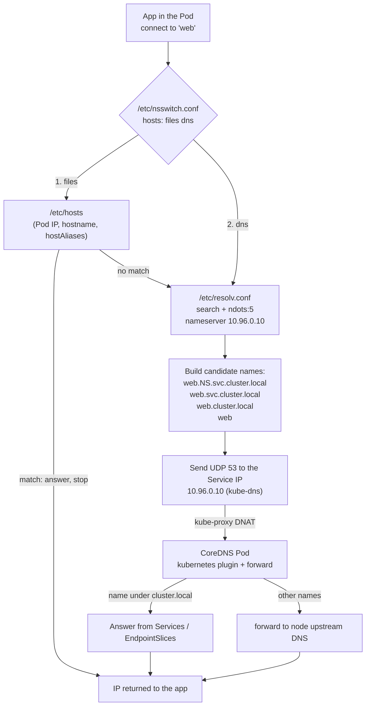

# T1.08 Linux networking II: DNS, ports, sockets and test tools

> Competency: n/a, foundation topic | Domain/weight: n/a (foundation; supports both exams) | Est. time: 3 h | Prerequisites: T1.07

Shell setup used in every command below (define it once per terminal):

```bash
alias k=kubectl
export do="--dry-run=client -o yaml"
export now="--force --grace-period=0"
source <(kubectl completion bash); complete -o default -F __start_kubectl k
```

Image pins used in this lesson (all checked to exist on 2026-10-27, see section 11): `busybox:1.36`, `curlimages/curl:8.23.0`, `nginx:1.27`, `registry.k8s.io/e2e-test-images/agnhost:2.53` (the "dnsutils" image: it has `dig`, `nslookup`, `curl`, `wget`, `nc` and `ss`).

How outputs are labelled in this lesson:

- `REAL OUTPUT (Docker)` means I ran the command in a plain Docker container on 2026-10-27. It is a Linux result, not a Kubernetes result. In the DNS-ladder blocks, a `dnsmasq` container stood in for CoreDNS and its resolver file was set to the same `search` and `ndots:5` values a Pod gets.
- `EXPECTED OUTPUT (not captured)` means no kind cluster or VM was available. The text is what you should see. Every such block is listed in section 11.

Previous lesson: [T1.07 Linux networking I](../part1-linux/T1.07-linux-networking-i-interfaces-ips-routes.md) (interfaces, IP addresses, routes, bridges, veth). This lesson does not re-teach them.

## 1. Why this matters

Most "my Service does not work" tasks come down to one of two things: the name did not resolve, or the connection went to the wrong port. If you cannot tell these apart in under a minute, you will lose time on every networking task. `curl`, `dig`, `nc` and `ss` let you prove which layer is broken instead of guessing. The exam SSH hosts list only `kubectl`, `yq`, `curl`, `wget` and `man` (source: https://docs.linuxfoundation.org/tc-docs/certification/tips-cka-and-ckad), so you also need the habit of running a throw-away test Pod.

## 2. Concepts

### 2.1 Ports, TCP vs UDP, listening vs established sockets

**IP address** picks the machine. A **port** (a number from 1 to 65535) picks the program on that machine. A **socket** is one end of a conversation: protocol + local IP + local port (+ remote IP + remote port once connected).

Two transport protocols matter here.

| | TCP | UDP |
|---|---|---|
| Connection | Yes: handshake first (SYN, SYN-ACK, ACK) | No handshake, each packet stands alone |
| Delivery | Ordered, retried if lost | Best effort, no retry by the protocol |
| Examples in Kubernetes | API server 6443, etcd 2379, kubelet 10250, HTTP | DNS queries (53), VXLAN overlay traffic (8472, CNI-specific) |
| `ss` flag | `-t` | `-u` |
| Typical "state" you see | `LISTEN`, `ESTAB`, `TIME-WAIT`, `SYN-SENT` | `UNCONN` (listening) or `ESTAB` (connected UDP) |

DNS uses UDP port 53 first. If the answer is too big for one UDP packet, the client retries over TCP port 53. So a firewall that blocks only TCP 53 breaks some lookups but not all. That makes it a nasty fault.

A program that wants to receive connections does `bind()` to an address and port, then `listen()`. That socket is in the **LISTEN** state. When a client connects, the kernel creates a second socket for that one conversation. It is in the **ESTAB** (established) state. The listener stays in LISTEN and keeps accepting.

**The bind address matters.** What a server listens on decides who can reach it:

| Local address in `ss` | Meaning | Reachable from |
|---|---|---|
| `0.0.0.0:6443` | All IPv4 addresses of this machine | Anywhere that has a route to the machine |
| `[::]:6443` or `*:6443` | All IPv6 addresses (usually IPv4 too, depending on the `bindv6only` setting) | Same |
| `127.0.0.1:10257` | Loopback only | Only processes on the same machine |
| `10.0.0.10:2380` | One specific interface address | Only through that address |

A server bound to `127.0.0.1` can never be reached from another node or Pod, however correct your Service is. This is a classic cause of "connection refused" from outside while `curl localhost` works inside.

**Port ranges.** Ports 1-1023 are "privileged": a normal user cannot bind them (Docker containers often set the limit to 0, so they can; I measured `0` in a container). The kernel picks the **ephemeral** (temporary client-side) port from `/proc/sys/net/ipv4/ip_local_port_range`; I measured `32768 60999` (default on modern kernels). The default Kubernetes NodePort range (30000-32767) sits just below that default ephemeral range, so the two do not overlap on a default node.

### 2.2 `ss` and the `netstat` equivalence

`ss` (socket statistics, from the `iproute2` package) reads sockets from the kernel. It replaces `netstat` (from `net-tools`, often not installed any more). Learn these flags:

| Flag | Meaning |
|---|---|
| `-l` | Only listening sockets |
| `-t` / `-u` | TCP / UDP |
| `-n` | Numeric: do not turn ports and IPs into names (faster, and exact) |
| `-p` | Show the process that owns the socket (needs root to see other users' processes) |
| `-a` | All states |
| `state established` | Filter by state |
| `-s` | One-screen summary counts |

| Task | `ss` | `netstat` equivalent |
|---|---|---|
| Listening TCP ports with the process | `ss -ltnp` | `netstat -tlnp` |
| Listening UDP ports | `ss -lunp` | `netstat -ulnp` |
| Established TCP connections | `ss -tnp state established` | `netstat -tnp` (shows all states; filter with `grep ESTABLISHED`) |

REAL OUTPUT (Docker): a listener started with `nc -l 7777`, then `ss -ltnp`:

```text
State  Recv-Q Send-Q Local Address:Port  Peer Address:PortProcess
LISTEN 0      4096      127.0.0.11:45491      0.0.0.0:*          
LISTEN 0      1            0.0.0.0:7777       0.0.0.0:*    users:(("nc",pid=2764,fd=3))
```

Read it column by column: `State` is LISTEN; `Local Address:Port` is where the server waits (`0.0.0.0:7777` = every IPv4 address); `Peer Address:Port` is `0.0.0.0:*` because nobody is connected to a listener; `Process` shows the program name and PID. (`127.0.0.11` is Docker's built-in DNS helper in that container.) The program name is the kernel "comm" field, cut at 15 characters. So `kube-controller-manager` shows as `kube-controller`.

REAL OUTPUT (Docker): UDP listener (`nc -ul 5353`) with `ss -lunp`. Note that UDP shows `UNCONN`, not `LISTEN`:

```text
State  Recv-Q Send-Q Local Address:Port  Peer Address:PortProcess                      
UNCONN 0      0            0.0.0.0:5353       0.0.0.0:*    users:(("nc",pid=3208,fd=3))
UNCONN 0      0         127.0.0.11:58229      0.0.0.0:*                                
```

REAL OUTPUT (Docker): an established connection, `ss -tnp state established`. Both ends are on this machine, so you see the two halves of one conversation: the client side (ephemeral port 49870, process `nc`) and the server side (port 8081, process `python3`):

```text
Recv-Q Send-Q Local Address:Port  Peer Address:Port Process                      
0      0          127.0.0.1:49870    127.0.0.1:8081  users:(("nc",pid=3203,fd=3))
0      0          127.0.0.1:8081     127.0.0.1:49870 users:(("python3",pid=3196,fd=4))
```

REAL OUTPUT (Docker): `netstat -tlnp` shows the same information with different columns:

```text
Active Internet connections (only servers)
Proto Recv-Q Send-Q Local Address           Foreign Address         State       PID/Program name    
tcp        0      0 127.0.0.11:34333        0.0.0.0:*               LISTEN      -                   
tcp        0      0 0.0.0.0:8081            0.0.0.0:*               LISTEN      3196/python3        
```

**Related but different:** `ss -ltnp` answers "who is waiting for connections on this machine?". `nc -zv host port` answers "can I connect to that machine's port from here?". You need both: the first is run on the server, the second on the client.

### 2.3 DNS on a Linux machine: `resolv.conf`, `/etc/hosts`, `nsswitch.conf`

**DNS** (Domain Name System) turns names such as `web.default.svc.cluster.local` into IP addresses. Programs do not talk to DNS directly. They call the C library (`getaddrinfo()`), which is the **stub resolver**. The stub resolver reads three files.

| File | What it holds | Who writes it |
|---|---|---|
| `/etc/nsswitch.conf` | The order of sources for each kind of lookup. Line `hosts: files dns` means: look in `/etc/hosts` first, then ask DNS. | Distro |
| `/etc/hosts` | Static name-to-IP lines. No wildcard, no network. | Admin; in a Pod, the kubelet |
| `/etc/resolv.conf` | Which DNS servers to ask and how | Distro/DHCP/systemd-resolved on a node; the kubelet for a Pod |

REAL OUTPUT (Docker): `grep ^hosts /etc/nsswitch.conf` on Ubuntu 24.04 (a full Ubuntu node usually has extra entries such as `mdns4_minimal` between `files` and `dns`):

```text
hosts:          files dns
```

**`/etc/resolv.conf` keywords:**

| Keyword | Meaning | Default / risky value |
|---|---|---|
| `nameserver IP` | A DNS server to ask. Servers are tried in order; the C library uses at most 3 lines. | On an Ubuntu node it is usually the local stub `127.0.0.53` (systemd-resolved). A Pod must not copy that: loopback inside a Pod is the Pod itself. |
| `search d1 d2 ...` | Suffixes added to a name that is not absolute | Missing in a Pod = short Service names stop working |
| `options ndots:N` | If a name has fewer than N dots, try the search suffixes first | glibc default is 1. Kubernetes sets 5 for Pods. |
| `options timeout:N` | Seconds to wait for each server | Default 5. Very large values make failures look like hangs. |
| `options attempts:N` | Number of tries per server | Default 2 |

REAL OUTPUT (Docker): a resolver file with Kubernetes-style values. The comment lines were removed:

```text
nameserver 192.168.215.2
search default.svc.cluster.local svc.cluster.local cluster.local
options ndots:5
```

**`/etc/hosts` wins over DNS** because `files` comes first in `nsswitch.conf`. Use it for a quick local override. In a Pod you cannot edit it durably (the kubelet rewrites it), so use `spec.hostAliases` (section 4).

Tools differ in what they consult. This is the single most useful thing to remember when "DNS works for dig but not for the app":

| Tool | Reads `/etc/hosts` | Uses the `search` list | Uses `nsswitch.conf` |
|---|---|---|---|
| Your app, `curl`, `wget`, `getent hosts` | Yes | Yes | Yes |
| `dig` | No | Only with `+search` | No (asks DNS directly) |
| `nslookup` (bind-utils) | No | Yes (it applies the list) | No |

REAL OUTPUT (Docker): I added `10.1.2.3 myapp.test` to `/etc/hosts`. `getent` finds it, `dig` does not:

```text
10.1.2.3        myapp.test
(dig empty above)
```

### 2.4 `dig`, `nslookup`, `getent hosts`

**`getent hosts NAME`** goes through `nsswitch.conf`, exactly like a real program. It is the best "what does my app see?" test. It prints nothing and exits 2 if the name is unknown.

REAL OUTPUT (Docker, Ubuntu 24.04, glibc): the resolver file above, with a fake DNS server that knows `web.default.svc.cluster.local`. (glibc prints the canonical name; the Alpine/musl `dbg` image used later prints a different name column, see section 2.11.)

```text
### getent hosts web
10.96.0.50      web.default.svc.cluster.local
### getent hosts web.other
10.96.0.60      web.other.svc.cluster.local
### getent hosts web.other.svc.cluster.local.
10.96.0.60      web.other.svc.cluster.local
```

**`dig`** (domain information groper, package `dnsutils` / `bind-utils`) asks DNS and shows the raw answer. Flags to know:

| Command | What it does |
|---|---|
| `dig NAME` | Full answer with header, flags, sections |
| `dig +short NAME` | Only the answer data |
| `dig @SERVER NAME` | Ask that server, ignore `resolv.conf`. Proves whether a specific DNS server works. |
| `dig -t SRV NAME` | Ask for a record type (`A`, `AAAA`, `SRV`, `PTR`, `CNAME`, `TXT`). `-t` is the short form of `type`. |
| `dig +search NAME` | Apply the `search`/`ndots` rules like a real program |
| `dig +tcp NAME` | Use TCP instead of UDP (tests the TCP 53 path) |
| `dig -x IP` | Reverse lookup |
| `dig +noall +answer NAME` | Print only the answer section, with TTL and type |

REAL OUTPUT (Docker): `dig +short` and the effect of `+search`. A short name gives nothing without `+search` because `dig` does not apply the search list by default:

```text
### dig +short kubernetes.default.svc.cluster.local
10.96.0.1
### dig +short web (no search)
(empty)
### dig +search +short web
10.96.0.50
### dig @server
10.96.0.60
```

REAL OUTPUT (Docker): a missing name. Read the `status:` field in the header: `NXDOMAIN` means "this name does not exist" (an authoritative negative answer):

```text
;; ->>HEADER<<- opcode: QUERY, status: NXDOMAIN, id: 57445
;; flags: qr rd ra; QUERY: 1, ANSWER: 0, AUTHORITY: 0, ADDITIONAL: 1
```

`dig` status values you must be able to read:

| `status:` | Meaning | Usual cause in a cluster |
|---|---|---|
| `NOERROR` with an answer | Name exists | Normal |
| `NOERROR` with no answer (NODATA) | Name exists, but not for that record type | Asked `AAAA` for an IPv4-only Service |
| `NXDOMAIN` | Name does not exist | Typo, wrong namespace, Service not created, wrong suffix |
| `SERVFAIL` | Server failed to answer | CoreDNS cannot reach its upstream, or a loop |
| `REFUSED` | Server refuses this client or domain | Wrong server asked (for example a node DNS asked for `cluster.local`) |
| no reply / `connection timed out; no servers could be reached` | Packets are not arriving | Wrong `nameserver` IP, network policy or firewall blocking UDP 53 |

**SRV records.** An SRV record tells a client the host and port of a service. Kubernetes creates one for each **named** Service port, with the name format `_PORTNAME._PROTOCOL.SERVICE.NAMESPACE.svc.cluster.local`. REAL OUTPUT (Docker, fake DNS server; priority/weight columns are whatever the server sets, CoreDNS typically sets weight to 100):

```text
### dig SRV
0 0 80 web.default.svc.cluster.local.
```

The four fields are priority, weight, port, and target host.

**`nslookup`** is the older, friendlier query tool. It applies the search list, prints `Server:` and `Address:` lines, and ends with `Name:` and `Address:`. REAL OUTPUT (Docker, bind `nslookup`), `nslookup web.other`:

```text
Server:		192.168.215.2
Address:	192.168.215.2#53

Name:	web.other.svc.cluster.local
Address: 10.96.0.60
```

REAL OUTPUT (Docker, bind `nslookup`), a separate run of `nslookup nope` (a name that does not exist):

```text
** server can't find nope: NXDOMAIN
```

### 2.5 FQDN vs short names, and how `search` plus `ndots:5` drive Pod lookups

A **FQDN** (fully qualified domain name) is a name that ends in a dot, like `web.default.svc.cluster.local.`. The trailing dot says "this is the complete name, do not add anything". Most people leave the dot off, and the resolver then uses the `ndots` rule:

> If the name has **fewer dots than `ndots`**, try each `search` suffix first, and try the name as typed last. If it has **`ndots` or more** dots, try it as typed first, then the suffixes. A name with a trailing dot is never expanded.

Kubernetes puts `options ndots:5` in every normal Pod, and a search list of three suffixes. For a Pod in namespace `lab-t108`:

```text
search lab-t108.svc.cluster.local svc.cluster.local cluster.local
options ndots:5
```

Now trace three lookups from that Pod.

| You type | Dots | Rule | Names sent to DNS, in order (stops at the first answer) |
|---|---|---|---|
| `web` | 0 | below 5: suffixes first | `web.lab-t108.svc.cluster.local` (found) |
| `api.lab-t108b` | 1 | below 5: suffixes first | `api.lab-t108b.lab-t108.svc.cluster.local` (NXDOMAIN), then `api.lab-t108b.svc.cluster.local` (found) |
| `web.lab-t108.svc.cluster.local.` | 4 + trailing dot | absolute | `web.lab-t108.svc.cluster.local.` only |
| `example.org` (external) | 1 | below 5: suffixes first | three wasted lookups (`example.org.lab-t108.svc.cluster.local`, `example.org.svc.cluster.local`, `example.org.cluster.local`), then `example.org` |

The `web` row works only for Services **in the same namespace**. The first suffix is built from the Pod's own namespace. Another namespace's Service needs `SERVICE.NAMESPACE` at least.

REAL OUTPUT (Docker): `tcpdump -i any port 53 -nn` while running `getent hosts web.other` with the Kubernetes-style resolver file. The client asks for IPv6 (`AAAA`) and IPv4 (`A`) in parallel for each candidate. Lines trimmed to the query text. Look at the order: the name with the `default` suffix first, then the `svc.cluster.local` suffix, which the server answers:

```text
... Out IP 192.168.215.4.46648 > 192.168.215.2.53: 28690+ AAAA? web.other.default.svc.cluster.local. (53)
... Out IP 192.168.215.4.37040 > 192.168.215.2.53: 54410+ AAAA? web.other.svc.cluster.local. (45)
... Out IP 192.168.215.4.35569 > 192.168.215.2.53: 43433+ AAAA? web.other.cluster.local. (41)
... Out IP 192.168.215.4.60110 > 192.168.215.2.53: 627+ AAAA? web.other. (27)
... Out IP 192.168.215.4.49760 > 192.168.215.2.53: 43104+ A? web.other.default.svc.cluster.local. (53)
... Out IP 192.168.215.4.59213 > 192.168.215.2.53: 51795+ A? web.other.svc.cluster.local. (45)
```

(The `AAAA` lines for the later suffixes are sent in parallel and are not needed once the `A` answer arrives; the `default` suffix in this test came from the file I gave the container.)

REAL OUTPUT (Docker): the fake DNS server's own log when an external name (`ports.ubuntu.com`, 2 dots, below 5) is looked up with the same file. Three suffixes fail (NXDOMAIN) before the bare name is tried. This is the real cost of `ndots:5` for external names:

```text
query[A] ports.ubuntu.com.default.svc.cluster.local from 192.168.215.4
config ports.ubuntu.com.default.svc.cluster.local is NXDOMAIN
query[A] ports.ubuntu.com.svc.cluster.local from 192.168.215.4
config ports.ubuntu.com.svc.cluster.local is NXDOMAIN
query[A] ports.ubuntu.com.cluster.local from 192.168.215.4
config ports.ubuntu.com.cluster.local is NXDOMAIN
query[A] ports.ubuntu.com from 192.168.215.4
```

(In that run the server answered the last query with REFUSED because I had configured it with no upstream. A real CoreDNS forwards it.)

**Other Kubernetes DNS names** (reference table):

| Object | Name | Notes |
|---|---|---|
| Service | `SVC.NS.svc.cluster.local` | A/AAAA record = ClusterIP |
| Headless Service (`clusterIP: None`) | `SVC.NS.svc.cluster.local` | Returns the Pod IPs, not one virtual IP |
| Named Service port | `_PORT._PROTO.SVC.NS.svc.cluster.local` | SRV record |
| Pod | `A-B-C-D.NS.pod.cluster.local` | The IP with dashes. Pod `10.244.1.5` becomes `10-244-1-5` |
| StatefulSet Pod behind a headless Service | `POD-0.SVC.NS.svc.cluster.local` | Stable per-Pod name |

`cluster.local` is the default cluster domain. It is set at install time and can differ; check with `k -n kube-system get cm coredns -o yaml` (the `kubernetes` line of the Corefile).

### 2.6 `curl`

`curl` makes one request and shows you each layer. Know the flags below. Examples run against a service called `web`.

| Flag | What it does | Example |
|---|---|---|
| `-v` | Verbose: name resolution, connect, request headers (`>`), response headers (`<`) | `curl -v http://web:8080/healthz` |
| `-sv` | Silent progress bar but still verbose; the usual combination | `curl -sv http://web:8080/healthz` |
| `-I` | Send a HEAD request, show only headers | `curl -I http://web:8080/` |
| `-s` | Silent: no progress meter. Add `-S` to still print errors. | `curl -sS ...` |
| `-k` | Do not verify the TLS certificate (testing only; never in a script that matters) | `curl -k https://10.96.0.1:443/version` |
| `-o /dev/null` | Throw the body away | |
| `-w '%{http_code}'` | After the transfer print a variable. `%{http_code}` is the status code. | `curl -s -o /dev/null -w '%{http_code}' URL` |
| `--connect-timeout N` | Give up if the TCP connect takes more than N seconds | `--connect-timeout 3` |
| `-m N` / `--max-time N` | Give up if the whole request takes more than N seconds | |
| `-H 'Host: x'` | Set a request header. `Host:` picks the virtual host (Ingress rule, name-based site). | `-H 'Host: shop.example.com'` |
| `--resolve host:port:ip` | Pretend DNS returned `ip` for `host`. Keeps the right `Host` header and TLS name. | `--resolve shop.example.com:80:10.96.0.50` |
| `-L` | Follow redirects | |
| `-f` | Return exit code 22 for HTTP status 400 or above | |

REAL OUTPUT (Docker): `curl -sv http://web:8080/healthz`, trimmed. This is the picture of a healthy request. Each line is a layer:

```text
* Host web:8080 was resolved.
* IPv6: (none)
* IPv4: 192.168.148.2
*   Trying 192.168.148.2:8080...
* Connected to web (192.168.148.2) port 8080
> GET /healthz HTTP/1.1
> Host: web:8080
> User-Agent: curl/8.5.0
> Accept: */*
>
* HTTP 1.0, assume close after body
< HTTP/1.0 200 OK
< Content-Length: 3
<
{ [3 bytes data]
* Closing connection
```

Read it top to bottom: DNS worked (`was resolved`), TCP worked (`Connected`), the server answered with HTTP 200. If the output stops after `Host ... was resolved` + `Trying ...`, the packets are not reaching the port (timeout). If it never prints `was resolved`, DNS is broken.

REAL OUTPUT (Docker): the status-code-only form, plus the timing variables. The numbers show where time goes: `dns` is the name lookup, `connect` is the TCP connect, `total` is the whole request (seconds):

```text
200
code=200 dns=0.000016 connect=0.000476 total=0.001185
```

REAL OUTPUT (Docker): `-I`, `--resolve` and `-H Host:` all returned a normal answer. With `--resolve foo.test:8080:<web IP>` the request to `http://foo.test:8080/healthz` skipped DNS and got `HTTP/1.0 200 OK`; with `-H "Host: foo.test"` the status code printed was `200`.

**Worked through: `-I`, `--resolve`, `-H Host:` and `-k` against cluster objects.** These four flags answer questions that name-based routing raises. A web server (or an Ingress controller, which you meet later) often serves several sites on one IP and picks the site from the `Host` header. If the site name (`shop.example.com`) is not in DNS, a plain `curl http://shop.example.com` fails with exit code 6 before any request is sent. Two ways around it, both without touching DNS or `/etc/hosts`:

- `-H 'Host: shop.example.com'` connects to the address in the URL and only changes the header. Use it when you already have an IP in the URL.
- `--resolve shop.example.com:80:IP` tells curl "for this host and port, use this IP", and then curl builds the URL, the `Host` header and (for https) the TLS server name from the real name. Use it when the request must look exactly like the real one.

These commands use the `dbg` Pod and Service `web` from section 5, Step 1. They show the commands only; the output is EXPECTED OUTPUT (not captured):

```bash
IP=$(k -n lab-t108 get svc web -o jsonpath='{.spec.clusterIP}')
k -n lab-t108 exec dbg -- curl -sI http://web
k -n lab-t108 exec dbg -- curl -s -o /dev/null -w '%{http_code}\n' http://shop.example.com/; echo "rc=$?"
k -n lab-t108 exec dbg -- curl -s -o /dev/null -w '%{http_code}\n' --resolve shop.example.com:80:$IP http://shop.example.com/
k -n lab-t108 exec dbg -- curl -s -o /dev/null -w '%{http_code}\n' -H 'Host: shop.example.com' http://$IP/
k -n lab-t108 exec dbg -- curl -s https://kubernetes.default.svc/version; echo "rc=$?"
k -n lab-t108 exec dbg -- curl -sk https://kubernetes.default.svc/version
```

```text
HTTP/1.1 200 OK
Server: nginx/1.27.x
Content-Type: text/html
...                                   <- more headers, no body (HEAD request)
000
rc=6                                  <- shop.example.com is not in DNS: no request was sent
200                                   <- --resolve: curl connected to the ClusterIP, sent Host: shop.example.com
200                                   <- -H Host: same result (nginx ignores unknown Host values)
curl: (60) SSL certificate problem: unable to get local issuer certificate    <- exact text may differ
rc=60
{ ... "gitVersion": "v1.37.0" ... }   <- with -k the certificate check is skipped
```

Reading it: `-I` shows only the status line and headers (a HEAD request), a cheap way to see the status and `Server`. The third command proves that the name, not the server, was the problem (exit 6), and the fourth and fifth fix it two different ways. The last pair shows what `-k` changes: the cluster's API server certificate is signed by the cluster CA, which the `dbg` image does not trust, so curl stops with exit 60. `-k` skips that check. That is acceptable for a test of reachability on a cluster you own, and wrong for anything that sends secrets.

**The curl error-code ladder.** curl prints `curl: (N) message` and exits with code N. Read N like a ladder from the bottom of the stack up:

| Exit code | Message | Layer that failed | Meaning |
|---|---|---|---|
| 6 | `Could not resolve host: NAME` | Name resolution | DNS did not give an address. Nothing was sent to the server. |
| 7 | `Failed to connect to HOST port N ... Couldn't connect to server` | TCP connect | A host answered "no" (reset) or there is no route. Wrong port, nothing listening, or no ready backend. |
| 28 | `Timeout was reached` / `Connection timed out` | TCP connect or transfer | Packets went out, nothing came back. Firewall, NetworkPolicy, wrong IP, or a dead node. |
| 35 | `SSL connect error` | TLS handshake | Server speaks plain HTTP on a TLS port, or a protocol mismatch |
| 60 | `SSL certificate problem` | TLS verify | Certificate not trusted or wrong name. `-k` skips the check. |
| 52 / 56 | `Empty reply` / `Recv failure` | Server side | Connection opened, then the server closed it |
| (0, HTTP 4xx/5xx) | none | Application | The network is fine. Read the status code. |

REAL OUTPUT (Docker): the first three rungs, one run each:

```text
curl: (6) Could not resolve host: nope.invalid
rc=6
curl: (7) Failed to connect to 192.168.215.2 port 80 after 0 ms: Couldn't connect to server
rc=7
curl: (28) Failed to connect to 10.96.0.50 port 80 after 3004 ms: Timeout was reached
rc=28
```

Why 7 versus 28 is the key signal: with **7** the packet reached a machine that said "no" immediately. With **28** the packet vanished. The cause of a 7 can still be more than one thing (nothing listening on that port, or a Kubernetes Service with no ready backends, which the node answers with an immediate reject), so the next step is `ss -ltnp` on the server side or `k get endpointslices` for a Service.

Also: with `-w '%{http_code}'`, a failed connection prints `000`. REAL OUTPUT (Docker): `curl -s -o /dev/null -w '%{http_code}' --connect-timeout 2 http://nope.invalid` printed `000` with exit code 6. A `000` always means "no HTTP response happened". Look at the exit code (`echo $?`) to know why.

### 2.7 `wget`

`wget` is on the exam hosts (source: https://docs.linuxfoundation.org/tc-docs/certification/tips-cka-and-ckad). Two flags cover most uses:

- `-qO-` : `-q` quiet, `-O-` write the body to standard output (the dash means "stdout"). Use it like `curl -s`.
- `-T N` : network timeout in seconds. Without it, a dead endpoint can hang for a long time.

REAL OUTPUT (Docker, GNU wget on Ubuntu): `wget -qO- -T 3 http://web:8080/healthz` printed `ok`. The two busybox failure messages (REAL OUTPUT (Docker), `busybox:1.36`) are different for DNS and for connection refused:

```text
wget: bad address 'nope.invalid'
wget: can't connect to remote host (192.168.215.2): Connection refused
```

`bad address` = DNS failure (like curl 6). `can't connect ... Connection refused` = like curl 7. `download timed out` (seen when the address resolved but no packets came back) = like curl 28. `wget` has no `-w` status-code printing: use `curl` for that. GNU wget exit codes: 4 = network failure (including DNS), 8 = the server answered with an error status. BusyBox `wget` uses exit code 1 for all of them.

### 2.8 `nc` (netcat)

`nc` opens a raw TCP or UDP connection. It has two jobs here.

| Command | Meaning |
|---|---|
| `nc -zv HOST PORT` | `-z` scan only, send no data; `-v` verbose. Prints success or the error. |
| `nc -l 7777` | Listen on TCP 7777 as a test server (OpenBSD `nc`, used by Ubuntu and the agnhost image). The older/traditional `nc` and busybox need `nc -l -p 7777`. |
| `nc -ul 5353` | The same for UDP |
| `nc -w N` | Timeout in seconds |

REAL OUTPUT (Docker, Ubuntu OpenBSD `nc`):

```text
Connection to web (192.168.148.2) 8080 port [tcp/*] succeeded!
nc: connect to web (192.168.148.2) port 9999 (tcp) failed: Connection refused
```

BusyBox `nc` is much quieter. REAL OUTPUT (Docker, `busybox:1.36`): success prints `192.168.215.2 (192.168.215.2:8080) open` and exit code 0. A refusal prints **nothing** and exits with code 1. So in busybox, always check `$?`.

A test listener lets you prove the network path without any real application: run `nc -l 7777` on the server, then `nc -zv server 7777` from the client. If that works but the real service fails, the network is fine and the problem is the application or its bind address.

### 2.9 `tcpdump`, `traceroute`, `tracepath` (awareness)

- `tcpdump -i any port 53 -nn` prints every packet on port 53 on every interface. `-nn` means "no name lookups for hosts or ports" (otherwise tcpdump itself causes DNS lookups). It needs root. It is not in the exam-host tool list (summary E9), so do not plan on it. Its value in learning is that you can see the search-list attempts from section 2.5 on the wire. A `netshoot` debug image has it.
- `tracepath -n HOST` (from `iputils`) and `traceroute -n HOST` list the routers on the path with their latency. In a cluster, they show whether a Pod's packets leave the node, and which hop stops answering. REAL OUTPUT (Docker): one hop, because both containers share a bridge:

```text
 1?: [LOCALHOST]                      pmtu 1500
 1:  192.168.148.2                                         0.176ms reached
     Resume: pmtu 1500 hops 1 back 1 
```

`ping` is deliberately not in this lesson's checklist: ICMP is often blocked, and a Service ClusterIP does not answer ping at all. Use `nc -zv` or `curl`.

### 2.10 Testing from inside the cluster

Your laptop or the exam `base` host is not inside the Pod network. Cluster DNS names (`web.default.svc.cluster.local`) do not resolve there, and ClusterIPs are not routable. So you run the tool **in a Pod**. A throw-away Pod:

```bash
k run tmp --image=busybox:1.36 --rm -it --restart=Never -- wget -qO- svc:80
```

Meaning of each part: `k run tmp --image=busybox:1.36` creates a Pod named `tmp`. `--restart=Never` makes it a plain Pod (not a Deployment). `-it` attaches your terminal (`-i` keep stdin open, `-t` allocate a terminal). `--rm` deletes the Pod when the command ends; `--rm` needs the attach (`-i`). Everything after `--` is the command that runs in the container. It runs in the current namespace, so add `-n NAMESPACE` for another one; the Pod's DNS search list follows the Pod's namespace.

Pitfalls: the first output bytes can be lost when `k run` attaches, so if the first line of output is missing, run the command again. When the Pod image has an `ENTRYPOINT`, the words after `--` become **arguments** to that entrypoint. The `agnhost` image has `ENTRYPOINT ["/agnhost"]` (checked with `docker image inspect`), so `k run x --image=...agnhost:2.53 -- dig foo` hands `dig foo` to `/agnhost` and fails. Use `--command` to make the words the real command: `k run x --image=registry.k8s.io/e2e-test-images/agnhost:2.53 --command -- dig foo`.

### 2.11 Debug images: busybox quirks vs dnsutils/netshoot

| Image | Has | Notes |
|---|---|---|
| `busybox:1.36` | `wget`, `nslookup`, `nc`, `sh`, `cat` | Tiny. Its `nslookup` is a minimal one; its resolver is not glibc. No `dig`, no `curl`. |
| `curlimages/curl:8.23.0` | `curl` (entrypoint script runs `curl` by default) | Best for status-code probes. No `dig`. |
| `registry.k8s.io/e2e-test-images/agnhost:2.53` | `dig`, `nslookup`, `curl`, `wget`, `nc`, `ss` (checked in Docker) | The image the Kubernetes DNS-debugging page uses (a "dnsutils" Pod). Needs `--command`. It is Alpine (musl libc, OpenBSD `nc`), not glibc: `getent hosts` prints an IP followed by the name, and the name may be repeated or not be the canonical FQDN (checked locally: `getent hosts localhost` printed `::1 localhost localhost`). So rely on the exit code and the IP, not on the exact name text. |
| `nicolaka/netshoot:v0.13` | `dig`, `curl`, `wget`, `nc`, `ss`, and many more such as `tcpdump` | Big. Good for deep debugging, not for exam speed. |

**The busybox `nslookup` quirk.** It queries every search suffix and prints an error for the failed ones **even when an earlier one found the answer**. It then exits with code 1. So the output looks like a failure while the lookup actually worked. REAL OUTPUT (Docker, `busybox:1.36`, same resolver file as above, `web` exists only under `default.svc.cluster.local`):

```text
Server:		192.168.215.2
Address:	192.168.215.2:53

Name:	web.default.svc.cluster.local
Address: 10.96.0.50

** server can't find web.svc.cluster.local: NXDOMAIN

** server can't find web.cluster.local: NXDOMAIN

Non-authoritative answer:

** server can't find web.svc.cluster.local: NXDOMAIN

** server can't find web.cluster.local: NXDOMAIN

```

The exit code was `1` although the first block is the correct answer. Rule: **in busybox, trust the `Name:`/`Address:` lines, not the errors; if you need a clean yes/no, use `getent hosts` or `dig` from a dnsutils image.** (In this run, busybox also showed a stray `Non-authoritative answer:` line; with the fully qualified name it returned one clean answer and exit code 0.)

### 2.12 Well-known Kubernetes ports

Source for the table: https://kubernetes.io/docs/reference/networking/ports-and-protocols/ (read it in the exam; it is on kubernetes.io). The bind addresses in the Notes column are what I expect from `ss -ltnp` on a kubeadm node; they are not captured (section 11).

| Port | Protocol | Component | Where | Notes |
|---|---|---|---|---|
| 6443 | TCP | kube-apiserver | Control plane | Everything talks to this. kubeconfig `server:` normally points here. |
| 2379 | TCP | etcd client API | Control plane | Used by kube-apiserver; bound to `127.0.0.1` and the node IP |
| 2380 | TCP | etcd peer API | Control plane | etcd members talk to each other |
| 10250 | TCP | kubelet API | Every node | `kubectl logs`/`exec` go API server -> kubelet on this port. Needs authentication. |
| 10257 | TCP | kube-controller-manager (HTTPS) | Control plane | Used by itself; kubeadm binds it to `127.0.0.1` |
| 10259 | TCP | kube-scheduler (HTTPS) | Control plane | Used by itself; kubeadm binds it to `127.0.0.1` |
| 10256 | TCP | kube-proxy health | Every node | Per the ports page, reached by itself and by load balancers |
| 30000-32767 | TCP (and UDP for UDP Services) | NodePort Services | Every node | Default range, set by `--service-node-port-range` on the API server |
| 53 | UDP and TCP | CoreDNS (inside the Pod) | Service `kube-dns` | The Service port clients use |

Extra ports you will see in `ss` that are not on the page: `127.0.0.1:2381` (etcd metrics, kubeadm), `127.0.0.1:10248` (kubelet health), `127.0.0.1:10249` (kube-proxy metrics), the container runtime's own local port, and CNI ports (Calico BGP 179, for instance). Treat these as "expected extra" and do not panic.

### 2.13 Under the hood: what happens when a Pod resolves `web`

1. The app calls `getaddrinfo("web")`. The C library reads `/etc/nsswitch.conf` (`hosts: files dns`), checks `/etc/hosts` (no match), then goes to DNS.
2. It applies `search`/`ndots` to build candidate names and sends `A` and `AAAA` queries over UDP to the `nameserver` in the Pod's `/etc/resolv.conf`.
3. That nameserver IP is the **ClusterIP of the `kube-dns` Service** (10.96.0.10 on default installs, to verify). The kubelet writes the value into every Pod's `resolv.conf` from its own `clusterDNS` setting (in `/var/lib/kubelet/config.yaml`).
4. A ClusterIP is not a real interface address. On the Pod's node, `kube-proxy` rules rewrite the destination to the IP of one CoreDNS Pod (DNAT; see [T1.07](../part1-linux/T1.07-linux-networking-i-interfaces-ips-routes.md) for the rule mechanics).
5. CoreDNS (Deployment `coredns` in `kube-system`, config in ConfigMap `coredns`) uses its `kubernetes` plugin: if the name is under `cluster.local`, it answers from the Services/EndpointSlices it watches via the API; otherwise its `forward . /etc/resolv.conf` line sends the query to the node's upstream DNS.
6. If the UDP answer is truncated, the client retries on TCP 53.

Break any link and you get a different symptom, which is why the next sections teach you to test one link at a time.

### 2.14 `dnsPolicy` and `dnsConfig` (Pod DNS settings)

`spec.dnsPolicy` says how the kubelet builds the Pod's `resolv.conf`.

| `dnsPolicy` | Result | Notes |
|---|---|---|
| `ClusterFirst` (**default**) | `nameserver` = cluster DNS; search list and `ndots:5` added. Names outside `cluster.local` go to upstream through CoreDNS. | If `hostNetwork: true` and you leave this value, the kubelet falls back to `Default`. |
| `Default` | The Pod inherits the **node's** `resolv.conf`. Cluster names do **not** resolve. | The name is confusing: `Default` is not the default. |
| `ClusterFirstWithHostNet` | Like `ClusterFirst`, for Pods with `hostNetwork: true` | Required if a host-network Pod must resolve Services |
| `None` | Ignore everything; use only `spec.dnsConfig` | `dnsConfig` is then required. Without it the API server rejects the Pod. Safe only if you list a working nameserver. |

`spec.dnsConfig` fields:

| Field | Meaning | Limit / risk |
|---|---|---|
| `nameservers` | List of DNS server IPs | At most 3. Required when `dnsPolicy: None`. A wrong IP means every lookup times out (the app looks hung). |
| `searches` | Search suffixes | Merged after the policy's own list unless policy is `None`. A long list slows every miss. There is a limit on the number of entries and on the total length of the list; read the current numbers on the dns-pod-service page (section "Pod's DNS Config"), since they are version-dependent (section 11). |
| `options` | List of `name` / `value` (value is a string) | e.g. `ndots` = `"2"`. Common: `ndots`, `timeout`, `attempts`. |

`dnsPolicy` is part of the Pod spec and **cannot be changed on a running Pod**; delete and recreate the Pod (or change the Deployment template, which rolls new Pods).

Runnable example of all four variants. Save as `~/lab/T1.08/dnspolicy.yaml`:

```yaml
apiVersion: v1
kind: Pod
metadata:
  name: p-clusterfirst
  namespace: lab-t108
spec:
  dnsPolicy: ClusterFirst            # default; written out for clarity
  containers:
  - name: c
    image: busybox:1.36
    command: ["sleep", "3600"]
---
apiVersion: v1
kind: Pod
metadata:
  name: p-default
  namespace: lab-t108
spec:
  dnsPolicy: Default                 # inherit the node's resolv.conf
  containers:
  - name: c
    image: busybox:1.36
    command: ["sleep", "3600"]
---
apiVersion: v1
kind: Pod
metadata:
  name: p-none
  namespace: lab-t108
spec:
  dnsPolicy: None                    # only dnsConfig is used
  dnsConfig:
    nameservers: ["10.96.0.10"]      # must be the real kube-dns ClusterIP on your cluster
    searches: ["lab-t108.svc.cluster.local", "svc.cluster.local", "cluster.local"]
    options:
    - name: ndots
      value: "2"
  containers:
  - name: c
    image: busybox:1.36
    command: ["sleep", "3600"]
---
apiVersion: v1
kind: Pod
metadata:
  name: p-hostnet
  namespace: lab-t108
spec:
  hostNetwork: true                  # shares the node's network namespace
  dnsPolicy: ClusterFirstWithHostNet # without this, the Pod would use the node's DNS
  containers:
  - name: c
    image: busybox:1.36
    command: ["sleep", "3600"]
```

Observe the effect:

```bash
k create ns lab-t108
k apply -f ~/lab/T1.08/dnspolicy.yaml
for p in p-clusterfirst p-default p-none p-hostnet; do echo "## $p"; k -n lab-t108 exec $p -- cat /etc/resolv.conf; done
k delete ns lab-t108
```

EXPECTED OUTPUT (not captured): for `p-clusterfirst` and `p-hostnet` `nameserver` is the kube-dns ClusterIP (10.96.0.10) and the options line is `ndots:5`. For `p-none` the three suffixes and `ndots:2` only. For `p-default` it is the file of the node. If you run it before the namespace exists, the apply fails: create the namespace first.

### 2.15 Related but different

- **Service `port`, `targetPort`, `nodePort`, container `containerPort`.** `port` is what clients of the ClusterIP use. `targetPort` is where the Pod listens. `nodePort` is the number opened on every node. `containerPort` is documentation only; it does not open or close anything.
- **`dig` success vs `getent` success.** `dig` proves DNS has the record. `getent hosts` proves a program can see it. They can disagree (section 2.3).
- **DNS name vs Service name in a Pod.** The Service `web` in the Pod's own namespace resolves with the plain name. It is the DNS search list that makes this work, not Kubernetes magic.
- **NetworkPolicy and DNS.** A default-deny egress policy blocks UDP/TCP 53 to CoreDNS too. Symptom: lookups time out (curl 6 after a delay, or `;; connection timed out; no servers could be reached`), not NXDOMAIN. NetworkPolicies are covered later; the DNS rule you must remember is "allow egress to port 53".

## 3. How it works (diagram)



Walkthrough:

1. The app asks the C library for `web`. `nsswitch.conf` says `files` first, so `/etc/hosts` is checked. A hit stops here (the side branch). That is why a bad `/etc/hosts` line can override DNS.
2. If `/etc/hosts` has no match, the resolver reads `resolv.conf`. Because `web` has 0 dots and `ndots` is 5, it builds the candidate names from the search list, first the Pod's own namespace.
3. It sends the query to the `nameserver`, which is the ClusterIP of the `kube-dns` Service, not a Pod IP.
4. `kube-proxy` rules on the node rewrite that ClusterIP to a CoreDNS Pod IP.
5. CoreDNS answers cluster names from the API data, and forwards everything else to the upstream DNS of the node. An `NXDOMAIN` for a candidate makes the resolver move to the next candidate.

## 4. Commands and YAML you must produce fast

**Imperative shortcuts**

```bash
# 1. In-cluster HTTP probe that prints only the status code (the entry's one-liner, image pinned)
k run t --rm -i --image=curlimages/curl:8.23.0 --restart=Never -- curl -s -o /dev/null -w '%{http_code}' http://web.default:80; echo

# 2. Quick interactive name test (works as typed only in the 'default' namespace)
k run tmp --rm -it --image=busybox:1.36 --restart=Never -- nslookup kubernetes

# 3. Quick HTTP body fetch
k run tmp --rm -it --image=busybox:1.36 --restart=Never -- wget -qO- -T 3 web:80

# 4. A reusable DNS debug Pod (dig, nslookup, curl, nc, ss inside). Note --command.
k run dbg --image=registry.k8s.io/e2e-test-images/agnhost:2.53 --command -- sleep infinity
k wait --for=condition=Ready pod/dbg --timeout=90s

# 5. Use it
k exec dbg -- cat /etc/resolv.conf
k exec dbg -- dig +short kubernetes.default.svc.cluster.local
k exec dbg -- dig +short kubernetes.default.svc.cluster.local @10.96.0.10
k exec dbg -- curl -sv http://web:80/ -o /dev/null
k exec dbg -- nc -zv web 80
k delete pod dbg $now        # cleanup: do not leave it in 'default'

# 6. Find the DNS Service IP
k -n kube-system get svc kube-dns -o jsonpath='{.spec.clusterIP}{"\n"}'

# 7. On a node (via ssh, then sudo -i)
ss -ltnp
ss -tnp state established
nc -zv 10.0.0.10 6443
cat /etc/resolv.conf
```

What each does:

- (1) `-i` is enough because no terminal is needed. `echo` adds the newline that `curl -w` does not print. `web.default:80` has one dot, so the search list is used; it ends up as `web.default.svc.cluster.local`.
- (2) In another namespace, `kubernetes` will **not** resolve because the first suffix is that namespace. Use `kubernetes.default`.
- (4) `sleep infinity` keeps the Pod alive. `--command` is required for agnhost because of its entrypoint.
- (5) The second `dig` passes `@10.96.0.10` explicitly. If the first works and the second fails (or vice versa), the Pod's `resolv.conf` is the difference.

EXPECTED OUTPUT (not captured): command (1) against a working Service in the `default` namespace:

```text
200
pod "t" deleted from default namespace
```

(the exact deletion message wording can differ between kubectl versions). Command (5), the `dig` lines: `10.96.0.1`, twice. `10.96.0.1` is the ClusterIP of the built-in `kubernetes` Service (the first address of the Service CIDR), assuming the default CIDR.

**Declarative YAML** the lesson needs most often: a Pod with explicit DNS settings and a hosts entry. Every field is explained in comments:

```yaml
apiVersion: v1
kind: Pod
metadata:
  name: dnsdemo                # name used with k exec
  namespace: lab-t108          # namespace; also decides the first search suffix
spec:
  dnsPolicy: ClusterFirst      # how resolv.conf is built. Default if omitted. 'None' needs dnsConfig.
  dnsConfig:                   # ADDED to the generated file (merged with ClusterFirst)
    options:
    - name: ndots              # option name
      value: "2"               # always a string; lowers the search-list use for 2+ dot names
    searches:
    - corp.example.test        # extra suffix appended after the cluster suffixes
  hostAliases:                 # lines the kubelet adds to the Pod's /etc/hosts
  - ip: "10.1.2.3"             # address for the names below
    hostnames:
    - "legacy.corp.test"       # name the Pod resolves to 10.1.2.3 without DNS
  containers:
  - name: c                    # container name
    image: busybox:1.36        # pinned tag
    command: ["sleep", "3600"] # keep the container running for exec tests
```

Why `ndots: 2` could help: an external name with 2 or more dots (`api.example.org`) is then tried as typed first, so it skips the wasted suffix lookups. The risk: a cluster name that has 2 or more dots but is not complete (for example `web.lab-t108.svc`) is now tried as typed first, and only then with the suffixes. Names with fewer than 2 dots (`web`, `api.lab-t108b`) behave as before. Test your real names after changing it.

**Speed drill** (target about 2-3 minutes each). Setup (once):

```bash
k create ns lab-t108d
k -n lab-t108d create deploy web --image=nginx:1.27 --port=80
k -n lab-t108d expose deploy web --port=80
k -n lab-t108d wait --for=condition=Available deploy/web --timeout=90s
```

1. (2 min) From a throw-away Pod in `lab-t108d`, print only the HTTP status code of Service `web`.
2. (2 min) Print the `resolv.conf` a Pod in `lab-t108d` receives.
3. (2 min) Print only the ClusterIP of the cluster DNS Service.
4. (3 min) Resolve the FQDN of `web` with `dig +short` from a dnsutils-style Pod.
5. (3 min) Fetch the API server version from inside a Pod without `kubectl`.
6. (3 min) Send a request to `web` with the header `Host: shop.example.com` and print the status code.
7. (2 min) On the control-plane node, show which process owns port 10250.
8. (3 min) Without changing DNS, request `http://shop.example.com/` so that it reaches Service `web` (use the ClusterIP of `web`, read with `jsonpath`), and print only the status code.

<details><summary>Answers</summary>

```bash
# 1
k -n lab-t108d run t --rm -i --image=curlimages/curl:8.23.0 --restart=Never -- curl -s -o /dev/null -w '%{http_code}' http://web; echo
# 2
k -n lab-t108d run t --rm -i --image=busybox:1.36 --restart=Never -- cat /etc/resolv.conf
# 3
k -n kube-system get svc kube-dns -o jsonpath='{.spec.clusterIP}{"\n"}'
# 4  (--command is required)
k -n lab-t108d run t --rm -i --image=registry.k8s.io/e2e-test-images/agnhost:2.53 --restart=Never --command -- dig +short web.lab-t108d.svc.cluster.local
# 5  (-k skips cert check; /version is readable without credentials on default clusters)
k -n lab-t108d run t --rm -i --image=curlimages/curl:8.23.0 --restart=Never -- curl -sk https://kubernetes.default.svc/version
# 6
k -n lab-t108d run t --rm -i --image=curlimages/curl:8.23.0 --restart=Never -- curl -s -o /dev/null -w '%{http_code}' -H 'Host: shop.example.com' http://web; echo
# 7  (kubeadm VM: ssh cp1, sudo -i;  kind: docker exec)
ss -ltnp | grep ':10250'
docker exec lab-control-plane ss -ltnp | grep ':10250'
# 8  (--resolve: connect to the ClusterIP, keep Host: shop.example.com)
IP=$(k -n lab-t108d get svc web -o jsonpath='{.spec.clusterIP}')
k -n lab-t108d run t --rm -i --image=curlimages/curl:8.23.0 --restart=Never -- curl -s -o /dev/null -w '%{http_code}' --resolve shop.example.com:80:$IP http://shop.example.com/; echo
```

Expected results (EXPECTED OUTPUT (not captured)): (1) `200`. (2) three `search` suffixes starting with `lab-t108d.svc.cluster.local`, `options ndots:5`, `nameserver` = the IP from (3). (4) the ClusterIP of `web`. (5) JSON containing `"gitVersion": "v1.37.0"` (the kind image version). (6) `200` (nginx ignores unknown Host headers and serves its default site). (7) a line with `users:(("kubelet",pid=...,fd=...))`. (8) `200`; without `--resolve` the same URL prints `000` (curl exit 6). If the first output line of a `k run --rm -i` drill is missing, run it again.

</details>

Cleanup for the drills:

```bash
k delete ns lab-t108d --wait=false
```

## 5. Worked example

Environment: **kind** (cluster `lab`, context `kind-lab`; see conventions). Goal: prove, step by step, which layer works for a Service, in two namespaces. All blocks below are EXPECTED OUTPUT (not captured), because no kind cluster was available when this lesson was written. Docker-based real captures of the same tools are in section 2.

**Step 1. Create the objects.**

```bash
mkdir -p ~/lab/T1.08
k create ns lab-t108
k create ns lab-t108b
k -n lab-t108 create deploy web --image=nginx:1.27 --port=80
k -n lab-t108 expose deploy web --port=80
k -n lab-t108b create deploy api --image=nginx:1.27 --port=80
k -n lab-t108b expose deploy api --port=80
k -n lab-t108 run dbg --image=registry.k8s.io/e2e-test-images/agnhost:2.53 --command -- sleep infinity
k -n lab-t108 wait --for=condition=Available deploy/web --timeout=90s
k -n lab-t108b wait --for=condition=Available deploy/api --timeout=90s
k -n lab-t108 wait --for=condition=Ready pod/dbg --timeout=120s
```

**Step 2. Which DNS server does the Pod use?**

```bash
k -n lab-t108 exec dbg -- cat /etc/resolv.conf
k -n kube-system get svc kube-dns
```

EXPECTED OUTPUT (not captured):

```text
search lab-t108.svc.cluster.local svc.cluster.local cluster.local
nameserver 10.96.0.10
options ndots:5

NAME       TYPE        CLUSTER-IP   EXTERNAL-IP   PORT(S)                  AGE
kube-dns   ClusterIP   10.96.0.10   <none>        53/UDP,53/TCP,9153/TCP   2d
```

The `nameserver` equals the `kube-dns` ClusterIP. (On kind the file may have extra search domains copied from the node at the end. The first three suffixes are what matter.) That is link 3 of the chain in section 2.13 confirmed.

**Step 3. Is the name resolving? Use `getent` (what apps do) and `dig` (what DNS says).**

```bash
k -n lab-t108 exec dbg -- getent hosts web
k -n lab-t108 exec dbg -- dig +short web.lab-t108.svc.cluster.local
k -n lab-t108 exec dbg -- dig +short web
k -n lab-t108 exec dbg -- dig +short web +search
```

EXPECTED OUTPUT (not captured): the second and fourth print the ClusterIP of `web` (for example `10.96.147.22`). The first (`getent`) prints a line that starts with that IP followed by a name; the exact name column differs on the `dbg` image because it is Alpine/musl (section 2.11), so check the IP, not the name text. The third prints nothing: `dig` does not use the search list unless you pass `+search`. An empty result here is not an error.

**Step 4. Cross-namespace lookup.** Short name vs the namespace-qualified name:

```bash
k -n lab-t108 exec dbg -- getent hosts api; echo "rc=$?"
k -n lab-t108 exec dbg -- getent hosts api.lab-t108b; echo "rc=$?"
```

EXPECTED OUTPUT (not captured):

```text
rc=2
10.96.33.201    api.lab-t108b.svc.cluster.local     <- an IP followed by a name; the name text may differ on musl
rc=0
```

`api` becomes `api.lab-t108.svc.cluster.local`, `api.svc.cluster.local`, `api.cluster.local` and `api`. None of them exists. `api.lab-t108b` has one dot, so the list is used and the second suffix gives `api.lab-t108b.svc.cluster.local`.

**Step 5. Does the port answer? Use `nc` then `curl`.**

```bash
k -n lab-t108 exec dbg -- nc -zv web 80
k -n lab-t108 exec dbg -- curl -sv http://web/ -o /dev/null
k -n lab-t108 exec dbg -- curl -s -o /dev/null -w '%{http_code}\n' http://web
```

EXPECTED OUTPUT (not captured): `Connection to web (10.96.147.22) 80 port [tcp/*] succeeded!`; the `curl -v` shows `Connected to web (10.96.147.22) port 80` and `< HTTP/1.1 200 OK`; the last line prints `200`.

**Step 6. Break the port on purpose to see the ladder.**

```bash
k -n lab-t108 exec dbg -- curl -s -o /dev/null -w '%{http_code}\n' --connect-timeout 3 http://web:8080; echo "rc=$?"
k -n lab-t108 exec dbg -- curl -s -o /dev/null -w '%{http_code}\n' --connect-timeout 3 http://nosuchsvc; echo "rc=$?"
```

EXPECTED OUTPUT (not captured): the first prints `000` and then `rc=28` (the Service is listening only on port 80; a packet to 8080 on a ClusterIP has no rule to match, so a timeout is the typical symptom, but this depends on the kube-proxy mode: UNVERIFIED). The second prints `000` and `rc=6`. Notice `k exec` passes the exit code through, so `rc` is the curl code.

**Step 7. NodePort: wrong port vs right port, from the Pod.**

```bash
k -n lab-t108 patch svc web -p '{"spec":{"type":"NodePort","ports":[{"port":80,"nodePort":30080}]}}'
NODEIP=$(k get node lab-worker -o jsonpath='{.status.addresses[?(@.type=="InternalIP")].address}')
k -n lab-t108 exec dbg -- curl -s -o /dev/null -w '%{http_code}\n' --connect-timeout 3 http://$NODEIP:30080
k -n lab-t108 exec dbg -- curl -s -o /dev/null -w '%{http_code}\n' --connect-timeout 3 http://$NODEIP:8080; echo "rc=$?"
```

EXPECTED OUTPUT (not captured): `200` for 30080. For 8080 on the node IP: `000` and `rc=7` (nothing listens on node port 8080, so the node's kernel answers with a reset). This shows the difference between a timeout (28) and a refusal (7) in practice. The value `30080` is the one kind maps to the host (see conventions).

**Step 8. Look at the sockets on the node.**

```bash
docker exec lab-worker ss -ltnp | grep -E ':(10250|30080)'
```

EXPECTED OUTPUT (not captured): `10250` is owned by `kubelet`. For `30080`, kube-proxy may or may not hold a listening socket to reserve the port (UNVERIFIED for v1.37 kind; to verify), so a `kube-proxy` line may or may not appear. Either way, a socket in `ss` does not prove that the forwarding rules work, and a missing socket does not prove they are broken. To know whether a NodePort works, test it with `curl` or `nc` from another machine or Pod.

**Step 9. Cleanup.**

```bash
k delete ns lab-t108 lab-t108b
rm -f ~/lab/T1.08/dnspolicy.yaml
```

## 6. Common mistakes and how to fix them

| Symptom | What you will see (exact text) | Cause | Fix (command) |
|---|---|---|---|
| Name does not resolve | `curl: (6) Could not resolve host: web`; busybox `wget: bad address 'web'` | DNS did not return an address: wrong name, wrong namespace, Pod's `dnsPolicy`/`nameserver` wrong, CoreDNS down | `k exec dbg -- cat /etc/resolv.conf`, then `getent hosts NAME`, then `dig +short FQDN @KUBE_DNS_IP` |
| Name resolves but connection refused | `curl: (7) Failed to connect to web port 8080 ... Couldn't connect to server`; busybox `wget: can't connect to remote host (...): Connection refused` | DNS is fine; wrong port, nothing listening, bound to `127.0.0.1`, or Service has no ready endpoints | `k get svc web -o wide`, `k get endpointslices -l kubernetes.io/service-name=web`, on the server `ss -ltnp` |
| Name resolves, connect hangs | `curl: (28) Failed to connect ... Timeout was reached`; busybox `wget: download timed out` | Packets dropped: NetworkPolicy, firewall, wrong IP, dead node | `k get netpol -A`, `nc -zv -w 3 IP PORT` from two places, `tracepath -n IP` |
| busybox `nslookup` prints errors but DNS works | `** server can't find web.svc.cluster.local: NXDOMAIN` after a correct `Name:`/`Address:` block, exit code 1 | busybox walks the entire search list and reports each failure | Read the first `Address:`. Or re-test with `getent hosts web`, or `dig +short` from an agnhost Pod |
| Reachable by IP, not by name from another namespace | `curl: (6) Could not resolve host: api`, while `curl http://10.96.33.201` works | Short name expands with the Pod's own namespace first | Use `api.lab-t108b` or `api.lab-t108b.svc.cluster.local` |
| Connection refused on a NodePort | `curl: (7) Failed to connect to 172.18.0.3 port 8080` | You used the Service `port` or `targetPort` on the node IP instead of the `nodePort`; or typo in the nodePort; or no ready endpoints | `k get svc web -o jsonpath='{.spec.ports[0].nodePort}'`, then re-test with that port |
| `dig` works, the app fails | `dig +short NAME` prints an IP; `curl` says (6) | The app uses `getaddrinfo()` and the search list, or `/etc/hosts` overrides | Test with `getent hosts NAME` and `cat /etc/hosts` |
| Node can resolve, Pod cannot (or reverse) | Pod: NXDOMAIN for `google.com`; node: fine | Pod uses CoreDNS; node uses its own upstream | Compare `cat /etc/resolv.conf` on both; check CoreDNS logs `k -n kube-system logs -l k8s-app=kube-dns` |

Walk-through of each failure in the order I would run the commands:

**(a) `curl: (6)` vs `(7)` vs `(28)`: the error-code ladder.** Step 1: read the number. Step 2 for `(6)`: run `cat /etc/resolv.conf` in the Pod (is `nameserver` the kube-dns IP? is `search` present?); run `getent hosts NAME` (what the app sees); run `dig +short FQDN` and `dig +short FQDN @KUBE_DNS_IP`. If the second works and the first does not, the Pod's `resolv.conf` is wrong. If both fail, check `k -n kube-system get pods -l k8s-app=kube-dns` and `k get svc NAME` (does the Service exist in that namespace?). Step 2 for `(7)`: DNS is ruled out, so check the port: `k get svc NAME -o yaml` (`port`, `targetPort`), then `k get endpointslices -l kubernetes.io/service-name=NAME` (is any endpoint listed and ready?), then test the Pod directly by IP (`k get pod -o wide`, `nc -zv PODIP TARGETPORT`). If connecting to the Pod IP works but the Service does not, the Service selector or `targetPort` is wrong. If an empty endpoint list is the problem, the Service selector does not match the Pod labels. Step 2 for `(28)`: something drops packets. Try the same test from another Pod and from the node to find where it breaks, and look for NetworkPolicies.

**(b) busybox `nslookup` noise.** It is the resolver, not DNS. Prove it: run `getent hosts web` in the same Pod (prints one line) or run `dig +short web +search` in an agnhost Pod. If those succeed, DNS is healthy. My captured run showed the correct answer first and three NXDOMAIN lines after it with exit code 1.

**(c) Short name from another namespace.** Symptoms: the Service works by ClusterIP (`curl http://10.96.33.201`), fails by short name. Diagnose with `cat /etc/resolv.conf` in the client Pod: the first `search` item is the client's own namespace, not the Service's. Fix by qualifying the name: `SERVICE.NAMESPACE` (works through `svc.cluster.local`), or the full `SERVICE.NAMESPACE.svc.cluster.local`.

**(d) NodePort connection refused.** A refusal has several possible causes, so separate them: (1) Is the port the right one? `k get svc NAME -o jsonpath='{.spec.ports[*].nodePort}'`. (2) Does the Service have ready endpoints? `k get endpointslices -l kubernetes.io/service-name=NAME`. A Service with no ready endpoints is typically answered with an immediate reject by `kube-proxy` rules, which also looks like "connection refused". (3) Are you using a node IP that is reachable? In kind, only the host ports in the cluster config (30080) are forwarded from your laptop. The API server enforces the range: asking for a `nodePort` outside 30000-32767 is rejected when you create the Service, so a Service that exists already has a legal value.

EXPECTED OUTPUT (not captured): creating a Service with a nodePort outside the range:

```text
The Service "web" is invalid: spec.ports[0].nodePort: Invalid value: 8080: provided port is not in the valid range. The range of valid ports is 30000-32767
```

That text appears when you ask for an out-of-range value, for example `nodePort: 8080`. The Service is not changed by a rejected request. Fix it by asking again with a legal value, with the same patch as Step 7 of the worked example (this works whether `web` is still a ClusterIP Service or is already a NodePort Service):

```bash
k -n lab-t108 patch svc web -p '{"spec":{"type":"NodePort","ports":[{"port":80,"nodePort":30080}]}}'
k -n lab-t108 get svc web -o jsonpath='{.spec.ports[0].nodePort}{"\n"}'
```

The second command prints `30080` when the fix worked (EXPECTED OUTPUT (not captured)).

Runnable NodePort Service (complete YAML), to observe the effect: apply it, read the port, curl it from a Pod on the node IP, as in Step 7 of the worked example. It uses `30081` and the name `web-np`, so it does not collide with `30080` if you already patched `web` in Step 7 (two Services cannot hold the same nodePort: the API server answers `provided port is already allocated`). Apply it before Step 9 (cleanup), while namespace `lab-t108` still exists:

```yaml
apiVersion: v1
kind: Service
metadata:
  name: web-np                # Service name
  namespace: lab-t108         # must exist
spec:
  type: NodePort              # opens the same port on every node
  selector:
    app: web                  # must match the Pod labels, or the Service has no endpoints
  ports:
  - port: 80                  # ClusterIP port
    targetPort: 80            # Pod port
    nodePort: 30081           # valid range 30000-32767 by default; omit to let the API server pick
```

Read the port back with `k -n lab-t108 get svc web-np -o jsonpath='{.spec.ports[0].nodePort}{"\n"}'` (expected `30081`), then repeat the `curl` of Step 7 against `http://$NODEIP:30081`. Delete it with `k -n lab-t108 delete svc web-np` (or with the namespace in Step 9). Only `30080` is mapped to your laptop by the kind config, so test `30081` from a Pod, not from the laptop.

**(e) The node-vs-Pod DNS difference.** Pods use CoreDNS; a node uses its own `resolv.conf`. So `curl web.lab-t108.svc.cluster.local` from a node fails with (6) even though it works in a Pod. To test cluster DNS from a node, ask CoreDNS directly: `dig +short web.lab-t108.svc.cluster.local @10.96.0.10`. The node can reach the ClusterIP because `kube-proxy` rules exist on every node.

## 7. Labs

Order: Easy (A), then Medium (B), then Break-fix (C). Every lab ends at the baseline cluster, so any order works. Namespace per lesson: `lab-t108` (plus `lab-t108b` in lab B). Files go in `~/lab/T1.08/`.

### Lab A (Easy): Map the control-plane listening ports to components

**Environment:** **vms** (`ssh cp1`, then `sudo -i`). This is the real kubeadm node and the one the entry asks for. Fallback: **kind** (the kind control-plane node is a kubeadm node inside a Docker container) if you have no VMs; then reach the node with `docker exec lab-control-plane ...` from your laptop. The commands differ only in how you reach the node. Everything printed in this lab is EXPECTED OUTPUT (not captured).

**Setup:**

```bash
# vms:  ssh cp1  then  sudo -i   (do not ssh from one node to another)
#       then run everything in this lab, including the verification, in that root shell
# kind: stay on your laptop and prefix the ss command with:  docker exec lab-control-plane
mkdir -p ~/lab/T1.08
```

**Task:** On the control-plane node, find which process listens on each of these TCP ports: 6443, 2379, 2380, 10250, 10257, 10259. Save one line per port, in the form `PORT component-name`, to `~/lab/T1.08/ports.txt`. Use the full component names: `kube-apiserver`, `etcd`, `kubelet`, `kube-controller-manager`, `kube-scheduler`. You may add a note after the name on the same line (for example `6443 kube-apiserver all-addresses`) saying whether the port listens on all addresses or on loopback only. The check reads only the first two fields of each line. The file must have exactly six lines (etcd has two ports, so it appears twice).

<details><summary>Hint 1</summary>

`ss -ltnp` lists listening TCP sockets with processes. Pipe through `grep -E ':(6443|2379|2380|10250|10257|10259) '`.
</details>

<details><summary>Hint 2</summary>

The process name is cut at 15 characters. `kube-controller` is `kube-controller-manager`.
</details>

<details><summary>Hint 3</summary>

Compare with the table in section 2.12 and the page https://kubernetes.io/docs/reference/networking/ports-and-protocols/ . Root is needed for `-p` to show process names.
</details>

<details><summary>Solution</summary>

```bash
# kind
docker exec lab-control-plane ss -ltnp | grep -E ':(6443|2379|2380|10250|10257|10259) '
# vms:  ssh cp1; sudo -i; ss -ltnp | grep -E ':(6443|2379|2380|10250|10257|10259) '
```

EXPECTED OUTPUT (not captured; addresses and PIDs differ):

```text
LISTEN 0 4096     127.0.0.1:10257  0.0.0.0:*  users:(("kube-controller",pid=...,fd=...))
LISTEN 0 4096     127.0.0.1:10259  0.0.0.0:*  users:(("kube-scheduler",pid=...,fd=...))
LISTEN 0 4096     127.0.0.1:2379   0.0.0.0:*  users:(("etcd",pid=...,fd=...))
LISTEN 0 4096     172.18.0.2:2379  0.0.0.0:*  users:(("etcd",pid=...,fd=...))
LISTEN 0 4096     172.18.0.2:2380  0.0.0.0:*  users:(("etcd",pid=...,fd=...))
LISTEN 0 4096             *:10250  *:*        users:(("kubelet",pid=...,fd=...))
LISTEN 0 4096             *:6443   *:*        users:(("kube-apiserver",pid=...,fd=...))
```

Then write the file (the process names mapped to the full names). On vms do this in the same root shell on `cp1`, so `~` is `/root`:

```bash
cat > ~/lab/T1.08/ports.txt <<'EOF'
6443 kube-apiserver
2379 etcd
2380 etcd
10250 kubelet
10257 kube-controller-manager
10259 kube-scheduler
EOF
```

Why each answer: 6443 is the API server and listens on all addresses so other nodes and kubectl can reach it. 10257 and 10259 are on loopback only (kubeadm's `--bind-address=127.0.0.1`), because they are used by the components themselves (health probes). 2379 is on loopback and the node IP; 2380 is the peer port on the node IP only. 10250 is the kubelet on all addresses because the API server calls it from another host.
</details>

**Verification (can fail):**

Run it on the same host (and as the same user) where you wrote `ports.txt`:

```bash
diff <(awk '{print $1, $2}' ~/lab/T1.08/ports.txt | sort) \
     <(printf '%s\n' "6443 kube-apiserver" "2379 etcd" "2380 etcd" "10250 kubelet" "10257 kube-controller-manager" "10259 kube-scheduler" | sort) \
  && echo PASS
```

`awk` keeps only the first two fields of each line, so an optional note after the name (`6443 kube-apiserver all-addresses`) is accepted. `diff` compares the sorted result with the six expected lines exactly: a wrong name or port, a missing line or an extra line makes `diff` print the difference and exit non-zero, so `PASS` is not printed.

**Cleanup:**

```bash
rm -f ~/lab/T1.08/ports.txt
```

### Lab B (Medium): Resolve Services and Pods across namespaces

**Environment:** kind (context `kind-lab`). Everything printed here is EXPECTED OUTPUT (not captured).

**Setup:**

```bash
mkdir -p ~/lab/T1.08
k create ns lab-t108
k create ns lab-t108b
k -n lab-t108 create deploy web --image=nginx:1.27 --port=80
k -n lab-t108 expose deploy web --port=80
k -n lab-t108b create deploy api --image=nginx:1.27 --port=80
k -n lab-t108b expose deploy api --port=80
k -n lab-t108 run dbg --image=registry.k8s.io/e2e-test-images/agnhost:2.53 --command -- sleep infinity
k -n lab-t108 wait --for=condition=Available deploy/web --timeout=90s
k -n lab-t108b wait --for=condition=Available deploy/api --timeout=90s
k -n lab-t108 wait --for=condition=Ready pod/dbg --timeout=120s
```

**Task:** Using Pod `dbg` in namespace `lab-t108`:

1. Save the Pod's `/etc/resolv.conf` to `~/lab/T1.08/resolv.txt`.
2. Show that the short name `api` does not resolve from `dbg`, but `api.lab-t108b` does. Save the ClusterIP that DNS returns for `api.lab-t108b.svc.cluster.local` (just the IP) to `~/lab/T1.08/api-ip.txt`.
3. Write to `~/lab/T1.08/attempts.txt`, one name per line, the exact names the resolver asks DNS for, in order, when the app looks up `api.lab-t108b`, up to and including the one that gets an answer.
4. The Pod of Deployment `web` has an IP. Build its Pod DNS name (`A-B-C-D.lab-t108.pod.cluster.local`), resolve it from `dbg`, and save the resolved IP to `~/lab/T1.08/pod-ip.txt`.

<details><summary>Hint 1</summary>

Task 2: `k -n lab-t108 exec dbg -- dig +short api.lab-t108b.svc.cluster.local`. `api.lab-t108b` has 1 dot, which is less than `ndots:5`.
</details>

<details><summary>Hint 2</summary>

Task 3: read `search` in `resolv.txt`; append the typed name to each suffix in order. Stop when the Service namespace is `lab-t108b`.
</details>

<details><summary>Hint 3</summary>

Task 4: `k -n lab-t108 get pod -l app=web -o jsonpath='{.items[0].status.podIP}'`. Replace the dots with dashes (`${IP//./-}` in bash). Optional check of task 3 (and then undo it): back up the CoreDNS ConfigMap, add a line `log` to the Corefile, wait for `reload`, repeat the lookup, read `k -n kube-system logs -l k8s-app=kube-dns --tail=20`, then restore the backup. Do not skip the restore.
</details>

<details><summary>Solution</summary>

```bash
# 1
k -n lab-t108 exec dbg -- cat /etc/resolv.conf > ~/lab/T1.08/resolv.txt

# 2  (short name fails: rc=2 and no output; qualified name works)
k -n lab-t108 exec dbg -- getent hosts api; echo "rc=$?"
k -n lab-t108 exec dbg -- getent hosts api.lab-t108b; echo "rc=$?"
k -n lab-t108 exec dbg -- dig +short api.lab-t108b.svc.cluster.local > ~/lab/T1.08/api-ip.txt

# 3  search list starts with lab-t108.svc.cluster.local, then svc.cluster.local
printf '%s\n' api.lab-t108b.lab-t108.svc.cluster.local api.lab-t108b.svc.cluster.local > ~/lab/T1.08/attempts.txt

# 4
IP=$(k -n lab-t108 get pod -l app=web -o jsonpath='{.items[0].status.podIP}')
k -n lab-t108 exec dbg -- dig +short "${IP//./-}.lab-t108.pod.cluster.local" > ~/lab/T1.08/pod-ip.txt
```

Why: the app never types a full name, so step 3 follows the rule from section 2.5. `api.lab-t108b` has fewer dots than 5. The first suffix is the Pod's own namespace (`lab-t108`), which does not contain a Service named like that, so the query gets NXDOMAIN. The second suffix `svc.cluster.local` makes `api.lab-t108b.svc.cluster.local`, which exists. That is why the namespace in the name matters. In step 4 `dig` is given the full name, so the search list is not needed.

EXPECTED OUTPUT (not captured): step 2 first command prints nothing and `rc=2`; second prints a line that starts with the Service IP (`10.96.x.y`) followed by a name (the name text can differ on the musl-based `dbg` image) and `rc=0`. Step 4 prints the Pod IP.
</details>

**Verification (can fail):**

```bash
grep -qx "nameserver $(k -n kube-system get svc kube-dns -o jsonpath='{.spec.clusterIP}')" ~/lab/T1.08/resolv.txt && echo OK1
test "$(cat ~/lab/T1.08/api-ip.txt)" = "$(k -n lab-t108b get svc api -o jsonpath='{.spec.clusterIP}')" && echo OK2
diff <(printf '%s\n' api.lab-t108b.lab-t108.svc.cluster.local api.lab-t108b.svc.cluster.local) ~/lab/T1.08/attempts.txt && echo OK3
test "$(cat ~/lab/T1.08/pod-ip.txt)" = "$(k -n lab-t108 get pod -l app=web -o jsonpath='{.items[0].status.podIP}')" && echo OK4
```

All four `OK` lines must print. `resolv.txt` can contain extra `search` entries on kind; the check looks only at the `nameserver` line.

**Cleanup:**

```bash
k delete ns lab-t108 lab-t108b
rm -f ~/lab/T1.08/resolv.txt ~/lab/T1.08/api-ip.txt ~/lab/T1.08/attempts.txt ~/lab/T1.08/pod-ip.txt
```

### Lab C (Break-fix): A Pod that cannot resolve Services

**Environment:** kind (context `kind-lab`). Everything printed here is EXPECTED OUTPUT (not captured).

**Setup (`break.sh`):**

```bash
mkdir -p ~/lab/T1.08
k create ns lab-t108
k -n lab-t108 create deploy web --image=nginx:1.27 --port=80
k -n lab-t108 expose deploy web --port=80
k -n lab-t108 wait --for=condition=Available deploy/web --timeout=90s
cat <<'EOF' | k apply -f -
apiVersion: v1
kind: Pod
metadata:
  name: client
  namespace: lab-t108
spec:
  dnsPolicy: None
  dnsConfig:
    nameservers: ["10.96.0.99"]
    searches: ["example.test"]
    options:
    - name: ndots
      value: "1"
  containers:
  - name: c
    image: busybox:1.36
    command: ["sleep", "3600"]
EOF
k -n lab-t108 wait --for=condition=Ready pod/client --timeout=60s
```

**Task:** In namespace `lab-t108`, Pod `client` must be able to fetch `http://web` (the Service `web`, port 80) using the short name. Before you change anything, save the Pod's current `/etc/resolv.conf` to `~/lab/T1.08/before.txt`. Do not modify Service `web`. Pod `client` must end up running with image `busybox:1.36`.

<details><summary>Hint 1</summary>

From the Pod: `k -n lab-t108 exec client -- wget -qO- -T 3 http://web`. Notice the error text, then print `/etc/resolv.conf` and compare with `k -n kube-system get svc kube-dns`.
</details>

<details><summary>Hint 2</summary>

The file shows a `nameserver` that is not the cluster DNS and no cluster suffix. Look at the Pod spec: `k -n lab-t108 get pod client -o jsonpath='{.spec.dnsPolicy}{"\n"}{.spec.dnsConfig}{"\n"}'`.
</details>

<details><summary>Hint 3</summary>

`dnsPolicy` cannot be edited on a live Pod. Delete and recreate. The simplest correct Pod has no `dnsPolicy` at all.
</details>

<details><summary>Solution</summary>

Diagnose in this order and read each result:

```bash
k -n lab-t108 exec client -- wget -qO- -T 3 http://web
k -n lab-t108 exec client -- cat /etc/resolv.conf | tee ~/lab/T1.08/before.txt
k -n kube-system get svc kube-dns
k -n lab-t108 get pod client -o jsonpath='{.spec.dnsPolicy}{"\n"}'
```

EXPECTED OUTPUT (not captured):

```text
wget: bad address 'web'
search example.test
nameserver 10.96.0.99
options ndots:1
NAME       TYPE        CLUSTER-IP   ...
kube-dns   ClusterIP   10.96.0.10   ...
None
```

(The first command waits for the DNS timeout before it fails, so it is slow. `bad address` is busybox for "name did not resolve", like curl 6.)

Reading it: `dnsPolicy: None` makes the kubelet use only `dnsConfig`. The only nameserver is `10.96.0.99`, which is not the `kube-dns` ClusterIP, and the search list has no cluster suffix. Two things are wrong, and fixing only one is not enough: both the server and the suffixes are wrong. A patch fails because the field is immutable (`k patch` would print `The Pod "client" is invalid: spec: Forbidden: pod updates may not change fields other than ...`). So recreate the Pod with the default policy:

```bash
k -n lab-t108 delete pod client $now
k -n lab-t108 run client --image=busybox:1.36 --command -- sleep 3600
k -n lab-t108 wait --for=condition=Ready pod/client --timeout=60s
k -n lab-t108 exec client -- wget -qO- -T 3 http://web | head -4
```

An equally valid fix is to keep `dnsPolicy: None` with `nameservers: ["10.96.0.10"]` and the three cluster suffixes, as in `p-none` in section 2.14. The default policy is simpler and less error-prone.
</details>

**Verification (can fail):**

```bash
grep -q '10.96.0.99' ~/lab/T1.08/before.txt && echo OK1
test "$(k -n lab-t108 get pod client -o jsonpath='{.spec.containers[0].image}')" = busybox:1.36 && echo OK2
k -n lab-t108 exec client -- wget -qO- -T 3 http://web | grep -q 'Welcome to nginx' && echo OK3
test "$(k -n lab-t108 exec client -- grep -c '^nameserver 10.96.0.99' /etc/resolv.conf)" = 0 && echo OK4
```

All four `OK` lines must print. OK3 can only pass if the short name resolves and port 80 answers.

**Cleanup:**

```bash
k delete ns lab-t108
rm -f ~/lab/T1.08/before.txt
```

## 8. Exam tips

- Only `kubectl`, `curl`, `wget`, `yq` and `man` are listed on the exam SSH hosts (source: https://docs.linuxfoundation.org/tc-docs/certification/tips-cka-and-ckad). `dig`, `nc`, `ss` and `tcpdump` are not in that list, so for DNS tests put the tool **in a Pod** (`k run ... --rm -i --restart=Never`). Whether the exam cluster can pull the `agnhost` image used in this lesson is UNVERIFIED: the `busybox` and `curlimages/curl` one-liners in section 4 (`wget`, `nslookup`, `curl`) are the fallback if you cannot use agnhost. Whether `ss` is present on the nodes: UNVERIFIED; if it is missing, `cat /proc/net/tcp` or the manifest in `/etc/kubernetes/manifests` also tell you the ports.
- Open these pages when needed: https://kubernetes.io/docs/concepts/services-networking/dns-pod-service/ (names, `dnsPolicy`, `dnsConfig`, `hostAliases`), https://kubernetes.io/docs/tasks/administer-cluster/dns-debugging-resolution/ (the dnsutils Pod and the debugging checklist), https://kubernetes.io/docs/reference/networking/ports-and-protocols/ (port table).
- Read the curl exit code before anything else: 6 = name, 7 = port/endpoint, 28 = dropped packets. It cuts the search space by two-thirds.
- Before you test a name, check the namespace. Short names only work inside the same namespace; across namespaces use `svc.ns`.
- `--rm` needs `-i`, and `--restart=Never` keeps the Pod a plain Pod. If the image has an `ENTRYPOINT` (agnhost does) add `--command`.
- Trap check before you move on: did your probe Pod really get deleted (`k get pods`)? Delete test Pods you created (`k delete pod NAME $now`) so they do not clutter later tasks or reuse a name you need.

## 9. Quick review

1. Which command shows the processes listening on TCP ports on a node, and what does the netstat equivalent look like?
2. Why does a server on `127.0.0.1:10257` not answer from another node?
3. `curl` exits with 6. What do you check first? And with 7? And with 28?
4. A Pod in namespace `a` cannot reach Service `api` in namespace `b` by the name `api`. What is the cause and the shortest fix?
5. What does `options ndots:5` do, and what does it cost for an external name such as `example.org`?
6. Which tool, `dig` or `getent hosts`, tells you what an application will see, and why?
7. Write the one-liner that prints only the HTTP status code of `web` from inside the cluster.
8. busybox `nslookup web` prints three NXDOMAIN lines and exits 1, but an `Address:` line is there. Is DNS broken?
9. What is the difference between `dnsPolicy: Default` and `ClusterFirst`, and which one is the actual default?
10. What does the Pod's `nameserver` line contain, and how do you confirm it is correct with one command?

<details><summary>Answers</summary>

1. `ss -ltnp` (listening, TCP, numeric, process). Netstat: `netstat -tlnp`.
2. The socket is bound to loopback only. Packets sent to the node IP never reach a loopback-only listener. `ss -ltnp` shows `127.0.0.1` in the local address.
3. 6: DNS (check `/etc/resolv.conf`, `getent hosts`, the Service name/namespace). 7: port or endpoints (check `k get svc`, `k get endpointslices`, `ss -ltnp` on the server). 28: dropped packets (NetworkPolicy, firewall, wrong IP); compare from another place.
4. The first search suffix is the client's namespace, so `api` becomes `api.a.svc.cluster.local`, which does not exist. Use `api.b` (or the full `api.b.svc.cluster.local`).
5. If a name has fewer than 5 dots, the resolver tries the search suffixes first. For `example.org` (1 dot) that is three wasted DNS queries (one per suffix) before the real name is tried. A trailing dot (`example.org.`) skips the list.
6. `getent hosts`. It goes through `nsswitch.conf`, so it sees `/etc/hosts` and the search list. `dig` queries DNS only and ignores `/etc/hosts` (and skips the search list unless you add `+search`).
7. `k run t --rm -i --restart=Never --image=curlimages/curl:8.23.0 -- curl -s -o /dev/null -w '%{http_code}' http://web.default:80`
8. Not necessarily. busybox reports every failed suffix even after a successful answer. Confirm with `getent hosts web` or `dig +short web +search` from a dnsutils-style Pod.
9. `ClusterFirst` uses the cluster DNS (CoreDNS) with the cluster search list. `Default` inherits the node's `resolv.conf`, so cluster names do not resolve. `ClusterFirst` is the actual default.
10. The ClusterIP of the `kube-dns` Service (10.96.0.10 on default installs). Confirm with `k -n kube-system get svc kube-dns -o jsonpath='{.spec.clusterIP}'` and compare with `cat /etc/resolv.conf` in the Pod.

</details>

## 10. References

- https://kubernetes.io/docs/concepts/services-networking/dns-pod-service/
- https://kubernetes.io/docs/reference/networking/ports-and-protocols/
- https://kubernetes.io/docs/tasks/administer-cluster/dns-debugging-resolution/
- https://kubernetes.io/docs/reference/kubectl/quick-reference/ (R1 kubectl Quick Reference)
- https://linuxcommand.org/tlcl.php (B1 The Linux Command Line, chapter 16 on networking; for coverage reference only)
- https://www.tkng.io/ (R14 The Kubernetes Networking Guide; not allowed in the exam)
- Exam tools on the SSH hosts: https://docs.linuxfoundation.org/tc-docs/certification/tips-cka-and-ckad
- Prerequisite: [T1.07 Linux networking I](../part1-linux/T1.07-linux-networking-i-interfaces-ips-routes.md)

## 11. To verify

**Known limitation.** This lesson was written on a machine with Docker but without kind or multipass. The done criteria "includes real dig and curl output for success and for each failure type" is met only for plain Linux tools (REAL OUTPUT (Docker): curl exit codes 6, 7 and 28, `dig` NXDOMAIN, `nc`, `wget`, `ss`, `netstat`, `tcpdump`, `tracepath`, busybox quirks), not for cluster commands. "Has a port-to-component table verified on a v1.37 node" is **not met**: the table in section 2.12 comes from the kubernetes.io ports page plus my knowledge of kubeadm manifests. To meet both, run the labs and the worked example once on a 3-node kind cluster (`kind v0.33.0`, `kindest/node:v1.37.0`) and 3 kubeadm VMs, and replace each EXPECTED block with real output.

Items not confirmed on a live v1.37 cluster:

1. The kube-dns ClusterIP `10.96.0.10` (and API Service IP `10.96.0.1`) on kind and kubeadm. Service CIDR defaults differ between tools; the code assumes the first usable address plus 9.
2. Every output block labelled EXPECTED OUTPUT (not captured): section 2.14 (resolv.conf of the four Pods), section 4 (probe output, drill answers), section 5 (steps 2-8), section 6 (out-of-range nodePort error text), Lab A (`ss -ltnp` rows), Lab B, Lab C (diagnosis output and the immutable-field error message).
3. The `ss -ltnp` listening rows for a v1.37 kubeadm node: bind addresses (`127.0.0.1` for 10257/10259, 2379 on loopback and the node IP) and the comm names (`kube-controller` truncation).
4. Whether the ports page for v1.37 still lists 10256 (kube-proxy) and the exact "Used by" values.
5. Whether kube-proxy holds a listening socket for a NodePort (visible in `ss -ltnp`) in the default mode on v1.37 (Step 8 of the worked example). The lesson only claims that a socket is not proof that the rules work.
6. Which curl error (7 or 28) a request to a wrong port on a ClusterIP produces on kind with Calico and the default kube-proxy mode (Step 6 of the worked example).
7. The `searches` entry-count and total-length limits in `dnsConfig` (the lesson no longer states a number; read the dns-pod-service page) and the exact wording of the API errors for `dnsPolicy: None` without `dnsConfig` and for updating `dnsPolicy`.
8. The exact SRV record text from CoreDNS (priority/weight values) for a named Service port. The captured SRV output came from a stand-in `dnsmasq`, not CoreDNS.
9. Anonymous access to `https://kubernetes.default.svc/version` (drill 5 and the `-k` example in section 2.6), and the exit code 60 (certificate not trusted) when `-k` is omitted. Anonymous `/version` is allowed on default kubeadm and kind clusters in my experience, but I did not run it. The `-I`, `--resolve` and `-H` block in section 2.6 is also not captured on a cluster; only the Docker pieces above it were run.
10. Image tags: `busybox:1.36` (v1.36.1, ran in Docker), `curlimages/curl:8.23.0` (ran in Docker; Docker Hub listed 8.23.0 as one of the newest tags on 2026-10-27), `registry.k8s.io/e2e-test-images/agnhost:2.53` (has `dig`, `nslookup`, `curl`, `wget`, `nc`, `ss`; entrypoint `/agnhost`), `nicolaka/netshoot:v0.13` (pulled, has `dig`, `curl`, `ss`). None was run inside a v1.37 cluster.
11. Whether `ss`, `dig`, `nc` are present on the exam hosts (summary E9 lists only kubectl, yq, curl, wget, man): UNVERIFIED.
12. glibc behaviour in the captures came from Ubuntu 24.04 containers (curl 8.5.0, dig 9.18). Alpine/musl-based images may order or retry search domains differently. The `dbg` Pod (agnhost 2.53) is Alpine/musl, so its `getent hosts` name column differs from the glibc captures (checked locally for `localhost` and an `/etc/hosts` entry only); the lesson therefore asserts the IP and exit code, not the name text, for `getent` on `dbg`. Whether the exam cluster can pull the agnhost image is UNVERIFIED.

Self-check:

- [x] Every subtopic bullet from the entry appears in section 2 or 4
- [x] Every "Common mistake" from the entry appears in section 6
- [x] All 3 labs have setup, task, hints, collapsed solution, verification, cleanup
- [x] All YAML is complete and valid for v1.37; no :latest images
- [ ] Every "Done criteria" item from the entry is met: [x] real dig/curl output for success and each failure type (plain Linux, Docker only; cluster blocks expected), [ ] port-to-component table verified on a v1.37 node (not possible here, see Known limitation), [x] every lab has setup, task, hints, collapsed solution, verification command and cleanup
- [x] No exam fact without a source URL; unknowns marked UNVERIFIED
- [x] Output blocks are real, or labelled "EXPECTED OUTPUT (not captured)"
