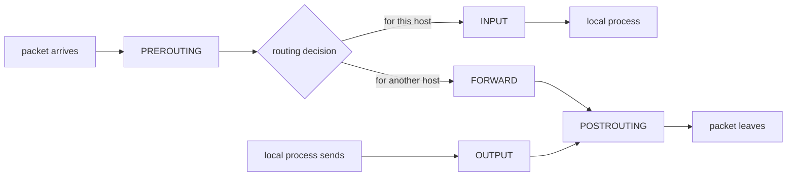
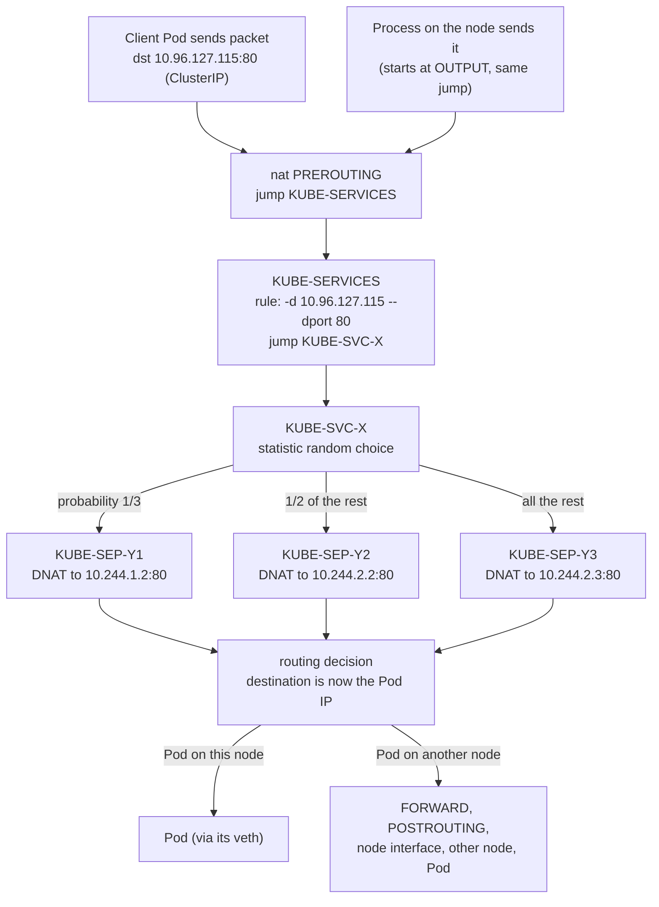

# T1.09 Packet filtering: iptables and nftables basics

> Competency: n/a, foundation topic | Domain/weight: n/a (foundation; supports both exams) | Est. time: 3 h | Prerequisites: T1.07

Shell setup used in this lesson (defined once, see the conventions file):

```bash
alias k=kubectl
export do="--dry-run=client -o yaml"
export now="--force --grace-period=0"
source <(kubectl completion bash); complete -o default -F __start_kubectl k
```

Prerequisite: [T1.07 Linux networking I: interfaces, IPs, routes, bridges, veth](../part1-linux/T1.07-linux-networking-i-interfaces-ips-routes.md) (interfaces, addresses, routes, `ip route get`, veth pairs, `ip_forward`). This lesson does not re-teach them.

How outputs are labelled in this lesson:

- `REAL OUTPUT (Docker)` was captured in a privileged `ubuntu:24.04` Docker container (iptables v1.8.10 `(nf_tables)`, nftables v1.0.9). It is plain Linux, so the shape is the same on an Ubuntu VM. It is not a VM result and not a kind result. The container's own addresses (`192.168.x.x`) always differ on your machine.
- `REAL OUTPUT (kind v0.33.0, v1.37.0)` was captured on a real kind cluster: 1 control plane + 2 workers, node image `kindest/node:v1.37.0` (Debian 13, iptables v1.8.11 `(nf_tables)`, nftables v1.1.3), the default `kindnet` CNI, Pod CIDR `10.244.0.0/16`, cluster name `k-t109`. The lab cluster in the conventions file uses Calico and `192.168.0.0/16` instead, so your Pod IPs and the random hash parts of chain names (`KUBE-SVC-J7PJPLFS4XE3I5AK`) will differ. The chain *shapes* are the same.
- `EXPECTED OUTPUT (not captured)` was not run. Each one is listed in section 11.

**Getting a shell on a node.** On kubeadm VMs (and in the exam) you use `ssh <node>` then `sudo -i` (see the [exam tips page](https://docs.linuxfoundation.org/tc-docs/certification/tips-cka-and-ckad)). On kind a node is a Docker container, so use `docker exec -it lab-worker bash`. Every `iptables`, `nft` and `conntrack` command in this lesson runs **as root on a node**, not on your laptop and not inside a Pod. On kind you can also run a single command without opening a shell: `docker exec lab-worker iptables -t nat -S`.

---

## 1. Why this matters

A Kubernetes Service is not a process. Nothing "listens" on a ClusterIP. On every node, **kube-proxy** writes packet-filtering rules (iptables or nftables) into the Linux kernel, and those rules rewrite the destination address of a packet from the Service IP to a Pod IP. Host firewalls (ufw, firewalld) and many NetworkPolicy implementations use the same kernel layer.

In real life, "the Service has endpoints but the connection times out" is almost always one of: the rules are missing (kube-proxy is down or in a different mode than you think), you are looking at the wrong rule backend and see nothing, or a host firewall drops the traffic. If you cannot read the rules you can only guess. If you can, you trace one Service from ClusterIP to Pod IP with three `grep` commands and see where it stops. In the exam you can use `ssh <node>` and then `sudo -i` on the nodes (see section 8), so reading these rules is the fastest way to prove whether kube-proxy did its job.

---

## 2. Concepts

### 2.1 Netfilter and the five hooks

**Netfilter** is the packet-filtering framework inside the Linux kernel. It has five **hooks**: fixed places on a packet's path where the kernel stops and asks "does any rule want to act on this packet?". **iptables** and **nftables** are not firewalls themselves. They are user-space tools that load rules into netfilter. The kernel does the work; the tools only write and show rules.

| Hook | The packet is here when... | Typical use |
|---|---|---|
| `PREROUTING` | it has just arrived on an interface, before the kernel decides where it goes | DNAT (rewrite destination): Services, port redirects |
| `INPUT` | routing decided the packet is for a process on this host | allow/drop traffic to the host itself (ssh, kubelet port 10250) |
| `FORWARD` | routing decided the packet is for somewhere else and this host must pass it on | filter routed traffic; on a node this is most Pod-to-Pod and Pod-to-Service traffic |
| `OUTPUT` | a process on this host created the packet | DNAT for the node's own traffic (a node calling a ClusterIP); filter outgoing |
| `POSTROUTING` | it is about to leave an interface, after routing | SNAT / MASQUERADE (rewrite source) |

A packet takes one of three paths:



1. To a local process: `PREROUTING` -> `INPUT` -> process.
2. Through the host (routing): `PREROUTING` -> `FORWARD` -> `POSTROUTING`.
3. From a local process: `OUTPUT` -> `POSTROUTING`.

Why this matters for Kubernetes: a packet from a Pod to a ClusterIP **enters the node** through the Pod's veth interface, so it hits `PREROUTING`. A packet from a process on the node (for example `curl` run by you on the node) never passes `PREROUTING`; it starts at `OUTPUT`. kube-proxy therefore installs its Service rules in **both** chains.

**Under the hood: the routing decision comes between PREROUTING and the rest.** DNAT in `PREROUTING` changes the destination *before* routing. After kube-proxy rewrites `10.96.127.115` to a Pod IP, the kernel routes the packet to the Pod IP, as if the client had sent it there. That is why Service traffic to a Pod on another node shows up in `FORWARD`, not `INPUT`. It also means that a filter rule that matches "the Service port" on `INPUT` or `FORWARD` never sees the Service IP, because the address was already rewritten. Section 6 shows this with a real example.

### 2.2 iptables: tables, chains, rules, targets

iptables organises rules in three levels:

- A **table** groups rules by purpose.
- A **chain** is an ordered list of rules inside a table. **Built-in chains** are attached to a hook (a chain called `INPUT` in table `filter` runs at the INPUT hook). **User-defined chains** are not attached to anything; they only run when another rule **jumps** to them with `-j <chain-name>`. All `KUBE-*` chains are user-defined.
- A **rule** is "if the packet matches these conditions, do this target".

| Table | Purpose | Built-in chains |
|---|---|---|
| `filter` (default if you omit `-t`) | allow or block packets | `INPUT`, `FORWARD`, `OUTPUT` |
| `nat` | rewrite addresses/ports | `PREROUTING`, `INPUT`, `OUTPUT`, `POSTROUTING` |
| `mangle` | change packet fields or set marks | all five |
| `raw` | exempt packets from connection tracking (awareness only) | `PREROUTING`, `OUTPUT` |

A **target** is what happens on a match. You write it with `-j` ("jump").

| Target | Table | What it does |
|---|---|---|
| `ACCEPT` | any | stop evaluating this chain's table at this hook and let the packet continue |
| `DROP` | filter | discard silently. The sender sees a **timeout** |
| `REJECT` | filter | discard and send an error back (`--reject-with tcp-reset` or an ICMP unreachable). The sender sees an immediate **refused** |
| `DNAT` | nat (`PREROUTING`, `OUTPUT`) | rewrite the **destination** address/port (`--to-destination ip:port`) |
| `SNAT` | nat (`POSTROUTING`) | rewrite the **source** to a fixed address (`--to-source ip`) |
| `MASQUERADE` | nat (`POSTROUTING`) | like SNAT but uses the outgoing interface's current address. Used when that address can change |
| `REDIRECT` | nat | DNAT to the local host (`--to-ports 80`) |
| `RETURN` | any | leave this user-defined chain and continue after the rule that jumped here |
| `MARK` | mangle/nat | put a number (a **mark**) on the packet for later rules to test. kube-proxy uses `0x4000` to mean "masquerade this one" |
| a chain name | any | **jump** to that user-defined chain, then come back if it ends without a final verdict |

Important rules of evaluation:

- Rules in a chain are tested **top to bottom**. The first rule whose conditions match and whose target is *final* (`ACCEPT`, `DROP`, `REJECT`, `DNAT`, `SNAT`, `MASQUERADE`) decides the packet. Later rules are never reached.
- If no rule decides, a built-in chain applies its **policy** (`ACCEPT` by default, can be set to `DROP`). User-defined chains have no policy; they return to the caller.
- **The `nat` table only sees the first packet of a connection.** The result is stored in the connection-tracking table (section 2.5) and every later packet of that connection is translated automatically. Consequence: changing a NAT rule does not affect connections that already exist.
- Rules live only in kernel memory. A reboot erases manual rules. kube-proxy re-creates its own rules when it starts. Making your own rules permanent (for example the `iptables-persistent` package on Ubuntu) is outside this lesson.

**Runnable examples: `mangle`, `raw` and `SNAT`.** The tables you will meet most are `filter` and `nat`, but each table in the list above has a job you can watch. All three examples below run on one Ubuntu machine as root with nginx on port 80 and `curl` against `127.0.0.1`, so no second machine is needed. Each one adds a rule, sends one request, shows a counter or table entry that proves the rule acted, and deletes the rule again.

*`mangle`: put a mark on a packet.* `MARK` stores a number on the packet inside the kernel (not on the wire). A later rule can test it with `-m mark --mark`. kube-proxy uses exactly this with mark `0x4000`. Here the second rule only counts packets that carry the mark the first rule set, so its counter proves the mark was set. REAL OUTPUT (Docker, ubuntu:24.04, iptables v1.8.10 nf_tables):

```text
$ iptables -t mangle -A OUTPUT -p tcp --dport 80 -j MARK --set-mark 1
$ iptables -t mangle -A OUTPUT -m mark --mark 1 -j ACCEPT
$ curl -s -o /dev/null -w '%{http_code}\n' http://127.0.0.1:80/
200
$ iptables -t mangle -S OUTPUT
-P OUTPUT ACCEPT
-A OUTPUT -p tcp -m tcp --dport 80 -j MARK --set-xmark 0x1/0xffffffff
-A OUTPUT -m mark --mark 0x1 -j ACCEPT
$ iptables -t mangle -L OUTPUT -n -v
Chain OUTPUT (policy ACCEPT 4 packets, 1078 bytes)
 pkts bytes target     prot opt in     out     source               destination         
    6   392 MARK       6    --  *      *       0.0.0.0/0            0.0.0.0/0            tcp dpt:80 MARK set 0x1
    6   392 ACCEPT     0    --  *      *       0.0.0.0/0            0.0.0.0/0            mark match 0x1
$ iptables -t mangle -D OUTPUT -p tcp --dport 80 -j MARK --set-mark 1
$ iptables -t mangle -D OUTPUT -m mark --mark 1 -j ACCEPT
```

Read it: `-S` prints `--set-mark 1` as `--set-xmark 0x1/0xffffffff` (value/mask). Both counters show 6 packets, so every packet the first rule marked was matched by the second. If the mark were not set, the second counter would stay at `0`. A `MARK` rule never decides the packet; it only labels it, so evaluation continues with the next rule.

*`raw`: switch connection tracking off for a flow.* Packets that match `-j CT --notrack` in `raw` get no conntrack entry. This is used on busy hosts for traffic that never needs NAT or state. It runs before conntrack, which is why `raw` has only `PREROUTING` and `OUTPUT`. The rule uses `-m multiport --ports 80` so that both directions (destination port 80 for the request, source port 80 for the answer) are skipped. With only `--dport 80` the answers were still tracked and an entry appeared. On the test machine no entry was recorded at all until some rule used conntrack, so the first command adds a harmless stateful rule to turn tracking on. REAL OUTPUT (Docker, same image):

```text
$ iptables -A INPUT -m conntrack --ctstate ESTABLISHED,RELATED -j ACCEPT
$ curl -s -o /dev/null -w '%{http_code}\n' http://127.0.0.1:80/
200
$ conntrack -C                  # -C = count tracked flows
1
$ iptables -t raw -A OUTPUT -p tcp -m multiport --ports 80 -j CT --notrack
$ iptables -t raw -A PREROUTING -p tcp -m multiport --ports 80 -j CT --notrack
$ conntrack -F                  # -F = flush the table, so we start from 0
conntrack v1.4.8 (conntrack-tools): connection tracking table has been emptied.
$ curl -s -o /dev/null -w '%{http_code}\n' http://127.0.0.1:80/
200
$ conntrack -C
0
$ iptables -t raw -L OUTPUT -n -v
Chain OUTPUT (policy ACCEPT 10 packets, 1470 bytes)
 pkts bytes target     prot opt in     out     source               destination         
   10  1470 CT         6    --  *      *       0.0.0.0/0            0.0.0.0/0            multiport ports 80 CT notrack
$ iptables -t raw -F; iptables -D INPUT -m conntrack --ctstate ESTABLISHED,RELATED -j ACCEPT
```

Read it: before the `raw` rules one request left one tracked flow (`1`); after them the same request left none (`0`), while the request still returned `200` (the packet is filtered, only the tracking is skipped). The counter on the `raw` rule shows it matched. Do not put `NOTRACK` on Service traffic on a node: DNAT needs conntrack to translate the replies (section 2.5).

*`SNAT`: rewrite the source to a fixed address.* `SNAT` belongs in `nat` `POSTROUTING` (section 2.1). On one machine you can watch it by rewriting the source of the loopback request from `127.0.0.1` to `127.0.0.2`. The observation is the conntrack reply tuple: its destination is the rewritten address. REAL OUTPUT (Docker, same image):

```text
$ iptables -t nat -A POSTROUTING -d 127.0.0.1 -p tcp --dport 80 -j SNAT --to-source 127.0.0.2
$ curl -s -o /dev/null -w '%{http_code}\n' http://127.0.0.1:80/
200
$ iptables -t nat -L POSTROUTING -n -v
Chain POSTROUTING (policy ACCEPT 0 packets, 0 bytes)
 pkts bytes target     prot opt in     out     source               destination         
    1    60 SNAT       6    --  *      *       0.0.0.0/0            127.0.0.1            tcp dpt:80 to:127.0.0.2
$ conntrack -L -p tcp --dport 80
tcp      6 119 TIME_WAIT src=127.0.0.1 dst=127.0.0.1 sport=56160 dport=80 src=127.0.0.1 dst=127.0.0.2 sport=80 dport=56160 [ASSURED] mark=0 use=1
$ iptables -t nat -D POSTROUTING -d 127.0.0.1 -p tcp --dport 80 -j SNAT --to-source 127.0.0.2
```

Read it: the `SNAT` counter is `1 packet, 60 bytes`, only the first packet (the SYN) hit the rule, because the `nat` table decides once per connection (section 2.2). In the conntrack line the original direction is `src=127.0.0.1 dst=127.0.0.1`, but the reply direction is `src=127.0.0.1 dst=127.0.0.2`: the server answers to `127.0.0.2`, which is the rewritten source. That is what SNAT means. `MASQUERADE` does the same job but picks the address of the outgoing interface at that moment, so use `SNAT` only when the address is fixed. (Outputs from the Docker container; the Pod-level use of SNAT/MASQUERADE is `KUBE-POSTROUTING`, section 2.9.)

### 2.3 Reading rules: `-L`, `-S`, `iptables-save`

Three commands show the same rules in different formats:

| Command | Format | Use it for |
|---|---|---|
| `iptables -t nat -L <CHAIN> -n -v --line-numbers` | human table | quick look; shows **packet and byte counters** and rule numbers |
| `iptables -t nat -S [CHAIN]` | commands (`-A ...`) | copy a rule, see exact flags; add `-D` instead of `-A` to delete it |
| `iptables-save [-t nat]` | commands, all chains, plus counters header | `grep` across everything; the best for kube-proxy |

Flags for `-L`:

- `-n` numeric. Without it iptables tries reverse DNS on every address and can hang for a long time. Always use it.
- `-v` verbose: shows `pkts`, `bytes`, `in`, `out` interfaces. Counters tell you if a rule is being hit.
- `--line-numbers` prefixes each rule with its position (needed for `-I` and `-D <number>`).
- `-t <table>`: omit it and you see only the `filter` table. The classic beginner mistake is looking for Service rules in `filter`. They are in `nat`.

REAL OUTPUT (Docker): two rules in the `nat` table, listed with `-L`, then with `-S`:

```text
$ iptables -t nat -L -n -v --line-numbers
Chain PREROUTING (policy ACCEPT 0 packets, 0 bytes)
num   pkts bytes target     prot opt in     out     source               destination         
1        0     0 REDIRECT   6    --  *      *       0.0.0.0/0            0.0.0.0/0            tcp dpt:8080 redir ports 80

Chain INPUT (policy ACCEPT 0 packets, 0 bytes)
num   pkts bytes target     prot opt in     out     source               destination         

Chain OUTPUT (policy ACCEPT 0 packets, 0 bytes)
num   pkts bytes target     prot opt in     out     source               destination         
1        1    60 DNAT       6    --  *      *       0.0.0.0/0            0.0.0.0/0            tcp dpt:8080 to:127.0.0.1:80

Chain POSTROUTING (policy ACCEPT 0 packets, 0 bytes)
num   pkts bytes target     prot opt in     out     source               destination         

$ iptables -t nat -S
-P PREROUTING ACCEPT
-P INPUT ACCEPT
-P OUTPUT ACCEPT
-P POSTROUTING ACCEPT
-A PREROUTING -p tcp -m tcp --dport 8080 -j REDIRECT --to-ports 80
-A OUTPUT -p tcp -m tcp --dport 8080 -j DNAT --to-destination 127.0.0.1:80
```

How to read it: `prot 6` is TCP (protocol number). `pkts 1 bytes 60` on the OUTPUT rule means one packet matched (a TCP SYN is 60 bytes). `-P` lines in `-S` are chain policies. In `-S` every match module (`-m tcp`) is spelled out. `iptables-save` prints the same `-A` lines, grouped by table (`*nat` ... `COMMIT`) and with a `:CHAIN POLICY [packets:bytes]` header line for each chain, which is why `iptables-save | grep KUBE-SVC` finds both chain declarations and rules.

### 2.4 Adding and deleting rules, and why order matters

| Flag | Meaning |
|---|---|
| `-A <chain> <rule>` | **A**ppend to the end of the chain |
| `-I <chain> [num] <rule>` | **I**nsert at position `num` (default 1, the top) |
| `-D <chain> <rule>` | **D**elete the rule that matches this exact specification |
| `-D <chain> <num>` | delete the rule at this position |
| `-C <chain> <rule>` | **C**heck whether the rule exists (exit code 0 yes, 1 no); good for verification |
| `-F [chain]` | **F**lush (delete all rules). Dangerous on a node: it wipes kube-proxy's rules until the next sync |
| `-P <chain> <target>` | set the **P**olicy of a built-in chain |
| `-N` / `-X` | create / delete a user-defined chain |

A rule is: `iptables [-t table] <operation> <chain> <matches> -j <target>`. Common matches: `-p tcp` (protocol), `-s` / `-d` (source/destination address or CIDR; `!` negates), `--dport` / `--sport` (needs `-p tcp` or `-p udp`), `-i` / `-o` (interface), and modules loaded with `-m` such as `-m conntrack --ctstate`, `-m comment --comment "..."`, `-m statistic --mode random --probability 0.5`, `-m mark --mark`.

**Order matters.** REAL OUTPUT (Docker): an nginx listens on port 80. A `DROP` for port 80 is appended first, an `ACCEPT` second:

```text
$ iptables -A INPUT -p tcp --dport 80 -j DROP
$ iptables -A INPUT -p tcp --dport 80 -j ACCEPT
$ curl -s -m 2 -o /dev/null -w '%{http_code}\n' http://<own-ip>/   # -m 2 = give up after 2 s
000                      # 000 = no HTTP answer; curl exit code 28 = timeout
$ iptables -L INPUT -n -v --line-numbers
Chain INPUT (policy ACCEPT 0 packets, 0 bytes)
num   pkts bytes target     prot opt in     out     source               destination         
1        2   120 DROP       6    --  *      *       0.0.0.0/0            0.0.0.0/0            tcp dpt:80
2        0     0 ACCEPT     6    --  *      *       0.0.0.0/0            0.0.0.0/0            tcp dpt:80
```

The `DROP` has counted 2 packets (the SYN and one retry); the `ACCEPT` below it counted 0. It is never reached. Inserting the accept at the top fixes it:

```text
$ iptables -I INPUT 1 -p tcp --dport 80 -j ACCEPT
$ curl -s -m 2 -o /dev/null -w '%{http_code}\n' http://<own-ip>/
200
```

`DROP` vs `REJECT` (REAL OUTPUT (Docker)): with `-j REJECT --reject-with tcp-reset` curl fails at once with exit code 7 (connection refused) instead of waiting for the 2 s timeout (exit code 28). In troubleshooting, **timeout means something dropped the packet or it never arrived; refused means something answered with a reset**. (A refused can also come from a Pod with nothing listening on the port, so use the counters to tell them apart.)

**Delete by specification, not by number, on a machine you do not own.** `-D INPUT 1` removes whatever is first right now. REAL EXAMPLE (Docker): in a container attached to a user-defined Docker network, `iptables -t nat -D OUTPUT 1` did not remove the DNAT rule that had been added. Docker had put its own DNS rule at position 1, so the command deleted Docker's rule and the added rule stayed. Run `-L --line-numbers` immediately before a numeric delete, or use the full specification (`-D OUTPUT -p tcp --dport 8080 -j DNAT --to-destination ...`), which can only match the rule you mean.

### 2.5 Connection tracking (conntrack) and stateful matching

A packet filter that looks at one packet at a time cannot know if a packet is the start of a new connection or the answer to one. **Connection tracking (conntrack)** is the kernel feature that remembers every flow in a table. Each flow entry stores two tuples: the **original** direction (source, destination, ports) and the **reply** direction. NAT works by editing the reply tuple, so the kernel can undo the rewrite on the answer packets without any extra rule.

Conntrack gives each packet a **state**, and rules can test it with `-m conntrack --ctstate`:

| State | Meaning |
|---|---|
| `NEW` | first packet of a flow |
| `ESTABLISHED` | part of a flow that has seen traffic in both directions |
| `RELATED` | a new flow that belongs to an existing one (for example an ICMP error) |
| `INVALID` | does not fit any flow |

The standard stateful firewall is "accept `ESTABLISHED,RELATED`, then accept `NEW` only for the ports I allow". kube-proxy uses the same idea in its `filter` chains: the capture in section 6 shows a rule `KUBE-PROXY-FIREWALL ... ctstate NEW` at the top of `FORWARD`, and section 2.9 describes `KUBE-FORWARD` accepting `RELATED,ESTABLISHED` traffic.

REAL OUTPUT (Docker): the stateful rules and how the same rules look in nftables:

```text
$ iptables -A INPUT -m conntrack --ctstate ESTABLISHED,RELATED -j ACCEPT
$ iptables -A INPUT -p tcp --dport 80 -m conntrack --ctstate NEW -j ACCEPT
$ iptables -S INPUT
-P INPUT ACCEPT
-A INPUT -m conntrack --ctstate RELATED,ESTABLISHED -j ACCEPT
-A INPUT -p tcp -m tcp --dport 80 -m conntrack --ctstate NEW -j ACCEPT
```

`conntrack -L` lists the tracked flows (package `conntrack`; awareness level, you do not need to master it). REAL OUTPUT (kind v0.33.0, v1.37.0), a Pod `10.244.2.4` called the Service `10.96.127.115:80` and was sent to Pod `10.244.2.2`:

```text
$ conntrack -L -d 10.96.127.115
tcp  6 119 TIME_WAIT src=10.244.2.4 dst=10.96.127.115 sport=43326 dport=80 src=10.244.2.2 dst=10.244.2.4 sport=80 dport=43326 [ASSURED] mark=0 use=1
```

Read it in two halves. The first `src=... dst=...` is the **original** direction: client Pod -> Service IP. The second `src=... dst=...` is the **reply** direction: Pod `10.244.2.2` -> client. The reply's source is the Pod, not the Service IP, which proves the destination was rewritten (DNAT) and shows the kernel will rewrite it back. `-d` filters by original destination. `conntrack -L` ends with a count line ("N flow entries have been shown"). Entries linger in `TIME_WAIT` for about two minutes after a connection closes (the `119` is the seconds left).

### 2.6 The nftables model

**nftables** is the successor to iptables. It uses the same netfilter hooks but a new kernel API and one tool, `nft`. Differences that matter:

| | iptables | nftables |
|---|---|---|
| Tables | fixed: `filter`, `nat`, `mangle`, `raw` | **you create them**, and give each an address **family** (`ip`, `ip6`, `inet` = both, `arp`, `bridge`) |
| Chains | built-in chains exist already | **base chains** are created by you with `type`, `hook` and `priority`; **regular chains** (no hook) are jump targets |
| Rules | one match per `-m` module | expressions: `ip daddr 10.0.0.1 tcp dport 80 counter dnat to ...` |
| Many addresses | one rule each (slow, O(n)) | **sets** and **maps** (hash lookups). A **verdict map** (`vmap`) maps a key straight to a `goto`/`jump`, one rule for thousands of Services |
| Updates | one rule at a time or `iptables-restore` | whole rule sets are loaded **atomically** in one transaction |
| Counters | always on | only where you write `counter` |

Essential commands:

```bash
nft list ruleset                       # everything: all tables, chains, sets
nft list tables                        # table names only
nft list table ip kube-proxy           # one table (family + name)
nft list chain ip kube-proxy services  # one chain
nft -a list chain ip demo out          # -a shows each rule's handle number
nft delete rule ip demo out handle 2   # delete by handle (stable, unlike a position)
nft add table ip demo                  # create your own table
```

REAL OUTPUT (Docker): build a tiny NAT setup by hand. The chain declaration is the important part: `type nat hook output priority -100` attaches the chain to the OUTPUT hook at the "dstnat" priority (`-100`), which is where iptables' `nat` table sits.

```text
$ nft add table ip demo
$ nft 'add chain ip demo out { type nat hook output priority -100; policy accept; }'
$ nft add rule ip demo out tcp dport 8081 counter dnat to 127.0.0.1:80
$ nft list table ip demo
table ip demo {
	chain out {
		type nat hook output priority dstnat; policy accept;
		tcp dport 8081 counter packets 0 bytes 0 dnat to 127.0.0.1:80
	}
}
$ curl -s -m 2 -o /dev/null -w '%{http_code}\n' http://127.0.0.1:8081/
200
$ nft -a list chain ip demo out
table ip demo {
	chain out { # handle 1
		type nat hook output priority dstnat; policy accept;
		tcp dport 8081 counter packets 1 bytes 60 dnat to 127.0.0.1:80 # handle 2
	}
}
$ nft delete rule ip demo out handle 2
```

Note that `nft` prints `priority dstnat` for `-100`: the names `raw`, `mangle`, `dstnat`, `filter`, `srcnat` are aliases for fixed priority numbers. The number decides the order when several chains hang on the same hook. (The shell quotes around `{ ... }` and `;` are needed because bash treats `;` as the end of a command.) `nft list ruleset` on an empty machine prints nothing, which is not an error.

An empty `nft list ruleset` does not prove the machine has no packet filtering: rules written with iptables-legacy are invisible to `nft` (next section).

### 2.7 iptables-nft vs iptables-legacy, and the mixed-backend problem

On a modern distribution there are **three** things called iptables:

| Binary | What it does |
|---|---|
| `iptables-legacy` | the old implementation. Talks to the old kernel interface (`xtables`). Its rules are **invisible to `nft`** |
| `iptables-nft` | the new `iptables` command syntax, but it stores rules in **nftables** (tables `ip filter`, `ip nat`, ...). `nft list ruleset` shows them |
| `iptables` | a symlink managed by `update-alternatives` that points at one of the two |

`iptables --version` tells you which backend the `iptables` command uses: `(nf_tables)` or `(legacy)`. REAL OUTPUT (Docker):

```text
$ iptables --version
iptables v1.8.10 (nf_tables)
$ update-alternatives --display iptables | head -4
iptables - auto mode
  link best version is /usr/sbin/iptables-nft
  link currently points to /usr/sbin/iptables-nft
  link iptables is /usr/sbin/iptables
```

The **mixed-backend problem**: the two backends have separate rule storage but both feed the same kernel hooks. If one program writes rules with the legacy backend and you inspect with the nft backend (or the other way round), you see an empty or partial picture, and the traffic is still being filtered by rules you cannot see. REAL OUTPUT (Docker): write a DNAT rule with `iptables-legacy`, then look with plain `iptables` and `nft`:

```text
$ iptables-legacy -t nat -A OUTPUT -p tcp --dport 8080 -j DNAT --to-destination 127.0.0.1:80
$ iptables -t nat -S OUTPUT                  # the nf_tables backend
# Warning: iptables-legacy tables present, use iptables-legacy to see them
-P OUTPUT ACCEPT
$ nft list ruleset                           # prints nothing at all
$ iptables-legacy -t nat -S OUTPUT           # the backend that wrote it
-P OUTPUT ACCEPT
-A OUTPUT -p tcp -m tcp --dport 8080 -j DNAT --to-destination 127.0.0.1:80
$ curl -s -m 2 -o /dev/null -w '%{http_code}\n' http://127.0.0.1:8080/
200                                          # the hidden rule still works
```

Newer iptables prints the `# Warning: iptables-legacy tables present` line to help you. Do not rely on it. Check the backend yourself. To switch the default (needs root):

```bash
update-alternatives --set iptables /usr/sbin/iptables-legacy   # or iptables-nft
update-alternatives --set ip6tables /usr/sbin/ip6tables-legacy # the IPv6 twin is a separate alternative
```

The reverse also holds: rules written by `iptables-nft` **do** show up in `nft list ruleset`, with a warning that another tool owns them. REAL OUTPUT (Docker):

```text
$ nft list table ip filter
# Warning: table ip filter is managed by iptables-nft, do not touch!
table ip filter {
	chain INPUT {
		type filter hook input priority filter; policy accept;
		ct state related,established counter packets 9 bytes 1414 accept
		tcp dport 80 ct state new counter packets 1 bytes 60 accept
	}
}
```

`iptables-translate` prints the nft command equivalent of an iptables command without running it (REAL OUTPUT (Docker)):

```text
$ iptables-translate -t nat -A OUTPUT -p tcp --dport 8080 -j DNAT --to-destination 127.0.0.1:80
nft 'add rule ip nat OUTPUT tcp dport 8080 counter dnat to 127.0.0.1:80'
```

Rule of thumb for a troubleshooting session: run `iptables --version` first, then look with the matching tool. If `iptables -t nat -S` looks empty but Services work, try `iptables-legacy -t nat -S` **and** `nft list ruleset`. REAL OUTPUT (kind v0.33.0, v1.37.0): on the kind node the backend is nf_tables and kube-proxy's rules are there, so the legacy view is empty:

```text
$ iptables --version
iptables v1.8.11 (nf_tables)
$ iptables-legacy -t nat -S | head -5
-P PREROUTING ACCEPT
-P INPUT ACCEPT
-P OUTPUT ACCEPT
-P POSTROUTING ACCEPT
$ nft list ruleset | grep -c KUBE-SVC
12
```

### 2.8 kube-proxy and its modes

**kube-proxy** is a controller that runs on every node (a DaemonSet in `kube-system` on kubeadm and on kind). It watches Services and EndpointSlices through the API server and keeps a set of kernel rules up to date. **It is not in the data path.** No packet is handed to the kube-proxy process; the kernel does the DNAT. If kube-proxy dies, the old rules keep working (you will see this in the break-fix lab), but nothing is updated: new Services get no rules and deleted Services keep theirs.

| Mode | Value of `mode` | Status in v1.37 | How it picks a backend | Needs |
|---|---|---|---|---|
| iptables | `iptables` | **default in 1.37** | random, using `-m statistic --mode random --probability` | any Linux with iptables |
| nftables | `nftables` | GA since v1.33; recommended, **not the default** | random, using an nft `numgen random mod N` map | kernel 5.13 or newer |
| ipvs | `ipvs` | **deprecated since v1.35**; v1.37 logs a deprecation warning at start | kernel IPVS load balancer with several schedulers (`rr`, `wrr`, ...) | IPVS kernel modules; still uses iptables underneath |
| kernelspace | `kernelspace` | Windows only | Windows kernel rules | Windows nodes |

Sources: [Virtual IPs and Service Proxies](https://kubernetes.io/docs/reference/networking/virtual-ips/) ("In Kubernetes 1.37, this is iptables, but a future version of Kubernetes will change the default to nftables"; nftables "requires kernel 5.13 or later"), the [NFTables mode for kube-proxy](https://kubernetes.io/blog/2025/02/28/nftables-kube-proxy/) blog (nftables is "the best kube-proxy mode" but "it is not the default"), the [Kubernetes v1.35 release blog](https://kubernetes.io/blog/2025/12/17/kubernetes-v1-35-release/) ("Kubernetes v1.35 deprecates ipvs mode") and the [Kubernetes v1.37 release blog](https://kubernetes.io/blog/2026/08/26/kubernetes-v1-37-release/).

**Current deprecation status of ipvs (as of v1.37).** Deprecated since v1.35 because the kernel IPVS API alone cannot implement everything a Kubernetes Service needs, so ipvs mode still uses iptables underneath and the maintenance cost is high. In v1.37 a cluster that runs `mode: ipvs` logs a deprecation warning on startup. The v1.37 release blog gives the timeline: by **v1.40** ipvs mode is expected to be disabled by default (still selectable through a feature gate), and by **v1.43** support is expected to be removed entirely. The docs recommend nftables as the replacement. Plan: never choose ipvs for a new cluster. In the exam, treat `iptables` as the mode you will meet.

**Always set the mode explicitly.** The Services documentation warns that the default will change in a future version and tells you to write the mode into the kube-proxy configuration, so an upgrade does not change the backend by surprise. When `mode` is empty (`""`) kube-proxy uses the built-in default. The kube-proxy `--help` of the v1.37.0 image says: "`--proxy-mode`: on Linux this can be `iptables` (default), `ipvs`, or `nftables`", and "this parameter is ignored if a config file is specified by `--config`" (kubeadm and kind both pass `--config`).

**Checking the mode.** The configuration is a file `config.conf` stored in the ConfigMap `kube-proxy` (key `config.conf`) and mounted into the Pods. Three checks:

```bash
# 1. the ConfigMap (the exact command from the entry; works from anywhere with kubectl)
k -n kube-system get cm kube-proxy -o jsonpath='{.data.config\.conf}' | grep mode
k -n kube-system get cm kube-proxy -o yaml | grep mode
# 2. the running Pod's log (what it actually did)
k -n kube-system logs ds/kube-proxy | grep Proxier
# 3. on the node: kube-proxy's own HTTP endpoint (bound to localhost on port 10249)
curl -s localhost:10249/proxyMode
```

REAL OUTPUT (kind v0.33.0, v1.37.0):

```text
$ k -n kube-system get cm kube-proxy -o jsonpath='{.data.config\.conf}' | grep mode
mode: iptables
$ k -n kube-system get cm kube-proxy -o yaml | grep mode
    mode: iptables
$ k -n kube-system logs ds/kube-proxy | grep Proxier
Found 3 pods, using pod/kube-proxy-gtdtq
I1027 07:51:30.784748       1 server_linux.go:144] "Using iptables Proxier"
$ curl -s localhost:10249/proxyMode       # run on a node
iptables
```

Two details. In `jsonpath`, the key `config.conf` contains a dot, so you must escape it as `config\.conf`. The `grep mode` also matches other lines containing "mode" (for example `detectLocalMode` in the full config), so if more than one line comes back, look for the one that starts with `mode:`. **kind writes `mode: iptables` explicitly, so on kind the answer is verified. On a kubeadm cluster the ConfigMap may show `mode: ""`, which means "built-in default", which the v1.37 documentation says is iptables. The kubeadm value was not verified on a real kubeadm v1.37 cluster (section 11). The labs in section 7 work with both forms (`mode: iptables` and `mode: ""`).**

**Under the hood: changing the mode.** The blog above states that you can convert a cluster by editing the kube-proxy configuration and restarting the kube-proxy Pods; no node reboot is needed, because "when restarting in nftables mode, kube-proxy will delete any existing iptables or ipvs rules" (and the reverse). You will do this in the medium lab. The `mode` value is validated at startup: an unknown value makes kube-proxy exit (section 6).

**Related but different: NodePort addresses.** In iptables and ipvs mode `nodePortAddresses` unset means "NodePorts answer on all local IPs"; in nftables mode unset means "only the node's primary IP". The v1.37 `--help` says so. The `nodeport-ips` set that implements this was not printed in our capture (section 11); on an nftables-mode node you can look at it with `nft list set ip kube-proxy nodeport-ips`. v1.37 also adds an opt-in userspace proxy so that `localhost:<NodePort>` works in nftables mode (see the v1.37 release blog).

### 2.9 Reading kube-proxy's chains in iptables mode

kube-proxy builds a tree of user-defined chains. The names are fixed prefixes plus a 16-character hash of the Service (or endpoint) identity. You never compute the hash; you **find it** by following the jump from the parent chain.

| Chain (table) | What it is | Who jumps to it |
|---|---|---|
| `KUBE-SERVICES` (nat) | one rule per Service IP:port. The entry point. Last rule jumps to `KUBE-NODEPORTS` | `PREROUTING` and `OUTPUT` |
| `KUBE-NODEPORTS` (nat) | one rule per NodePort | last rule of `KUBE-SERVICES` (for local-address destinations) |
| `KUBE-EXT-*` (nat) | "external" entry for one Service: marks the packet for masquerade, then jumps to `KUBE-SVC-*` | `KUBE-NODEPORTS` |
| `KUBE-SVC-*` (nat) | one per Service port. Chooses an endpoint at random | `KUBE-SERVICES`, `KUBE-EXT-*` |
| `KUBE-SEP-*` (nat) | one per endpoint ("Service endpoint"). Does the DNAT to Pod IP:port | `KUBE-SVC-*` |
| `KUBE-MARK-MASQ` (nat) | sets mark `0x4000` on a packet = "masquerade this later" | `KUBE-SVC-*`, `KUBE-SEP-*`, `KUBE-EXT-*` |
| `KUBE-POSTROUTING` (nat) | in `POSTROUTING`: if mark `0x4000` is set, clear it and `MASQUERADE` | `POSTROUTING` |
| `KUBE-FORWARD`, `KUBE-FIREWALL`, `KUBE-PROXY-FIREWALL`, `KUBE-EXTERNAL-SERVICES`, `KUBE-NODEPORTS`, `KUBE-SERVICES` (filter) | small filter chains: accept marked/established forwarded traffic, drop spoofed loopback traffic, and (not captured) reject traffic for Services without endpoints | `INPUT`, `FORWARD`, `OUTPUT` |

`KUBE-KUBELET-CANARY` and `KUBE-PROXY-CANARY` are empty marker chains the kubelet and kube-proxy create so that they can notice when someone flushes the tables. They are noise when you read.

**Where the Service starts.** REAL OUTPUT (kind v0.33.0, v1.37.0): the entry points and the `KUBE-SERVICES` chain (nat) on a worker node, with a Service `web` (ClusterIP `10.96.127.115`, port 80, 3 Pods) in namespace `lab-t109`:

```text
$ iptables -t nat -L PREROUTING -n --line-numbers
Chain PREROUTING (policy ACCEPT)
num  target     prot opt source               destination         
1    KUBE-SERVICES  all  --  0.0.0.0/0            0.0.0.0/0            /* kubernetes service portals */
2    DOCKER_OUTPUT  all  --  0.0.0.0/0            0.250.250.254       
$ iptables -t nat -L OUTPUT -n --line-numbers
Chain OUTPUT (policy ACCEPT)
num  target     prot opt source               destination         
1    KUBE-SERVICES  all  --  0.0.0.0/0            0.0.0.0/0            /* kubernetes service portals */
2    DOCKER_OUTPUT  all  --  0.0.0.0/0            0.250.250.254       

$ iptables -t nat -L KUBE-SERVICES -n -v --line-numbers
Chain KUBE-SERVICES (2 references)
num   pkts bytes target     prot opt in     out     source               destination         
1        0     0 KUBE-SVC-J7PJPLFS4XE3I5AK  tcp  --  *      *       0.0.0.0/0            10.96.127.115        /* lab-t109/web cluster IP */ tcp dpt:80
2        0     0 KUBE-SVC-NPX46M4PTMTKRN6Y  tcp  --  *      *       0.0.0.0/0            10.96.0.1            /* default/kubernetes:https cluster IP */ tcp dpt:443
3        0     0 KUBE-SVC-TCOU7JCQXEZGVUNU  udp  --  *      *       0.0.0.0/0            10.96.0.10           /* kube-system/kube-dns:dns cluster IP */ udp dpt:53
4        0     0 KUBE-SVC-ERIFXISQEP7F7OF4  tcp  --  *      *       0.0.0.0/0            10.96.0.10           /* kube-system/kube-dns:dns-tcp cluster IP */ tcp dpt:53
5        0     0 KUBE-SVC-JD5MR3NA4I4DYORP  tcp  --  *      *       0.0.0.0/0            10.96.0.10           /* kube-system/kube-dns:metrics cluster IP */ tcp dpt:9153
6        0     0 KUBE-NODEPORTS  all  --  *      *       0.0.0.0/0            0.0.0.0/0            /* kubernetes service nodeports; NOTE: this must be the last rule in this chain */ ADDRTYPE match dst-type LOCAL
```

(`DOCKER_OUTPUT` is a kind/Docker artefact, not Kubernetes.) The `/* ... */` text is an `-m comment`. kube-proxy puts `namespace/service` into every comment, which makes `grep lab-t109/web` a quick way to find all rules of one Service. The "(2 references)" says two rules jump here (`PREROUTING` and `OUTPUT`). Rule 6 is the NodePort catch-all: any packet whose destination is a local address of this node goes to `KUBE-NODEPORTS`.

**The Service chain and the endpoint chains.** REAL OUTPUT (kind v0.33.0, v1.37.0):

```text
$ iptables -t nat -L KUBE-SVC-J7PJPLFS4XE3I5AK -n -v --line-numbers
Chain KUBE-SVC-J7PJPLFS4XE3I5AK (1 references)
num   pkts bytes target     prot opt in     out     source               destination         
1        0     0 KUBE-MARK-MASQ  tcp  --  *      *      !10.244.0.0/16        10.96.127.115        /* lab-t109/web cluster IP */ tcp dpt:80
2        0     0 KUBE-SEP-C7DXFBFNTJ6R6IKV  all  --  *      *       0.0.0.0/0            0.0.0.0/0            /* lab-t109/web -> 10.244.1.2:80 */ statistic mode random probability 0.33333333349
3        0     0 KUBE-SEP-LFBGRS23T3VRO5RV  all  --  *      *       0.0.0.0/0            0.0.0.0/0            /* lab-t109/web -> 10.244.2.2:80 */ statistic mode random probability 0.50000000000
4        0     0 KUBE-SEP-SE3CZXT3RQFAWXSG  all  --  *      *       0.0.0.0/0            0.0.0.0/0            /* lab-t109/web -> 10.244.2.3:80 */

$ iptables-save -t nat | grep -- "-A KUBE-SEP-C7DXFBFNTJ6R6IKV"
-A KUBE-SEP-C7DXFBFNTJ6R6IKV -s 10.244.1.2/32 -m comment --comment "lab-t109/web" -j KUBE-MARK-MASQ
-A KUBE-SEP-C7DXFBFNTJ6R6IKV -p tcp -m comment --comment "lab-t109/web" -m tcp -j DNAT --to-destination 10.244.1.2:80
```

Read `KUBE-SVC-*`: rule 1 says "if the source is **not** inside the Pod CIDR (`! -s 10.244.0.0/16`) and the destination is this ClusterIP, mark the packet for masquerade". That covers a client outside the Pod network (for example the node itself): its source address would otherwise be an address the Pod cannot answer correctly. Rules 2 to 4 pick the endpoint. In `KUBE-SEP-*`: rule 1 marks for masquerade when the **source is the endpoint itself** (a Pod calling its own Service, "hairpin"); rule 2 is the **DNAT** to `10.244.1.2:80`. The comment `lab-t109/web -> 10.244.1.2:80` shows the endpoint address, so you can compare with `k get endpointslice` without opening each SEP chain.

**Masquerade at the end.** REAL OUTPUT (kind v0.33.0, v1.37.0):

```text
$ iptables -t nat -S POSTROUTING
-P POSTROUTING ACCEPT
-A POSTROUTING -m comment --comment "kubernetes postrouting rules" -j KUBE-POSTROUTING
-A POSTROUTING -d 0.250.250.254/32 -j DOCKER_POSTROUTING
-A POSTROUTING -m addrtype ! --dst-type LOCAL -m comment --comment "kind-masq-agent: ..." -j KIND-MASQ-AGENT
$ iptables -t nat -S KUBE-POSTROUTING
-N KUBE-POSTROUTING
-A KUBE-POSTROUTING -m mark ! --mark 0x4000/0x4000 -j RETURN
-A KUBE-POSTROUTING -j MARK --set-xmark 0x4000/0x0
-A KUBE-POSTROUTING -m comment --comment "kubernetes service traffic requiring SNAT" -j MASQUERADE --random-fully
$ iptables -t nat -S KUBE-MARK-MASQ
-N KUBE-MARK-MASQ
-A KUBE-MARK-MASQ -j MARK --set-xmark 0x4000/0x4000
```

`KUBE-MARK-MASQ` sets bit `0x4000`; `KUBE-POSTROUTING` returns early if the bit is not set, otherwise clears it and masquerades. Normal Pod-to-Service traffic (source inside the Pod CIDR) is never marked, so Pods keep their own IP and the server sees the real client Pod IP.

**NodePort chains.** REAL OUTPUT (kind v0.33.0, v1.37.0), after creating a NodePort Service `web-np` (port `30829`):

```text
$ iptables -t nat -L KUBE-NODEPORTS -n
Chain KUBE-NODEPORTS (1 references)
target     prot opt source               destination         
KUBE-EXT-SOEY6CEFL5WYOPPI  tcp  --  0.0.0.0/0            127.0.0.0/8          /* lab-t109/web-np */ tcp dpt:30829 nfacct-name  localhost_nps_accepted_pkts
KUBE-EXT-SOEY6CEFL5WYOPPI  tcp  --  0.0.0.0/0            0.0.0.0/0            /* lab-t109/web-np */ tcp dpt:30829
$ iptables -t nat -S KUBE-EXT-SOEY6CEFL5WYOPPI
-N KUBE-EXT-SOEY6CEFL5WYOPPI
-A KUBE-EXT-SOEY6CEFL5WYOPPI -m comment --comment "masquerade traffic for lab-t109/web-np external destinations" -j KUBE-MARK-MASQ
-A KUBE-EXT-SOEY6CEFL5WYOPPI -j KUBE-SVC-SOEY6CEFL5WYOPPI
$ ss -ltn | grep -c 30829
0
```

The NodePort rule matches `--dport 30829` and jumps through `KUBE-EXT-*` (which marks for masquerade, because the client is external) into the same `KUBE-SVC-*` chain that serves the ClusterIP. The last command is a key lesson: **`ss` shows no process listening on the NodePort.** NodePorts are rules, not sockets. The Service still answered `200` from another node (`curl http://192.168.147.2:30829` returned `200`).

**The `filter` table.** `iptables -t filter -S` on the same node shows `KUBE-FORWARD` accepting forwarded packets that carry mark `0x4000` or are `RELATED,ESTABLISHED`, and `KUBE-FIREWALL` dropping packets from outside `127.0.0.0/8` to a loopback address. The built-in chains have policy `ACCEPT` on kind. Remember this when you meet hosts whose `FORWARD` policy is `DROP` (section 2.12).

### 2.10 How a ClusterIP is DNAT-ed to a Pod IP with probability-based load balancing

Follow one packet. The client Pod calls `10.96.127.115:80`.

1. The packet leaves the Pod's network namespace through its veth pair and enters the node, so the kernel runs the `nat` `PREROUTING` chain. Rule 1 jumps to `KUBE-SERVICES`. (A process on the node would start at `OUTPUT`; same jump.)
2. `KUBE-SERVICES` is scanned top to bottom. The rule with `-d 10.96.127.115/32 -p tcp --dport 80` matches and jumps to `KUBE-SVC-J7PJPLFS4XE3I5AK`. Packets for other IPs are not affected: they fall off the end of the chain and continue unchanged.
3. In `KUBE-SVC-*`, rule 1 does not match (the source is inside the Pod CIDR, no masquerade mark). Then the three endpoint rules run in order.
4. In `KUBE-SEP-*`, `DNAT --to-destination 10.244.1.2:80` rewrites the destination and records the translation in conntrack.
5. Routing now sees `10.244.1.2`. If the Pod is on another node, the packet goes through `FORWARD` and `POSTROUTING` and out of the node's interface (T1.07 covers how the route gets there). If it is a local Pod, it goes out of that Pod's veth.
6. The Pod answers. The reply matches the conntrack entry, the kernel rewrites the source from `10.244.1.2` back to `10.96.127.115`, and the client believes it talked to the Service IP.

**The probability trick.** iptables has no "pick one of N" target. kube-proxy builds it from `-m statistic --mode random --probability P`: a rule that matches a given fraction of packets. With three endpoints:

| Rule | Probability | Chance this endpoint is chosen |
|---|---|---|
| first SEP | 0.33333 (1/3) | 1/3 |
| second SEP | 0.5 (1/2), tested only if the first did not match (2/3 of packets) | 2/3 x 1/2 = 1/3 |
| third SEP | no condition, last rule | the remaining 1/3 |

In general the rule at position *i* of *n* endpoints uses probability 1/(n-i+1), and the last rule has none. The result is a uniform random choice, per **connection** (the nat table only decides for the first packet; section 2.2). It is random, not round-robin, so small samples are lumpy. REAL OUTPUT (kind v0.33.0, v1.37.0): 30 requests from one client Pod, then the counters of the three SEP rules on the node where the client runs:

```text
$ iptables -t nat -L KUBE-SVC-J7PJPLFS4XE3I5AK -n -v --line-numbers | sed -n '2,6p' | cut -c1-110
num   pkts bytes target     prot opt in     out     source               destination         
1        0     0 KUBE-MARK-MASQ  tcp  --  *      *      !10.244.0.0/16        10.96.127.115        /* lab-t109
2       11   660 KUBE-SEP-C7DXFBFNTJ6R6IKV  all  --  *      *       0.0.0.0/0            0.0.0.0/0            
3       13   780 KUBE-SEP-LFBGRS23T3VRO5RV  all  --  *      *       0.0.0.0/0            0.0.0.0/0            
4        6   360 KUBE-SEP-SE3CZXT3RQFAWXSG  all  --  *      *       0.0.0.0/0            0.0.0.0/0            
```

11 + 13 + 6 = 30 connections, 60 bytes each (the SYN). Not 10/10/10, but all three endpoints are used. The counters exist **only on the node whose client sent the traffic**; the other nodes show `0`. That is a useful trick: send traffic, then look for the node and the rule with non-zero counters.

If the Service has `sessionAffinity: ClientIP`, kube-proxy puts extra rules ahead of the random ones so that a returning client is sent to its previous endpoint (not captured here; section 11).

### 2.11 Reading the same Service in nftables mode

In nftables mode kube-proxy owns tables named `kube-proxy`: one for IPv4 (`table ip kube-proxy`) and one for IPv6 (`table ip6 kube-proxy`). It does not touch the `ip nat`/`ip filter` tables of iptables-nft. REAL OUTPUT (kind v0.33.0, v1.37.0): after switching the same cluster to `mode: nftables` (medium lab), `iptables-save | grep -c KUBE-` on the node dropped from many lines to 8 (only chains such as `KUBE-IPTABLES-HINT`, `KUBE-KUBELET-CANARY` and `KUBE-FIREWALL`, no `KUBE-SVC` or `KUBE-SEP`), and:

```text
$ nft list tables
table ip nat
table ip6 mangle
table ip mangle
table ip6 nat
table ip6 filter
table ip filter
table inet kindnet-network-policies
table ip kube-proxy
table ip6 kube-proxy
```

(The first six are iptables-nft's own tables, the seventh belongs to the kindnet CNI, which implements NetworkPolicy with nftables. The last two are kube-proxy.)

The tables, chains, sets and maps of `table ip kube-proxy` (names as seen on v1.37.0):

```text
$ nft list table ip kube-proxy | grep -E '^\s+(chain|map|set) '
	set hairpin-connections {
	set cluster-ips {
	set nodeport-ips {
	map no-endpoint-services {
	map no-endpoint-nodeports {
	map firewall-ips {
	map service-ips {
	map service-nodeports {
	chain filter-prerouting-pre-dnat {
	chain filter-output-pre-dnat {
	chain filter-input {
	chain filter-forward {
	chain filter-output {
	chain nat-prerouting {
	chain nat-output {
	chain nat-postrouting {
	chain nodeport-endpoints-check {
	chain service-endpoints-check {
	chain firewall-check {
	chain services {
	chain masquerading {
	chain cluster-ips-check {
	chain reject-chain {
	chain service-2QRHZV4L-default/kubernetes/tcp/https {
	chain service-FY5PMXPG-kube-system/kube-dns/udp/dns {
	...
	chain service-5NFHVC66-lab-t109/web/tcp/ {
	chain service-KJEPCIPH-lab-t109/web-np/tcp/ {
	chain external-KJEPCIPH-lab-t109/web-np/tcp/ {
```

The entry point and the dispatch:

```text
$ nft list chain ip kube-proxy nat-prerouting
table ip kube-proxy {
	chain nat-prerouting {
		type nat hook prerouting priority dstnat; policy accept;
		jump services
	}
}
$ nft list chain ip kube-proxy services
table ip kube-proxy {
	chain services {
		ip daddr @cluster-ips ip saddr != 10.244.0.0/16 meta mark set meta mark | 0x00004000 comment "masquerade clusterIP traffic from outside cluster"
		ip daddr . meta l4proto . th dport vmap @service-ips
		ip daddr @nodeport-ips meta l4proto . th dport vmap @service-nodeports
	}
}
$ nft list map ip kube-proxy service-ips
table ip kube-proxy {
	map service-ips {
		type ipv4_addr . inet_proto . inet_service : verdict
		comment "ClusterIP, ExternalIP and LoadBalancer IP traffic"
		elements = { 10.96.0.10 . tcp . 53 : goto service-NWBZK7IH-kube-system/kube-dns/tcp/dns-tcp,
			     10.96.0.10 . udp . 53 : goto service-FY5PMXPG-kube-system/kube-dns/udp/dns,
			     10.96.127.115 . tcp . 80 : goto service-5NFHVC66-lab-t109/web/tcp/,
			     10.96.228.192 . tcp . 80 : goto service-KJEPCIPH-lab-t109/web-np/tcp/,
			     10.96.0.1 . tcp . 443 : goto service-2QRHZV4L-default/kubernetes/tcp/https,
			     10.96.0.10 . tcp . 9153 : goto service-AS2KJYAD-kube-system/kube-dns/tcp/metrics }
	}
}
$ nft list chain ip kube-proxy 'service-5NFHVC66-lab-t109/web/tcp/'
table ip kube-proxy {
	chain service-5NFHVC66-lab-t109/web/tcp/ {
		meta l4proto tcp dnat ip to numgen random mod 3 map { 0 : 10.244.1.2 . 80, 1 : 10.244.2.2 . 80, 2 : 10.244.2.3 . 80 }
	}
}
```

Read it: the `services` chain has **one rule** for all ClusterIPs: build the key (destination address, protocol, destination port), look it up in the verdict map `service-ips`, and `goto` the chain found. That is a hash lookup, so it costs the same with 10 or 10,000 Services. In iptables mode `KUBE-SERVICES` is a linear list (the blog quantifies the difference). The per-Service chain does the load balancing in a single rule: `numgen random mod 3` draws a random number 0, 1 or 2 and the map turns it into `Pod IP . port`. **There are no separate endpoint chains in this capture**; the DNAT is in the Service chain. Chain and set names are an implementation detail of kube-proxy and may change between versions, so always rediscover them with `nft list table ip kube-proxy | grep <clusterIP>`.

NodePort in nftables mode: `nodeport-ips` is the set of node addresses that accept NodePort traffic (the primary IP by default, per the v1.37 `--help`; contents not captured) and `service-nodeports` maps `tcp . 30829` to `goto external-KJEPCIPH-lab-t109/web-np/tcp/`, which sets the masquerade mark and does `goto` the same service chain:

```text
$ nft list map ip kube-proxy service-nodeports
	map service-nodeports {
		type inet_proto . inet_service : verdict
		comment "NodePort traffic"
		elements = { tcp . 30829 : goto external-KJEPCIPH-lab-t109/web-np/tcp/ }
	}
$ nft list chain ip kube-proxy 'external-KJEPCIPH-lab-t109/web-np/tcp/'
	chain external-KJEPCIPH-lab-t109/web-np/tcp/ {
		meta mark set meta mark | 0x00004000 comment "masquerade"
		goto service-KJEPCIPH-lab-t109/web-np/tcp/
	}
$ nft list chain ip kube-proxy masquerading
	chain masquerading {
		meta mark & 0x00004000 != 0x00000000 meta mark set meta mark ^ 0x00004000 masquerade fully-random
		ct status dnat ip saddr . ip daddr . meta l4proto . th dport @hairpin-connections masquerade fully-random
	}
```

Same idea as `KUBE-MARK-MASQ` / `KUBE-POSTROUTING` (mark `0x4000`, then masquerade), same behaviour from the outside.

**Side by side:**

| Question | iptables mode | nftables mode |
|---|---|---|
| Where are the rules? | `nat` and `filter` tables of iptables | own `kube-proxy` table (`ip` and `ip6`) |
| Entry point | `PREROUTING`/`OUTPUT` -> `KUBE-SERVICES` | `nat-prerouting`/`nat-output` -> `services` |
| Find the Service by ClusterIP | `iptables -t nat -L KUBE-SERVICES -n \| grep <ip>` | `nft list table ip kube-proxy \| grep <ip>` |
| How the Service chain is picked | linear list, one rule per Service | one rule + verdict map (hash) |
| Load balancing | `statistic --mode random --probability` | `numgen random mod N map` |
| Where the DNAT is | in `KUBE-SEP-*` | in the `service-*` chain (in this capture) |
| Counters per rule | automatic (`-v`) | only if the rule has `counter` (not in these rules) |
| Masquerade mark | `KUBE-MARK-MASQ` sets `0x4000` | `meta mark set meta mark \| 0x00004000` |

Because the nftables rules have no counters, you cannot see "which endpoint got the request" from `nft list` the way you could from `iptables -v`. Use `conntrack -L -d <clusterIP>` instead; it works in both modes.

### 2.12 Host firewalls (ufw, firewalld) and the ports kubeadm needs open

**Host firewall tools** are front-ends that write rules into the same netfilter hooks.

| Tool | Default distro | Show status | Allow a port |
|---|---|---|---|
| `ufw` ("Uncomplicated Firewall") | Ubuntu | `ufw status` | `ufw allow 6443/tcp` |
| `firewalld` | RHEL family | `firewall-cmd --state`, `firewall-cmd --list-all` | `firewall-cmd --permanent --add-port=6443/tcp` then `firewall-cmd --reload` |

On a stock Ubuntu image `ufw` is installed but inactive, so `ufw status` prints `Status: inactive`. When active it sets the `INPUT` policy to drop and, in its default configuration file `/etc/default/ufw`, forwarded traffic is dropped too (`DEFAULT_FORWARD_POLICY="DROP"`). Both behaviours are what hurt Kubernetes: a dropped `INPUT` blocks the kubelet and API server ports; a dropped `FORWARD` blocks Pod and Service traffic that the node merely routes. EXPECTED OUTPUT (not captured):

```text
$ ufw status
Status: inactive
$ firewall-cmd --state          # on a RHEL-family node
running
```

The ports the Kubernetes documentation lists as needed on a kubeadm cluster ([Ports and Protocols](https://kubernetes.io/docs/reference/networking/ports-and-protocols/)):

| Node | Protocol | Port | Purpose | Used by |
|---|---|---|---|---|
| control plane | TCP | 6443 | Kubernetes API server | all |
| control plane | TCP | 2379-2380 | etcd server client API | kube-apiserver, etcd |
| control plane | TCP | 10250 | kubelet API | self, control plane |
| control plane | TCP | 10259 | kube-scheduler | self |
| control plane | TCP | 10257 | kube-controller-manager | self |
| worker | TCP | 10250 | kubelet API | self, control plane |
| worker | TCP | 10256 | kube-proxy (health check) | self, load balancers |
| worker | TCP | 30000-32767 | NodePort Services (default range) | all |

The table above was written from the page and not re-fetched while editing (section 11). The page lists this NodePort row as TCP only; a NodePort Service that uses `protocol: UDP` would need the same range open for UDP too (reasoned, not on the page). The page also says all default ports can be overridden, and then the custom ports need to be open instead. **The CNI plugin needs its own ports** (for example a VXLAN or BGP port for the overlay between nodes); that list is in the CNI's own documentation, not on this page. And **allowing the ports is not enough if the host policy for `FORWARD` is `DROP`**: Pod-to-Pod and Pod-to-Service traffic across nodes is routed through the node, and no port on the list covers it. The simple options are: disable the host firewall on lab nodes (`ufw disable`), or allow forwarding for the Pod and Service CIDRs. The ports page lists only ports and says nothing about the forward policy; the forward policy is a separate failure that section 6 reproduces with real output.

A consequence of 2.1 (reasoned from the DNAT mechanics, not captured under ufw): DNAT happens before routing, so NodePort traffic that is routed on to a Pod is no longer addressed to the NodePort when the `filter` chains see it. Its destination port is the Pod port (for example 80) and its path is `FORWARD`, not `INPUT`. Opening the NodePort range is what the Kubernetes docs ask for; it does not replace a working `FORWARD` policy.

### 2.13 Related but different

- **NetworkPolicy is not kube-proxy.** kube-proxy only makes Services reachable. NetworkPolicy objects are enforced by the CNI plugin (Calico, Cilium, kindnet, ...), which also installs iptables or nftables rules (we saw the `kindnet-network-policies` table). If a NetworkPolicy blocks you, kube-proxy's rules look perfectly normal. That is the topic of a later lesson.
- **kube-proxy vs host firewall.** Both write netfilter rules. kube-proxy only touches its `KUBE-*` chains (iptables) or its `kube-proxy` table (nftables). A host firewall owns different chains but runs at the same hooks, so it can still drop packets that kube-proxy rewrote.
- **Endpoints vs EndpointSlices.** The log lines show kube-proxy starting an "endpoint slice config controller". Modern kube-proxy reads EndpointSlices; the old Endpoints API is deprecated. The `KUBE-SEP-*` chains and the `numgen` map are built from EndpointSlices, so `k get endpointslice` is the source of truth you compare against.
- **DROP vs REJECT** (section 2.2): timeout vs refused.
- **A ClusterIP is not a pingable address.** The rules you saw match `-p tcp` or `-p udp` plus a port, so test a Service with `curl` or `wget`, not `ping` (not captured; section 11).

---

## 3. How it works (diagram)



Walkthrough:

1. A packet addressed to the ClusterIP enters the node and `PREROUTING` hands it to `KUBE-SERVICES`. A packet created on the node itself enters the same chain from `OUTPUT`.
2. `KUBE-SERVICES` finds the rule for this exact IP, protocol and port, and jumps to that Service's `KUBE-SVC-X` chain. The Service IP is a key in a list, not an address on any interface.
3. `KUBE-SVC-X` uses random probabilities (1/3, then 1/2 of the rest, then the remainder) to select exactly one `KUBE-SEP-Y` per new connection.
4. The chosen `KUBE-SEP-Y` rewrites the destination to the Pod IP and port with `DNAT`. conntrack remembers it, so replies are un-translated automatically.
5. Only after the rewrite does routing look at the destination, so the packet goes through `FORWARD` (not `INPUT`); this is where host firewalls with a `DROP` forward policy break Services.
6. In nftables mode the picture is the same with different names: `services` -> one verdict-map lookup -> `service-*` chain -> `dnat ip to numgen random mod N map {...}` -> routing.

---

## 4. Commands and YAML you must produce fast

**Imperative shortcut: trace one Service from ClusterIP to Pod IP with three greps** (iptables mode, on the node):

```bash
CIP=$(k -n lab-t109 get svc web -o jsonpath='{.spec.clusterIP}')   # on your workstation; copy the value to the node
# 1. which KUBE-SVC chain belongs to this ClusterIP?
iptables -t nat -L KUBE-SERVICES -n | grep -Fw "$CIP"     # -Fw: whole-word match, so 10.96.1.1 does not also match 10.96.1.10
# 2. which KUBE-SEP chains does that chain choose from? (paste the KUBE-SVC name from step 1)
iptables-save -t nat | grep -- "-A KUBE-SVC-J7PJPLFS4XE3I5AK"
# 3. what does one KUBE-SEP chain do? (paste a KUBE-SEP name from step 2)
iptables-save -t nat | grep -- "-A KUBE-SEP-C7DXFBFNTJ6R6IKV"
```

Why `iptables-save -t nat | grep -- "-A <chain>"`? `-A <chain>` appears only at the start of rules *in* that chain, so you do not match rules that merely jump to it. The `--` stops grep from reading `-A` as an option. `iptables-save | grep KUBE-SVC` (from the entry) is the broad version: it lists every Service chain.

**In nftables mode the same trace takes two commands:**

```bash
nft list table ip kube-proxy | grep -F "$CIP"              # shows: <ip> . tcp . 80 : goto service-HASH-ns/name/tcp/
nft list chain ip kube-proxy 'service-HASH-lab-t109/web/tcp/'   # quote the name: it contains '/'
```

Other one-liners:

| Task | Command | Note |
|---|---|---|
| mode of kube-proxy | `k -n kube-system get cm kube-proxy -o jsonpath='{.data.config\.conf}' \| grep mode` | the `\.` is required |
| mode, shorter | `k -n kube-system get cm kube-proxy -o yaml \| grep mode` | may show more than one line |
| mode from the node | `curl -s localhost:10249/proxyMode` | what the running process uses |
| backend of the `iptables` command | `iptables --version` | `(nf_tables)` or `(legacy)` |
| all Service chains | `iptables-save \| grep KUBE-SVC` | nat table |
| all rules of one Service | `iptables-save \| grep lab-t109/web` | comments carry `namespace/name` |
| whole nftables view | `nft list ruleset \| less` | `/` to search, `q` to quit |
| hot rules | `iptables -t nat -L KUBE-SVC-... -n -v` | counters show which endpoint was used |
| flows through a Service | `conntrack -L -d <clusterIP>` | install package `conntrack` if missing |
| restart kube-proxy | `k -n kube-system rollout restart ds/kube-proxy` | after editing the ConfigMap |
| kube-proxy log | `k -n kube-system logs ds/kube-proxy` | `ds/` picks one Pod; use `-l k8s-app=kube-proxy` for all |
| host firewall | `ufw status` / `firewall-cmd --state` | |

**Declarative YAML 1: the workload used in this lesson** (a 3-replica Deployment and its Service). Generate it fast with `$do`:

```bash
k create ns lab-t109
k -n lab-t109 create deploy web --image=nginx:1.27 --replicas=3 $do > web.yaml
k -n lab-t109 expose deploy web --port=80 $do > svc.yaml      # needs the Deployment to exist; or write svc.yaml by hand
```

The result applies cleanly. Here it is as one file, every field explained:

```yaml
apiVersion: apps/v1
kind: Deployment
metadata:
  name: web
  namespace: lab-t109
spec:
  replicas: 3                  # 3 Pods = 3 endpoints = 3 KUBE-SEP chains
  selector:
    matchLabels:
      app: web                 # must equal the Pod template labels, or the apply is rejected
  template:
    metadata:
      labels:
        app: web               # the Service selector matches this label
    spec:
      containers:
        - name: nginx
          image: nginx:1.27    # pinned tag
          ports:
            - containerPort: 80  # informational; kube-proxy uses the Service's targetPort
---
apiVersion: v1
kind: Service
metadata:
  name: web
  namespace: lab-t109
spec:
  type: ClusterIP              # default. Gets a virtual IP and a KUBE-SVC chain. NodePort adds KUBE-NODEPORTS rules
  selector:
    app: web                   # Pods with this label become endpoints (listed in EndpointSlices)
  ports:
    - port: 80                 # the Service port: what matches in KUBE-SERVICES (--dport 80)
      targetPort: 80           # the Pod port: what the DNAT rewrites to. Default: same as port
      protocol: TCP            # default TCP; UDP is matched with -p udp
```

Risky values: a `selector` that matches no Pod gives zero endpoints (no `KUBE-SEP` chains); `targetPort` pointing at a port nothing listens on gives rules that look perfect and connections that are refused.

**Declarative YAML 2: choosing the kube-proxy mode in a kubeadm config.** This is not applied with `kubectl`. It is an extra YAML document in the file you pass to `kubeadm init --config`, next to kubeadm's own `InitConfiguration`/`ClusterConfiguration` documents (their `apiVersion` is printed by `kubeadm config print init-defaults`; do not guess it). The kube-proxy part:

```yaml
apiVersion: kubeproxy.config.k8s.io/v1alpha1   # as printed in the real ConfigMap above
kind: KubeProxyConfiguration
mode: nftables                # "" = built-in default (iptables in 1.37), iptables, nftables, ipvs (deprecated). Anything else makes kube-proxy exit at start
clusterCIDR: 10.244.0.0/16    # Pod CIDR. Traffic from outside it is masqueraded. Here it produced "! -s 10.244.0.0/16" in KUBE-SVC-*
nodePortAddresses:            # which node IPs accept NodePort traffic. Unset: all IPs (iptables), primary IP (nftables)
  - primary                   # keywords: primary, localhost, all, or CIDRs
iptables:                     # settings used only in iptables mode
  masqueradeAll: false        # true masquerades ALL traffic to ClusterIPs. Hides client IPs; use only if you must
  minSyncPeriod: 1s           # shortest time between two rule rewrites (printed as 1s on kind)
nftables:                     # settings used only in nftables mode
  masqueradeAll: false
  minSyncPeriod: 0s
```

In a running cluster the same document is stored as the single key `config.conf` inside the ConfigMap `kube-proxy` (namespace `kube-system`). You change the mode there (`k -n kube-system edit cm kube-proxy`) and restart the DaemonSet. Editing the ConfigMap alone changes nothing until the Pods restart (the file is read at start). A `masqueradeBit` field also exists (printed as `null`); `null` gave mark `0x4000`, bit 14. Do not change it.

**Speed drill.** Setup for all drills (once): a kind or kubeadm cluster, namespace `lab-t109` with the `web` Deployment and Service above applied, and a node shell (`docker exec -it lab-worker bash` on kind). Target times are for exam pace.

1. (1 min) Print the kube-proxy mode two different ways without reading the whole ConfigMap.
2. (2 min) On a node, find the name of the `KUBE-SVC-*` chain for Service `web`.
3. (2 min) On the node, list its `KUBE-SEP-*` chains and compare the number with the number of Pods.
4. (2 min) Add a rule on the node that drops TCP traffic to port 9999 at the top of the `filter` `INPUT` chain, show it with its line number, then delete it again without using a line number.
5. (1 min) Say which backend (`legacy` or `nf_tables`) the `iptables` command on this node uses.
6. (1 min) List the nftables tables on the node. Which one belongs to kube-proxy?
7. (2 min) Write the ufw commands that open the control-plane ports for a node (do not run them on a lab node you need).
8. (3 min) Send 10 requests from a Pod to the Service and show which node and rule counted them.

<details><summary>Answers</summary>

```bash
# 1
k -n kube-system get cm kube-proxy -o yaml | grep mode
curl -s localhost:10249/proxyMode                      # on a node
# 2   (CIP from: k -n lab-t109 get svc web -o jsonpath='{.spec.clusterIP}')
iptables -t nat -L KUBE-SERVICES -n | grep -Fw <CIP>     # first column is the KUBE-SVC name
# 3
iptables-save -t nat | grep -- "-A KUBE-SVC-<hash>" | grep -c KUBE-SEP    # equals the Pod count (3)
k -n lab-t109 get endpointslice                         # same number of addresses
# 4
iptables -I INPUT 1 -p tcp --dport 9999 -j DROP
iptables -L INPUT -n --line-numbers | head -4
iptables -D INPUT -p tcp --dport 9999 -j DROP           # delete by specification
# 5
iptables --version                                      # (nf_tables) or (legacy)
# 6
nft list tables | grep kube-proxy                       # table ip kube-proxy and table ip6 kube-proxy (nftables mode only)
# 7
ufw allow 6443/tcp; ufw allow 2379:2380/tcp; ufw allow 10250/tcp; ufw allow 10257/tcp; ufw allow 10259/tcp
# 8
for i in $(seq 10); do k -n lab-t109 exec client -- wget -qO- -T 2 http://web >/dev/null; done
# then on each node:
iptables -t nat -L KUBE-SVC-<hash> -n -v --line-numbers   # the node with non-zero pkts is where the client Pod runs
```

Notes: in drill 6 you will see only `ip kube-proxy` in nftables mode; in iptables mode there is no such table (the answer is "none"). In drill 7 the colon in `2379:2380` is ufw's range syntax. In drill 8 `client` is any Pod that has `wget` (the lab section creates one with `busybox:1.36`); if you have none: `k -n lab-t109 run client --image=busybox:1.36 -- sleep 3600`.

</details>

Cleanup for the drills: `k delete ns lab-t109` (also removes `client`). Drill 4 leaves no rule behind if you deleted it; check with `iptables -S INPUT | grep 9999` (no output).

---

## 5. Worked example

Goal: take the Service `web` and follow it through the kernel in iptables mode, prove the DNAT with conntrack, watch the load balancing, then flip kube-proxy to nftables and find the same Service again. Environment: kind (outputs below are REAL OUTPUT (kind v0.33.0, v1.37.0), cluster `k-t109`, nodes `k-t109-control-plane`, `k-t109-worker`, `k-t109-worker2`; in the conventions cluster the names are `lab-*`).

**Step 1. Create the workload and a client Pod.**

```bash
k create ns lab-t109
k -n lab-t109 create deployment web --image=nginx:1.27 --replicas=3
k -n lab-t109 expose deployment web --port=80 --name=web
k -n lab-t109 run client --image=busybox:1.36 --restart=Never -- sleep 3600
k -n lab-t109 get svc,pods -o wide
k -n lab-t109 get endpointslice
```

```text
NAME          TYPE        CLUSTER-IP      EXTERNAL-IP   PORT(S)   AGE   SELECTOR
service/web   ClusterIP   10.96.127.115   <none>        80/TCP    22s   app=web

NAME                       READY   STATUS    RESTARTS   AGE   IP           NODE
pod/web-69c6f74b8b-74tgb   1/1     Running   0          22s   10.244.1.2   k-t109-worker
pod/web-69c6f74b8b-gzph9   1/1     Running   0          22s   10.244.2.3   k-t109-worker2
pod/web-69c6f74b8b-t5rqk   1/1     Running   0          22s   10.244.2.2   k-t109-worker2
NAME        ADDRESSTYPE   PORTS   ENDPOINTS                          AGE
web-qssj9   IPv4          80      10.244.2.3,10.244.2.2,10.244.1.2   22s
```

(Columns trimmed.) What to look for: the ClusterIP `10.96.127.115` and the three Pod IPs. These are the two ends of the path you will trace. The client Pod landed on `k-t109-worker2`.

**Step 2. Which mode?**

```bash
k -n kube-system get cm kube-proxy -o jsonpath='{.data.config\.conf}' | grep mode
```

```text
mode: iptables
```

**Step 3. The three greps, on the node** (`docker exec -it k-t109-worker bash`, or `ssh worker` + `sudo -i`):

```text
# 1
$ iptables -t nat -L KUBE-SERVICES -n | grep 10.96.127.115
KUBE-SVC-J7PJPLFS4XE3I5AK  tcp  --  0.0.0.0/0            10.96.127.115        /* lab-t109/web cluster IP */ tcp dpt:80

# 2
$ iptables-save -t nat | grep -- "-A KUBE-SVC-J7PJPLFS4XE3I5AK"
-A KUBE-SVC-J7PJPLFS4XE3I5AK ! -s 10.244.0.0/16 -d 10.96.127.115/32 -p tcp -m comment --comment "lab-t109/web cluster IP" -m tcp --dport 80 -j KUBE-MARK-MASQ
-A KUBE-SVC-J7PJPLFS4XE3I5AK -m comment --comment "lab-t109/web -> 10.244.1.2:80" -m statistic --mode random --probability 0.33333333349 -j KUBE-SEP-C7DXFBFNTJ6R6IKV
-A KUBE-SVC-J7PJPLFS4XE3I5AK -m comment --comment "lab-t109/web -> 10.244.2.2:80" -m statistic --mode random --probability 0.50000000000 -j KUBE-SEP-LFBGRS23T3VRO5RV
-A KUBE-SVC-J7PJPLFS4XE3I5AK -m comment --comment "lab-t109/web -> 10.244.2.3:80" -j KUBE-SEP-SE3CZXT3RQFAWXSG

# 3
$ iptables-save -t nat | grep -- "-A KUBE-SEP-C7DXFBFNTJ6R6IKV"
-A KUBE-SEP-C7DXFBFNTJ6R6IKV -s 10.244.1.2/32 -m comment --comment "lab-t109/web" -j KUBE-MARK-MASQ
-A KUBE-SEP-C7DXFBFNTJ6R6IKV -p tcp -m comment --comment "lab-t109/web" -m tcp -j DNAT --to-destination 10.244.1.2:80
```

What to look for: (1) gives the `KUBE-SVC` name. (2) gives three `KUBE-SEP` names, and the comments show `10.244.1.2:80`, `10.244.2.2:80`, `10.244.2.3:80`, the same three Pod IPs as `k get endpointslice`: the chain matches the API. The probabilities are `0.333...`, `0.5`, and none. (3) ends in `DNAT --to-destination 10.244.1.2:80`. You have traced `10.96.127.115:80` -> `KUBE-SVC-J7PJ...` -> `KUBE-SEP-C7DX...` -> `10.244.1.2:80`. If a Pod IP is missing from step 2, the rule set is out of date with the API (kube-proxy lagging or down). If step 1 returns nothing, kube-proxy did not program this Service at all.

**Step 4. Generate traffic and read the counters and conntrack.**

```bash
for i in $(seq 1 30); do k -n lab-t109 exec client -- wget -qO- -T 2 http://web >/dev/null; done
```

On the client's node (`k-t109-worker2`): `iptables -t nat -L KUBE-SVC-J7PJPLFS4XE3I5AK -n -v --line-numbers` gave counters **11, 13, 6** on the three `KUBE-SEP` rules (full output in section 2.10), and `0` on `k-t109-worker`. Then:

```text
$ conntrack -L -d 10.96.127.115          # on k-t109-worker2
tcp  6 119 TIME_WAIT src=10.244.2.4 dst=10.96.127.115 sport=43326 dport=80 src=10.244.2.2 dst=10.244.2.4 sport=80 dport=43326 [ASSURED] mark=0 use=1
tcp  6 118 TIME_WAIT src=10.244.2.4 dst=10.96.127.115 sport=43124 dport=80 src=10.244.2.2 dst=10.244.2.4 sport=80 dport=43124 [ASSURED] mark=0 use=1
tcp  6 119 TIME_WAIT src=10.244.2.4 dst=10.96.127.115 sport=43224 dport=80 src=10.244.2.3 dst=10.244.2.4 sport=80 dport=43224 [ASSURED] mark=0 use=1
```

The client `10.244.2.4` asked for `10.96.127.115`; the answer came from Pods `10.244.2.2` and `10.244.2.3`. Different connections went to different endpoints: that is the random choice. (Entries are `TIME_WAIT` because `wget` already closed them.)

**Step 5. Add a NodePort Service and find it.**

```bash
k -n lab-t109 expose deployment web --port=80 --type=NodePort --name=web-np
```

We saw `80:30829/TCP`. On a node: `iptables -t nat -L KUBE-NODEPORTS -n` lists the port `30829` and `ss -ltn | grep 30829` prints nothing (section 2.9).

**Step 6. Switch to nftables and find the same Service.**

```bash
k -n kube-system get cm kube-proxy -o yaml | sed -E 's/^( *)mode: .*/\1mode: nftables/' | k replace -f -
k -n kube-system get cm kube-proxy -o yaml | grep mode
k -n kube-system rollout restart ds/kube-proxy
k -n kube-system rollout status ds/kube-proxy
```

```text
configmap/kube-proxy replaced
    mode: nftables
daemonset.apps/kube-proxy restarted
...
daemon set "kube-proxy" successfully rolled out
```

The `sed -E` pattern replaces the whole `mode:` line, so it works whether the ConfigMap holds `mode: iptables` (kind) or `mode: ""` (possible on kubeadm). `k replace -f -` is used instead of `apply` because the ConfigMap was not created with `apply` (apply would print a warning about a missing annotation). Interactively you can do the same with `k -n kube-system edit cm kube-proxy`. Check the new Pod's log:

```text
$ k -n kube-system logs <kube-proxy-pod> | grep -iE "proxier|error"
I1027 07:53:18.533341       1 server_linux.go:231] "Using nftables Proxier"
E1027 07:53:18.653317       1 proxier.go:1285] "Failed to list existing sets" err="receiveAckAware: netlink receive: no such file or directory" ipFamily="IPv4"
E1027 07:53:18.663105       1 proxier.go:1285] "Failed to list existing sets" err="receiveAckAware: netlink receive: no such file or directory" ipFamily="IPv6"
```

Two `E` (error-level) lines appeared once, at the first nftables start of each node, when the `kube-proxy` table did not exist yet. Right after them the table existed and Services worked (below), so on this cluster they were start-up noise. The exact cause was not investigated (section 11); the likely reading is "no table to list yet". Treat an `E` line as important only if the rules stay missing. Now on the node:

```text
$ nft list table ip kube-proxy | grep 10.96.127.115
			     10.96.127.115, 10.96.228.192 }
			     10.96.127.115 . tcp . 80 : goto service-5NFHVC66-lab-t109/web/tcp/,
$ nft list chain ip kube-proxy 'service-5NFHVC66-lab-t109/web/tcp/'
table ip kube-proxy {
	chain service-5NFHVC66-lab-t109/web/tcp/ {
		meta l4proto tcp dnat ip to numgen random mod 3 map { 0 : 10.244.1.2 . 80, 1 : 10.244.2.2 . 80, 2 : 10.244.2.3 . 80 }
	}
}
```

The same ClusterIP, the same three Pod IPs, a different rule shape. The first grep line is the `cluster-ips` set (used for the masquerade rule); the second is the dispatch map. Did the old rules go away? `iptables-save | grep KUBE-` printed only 8 lines (`KUBE-IPTABLES-HINT`, `KUBE-KUBELET-CANARY`, `KUBE-FIREWALL`; which component owns them was not checked), no `KUBE-SVC` or `KUBE-SEP`. Does traffic still work? Yes:

```text
$ k -n lab-t109 exec client -- wget -qO- -T 2 http://web | grep -o '<title>.*</title>'
<title>Welcome to nginx!</title>
$ docker exec k-t109-worker2 curl -s -m 3 -o /dev/null -w '%{http_code}\n' http://192.168.147.2:30829
200
```

**Step 7. Switch back** to the baseline (kube-proxy iptables) and check that the nftables table is gone:

```bash
k -n kube-system get cm kube-proxy -o yaml | sed -E 's/^( *)mode: .*/\1mode: iptables/' | k replace -f -
k -n kube-system rollout restart ds/kube-proxy && k -n kube-system rollout status ds/kube-proxy
```

```text
$ nft list tables            # on the node: no "kube-proxy" table any more
table ip nat
table ip6 mangle
...
table inet kindnet-network-policies
$ iptables-save -t nat | grep -c KUBE-SVC
32
```

Clean up: `k delete ns lab-t109`.

---

## 6. Common mistakes and how to fix them

| Symptom | What you will see (exact text) | Cause | Fix (command) |
|---|---|---|---|
| Service has endpoints, but connections time out from nodes or Pods | `wget: bad address 'web'` (when DNS traffic is dropped too) or `wget: download timed out`; `curl -w '%{http_code}'` prints `000` with exit code 28; `iptables -L FORWARD -n -v` shows `Chain FORWARD (policy DROP 32 packets, 2000 bytes)` | a host firewall (ufw, firewalld, a manual `-P FORWARD DROP`) drops forwarded traffic, or the port is not open on a node | `ufw status` / `firewall-cmd --list-all`; allow the section 2.12 ports; allow forwarding or `ufw disable` on lab nodes; `iptables -P FORWARD ACCEPT` to prove it |
| Rules look empty | `iptables -t nat -S` shows only `-P` lines and `# Warning: iptables-legacy tables present, use iptables-legacy to see them`; `nft list ruleset` prints nothing | you are using the wrong backend (legacy vs nft) | `iptables --version`; try `iptables-legacy -t nat -S`; `nft list ruleset \| less`; `update-alternatives --display iptables` |
| Stale rules after deleting a Service; new Services do not work | `kube-proxy-xxxxx 0/1 Error`, `restarts` growing; `iptables-save -t nat \| grep lab-t109/old` still prints lines | kube-proxy is not running, so it never updates the rules | `k -n kube-system get ds,pods -l k8s-app=kube-proxy`; `k -n kube-system logs <pod>`; fix the cause (ConfigMap, nodeSelector, image); restart |
| `grep KUBE-SVC` finds nothing but kube-proxy is healthy | no output; `nft list tables` shows `table ip kube-proxy` | kube-proxy is in nftables mode, the rules are not in iptables | `curl -s localhost:10249/proxyMode`; use `nft list table ip kube-proxy \| grep <clusterIP>` |
| Rule added but never matches | `DROP` has non-zero counters, your `ACCEPT` below it has `0` | rule order: a broader rule above wins | `iptables -L INPUT -n -v --line-numbers`; `-I INPUT 1 ...` or delete and re-add in the right place |
| `-D <chain> 1` removed the wrong rule | your rule is still there, a rule you did not write is gone | line numbers shift; other software (Docker, kube-proxy) owns some rules | list with `--line-numbers` right before; delete by full specification |

**Reasoning path 1: "Service has endpoints but times out".** Run these in this order and read each result.

1. `k -n lab-t109 get svc web` and `k -n lab-t109 get endpointslice`: does the Service have addresses (`ENDPOINTS` not `<none>`)? If not, the problem is selectors/readiness (a different lesson), not packet filtering.
2. From a **Pod**: `k -n lab-t109 exec client -- wget -qO- -T 3 http://<podIP>` for one endpoint directly. If this works, Pod networking is fine and the problem is in the Service layer. If it times out, the problem is lower than kube-proxy (CNI, routes, or a firewall on the path).
3. On the node: `iptables -t nat -L KUBE-SERVICES -n | grep <clusterIP>` (or the nft equivalent). If the rule is missing, go to reasoning path 3. If it exists, send a request and check the counters of the `KUBE-SVC` chain: do they move?
4. If counters move on the node with the client but the request times out, the DNAT happened and the packet died on its way to the Pod. That is a drop on `FORWARD`/`INPUT` or in the CNI. Check `iptables -L FORWARD -n -v` (REAL OUTPUT (kind v0.33.0, v1.37.0) below) and `ufw status`.

REAL OUTPUT (kind v0.33.0, v1.37.0): `iptables -P FORWARD DROP` was set on `k-t109-worker2`, which hosts the client Pod. The client's DNS lookup (a forwarded packet) died first:

```text
$ k -n lab-t109 exec client -- wget -qO- -T 2 http://web
wget: bad address 'web'
command terminated with exit code 1
$ iptables -L FORWARD -n -v --line-numbers | head -5          # on k-t109-worker2
Chain FORWARD (policy DROP 32 packets, 2000 bytes)
num   pkts bytes target     prot opt in     out     source               destination         
1       40  2548 KUBE-PROXY-FIREWALL  all  --  *      *       0.0.0.0/0            0.0.0.0/0            ctstate NEW /* kubernetes load balancer firewall */
2       55  4631 KUBE-FORWARD  all  --  *      *       0.0.0.0/0            0.0.0.0/0            /* kubernetes forwarding rules */
...
$ iptables -P FORWARD ACCEPT                                    # the fix
```

The error is `bad address`, not a timeout, because the name lookup failed before any connection to the Service. That is a good reminder: **check what failed, name resolution or connection.** With a ClusterIP in the URL, or from another node:

```text
$ curl -s -m 3 -o /dev/null -w '%{http_code}\n' http://10.96.127.115       # run on k-t109-worker2 (OUTPUT path)
200
$ curl -s -m 3 -o /dev/null -w '%{http_code}\n' http://10.96.127.115       # run on k-t109-worker (its own rules are fine, but the endpoint chosen can be on worker2)
000
```

The first works because the packet starts at `OUTPUT` and goes out directly. The second times out because the DNAT'd packet arrives at `k-t109-worker2` and is dropped in its `FORWARD` chain. The pair shows you **which node's firewall drops**: the symptom depends on which node the client and the chosen endpoint are on. If you see "works from some nodes, not from others", suspect a host firewall on one node. (The second command is intermittent by design: only connections whose random choice lands on a Pod behind the dropping node fail.)

Why the host firewall problem surprises people: allowing the NodePort on `INPUT` (`ufw allow 30829/tcp`) does not help traffic that was DNAT'd to a Pod on another node, because it travels `FORWARD` with destination port 80 (section 2.1, 2.12).

**Reasoning path 2: "rules look empty".**

1. `iptables --version`. Note `(nf_tables)` or `(legacy)`.
2. `iptables -t nat -S | head`. Only `-P` lines? Then run `iptables-legacy -t nat -S | head` and `nft list ruleset | head`.
3. Whichever shows `KUBE-` rules is the backend that is in use. Use its tool for the rest of the session. REAL OUTPUT (Docker) of the legacy mix-up is in section 2.7.
4. If **both** are empty: kube-proxy has not written anything. Go to path 3.

**Reasoning path 3: "stale rules / new Service has no rules".**

REAL OUTPUT (kind v0.33.0, v1.37.0): an invalid mode was written into the ConfigMap and the kube-proxy Pods were deleted so that they were recreated. Then Service `shop` (2 Pods) was created and Service `web-np` was deleted.

```text
$ k -n kube-system get pods -l k8s-app=kube-proxy
NAME               READY   STATUS   RESTARTS      AGE
kube-proxy-f6fsb   0/1     Error    2 (24s ago)   25s
kube-proxy-gnnt8   0/1     Error    2 (24s ago)   25s
kube-proxy-wx58f   0/1     Error    2 (24s ago)   25s
$ k -n kube-system logs kube-proxy-f6fsb
E1027 07:54:24.455278       1 run.go:72] "command failed" err="failed validate: KubeProxyConfiguration.Mode.ProxyMode: Invalid value: \"nftabels\": must be iptables, ipvs, nftables or blank (blank means the best-available proxy [currently iptables])"
$ k -n kube-system get ds kube-proxy
NAME         DESIRED   CURRENT   READY   UP-TO-DATE   AVAILABLE   NODE SELECTOR            AGE
kube-proxy   3         3         0       3            0           kubernetes.io/os=linux   3m14s
$ k -n lab-t109 get svc shop; k -n lab-t109 get endpointslice -l kubernetes.io/service-name=shop
NAME   TYPE        CLUSTER-IP     EXTERNAL-IP   PORT(S)   AGE
shop   ClusterIP   10.96.177.62   <none>        80/TCP    1s
NAME         ADDRESSTYPE   PORTS   ENDPOINTS               AGE
shop-8fh49   IPv4          80      10.244.1.4,10.244.2.5   1s
$ k -n lab-t109 exec client -- wget -qO- -T 3 http://shop
wget: download timed out
command terminated with exit code 1
$ iptables -t nat -L KUBE-SERVICES -n | grep -c 10.96.177.62          # on the node: no rule for the new Service
0
$ iptables-save -t nat | grep -c web-np                                # on the node: the deleted Service is still there
14
```

Reading it: the name `shop` resolved (the old DNS rules were still working, they live in the kernel) and the connection timed out, because no rule translates `10.96.177.62`. The API side is healthy (a Service and two endpoints). The node side has no rule for the new Service, and still has 14 lines for the deleted `web-np`. The cause is in the Pods: `0/1 Error`, `READY 0` in the DaemonSet, and the log gives the exact reason (an invalid `mode`). Fix: put a valid mode into the ConfigMap, recreate the Pods:

```bash
k -n kube-system get cm kube-proxy -o yaml | sed 's/mode: nftabels/mode: iptables/' | k replace -f -
k -n kube-system delete pod -l k8s-app=kube-proxy       # recreate now, skips the crash-loop back-off wait
k -n kube-system rollout status ds/kube-proxy
```

```text
daemon set "kube-proxy" successfully rolled out
$ k -n lab-t109 exec client -- wget -qO- -T 3 http://shop | grep -o '<title>.*</title>'
<title>Welcome to nginx!</title>
$ iptables -t nat -L KUBE-SERVICES -n | grep -c 10.96.177.62
1
$ iptables-save -t nat | grep -c web-np
0
```

On start, kube-proxy synced its rules with the API: the new Service got its chain and the deleted Service's rules were removed. Other reasons kube-proxy can be down: the DaemonSet's `nodeSelector` no longer matches any node (`DESIRED 0`), a wrong image tag (`ImagePullBackOff`), or the Pod is `Pending` (check `k -n kube-system describe pod`). The path is always: DaemonSet -> Pods -> events/logs -> ConfigMap.

---

## 7. Labs

Lab order: Easy, then Medium, then Break-fix. Each lab leaves its environment at baseline (kube-proxy in iptables mode, no `lab-t109` namespace), so any order works as long as the previous lab's cleanup is finished. Files go in `~/lab/t109/`. Easy uses a single Ubuntu VM (`linux-vm`, T1.04-T1.15 convention). Medium and break-fix use the `kind` cluster `lab` (nodes `lab-control-plane`, `lab-worker`, `lab-worker2`; on kubeadm VMs, replace `docker exec lab-worker <cmd>` with an `ssh w1` session and `sudo -i`). Use namespace `lab-t109`.

### Lab 1 (Easy): write and remove a DNAT rule redirecting port 8080 to 80

**Environment:** linux-vm (Ubuntu 24.04 or newer VM with systemd). The commands in this lab were validated in a privileged Ubuntu 24.04 Docker container with two containers (REAL OUTPUT (Docker)); a VM behaves the same, but it was not run on a VM (section 11).

**Setup:**

```bash
mkdir -p ~/lab/t109 && cd ~/lab/t109
sudo apt-get update && sudo apt-get install -y nginx-light curl conntrack iptables
sudo systemctl enable --now nginx
VMIP=$(hostname -I | awk '{print $1}'); echo $VMIP
curl -s -o /dev/null -w '%{http_code}\n' http://$VMIP:80/      # 200
curl -s -m 2 -o /dev/null -w '%{http_code}\n' http://$VMIP:8080/   # 000 (nothing listens on 8080)
iptables --version                                              # note the backend
```

**Task:** On this VM, make TCP port 8080 reach the nginx on port 80, both for connections created **on the VM itself** and for connections arriving from **another machine**. Use the `nat` table of `iptables` and `DNAT` to `$VMIP:80`. Save the final `sudo iptables -t nat -S` output to `~/lab/t109/with-rule.txt`. Then remove your rules again (by specification, not by line number), and save `sudo iptables -t nat -S` to `~/lab/t109/clean.txt`.

<details><summary>Hint 1</summary>

Two hooks are involved. A connection from another machine enters through `PREROUTING`. A connection made by a process on the VM starts at `OUTPUT` and never touches `PREROUTING`. You need one rule in each chain.

</details>

<details><summary>Hint 2</summary>

The rule is `iptables -t nat -A <CHAIN> -p tcp --dport 8080 -j DNAT --to-destination $VMIP:80`. `ufw` is inactive on a fresh Ubuntu VM. If yours is active: after DNAT the packet's destination port is 80, so allow port 80 (`ufw allow 80/tcp`), not 8080.

</details>

<details><summary>Hint 3</summary>

To delete, repeat the exact same command with `-D` instead of `-A`. To check if a rule exists without printing, use `-C` and read the exit code (`echo $?`).

</details>

<details><summary>Solution</summary>

```bash
# 1. remote path (PREROUTING) and local path (OUTPUT)
sudo iptables -t nat -A PREROUTING -p tcp --dport 8080 -j DNAT --to-destination $VMIP:80
sudo iptables -t nat -A OUTPUT     -p tcp --dport 8080 -j DNAT --to-destination $VMIP:80

# 2. test from the VM (uses OUTPUT)
curl -s -m 2 -o /dev/null -w '%{http_code}\n' http://$VMIP:8080/       # 200

# 3. test from another machine (uses PREROUTING), e.g. from your laptop:
#    curl -s -m 2 -o /dev/null -w '%{http_code}\n' http://<VMIP>:8080/   # 200

# 4. look at the counters
sudo iptables -t nat -L PREROUTING -n -v --line-numbers
sudo iptables -t nat -S | tee ~/lab/t109/with-rule.txt

# 5. remove, by specification
sudo iptables -t nat -D PREROUTING -p tcp --dport 8080 -j DNAT --to-destination $VMIP:80
sudo iptables -t nat -D OUTPUT     -p tcp --dport 8080 -j DNAT --to-destination $VMIP:80
sudo iptables -t nat -S | tee ~/lab/t109/clean.txt
```

Why two rules: `PREROUTING` sees packets that arrive from the network; a local `curl` is a locally generated packet and starts at `OUTPUT`. Without the `OUTPUT` rule the local test fails (`000`) even though the remote one works. This is exactly why kube-proxy puts the jump to `KUBE-SERVICES` in both chains. `DNAT --to-destination $VMIP:80` rewrites both address and port; the nat table does this for the first packet, and conntrack handles the rest and the replies. Delete by specification so you cannot remove a rule that you did not write. REAL OUTPUT (Docker), remote client to server IP `192.168.148.2`, in a two-container test:

```text
$ iptables -t nat -L PREROUTING -n -v --line-numbers
Chain PREROUTING (policy ACCEPT 0 packets, 0 bytes)
num   pkts bytes target     prot opt in     out     source               destination         
1        1    60 DNAT       6    --  *      *       0.0.0.0/0            0.0.0.0/0            tcp dpt:8080 to:192.168.148.2:80
$ iptables-save -t nat | grep 8080
-A PREROUTING -p tcp -m tcp --dport 8080 -j DNAT --to-destination 192.168.148.2:80
```

Without the `OUTPUT` rule, the same test from the server itself printed `000`; with it, `200`.

</details>

**Verification** (each line prints `PASS` or `FAIL`; run the first block while your rules are in place, the second after removal):

```bash
# while the rules exist
test "$(curl -s -m 2 -o /dev/null -w '%{http_code}' http://$VMIP:8080/)" = 200 && echo PASS-http || echo FAIL-http
sudo iptables -t nat -C PREROUTING -p tcp --dport 8080 -j DNAT --to-destination $VMIP:80 && echo PASS-pre || echo FAIL-pre
sudo iptables -t nat -C OUTPUT -p tcp --dport 8080 -j DNAT --to-destination $VMIP:80 && echo PASS-out || echo FAIL-out
test "$(grep -c 8080 ~/lab/t109/with-rule.txt)" = 2 && echo PASS-file1 || echo FAIL-file1   # one PREROUTING line, one OUTPUT line

# after removal
test "$(curl -s -m 2 -o /dev/null -w '%{http_code}' http://$VMIP:8080/)" != 200 && echo PASS-gone || echo FAIL-gone
! sudo iptables-save -t nat | grep -q 8080 && echo PASS-clean || echo FAIL-clean
! grep -q 8080 ~/lab/t109/clean.txt && echo PASS-file2 || echo FAIL-file2
```

**Cleanup:**

```bash
sudo iptables -t nat -D PREROUTING -p tcp --dport 8080 -j DNAT --to-destination $VMIP:80 2>/dev/null
sudo iptables -t nat -D OUTPUT -p tcp --dport 8080 -j DNAT --to-destination $VMIP:80 2>/dev/null
sudo systemctl disable --now nginx            # only if you did not use nginx before
rm -rf ~/lab/t109
```

### Lab 2 (Medium): find a Service's chains in iptables mode, then redeploy kube-proxy in nftables mode and find them again

**Environment:** kind (cluster `lab`; or kubeadm VMs). Node shell for kind: `docker exec lab-worker <command>`. Requires kernel 5.13 or newer on the nodes for nftables mode (the docs). The commands here were captured on a kind cluster named `k-t109` with the default `kindnet` CNI (section 5). The conventions cluster uses Calico, and the nftables switch was **not tested with Calico** (section 11). If Pod traffic breaks after the switch (step 3 fails), do step 4 (restore iptables mode) at once and finish the iptables-only parts of the task.

**Setup:**

```bash
mkdir -p ~/lab/t109 && cd ~/lab/t109
k create ns lab-t109
k -n lab-t109 create deployment web --image=nginx:1.27 --replicas=3
k -n lab-t109 expose deployment web --port=80
k -n lab-t109 run client --image=busybox:1.36 --restart=Never -- sleep 3600
k -n lab-t109 rollout status deploy/web
k -n lab-t109 wait --for=condition=Ready pod/client --timeout=90s
k -n kube-system get cm kube-proxy -o jsonpath='{.data.config\.conf}' | grep '^mode'   # kind: mode: iptables. kubeadm: mode: iptables or mode: "" (both mean iptables)
```

**Task:** In namespace `lab-t109`, Service `web` is served by kube-proxy in iptables mode.

1. On node `lab-worker`, find the `KUBE-SVC-*` chain of Service `web` and its three `KUBE-SEP-*` chains. Write the four chain names (one per line, SVC first) to `~/lab/t109/iptables-chains.txt`.
2. Change kube-proxy to `nftables` mode (ConfigMap `kube-proxy` in `kube-system`) and restart it. On `lab-worker`, find the chain that serves `web` inside the table `ip kube-proxy` and write its name to `~/lab/t109/nft-chain.txt`.
3. Confirm that the Service still works from Pod `client`.
4. Restore the cluster to iptables mode.

<details><summary>Hint 1</summary>

`CIP=$(k -n lab-t109 get svc web -o jsonpath='{.spec.clusterIP}')`, then `docker exec lab-worker iptables -t nat -L KUBE-SERVICES -n | grep -Fw "$CIP"`. The first word of the line is the `KUBE-SVC-` chain. Use `iptables-save -t nat | grep -- "-A <chain>"` to see its `-j KUBE-SEP-...` targets.

</details>

<details><summary>Hint 2</summary>

The mode is a line `mode: iptables` inside the `config.conf` text in the ConfigMap. Change it with `k -n kube-system edit cm kube-proxy` (on kubeadm the line may read `mode: ""`; replace the whole line), or `get -o yaml | sed -E ... | k replace -f -`. The change only takes effect after `k -n kube-system rollout restart ds/kube-proxy`.

</details>

<details><summary>Hint 3</summary>

In nftables mode the grep is `nft list table ip kube-proxy | grep -F "$CIP"`. The line ends with `goto service-<HASH>-lab-t109/web/tcp/`. The chain name is everything after `goto ` (up to the trailing comma). Quote it when you pass it to `nft list chain`, because it contains `/`.

</details>

<details><summary>Solution</summary>

```bash
NODE=lab-worker
CIP=$(k -n lab-t109 get svc web -o jsonpath='{.spec.clusterIP}')

# 1. iptables mode: three greps
SVC=$(docker exec $NODE iptables -t nat -L KUBE-SERVICES -n | grep -Fw "$CIP" | cut -d' ' -f1)
echo $SVC
docker exec $NODE iptables-save -t nat | grep -- "-A $SVC" | grep -o 'KUBE-SEP-[A-Z0-9]*$'    # the three SEP chains
{ echo $SVC; docker exec $NODE iptables-save -t nat | grep -- "-A $SVC" | grep -o 'KUBE-SEP-[A-Z0-9]*$'; } > ~/lab/t109/iptables-chains.txt
cat ~/lab/t109/iptables-chains.txt
```

`grep -Fw` matches the IP as a whole word, so ClusterIP `10.96.1.1` does not also match `10.96.1.10` (that would put two chain names into `$SVC`). The `cut -d' ' -f1` takes the first column of the `-L` line (the target = the chain name). The second `grep -o` prints only the `KUBE-SEP-...` token at the end of each rule line. The first rule of the chain ends in `KUBE-MARK-MASQ`, so it is not matched.

```bash
# 2. switch to nftables
k -n kube-system get cm kube-proxy -o yaml | sed -E 's/^( *)mode: .*/\1mode: nftables/' | k replace -f -
k -n kube-system rollout restart ds/kube-proxy
k -n kube-system rollout status ds/kube-proxy
docker exec $NODE nft list table ip kube-proxy | grep -F "$CIP"
# pick the name after "goto":
NFT=$(docker exec $NODE nft list table ip kube-proxy | grep -F " $CIP . tcp . 80 :" | sed 's/.*goto //; s/[, }]*$//')
echo "$NFT" | tee ~/lab/t109/nft-chain.txt
docker exec $NODE nft list chain ip kube-proxy "$NFT"
```

`rollout restart` is needed because kube-proxy reads the file when it starts. The old iptables rules are removed by the new kube-proxy at start (the docs blog states this), and the Service chain now lives in `table ip kube-proxy`.

```bash
# 3. Service still works
k -n lab-t109 exec client -- wget -qO- -T 3 http://web | grep -o '<title>.*</title>'

# 4. restore
k -n kube-system get cm kube-proxy -o yaml | sed -E 's/^( *)mode: .*/\1mode: iptables/' | k replace -f -
k -n kube-system rollout restart ds/kube-proxy
k -n kube-system rollout status ds/kube-proxy
```

On a kubeadm cluster that started with `mode: ""`, step 4 leaves an explicit `mode: iptables`. The behaviour is the same, and the verification below accepts both forms. Expected shape (from section 5): the nft chain is `service-<HASH>-lab-t109/web/tcp/` with one `dnat ip to numgen random mod 3 map {...}` rule. If the `grep -F " $CIP . tcp . 80 :"` returns nothing, kube-proxy is not in nftables mode yet (check the Pod log for `Using nftables Proxier`).

</details>

**Verification:**

```bash
NODE=lab-worker
# (run these before step 4 / "restore"; the nft ones only pass in nftables mode)
test "$(wc -l < ~/lab/t109/iptables-chains.txt | tr -d ' ')" = 4 && echo PASS-4lines || echo FAIL-4lines
test "$(grep -c '^KUBE-SEP-' ~/lab/t109/iptables-chains.txt)" = 3 && echo PASS-3sep || echo FAIL-3sep
test "$(grep -c '^KUBE-SVC-' ~/lab/t109/iptables-chains.txt)" = 1 && echo PASS-1svc || echo FAIL-1svc
docker exec $NODE nft list chain ip kube-proxy "$(cat ~/lab/t109/nft-chain.txt)" | grep -q 'numgen random mod 3' && echo PASS-nft || echo FAIL-nft
k -n lab-t109 exec client -- wget -qO- -T 3 http://web | grep -q 'Welcome to nginx' && echo PASS-svc || echo FAIL-svc

# after step 4 (baseline)
k -n kube-system get cm kube-proxy -o jsonpath='{.data.config\.conf}' | grep -Eq '^mode: (iptables|"")$' && echo PASS-mode || echo FAIL-mode
! docker exec $NODE nft list tables | grep -q 'kube-proxy' && echo PASS-nftgone || echo FAIL-nftgone
docker exec $NODE iptables -t nat -S "$(head -1 ~/lab/t109/iptables-chains.txt)" >/dev/null 2>&1 && echo PASS-iptables-back || echo FAIL-iptables-back
```

`wc -l` pads its number with spaces on macOS, so the `tr -d ' '` keeps the comparison exact there too. The last line asks iptables for the exact `KUBE-SVC-*` chain you saved in step 1. It passes only when kube-proxy has written the iptables rules again. If you delete and re-create the Service, re-run step 1 first, because the chain names are derived from the Service.

**Cleanup:**

```bash
k -n kube-system get cm kube-proxy -o jsonpath='{.data.config\.conf}' | grep '^mode'   # must be: mode: iptables (or mode: "" if you never changed it on kubeadm)
k delete ns lab-t109
rm -rf ~/lab/t109
```

### Lab 3 (Break-fix): kube-proxy broken, new Services do not work

**Environment:** kind (cluster `lab`; nodes `lab-worker`, `lab-worker2`); also works on kubeadm VMs, where `docker exec lab-worker2 <cmd>` becomes `ssh w2` then `sudo -i`. This lab needs kube-proxy in iptables mode (`mode: iptables` or `mode: ""`) and three kube-proxy Pods (one per node). That is the baseline every lab leaves behind, so if you ran Lab 2, finish its restore step first.

**Setup (build the working state):**

```bash
mkdir -p ~/lab/t109 && cd ~/lab/t109
k create ns lab-t109
k -n lab-t109 create deployment old --image=nginx:1.27 --replicas=2
k -n lab-t109 expose deployment old --port=80
k -n lab-t109 run client --image=busybox:1.36 --restart=Never -- sleep 3600
k -n lab-t109 rollout status deploy/old
k -n lab-t109 wait --for=condition=Ready pod/client --timeout=90s
k -n lab-t109 exec client -- wget -qO- -T 3 http://old | grep -o '<title>.*</title>'     # works
k -n kube-system get cm kube-proxy -o jsonpath='{.data.config\.conf}' | grep '^mode'      # mode: iptables, or mode: "" on kubeadm
```

**break.sh** (run once, as the "other administrator"):

```bash
#!/usr/bin/env bash
set -e
k() { kubectl "$@"; }
k -n kube-system get cm kube-proxy -o yaml | sed -E 's/^( *)mode: .*/\1mode: nftabels/' | k replace -f -
k -n kube-system get cm kube-proxy -o yaml | grep -q 'mode: nftabels'
k -n kube-system delete pod -l k8s-app=kube-proxy --wait=false
sleep 25
k -n lab-t109 create deployment shop --image=nginx:1.27 --replicas=2
k -n lab-t109 expose deployment shop --port=80
k -n lab-t109 delete svc old
k -n lab-t109 rollout status deploy/shop --timeout=90s
```

**Task:** After `break.sh`, Pod `client` in namespace `lab-t109` can no longer open `http://shop` (Service `shop`, port 80), although the Service has two endpoints. Also, the rules of the deleted Service `old` are still on the nodes. Find the cause from the cluster, not by guessing. Fix it so that:

1. `http://shop` answers from Pod `client`.
2. The DaemonSet `kube-proxy` is fully ready (3/3).
3. No rule mentioning `lab-t109/old` is left on node `lab-worker2`.
4. The one-line error from the kube-proxy Pod log that explains the failure is saved in `~/lab/t109/cause.txt`.

<details><summary>Hint 1</summary>

Prove the Service is fine at the API level first (`k -n lab-t109 get svc,endpointslice`). Then ask the node: is there a rule for the ClusterIP of `shop` (`iptables -t nat -L KUBE-SERVICES -n | grep <ip>`)? No rule means the component that writes rules is not working.

</details>

<details><summary>Hint 2</summary>

`k -n kube-system get ds,pods -l k8s-app=kube-proxy` shows the state of the writer. `k -n kube-system logs <pod>` shows why. Read the very last log line.

</details>

<details><summary>Hint 3</summary>

The log names the configuration field and the allowed values. The configuration lives in a ConfigMap. After fixing it, the Pods must start again; they are in crash-loop back-off, so deleting them is faster than waiting.

</details>

<details><summary>Solution</summary>

```bash
# 1. API side is fine
k -n lab-t109 get svc shop
k -n lab-t109 get endpointslice -l kubernetes.io/service-name=shop       # two addresses

# 2. is there a rule on a node?
SIP=$(k -n lab-t109 get svc shop -o jsonpath='{.spec.clusterIP}')
docker exec lab-worker2 iptables -t nat -L KUBE-SERVICES -n | grep -Fwc "$SIP"     # 0 = no rule
docker exec lab-worker2 iptables-save -t nat | grep -c 'lab-t109/old'           # > 0 = stale rules of the deleted Service

# 3. the writer is broken
k -n kube-system get ds kube-proxy                        # READY 0
k -n kube-system get pods -l k8s-app=kube-proxy           # Error / CrashLoopBackOff
POD=$(k -n kube-system get pods -l k8s-app=kube-proxy -o name | head -1)
k -n kube-system logs $POD | tail -1 | tee ~/lab/t109/cause.txt
# E... "command failed" err="failed validate: KubeProxyConfiguration.Mode.ProxyMode: Invalid value: \"nftabels\": must be iptables, ipvs, nftables or blank ..."

# 4. fix the value and recreate the Pods
k -n kube-system get cm kube-proxy -o yaml | sed 's/mode: nftabels/mode: iptables/' | k replace -f -
k -n kube-system delete pod -l k8s-app=kube-proxy
k -n kube-system rollout status ds/kube-proxy
```

Why each step: the Service and its EndpointSlice are API objects and were fine, so the fault is below the API. A missing `KUBE-SERVICES` entry for a new ClusterIP means nothing programs the kernel. The only thing that does that is kube-proxy, so you look at it: the DaemonSet is not ready, the Pods are in `Error`, and the log line states the field and the allowed values. The old rules (`old`) and the DNS rules still work because rules persist in the kernel after kube-proxy stops, which is also why the name `shop` resolved while the connection timed out. Deleting the Pods is needed because Pods in crash-loop back-off wait longer and longer before the next try, and the ConfigMap is only read at start. When the corrected kube-proxy starts, it syncs: it adds a chain for `shop` and removes the leftovers of `old`.

</details>

**Verification:**

```bash
k -n lab-t109 exec client -- wget -qO- -T 3 http://shop | grep -q 'Welcome to nginx' && echo PASS-http || echo FAIL-http
test "$(k -n kube-system get ds kube-proxy -o jsonpath='{.status.numberReady}')" = 3 && echo PASS-ds || echo FAIL-ds
! docker exec lab-worker2 iptables-save -t nat | grep -q 'lab-t109/old' && echo PASS-stale || echo FAIL-stale
grep -q 'Invalid value' ~/lab/t109/cause.txt && echo PASS-cause || echo FAIL-cause
k -n kube-system get cm kube-proxy -o jsonpath='{.data.config\.conf}' | grep -Eq '^mode: (iptables|"")$' && echo PASS-mode || echo FAIL-mode
```

Before the fix, all five lines print `FAIL`. After the fix, all five print `PASS`.

**Cleanup:**

```bash
k delete ns lab-t109
rm -rf ~/lab/t109
k -n kube-system get ds kube-proxy        # 3/3 ready, iptables mode: baseline (the ConfigMap now says mode: iptables)
```

---

## 8. Exam tips

- **Which tools exist where.** On the exam hosts you reach nodes with `ssh <node>` and can use `sudo -i` for elevated privileges (summary E7, E8), and, per the [LF exam tips page](https://docs.linuxfoundation.org/tc-docs/certification/tips-cka-and-ckad), `kubectl`, `yq`, `curl`, `wget` and `man` on every SSH host. Whether `iptables`, `nft` and `conntrack` are installed on those hosts is UNVERIFIED; `iptables` and `nft` normally ship with the OS, `conntrack` often does not. Do not plan a solution around `conntrack`.
- **Open these pages in the allowed docs** (kubernetes.io only): [Virtual IPs and Service Proxies](https://kubernetes.io/docs/reference/networking/virtual-ips/) (modes, how the rules are built) and the [kube-proxy reference](https://kubernetes.io/docs/reference/command-line-tools-reference/kube-proxy/) (flags, `--proxy-mode`, `--config`). For ports, [Ports and Protocols](https://kubernetes.io/docs/reference/networking/ports-and-protocols/).
- **Order of checks for "Service does not work":** endpoints -> Pod IP directly -> kube-proxy Pods running -> rule for the ClusterIP on the node -> host firewall / `FORWARD` policy. Each step takes under a minute and cuts the problem in half.
- **Trap: wrong table/backend.** `iptables -L` without `-t nat` looks in `filter`. `iptables --version` before you conclude "no rules". `grep KUBE-SVC` finds nothing in nftables mode; check the mode first (`curl -s localhost:10249/proxyMode` on the node, or the ConfigMap with `\.` escaped).
- **Trap: editing the ConfigMap and stopping.** kube-proxy reads the config at start. After an edit, restart (`rollout restart ds/kube-proxy`) and verify with the log line `Using ... Proxier`.
- **Time savers:** `iptables -t nat -L KUBE-SERVICES -n | grep <ip>` (1 command to the chain name), `iptables-save | grep <namespace>/<service>` (every rule of one Service), `-n` always, and `--line-numbers` before any numeric delete. `man iptables` and `man nft` work on the host if the packages are installed.

---

## 9. Quick review

1. Which netfilter hooks does a packet from a Pod to a ClusterIP pass on the node, and which hook does a packet from a process on the node start at?
2. What is the difference between `DROP` and `REJECT` from the client's point of view?
3. Which command lists the `nat` table of the node with packet counters and rule numbers? Why `-n`?
4. Why does a `DROP` rule appended with `-A` sometimes have no effect on traffic you thought it would block?
5. How does kube-proxy in iptables mode pick one of three endpoints with only fixed rules? What are the probabilities?
6. Which command tells you the kube-proxy mode, and why must you escape the dot in the jsonpath?
7. What do `KUBE-SERVICES`, `KUBE-SVC-*`, `KUBE-SEP-*` and `KUBE-NODEPORTS` each do?
8. `iptables -t nat -S` shows only `-P` lines but Services work. What do you check?
9. Which kube-proxy modes exist in v1.37, which is the default, and what is the status of ipvs?
10. A Service has endpoints and kube-proxy rules look correct, but connections to it from a node time out. Name two causes and the first command for each.

<details><summary>Answers</summary>

1. `PREROUTING` (it enters the node from the Pod's veth), where the DNAT happens, then `FORWARD` (the destination is now a Pod IP, not the node itself), then `POSTROUTING`. A local process starts at `OUTPUT`, which is why kube-proxy has its jump to `KUBE-SERVICES` in both `PREROUTING` and `OUTPUT`.
2. `DROP` discards silently, so the client waits and times out. `REJECT` sends back an error (a TCP reset or ICMP unreachable), so the client gets "connection refused" at once. Timeout suggests a drop or a lost packet; refused suggests something answered with a reset.
3. `iptables -t nat -L <CHAIN> -n -v --line-numbers`. `-n` turns off reverse DNS (otherwise it can hang), `-v` adds counters, `--line-numbers` adds positions. Without `-t nat` you see the `filter` table.
4. Rules are tested in order and the first final target wins. If an earlier rule already accepted/dropped the packet, the later one is never reached. Use `-I <chain> 1 ...` or place the rule correctly and check the counters.
5. A chain of rules with `-m statistic --mode random --probability P` before each endpoint jump: 1/3 for the first, 1/2 of the rest for the second, no condition for the last. Each endpoint gets 1/3 overall. The choice is per connection (the first packet).
6. `k -n kube-system get cm kube-proxy -o jsonpath='{.data.config\.conf}' | grep mode`. The key is named `config.conf`; an unescaped dot is read by jsonpath as a path separator and the lookup fails.
7. `KUBE-SERVICES`: entry point, one rule per Service IP:port (nat). `KUBE-SVC-*`: one per Service port; chooses an endpoint at random. `KUBE-SEP-*`: one per endpoint; DNATs to Pod IP:port. `KUBE-NODEPORTS`: one rule per NodePort; sends to the Service chain (via `KUBE-EXT-*`).
8. The backend: `iptables --version`, then `iptables-legacy -t nat -S`, and `nft list ruleset`. Also the kube-proxy mode (nftables mode keeps the rules in `table ip kube-proxy`).
9. `iptables`, `nftables`, `ipvs` on Linux (`kernelspace` on Windows). Default in 1.37: `iptables`. nftables is GA since 1.33 and recommended. ipvs is deprecated since 1.35, logs a warning in 1.37, is expected to be disabled by default around 1.40 and removed around 1.43 (v1.37 release blog).
10. (a) A host firewall or a `FORWARD` policy of `DROP` on the node that carries the traffic: `iptables -L FORWARD -n -v` and `ufw status` / `firewall-cmd --list-all`. (b) A rule set that is stale or missing because kube-proxy is not running or in a different mode: `k -n kube-system get ds,pods -l k8s-app=kube-proxy` and `iptables -t nat -L KUBE-SERVICES -n | grep <clusterIP>`. (Also possible: the CNI or the route to the Pod's node; see T1.07.)

</details>

---

## 10. References

Kubernetes docs and blog (allowed in the exam):

- https://kubernetes.io/docs/reference/networking/virtual-ips/
- https://kubernetes.io/docs/reference/command-line-tools-reference/kube-proxy/
- https://kubernetes.io/docs/reference/networking/ports-and-protocols/
- https://kubernetes.io/blog/2025/02/28/nftables-kube-proxy/ (NFTables mode for kube-proxy)
- https://kubernetes.io/blog/2025/04/23/kubernetes-v1-33-release/ (nftables backend GA)
- https://kubernetes.io/blog/2025/12/17/kubernetes-v1-35-release/ (ipvs mode deprecated)
- https://kubernetes.io/blog/2026/08/26/kubernetes-v1-37-release/ (ipvs deprecation timeline, localhost NodePorts in nftables)

Study resources (not allowed in the exam):

- R14 The Kubernetes Networking Guide: https://www.tkng.io/
- B1 The Linux Command Line (TLCL), chapter 16 (Networking): https://linuxcommand.org/tlcl.php

Exam facts used: https://docs.linuxfoundation.org/tc-docs/certification/tips-cka-and-ckad

Prerequisite lesson: [T1.07 Linux networking I](../part1-linux/T1.07-linux-networking-i-interfaces-ips-routes.md)

---

## 11. To verify

**Known limitation.** This machine had no VMs, so the Easy lab was not run on a real Ubuntu VM (Docker was used for plain Linux commands), no kubeadm v1.37 cluster was available, and no host firewall (ufw, firewalld) could be tested. The criterion "real iptables-save and nft output for the same Service" **is met**: the same Service `web` (ClusterIP `10.96.127.115`, the same three Pod IPs) was captured in both modes on a real kind v0.33.0 cluster running Kubernetes v1.37.0. To close the remaining items you need three kubeadm VMs (`cp1`, `w1`, `w2`) with Calico, and one Ubuntu 24.04 VM.

Items not confirmed:

1. **Default kube-proxy mode on kubeadm v1.37.** The docs say the built-in default is iptables ("In Kubernetes 1.37, this is iptables") and kube-proxy `--help` says `iptables (default)`. On kind the ConfigMap has `mode: iptables` written explicitly (verified). The value kubeadm writes into the ConfigMap (blank or explicit) is not captured. Labs 2 and 3 are written to work with either form (`mode: iptables` or `mode: ""`), but that was only run on kind (explicit form). Check on a kubeadm VM: `k -n kube-system get cm kube-proxy -o jsonpath='{.data.config\.conf}' | grep mode`.
2. **Calico lab cluster.** All kind captures used the default `kindnet` CNI, not Calico (the conventions cluster). The `KUBE-*` chains and the `kube-proxy` nft table come from kube-proxy and should be identical; Pod IPs (`192.168.x.x`) and the `clusterCIDR`-based match (`! -s 10.244.0.0/16`) differ. Re-run the worked example on the Calico cluster. **The nftables switch (section 5 step 6, Lab 2) was never tried with Calico.** Calico's iptables dataplane may or may not coexist with kube-proxy in nftables mode; this was not checked. If Pod traffic breaks after the switch, restore `mode: iptables` and continue with the iptables-only steps.
3. **Chain and table names on a kubeadm VM with a different kernel.** nftables-mode names (`service-<hash>-ns/name/tcp/port`, `service-ips`, `services`, `masquerading`) were captured on v1.37.0 with kindnet only. kube-proxy names are an implementation detail.
4. **Single Pod IP chain in nftables mode.** In this capture the DNAT sits inside `service-*` as a `numgen random mod 3 map`; no `endpoint-*` chains appeared for this Service. Other cases (session affinity, traffic policy `Local`, topology hints) may produce extra chains and were not captured.
5. **`sessionAffinity: ClientIP` rule shape** (mentioned in 2.10) was not captured in either mode.
6. **Services without endpoints.** The way kube-proxy rejects traffic to a Service with no endpoints (the `filter` table `KUBE-SERVICES` / `reject-chain`) was not captured.
7. **ufw and firewalld.** `ufw status`, `ufw allow` and `firewall-cmd` commands are EXPECTED OUTPUT (not captured). The claim that a fresh Ubuntu has `ufw` inactive, and that `/etc/default/ufw` has `DEFAULT_FORWARD_POLICY="DROP"`, were not tested.
8. **EXPECTED OUTPUT (not captured) blocks:** `ufw status` -> `Status: inactive`; `firewall-cmd --state` -> `running`.
9. **Host-firewall repro used `iptables -P FORWARD DROP`**, not ufw. The effect (policy DROP on `FORWARD`) is what ufw's default forward policy does, but ufw's own chains were not tested.
10. **Ubuntu VM variants of the Easy lab.** Validated in Docker (Ubuntu 24.04 container, iptables v1.8.10 nf_tables, 2 containers for the PREROUTING test). Not run on a VM with systemd-managed nginx.
11. **Conntrack table limits and tuning** (`nf_conntrack_max`, timeouts) are not covered; only `conntrack -L` awareness. kube-proxy prints `nf_conntrack_tcp_timeout_established` settings at start (value 86400 in the kind log), not discussed.
12. **Exam host contents.** Whether `iptables`, `nft`, `conntrack` or the `iptables` man pages exist on exam hosts is UNVERIFIED (the exam tips page lists only kubectl, yq, curl, wget, man).
13. **The `E` log lines in 5 step 6** (`Failed to list existing sets ... no such file or directory`, nftables first start) were observed on this cluster; the cause was not investigated.
14. **kube-proxy image iptables backend selection** (how a container image decides legacy vs nft) was not verified for v1.37; on the kind node the backend was nf_tables and kube-proxy's rules were visible from `nft list ruleset`.
15. **ipvs removal dates** (v1.40, v1.43) are quoted from the v1.37 release blog ("expected"); they can move.
16. **ClusterIP and ping**, and **NodePort + ufw (INPUT vs FORWARD)**: stated from the DNAT mechanics, not captured.
17. **`nodeport-ips` contents.** The statement that nftables mode accepts NodePort traffic only on the node's primary IP by default comes from the v1.37 `--help` and the docs. The set itself (`nft list set ip kube-proxy nodeport-ips`) was not printed.
18. **Ports table (2.12).** Written from the Kubernetes Ports and Protocols page without re-fetching it. The NodePort row is given as TCP only; check the exact protocol text on the page.
19. **New Docker captures in 2.2** (`mangle` MARK, `raw` NOTRACK, `SNAT`) were run in one privileged `ubuntu:24.04` container on loopback traffic, not on a VM or node. The statement that conntrack recorded no flow until a conntrack-using rule existed was observed there only.
