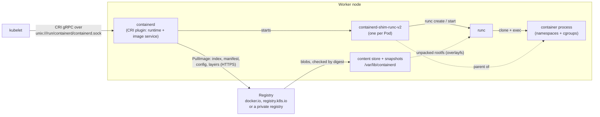

# T1.11 Containers: images, registries and runtimes (OCI, containerd, runc, crictl)

> Competency: n/a, foundation topic | Domain/weight: n/a (foundation; supports both exams) | Est. time: 3 h | Prerequisites: T1.10

Shell setup used in this lesson (defined once, see the conventions file):

```bash
alias k=kubectl
export do="--dry-run=client -o yaml"
export now="--force --grace-period=0"
source <(kubectl completion bash); complete -o default -F __start_kubectl k
```

Prerequisite: [T1.10 Linux namespaces and cgroups v2](../part1-linux/T1.10-linux-namespaces-and-cgroups-v2.md). It explains what a container process is (namespaces for what it sees, cgroups for what it uses). This lesson explains where the files of that process come from (the image), who downloads them (the registry client in containerd), and who starts the process (containerd, the shim and runc). It does not re-teach namespaces or cgroups.

**Lab environment.** The conventions list this topic under Part 1 (one Ubuntu VM). The topic entry needs a real cluster node, because the point is what the kubelet does with containerd. So the labs use the **kind** cluster `lab` (1 control plane + 2 workers, nodes `lab-control-plane`, `lab-worker`, `lab-worker2`). A kind node is a Docker container that runs systemd and containerd, so `docker exec -it lab-worker bash` gives you a root shell on a node. That is the same as `ssh w1` followed by `sudo -i` on a kubeadm VM (the exam way, see [the exam tips page](https://docs.linuxfoundation.org/tc-docs/certification/tips-cka-and-ckad)). Where a kubeadm VM differs, the text says so.

**How outputs are labelled in this lesson.**

- `REAL OUTPUT (kind v0.33.0, v1.37.0)` was captured on a real kind cluster, node image `kindest/node:v1.37.0` (Kubernetes v1.37.0, containerd 2.3.4, runc 1.4.3, crictl 1.36.0, Debian 13 node image, systemd cgroup driver, cgroup v2). The cluster was called `k-t111` with nodes `k-t111-control-plane`, `k-t111-worker` and `k-t111-worker2`, and it used kind's default CNI (kindnet) instead of Calico. In your lab the names are `lab-control-plane`, `lab-worker` and `lab-worker2`. Wherever captured output says `k-t111-worker`, read `lab-worker`. IDs, IPs and times always differ. The host kernel was an OrbStack Linux VM kernel (7.2.x), not an Ubuntu 24.04 VM. To keep the output predictable I pinned the sample Pods to a node with `spec.nodeName`. You will not pin them: the scheduler picks the node, and you find it with `k get pod -o wide`.
- `REAL OUTPUT (Docker)` was captured with plain Docker on the host (and a throw-away `registry:2` container). It is not a node and not a kind result.
- `EXPECTED OUTPUT (not captured)` was not run. Each such block is listed in section 11.

---

## 1. Why this matters

Kubernetes does not run containers itself. The kubelet (the node agent) asks a container runtime, usually containerd, to pull an image from a registry and start a process. containerd hands the last step to `runc`, which asks the kernel for the namespaces and cgroups from T1.10.

When you do not know this chain, you cannot tell why a Pod sits in `ErrImagePull`, why the image you just loaded onto a node is pulled again anyway, or why a node turns `NotReady` with "container runtime is down" after somebody edited `/etc/containerd/config.toml`. The kubectl API may be unreachable in those moments, and `crictl` on the node is the tool that still works. Image pull errors and runtime problems are among the most common reasons a Pod will not start, so this chain is the first thing to check.

---

## 2. Concepts

### 2.1 OCI images: layers, config, manifest, index, tags and digests

**The problem.** A container needs a root filesystem (the files of a small Linux userland plus your app) and some start-up settings (command, environment variables, user). Shipping that as one big file would waste bandwidth, because most of your images share the same base files. Shipping it without a standard format would tie every tool to one vendor.

**The standard.** The Open Container Initiative (OCI) defines three specifications:

| OCI spec | What it defines | Who implements it in Kubernetes |
|---|---|---|
| Image spec | The file formats of an image: layers, config, manifest, index | Image builders (docker/BuildKit), registries, containerd |
| Distribution spec | The HTTP API of a registry (how to push and pull blobs and manifests) | Registries (Docker Hub, `registry.k8s.io`, your private registry), containerd |
| Runtime spec | What a "bundle" is (a `config.json` and a root filesystem) and how to start it | `runc` and other low-level runtimes |

**The parts of an image.** An image is a set of files in a registry, all addressed by the SHA-256 hash of their bytes (a **digest**, written `sha256:<64 hex characters>`):

| Part | What it is | Why it exists |
|---|---|---|
| **Layer** | A compressed tar archive of file changes (added, changed or deleted files) | Layers are shared. Ten images on one base need that base once |
| **Config** | A JSON file: architecture, OS, command, environment, the list of layer hashes (`rootfs.diff_ids`), build history | The runtime reads it to know how to start the process |
| **Manifest** | A JSON file that lists the config digest and the layer digests (with sizes and media types) for ONE platform | It is the "table of contents" of one image |
| **Index** (also called manifest list) | A JSON file that lists several manifests, one per platform (for example `linux/amd64` and `linux/arm64`) | One name works on every CPU architecture. The runtime picks the entry that matches the node |

REAL OUTPUT (Docker): the manifest of an image I built (busybox plus one `RUN` line) and pushed to a local `registry:2` container, fetched with `curl`. Two layers and one config, each with a digest:

```text
{
  "schemaVersion": 2,
  "mediaType": "application/vnd.docker.distribution.manifest.v2+json",
  "config": {
    "mediaType": "application/vnd.docker.container.image.v1+json",
    "size": 866,
    "digest": "sha256:29323812578edf61297bb47ae8f8579bb1f7cd22c7c319d502dcd872e4c7855e"
  },
  "layers": [
    { "mediaType": "application/vnd.docker.image.rootfs.diff.tar.gzip", "size": 1974513,
      "digest": "sha256:dbc3eadfebd7b7e802ccdb5725ab1dfd4b2ccf8ab0cad8128bd0803ff0698627" },
    { "mediaType": "application/vnd.docker.image.rootfs.diff.tar.gzip", "size": 174,
      "digest": "sha256:546536341afab5e4285d874b27c9880b8ac8e999d1058b161fbb905cfa974839" }
  ]
}
```

(`docker push` printed the digest of this manifest as `sha256:15ca09e32409d...`. The two layer hashes were `1974513` bytes for the busybox base and `174` bytes for my one-line change. The `mediaType` here is the older Docker format. Registries accept both it and the OCI format, `application/vnd.oci.image.manifest.v1+json`. The structure is the same.)

REAL OUTPUT (Docker): the **index** of the official `busybox:1.36` image (`docker buildx imagetools inspect busybox:1.36 --raw | jq ...`, trimmed to three entries). One tag, many platforms:

```text
{
  "mediaType": "application/vnd.oci.image.index.v1+json",
  "manifests": [
    { "mediaType": "application/vnd.oci.image.manifest.v1+json",
      "platform": { "architecture": "amd64", "os": "linux" },
      "digest": "sha256:b7f3d86d6e84..." },
    { "mediaType": "application/vnd.oci.image.manifest.v1+json",
      "platform": { "architecture": "unknown", "os": "unknown" },
      "digest": "sha256:89ac95482c5f..." },
    { "mediaType": "application/vnd.oci.image.manifest.v1+json",
      "platform": { "architecture": "arm", "os": "linux", "variant": "v5" },
      "digest": "sha256:71b0cbca78ce..." }
  ]
}
```

The `unknown/unknown` entry is not a platform. It holds build provenance data (an attestation) for the amd64 image. The Kubernetes docs describe the same idea for the Kubernetes images: one name such as `pause` is an index, and older per-architecture names such as `pause-amd64` exist for backward compatibility ([images page](https://kubernetes.io/docs/concepts/containers/images/)). In my kind cluster the node (arm64) pulled the arm64 manifest from the same `nginx:1.27` name that an amd64 node would resolve to amd64.

The ID your tools show is not always the digest you think. Three different hashes appear for one image:

| Name | What it is the hash of | Where you see it |
|---|---|---|
| Manifest or index digest ("repo digest") | The manifest (or index) JSON | `crictl images --digests`, `ctr images ls`, `k get pod -o jsonpath='{...imageID}'`, `image@sha256:...` references |
| Image ID | The config JSON | `crictl images` (IMAGE ID), `crictl ps` (IMAGE column) |
| Layer digest | One layer archive | Inside the manifest |

REAL OUTPUT (kind v0.33.0, v1.37.0): `nginx:1.27` on a node. The image ID (`7791402a...`) is not the repo digest (`6784fb08...`):

```text
$ crictl inspecti nginx:1.27 | jq '{id: .status.id, repoTags: .status.repoTags, repoDigests: .status.repoDigests}'
{
  "id": "sha256:7791402a0bf5691936db0f42d40032ac6fb8441867416053f3ea06199de3e7e4",
  "repoTags": [ "docker.io/library/nginx:1.27" ],
  "repoDigests": [
    "docker.io/library/nginx@sha256:6784fb0834aa7dbbe12e3d7471e69c290df3e6ba810dc38b34ae33d3c1c05f7d"
  ]
}
```

For the image I pushed, the config digest in the manifest above (`29323812578e...`) is exactly the IMAGE ID that the node showed after the pull (`crictl images --digests` printed DIGEST `15ca09e32409d` = manifest, IMAGE ID `29323812578ed` = config). That is how you can prove a node holds the image you think it holds.

**Tags versus digests.**

| | Tag (`nginx:1.27`) | Digest (`nginx@sha256:6784...`) |
|---|---|---|
| What it is | A movable label in a registry | The hash of the content |
| Can it change? | Yes. The owner can push a different image under the same tag | No. Different bytes give a different digest |
| Readable? | Yes | No |
| Default pull policy if you omit `imagePullPolicy` | `IfNotPresent` (or `Always` for `:latest` or no tag) | `IfNotPresent` |
| Use it when | Normal use. Pin a version tag, never `:latest` | You need the exact same bytes on every node and every restart |

If you write both (`image: nginx:1.27@sha256:...`), Kubernetes pulls by the digest only and the tag is ignored ([images page](https://kubernetes.io/docs/concepts/containers/images/)). A tag that you did not pin can silently point to new code. Two Pods of one Deployment can then run different code, depending on when each node pulled.

REAL OUTPUT (Docker): a `docker save` archive is itself an OCI layout, which shows the pieces on disk:

```text
$ tar tf lab-app.tar
blobs/
blobs/sha256/
blobs/sha256/29323812578e...   <- config
blobs/sha256/3820d5f10084...   <- layer
blobs/sha256/6d0cc19a6875...   <- layer
blobs/sha256/b1b11c5a1ad4...
blobs/sha256/c36fbe0dc53e...   <- manifest
blobs/sha256/c97bd058ea36...
index.json
manifest.json
oci-layout
repositories
```

(Names after `<-` are my annotations. `index.json` is the OCI index of the archive and `oci-layout` is the version marker.)

### 2.2 Registries: names, `docker.io` default, private registries and auth

A **registry** is a server that stores images and speaks the OCI distribution API. An image name has up to five parts:

```text
[registry-host[:port]/][namespace/]repository[:tag][@sha256:digest]
```

| You write | Kubernetes and containerd read it as | Note |
|---|---|---|
| `nginx` | `docker.io/library/nginx:latest` | No registry means Docker Hub. No namespace means `library`. No tag means `latest` |
| `nginx:1.27` | `docker.io/library/nginx:1.27` | |
| `bitnami/redis:7.2` | `docker.io/bitnami/redis:7.2` | A namespace (`bitnami`) |
| `registry.k8s.io/pause:3.10` | itself | A "fully qualified" name has a host. Kubernetes' own images live here |
| `ghcr.io/org/app:1.0` | itself | GitHub's registry |
| `lab-registry:5000/team/lab-app:1.0` | itself | A host with a port is a registry too |
| `nginx@sha256:6784...` | `docker.io/library/nginx@sha256:6784...` | By digest |

The first path part is treated as a registry host only if it looks like one (it contains a `.` or a `:`, or it is `localhost`). That is why `team/lab-app:1.0` means Docker Hub namespace `team`, but `lab-registry:5000/team/lab-app:1.0` means host `lab-registry`. The error messages show the expanded name. In my run a typo produced `failed to resolve reference "docker.io/library/nginxx:1.27"`, which tells you the short name was expanded to Docker Hub. Always read the expanded name in the event.

**Private registries and authentication.** A private registry answers an anonymous pull with `401 Unauthorized`. The client must send credentials. The Kubernetes docs list the ways ([images page](https://kubernetes.io/docs/concepts/containers/images/#using-a-private-registry)):

| Method | Who can use the image | Where it is set |
|---|---|---|
| `imagePullSecrets` on the Pod (recommended by the docs) | Only Pods that carry the Secret | `spec.imagePullSecrets` or the ServiceAccount's `imagePullSecrets` |
| Node-wide credentials | Every Pod on that node | Runtime config on the node (admin task) |
| Kubelet credential provider plugin | Pods on nodes with the plugin | KubeletConfiguration (cloud registries use this) |
| Pre-pulled images (`IfNotPresent` or `Never`) | Every Pod on that node | You load the image onto each node (section 2.10) |

An `imagePullSecret` is a Secret of type `kubernetes.io/dockerconfigjson` in the **same namespace** as the Pod. You create it with one command:

```bash
k -n lab-t111 create secret docker-registry regcred \
  --docker-server=lab-registry:5000 --docker-username=alice --docker-password=s3cret
```

REAL OUTPUT (kind v0.33.0, v1.37.0): the Secret is only base64, not encrypted. The password is in it:

```text
$ k -n lab-t111 get secret regcred -o jsonpath='{.type}{"\n"}'
kubernetes.io/dockerconfigjson
$ k -n lab-t111 get secret regcred -o jsonpath='{.data.\.dockerconfigjson}' | base64 -d | jq .
{
  "auths": {
    "lab-registry:5000": {
      "username": "alice",
      "password": "s3cret",
      "auth": "YWxpY2U6czNjcmV0"
    }
  }
}
```

The Pod then names the Secret (field explained in section 4). The kubelet reads it and passes the credentials to the runtime on every pull.

**Credential verification for images that are already on the node (beta since v1.35, on by default).** Before v1.35 a Pod without credentials could use a private image that another Pod had already pulled onto the node, as long as the pull policy was `IfNotPresent`. Now the kubelet remembers which credentials pulled each image. A Pod that brings no matching credentials makes the kubelet pull again, and the pull fails. The kubelet field is `imagePullCredentialsVerificationPolicy` and its values are `NeverVerify`, `NeverVerifyPreloadedImages` (the default), `NeverVerifyAllowListedImages` and `AlwaysVerify`. Images pulled outside the kubelet (for example with `ctr` or `crictl pull`) count as "preloaded" and are not verified under the default ([images page](https://kubernetes.io/docs/concepts/containers/images/#ensure-image-pull-credential-verification)). Section 5 shows this live.

**containerd and registry hosts.** The runtime, not the kubelet, talks to the registry. containerd 2.x reads per-registry settings from a directory (`config_path`, usually `/etc/containerd/certs.d`). A file `certs.d/<host:port>/hosts.toml` can set a mirror, a different server URL, plain HTTP and a CA file. Section 2.8 shows a real one.

### 2.3 Image pull policy

`imagePullPolicy` is a per-container field. It tells the kubelet when to ask the runtime to pull.

| Value | Behaviour | Failure when the image is missing |
|---|---|---|
| `IfNotPresent` | Pull only if the image (by the exact name) is not on the node | Pull error, `ErrImagePull` |
| `Always` | Ask the runtime to pull every time a container starts. The runtime contacts the registry, resolves the tag to a digest and downloads only the layers it does not have. The kubelet never checks the local cache itself | Pull error, `ErrImagePull`. **If the pull fails (the registry says "not found", or cannot be reached), the container does not start even when a copy is on the node.** I saw this with a name the registry did not know (section 6) |
| `Never` | Never pull. Start only if the image is already on the node | `ErrImageNeverPull` (a Pod status reason; the event says "is not present with pull policy of Never") |

**If you omit the field, the API server fills it in when the object is created.** The docs give four rules:

| Image reference | Defaulted policy |
|---|---|
| `nginx:1.27` (a tag that is not `latest`) | `IfNotPresent` |
| `nginx:latest` | `Always` |
| `nginx` (no tag) | `Always` (no tag means `latest`) |
| `nginx@sha256:...` (a digest) | `IfNotPresent` (from the docs; not run, see section 11) |

The value is set once, when the object is created. If you later edit the image in a Deployment from `app:1.0` to `app:latest`, the policy stays `IfNotPresent`. You must change it yourself ([images page](https://kubernetes.io/docs/concepts/containers/images/)). The admission plugin `AlwaysPullImages`, if enabled, overrides every policy to `Always`.

REAL OUTPUT (kind v0.33.0, v1.37.0): the three defaults on a live v1.37.0 cluster:

```text
$ k -n lab-t111 run p-tag    --image=busybox:1.36     --command -- sleep 3600
$ k -n lab-t111 run p-bare   --image=busybox          --command -- sleep 3600
$ k -n lab-t111 run p-latest --image=busybox:latest   --command -- sleep 3600
$ k -n lab-t111 get pod p-tag p-bare p-latest -o 'custom-columns=NAME:.metadata.name,IMAGE:.spec.containers[0].image,POLICY:.spec.containers[0].imagePullPolicy'
NAME       IMAGE            POLICY
p-tag      busybox:1.36     IfNotPresent
p-bare     busybox          Always
p-latest   busybox:latest   Always
```

**Why `:latest` is a trap on air-gapped or loaded nodes.** `Always` means "ask the registry". If you loaded `lab-app:latest` onto the node by hand and the Pod says `image: lab-app`, the kubelet still tries to pull `docker.io/library/lab-app:latest` from Docker Hub and fails (section 6 has the real events). Pin a real tag (`lab-app:1.0`), or set `imagePullPolicy: IfNotPresent` explicitly.

**Back-off.** After a failed pull the kubelet waits and retries. The state alternates between `ErrImagePull` (the attempt failed just now) and `ImagePullBackOff` (waiting for the next attempt). The delay grows up to 300 seconds. By default the kubelet pulls images one at a time (`serializeImagePulls`); `maxParallelImagePulls` limits parallel pulls when you turn serial pulls off ([images page](https://kubernetes.io/docs/concepts/containers/images/)).

### 2.4 Container engines versus runtimes

"Docker" is several programs. The words "engine" and "runtime" are used loosely, so use this table.

| Layer | Examples | What it does | Used by the kubelet? |
|---|---|---|---|
| CLI and engine for people | `docker`, `podman`, `nerdctl` | Build images, run containers by hand, manage local images, networks, volumes. Docker Engine and `nerdctl` use containerd underneath | **No.** Dockershim was removed from Kubernetes in v1.24 ([container runtimes page](https://kubernetes.io/docs/setup/production-environment/container-runtimes/)) |
| High-level runtime (container manager) | **containerd**, CRI-O | Pulls and stores images, unpacks them into snapshots, creates containers and tasks, speaks CRI to the kubelet | **Yes**, through CRI |
| Shim | `containerd-shim-runc-v2` | A small process that stays alive per Pod and is the parent of the container process (section 2.13 shows it on a node). It also keeps the container's I/O and reports its exit to containerd | Indirectly |
| Low-level OCI runtime | **runc** (also crun, gVisor's runsc, Kata) | Takes an OCI bundle (`config.json` + rootfs), creates the namespaces and cgroups, sets up mounts and capabilities, and executes the process | Indirectly |

Two practical consequences:

- Images built with `docker build` run fine on containerd. The image format is the OCI standard, not a Docker secret. But the Docker daemon on your laptop and the containerd on a node have **separate image stores**. An image that `docker images` shows is not on the node until you push it to a registry or load it onto the node (section 2.10).
- `docker ps` on a node shows nothing about Kubernetes Pods, because the kubelet does not use Docker. Use `crictl`.

### 2.5 CRI: how the kubelet talks to the runtime

The **Container Runtime Interface (CRI)** is a gRPC API (stable since v1.23) between the kubelet and the runtime. It has two services: a **runtime service** (create, start, stop and list Pod sandboxes and containers; exec; logs) and an **image service** (pull, list, inspect, remove images). The kubelet is the client. The runtime listens on a unix socket ([CRI page](https://kubernetes.io/docs/concepts/architecture/cri/)). For containerd that socket is:

```text
unix:///run/containerd/containerd.sock
```

These three sockets are the default search list of `crictl` (shown by `crictl --help` and in the warning below):

| Runtime | CRI socket |
|---|---|
| containerd | `unix:///run/containerd/containerd.sock` |
| CRI-O | `unix:///run/crio/crio.sock` (the Kubernetes docs write `/var/run/crio/crio.sock`) |
| cri-dockerd (Docker Engine adapter) | `unix:///var/run/cri-dockerd.sock` |

The kubelet gets the endpoint from its configuration. On the kind node:

REAL OUTPUT (kind v0.33.0, v1.37.0):

```text
$ grep containerRuntimeEndpoint /var/lib/kubelet/config.yaml
containerRuntimeEndpoint: unix:///run/containerd/containerd.sock
```

(The CRI docs page still names the older flag form, `--container-runtime-endpoint`. This capture is from a **kind** node, where kind writes the field into `config.yaml`. I did not check where a stock kubeadm VM keeps it: older kubeadm versions pass `--container-runtime-endpoint` through `/var/lib/kubelet/kubeadm-flags.env` instead. On a VM, find it with `grep -r container-runtime-endpoint /var/lib/kubelet/` and `grep containerRuntimeEndpoint /var/lib/kubelet/config.yaml`; whichever prints a line is the place. Section 11 lists this.) Since Kubernetes v1.26 the kubelet requires the **v1** CRI API. A runtime that does not speak it makes the node fail to register.

**The cgroup driver now comes from the runtime (v1.37).** The kubelet and the runtime must agree on how to name cgroups (`systemd` or `cgroupfs`, T1.10). In v1.37, with the `KubeletCgroupDriverFromCRI` feature gate on and a runtime that supports the `RuntimeConfig` CRI call, the kubelet asks the runtime and ignores its own `cgroupDriver` setting. Old runtimes (containerd 1.x) do not answer, and in v1.37 the kubelet falls back to its own setting. The docs say that fallback goes away in v1.38 ([container runtimes page](https://kubernetes.io/docs/setup/production-environment/container-runtimes/)). You can ask the same question:

REAL OUTPUT (kind v0.33.0, v1.37.0):

```text
$ crictl runtime-config
cgroup driver:   SYSTEMD
```

### 2.6 crictl: the CRI debugging client

`crictl` talks CRI directly. It sees what the kubelet sees: **Pod sandboxes**, **containers** and **images** on this node, with no API server and no kubeconfig needed ([crictl docs page](https://kubernetes.io/docs/tasks/debug/debug-cluster/crictl/)). That is why it is the tool for a node whose kubelet or API connection is broken. It must run as root (the socket is `root:root`, mode `0660`; the `ls -l /run/containerd` output on the kind node showed `srw-rw---- 1 root root`).

**Configure it once: `/etc/crictl.yaml`.** crictl needs a runtime endpoint. You can give it in three ways: the flag `--runtime-endpoint` (short `-r`), the environment variables `CONTAINER_RUNTIME_ENDPOINT` and `IMAGE_SERVICE_ENDPOINT`, or the file `/etc/crictl.yaml` (another file with `--config`). Without any of them crictl tries a list of known sockets and prints warnings.

REAL OUTPUT (kind v0.33.0, v1.37.0): no `/etc/crictl.yaml` (I moved it away for the test). It works but warns on every call:

```text
$ crictl ps
time="2026-10-27T06:25:13Z" level=warning msg="Config \"/etc/crictl.yaml\" does not exist, trying next: \"/usr/local/bin/crictl.yaml\""
time="2026-10-27T06:25:13Z" level=warning msg="runtime connect using default endpoints: [unix:///run/containerd/containerd.sock unix:///run/crio/crio.sock unix:///var/run/cri-dockerd.sock]. As the default settings are now deprecated, you should set the endpoint instead."
time="2026-10-27T06:25:13Z" level=warning msg="Image connect using default endpoints: [unix:///run/containerd/containerd.sock unix:///run/crio/crio.sock unix:///var/run/cri-dockerd.sock]. As the default settings are now deprecated, you should set the endpoint instead."
CONTAINER           IMAGE               CREATED              STATE   ...
```

The fix is the file (section 4 explains every key). `crictl config --list` prints the effective settings:

REAL OUTPUT (kind v0.33.0, v1.37.0):

```text
$ crictl --config /etc/crictl.yaml config --list
KEY                    VALUE
runtime-endpoint       unix:///run/containerd/containerd.sock
image-endpoint         
timeout                0
debug                  false
pull-image-on-create   false
disable-pull-on-run    false
```

(The real command also clears the screen first, which I removed.) A wrong endpoint is a hard failure, not a warning:

REAL OUTPUT (kind v0.33.0, v1.37.0):

```text
$ crictl -r unix:///nonexistent.sock ps
time="2026-10-27T06:25:13Z" level=fatal msg="validate service connection: validate CRI v1 runtime API for endpoint \"unix:///nonexistent.sock\": rpc error: code = Unavailable desc = connection error: desc = \"transport: Error while dialing: dial unix /nonexistent.sock: connect: no such file or directory\""
```

Read that line from the right: `no such file or directory` means the socket file does not exist (wrong path, or containerd is not running). `permission denied` instead would mean you are not root.

**The commands you need.** `crictl --help` on the kind node (crictl 1.36.0) lists these among others: `ps`, `pods`, `images`, `pull`, `inspect`, `inspectp`, `inspecti`, `logs`, `exec`, `rmi`, `rm`, `rmp`, `stop`, `stopp`, `info`, `stats`, `runtime-config`, `version`.

| Command | What it shows or does | Useful flags |
|---|---|---|
| `crictl ps` | Running **containers** | `-a` all states, `-q` IDs only, `--name <regex>`, `--pod <pod-id>`, `--state exited`, `--no-trunc` full IDs, `-o json\|yaml\|table` |
| `crictl ps -a` | Containers in every state, including `Exited` (crashed or finished) | Same |
| `crictl pods` | Pod **sandboxes** (one per Pod) | `--name`, `--namespace`, `--state ready`, `-q`, `--no-trunc` |
| `crictl images` | Images in the node's store | `-q` IDs only, `--digests` adds the repo digest column, `-o json` |
| `crictl pull <image>` | Pull an image now | `--creds user:pass` |
| `crictl inspect <container>` | Full JSON of one container (spec, mounts, PID, image, sandbox ID) | `-o go-template --template '{{.info.pid}}'` |
| `crictl inspectp <pod>` | Full JSON of one Pod sandbox (IP, namespaces options, runtime handler) | same |
| `crictl inspecti <image>` | Full JSON of one image (config, history, repo digests) | same |
| `crictl logs <container>` | A container's stdout and stderr | `--tail=N` (shown on the docs page) |
| `crictl rmi <image>` | Remove an image. If the image has several tags, all of them are removed (crictl warns first) | |
| `crictl info` | Runtime status and config as JSON; the `status.conditions` list has `RuntimeReady` and `NetworkReady` | pipe to `jq` |
| `crictl runtime-config` | Ask the runtime for its cgroup driver | |

`crictl info` is the quick health check of the runtime. Its `status.conditions` list says whether the runtime and its CNI are ready:

REAL OUTPUT (kind v0.33.0, v1.37.0):

```text
$ crictl info | jq '.status.conditions'
[
  { "message": "", "reason": "", "status": true, "type": "RuntimeReady" },
  { "message": "", "reason": "", "status": true, "type": "NetworkReady" },
  { "message": "", "reason": "", "status": true, "type": "ContainerdHasNoDeprecationWarnings" }
]
```

(I compacted each object to one line. `RuntimeReady false` points at containerd, `NetworkReady false` at the CNI.)

Remember these identity rules; they save time:

- The **POD ID** column of `crictl ps` is the sandbox ID. It is the first column of `crictl pods`.
- `crictl ps` does **not** list the "pause" container. The pause container is the sandbox (T1.10 explains why it exists: it holds the Pod's network namespace). Look at `crictl pods`. `ctr` lists the pause container, and its ID equals the POD ID.
- A name argument such as `--name web` is a **regular expression** match on the name, so `web` also matches `webapp`.
- The kubelet owns these containers. Treat crictl as a read-only tool for them. Use `crictl pull` and `crictl rmi` for images; do not `stop` or `rm` Pod containers by hand and expect them to stay gone.
- The jq filters in this lesson need `jq`. The exam host list names only `kubectl`, `yq`, `curl`, `wget` and `man` ([tips page](https://docs.linuxfoundation.org/tc-docs/certification/tips-cka-and-ckad)), so use `-o go-template` (below) or `yq` when you cannot count on `jq`. Whether `crictl` and `ctr` are installed on the exam hosts is UNVERIFIED; I could not find it on that page.

**kubectl to crictl, side by side.**

| You want | kubectl (needs the API server) | crictl (on the node) |
|---|---|---|
| List Pods | `k get pods -A -o wide` | `crictl pods` |
| List containers of a Pod | `k get pod web -o jsonpath='{.status.containerStatuses[*].name}'` | `crictl ps -a --pod <pod-id>` |
| Logs | `k logs web` | `crictl logs <container-id>` |
| Run a command | `k exec web -- ls` | `crictl exec -it <container-id> ls` |
| Details | `k describe pod web` | `crictl inspectp <pod-id>` and `crictl inspect <container-id>` |
| Image list | (none, only Pod specs) | `crictl images` |

### 2.7 ctr and containerd namespaces

`ctr` is the small client that ships with containerd. It speaks containerd's **native** API, not CRI. That means it has no idea what a Pod is. Everything is a plain container, and everything lives inside a **containerd namespace**. This is a containerd label for grouping objects, not a Linux namespace and not a Kubernetes namespace. The CRI plugin puts everything it creates for the kubelet in the namespace `k8s.io`.

REAL OUTPUT (kind v0.33.0, v1.37.0):

```text
$ ctr namespaces ls
NAME   LABELS 
k8s.io        

$ ctr -n k8s.io containers ls
CONTAINER                                                           IMAGE                                            RUNTIME                  
29e71fa3ed63e7c312aee294841c30936122622f5dbc5d28b47a3e4c7aaef175    registry.k8s.io/pause:3.10                       io.containerd.runc.v2    
2f399f7c67ef4daaefa11f8432d6d1e2a78c7f38c8d9378e77d27f8929561479    registry.k8s.io/pause:3.10                       io.containerd.runc.v2    
330acd8418f7eea1950bb1c19ee6fd476c09e4c041ceff48c4fa12795c9896b3    docker.io/kindest/kindnetd:v20260820-69b56db7    io.containerd.runc.v2    
5551e6a2aa219ca58eedb00461bf2c5fa5fe9bf86bd9038ff0286d80e5f42bcc    registry.k8s.io/pause:3.10                       io.containerd.runc.v2    
c4e5ce9fcf10ae058639689935eeb2ee96ed36424c7269ba096db6935e9d3b49    docker.io/library/nginx:1.27                     io.containerd.runc.v2    
c90f16750642d3a06814855cd89c046bd87722781c54dca32097af8e2256fc7a    registry.k8s.io/kube-proxy-arm64:v1.37.0         io.containerd.runc.v2    
```

Compare with `crictl ps` and `crictl pods` in section 5: the container `c4e5ce9f...` is `web`, and `5551e6a2...` (a `pause` container here) is the sandbox of Pod `web`. The same ID, seen through two APIs.

Why you must know the namespace: `ctr images ls` without `-n k8s.io` looks in the namespace `default`, which is empty. An image you import into `default` is invisible to the kubelet. Always write `-n k8s.io`.

| Task | crictl (CRI view) | ctr (containerd view) |
|---|---|---|
| List images | `crictl images` | `ctr -n k8s.io images ls` (also shows media type and platforms; `-q` for names only) |
| List containers | `crictl ps -a` | `ctr -n k8s.io containers ls` (includes pause containers) |
| List running processes | not available (use `inspect` for the PID) | `ctr -n k8s.io tasks ls` (shows PIDs) |
| Import an image from a tar file | not available | `ctr -n k8s.io images import file.tar` |
| Pull an image | `crictl pull` | `ctr -n k8s.io images pull` |
| Knows about Pods | yes | no |

REAL OUTPUT (kind v0.33.0, v1.37.0): `ctr -n k8s.io images ls` shows the media type of what the tag points to (an index for `nginx:1.27`, a plain manifest for the image I imported) and the same names you see in `crictl images`:

```text
REF                                     TYPE                                       DIGEST          SIZE
docker.io/library/lab-app:1.0           application/vnd.oci.image.manifest.v1+json sha256:c36fbe0d... 4.1 MiB
docker.io/library/nginx:1.27            application/vnd.oci.image.index.v1+json    sha256:6784fb08... 65.7 MiB
docker.io/library/nginx@sha256:6784...  application/vnd.oci.image.index.v1+json    sha256:6784fb08...
```

(Trimmed to the interesting columns. In the full output the `PLATFORMS` column follows.) Note the second `nginx` row: containerd keeps both a tag record and a digest record for each pulled image.

`nerdctl` is a Docker-compatible CLI for containerd. It can use `--namespace k8s.io` to see node images. Awareness only: I did not use it here.

### 2.8 The containerd configuration file

**File and format.** `/etc/containerd/config.toml` is a TOML file. If it does not exist containerd uses built-in defaults. A package install (`.deb` or `.rpm`) can ship a config where the CRI plugin is disabled (`disabled_plugins = ["cri"]`); the Kubernetes docs warn about that and recommend regenerating the file with `containerd config default > /etc/containerd/config.toml` ([container runtimes page](https://kubernetes.io/docs/setup/production-environment/container-runtimes/)).

**Version.** The first line is `version = N`. It selects the schema (the table names). containerd 2.x reads old files and **migrates them in memory**, and it can print the migrated result.

REAL OUTPUT (kind v0.33.0, v1.37.0): the node's own file is `version = 2` (the 1.x style), written by kind. containerd 2.3.4 migrates it and warns:

```text
$ containerd --config /etc/containerd/config.toml config migrate | head -3
time="2026-10-27T06:25:09Z" level=warning msg="Configuration migrated from version 2, use `containerd config migrate` to avoid migration" t="11.542µs"
time="2026-10-27T06:25:09Z" level=warning msg="Ignoring unknown key in TOML for plugin" error="strict mode: fields in the document are missing in the target struct" key=tolerate_missing_hugepages_controller plugin=io.containerd.cri.v1.runtime
version = 4
```

Two things to learn from this. First, **a freshly generated config in containerd 2.3.4 is `version = 4`**, not 3. The topic entry says "containerd 2.x config version 3"; version 3 is what I expect for the first 2.x releases, but I only ran 2.3.4 (section 11). Do not memorise the number. Read the first line of the file and the output of `containerd config default`. Second, a key that the new schema does not know (`tolerate_missing_hugepages_controller`) is ignored with a warning instead of stopping containerd. A **wrong value** is different: it stops containerd (section 6).

The three useful subcommands (flags go before the subcommand, so `--config` comes first):

| Command | Output |
|---|---|
| `containerd config default` | The built-in default config of this containerd version. Use it to regenerate a broken file |
| `containerd config dump` | The effective config after migration and after merging `imports` files. Use it to see what containerd really uses |
| `containerd --config <file> config migrate` | The file converted to the newest version |

**The parts that matter for Kubernetes.** Real excerpt of `containerd config default` (2.3.4), keeping only the keys the lesson uses:

REAL OUTPUT (kind v0.33.0, v1.37.0):

```toml
version = 4
root = '/var/lib/containerd'
state = '/run/containerd'
imports = ['/etc/containerd/conf.d/*.toml']

[plugins]
  [plugins.'io.containerd.cri.v1.images']
    snapshotter = 'overlayfs'
    discard_unpacked_layers = false
    [plugins.'io.containerd.cri.v1.images'.pinned_images]
      sandbox = 'registry.k8s.io/pause:3.10.2'
    [plugins.'io.containerd.cri.v1.images'.registry]
      config_path = ''

  [plugins.'io.containerd.cri.v1.runtime']
    [plugins.'io.containerd.cri.v1.runtime'.containerd]
      default_runtime_name = 'runc'
      [plugins.'io.containerd.cri.v1.runtime'.containerd.runtimes.runc]
        runtime_type = 'io.containerd.runc.v2'
        sandboxer = 'podsandbox'
        [plugins.'io.containerd.cri.v1.runtime'.containerd.runtimes.runc.options]
          SystemdCgroup = false
    [plugins.'io.containerd.cri.v1.runtime'.cni]
      bin_dirs = ['/opt/cni/bin']
      conf_dir = '/etc/cni/net.d'
```

| Key | What it does | Default (2.3.4) | Risky value |
|---|---|---|---|
| `root` / `state` | Where containerd keeps images and snapshots (`/var/lib/containerd`) and runtime state (`/run/containerd`) | as shown | A full disk under `root` makes pulls fail |
| `imports` | Extra `*.toml` drop-in files merged into the config | `/etc/containerd/conf.d/*.toml` | |
| `...images'.snapshotter` | How layers are unpacked into a filesystem | `overlayfs` | A snapshotter the kernel lacks |
| `...pinned_images.sandbox` | The **sandbox (pause) image**. Every Pod starts with a pause container from this image | `registry.k8s.io/pause:3.10.2` | A tag that does not exist or cannot be pulled leaves new Pods in `ContainerCreating` |
| `...registry.config_path` | Directory with per-registry `hosts.toml` files (mirrors, HTTP, CA) | empty (feature off) | Pointing at a missing directory is harmless; the settings just do not apply |
| `...runtimes.runc.options.SystemdCgroup` | Use systemd to create cgroups. Must match the kubelet's driver | **`false`** | Leaving the default `false` on a systemd + cgroup v2 node. The Kubernetes docs say to set `true` |
| `...runtimes.<name>` | A runtime handler. The name is what a RuntimeClass `handler` refers to | `runc` | A handler name that is not defined |
| `...cni.conf_dir` / `bin_dirs` | Where containerd looks for CNI config and plugin binaries | `/etc/cni/net.d`, `/opt/cni/bin` | |

The table shows why "the default config is not enough for Kubernetes": the default `SystemdCgroup = false` is wrong for a systemd node. The Kubernetes docs show this setting for containerd 1.x and 2.x with different table names:

```toml
# containerd 1.x (version = 2 file)
[plugins."io.containerd.grpc.v1.cri".containerd.runtimes.runc.options]
  SystemdCgroup = true

# containerd 2.x
[plugins.'io.containerd.cri.v1.runtime'.containerd.runtimes.runc.options]
  SystemdCgroup = true
```

The same split exists for the sandbox image: a `version = 2` file uses `[plugins."io.containerd.grpc.v1.cri"] sandbox_image = "..."`, and the 2.x schema uses `[plugins.'io.containerd.cri.v1.images'.pinned_images] sandbox = '...'`. Use the keys that match the `version` line. I did not test an old key inside a new-version file (section 11).

REAL OUTPUT (kind v0.33.0, v1.37.0): the effective values after migration of the kind file (`containerd config dump | grep ...`):

```text
27:    [plugins.'io.containerd.cri.v1.images'.pinned_images]
28:      sandbox = 'registry.k8s.io/pause:3.10'
31:      config_path = ''
90:            SystemdCgroup = true
108:            SystemdCgroup = true
```

(Line 108 belongs to the `test-handler` runtime that kind defines for Kubernetes' own tests.) The kind file pins `pause:3.10` while a freshly generated 2.3.4 config says `pause:3.10.2`. On a kubeadm node `kubeadm config images list` prints the pause tag that kubeadm expects (it printed `registry.k8s.io/pause:3.10.2` on the v1.37.0 kubeadm in the kind node). If the pause image in containerd's config is not on the node and cannot be pulled, no new Pod can start. Section 6 shows it.

**After editing the file: restart containerd.** `systemctl restart containerd`. Running containers survive the restart, because each Pod's shim is a child of PID 1 (section 2.13).

**Registry mirrors and plain HTTP: `certs.d/<host:port>/hosts.toml`.** To make containerd use a registry that is plain HTTP (or to redirect `docker.io` to a mirror), set `config_path` and add a `hosts.toml`. I did this on a worker with a local `registry:2` container named `lab-registry` on the Docker network `kind`.

REAL OUTPUT (kind v0.33.0, v1.37.0): the commands I ran on the node. The kind node file is `version = 2`, so I appended the **1.x** table name, which containerd 2.3.4 migrated without complaint. Use this form only when the first line of your file is `version = 2`:

```bash
cat >> /etc/containerd/config.toml <<'EOF'

[plugins."io.containerd.grpc.v1.cri".registry]
  config_path = "/etc/containerd/certs.d"
EOF
mkdir -p /etc/containerd/certs.d/lab-registry:5000
cat > /etc/containerd/certs.d/lab-registry:5000/hosts.toml <<'EOF'
server = "http://lab-registry:5000"

[host."http://lab-registry:5000"]
  capabilities = ["pull", "resolve"]
EOF
systemctl restart containerd
```

Result: `crictl pull lab-registry:5000/team/lab-app:1.0` now reached the registry and failed with `no basic auth credentials` (the registry requires a login), and `crictl pull --creds alice:s3cret ...` worked.

**The same setting in a containerd 2.x file (`version = 3` or `4`).** If your file starts with `version = 3` or `version = 4` (a file made by `containerd config default`, which is what a 2.x VM has), put `config_path` in the 2.x table that the generated default shows above. Do not append the 1.x table to such a file; I did not test that, and containerd may ignore it. The `hosts.toml` files are the same in both schemas. Config example, not run (section 11):

```toml
# Config example, not run: add to /etc/containerd/config.toml when the file is version = 3 or 4
[plugins.'io.containerd.cri.v1.images'.registry]
  config_path = '/etc/containerd/certs.d'
```

If the default file already has a `[plugins.'io.containerd.cri.v1.images'.registry]` table with `config_path = ''`, edit that line instead of adding a second table (a repeated table is a TOML error). Then restart and check what containerd really uses and whether the mirror is hit:

```bash
systemctl restart containerd
containerd config dump | grep config_path
crictl pull lab-registry:5000/team/lab-app:1.0         # reaches the host named in certs.d/<host:port>/hosts.toml
journalctl -u containerd --no-pager | tail -5          # a wrong config shows up here
```

EXPECTED OUTPUT (not captured): the `grep` prints `config_path = '/etc/containerd/certs.d'`. If it prints `config_path = ''`, the setting was not picked up and the `hosts.toml` files are not read.

A mirror for Docker Hub has the same shape. Config example, not run (section 11):

```toml
# Config example, not run: /etc/containerd/certs.d/docker.io/hosts.toml
server = "https://registry-1.docker.io"

[host."https://mirror.example.internal"]
  capabilities = ["pull", "resolve"]
```

As described in containerd's `hosts.toml` documentation (not run here): `server` is the upstream registry, the fallback when no listed host answers; each `[host."<url>"]` table is a mirror that is tried first, in file order; `capabilities` limits what that host may be used for (`pull`, `resolve`, `push`). `mirror.example.internal` is a placeholder name.

Old guides configure mirrors with a `registry.mirrors` table inside `config.toml`. Prefer `hosts.toml`; I did not test the old form.

### 2.9 containerd 1.x support ended after Kubernetes v1.35

The Kubernetes v1.35 release blog says: Kubernetes v1.35 still supports containerd 1.7 and other 1.x releases, but it is the **last** release that does. The SIG Node community designated it the last release to support the containerd 1.x series, and the post says that before upgrading to the next Kubernetes version **you must switch to containerd 2.0 or later**. It names the metric `kubelet_cri_losing_support` to find nodes that need attention (source: [Kubernetes v1.35 release blog, "Final call for containerd v1.X"](https://kubernetes.io/blog/2025/12/17/kubernetes-v1-35-release/)).

What this means for you:

- For Kubernetes **v1.36 and later (including the v1.37 of this guide), the node needs containerd 2.0 or newer.** The pinned lab versions are containerd 2.x (the kind node had 2.3.4; the research summary pins 2.4.2 for the VMs).
- The same blog, in its image volume item, says the feature "requires a compatible container runtime, such as containerd v2.1 or later" (section 2.12).
- The cgroup-driver fallback described in section 2.5 is the other half of the story: old runtimes cannot answer the `RuntimeConfig` call, and the docs say that fallback is dropped in v1.38.
- Practical check on a node: `containerd --version`. A line like `containerd github.com/containerd/containerd/v2 v2.3.4 db88095...` shows `/v2` in the module path.

REAL OUTPUT (kind v0.33.0, v1.37.0):

```text
$ containerd --version
containerd github.com/containerd/containerd/v2 v2.3.4 db8809540e1a7a9da5d518876894933ff55692ab
$ runc --version
runc version 1.4.3
spec: 1.3.0
$ crictl --version
crictl version 1.36.0
```

(The research summary pins crictl v1.37.0 for the VMs. The kind node image shipped 1.36.0, so the `crictl` output in this lesson is from 1.36.0. See section 11.)

### 2.10 Getting an image onto a node without a registry: save, load, import

Sometimes there is no registry (a lab, an air-gapped node, a fix under time pressure). You can move the image as a file.

| Method | Command | Notes |
|---|---|---|
| Export from Docker, import into containerd | `docker save lab-app:1.0 -o lab-app.tar`, copy the file to the node, then on the node `ctr -n k8s.io images import lab-app.tar` | Works on any node. Needs the file on the node (`scp` on VMs, `docker cp` on kind nodes) |
| kind helper | `kind load docker-image lab-app:1.0 --name lab` | Does the save, copy and import to **every** node of the kind cluster for you |
| Pull on the node | `crictl pull <image>` or `ctr -n k8s.io images pull <image>` | Needs a reachable registry |
| Export from containerd | `ctr -n k8s.io images export out.tar <image>` | To move an image between nodes (not run here) |

REAL OUTPUT (kind v0.33.0, v1.37.0): import on a node, and what the node shows afterwards:

```text
$ docker save lab-app:1.0 -o lab-app.tar
$ docker cp lab-app.tar k-t111-worker:/root/lab-app.tar
$ docker exec k-t111-worker ctr -n k8s.io images import /root/lab-app.tar
application/vnd.oci.image.manifest.v1+json sha256:c36fbe0dc53ee74c55496e3ff51226ccac28003982794780dcd1c3c5ec25f692
Importing	elapsed: 0.1 s	total:   0.0 B	(0.0 B/s)
$ docker exec k-t111-worker crictl images | grep -E "IMAGE|lab-app"
IMAGE                                           TAG                  IMAGE ID            SIZE
docker.io/library/lab-app                       1.0                  29323812578ed       4.35MB
```

(`ctr` also printed a line ending in `saved`, which I trimmed.) Read three facts from this output:

- The short name `lab-app:1.0` was imported as `docker.io/library/lab-app:1.0`, which is the exact name a Pod with `image: lab-app:1.0` resolves to. A Pod with a different spelling (`image: myrepo/lab-app:1.0`) would not match.
- The IMAGE ID `29323812578ed` is the same as in the registry manifest above. The image content is identical. The **manifest digest** changed (`c36fbe0d...` instead of `15ca09e3...`), because `docker save` writes its own manifest. So a Pod that pins the registry digest cannot use the imported copy. Use the tag when you load by hand.
- For an OCI-format tar that carries only partial names, `ctr images import --base-name <prefix>` fills in the missing prefix. If you give none, `ctr` generates a name like `import-2026-08-26`. kind's own preloaded images show up in `ctr -n k8s.io images ls -q` with exactly such names, for example `import-2026-08-26@sha256:2aa78b45...`.

The Pod that uses the loaded image must not need the registry. With a tag that is not `latest` the default policy is already `IfNotPresent`. Setting `imagePullPolicy: Never` states the intention and gives a clear error (`ErrImageNeverPull`) when the image is missing on that node. **The image exists only on the nodes you loaded it on.** A Pod scheduled to another node fails. Use `nodeSelector` or load every node.

The one-line form pipes the archive straight into the node, with no file on the node. On kind: `docker save lab-app:1.0 | docker exec -i lab-worker ctr -n k8s.io images import -`. On a VM: `docker save lab-app:1.0 | ssh w1 sudo ctr -n k8s.io images import -`. The `-i` (kind) keeps standard input open and the final `-` tells `ctr` to read the archive from standard input. I used the file form, which I tested. I did not run the pipe forms (section 11).

### 2.11 RuntimeClass (awareness)

containerd can define more than one **runtime handler** under `runtimes.<name>`. For example `runc` (normal containers) and another one for a sandboxed runtime. A **RuntimeClass** is a cluster-scoped object that maps a name to a handler. A Pod picks it with `spec.runtimeClassName`. The kubelet then asks containerd for that handler when it creates the Pod sandbox.

```yaml
apiVersion: node.k8s.io/v1
kind: RuntimeClass
metadata:
  name: runc-explicit
handler: runc
```

The `handler` must exist in the runtime config on every node where Pods with that class can land. The RuntimeClass object has two more optional fields, `overhead` (extra resources the sandbox itself uses, added to the Pod's accounting) and `scheduling` (node selector and tolerations that restrict the Pods to nodes that have the handler). I did not run those two (section 11). See the [RuntimeClass concepts page](https://kubernetes.io/docs/concepts/containers/runtime-class/).

The commands for the demo (the RuntimeClass `runc-explicit` is the YAML above, saved as `runc-explicit.yaml`). The Pod `rc-demo` uses it. `crictl` runs on the node that the Pod landed on (`k -n lab-t111 get pod rc-demo -o wide`):

```bash
k create ns lab-t111      # skip if it exists
k apply -f runc-explicit.yaml
k -n lab-t111 run rc-demo --image=busybox:1.36 --overrides='{"spec":{"runtimeClassName":"runc-explicit"}}' --command -- sleep 3600
```

REAL OUTPUT (kind v0.33.0, v1.37.0): a Pod that uses `runc-explicit` runs, and the sandbox records the handler:

```text
$ k get runtimeclass
NAME            HANDLER   AGE
runc-explicit   runc      21s
$ k -n lab-t111 get pod rc-demo -o jsonpath='{.spec.runtimeClassName}{"\n"}'
runc-explicit
$ crictl inspectp $(crictl pods --name rc-demo -q) | jq .status.runtimeHandler
"runc"
```

And a RuntimeClass whose handler containerd does not know leaves the Pod in `ContainerCreating`. Create a second RuntimeClass named `nope` and a Pod `rc-bad` that uses it:

```bash
k apply -f - <<'EOF'
apiVersion: node.k8s.io/v1
kind: RuntimeClass
metadata:
  name: nope
handler: nope
EOF
k -n lab-t111 run rc-bad --image=busybox:1.36 --overrides='{"spec":{"runtimeClassName":"nope"}}' --command -- sleep 3600
```

REAL OUTPUT (kind v0.33.0, v1.37.0):

```text
$ k -n lab-t111 get pod rc-bad
NAME     READY   STATUS              RESTARTS   AGE
rc-bad   0/1     ContainerCreating   0          12s
$ k -n lab-t111 get events --field-selector involvedObject.name=rc-bad
FailedCreatePodSandBox   Failed to create pod sandbox: rpc error: code = Unknown desc = unable to get OCI runtime for sandbox "808368f099be...": no runtime for "nope" is configured
```

A RuntimeClass is cluster-scoped, so `k delete ns lab-t111` does **not** remove it. Clean up with `k delete runtimeclass runc-explicit nope --ignore-not-found`.

### 2.12 Image volumes (awareness)

A **Pod volume of type `image`** mounts the contents of an OCI image or artifact into a container, read-only. You can ship data, configuration or a model next to the app without baking it into the app image. It was first available (alpha) in v1.31, beta since v1.33 and on by default from v1.35, and is **stable since v1.36** ([volumes page](https://kubernetes.io/docs/concepts/storage/volumes/#image), [task page](https://kubernetes.io/docs/tasks/configure-pod-container/image-volumes/)).

```yaml
apiVersion: v1
kind: Pod
metadata:
  name: iv-demo
spec:
  containers:
    - name: app
      image: busybox:1.36
      command: ["sh", "-c", "ls /payload | head -5; sleep 3600"]
      volumeMounts:
        - name: payload
          mountPath: /payload          # the image's files appear here, read-only
  volumes:
    - name: payload
      image:
        reference: busybox:1.36        # any image or OCI artifact; same name rules and pull secrets as a container image
        pullPolicy: IfNotPresent       # Always, Never or IfNotPresent. Default: Always for :latest, else IfNotPresent
```

| Field | Meaning | Note |
|---|---|---|
| `volumes[].image.reference` | The image or artifact to mount | Optional in the schema so that higher-level config can fill it in. Pull secrets are found the same way as for container images |
| `volumes[].image.pullPolicy` | `Always`, `Never`, `IfNotPresent` | If the pull fails the Pod does not start; with `Never` the Pod becomes `Failed` when layers are missing |
| `volumeMounts[].subPath` | Mount one directory of the image | Supported since v1.33 |

The runtime must support it: the [task page](https://kubernetes.io/docs/tasks/configure-pod-container/image-volumes/) lists "the container runtime needs to support the image volumes feature" as a requirement, and the v1.35 release blog gives "containerd v2.1 or later" as an example of a compatible runtime. REAL OUTPUT (kind v0.33.0, v1.37.0): the Pod above (pinned to a worker) was `1/1 Running` and its log listed `bin dev etc home lib` (the files of the busybox image, mounted at `/payload`). Awareness is enough for the exams: the key point is that the data is delivered by the runtime from a registry, so all the pull, pull-secret and pull-policy rules of this lesson apply to it too.

### 2.13 Under the hood: from `k apply` to a running process

What happens on the node when a Pod is scheduled to it:

1. The kubelet sees the Pod. It calls the CRI **RunPodSandbox**. containerd's CRI plugin pulls the sandbox (pause) image if it is missing (the `pinned_images.sandbox` value), then creates the sandbox: a pause container that holds the Pod's network and IPC namespaces. The CNI plugin is called and gives the Pod an IP. `crictl inspectp` shows that: `ipc: POD`, `network: POD`, `pid: CONTAINER`.
2. For each container the kubelet calls **PullImage** (depending on the pull policy and the credential check). containerd resolves the name with the registry host config, authenticates, fetches the index, picks the manifest for the node's platform, downloads the config and the missing layers, verifies each digest, and unpacks the layers into a snapshot (`overlayfs`) under `root` (`/var/lib/containerd`).
3. The kubelet calls **CreateContainer** and **StartContainer**. containerd writes an OCI runtime `config.json` (command, environment, mounts, namespaces, cgroup path), starts a **shim** (`containerd-shim-runc-v2`), and the shim calls **runc**. runc creates the namespaces and the cgroup and executes your command. After that the shim is the parent of the container process (the process tree below shows it).

REAL OUTPUT (kind v0.33.0, v1.37.0): the process tree of the `web` container. The nginx master process (PID 749) is a child of the shim (PID 669), and the shim is a child of PID 1, not of containerd:

```text
$ ps -o pid,ppid,args -p 749
    PID    PPID COMMAND
    749     669 nginx: master process nginx -g daemon off;
$ ps -o pid,ppid,args -p 669
    PID    PPID COMMAND
    669       1 /usr/local/bin/containerd-shim-runc-v2 -namespace k8s.io -id 5551e6a2aa219ca58eedb00461bf2c5fa5fe9bf86bd9038ff0286d80e5f42bcc -address /run/containerd/containerd.sock
```

Two consequences. First, the `-id` of the shim is the **sandbox ID** of the Pod: one shim per Pod. Second, **restarting containerd does not kill your Pods**. I restarted containerd on a worker several times in the tests, and the containers on it kept running. Their state lives in the shims, and containerd reconnects to them when it comes back. The low-level view of the same containers is `runc --root /run/containerd/runc/k8s.io list`, which lists the same IDs with status `running`.

**Related but different.**

| Often confused | The difference |
|---|---|
| Image ID vs repo digest vs tag | Config hash vs manifest/index hash vs a movable label (section 2.1) |
| `ErrImagePull` vs `ImagePullBackOff` | The first is "the pull just failed", the second is "waiting before the next try". Same cause, same fix |
| `ErrImagePull` vs `ErrImageNeverPull` | Registry error vs "policy is `Never` and the image is not on this node" |
| `crictl` vs `ctr` vs `docker` | CRI client (knows Pods) vs containerd client (no Pods, needs `-n k8s.io`) vs a different engine with its own image store that the kubelet never uses |
| Pod sandbox vs container | The sandbox (pause) holds the namespaces and the IP. Containers join it. `crictl pods` lists sandboxes, `crictl ps` lists containers |
| containerd 2.x config `version` vs containerd version | The schema number in the file (here 4) and the program version (here 2.3.4) are unrelated numbers |

---

## 3. How it works (diagram)



Walkthrough:

1. The kubelet is a gRPC client. Every action (create a Pod sandbox, pull an image, start a container, read logs) is a CRI call over the unix socket of containerd.
2. For an image, containerd talks to the registry itself (side path at the bottom). It fetches the index, the manifest for the node's platform, the config and the layers, checks every digest, and stores the result in its content store. It unpacks the layers into an overlayfs snapshot.
3. To start a container, containerd launches a shim. The shim runs `runc` with the OCI bundle (the snapshot plus a generated `config.json`).
4. runc creates the namespaces and the cgroup from T1.10 and executes the command. After that the shim is the parent of the container process (section 2.13 shows this on a node).
5. `crictl` sits next to the kubelet: it is another CRI client of the same socket, which is why it shows exactly what the kubelet sees.

---

## 4. Commands and YAML you must produce fast

### 4.1 Imperative shortcuts

```bash
# Where is the Pod? (then get a root shell on that node: ssh <node> + sudo -i on VMs, docker exec -it <node> bash on kind)
k get pod web -o wide

# crictl with an explicit endpoint, no config file needed
crictl --runtime-endpoint unix:///run/containerd/containerd.sock ps

# Make the endpoint permanent (the file you must be able to write from memory)
echo 'runtime-endpoint: unix:///run/containerd/containerd.sock' > /etc/crictl.yaml

# What is running here, and what is this Pod made of?
crictl ps -a                        # containers, including exited ones
crictl pods                         # Pod sandboxes
crictl images                       # images on this node
crictl logs <container-id>          # logs when kubectl logs does not work
crictl inspect <container-id>       # JSON, includes info.pid and info.sandboxID

# PID of a container without jq (the exam host list has no jq)
crictl inspect -o go-template --template '{{.info.pid}}' <container-id>

# containerd's own view (note the namespace)
ctr -n k8s.io images ls
ctr -n k8s.io containers ls

# Service and config
systemctl status containerd
journalctl -u containerd --no-pager | tail -20
containerd config default | head
containerd config dump | grep -E 'sandbox|SystemdCgroup|config_path'

# Load an image from a file (no registry)
ctr -n k8s.io images import /root/lab-app.tar

# Pod YAML skeleton with a pull policy (generate, then edit)
k run app --image=lab-app:1.0 --image-pull-policy=Never $do > app.yaml

# Pull secret for a private registry
k create secret docker-registry regcred --docker-server=<host> --docker-username=<u> --docker-password=<p>
```

### 4.2 The `/etc/crictl.yaml` file

```yaml
# /etc/crictl.yaml
runtime-endpoint: unix:///run/containerd/containerd.sock   # CRI socket for runtime calls (ps, pods, logs, exec). Required.
image-endpoint: unix:///run/containerd/containerd.sock     # Socket for image calls. If omitted it defaults to runtime-endpoint.
timeout: 10                                                # Seconds to wait when connecting. Default 2 on the command line (0 or less means default). Use a larger value on a slow node.
debug: false                                               # true prints every gRPC call. Noisy; use only to debug crictl itself.
```

The minimum is the first line. The kind node's file contains only that line (`runtime-endpoint: unix:///run/containerd/containerd.sock`). The Kubernetes docs example also sets the image endpoint, a timeout and `debug`, and writes the socket as `/var/run/containerd/containerd.sock` ([crictl docs page](https://kubernetes.io/docs/tasks/debug/debug-cluster/crictl/)); `/var/run` is normally a link to `/run`. The two other keys in `crictl config --list` are `pull-image-on-create` and `disable-pull-on-run` (both default `false`); you do not need them.

Invalid values: a socket path that does not exist gives the `fatal` message from section 2.6. A file with a tab character or bad indentation is not valid YAML. `timeout: 0` means "use the default".

### 4.3 Pod YAML: pull policy, pull secret, RuntimeClass

```yaml
apiVersion: node.k8s.io/v1
kind: RuntimeClass
metadata:
  name: runc-explicit                  # the name a Pod puts in runtimeClassName
handler: runc                          # a runtime handler defined in containerd's config (runtimes.runc). A handler containerd does not know leaves Pods in ContainerCreating.
---
apiVersion: v1
kind: Pod
metadata:
  name: app
spec:
  runtimeClassName: runc-explicit      # optional. Must name an existing RuntimeClass (the one above).
  imagePullSecrets:                    # optional. Secrets of type kubernetes.io/dockerconfigjson in THIS namespace.
    - name: regcred                    # looked up when the image is pulled. Create it first (section 4.1), or the pull has no credentials.
  containers:
    - name: app
      image: registry.example.com/team/lab-app:1.0   # fully qualified, pinned tag. Never :latest.
      imagePullPolicy: IfNotPresent    # Always | IfNotPresent | Never. Omitted: IfNotPresent for a non-latest tag or digest, Always for :latest or no tag.
      command: ["sleep", "3600"]       # keep the container alive for the demo
```

This applies cleanly with `k apply -f app.yaml -n lab-t111` (a RuntimeClass is cluster-scoped, so the namespace applies only to the Pod, and `k delete ns lab-t111` leaves the RuntimeClass behind: remove it with `k delete runtimeclass runc-explicit --ignore-not-found`). The Pod will be `ImagePullBackOff` unless you own that registry, because `registry.example.com` is a placeholder. A shorter version for loaded images:

```yaml
apiVersion: v1
kind: Pod
metadata:
  name: app
spec:
  nodeSelector:
    kubernetes.io/hostname: lab-worker   # the image exists only on this node
  containers:
    - name: app
      image: lab-app:1.0                 # expands to docker.io/library/lab-app:1.0, the name the import created
      imagePullPolicy: Never             # never contact a registry; fail with ErrImageNeverPull if the image is missing
```

Attach a pull secret to every Pod of a namespace through the default ServiceAccount (so you do not repeat it in each Pod):

```bash
k -n lab-t111 patch serviceaccount default -p '{"imagePullSecrets":[{"name":"regcred"}]}'
```

### 4.4 Speed drill

Targets are exam pace. Setup (one line), then the drills, then cleanup. Answers are collapsed.

```bash
# Setup (1 line): namespace, a Pod, and W = the node the Pod landed on
k create ns lab-t111 && k -n lab-t111 run web --image=nginx:1.27 && k -n lab-t111 wait --for=condition=Ready pod/web --timeout=120s && W=$(k -n lab-t111 get pod web -o jsonpath='{.spec.nodeName}') && echo "node=$W"
```

In the answers `docker exec $W ...` stands for "a root shell on the node". On a VM, `ssh` to the node, `sudo -i`, and drop `docker exec $W`.

1. (1 min) Print the full ID of the running container of Pod `web` on its node.
2. (1 min) Remove `/etc/crictl.yaml` from the node (setup: `docker exec $W mv /etc/crictl.yaml /root/crictl.yaml.bak`), then recreate it so `crictl ps -q` works with no flags and no warnings.
3. (1 min) Print the PID of the `web` container's main process without using `jq`.
4. (2 min) Create Pod `bad` with the image `nginx:1.27.99`. Find the reason it does not start in one command, then fix the Pod without deleting it.
5. (1 min) Generate (do not apply) the YAML of a Pod `x` with `busybox:1.36` that never pulls. Save it to `x.yaml` and prove the field is there.
6. (2 min) Create the pull secret `regcred` for server `registry.example.com`, user `alice`, password `s3cret` in `lab-t111`, and make every new Pod of the namespace use it.
7. (1 min) On the node, print the sandbox image and the `SystemdCgroup` values containerd actually uses.
8. (1 min) On the node, list the containerd namespaces and the images the kubelet can use.

<details><summary>Answers</summary>

1.
```bash
docker exec $W crictl ps --name web --no-trunc -q
```
`-q` prints only IDs and `--no-trunc` prints all 64 characters. The kubectl view of the same ID is `k -n lab-t111 get pod web -o jsonpath='{.status.containerStatuses[0].containerID}'` (it has the prefix `containerd://`).

2.
```bash
docker exec $W sh -c "echo 'runtime-endpoint: unix:///run/containerd/containerd.sock' > /etc/crictl.yaml"
docker exec $W crictl ps -q
```
On a VM: `echo 'runtime-endpoint: unix:///run/containerd/containerd.sock' | sudo tee /etc/crictl.yaml`. If you still see the warnings, the file is not at `/etc/crictl.yaml` or it is not valid YAML.

3.
```bash
docker exec $W sh -c 'crictl inspect -o go-template --template "{{.info.pid}}" $(crictl ps --name web -q)'
```
A pipe to `yq '.info.pid'` also works because JSON is valid YAML (I used the go-template form in my run; the yq form was not run).

4.
```bash
k -n lab-t111 run bad --image=nginx:1.27.99
sleep 15
k -n lab-t111 get events --field-selector involvedObject.name=bad
k -n lab-t111 set image pod/bad bad=nginx:1.27
```
The event says `... nginx:1.27.99: not found`. A Pod allows changing the image of a container in place, so `set image` fixes it (the `set image` fix was not run, section 11; if it fails, `k -n lab-t111 delete pod bad $now` and run it again with the right tag).

5.
```bash
k -n lab-t111 run x --image=busybox:1.36 --image-pull-policy=Never --command $do -- sleep 3600 > x.yaml
grep imagePullPolicy x.yaml
```

6.
```bash
k -n lab-t111 create secret docker-registry regcred --docker-server=registry.example.com --docker-username=alice --docker-password=s3cret
k -n lab-t111 patch serviceaccount default -p '{"imagePullSecrets":[{"name":"regcred"}]}'
```
Pods created after the patch get `imagePullSecrets` copied from the ServiceAccount (not run, section 11). Existing Pods are not changed.

7.
```bash
docker exec $W sh -c 'containerd config dump 2>/dev/null | grep -E "sandbox =|SystemdCgroup"'
```
On the kind node: `sandbox = 'registry.k8s.io/pause:3.10'` and `SystemdCgroup = true` (twice). `dump` shows the effective config after migration, which is what counts.

8.
```bash
docker exec $W ctr namespaces ls
docker exec $W ctr -n k8s.io images ls -q | head
```

</details>

```bash
# Cleanup for the drill (returns the node and cluster to baseline)
docker exec $W sh -c 'test -f /root/crictl.yaml.bak && mv -f /root/crictl.yaml.bak /etc/crictl.yaml; cat /etc/crictl.yaml'; rm -f x.yaml; k delete ns lab-t111; k delete runtimeclass runc-explicit nope --ignore-not-found
```

---

## 5. Worked example

Goal: follow one Pod from `kubectl` to the node, see its pieces in `crictl` and `ctr`, break its image three ways and read each error, then use a private registry. Everything runs on the `lab` kind cluster. Captured output is from my run (nodes named `k-t111-*`; read `lab-*`).

### 5.1 One Pod, two views

```bash
k create ns lab-t111
k -n lab-t111 run web --image=nginx:1.27
k -n lab-t111 wait --for=condition=Ready pod/web --timeout=120s
k -n lab-t111 get pods -o wide
```

REAL OUTPUT (kind v0.33.0, v1.37.0): (my Pod was pinned to the first worker with `nodeName`; yours lands wherever the scheduler puts it, so look at the NODE column):

```text
NAME   READY   STATUS    RESTARTS   AGE   IP           NODE            NOMINATED NODE   READINESS GATES
web    1/1     Running   0          36s   10.244.2.2   k-t111-worker   <none>           <none>
```

Open a shell on that node and ask the runtime. (`W` is the node name: `W=$(k -n lab-t111 get pod web -o jsonpath='{.spec.nodeName}')`, then `docker exec -it $W bash`.)

```bash
crictl ps
crictl pods
crictl images
```

REAL OUTPUT (kind v0.33.0, v1.37.0):

```text
$ crictl ps
CONTAINER           IMAGE               CREATED             STATE               NAME                ATTEMPT             POD ID              POD                 NAMESPACE
c4e5ce9fcf10a       7791402a0bf56       4 seconds ago       Running             web                 0                   5551e6a2aa219       web                 lab-t111
330acd8418f7e       8e13ccc0aaa68       42 seconds ago      Running             kindnet-cni         0                   29e71fa3ed63e       kindnet-hjncr       kube-system
c90f16750642d       550b682d81d41       42 seconds ago      Running             kube-proxy          0                   2f399f7c67ef4       kube-proxy-rx575    kube-system

$ crictl pods
POD ID              CREATED             STATE               NAME                NAMESPACE           ATTEMPT             RUNTIME
5551e6a2aa219       24 seconds ago      Ready               web                 lab-t111            0                   (default)
29e71fa3ed63e       43 seconds ago      Ready               kindnet-hjncr       kube-system         0                   (default)
2f399f7c67ef4       43 seconds ago      Ready               kube-proxy-rx575    kube-system         0                   (default)

$ crictl images
IMAGE                                           TAG                  IMAGE ID            SIZE
docker.io/kindest/kindnetd                      v20260820-69b56db7   8e13ccc0aaa68       35.7MB
docker.io/kindest/local-path-helper             v20260131-7181c60a   8f375e9f93513       2.74MB
docker.io/kindest/local-path-provisioner        v20260820-69b56db7   0771a8a05619f       14.2MB
docker.io/library/nginx                         1.27                 7791402a0bf56       68.9MB
registry.k8s.io/coredns/coredns                 v1.14.6              fbccbf70a429f       21.2MB
registry.k8s.io/etcd                            3.7.0-0              c2e426bbd1cd6       20.5MB
registry.k8s.io/kube-apiserver                  v1.37.0              6003d52023b9d       97.1MB
...
registry.k8s.io/pause                           3.10                 afb61768ce381       268kB
```

How to read it:

- Pod `web` in `lab-t111` appears in both `k get pods` and `crictl pods`. The node also runs the system Pods `kindnet-hjncr` (the CNI) and `kube-proxy-rx575`; `k -n kube-system get pods -o wide` would list them. `crictl ps` shows one container for each of the three Pods. A Pod with two containers would show two rows with the same POD ID.
- The sandbox of `web` is `5551e6a2aa219`. In `crictl ps`, the container `c4e5ce9fcf10a` has POD ID `5551e6a2aa219`. That is the link between a container and its Pod.
- There is no pause container row in `crictl ps`. The pause container is the sandbox itself: the same ID `5551e6a2...` appears in `ctr -n k8s.io containers ls` with the image `registry.k8s.io/pause:3.10` (section 2.7).
- `nginx:1.27` is in the image list as `docker.io/library/nginx`, tag `1.27`. The image was pulled because the Pod needed it. The `registry.k8s.io/pause` image is the sandbox image.

Now match kubectl's data to crictl's:

```bash
k -n lab-t111 get pod web -o jsonpath='{.metadata.uid}{"\n"}{.status.containerStatuses[0].containerID}{"\n"}{.status.containerStatuses[0].imageID}{"\n"}'
```

REAL OUTPUT (kind v0.33.0, v1.37.0):

```text
743ad7a6-5523-492b-9c85-8db9d82e8b3e
containerd://c4e5ce9fcf10ae058639689935eeb2ee96ed36424c7269ba096db6935e9d3b49
docker.io/library/nginx@sha256:6784fb0834aa7dbbe12e3d7471e69c290df3e6ba810dc38b34ae33d3c1c05f7d
```

- The `containerID` starts with `c4e5ce9fcf10a`, the container that `crictl ps` showed. `containerd://` tells you which runtime runs it. This is the first thing to check when you suspect a Pod is running somewhere you do not expect.
- The `imageID` is the repo digest `sha256:6784fb08...`, the same value as `repoDigests` in `crictl inspecti` (section 2.1). The `IMAGE` column of `crictl ps` shows the other hash, the config (image ID) `7791402a0bf56`.

Inspect the container and its sandbox:

```bash
crictl inspect $(crictl ps --name web -q) | jq '{state: .status.state, image: .status.image.image, imageRef: .status.imageRef, pid: .info.pid, runtime: .info.runtimeType, sandboxID: .info.sandboxID}'
crictl inspectp $(crictl pods --name web -q) | jq '{state: .status.state, netns: .status.linux.namespaces.options, ip: .status.network.ip, runtimeHandler: .status.runtimeHandler}'
crictl logs --tail=2 $(crictl ps --name web -q)
```

REAL OUTPUT (kind v0.33.0, v1.37.0):

```text
{
  "state": "CONTAINER_RUNNING",
  "image": "docker.io/library/nginx:1.27",
  "imageRef": "docker.io/library/nginx@sha256:6784fb0834aa7dbbe12e3d7471e69c290df3e6ba810dc38b34ae33d3c1c05f7d",
  "pid": 749,
  "runtime": "io.containerd.runc.v2",
  "sandboxID": "5551e6a2aa219ca58eedb00461bf2c5fa5fe9bf86bd9038ff0286d80e5f42bcc"
}
{
  "state": "SANDBOX_READY",
  "netns": {
    "ipc": "POD",
    "network": "POD",
    "pid": "CONTAINER",
    "targetId": "",
    "usernsOptions": { "gids": [], "mode": "NODE", "uids": [] }
  },
  "ip": "10.244.2.2",
  "runtimeHandler": ""
}
2026/10/27 06:24:40 [notice] 1#1: start worker process 43
2026/10/27 06:24:40 [notice] 1#1: start worker process 44
```

(`usernsOptions.mode: NODE` means no user namespace, the default; `hostUsers: false` would change it.) `crictl inspect <id> | jq .info.pid` prints just `749`. That PID is on the **node**. T1.10 showed how to use it: `ls -l /proc/749/ns`, `cat /proc/749/cgroup`. The Pod IP `10.244.2.2` matches the `IP` column of `k get pods -o wide`. `runtimeHandler` is empty because the Pod has no RuntimeClass (the default handler `runc` is used).

The service itself, as the first thing to check on any runtime problem:

```bash
systemctl status containerd
```

REAL OUTPUT (kind v0.33.0, v1.37.0): (trimmed to the lines that matter)

```text
● containerd.service - containerd container runtime
     Loaded: loaded (/etc/systemd/system/containerd.service; enabled; preset: enabled)
     Active: active (running) since Tue 2026-10-27 06:23:42 UTC; 59s ago
       Docs: https://containerd.io
   Main PID: 126 (containerd)
     CGroup: /system.slice/containerd.service
             ├─126 /usr/local/bin/containerd
             ├─287 /usr/local/bin/containerd-shim-runc-v2 -namespace k8s.io -id 2f399f7c67ef... -address /run/containerd/containerd.sock
```

`Active: active (running)` is what you want. The shims appear inside containerd's own systemd cgroup here (a kind node detail; section 2.13 shows their parent process is PID 1). On a kubeadm Ubuntu VM the unit file lives elsewhere (for a package install, `/usr/lib/systemd/system/containerd.service`, not run, section 11).

### 5.2 Three broken images, read from the events

```bash
k -n lab-t111 run bad-tag  --image=nginx:1.27.99
k -n lab-t111 run bad-repo --image=nginxx:1.27
k -n lab-t111 run priv     --image=ghcr.io/lab-nonexistent-org/private-app:1.0
k -n lab-t111 run never    --image=busybox:1.99 --image-pull-policy=Never
sleep 45
k -n lab-t111 get pods
```

REAL OUTPUT (kind v0.33.0, v1.37.0):

```text
# (the real listing also had the three p-* Pods from section 2.3; removed here)
NAME       READY   STATUS              RESTARTS   AGE
bad-repo   0/1     ErrImagePull        0          45s
bad-tag    0/1     ImagePullBackOff    0          45s
never      0/1     ErrImageNeverPull   0          45s
priv       0/1     ErrImagePull        0          45s
web        1/1     Running             0          2m54s
```

The status alone does not say why. The repeatable path is: status, then `describe` (Events at the bottom), then the node if the event is not enough.

```bash
k -n lab-t111 describe pod bad-tag | sed -n '/Events:/,$p'
k -n lab-t111 get events --field-selector involvedObject.name=bad-repo
```

REAL OUTPUT (kind v0.33.0, v1.37.0):

```text
Events:
  Type     Reason     Age                From               Message
  ----     ------     ----               ----               -------
  Normal   Scheduled  48s                default-scheduler  Successfully assigned lab-t111/bad-tag to k-t111-worker
  Normal   BackOff    22s (x2 over 45s)  kubelet            spec.containers{bad-tag}: Back-off pulling image "nginx:1.27.99"
  Warning  Failed     22s (x2 over 45s)  kubelet            spec.containers{bad-tag}: Error: ImagePullBackOff
  Normal   Pulling    8s (x3 over 48s)   kubelet            spec.containers{bad-tag}: Pulling image "nginx:1.27.99"
  Warning  Failed     4s (x3 over 46s)   kubelet            spec.containers{bad-tag}: Failed to pull image "nginx:1.27.99": rpc error: code = NotFound desc = failed to pull and unpack image "docker.io/library/nginx:1.27.99": failed to resolve reference "docker.io/library/nginx:1.27.99": docker.io/library/nginx:1.27.99: not found
  Warning  Failed     4s (x3 over 46s)   kubelet            spec.containers{bad-tag}: Error: ErrImagePull
```

Read the long `Failed to pull image` line from the left. `rpc error: code = NotFound` is the CRI answer. `docker.io/library/nginx:1.27.99` is the name after expansion. `not found` at the end is the registry's answer: the tag does not exist.

The other three, message lines only. (In my run the org name in the `priv` image was my own account name plus `-nonexistent`; I replaced it with `lab-nonexistent-org` here. Any org name that does not exist gives the same kind of answer.)

```text
bad-repo:  Failed to pull image "nginxx:1.27": failed to pull and unpack image "docker.io/library/nginxx:1.27": failed to resolve reference "docker.io/library/nginxx:1.27": pull access denied, repository does not exist or may require authorization: server message: insufficient_scope: authorization failed

priv:      Failed to pull image "ghcr.io/lab-nonexistent-org/private-app:1.0": ... failed to authorize: failed to fetch anonymous token: unexpected status from GET request to https://ghcr.io/token?scope=repository%3Alab-nonexistent-org%2Fprivate-app%3Apull&service=ghcr.io: 403 Forbidden

never:     Container image "busybox:1.99" is not present with pull policy of Never
           Error: ErrImageNeverPull
```

Careful with `bad-repo`: "repository does not exist **or** may require authorization". A registry gives the same answer for a typo and for a private repo you cannot see, so that it does not reveal which private repositories exist. The only way to tell is to check the name against the registry. The `never` event has no registry words at all; the kubelet did not try.

### 5.3 A private registry, a pull secret, and the credential check

Run a registry that requires a login, push the image, and let the cluster pull from it. (This part needs Docker on your machine. It leaves a container, a node config change and a Docker login, which the last block removes.)

```bash
# 1. A password-protected registry on the kind network, reachable from the host on 127.0.0.1:5001
mkdir -p ~/lab/t111/auth
docker run --rm --entrypoint htpasswd httpd:2.4.62 -Bbn alice s3cret > ~/lab/t111/auth/htpasswd
docker run -d --name lab-registry --network kind -p 127.0.0.1:5001:5000 \
  -v ~/lab/t111/auth:/auth -e REGISTRY_AUTH=htpasswd -e REGISTRY_AUTH_HTPASSWD_REALM=lab \
  -e REGISTRY_AUTH_HTPASSWD_PATH=/auth/htpasswd registry:2.8.3

# 2. Build and push the image
mkdir -p ~/lab/t111/img && cd ~/lab/t111/img
cat > Dockerfile <<'EOF'
FROM busybox:1.36
RUN echo "hello from lab image" > /hello.txt
CMD ["sh", "-c", "cat /hello.txt; sleep 3600"]
EOF
docker build -t lab-app:1.0 .
docker login -u alice -p s3cret localhost:5001
docker tag lab-app:1.0 localhost:5001/team/lab-app:1.0
docker push localhost:5001/team/lab-app:1.0
curl -s -o /dev/null -w '%{http_code}\n' http://localhost:5001/v2/_catalog          # 401: login required
curl -s -u alice:s3cret http://localhost:5001/v2/_catalog                              # {"repositories":["team/lab-app"]}

# 3. Tell the runtime on lab-worker2 that this host is plain HTTP (section 2.8).
#    The kind node file is version = 2, so this uses the 1.x table name. For a version = 3 or 4 file use the 2.x table from section 2.8.
W2=lab-worker2
docker exec $W2 cp /etc/containerd/config.toml /root/config.toml.orig
docker exec $W2 sh -c 'cat >> /etc/containerd/config.toml <<EOF

[plugins."io.containerd.grpc.v1.cri".registry]
  config_path = "/etc/containerd/certs.d"
EOF
mkdir -p /etc/containerd/certs.d/lab-registry:5000
cat > /etc/containerd/certs.d/lab-registry:5000/hosts.toml <<EOF
server = "http://lab-registry:5000"

[host."http://lab-registry:5000"]
  capabilities = ["pull", "resolve"]
EOF
systemctl restart containerd'
```

REAL OUTPUT (Docker): the login check, the push and the catalog:

```text
Login Succeeded
1.0: digest: sha256:15ca09e32409d... size: 734
401
{"repositories":["team/lab-app"]}
```

(The digest is truncated by me; it is the manifest digest from section 2.1.) Now three Pods on `lab-worker2`. The first has no Secret, the second has one:

```bash
docker exec $W2 crictl pull lab-registry:5000/team/lab-app:1.0                       # 1: no credentials
docker exec $W2 crictl pull --creds alice:s3cret lab-registry:5000/team/lab-app:1.0  # 2: with credentials
docker exec $W2 crictl rmi lab-registry:5000/team/lab-app:1.0                        # remove the image again
k -n lab-t111 create secret docker-registry regcred --docker-server=lab-registry:5000 --docker-username=alice --docker-password=s3cret
k -n lab-t111 run reg-nosecret --image=lab-registry:5000/team/lab-app:1.0 --overrides='{"spec":{"nodeName":"lab-worker2"}}'
k -n lab-t111 run reg-ok       --image=lab-registry:5000/team/lab-app:1.0 --overrides='{"spec":{"nodeName":"lab-worker2","imagePullSecrets":[{"name":"regcred"}]}}'
sleep 25
k -n lab-t111 get pods reg-nosecret reg-ok
k -n lab-t111 logs reg-ok
```

REAL OUTPUT (kind v0.33.0, v1.37.0):

```text
$ crictl pull lab-registry:5000/team/lab-app:1.0
time="..." level=fatal msg="pulling image: failed to pull and unpack image \"lab-registry:5000/team/lab-app:1.0\": failed to resolve reference \"lab-registry:5000/team/lab-app:1.0\": pull access denied, repository does not exist or may require authorization: authorization failed: no basic auth credentials"

$ crictl pull --creds alice:s3cret lab-registry:5000/team/lab-app:1.0
Image is up to date for sha256:29323812578edf61297bb47ae8f8579bb1f7cd22c7c319d502dcd872e4c7855e

NAME           READY   STATUS             RESTARTS   AGE
reg-nosecret   0/1     ImagePullBackOff   0          25s
reg-ok         1/1     Running            0          25s

hello from lab image
```

(`crictl pull` prints `Image is up to date for <image ID>` after any successful pull, even when the image was new. The point is that it fails without `--creds` and succeeds with them.) The `reg-nosecret` event reads `... authorization failed: no basic auth credentials`, the same text as the manual pull: the kubelet had no credentials to pass on. `reg-ok` ran because the Pod carries `regcred`.

Now the interesting case. The image is on the node now (pulled by `reg-ok`). Start a third Pod **without** the Secret. The policy is `IfNotPresent` (a pinned tag), so you would expect it to start from the local copy:

```bash
k -n lab-t111 run reg-ok2 --image=lab-registry:5000/team/lab-app:1.0 --overrides='{"spec":{"nodeName":"lab-worker2"}}'
sleep 12
k -n lab-t111 get pod reg-ok2
k -n lab-t111 get events --field-selector involvedObject.name=reg-ok2
```

REAL OUTPUT (kind v0.33.0, v1.37.0):

```text
NAME      READY   STATUS         RESTARTS   AGE
reg-ok2   0/1     ErrImagePull   0          12s

Pulling   Pulling image "lab-registry:5000/team/lab-app:1.0"
Failed    Failed to pull image "lab-registry:5000/team/lab-app:1.0": ... authorization failed: no basic auth credentials
Failed    Error: ErrImagePull
```

The kubelet tried to pull ("Pulling image") although the image was on the node and the policy was `IfNotPresent`. This is the credential verification from section 2.2: the image was pulled with the credentials of `reg-ok`'s Secret, `reg-ok2` carries none, so the kubelet makes it prove access to the registry, and that fails. The docs describe this as the v1.35 beta feature, on by default ([images page](https://kubernetes.io/docs/concepts/containers/images/)). The lesson for debugging: **a private image that "is already on the node" can still fail to pull.** Fix the Pod's `imagePullSecrets`, not the node.

Clean up this part now (it changed a node's config):

```bash
docker exec lab-worker2 sh -c 'cp /root/config.toml.orig /etc/containerd/config.toml && rm -rf /etc/containerd/certs.d/lab-registry:5000 && systemctl restart containerd && crictl rmi lab-registry:5000/team/lab-app:1.0'
docker rm -f lab-registry; docker logout localhost:5001; docker rmi localhost:5001/team/lab-app:1.0
k delete ns lab-t111; rm -rf ~/lab/t111
```

(`crictl rmi` fails with a not-found message if the image is already gone; that is fine.) `lab-app:1.0` stays in your local Docker for the labs; section 7 rebuilds it anyway.

---

## 6. Common mistakes and how to fix them

**Spoiler notice.** Lab C in section 7 is a break-fix lab. The table rows "`crictl` cannot connect" and "Node `NotReady` after editing `config.toml`", and the "node `NotReady`" reasoning paragraph further down, show the kind of faults that Lab C injects. Do Lab C first if you want to find them yourself, then read this section.

| Symptom | What you will see (exact error/event text) | Cause | Fix (command) |
|---|---|---|---|
| `ErrImagePull`, then `ImagePullBackOff`, tag typo | `Failed to pull image "nginx:1.27.99": rpc error: code = NotFound desc = failed to pull and unpack image "docker.io/library/nginx:1.27.99": ... docker.io/library/nginx:1.27.99: not found` | The tag does not exist in that repository | `k describe pod <p>` to read the name, then `k set image pod/<p> <container>=nginx:1.27` (Deployment: `k set image deploy/<d> <container>=nginx:1.27`) |
| Same status, repository name typo | `... failed to resolve reference "docker.io/library/nginxx:1.27": pull access denied, repository does not exist or may require authorization: server message: insufficient_scope: authorization failed` | The repository does not exist (or is private; the registry does not say which) | Check the spelling and the registry, then `k set image` |
| Private registry without credentials | `... pull access denied, ... authorization failed: no basic auth credentials` (my `registry:2` container) or `failed to authorize: failed to fetch anonymous token: ... 403 Forbidden` (ghcr.io, repository I do not own) | The kubelet sent no credentials: no `imagePullSecrets`, or the Secret is in another namespace, or the secret's `--docker-server` does not match the image host | `k create secret docker-registry regcred --docker-server=<host> --docker-username=<u> --docker-password=<p>` in the Pod's namespace, then add `imagePullSecrets` to the Pod (or patch the ServiceAccount) |
| Pull rate limit | EXPECTED OUTPUT (not captured): the error text contains `toomanyrequests` and mentions a pull rate limit | An anonymous pull from Docker Hub from a shared IP (or many nodes) exceeded the registry's limit | Use credentials (an `imagePullSecret` for a Docker Hub account), a mirror (`hosts.toml`), or pre-load the image (section 2.10). Wait and retry only as a last resort |
| `ErrImageNeverPull` | `Container image "busybox:1.99" is not present with pull policy of Never` | `imagePullPolicy: Never` and the image is not on **this** node | Load the image on that node (`ctr -n k8s.io images import`), or load every node, or change the policy to `IfNotPresent`, or pin the Pod to the right node |
| `crictl` warns about default endpoints | `level=warning msg="Config \"/etc/crictl.yaml\" does not exist, trying next: ..."` and `runtime connect using default endpoints: [unix:///run/containerd/containerd.sock unix:///run/crio/crio.sock ...]. As the default settings are now deprecated, you should set the endpoint instead.` | No `/etc/crictl.yaml` and no `--runtime-endpoint` | `echo 'runtime-endpoint: unix:///run/containerd/containerd.sock' > /etc/crictl.yaml` |
| `crictl` cannot connect | `level=fatal msg="validate service connection: validate CRI v1 runtime API for endpoint \"unix:///run/containerd/containerd.sck\": rpc error: code = Unavailable ... dial unix /run/containerd/containerd.sck: connect: no such file or directory"` | Wrong path in `/etc/crictl.yaml` or in `-r`, or containerd is not running (so no socket) | `ls -l /run/containerd/`, `systemctl status containerd`, fix the path |
| New Pods stuck in `ContainerCreating` after a containerd change | `Failed to create pod sandbox: rpc error: code = NotFound desc = failed to pull image "registry.k8s.io/pause:9.99": ... registry.k8s.io/pause:9.99: not found` | The sandbox (pause) image in containerd's config does not exist or cannot be pulled (typical after a regenerated config) | Set a real tag in `pinned_images.sandbox` (v2 file: `sandbox_image`), `systemctl restart containerd` |
| Node `NotReady` after editing `config.toml` | `k describe node`: `Ready False ... KubeletNotReady container runtime is down`; `CONTAINER-RUNTIME` column shows `containerd://Unknown`; journal: `containerd: failed to unmarshal TOML at row 24 column 21: toml: expected 'true'` | containerd cannot parse its config and does not start | `journalctl -u containerd`, fix the line, `systemctl restart containerd` |
| Image is on the node but the kubelet pulls anyway | `Pulling image "lab-app"` then `Failed to pull image "lab-app": ... failed to resolve reference "docker.io/library/lab-app:latest": pull access denied ...` | No tag or `:latest` gives policy `Always`, so the local copy is never used | Use a pinned tag: `lab-app:1.0`. Or set `imagePullPolicy: IfNotPresent` explicitly |
| Same, for a private image | `Pulling image "lab-registry:5000/team/lab-app:1.0"` although `crictl images` lists it | Credential verification (v1.35+): this Pod has no credentials that pulled the image | Add the Pod's `imagePullSecrets` |
| Pod in `ContainerCreating` with a RuntimeClass | `Failed to create pod sandbox: ... no runtime for "nope" is configured` | The RuntimeClass `handler` is not defined in containerd on that node | Add `runtimes.<handler>` to containerd's config or fix the `handler` name |

**Reasoning on a failure: image pull errors (`ErrImagePull` / `ImagePullBackOff`).** Order of commands: (1) `k get pod <p>` to see the status; (2) `k describe pod <p>` and read the **last** `Failed` line in Events; (3) read the expanded name in it (`docker.io/library/...`). Then use the table: `not found` after a tag means a missing tag; `repository does not exist or may require authorization` means a name typo or a private repository; `no basic auth credentials`, `401` or `403` means missing or wrong credentials; `toomanyrequests` means a rate limit; no registry words and `is not present with pull policy of Never` means the policy. If the event is not enough, on the node run the same pull by hand, which shows the raw runtime error: `crictl pull <image>`. Add `--creds user:pass` to test credentials. The fix is always one of: correct the image string (`k set image`), give the Pod credentials (`imagePullSecrets`), or put the image on the node. Back-off waits up to 5 minutes between tries; after a fix on a bare Pod with `set image` the kubelet starts the new pull on its next retry, or delete the Pod to force it.

**Reasoning on a failure: `crictl` prints warnings or cannot connect.** Order: (1) read the first warning: it tells you which config file it looked for; (2) `ls -l /etc/crictl.yaml`; (3) `ls -l /run/containerd/containerd.sock` (is there a socket?); (4) `systemctl status containerd`. If the socket exists and `crictl -r unix:///run/containerd/containerd.sock ps` works, the problem is only the missing config file: create it. If the socket is missing, containerd is down, which is a bigger problem (the next two rows). `permission denied` on the socket means you are not root: `sudo -i` first.

**Reasoning on a failure: Pods stuck in `ContainerCreating` after a containerd upgrade.** `ContainerCreating` means the kubelet is still building the sandbox or container. The reason is in the Pod events, so start there, then go to the node.

1. `k describe pod <p>`: look for `FailedCreatePodSandBox`. Its text names the real cause: an unpullable pause image (the real case above), `no runtime for "<x>" is configured` (RuntimeClass), or a CNI error (a later lesson).
2. On the node: `systemctl status containerd` and `journalctl -u containerd --no-pager | tail -30`. Is it running? Does it complain about the config?
3. `crictl info | jq '.status.conditions'` shows `RuntimeReady` and `NetworkReady`. `NetworkReady false` points to the CNI, `RuntimeReady false` to containerd itself.
4. `containerd config dump | grep -E 'sandbox|SystemdCgroup|config_path'` shows what containerd really uses. Compare with `containerd config default` for the same version.

Why upgrades cause this: a package upgrade may drop a customised `/etc/containerd/config.toml`, or a new containerd may need a different `version`, so the settings you added (`SystemdCgroup = true`, a registry `config_path`, a sandbox image) are gone and the defaults apply. The documented fix: back up the file, regenerate it, and re-apply the Kubernetes settings:

```bash
cp /etc/containerd/config.toml /root/config.toml.bak
containerd config default > /etc/containerd/config.toml
sed -i 's/SystemdCgroup = false/SystemdCgroup = true/' /etc/containerd/config.toml
grep -n -E "SystemdCgroup|sandbox =" /etc/containerd/config.toml       # check both values (and that pause exists on the node or is pullable)
systemctl restart containerd
```

Then re-add anything else that was in your old file (registry `config_path`, extra runtimes) from the backup. A generated file also changes the `sandbox` tag to the one that containerd version prefers (`pause:3.10.2` in 2.3.4), which a node with no internet access may not have. In my tests the Pods stayed in `ContainerCreating` as long as the configured pause image could not be pulled, and started as soon as I restored the file and restarted containerd.

**A cgroup-driver mismatch can be silent.** I set `SystemdCgroup = false` on a worker (the default after regenerating) and restarted containerd, without restarting the kubelet. A new Pod still started and reached `Running`. But its cgroup was `0::/system.slice/kubelet-kubepods-besteffort-pod<uid>.slice:cri-containerd:<id>` instead of the normal `.../kubelet.slice/kubelet-kubepods.slice/kubelet-kubepods-besteffort.slice/.../cri-containerd-<id>.scope`. That is outside the `kubepods` hierarchy, where the kubelet applies QoS classes and limits. (My explanation, not confirmed: the kubelet kept naming cgroups the systemd way, and containerd in cgroupfs mode took that name as a plain path.) The Kubernetes docs warn that changing the cgroup driver of a node that already runs Pods can cause errors when Pod sandboxes are re-created. So after any `SystemdCgroup` change, check `crictl runtime-config` (`cgroup driver: SYSTEMD`) and restart the kubelet, and prefer draining or replacing the node.

**Reasoning on a failure: node `NotReady` because the runtime is down.** Order: (1) `k get nodes`, `k describe node <n>` and read the Ready condition: `container runtime is down`; (2) on the node `systemctl status containerd` (state `activating (start-pre)` and `failed` loops mean it keeps crashing); (3) `journalctl -u containerd --no-pager | grep -v "remains running" | tail` and find the first real error: `Failure unmarshaling TOML ... row=24` then `failed to unmarshal TOML at row 24 column 21: toml: expected 'true'`; (4) `sed -n 24p /etc/containerd/config.toml` shows the broken line; (5) fix, `systemctl restart containerd`, `crictl ps`. The nodes' Pods keep running while the runtime is down (their shims survive), but the kubelet cannot create new ones, and the node goes `NotReady` within a few seconds (about 30 in my run).

---

## 7. Labs

Order: Easy, then Medium, then Break-fix. Every lab starts from the baseline `lab` cluster and returns it to the baseline with its cleanup, so you can do them in any order. All three use the **kind** environment and the namespace `lab-t111`. Files go in `~/lab/t111/`. A "node shell" is `docker exec -it <node> bash` (kind) or `ssh <node>` + `sudo -i` (VMs); the commands below use `docker exec <node> <command>` from your own terminal so that the output files land on your machine.

**Known deviation from the conventions.** The conventions place this topic in the linux-vm environment (one Ubuntu VM) and the exam way is `ssh <node>` and `sudo -i`. The labs here run on kind because the topic needs a cluster node. Each lab ends its task with a short "Same lab on a VM" box with the VM commands. Those boxes were not run (section 11).

### Lab A (Easy): match a Pod to its containers with crictl

Environment: kind cluster `lab` (`env/kind-up.sh`).

Setup:

```bash
mkdir -p ~/lab/t111/easy
k create ns lab-t111
k -n lab-t111 run web --image=nginx:1.27
k -n lab-t111 wait --for=condition=Ready pod/web --timeout=120s
```

Task:

In namespace `lab-t111` the Pod `web` is running. Using kubectl and `crictl`/`ctr` on the node that runs it, write these files in `~/lab/t111/easy/`:

1. `node.txt`: the name of the node that runs Pod `web`.
2. `container-id.txt`: the **full** (64 character) ID of the `web` container, as the runtime knows it.
3. `sandbox-id.txt`: the full ID of the Pod sandbox of `web`.
4. `pid.txt`: the PID (on the node) of the main process of the `web` container.
5. `digest.txt`: the repo digest of the image of `web`, in the form `docker.io/library/nginx@sha256:...`.
6. `sandbox-ctr.txt`: the line of `ctr -n k8s.io containers ls` that has the sandbox ID, to prove the pause container and the sandbox are the same object.

<details><summary>Hints</summary>

1. `k get pod -o wide`, or `-o jsonpath='{.spec.nodeName}'`. Set `W` to that name for the other commands.
2. `crictl ps` and `crictl pods` take `--name` and `-q` (IDs only) and `--no-trunc` (full IDs). `crictl inspect` takes `-o go-template --template '{{.info.pid}}'`.
3. `crictl inspecti nginx:1.27` prints JSON that contains the repo digest. `grep -o` can extract it.
</details>

<details><summary>Solution</summary>

```bash
cd ~/lab/t111/easy
W=$(k -n lab-t111 get pod web -o jsonpath='{.spec.nodeName}')
echo "$W" > node.txt
```
The Pod could be on either worker; the node name decides which node you ask.

```bash
docker exec $W crictl ps --name web --no-trunc -q > container-id.txt
docker exec $W crictl pods --name web --no-trunc -q > sandbox-id.txt
```
`crictl ps` lists containers and `crictl pods` lists sandboxes. `--name web` filters by name, `-q` keeps only the ID, `--no-trunc` keeps all 64 characters.

```bash
docker exec $W sh -c 'crictl inspect -o go-template --template "{{.info.pid}}" $(crictl ps --name web -q)' > pid.txt
docker exec $W crictl inspecti nginx:1.27 2>/dev/null | grep -o 'docker.io/library/nginx@sha256:[0-9a-f]*' > digest.txt
docker exec $W ctr -n k8s.io containers ls | grep "$(cat sandbox-id.txt)" > sandbox-ctr.txt
```
The command substitution is inside single quotes, so it runs on the node. The `ctr` line shows the same ID with image `registry.k8s.io/pause:3.10`: the sandbox is the pause container.
</details>

Verification (each line prints `OK` or `FAIL`):

```bash
cd ~/lab/t111/easy
W=$(k -n lab-t111 get pod web -o jsonpath='{.spec.nodeName}')
cid=$(k -n lab-t111 get pod web -o jsonpath='{.status.containerStatuses[0].containerID}'); cid=${cid#containerd://}
test "$(cat node.txt)" = "$W" && echo "OK node" || echo "FAIL node"
test "$(cat container-id.txt)" = "$cid" && echo "OK container id" || echo "FAIL container id"
test "$(cat sandbox-id.txt)" = "$(docker exec $W crictl inspect -o go-template --template '{{.info.sandboxID}}' $cid)" && echo "OK sandbox id" || echo "FAIL sandbox id"
test "$(cat pid.txt)" = "$(docker exec $W crictl inspect -o go-template --template '{{.info.pid}}' $cid)" && echo "OK pid" || echo "FAIL pid"
test "$(cat digest.txt)" = "$(k -n lab-t111 get pod web -o jsonpath='{.status.containerStatuses[0].imageID}')" && echo "OK digest" || echo "FAIL digest"
grep -q 'registry.k8s.io/pause' sandbox-ctr.txt && grep -q "$(cat sandbox-id.txt)" sandbox-ctr.txt && echo "OK ctr" || echo "FAIL ctr"
```

**Same lab on a VM (not run).** Run the `k` commands on the host where kubectl works. Get the node name from `k get pod web -o wide` (for example `w1`), then `ssh w1` and `sudo -i`. On the node run the `crictl` and `ctr` commands without the `docker exec $W` prefix, for example `crictl ps --name web --no-trunc -q > container-id.txt`, and keep the six files in `~/lab/t111/easy/` on the node. The verification then runs on the node for the `crictl` lines and on the kubectl host for the `k` lines.

Cleanup:

```bash
k delete ns lab-t111
rm -rf ~/lab/t111/easy
```

### Lab B (Medium): build an image and load it into a node without a registry

Environment: kind cluster `lab`, Docker on your machine (kind already needs it). On kubeadm VMs the same steps use `scp` instead of `docker cp`, and `sudo ctr`.

Setup:

```bash
mkdir -p ~/lab/t111/medium && cd ~/lab/t111/medium
k create ns lab-t111
cat > Dockerfile <<'EOF'
FROM busybox:1.36
RUN echo "hello from lab image" > /hello.txt
CMD ["sh", "-c", "cat /hello.txt; sleep 3600"]
EOF
```

Task:

There is no registry. In `~/lab/t111/medium/` build the image `lab-app:1.0` from the Dockerfile and put it into the containerd image store of node `lab-worker` **only** (namespace `k8s.io`). In namespace `lab-t111` create the Pod `app` from `lab-app:1.0`. It must run on `lab-worker`, must never try to pull (`imagePullPolicy: Never`), and its container must print the text of `/hello.txt`. Save the Pod's log to `~/lab/t111/medium/app.log`. Then create a second Pod `app2` with the same image, pinned to `lab-worker2`, and write its container status reason (the waiting reason) into `~/lab/t111/medium/app2-reason.txt`.

<details><summary>Hints</summary>

1. `docker build -t lab-app:1.0 .` builds on your machine. `docker save -o <file> <image>` writes a tar. A kind node is a container, so `docker cp` copies a file in.
2. On the node use `ctr -n k8s.io images import <file>`. Check with `crictl images`.
3. Pin a Pod to a node with `nodeSelector: {kubernetes.io/hostname: lab-worker}` (a field, section 4.3). The waiting reason of a container is in `.status.containerStatuses[0].state.waiting.reason`.
</details>

<details><summary>Solution</summary>

```bash
cd ~/lab/t111/medium
docker build -t lab-app:1.0 .
docker save lab-app:1.0 -o lab-app.tar
docker cp lab-app.tar lab-worker:/root/lab-app.tar
docker exec lab-worker ctr -n k8s.io images import /root/lab-app.tar
docker exec lab-worker crictl images | grep lab-app
```
The Docker daemon on your machine and the containerd on the node have separate stores, so the image must be moved. `docker save` writes an archive that `ctr` can read. `-n k8s.io` is required, or the kubelet cannot see the image. The name becomes `docker.io/library/lab-app:1.0`, which is what `image: lab-app:1.0` expands to.

```bash
cat > app.yaml <<'EOF'
apiVersion: v1
kind: Pod
metadata:
  name: app
  namespace: lab-t111
spec:
  nodeSelector:
    kubernetes.io/hostname: lab-worker
  containers:
    - name: app
      image: lab-app:1.0
      imagePullPolicy: Never
EOF
k apply -f app.yaml
k -n lab-t111 wait --for=condition=Ready pod/app --timeout=60s
k -n lab-t111 logs app > app.log
```
`nodeSelector` forces the node that has the image. `Never` guarantees that no registry is used and gives a clear error if the image is missing.

```bash
k -n lab-t111 run app2 --image=lab-app:1.0 --image-pull-policy=Never --overrides='{"spec":{"nodeName":"lab-worker2"}}'
sleep 10
k -n lab-t111 get pod app2 -o jsonpath='{.status.containerStatuses[0].state.waiting.reason}' > app2-reason.txt
```
`lab-worker2` never received the image, so the kubelet there reports `ErrImageNeverPull`. `--overrides` with `nodeName` places the Pod on that node without the scheduler. This shows that a hand-loaded image exists only where you loaded it.

Bonus (not required): `kind load docker-image lab-app:1.0 --name lab` does the save, copy and import to every node in one command.
</details>

Verification:

```bash
cd ~/lab/t111/medium
test "$(k -n lab-t111 get pod app -o jsonpath='{.status.phase}')" = Running && echo "OK app running" || echo "FAIL app running"
test "$(k -n lab-t111 get pod app -o jsonpath='{.spec.nodeName}')" = lab-worker && echo "OK node" || echo "FAIL node"
test "$(k -n lab-t111 get pod app -o jsonpath='{.spec.containers[0].imagePullPolicy}')" = Never && echo "OK policy" || echo "FAIL policy"
grep -q 'hello from lab image' app.log && echo "OK log" || echo "FAIL log"
docker exec lab-worker crictl images | grep -q 'lab-app' && echo "OK image on worker" || echo "FAIL image on worker"
docker exec lab-worker2 crictl images | grep -q 'lab-app' && echo "FAIL image on worker2" || echo "OK image not on worker2"
test "$(cat app2-reason.txt)" = ErrImageNeverPull && echo "OK app2 reason" || echo "FAIL app2 reason"
```

**Same lab on a VM (not run).** Build and save on the machine that has Docker, then `scp lab-app.tar w1:/tmp/lab-app.tar`, `ssh w1`, `sudo ctr -n k8s.io images import /tmp/lab-app.tar`, `sudo crictl images | grep lab-app`. Use `nodeSelector: {kubernetes.io/hostname: w1}` for `app` and `w2` for `app2`. Run `crictl images` on `w2` over `ssh w2` to check that the image is not there. Do not use `kind load docker-image` (kind only).

Cleanup:

```bash
k delete ns lab-t111
docker exec lab-worker sh -c 'crictl rmi docker.io/library/lab-app:1.0; rm -f /root/lab-app.tar'
docker rmi lab-app:1.0
rm -rf ~/lab/t111/medium
```

### Lab C (Break-fix): worker `lab-worker2` is NotReady

Environment: kind cluster `lab`. Break one worker with the script below and fix it using only node tools.

Setup (this injects the fault; run it, wait about 30 seconds, then start):

```bash
mkdir -p ~/lab/t111/breakfix
k create ns lab-t111
cat > ~/lab/t111/breakfix/break.sh <<'EOF'
#!/bin/bash
docker exec lab-worker2 sh -c '
sed -i "s/SystemdCgroup = true/SystemdCgroup = ture/" /etc/containerd/config.toml
sed -i "s#containerd.sock#containerd.sck#" /etc/crictl.yaml
systemctl restart containerd' >/dev/null 2>&1
if docker exec lab-worker2 grep -q "SystemdCgroup = ture" /etc/containerd/config.toml &&
   docker exec lab-worker2 grep -q "containerd.sck" /etc/crictl.yaml; then
  echo "done"
else
  echo "WARNING: fault not fully injected. Check that /etc/crictl.yaml exists on lab-worker2 (restore it as in section 4.2), then run break.sh again."
fi
EOF
bash ~/lab/t111/breakfix/break.sh
sleep 30
k get nodes
```

Task:

Node `lab-worker2` is `NotReady`. Do not delete or rebuild the node. (1) Find out why, and save the single journal line of containerd that shows the error to `~/lab/t111/breakfix/reason.txt`. (2) Make the node `Ready` again. (3) `crictl ps` on that node must work with **no flags** (it must use the default `/etc/crictl.yaml`). (4) Prove that a new Pod can run on the node: create Pod `verify` in `lab-t111` pinned to `lab-worker2` using `busybox:1.36` with `sleep 300`, and wait until it is Ready.

<details><summary>Hints</summary>

1. `k describe node lab-worker2` shows why the kubelet says NotReady. Then get a shell on the node (`docker exec -it lab-worker2 bash`) and ask systemd about the service the message names.
2. `journalctl -u containerd --no-pager | grep TOML` finds the parse error with a row number. `sed -n '<row>p' /etc/containerd/config.toml` prints that line.
3. After containerd runs again, `crictl ps` may still fail. Read its error: which path does it try, and which file tells it that path?
</details>

<details><summary>Solution</summary>

```bash
k describe node lab-worker2 | grep -E 'Ready|runtime'
```
The Ready condition says `container runtime is down` (and the `CONTAINER-RUNTIME` column of `k get nodes -o wide` shows `containerd://Unknown`). So the kubelet is alive but cannot talk to containerd. That narrows it to containerd (or the socket), not the network or the kubelet.

```bash
docker exec lab-worker2 systemctl status containerd --no-pager | head
docker exec lab-worker2 journalctl -u containerd --no-pager | grep TOML | tail -3
```
The service is `activating`/`failed` in a restart loop, and the journal says `failed to unmarshal TOML at row 24 column 21: toml: expected 'true'`. Save the line:

```bash
docker exec lab-worker2 journalctl -u containerd --no-pager | grep 'failed to unmarshal TOML' | tail -1 > ~/lab/t111/breakfix/reason.txt
docker exec lab-worker2 sed -n 24p /etc/containerd/config.toml
```
Row 24 is `SystemdCgroup = ture`, a typo of `true`. Fix it and restart containerd:

```bash
docker exec lab-worker2 sed -i 's/SystemdCgroup = ture/SystemdCgroup = true/' /etc/containerd/config.toml
docker exec lab-worker2 systemctl restart containerd
docker exec lab-worker2 systemctl is-active containerd
```
Now containerd is active, but `docker exec lab-worker2 crictl ps` still fails with `dial unix /run/containerd/containerd.sck: connect: no such file or directory`. crictl takes its endpoint from `/etc/crictl.yaml`, which has a typo too (`.sck`):

```bash
docker exec lab-worker2 cat /etc/crictl.yaml
docker exec lab-worker2 sed -i 's#containerd.sck#containerd.sock#' /etc/crictl.yaml
docker exec lab-worker2 crictl ps -q
```
The kubelet reports Ready on its next status update (it took less than 10 seconds in my test):

```bash
k wait --for=condition=Ready node/lab-worker2 --timeout=120s
k -n lab-t111 run verify --image=busybox:1.36 --command --overrides='{"spec":{"nodeName":"lab-worker2"}}' -- sleep 300
k -n lab-t111 wait --for=condition=Ready pod/verify --timeout=60s
```
</details>

Verification:

```bash
k get node lab-worker2 --no-headers | awk '{print $2}' | grep -qx Ready && echo "OK node Ready" || echo "FAIL node Ready"
docker exec lab-worker2 systemctl is-active containerd | grep -qx active && echo "OK containerd active" || echo "FAIL containerd active"
docker exec lab-worker2 crictl ps -q | grep -q . && echo "OK crictl works with defaults" || echo "FAIL crictl"
docker exec lab-worker2 grep -q 'containerd.sock$' /etc/crictl.yaml && echo "OK crictl.yaml" || echo "FAIL crictl.yaml"
docker exec lab-worker2 grep -q 'SystemdCgroup = true' /etc/containerd/config.toml && echo "OK config" || echo "FAIL config"
grep -q 'failed to unmarshal TOML at row 24' ~/lab/t111/breakfix/reason.txt && test "$(wc -l < ~/lab/t111/breakfix/reason.txt)" -eq 1 && echo "OK reason" || echo "FAIL reason"
test "$(k -n lab-t111 get pod verify -o jsonpath='{.status.phase}')" = Running && echo "OK verify pod" || echo "FAIL verify pod"
```

**Same lab on a VM (not run).** Inject the fault on `w2` over `ssh w2` and `sudo -i` with the same two `sed` commands and `systemctl restart containerd`, but note that the row number in the TOML error depends on the file on that VM, so use the row that your journal prints, and the verification `grep` for `row 24` then needs your row number. `k describe node w2` and `k wait --for=condition=Ready node/w2` run on the kubectl host. Pin the `verify` Pod with `nodeName: w2`.

Cleanup (also restores the node if you gave up half way; each command is safe to repeat):

```bash
k delete ns lab-t111
docker exec lab-worker2 sh -c 'sed -i "s/SystemdCgroup = ture/SystemdCgroup = true/" /etc/containerd/config.toml; sed -i "s#containerd.sck#containerd.sock#" /etc/crictl.yaml; systemctl restart containerd'
k wait --for=condition=Ready node/lab-worker2 --timeout=120s
rm -rf ~/lab/t111
```

---

## 8. Exam tips

- **Know when you are on the node.** Each task runs on a designated host. An infobox gives the `ssh <nodename>` command, `sudo -i` gives root, and you exit back to `base` after each task. Nested ssh is not supported ([tips page](https://docs.linuxfoundation.org/tc-docs/certification/tips-cka-and-ckad)). Runtime work (`crictl`, `systemctl`, `journalctl`, `/etc/containerd/config.toml`) needs that root shell. Whether `crictl` and `ctr` are installed on the exam hosts is UNVERIFIED, so also practise the kubectl and systemd/journal way (`k describe`, `systemctl`, `journalctl`).
- **Do not rely on `jq`.** The tips page lists `kubectl`, `yq`, `curl`, `wget` and `man` for the SSH hosts. Use `crictl inspect -o go-template --template '{{.info.pid}}' <id>` or a `grep`.
- **Image errors: read the Events first, then fix the Pod's image string.** `k describe pod`, find the last `Failed` line, read the expanded name. `k set image` is faster than editing YAML. A missing Secret or the wrong namespace is the other usual cause.
- **Bookmark these pages** (kubernetes.io/docs and kubernetes.io/blog are allowed, see [the allowed resources page](https://docs.linuxfoundation.org/tc-docs/certification/certification-resources-allowed)): <https://kubernetes.io/docs/concepts/containers/images/> (pull policy, private registries, `imagePullSecrets`), <https://kubernetes.io/docs/tasks/debug/debug-cluster/crictl/> (the `crictl.yaml` example), <https://kubernetes.io/docs/setup/production-environment/container-runtimes/> (the `SystemdCgroup` snippet), <https://kubernetes.io/docs/concepts/architecture/cri/>.
- **Traps before you move on.** (a) After any change to `/etc/containerd/config.toml`: `systemctl restart containerd`, then `systemctl is-active containerd` and `crictl ps`. (b) After a containerd restart check `k get nodes`. (c) For a Deployment, fix the image with `k set image deploy/<d> <container>=<image>`. For a bare Pod, `k set image pod/<p> <container>=<image>` should work (not run, section 11); otherwise delete and recreate it. (d) `imagePullSecrets` must be in the same namespace as the Pod. (e) `:latest` or no tag means `Always`.
- **Time savers.** Write `/etc/crictl.yaml` once per node (one line). `crictl ps -a` first: an `Exited` container with a high ATTEMPT number tells you it crashed. `crictl logs` works when `kubectl logs` cannot reach the node.

---

## 9. Quick review

1. What are the three parts of an image that a manifest points to, and what does an index add?
2. What is the difference between the image ID that `crictl ps` shows and the digest in `.status.containerStatuses[0].imageID`?
3. Which `imagePullPolicy` does `image: app` get if you omit the field? And `image: app:2.1`? And `image: app@sha256:...`?
4. A Pod shows `ErrImagePull` and the event ends with `pull access denied, repository does not exist or may require authorization`. What are the two possible causes and how do you tell them apart?
5. Which command writes the one-line file that removes the `crictl` endpoint warnings, and what is its exact content for containerd?
6. Why does `ctr images ls` show nothing useful on a node, and what must you add?
7. Why must a node run containerd 2.0 or newer for Kubernetes v1.36 and later? Which source says so?
8. After you edit `config.toml`, the node turns `NotReady` with "container runtime is down". Name the first three commands you run on the node.
9. You loaded `lab-app:latest` onto a node by hand, but the Pod `image: lab-app` pulls from Docker Hub and fails. Why, and what are two fixes?
10. What does a RuntimeClass `handler` refer to, and what do you see if it is wrong?

<details><summary>Answers</summary>

1. A config (JSON: command, env, architecture, layer hashes), the layers (tar archives) and a manifest that lists their digests. An index lists several manifests, one per platform, so one tag works on amd64 and arm64.
2. The IMAGE column / image ID is the hash of the **config**. The `imageID` in the Pod status (and `crictl images --digests`, `ctr images ls`) is the **manifest or index** digest, the value you can use in `image@sha256:...`.
3. `Always` (no tag means `latest`), `IfNotPresent`, `IfNotPresent` (the digest rule is from the docs; section 11).
4. The repository name is mistyped, or the repository is private and you have no valid credentials. The registry answers the same to hide private names. Check the spelling against the registry, then test with `crictl pull --creds user:pass <image>` on the node.
5. `echo 'runtime-endpoint: unix:///run/containerd/containerd.sock' > /etc/crictl.yaml` (as root). The content is `runtime-endpoint: unix:///run/containerd/containerd.sock`.
6. `ctr` defaults to the containerd namespace `default`. The kubelet's objects are in `k8s.io`: `ctr -n k8s.io images ls`.
7. The v1.35 release blog says v1.35 is the last release supporting containerd 1.x and that you must switch to containerd 2.0 or later before upgrading to the next release ([blog](https://kubernetes.io/blog/2025/12/17/kubernetes-v1-35-release/)). The v1.37 docs add that the old-runtime cgroup-driver fallback goes away in v1.38.
8. `systemctl status containerd`, `journalctl -u containerd --no-pager | tail -30` (look for the TOML parse error and row), then `sed -n '<row>p' /etc/containerd/config.toml` (or `containerd config dump` to see what it parses).
9. `image: lab-app` has no tag, so the tag is `latest` and the policy is `Always`: the kubelet asks the registry and never uses the local copy as is. Fix: use a real tag (`lab-app:1.0`, load that), or set `imagePullPolicy: IfNotPresent` explicitly.
10. The name of a runtime handler defined under `runtimes.<name>` in containerd's config on the node. If it is wrong, the Pod stays `ContainerCreating` with `FailedCreatePodSandBox ... no runtime for "<name>" is configured`.

</details>

---

## 10. References

Kubernetes docs (allowed in the exam):

- <https://kubernetes.io/docs/setup/production-environment/container-runtimes/>
- <https://kubernetes.io/docs/concepts/containers/images/>
- <https://kubernetes.io/docs/tasks/debug/debug-cluster/crictl/>
- <https://kubernetes.io/docs/concepts/architecture/cri/>
- <https://kubernetes.io/docs/concepts/containers/runtime-class/>
- <https://kubernetes.io/docs/tasks/configure-pod-container/pull-image-private-registry/>
- <https://kubernetes.io/docs/concepts/storage/volumes/> (the `image` volume)
- <https://kubernetes.io/docs/tasks/configure-pod-container/image-volumes/>
- <https://kubernetes.io/blog/2025/12/17/kubernetes-v1-35-release/> ("Final call for containerd v1.X")
- <https://kubernetes.io/docs/reference/kubectl/quick-reference/>

Exam environment: <https://docs.linuxfoundation.org/tc-docs/certification/tips-cka-and-ckad> and <https://docs.linuxfoundation.org/tc-docs/certification/certification-resources-allowed>.

Reference repositories used for coverage (not copied from):

- R7 kelseyhightower/kubernetes-the-hard-way: <https://github.com/kelseyhightower/kubernetes-the-hard-way>
- R12 kodekloudhub/certified-kubernetes-administrator-course: <https://github.com/kodekloudhub/certified-kubernetes-administrator-course>
- R1 kubernetes.io docs and kubectl Quick Reference: <https://kubernetes.io/docs/reference/kubectl/quick-reference/>

Next: [T1.10 Linux namespaces and cgroups v2](../part1-linux/T1.10-linux-namespaces-and-cgroups-v2.md) is the prerequisite for the "what a container is" half of this chain.

---

## 11. To verify

**Known limitation.** The "real output" done criteria are met for the **kind** parts: every `REAL OUTPUT (kind v0.33.0, v1.37.0)` block was captured on a real 3-node kind v0.33.0 cluster with `kindest/node:v1.37.0` (containerd 2.3.4, runc 1.4.3, crictl 1.36.0). What is **not** met: nothing was run on a kubeadm 1.37 VM or an Ubuntu 24.04 linux-vm, the cluster used kindnet instead of Calico, and the node's `crictl` is 1.36.0, not the pinned v1.37.0. The lab commands use the names `lab`, `lab-worker` and `lab-worker2`. I ran every step of every lab (and every drill except the ones listed below) on a cluster named `k-t111` with the node names substituted; I did not run the scripts verbatim with the `lab-*` names. To meet the unmet criteria, run this lesson once on the 3-VM environment (`cp1`, `w1`, `w2` with `env/vm-prereqs.sh`) and on the `lab` kind cluster, with `crictl` v1.37.0.

Items to confirm on a live cluster:

1. **crictl v1.37.0 flags and subcommands.** All crictl output is from 1.36.0. Re-check the flag list in section 2.6 (`--no-trunc`, `--creds`, `-o go-template`, `runtime-config`, `config --list`) on v1.37.0.
2. **containerd config version.** containerd 2.3.4 generates `version = 4`. The topic entry says "2.x config version 3". Confirm which version 2.0 to 2.2 generate and which version the VM containerd (research summary pin: 2.4.2) generates.
3. **Old keys in a new-version file.** I tested the 1.x `sandbox_image` and `registry` table names only inside a `version = 2` file (migrated). Whether `sandbox_image` under a `version = 3/4` header is honoured, or ignored with the default `pause:3.10.2` used, is not confirmed. The `config_path` key in the new schema (`[plugins.'io.containerd.cri.v1.images'.registry]`) is shown from the generated default, and the runnable snippet and check in section 2.8 for a `version = 3/4` file were **not run** (config example, not run; the expected `config_path` line is EXPECTED OUTPUT (not captured)). A `hosts.toml` was only tested through the migrated old table on the `version = 2` kind file. To meet this, run the section 2.8 snippet on a node whose file starts with `version = 3` or `4` and confirm `containerd config dump | grep config_path` and a `crictl pull` that reaches the mirror.
4. **Docker Hub mirror `hosts.toml`.** Section 2.8 shows the shape (labelled "Config example, not run"), including the description of `server`, `[host]` order and `capabilities`, which follows containerd's `hosts.toml` documentation and was not run. Also not run: the old `registry.mirrors` form and its deprecation status.
5. **Image pull policy default for a digest.** From the Kubernetes docs (`IfNotPresent`). On the live v1.37.0 cluster I verified the tag, `:latest` and no-tag cases only (section 2.3).
6. **`ctr images import -` (standard input).** The one-line forms `docker save lab-app:1.0 | docker exec -i lab-worker ctr -n k8s.io images import -` (kind) and `docker save lab-app:1.0 | ssh w1 sudo ctr -n k8s.io images import -` (VM) in section 2.10 were not run. The file form was.
7. **`crictl config --set`.** Not run. The `config --list` output is real.
8. **`crictl images <name>` filter.** The docs show `crictl images nginx`. In my runs the positional argument did not narrow the list in crictl 1.36.0 (I piped to `grep`).
9. **Drill 4 fix (`k set image pod/bad bad=nginx:1.27`)** and **drill 6 (patching the default ServiceAccount, and new Pods inheriting `imagePullSecrets`)** were not run. The `yq '.info.pid'` alternative in drill 3 was not run.
10. **Docker Hub rate-limit message.** The row in section 6 is EXPECTED OUTPUT (not captured): the exact text, beyond the word `toomanyrequests`, is not confirmed.
11. **RuntimeClass `overhead` and `scheduling` fields**: described, not run.
12. **Cgroup-driver mismatch** (section 6): the observation (a Pod ran with a path under `/system.slice/...`) is real, but the explanation is my reading of it. I did not restart the kubelet after changing `SystemdCgroup`, and I did not test the other direction.
13. **Credential verification**: only the default policy (`NeverVerifyPreloadedImages`) was observed. The other three values were not tested.
14. **Debian/Ubuntu package install of containerd**: the docs note that a package may disable the CRI plugin by default (`disabled_plugins`). I did not install the package, so what a fresh `/etc/containerd/config.toml` looks like on Ubuntu 24.04 is unconfirmed.
15. **Exam hosts**: whether `crictl` and `ctr` are installed on the exam SSH hosts is UNVERIFIED (the tips page lists only kubectl, yq, curl, wget and man).
16. **`/var/run` is a link to `/run`** (the Kubernetes docs example writes `/var/run/containerd/containerd.sock`): stated as "normally"; not checked on the kind node.
17. **Where a stock kubeadm VM keeps the CRI endpoint.** Section 2.5 shows `containerRuntimeEndpoint` in `/var/lib/kubelet/config.yaml` only from the kind node. On a kubeadm VM it may be in `/var/lib/kubelet/kubeadm-flags.env` (as `--container-runtime-endpoint`) or in `config.yaml`; confirm with the two `grep` commands in section 2.5 on `cp1`/`w1`.
18. **"Same lab on a VM" boxes in section 7.** The VM variants of Labs A, B and C (ssh, `sudo -i`, `scp`, `sudo ctr`) were not run. All three labs were run on kind only.
19. **RuntimeClass demo commands (section 2.11).** The captured output came from my run; the `k run ... --overrides` commands and the `nope` RuntimeClass YAML shown in section 2.11 are the equivalent commands written out for the lesson, and the `rc-demo`/`rc-bad` creation was not re-run from this exact text.
20. **Pinned test images.** The lab and drill commands now use `registry:2.8.3` and `httpd:2.4.62` (both tags exist on Docker Hub; I checked with `docker manifest inspect`). My captured runs used `registry:2` and `httpd:2`. The `priv` Pod in section 5.2 now names the org `lab-nonexistent-org`; the captured text was from an org name of mine that I replaced.

Blocks labelled `EXPECTED OUTPUT (not captured)` in this lesson: the Docker Hub rate-limit row (section 6) and the `config_path` check after the containerd 2.x change (section 2.8). Config samples labelled "Config example, not run": the containerd 2.x `config_path` table and the Docker Hub mirror `hosts.toml` (both section 2.8).

Changelog: first version; fix round 1 (see the review file).

---

Self-check:

- [x] Every subtopic bullet from the entry appears in section 2 or 4
- [x] Every "Common mistake" from the entry appears in section 6
- [x] All 3 labs have setup, task, hints, collapsed solution, verification, cleanup
- [x] All YAML is complete and valid for v1.37; no :latest images
- [x] Every "Done criteria" item from the entry is met
- [x] No exam fact without a source URL; unknowns marked UNVERIFIED
- [x] Output blocks are real, or labelled "EXPECTED OUTPUT (not captured)"
