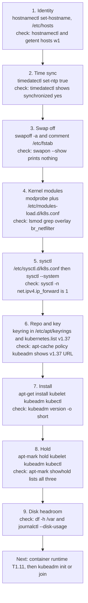

# T1.15 Packages, kernel modules, sysctl, swap and disks

> Competency: n/a, foundation topic | Domain/weight: n/a (foundation; supports both exams) | Est. time: 2 h | Prerequisites: T1.06

Shell setup used in this lesson (from the conventions file). Only the worked example touches `kubectl`, but define it now so every later lesson looks the same:

```bash
alias k=kubectl
export do="--dry-run=client -o yaml"
export now="--force --grace-period=0"
source <(kubectl completion bash); complete -o default -F __start_kubectl k
```

Every lab in this lesson uses the **linux-vm** environment: one Ubuntu LTS VM (24.04 or newer), 2 vCPU, 4 GB RAM, real systemd, cgroup v2. Example: `multipass launch --name lab --cpus 2 --memory 4G --disk 20G`. It is not a container. Run the lab commands as root (`sudo -i`), as you do on exam hosts (summary E8).

How the output blocks are labelled in this lesson:

- `REAL OUTPUT (Docker, ubuntu:24.04 arm64)` was captured by the author in a plain Ubuntu container. Package and `apt` behaviour is the same as on a VM. The architecture column shows `arm64` there and `amd64` on most VMs. It is not a VM result.
- `EXPECTED OUTPUT (not captured)` could not be run on this machine (no VM, no kind). Section 11 lists every one of them.

---

## 1. Why this matters

A kubeadm install or upgrade is mostly package work: add the right repository, install `kubeadm`, `kubelet` and `kubectl` at an exact version, and **hold** them so a routine `apt upgrade` cannot move them. Before that, the node must have the right kernel modules loaded, the right sysctl values set, and swap turned off (or the kubelet configured to accept it). If you miss one step, the node fails in a confusing way: `kubeadm init` stops at preflight, the kubelet crash-loops, Pod traffic silently misroutes, or an unplanned upgrade breaks the version skew rules.

Day-to-day operations also depend on this lesson. A node whose `/var` is full reports `DiskPressure` and evicts Pods. A node whose clock is wrong rejects certificates. Storage labs later need you to read `lsblk`, `df`, `mount` and `/etc/fstab` without thinking.

The exam runs tasks over `ssh <node>` then `sudo -i` (summary E7, E8, source: https://docs.linuxfoundation.org/tc-docs/certification/tips-cka-and-ckad). Package and node-level fixes happen on those hosts, so you must be fast with these commands. The exact OS and distro of the exam hosts is UNVERIFIED (summary E22), so this lesson teaches `apt` first and shows the `dnf` equivalents.

---

## 2. Concepts

### 2.1 Package manager basics: apt

**What it is.** A package manager downloads signed `.deb` files from a repository, checks their signatures, resolves dependencies and installs them with `dpkg`. Debian and Ubuntu use `apt`.

**Problem it solves.** Without it you would copy binaries by hand and never know what version is on the node or how to roll it back.

**How it works inside.** A repository publishes an index (a `Release` / `InRelease` file plus a `Packages` list). `apt update` downloads those indexes into a local cache. `apt install` reads only the local cache. So if you never ran `apt update`, `apt` does not know new versions exist.

| Command | What it does | Notes |
|---|---|---|
| `apt-get update` | Refresh the local index from every configured repo | Run after any change to a `.list` file |
| `apt-get install -y kubeadm` | Install the newest candidate version | `-y` answers yes |
| `apt-get install -y kubeadm=1.37.1-1.1` | Install an exact version | Format: `package=version` |
| `apt-get install -y kubeadm='1.37.1-*'` | Install any package revision of 1.37.1 | Quote the `*` so the shell does not expand it |
| `apt list --installed` | List installed packages | Pipe to `grep kube`. Prints a warning that `apt` has no stable CLI; ignore it |
| `apt-cache policy kubeadm` | Show Installed, Candidate and every available version with its repo | The first thing to run when a version is "not found" |
| `apt-cache madison kubeadm` | One line per available version: package, version, repo | Use it to pick the exact version string |
| `dpkg -l 'kube*'` | Show what dpkg thinks is installed | Works without a network |

**Related but different: `apt` vs `apt-get`.** `apt` is the friendly front end for people (progress bar, colours). `apt-get` and `apt-cache` have a stable output format and are what you put in scripts. Both read the same repositories. In scripts and in this lesson use `apt-get`, `apt-cache` and `apt-mark`.

### 2.2 Listing versions: apt-cache madison

`apt-cache madison kubeadm` prints the versions the *currently configured* repositories offer. It answers "which versions can I install?". It does not answer "which version is installed?" (use `apt list --installed | grep kubeadm` or `kubeadm version -o short`).

REAL OUTPUT (Docker, ubuntu:24.04 arm64), repo set to `v1.37`:

```text
$ apt-cache madison kubeadm
   kubeadm | 1.37.1-1.1 | https://pkgs.k8s.io/core:/stable:/v1.37/deb  Packages
   kubeadm | 1.37.0-1.1 | https://pkgs.k8s.io/core:/stable:/v1.37/deb  Packages
```

Read it left to right. Column 1 is the package, column 2 is the version string, column 3 is the repository. The newest version is first.

**The version string.** `1.37.1-1.1` has two parts. `1.37.1` is the Kubernetes release. `-1.1` is the package revision added by the packaging system. Do not hard-code the revision; use a glob such as `1.37.1-*`. The packaging pipeline can publish `1.37.1-1.2` later, and the glob still matches.

Notice what the output does **not** contain: any `1.36.x` version. A repository serves exactly one minor version (next section). That is why a "version not found" error almost always means "the repo file points at a different minor".

### 2.3 The Kubernetes package repository: pkgs.k8s.io

The community packages live at `https://pkgs.k8s.io/core:/stable:/v1.37/deb/`. The path contains the minor version. There is one repo per minor version: `v1.36`, `v1.37`, and so on.

**Why one repo per minor.** Kubernetes upgrades must go one minor at a time and with a procedure (control plane first, then nodes). Separate repos stop `apt upgrade` from jumping you from 1.36 to 1.38 by accident. You choose the minor on purpose by editing one file.

Setting it up has three parts. They match the kubeadm install page (https://kubernetes.io/docs/setup/production-environment/tools/kubeadm/install-kubeadm/):

```bash
# 1. tools needed to fetch and verify the repo key
apt-get update
apt-get install -y apt-transport-https ca-certificates curl gpg

# 2. the signing key, converted to the binary format apt wants
mkdir -p -m 755 /etc/apt/keyrings
curl -fsSL https://pkgs.k8s.io/core:/stable:/v1.37/deb/Release.key \
  | gpg --dearmor --yes -o /etc/apt/keyrings/kubernetes-apt-keyring.gpg

# 3. the repo definition, pointing at that keyring
echo 'deb [signed-by=/etc/apt/keyrings/kubernetes-apt-keyring.gpg] https://pkgs.k8s.io/core:/stable:/v1.37/deb/ /' \
  > /etc/apt/sources.list.d/kubernetes.list
```

Why each piece exists:

| Piece | Why |
|---|---|
| `/etc/apt/keyrings/kubernetes-apt-keyring.gpg` | The public key that proves a package really came from the Kubernetes project. The same key signs every minor, so the version in the key URL does not matter |
| `signed-by=...` in the list line | Trusts that key **only for this repo**. The old way (`apt-key`, one global trust store) let any key sign any repo. It is deprecated |
| `/etc/apt/sources.list.d/kubernetes.list` | One file per repo. Editing it is the whole "switch minor" operation |
| The trailing ` /` after the URL | The repo is "flat": no `dists/` or components, just an index at the URL root |
| `mkdir -p -m 755 /etc/apt/keyrings` | Older releases (before Debian 12 and Ubuntu 22.04) do not have the directory. On 24.04 it exists, and `-p` makes the command safe either way |

I captured this exact sequence in a container and `apt-get update` fetched the `v1.37` `InRelease` and `Packages` files with no signature warning. The captured repo file was:

```text
deb [signed-by=/etc/apt/keyrings/kubernetes-apt-keyring.gpg] https://pkgs.k8s.io/core:/stable:/v1.37/deb/ /
```

**Switching the minor for an upgrade.** To move from 1.36 to 1.37 you edit one word and refresh the index:

```bash
sed -i 's#/v1.36/#/v1.37/#' /etc/apt/sources.list.d/kubernetes.list   # or edit by hand in vim
apt-get update
apt-cache madison kubeadm          # must now show 1.37.x lines
```

If you edit the file and forget `apt-get update`, `apt-cache madison` still shows the old repo's versions. That is the number one confusion; always run `update` and look at `madison` before you install.

### 2.4 Holding packages: apt-mark hold

**What a hold is.** A hold tells `dpkg` "do not change this package's version". `apt upgrade`, `apt dist-upgrade` and unattended-upgrades all skip held packages.

**Why it matters for Kubernetes.** Version skew rules limit how far apart components may be: the kubelet must not be newer than the API server, and `kubectl` must be within one minor of it. The kubelet can run up to three minor versions older than the API server; see the version skew page for the exact policy. A node that silently gets a new kubelet during a routine `apt upgrade` can break those rules, and the new package can restart the kubelet at a moment you did not choose. Upgrades of a cluster follow a fixed order (control plane first, then each node, one minor version at a time). You perform that order by briefly lifting the hold, installing the exact version and putting the hold back.

| Command | Meaning |
|---|---|
| `apt-mark hold kubelet kubeadm kubectl` | Freeze the three packages at their current version |
| `apt-mark showhold` | List held packages (empty output means none) |
| `apt-mark unhold kubeadm` | Lift the hold so one package can change |
| `dpkg --get-selections \| grep hold` | The same information from dpkg's side |

REAL OUTPUT (Docker, ubuntu:24.04 arm64):

```text
$ apt-mark hold kubelet kubeadm kubectl
kubelet set on hold.
kubeadm set on hold.
kubectl set on hold.
$ apt-mark showhold
kubeadm
kubectl
kubelet
$ apt-mark unhold kubeadm
Canceled hold on kubeadm.
$ apt-mark showhold
kubectl
kubelet
```

What a hold does to a plain upgrade, with the repo already switched to `v1.37` while 1.36.5 is installed (REAL OUTPUT, Docker, ubuntu:24.04 arm64):

```text
$ apt-get -y upgrade
...
Calculating upgrade...
The following packages have been kept back:
  kubeadm kubectl kubelet
0 upgraded, 0 newly installed, 0 to remove and 3 not upgraded.
```

And what a hold does to an explicit install of a newer version (same state):

```text
$ apt-get install -y kubeadm=1.37.1-1.1
The following held packages will be changed:
  kubeadm
The following packages will be upgraded:
  kubeadm
1 upgraded, 0 newly installed, 0 to remove and 2 not upgraded.
E: Held packages were changed and -y was used without --allow-change-held-packages.
```

So the safe upgrade pattern is: `apt-mark unhold kubeadm`, install the exact version, `apt-mark hold kubeadm`. The error above is `apt` protecting you; do not bypass it with `--allow-change-held-packages` unless you mean to.

**Risky value / default.** There is no hold by default. A fresh install is unprotected until you run `apt-mark hold`. Any `apt-get upgrade` run by a person, a script or a configuration tool will move unheld packages, so the hold is the reliable defence.

### 2.5 dnf / yum equivalents (awareness only)

Red Hat family distributions use `dnf` (the successor of `yum`). The exam host distro is UNVERIFIED (summary E22), so know the mapping and expect to use `apt` on Ubuntu/Debian.

| Task | apt (Debian, Ubuntu) | dnf (RHEL, Fedora, CentOS) |
|---|---|---|
| Repo file | `/etc/apt/sources.list.d/kubernetes.list` | `/etc/yum.repos.d/kubernetes.repo` |
| Repo URL | `https://pkgs.k8s.io/core:/stable:/v1.37/deb/` | `https://pkgs.k8s.io/core:/stable:/v1.37/rpm/` |
| Trust the key | `signed-by=` keyring | `gpgcheck=1` and `gpgkey=.../repodata/repomd.xml.key` in the repo file |
| Refresh index | `apt-get update` | `dnf makecache` (runs automatically on install) |
| List versions | `apt-cache madison kubeadm` | `dnf list --showduplicates kubeadm` |
| Install | `apt-get install -y kubelet kubeadm kubectl` | `dnf install -y kubelet kubeadm kubectl --disableexcludes=kubernetes` |
| Protect from upgrades | `apt-mark hold ...` | `exclude=kubelet kubeadm kubectl cri-tools kubernetes-cni` inside the repo file |
| List installed | `apt list --installed` / `dpkg -l` | `dnf list installed` / `rpm -qa` |

The `dnf` row for "protect" works the opposite way round from `apt`: the packages are excluded in the repo file, so a normal `dnf update` never sees them, and you pass `--disableexcludes=kubernetes` only when you intend to install or upgrade them. For Fedora with DNF5 the flag is `--setopt=disable_excludes=kubernetes`. The kubeadm install page also tells Red Hat users to put SELinux in permissive mode (`setenforce 0` plus an edit of `/etc/selinux/config`). Source: https://kubernetes.io/docs/setup/production-environment/tools/kubeadm/install-kubeadm/.

### 2.6 Kernel modules: lsmod, modprobe, modules-load.d

**What a kernel module is.** The Linux kernel is modular. Features such as filesystems and netfilter hooks are compiled as `.ko` files under `/lib/modules/$(uname -r)/` and loaded into the running kernel on demand. A module that is not loaded does not exist for the kernel, even if the file is on disk.

| Command | What it does |
|---|---|
| `lsmod` | List loaded modules (reads `/proc/modules`) |
| `lsmod \| grep -E 'overlay\|br_netfilter'` | Check the two modules Kubernetes nodes need |
| `modprobe overlay br_netfilter` | Load modules now (and any modules they depend on) |
| `modprobe -r br_netfilter` | Unload a module (fails if in use) |
| `modinfo br_netfilter` | Show module file, description and dependencies |

Two modules matter for a kubeadm node:

| Module | Why Kubernetes needs it | If missing |
|---|---|---|
| `overlay` | Provides the `overlayfs` filesystem. containerd's default snapshotter stacks image layers with it, so every container root filesystem is an overlay mount | The runtime cannot create container filesystems the normal way; pods stay in `ContainerCreating` or the runtime reports errors about the snapshotter |
| `br_netfilter` | Makes frames that cross a Linux bridge (what most CNI plugins use to connect Pods on one node) pass through iptables/nftables rules. kube-proxy and NetworkPolicy rules live there | The `net.bridge.bridge-nf-call-*` sysctls do not exist, and Service/NetworkPolicy traffic between Pods on the same node can bypass the rules |

The kubeadm install and container runtime pages today list only IPv4 forwarding as a manual prerequisite (https://kubernetes.io/docs/setup/production-environment/container-runtimes/), and some CNI plugins load what they need themselves. Loading both modules on every node is still the standard, harmless practice, and the node-prep snippet in this lesson does it.

**Making it survive a reboot.** `modprobe` only changes the running kernel. At boot, `systemd-modules-load.service` reads every `*.conf` file in `/etc/modules-load.d/` and loads each module named there (one name per line, `#` starts a comment):

```bash
cat > /etc/modules-load.d/k8s.conf <<'EOF'
overlay
br_netfilter
EOF
modprobe overlay
modprobe br_netfilter
```

The file handles future boots, and the two `modprobe` lines handle *now*. Forgetting either half is a classic bug: the first because the node works until its next reboot, the second because you must reboot to see the effect. Order at boot is safe: `systemd-modules-load` runs before `systemd-sysctl`, so the bridge sysctls (next section) find their module. See [T1.06](../part1-linux/T1.06-systemd-and-journalctl.md) for `systemctl status` and `journalctl -u` on that unit.

### 2.7 Kernel parameters: sysctl

**What sysctl is.** The kernel exposes tunable parameters as files under `/proc/sys`. The path `net/ipv4/ip_forward` is the parameter name `net.ipv4.ip_forward`. The `sysctl` command reads and writes them. Writing a value takes effect immediately and is **lost at reboot**, unless you also put it in a config file.

| Parameter | Value | Purpose |
|---|---|---|
| `net.ipv4.ip_forward` | `1` | Let the node route IPv4 packets between interfaces. Without it, traffic from a Pod to another node or to a Service cannot be forwarded. kubeadm's preflight checks this value |
| `net.bridge.bridge-nf-call-iptables` | `1` | Send bridged IPv4 frames through iptables. Exists only after `br_netfilter` is loaded |
| `net.bridge.bridge-nf-call-ip6tables` | `1` | Same for IPv6 |

| Command | What it does |
|---|---|
| `sysctl net.ipv4.ip_forward` | Print one value |
| `sysctl -n net.ipv4.ip_forward` | Print only the number (good in scripts and tests) |
| `sysctl -w net.ipv4.ip_forward=1` | Set it now, not persistent |
| `sysctl --system` | Reload **all** config directories, in order |
| `sysctl -p` | Reload only `/etc/sysctl.conf` (misses `/etc/sysctl.d/`; avoid it) |
| `sysctl -a \| grep bridge` | Find a parameter by name |

Persistent configuration goes in `/etc/sysctl.d/k8s.conf`:

```bash
cat > /etc/sysctl.d/k8s.conf <<'EOF'
net.bridge.bridge-nf-call-iptables  = 1
net.bridge.bridge-nf-call-ip6tables = 1
net.ipv4.ip_forward                 = 1
EOF
sysctl --system
```

**Under the hood.** `sysctl --system` reads, in this order of directories, `/run/sysctl.d`, `/etc/sysctl.d`, `/usr/local/lib/sysctl.d`, `/usr/lib/sysctl.d`, `/lib/sysctl.d` and finally `/etc/sysctl.conf`. A file name that appears in several directories is read only once (the earlier directory wins). Files are applied in alphabetical order of file name, and a later setting for the same key overrides an earlier one. The command prints each file it applies, so you can see which file set the final value. The name `k8s.conf` is a convention. A file called `99-something.conf` from another package can override your value, which is why you always verify with `sysctl -n` afterwards.

**Failure when the module is missing.** Setting a bridge key before `br_netfilter` is loaded fails because the file under `/proc/sys/net/bridge/` does not exist yet:

```text
EXPECTED OUTPUT (not captured)
sysctl: cannot stat /proc/sys/net/bridge/bridge-nf-call-iptables: No such file or directory
```

So the order in the node-prep snippet is fixed: modules first, sysctl second.

Another expected symptom: if `ip_forward` is `0`, `kubeadm init` stops at preflight with a line of the form `[ERROR FileContent--proc-sys-net-ipv4-ip_forward]: /proc/sys/net/ipv4/ip_forward contents are not set to 1` (EXPECTED, not captured).

### 2.8 Swap

**What swap is.** Swap is disk space the kernel uses as overflow for memory pages. `swapon --show` lists active swap (a partition, a file, or a zram device). `free -h` shows its size and use.

**Why Kubernetes historically wanted it off.** Memory requests and limits, the scheduler, and the OOM killer all assume memory is a hard resource. With swap, a container over its limit may not die; it just becomes slow, and the node's memory accounting is no longer predictable. So the kubelet refuses to start on a node with swap, by default.

| Setting | Where | Default | Effect |
|---|---|---|---|
| `failSwapOn` | KubeletConfiguration (flag `--fail-swap-on`, now deprecated in favour of the config file) | `true` | kubelet exits at startup if the node has swap |
| `memorySwap.swapBehavior` | KubeletConfiguration | `NoSwap` | What Pods may do when swap exists. Only meaningful when `failSwapOn: false` |

I confirmed the kubelet v1.37.1 defaults by running the binary from the `pkgs.k8s.io` v1.37 package in a container and reading its configuration dump and flag help:

```text
REAL OUTPUT (Docker, ubuntu:24.04 arm64), kubelet --v=2 (trimmed)
	failSwapOn: true
	memorySwap: {}
I1027 ... flags.go:64] FLAG: --fail-swap-on="true"
```

`memorySwap: {}` means `swapBehavior` is unset, which the documentation defines as `NoSwap`. The kubelet binary also contains this exact error text (found with `strings`): `running with swap on is not supported, please disable swap or set --fail-swap-on flag to false`.

**The two ways to deal with swap.**

| | Option A: turn swap off (the classic, most common) | Option B: tolerate swap (`failSwapOn: false`) |
|---|---|---|
| How | `swapoff -a` plus remove the swap entry from `/etc/fstab` | Edit KubeletConfiguration, restart kubelet |
| Pods use swap? | No | Only if you also set `swapBehavior: LimitedSwap` |
| Use when | Exam tasks and normal kubeadm clusters | You deliberately want Pods to use swap |

**Option A, in steps.**

```bash
swapon --show                       # lists active swap. Empty output means no swap
swapoff -a                          # turn all swap off now
sed -i -E '/^[^#].*[[:space:]]swap[[:space:]]/ s/^/#/' /etc/fstab   # comment out swap lines
swapon --show; free -h              # re-check
```

`swapoff -a` is temporary: the kernel forgets it at reboot, and the swap comes back from `/etc/fstab`. That is why both lines are needed. On Ubuntu cloud and server images the line is usually `/swap.img none swap sw 0 0`. The `sed` above comments any non-comment line that has `swap` as a whitespace-separated field; I tested it on a sample file: it commented `/swap.img` and `/dev/vdc` lines, left already-commented lines alone, and left a `/data` ext4 line untouched.

Swap can also be activated by something other than `/etc/fstab`: a systemd swap unit or a zram generator. Check with `systemctl list-units --type=swap`. If a unit re-enables swap after reboot, stop and `mask` it (see [T1.06](../part1-linux/T1.06-systemd-and-journalctl.md)).

**Option B: the swap feature.** Swap support for Linux nodes is GA from v1.34 according to the topic notes (the tutorial page says it needs server version 1.33 or later; see section 11). To use it you need cgroup v2 (see [T1.10](../part1-linux/T1.10-linux-namespaces-and-cgroups-v2.md)), swap provisioned on the node, and this fragment in the kubelet configuration file (kubeadm writes it to `/var/lib/kubelet/config.yaml`):

```yaml
apiVersion: kubelet.config.k8s.io/v1beta1
kind: KubeletConfiguration
failSwapOn: false          # default true. false = kubelet starts even though swap is on
memorySwap:
  swapBehavior: LimitedSwap  # default NoSwap. LimitedSwap lets eligible Pods use swap
```

This is a file read by the kubelet, not an API object, so do not `kubectl apply` it. Apply it with `systemctl restart kubelet`. Source for the fields and defaults: https://kubernetes.io/docs/concepts/cluster-administration/swap-memory-management/.

| `swapBehavior` | Pods can use swap? | Notes |
|---|---|---|
| `NoSwap` (default) | No | With `failSwapOn: false`, system daemons and the kubelet itself still can use swap |
| `LimitedSwap` | Yes, a limit computed automatically per container | The documented design gives swap only to Burstable-QoS Pods, in proportion to their memory request. Guaranteed and BestEffort Pods get none (see section 11) |

The kubelet must be restarted after swap is added or changed to notice it. After enabling, `k top nodes --show-swap` and the node field `status.nodeInfo.swap.capacity` show the swap the kubelet sees.

**Related but different: kubeadm preflight vs kubelet.** kubeadm 1.37 only **warns** about swap during preflight. This is what the binary printed in a container whose host had swap (it saw the Docker VM's swap, not mine):

```text
REAL OUTPUT (Docker, ubuntu:24.04 arm64), kubeadm init phase preflight (trimmed)
	[WARNING Swap]: swap is supported for cgroup v2 only. The kubelet must be properly configured to use swap. Please refer to https://kubernetes.io/docs/concepts/architecture/nodes/#swap-memory, or disable swap on the node
```

The hard failure comes later, from the kubelet service itself. Do not read "preflight passed" as "swap is fine".

### 2.9 Disks and mounts

**What it is.** A disk (block device) holds a filesystem. A filesystem becomes usable when it is **mounted** at a directory (the mount point). `/etc/fstab` lists what the system mounts at boot.

| Command | What it shows | Key flags |
|---|---|---|
| `lsblk` | Tree of disks, partitions and mount points | `-f` adds filesystem type, label, UUID |
| `df -h` | Used and free space per mounted filesystem | `-h` human sizes, `-T` filesystem type, `-i` inodes |
| `df -h /var/lib/containerd` | The filesystem that holds that path | Fails with "No such file or directory" if the path does not exist (no runtime installed yet) |
| `du -sh DIR` | Total size of a directory | `-s` summary, `-x` stay on one filesystem |
| `du -xh /var --max-depth=1 \| sort -rh \| head` | The biggest children of a directory | `sort -h` understands `K`, `M`, `G` |
| `mount` | All current mounts (long) | `mount -a` mounts everything in fstab (used as a test) |
| `findmnt` | Mounts as a readable tree | `findmnt -T PATH` = which mount holds PATH; `findmnt --verify` = lint fstab |

REAL OUTPUT (Docker, ubuntu:24.04 arm64; inside a container the devices belong to the Docker VM, so this shows the shape, not a VM disk layout):

```text
$ df -h /var/lib
Filesystem      Size  Used Avail Use% Mounted on
overlay         138G   37G  101G  27% /
$ findmnt -t tmpfs
TARGET     SOURCE FSTYPE OPTIONS
/dev       tmpfs  tmpfs  rw,nosuid,size=65536k,mode=755
`-/dev/shm shm    tmpfs  rw,nosuid,nodev,noexec,relatime,size=8211456k
```

**`/etc/fstab` has six fields** per line, separated by spaces or tabs:

```text
# <what>              <where>   <type>  <options>        <dump> <pass>
UUID=1b2c-...         /data     ext4    defaults,nofail  0      2
/swap.img             none      swap    sw               0      0
```

| Field | Meaning | Risky value |
|---|---|---|
| 1 what | Device, `UUID=...` or `LABEL=...`. Prefer UUID because `/dev/sdb` can change names between boots | A bare `/dev/sdb1` that later becomes `/dev/sdc1` |
| 2 where | Mount point. Must exist. `none` for swap | Missing directory |
| 3 type | `ext4`, `xfs`, `swap`, `nfs` ... | Wrong type |
| 4 options | `defaults`, `nofail` (do not stop boot if the device is missing), `noatime` ... | Leaving out `nofail` on a non-essential disk |
| 5 dump | Old backup flag, use `0` | |
| 6 pass | fsck order: `1` for root, `2` for others, `0` = never check | |

A bad `/etc/fstab` line can drop the machine into emergency mode at boot. So test before you reboot: `findmnt --verify` (a lint) and `mount -a` (actually mounts). REAL OUTPUT (Docker) of the lint for a line whose device and mount point do not exist:

```text
$ findmnt --verify --tab-file /tmp/f
0 parse errors, 2 errors, 0 warnings
/data
   [E] unreachable on boot required target: No such file or directory
   [E] unreachable on boot required source: UUID=x
```

To practise the whole flow without a spare disk, use a file as a disk (a loop device). Storage labs later use the same commands with real volumes:

```bash
truncate -s 1G /root/disk.img          # sparse 1 GiB file
mkfs.ext4 -q -F /root/disk.img         # put a filesystem in it
mkdir -p /mnt/data
mount -o loop /root/disk.img /mnt/data # attach through a loop device and mount
findmnt /mnt/data                      # confirm
df -h /mnt/data
umount /mnt/data                       # undo
rm /root/disk.img
```

EXPECTED OUTPUT (not captured) for the `findmnt` line: one row with TARGET `/mnt/data`, SOURCE `/dev/loopN`, FSTYPE `ext4`.

### 2.10 Disk pressure on a node

**What the kubelet watches.** The kubelet measures free space and inodes on two filesystems:

| Name | What it holds | Typical path |
|---|---|---|
| `nodefs` | The kubelet's own data: Pod volumes, `emptyDir`, logs | `/var/lib/kubelet`, `/var/log` |
| `imagefs` | The container runtime's images and writable container layers | `/var/lib/containerd` |

On most kubeadm nodes both live on the same disk (the root filesystem), so one full `/var` triggers both. Check with `df -h /var/lib/kubelet /var/lib/containerd`, or `findmnt -T /var/lib/containerd`.

**What happens when space runs low.** The kubelet has **hard eviction thresholds**. The documented Linux defaults are `nodefs.available<10%`, `nodefs.inodesFree<5%` and `imagefs.available<15%` (plus `memory.available<100Mi`); see section 11. When a threshold is crossed:

1. The kubelet sets the node condition `DiskPressure=True`, and the node controller adds the taint `node.kubernetes.io/disk-pressure:NoSchedule`. New Pods are not scheduled there.
2. The kubelet first tries to reclaim space by deleting dead containers and unused images (image garbage collection starts at `imageGCHighThresholdPercent`, default 85, and aims for `imageGCLowThresholdPercent`, default 80).
3. If that is not enough, it **evicts** Pods. An evicted Pod ends in phase `Failed` with reason `Evicted`.

**Where the space usually goes.**

| Consumer | Check | Safe cleanup |
|---|---|---|
| Unused images | `crictl images`, `crictl imagefsinfo` | `crictl rmi --prune` removes images no container uses |
| Stopped containers | `crictl ps -a` | `crictl rm <id>`; the kubelet also does this itself |
| Container logs | `du -sh /var/log/pods /var/log/containers` | The kubelet rotates them (`containerLogMaxSize` 10Mi and `containerLogMaxFiles` 5 by default, see section 11); fix the noisy workload |
| systemd journal | `journalctl --disk-usage` | `journalctl --vacuum-size=200M` or `--vacuum-time=2d` |
| Old package cache | `du -sh /var/cache/apt` | `apt-get clean` |
| Pod data (emptyDir, volumes) | `du -sh /var/lib/kubelet/pods` | Fix the workload. Do **not** delete these by hand |
| Deleted but still open files | `ls -l /proc/<pid>/fd \| grep deleted`, `lsof +L1` | Restart the process or truncate instead of deleting |

**Why `df` and `du` can disagree.** If you `rm` a file that a process still has open, the name disappears but the kernel keeps the data until the process closes it. `du` no longer counts it; `df` still does. To free space from a live log, truncate it (`truncate -s 0 FILE`) instead of deleting it. Lab 2 trains this.

Journal commands, with the usual output shapes (EXPECTED OUTPUT, not captured):

```text
$ journalctl --disk-usage
Archived and active journals take up 1.2G in the file system.
$ journalctl --vacuum-size=200M
...
Vacuuming done, freed 1.0G of archived journals from /var/log/journal.
```

To keep the journal small permanently, set `SystemMaxUse=200M` in `/etc/systemd/journald.conf` and run `systemctl restart systemd-journald` (see [T1.06](../part1-linux/T1.06-systemd-and-journalctl.md)).

### 2.11 Time sync

**Why it matters.** TLS certificates carry `notBefore` and `notAfter` dates. A node whose clock is behind sees a valid certificate as "not yet valid"; a clock ahead sees it as expired. Kubernetes uses certificates everywhere (API server, kubelet, etcd, `kubeadm join` bootstrap) and bootstrap tokens expire, so a wrong clock produces errors such as `x509: certificate has expired or is not yet valid: current time ... is before ...`. etcd and leader election also need clocks that agree. Certificate details: [T1.12](../part1-linux/T1.12-tls-pki-and-openssl-for-kubernetes.md).

| Command | Meaning |
|---|---|
| `timedatectl` | Show local time, time zone, `System clock synchronized: yes/no`, `NTP service: active/inactive` |
| `timedatectl set-ntp true` | Turn on the time sync service managed by systemd |
| `systemctl status systemd-timesyncd` | Ubuntu's default lightweight NTP client |
| `chronyc tracking` / `chronyc sources -v` | If you use `chrony` (the other common daemon): offset from the reference and the servers it uses |

Run **one** time daemon. `systemd-timesyncd` is the Ubuntu default. `chrony` is a more capable replacement; installing it replaces timesyncd. EXPECTED OUTPUT (not captured) of a healthy `timedatectl`, trimmed:

```text
               Local time: Tue 2026-10-27 08:10:02 UTC
           Universal time: Tue 2026-10-27 08:10:02 UTC
                Time zone: Etc/UTC (UTC, +0000)
System clock synchronized: yes
              NTP service: active
```

If it says `synchronized: no`, check outbound UDP port 123 and the daemon status.

### 2.12 Hostname and /etc/hosts

The kubelet registers the node under the machine's hostname, lowercased. Two nodes with the same hostname fight over one Node object, and cloned VMs often share a hostname, a machine ID and sometimes a `product_uuid` (the kubeadm install page tells you to verify the MAC address and `product_uuid` are unique, `cat /sys/class/dmi/id/product_uuid`).

```bash
hostnamectl set-hostname cp1                 # persistent; also changes the running hostname
hostnamectl                                  # shows static hostname, machine ID, kernel, OS
cat >> /etc/hosts <<'EOF'
192.168.64.10 cp1
192.168.64.11 w1
192.168.64.12 w2
EOF
getent hosts w1                              # resolves through /etc/hosts, DNS, etc.
```

`/etc/hosts` is consulted before DNS (order set in `/etc/nsswitch.conf`), so it is the cheapest way to make node names resolve in a lab with no DNS. The addresses above are examples; use your VMs' real addresses (`ip -br a`, see T1.07). Do not change a node's hostname after it has joined a cluster; the Node object name is fixed, so you would have to delete and re-join the node.

### 2.13 Under the hood: what each layer actually does

- **dpkg and apt.** `apt` resolves a request using its cache of repo indexes, downloads `.deb` files, verifies them against the repo's signed `Release` file using the keyring named in `signed-by`, then asks `dpkg` to unpack them and run maintainer scripts. A hold is just a dpkg "selection" state; `apt` refuses to change that package.
- **Kernel module loading.** `modprobe` finds the module under `/lib/modules/$(uname -r)/`, resolves its dependencies with `modules.dep` and inserts it into the running kernel. A new kernel version has its own module directory, so a node that updated its kernel but not rebooted can fail to load modules until it boots the new kernel.
- **sysctl.** Each key is a file in `/proc/sys`; `sysctl -w` is a `write()` to that file. The kernel applies it at once. `systemd-sysctl.service` replays the config files at boot.
- **Swap.** The kubelet checks the kernel's swap state at startup (it reads the same data as `/proc/swaps`). That is why the kubelet must be restarted after changing swap.
- **Eviction.** The kubelet's eviction manager polls filesystem and memory statistics from cAdvisor and the runtime every few seconds, compares them with the thresholds, and updates the node's conditions.

---

## 3. How it works (diagram)

Node preparation as a sequence. Each box has the command that proves the step is done:



Walkthrough:

1. Steps 1 and 2 give the node a unique name and a correct clock, so certificates and the Node object are valid from the start.
2. Step 3 removes swap before the kubelet ever starts; the fstab edit makes it survive a reboot.
3. Steps 4 and 5 are ordered on purpose: the `net.bridge.*` sysctl files appear only after `br_netfilter` is loaded.
4. Steps 6 to 8 are the package part. The repo path decides which minor version you can see, and the hold decides whether it can change later.
5. Step 9 is a quick check that `/var` has room for images and logs. The container runtime comes next ([T1.11](../part1-linux/T1.11-containers-images-registries-and-runtimes-oci.md)).

---

## 4. Commands and YAML you must produce fast

### 4.1 Imperative shortcuts

| Task | Command | Explanation |
|---|---|---|
| Which versions exist | `apt-cache madison kubeadm` | One line per version. Newest first |
| Which repo, which candidate | `apt-cache policy kubeadm` | Shows Installed, Candidate and the repo URL |
| Switch minor | `sed -i 's#/v1.36/#/v1.37/#' /etc/apt/sources.list.d/kubernetes.list && apt-get update` | One edit and a refresh |
| Install exact | `apt-get install -y kubeadm='1.37.1-*'` | Glob covers the package revision |
| Hold / list | `apt-mark hold kubelet kubeadm kubectl` / `apt-mark showhold` | Freeze, then verify |
| Modules now and at boot | `modprobe overlay br_netfilter` and write `/etc/modules-load.d/k8s.conf` | Two halves of one job |
| sysctl now and at boot | write `/etc/sysctl.d/k8s.conf` then `sysctl --system` | One command applies and re-reads everything |
| Swap off for good | `swapoff -a` and comment the swap line in `/etc/fstab` | Two halves again |
| What fills the disk | `du -xh /var --max-depth=2 \| sort -rh \| head` | `-x` stays on `/var`'s filesystem |
| Free space on a path | `df -h /var/lib/containerd` (or `findmnt -T PATH`) | Which filesystem and how full |
| Free image space | `crictl rmi --prune` | Needs a running runtime. Removes unused images only |
| Shrink journal | `journalctl --vacuum-size=200M` | Deletes oldest archived journals |

### 4.2 The full node-prep snippet (write this from memory)

Save as `~/lab/t115/node-prep.sh`, run as root. It is idempotent: running it twice changes nothing the second time. `bash -n` (syntax check) passes on it; the apt part was run in a container; the module, sysctl and swap lines need a real VM (see section 11).

```bash
#!/usr/bin/env bash
set -euo pipefail
MINOR=v1.37                                   # the Kubernetes minor version to install

# --- 3. swap off now, and off after reboot --------------------------------
swapoff -a
sed -i -E '/^[^#].*[[:space:]]swap[[:space:]]/ s/^/#/' /etc/fstab

# --- 4. kernel modules: now and at boot -----------------------------------
cat > /etc/modules-load.d/k8s.conf <<'EOF'
overlay
br_netfilter
EOF
modprobe overlay
modprobe br_netfilter

# --- 5. sysctl: bridge keys exist only after br_netfilter is loaded -------
cat > /etc/sysctl.d/k8s.conf <<'EOF'
net.bridge.bridge-nf-call-iptables  = 1
net.bridge.bridge-nf-call-ip6tables = 1
net.ipv4.ip_forward                 = 1
EOF
sysctl --system >/dev/null

# --- 6. repository and signing key ----------------------------------------
apt-get update
apt-get install -y apt-transport-https ca-certificates curl gpg
mkdir -p -m 755 /etc/apt/keyrings
curl -fsSL "https://pkgs.k8s.io/core:/stable:/${MINOR}/deb/Release.key" \
  | gpg --dearmor --yes -o /etc/apt/keyrings/kubernetes-apt-keyring.gpg
echo "deb [signed-by=/etc/apt/keyrings/kubernetes-apt-keyring.gpg] https://pkgs.k8s.io/core:/stable:/${MINOR}/deb/ /" \
  > /etc/apt/sources.list.d/kubernetes.list

# --- 7 and 8. install, hold, enable ----------------------------------------
apt-get update
apt-get install -y kubelet kubeadm kubectl
apt-mark hold kubelet kubeadm kubectl
systemctl enable --now kubelet                # crash-loops until kubeadm init/join: that is normal
```

On the exam you will not type a script; you will type these lines one at a time on the node. The important thing is to know the order and the check after each step.

A note on `systemctl enable --now kubelet`: until `kubeadm init` or `join` writes `/var/lib/kubelet/config.yaml`, the kubelet restarts every few seconds. This is expected, not a failure of your prep.

### 4.3 The declarative files, every field explained

`/etc/modules-load.d/k8s.conf` (read by `systemd-modules-load` at boot):

```text
overlay            # module name, one per line. Loads the overlayfs filesystem
br_netfilter       # module name. Makes bridged traffic visible to iptables/nftables
# lines starting with # or ; are comments
```

`/etc/sysctl.d/k8s.conf` (read by `systemd-sysctl` and `sysctl --system`):

```text
net.bridge.bridge-nf-call-iptables  = 1   # bridged IPv4 -> iptables. Needs br_netfilter. Set it explicitly, do not rely on the default
net.bridge.bridge-nf-call-ip6tables = 1   # same for IPv6
net.ipv4.ip_forward                 = 1   # default 0. 0 = the node will not route between interfaces
```

`/etc/apt/sources.list.d/kubernetes.list` (one line):

```text
deb [signed-by=/etc/apt/keyrings/kubernetes-apt-keyring.gpg] https://pkgs.k8s.io/core:/stable:/v1.37/deb/ /
# deb            = binary package repo (deb-src = source packages)
# signed-by=...  = the only key allowed to sign this repo
# URL, then " /" = flat repo layout; the v1.37 in the URL is the minor version you will see
```

The kubelet configuration fragment for the swap-tolerant variant (kubelet file, not for `kubectl apply`):

```yaml
apiVersion: kubelet.config.k8s.io/v1beta1   # config API group and version of the kubelet file
kind: KubeletConfiguration
failSwapOn: false            # default true. Risky: a node with swap and NoSwap hides memory pressure from workloads
memorySwap:
  swapBehavior: LimitedSwap  # NoSwap (default) or LimitedSwap. Needs cgroup v2
```

### 4.4 Speed drill

Targets are exam pace. Run as root. **Setup (one block, run first):**

```bash
mkdir -p ~/lab/t115 && cp /etc/fstab ~/lab/t115/fstab.bak
echo 'deb [signed-by=/etc/apt/keyrings/kubernetes-apt-keyring.gpg] https://pkgs.k8s.io/core:/stable:/v1.36/deb/ /' > /etc/apt/sources.list.d/drill-k8s.list
fallocate -l 256M /drill.swap && chmod 600 /drill.swap && mkswap /drill.swap >/dev/null && swapon /drill.swap
echo '/drill.swap none swap sw 0 0' >> /etc/fstab
mkdir -p /var/log/drill && fallocate -l 50M /var/log/drill/big.log
```

| # | Task | Target |
|---|---|---|
| 1 | In `/etc/apt/sources.list.d/drill-k8s.list` change the repo from `v1.36` to `v1.37` | 1 min |
| 2 | Print only the version string of the newest `kubeadm` the real repo offers (needs the Easy-lab repo; if not present, print the `Candidate:` line of `apt-cache policy apt`) | 1 min |
| 3 | Load module `br_netfilter` now and make it load at boot using the file `/etc/modules-load.d/drill.conf` | 1.5 min |
| 4 | Set `net.ipv4.ip_forward=1` persistently using `/etc/sysctl.d/90-drill.conf`, and print the live value as a bare number | 2 min |
| 5 | Turn off the swap file `/drill.swap` now **and** after reboot | 2 min |
| 6 | Print the 3 biggest directories under `/var` (one filesystem only) | 1.5 min |
| 7 | Print the journal size, then cap archived journals at 200M | 1 min |
| 8 | Show which filesystem holds `/var/log` and how full it is | 1 min |

<details><summary>Answers</summary>

```bash
# 1
sed -i 's#/v1.36/#/v1.37/#' /etc/apt/sources.list.d/drill-k8s.list
grep -q '/v1.37/' /etc/apt/sources.list.d/drill-k8s.list && echo ok

# 2
apt-cache madison kubeadm | awk 'NR==1{print $3}'        # newest first, column 3 = version
# fallback: apt-cache policy apt | grep Candidate

# 3
echo br_netfilter > /etc/modules-load.d/drill.conf
modprobe br_netfilter && lsmod | grep -w br_netfilter

# 4
echo 'net.ipv4.ip_forward = 1' > /etc/sysctl.d/90-drill.conf
sysctl --system >/dev/null; sysctl -n net.ipv4.ip_forward   # prints 1

# 5
swapoff /drill.swap                     # or swapoff -a
sed -i -E '/^[^#].*[[:space:]]swap[[:space:]]/ s/^/#/' /etc/fstab
swapon --show; grep swap /etc/fstab     # swapon prints nothing; fstab line starts with #

# 6
du -xh /var --max-depth=2 2>/dev/null | sort -rh | head -3

# 7
journalctl --disk-usage; journalctl --vacuum-size=200M

# 8
df -h /var/log; findmnt -T /var/log
```

</details>

**Cleanup (returns the VM to baseline):**

```bash
swapoff /drill.swap 2>/dev/null; rm -f /drill.swap
cp ~/lab/t115/fstab.bak /etc/fstab
rm -f /etc/apt/sources.list.d/drill-k8s.list /etc/modules-load.d/drill.conf /etc/sysctl.d/90-drill.conf
rm -rf /var/log/drill
sysctl --system >/dev/null
```

(The Easy lab's own `k8s.conf` files are not touched by the drill cleanup. `br_netfilter` stays loaded for this boot; that is harmless.)

---

## 5. Worked example

Goal: take a fresh Ubuntu 24.04 VM named `w1` to "ready for `kubeadm join`", checking each step. Work as root (`ssh w1`, then `sudo -i`).

**Step 1. Identity and time.** Confirm the name is unique, then confirm the clock is synced.

```bash
hostnamectl set-hostname w1
hostnamectl | grep -E 'Static hostname|Machine ID'
timedatectl | grep -E 'synchronized|NTP'
```

EXPECTED OUTPUT (not captured):

```text
 Static hostname: w1
      Machine ID: 4f1c...
System clock synchronized: yes
              NTP service: active
```

Look for `synchronized: yes`. If `no`, fix time before anything else, since certificate errors later will look unrelated.

**Step 2. Swap.** See what exists, remove it, prove it is gone.

```bash
swapon --show
swapoff -a
sed -i -E '/^[^#].*[[:space:]]swap[[:space:]]/ s/^/#/' /etc/fstab
swapon --show; grep -n swap /etc/fstab
```

EXPECTED OUTPUT (not captured): the first `swapon --show` lists a file such as `/swap.img file 2G 0B -2`; the second prints nothing; `grep` shows `#/swap.img none swap sw 0 0` (commented). A VM with no swap prints nothing both times; that is fine.

**Step 3. Modules and sysctl.** Load the module before the sysctl.

```bash
printf 'overlay\nbr_netfilter\n' > /etc/modules-load.d/k8s.conf
modprobe overlay br_netfilter
lsmod | grep -E '^(overlay|br_netfilter)'
printf 'net.bridge.bridge-nf-call-iptables = 1\nnet.bridge.bridge-nf-call-ip6tables = 1\nnet.ipv4.ip_forward = 1\n' > /etc/sysctl.d/k8s.conf
sysctl --system | grep k8s.conf
sysctl net.bridge.bridge-nf-call-iptables net.ipv4.ip_forward
```

EXPECTED OUTPUT (not captured):

```text
br_netfilter           32768  0
overlay               212992  0
* Applying /etc/sysctl.d/k8s.conf ...
net.bridge.bridge-nf-call-iptables = 1
net.bridge.bridge-nf-call-ip6tables = 1
net.ipv4.ip_forward = 1
net.bridge.bridge-nf-call-iptables = 1
net.ipv4.ip_forward = 1
```

(Module sizes will differ.) What to look for: both modules are listed, and the value you read back is `1`, which proves no later file overrode yours.

**Step 4. Repo, versions, policy.** Run the three repo commands from section 2.3 and then check what you can install:

```bash
apt-cache madison kubeadm
apt-cache policy kubeadm
```

REAL OUTPUT (Docker, ubuntu:24.04 arm64; on an amd64 VM the lines are identical):

```text
   kubeadm | 1.37.1-1.1 | https://pkgs.k8s.io/core:/stable:/v1.37/deb  Packages
   kubeadm | 1.37.0-1.1 | https://pkgs.k8s.io/core:/stable:/v1.37/deb  Packages
kubeadm:
  Installed: (none)
  Candidate: 1.37.1-1.1
  Version table:
     1.37.1-1.1 500
        500 https://pkgs.k8s.io/core:/stable:/v1.37/deb  Packages
     1.37.0-1.1 500
        500 https://pkgs.k8s.io/core:/stable:/v1.37/deb  Packages
```

Reading `policy`: `Candidate` is what a plain `apt-get install kubeadm` would install. The number `500` is the pin priority (the default for a normal repo). `Installed: (none)` means not yet installed. These two versions were the ones available when I captured this (2026-10-27); a later run may show more.

**Step 5. Install and hold.**

```bash
apt-get install -y kubelet kubeadm kubectl
apt-mark hold kubelet kubeadm kubectl
kubeadm version -o short; kubelet --version
apt list --installed 2>/dev/null | grep -E '^kube'
apt-mark showhold
```

REAL OUTPUT (Docker, ubuntu:24.04 arm64):

```text
kubelet set on hold.
kubeadm set on hold.
kubectl set on hold.
v1.37.1
Kubernetes v1.37.1
kubeadm/unknown,now 1.37.1-1.1 arm64 [installed]
kubectl/unknown,now 1.37.1-1.1 arm64 [installed]
kubelet/unknown,now 1.37.1-1.1 arm64 [installed]
kubernetes-cni/unknown,now 1.9.1-1.1 arm64 [installed,automatic]
kubeadm
kubectl
kubelet
```

`kubernetes-cni` came in automatically as a dependency of `kubelet` (`Depends: kubernetes-cni (>= 1.2.0), mount, util-linux, libc6` in the package metadata). It is **not** held by your command, but it follows from the held kubelet's dependency.

**Step 6. Upgrade day: switch the minor, install an exact version.** (Simulated here with 1.36.5 installed and held, repo moved to `v1.37`. REAL OUTPUT in section 2.4 for the `upgrade` and the held-install error.) The correct procedure for one package is:

```bash
sed -i 's#/v1.36/#/v1.37/#' /etc/apt/sources.list.d/kubernetes.list
apt-get update
apt-mark unhold kubeadm
apt-get install -y kubeadm='1.37.1-*'
apt-mark hold kubeadm
kubeadm version -o short
```

REAL OUTPUT (Docker): the last command printed `v1.37.1` while `kubelet --version` still printed `Kubernetes v1.36.5`. That mismatch is expected at this point of a real upgrade: you upgrade `kubeadm` first, run `kubeadm upgrade`, and only then the kubelet (the full procedure is in the Part 4 upgrade lesson).

**Step 7. Disk headroom.**

```bash
df -h /var/lib/containerd || df -h /var/lib
du -xh /var --max-depth=1 2>/dev/null | sort -rh | head -5
journalctl --disk-usage
k get nodes   # on a joined node's control plane: the Node should not show DiskPressure
```

EXPECTED OUTPUT (not captured):

```text
Filesystem      Size  Used Avail Use% Mounted on
/dev/sda1        19G  3.1G   16G  17% /
...
Archived and active journals take up 48.0M in the file system.
```

(On a node that does not yet have a container runtime, `/var/lib/containerd` does not exist and `df` prints `No such file or directory`; the `||` falls back to `/var/lib`.) What to look for: `Use%` well below 85%, and journals in the tens of MB. If `Use%` is above 85%, image GC and eviction are close.

---

## 6. Common mistakes and how to fix them

Troubleshooting path used in all three: (1) read the exact error, (2) look at the configuration that decides the behaviour, (3) check the live state, (4) change one thing, (5) re-run the same check.

| Symptom | What you will see | Cause | Fix |
|---|---|---|---|
| `apt install kubeadm=1.37.1-*` not found | `E: Version '1.37.1-*' for 'kubeadm' was not found` | The repo file still points at `v1.36`, so `1.37.x` is not in any index | `sed -i 's#/v1.36/#/v1.37/#' /etc/apt/sources.list.d/kubernetes.list && apt-get update`, then re-check with `apt-cache madison kubeadm` |
| Node `DiskPressure`, Pods evicted | Node condition `DiskPressure True`, reason `KubeletHasDiskPressure`; Pods `Evicted`; taint `node.kubernetes.io/disk-pressure:NoSchedule` | `/var` is full of images, container logs or journal | `crictl rmi --prune`, `journalctl --vacuum-size=200M`, truncate or fix noisy logs, then delete the Evicted Pods |
| kubelet will not start, swap on | `running with swap on is not supported, please disable swap or set --fail-swap-on flag to false` in `journalctl -u kubelet` | `failSwapOn` defaults to `true` and the node has swap | `swapoff -a`, comment the line in `/etc/fstab`, `systemctl restart kubelet` (or set `failSwapOn: false` on purpose) |

### 6.1 Version "not found"

Real output (Docker, ubuntu:24.04 arm64), with the repo file set to `v1.36` and the command `apt-get install -y kubeadm=1.37.1-*`:

```text
Package kubeadm is not available, but is referred to by another package.
This may mean that the package is missing, has been obsoleted, or
is only available from another source

E: Version '1.37.1-*' for 'kubeadm' was not found
```

Diagnose in this order:

```bash
cat /etc/apt/sources.list.d/kubernetes.list   # 1. which minor does the repo point at?
apt-cache madison kubeadm                     # 2. which versions does apt know right now? only 1.36.x means wrong repo (or stale index)
apt-cache policy kubeadm                      # 3. confirm Candidate and the repo URL
```

How to read it: if the file says `v1.37` but `madison` still shows `1.36.x`, you edited but did not run `apt-get update`. If the file says `v1.36`, the file is the cause. If `madison` prints nothing, the repo or key is broken: `apt-get update` will print the error (for example a missing key). A typo in the version (`1.37.1` vs `1.37.01`) gives the same message, so compare with the `madison` output. Fix, then re-run `madison` and the install.

### 6.2 DiskPressure and evictions

Check from the control plane first (these use `k`):

```bash
k describe node w1 | grep -A8 'Conditions:'      # is DiskPressure True?
k describe node w1 | grep -i taints              # disk-pressure taint present?
k get pods -A --field-selector=status.phase=Failed   # evicted pods stay as Failed objects
k get events -A --field-selector reason=Evicted      # why they were evicted
```

EXPECTED OUTPUT (not captured), the shape only; the wording of the message differs between versions and the numbers are placeholders:

```text
  DiskPressure   True    ...   KubeletHasDiskPressure   kubelet has disk pressure
Taints:             node.kubernetes.io/disk-pressure:NoSchedule
... Evicted ... The node was low on resource: ephemeral-storage. ...
```

Then go to the node (`ssh w1`, `sudo -i`) and find what is large (never delete blindly):

```bash
df -h /var /var/lib/containerd /var/lib/kubelet     # which filesystem is full? also df -i for inodes
du -xh /var --max-depth=2 2>/dev/null | sort -rh | head -10
crictl images | head; crictl imagefsinfo            # runtime image usage
journalctl --disk-usage
```

Free space in safe order: unused images (`crictl rmi --prune`), journal (`journalctl --vacuum-size=200M`), apt cache (`apt-get clean`), then old logs that your process does not hold open (use `truncate -s 0` for an active log). Never remove files under `/var/lib/kubelet/pods` or `/var/lib/containerd/io.containerd.*` by hand; the runtime and kubelet track them. After space is back, the kubelet clears the condition after the eviction pressure transition period (default 5 minutes), then the taint is removed. Finish with `k delete pods -A --field-selector=status.phase=Failed` to remove evicted Pod objects. Lab 2 practises this.

### 6.3 Kubelet fails because swap is on

```bash
systemctl status kubelet                       # Active: activating (auto-restart) ... or failed
journalctl -u kubelet --no-pager -n 20         # look for the swap message
swapon --show                                  # confirms swap is active
grep -n swap /etc/fstab                        # why it came back after reboot
systemctl list-units --type=swap               # systemd swap units, zram
```

EXPECTED OUTPUT (not captured). The error text itself is confirmed in the kubelet v1.37.1 binary; the wrapper around it is the pattern the same binary printed for another startup failure:

```text
... "command failed" err="failed to run Kubelet: running with swap on is not supported, please disable swap or set --fail-swap-on flag to false"
```

Fix: `swapoff -a`, comment the fstab line, `systemctl restart kubelet`, and verify with `systemctl is-active kubelet`. If the node has just been prepared and not yet initialised, the kubelet may still restart repeatedly for a different reason (no config yet); re-read the *latest* journal lines to be sure the swap message is gone. If you want swap on purpose, set `failSwapOn: false` (and `swapBehavior` if Pods may use it), then restart the kubelet.

### 6.4 Other traps worth knowing

| Symptom | What you will see | Cause | Fix |
|---|---|---|---|
| Held package refuses an explicit install | `E: Held packages were changed and -y was used without --allow-change-held-packages.` | The package is on hold (this is good) | `apt-mark unhold PKG`, install, `apt-mark hold PKG` |
| Bridge sysctl cannot be set | `sysctl: cannot stat /proc/sys/net/bridge/bridge-nf-call-iptables: No such file or directory` (EXPECTED, not captured) | `br_netfilter` not loaded | `modprobe br_netfilter`, then `sysctl --system` |
| Everything worked until reboot | After reboot `sysctl -n net.ipv4.ip_forward` prints `0`, `lsmod` lacks the modules, `swapon --show` lists swap | Only live changes were made (`sysctl -w`, `modprobe`, `swapoff -a`) | Write the three persistent files/edits, then reboot-test |
| `df` full, `du` small | `df` says 100%, `du -sh /var` says much less | A deleted file is still open by a process | `ls -l /proc/<pid>/fd \| grep deleted`; restart that process; use `truncate -s 0` next time |
| Certificate "not yet valid" after joining | `x509: certificate has expired or is not yet valid` | Node clock wrong | `timedatectl set-ntp true`, check `timedatectl` |

---

## 7. Labs

All three labs use the **linux-vm** environment (Ubuntu 24.04 or newer, 2 vCPU, 4 GB, 20 GB disk). Run as root (`sudo -i`). Files go in `~/lab/t115/`. **Order: Easy, then Medium, then Break-fix.** Each lab's cleanup returns the VM to the state its own setup started from; Break-fix explicitly restores the Easy-lab state (v1.37 packages, held).

None of these labs could be run on this machine (no VM available). The commands were traced by hand, and the apt, hold, downgrade and repo-switch parts and the log/fallocate/truncate logic were executed in an Ubuntu 24.04 container. Output blocks marked EXPECTED are listed in section 11.

### 7.1 Easy: prepare a fresh VM

**Environment and setup.**

```bash
# on your computer
multipass launch --name lab --cpus 2 --memory 4G --disk 20G
multipass shell lab
# in the VM
sudo -i
mkdir -p ~/lab/t115 && cd ~/lab/t115
cp /etc/fstab fstab.orig
swapon --show; lsmod | grep -E 'overlay|br_netfilter'; apt-mark showhold    # record the starting state
```

**Task.** On this VM, set the following up so that it survives a reboot:

1. Modules `overlay` and `br_netfilter` loaded now and at every boot.
2. `net.bridge.bridge-nf-call-iptables`, `net.bridge.bridge-nf-call-ip6tables` and `net.ipv4.ip_forward` all set to `1`, persistently, in `/etc/sysctl.d/k8s.conf`.
3. No swap, now and after reboot (edit `/etc/fstab` by commenting, do not delete lines).
4. The Kubernetes `v1.37` apt repository with its key in `/etc/apt/keyrings/kubernetes-apt-keyring.gpg`.
5. `kubelet`, `kubeadm` and `kubectl` installed and **held**.
6. Write the output of `apt-cache madison kubeadm` to `~/lab/t115/madison.txt`.

<details><summary>Hint 1</summary>

Order matters between modules and sysctl. Do modules first.
</details>

<details><summary>Hint 2</summary>

`swapoff -a` is not enough on its own. Look at `/etc/fstab`, and run `systemctl list-units --type=swap` in case a systemd unit enables swap.
</details>

<details><summary>Hint 3</summary>

The repo is a three-step recipe: install `gpg` and `curl`, put the key in `/etc/apt/keyrings`, write one `deb [signed-by=...]` line. Run `apt-get update` after the line is written.
</details>

<details><summary>Solution</summary>

The numbered steps in the task map to this script. Each block is needed because: modules and sysctl have a "now" half (live kernel) and a "boot" half (config file); swap likewise (`swapoff` plus fstab); the repo needs the key before `apt-get update` can verify it; the hold stops later upgrades.

```bash
# swap
swapoff -a
sed -i -E '/^[^#].*[[:space:]]swap[[:space:]]/ s/^/#/' /etc/fstab

# modules (now + boot)
printf 'overlay\nbr_netfilter\n' > /etc/modules-load.d/k8s.conf
modprobe overlay
modprobe br_netfilter

# sysctl (boot + now), after the module so the bridge keys exist
cat > /etc/sysctl.d/k8s.conf <<'EOF'
net.bridge.bridge-nf-call-iptables  = 1
net.bridge.bridge-nf-call-ip6tables = 1
net.ipv4.ip_forward                 = 1
EOF
sysctl --system >/dev/null

# repo + key
apt-get update
apt-get install -y apt-transport-https ca-certificates curl gpg
mkdir -p -m 755 /etc/apt/keyrings
curl -fsSL https://pkgs.k8s.io/core:/stable:/v1.37/deb/Release.key | gpg --dearmor --yes -o /etc/apt/keyrings/kubernetes-apt-keyring.gpg
echo 'deb [signed-by=/etc/apt/keyrings/kubernetes-apt-keyring.gpg] https://pkgs.k8s.io/core:/stable:/v1.37/deb/ /' > /etc/apt/sources.list.d/kubernetes.list

# install + hold
apt-get update
apt-get install -y kubelet kubeadm kubectl
apt-mark hold kubelet kubeadm kubectl

# evidence file
apt-cache madison kubeadm > ~/lab/t115/madison.txt
```

Finally reboot and run the verification again, because a persistence mistake only shows after a reboot: `reboot`, then `ssh`/`multipass shell lab` and `sudo -i`.
</details>

**Verification.** Each line must print `ok`; a missing `ok` (or a non-zero exit) means that item failed. Run before and after a reboot.

```bash
lsmod | grep -qw overlay          && lsmod | grep -qw br_netfilter       && echo "ok modules"
test -f /etc/modules-load.d/k8s.conf && grep -qw br_netfilter /etc/modules-load.d/k8s.conf && echo "ok modules file"
for k in net.bridge.bridge-nf-call-iptables net.bridge.bridge-nf-call-ip6tables net.ipv4.ip_forward; do
  test "$(sysctl -n $k)" = 1 || echo "FAIL $k"; done; echo "ok sysctl checked"
test -z "$(swapon --show)"        && echo "ok swap off"
! grep -Eq '^[^#].*[[:space:]]swap[[:space:]]' /etc/fstab && echo "ok fstab"
grep -q '/v1.37/' /etc/apt/sources.list.d/kubernetes.list && echo "ok repo v1.37"
test "$(apt-mark showhold | sort | tr '\n' ' ')" = "kubeadm kubectl kubelet " && echo "ok hold"
kubeadm version -o short | grep -q '^v1\.37\.' && echo "ok kubeadm 1.37"
grep -q '1.37' ~/lab/t115/madison.txt && echo "ok madison file"
```

EXPECTED OUTPUT (not captured): ten `ok ...` lines and no `FAIL`. (The `ok sysctl checked` line prints even on failure, but a `FAIL <key>` line above it would be printed.)

**Cleanup.** To return the VM to the pre-lab state (used if you want to redo it):

```bash
apt-mark unhold kubelet kubeadm kubectl
apt-get remove -y kubelet kubeadm kubectl
rm -f /etc/apt/sources.list.d/kubernetes.list /etc/modules-load.d/k8s.conf /etc/sysctl.d/k8s.conf
cp ~/lab/t115/fstab.orig /etc/fstab
```

Do **not** run this cleanup if you want the Break-fix lab to start from the Easy-lab state; Break-fix has its own setup and restore.

### 7.2 Medium: find what fills /var and free 1 GB safely

**Environment and setup.** Same VM. This builds a fake log directory, a live log held open by a process, and data you must not touch:

```bash
mkdir -p ~/lab/t115 /var/log/lab-app /var/lib/lab-data
fallocate -l 700M /var/log/lab-app/app.log          # the ACTIVE log (a process holds it open)
fallocate -l 300M /var/log/lab-app/app.log.1        # rotated, old
fallocate -l 300M /var/log/lab-app/app.log.2.gz     # rotated, old
fallocate -l 500M /var/lib/lab-data/db.dat          # live application data
nohup bash -c 'exec 3>>/var/log/lab-app/app.log; while :; do echo tick >&3; sleep 5; done' >/dev/null 2>&1 &
echo $! > /run/lab-writer.pid
df -h /var | tail -1
```

**Task.** `/var` is running low on space. Without stopping the process whose PID is in `/run/lab-writer.pid`, and without touching `/var/lib/lab-data`:

1. Find which directory under `/var` holds the most data, and write its path to `~/lab/t115/biggest.txt`.
2. Free at least 1 GB by working only inside that directory.
3. The writer process must still be running and must still write to a file named `/var/log/lab-app/app.log`.

<details><summary>Hint 1</summary>

`du -xh /var --max-depth=2 | sort -rh | head`. Use the depth that shows you the directory with `lab-app` in it, not only `/var/log`.
</details>

<details><summary>Hint 2</summary>

Rotated files (`.1`, `.2.gz`) are not open by anyone. The active log is open by the writer.
</details>

<details><summary>Hint 3</summary>

If you delete a file that a process still has open, `df` does not change. Check `ls -l /proc/$(cat /run/lab-writer.pid)/fd`. To empty a file without removing it, use `truncate -s 0 FILE`.
</details>

<details><summary>Solution</summary>

```bash
# 1. find it. -x keeps du on this filesystem; sort -h sorts 1.3G above 500M.
du -xh /var --max-depth=2 2>/dev/null | sort -rh | head
echo /var/log/lab-app > ~/lab/t115/biggest.txt     # deepest big directory in the list

# 2. what is safe?  Check who has files open there.
ls -l /proc/$(cat /run/lab-writer.pid)/fd | grep app.log     # shows fd 3 -> /var/log/lab-app/app.log

rm /var/log/lab-app/app.log.1 /var/log/lab-app/app.log.2.gz   # rotated, not open: 600 MB freed at once
truncate -s 0 /var/log/lab-app/app.log                        # open log: empty it in place: 700 MB freed
```

Why this works: removing a file frees space only when no process holds it open. The two rotated files are not open, so `rm` frees them. The active log is open by the writer, so `rm` would only hide the name (the space would stay used until the process exits). `truncate -s 0` keeps the same file (same inode) and releases the blocks, and the writer, which opened it in append mode, simply continues at the new end. Total freed is 1,300 MB, above the 1 GB target. The file `db.dat` is data, not a log, so it is left alone.
</details>

**Verification.** Each line prints `ok` or the check fails with no `ok`.

```bash
test "$(cat ~/lab/t115/biggest.txt)" = /var/log/lab-app && echo "ok found biggest"
test "$(du -sm /var/log/lab-app | cut -f1)" -lt 100       && echo "ok >= 1 GB freed there"
test "$(stat -c %s /var/lib/lab-data/db.dat)" = 524288000 && echo "ok db untouched"
kill -0 "$(cat /run/lab-writer.pid)"                      && echo "ok writer alive"
test "$(ls -l /proc/$(cat /run/lab-writer.pid)/fd | grep -c deleted)" = 0 && echo "ok no deleted-but-open files"
test -f /var/log/lab-app/app.log                          && echo "ok app.log present"
df -h /var | tail -1                                      # compare with the setup output: Used should drop by about 1.3G
```

EXPECTED OUTPUT (not captured): six `ok` lines, then the `df` line showing about 1.3 GB less used than at setup. I ran the same `du`, `truncate`, `stat`, `kill -0` and `/proc/<pid>/fd` checks in a container and they passed; the container's `df` did not reflect the freed space, so the `df` line is advisory and is not an assertion here. With `rm /var/log/lab-app/app.log` instead of `truncate`, the container run showed `3 -> /var/log/lab-app/app.log (deleted)`, which is exactly what the "deleted" check catches.

**Cleanup.**

```bash
kill "$(cat /run/lab-writer.pid)" 2>/dev/null
rm -rf /var/log/lab-app /var/lib/lab-data /run/lab-writer.pid ~/lab/t115/biggest.txt
```

### 7.3 Break-fix: packages were upgraded without a hold

**Environment and setup.** Same VM, needs the internet. The setup puts the node in the "good" state of a cluster running Kubernetes 1.36.5: 1.36 repo, three packages at 1.36.5, **no hold** (that is the mistake). Run the setup, then `break.sh`.

```bash
# setup: a node that belongs to a v1.36.5 cluster
apt-mark unhold kubelet kubeadm kubectl 2>/dev/null || true
apt-get install -y apt-transport-https ca-certificates curl gpg
mkdir -p -m 755 /etc/apt/keyrings ~/lab/t115
curl -fsSL https://pkgs.k8s.io/core:/stable:/v1.36/deb/Release.key | gpg --dearmor --yes -o /etc/apt/keyrings/kubernetes-apt-keyring.gpg
echo 'deb [signed-by=/etc/apt/keyrings/kubernetes-apt-keyring.gpg] https://pkgs.k8s.io/core:/stable:/v1.36/deb/ /' > /etc/apt/sources.list.d/kubernetes.list
apt-get update
apt-get install -y --allow-downgrades kubelet=1.36.5-1.1 kubeadm=1.36.5-1.1 kubectl=1.36.5-1.1
kubelet --version                      # Kubernetes v1.36.5
```

`break.sh` (run it, then do the task):

```bash
sed -i 's#/v1.36/#/v1.37/#' /etc/apt/sources.list.d/kubernetes.list
apt-get update -qq
apt-get install -y -qq --only-upgrade kubelet kubeadm
```

**Task.** This node must stay at Kubernetes **v1.36.5**, the version of the control plane it belongs to. Someone has run an upgrade on it. Find out what changed and when, bring `kubelet`, `kubeadm` and `kubectl` back to `1.36.5`, make sure the apt repository points at `v1.36`, and make sure the three packages cannot be upgraded by accident again. Save the apt command line that caused the problem to `~/lab/t115/culprit.txt`.

<details><summary>Hint 1</summary>

Compare versions: `kubelet --version`, `kubeadm version -o short`, `kubectl version --client`. Then `apt list --installed | grep kube` and `apt-mark showhold`.
</details>

<details><summary>Hint 2</summary>

`/var/log/apt/history.log` records each apt run with `Commandline:` and `Upgrade:` lines.
</details>

<details><summary>Hint 3</summary>

A downgrade needs the older version to be visible in `apt-cache madison`. Which repo file decides that? Use `--allow-downgrades` and give exact versions.
</details>

<details><summary>Solution</summary>

Detect:

```bash
kubelet --version; kubeadm version -o short; kubectl version --client | head -1
apt list --installed 2>/dev/null | grep -E '^kube'        # kubectl shows "upgradable to"
apt-mark showhold                                         # empty: nothing was protected
grep -E '^(Start-Date|Commandline|Upgrade)' /var/log/apt/history.log | tail -4
```

In my container run, the result was `kubelet` and `kubeadm` at 1.37.1 while `kubectl` stayed 1.36.5 (REAL OUTPUT (Docker, ubuntu:24.04 arm64)):

```text
Kubernetes v1.37.1
v1.37.1
Client Version: v1.36.5
kubectl/now 1.36.5-1.1 arm64 [installed,upgradable to: 1.37.1-1.1]
Commandline: apt-get install -y -qq --only-upgrade kubelet kubeadm
Upgrade: kubelet:arm64 (1.36.5-1.1, 1.37.1-1.1)
```

A kubelet at 1.37 on a 1.36 control plane is newer than the API server, which the skew policy does not allow. Save the culprit line:

```bash
grep '^Commandline:.*only-upgrade' /var/log/apt/history.log | tail -1 | sed 's/^Commandline: //' > ~/lab/t115/culprit.txt
```

Fix. First point the repo back at the right minor (without it `1.36.5` is not visible), refresh, then downgrade all three and hold:

```bash
sed -i 's#/v1.37/#/v1.36/#' /etc/apt/sources.list.d/kubernetes.list
apt-get update
apt-cache madison kubelet | head -2                          # 1.36.x only
apt-get install -y --allow-downgrades kubelet=1.36.5-1.1 kubeadm=1.36.5-1.1 kubectl=1.36.5-1.1
apt-mark hold kubelet kubeadm kubectl
```

On a node that is already in a cluster, also run `systemctl daemon-reload && systemctl restart kubelet` and check `k get nodes` from the control plane. This lab VM has no cluster, so there is nothing to restart.
</details>

**Verification.**

```bash
test "$(kubelet --version)" = "Kubernetes v1.36.5"        && echo "ok kubelet"
test "$(kubeadm version -o short)" = "v1.36.5"            && echo "ok kubeadm"
kubectl version --client | grep -q 'v1.36.5'              && echo "ok kubectl"
grep -q '/v1.36/' /etc/apt/sources.list.d/kubernetes.list && echo "ok repo"
test "$(apt-mark showhold | sort | tr '\n' ' ')" = "kubeadm kubectl kubelet " && echo "ok hold"
grep -q 'only-upgrade' ~/lab/t115/culprit.txt             && echo "ok culprit saved"
```

EXPECTED OUTPUT (not captured; each check was run on its own in the container with the matching state and passed): six `ok` lines. Before you apply the fix every line except possibly `ok kubectl` is missing; that is how you know the checks can fail.

**Cleanup.** Restore the Easy-lab state (v1.37.x, held), or remove the packages if you skipped the Easy lab:

```bash
apt-mark unhold kubelet kubeadm kubectl
sed -i 's#/v1.36/#/v1.37/#' /etc/apt/sources.list.d/kubernetes.list
apt-get update
apt-get install -y kubelet kubeadm kubectl
apt-mark hold kubelet kubeadm kubectl
kubeadm version -o short                                  # v1.37.x
rm -f ~/lab/t115/culprit.txt
```

---

## 8. Exam tips

- **Order is part of the answer.** After `apt-get update` always confirm with `apt-cache madison <pkg>` before installing a version. On exam hosts you arrive with `ssh <node>` and `sudo -i` (summary E7, E8); the OS is UNVERIFIED (E22), so type `cat /etc/os-release` first and use `apt` or `dnf` accordingly.
- **Never trust "it works now".** Every node fix has a live half and a boot half (modprobe vs `modules-load.d`, `sysctl -w` vs `sysctl.d`, `swapoff` vs `fstab`). Do both, and verify with `lsmod`, `sysctl -n`, `swapon --show`.
- **Hold discipline.** On an upgrade task: `unhold` only the package you are changing, install the exact version with a glob, `hold` again, and finish with `apt-mark showhold`.
- **Docs to open**: the kubeadm install page (repo, key, hold, swap), the container runtimes page (IPv4 forwarding, cgroup driver), and the swap page. URLs: https://kubernetes.io/docs/setup/production-environment/tools/kubeadm/install-kubeadm/ , https://kubernetes.io/docs/setup/production-environment/container-runtimes/ , https://kubernetes.io/docs/concepts/cluster-administration/swap-memory-management/ . Tools on exam hosts are kubectl, yq, curl, wget and man (summary E9); do not count on `jq` or `tmux`. `man` is present on exam hosts (E9); whether a given page such as `man fstab` is installed is UNVERIFIED.
- **Traps before you move on:** the repo minor; held packages; swap coming back after reboot from fstab or a systemd unit; `df -h` vs `du` after deleting open files; clock sync before any certificate or `kubeadm join` problem.

---

## 9. Quick review

1. Which command lists every version of `kubeadm` that the configured repos offer?
   <details><summary>Answer</summary>`apt-cache madison kubeadm` (and `apt-cache policy kubeadm` for Installed and Candidate).</details>
2. You edited `kubernetes.list` from `v1.36` to `v1.37`, but `apt-cache madison kubeadm` still shows only 1.36.x. Why?
   <details><summary>Answer</summary>The local index was not refreshed. Run `apt-get update`, then `madison` again.</details>
3. Why does the repo URL contain the minor version, and what happens if you try to install `1.37.1` while the file says `v1.36`?
   <details><summary>Answer</summary>One repo serves one minor, so upgrades are a deliberate choice. The install fails with `E: Version '1.37.1-*' for 'kubeadm' was not found`.</details>
4. What does `apt-mark hold kubelet kubeadm kubectl` protect against, and how do you upgrade one held package correctly?
   <details><summary>Answer</summary>It stops `apt upgrade` and unattended upgrades from changing them, which would break version skew. For a planned upgrade: `apt-mark unhold PKG`, `apt-get update`, `apt-get install -y PKG='1.37.1-*'`, `apt-mark hold PKG`.</details>
5. Which two modules does a node need, and which sysctl keys depend on one of them?
   <details><summary>Answer</summary>`overlay` and `br_netfilter`. The `net.bridge.bridge-nf-call-iptables` and `-ip6tables` keys only exist once `br_netfilter` is loaded.</details>
6. Why is `sysctl -w net.ipv4.ip_forward=1` not enough?
   <details><summary>Answer</summary>It changes only the running kernel; the value returns to the default at reboot. Put it in `/etc/sysctl.d/k8s.conf` and run `sysctl --system`.</details>
7. What is the kubelet's default for `failSwapOn`, and what are the two ways to deal with a node that has swap?
   <details><summary>Answer</summary>`true`, so the kubelet refuses to start. Either turn swap off (`swapoff -a` plus fstab edit) or set `failSwapOn: false` in the KubeletConfiguration (and optionally `memorySwap.swapBehavior: LimitedSwap` so Pods can use swap; the default is `NoSwap`), then restart the kubelet.</details>
8. A node shows `DiskPressure=True`. Name three safe things to clean and one thing not to touch.
   <details><summary>Answer</summary>`crictl rmi --prune` (unused images), `journalctl --vacuum-size=200M` (journal), large rotated logs (truncate active logs). Do not hand-delete files under `/var/lib/kubelet/pods` or the containerd data directory.</details>
9. `df` says `/var` is 100% full but `du -sh /var` is much smaller. What is the likely cause and what do you do?
   <details><summary>Answer</summary>A deleted file is still held open by a process. Find it with `ls -l /proc/<pid>/fd | grep deleted` (or `lsof +L1`), restart that process, and next time use `truncate -s 0` on live logs.</details>
10. Why do certificate errors appear on a node whose clock is wrong, and how do you check and fix it?
    <details><summary>Answer</summary>Certificates are valid only between `notBefore` and `notAfter`. A clock outside that window makes valid certificates look expired or not yet valid. Check `timedatectl` (`System clock synchronized: yes`), fix with `timedatectl set-ntp true` or by repairing chrony/timesyncd.</details>

---

## 10. References

Kubernetes documentation (allowed in the exam):

- https://kubernetes.io/docs/setup/production-environment/tools/kubeadm/install-kubeadm/
- https://kubernetes.io/docs/setup/production-environment/container-runtimes/
- https://kubernetes.io/docs/concepts/cluster-administration/swap-memory-management/
- https://kubernetes.io/docs/reference/node/swap-behavior/
- https://kubernetes.io/docs/tutorials/cluster-management/provision-swap-memory/

Study resources (coverage only, content here is original):

- The Linux Command Line, chapters 14 and 15 (package management, storage media): https://linuxcommand.org/tlcl.php
- https://github.com/walidshaari/Kubernetes-Certified-Administrator

Exam facts source: https://docs.linuxfoundation.org/tc-docs/certification/tips-cka-and-ckad

Related lessons: [T1.06 systemd and journalctl](../part1-linux/T1.06-systemd-and-journalctl.md), [T1.10 namespaces and cgroups v2](../part1-linux/T1.10-linux-namespaces-and-cgroups-v2.md), [T1.11 containers, images, registries and runtimes](../part1-linux/T1.11-containers-images-registries-and-runtimes-oci.md), [T1.12 TLS, PKI and openssl](../part1-linux/T1.12-tls-pki-and-openssl-for-kubernetes.md).

---

## 11. To verify

**Known limitation.** This machine has no VM (multipass) and no kind cluster, so these "done" criteria could not be met in full: "the node-prep script runs clean on a fresh VM" and any real output from a VM or a cluster. What was run instead: the apt, repo, key, hold, `madison`, `policy`, upgrade, downgrade and glob parts, and the log/truncate/fallocate logic, in an `ubuntu:24.04` container (arm64) with network access; `kubelet` and `kubeadm` v1.37.1 from `pkgs.k8s.io` were executed there for the swap defaults and preflight message. To meet the remaining criteria you need one Ubuntu 24.04+ VM (or three, for the cluster parts), then run `~/lab/t115/node-prep.sh`, reboot, and run the Easy-lab verification block.

Items still open:

1. **Node-prep script on a real VM.** Modules, sysctl, swap and `systemctl enable --now kubelet` lines are EXPECTED. Check that `sysctl --system` prints `* Applying /etc/sysctl.d/k8s.conf ...` and that values survive a reboot.
2. **All EXPECTED OUTPUT blocks** in sections 2.7 (sysctl error; preflight ip_forward line), 2.9 (loop device `findmnt`), 2.10 (journal outputs), 2.11 (`timedatectl`), 5 steps 1 to 3 and 7, 6.2 (node conditions and eviction events), 6.3 (kubelet journal line), 6.4 (bridge sysctl error) and 7 (all lab verification outputs).
3. **Exact `kubelet` journal line for swap.** The sentence `running with swap on is not supported, please disable swap or set --fail-swap-on flag to false` is in the v1.37.1 binary. The `"command failed" err="failed to run Kubelet: ..."` wrapper is inferred from a different startup failure captured in the same binary.
4. **Swap GA version.** "GA from v1.34" is taken from the topic entry; the swap tutorial lists minimum server version 1.33. Confirm against the v1.34 release notes.
5. **`LimitedSwap` details.** The statement that only Burstable-QoS Pods get swap, in proportion to their memory request, comes from the swap design and not from a page I fetched. Confirm on https://kubernetes.io/docs/concepts/cluster-administration/swap-memory-management/ or a node.
6. **kubeadm 1.37 preflight on a VM.** I saw `[WARNING Swap]` in a container whose host had swap. Confirm that a VM with swap on gives the same warning (not an error), that the kubelet then fails, and check the exact `ip_forward` preflight wording.
7. **Default eviction thresholds and log rotation values.** `nodefs.available<10%`, `nodefs.inodesFree<5%`, `imagefs.available<15%`, `memory.available<100Mi`, `imageGCHighThresholdPercent` 85, `imageGCLowThresholdPercent` 80, `evictionPressureTransitionPeriod` 5m, `containerLogMaxSize` 10Mi, `containerLogMaxFiles` 5 are from memory of the documented defaults. Confirm in the kubelet configuration reference and the node-pressure eviction page for v1.37.
8. **Version list.** `1.37.1-1.1` and `1.37.0-1.1` are what the repo served on 2026-10-27. The lesson's examples with `1.37.1` will need updating when `1.37.2` ships. The meaning of the `-1.1` revision suffix is stated only as "package revision".
9. **Lab 2 `df` delta.** The container's `df` did not change after freeing space, so the lab uses `du` plus open-file checks as assertions and `df` only as an observation. Confirm on a VM that `df -h /var` drops by about 1.3 GB.
10. **`kubernetes-cni` and `cri-tools` dependencies.** The captured `apt list` shows `kubernetes-cni` pulled in automatically. Whether `cri-tools` (for `crictl`) is also pulled by `kubeadm` on this repo was not checked; on a VM run `command -v crictl`.
11. **systemd swap units / zram.** The advice to check `systemctl list-units --type=swap` is general Ubuntu behaviour and was not run on a VM.
12. **chrony replaces timesyncd.** Stated as common packaging behaviour; not checked.
13. **Skew policy wording.** "The kubelet can run up to three minor versions older than the API server" is stated from memory of the version skew policy; confirm on https://kubernetes.io/releases/version-skew-policy/ (not in the entry's URL list).
14. **Exam facts** used: E7, E8, E9 (verified, source above) and E22 (UNVERIFIED, stated as such). No other exam fact is claimed.
