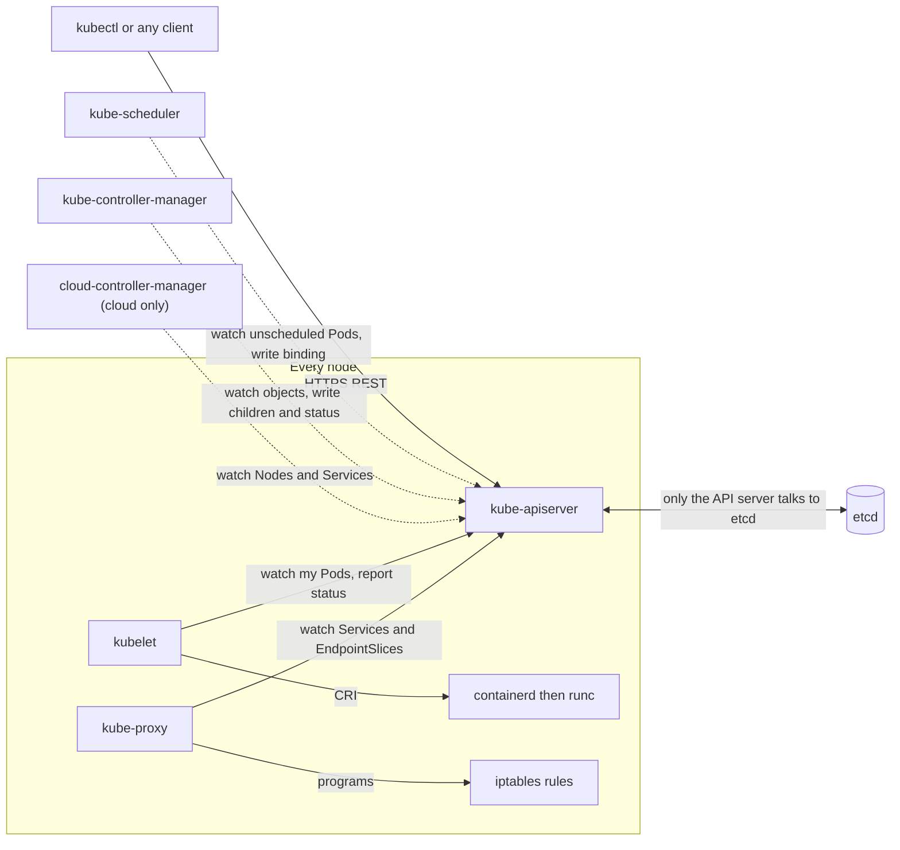

# T2.01 Kubernetes architecture and the API model

> Competency: n/a, foundation topic | Domain/weight: n/a (foundation; supports both exams) | Est. time: 3 h | Prerequisites: T1.11

Shell setup used in every command below (from the conventions file):

```bash
alias k=kubectl
export do="--dry-run=client -o yaml"
export now="--force --grace-period=0"
source <(kubectl completion bash); complete -o default -F __start_kubectl k
```

`k` is `kubectl`. `$do` prints the YAML a command would send without creating anything. `$now` deletes without the grace period. These examples assume Bash. (In zsh, quote any URL that contains `?`, see section 6.)

Where outputs are labelled `REAL OUTPUT (kind v0.33.0, v1.37.0)`, I captured them on a 3-node kind cluster (1 control plane, 2 workers) built from `kindest/node:v1.37.0` with the pinned digest, using kubectl v1.37.1 as the client. Two differences from the course cluster in `env/kind.yaml`: that capture used kind's default CNI (`kindnet`) instead of Calico, and the cluster was named `k-t201`, so node names look like `k-t201-worker`. On your cluster `lab` they are `lab-control-plane`, `lab-worker` and `lab-worker2`, and you will see `calico-*` Pods instead of `kindnet-*`.

---

## 1. Why this matters

Every task you do in Kubernetes is the same move: you describe what you want, send it to one HTTP server, and a set of independent programs make it real. If you do not know which program does what, you cannot tell where to look when a Pod stays `Pending` or an object keeps coming back after you delete it. In the exam you have no time to guess: the component map in this lesson tells you in seconds whether the problem is the scheduler, a controller, the kubelet, or your own YAML.

---

## 2. Concepts

### 2.1 The big picture: a database, a gatekeeper, and many workers

Kubernetes has one source of truth: **etcd**, a key-value database. Only one program talks to it: the **kube-apiserver**. Every other program (and you) talks to the API server over HTTPS. The other programs do one narrow job each. They watch the API server for objects they care about and push the real world towards what the objects say.

This design solves a real problem. If the scheduler, the controllers and the kubelets all wrote to the database directly, nobody could enforce authentication, permissions or validation in one place. With one gatekeeper, every change is checked and recorded the same way. The price: when the API server is down, nothing new can change (running containers keep running, but nothing can be created, updated or scheduled).

### 2.2 Control plane components

The **control plane** is the set of programs that make decisions for the cluster. In a kubeadm cluster and in kind they run as Pods on the control-plane node (see 2.4).

| Component | Job | What breaks if it is down |
|---|---|---|
| `kube-apiserver` | The only front door. Authenticates, authorizes, runs admission, validates, reads and writes etcd, serves watches. | `kubectl` fails with connection errors. Nothing can change. Existing containers keep running. |
| `etcd` | Stores every object. Only the API server connects to it. | The API server cannot read or write. Backup and restore are taught in the CKA etcd lesson in Part 4. |
| `kube-scheduler` | Watches for Pods with no node (`spec.nodeName` empty) and picks a node for each. | New Pods stay `Pending` with no node. Running Pods are untouched. |
| `kube-controller-manager` | One binary running many controllers: Deployment, ReplicaSet, Job, Node, EndpointSlice, ServiceAccount, Namespace, garbage collector. | Objects stop being reconciled: a Deployment creates no ReplicaSet, a ReplicaSet creates no Pods, dead Pods are not replaced. |
| `cloud-controller-manager` | Runs the controllers that talk to a cloud provider's API: node lifecycle, routes, and `LoadBalancer` Services. | On a cloud: `LoadBalancer` Services never get an external address. On kind and bare-metal kubeadm it does not exist. |

You can see most of these in your cluster:

```bash
k get pods -n kube-system -o wide
```

REAL OUTPUT (kind v0.33.0, v1.37.0), trimmed to the columns that matter:

```text
NAME                                           READY   STATUS    NODE
coredns-559f6c778d-fsxhn                       1/1     Running   k-t201-control-plane
coredns-559f6c778d-t55fm                       1/1     Running   k-t201-control-plane
etcd-k-t201-control-plane                      1/1     Running   k-t201-control-plane
kindnet-jkxvc                                  1/1     Running   k-t201-control-plane
kindnet-m959m                                  1/1     Running   k-t201-worker
kindnet-zdmvz                                  1/1     Running   k-t201-worker2
kube-apiserver-k-t201-control-plane            1/1     Running   k-t201-control-plane
kube-controller-manager-k-t201-control-plane   1/1     Running   k-t201-control-plane
kube-proxy-b4tnb                               1/1     Running   k-t201-worker
kube-proxy-rqr95                               1/1     Running   k-t201-worker2
kube-proxy-z7blm                               1/1     Running   k-t201-control-plane
kube-scheduler-k-t201-control-plane            1/1     Running   k-t201-control-plane
```

There is no `cloud-controller-manager` Pod. That is normal here. Also note the Pod names: control-plane Pods end with the node name (`-k-t201-control-plane`). That suffix is the first sign they are static Pods (2.4).

**Related but different:** `kubectl get componentstatuses` (`k get cs`) still exists but is deprecated since v1.19 and prints a warning. Use `k get --raw '/readyz?verbose'` (2.11) instead.

### 2.3 Node components

Every node (control-plane nodes included) runs three things:

| Component | Job | Observe it |
|---|---|---|
| `kubelet` | The node agent. Watches the API server for Pods assigned to its node, asks the container runtime to start them, runs probes, reports Pod and node status back. It is a system service, not a Pod. | `systemctl status kubelet` on a VM node; `k get nodes` shows its version in `VERSION`. |
| container runtime | Pulls images and runs containers through the CRI (Container Runtime Interface). On kind and kubeadm it is containerd, which calls `runc`. See [T1.11](../part1-linux/T1.11-containers-images-registries-and-runtimes-oci.md). | `k get nodes -o wide` column `CONTAINER-RUNTIME` showed `containerd://2.3.4`. |
| `kube-proxy` | Watches Services and EndpointSlices and programs the node's packet rules so a Service IP reaches a Pod. Default mode here is `iptables`. | It runs as a DaemonSet in `kube-system`. |

Confirm on a node (kind nodes are containers named after the cluster, so `docker exec` works like a shell on the node):

```bash
docker exec lab-control-plane crictl ps --name kube-scheduler
docker exec lab-worker iptables-save | grep -m3 KUBE-SERVICES
```

REAL OUTPUT (kind v0.33.0, v1.37.0), node name `k-t201-control-plane`:

```text
CONTAINER      IMAGE          CREATED          STATE     NAME             ATTEMPT   POD ID         POD                                   NAMESPACE
34fd31d89746d  384eabc4fe526  19 seconds ago   Running   kube-scheduler   2         4c757e3e0fdeb  kube-scheduler-k-t201-control-plane   kube-system

:KUBE-SERVICES - [0:0]
-A FORWARD -m conntrack --ctstate NEW -m comment --comment "kubernetes service portals" -j KUBE-SERVICES
-A OUTPUT -m conntrack --ctstate NEW -m comment --comment "kubernetes service portals" -j KUBE-SERVICES
```

The kube-proxy ConfigMap on that cluster had `mode: iptables`. The IPVS mode is deprecated (see conventions); do not use it.

**Under the hood: the kubelet loop.** The kubelet keeps a list of "Pods that should run on me" (from the API server, plus static Pod files). Every few seconds it compares that list with what the runtime reports and starts, stops or restarts containers to match. Then it writes `status` back to the API server. This is the same watch-and-reconcile pattern as every other controller (2.5).

### 2.4 Static Pods: how kubeadm runs the control plane

Someone has to start the API server before the API server exists. Kubernetes solves it with **static Pods**: the kubelet reads Pod manifests from a directory on its own disk and runs them without asking the API server. kubeadm and kind put the four control-plane manifests there.

```bash
docker exec lab-control-plane ls /etc/kubernetes/manifests
docker exec lab-control-plane grep staticPodPath /var/lib/kubelet/config.yaml
```

REAL OUTPUT (kind v0.33.0, v1.37.0):

```text
etcd.yaml
kube-apiserver.yaml
kube-controller-manager.yaml
kube-scheduler.yaml
staticPodPath: /etc/kubernetes/manifests
```

On a kubeadm VM you do the same with `ssh cp1`, `sudo -i`, then `ls /etc/kubernetes/manifests` (VM practice is in T4.13). The kubelet then creates a **mirror Pod**: a read-only copy in the API server so `kubectl get pods` can show it. A mirror Pod is marked by annotations and an owner that is the Node:

```bash
k get pod kube-scheduler-k-t201-control-plane -n kube-system \
  -o jsonpath='{.metadata.ownerReferences}{"\n"}{.metadata.annotations}{"\n"}'
```

REAL OUTPUT (kind v0.33.0, v1.37.0):

```text
[{"apiVersion":"v1","controller":true,"kind":"Node","name":"k-t201-control-plane","uid":"46a7e963-8e8c-4c50-b0d6-94102432f97d"}]
{"kubernetes.io/config.hash":"a3a99e7c778909ee971b05d59b1c03ef","kubernetes.io/config.mirror":"a3a99e7c778909ee971b05d59b1c03ef","kubernetes.io/config.seen":"2026-10-27T08:14:55.161734454Z","kubernetes.io/config.source":"file"}
```

`config.source: file` means "this Pod comes from a manifest file". Rules that follow from this design:

- To change or stop a control-plane component you edit or move the file in `/etc/kubernetes/manifests`. The kubelet notices and restarts the Pod. Editing the mirror Pod through the API does not change what runs, because the file is the real definition.
- If the API server is down, `kubectl` cannot help you. You debug with `crictl` and the kubelet logs on the node.
- The control-plane Pods also carry the labels `component=<name>` and `tier=control-plane` (real: `{"component":"etcd","tier":"control-plane"}`). That is why `k get pods -n kube-system -l tier=control-plane` lists exactly the four.

### 2.5 Desired state, observed state, and the reconciliation loop

Every Kubernetes object has two parts that matter:

| Part | Who writes it | Meaning |
|---|---|---|
| `spec` | You (or a tool you run) | **Desired state**: what you want. |
| `status` | Controllers and the kubelet | **Observed state**: what exists right now. |

A **controller** is a loop: read the desired state, look at the observed state, take the smallest action to close the gap, repeat. Example: a ReplicaSet with `spec.replicas: 2` and one Pod running creates one more Pod. Nothing says "create one". The ReplicaSet controller computes "2 wanted - 1 seen = 1 missing".

Controllers are **level-triggered**, not edge-triggered. An edge-triggered system reacts to events ("a Pod was deleted") and breaks if it misses one. A level-triggered system reacts to the current level ("there are 1 of 2 Pods") every time it looks, so a missed event, a restart of the controller, or a network blip does not matter. The next pass sees the gap and fixes it. This is why Kubernetes self-heals, and why `kubectl delete pod` on a managed Pod just produces a new Pod.

Why you must know this for the exam: when something "keeps coming back" or "does not change", ask who owns the field. You write `spec`; controllers write `status`. If you change `status` yourself, a controller overwrites it (section 6).

### 2.6 API structure: groups, versions, resources, kinds

The API server is an HTTP server. Objects live at URLs:

| API group | URL prefix | `apiVersion:` in YAML | Example kinds |
|---|---|---|---|
| core (named `""`, the empty string) | `/api/v1` | `v1` | Pod, Service, ConfigMap, Secret, Node, Namespace |
| `apps` | `/apis/apps/v1` | `apps/v1` | Deployment, ReplicaSet, StatefulSet, DaemonSet |
| `batch` | `/apis/batch/v1` | `batch/v1` | Job, CronJob |
| `networking.k8s.io` | `/apis/networking.k8s.io/v1` | `networking.k8s.io/v1` | Ingress, NetworkPolicy, IngressClass |
| `rbac.authorization.k8s.io` | `/apis/rbac.authorization.k8s.io/v1` | `rbac.authorization.k8s.io/v1` | Role, ClusterRole, RoleBinding, ClusterRoleBinding |

Why groups? They let teams add and version APIs independently, and let CRDs (Custom Resource Definitions) add new groups without touching the core. The core group is "legacy": it has no name, so its URLs start with `/api` and its `apiVersion` is just `v1`.

**Versions** show maturity. `v1` is stable. `v1beta1` is beta: the shape may still change. `v1alpha1` is alpha. Since Kubernetes 1.24 new beta APIs are off by default, so a cluster usually serves only stable versions. Real proof: `k api-versions` on this cluster listed only `v1`-style versions (plus `autoscaling/v1` and `autoscaling/v2`):

```bash
k api-versions
```

REAL OUTPUT (kind v0.33.0, v1.37.0):

```text
admissionregistration.k8s.io/v1
apiextensions.k8s.io/v1
apiregistration.k8s.io/v1
apps/v1
authentication.k8s.io/v1
authorization.k8s.io/v1
autoscaling/v1
autoscaling/v2
batch/v1
certificates.k8s.io/v1
coordination.k8s.io/v1
discovery.k8s.io/v1
events.k8s.io/v1
flowcontrol.apiserver.k8s.io/v1
networking.k8s.io/v1
node.k8s.io/v1
policy/v1
rbac.authorization.k8s.io/v1
resource.k8s.io/v1
scheduling.k8s.io/v1
storage.k8s.io/v1
storagemigration.k8s.io/v1
v1
```

When one group has several versions, the server stores objects in one **storage version** and converts to the version you ask for. The version `kubectl` prefers is the **preferred version**.

**Resource vs kind** (a very common confusion):

| Word | Example | Where you see it |
|---|---|---|
| Resource | `deployments` (plural, lowercase) | In URLs (`/apis/apps/v1/namespaces/x/deployments`), in `kubectl get deployments`, in RBAC rules |
| Kind | `Deployment` (singular, CamelCase) | In YAML `kind:` |
| Short name | `deploy` | `kubectl get deploy` |
| Subresource | `deployments/status`, `deployments/scale`, `pods/log` | A separate endpoint on the same object |

`kubectl api-resources` prints all of these side by side. REAL OUTPUT (trimmed, kind v0.33.0, v1.37.0):

```text
NAME          SHORTNAMES   APIVERSION   NAMESPACED   KIND
deployments   deploy       apps/v1      true         Deployment
jobs                       batch/v1     true         Job
roles                      rbac.authorization.k8s.io/v1   true   Role
```

Reading the Job line: group `batch`, version `v1`, kind `Job`, resource name `jobs`. So the YAML starts with `apiVersion: batch/v1` and `kind: Job`. For one resource, `k explain job --api-version=batch/v1` shows the fields. On the capture cluster there were 71 resources in total: 34 namespaced and 37 cluster-scoped. CRDs add more.

### 2.7 Namespaced vs cluster-scoped resources

A **namespace** is a named partition inside the cluster. Most objects (Pods, Deployments, Services, ConfigMaps, Roles) live in one namespace, and names must be unique only inside it. Some objects are **cluster-scoped**: they describe things that do not belong to a team (Nodes, PersistentVolumes, StorageClasses, Namespaces themselves, ClusterRoles, CRDs). The `NAMESPACED` column of `k api-resources` tells you which is which. The two commands you must know:

```bash
k api-resources --namespaced=false        # cluster-scoped
k api-resources --namespaced=true -o name # names only, namespaced
```

REAL OUTPUT (kind v0.33.0, v1.37.0) of `k api-resources --namespaced=false`, first lines:

```text
NAME                                SHORTNAMES   APIVERSION                        NAMESPACED   KIND
componentstatuses                   cs           v1                                false        ComponentStatus
namespaces                          ns           v1                                false        Namespace
nodes                               no           v1                                false        Node
persistentvolumes                   pv           v1                                false        PersistentVolume
mutatingadmissionpolicies                        admissionregistration.k8s.io/v1   false        MutatingAdmissionPolicy
...
```

Why it matters: `-n` is ignored for cluster-scoped resources, and a `Role` in the wrong namespace silently does not apply where you expect. Note `mutatingadmissionpolicies` is served as `v1` on this cluster.

### 2.8 Object metadata

Every object has a `metadata` block. These are the fields the exam and real life use:

| Field | Set by | Meaning | Risky value or rule |
|---|---|---|---|
| `name` | You | Name, unique per resource type in a namespace (or cluster for cluster-scoped). | Must be a DNS-style name for most kinds (lowercase letters, digits, `-`, `.`). Cannot be changed. |
| `namespace` | You | The namespace. Empty for cluster-scoped kinds. Default is `default`. | Creating in the wrong namespace is the most common silent mistake. |
| `uid` | API server | Unique ID for this object instance. A deleted and recreated object with the same name has a new `uid`. | Read-only. Owners are matched by `uid`, not by name. |
| `labels` | You | Key/value pairs used by selectors (a Service finds Pods by labels). | A label typo breaks selection silently. |
| `annotations` | You or tools | Key/value metadata that is not used for selection. Larger values allowed. | Not queryable with `-l`. |
| `ownerReferences` | Controllers | "I was created by that owner". Used by garbage collection. | Deleting the owner deletes dependents (cascade). |
| `finalizers` | Controllers or you | Names that must be removed before the object is really deleted. | A finalizer nobody removes leaves the object stuck in `Terminating`. |
| `resourceVersion` | API server | Changes on every write. Used for optimistic concurrency and for watches. | Treat as an opaque string. Do not compare numerically. |
| `generation` | API server | Increments when `spec` changes (on kinds that support it, like Deployment). Compare with `status.observedGeneration`. | A ConfigMap has no `generation`; the field is empty. |
| `deletionTimestamp` | API server | Set when deletion was requested but finalizers still exist. | Object stays visible until finalizers clear. |

`k explain pod.metadata.ownerReferences` and `k explain pod.metadata.finalizers` show the official field text. Section 5 shows all of these on live objects.

**Under the hood: optimistic concurrency.** When you update an object, the API server compares the `resourceVersion` you sent with the stored one. If someone else wrote in between, you get `Operation cannot be fulfilled ... the object has been modified; please apply your changes to the latest version and try again`. `kubectl apply` and `patch` retry or re-read for you. `kubectl replace` of an old file does not.

**Cascading deletion.** Deleting an owner deletes its dependents by default (background deletion). The garbage collector looks at `ownerReferences`. Finalizers can delay it: with the foreground option the owner stays visible until dependents are gone.

### 2.9 Request flow: what the API server does to every request

```text
request -> authentication -> authorization -> mutating admission -> schema validation -> validating admission -> etcd
```

| Step | Question it answers | Typical result in a kubeadm/kind cluster | Failure looks like |
|---|---|---|---|
| Authentication | Who are you? | Client certificate or bearer token from your kubeconfig. | `401 Unauthorized` / `You must be logged in to the server` |
| Authorization | May you do this verb on this resource? | `--authorization-mode=Node,RBAC` (real value from the kind API server manifest). | `Error from server (Forbidden): ... cannot create resource ...` |
| Mutating admission | Should the request be changed? | Defaults and injections (for example default ServiceAccount, default StorageClass); webhooks and mutating admission policies can add more. | A field you did not write appears on the object. |
| Schema validation | Does the object match the type's schema? | Unknown or wrongly typed fields are rejected (kubectl sends `fieldValidation=Strict`, seen in the real request URL in section 5). | `unknown field`, `must be of type` |
| Validating admission | Do policies allow the final object? | Quota, validating webhooks, validating admission policies, Pod Security. | `admission webhook ... denied the request` or `exceeded quota` |
| Persist | Write to etcd, then notify watchers. | The only write path. | `etcdserver: ...` errors, or timeouts. |

Why this order: authorization cannot decide before it knows who you are. Mutation must happen before validation so that policies check the final object. Detail of each step is in T3.16 (preview only here). The kind API server's `--enable-admission-plugins=NodeRestriction` is the extra plugin kubeadm adds; Kubernetes enables a default set of others as well (the exact default list is in the "To verify" section).

### 2.10 Watches, informers and events

A **watch** is a long-lived HTTP request: "send me every change to this resource from version X". The API server streams `ADDED`, `MODIFIED`, `DELETED` messages. You can see one with plain kubectl (output in section 5):

```bash
k get --raw '/api/v1/namespaces/lab-t201/pods?watch=true'
```

An **informer** is the library component inside controllers, the scheduler and the kubelet. It does an initial list, then a watch, keeps a local cache, and hands changes to a work queue. Effect: controllers do not hammer the API server with repeated GETs, and if a watch breaks they list again (the level-triggered idea from 2.5). `kubectl get -w` and `k get events --watch` use the same mechanism.

**Events** are a separate small object type (`Event`) that components create to say what they did: `Scheduled`, `Pulling`, `Created`, `Started`, `FailedScheduling`, `BackOff`. They are not part of the object's spec, they are namespaced, and they expire (by default about an hour). They are your best first diagnostic: `k get events -n <ns> --sort-by=.lastTimestamp` and the `Events:` block at the end of `k describe`. Two APIs serve them (`v1` and `events.k8s.io/v1`, both listed in `k api-resources` above).

### 2.11 kubectl is just an HTTP client

`kubectl` reads your kubeconfig (server URL, credentials), turns your command into an HTTP request, and prints the answer. You can prove it three ways:

```bash
k get --raw /version                      # a raw GET, no formatting
k get --raw '/readyz?verbose'             # API server health checks, one per line
k get nodes -v=6                          # log each request and response status
k create deploy web --image=nginx:1.27 -v=8   # also log headers and bodies
```

Verbosity levels: `-v=6` prints the verb, URL, status and time. `-v=8` adds request and response headers and bodies. Always quote a URL that has `?`, because your shell treats `?` as a wildcard.

`/readyz?verbose` lists each check as `[+] ok` or `[-] failed`, and the last line is `readyz check passed`. The `etcd` line proves the API server can reach etcd. You can skip a check with `?verbose&exclude=etcd`; real output prints `[+]etcd excluded: ok`. `/livez` and `/healthz` are the older siblings. Section 5 has the real output.

### 2.12 What happens on `kubectl create deployment`, end to end

1. **kubectl** builds a Deployment object and sends `POST /apis/apps/v1/namespaces/<ns>/deployments` to the API server.
2. **API server**: authenticate, authorize, mutate, validate, store in etcd. Returns `201 Created`. Nothing runs yet.
3. **Deployment controller** (in kube-controller-manager) sees a new Deployment through its watch. It creates a **ReplicaSet** with an `ownerReference` pointing back. Event: `ScalingReplicaSet`.
4. **ReplicaSet controller** sees the ReplicaSet wants N Pods and 0 exist. It creates N **Pods** (also with ownerReferences). Event: `SuccessfulCreate`. These Pods have no node yet (`spec.nodeName` is empty).
5. **kube-scheduler** watches for Pods with no node. It filters out nodes that cannot run the Pod, scores the rest, and writes the chosen node into the Pod (a binding). Event: `Scheduled`.
6. **kubelet** on that node sees a Pod assigned to it. It asks the runtime (via CRI) to pull the image and start containers. Events: `Pulling`, `Pulled`, `Created`, `Started`. It reports `status` (phase `Running`, container states).
7. **Controllers update status** (`availableReplicas`, conditions) and `kubectl rollout status` returns.

Each step is a different program with a different failure signature. That is the diagnostic map: no ReplicaSet means the controller-manager; Pods with no node means the scheduler; Pods with a node but not running means the kubelet, image or runtime.

### 2.13 Add-ons

Add-ons are normal cluster software that Kubernetes needs to be useful but that is not part of the core binaries. They run as Pods (often in `kube-system`).

| Add-on | What it does | Seen in the capture |
|---|---|---|
| CoreDNS | Cluster DNS: resolves Service names to IPs. A Deployment (2 replicas) behind the `kube-dns` Service. | `coredns-...` x2, `deployment.apps/coredns 2/2` |
| CNI plugin (Calico on the course cluster, kindnet in my capture) | Gives Pods IPs and connects nodes. Calico also enforces NetworkPolicy. A DaemonSet. | `kindnet-...` on each node |
| kube-proxy | Service virtual IPs (2.3). DaemonSet. | `kube-proxy-...` on each node |
| metrics-server | Feeds `kubectl top` and the HPA. Not installed by default. | `k top node` gave `error: Metrics API not available` |
| Ingress / Gateway controller (Traefik in this course) | Turns Ingress and Gateway API objects into real HTTP routing. Not installed by default. | Not installed |

### 2.14 Version skew policy at a glance

Components of different versions may talk to each other, but only within limits. The rules are on the [version skew page](https://kubernetes.io/releases/version-skew-policy/). Summary (see "To verify": I wrote these from the policy as I know it and did not re-fetch the page):

| Component | Allowed relative to kube-apiserver 1.37 |
|---|---|
| kube-apiserver (HA replicas) | Within one minor version of each other |
| kubelet | Not newer than the API server; may be up to three minor versions older (1.34 to 1.37) |
| kube-proxy | Not newer than the API server; may be older (see the page for the exact number) |
| kube-controller-manager, kube-scheduler, cloud-controller-manager | Not newer than the API server; may be one minor older |
| kubectl | Within one minor version, older or newer (1.36 to 1.38) |

Consequence: during an upgrade you upgrade the API server first, then controller-manager and scheduler, then kubelets. In the capture, `k version` reported `Client Version: v1.37.1` and `Server Version: v1.37.0`, and every node reported kubelet `v1.37.0`. In v1.37 the `status.nodeInfo.kubeProxyVersion` field of a Node printed empty, so use the kube-proxy image tag instead.

---

## 3. How it works (diagram)



Walkthrough:

1. You (kubectl) and every component send HTTPS requests to the API server. It is the only box that touches etcd.
2. The scheduler and the controller-manager hold watches open on the API server. They never talk to each other; they coordinate only by reading and writing objects.
3. The kubelet watches for Pods assigned to its node and tells containerd (through the CRI) to run them, then writes `status` back through the API server.
4. kube-proxy watches Services and EndpointSlices and turns them into iptables rules on the node.
5. Dotted lines are long-lived watches, solid lines are requests you make or direct calls. If one box dies, only the arrows attached to it stop working.

---

## 4. Commands and YAML you must produce fast

### 4.1 Imperative shortcuts

```bash
k api-resources --namespaced=true -o name > /tmp/ns-res.txt   # every namespaced resource name into a file
k api-resources --namespaced=false                            # cluster-scoped resources, with group and version
k api-resources | grep -i <word>                              # find the exact resource name, group and version
k api-versions                                                # every group/version the server serves
k explain <resource>[.field.field]                            # official field docs from the live server
k get --raw '/readyz?verbose'                                 # API server health, per check
k cluster-info                                                # API server and CoreDNS URLs
k get pods -n kube-system -o wide                             # control plane, add-on and node placement
k create deploy web --image=nginx:1.27 -v=8                   # watch the HTTP request kubectl sends
k create deploy web --image=nginx:1.27 $do > web.yaml         # produce the YAML without creating anything
```

`k cluster-info` REAL OUTPUT (kind v0.33.0, v1.37.0):

```text
Kubernetes control plane is running at https://127.0.0.1:52108
CoreDNS is running at https://127.0.0.1:52108/api/v1/namespaces/kube-system/services/kube-dns:dns/proxy

To further debug and diagnose cluster problems, use 'kubectl cluster-info dump'.
```

**Explain one resource's group, version and kind.** Take `jobs`:

```bash
k api-resources | grep -w jobs
```

Output: `jobs   batch/v1   true   Job`. So: group = `batch`, version = `v1`, kind = `Job`, namespaced = true. YAML header: `apiVersion: batch/v1` and `kind: Job`. The core group has an empty group name, so for Pods you get `v1` alone.

### 4.2 Declarative YAML with every field explained

I verified this file with `k apply -f web.yaml --dry-run=server` (REAL OUTPUT: `deployment.apps/web created (server dry run)`). Create the namespace first: `k create ns lab-t201`.

```yaml
apiVersion: apps/v1          # group "apps", version "v1". Wrong group/version gives "no matches for kind"
kind: Deployment             # the kind (singular, CamelCase). The resource name is "deployments"
metadata:
  name: web                  # unique among Deployments in this namespace; cannot be renamed
  namespace: lab-t201        # a namespaced kind. Omit it and kubectl uses the current context's namespace
  labels:
    app: web                 # label on the Deployment itself (not used for selecting Pods)
spec:                        # DESIRED state: the part you write
  replicas: 2                # how many Pods you want; default 1; negative values are rejected
  selector:
    matchLabels:
      app: web               # which Pods this Deployment owns; must match template labels or apply fails
  template:                  # the Pod blueprint the ReplicaSet will copy
    metadata:
      labels:
        app: web             # labels given to each Pod
    spec:
      containers:
      - name: nginx          # container name inside the Pod
        image: nginx:1.27    # always a pinned version tag
# status: is NOT written by you. Controllers fill it (availableReplicas, conditions, observedGeneration)
```

A second object, to see metadata fields (applies cleanly; the finalizer is on purpose, section 5 removes it):

```yaml
apiVersion: v1                 # core group, so just v1
kind: ConfigMap
metadata:
  name: demo
  namespace: lab-t201
  labels:
    tier: test                 # selectable with -l tier=test
  annotations:
    note: "hello"              # free-form, not selectable
  finalizers:
  - example.com/block          # nobody removes this, so delete leaves the object in Terminating
data:
  a: "1"
```

### 4.3 Speed drill

Setup (one line): `k create ns lab-t201`. Targets are exam pace.

1. (30 s) Write all namespaced resource names to `/tmp/ns-res.txt` and print how many there are.
2. (30 s) Which group, version and kind is the resource `cronjobs`?
3. (30 s) Print only the `etcd` line of the API server health report.
4. (45 s) List the control-plane Pods and the node each runs on, no headers.
5. (45 s) Show the exact URL kubectl calls for `k get deploy -n lab-t201` (hint: verbosity).
6. (60 s) Create Deployment `d7` (image `nginx:1.27`) in `lab-t201` and print the kind and name of the owner of its ReplicaSet.
7. (30 s) List only the resource names in API group `rbac.authorization.k8s.io`.
8. (45 s) Fetch the raw JSON for the `batch/v1` API list and print the first 100 characters.

Cleanup: `k delete deploy d7 -n lab-t201; rm -f /tmp/ns-res.txt` (and `k delete ns lab-t201` when you finish the lesson).

<details><summary>Answers</summary>

1. `k api-resources --namespaced=true -o name > /tmp/ns-res.txt; wc -l < /tmp/ns-res.txt` (34 on the capture cluster; the number grows with CRDs).
2. `k api-resources | grep -w cronjobs` gives `batch/v1` and `CronJob`. Group `batch`, version `v1`, kind `CronJob`.
3. `k get --raw '/readyz?verbose' | grep etcd` prints `[+]etcd ok` and `[+]etcd-readiness ok`.
4. `k get pods -n kube-system -l tier=control-plane -o custom-columns=C:.metadata.labels.component,N:.spec.nodeName --no-headers`
5. `k get deploy -n lab-t201 -v=6 2>&1 | grep 'verb="GET"'`. Expect a URL ending `/apis/apps/v1/namespaces/lab-t201/deployments?limit=500` (the same form I captured for Pods: `/api/v1/namespaces/lab-t201/pods?limit=500`, status `200 OK`).
6. `k create deploy d7 --image=nginx:1.27 -n lab-t201`, wait a few seconds, then `k get rs -n lab-t201 -l app=d7 -o jsonpath='{.items[0].metadata.ownerReferences[0].kind}/{.items[0].metadata.ownerReferences[0].name}{"\n"}'` prints `Deployment/d7`.
7. `k api-resources --api-group=rbac.authorization.k8s.io -o name` (real output: `clusterrolebindings.rbac.authorization.k8s.io`, `clusterroles...`, `rolebindings...`, `roles...`).
8. `k get --raw /apis/batch/v1 | head -c 100` (real output starts `{"kind":"APIResourceList","apiVersion":"v1","groupVersion":"batch/v1","resources":[{"name":"cronjobs`).

</details>

---

## 5. Worked example

Goal: look at the cluster as the API server sees it, then watch one Deployment travel through every component. Environment: kind cluster `lab` (see conventions). All output below is REAL OUTPUT (kind v0.33.0, v1.37.0, kindnet CNI, node names `k-t201-*`) unless marked. Your Pod name suffixes, UIDs and timings will differ.

**Step 0: namespace and client/server versions.**

```bash
k create ns lab-t201
k version
```

```text
namespace/lab-t201 created
Client Version: v1.37.1
Kustomize Version: v5.8.1
Server Version: v1.37.0
```

Client and server are in the same minor version, which is inside the skew rules of 2.14.

**Step 1: the nodes and the container runtime.**

```bash
k get nodes -o wide
```

```text
NAME                   STATUS   ROLES           AGE   VERSION   INTERNAL-IP     OS-IMAGE                       CONTAINER-RUNTIME
k-t201-control-plane   Ready    control-plane   23s   v1.37.0   192.168.147.6   Debian GNU/Linux 13 (trixie)   containerd://2.3.4
k-t201-worker          Ready    <none>          9s    v1.37.0   192.168.147.2   Debian GNU/Linux 13 (trixie)   containerd://2.3.4
k-t201-worker2         Ready    <none>          9s    v1.37.0   192.168.147.5   Debian GNU/Linux 13 (trixie)   containerd://2.3.4
```

(Trimmed to the useful columns. My first capture showed the workers `NotReady` for a few seconds right after creation; wait until all are `Ready`.) The `VERSION` column is the kubelet version.

**Step 2: API server health.**

```bash
k get --raw '/readyz?verbose'
```

```text
[+]ping ok
[+]log ok
[+]etcd ok
[+]etcd-readiness ok
[+]informer-sync ok
[+]poststarthook/start-apiserver-admission-initializer ok
[+]poststarthook/generic-apiserver-start-informers ok
[+]poststarthook/priority-and-fairness-config-consumer ok
...
[+]poststarthook/apiservice-openapiv3-controller ok
[+]shutdown ok
readyz check passed
```

(About 40 lines on this cluster; I trimmed the middle.) How to read it: every line starts `[+]` (ok) or `[-]` (failed). The two `etcd` lines say the API server can reach its database. `informer-sync` says its own caches are loaded. A `[-]etcd` here sends you to the etcd Pod. The plain endpoint `k get --raw /readyz` prints just `ok`, and `k get --raw /version` prints the version JSON (`"gitVersion": "v1.37.0"`).

**Step 3: discovery, then raw REST calls.**

```bash
k get --raw /api
k get --raw /apis | head -c 300; echo
k get --raw /apis/apps/v1 | head -c 400; echo
k get --raw /api/v1/namespaces | head -c 200; echo
```

```text
{"kind":"APIVersions","versions":["v1"],"serverAddressByClientCIDRs":[{"clientCIDR":"0.0.0.0/0","serverAddress":"192.168.147.6:6443"}]}
{"kind":"APIGroupList","apiVersion":"v1","groups":[{"name":"apiregistration.k8s.io","versions":[{"groupVersion":"apiregistration.k8s.io/v1","version":"v1"}],"preferredVersion":{"groupVersion":"apiregistration.k8s.io/v1","version":"v1"}},{"name":"apps","versions":[{"groupVersion":"apps/v1","version":
{"kind":"APIResourceList","apiVersion":"v1","groupVersion":"apps/v1","resources":[{"name":"controllerrevisions","singularName":"controllerrevision","namespaced":true,"kind":"ControllerRevision","verbs":["create","delete","deletecollection","get","list","patch","update","watch"],"storageVersionHash":"85nkx63pcBU="},{"name":"daemonsets","singularName":"daemonset","namespaced":true,"kind":"DaemonSet"
{"kind":"NamespaceList","apiVersion":"v1","metadata":{"resourceVersion":"669"},"items":[{"metadata":{"name":"default","uid":"279352b2-b8a5-4a1c-b70d-d0eda1594c61","resourceVersion":"24","creationTimestamp":"2026-10-27T08:14:53Z",...
```

Notice: `/api` is the core group (only `v1`); `/apis` lists the named groups with a `preferredVersion`; `/apis/apps/v1` lists each resource with its `kind`, whether it is `namespaced`, and the allowed `verbs`. That is exactly the data behind `kubectl api-resources`. The `verbs` list includes `watch`, which is what controllers use.

**Step 4: trace a Deployment with events and `-v=8`.** Open a second terminal and run the watch first:

```bash
# terminal 2
k get events -n lab-t201 --watch
```

In terminal 1:

```bash
k create deploy web --image=nginx:1.27 -n lab-t201 -v=8
k rollout status deploy/web -n lab-t201
```

The verbosity log (grep for the lines that matter; the full log also prints feature-gate lines and a request body):

```text
I1027 16:15:23.020014   26089 round_trippers.go:527] "Request" verb="POST" url="https://127.0.0.1:52108/apis/apps/v1/namespaces/lab-t201/deployments?fieldManager=kubectl-create&fieldValidation=Strict" headers=<
	Accept: application/vnd.kubernetes.protobuf,application/json
	Content-Type: application/vnd.kubernetes.protobuf
	User-Agent: kubectl/v1.37.1 (darwin/arm64) kubernetes/f78e722
 >
I1027 ... "Response" status="201 Created" headers=<
	Audit-Id: d80ec9b4-7dc1-4cb8-87eb-402c0e8b7b37
	Cache-Control: no-cache, private
	Content-Type: application/vnd.kubernetes.protobuf
	X-Kubernetes-Pf-Flowschema-Uid: 67f23874-0df9-4b2f-9e75-5c4537add185
	X-Kubernetes-Pf-Prioritylevel-Uid: 444e6482-a317-42fe-9f67-4f38322908db
 >
deployment.apps/web created
Waiting for deployment "web" rollout to finish: 0 of 1 updated replicas are available...
deployment "web" successfully rolled out
```

How to read it: the verb is `POST`, the URL is the collection `/apis/apps/v1/namespaces/lab-t201/deployments` (group `apps`, version `v1`, namespace, resource `deployments`). `fieldManager=kubectl-create` records who wrote the fields. `fieldValidation=Strict` is the schema-validation step of 2.9. The status `201 Created` means the API server accepted and stored it. In this kubectl version the body is sent as **protobuf** (a binary format), so `Request Body` is a hex dump and not readable JSON; the verb, URL and status are what you read. `Audit-Id` identifies the request in the API server audit log. The two `X-Kubernetes-Pf-...` headers show which API Priority and Fairness queue handled it.

Terminal 2 shows the chain. The events, in the order they happened:

```text
LAST SEEN   TYPE     REASON              OBJECT                      MESSAGE
0s          Normal   ScalingReplicaSet   deployment/web              Scaled up replica set web-69c6f74b8b from 0 to 1
0s          Normal   SuccessfulCreate    replicaset/web-69c6f74b8b   Created pod: web-69c6f74b8b-c9fpz
0s          Normal   Scheduled           pod/web-69c6f74b8b-c9fpz    Successfully assigned lab-t201/web-69c6f74b8b-c9fpz to k-t201-worker
0s          Normal   Pulling             pod/web-69c6f74b8b-c9fpz    Pulling image "nginx:1.27"
0s          Normal   Pulled              pod/web-69c6f74b8b-c9fpz    Successfully pulled image "nginx:1.27" in 10.842s (10.842s including waiting). Image size: 68857691 bytes.
0s          Normal   Created             pod/web-69c6f74b8b-c9fpz    Container created
0s          Normal   Started             pod/web-69c6f74b8b-c9fpz    Container started
```

Map each line to 2.12: `ScalingReplicaSet` is written by the Deployment controller (step 3), `SuccessfulCreate` by the ReplicaSet controller (step 4), `Scheduled` by the scheduler (step 5), and `Pulling`, `Pulled`, `Created`, `Started` by the kubelet (step 6). The `Scheduled` line names the node: that is the scheduler's binding. (On a second run with the image cached, `Pulling` is replaced by `Container image "nginx:1.27" already present on machine`.) Stop the watch with Ctrl+C.

**Step 5: follow the owner chain.**

```bash
k get deploy,rs,pod -n lab-t201 -l app=web
k get pod -n lab-t201 -l app=web -o jsonpath='{.items[0].metadata.ownerReferences}{"\n"}'
k get rs  -n lab-t201 -l app=web -o jsonpath='{.items[0].metadata.ownerReferences}{"\n"}'
```

```text
[{"apiVersion":"apps/v1","blockOwnerDeletion":true,"controller":true,"kind":"ReplicaSet","name":"web-69c6f74b8b","uid":"e4bb991f-7356-4d83-8d1d-c78296f8a8a5"}]
[{"apiVersion":"apps/v1","blockOwnerDeletion":true,"controller":true,"kind":"Deployment","name":"web","uid":"95ced896-26ca-4d17-966b-1a7cb217c54c"}]
```

The Pod is owned by the ReplicaSet and the ReplicaSet by the Deployment. `controller: true` marks the managing owner. `blockOwnerDeletion: true` lets foreground deletion wait for the child.

**Step 6: spec, status, generation.**

```bash
k get deploy web -n lab-t201 -o yaml | sed -n '1,12p;/^status:/,$p'
```

The relevant parts of the real output: `generation: 1` and a `resourceVersion` and `uid` in `metadata`; `spec.replicas: 1`; and in `status`: `availableReplicas: 1`, `observedGeneration: 1`, `readyReplicas: 1`, `replicas: 1`, plus conditions `Available` (`MinimumReplicasAvailable`) and `Progressing` (`NewReplicaSetAvailable`). Then scale and compare:

```bash
k scale deploy web -n lab-t201 --replicas=2
k get deploy web -n lab-t201 -o jsonpath='{.metadata.generation} {.status.observedGeneration}{"\n"}'
```

```text
2 2
```

`generation` went 1 to 2 because `spec` changed; `observedGeneration` is the controller saying "I have seen generation 2". If they differ, the controller has not caught up yet.

**Step 7: the metadata fields on a live object, including a finalizer.** Apply the ConfigMap from 4.2 as `cm.yaml`:

```bash
k apply -f cm.yaml
k get cm demo -n lab-t201 -o jsonpath='{.metadata.uid} rv={.metadata.resourceVersion}{"\n"}'
k annotate cm demo -n lab-t201 note=bye --overwrite
k get cm demo -n lab-t201 -o jsonpath='rv={.metadata.resourceVersion}{"\n"}'
k delete cm demo -n lab-t201 --wait=false
k get cm demo -n lab-t201 -o jsonpath='{.metadata.deletionTimestamp}{"\n"}'
k get cm demo -n lab-t201
k patch cm demo -n lab-t201 --type=merge -p '{"metadata":{"finalizers":null}}'
k get cm demo -n lab-t201
```

```text
configmap/demo created
b0db8281-55f8-4aff-9012-6da648d4b5e0 rv=1097
configmap/demo annotated
rv=1098
configmap "demo" deleted from lab-t201 namespace
2026-10-27T08:17:50Z
NAME   DATA   AGE
demo   1      0s
configmap/demo patched
Error from server (NotFound): configmaps "demo" not found
```

Read it: `resourceVersion` went 1097 to 1098 after one annotation write. After `delete`, the message says "deleted", but the object is still there with a `deletionTimestamp`: the finalizer is holding it. Removing the finalizer lets the API server finish the delete and the next `get` returns NotFound. (Removing a finalizer by hand skips whatever cleanup its owner wanted to do. In real clusters, find out who owns it first.)

**Step 8: a watch by hand.**

```bash
# terminal 2
k get --raw '/api/v1/namespaces/lab-t201/pods?watch=true'
# terminal 1
k run p1 --image=busybox:1.36 -n lab-t201 -- sleep 3600
```

```text
{"type":"ADDED","object":{"kind":"Pod","apiVersion":"v1","metadata":{"name":"p1","namespace":"lab-t201","uid":"ef798d64-28fa-40a4-b0e5-593f5f512749","resourceVersion":"11...
{"type":"MODIFIED","object":{"kind":"Pod","apiVersion":"v1","metadata":{"name":"p1",...
{"type":"MODIFIED","object":{...
```

(The lines are cut at 170 characters; the real stream prints the whole object each time.) One `ADDED`, then several `MODIFIED` messages as the scheduler binds the Pod and the kubelet updates its status. Press Ctrl+C. Delete the Pod: `k delete pod p1 -n lab-t201 $now`.

**Step 9: break one thing to see ownership (also in section 6).**

```bash
k delete pod -n lab-t201 -l app=web
k get pods -n lab-t201 -l app=web
```

Real result: a new Pod, with a different random suffix, appears within seconds. Deleting the Pod's owner (`k delete deploy web -n lab-t201`) removes the ReplicaSet and Pods for good.

**Cleanup:** `k delete ns lab-t201`.

---

## 6. Common mistakes and how to fix them

| Symptom | What you will see (exact text) | Cause | Fix |
|---|---|---|---|
| Wrong resource name or missing CRD | `error: the server doesn't have a resource type "certificate"` (also `... "deployments" in group "foo"` for a wrong group) | Typo, wrong group, or the CRD that defines the kind is not installed | `k api-resources \| grep -i cert`; use the exact NAME and group shown. If nothing matches, the CRD is missing: `k get crd` |
| Edits to `status` are ignored | `deployment.apps/web patched (no change)` when patching the main resource; read back `.status.replicas` is unchanged | `status` is written by controllers; the main endpoint ignores it | Change `spec` (`k scale`, `k edit`, `k set image`), then watch `status` follow |
| Object comes back after delete | `k delete pod ...` prints `deleted`, and `k get pods` shows a Pod with a new suffix seconds later | A controller owns it (ownerReferences) and its loop recreates the missing child | `k get <obj> -o jsonpath='{.metadata.ownerReferences}'`, then delete the owner (`k delete deploy web`) |
| Pods stay `Pending`, no node, no events | `STATUS Pending`, `NODE <none>`, and `k describe pod` has no `Events:` entries | No scheduler is running (or it is stuck) | `k get pods -n kube-system`; `k get lease -n kube-system kube-scheduler`; restore the scheduler manifest (lab 7.3) |
| Object stuck `Terminating` | The object still exists and has a `deletionTimestamp` after `delete` | A finalizer is not being removed | `k get <obj> -o jsonpath='{.metadata.finalizers}'`; fix the owner or, as a last resort, patch `finalizers` to `null` |
| Update rejected | `Operation cannot be fulfilled on deployments.apps "web": the object has been modified; please apply your changes to the latest version and try again` | Your copy has an old `resourceVersion` | Re-read the object (`k get ... -o yaml`), reapply, or use `k apply`/`k patch` |
| Health URL fails in zsh | `no matches found: /readyz?verbose` (real zsh message for an unquoted `?`) | The shell tries to expand `?` as a wildcard before kubectl runs | Quote it: `k get --raw '/readyz?verbose'` |

**Troubleshooting path 1: "the server doesn't have a resource type".**

1. Read the message: it names the string you typed (`"certificate"`). The server did not find it in its discovery data.
2. `k api-resources | grep -i <part>`: do any resources contain the word? On the capture cluster, `grep -i cert` found only `certificatesigningrequests`, `clustertrustbundles` and `podcertificaterequests`, so a `Certificate` kind (it comes from cert-manager) does not exist there.
3. If it is a typo, use the NAME or SHORTNAMES column. If it needs a group (a name used by two groups, for example `events` exists in both `v1` and `events.k8s.io/v1`), write `resource.group`, for example `k get events.events.k8s.io`.
4. If the kind is from a CRD, check `k get crd`. No CRD means the operator or manifest bundle was never installed: install it or fix the task.

**Troubleshooting path 2: "my status edit is ignored".**

1. `k get deploy web -o yaml` and look at who writes each field. `spec` is yours; `status` has `observedGeneration`, `conditions` and counters.
2. Real test: `k patch deploy web --type=merge -p '{"status":{"replicas":9}}'` printed `patched (no change)` and `.status.replicas` stayed `1`. Even when I wrote through the status subresource (`--subresource=status`), the read-back value was `1`, because the controller recomputes `status` from what it observes. I could not tell from the output alone whether the write was applied and overwritten or discarded first. Either way: it does not stick.
3. Change the thing you want, which is `spec`: `k scale deploy web --replicas=3`. Status then follows by itself (`generation` and `observedGeneration` both advance).

**Troubleshooting path 3: "it comes back after delete".**

1. `k get pod <name> -o jsonpath='{.metadata.ownerReferences}'`. A non-empty list means a controller manages it. Real example: the Pod's owner was `ReplicaSet/web-...`.
2. Follow the chain upward (`k get rs <name> -o jsonpath=...`) until you reach an owner with no owner: here `Deployment/web`.
3. Real behaviour: deleting the Pod gave a new Pod; deleting the ReplicaSet gave a new ReplicaSet and new Pods (the Deployment recreated it); `k delete deploy web` removed everything.
4. Delete the top owner. If you want the Pods to remain, delete the owner with orphan propagation (`k delete deploy web --cascade=orphan`); that is a different decision from "make it go away".

**Troubleshooting path 4: "Pending with no events".** `Pending` plus a `FailedScheduling` event means the scheduler ran and no node fits (taints, resources, selectors). `Pending` plus no node and no events at all means nobody tried to schedule it. Check in this order: (a) `k get pods -n kube-system | grep scheduler`: missing or not `Running`? (b) `k get lease -n kube-system kube-scheduler -o jsonpath='{.spec.holderIdentity}'` (an empty value on the capture meant no scheduler held the lease); (c) the manifest on the control-plane node.

---

## 7. Labs

Lab order: Easy, then Medium, then Break-fix. Each lab leaves the cluster at baseline, so any order works. Environment for all three: **kind** cluster `lab` from `env/kind-up.sh` (context `kind-lab`), with node containers `lab-control-plane`, `lab-worker`, `lab-worker2`. Files go in `~/lab/t201/`. On a VM cluster you would use `ssh cp1` then `sudo -i` instead of `docker exec`; in the exam the commands below run with `kubectl` only (the tools on the exam hosts are kubectl, yq, curl, wget and man, source: https://docs.linuxfoundation.org/tc-docs/certification/tips-cka-and-ckad), so these labs use `jsonpath` and plain `grep`, not `jq`.

### Lab 1 (Easy): map every control-plane Pod to its role

**Setup:**

```bash
mkdir -p ~/lab/t201
k config use-context kind-lab
```

**Task:** In `~/lab/t201/cp.txt` write one line per control-plane Pod in namespace `kube-system`, with three columns: the component label, the Pod name, and the node name, no header. In `~/lab/t201/manifests.txt` write the file names in the static Pod directory of the control-plane node (`/etc/kubernetes/manifests`, read it with `docker exec lab-control-plane ...`). In `~/lab/t201/roles.txt` write four lines `component: one-sentence role`, for `kube-apiserver`, `etcd`, `kube-scheduler` and `kube-controller-manager`.

<details><summary>Hints</summary>

1. The four Pods carry the label `tier=control-plane`, and each has a label `component`.
2. `-o custom-columns=C:.metadata.labels.component,P:.metadata.name,N:.spec.nodeName --no-headers`
3. A static Pod's name ends with the node name; its manifest is in the directory the kubelet's `staticPodPath` points at.

</details>

<details><summary>Solution</summary>

```bash
k get pods -n kube-system -l tier=control-plane \
  -o custom-columns=C:.metadata.labels.component,P:.metadata.name,N:.spec.nodeName --no-headers > ~/lab/t201/cp.txt
docker exec lab-control-plane ls /etc/kubernetes/manifests > ~/lab/t201/manifests.txt
cat > ~/lab/t201/roles.txt <<'EOF'
kube-apiserver: the only front door; authenticates, authorizes, validates and stores objects in etcd
etcd: the database that holds all cluster state
kube-scheduler: picks a node for every Pod that has none
kube-controller-manager: runs the controllers that create ReplicaSets and Pods and fix drift
EOF
```

Why each step: the label selector avoids picking add-on Pods like CoreDNS; `custom-columns` produces stable columns you can check with `awk`; the manifests directory proves these Pods are static Pods (their definition lives in a file on the node, not in etcd). Expected `cp.txt` (REAL OUTPUT from my cluster, names differ on yours):

```text
etcd                      etcd-k-t201-control-plane                      k-t201-control-plane
kube-apiserver            kube-apiserver-k-t201-control-plane            k-t201-control-plane
kube-controller-manager   kube-controller-manager-k-t201-control-plane   k-t201-control-plane
kube-scheduler            kube-scheduler-k-t201-control-plane            k-t201-control-plane
```

</details>

**Verify (each command must exit 0):**

```bash
test "$(wc -l < ~/lab/t201/cp.txt)" -eq 4 && echo cp-lines-ok
test "$(awk '{print $1}' ~/lab/t201/cp.txt | sort | tr '\n' ' ')" = "etcd kube-apiserver kube-controller-manager kube-scheduler " && echo components-ok
awk '{print $2}' ~/lab/t201/cp.txt | grep -q '^kube-scheduler-lab-control-plane$' && echo pod-name-ok
test "$(sort ~/lab/t201/manifests.txt | tr '\n' ' ')" = "etcd.yaml kube-apiserver.yaml kube-controller-manager.yaml kube-scheduler.yaml " && echo manifests-ok
for c in kube-apiserver etcd kube-scheduler kube-controller-manager; do grep -q "^$c: ." ~/lab/t201/roles.txt || echo "missing $c"; done
```

The last loop prints nothing on success. If your cluster is not named `lab`, change the Pod name in the third check.

**Cleanup:** `rm -rf ~/lab/t201`

### Lab 2 (Medium): trace a Deployment with `-v=8` and events

**Setup:**

```bash
mkdir -p ~/lab/t201
k create ns lab-t201
```

**Task:** In namespace `lab-t201`, record the API traffic and the events for creating a Deployment named `trace` (image `nginx:1.27`, one replica).

1. Start `k get events -n lab-t201 --watch-only` in the background, writing to `~/lab/t201/events.txt`.
2. Create the Deployment with `-v=8`, sending the verbose log (standard error) to `~/lab/t201/v8.txt`. Wait until the rollout finishes, then stop the event watch.
3. Write the owner of the Pod and the owner of its ReplicaSet to `~/lab/t201/owners.txt`, one per line, in the form `Kind/name`.

<details><summary>Hints</summary>

1. kubectl writes its verbose log to standard error, so use `2> file`.
2. Background the watch with `&` and keep its process id from `$!` so you can `kill` it.
3. `ownerReferences[0].kind` and `.name` are available with jsonpath. List the Pod and ReplicaSet with `-l app=trace`.

</details>

<details><summary>Solution</summary>

```bash
k get events -n lab-t201 --watch-only > ~/lab/t201/events.txt &
EV=$!
sleep 1
k create deploy trace --image=nginx:1.27 -n lab-t201 -v=8 2> ~/lab/t201/v8.txt > /dev/null
k rollout status deploy/trace -n lab-t201 --timeout=120s
sleep 2; kill $EV
{
  k get pods -n lab-t201 -l app=trace -o jsonpath='{.items[0].metadata.ownerReferences[0].kind}/{.items[0].metadata.ownerReferences[0].name}{"\n"}'
  k get rs   -n lab-t201 -l app=trace -o jsonpath='{.items[0].metadata.ownerReferences[0].kind}/{.items[0].metadata.ownerReferences[0].name}{"\n"}'
} > ~/lab/t201/owners.txt
```

Why: the watch must be running before the create or you miss the first events. `--watch-only` prints only new events, which is what you want for a trace. The log in `v8.txt` contains the `POST` to `/apis/apps/v1/namespaces/lab-t201/deployments` and the `201 Created` response (that is the API-server half), and `events.txt` contains `ScalingReplicaSet`, `SuccessfulCreate` and `Scheduled` in that order (that is the controller, ReplicaSet controller and scheduler half). `owners.txt` should read `ReplicaSet/trace-<hash>` then `Deployment/trace`. (In my real run the event file also started with the header line `LAST SEEN TYPE REASON OBJECT MESSAGE` and ended with `Pulled`, `Created`, `Started`.)

</details>

**Verify:**

```bash
grep -q 'verb="POST" url="[^"]*/apis/apps/v1/namespaces/lab-t201/deployments' ~/lab/t201/v8.txt && echo post-ok
grep -q 'status="201 Created"' ~/lab/t201/v8.txt && echo created-ok
awk '/ScalingReplicaSet/{a=NR} /SuccessfulCreate/{b=NR} /Scheduled/{c=NR} END{exit !(a&&b&&c&&a<b&&b<c)}' ~/lab/t201/events.txt && echo event-order-ok
test "$(tail -1 ~/lab/t201/owners.txt)" = "Deployment/trace" && echo deploy-owner-ok
test "$(head -1 ~/lab/t201/owners.txt)" = "ReplicaSet/$(k get rs -n lab-t201 -l app=trace -o name | cut -d/ -f2)" && echo rs-owner-ok
```

**Cleanup:**

```bash
k delete ns lab-t201
rm -rf ~/lab/t201
```

### Lab 3 (Break-fix): Pods will not start

**Setup:** run the fault injector once. Do not read it as a hint; work from the symptoms.

```bash
mkdir -p ~/lab/t201
cat > ~/lab/t201/break.sh <<'EOF'
#!/usr/bin/env bash
docker exec lab-control-plane mv /etc/kubernetes/manifests/kube-scheduler.yaml /tmp/stash-1.yaml
sleep 15
kubectl create ns lab-t201
kubectl create deploy web --image=nginx:1.27 --replicas=2 -n lab-t201
EOF
bash ~/lab/t201/break.sh
```

**Task:** In namespace `lab-t201` the Deployment `web` should have two running Pods, but they are stuck. Find which control-plane component is not running, write its name (for example `etcd`) in `~/lab/t201/missing.txt`, and repair the cluster so that both Pods run. Do not delete or recreate the Deployment.

<details><summary>Hints</summary>

1. Compare the Pod's `NODE` column and its events with the list of control-plane Pods. Which Pod from section 2.2 is absent?
2. Control-plane Pods are static Pods. Their manifests live in `/etc/kubernetes/manifests` on the control-plane node. How many files are there?
3. Something moved the missing file somewhere on that node. `grep -l 'name: kube-scheduler'` over the `*.yaml` files in `/tmp` on the node will find it.

</details>

<details><summary>Solution</summary>

Diagnose in order, from the symptom up:

```bash
k get pods -n lab-t201 -o wide
k describe pod -n lab-t201 -l app=web | grep -A5 -E '^(Node|Status|Events)'
k get pods -n kube-system | grep -E 'scheduler|controller-manager|apiserver|etcd'
k get lease -n kube-system kube-scheduler -o jsonpath='{.spec.holderIdentity}{"\n"}'
docker exec lab-control-plane ls /etc/kubernetes/manifests
docker exec lab-control-plane grep -l 'name: kube-scheduler' /tmp/*.yaml
```

1. `get pods -o wide` shows both Pods `Pending` with `NODE <none>`. Reading it: the Deployment controller and the ReplicaSet controller did their jobs (the Pods exist), so the controller-manager works. No node was assigned, so the step after Pod creation did not happen.
2. `describe` shows no `Events:` (and no `FailedScheduling`). If the scheduler were running and no node fit, you would see `FailedScheduling`. No events means nobody tried.
3. In `kube-system` there is no `kube-scheduler-...` Pod, and the lease `kube-scheduler` has an empty holder. (`k get cs` would also report the scheduler `Unhealthy`.) The other three control-plane Pods are present.
4. The manifests directory has three files, not four: `kube-scheduler.yaml` is missing. The `grep` finds it as `/tmp/stash-1.yaml`.
5. Repair: put it back. The kubelet notices the file and starts the Pod.

```bash
docker exec lab-control-plane mv /tmp/stash-1.yaml /etc/kubernetes/manifests/kube-scheduler.yaml
echo kube-scheduler > ~/lab/t201/missing.txt
k get pods -n lab-t201 -w     # wait until both are Running, then Ctrl+C
```

Why this works: the Pods were not broken. They were waiting for a binding that only the scheduler can write. Once it is back it sees the two unscheduled Pods (it lists existing objects when it starts, the level-triggered behaviour from 2.5) and binds them. In my real run both Pods were `Running` on the two workers about 30 seconds after the file was restored. The restored scheduler Pod may show a non-zero `RESTARTS` count; I saw `2` in the mirror Pod and did not investigate why.

</details>

**Verify:**

```bash
test "$(cat ~/lab/t201/missing.txt)" = "kube-scheduler" && echo answer-ok
test "$(k get pods -n lab-t201 -l app=web --field-selector=status.phase=Running --no-headers | wc -l)" -eq 2 && echo two-running-ok
test "$(k get pods -n lab-t201 -l app=web -o jsonpath='{.items[*].spec.nodeName}' | wc -w)" -eq 2 && echo two-bound-ok
k get pods -n kube-system -l component=kube-scheduler --no-headers | grep -q ' 1/1 *Running' && echo scheduler-running-ok
docker exec lab-control-plane test -f /etc/kubernetes/manifests/kube-scheduler.yaml && echo manifest-ok
```

**Cleanup (returns the cluster to baseline):**

```bash
docker exec lab-control-plane test -f /etc/kubernetes/manifests/kube-scheduler.yaml \
  || docker exec lab-control-plane mv /tmp/stash-1.yaml /etc/kubernetes/manifests/kube-scheduler.yaml
k delete ns lab-t201
rm -rf ~/lab/t201
```

---

## 8. Exam tips

- Expect `kubectl` with an alias and Bash completion, `yq`, `curl`, `wget` and `man` on the task hosts. Do not rely on `jq` or `tmux` being there (source: https://docs.linuxfoundation.org/tc-docs/certification/tips-cka-and-ckad). That is why this lesson uses `jsonpath` and `custom-columns` instead of `jq`. The exact alias name on the exam host is UNVERIFIED, so check it at the start.
- `k api-resources | grep -i <word>` and `k explain <kind>.<field>` answer "what is the apiVersion and field name" faster than the docs. Use `k explain --recursive` for the whole tree. The docs are allowed (https://kubernetes.io/docs, source E13: https://docs.linuxfoundation.org/tc-docs/certification/certification-resources-allowed), but the cluster itself is quicker and always matches the server version.
- When a Pod is `Pending`, look at the NODE column first. `<none>` plus no events: scheduler. A node plus `ContainerCreating` or an error: kubelet, image or runtime. This one rule saves minutes.
- Before you delete a thing that keeps returning, read its `ownerReferences`. Delete the owner, not the child.
- Bookmark and know where to look: https://kubernetes.io/docs/concepts/overview/components/ (component list), https://kubernetes.io/docs/concepts/overview/kubernetes-api/ (groups and versions), https://kubernetes.io/docs/concepts/overview/working-with-objects/ (metadata fields), https://kubernetes.io/releases/version-skew-policy/ (skew table).
- Quote any URL with `?` (`k get --raw '/readyz?verbose'`) and always check `-n` before creating objects: a resource in the wrong namespace fails a task silently.

---

## 9. Quick review

1. Which single component reads and writes etcd, and why only one?
<details><summary>Answer</summary>The kube-apiserver. A single gatekeeper means authentication, authorization, admission and validation are enforced in one place for every client, including the scheduler and kubelets.</details>

2. What is the difference between `spec` and `status`, and who writes each?
<details><summary>Answer</summary>`spec` is desired state, written by you. `status` is observed state, written by controllers and the kubelet. If you edit `status`, the controller overwrites or ignores it.</details>

3. A Pod stays `Pending`, `NODE <none>`, and `describe` shows no events. Which component do you check, and with which commands?
<details><summary>Answer</summary>The kube-scheduler. `k get pods -n kube-system | grep scheduler`, `k get lease -n kube-system kube-scheduler`, and on the control-plane node `ls /etc/kubernetes/manifests`.</details>

4. Why are Kubernetes controllers called level-triggered, and what does that buy you?
<details><summary>Answer</summary>They compare the current state with the desired state each time they look, instead of relying on every event arriving. A missed event or a controller restart is harmless because the next pass sees the gap and fixes it.</details>

5. For `k api-resources | grep -w jobs` you see `batch/v1`, `true`, `Job`. What are the group, version, kind, and the first two lines of the YAML?
<details><summary>Answer</summary>Group `batch`, version `v1`, kind `Job`. `apiVersion: batch/v1` and `kind: Job`.</details>

6. Name the order of the steps the API server applies to a write request.
<details><summary>Answer</summary>Authentication, authorization, mutating admission, schema validation, validating admission, then persist to etcd.</details>

7. Why is a control-plane Pod called a static Pod, and how do you stop the scheduler on a kubeadm node?
<details><summary>Answer</summary>The kubelet runs it from a manifest file in `/etc/kubernetes/manifests`, not from an API object (the API shows a mirror Pod). Move the `kube-scheduler.yaml` file out of that directory and the kubelet stops the Pod.</details>

8. You delete a Pod and an identical one appears. Why, and what is the fix?
<details><summary>Answer</summary>A controller (ReplicaSet, owned by a Deployment) owns it and recreates missing Pods. Find the owner in `metadata.ownerReferences` and delete the top owner (`k delete deploy <name>`).</details>

9. What does `metadata.generation` versus `status.observedGeneration` tell you?
<details><summary>Answer</summary>`generation` increments when `spec` changes. `observedGeneration` is the last generation the controller has processed. If they differ, the controller has not caught up with your change yet.</details>

10. Which component must be upgraded first, and which may be older than the API server by the most versions?
<details><summary>Answer</summary>The kube-apiserver goes first. The kubelet may be the oldest (up to three minor versions behind, see the skew page and the "To verify" note).</details>

---

## 10. References

- https://kubernetes.io/docs/concepts/overview/components/
- https://kubernetes.io/docs/concepts/overview/kubernetes-api/
- https://kubernetes.io/docs/concepts/overview/working-with-objects/
- https://kubernetes.io/releases/version-skew-policy/
- https://kubernetes.io/docs/reference/kubectl/quick-reference/ (R1)
- https://github.com/jamiehannaford/what-happens-when-k8s (R16, request flow in depth; coverage reference only)
- https://github.com/bmuschko/cka-study-guide (R5, chapters 1 to 3; coverage reference only)
- Container runtime background: [T1.11](../part1-linux/T1.11-containers-images-registries-and-runtimes-oci.md)
- Exam environment and allowed docs: https://docs.linuxfoundation.org/tc-docs/certification/tips-cka-and-ckad and https://docs.linuxfoundation.org/tc-docs/certification/certification-resources-allowed

---

## 11. To verify

**Known limitation.** The course environment is a 3-node kind cluster with Calico (`env/kind.yaml`). I captured the outputs in this lesson on a real 3-node kind v0.33.0 cluster running `kindest/node:v1.37.0` (digest pinned), but with kind's default CNI (kindnet) instead of Calico, and with node names `k-t201-*`. So every output is real, but it is not byte-for-byte what a `lab` cluster with Calico will print. To close the gap, rerun the lab commands on the real `lab` cluster, and run the VM-only parts (static Pod directory on a kubeadm node, `systemctl status kubelet`) on three kubeadm VMs. I did not run Lab 1 and Lab 3 verification blocks themselves; I ran the underlying commands (the same selectors, the manifest move and restore, and the pod-state checks) and checked the output shape, and I ran the Lab 2 trace commands and the `jsonpath` queries.

Items I could not confirm on a live v1.37 cluster or did not capture:

- Version skew table (2.14) is written from my knowledge of the policy page and was not re-fetched. Check the kube-proxy row and the "up to three minor versions" kubelet rule on https://kubernetes.io/releases/version-skew-policy/.
- The default admission plugin list in v1.37 (only `--enable-admission-plugins=NodeRestriction` was seen on the kube-apiserver manifest). Confirm with `kube-apiserver -h` on a node. The plugin names I gave as examples are default plugins in my knowledge, not checked.
- Calico-specific output: with Calico, `k get pods -n kube-system` lists `calico-node-*` and `calico-kube-controllers-*` instead of `kindnet-*`. Not captured.
- Behaviour claims I did not run: that deleting a static Pod's mirror Pod through the API does not stop the Pod (2.4, stated only as "editing the mirror Pod does not change what runs"), and the `--cascade=orphan` delete (section 6, path 3).
- The `kubectl get --raw /readyz?verbose` list has about 40 lines on this build; other builds (HA control planes, other flags) differ.
- `k create deploy ... -v=8` printed a protobuf (hex) body with kubectl v1.37.1. I did not test whether a flag or `-v=9` switches the body to JSON; do not rely on a readable body.
- Node `status.nodeInfo.kubeProxyVersion` printed empty on v1.37.0 (kubelet reported `v1.37.0`); I did not check whether it was removed or just unset.
- The crictl binary in the kind node reported version `1.36.0`; the VM labs pin crictl v1.37.0 (conventions). Not an issue for this lesson.
- Exam facts: only the tool list and allowed docs (E9, E13) are used, with source URLs; the exact alias name on the exam host is UNVERIFIED.
