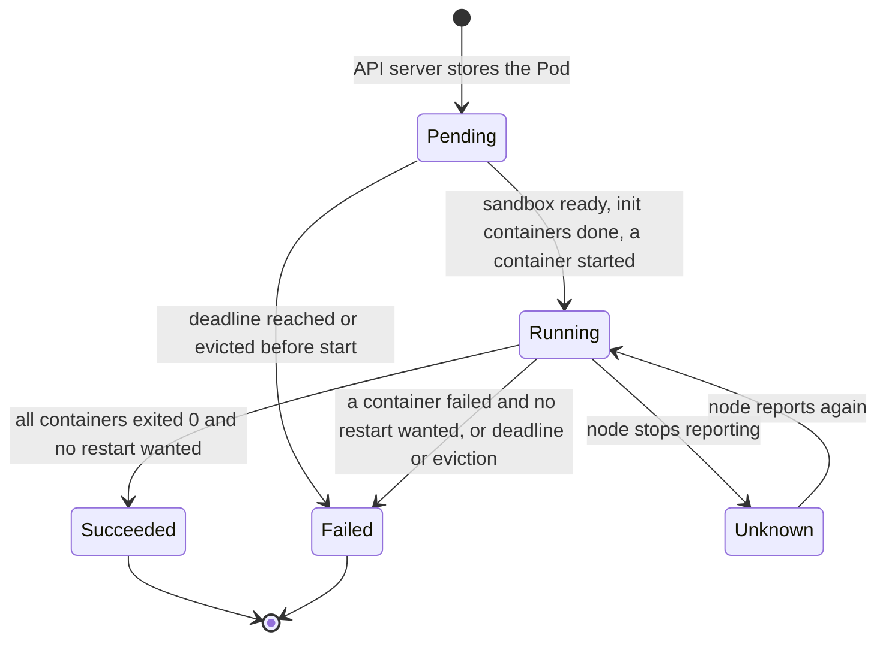
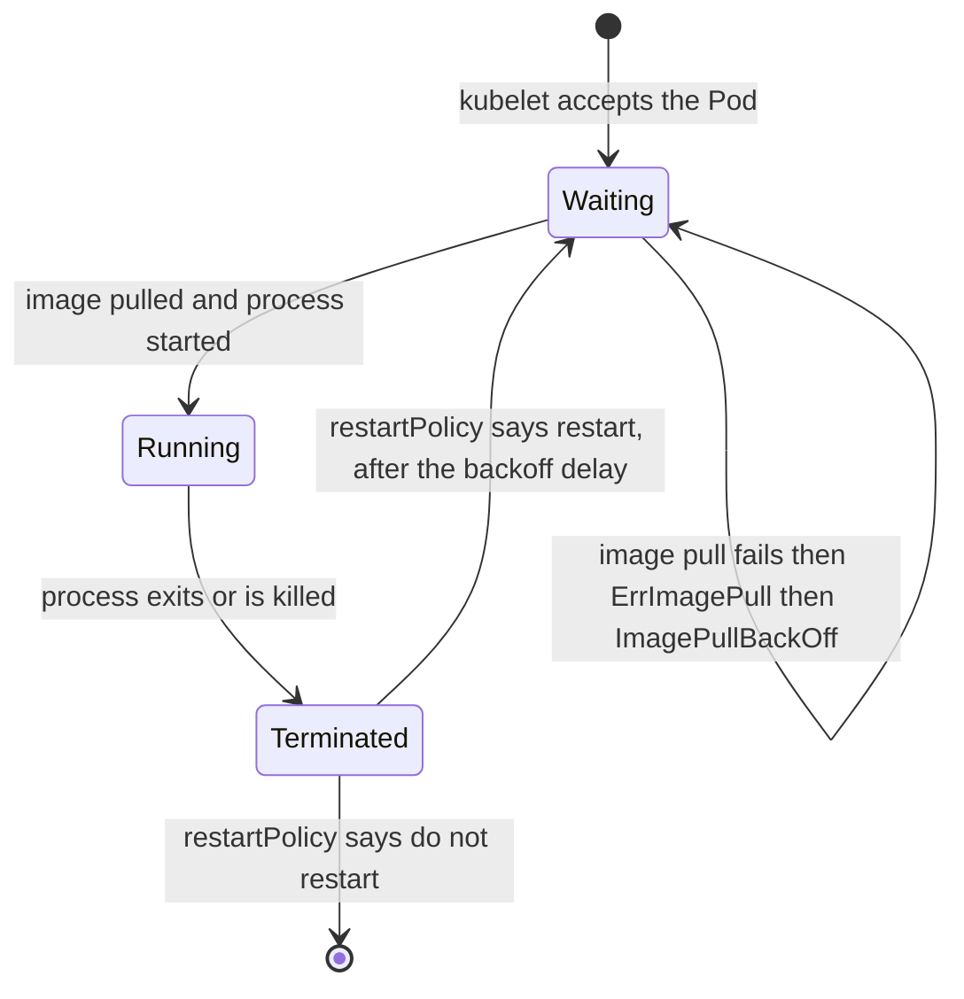

# T2.03 Pods in depth

> Competency: n/a, foundation topic | Domain/weight: n/a (foundation; supports both exams) | Est. time: 3 h | Prerequisites: T2.02, T1.05

Shell setup used in every command of this lesson (also in [00-conventions](../00-conventions.md)):

```bash
alias k=kubectl
export do="--dry-run=client -o yaml"
export now="--force --grace-period=0"
source <(kubectl completion bash); complete -o default -F __start_kubectl k
```

Use `bash` (the `$do` trick needs bash word splitting; see [T2.02](../part2-basics/T2.02-kubectl-fluency-and-productivity.md)). Signals, PID 1 and exit codes are taught in [T1.05](../part1-linux/T1.05-processes-and-signals.md); this lesson only uses them.

How to read the output blocks. Every output block in this lesson is real unless it says otherwise. The labels are:

- `REAL OUTPUT (kind v0.33.0, v1.37.0)`: captured on a scratch kind cluster (node image `kindest/node:v1.37.0`, 1 control plane + 2 workers, kubectl client v1.37.1, default kindnet CNI, containerd 2.3.4). That cluster was named `k-t203`, so node names read `k-t203-worker` and `k-t203-worker2`; on your `lab` cluster they read `lab-worker` and `lab-worker2`. Pod name suffixes, IPs, ages and UIDs differ on every run. Some blocks were trimmed with `...`.
- `REAL OUTPUT (Docker)`: captured with plain `docker run` on the author's machine. It proves how an image's ENTRYPOINT and CMD behave. It is not a Kubernetes result.
- `EXPECTED OUTPUT (not captured)`: written from the documented behaviour, not seen on a live v1.37 cluster. Every such block would be listed in section 11. No block in this lesson uses it.

Namespaces: some captured blocks read `lab-t203b`, `lab-t203c`, `lab-t203d`... because the checks were re-run in separate throw-away namespaces on the same cluster. On your cluster the lab namespace is `lab-t203`.

Time and clocks: the capture machine ran in a UTC+8 time zone, so `describe` shows `+0800` times, while the API stores UTC (`Z`) times. Ignore the difference.

Lab environment for the whole lesson: **kind** (cluster `lab`, context `kind-lab`, namespace `lab-t203`, files in `~/lab/t203/`). Use the images `busybox:1.36`, `nginx:1.27` and one image you build yourself in the lab (`t203-echo:1.0`, built from `busybox:1.36`).

## 1. Why this matters

The Pod is the object every other workload object creates. A Deployment, a Job, a DaemonSet and a StatefulSet are all machines that stamp out Pods. In both exams most tasks either ask you to write a Pod (often with a command, an env var or a port) or to find out why one is not running. If you cannot tell `Pending` from `CrashLoopBackOff` from `ImagePullBackOff`, or `command` from `args`, you will lose minutes on every task, and the exam gives about 6 minutes per task (15-20 tasks in 2 hours; sources: https://docs.linuxfoundation.org/tc-docs/certification/tips-cka-and-ckad and https://docs.linuxfoundation.org/tc-docs/certification/faq-cka-ckad-cks). In real life the same words (phase, container state, restart count, condition) are the first thing you read in an incident.

## 2. Concepts

Index: 2.1 what a Pod is; 2.2 the Pod spec; 2.3 `command` and `args` against ENTRYPOINT and CMD; 2.4 ports, env and workingDir; 2.5 restartPolicy; 2.6 phases; 2.7 container states; 2.8 conditions; 2.9 CrashLoopBackOff and restartCount; 2.10 init containers; 2.11 Pod networking; 2.12 the downward API; 2.13 hostname, hostNetwork and dnsPolicy; 2.14 static Pods; 2.15 working inside a Pod; 2.16 immutability; 2.17 in-place resize; 2.18 under the hood; 2.19 related but different.

### 2.1 What a Pod is

A **Pod** is the smallest thing Kubernetes can run. It is a group of one or more containers that are always placed on the same node, started and stopped together, and share some Linux namespaces (network, and optionally more) and volumes. Think of it as a very small "logical host": the containers in it are like processes on one machine.

Why not schedule bare containers? Some helpers must live next to the main program: a log shipper, a proxy, a config refresher. They need to share `localhost` and files with it, and they must never be split across two machines. The Pod is the unit that guarantees this. Most Pods have exactly one container. Use more than one only when the containers are tightly coupled (see [T3.08](../part3-ckad/T3.08-multi-container-pod-patterns-init-sidecar.md)).

Facts to hold on to:

- A Pod is **not** restarted on another node when it dies. A Pod is created once, bound to one node once, and then lives and dies there. Replacement is the job of a controller (ReplicaSet, Deployment, Job...). A bare Pod with nothing above it is gone for good if its node is lost.
- A Pod has **one IP** for its whole life. A new Pod (even with the same name) gets a new IP.
- The Pod name must be a valid DNS subdomain name (lowercase letters, digits, `-` and `.`, up to 253 characters). Container names inside a Pod must be unique and are DNS labels (lowercase, digits, `-`, up to 63 characters).

### 2.2 The Pod spec

Every Kubernetes object has `apiVersion`, `kind`, `metadata` and (for most) `spec`. For a Pod: `apiVersion: v1`, `kind: Pod`.

| Field | Meaning | Default | Risky or invalid values |
|---|---|---|---|
| `metadata.name` | Pod name, unique per namespace | none (required) | Uppercase or `_` is rejected |
| `metadata.labels` | key/value tags used by selectors | none | A Service or Deployment selector that does not match them selects nothing |
| `spec.containers[]` | the list of app containers. At least one is required | none | Two containers with the same `name` are rejected. The list cannot be edited after creation except `image` |
| `containers[].name` | container name | none (required) | Must be a DNS label, unique in the Pod |
| `containers[].image` | image reference `registry/repo:tag` or `@sha256:...` | none (required) | A wrong tag gives `ErrImagePull` / `ImagePullBackOff`. `:latest` or no tag means `imagePullPolicy: Always` and a moving target; always pin a tag |
| `containers[].imagePullPolicy` | `IfNotPresent`, `Always`, `Never` | `Always` if the tag is `:latest` or missing, else `IfNotPresent` | `Never` with an image that is not on the node gives `ErrImageNeverPull` |
| `containers[].command` | replaces the image ENTRYPOINT | image ENTRYPOINT | A list of strings. A string instead of a list is rejected |
| `containers[].args` | replaces the image CMD | image CMD | Same |
| `containers[].ports[]` | ports the container listens on (information) | none | See 2.4 |
| `containers[].env[]` | environment variables | none | See 2.4 |
| `containers[].workingDir` | directory the process starts in | image `WORKDIR`, else `/` | Use an absolute path; a path that cannot be entered makes the container fail to start |
| `spec.restartPolicy` | what the kubelet does when a container exits | `Always` | See 2.5 |
| `spec.nodeName` | bypass the scheduler and bind to this node | empty (scheduler picks) | A node name that does not exist leaves the Pod `Pending` forever |

**What the API server says to bad input.** All of these were tested on v1.37.0 with `k apply --dry-run=server -f -` (nothing is created), so you can recognise them in an exam:

| You wrote | Real error text (shortened) |
|---|---|
| env `value: 8080` (a number, no quotes) | `cannot unmarshal number into Go struct field EnvVar.spec.containers.env.value of type string` |
| `metadata.name: Web` | `metadata.name: Invalid value: "Web": a lowercase RFC 1123 subdomain must consist of lower case alphanumeric characters, '-' or '.', ...` |
| `command: "sleep 10"` (a string) | `cannot unmarshal string into Go struct field Container.spec.containers.command of type []string` |
| env with both `value` and `valueFrom` | `spec.containers[0].env[0].valueFrom: Invalid value: "": may not be specified when `value` is not empty` |
| two containers named `c` | `spec.containers[1].name: Duplicate value: "c"` |
| `dnsPolicy: None` without `dnsConfig` | `spec.dnsConfig: Required value: must provide `dnsConfig` when `dnsPolicy` is None` |
| `restartPolicy: Sometimes` | `spec.restartPolicy: Unsupported value: "Sometimes": supported values: "Always", "OnFailure", "Never"` |
| `restartPolicyRules` without a container `restartPolicy` | `spec.containers[0].restartPolicy: Required value: must specify restartPolicy when restart rules are used` |

Two behaviours that are not rejections. A Pod with `imagePullPolicy: Never` and an image the node does not have is accepted and then shows `STATUS ErrImageNeverPull` with the Event `Container image "busybox:1.36.77" is not present with pull policy of Never`. A Pod with the same `env` name twice is accepted with a warning (`env[1]: hides previous definition of "X"`), and the last value wins (`echo X=$X` printed `X=second`).

**Generate it, do not type it.** `k run nginx --image=nginx:1.27 --port=80 --labels=app=web $do` prints a complete Pod. Section 4 shows the whole workflow.

### 2.3 command and args against ENTRYPOINT and CMD

**Why this matters.** The most common beginner bug in Pod specs is mixing these up: the Pod starts, prints nothing useful, and `args` seem to be ignored.

An image (see [T1.11](../part1-linux/T1.11-containers-images-registries-and-runtimes-oci.md)) stores two defaults for the process to start:

- **ENTRYPOINT**: the program to run.
- **CMD**: the default arguments to that program (or, if there is no ENTRYPOINT, the whole default command line).

Docker joins them as `ENTRYPOINT + CMD`. Kubernetes renames the two fields, and the names are confusing:

| Kubernetes field | Docker equivalent | What it replaces |
|---|---|---|
| `command` | `ENTRYPOINT` (`docker run --entrypoint`) | the image ENTRYPOINT |
| `args` | `CMD` (arguments after the image name in `docker run`) | the image CMD |

These rules come from the official page https://kubernetes.io/docs/tasks/inject-data-application/define-command-argument-container/.

The test image used below has ENTRYPOINT `["echo","ENTRY"]` and CMD `["cmd-default"]` (you build it in section 5). The final program line (the "argv") is:

| `command` in Pod | `args` in Pod | argv that runs | Same thing in Docker (REAL OUTPUT in section 5) |
|---|---|---|---|
| not set | not set | ENTRYPOINT + CMD: `echo ENTRY cmd-default` | `docker run IMG` |
| set: `["echo","from-command"]` | not set | `command` only: `echo from-command` (the image CMD is **dropped**) | `docker run --entrypoint echo IMG from-command` |
| not set | set: `["from-args"]` | ENTRYPOINT + `args`: `echo ENTRY from-args` | `docker run IMG from-args` |
| set: `["echo","from-command"]` | set: `["from-args"]` | `command` + `args`: `echo from-command from-args` | `docker run --entrypoint echo IMG from-command from-args` |

Read the second row twice. If you set `command` and not `args`, the image's CMD is ignored as well. People expect the old CMD to survive, and it does not.

Now the table that causes "my args are ignored" tickets. Take an image with **no ENTRYPOINT** such as `busybox:1.36` (its image config is: Entrypoint empty, Cmd `sh`):

| You set | What runs | Comment |
|---|---|---|
| nothing | `sh` | exits at once with no TTY (the container ends) |
| `args: ["echo","hi"]` | `echo hi` | with no ENTRYPOINT, `args` becomes the entire command line, so `args[0]` is the program |
| `command: ["echo","hi"]` | `echo hi` | same effect here |
| `args: ["--verbose"]` | tries to execute a program called `--verbose` | fails with a runtime error (see section 6) |
| `command: ["sh","-c"]` + `args: ["echo $HOME"]` | `sh -c 'echo $HOME'` | the standard pattern for a shell one-liner |

**Variable expansion.** Kubernetes itself expands `$(VAR_NAME)` (round brackets) inside `command` and `args` using the container's `env` entries, before the runtime starts the process. `$$(VAR_NAME)` is the escape (it produces the literal `$(VAR_NAME)`). A shell `$VAR` (no brackets) is expanded only if a shell runs it, for example `sh -c`. A `$(VAR)` that names a variable that is not defined is passed through unchanged.

**Imperative.** `k run NAME --image=IMG -- a b c` puts everything after `--` into `args`. Add `--command` to put it into `command` instead: `k run bb --image=busybox:1.36 --command -- sleep 3600`. With a shell one-liner use `-- sh -c 'echo hi; sleep 3600'` (the quotes keep the whole script as one argument).

### 2.4 ports, env and workingDir

- **`ports[].containerPort`** (1-65535) documents the port your process listens on. It is **informational**. The container listens on whatever its process binds; leaving the field out does not block traffic, and adding it does not open anything. It does matter for tooling: `k expose pod` reads it, named ports can be referenced by Services and probes, and `k port-forward` does not need it. Optional siblings: `name` (an IANA service name, up to 15 characters), `protocol` (`TCP` default, `UDP`, `SCTP`), `hostPort` (binds the port on the node: avoid, it limits scheduling to one Pod per node per port).
- **`env[]`** sets environment variables. Each entry has `name` and either `value` (a literal string, so write `"8080"` in quotes if you mean a string; an unquoted number is rejected) or `valueFrom` (a reference: `fieldRef`, `resourceFieldRef`, `configMapKeyRef`, `secretKeyRef`). ConfigMap and Secret references are taught in T3.03 and T3.04; the first two are in 2.12. An entry that has both `value` and `valueFrom` is rejected. If the same `name` appears twice, the last one wins. Env cannot be changed in a running Pod (section 2.16).
- **`workingDir`** is the current directory of the process. It overrides the image's `WORKDIR`. It cannot be changed after creation.

### 2.5 restartPolicy

The **kubelet** (the node agent that runs Pods; see [T2.01](../part2-basics/T2.01-kubernetes-architecture-and-the-api-model.md)) watches every container. `spec.restartPolicy` tells it what to do when a container process exits. It applies to all the regular containers in the Pod.

| Value | Container exits with 0 | Container exits non-zero | Typical use |
|---|---|---|---|
| `Always` (default) | restarted | restarted | long-running servers |
| `OnFailure` | not restarted | restarted | batch work that must succeed |
| `Never` | not restarted | not restarted | run once, inspect later |

Rules and traps:

- The restart happens **inside the same Pod, on the same node**, by creating a new container with the same Pod sandbox. The Pod is not recreated and its IP does not change. `restartCount` goes up.
- Restarts use an exponential delay (2.9), so a failing container does not spin the CPU.
- A Pod that has `restartPolicy: Always` never reaches `Succeeded`: when the container exits 0 it is just started again.
- Jobs only accept `OnFailure` or `Never` in their Pod template. A Deployment only accepts `Always`.
- `k run` sets it with `--restart=Never` or `--restart=OnFailure`. In current kubectl, `k run` always creates a Pod and `--restart` only picks this field. (Older kubectl created Deployments and Jobs; ignore old blog posts that say so.)

**Per container restart policy and restart rules (finer-grained restarts).** The Pod API has two extra fields on each container (from v1.34 on; verified on v1.37.0 below):

| Field | Meaning | Rules from `k explain` on v1.37.0 |
|---|---|---|
| `containers[].restartPolicy` | same three values as the Pod field; overrides the Pod value for this one container | If a container has `restartPolicyRules`, it must set `restartPolicy` explicitly, even when the value equals the Pod's |
| `containers[].restartPolicyRules[]` | list of rules, checked in order; the first rule that matches the exit decides. Each rule has `action: Restart` (the only action the field accepts) and `exitCodes` with `operator` (`In` or `NotIn`) and `values` (a list of at most 255 integers) | At most 20 rules. If no rule matches, the container-level (or Pod-level) policy decides |

The idea: "this container is not restarted in general, but restart it when it exits with code 42". That is finer than the Pod-level setting, which treats all exit codes of all containers alike. On v1.37.0 the API server metric `kubernetes_feature_enabled{name="ContainerRestartRules"}` shows `stage="BETA"` and value `1`, so the feature is on by default and not yet GA. Check it yourself with `k get --raw /metrics | grep ContainerRestartRules`. A beta feature can still change, so use the Pod-level policy unless a task names the per-container fields. A worked, tested example is in section 5 (Step 7b).

Init containers have had their own `restartPolicy` since sidecar containers arrived: an init container with `restartPolicy: Always` is a **sidecar** (it starts before the app containers, then keeps running next to them; see [T3.08](../part3-ckad/T3.08-multi-container-pod-patterns-init-sidecar.md)).

### 2.6 Phases

The **phase** is one word in `status.phase`: a coarse summary of where the Pod is in its life. It is not a full state machine. There are exactly five values:

| Phase | Meaning | Typical cause when you see it for a long time |
|---|---|---|
| `Pending` | The API server accepted the Pod, but at least one container is not running yet. Includes time spent scheduling, pulling images and running init containers | Not schedulable (no node fits), image pull problem, volume not ready, init container still running |
| `Running` | The Pod is bound to a node and all containers were created. At least one is running, starting or restarting | The normal state. A `Running` Pod can still be broken (crash loop, failed probe) |
| `Succeeded` | All containers terminated with exit code 0 and will not be restarted | Normal end of a `Never`/`OnFailure` Pod or a completed Job Pod |
| `Failed` | All containers terminated and at least one ended in failure (non-zero exit, or killed by the system) and will not be restarted | `restartPolicy: Never` plus a failing command; eviction; `activeDeadlineSeconds` reached |
| `Unknown` | The state could not be obtained, usually because the API server cannot talk to the node | Node down or network partition between control plane and node |

The `STATUS` column of `k get pods` is **not** the phase. It is a display string kubectl builds from the phase, the container states and the deletion timestamp. That is why you see values such as `ContainerCreating`, `CrashLoopBackOff`, `ErrImagePull`, `Init:0/1`, `Completed`, `Error` and `Terminating`, and none of them is a phase. To print the real phase: `k get pod nginx -o jsonpath='{.status.phase}'`.

`Terminating` is shown while a Pod has a deletion timestamp and its containers are shutting down. The phase underneath is still `Running` until they stop.

### 2.7 Container states

Each container inside the Pod has its own state, under `status.containerStatuses[].state`. A container is always in exactly one of three states:

| State | Fields you will see | Common `reason` values |
|---|---|---|
| `Waiting` | `reason`, `message` | `ContainerCreating` (setting up sandbox, pulling image, mounting volumes), `PodInitializing` (init containers done or running), `ErrImagePull` (a pull just failed), `ImagePullBackOff` (waiting before the next pull try), `CrashLoopBackOff` (waiting before the next restart), `CreateContainerConfigError` (for example a missing ConfigMap or Secret key referenced by env), `CreateContainerError`, `InvalidImageName`, `ErrImageNeverPull` |
| `Running` | `startedAt` | none |
| `Terminated` | `exitCode`, `reason`, `signal`, `startedAt`, `finishedAt`, `message` | `Completed` (exit 0), `Error` (non-zero exit), `OOMKilled` (killed for exceeding the memory limit, exit code 137, seen on the kind cluster in section 5), `StartError` (the runtime could not start the process, for example the program does not exist; seen with exit code 128 in section 5 and section 6), `DeadlineExceeded` |

Two more places to look: `lastState` shows the previous state (the failure that caused a restart), and `restartCount` shows how many times the kubelet restarted the container. Exit codes follow Linux rules from [T1.05](../part1-linux/T1.05-processes-and-signals.md): 0 success, 1 generic error, 126 found but not executable, 127 command not found, 128+N killed by signal N (137 = SIGKILL, 143 = SIGTERM).

**What a crash loop looks like in practice (observed on v1.37.0).** The container spends most of its time in `Terminated` (reason `Error`, or `Completed` for exit 0). The `STATUS` column then reads `Error` or `Completed`, not `CrashLoopBackOff`. Only while the kubelet reports the wait does `state.waiting.reason` read `CrashLoopBackOff`, and `STATUS` follows. A `watch` of one crashing Pod printed `Error`, `Error`, `Running` (for one second, while the container was started again), `Error`... and `CrashLoopBackOff` only part of the time. So treat `Error`, `Completed` and `CrashLoopBackOff` with a growing `RESTARTS` number as the same problem. The pattern to trust is `RESTARTS` going up and `Last State: Terminated`.

A common trap: `k get pod` printing `Running` with `READY 0/1`. The phase is `Running`, but the container is not ready (a readiness probe is failing, or the process is crash-looping between restarts). Always read `READY` and `RESTARTS`, not only `STATUS`.

### 2.8 Conditions

Conditions are a list under `status.conditions`. Each has `type`, `status` (`True`, `False`, `Unknown`), `reason`, `message`, and `lastTransitionTime`. They tell you which step of startup passed. In order of normal startup:

| Condition | Becomes `True` when | If it stays `False` look at |
|---|---|---|
| `PodScheduled` | the scheduler bound the Pod to a node | scheduling: `k describe pod` Events show `FailedScheduling` and the reason (taints, resources, selectors) |
| `PodReadyToStartContainers` | the node prepared the Pod sandbox (network namespace, volumes) so containers can start | CNI or volume setup errors; Events with `FailedCreatePodSandBox` or `FailedMount` |
| `Initialized` | all init containers finished successfully | the init container's logs: `k logs POD -c INITNAME` |
| `ContainersReady` | every container is ready (running and its readiness probe, if any, passes) | probes and crashes |
| `Ready` | the Pod can serve traffic: `ContainersReady` and all `readinessGates` are true. Services route only to `Ready` Pods | same as above |

`PodReadyToStartContainers` was added after the other four. It is present on a v1.37.0 Pod (see every `describe` output below), and the metric `kubernetes_feature_enabled{name="PodReadyToStartContainersCondition",stage=""} 1` shows the gate is on with an empty stage label, which this metric uses for a feature that is no longer beta. Print them all with `k get pod POD -o jsonpath='{range .status.conditions[*]}{.type}={.status}{"\n"}{end}'`. The order they print in is not the order they happen, so read the names.

### 2.9 CrashLoopBackOff and restartCount

`CrashLoopBackOff` is not an error from your app. It is the kubelet saying: "this container keeps exiting, so I am waiting before I start it again". The container is in the `Waiting` state with that reason.

How the delay works, measured on v1.37.0 (the full timeline is in section 5, Step 8): the first restart is almost immediate, then the delay roughly doubles (about 10, 20, 40, 80, 160 seconds, plus a few seconds of overhead and jitter), and it stops growing at **5 minutes (300 seconds)**. In the test the gaps between run starts were 1, 11, 25, 58, 85, 161, 317 and 320 seconds, and the Pod status itself said `back-off 5m0s restarting failed container=...`. The Kubernetes documentation also says the delay resets to the start value after the container has run for 10 minutes without a problem; that reset was not measured here. Two kubelet features tune this: `KubeletCrashLoopBackOffMax` (beta, on in v1.37.0) lets an administrator lower the cap, and `ReduceDefaultCrashLoopBackOffDecay` (alpha, off) would shorten the default curve. The default cap seen on the test cluster was 5 minutes. You do not change these in an exam task.

`restartCount` counts container restarts for this Pod. It is per container (`status.containerStatuses[].restartCount`) and the `RESTARTS` column shows it. A growing count with a changing `lastState` means a crash loop. A count of 0 on a `Pending` Pod means the container never started.

**The diagnostic path for a restarting container** (use it every time):

1. `k get pod POD`: read `STATUS`, `READY`, `RESTARTS`.
2. `k describe pod POD`: read `State`, `Last State` (with `Reason` and `Exit Code`) and the Events at the bottom.
3. `k logs POD --previous` (add `-c NAME` for multi-container): the output of the **last crashed** instance. Plain `k logs` shows the new instance, which has often not printed anything yet. If it answers `unable to retrieve container logs for containerd://<id>`, the runtime already removed that old container; try again after the next restart.
4. Decide from the exit code: 1 means the app failed (read logs); 127 means a shell inside the container could not find the program it was told to run; `StartError` with exit code 128 means the container runtime itself could not find or execute the program (wrong `command`/`args`, tested in section 5, Step 2); 137 with `OOMKilled` means a memory limit (see [T3.05](../part3-ckad/T3.05-define-resource-requirements.md)); 0 with `restartPolicy: Always` means the process simply ended, which means the image has no long-running process.

### 2.10 Init containers (introduction)

**Init containers** run to completion, one after another, before the app containers start. If one fails, the kubelet retries it (according to `restartPolicy`) and the app containers do not start. Use them for setup that must finish first: wait for a dependency, fetch a file, set permissions. They are listed under `spec.initContainers` and have the same fields as normal containers except probes (a normal init container has none; a sidecar init container with `restartPolicy: Always` may have them).

What you see: the Pod is `Pending` with `STATUS` `Init:0/1` (0 of 1 init containers done) while it runs, `PodInitializing` after, and the `Initialized` condition turns `True` when all are done. Init containers have their own logs: `k logs POD -c INITNAME`. The deep dive (ordering, resources, failure handling, sidecars) is [T3.08](../part3-ckad/T3.08-multi-container-pod-patterns-init-sidecar.md).

### 2.11 Pod networking

Three rules cover almost everything:

1. **One IP per Pod.** The CNI plugin (the network plugin, see [T2.01](../part2-basics/T2.01-kubernetes-architecture-and-the-api-model.md)) gives the Pod an IP from the node's Pod range. All containers in the Pod have that same IP. `k get pod -o wide` shows it.
2. **Containers in a Pod share `localhost`.** They live in one network namespace (see [T1.10](../part1-linux/T1.10-linux-namespaces-and-cgroups-v2.md)). A sidecar can call `http://localhost:80` and reach the app container. They can also not both listen on the same port: the second one fails with `address already in use`.
3. **Pod-to-Pod traffic needs no NAT.** Any Pod can reach any other Pod's IP unless a NetworkPolicy blocks it. Pod IPs are not stable, so apps use Services (see T2.06).

Under the hood, the container runtime first creates a **Pod sandbox**: an almost empty process (the "pause" container) that owns the network namespace. The CNI plugin configures that namespace, and then your containers join it. This is why the network survives a container restart (the sandbox stays) and why the IP changes only when the whole Pod is replaced.

### 2.12 The downward API: env from fieldRef and resourceFieldRef

The **downward API** lets a container learn facts about its own Pod without calling the API server. The kubelet resolves the values and injects them as env vars (or as files in a `downwardAPI` volume, which this lesson does not cover). The problem it solves: a process often needs its own Pod name, IP or node, and those are not known when you write the YAML.

**`fieldRef`** reads Pod fields. Allowed paths as env vars:

| `fieldPath` | Value |
|---|---|
| `metadata.name` | Pod name |
| `metadata.namespace` | namespace |
| `metadata.uid` | Pod UID |
| `metadata.labels['KEY']` | one label value |
| `metadata.annotations['KEY']` | one annotation value |
| `spec.nodeName` | node the Pod runs on |
| `spec.serviceAccountName` | ServiceAccount name |
| `status.hostIP` | node IP |
| `status.podIP` | Pod IP (first one) |
| `status.podIPs` | all Pod IPs, comma separated |

All labels or all annotations at once (`metadata.labels`, `metadata.annotations`) work only through a volume, not an env var. A wrong path, for example `spec.nodeNme`, is rejected by the API server when you apply the Pod (the exact message is shown in the `resourceFieldRef` paragraph below).

**`resourceFieldRef`** reads the container's own resources: `limits.cpu`, `limits.memory`, `limits.ephemeral-storage`, `requests.cpu`, `requests.memory`, `requests.ephemeral-storage` (and hugepages variants). Two fields refine it: `containerName` (needed only in volumes; for env it defaults to the current container) and `divisor` (the unit of the number you get; default is `1`, so `limits.memory` gives bytes, and `divisor: 1Mi` gives mebibytes; for CPU the default divisor `1` gives whole cores rounded up, and `divisor: 1m` gives millicores). **If the container has no limit, the value you read is the node's allocatable amount** for that resource, not 0. That surprises people who assume "no limit" gives an empty value. Verified on the kind cluster: a Pod with no limits that reads `limits.memory` and `limits.cpu` printed `MEM=16818667520 CPU=12`, which are the memory (in bytes) and CPU (cores) of the worker node (the Docker VM that hosts the kind nodes), not a limit you set.

A wrong `fieldPath` is rejected when you apply the Pod. Verified text: `The Pod "down-bad" is invalid: spec.containers[0].env[0].valueFrom.fieldRef.fieldPath: Invalid value: "spec.nodeNme": error converting fieldPath: field label not supported: spec.nodeNme`.

The value is fixed when the container starts. A Pod IP appears only after the sandbox exists, which is why `status.podIP` works in env (the kubelet starts the container after it knows it).

### 2.13 hostname, subdomain, hostNetwork and dnsPolicy (overview)

**hostname and subdomain.** By default the Pod's hostname (what `hostname` prints inside) is its `metadata.name`. `spec.hostname` overrides it. `spec.subdomain` sets a subdomain; if a **headless Service** (a Service with `clusterIP: None`) with the same name as the subdomain exists in the same namespace, the cluster DNS publishes an A record `<hostname>.<subdomain>.<namespace>.svc.<cluster-domain>` for the Pod. Without that Service the field does nothing for DNS. `spec.setHostnameAsFQDN: true` makes the hostname inside the Pod the full FQDN (the Linux hostname limit is 64 bytes, so a long FQDN leaves the Pod `Pending`).

**hostNetwork.** `spec.hostNetwork: true` puts the Pod in the **node's** network namespace instead of its own. The Pod IP is the node IP and the containers see the node's interfaces. Tested: the `hostnet` Pod reported IP `192.168.147.5`, the same as its node `k-t203-worker2`, and `hostname` inside printed the node name. It is used by node-level infrastructure (CNI agents, kube-proxy, the control plane static Pods). Risks: port clashes with other processes on the node, no network isolation, a NetworkPolicy may not apply to it. Never use it for an app unless a task tells you to.

**dnsPolicy** decides what goes into the Pod's `/etc/resolv.conf`:

| `dnsPolicy` | Result | Notes |
|---|---|---|
| `ClusterFirst` (default) | nameserver is the cluster DNS Service (CoreDNS); search path adds `<ns>.svc.<domain>`, `svc.<domain>`, `<domain>`; names that are not in the cluster domain go to the node's upstream DNS | what you want almost always |
| `Default` | inherits the node's `/etc/resolv.conf` | the name is misleading: it is **not** the default policy |
| `ClusterFirstWithHostNet` | like `ClusterFirst`, for Pods that use `hostNetwork: true` | a `hostNetwork` Pod with `ClusterFirst` falls back to `Default` behaviour, so cluster Service names do not resolve |
| `None` | ignores everything; you provide `dnsConfig` (`nameservers`, `searches`, `options`) | with `None` and no `dnsConfig.nameservers` the Pod is rejected |

### 2.14 Static Pods against API Pods (preview)

Normal Pods are created through the API server and stored in etcd (**API Pods**). A **static Pod** is defined by a YAML file on a node's disk. The kubelet on that node watches a directory (the setting `staticPodPath` in the kubelet config; on kubeadm nodes it is `/etc/kubernetes/manifests`), starts a Pod for every file, and restarts it if it dies. No scheduler, no controller. The API server sees a read-only **mirror Pod** named `<pod-name>-<node-name>` (for example `kube-apiserver-cp1`) so you can look at it with kubectl.

| | API Pod | Static Pod |
|---|---|---|
| Created by | `kubectl apply`, a controller | a file in `staticPodPath` on the node |
| Scheduler | yes | no, always on that node |
| `k delete pod` | removes it | only the API object goes; the kubelet makes the mirror Pod again within seconds (tested: 5 seconds later it was back as `Pending`, with a new age) |
| To delete it | `k delete` | delete or move the file on the node |
| To change it | immutable fields apply (2.16) | edit the file; the kubelet recreates the Pod |
| Examples | everything you deploy | `etcd`, `kube-apiserver`, `kube-controller-manager`, `kube-scheduler` on kubeadm clusters |

This is a preview. The full task (create and troubleshoot static Pods on a node) is part of the node topics in Part 4 (T4.13); it needs SSH to a node and `sudo -i`. On a kind cluster you look at the control-plane node with `docker exec` instead (section 5).

### 2.15 Working inside a Pod: exec, cp, port-forward, logs

| Command | What it does | Details |
|---|---|---|
| `k exec -it POD -- sh` | opens an interactive shell | `-i` keeps stdin, `-t` allocates a terminal. Needs the image to have `sh`. Use `-- bash` only if bash exists |
| `k exec POD -- cmd args` | runs one command and returns | no `-it` needed. The `--` separates kubectl flags from the command |
| `-c NAME` | choose the container | without it, kubectl uses the Pod's default container (annotation `kubectl.kubernetes.io/default-container`, otherwise the first) and prints a message such as `Defaulted container "web" out of: web, probe` |
| `k cp SRC DEST` | copy files between your machine and a container | one side is `POD:/path`, add `-c NAME`; **needs `tar` inside the container**, so it fails on minimal (distroless) images |
| `k port-forward pod/NAME 8080:80` | forwards local port 8080 to Pod port 80 | runs in the foreground until Ctrl+C; useful for a quick test, and it needs no Service. It binds to `127.0.0.1` by default |
| `k logs POD -c NAME --previous -f --tail=20 --since=10m` | read logs | `--previous` is the last terminated instance |

Do not confuse `exec` (a new process inside the container's namespaces) with `attach` (connects to the main process's stdin/stdout). And `k run -it --rm tmp --image=busybox:1.36 --restart=Never -- sh` starts a throwaway Pod, gives you a shell and deletes it on exit.

### 2.16 Pod immutability: what you can change

Most of a Pod's spec is fixed at creation. Why: the kubelet starts containers once from the spec it saw, and the scheduler picked the node once from it. Changing `command` or `nodeName` of a running Pod would make the stored spec disagree with what is running. So the API server accepts an update to a running Pod only for a short list of fields. This list was tested with `k patch` on a v1.37.0 cluster:

| Field | Result on v1.37.0 | Notes |
|---|---|---|
| `spec.containers[*].image` and `spec.initContainers[*].image` | **accepted** | The kubelet restarts that container with the new image. `k set image pod/NAME CTR=IMG` does the same |
| `spec.activeDeadlineSeconds` | **accepted if you set it or lower it** | Raising it is rejected: `spec.activeDeadlineSeconds: Invalid value: 7200: must be less than or equal to previous value` |
| `spec.tolerations` | **accepted if you only add entries** | Existing entries cannot change |
| `metadata.labels`, `metadata.annotations` | **accepted** | Metadata is not part of the spec, so the spec rule does not apply |
| `spec.terminationGracePeriodSeconds` | **rejected** (5 was tried) | The only allowed edit is setting a negative value to 1 |
| `containers[*].ports`, `env`, `command`, `args` | **rejected** | |
| `spec.restartPolicy`, `spec.nodeName`, `spec.nodeSelector` | **rejected** | Moving a Pod to another node needs a new Pod |
| `containers[*].resources` through a normal patch | **rejected** | Use the `resize` subresource (2.17) |
| everything else (`volumes`, `affinity`, `hostNetwork`...) | **rejected** | |

The error you get when you try is the same for every rejected field. This is the real text from v1.37.0 (the part after "other than" is the full list of allowed fields):

```text
The Pod "nginx" is invalid: spec: Forbidden: pod updates may not change fields other than `spec.containers[*].image`,`spec.initContainers[*].image`,`spec.activeDeadlineSeconds`,`spec.tolerations` (only additions to existing tolerations),`spec.terminationGracePeriodSeconds` (allow it to be set to 1 if it was previously negative)
```

After that line kubectl prints a diff (a few lines starting with `@@`) that shows the change it tried to make. Read the `-` and `+` lines of that diff: they name the field you touched. The same error came back from `k patch`, `k apply` and `k replace` (without `--force`) in the tests. `k edit` sends the same update, so it fails the same way (not run here).

The fix is to **recreate** the Pod. Edit your YAML and run `k replace --force -f pod.yaml`: it deletes the Pod and creates it again from the file, in one step. Real output:

```text
$ k replace --force -f repl.yaml
pod "edit" deleted from lab-t203 namespace
pod/edit replaced
```

The long way is `k delete pod web` then `k apply -f pod.yaml`. A faster exam trick when the object lives only in the cluster: `k get pod web -o yaml > pod.yaml`, edit, then `k replace --force -f pod.yaml`. If kubectl complains about a server-filled field (`status`, `uid`, `resourceVersion`, `nodeName`), delete that line from the file. `k edit pod web` on a forbidden field fails and saves your edit to a temp file; the message tells you the file name, and you apply it with `k replace --force -f <that file>`.

Because Pods are not rolled, controllers are where you change things in real life (a Deployment replaces its Pods for you; see T3.10).

### 2.17 In-place resource resize (awareness)

Before, changing CPU or memory of a running Pod meant deleting it. **In-place Pod resize** (feature gate `InPlacePodVerticalScaling`) went stable in v1.35 (the topic notes say GA in v1.35; on the v1.37.0 cluster the gate reports an empty stage label and value `1`, meaning it is on and past beta). You can change the `requests` and `limits` of a running container without recreating the Pod. You do it through a special subresource called `resize`:

```bash
k patch pod resize-demo --subresource resize --patch \
  '{"spec":{"containers":[{"name":"c","resources":{"requests":{"cpu":"150m"},"limits":{"cpu":"300m"}}}]}}'
```

A normal `k patch` without `--subresource resize` is rejected with the `Forbidden: pod updates may not change fields other than ...` error (verified; the diff under the error shows the `cpu` limit line). Per container you can set `resizePolicy` (a list; each item has `resourceName`: `cpu` or `memory`, and `restartPolicy`) to say what happens when that resource changes:

| `resizePolicy[].restartPolicy` | Effect when you resize that resource |
|---|---|
| `NotRequired` (default) | the kubelet changes the cgroup limit live; the container keeps running (`restartCount` stays the same) |
| `RestartContainer` | the kubelet restarts that container to apply the new value (typical for memory, because some runtimes read the limit only at start) |

Tested on v1.37.0 (details in section 5, Step 7b): the CPU change was visible in `status.containerStatuses[0].resources` within seconds with `restartCount` 0. The memory change (policy `RestartContainer`) kept the Pod condition `PodResizeInProgress=True` for about 25 seconds, then `restartCount` went up by one and the new memory value appeared. The `PodResizeInProgress` condition is only present while the resize is being applied. If the node has no room, the request stays pending (condition `PodResizePending`; not triggered here). The QoS class of the Pod cannot change by a resize. Requests and limits themselves, QoS classes and `LimitRange` are in [T3.05](../part3-ckad/T3.05-define-resource-requirements.md).

### 2.18 Under the hood: from `k apply` to a running container

1. kubectl sends `POST /api/v1/namespaces/<ns>/pods`. The API server authenticates, authorizes, runs admission (defaults like `restartPolicy`, `dnsPolicy`, `terminationGracePeriodSeconds`, the default ServiceAccount token volume are filled in here), validates, and stores the Pod in etcd with `spec.nodeName` empty and phase `Pending`.
2. The **scheduler** watches for Pods with no node, picks one, and writes a **binding** that sets `spec.nodeName`. The `PodScheduled` condition becomes `True`.
3. The **kubelet** on that node watches for Pods bound to it. It asks the container runtime (through the CRI, the Container Runtime Interface) to create the sandbox, and the CNI plugin to give it an IP. `PodReadyToStartContainers` becomes `True`.
4. The kubelet runs init containers in order, then pulls the app images, creates and starts the app containers, and starts probes.
5. The kubelet keeps writing `status` (phase, conditions, container states, Pod IP) back to the API server. Everything you read with `k get` and `k describe` is that status plus the Events that the scheduler and the kubelet recorded.
6. When the Pod is deleted: the API server sets a deletion timestamp, the kubelet sends SIGTERM to each container, waits `terminationGracePeriodSeconds` (default 30), then sends SIGKILL, and finally the object is removed. A container whose PID 1 has no SIGTERM handler (for example plain `sleep`) ignores SIGTERM, so deleting such a Pod takes the full 30 seconds (see [T1.05](../part1-linux/T1.05-processes-and-signals.md)). That is why you use `$now` when deleting practice Pods.

### 2.19 Related but different

- **Pod vs container.** A container is one process tree plus its filesystem. A Pod is the wrapper that gives a group of containers one IP and shared volumes. `k get pods` lists Pods, never containers.
- **Phase vs STATUS column vs container state.** Phase is a coarse Pod value (5 values). `STATUS` is a display string. State is per container (3 values with reasons).
- **`Completed` vs `Succeeded`.** `Completed` is a container termination reason and a `STATUS` string. `Succeeded` is the Pod phase.
- **`command` vs `args` vs shell `-c`.** See 2.3.
- **`restartPolicy` vs `imagePullPolicy`.** The first is about a container that exited; the second is about when to pull the image.
- **`containerPort` vs Service `port`/`targetPort`.** The first is information about the container; the Service fields are real routing. See T2.06.
- **Static Pod vs DaemonSet Pod.** A DaemonSet Pod is an API Pod made by a controller; a static Pod comes from a file and has no controller.

## 3. How it works (diagram)

Diagram A is the Pod phase machine. Diagram B is the container state machine that runs inside every Pod. Read A for "where is my Pod in its life", read B for "what is this container doing".





Walkthrough:

1. A new Pod is `Pending` from the moment it is stored. It stays `Pending` while it waits for a node, while the image downloads and while init containers run. Each container is `Waiting` with a reason such as `ContainerCreating` or `ImagePullBackOff`.
2. When the process of a container starts, that container moves to `Running`. When at least one container runs, the Pod phase becomes `Running`.
3. A container that exits becomes `Terminated` (`Completed` for exit 0, `Error` for non-zero, `OOMKilled` for memory). If `restartPolicy` allows a restart, it goes back to `Waiting` with reason `CrashLoopBackOff` for the backoff delay, then to `Running` again. The Pod phase stays `Running` during this whole loop.
4. When no container will be restarted any more, the Pod is `Succeeded` (all exited 0) or `Failed` (at least one failed). Both are final. A Pod with `restartPolicy: Always` never gets there on its own.
5. `Unknown` means the control plane has lost contact with the node. It is not a state the kubelet decided on.

## 4. Commands and YAML you must produce fast

**Imperative shortcuts.**

```bash
# 1. Pod with a port and a label (pinned tag)
k run nginx --image=nginx:1.27 --port=80 --labels=app=web

# 2. One-shot Pod: restart Never, shell one-liner after "--" becomes args
k run bb --image=busybox:1.36 --restart=Never -- sh -c 'echo hi; sleep 3600'

# 3. Same, but the words after "--" go to "command" instead of "args"
k run bb2 --image=busybox:1.36 --restart=Never --command -- sleep 3600

# 4. Generate YAML without creating anything (then edit and apply)
k run demo --image=busybox:1.36 --port=8080 --env=GREETING=hello $do > pod.yaml

# 5. Read one field
k get pod nginx -o jsonpath='{.status.phase}'
k get pod nginx -o jsonpath='{.status.podIP}'

# 6. Diagnose
k describe pod nginx
k logs nginx --previous

# 7. Run a command inside, and open a shell
k exec nginx -- env
k exec -it nginx -- sh

# 8. Recreate when a field is immutable
k replace --force -f pod.yaml
```

| Command | Why it is useful |
|---|---|
| `k run NAME --image=IMG` | creates exactly one Pod; it is the fastest way to a valid Pod |
| `--port=80` | adds `ports: [{containerPort: 80}]` |
| `--labels=a=b,c=d` | adds labels |
| `--env=K=V` (repeatable) | adds `env` entries with literal values |
| `--restart=Never` / `OnFailure` | sets `spec.restartPolicy` |
| `--command -- cmd args` | puts the words into `command` instead of `args` |
| `$do` | `--dry-run=client -o yaml`: print instead of create |
| `k replace --force -f f.yaml` | delete + create from the file in one command |

**The declarative YAML.** Produce it from `k run demo --image=busybox:1.36 --port=8080 --env=GREETING=hello $do > pod.yaml`, then edit: split the command line into `command` and `args`, and add the second env var by hand (`k run` has no flag for `fieldRef`). The result:

```yaml
apiVersion: v1                # Pod is in the core API group, so just "v1"
kind: Pod
metadata:
  name: demo                  # unique within the namespace
  labels:
    app: demo                 # label used later by selectors
spec:
  restartPolicy: Always       # default; Always | OnFailure | Never. Always restarts even after exit 0
  containers:
  - name: demo                # container name, unique inside the Pod
    image: busybox:1.36       # pinned tag; never use :latest
    command: ["sh", "-c"]     # replaces the image ENTRYPOINT (busybox has none, so this is the program)
    args: ["echo $(GREETING) from $(POD_IP); sleep 3600"]  # replaces the image CMD; $(NAME) is expanded by Kubernetes from env below
    ports:
    - containerPort: 8080     # information only; does not open or block anything
    env:
    - name: GREETING          # literal value; always a string
      value: hello
    - name: POD_IP            # value resolved by the kubelet at container start
      valueFrom:
        fieldRef:
          fieldPath: status.podIP   # downward API: the Pod's IP
```

Apply and check:

```bash
k apply -f pod.yaml
k logs demo                       # hello from <the pod IP>
k get pod demo -o jsonpath='{.status.podIP}{"\n"}'
```

REAL OUTPUT (kind v0.33.0, v1.37.0)

```text
$ k logs demo
hello from 10.244.2.3
$ k get pod demo -o jsonpath='{.status.podIP}{"\n"}'
10.244.2.3
$ k exec demo -- env | grep -E 'GREETING|POD_IP'
GREETING=hello
POD_IP=10.244.2.3
```

(The IP differs on your cluster; the two values must be equal. If `$(POD_IP)` printed literally, the variable name in `args` does not match an `env` name.) What the generator really gives you: `k run demo --image=busybox:1.36 --port=8080 --env=GREETING=hello $do` prints a Pod with `labels: {run: demo}`, `ports`, `env`, `resources: {}`, `dnsPolicy: ClusterFirst`, `restartPolicy: Always` and `status: {}`. It has no `command` or `args` (unless you add `--command -- ...` or `-- ...`), and no `fieldRef`. You add those two things by hand.

**Speed drill.** Setup (one line): `k create ns lab-t203; k config set-context --current --namespace=lab-t203`. Every Pod carries the label `drill=t203` so cleanup is one command. Target times are exam pace.

1. (1 min) Create Pod `sd-web`, image `nginx:1.27`, port 80, labels `app=web` and `drill=t203`.
2. (1.5 min) Create Pod `sd-sleep`, image `busybox:1.36`, running `sleep 3600` as the `command`, label `drill=t203`.
3. (2 min) Create Pod `sd-once`, image `busybox:1.36`, `restartPolicy` Never, that prints the word `done` and exits. Show its output and its phase.
4. (3 min) Create Pod `sd-env` (busybox:1.36, `sleep 3600`) with env `A=1` and `PODNAME` taken from the Pod's own name.
5. (1.5 min) Print the phase and the Pod IP of `sd-web` with `jsonpath`.
6. (1.5 min) Print the hostname of `sd-sleep` without opening an interactive shell.
7. (3 min) Change the image of `sd-web` to `nginx:1.27-alpine` on the live Pod and prove the container restarted. Then try to add `command: ["sleep","10"]` live, read the error, and do it the right way.
8. (2 min) Create Pod `sd-bad` with image `nginx:1.27.99` (a tag that does not exist) and print the container's waiting reason with one `jsonpath` command.

Answers:

<details><summary>Answers</summary>

```bash
# 1
k run sd-web --image=nginx:1.27 --port=80 --labels=app=web,drill=t203
# 2
k run sd-sleep --image=busybox:1.36 --labels=drill=t203 --command -- sleep 3600
# 3
k run sd-once --image=busybox:1.36 --labels=drill=t203 --restart=Never -- echo done
sleep 5; k logs sd-once; k get pod sd-once -o jsonpath='{.status.phase}{"\n"}'     # done, Succeeded
# 4  (generate, then add the fieldRef env by hand; yq is on the exam hosts, a text editor works too)
k run sd-env --image=busybox:1.36 --labels=drill=t203 --env=A=1 $do --command -- sleep 3600 > sd-env.yaml
#    edit sd-env.yaml, under env: add
#    - name: PODNAME
#      valueFrom:
#        fieldRef:
#          fieldPath: metadata.name
k apply -f sd-env.yaml
k exec sd-env -- env | grep -E '^(A|PODNAME)='
# 5
k get pod sd-web -o jsonpath='{.status.phase} {.status.podIP}{"\n"}'
# 6
k exec sd-sleep -- hostname
# 7
k set image pod/sd-web sd-web=nginx:1.27-alpine
k get pod sd-web -o jsonpath='{.status.containerStatuses[0].restartCount} {.spec.containers[0].image}{"\n"}'   # 1 nginx:1.27-alpine
k run sd-web --image=nginx:1.27-alpine --port=80 --labels=app=web,drill=t203 $do --command -- sleep 3600 > sd-web.yaml
k apply -f sd-web.yaml                      # error: Forbidden ... pod updates may not change fields other than ...
k replace --force -f sd-web.yaml            # delete + create from the file
# 8
k run sd-bad --image=nginx:1.27.99 --labels=drill=t203
sleep 15; k get pod sd-bad -o jsonpath='{.status.containerStatuses[0].state.waiting.reason}{"\n"}'   # ErrImagePull or ImagePullBackOff
```

Task 7 note: in the tested run `k apply -f sd-web.yaml` first printed `Warning: resource pods/sd-web is missing the kubectl.kubernetes.io/last-applied-configuration annotation ...` (the Pod was made with `k run`, not with `apply`) and then the `Forbidden: pod updates may not change fields other than ...` error. The warning is harmless. The file is generated clean with `$do`, so `replace --force` has nothing to reject. If you start from `k get pod sd-web -o yaml` instead, the file carries server-filled fields (`status`, `metadata.uid`, `metadata.resourceVersion`, `spec.nodeName`); if the create step complains about one of them, delete that field from the file first.

</details>

Cleanup: `k delete pod -l drill=t203 $now; k delete ns lab-t203; k config set-context --current --namespace=default` (verify: `k get ns lab-t203` prints `NotFound`, so the next section starts clean). In the tested run the delete printed `Warning: Immediate deletion does not wait for confirmation that the running resource has been terminated...` and then `pod "sd-bad" force deleted from lab-t203d namespace` for each Pod, and `k get pod -l drill=t203` printed `No resources found in lab-t203d namespace.`

## 5. Worked example

Goal: take one Pod through its whole life, break it several different ways, and read each failure from `get`, `describe` and `logs`. Every step says what to look for. All output below is `REAL OUTPUT (kind v0.33.0, v1.37.0)` unless the block says Docker. The steps share one namespace; a few Pod names (`nginx`, `loop`, `multi`) are reused by later steps, so run the steps in order.

**Step 0. Set up the workspace.**

```bash
mkdir -p ~/lab/t203 && cd ~/lab/t203
k config use-context kind-lab
k create ns lab-t203
k config set-context --current --namespace=lab-t203     # every later command uses lab-t203
```

**Step 1. A healthy Pod and its phase.**

```bash
k run nginx --image=nginx:1.27 --port=80 --labels=app=web
k get pod nginx -w            # watch the STATUS change; Ctrl+C when Running
k get pod nginx -o jsonpath='{.status.phase}{"\n"}'
k get pod nginx -o jsonpath='{range .status.conditions[*]}{.type}={.status}{"\n"}{end}'
k get pod nginx -o jsonpath='{.status.hostIP} {.status.podIP} {.status.podIPs}{"\n"}'
```

REAL OUTPUT (kind v0.33.0, v1.37.0)

```text
NAME    READY   STATUS              RESTARTS   AGE
nginx   0/1     ContainerCreating   0          0s
nginx   0/1     ContainerCreating   0          0s
nginx   1/1     Running             0          1s
Running
PodReadyToStartContainers=True
Initialized=True
Ready=True
ContainersReady=True
PodScheduled=True
192.168.147.5 10.244.1.33 [{"ip":"10.244.1.33"}]
```

What to see: `STATUS` goes `ContainerCreating` then `Running`. The nginx image was already on the node, so this took one second; a first pull takes longer. While the container is being created the phase is `Pending`; once it runs it is `Running`. All five conditions are `True`, and they print in this order on v1.37.0 (do not rely on the order). `hostIP` is the node IP, `podIP` is the Pod IP, `podIPs` is the list (one item on a single-stack cluster).

**Step 1b. restartPolicy decides the final phase.** Three Pods run the same exit code under three policies.

```bash
k run once --image=busybox:1.36 --restart=Never -- sh -c 'echo done'
k run bad --image=busybox:1.36 --restart=Never -- sh -c 'exit 3'
k run onfail --image=busybox:1.36 --restart=OnFailure -- sh -c 'exit 3'
sleep 25
k get pod once bad onfail
for p in once bad onfail; do k get pod $p -o jsonpath='{.metadata.name} {.status.phase} restarts={.status.containerStatuses[0].restartCount}{"\n"}'; done
```

REAL OUTPUT (kind v0.33.0, v1.37.0)

```text
NAME     READY   STATUS      RESTARTS      AGE
once     0/1     Completed   0             25s
bad      0/1     Error       0             25s
onfail   0/1     Error       2 (23s ago)   25s
once Succeeded restarts=0
bad Failed restarts=0
onfail Running restarts=2
```

What to see: `once` exited 0 with `Never`, so the phase is `Succeeded` (`STATUS` shows `Completed`). `bad` exited 3 with `Never`, so the phase is `Failed` (`STATUS` shows `Error`). `onfail` exited 3 with `OnFailure`, so the kubelet keeps restarting it: the phase stays `Running` and `RESTARTS` grows. Here `STATUS` printed `Error` at the moment of the capture; at other moments it prints `CrashLoopBackOff` (see Step 3). Neither word is a phase. The container state of `once` and `bad` is in `status.containerStatuses[0].state.terminated`: `exitCode` 0 with `reason: Completed`, and `exitCode` 3 with `reason: Error`.

**Step 2. command and args against a real ENTRYPOINT and CMD.** Build a tiny image with both set, load it into kind (kind nodes do not see your Docker images otherwise), and test it with plain Docker first.

```bash
docker build -t t203-echo:1.0 - <<'EOF'
FROM busybox:1.36
ENTRYPOINT ["echo", "ENTRY"]
CMD ["cmd-default"]
EOF
kind load docker-image t203-echo:1.0 --name lab
```

REAL OUTPUT (Docker)

```text
$ docker image inspect t203-echo:1.0 --format 'Entrypoint={{.Config.Entrypoint}} Cmd={{.Config.Cmd}}'
Entrypoint=[echo ENTRY] Cmd=[cmd-default]
$ docker run --rm t203-echo:1.0
ENTRY cmd-default
$ docker run --rm --entrypoint echo t203-echo:1.0 from-command
from-command
$ docker run --rm t203-echo:1.0 from-args
ENTRY from-args
$ docker run --rm --entrypoint echo t203-echo:1.0 from-command from-args
from-command from-args
```

Docker's `--entrypoint` is the Kubernetes `command`, and the words after the image name are the Kubernetes `args`. Docker output matches the table in 2.3. Now the same four cases as Pods. A tag other than `latest` means the node uses the image you loaded and does not try to pull it.

```bash
for c in none cmd args both; do
  case $c in
    none) extra='' ;;
    cmd)  extra='command: ["echo","from-command"]' ;;
    args) extra='args: ["from-args"]' ;;
    both) extra='command: ["echo","from-command"]
    args: ["from-args"]' ;;
  esac
  cat <<EOF | k apply -f -
apiVersion: v1
kind: Pod
metadata:
  name: ca-$c
spec:
  restartPolicy: Never
  containers:
  - name: c
    image: t203-echo:1.0
    $extra
EOF
done
sleep 10
for c in none cmd args both; do echo "ca-$c:"; k logs ca-$c; done
```

REAL OUTPUT (kind v0.33.0, v1.37.0)

```text
ca-none:
ENTRY cmd-default
ca-cmd:
from-command
ca-args:
ENTRY from-args
ca-both:
from-command from-args
```

The four Pods print the same lines as the four Docker commands. That is the verified command/args table. If a Pod shows `ErrImagePull` or `ErrImageNeverPull` instead, `kind load` went to a different cluster name; check `kind get clusters` and rerun with the right `--name`.

Now the busybox cases, where the missing ENTRYPOINT changes the rules. First plain Docker:

REAL OUTPUT (Docker)

```text
$ docker image inspect busybox:1.36 --format 'Entrypoint={{.Config.Entrypoint}} Cmd={{.Config.Cmd}}'
Entrypoint=[] Cmd=[sh]
$ docker run --rm busybox:1.36 echo hello-args
hello-args
$ docker run --rm busybox:1.36 --verbose
docker: Error response from daemon: failed to create task for container: failed to create shim task: OCI runtime create failed: runc create failed: unable to start container process: error during container init: exec: "--verbose": executable file not found in $PATH
$ echo $?
127
```

Then as Pods (`k run bb-args --image=busybox:1.36 --restart=Never -- echo hello-args`, `k run bb-cmd ... --command -- echo hello-cmd`, and a Pod with `args: ["--verbose"]` from this file):

```bash
cat > ca-badarg.yaml <<'EOF'
apiVersion: v1
kind: Pod
metadata:
  name: ca-badarg
spec:
  restartPolicy: Never
  containers:
  - name: c
    image: busybox:1.36
    args: ["--verbose"]
EOF
k apply -f ca-badarg.yaml
sleep 10
k get pod ca-badarg
k describe pod ca-badarg | sed -n '/^Containers:/,/Ready:/p;/^Events:/,$p'
k logs ca-badarg
```

REAL OUTPUT (kind v0.33.0, v1.37.0)

```text
$ k logs bb-args
hello-args
$ k logs bb-cmd
hello-cmd
$ k get pod ca-badarg
NAME        READY   STATUS       RESTARTS   AGE
ca-badarg   0/1     StartError   0          10s
$ k describe pod ca-badarg (trimmed)
Containers:
  c:
    Image:          busybox:1.36
    Args:
      --verbose
    State:          Terminated
      Reason:       StartError
      Message:      failed to create containerd task: failed to create shim task: OCI runtime create failed: runc create failed: unable to start container process: error during container init: exec: "--verbose": executable file not found in $PATH
      Exit Code:    128
      Started:      Thu, 01 Jan 1970 08:00:00 +0800
      Finished:     Tue, 27 Oct 2026 21:14:01 +0800
    Ready:          False
Events:
  Type     Reason     Age   From               Message
  ----     ------     ----  ----               -------
  Normal   Scheduled  10s   default-scheduler  Successfully assigned lab-t203/ca-badarg to k-t203-worker
  Normal   Pulled     10s   kubelet            spec.containers{c}: Container image "busybox:1.36" already present on machine and can be accessed by the pod
  Normal   Created    10s   kubelet            spec.containers{c}: Container created
  Warning  Failed     10s   kubelet            spec.containers{c}: Error: failed to create containerd task: ... exec: "--verbose": executable file not found in $PATH
$ k logs ca-badarg
(no output: the program never started)
```

How to read it. With no ENTRYPOINT, the `args` list is the whole command line, so `--verbose` is treated as a program name. The runtime cannot find it, so the container never runs: the state is `Terminated` with reason `StartError`, exit code 128 (the `Started` date of 1970 is how an unset time prints), and the Pod phase is `Failed` because `restartPolicy` is `Never`. A shell-free command like this has no logs. Docker reports exit status 127 for the same mistake, and the kubelet reports 128; the exact number is not stable between runtimes, so read the `Message` text instead.

**Step 3. A crash loop (read it in the right order).** A plain `busybox:1.36` has no long-running process, so with the default `restartPolicy: Always` it exits and is restarted again and again. The command prints the time and exits with 1, which makes each run easy to tell apart in the logs.

```bash
k run loop --image=busybox:1.36 -- sh -c 'date -u +%T; exit 1'
sleep 60
k get pod loop
k describe pod loop
k logs loop
k logs loop --previous
```

REAL OUTPUT (kind v0.33.0, v1.37.0), taken about 7 minutes after the Pod started, at a moment when the container state was `Waiting`:

```text
$ k get pod loop
NAME   READY   STATUS             RESTARTS      AGE
loop   0/1     CrashLoopBackOff   6 (81s ago)   6m54s
$ k describe pod loop (trimmed)
Name:             loop
Namespace:        lab-t203
Node:             k-t203-worker2/192.168.147.5
Start Time:       Tue, 27 Oct 2026 21:12:24 +0800
Labels:           run=loop
Status:           Running
IP:               10.244.1.5
Containers:
  loop:
    Container ID:  containerd://78a1c9edb108659b55951d65224d6c1a71f8ceafde0e59203d311b9b2d9dfe17
    Image:         busybox:1.36
    Image ID:      docker.io/library/busybox@sha256:73aaf090f3d85aa34ee199857f03fa3a95c8ede2ffd4cc2cdb5b94e566b11662
    Args:
      sh
      -c
      date -u +%T; exit 1
    State:          Waiting
      Reason:       CrashLoopBackOff
    Last State:     Terminated
      Reason:       Error
      Exit Code:    1
      Started:      Tue, 27 Oct 2026 21:17:57 +0800
      Finished:     Tue, 27 Oct 2026 21:17:57 +0800
    Ready:          False
    Restart Count:  6
    Environment:    <none>
Conditions:
  Type                        Status
  PodReadyToStartContainers   True 
  Initialized                 True 
  Ready                       False 
  ContainersReady             False 
  PodScheduled                True 
QoS Class:                   BestEffort
Events:
  Type     Reason     Age                  From               Message
  ----     ------     ----                 ----               -------
  Normal   Scheduled  6m54s                default-scheduler  Successfully assigned lab-t203/loop to k-t203-worker2
  Normal   Pulled     81s (x7 over 6m54s)  kubelet            spec.containers{loop}: Container image "busybox:1.36" already present on machine and can be accessed by the pod
  Normal   Created    81s (x7 over 6m54s)  kubelet            spec.containers{loop}: Container created
  Normal   Started    81s (x7 over 6m54s)  kubelet            spec.containers{loop}: Container started
  Warning  BackOff    1s (x8 over 6m52s)   kubelet            spec.containers{loop}: Back-off restarting failed container loop in pod loop_lab-t203(f7660496-fc0c-4932-83e0-4f2ec4c582fb)
$ k logs loop --previous
13:17:57
```

How to read it, in order:

1. `k get pod`: `CrashLoopBackOff` and `RESTARTS 6 (81s ago)`. The container starts and ends; the image and scheduling are fine.
2. `describe`, section `Containers`: `State: Waiting / Reason: CrashLoopBackOff` is the kubelet waiting before the next restart. The cause is in `Last State: Terminated` (`Reason: Error`, `Exit Code: 1`, `Started` and `Finished` in the same second). `Restart Count: 6` confirms the loop. `Ready: False` and the `Ready` / `ContainersReady` conditions at `False` are the consequence, not the cause. `Initialized`, `PodScheduled` and `PodReadyToStartContainers` are `True`, so the Pod got through scheduling, the sandbox and init.
3. Events: `Started` happened `x7`, and the `BackOff` warning says `Back-off restarting failed container`. There is no `Failed` or `FailedScheduling` event, so the problem is inside the container.
4. `k logs loop --previous` is the output of the crashed run (`13:17:57`, which is the `Started` time in `Last State`). Plain `k logs loop` shows the newest instance.

**A trap with `--previous`.** In several of our runs `k logs --previous` printed `unable to retrieve container logs for containerd://<id>` instead of the log (the runtime had already removed the old container). It happens more often with a container that dies within a second. If you see it, run `k logs POD` right after the next restart, or add `--previous` again later. It does not mean the container has no log.

The fix is to give the container a process that keeps running (`k run ok --image=busybox:1.36 --command -- sleep 3600`) or to correct the command that exits with 1. Keep `loop` running: Step 8 measures its restart delays.

**Step 4. ErrImagePull.** A tag that does not exist.

```bash
k run badimg --image=nginx:1.27.99
sleep 25
k get pod badimg
k describe pod badimg
k get events --field-selector involvedObject.name=badimg
```

REAL OUTPUT (kind v0.33.0, v1.37.0)

```text
$ k get pod badimg
NAME     READY   STATUS             RESTARTS   AGE
badimg   0/1     ImagePullBackOff   0          25s
$ k describe pod badimg (trimmed)
Name:             badimg
Namespace:        lab-t203
Node:             k-t203-worker/192.168.147.6
Status:           Pending
IP:               10.244.2.6
Containers:
  badimg:
    Container ID:   
    Image:          nginx:1.27.99
    Image ID:       
    State:          Waiting
      Reason:       ImagePullBackOff
    Ready:          False
    Restart Count:  0
Conditions:
  Type                        Status
  PodReadyToStartContainers   True 
  Initialized                 True 
  Ready                       False 
  ContainersReady             False 
  PodScheduled                True 
Events:
  Type     Reason     Age               From               Message
  ----     ------     ----              ----               -------
  Normal   Scheduled  25s               default-scheduler  Successfully assigned lab-t203/badimg to k-t203-worker
  Normal   BackOff    22s               kubelet            spec.containers{badimg}: Back-off pulling image "nginx:1.27.99"
  Warning  Failed     22s               kubelet            spec.containers{badimg}: Error: ImagePullBackOff
  Normal   Pulling    9s (x2 over 25s)  kubelet            spec.containers{badimg}: Pulling image "nginx:1.27.99"
  Warning  Failed     5s (x2 over 23s)  kubelet            spec.containers{badimg}: Failed to pull image "nginx:1.27.99": rpc error: code = NotFound desc = failed to pull and unpack image "docker.io/library/nginx:1.27.99": failed to resolve reference "docker.io/library/nginx:1.27.99": docker.io/library/nginx:1.27.99: not found
  Warning  Failed     5s (x2 over 23s)  kubelet            spec.containers{badimg}: Error: ErrImagePull
$ k get events --field-selector involvedObject.name=badimg
LAST SEEN   TYPE      REASON      OBJECT       MESSAGE
25s         Normal    Scheduled   pod/badimg   Successfully assigned lab-t203/badimg to k-t203-worker
9s          Normal    Pulling     pod/badimg   Pulling image "nginx:1.27.99"
5s          Warning   Failed      pod/badimg   Failed to pull image "nginx:1.27.99": rpc error: code = NotFound desc = ... not found
5s          Warning   Failed      pod/badimg   Error: ErrImagePull
22s         Normal    BackOff     pod/badimg   Back-off pulling image "nginx:1.27.99"
22s         Warning   Failed      pod/badimg   Error: ImagePullBackOff
```

How to read it. The phase is `Pending` (`Status: Pending`) and `Restart Count` is 0 with an empty `Container ID`: the container never started. `ErrImagePull` is the moment a pull fails; `ImagePullBackOff` is the wait before the next try, so you see the two words alternate (the Events are not in time order; read the `Age` column). The line that tells you why is `Failed to pull image ...`: it ends with the real reason. `not found` means the name or tag does not exist. `unauthorized` or `pull access denied` would mean a private registry or a wrong repository name, and a timeout would mean a network problem (those two were not produced here, so their exact wording is not shown). Fix: `k set image pod/badimg badimg=nginx:1.27`; the image field is one of the few mutable ones, and the kubelet retries with the new value. Because `ErrImagePull` is a `Waiting` reason of the container, `k get pod badimg -o jsonpath='{.status.containerStatuses[0].state.waiting.reason}'` prints it (it printed `ErrImagePull` in the speed drill).

**Step 5. Immutability.** Try six changes on the running `nginx` Pod. Read which ones the API server accepts.

```bash
k set image pod/nginx nginx=nginx:1.28
k patch pod nginx -p '{"spec":{"activeDeadlineSeconds":3600}}'
k patch pod nginx -p '{"spec":{"activeDeadlineSeconds":7200}}'
k patch pod nginx -p '{"spec":{"tolerations":[{"key":"dedicated","operator":"Equal","value":"x","effect":"NoSchedule"}]}}'
k patch pod nginx -p '{"metadata":{"labels":{"tier":"fe"}}}'
k patch pod nginx -p '{"spec":{"containers":[{"name":"nginx","command":["sleep","10"]}]}}'
```

REAL OUTPUT (kind v0.33.0, v1.37.0)

```text
pod/nginx image updated
pod/nginx patched
The Pod "nginx" is invalid: spec.activeDeadlineSeconds: Invalid value: 7200: must be less than or equal to previous value
pod/nginx patched
pod/nginx patched
The Pod "nginx" is invalid: spec: Forbidden: pod updates may not change fields other than `spec.containers[*].image`,`spec.initContainers[*].image`,`spec.activeDeadlineSeconds`,`spec.tolerations` (only additions to existing tolerations),`spec.terminationGracePeriodSeconds` (allow it to be set to 1 if it was previously negative)
@@ -97,7 +97,10 @@
    "Name": "nginx",
    "Image": "nginx:1.28",
-   "Command": null,
+   "Command": [
+    "sleep",
+    "10"
+   ],
```

Image, a lowered `activeDeadlineSeconds`, an added toleration and a label are accepted. Raising `activeDeadlineSeconds` and changing `command` are not. The diff under the error shows exactly the line you tried to change (`Command` from `null` to `["sleep","10"]`). Recreate with a file:

```bash
cat > edit.yaml <<'EOF'
apiVersion: v1
kind: Pod
metadata:
  name: edit
spec:
  containers:
  - name: edit
    image: nginx:1.27
    command: ["sleep", "3600"]
EOF
k run edit --image=nginx:1.27
k wait --for=condition=Ready pod/edit --timeout=60s
k replace -f edit.yaml
k replace --force -f edit.yaml
k get pod edit -o jsonpath='{.spec.containers[0].command}{"\n"}'
```

REAL OUTPUT (kind v0.33.0, v1.37.0)

```text
pod/edit created
pod/edit condition met
The Pod "edit" is invalid: spec: Forbidden: pod updates may not change fields other than `spec.containers[*].image`,`spec.initContainers[*].image`,`spec.activeDeadlineSeconds`,`spec.tolerations` (only additions to existing tolerations),`spec.terminationGracePeriodSeconds` (allow it to be set to 1 if it was previously negative)
@@ -1,103 +1,14 @@
 ...
pod "edit" deleted from lab-t203 namespace
pod/edit replaced
["sleep","3600"]
```

Plain `k replace -f` hits the same `Forbidden` error (the diff is long here because the file leaves out all the fields the server filled in). `k replace --force -f` deletes the Pod and creates it again, and the new Pod has the command. The delete waits for the grace period: a `sleep` process ignores SIGTERM, so a delete takes about 30 seconds. Measured on v1.37.0: `k delete pod slow` for a `busybox:1.36` Pod running `sleep 3600` took `real 0m32.131s`. `k replace $now -f edit.yaml` skips the wait, because `$now` is `--force --grace-period=0`.

**Step 6. Inside a Pod: exec, a second container, cp and port-forward.**

```bash
cat > multi.yaml <<'EOF'
apiVersion: v1
kind: Pod
metadata:
  name: multi
spec:
  containers:
  - name: web
    image: nginx:1.27
    ports:
    - containerPort: 80
  - name: probe
    image: busybox:1.36
    command: ["sh", "-c", "sleep 3600"]
EOF
k apply -f multi.yaml && k wait --for=condition=Ready pod/multi --timeout=90s
k exec multi -c probe -- wget -qO- http://localhost:80 | head -4
k exec multi -c probe -- hostname -i
k exec multi -c web -- cat /etc/hostname
k exec multi -c probe -- cat /etc/hostname
k exec multi -- hostname
echo hello > f.txt
k cp f.txt multi:/tmp/f.txt -c probe
k exec multi -c probe -- cat /tmp/f.txt
k cp multi:/etc/hostname ./hn.txt -c probe && cat hn.txt
k port-forward pod/nginx 8080:80 &
sleep 2; curl -sI http://127.0.0.1:8080 | head -3; kill %1
```

REAL OUTPUT (kind v0.33.0, v1.37.0)

```text
$ k exec multi -c probe -- wget -qO- http://localhost:80 | head -4
<!DOCTYPE html>
<html>
<head>
<title>Welcome to nginx!</title>
$ k exec multi -c probe -- hostname -i
10.244.2.14
$ k exec multi -c web -- cat /etc/hostname
multi
$ k exec multi -c probe -- cat /etc/hostname
multi
$ k exec multi -- hostname
Defaulted container "web" out of: web, probe
multi
$ k cp f.txt multi:/tmp/f.txt -c probe
$ k exec multi -c probe -- cat /tmp/f.txt
hello
$ k cp multi:/etc/hostname ./hn.txt -c probe
tar: removing leading '/' from member names
$ cat hn.txt
multi
Forwarding from 127.0.0.1:8080 -> 80
Forwarding from [::1]:8080 -> 80
Handling connection for 8080
HTTP/1.1 200 OK
Server: nginx/1.27.5
Date: Tue, 27 Oct 2026 13:15:14 GMT
```

What to see: the `probe` container reached nginx at `localhost:80` because both containers share one network namespace; `/etc/hostname` is `multi` in both containers, and `hostname -i` shows the Pod IP. `k exec multi -- hostname` printed `Defaulted container "web" out of: web, probe`: that line is kubectl telling you it picked the first container (it goes to stderr). `k cp` printed a harmless `tar: removing leading '/' from member names`. `k cp` worked because busybox has a `tar` applet. The nginx log (`k logs multi -c web --tail=2`) shows the request from the probe container: `127.0.0.1 - - ... "GET / HTTP/1.1" 200 615 "-" "Wget" "-"`, the source address `127.0.0.1` proves the call came through localhost. When there is no terminal, `k exec -it` prints `Unable to use a TTY - input is not a terminal or the right kind of file` and still runs the command; in your own terminal you get a real shell.

Two containers cannot share a port. A Pod `conflict` with two nginx containers (both listening on 80) ended up like this:

```bash
cat > conflict.yaml <<'EOF'
apiVersion: v1
kind: Pod
metadata:
  name: conflict
spec:
  containers:
  - name: a
    image: nginx:1.27
  - name: b
    image: nginx:1.27
EOF
k apply -f conflict.yaml
sleep 30
k get pod conflict
k logs conflict -c b --tail=3
```

REAL OUTPUT (kind v0.33.0, v1.37.0)

```text
$ k get pod conflict
NAME       READY   STATUS   RESTARTS      AGE
conflict   1/2     Error    2 (24s ago)   30s
$ k logs conflict -c b --tail=3
2026/10/27 13:14:56 [notice] 1#1: try again to bind() after 500ms
2026/10/27 13:14:56 [emerg] 1#1: still could not bind()
nginx: [emerg] still could not bind()
```

The first container to start got port 80; the second kept failing, so `READY` is `1/2` and its `RESTARTS` keep growing.

**Step 6b. hostname, subdomain, hostNetwork and dnsPolicy.**

```bash
cat > hn.yaml <<'EOF'
apiVersion: v1
kind: Service
metadata:
  name: sub              # same name as the Pod's subdomain; headless
spec:
  clusterIP: None
  selector:
    app: hn
  ports:
  - port: 80
---
apiVersion: v1
kind: Pod
metadata:
  name: hn
  labels:
    app: hn
spec:
  hostname: webhost      # hostname inside the Pod (default is the Pod name)
  subdomain: sub         # must match a headless Service for DNS to publish a record
  containers:
  - name: c
    image: busybox:1.36
    command: ["sh", "-c", "sleep 3600"]
EOF
k apply -f hn.yaml && k wait --for=condition=Ready pod/hn --timeout=60s
k exec hn -- hostname
k exec hn -- hostname -f
k exec hn -- cat /etc/resolv.conf
k exec hn -- nslookup webhost.sub.lab-t203.svc.cluster.local
```

REAL OUTPUT (kind v0.33.0, v1.37.0)

```text
$ k exec hn -- hostname
webhost
$ k exec hn -- hostname -f
webhost.sub.lab-t203.svc.cluster.local
$ k exec hn -- cat /etc/resolv.conf
search lab-t203.svc.cluster.local svc.cluster.local cluster.local
nameserver 10.96.0.10
options ndots:5
$ k exec hn -- nslookup webhost.sub.lab-t203.svc.cluster.local
Server:		10.96.0.10
Address:	10.96.0.10:53

Name:	webhost.sub.lab-t203.svc.cluster.local
Address: 10.244.2.15
```

What to see: the Pod's hostname is `webhost`, not `hn`. The cluster DNS Service (`10.96.0.10`, CoreDNS) answers `webhost.sub.lab-t203.svc.cluster.local` with the Pod IP, because the headless Service `sub` exists. Delete the Service and the same lookup stops working. `ndots:5` and the three search domains are what `ClusterFirst` writes: a name with fewer than 5 dots is tried against each search domain first.

Next, `hostNetwork` and the four `dnsPolicy` values, one Pod each. Each Pod runs `sleep`, and you read `/etc/resolv.conf` inside it.

```bash
cat > dns.yaml <<'EOF'
apiVersion: v1
kind: Pod
metadata:
  name: hostnet            # hostNetwork with the default dnsPolicy
spec:
  hostNetwork: true
  containers:
  - name: c
    image: busybox:1.36
    command: ["sh", "-c", "sleep 3600"]
---
apiVersion: v1
kind: Pod
metadata:
  name: dns-default        # dnsPolicy Default: inherit the node's resolv.conf
spec:
  dnsPolicy: Default
  containers:
  - name: c
    image: busybox:1.36
    command: ["sh", "-c", "sleep 3600"]
---
apiVersion: v1
kind: Pod
metadata:
  name: dns-cfwhn          # hostNetwork + ClusterFirstWithHostNet: cluster DNS again
spec:
  hostNetwork: true
  dnsPolicy: ClusterFirstWithHostNet
  containers:
  - name: c
    image: busybox:1.36
    command: ["sh", "-c", "sleep 3600"]
---
apiVersion: v1
kind: Pod
metadata:
  name: dnsnone            # dnsPolicy None: only what dnsConfig says
spec:
  dnsPolicy: None
  dnsConfig:
    nameservers: ["1.1.1.1"]
    searches: ["example.test"]
    options:
    - name: ndots
      value: "2"
  containers:
  - name: c
    image: busybox:1.36
    command: ["sh", "-c", "sleep 3600"]
EOF
k apply -f dns.yaml
k wait --for=condition=Ready pod/hostnet pod/dns-default pod/dns-cfwhn pod/dnsnone --timeout=60s
k get pod hostnet -o wide
k get nodes -o wide
k exec hostnet -- hostname
k get pod hostnet -o jsonpath='{.spec.dnsPolicy}{"\n"}'
for p in hostnet dns-default dns-cfwhn dnsnone; do echo "== $p"; k exec $p -- cat /etc/resolv.conf; done
```

REAL OUTPUT (kind v0.33.0, v1.37.0). The `hostnet` and `dnsnone` lines come from one run, the `dns-default` and `dns-cfwhn` lines from a second run in another namespace, on the same cluster:

```text
$ k get pod hostnet -o wide
NAME      READY   STATUS    RESTARTS   AGE   IP              NODE             NOMINATED NODE   READINESS GATES
hostnet   1/1     Running   0          0s    192.168.147.5   k-t203-worker2   <none>           <none>
$ k get nodes -o wide        (INTERNAL-IP column)
k-t203-control-plane   192.168.147.2
k-t203-worker          192.168.147.6
k-t203-worker2         192.168.147.5
$ k exec hostnet -- hostname
k-t203-worker2
$ k get pod hostnet -o jsonpath='{.spec.dnsPolicy}{"\n"}'
ClusterFirst
== hostnet
nameserver 0.250.250.254
options ndots:0
== dns-default
nameserver 0.250.250.254
options ndots:0
== dns-cfwhn
search lab-t203f.svc.cluster.local svc.cluster.local cluster.local
nameserver 10.96.0.10
options ndots:5
== dnsnone
search example.test
nameserver 1.1.1.1
options ndots:2
```

What to see:

| Pod | `dnsPolicy` | `/etc/resolv.conf` | Reading |
|---|---|---|---|
| `hn` (above) | `ClusterFirst` (default) | cluster DNS `10.96.0.10`, three search domains, `ndots:5` | cluster names resolve |
| `hostnet` | `ClusterFirst` on a `hostNetwork` Pod | the node's own file (here the Docker network's resolver `0.250.250.254`, which is specific to this OrbStack/Docker setup; yours will show another address) | the stored value still reads `ClusterFirst`, but the effective behaviour is `Default`. Cluster Service names do not resolve |
| `dns-default` | `Default` | the same node file | what the node uses |
| `dns-cfwhn` | `ClusterFirstWithHostNet` | cluster DNS again | the fix for a `hostNetwork` Pod that needs Service names |
| `dnsnone` | `None` + `dnsConfig` | exactly `1.1.1.1`, search `example.test`, `ndots:2` | nothing is inherited |

The `hostnet` Pod's `IP` equals the node's `INTERNAL-IP`, and inside it `hostname` prints the node name. That is the proof it shares the node's network namespace.

**Step 6c. An init container.**

```bash
cat > init.yaml <<'EOF'
apiVersion: v1
kind: Pod
metadata:
  name: init-demo
spec:
  initContainers:
  - name: wait
    image: busybox:1.36
    command: ["sh", "-c", "sleep 20"]
  containers:
  - name: app
    image: nginx:1.27
EOF
k apply -f init.yaml
sleep 5; k get pod init-demo
k get pod init-demo -o jsonpath='{range .status.conditions[*]}{.type}={.status}{"\n"}{end}'
sleep 25; k get pod init-demo
k get pod init-demo -o jsonpath='{range .status.conditions[*]}{.type}={.status}{"\n"}{end}'
```

REAL OUTPUT (kind v0.33.0, v1.37.0)

```text
NAME        READY   STATUS     RESTARTS   AGE
init-demo   0/1     Init:0/1   0          6s
PodReadyToStartContainers=True
Initialized=False
Ready=False
ContainersReady=False
PodScheduled=True
NAME        READY   STATUS    RESTARTS   AGE
init-demo   1/1     Running   0          31s
PodReadyToStartContainers=True
Initialized=True
Ready=True
ContainersReady=True
PodScheduled=True
```

What to see: while the init container runs, the phase is `Pending`, `STATUS` is `Init:0/1` (0 of 1 init containers finished), and `Initialized` is `False`. When it ends, the app container starts and every condition becomes `True`. Logs of the init container: `k logs init-demo -c wait`.

**Step 7. Look at the static Pods (kind control-plane node).**

```bash
docker exec lab-control-plane ls /etc/kubernetes/manifests
docker exec lab-control-plane grep -i staticPodPath /var/lib/kubelet/config.yaml
k get pods -n kube-system -o wide
k get pod kube-apiserver-lab-control-plane -n kube-system -o jsonpath='{.metadata.ownerReferences}{"\n"}{.metadata.annotations}{"\n"}'
```

REAL OUTPUT (kind v0.33.0, v1.37.0; the cluster was named `k-t203`, so the node container is `k-t203-control-plane`)

```text
$ docker exec k-t203-control-plane ls /etc/kubernetes/manifests
etcd.yaml
kube-apiserver.yaml
kube-controller-manager.yaml
kube-scheduler.yaml
$ docker exec k-t203-control-plane grep -i staticPodPath /var/lib/kubelet/config.yaml
staticPodPath: /etc/kubernetes/manifests
$ k get pods -n kube-system -o wide        (trimmed to NAME, READY, STATUS, IP)
etcd-k-t203-control-plane                      1/1   Running   192.168.147.2
kube-apiserver-k-t203-control-plane            1/1   Running   192.168.147.2
kube-controller-manager-k-t203-control-plane   1/1   Running   192.168.147.2
kube-scheduler-k-t203-control-plane            1/1   Running   192.168.147.2
...
$ k get pod kube-apiserver-k-t203-control-plane -n kube-system -o jsonpath='{.metadata.ownerReferences}{"\n"}{.metadata.annotations}{"\n"}'
[{"apiVersion":"v1","controller":true,"kind":"Node","name":"k-t203-control-plane","uid":"97740ad8-87b5-4051-bc53-4e477d083c0b"}]
{"kubeadm.kubernetes.io/kube-apiserver.advertise-address.endpoint":"192.168.147.2:6443","kubernetes.io/config.hash":"95c12b9c59dc17e96486ec85f9830232","kubernetes.io/config.mirror":"95c12b9c59dc17e96486ec85f9830232","kubernetes.io/config.seen":"2026-10-27T13:09:48.874919489Z","kubernetes.io/config.source":"file"}
```

What to see: four YAML files on the node match four Pods in `kube-system`. The Pod names end in the node name (the mirror Pod naming rule). The owner is the Node, not a ReplicaSet. The annotations `kubernetes.io/config.mirror` and `kubernetes.io/config.source: file` are the marks of a static Pod's mirror. Deleting the mirror Pod does not remove the static Pod. Tested on a throw-away cluster:

```text
$ k delete pod kube-scheduler-k-t203-control-plane -n kube-system
pod "kube-scheduler-k-t203-control-plane" deleted from kube-system namespace
$ k get pod -n kube-system kube-scheduler-k-t203-control-plane      (5 seconds later)
NAME                                  READY   STATUS    RESTARTS   AGE
kube-scheduler-k-t203-control-plane   0/1     Pending   0          5s
```

The mirror came back with `AGE 5s`. Do not do this on a cluster you need. You will edit these files for real on kubeadm VMs in Part 4.

**Step 7b. In-place resize, restart rules and OOMKilled.**

```bash
cat > resize.yaml <<'EOF'
apiVersion: v1
kind: Pod
metadata:
  name: resize-demo
spec:
  containers:
  - name: c
    image: busybox:1.36
    command: ["sleep", "3600"]
    resizePolicy:
    - resourceName: cpu
      restartPolicy: NotRequired        # change CPU live
    - resourceName: memory
      restartPolicy: RestartContainer   # restart the container to change memory
    resources:
      requests: {cpu: 100m, memory: 64Mi}
      limits: {cpu: 200m, memory: 128Mi}
EOF
k apply -f resize.yaml && k wait --for=condition=Ready pod/resize-demo --timeout=60s
k patch pod resize-demo -p '{"spec":{"containers":[{"name":"c","resources":{"limits":{"cpu":"300m"}}}]}}'
k patch pod resize-demo --subresource resize --patch '{"spec":{"containers":[{"name":"c","resources":{"requests":{"cpu":"150m"},"limits":{"cpu":"300m"}}}]}}'
sleep 3
k get pod resize-demo -o jsonpath='{.status.containerStatuses[0].restartCount} {.status.containerStatuses[0].resources}{"\n"}'
k patch pod resize-demo --subresource resize --patch '{"spec":{"containers":[{"name":"c","resources":{"requests":{"memory":"96Mi"},"limits":{"memory":"192Mi"}}}]}}'
for i in $(seq 1 10); do sleep 5; k get pod resize-demo -o jsonpath='restarts={.status.containerStatuses[0].restartCount} applied={.status.containerStatuses[0].resources.limits} conds={range .status.conditions[*]}{.type}={.status},{end}{"\n"}'; done
```

REAL OUTPUT (kind v0.33.0, v1.37.0). The plain patch error is the one in 2.16 (its diff shows the line `"cpu": "200m"` becoming `"cpu": "300m"`):

```text
pod/resize-demo created
The Pod "resize-demo" is invalid: spec: Forbidden: pod updates may not change fields other than `spec.containers[*].image`,... (full list as in 2.16)
pod/resize-demo patched
0 {"limits":{"cpu":"300m","memory":"128Mi"},"requests":{"cpu":"150m","memory":"64Mi"}}
pod/resize-demo patched
```

The memory change polled from a second run (the same Pod, patched from 192Mi to 160Mi), with timestamps in the left column:

```text
11:17:28 restarts=2 applied={"cpu":"300m","memory":"192Mi"} conds=PodResizeInProgress=True,PodReadyToStartContainers=True,...
11:17:33 restarts=2 applied={"cpu":"300m","memory":"192Mi"} conds=PodResizeInProgress=True,PodReadyToStartContainers=True,...
11:17:48 restarts=2 applied={"cpu":"300m","memory":"192Mi"} conds=PodResizeInProgress=True,PodReadyToStartContainers=True,...
11:17:53 restarts=3 applied={"cpu":"300m","memory":"160Mi"} conds=PodReadyToStartContainers=True,Initialized=True,Ready=True,...
```

What to see: the plain patch is refused, the `resize` subresource patch is accepted, and for CPU the status shows the new values at once with `restartCount` 0. For memory with `RestartContainer`, the kubelet needed about 25 seconds in these runs; during that time the Pod has the condition `PodResizeInProgress=True`, then `restartCount` goes up by 1 and the new memory limit shows in `status.containerStatuses[0].resources`. (In our run the Pod had restarted twice before for other reasons, so the starting count was 2; the lesson is that the count grows by one.) The `spec.containers[0].resources` field shows the desired values right after the patch; the `status` field shows the applied ones.

Per container restart rules (beta in v1.37.0, section 2.5). Check that your cluster accepts the fields with `k explain pod.spec.containers.restartPolicyRules`, then run:

```bash
cat > rr.yaml <<'EOF'
apiVersion: v1
kind: Pod
metadata:
  name: rr
spec:
  restartPolicy: Never
  containers:
  - name: c
    image: busybox:1.36
    command: ["sh", "-c", "echo start; sleep 5; exit 42"]
    restartPolicy: Never               # container-level policy; required when rules are used
    restartPolicyRules:
    - action: Restart                  # restart only for this exit code
      exitCodes:
        operator: In
        values: [42]
EOF
k apply -f rr.yaml
sleep 40
k get pod rr
k get pod rr -o jsonpath='{.status.containerStatuses[0].restartCount} {.status.phase}{"\n"}'
```

REAL OUTPUT (kind v0.33.0, v1.37.0)

```text
pod/rr created
NAME   READY   STATUS   RESTARTS      AGE
rr     0/1     Error    2 (30s ago)   40s
2 Running
```

What to see: the Pod-level policy and the container-level policy are both `Never`, yet the container was restarted twice in 40 seconds and the phase is `Running`. The rule restarts it because it exits with 42. The restarts continue, slowed down by the usual backoff (the same Pod showed `RESTARTS 19` many hours later). If you change the exit code to 1, the container is not restarted and the Pod ends as `Failed`; that variation was not run.

An `OOMKilled` container, to see the memory reason and exit code 137 in the container states table:

```bash
cat <<'EOF' | k apply -f -
apiVersion: v1
kind: Pod
metadata:
  name: oom
spec:
  restartPolicy: Never
  containers:
  - name: c
    image: busybox:1.36
    command: ["sh", "-c", "a=$(head -c 200000000 /dev/zero | tr '\\0' x); sleep 5"]
    resources:
      limits:
        memory: 50Mi
EOF
sleep 15
k get pod oom
k get pod oom -o jsonpath='{.status.phase} {.status.containerStatuses[0].state.terminated.reason} {.status.containerStatuses[0].state.terminated.exitCode}{"\n"}'
```

REAL OUTPUT (kind v0.33.0, v1.37.0)

```text
NAME   READY   STATUS      RESTARTS   AGE
oom    0/1     OOMKilled   0          15s
Failed OOMKilled 137
```

The shell tries to hold 200 MB in a variable under a 50 MiB limit, the kernel kills it (SIGKILL, which is 128 + 9 = 137), and `restartPolicy: Never` leaves the Pod `Failed`.

**Step 8. Measure the crash backoff yourself (about 17 minutes of waiting).** This is how the "300 seconds" rule was checked on v1.37.0. Use a new Pod so the timeline starts at zero. You can do other steps while it runs.

```bash
k run loop2 --image=busybox:1.36 -- sh -c 'date -u +%T; exit 1'
for i in $(seq 1 110); do
  printf '%s ' "$(date -u +%T)"
  k get pod loop2 -o jsonpath='restarts={.status.containerStatuses[0].restartCount} reason={.status.containerStatuses[0].state.waiting.reason} laststart={.status.containerStatuses[0].lastState.terminated.startedAt}{"\n"}'
  sleep 10
done
```

`laststart` is the start time of the latest finished run. Each time it changes, one more run has happened. REAL OUTPUT (kind v0.33.0, v1.37.0), reduced to the lines where `restarts` or `laststart` changed (UTC times):

```text
03:09:32 restarts=0 reason=ContainerCreating laststart=
03:09:42 restarts=1 reason= laststart=2026-10-28T03:09:32Z
03:09:52 restarts=2 reason= laststart=2026-10-28T03:09:33Z
03:10:12 restarts=3 reason= laststart=2026-10-28T03:09:44Z
03:11:12 restarts=4 reason= laststart=2026-10-28T03:10:09Z
03:12:23 restarts=4 reason=CrashLoopBackOff laststart=2026-10-28T03:11:07Z
03:12:33 restarts=5 reason= laststart=2026-10-28T03:11:07Z
03:13:53 restarts=5 reason=CrashLoopBackOff laststart=2026-10-28T03:12:32Z
03:15:14 restarts=6 reason= laststart=2026-10-28T03:12:32Z
03:16:45 restarts=6 reason=CrashLoopBackOff laststart=2026-10-28T03:15:13Z
03:20:36 restarts=7 reason= laststart=2026-10-28T03:15:13Z
03:22:07 restarts=7 reason=CrashLoopBackOff laststart=2026-10-28T03:20:30Z
03:25:58 restarts=8 reason= laststart=2026-10-28T03:20:30Z
```

The loop does not print the start time of the newest run until the next restart, so the start of the two newest runs was read directly with `k get pod loop2 -o jsonpath='{.status.containerStatuses[0].state}'` right after each restart: `03:20:30Z` and `03:25:50Z`. Put together, the runs started at:

| Run | Start (UTC) | Gap since the previous start |
|---|---|---|
| 1 | 03:09:32 | |
| 2 | 03:09:33 | 1 s |
| 3 | 03:09:44 | 11 s |
| 4 | 03:10:09 | 25 s |
| 5 | 03:11:07 | 58 s |
| 6 | 03:12:32 | 85 s |
| 7 | 03:15:13 | 161 s |
| 8 | 03:20:30 | 317 s |
| 9 | 03:25:50 | 320 s |

Read the gaps. The first restart is almost immediate. After that the delay roughly doubles (about 10, 20, 40, 80, 160 seconds, plus a few seconds of kubelet overhead and some jitter), and it stops doubling at about 5 minutes: 317 s and 320 s are not 320 s and 640 s. The Pod's own status says the same thing in words:

```text
$ k get pod loop2 -o jsonpath='{.status.containerStatuses[0].state}{"\n"}'
{"waiting":{"message":"back-off 5m0s restarting failed container=loop2 pod=loop2_lab-t203(5bed57bb-aa83-4d31-988e-42eadaa248ff)","reason":"CrashLoopBackOff"}}
```

So the maximum backoff on v1.37.0 with default settings is **5 minutes (300 seconds)**. Two related facts from the same cluster: the kubelet config had `crashLoopBackOff: {}` (nothing set), the feature gate `KubeletCrashLoopBackOffMax` reports `stage="BETA"` and value `1` (it lets an administrator lower the cap with a kubelet setting; not tested), and `ReduceDefaultCrashLoopBackOffDecay` reports `ALPHA` and value `0` (off). `STATUS` showed `CrashLoopBackOff` only part of the time; the rest of the time it was `Error` (section 2.7).

**Step 9. Cleanup.**

```bash
k delete pod --all $now
k delete ns lab-t203
k config set-context --current --namespace=default
```

## 6. Common mistakes and how to fix them

Every message in the "What you will see" column was captured on the v1.37.0 kind cluster unless the cell says otherwise. Pod names and IDs are shortened.

| Symptom | What you will see (exact error/event text) | Cause | Fix (command) |
|---|---|---|---|
| Container exits at once, then `CrashLoopBackOff` | `STATUS` flips between `Error` (or `Completed`) and `CrashLoopBackOff`, `RESTARTS` grows; `describe`: `Last State: Terminated`, `Reason: Error`, `Exit Code: 1`; Event `Warning  BackOff  ...  Back-off restarting failed container loop in pod loop_lab-t203(<uid>)` | The image has no long-running process (for example `busybox` with no command), or the command fails | Add a process that stays up: `k run x --image=busybox:1.36 --command -- sleep 3600`; or fix the failing command (read `k logs loop --previous`). Recreate the Pod: `command` and `args` are immutable |
| Update rejected | ``The Pod "nginx" is invalid: spec: Forbidden: pod updates may not change fields other than `spec.containers[*].image`,`spec.initContainers[*].image`,`spec.activeDeadlineSeconds`,`spec.tolerations` (only additions to existing tolerations),`spec.terminationGracePeriodSeconds` (allow it to be set to 1 if it was previously negative)`` followed by a diff | You tried to change an immutable field (`command`, `args`, `env`, `ports`, `restartPolicy`, `nodeName`, `resources`...) | `k replace --force -f pod.yaml` (or `k delete pod web $now` then `k apply -f pod.yaml`) |
| `args` ignored, or the program name is `--flag` | `STATUS StartError`; `State: Terminated`, `Reason: StartError`, `Exit Code: 128`, `Message: ... exec: "--verbose": executable file not found in $PATH`; no logs | `args` was given to an image with no ENTRYPOINT, so `args[0]` became the program. The opposite mistake: `command` was set and dropped the image CMD, so the old default arguments are gone | Match the 2.3 table: to extend an ENTRYPOINT, set only `args`; for a shell one-liner use `command: ["sh","-c"]` and one `args` string; recreate the Pod |
| `ErrImagePull`, then `ImagePullBackOff` | `Failed to pull image "nginx:1.27.99": rpc error: code = NotFound desc = failed to pull and unpack image "docker.io/library/nginx:1.27.99": failed to resolve reference "docker.io/library/nginx:1.27.99": docker.io/library/nginx:1.27.99: not found`; then `Error: ErrImagePull` and `Error: ImagePullBackOff`; `Restart Count: 0` | Wrong tag or image name (a private registry without credentials or no network give a different tail of the message, not run here) | `k describe pod`, read the end of the message; `k set image pod/NAME NAME=nginx:1.27` |
| `InvalidImageName` | `Failed to apply default image tag "NGINX:1.27": couldn't parse image name "NGINX:1.27": invalid reference format: repository name (library/NGINX) must be lowercase` then `Error: InvalidImageName` | Uppercase letter in the repository name | `k set image pod/NAME NAME=nginx:1.27` |
| Stuck in `Pending` | `STATUS Pending`; Event `Warning  FailedScheduling  ... default-scheduler  0/3 nodes are available: 1 node(s) had untolerated taint(s), 2 node(s) didn't match Pod's node affinity/selector. preemption: 0/3 nodes are available: 3 Preemption is not helpful for scheduling.` (the Pod had `nodeSelector: {disk: ssd}`) | No node fits: here a selector that no worker matches, and the control plane has a taint the Pod does not tolerate | `k describe pod NAME` (Events), then remove or fix the selector, add a toleration, or lower requests (see T3.05). `nodeSelector` is immutable, so recreate the Pod |
| `CreateContainerConfigError` | `STATUS CreateContainerConfigError`; `State: Waiting`, `Reason: CreateContainerConfigError`; Event `Warning  Failed  ...  Error: configmap "app-config" not found` | An `env` entry points at a ConfigMap or Secret (or key) that does not exist | Create the object or fix the name: `k get cm,secret`; the kubelet retries by itself |
| `Running` but `READY 0/1` | `READY 0/1`, `STATUS Running`, `RESTARTS 0`; Event `Warning  Unhealthy  ...  Readiness probe failed: HTTP probe failed with statuscode: 404` | A readiness probe fails (here the probe path does not exist), or the container restarts between crashes | `k describe pod` (Events), `k logs POD` (the nginx log shows the probe's `GET /nope ... 404`); fix the probe or the app |
| `OOMKilled` | `STATUS OOMKilled`; `State: Terminated`, `Reason: OOMKilled`, `Exit Code: 137`; phase `Failed` with `restartPolicy: Never` (with `Always` it restarts and loops) | The process went over its memory limit | Raise `resources.limits.memory` (needs recreate, or resize in 2.17), see T3.05 |
| `k exec` fails with no shell | ``error: Internal error occurred: Internal error occurred: error executing command in container: failed to exec in container: failed to start exec "<id>": OCI runtime exec failed: exec failed: unable to start container process: exec: "sh": executable file not found in $PATH`` | Minimal (distroless-style) image has no shell. The test used `registry.k8s.io/pause:3.10`, which has no `sh` and no `ls` | Use a command that exists in the image, or add a debug container with `k debug` (see T2.08) |
| `k cp` fails | `error: Internal error occurred: ... exec: "tar": executable file not found in $PATH` | No `tar` binary in the image | Copy through a container that has tar, or `k exec POD -- cat file > file` (when `cat` exists) |
| `$(VAR)` printed literally | The log shows `undefined=$(NOPE)` for a name that is not in `env` (tested). Names that are in `env` are replaced (`a=1`) | The `env` name is spelled differently (case counts) or the variable is defined in `envFrom`/another container | Match the `name:` exactly. A shell `$A` is only expanded when a shell runs it (`echo shell=$A` without `sh -c` printed `shell=$A`) |
| Two containers, one fails | `READY 1/2`, `STATUS Error`; second container's log: `[emerg] 1#1: still could not bind()` | Both listen on the same port in the shared network namespace | Give each its own port |
| `Warning: resource pods/NAME is missing the kubectl.kubernetes.io/last-applied-configuration annotation` | Printed by `k apply` on a Pod created with `k run` or `k create` | The Pod was not created by `apply`. The warning is harmless | Ignore it, or create the Pod with `k apply -f` from the start |

**Reading failure 1 step by step (CrashLoopBackOff).**

1. `k get pod loop` shows `CrashLoopBackOff` (or `Error`) and `RESTARTS` going up. That tells you the container starts and then ends, not that the image or scheduling is wrong.
2. `k describe pod loop` and look at three things: `State`, `Last State: Terminated` with `Exit Code` and `Reason`, and the last Event. Exit 0 with reason `Completed` means the process ended on purpose (nothing keeps it alive). Exit 1 and `Error` means the process failed. 128 with `StartError` means the program could not be started.
3. `k logs loop --previous` shows what the failed run printed (`13:17:57` in Step 3). Plain `k logs` shows the new run, often empty. If it answers `unable to retrieve container logs for containerd://<id>`, the runtime already removed that container: try again after the next restart.
4. Fix the cause (add `sleep`, correct the command, supply the missing config) and recreate the Pod, because `command` is immutable. A `restartPolicy: Never` Pod would show `Error` or `Completed` instead of looping, which makes the exit code easier to read.

**Reading failure 2 step by step (Forbidden update).**

1. The error names the rule: only some fields are mutable (2.16). It does not say which of your edits is wrong in words, but the diff printed below the error does: the `-` and `+` lines name the field.
2. If you used `k edit pod NAME`, the tool saves your changes to a temp file and prints its name (the exact text depends on the kubectl version, not run here). Apply that file with `k replace --force -f /tmp/<file>`.
3. Otherwise get a clean file: `k get pod NAME -o yaml > p.yaml`, edit it, remove `status:` and any `uid`/`resourceVersion` lines if the create step complains, then `k replace --force -f p.yaml`.
4. Verify: `k get pod NAME -o jsonpath='{.spec.containers[0].command}'` shows the new value, and `AGE` is small.

**Reading failure 3 step by step (args ignored or StartError).**

1. `k get pod NAME -o jsonpath='{.spec.containers[0].command}{"\n"}{.spec.containers[0].args}{"\n"}'` prints what the Pod really has.
2. Find what the image defines. If you have Docker: `docker image inspect IMAGE --format 'Entrypoint={{.Config.Entrypoint}} Cmd={{.Config.Cmd}}'` (for `busybox:1.36` it prints `Entrypoint=[] Cmd=[sh]`). If you do not, use the image's docs page or Dockerfile.
3. Work out the final argv with the 2.3 table. If an ENTRYPOINT exists and you set `command`, your `args` still apply, but the old CMD is gone. If no ENTRYPOINT exists, `args[0]` is the program.
4. Fix the YAML and recreate the Pod.

## 7. Labs

Environment for all three labs: **kind**, cluster `lab`, context `kind-lab` (create it with `env/kind-up.sh`), namespace `lab-t203`, working directory `~/lab/t203/`. Order: Easy, Medium, Break-fix is the suggested order, but each lab creates what it needs and deletes it at the end, so any order works. Each lab ends with `k delete ns lab-t203`, which returns the cluster to its baseline.

### Lab A (Easy): five command/args combinations

**Setup.**

```bash
mkdir -p ~/lab/t203 && cd ~/lab/t203
k config use-context kind-lab
k create ns lab-t203 && k config set-context --current --namespace=lab-t203
docker build -q -t t203-echo:1.0 - <<'EOF'
FROM busybox:1.36
ENTRYPOINT ["echo", "ENTRY"]
CMD ["cmd-default"]
EOF
kind load docker-image t203-echo:1.0 --name lab
```

**Task.** In namespace `lab-t203`, create five Pods from image `t203-echo:1.0` (its ENTRYPOINT is `echo ENTRY`, its CMD is `cmd-default`). All use `restartPolicy: Never`. Before you create them, write down on paper what each log line will be.

| Pod | Spec |
|---|---|
| `e1` | no `command`, no `args` |
| `e2` | `command: ["echo","A"]` |
| `e3` | `args: ["B"]` |
| `e4` | `command: ["echo","C"]` and `args: ["D"]` |
| `e5` | env `GREETING=hi` and `args: ["$(GREETING)","there"]` |

Then print the log of each Pod, in order, to `~/lab/t203/easy.txt`.

<details><summary>Hint 1</summary>

The program line is `(command, else ENTRYPOINT) + (args, else CMD, but only if command is also unset)`. Work it out for each Pod before you run anything.

</details>

<details><summary>Hint 2</summary>

`k run` can set `command` (with `--command --`) or `args` (without it), but not both. For `e4` generate the YAML with `$do` and add the second field by hand, or with `yq -i '.spec.containers[0].args=["D"]' e4.yaml` (`yq` is on the exam hosts; see https://docs.linuxfoundation.org/tc-docs/certification/tips-cka-and-ckad).

</details>

<details><summary>Hint 3</summary>

Logs are only readable after the container has started. Wait until the Pod phase is `Succeeded`: `k wait --for=jsonpath='{.status.phase}'=Succeeded pod/e1 --timeout=60s`. `$(GREETING)` in `args` is expanded by Kubernetes before the container starts, so an ENTRYPOINT that is not a shell still sees `hi`.

</details>

<details><summary>Solution</summary>

Prediction (and why): `e1` prints `ENTRY cmd-default` (ENTRYPOINT + CMD). `e2` prints `A` (`command` replaces the ENTRYPOINT and drops the CMD). `e3` prints `ENTRY B` (ENTRYPOINT kept, `args` replace CMD). `e4` prints `C D`. `e5` prints `ENTRY hi there` (the ENTRYPOINT stays, Kubernetes expands `$(GREETING)`).

```bash
cd ~/lab/t203
k run e1 --image=t203-echo:1.0 --restart=Never
k run e2 --image=t203-echo:1.0 --restart=Never --command -- echo A
k run e3 --image=t203-echo:1.0 --restart=Never -- B
k run e4 --image=t203-echo:1.0 --restart=Never $do --command -- echo C > e4.yaml
yq -i '.spec.containers[0].args=["D"]' e4.yaml       # or add:   args: ["D"]   under the container, with an editor
k apply -f e4.yaml
k run e5 --image=t203-echo:1.0 --restart=Never --env=GREETING=hi $do -- '$(GREETING)' there > e5.yaml
k apply -f e5.yaml
for i in 1 2 3 4 5; do k wait --for=jsonpath='{.status.phase}'=Succeeded pod/e$i --timeout=60s; done
for i in 1 2 3 4 5; do k logs e$i; done > easy.txt
cat easy.txt
```

Why each step: `--restart=Never` makes the Pod end as `Succeeded` instead of restarting forever, so the log is stable. The `$do` file for `e4` is the only way to get both fields, because `k run` has no flag for it. The `wait` lines make sure the container has run before `logs` is called (a `logs` on a Pod that has not started prints an error such as `container "e1" in pod "e1" is waiting to start: ContainerCreating`).

</details>

**Verification** (prints `PASS` only if all five lines match exactly; any other output means a wrong Pod):

```bash
printf '%s\n' 'ENTRY cmd-default' 'A' 'ENTRY B' 'C D' 'ENTRY hi there' | diff - ~/lab/t203/easy.txt && echo PASS
```

REAL OUTPUT (kind v0.33.0, v1.37.0). The script run printed, for the build and load commands, `sha256:2f6459de...` and `Image: "t203-echo:1.0" with ID "sha256:2f6459de..." found to be already present on all nodes.` (the image was already loaded from an earlier run; on a fresh cluster `kind load` prints a loading line instead), then `pod/e1 condition met` ... `pod/e5 condition met`, then the five log lines, then `PASS`:

```text
ENTRY cmd-default
A
ENTRY B
C D
ENTRY hi there
PASS
```

If one line differs, `diff` prints it with `<` (expected) and `>` (yours) and no `PASS` appears.

**Cleanup.**

```bash
cd ~ && k delete ns lab-t203 && k config set-context --current --namespace=default
rm -rf ~/lab/t203
```

### Lab B (Medium): downward API values as env vars

**Setup.**

```bash
mkdir -p ~/lab/t203 && cd ~/lab/t203
k config use-context kind-lab
k create ns lab-t203 && k config set-context --current --namespace=lab-t203
```

**Task.** In namespace `lab-t203`, create a Pod named `dapi` with one container `main` (image `busybox:1.36`) and `restartPolicy: Never`. The container has CPU request `250m`, memory request `64Mi` and memory limit `128Mi`. It must define three env vars: `NODE_NAME` (the node the Pod runs on), `POD_IP` (the Pod IP) and `MEM_LIMIT_MI` (its own memory limit as a number of mebibytes). The container prints one line `node=<NODE_NAME> ip=<POD_IP> memlimit=<MEM_LIMIT_MI>` and exits. Save the YAML as `~/lab/t203/dapi.yaml` and write the Pod's log to `~/lab/t203/dapi.txt`.

<details><summary>Hint 1</summary>

Generate the Pod with `k run dapi --image=busybox:1.36 --restart=Never $do -- sh -c '...'`. `k run` has no flags for resources of this kind or for `fieldRef`, so add `resources:` and the env entries by hand. Use `k explain pod.spec.containers.env.valueFrom` when you forget a field name.

</details>

<details><summary>Hint 2</summary>

Node name is `fieldRef` with `fieldPath: spec.nodeName`. The Pod IP is `status.podIP`. The memory limit is a `resourceFieldRef` with `resource: limits.memory` and a `divisor`. Without a divisor you get bytes.

</details>

<details><summary>Hint 3</summary>

Because the script reads shell variables (`$NODE_NAME`), the command must be run by a shell: `command: ["sh","-c","echo node=$NODE_NAME ..."]`. Inside YAML, keep the script in double quotes and do not add extra quotes around the `$`.

</details>

<details><summary>Solution</summary>

```bash
cd ~/lab/t203
cat > dapi.yaml <<'EOF'
apiVersion: v1
kind: Pod
metadata:
  name: dapi
spec:
  restartPolicy: Never
  containers:
  - name: main
    image: busybox:1.36
    command: ["sh", "-c", "echo node=$NODE_NAME ip=$POD_IP memlimit=$MEM_LIMIT_MI"]
    resources:
      requests:
        cpu: 250m
        memory: 64Mi
      limits:
        memory: 128Mi
    env:
    - name: NODE_NAME
      valueFrom:
        fieldRef:
          fieldPath: spec.nodeName
    - name: POD_IP
      valueFrom:
        fieldRef:
          fieldPath: status.podIP
    - name: MEM_LIMIT_MI
      valueFrom:
        resourceFieldRef:
          resource: limits.memory
          divisor: 1Mi
EOF
k apply -f dapi.yaml
k wait --for=jsonpath='{.status.phase}'=Succeeded pod/dapi --timeout=90s
k logs dapi > dapi.txt
cat dapi.txt
```

Why: `fieldRef` and `resourceFieldRef` are resolved by the kubelet when the container starts, so the values are real for this Pod and node. `divisor: 1Mi` turns the byte count (`134217728`) into `128`. The shell reads the variables because `command` is `sh -c`. If you wrote `$(NODE_NAME)` instead of `$NODE_NAME` it would also work, because Kubernetes expands it from `env`, but the two styles must not be mixed up (see 2.3).

Stretch (no verification): add a second Pod without a memory limit and read `limits.memory` in it. You get the node's allocatable memory, not an empty value (2.12).

</details>

**Verification** (fails if the node, IP or limit is wrong):

```bash
node=$(k get pod dapi -o jsonpath='{.spec.nodeName}')
ip=$(k get pod dapi -o jsonpath='{.status.podIP}')
test "$(cat ~/lab/t203/dapi.txt)" = "node=$node ip=$ip memlimit=128" && echo PASS
k get pod dapi -o jsonpath='{.spec.containers[0].env[2].valueFrom.resourceFieldRef.divisor}{"\n"}'   # 1Mi
```

REAL OUTPUT (kind v0.33.0, v1.37.0). The Pod log line was `node=k-t203-worker2 ip=10.244.1.26 memlimit=128` (node and IP differ on your cluster), then:

```text
PASS
1Mi
```

If the memory value were printed in bytes (`134217728`), the `divisor: 1Mi` line is missing and `PASS` does not appear.

**Cleanup.**

```bash
cd ~ && k delete ns lab-t203 && k config set-context --current --namespace=default
rm -rf ~/lab/t203
```

### Lab C (Break-fix): a Pod that will not run

**Setup.** The script `break.sh` creates the faulty Pod. Run it, then do the task.

```bash
mkdir -p ~/lab/t203 && cd ~/lab/t203
k config use-context kind-lab
cat > break.sh <<'EOF'
#!/bin/bash
kubectl create ns lab-t203 2>/dev/null
kubectl config set-context --current --namespace=lab-t203 >/dev/null
cat <<'YAML' | kubectl apply -f -
apiVersion: v1
kind: Pod
metadata:
  name: broken
  labels:
    app: broken
spec:
  containers:
  - name: main
    image: busybox:1.36.99
    command: ["sh", "-c"]
    args: ["echo", "service ready; sleep 3600"]
YAML
EOF
bash break.sh
```

**Task.** In namespace `lab-t203` the Pod `broken` must run the container `main` from `busybox:1.36`, print the line `service ready` once at start, and then keep running (`READY 1/1`, no restarts). Keep the Pod name and the label `app=broken`. Find out why it is not working, fix it, and save the output of `k logs broken` to `~/lab/t203/broken.txt`.

<details><summary>Hint 1</summary>

Do not guess. Run `k get pod broken`, then `k describe pod broken` and read the `State`, `Reason` and the Events. Fix one thing, then look again: the second problem only shows after the first is fixed.

</details>

<details><summary>Hint 2</summary>

After the image is right the Pod shows `Completed` or `CrashLoopBackOff` (the word flips) with `Exit Code: 0`, and `k logs broken` prints one empty line. Look at how `sh -c` takes its script: only the first word after `-c` is the script; later words become `$0`, `$1`.

</details>

<details><summary>Hint 3</summary>

`command` and `args` cannot be edited on a live Pod. Write a clean YAML with the fixed values and recreate the Pod with `k replace $now -f fixed.yaml`.

</details>

<details><summary>Solution</summary>

Diagnosis, in the order you would run it:

```bash
k get pod broken
k describe pod broken | sed -n '/State:/,/Ready:/p;/Events:/,$p'
```

1. First look (about 25 seconds after the script). REAL OUTPUT (kind v0.33.0, v1.37.0), trimmed:

```text
$ k get pod broken
NAME     READY   STATUS             RESTARTS   AGE
broken   0/1     ImagePullBackOff   0          25s
$ k describe pod broken | sed -n '/State:/,/Ready:/p;/Events:/,$p'
    State:          Waiting
      Reason:       ImagePullBackOff
    Ready:          False
Events:
  Type     Reason     Age               From               Message
  ----     ------     ----              ----               -------
  Normal   Scheduled  25s               default-scheduler  Successfully assigned lab-t203c/broken to k-t203-worker2
  Normal   BackOff    23s               kubelet            spec.containers{main}: Back-off pulling image "busybox:1.36.99"
  Warning  Failed     23s               kubelet            spec.containers{main}: Error: ImagePullBackOff
  Normal   Pulling    8s (x2 over 25s)  kubelet            spec.containers{main}: Pulling image "busybox:1.36.99"
  Warning  Failed     6s (x2 over 23s)  kubelet            spec.containers{main}: Failed to pull image "busybox:1.36.99": rpc error: code = NotFound desc = ... docker.io/library/busybox:1.36.99: not found
  Warning  Failed     6s (x2 over 23s)  kubelet            spec.containers{main}: Error: ErrImagePull
```

   `RESTARTS` is 0 and the Event ends in `not found`. The tag does not exist, so fault 1 is the image tag. The container never started, so there are no logs. (If you run the first `get` too early you see `ContainerCreating` with only the `Scheduled` event: wait a few seconds and look again.)
2. Fix the tag on the live Pod (image is mutable): `k set image pod/broken main=busybox:1.36`, which printed `pod/broken image updated`. Wait about 30 seconds and look again.
3. Second look. REAL OUTPUT (kind v0.33.0, v1.37.0), trimmed:

```text
$ k get pod broken
NAME     READY   STATUS      RESTARTS      AGE
broken   0/1     Completed   2 (30s ago)   55s
$ k describe pod broken | sed -n '/State:/,/Ready:/p;/Events:/,$p'
    State:          Terminated
      Reason:       Completed
      Exit Code:    0
    Last State:     Terminated
      Reason:       Completed
      Exit Code:    0
    Ready:          False
Events:
  ...
  Normal   Pulled     16s (x3 over 30s)  kubelet            spec.containers{main}: Container image "busybox:1.36" already present on machine and can be accessed by the pod
  Normal   Created    15s (x3 over 30s)  kubelet            spec.containers{main}: Container created
  Normal   Started    15s (x3 over 30s)  kubelet            spec.containers{main}: Container started
  Warning  BackOff    15s (x2 over 29s)  kubelet            spec.containers{main}: Back-off restarting failed container main in pod broken_lab-t203c(<uid>)
$ k logs broken | od -c
0000000  \n
0000001
```

   The container starts, ends at once with `Reason: Completed`, `Exit Code: 0`, and the Pod keeps restarting (`STATUS` flips between `Completed` and `CrashLoopBackOff`), because `restartPolicy: Always` restarts a container that exited, even with code 0. The log is one empty line (a newline), not `service ready`. (In this run `k logs broken --previous` answered `unable to retrieve container logs for containerd://...`, the trap from section 5, Step 3; use plain `k logs` here.)
4. Why: the container runs `sh -c echo "service ready; sleep 3600"`. `sh -c` takes `echo` as its whole script. The next argument becomes `$0`. So `echo` runs with no arguments, prints an empty line and exits. The fault is that `args` has two items where it needs one: the script must be a single string. `k get pod broken -o jsonpath='{.spec.containers[0].command} {.spec.containers[0].args}'` shows `["sh","-c"] ["echo","service ready; sleep 3600"]`.
5. `args` is immutable, so recreate the Pod from a clean file:

```bash
cd ~/lab/t203
cat > fixed.yaml <<'EOF'
apiVersion: v1
kind: Pod
metadata:
  name: broken
  labels:
    app: broken
spec:
  containers:
  - name: main
    image: busybox:1.36
    command: ["sh", "-c"]
    args: ["echo service ready; sleep 3600"]
EOF
k replace $now -f fixed.yaml
k wait --for=condition=Ready pod/broken --timeout=60s
k logs broken > broken.txt
```

Why `replace`: the error `Forbidden: pod updates may not change fields other than ...` would block `apply`. `$now` is `--force --grace-period=0`, so the old Pod does not wait 30 seconds. (Fixing only the image and stopping would leave a crash loop; fixing only the args would leave `ErrImagePull`.)

</details>

**Verification** (each line fails if its fix is missing):

```bash
k wait --for=condition=Ready pod/broken --timeout=60s
test "$(k get pod broken -o jsonpath='{.spec.containers[0].image}')" = "busybox:1.36" && echo image-ok
test "$(k get pod broken -o jsonpath='{.status.containerStatuses[0].restartCount}')" = "0" && echo no-restarts
test "$(k get pod broken -o jsonpath='{.metadata.labels.app}')" = "broken" && echo label-ok
grep -qx 'service ready' ~/lab/t203/broken.txt && echo log-ok
```

REAL OUTPUT (kind v0.33.0, v1.37.0)

```text
pod/broken condition met
image-ok
no-restarts
label-ok
log-ok
```

Each of the last four lines is printed only when its test passes. With only the image fixed, `wait` times out (the Pod is never `Ready`); with only the args fixed the Pod stays in `ErrImagePull`; both fail the check.

**Cleanup.**

```bash
cd ~ && k delete ns lab-t203 && k config set-context --current --namespace=default
rm -rf ~/lab/t203
```

## 8. Exam tips

- **Generate, then edit.** `k run NAME --image=IMG:TAG --port=80 $do > p.yaml` gives a valid Pod in one command. Edit only what the task adds (a `command`/`args` pair, an `env` entry with `fieldRef`, a `restartPolicy`). Typing a Pod from nothing wastes minutes of a roughly 6 minute budget per task (15-20 tasks in 2 hours; sources in section 1).
- **Know which flag fills which field.** `-- cmd` fills `args`, `--command -- cmd` fills `command`, `--restart=Never` fills `restartPolicy`, `--env=K=V` fills `env`. Anything that needs both `command` and `args`, or `fieldRef`, or `resources`, is a YAML edit.
- **Open these pages, search is allowed on kubernetes.io/docs** (allowed references: https://docs.linuxfoundation.org/tc-docs/certification/certification-resources-allowed). For command/args: https://kubernetes.io/docs/tasks/inject-data-application/define-command-argument-container/. For `fieldRef` and `resourceFieldRef` snippets: https://kubernetes.io/docs/tasks/inject-data-application/environment-variable-expose-pod-information/. For phases, container states and conditions: https://kubernetes.io/docs/concepts/workloads/pods/pod-lifecycle/. For the Pod object and static Pods: https://kubernetes.io/docs/concepts/workloads/pods/. `k explain pod.spec.containers.env.valueFrom --recursive` works against your own cluster and is often faster than the browser.
- **Immutable field means recreate.** The moment you see `pod updates may not change fields other than`, stop editing and run `k replace --force -f file.yaml` (add `$now` if the old Pod ignores SIGTERM and the delete is slow: a `sleep` Pod took 32 seconds to delete in our test). Do not fight `k edit`.
- **Prove it before moving on.** After a Pod task run `k get pod NAME` (is `READY` `1/1`? is `RESTARTS` 0?) and `k logs NAME`. Check the namespace in the task text and your current context namespace first (`k config view --minify | grep namespace`), because a Pod created in `default` by mistake scores nothing.
- **Read the right column.** `STATUS` is a display word, not a phase, and during a crash loop it flips between `Error`/`Completed` and `CrashLoopBackOff`. For a crash read `Last State`, `Exit Code` and `logs --previous` (if it says `unable to retrieve container logs`, ask again after the next restart). For `Pending` read the Events (`FailedScheduling`, image pull, init containers). Check `restartPolicy` before you wait for a "run once" Pod to finish: the default `Always` never ends in `Succeeded`.

## 9. Quick review

1. What command creates a Pod named `web` with image `nginx:1.27`, port 80 and label `app=web`, and what flag prints the YAML instead of creating it?
2. A Pod shows `STATUS Completed`. What is its phase, and which `restartPolicy` values can produce it?
3. Why does setting only `command` on an image that has an ENTRYPOINT and a CMD drop the image CMD too?
4. You apply a changed `args` to a running Pod and get `Forbidden: pod updates may not change fields other than ...`. What do you run?
5. Which three pieces of information in `k describe pod` explain a `CrashLoopBackOff`, and which logs command shows the crashed run?
6. What is the difference between `ErrImagePull` and `ImagePullBackOff`, and how do you tell it was a bad tag rather than a registry login problem?
7. How can a sidecar container reach the web server in the other container of the same Pod, and what goes wrong if both use port 80?
8. Which `fieldRef` path gives the node name, which gives the Pod IP, and how do you get the memory limit in MiB?
9. How does a static Pod differ from an API Pod, and where does the kubelet read them from on a kubeadm node?
10. What can you change on a running Pod without recreating it, and how do you change CPU in place?

<details><summary>Answers</summary>

1. `k run web --image=nginx:1.27 --port=80 --labels=app=web`; add `$do` (`--dry-run=client -o yaml`) to print the YAML.
2. The phase is `Succeeded` (`Completed` is the container's termination reason and a display word). It happens when all containers exit 0 and the policy is `Never` or `OnFailure`. With `Always` the container would be restarted instead.
3. Because the image CMD is only the default arguments of the ENTRYPOINT. When you replace the ENTRYPOINT with `command`, the old default arguments no longer belong to anything, so Kubernetes does not pass them. Set `args` too if you need arguments.
4. `args` is immutable. Recreate the Pod: `k replace --force -f pod.yaml` (or delete and apply).
5. `State` (Waiting with `CrashLoopBackOff`), `Last State` with `Exit Code` and `Reason`, and the Events (`BackOff`), plus `Restart Count`. `k logs POD --previous` shows the crashed run (add `-c NAME` if the Pod has more than one container).
6. `ErrImagePull` is a pull that just failed; `ImagePullBackOff` is the wait before the next try. The message in the `Failed to pull image` Event shows the cause: `not found` means a bad name or tag, `unauthorized` or `pull access denied` means credentials.
7. Through `localhost`, because all containers in a Pod share one network namespace. If both listen on port 80 the second fails with `address already in use`.
8. `spec.nodeName`; `status.podIP`; `resourceFieldRef` with `resource: limits.memory` and `divisor: 1Mi`.
9. A static Pod is a YAML file on a node; the kubelet runs it with no scheduler or controller and shows a read-only mirror Pod named `<name>-<node>` in the API. On kubeadm nodes the directory is `/etc/kubernetes/manifests` (the kubelet `staticPodPath`). An API Pod is stored in etcd and scheduled.
10. Container `image`, `activeDeadlineSeconds` (only lower or set), added `tolerations`, labels and annotations. CPU and memory: `k patch pod NAME --subresource resize --patch '...'` (in-place resize, stable since v1.35).

</details>

## 10. References

- Pods: https://kubernetes.io/docs/concepts/workloads/pods/
- Pod lifecycle (phases, container states, restart policy, conditions): https://kubernetes.io/docs/concepts/workloads/pods/pod-lifecycle/
- Define a command and arguments for a container: https://kubernetes.io/docs/tasks/inject-data-application/define-command-argument-container/
- Expose Pod information to containers through environment variables: https://kubernetes.io/docs/tasks/inject-data-application/environment-variable-expose-pod-information/
- Allowed exam resources: https://docs.linuxfoundation.org/tc-docs/certification/certification-resources-allowed
- Exam tips (tools on the hosts): https://docs.linuxfoundation.org/tc-docs/certification/tips-cka-and-ckad
- Practice sets for coverage (not exam content): R2 https://github.com/dgkanatsios/CKAD-exercises ; R6 https://github.com/bmuschko/ckad-study-guide (chapter 5) ; R3 https://github.com/bmuschko/ckad-crash-course
- Related lessons: [T2.01](../part2-basics/T2.01-kubernetes-architecture-and-the-api-model.md), [T2.02](../part2-basics/T2.02-kubectl-fluency-and-productivity.md), [T1.05](../part1-linux/T1.05-processes-and-signals.md), [T3.05](../part3-ckad/T3.05-define-resource-requirements.md), [T3.08](../part3-ckad/T3.08-multi-container-pod-patterns-init-sidecar.md)

## 11. To verify

**Known limitation.** Almost every output block in this lesson is real (`REAL OUTPUT (kind v0.33.0, v1.37.0)`), captured on a scratch 3-node kind cluster (kindest/node v1.37.0, kubectl v1.37.1, containerd 2.3.4) and, for the ENTRYPOINT/CMD half of section 5, from plain Docker. It differs from the course `lab` cluster in three ways: the cluster was named `k-t203`, it used the default kindnet CNI instead of Calico (Pod networking and NetworkPolicy are not exercised in this lesson), and it ran on an arm64 Mac with Docker provided by OrbStack, so node IPs (`192.168.147.x`), the node resolver (`0.250.250.254`) and the kernel version are specific to that machine. No block is labelled `EXPECTED OUTPUT (not captured)`; the label is defined at the top only for completeness. The checks that need real VMs rather than kind (editing `/etc/kubernetes/manifests` on a kubeadm node) are previews here and belong to T4.13. The Done criteria are met: real `describe` output for `CrashLoopBackOff` (section 5, Step 3) and `ErrImagePull` (Step 4), the command/args versus ENTRYPOINT/CMD table with Docker and Pod outputs (section 2.3 and Step 2), and a setup, task, hints, collapsed solution, verification and cleanup in every lab.

Version-dependent facts that the entry asked to verify, and their status:

1. **Mutable Pod fields in v1.37.** Verified by `k patch` on v1.37.0 (section 2.16): `image`, `activeDeadlineSeconds` (set or lower only), added `tolerations`, labels and annotations are accepted; `command`, `env`, `ports`, `restartPolicy`, `nodeName`, `nodeSelector`, `terminationGracePeriodSeconds`, `resources` are rejected with the exact message shown. Not run: `k edit` on a forbidden field (the temp-file message text), and setting a negative `terminationGracePeriodSeconds` to 1.
2. **Per-container `restartPolicy` and `restartPolicyRules`.** Verified: the fields exist (`k explain`), the metric `kubernetes_feature_enabled{name="ContainerRestartRules",stage="BETA"}` is `1`, and a Pod with exit code 42 plus an `In [42]` rule was restarted with both policies `Never`. Not run: `operator: NotIn`, multiple rules, a non-matching exit code ending in `Failed`, and rules on init/sidecar containers. The behaviour of a beta feature may change in later releases.
3. **CrashLoopBackOff maximum backoff.** Verified on v1.37.0 with default kubelet settings: the delay grows from about 10 seconds and stops at 5 minutes (gaps of 317 s and 320 s; Pod message `back-off 5m0s`). Not measured: the reset after 10 minutes of healthy running (taken from the Kubernetes documentation), and lowering the cap with `KubeletCrashLoopBackOffMax` (beta, on). The exact jitter and the "first restart in 1 second" behaviour came from one cluster; other runs gave first gaps of 1, 15 and 25 seconds.
4. **Feature stage labels.** The `stage=""` shown for `InPlacePodVerticalScaling` and `PodReadyToStartContainersCondition` is read here as "stable"; confirm on https://kubernetes.io/docs/reference/command-line-tools-reference/feature-gates/ before quoting it.
5. **In-place resize.** Verified: the `resize` subresource patch with kubectl v1.37.1, the `Forbidden` error for a normal patch, `resizePolicy` field and values, CPU resized live with `restartCount` unchanged, memory with `RestartContainer` restarted the container once and showed `PodResizeInProgress=True` for about 25 seconds. Not triggered: `PodResizePending` (a resize the node cannot fit) and the statement that QoS class cannot change; both are from the documentation.
6. **Downward API.** Verified as env vars: `spec.nodeName`, `metadata.name`, `metadata.namespace`, `status.podIP`, `status.hostIP`, `spec.serviceAccountName`, `metadata.labels['app']`, `limits.memory` (bytes by default, MiB with `divisor: 1Mi`), `requests.cpu` with `divisor: 1m`, `requests.memory`, the node-allocatable value when no limit is set, and the rejection text for a wrong `fieldPath`. Not run: `metadata.uid`, `metadata.annotations['key']`, `status.podIPs` as env, ephemeral-storage and hugepages resources, the `containerName` field, and the claim that whole `metadata.labels`/`metadata.annotations` need a volume.
7. **Documentation-only statements (not run).** Everything in 2.1-2.19 that is not backed by an output block: Pod name length limits, `hostPort` effects, `setHostnameAsFQDN` behaviour with long names, that a Job accepts only `OnFailure`/`Never` and a Deployment only `Always`, that `hostNetwork` Pods may bypass NetworkPolicy, the ordered steps in 2.18, and the SIGTERM/SIGKILL sequence (only the 32-second delete time was measured).
8. **Event and `describe` wording** differs between releases and runtimes. For example, v1.37.0 with containerd 2.3.4 prefixes event messages with `spec.containers{name}:`, and the pull error text is containerd-specific; exit code 128 for `StartError` is the kubelet/containerd value while Docker printed 127 for the same mistake. Treat the field names and reasons as stable and the exact messages as examples.
9. **`k logs --previous`.** In four of our captures it printed `unable to retrieve container logs for containerd://<id>`; in one it worked. The cause (runtime garbage collection of the exited container) is a reasonable reading, not a verified one.
10. **Tools.** `yq -i` in Lab A and the drill was run with mikefarah yq on macOS; the version on exam hosts is UNVERIFIED (the exam page only lists `yq`). `k wait --for=jsonpath=...` worked with kubectl v1.37.1. `k cp` needs `tar` in the image (busybox has it; `registry.k8s.io/pause:3.10` does not).
11. **Images.** `t203-echo:1.0` is built locally from `busybox:1.36` in the labs. Public tags used (`busybox:1.36`, `nginx:1.27`, `nginx:1.28`) existed when the checks ran; `nginx:1.27.99` and `busybox:1.36.99` do not exist (confirmed by the `not found` events). `nginx:1.27-alpine` is used only in the speed drill, where it was pulled successfully.
12. **Cross-link slugs.** T3.05 exists; T3.08 does not exist yet (slug `multi-container-pod-patterns-init-sidecar` follows the 6-word rule and may need changing). T2.06, T2.08, T3.03, T3.04, T3.10 and T4.13 are named in plain text on purpose.
13. **Exam facts** used (15-20 tasks, 2 hours, tools on the hosts, allowed docs) are cited to the Linux Foundation pages in sections 1, 7, 8 and 10. The "about 6 minutes per task" figure is the arithmetic of those two facts. The exact alias name for kubectl on the exam hosts is UNVERIFIED (the page says "kalias").
14. **`hostNetwork` resolver.** The `0.250.250.254` nameserver seen in `hostnet` and `dns-default` is the Docker/OrbStack resolver of the capture machine; on real nodes `Default` shows the node's own `/etc/resolv.conf` content.
