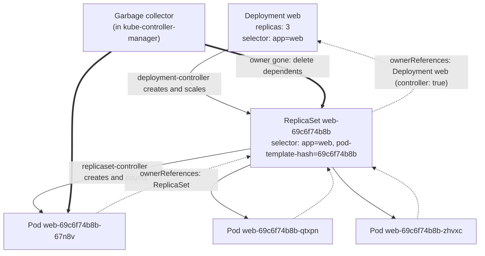

# T2.05 Controllers: ReplicaSets, Deployments (basics) and garbage collection

> Competency: n/a, foundation topic | Domain/weight: n/a (foundation; supports both exams) | Est. time: 2 h | Prerequisites: T2.04

Shell setup used in every command of this lesson (also in [00-conventions](../00-conventions.md)):

```bash
alias k=kubectl
export do="--dry-run=client -o yaml"
export now="--force --grace-period=0"
source <(kubectl completion bash); complete -o default -F __start_kubectl k
```

Use `bash` for these (the `$do` trick relies on bash splitting the variable into words; see [T2.02](../part2-basics/T2.02-kubectl-fluency-and-productivity.md)). In scripts and verification snippets I write `kubectl` in full, because aliases are off in scripts. This lesson builds on labels and selectors; read [T2.04](../part2-basics/T2.04-labels-selectors-annotations-and-namespaces.md) first.

How to read the output blocks. Every output block in this lesson is labelled:

- `REAL OUTPUT (kind v0.33.0, v1.37.0)`: produced by a command I ran on a 3-node kind cluster (1 control plane + 2 workers, node image `kindest/node:v1.37.0`, kubectl client v1.37.1, server v1.37.0). Pod names, hashes, UIDs, IPs and ages differ on your cluster. Long output is trimmed with `...`. In the output blocks `k` stands for `kubectl` (the capture script used a function with that name). The capture cluster used kind's default CNI, not Calico; nothing in this lesson depends on the CNI.
- `VERIFIED FROM DOCS`: taken from a kubernetes.io page that I fetched, not run by me.

Nothing in this lesson is written from memory without a label. Section 11 lists what I could not confirm.

## 1. Why this matters

In real life, people delete a Pod to "restart it" or to "get rid of it", and a new Pod appears a second later. If you do not know that a **controller** (a loop that keeps the cluster matching what you asked for) owns that Pod, you waste time deleting Pods that will never stay deleted, or you delete the wrong object and lose a whole app. The Deployment is the most common workload object, and it is only the top of a chain (Deployment, ReplicaSet, Pods), so reading that chain quickly is a skill worth drilling for the exam. Scaling, "why are there extra Pods" and "why is my rollout stuck" all need you to read that chain quickly. The Linux Foundation says each exam has 15-20 performance-based tasks (source: https://docs.linuxfoundation.org/tc-docs/certification/tips-cka-and-ckad), so a minute lost on a Pod that keeps coming back is expensive. This foundation sits under T3.02, T3.10 and T4.12.

## 2. Concepts

Index: 2.1 controllers and the reconcile loop; 2.2 ReplicaSet spec; 2.3 how a ReplicaSet counts Pods and adopts orphans; 2.4 Deployment, ReplicaSet and Pod chain; 2.5 `pod-template-hash`; 2.6 owner references; 2.7 garbage collection and cascading deletion; 2.8 finalizers; 2.9 scaling and self-healing; 2.10 Deployment status fields; 2.11 `generation` and `observedGeneration`; 2.12 why you do not create bare ReplicaSets; 2.13 under the hood; 2.14 related but different.

### 2.1 Controllers and the reconcile loop

A **controller** is a program that watches objects in the API server, compares what you asked for (the **desired state**, in `spec`) with what exists (the **observed state**, in `status` and in the other objects), and acts to close the gap. It repeats forever. This is called a **reconcile loop**.

The problem it solves: you do not want to write "start Pod A, then if it dies start Pod B". You write "I want 3 copies of this Pod" once, and a controller does the starting, the replacing and the counting. Without controllers, a Pod that crashes on a node that dies would be gone for good. A bare Pod is not rescheduled onto another node by anyone.

Kubernetes ships many controllers. They run together inside the `kube-controller-manager` process on the control plane. In this lesson you meet three:

| Controller | What it watches | What it does |
|---|---|---|
| `deployment-controller` | Deployments | Creates and scales ReplicaSets for a Deployment |
| `replicaset-controller` | ReplicaSets and Pods | Creates or deletes Pods until the count matches `spec.replicas` |
| garbage collector | owner references on every object | Deletes objects whose owner is gone |

You can see their names in Events. The `From` column of `k describe deploy web` shows `deployment-controller`, and for a ReplicaSet it shows `replicaset-controller` (both appear in the output blocks below).

### 2.2 ReplicaSet spec

A **ReplicaSet** (short name `rs`) keeps a stable number of identical Pods running. It has three main fields (`replicas`, `selector`, `template`) and one useful extra (`minReadySeconds`). You meet `selector` and `template` again inside a Deployment, because a Deployment contains the same two fields.

| Field | What it does | Default | Invalid or risky values |
|---|---|---|---|
| `spec.replicas` | How many Pods the ReplicaSet wants | `1` | Negative numbers are rejected. `0` is valid and means "keep none" (all Pods are deleted, the ReplicaSet stays). |
| `spec.selector` | The label rule that decides which Pods count as "mine" | none, **required** | Must match the labels in `spec.template.metadata.labels`. It is **immutable** (cannot be changed after creation) in `apps/v1`. An empty selector is rejected. |
| `spec.template` | The Pod blueprint used when a new Pod must be created (`metadata.labels` and `spec`) | none, **required** | `spec.template.spec.restartPolicy` must be `Always` (the default). `Never` and `OnFailure` are rejected. |
| `spec.minReadySeconds` | How long a Pod must be Ready, with no container crash, before it counts as **available** | `0` (available as soon as Ready) | A large value delays `availableReplicas`; Pods stay "ready but not available" meanwhile. |

Three rejections you will meet, with the exact text I captured. First, labels in the template that the selector does not match:

REAL OUTPUT (kind v0.33.0, v1.37.0)

```text
$ k apply -f bad1.yaml
The ReplicaSet "bad1" is invalid: spec.template.metadata.labels: Invalid value: {"app":"two"}: `selector` does not match template `labels`
```

Why this check exists: a ReplicaSet that creates Pods it cannot count would create Pods forever. Second, a restart policy other than `Always`:

REAL OUTPUT (kind v0.33.0, v1.37.0)

```text
$ k apply -f bad2.yaml
The ReplicaSet "bad2" is invalid: spec.template.spec.restartPolicy: Unsupported value: "Never": supported values: "Always"
```

Third, changing the selector of an existing ReplicaSet (the same is true for a Deployment):

REAL OUTPUT (kind v0.33.0, v1.37.0)

```text
$ k apply -f ok3.yaml
The ReplicaSet "ok3" is invalid: spec.selector: Invalid value: {"matchLabels":{"app":"three2"}}: field is immutable
```

To change a selector you delete and recreate the object (see 2.3 for what that does to the Pods).

The selector syntax (`matchLabels`, `matchExpressions`) is the same as in [T2.04](../part2-basics/T2.04-labels-selectors-annotations-and-namespaces.md). `k explain replicaset.spec` shows every field.

### 2.3 How a ReplicaSet counts Pods, and how it adopts orphans

The ReplicaSet does **not** keep a list of its Pods. Each time something changes, the replicaset-controller lists the Pods in the namespace and picks the ones that fit these rules:

1. The Pod's labels match `spec.selector`.
2. The Pod is not already controlled by another controller (it has no `ownerReferences` entry with `controller: true` pointing elsewhere).
3. The Pod is not being deleted.

Pods that fit are "mine". The controller compares the count with `spec.replicas`:

| Mine vs wanted | What the controller does |
|---|---|
| fewer than wanted | Creates Pods from `spec.template`, one `SuccessfulCreate` Event each |
| equal | Nothing |
| more than wanted | Deletes the surplus (see the scale-down order in 2.9) |

An **orphan** is a Pod that matches the selector and has no controller owner. A bare Pod you created with `k run` is an orphan if its labels match. When the ReplicaSet finds an orphan, it **adopts** it: it writes an `ownerReferences` entry into that Pod and counts it. The ReplicaSet does not compare the orphan's spec with its template. A Pod running a different image still counts.

Two consequences, both captured on the cluster.

**Consequence 1: adoption can eat your replica budget.** I created a bare Pod `adopted` (image `busybox:1.36`) with label `app=web2`, while a ReplicaSet `web2` with selector `app=web2` and 3 healthy Pods already existed. The ReplicaSet now saw 4 Pods for 3 wanted, and deleted the surplus one, which was the new bare Pod:

REAL OUTPUT (kind v0.33.0, v1.37.0)

```text
$ k run adopted --image=busybox:1.36 --labels=app=web2 -- sleep 3600
pod/adopted created
$ k get pod adopted -o jsonpath='{.metadata.ownerReferences}'
Error from server (NotFound): pods "adopted" not found
$ k get rs web2
NAME   DESIRED   CURRENT   READY   AGE
web2   3         3         3       3s
```

**Consequence 2: a bare Pod that exists first is adopted and counted** (this is the break-fix lab in section 7). The ReplicaSet then creates fewer new Pods, and one of its "replicas" is a Pod you never meant it to own.

A bare Pod does **not** get adopted by a Deployment's ReplicaSet when you only match the Deployment's selector, because the ReplicaSet's own selector has an extra label (`pod-template-hash`, see 2.5). I tested it: a bare Pod `late` with `app=web` next to a Deployment `web` (selector `app=web`) stayed an orphan:

REAL OUTPUT (kind v0.33.0, v1.37.0)

```text
$ k get pods --show-labels
NAME                   READY   STATUS    RESTARTS   AGE   LABELS
late                   1/1     Running   0          4s    app=web
web-69c6f74b8b-qd8hc   1/1     Running   0          5s    app=web,pod-template-hash=69c6f74b8b
web-69c6f74b8b-s2gdd   1/1     Running   0          5s    app=web,pod-template-hash=69c6f74b8b
web-69c6f74b8b-x825m   1/1     Running   0          5s    app=web,pod-template-hash=69c6f74b8b

$ k get pod late -o jsonpath='{.metadata.ownerReferences}'

```

The empty line after the command is the empty answer: no owner. The adoption trap is therefore mainly a **bare ReplicaSet** trap. Still, never give a bare Pod the labels of a controller.

The opposite also works, and the docs call it isolating Pods: change a Pod's labels so they no longer match, and the ReplicaSet releases it and creates a replacement. The docs page says it is used to take a Pod out of service for debugging (VERIFIED FROM DOCS: https://kubernetes.io/docs/concepts/workloads/controllers/replicaset/).

### 2.4 The Deployment, ReplicaSet and Pod chain

You almost never write a ReplicaSet. You write a **Deployment**, which owns a ReplicaSet, which owns Pods:

```text
Deployment web  ->  ReplicaSet web-<hash>  ->  Pods web-<hash>-<random>
```

Why two levels? A ReplicaSet has one fixed Pod template. To change the app (new image) without downtime, you need two ReplicaSets at once, an old one shrinking and a new one growing. Managing that is the Deployment's job. The Deployment keeps one ReplicaSet per version of the template, and moves Pods between them. That is a rollout, taught in T3.10. In this lesson the Deployment has only one template version, so it has only one ReplicaSet.

Create one and look at the chain with labels:

REAL OUTPUT (kind v0.33.0, v1.37.0)

```text
$ k create deploy web --image=nginx:1.27 --replicas=3
deployment.apps/web created
$ k get rs,deploy,pods --show-labels
NAME                             DESIRED   CURRENT   READY   AGE   LABELS
replicaset.apps/web-69c6f74b8b   3         3         3       1s    app=web,pod-template-hash=69c6f74b8b

NAME                  READY   UP-TO-DATE   AVAILABLE   AGE   LABELS
deployment.apps/web   3/3     3            3           1s    app=web

NAME                       READY   STATUS    RESTARTS   AGE   LABELS
pod/web-69c6f74b8b-67n8v   1/1     Running   0          1s    app=web,pod-template-hash=69c6f74b8b
pod/web-69c6f74b8b-qtxpn   1/1     Running   0          1s    app=web,pod-template-hash=69c6f74b8b
pod/web-69c6f74b8b-zhvxc   1/1     Running   0          1s    app=web,pod-template-hash=69c6f74b8b
```

Read the names. The ReplicaSet name is the Deployment name plus a hash (`web-69c6f74b8b`). The Pod name is the ReplicaSet name plus 5 random characters. So from a Pod name you can read the whole chain.

`-o wide` adds the image and the full selector:

REAL OUTPUT (kind v0.33.0, v1.37.0)

```text
$ k get rs -o wide
NAME             DESIRED   CURRENT   READY   AGE   CONTAINERS   IMAGES       SELECTOR
web-69c6f74b8b   3         3         3       1s    nginx        nginx:1.27   app=web,pod-template-hash=69c6f74b8b

$ k get deploy -o wide
NAME   READY   UP-TO-DATE   AVAILABLE   AGE   CONTAINERS   IMAGES       SELECTOR
web    3/3     3            3           1s    nginx        nginx:1.27   app=web
```

Notice that the Deployment's selector is `app=web` and the ReplicaSet's selector has one more label. That extra label is the next topic.

The Deployment fields you should know now (the rest are T3.10):

| Field | Meaning | Default (captured on 1.37) |
|---|---|---|
| `spec.replicas` | Number of Pods wanted | `1` when not given |
| `spec.selector`, `spec.template` | Same as in a ReplicaSet | required |
| `spec.strategy` | How to replace Pods when the template changes | `RollingUpdate`, `maxSurge: 25%`, `maxUnavailable: 25%` |
| `spec.revisionHistoryLimit` | How many old ReplicaSets are kept for rollback | `10` |
| `spec.progressDeadlineSeconds` | Seconds without progress before the `Progressing` condition turns False | `600` |

REAL OUTPUT (kind v0.33.0, v1.37.0)

```text
$ k get deploy web -o jsonpath='{.spec.revisionHistoryLimit} {.spec.progressDeadlineSeconds} {.spec.strategy}'
10 600 {"rollingUpdate":{"maxSurge":"25%","maxUnavailable":"25%"},"type":"RollingUpdate"}
```

### 2.5 `pod-template-hash`

The Deployment controller adds a label `pod-template-hash=<hash>` to every ReplicaSet it creates or adopts. The hash is computed from the Pod template. The label is added to the ReplicaSet's selector, to the template labels and to existing Pods (VERIFIED FROM DOCS: https://kubernetes.io/docs/concepts/workloads/controllers/deployment/). You can see all three in the captured output above: the selector `app=web,pod-template-hash=69c6f74b8b`, the Pod labels, and the ReplicaSet name suffix.

Why it exists: when the template changes, the Deployment needs a second ReplicaSet. If both ReplicaSets only selected `app=web`, each would count the other's Pods as its own and they would fight. The hash makes the selectors disjoint.

Rules:

- **Never edit or remove this label.** The docs say so in a caution box. If you remove it from a Pod, that Pod no longer matches its ReplicaSet and gets replaced.
- Same template gives the same hash. I deleted a Deployment with `--cascade=orphan` and created it again with the same `k create deploy` command; the new Deployment found the old ReplicaSet (`web-69c6f74b8b`) and took it over (see 2.7). In the two separate runs on my cluster, the same template gave the same hash `69c6f74b8b`. If your template or kubectl version differs, expect a different hash.
- The ReplicaSet carries annotations that record the history. On my cluster: `deployment.kubernetes.io/desired-replicas`, `deployment.kubernetes.io/max-replicas` and `deployment.kubernetes.io/revision` (value `"1"`).

### 2.6 `ownerReferences`

An **owner reference** is an entry in `metadata.ownerReferences` of an object that says "this object depends on that object". The Pod points to its ReplicaSet, and the ReplicaSet points to its Deployment. The arrows point from child to owner. The Deployment has no owner.

REAL OUTPUT (kind v0.33.0, v1.37.0)

```text
$ k get pod -l app=web -o jsonpath='{.items[0].metadata.ownerReferences}'
[{"apiVersion":"apps/v1","blockOwnerDeletion":true,"controller":true,"kind":"ReplicaSet","name":"web-69c6f74b8b","uid":"f76d5d7f-68f7-4ca8-b484-139e18822e19"}]
$ k get rs -l app=web -o jsonpath='{.items[0].metadata.ownerReferences}'
[{"apiVersion":"apps/v1","blockOwnerDeletion":true,"controller":true,"kind":"Deployment","name":"web","uid":"3a7bda9d-654d-4422-a2b9-77bd04550ffb"}]
$ k get deploy web -o jsonpath='{.metadata.ownerReferences}'

$ k get pod -l app=web -o jsonpath='{.items[0].metadata.ownerReferences[0].uid}{"\n"}'; k get rs -l app=web -o jsonpath='{.items[0].metadata.uid}{"\n"}'
f76d5d7f-68f7-4ca8-b484-139e18822e19
f76d5d7f-68f7-4ca8-b484-139e18822e19
```

The last command shows that the `uid` in the Pod's reference is the `metadata.uid` of the ReplicaSet. The link is by UID, not only by name. A new object with the same name has a new UID, so it is a different owner. For readable output, pipe `-o yaml` to `yq` (on the exam hosts `yq` is available, source: https://docs.linuxfoundation.org/tc-docs/certification/tips-cka-and-ckad; `jq` is not listed there).

Every field, from `k explain pod.metadata.ownerReferences` (captured):

| Field | Meaning |
|---|---|
| `apiVersion`, `kind`, `name` | Which object is the owner (required) |
| `uid` | The owner's unique ID (required) |
| `controller` | `true` means "this owner is the managing controller". There can be at most one managing controller per object. |
| `blockOwnerDeletion` | If `true` and the owner is being deleted in the **foreground** mode, the owner cannot disappear until this dependent is gone (see 2.7). Default `false`. Setting it needs `delete` permission on the owner. |

An owner and its dependent must be in the same namespace, or the owner must be cluster-scoped (there is no `namespace` field in an owner reference). Cross-namespace owners are not allowed (VERIFIED FROM DOCS: https://kubernetes.io/docs/concepts/architecture/garbage-collection/).

### 2.7 Garbage collection and cascading deletion

**Garbage collection** (GC) is the name for the ways Kubernetes cleans up. The part that matters here: when you delete an owner, the garbage collector deletes the dependents that point to it. This is **cascading deletion**. You choose how with `--cascade`:

| Mode | What `kubectl delete X --cascade=...` does | When to use | Request body kubectl sends |
|---|---|---|---|
| `background` (default) | The owner disappears at once. The garbage collector deletes the dependents afterwards. | Almost always | `{"propagationPolicy":"Background"}` (captured) |
| `foreground` | The owner stays visible with a `deletionTimestamp` and the finalizer `foregroundDeletion`. Dependents that have `blockOwnerDeletion: true` are deleted first. Then the owner disappears. | When something must not see the owner gone while dependents still run | `{"propagationPolicy":"Foreground"}` (VERIFIED FROM DOCS: https://kubernetes.io/docs/tasks/administer-cluster/use-cascading-deletion/) |
| `orphan` | The owner disappears. The dependents stay and lose the owner entry. | To replace an owner without restarting Pods | `{"propagationPolicy":"Orphan"}` (captured) |

I captured two of the request bodies with `-v=8`:

REAL OUTPUT (kind v0.33.0, v1.37.0)

```text
$ kubectl delete cm probe --cascade=orphan -v=8 2>&1 | grep -A1 'Request Body' | head -3
I1027 21:04:30.303545   59131 helper.go:202] "Request Body" body=<
	{"propagationPolicy":"Orphan"}
$ kubectl delete cm probe -v=8 2>&1 | grep -A1 'Request Body' | head -3
I1027 21:08:52.341735   68751 helper.go:202] "Request Body" body=<
	{"propagationPolicy":"Background"}
```

The second command has no `--cascade` flag, so you see that `background` is the default. Any other value is refused by kubectl:

REAL OUTPUT (kind v0.33.0, v1.37.0)

```text
$ k delete rs ok3 --cascade=sometimes
error: invalid cascade value (sometimes). Must be "background", "foreground", or "orphan"
```

**Background in action.** I deleted a Deployment `slow` (2 Pods running `sleep 3600`, which ignores the stop signal, so Pods take the full 30 s grace period to stop). Right after the delete, the Deployment and its ReplicaSet are already gone, and the Pods are still `Terminating`:

REAL OUTPUT (kind v0.33.0, v1.37.0)

```text
$ k delete deploy slow --wait=false
deployment.apps "slow" deleted from lab-t205 namespace
$ k get deploy,rs,pods -l app=slow
NAME                        READY   STATUS        RESTARTS   AGE
pod/slow-5c97b6b946-2pwsb   1/1     Terminating   0          3s
pod/slow-5c97b6b946-7mbxz   1/1     Terminating   0          3s
```

**Foreground in action.** Same Deployment, but `--cascade=foreground`. Now the Deployment is still listed (0/2) with a `deletionTimestamp` and the `foregroundDeletion` finalizer, and so is its ReplicaSet, until the last Pod is gone:

REAL OUTPUT (kind v0.33.0, v1.37.0)

```text
$ k delete deploy slow --cascade=foreground --wait=false
deployment.apps "slow" deleted from lab-t205 namespace
$ kubectl get deploy slow -o jsonpath='deletionTimestamp={.metadata.deletionTimestamp} finalizers={.metadata.finalizers}{"\n"}'
deletionTimestamp=2026-10-27T13:04:31Z finalizers=["foregroundDeletion"]
$ kubectl get rs -l app=slow -o jsonpath='{range .items[*]}{.metadata.name} deletionTimestamp={.metadata.deletionTimestamp} finalizers={.metadata.finalizers}{"\n"}{end}'
slow-5c97b6b946 deletionTimestamp=2026-10-27T13:04:31Z finalizers=["foregroundDeletion"]
$ k get deploy,rs,pods -l app=slow
NAME                   READY   UP-TO-DATE   AVAILABLE   AGE
deployment.apps/slow   0/2     0            0           3s

NAME                              DESIRED   CURRENT   READY   AGE
replicaset.apps/slow-5c97b6b946   2         0         0       3s

NAME                        READY   STATUS        RESTARTS   AGE
pod/slow-5c97b6b946-kkmjk   1/1     Terminating   0          3s
pod/slow-5c97b6b946-qcdhb   1/1     Terminating   0          3s
pod/slow-5c97b6b946-xgwqf   1/1     Terminating   0          46s
pod/slow-5c97b6b946-zfzbw   1/1     Terminating   0          46s
```

(Two of the four Pods, the 46 s old ones, are left over from an earlier `slow` Deployment that I had deleted seconds before; they were still inside their 30 s grace period and carry the same label. The point is that the Deployment and the ReplicaSet stay visible while Pods stop.) About 35 seconds later `k get deploy,rs,pods -l app=slow` printed `No resources found in lab-t205 namespace.`

**Orphan in action.** (The blocks of this section were captured in this order: first the ReplicaSet-only orphan test at the end of this section, then the Deployment orphan below, then the re-adoption. That is why the ReplicaSet below shows AGE `3s` while its Pods are 75 s old: the ReplicaSet had just been recreated by the earlier ReplicaSet-only test.) This is how you swap an owner without touching the running Pods. Delete the Deployment with `--cascade=orphan`: the ReplicaSet and Pods keep running and the ReplicaSet loses its owner entry. The Pods still point to the ReplicaSet.

REAL OUTPUT (kind v0.33.0, v1.37.0)

```text
$ k delete deploy web --cascade=orphan
deployment.apps "web" deleted from lab-t205 namespace
$ k get deploy,rs,pods -l app=web
NAME                             DESIRED   CURRENT   READY   AGE
replicaset.apps/web-69c6f74b8b   3         3         3       3s

NAME                       READY   STATUS    RESTARTS   AGE
pod/web-69c6f74b8b-gphds   1/1     Running   0          75s
pod/web-69c6f74b8b-knzcq   1/1     Running   0          40s
pod/web-69c6f74b8b-vs6qd   1/1     Running   0          61s
$ k get rs -l app=web -o jsonpath='{.items[0].metadata.ownerReferences}'

$ k get pod -l app=web -o jsonpath='{.items[0].metadata.ownerReferences}'
[{"apiVersion":"apps/v1","blockOwnerDeletion":true,"controller":true,"kind":"ReplicaSet","name":"web-69c6f74b8b","uid":"bbf08bec-9c70-43ba-9d92-75bb26a8eced"}]
```

Now create the same Deployment again. It finds the orphaned ReplicaSet, matches it (same selector, same template hash) and adopts it. No new Pods are created: the Pod ages (75 s, 40 s, 61 s) keep counting.

REAL OUTPUT (kind v0.33.0, v1.37.0)

```text
$ k create deploy web --image=nginx:1.27 --replicas=3
deployment.apps/web created
$ k get deploy,rs,pods -l app=web
NAME                  READY   UP-TO-DATE   AVAILABLE   AGE
deployment.apps/web   3/3     3            3           3s

NAME                             DESIRED   CURRENT   READY   AGE
replicaset.apps/web-69c6f74b8b   3         3         3       7s

NAME                       READY   STATUS    RESTARTS   AGE
pod/web-69c6f74b8b-gphds   1/1     Running   0          79s
pod/web-69c6f74b8b-knzcq   1/1     Running   0          44s
pod/web-69c6f74b8b-vs6qd   1/1     Running   0          65s
$ k get rs -l app=web -o jsonpath='{.items[0].metadata.ownerReferences}'
[{"apiVersion":"apps/v1","blockOwnerDeletion":true,"controller":true,"kind":"Deployment","name":"web","uid":"9fda2fd5-17bb-452d-bd94-06e3b92e312e"}]
```

**Orphaning only the ReplicaSet.** If you orphan the ReplicaSet of a live Deployment, the Deployment notices the ReplicaSet is gone and creates a ReplicaSet with the same name, which adopts the same Pods. Nothing visible stops. In the capture the new ReplicaSet was 3 s old while its Pods were 75 s old:

REAL OUTPUT (kind v0.33.0, v1.37.0)

```text
$ k delete replicaset.apps/web-69c6f74b8b --cascade=orphan
replicaset.apps "web-69c6f74b8b" deleted from lab-t205 namespace
$ k get rs,pods -l app=web
NAME                             DESIRED   CURRENT   READY   AGE
replicaset.apps/web-69c6f74b8b   3         3         3       3s

NAME                       READY   STATUS    RESTARTS   AGE
pod/web-69c6f74b8b-gphds   1/1     Running   0          75s
pod/web-69c6f74b8b-knzcq   1/1     Running   0          40s
pod/web-69c6f74b8b-vs6qd   1/1     Running   0          61s
```

**Which object does the garbage collector delete without you asking?** Any object whose owners are all gone. Orphaning means "remove the owner reference first, so the GC has nothing to collect".

### 2.8 Finalizers

A **finalizer** is a string key in `metadata.finalizers` that means "someone must finish a clean-up job before this object may really disappear". It does not hold code. A controller that owns that key watches for the object being deleted, does the clean-up, then removes its key.

How deletion works when finalizers exist (VERIFIED FROM DOCS: https://kubernetes.io/docs/concepts/overview/working-with-objects/finalizers/):

1. You send a delete request.
2. The API server does not remove the object. It sets `metadata.deletionTimestamp` and answers HTTP 202 (Accepted).
3. The object stays visible in the "terminating" state. The controller for each finalizer does its job and removes its key.
4. When `metadata.finalizers` is empty, the API server deletes the object.

While the deletion is pending you can remove finalizers but you cannot add new ones, and you cannot reset `deletionTimestamp`. Custom finalizer names must be qualified names such as `example.com/keep`. A well-known built-in one is `kubernetes.io/pv-protection` on PersistentVolumes.

The finalizer you met above, `foregroundDeletion`, is set by the API server itself when you use `--cascade=foreground`. The garbage collector removes it after the dependents with `blockOwnerDeletion: true` are gone.

A custom finalizer, tried on a ConfigMap (no controller owns `example.com/keep`, so nothing will ever remove it):

REAL OUTPUT (kind v0.33.0, v1.37.0)

```text
$ k apply -f cm-fin.yaml
configmap/keepme created
$ k delete cm keepme --wait=false
configmap "keepme" deleted from lab-t205 namespace
$ kubectl get cm keepme -o jsonpath='deletionTimestamp={.metadata.deletionTimestamp} finalizers={.metadata.finalizers}{"\n"}'
deletionTimestamp=2026-10-27T13:05:46Z finalizers=["example.com/keep"]
$ k get cm keepme
NAME     DATA   AGE
keepme   1      0s
$ k patch cm keepme --type=merge -p '{"metadata":{"finalizers":null}}'
configmap/keepme patched
$ k get cm keepme
Error from server (NotFound): configmaps "keepme" not found
```

Read this carefully: `delete` printed "deleted", yet the object is still there. The `deletionTimestamp` is the proof that deletion is pending. Removing the finalizers (the last `patch`) lets the deletion finish. In real clusters, removing a finalizer by hand skips a clean-up that the owner of that finalizer wanted to do, so first find out what the finalizer is for. The file `cm-fin.yaml` used above:

```yaml
apiVersion: v1
kind: ConfigMap
metadata:
  name: keepme
  finalizers:
  - example.com/keep
data:
  a: b
```

### 2.9 Scaling and self-healing

**Imperative scaling.** `k scale deploy web --replicas=5` changes `spec.replicas` only. It works for Deployments, ReplicaSets and a few other kinds. `k create deploy web --image=nginx:1.27 --replicas=3` sets the count at creation.

**Self-healing demo.** `k delete pod -l app=web` deletes all Pods with that label. The replicaset-controller sees 0 Pods for 3 wanted and creates 3 new ones. The watch below was started with `k get pods -l app=web -w` before the delete (the first three lines are the initial list; I removed repeated lines, the real watch printed about 35 lines):

REAL OUTPUT (kind v0.33.0, v1.37.0)

```text
$ k get pods -l app=web -w            # terminal 2, started first
NAME                   READY   STATUS    RESTARTS   AGE
web-69c6f74b8b-67n8v   1/1     Running   0          1s
web-69c6f74b8b-qtxpn   1/1     Running   0          1s
web-69c6f74b8b-zhvxc   1/1     Running   0          1s
web-69c6f74b8b-67n8v   1/1     Terminating   0          3s
web-69c6f74b8b-gphds   0/1     Pending       0          0s
web-69c6f74b8b-qtxpn   1/1     Terminating   0          3s
web-69c6f74b8b-dstmh   0/1     Pending       0          0s
web-69c6f74b8b-gphds   0/1     ContainerCreating   0          0s
web-69c6f74b8b-clmnk   0/1     Pending             0          0s
web-69c6f74b8b-zhvxc   1/1     Terminating         0          3s
web-69c6f74b8b-zhvxc   0/1     Completed           0          4s
web-69c6f74b8b-67n8v   0/1     Completed           0          4s
web-69c6f74b8b-gphds   1/1     Running             0          2s
web-69c6f74b8b-dstmh   1/1     Running             0          2s
web-69c6f74b8b-clmnk   1/1     Running             0          2s
...

$ k delete pod -l app=web             # terminal 1
pod "web-69c6f74b8b-67n8v" deleted from lab-t205 namespace
pod "web-69c6f74b8b-qtxpn" deleted from lab-t205 namespace
pod "web-69c6f74b8b-zhvxc" deleted from lab-t205 namespace

$ k get pods -l app=web
NAME                   READY   STATUS    RESTARTS   AGE
web-69c6f74b8b-clmnk   1/1     Running   0          12s
web-69c6f74b8b-dstmh   1/1     Running   0          12s
web-69c6f74b8b-gphds   1/1     Running   0          12s
```

How to read the watch. The old names (`67n8v`, `qtxpn`, `zhvxc`) go to `Terminating`. At the same time, three **new names** (`gphds`, `dstmh`, `clmnk`) appear in `Pending`, then `ContainerCreating`, then `Running`. The replacement starts at once; it does not wait for the old Pod to finish stopping. A replacement Pod is a **new** Pod with a new name and a new IP, not a restarted one. (`Completed` on the old Pods only means the nginx container exited with code 0 when told to stop.)

**Scale-down order.** When there are more Pods than wanted, the ReplicaSet chooses which to delete. The docs list this order (VERIFIED FROM DOCS: https://kubernetes.io/docs/concepts/workloads/controllers/replicaset/): Pending and unschedulable Pods first; then lower `controller.kubernetes.io/pod-deletion-cost` annotation first; then Pods on nodes that hold more replicas of this ReplicaSet; then newer Pods before older ones (creation times are bucketed on a log scale); then random. The docs also say the deletion-cost annotation is honoured on a best-effort basis, with no guarantee.

I scaled Deployment `web` from 3 to 5 and then to 2 while watching. The scale-down removed one of the 2 new Pods and 2 of the 3 older Pods, and kept one older and one newer Pod. So "newer first" is a tendency, not a rule (one sample only):

REAL OUTPUT (kind v0.33.0, v1.37.0)

```text
$ k scale deploy web --replicas=5
deployment.apps/web scaled
$ k scale deploy web --replicas=2
deployment.apps/web scaled
$ k get deploy web
NAME   READY   UP-TO-DATE   AVAILABLE   AGE
web    2/2     2            2           38s
$ k describe deploy web | tail -6
Events:
  Type    Reason             Age   From                   Message
  ----    ------             ----  ----                   -------
  Normal  ScalingReplicaSet  41s   deployment-controller  Scaled up replica set web-69c6f74b8b from 0 to 3
  Normal  ScalingReplicaSet  24s   deployment-controller  Scaled up replica set web-69c6f74b8b from 3 to 5
  Normal  ScalingReplicaSet  13s   deployment-controller  Scaled down replica set web-69c6f74b8b from 5 to 2
  Normal  ScalingReplicaSet  3s    deployment-controller  Scaled up replica set web-69c6f74b8b from 2 to 3
```

(The last line is from a later `k scale deploy web --replicas=3` that I ran before this `describe`.) Note that the Deployment does not create a new ReplicaSet for a scale: the same `web-69c6f74b8b` is scaled. Only a **template** change makes a new one.

I also tried the deletion-cost annotation once. I set `controller.kubernetes.io/pod-deletion-cost=-100` on one Pod of a 3-replica Deployment (all Pods Ready, same age), then scaled to 2. The annotated Pod `cost-6f449f548c-2tlnt` was the one removed; the two survivors were `...-tlgv9` and `...-w58wx`.

### 2.10 Deployment status fields

`status` is written by the controller, not by you. Run `k explain deployment.status` for the definitions. These come from the 1.37 API on my cluster:

| Field | Meaning (from `k explain`) |
|---|---|
| `replicas` | Non-terminating Pods targeted by the Deployment (labels match the selector) |
| `readyReplicas` | Non-terminating Pods with the Ready condition |
| `updatedReplicas` | Non-terminating Pods that have the desired template (the current template version) |
| `availableReplicas` | Non-terminating Pods that are Ready for at least `minReadySeconds` |
| `unavailableReplicas` | Pods still needed to reach 100% available capacity. They are Pods that run but are not available yet, or Pods not created yet. Absent when 0. |
| `terminatingReplicas` | Pods with a `deletionTimestamp` that have not yet reached `Failed` or `Succeeded`. **Beta**, behind the feature gate `DeploymentReplicaSetTerminatingReplicas`, enabled by default (the 1.37 `k explain` text says so; the docs list it as beta since v1.35). |
| `observedGeneration` | The `metadata.generation` the controller last processed (see 2.11) |
| `collisionCount` | Count of hash collisions, used when choosing a new ReplicaSet name. Absent when 0. |
| `conditions` | List of `Available`, `Progressing` and, on errors, `ReplicaFailure` |

Because `replicas` counts only **non-terminating** Pods in 1.37, a Pod that is stopping is no longer part of `replicas`; it is in `terminatingReplicas`. I captured this on the `slow` Deployment. I deleted one of its 2 Pods and read the status one second later: `replicas` still 2 (the replacement was already created), `terminatingReplicas` 1:

REAL OUTPUT (kind v0.33.0, v1.37.0)

```text
$ k delete pod slow-5c97b6b946-t8g29 --wait=false
pod "slow-5c97b6b946-t8g29" deleted from lab-t205 namespace
$ kubectl get deploy slow -o jsonpath='{.status}'
{"availableReplicas":2,"conditions":[{...}],"observedGeneration":1,"readyReplicas":2,"replicas":2,"terminatingReplicas":1,"updatedReplicas":2}
$ kubectl get rs -l app=slow -o jsonpath='{.items[0].status}'
{"availableReplicas":2,"fullyLabeledReplicas":2,"observedGeneration":1,"readyReplicas":2,"replicas":2,"terminatingReplicas":1}
$ k get pods -l app=slow
NAME                    READY   STATUS        RESTARTS   AGE
slow-5c97b6b946-t8g29   1/1     Terminating   0          1s
slow-5c97b6b946-xgwqf   1/1     Running       0          1s
slow-5c97b6b946-zfzbw   1/1     Running       0          1s
```

On a healthy idle Deployment the same field exists and is `0`. The full status of the healthy `web` Deployment (3 replicas):

REAL OUTPUT (kind v0.33.0, v1.37.0)

```text
$ k get deploy web -o yaml | sed -n '/^status:/,$p'
status:
  availableReplicas: 3
  conditions:
  - lastTransitionTime: "2026-10-27T13:03:09Z"
    lastUpdateTime: "2026-10-27T13:03:09Z"
    message: Deployment has minimum availability.
    reason: MinimumReplicasAvailable
    status: "True"
    type: Available
  - lastTransitionTime: "2026-10-27T13:03:08Z"
    lastUpdateTime: "2026-10-27T13:03:09Z"
    message: ReplicaSet "web-69c6f74b8b" has successfully progressed.
    reason: NewReplicaSetAvailable
    status: "True"
    type: Progressing
  observedGeneration: 1
  readyReplicas: 3
  replicas: 3
  terminatingReplicas: 0
  updatedReplicas: 3
```

The ReplicaSet status has the same count fields plus `fullyLabeledReplicas` (Pods whose labels match the template labels). It has `terminatingReplicas` too.

**Conditions.**

| Condition | Meaning | Values I observed |
|---|---|---|
| `Available` | The Deployment has the minimum number of available Pods (replicas minus `maxUnavailable`) | `True`, reason `MinimumReplicasAvailable` |
| `Progressing` | A rollout is moving, or has finished | `True` / `ReplicaSetUpdated` while a new ReplicaSet is scaling; `True` / `NewReplicaSetAvailable` when done; `False` / `ProgressDeadlineExceeded` when no progress for `progressDeadlineSeconds` |
| `ReplicaFailure` | Pods could not be created (quota, limit range) | not tested here; named in the docs |

All three `Progressing` values are captured in the stuck example in section 6. `k describe deploy` prints the same conditions as a table, plus `OldReplicaSets` and `NewReplicaSet` lines.

### 2.11 `generation` versus `observedGeneration`

`metadata.generation` is a counter that the API server increases each time the object's **spec** changes. `status.observedGeneration` is written by the controller and says "I have processed the spec up to this generation". When they are equal, the status you read describes your latest spec. When `observedGeneration` is lower, the controller has not looked at your change yet, so the status is out of date and any "all ready" reading is not trustworthy. `k rollout status` uses this check.

I read both after each step. Create is generation 1. Scale to 5 makes it 2. Scale to 2 makes it 3. A scale is a spec change even though it does not create a ReplicaSet:

REAL OUTPUT (kind v0.33.0, v1.37.0)

```text
$ k get deploy web -o jsonpath='gen={.metadata.generation} observed={.status.observedGeneration}{"\n"}'
gen=1 observed=1
...
$ k get deploy web -o jsonpath='gen={.metadata.generation} observed={.status.observedGeneration}{"\n"}'
gen=3 observed=3
```

### 2.12 Why you do not create bare ReplicaSets

A bare ReplicaSet is one you create by itself, without a Deployment. It works (I did it in the capture), but you lose everything the Deployment adds:

| You want | ReplicaSet alone | Deployment |
|---|---|---|
| Keep N Pods alive | yes | yes (through its ReplicaSet) |
| Change the image without downtime (rolling update) | no. The docs say a new template does not change existing Pods; "ReplicaSets do not support a rolling update directly" | yes |
| Roll back to the previous version | no | yes (`revisionHistoryLimit`, `k rollout undo`) |
| Report progress and a stuck rollout | no | yes (`Progressing` condition, `progressDeadlineSeconds`) |
| Safe from adoption surprises | no. It adopts any matching orphan Pod | mostly, because of `pod-template-hash` |

(VERIFIED FROM DOCS: https://kubernetes.io/docs/concepts/workloads/controllers/replicaset/ for the rolling-update sentence.) The docs recommend a Deployment unless you need custom update orchestration. Use a ReplicaSet only when a task names it. In that case you build its YAML from a Deployment's (section 4).

### 2.13 Under the hood

- **Everything goes through the API server.** The controllers do not talk to nodes. The replicaset-controller **watches** ReplicaSets and Pods through the API server. On each event it recomputes "mine vs wanted" and calls the API to create or delete Pods. The Pods it creates get a `generateName` (for example `frontend-`), and the API server adds a random suffix. That is why every replacement Pod has a new random name.
- **After the Pod exists, other components take over.** The scheduler picks a node for the Pod and the kubelet on that node starts the containers. The ReplicaSet only sees the Pod's phase and Ready condition through the API.
- **Ownership is written by the controller.** When the replicaset-controller creates a Pod, it sets the `ownerReferences` entry with `controller: true` and `blockOwnerDeletion: true`. The same entry is written when it adopts an orphan. When a Pod stops matching, it removes the entry (release).
- **The garbage collector** builds a graph of all objects from their `ownerReferences` by watching the API. When an owner's UID is no longer present, it deletes the dependents (background), or deletes dependents first (foreground), or has the entry removed (orphan). That is why a same-named replacement object is a different owner: its UID is new.
- **A delete request carries a policy.** `kubectl delete --cascade=...` sets `propagationPolicy` in the delete request (captured with `-v=8`). The API server, not kubectl, adds the `foregroundDeletion` finalizer.
- **Terminating is graceful.** A Pod being deleted gets `deletionTimestamp`, then the kubelet sends the stop signal and waits `terminationGracePeriodSeconds` (30 s by default; I saw `"terminationGracePeriodSeconds":30` filled in on the ReplicaSet template of my cluster) before killing the container. During that time the Pod is `Terminating`, and since 1.35 it is counted in `terminatingReplicas`. `$now` (`--force --grace-period=0`) removes the API object without waiting; it does not stop the ReplicaSet from creating a replacement.

### 2.14 Related but different

- **ReplicationController**: the older controller that ReplicaSet replaced. It does not support set-based selectors (`matchExpressions`). The docs say ReplicaSets are preferred (VERIFIED FROM DOCS: https://kubernetes.io/docs/concepts/workloads/controllers/replicaset/); do not use it in tasks.
- **Labels versus ownership**: labels tell controllers which objects to count. Owner references tell the GC which objects to delete. They are different mechanisms and can disagree: a Pod can match a selector without an owner reference (orphan), and a Pod can have an owner reference but stop matching (it is released).
- **Deployment, StatefulSet, DaemonSet, Job** are all controllers. This lesson covers only the Deployment and the ReplicaSet below it. The others use the same owner reference and GC rules.
- **`k delete pod` versus `k scale`**: deleting a Pod asks for a replacement; scaling changes how many are wanted. To stop Pods staying, change the wanted number or delete the owner.

## 3. How it works (diagram)



Walkthrough:

1. Solid arrows point **down**: the Deployment creates the ReplicaSet and the ReplicaSet creates the Pods. This is the direction of "who makes whom".
2. Dotted arrows point **up**: each child stores an `ownerReferences` entry that names its parent (by name and UID). This is the direction the garbage collector reads.
3. The ReplicaSet's selector has the extra label `pod-template-hash`. That is what keeps ReplicaSets of the same Deployment from counting each other's Pods.
4. Thick arrows are the GC. When an owner is deleted (background or foreground), the GC walks **down** and deletes the dependents. With `--cascade=orphan` the owner reference entries are removed first, so the GC has nothing to delete.
5. Deleting only a Pod leaves the ReplicaSet in place. The ReplicaSet counts 2 of 3 and creates a new Pod, which is the self-healing you saw in the watch.

## 4. Commands and YAML you must produce fast

### Imperative shortcuts

```bash
k create deploy web --image=nginx:1.27 --replicas=3     # Deployment with 3 Pods; container is named "nginx"
k scale deploy web --replicas=5                         # change spec.replicas only (also: k scale rs <name> --replicas=N)
k get rs,deploy,pods --show-labels                      # the whole chain with labels, in one call
k get rs -o wide                                        # adds IMAGES and SELECTOR (shows pod-template-hash)
k delete pod -l app=web                                 # delete all Pods with the label; the owner recreates them
k delete rs <rs> --cascade=orphan                       # delete the ReplicaSet, keep its Pods (they become orphans)
k delete deploy web --cascade=orphan                    # delete the Deployment, keep ReplicaSet and Pods
k delete deploy web --cascade=foreground                # owner stays visible until dependents are gone
k get pod -l app=web -o jsonpath='{.items[0].metadata.ownerReferences}'   # who owns this Pod
k get pods -l app=web -w                                # watch changes live (Ctrl+C to stop)
k explain deployment.status                             # field meanings from the cluster's API schema (no internet needed)
k create deploy web --image=nginx:1.27 --replicas=3 $do > deploy.yaml     # YAML skeleton, nothing created
```

### The Deployment YAML (from `$do`, with every field explained)

`k create deploy web --image=nginx:1.27 --replicas=3 $do` prints this. The block below is that output tidied by hand, with my comments added. Real client-side dry-run output also contains `creationTimestamp: null` (under `metadata` and under `template.metadata`) and may order some keys differently from this block; `creationTimestamp: null` is harmless, leave it in. The comments are mine:

```yaml
apiVersion: apps/v1          # Deployments and ReplicaSets are in the apps/v1 group
kind: Deployment
metadata:
  name: web
  labels:
    app: web                 # label on the Deployment itself; not used for selection
spec:
  replicas: 3                # wanted Pods. Default 1. Negative is invalid. 0 deletes all Pods.
  selector:
    matchLabels:
      app: web               # which Pods belong to this Deployment. Immutable. Must match template labels.
  strategy: {}               # empty means defaults: RollingUpdate, maxSurge 25%, maxUnavailable 25%
  template:                  # the Pod blueprint
    metadata:
      labels:
        app: web             # MUST match spec.selector, or the API server rejects the object
    spec:
      containers:
      - name: nginx          # kubectl names the container after the image
        image: nginx:1.27    # pinned tag; never :latest in this guide
        resources: {}        # no requests or limits
status: {}                   # ignored on create; the controller fills status
```

### The ReplicaSet YAML (edit the Deployment YAML: change the kind, remove `strategy`)

A ReplicaSet has no `strategy` field. This is the fastest way to write one in an exam: generate the Deployment YAML, then change two things. `strategy` must go, because the API server rejects unknown fields. This is what I captured when I only changed the kind:

REAL OUTPUT (kind v0.33.0, v1.37.0)

```text
$ sed -i.bak 's/kind: Deployment/kind: ReplicaSet/' rs.yaml; kubectl apply -f rs.yaml --dry-run=server
Error from server (BadRequest): error when creating "rs.yaml": ReplicaSet in version "v1" cannot be handled as a ReplicaSet: strict decoding error: unknown field "spec.strategy"
```

After also deleting the `strategy:` line, the server accepted it:

```bash
k create deploy web2 --image=nginx:1.27 --replicas=3 $do > rs.yaml
sed -i.bak -e 's/^kind: Deployment/kind: ReplicaSet/' -e '/strategy:/d' rs.yaml
k apply -f rs.yaml
```

REAL OUTPUT (kind v0.33.0, v1.37.0)

```text
$ sed -i.bak '/strategy:/d' rs.yaml; kubectl apply -f rs.yaml --dry-run=server
replicaset.apps/web2 created (server dry run)
$ kubectl apply -f rs.yaml; kubectl get rs web2 -o wide
replicaset.apps/web2 created
NAME   DESIRED   CURRENT   READY   AGE   CONTAINERS   IMAGES       SELECTOR
web2   3         3         0       0s    nginx        nginx:1.27   app=web2
$ kubectl get pods -l app=web2 -o jsonpath='{range .items[*]}{.metadata.name} {.metadata.ownerReferences[0].kind}{"\n"}{end}'
web2-bbbs4 ReplicaSet
web2-j9mfk ReplicaSet
web2-vsffs ReplicaSet
```

The final file (it applies cleanly with `kubectl apply -f`):

```yaml
apiVersion: apps/v1          # same group as Deployment
kind: ReplicaSet             # changed from Deployment
metadata:
  name: web2
  labels:
    app: web2                # label on the ReplicaSet object itself
spec:
  replicas: 3                # wanted Pods. Default 1.
  selector:                  # same shape as in a Deployment
    matchLabels:
      app: web2              # Pods with this label are "mine". Immutable.
  template:                  # same Pod blueprint as in a Deployment
    metadata:
      labels:
        app: web2            # must match the selector
    spec:                    # restartPolicy must stay Always (the default)
      containers:
      - name: nginx
        image: nginx:1.27
        resources: {}
status: {}                   # ignored on create
```

What you learn from the exercise: `selector` and `template` are identical in a Deployment and a ReplicaSet. The Deployment adds `strategy` and the other rollout fields on top.

### Speed drill

Setup (once): `k create ns lab-t205; k config set-context --current --namespace=lab-t205`. Run the tasks in order. Target times are for exam pace (about 6 minutes per task on average, summary E2/E3: 15-20 tasks in 2 hours). Cleanup is at the end of the drill.

| # | Task | Target |
|---|---|---|
| 1 | Create Deployment `api` with image `nginx:1.27` and 3 replicas | 45 s |
| 2 | Scale `api` to 5 replicas | 20 s |
| 3 | Print `<kind>/<name>` of the owner of one `api` Pod | 60 s |
| 4 | Show the `pod-template-hash` of the ReplicaSet of `api` | 45 s |
| 5 | Create ReplicaSet `api-rs` (image `nginx:1.27`, 2 replicas) by editing a Deployment YAML | 90 s |
| 6 | Print `readyReplicas` and `terminatingReplicas` of `api-rs` on one line | 45 s |
| 7 | Delete the Pods of `api-rs` and show that 2 new Pods appear | 30 s |
| 8 | Delete Deployment `api` but keep its Pods and ReplicaSet, then show the ReplicaSet has no owner | 60 s |

<details><summary>Answers</summary>

```bash
# 1
k create deploy api --image=nginx:1.27 --replicas=3
# 2
k scale deploy api --replicas=5
# 3
k get pod -l app=api -o jsonpath='{.items[0].metadata.ownerReferences[0].kind}/{.items[0].metadata.ownerReferences[0].name}{"\n"}'
# prints ReplicaSet/api-<hash>
# 4  (-L adds a column for that label)
k get rs -l app=api -L pod-template-hash
# 5
k create deploy api-rs --image=nginx:1.27 --replicas=2 $do > rs.yaml
sed -i.bak -e 's/^kind: Deployment/kind: ReplicaSet/' -e '/strategy:/d' rs.yaml
k apply -f rs.yaml
# 6
k get rs api-rs -o jsonpath='{.status.readyReplicas} {.status.terminatingReplicas}{"\n"}'
# 7
k delete pod -l app=api-rs
k get pods -l app=api-rs
# 8
k delete deploy api --cascade=orphan
k get rs -l app=api -o jsonpath='{.items[0].metadata.ownerReferences}'    # empty output = no owner
```

</details>

Cleanup of the drill (returns the cluster to baseline):

```bash
k delete ns lab-t205
k config set-context --current --namespace=default
rm -f rs.yaml rs.yaml.bak
```

## 5. Worked example

Environment: kind, namespace `lab-t205`. Goal: build a Deployment, read the chain, prove ownership, watch self-healing, scale, read status. Every output below is from my capture.

**Step 1. Set up and create.**

```bash
k create ns lab-t205
k config set-context --current --namespace=lab-t205
k create deploy web --image=nginx:1.27 --replicas=3
k rollout status deploy web
```

REAL OUTPUT (kind v0.33.0, v1.37.0)

```text
deployment.apps/web created
Waiting for deployment "web" rollout to finish: 0 of 3 updated replicas are available...
Waiting for deployment "web" rollout to finish: 1 of 3 updated replicas are available...
Waiting for deployment "web" rollout to finish: 2 of 3 updated replicas are available...
deployment "web" successfully rolled out
```

What the command does: `create deploy` makes one object. `rollout status` waits until the replicas are available. Use it in the exam instead of repeated `get` calls.

**Step 2. See the chain.** `k get rs,deploy,pods --show-labels` (output in 2.4). Look for: one ReplicaSet named `web-<hash>`; Pods named `web-<hash>-<random>`; every Pod label set `app=web,pod-template-hash=<hash>` equal to the ReplicaSet's selector.

**Step 3. Prove ownership.** Run the two `ownerReferences` commands and the UID comparison (output in 2.6). Look for: the Pod's owner is `ReplicaSet web-<hash>`; the ReplicaSet's owner is `Deployment web`; the Deployment has none; the UIDs match.

**Step 4. Self-healing.** Open a second terminal with `k get pods -l app=web -w`. In the first one run `k delete pod -l app=web`. Look for: three `Terminating`, three new names, all `Running` within a few seconds (output in 2.9). The Deployment, ReplicaSet and `generation` do not change, because only Pods were deleted.

**Step 5. Scale and watch.**

```bash
k scale deploy web --replicas=5     # watch: 2 new Pods appear
k scale deploy web --replicas=2     # watch: 3 Pods go Terminating
k get deploy web                    # 2/2
k get deploy web -o jsonpath='gen={.metadata.generation} observed={.status.observedGeneration}{"\n"}'
k scale deploy web --replicas=3
```

Output is in 2.9 and 2.11. Look for: `READY 2/2`, `gen=3 observed=3`.

**Step 6. Read the status and conditions.**

REAL OUTPUT (kind v0.33.0, v1.37.0)

```text
$ k get deploy web -o jsonpath='{range .status.conditions[*]}{.type}={.status} reason={.reason} msg={.message}{"\n"}{end}'
Progressing=True reason=NewReplicaSetAvailable msg=ReplicaSet "web-69c6f74b8b" has successfully progressed.
Available=True reason=MinimumReplicasAvailable msg=Deployment has minimum availability.
```

**Step 7. Watch a terminating Pod show up in the status.** Create `k create deploy slow --image=busybox:1.36 --replicas=2 -- sleep 3600`. Delete one Pod with `--wait=false` and read `.status` right away (output in 2.10): `terminatingReplicas` is 1 while the Pod stops (30 s grace).

**Step 8. Orphan and re-adopt.** Run `k delete deploy web --cascade=orphan`, check that the ReplicaSet and Pods remain and the ReplicaSet has no owner, then `k create deploy web --image=nginx:1.27 --replicas=3` and check that the same ReplicaSet and Pod names are back under the new Deployment (output in 2.7).

**Step 9. Clean up.**

```bash
k delete deploy web slow
k delete ns lab-t205
k config set-context --current --namespace=default
```

## 6. Common mistakes and how to fix them

| Symptom | What you will see (exact text) | Cause | Fix (command) |
|---|---|---|---|
| Pods keep coming back after `k delete pod` | `pod "web-69c6f74b8b-67n8v" deleted from lab-t205 namespace`, then a new Pod with a new suffix and AGE of a few seconds | The Pod is owned by a ReplicaSet (through a Deployment) that wants N Pods | Delete or scale the **owner**: `k scale deploy web --replicas=0` or `k delete deploy web` |
| Extra Pods adopted unexpectedly | `k get rs shop` shows `3 3 3`, but only 2 `SuccessfulCreate` Events and one Pod runs another image | A bare Pod with labels matching the ReplicaSet selector was adopted and counted | Give the bare Pod different labels: `k label pod intruder app=debug --overwrite` |
| Bare Pod disappears right after creation | `Error from server (NotFound): pods "adopted" not found` | The ReplicaSet already had all replicas, adopted the Pod, then deleted the surplus | Use unique labels for bare Pods; check selectors with `k get rs -o wide` before `k run --labels=...` |
| Deployment stuck with old ReplicaSet Pods | `UP-TO-DATE 1` but `READY 3/3`; new Pod `ImagePullBackOff`; later `Progressing=False reason=ProgressDeadlineExceeded` | The new Pods never become Ready, so the Deployment keeps the old ones | `k describe pod`, fix the image with `k set image`, or `k rollout undo deploy/<name>` (see T3.10) |
| Template labels do not match selector | ``The ReplicaSet "bad1" is invalid: spec.template.metadata.labels: Invalid value: {"app":"two"}: `selector` does not match template `labels` `` | `spec.template.metadata.labels` lacks the labels in `spec.selector` | Make the template labels include every selector label |
| Cannot change the selector | `The ReplicaSet "ok3" is invalid: spec.selector: Invalid value: {...}: field is immutable` | `spec.selector` is immutable | Delete and recreate the object (use `--cascade=orphan` to keep running Pods) |
| ReplicaSet YAML rejected | `strict decoding error: unknown field "spec.strategy"` | A Deployment-only field was left in the ReplicaSet | Delete the `strategy:` line |
| Bad restart policy | `spec.template.spec.restartPolicy: Unsupported value: "Never": supported values: "Always"` | ReplicaSets and Deployments only run Pods that restart | Use a Job for run-once work (later topic) or remove `restartPolicy` |
| Wrong cascade value | `error: invalid cascade value (sometimes). Must be "background", "foreground", or "orphan"` | Typo in `--cascade` | Use one of the three values |
| Object "deleted" but still there | `deletionTimestamp` is set and `finalizers=["example.com/keep"]` | A finalizer is waiting for its owner to clean up | Find the controller for the finalizer; as a last resort `k patch <kind> <name> --type=merge -p '{"metadata":{"finalizers":null}}'` |

The first three rows are the failure modes in this topic's checklist. Here is the reasoning for each, in the order I would run the commands.

**Failure 1: Pods keep coming back after delete.**

1. Delete a Pod and run `k get pods -l app=web` again. A new Pod with a different random suffix and a small AGE tells you a controller owns it (output in 2.9).
2. Find the owner: `k get pod <pod> -o jsonpath='{.metadata.ownerReferences}'`. Read `kind` and `name`: `ReplicaSet web-69c6f74b8b`.
3. Go up one level: `k get rs web-69c6f74b8b -o jsonpath='{.metadata.ownerReferences}'` shows `Deployment web`. A Deployment has no owner, so it is the top.
4. Act on the **top** owner. Deleting only the ReplicaSet of a Deployment does not stop it: the Deployment creates the ReplicaSet again (captured in 2.7 for `--cascade=orphan`, where the new ReplicaSet appeared 3 s after the delete; a plain delete of the ReplicaSet was not tested, see section 11). Scale to 0 to stop Pods but keep the object, or delete the Deployment to remove all.

**Failure 2: extra Pods adopted unexpectedly.** The symptom is subtle because the ReplicaSet looks healthy. I injected it with a bare Pod created before the ReplicaSet:

REAL OUTPUT (kind v0.33.0, v1.37.0)

```text
$ k get rs shop
NAME   DESIRED   CURRENT   READY   AGE
shop   3         3         3       8s

$ k get pods -l app=shop --show-labels -o wide
NAME         READY   STATUS    RESTARTS   AGE   IP            NODE             ...   LABELS
intruder     1/1     Running   0          10s   10.244.2.20   k-t205-worker2   ...   app=shop
shop-krvwq   1/1     Running   0          8s    10.244.2.21   k-t205-worker2   ...   app=shop
shop-qcjrq   1/1     Running   0          8s    10.244.1.14   k-t205-worker    ...   app=shop

$ kubectl get pods -l app=shop -o jsonpath='{range .items[*]}{.metadata.name} {.spec.containers[0].image} {.metadata.ownerReferences[0].name}{"\n"}{end}'
intruder busybox:1.36 shop
shop-krvwq nginx:1.27 shop
shop-qcjrq nginx:1.27 shop
```

Diagnostic order: (a) `k get rs shop` looks fine, so do not stop there; (b) `k get pods -l <selector> --show-labels -o wide` lists every Pod that matches; look for a Pod name without the ReplicaSet prefix; (c) compare images with the jsonpath above; (d) `k describe rs shop` and read the Events: only 2 `SuccessfulCreate` lines for 3 replicas means one Pod was there before.

Fix: change the intruder's label. The ReplicaSet releases it and creates a replacement:

REAL OUTPUT (kind v0.33.0, v1.37.0)

```text
$ k label pod intruder app=debug --overwrite
pod/intruder labeled
$ k describe rs shop | tail -5
  Normal  SuccessfulCreate  17s   replicaset-controller  Created pod: shop-qcjrq
  Normal  SuccessfulCreate  17s   replicaset-controller  Created pod: shop-krvwq
  Normal  SuccessfulCreate  8s    replicaset-controller  Created pod: shop-8lgnc
```

Do not "fix" it by editing the selector (immutable) or by deleting the intruder if it belongs to someone else.

**Failure 3: Deployment stuck with old ReplicaSet Pods.** I made a Deployment `stuck` (3 replicas), set `progressDeadlineSeconds` to 20 so the demo is quick (the default is 600), then set an image tag that does not exist:

REAL OUTPUT (kind v0.33.0, v1.37.0)

```text
$ k patch deploy stuck -p '{"spec":{"progressDeadlineSeconds":20}}'
deployment.apps/stuck patched
$ k set image deploy/stuck nginx=nginx:1.27-doesnotexist
deployment.apps/stuck image updated
$ k get rs,pods -l app=stuck
NAME                               DESIRED   CURRENT   READY   AGE
replicaset.apps/stuck-586667dbb8   3         3         3       8s
replicaset.apps/stuck-5cbb4967d    1         1         0       8s

NAME                         READY   STATUS         RESTARTS   AGE
pod/stuck-586667dbb8-hzhzb   1/1     Running        0          8s
pod/stuck-586667dbb8-m2l42   1/1     Running        0          8s
pod/stuck-586667dbb8-wgphn   1/1     Running        0          8s
pod/stuck-5cbb4967d-hqkxm    0/1     ErrImagePull   0          8s

$ k get deploy stuck -o jsonpath='{range .status.conditions[*]}{.type}={.status} reason={.reason}{"\n"}{end}'
Available=True reason=MinimumReplicasAvailable
Progressing=True reason=ReplicaSetUpdated
```

About 30 s later, after the deadline:

REAL OUTPUT (kind v0.33.0, v1.37.0)

```text
$ k get deploy stuck
NAME    READY   UP-TO-DATE   AVAILABLE   AGE
stuck   3/3     1            3           33s
$ k get deploy stuck -o jsonpath='{range .status.conditions[*]}{.type}={.status} reason={.reason} msg={.message}{"\n"}{end}'
Available=True reason=MinimumReplicasAvailable msg=Deployment has minimum availability.
Progressing=False reason=ProgressDeadlineExceeded msg=ReplicaSet "stuck-5cbb4967d" has timed out progressing.
```

How to read it. The old ReplicaSet (`stuck-586667dbb8`) still has all 3 Pods Ready, so the app still serves and `Available` stays True. The new ReplicaSet has 1 Pod that never becomes Ready, so `UP-TO-DATE` is 1. The Deployment does not remove old Pods until new ones are Ready: the default `maxUnavailable: 25%` of 3 Pods is rounded **down** to 0 and `maxSurge: 25%` is rounded **up** to 1, so it adds 1 new Pod and removes no old one (rounding rules VERIFIED FROM DOCS: https://kubernetes.io/docs/concepts/workloads/controllers/deployment/). The Pod's Events give the real cause. (The events block and the undo block below come from a second run of the same steps, so the Pod names, for example `2vzc8` instead of `hqkxm`, and the ages differ from the blocks above.)

REAL OUTPUT (kind v0.33.0, v1.37.0)

```text
$ k get events --field-selector involvedObject.kind=Pod --sort-by=.lastTimestamp | tail -3
17s         Warning   Failed      pod/stuck-5cbb4967d-2vzc8    Error: ImagePullBackOff
0s          Warning   Failed      pod/stuck-5cbb4967d-2vzc8    Failed to pull image "nginx:1.27-doesnotexist": rpc error: code = NotFound desc = failed to pull and unpack image "docker.io/library/nginx:1.27-doesnotexist": ... not found
0s          Warning   Failed      pod/stuck-5cbb4967d-2vzc8    Error: ErrImagePull
```

Diagnostic order: `k get deploy,rs,pods -l app=<x>` (two ReplicaSets, the new one has READY 0); `k get pods` (STATUS says why: `ErrImagePull`, `ImagePullBackOff`, `Pending`, `CrashLoopBackOff`); `k describe pod <new-pod>` and read Events; `k get deploy -o jsonpath` on `.status.conditions`. Fix (captured): `k rollout undo deploy stuck` returns to the previous template and the old ReplicaSet scales back; or fix the image with `k set image`. Rollout details are T3.10.

REAL OUTPUT (kind v0.33.0, v1.37.0)

```text
$ k rollout undo deploy stuck
deployment.apps/stuck rolled back
$ k get rs,deploy -l app=stuck
NAME                               DESIRED   CURRENT   READY   AGE
replicaset.apps/stuck-586667dbb8   3         3         3       22s
replicaset.apps/stuck-5cbb4967d    0         0         0       20s

NAME                    READY   UP-TO-DATE   AVAILABLE   AGE
deployment.apps/stuck   3/3     3            3           22s
```

## 7. Labs

Order: Easy, Medium, then Break-fix. Each lab creates and deletes its own namespace `lab-t205`, so any order works as long as you run the cleanup of one lab before you start the next. Environment for all three: **kind** (3-node cluster `lab`, context `kind-lab`, created with `env/kind-up.sh`, see [00-conventions](../00-conventions.md)). Run `k config use-context kind-lab` first, then `k config current-context`, and make sure it prints `kind-lab`.

### Lab A (Easy): scale up and down and watch

Setup:

```bash
kubectl create ns lab-t205
kubectl config set-context --current --namespace=lab-t205
mkdir -p ~/lab/t205
```

Task. In namespace `lab-t205`:

1. Create a Deployment `shop-front` with image `nginx:1.27` and 2 replicas.
2. In a second terminal, run `k get pods -l app=shop-front -w` and leave it open.
3. Scale `shop-front` to 4 replicas and wait until they are all available. Write the number of `Running` Pods to `~/lab/t205/up.txt`.
4. Scale `shop-front` to 1 replica.

<details><summary>Hint 1</summary>`k create deploy` has a `--replicas` flag. `k scale deploy <name> --replicas=N` changes the number.</details>
<details><summary>Hint 2</summary>`k rollout status deploy shop-front` waits for the replicas to be available. Count Pods with `k get pods -l app=shop-front --no-headers | grep -c Running`.</details>
<details><summary>Hint 3</summary>In the watch, new Pods appear as `Pending`, `ContainerCreating`, `Running`. When you scale down you see `Terminating` for the removed Pods.</details>

<details><summary>Solution</summary>

```bash
k create deploy shop-front --image=nginx:1.27 --replicas=2
k rollout status deploy shop-front
k scale deploy shop-front --replicas=4
k rollout status deploy shop-front
k get pods -l app=shop-front --no-headers | grep -c Running > ~/lab/t205/up.txt
k scale deploy shop-front --replicas=1
```

Why each step: `create deploy --replicas` sets the count in one command. `rollout status` makes sure the count is real before you count, so you do not write 2 by mistake. `k scale` changes only `spec.replicas`, and the same ReplicaSet is reused, so you see only new or terminating Pods in the watch, not a new ReplicaSet. Real watch output from my run (second terminal, trimmed):

REAL OUTPUT (kind v0.33.0, v1.37.0)

```text
NAME                          READY   STATUS    RESTARTS   AGE
shop-front-6f698568f8-sw488   1/1     Running   0          1s
shop-front-6f698568f8-wrl9w   1/1     Running   0          1s
shop-front-6f698568f8-gkmgf   0/1     Pending   0          0s
shop-front-6f698568f8-j2xk8   0/1     Pending   0          0s
shop-front-6f698568f8-gkmgf   0/1     ContainerCreating   0          0s
shop-front-6f698568f8-j2xk8   1/1     Running             0          0s
shop-front-6f698568f8-gkmgf   1/1     Running             0          0s
shop-front-6f698568f8-j2xk8   1/1     Terminating         0          8s
shop-front-6f698568f8-wrl9w   1/1     Terminating         0          11s
shop-front-6f698568f8-gkmgf   1/1     Terminating         0          8s
...
```

Three of the four Pods go away. In this run they were the two new Pods and one older Pod. The kept one is not always the oldest (section 2.9).

</details>

Verification (each command exits non-zero if the state is wrong; wait about 10 seconds after the last scale):

```bash
test "$(tr -d ' ' < ~/lab/t205/up.txt)" = "4"
test "$(kubectl -n lab-t205 get deploy shop-front -o jsonpath='{.spec.replicas}')" = "1"
test "$(kubectl -n lab-t205 get pods -l app=shop-front --no-headers | grep -c Running)" = "1"
test "$(kubectl -n lab-t205 get rs -l app=shop-front --no-headers | wc -l | tr -d ' ')" = "1"
echo PASS
```

The last `test` proves that scaling did not create a second ReplicaSet.

Cleanup:

```bash
kubectl delete ns lab-t205
kubectl config set-context --current --namespace=default
rm -rf ~/lab/t205
```

### Lab B (Medium): orphan a ReplicaSet, then re-adopt it by recreating the Deployment

Setup:

```bash
kubectl create ns lab-t205
kubectl config set-context --current --namespace=lab-t205
mkdir -p ~/lab/t205
cat > ~/lab/t205/orders.yaml <<'EOF'
apiVersion: apps/v1
kind: Deployment
metadata:
  name: orders
  namespace: lab-t205
  labels:
    app: orders
spec:
  replicas: 3
  selector:
    matchLabels:
      app: orders
  template:
    metadata:
      labels:
        app: orders
    spec:
      containers:
      - name: nginx
        image: nginx:1.27
EOF
kubectl apply -f ~/lab/t205/orders.yaml
kubectl -n lab-t205 rollout status deploy orders
```

Task. In namespace `lab-t205`, Deployment `orders` has 3 Pods. Replace the Deployment object **without restarting any Pod**:

1. Save the sorted UIDs of the 3 Pods to `~/lab/t205/uids-before.txt`, the UID of the ReplicaSet to `~/lab/t205/rs-uid-before.txt` and the UID of the Deployment to `~/lab/t205/deploy-uid-before.txt`.
2. Delete the Deployment so that its ReplicaSet and Pods keep running, and confirm the ReplicaSet now has no owner.
3. Recreate the Deployment from `~/lab/t205/orders.yaml`.
4. Confirm that the same ReplicaSet and the same 3 Pods (same UIDs) now belong to the new Deployment. Save the sorted UIDs to `~/lab/t205/uids-after.txt`.

<details><summary>Hint 1</summary>`k get pods -l app=orders -o jsonpath='{range .items[*]}{.metadata.uid}{"\n"}{end}' | sort` prints the Pod UIDs. For one object use `k get rs -l app=orders -o jsonpath='{.items[0].metadata.uid}'` and `k get deploy orders -o jsonpath='{.metadata.uid}'`.</details>
<details><summary>Hint 2</summary>`--cascade=orphan` on `k delete deploy` leaves the dependents running. An empty `ownerReferences` on the ReplicaSet proves it is orphaned.</details>
<details><summary>Hint 3</summary>The same template gives the same `pod-template-hash`, so the new Deployment recognises the old ReplicaSet. Do not change the YAML between the two applies.</details>

<details><summary>Solution</summary>

```bash
k get pods -l app=orders -o jsonpath='{range .items[*]}{.metadata.uid}{"\n"}{end}' | sort > ~/lab/t205/uids-before.txt
k get rs -l app=orders -o jsonpath='{.items[0].metadata.uid}' > ~/lab/t205/rs-uid-before.txt
k get deploy orders -o jsonpath='{.metadata.uid}' > ~/lab/t205/deploy-uid-before.txt
k delete deploy orders --cascade=orphan
k get deploy,rs,pods -l app=orders
k get rs -l app=orders -o jsonpath='{.items[0].metadata.ownerReferences}'     # empty = orphaned
k apply -f ~/lab/t205/orders.yaml
k get deploy,rs,pods -l app=orders
k get pods -l app=orders -o jsonpath='{range .items[*]}{.metadata.uid}{"\n"}{end}' | sort > ~/lab/t205/uids-after.txt
diff ~/lab/t205/uids-before.txt ~/lab/t205/uids-after.txt && echo SAME-PODS
```

Why: step 1 records the identity of the Pods, the ReplicaSet and the Deployment, because names alone could be reused and the verification needs the UIDs to prove which objects were replaced. `--cascade=orphan` makes the API server send `propagationPolicy: Orphan`, so the garbage collector removes the owner entry from the ReplicaSet instead of deleting it. The Pods still point at the ReplicaSet, so they keep running. When you apply the same Deployment again, the Deployment controller lists ReplicaSets matching its selector, finds one with no owner and the same template hash, and adopts it by writing a new `ownerReferences` entry. No Pod is created or killed.

REAL OUTPUT (kind v0.33.0, v1.37.0)

```text
$ k delete deploy orders --cascade=orphan
deployment.apps "orders" deleted from lab-t205 namespace
$ k get deploy,rs,pods -l app=orders
NAME                                DESIRED   CURRENT   READY   AGE
replicaset.apps/orders-7c98d87779   3         3         3       1s

NAME                          READY   STATUS    RESTARTS   AGE
pod/orders-7c98d87779-4482z   1/1     Running   0          1s
pod/orders-7c98d87779-5nxlz   1/1     Running   0          1s
pod/orders-7c98d87779-szvcq   1/1     Running   0          1s
$ k get rs -l app=orders -o jsonpath='{.items[0].metadata.ownerReferences}'

$ k apply -f ~/lab/t205/orders.yaml
deployment.apps/orders created
$ k get deploy,rs,pods -l app=orders
NAME                     READY   UP-TO-DATE   AVAILABLE   AGE
deployment.apps/orders   3/3     3            3           3s

NAME                                DESIRED   CURRENT   READY   AGE
replicaset.apps/orders-7c98d87779   3         3         3       4s

NAME                          READY   STATUS    RESTARTS   AGE
pod/orders-7c98d87779-4482z   1/1     Running   0          4s
pod/orders-7c98d87779-5nxlz   1/1     Running   0          4s
pod/orders-7c98d87779-szvcq   1/1     Running   0          4s
$ diff uids-before.txt uids-after.txt && echo SAME-PODS
SAME-PODS
```

(The AGE column of a freshly orphaned ReplicaSet shows `1s` here because the whole run took only a second; the Pod names and UIDs are what prove nothing restarted.) Optional extra, only after you ran the verification below: delete only the ReplicaSet with `k delete rs <name> --cascade=orphan` while the Deployment exists. The Deployment creates a ReplicaSet with the same name within seconds and the same Pods are adopted (section 2.7). The new ReplicaSet has a new UID, so the ReplicaSet UID check below would then fail.

</details>

Verification:

```bash
test -s ~/lab/t205/uids-before.txt
test -s ~/lab/t205/rs-uid-before.txt
test -s ~/lab/t205/deploy-uid-before.txt
diff ~/lab/t205/uids-before.txt ~/lab/t205/uids-after.txt
test "$(kubectl -n lab-t205 get rs -l app=orders -o jsonpath='{.items[0].metadata.uid}')" = "$(cat ~/lab/t205/rs-uid-before.txt)"
test "$(kubectl -n lab-t205 get deploy orders -o jsonpath='{.metadata.uid}')" != "$(cat ~/lab/t205/deploy-uid-before.txt)"
test "$(kubectl -n lab-t205 get rs -l app=orders -o jsonpath='{.items[0].metadata.ownerReferences[0].kind}/{.items[0].metadata.ownerReferences[0].name}')" = "Deployment/orders"
test "$(kubectl -n lab-t205 get rs -l app=orders --no-headers | wc -l | tr -d ' ')" = "1"
test "$(kubectl -n lab-t205 get deploy orders -o jsonpath='{.status.readyReplicas}')" = "3"
echo PASS
```

The `diff` fails if any Pod was replaced. The ReplicaSet UID check fails if the ReplicaSet was deleted and recreated instead of adopted. The Deployment UID check (`!=`) fails if you never deleted the Deployment, because then the UID is still the old one. The `Deployment/orders` check fails if you forgot step 3 or if the ReplicaSet is still orphaned.

Cleanup:

```bash
kubectl delete ns lab-t205
kubectl config set-context --current --namespace=default
rm -rf ~/lab/t205
```

### Lab C (Break-fix): replicas that look right but are wrong

Setup. Save the fault injector as `break.sh` and run it:

```bash
mkdir -p ~/lab/t205
cat > ~/lab/t205/break.sh <<'EOF'
#!/usr/bin/env bash
kubectl create ns lab-t205 2>/dev/null
kubectl -n lab-t205 run intruder --image=busybox:1.36 --labels=app=shop -- sleep 3600
sleep 2
cat <<'YAML' | kubectl -n lab-t205 apply -f -
apiVersion: apps/v1
kind: ReplicaSet
metadata:
  name: shop
spec:
  replicas: 3
  selector:
    matchLabels:
      app: shop
  template:
    metadata:
      labels:
        app: shop
    spec:
      containers:
      - name: nginx
        image: nginx:1.27
YAML
EOF
bash ~/lab/t205/break.sh
kubectl config set-context --current --namespace=lab-t205
sleep 8
```

Task. In namespace `lab-t205` the ReplicaSet `shop` should run 3 Pods of image `nginx:1.27`. `k get rs shop` shows `3 3 3`, but a team reports that only 2 of the Pods serve nginx. Find out why. Fix it so that `shop` has exactly 3 `nginx:1.27` Pods owned by it. The Pod `intruder` belongs to another team: it must stay `Running` and must not be deleted, but it must not be owned by `shop`.

<details><summary>Hint 1</summary>List the Pods with `k get pods -l app=shop --show-labels -o wide` and compare the names and images. Which Pod does not start with `shop-`?</details>
<details><summary>Hint 2</summary>`k describe rs shop`: count the `SuccessfulCreate` Events and compare with the replica count.</details>
<details><summary>Hint 3</summary>A ReplicaSet owns Pods by selector match. You cannot edit the selector, so change something on the Pod instead.</details>

<details><summary>Solution</summary>

Diagnosis. The ReplicaSet counts every Pod that matches `app=shop` and has no controller owner. `intruder` was created first with that label, so `shop` adopted it and created only 2 Pods of its own. The count is 3 and all are Ready, so the ReplicaSet reports healthy, even though one Pod runs `busybox:1.36`.

```bash
k get pods -l app=shop --show-labels -o wide
k get pods -l app=shop -o jsonpath='{range .items[*]}{.metadata.name} {.spec.containers[0].image} {.metadata.ownerReferences[0].name}{"\n"}{end}'
k describe rs shop | tail -5          # only 2 SuccessfulCreate Events
```

Fix: change the label of `intruder` so it no longer matches. The ReplicaSet releases it (removes its owner entry) and sees 2 Pods for 3 wanted, so it creates one more.

```bash
k label pod intruder app=debug --overwrite
k get pods --show-labels
```

Why not the other options: deleting `intruder` breaks the "must stay Running" rule; editing the selector fails because it is immutable (section 2.2); scaling does nothing useful, because the intruder would still be counted.

REAL OUTPUT (kind v0.33.0, v1.37.0)

```text
$ k label pod intruder app=debug --overwrite
pod/intruder labeled
$ k get pods --show-labels
NAME         READY   STATUS    RESTARTS   AGE   LABELS
intruder     1/1     Running   0          19s   app=debug
shop-8lgnc   1/1     Running   0          8s    app=shop
shop-krvwq   1/1     Running   0          17s   app=shop
shop-qcjrq   1/1     Running   0          17s   app=shop
```

</details>

Verification (save as `verify.sh`; it exits non-zero when the fault is still there):

```bash
cat > ~/lab/t205/verify.sh <<'EOF'
set -e
test "$(kubectl -n lab-t205 get pods -l app=shop -o jsonpath='{range .items[*]}{.spec.containers[0].image}{"\n"}{end}' | sort | uniq -c | tr -s ' ')" = " 3 nginx:1.27"
test -z "$(kubectl -n lab-t205 get pod intruder -o jsonpath='{.metadata.ownerReferences}')"
test "$(kubectl -n lab-t205 get pod intruder -o jsonpath='{.status.phase}')" = "Running"
echo PASS
EOF
bash ~/lab/t205/verify.sh; echo rc=$?
```

On the broken state the first `test` fails (the Pod list has one `busybox:1.36` and two `nginx:1.27`) and the script ends with `rc=1`. After the fix it prints `PASS` and `rc=0`. I ran both.

Cleanup:

```bash
kubectl delete ns lab-t205
kubectl config set-context --current --namespace=default
rm -rf ~/lab/t205
```

## 8. Exam tips

- **Save time with imperative commands.** `k create deploy NAME --image=IMG --replicas=N` and `k scale deploy NAME --replicas=N` are two lines. Use `$do > f.yaml` only when you need a field the flags cannot set. For a ReplicaSet, generate a Deployment YAML, change `kind` and delete the `strategy:` line.
- **Before you delete a Pod, read its owner.** `k get pod X -o jsonpath='{.metadata.ownerReferences}'` is one command. If the task says "remove" or "stop" an app, act on the top owner (Deployment), not the Pod or the ReplicaSet.
- **Use `rollout status` and `-w` instead of polling.** `k rollout status deploy NAME` blocks until the Deployment is available (it also works after `k scale`). Use `k get pods -l app=NAME -w` to watch changes.
- **Docs pages to open** (all on kubernetes.io, allowed in the exam, source: https://docs.linuxfoundation.org/tc-docs/certification/certification-resources-allowed): https://kubernetes.io/docs/concepts/workloads/controllers/replicaset/ (has a ReplicaSet YAML to copy), https://kubernetes.io/docs/concepts/workloads/controllers/deployment/, https://kubernetes.io/docs/concepts/architecture/garbage-collection/ and https://kubernetes.io/docs/concepts/overview/working-with-objects/finalizers/. The task page https://kubernetes.io/docs/tasks/administer-cluster/use-cascading-deletion/ shows each `--cascade` mode with its API body.
- **Traps to check before you move on.** (1) Are the Pods owned by something? (2) Does a bare Pod share labels with a ReplicaSet selector (`k get pods --show-labels`)? (3) Did you create the object in the namespace the task named (`-n`)? (4) Do you need `--cascade=orphan` because the task says Pods must keep running? (5) After a delete that "worked" but left the object, check `deletionTimestamp` and `finalizers`.
- **Do not rely on `jq`.** The exam hosts list `kubectl`, `yq`, `curl`, `wget` and `man` (https://docs.linuxfoundation.org/tc-docs/certification/tips-cka-and-ckad). The jsonpath commands in this lesson need only kubectl.

## 9. Quick review

1. What command shows the Pod, ReplicaSet and Deployment of an app, with labels, in one call? <details><summary>Answer</summary>`k get rs,deploy,pods --show-labels` (add `-l app=<name>` to filter).</details>
2. Why does a Pod you delete come back, and what do you do to make it stay deleted? <details><summary>Answer</summary>A ReplicaSet owns it and sees fewer Pods than `spec.replicas`, so it creates a new one. Delete or scale the top owner (`k scale deploy X --replicas=0` or `k delete deploy X`), not the Pod.</details>
3. What is `pod-template-hash` and why does it exist? <details><summary>Answer</summary>A label the Deployment controller adds to each of its ReplicaSets (selector and template) and Pods, computed from the Pod template. It makes the selectors of a Deployment's ReplicaSets disjoint, so old and new ReplicaSets do not count each other's Pods. Never edit it.</details>
4. How do you find the owner of a Pod, and what do `controller` and `blockOwnerDeletion` mean? <details><summary>Answer</summary>`k get pod X -o jsonpath='{.metadata.ownerReferences}'`. `controller: true` marks the managing controller (only one per object). `blockOwnerDeletion: true` makes a foreground-deleted owner wait for this dependent to disappear first.</details>
5. You run `k delete deploy web --cascade=orphan`. What happens to the ReplicaSet and the Pods, and how can you get a Deployment to take them back? <details><summary>Answer</summary>They keep running; the ReplicaSet loses its owner entry and the Pods still point at the ReplicaSet. Create a Deployment with the same selector and template: it finds the ReplicaSet (same `pod-template-hash`) and adopts it. No Pod restarts.</details>
6. What are the three `--cascade` values, and which one is the default? <details><summary>Answer</summary>`background` (default), `foreground`, `orphan`. kubectl rejects any other value.</details>
7. In foreground deletion, what do you see on the owner while it waits, and what removes it at the end? <details><summary>Answer</summary>`metadata.deletionTimestamp` is set and `metadata.finalizers` contains `foregroundDeletion`. When the dependents with `blockOwnerDeletion: true` are gone, the garbage collector removes the finalizer and the owner disappears.</details>
8. `k delete cm X` prints "deleted" but `k get cm X` still lists it. Why, and how do you confirm it? <details><summary>Answer</summary>A finalizer is still in `metadata.finalizers`, so the API server only set `deletionTimestamp`. Confirm with `k get cm X -o jsonpath='{.metadata.deletionTimestamp} {.metadata.finalizers}'`. The controller that owns the finalizer must clean up and remove it; patching `finalizers` to null skips that clean-up.</details>
9. What do `generation` and `observedGeneration` tell you? <details><summary>Answer</summary>`metadata.generation` increases each time `spec` changes. `status.observedGeneration` is the generation the controller last processed. If they differ, the status is out of date and does not describe your newest spec.</details>
10. A ReplicaSet shows `3 3 3` but one Pod runs the wrong image and Events show only 2 `SuccessfulCreate`. What happened and what is the fix? <details><summary>Answer</summary>A bare Pod with labels matching the selector existed first and was adopted and counted. Change that Pod's labels (`k label pod X key=other --overwrite`); the ReplicaSet releases it and creates a replacement. The selector is immutable, so do not try to edit it.</details>
11. Why do you not use a bare ReplicaSet for an app? <details><summary>Answer</summary>It has no rolling update and no rollback, and changing its template does not change existing Pods. A Deployment adds all of that on top of the same `selector` and `template`.</details>
12. Which status field counts Pods that are stopping, and what is its feature state in 1.37? <details><summary>Answer</summary>`terminatingReplicas`, on Deployment and ReplicaSet status. It is beta, behind the `DeploymentReplicaSetTerminatingReplicas` gate, enabled by default. `replicas` counts only non-terminating Pods.</details>

## 10. References

kubernetes.io pages (all fetched while writing this lesson):

- https://kubernetes.io/docs/concepts/workloads/controllers/replicaset/
- https://kubernetes.io/docs/concepts/workloads/controllers/deployment/
- https://kubernetes.io/docs/concepts/architecture/garbage-collection/
- https://kubernetes.io/docs/concepts/overview/working-with-objects/finalizers/
- https://kubernetes.io/docs/tasks/administer-cluster/use-cascading-deletion/ (cascade modes and API bodies)

Exam facts source: https://docs.linuxfoundation.org/tc-docs/certification/tips-cka-and-ckad (task count, tools on the hosts) and https://docs.linuxfoundation.org/tc-docs/certification/certification-resources-allowed (allowed docs).

Resources used for coverage only (no text copied):

- R2 dgkanatsios/CKAD-exercises: https://github.com/dgkanatsios/CKAD-exercises
- R6 bmuschko/ckad-study-guide (chapter 10): https://github.com/bmuschko/ckad-study-guide
- R17 k8spatterns/examples: https://github.com/k8spatterns/examples

Related lessons: [T2.04 labels, selectors, annotations and namespaces](../part2-basics/T2.04-labels-selectors-annotations-and-namespaces.md), [T2.02 kubectl fluency](../part2-basics/T2.02-kubectl-fluency-and-productivity.md). Later topics that build on this one: T3.02, T3.10, T4.12.

## 11. To verify

**Known limitation.** Real kind output was captured for this lesson (3-node kind v0.33.0 cluster, `kindest/node:v1.37.0`, one run on a cluster named `k-t205`), so the "real ownerReferences output", "real watch output" and "lab has verification" criteria are met. Two differences from the standard lab cluster remain. The capture cluster used kind's default CNI and the node image by tag, not the Calico setup and the digest pin in `env/kind.yaml`. The kubectl client was v1.37.1. A re-run on the standard `env/kind-up.sh` cluster would remove both differences.

Items I could not confirm on a live v1.37 cluster, or only confirmed partly:

1. `--cascade=foreground` request body `{"propagationPolicy":"Foreground"}`: taken from the docs page (use-cascading-deletion), not captured with `-v=8`. The Orphan and Background bodies were captured.
2. Scale-down order (section 2.9): the order list is quoted from the ReplicaSet docs page. I observed one sample of "newer first" and one sample of `pod-deletion-cost`; I did not test the other rules (Pending first, Pods on nodes with more replicas).
3. `Available=False` and `ReplicaFailure` condition reasons: not provoked. I only list the condition names (the docs name `ReplicaFailure`/`FailedCreate`); I did not give their messages.
4. Speed drill answers 3 to 8 were composed from captured commands, but each exact one-line form was not run as written. In particular `k get rs -l app=api -L pod-template-hash` (drill 4), the RS status jsonpath in drill 6, and the combined `sed -i.bak -e ... -e ...` of drill 5 (I ran its two parts separately).
5. The Lab A verification commands and the Lab B step order were composed from the captured Lab runs (scale 2 to 4 to 1, orphan and recreate with `orders.yaml`). The Lab B Pod UID diff and the Lab C `verify.sh` (fails with `rc=1` before the fix, `PASS` after) were run exactly. The Lab A `test` lines were not run as one script. The Lab B ReplicaSet UID and Deployment UID checks (added after review) were traced by hand, not run.
6. Section 2.13 (under the hood): the facts that the controllers run in `kube-controller-manager`, that Pods are created with `generateName`, and that the garbage collector builds a graph of owner references from the API, come from general Kubernetes architecture knowledge and the docs snippets, not from a live check. The `generateName: frontend-` snippet is from the ReplicaSet docs page.
7. Field rules in the table of section 2.2 that I did not trigger on the cluster: negative `replicas` is rejected, an empty selector is rejected, `replicas: 0` is accepted and deletes all Pods. Only the three rejections shown with output (label mismatch, restartPolicy, immutable selector) were run.
7b. A plain `k delete rs <name>` of a Deployment's ReplicaSet (not orphan): I expect the Deployment to create it again and new Pods to start, but only the `--cascade=orphan` case was run.
8. The exact wording of `kubectl` and API server errors is from the v1.37.1 client and v1.37.0 server on this run.
9. `Completed` as the status of a Pod stopped by `k delete` (nginx exits 0): observed; the reason (nginx exits with code 0 on the stop signal) is my explanation, not read from a log.
10. Links to T3.02, T3.10 and T4.12 are plain text on purpose (not a lower wave or prerequisite). `../part2-basics/T2.02-...md` and `T2.04-...md` exist in the repo; T2.03 is not linked.
