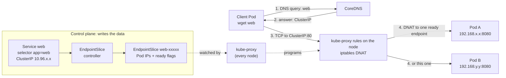

# T2.06 Services and EndpointSlices fundamentals

> Competency: n/a, foundation topic | Domain/weight: n/a (foundation; supports both exams) | Est. time: 2 h | Prerequisites: T2.04, T1.08

Shell setup used in every command of this lesson (also in [00-conventions](../00-conventions.md)):

```bash
alias k=kubectl
export do="--dry-run=client -o yaml"
export now="--force --grace-period=0"
source <(kubectl completion bash); complete -o default -F __start_kubectl k
```

Use `bash` for these (the `$do` trick relies on bash splitting the variable into words; see [T2.02](../part2-basics/T2.02-kubectl-fluency-and-productivity.md)). In scripts and verification snippets I write `kubectl` in full, because aliases are off in scripts.

Prerequisites you should have read: [T2.04](../part2-basics/T2.04-labels-selectors-annotations-and-namespaces.md) (labels, selectors and namespaces: a Service finds its Pods with a selector, and the Service DNS name contains the namespace) and [T1.08](../part1-linux/T1.08-linux-networking-ii-dns-ports-sockets.md) (DNS lookups, ports and listening sockets, and the test tools `wget`, `nslookup`, `netstat`). This lesson also links to [T1.09](../part1-linux/T1.09-packet-filtering-iptables-and-nftables-basics.md) for the iptables rules that kube-proxy writes.

How to read the output blocks. A block has one of these labels:

- `EXPECTED OUTPUT (not captured)`: written from knowledge of kubectl and Kubernetes, not copied from a run. Names, hashes, IPs and ages will differ on your cluster. Every such block is listed in section 11.
- `REAL OUTPUT (...)`: produced by a command I ran; the label names the environment.

The lab cluster is the standard `lab` kind cluster from [conventions](../00-conventions.md) section 2.2 (1 control plane + 2 workers, Calico, Pod CIDR `192.168.0.0/16`, Service CIDR = the kind default `10.96.0.0/16`). Node names in the examples are `lab-control-plane`, `lab-worker` and `lab-worker2`.

## 1. Why this matters

A Pod IP is not a stable address. Every time a Pod is replaced (a rollout, a node drain, a crash on a Deployment) the new Pod gets a new IP, so a client that stored the old IP now talks to nothing. A **Service** fixes this: it gives a group of Pods one virtual IP and one DNS name that never change while the Service exists, and Kubernetes keeps the list of Pods behind it up to date. In real life, "the Service exists but nothing answers" is one of the most common outages, and the cause is nearly always the same two things: the selector matches no ready Pods, or the target port is wrong. In an exam task you have about six minutes on average (the exams have 15-20 tasks in 2 hours; sources: https://docs.linuxfoundation.org/tc-docs/certification/tips-cka-and-ckad and https://docs.linuxfoundation.org/tc-docs/certification/faq-cka-ckad-cks), so you must be able to create a Service in one command and diagnose a dead one in three. This lesson covers the mechanics; T3.12 (CKAD) and T4.18 (CKA) build on it with all Service types, traffic policies and exam-style troubleshooting.

## 2. Concepts

Index: 2.1 why Services; 2.2 ClusterIP and the port fields; 2.3 selector and EndpointSlices; 2.4 creating a Service (`expose` vs `create service`); 2.5 DNS names; 2.6 kube-proxy; 2.7 readiness; 2.8 Service without a selector; 2.9 headless Services; 2.10 testing with a client Pod; 2.11 under the hood; 2.12 related but different.

### 2.1 Why Services

**The problem.** Pods are short-lived. A Deployment (see [T2.05](../part2-basics/T2.05-controllers-replicasets-deployments-basics-and-garbage.md)) replaces Pods during a rollout, and a ReplicaSet recreates a deleted Pod with a new name and a new IP. A frontend that must call a backend cannot hard-code backend Pod IPs. It also cannot keep a list of them, because the list changes while the frontend runs.

**What a Service gives you.**

| Thing | What it is | Stable? |
|---|---|---|
| Virtual IP (the **ClusterIP**) | One IP from the cluster's Service range, for example `10.96.114.23`. No network interface owns it. | Yes, for the life of the Service |
| DNS name | `<service>.<namespace>.svc.cluster.local`, answered by CoreDNS (the cluster DNS server) | Yes |
| Load balancing | Each new connection to the ClusterIP goes to one of the ready Pods behind it | Pods behind it change; the front door does not |
| Health awareness | Pods that are not Ready are taken out of rotation | Automatic |

**What breaks without it.** Clients keep dead Pod IPs, or you build your own discovery. Also, rolling updates would drop traffic, because nothing tells clients which new Pods are ready.

A Service does not run anything. It is an API object that other components read: the control plane writes the list of Pods, kube-proxy turns it into packet rules, and CoreDNS turns it into DNS answers (2.11).

### 2.2 ClusterIP and the port fields

`ClusterIP` is the default Service **type**. It is reachable only from inside the cluster (from Pods and from nodes). Other types (NodePort, LoadBalancer, ExternalName) add outside access; they are the subject of T3.12 and T4.18 and are only named here.

| `spec.type` | Reachable from | Notes for this lesson |
|---|---|---|
| `ClusterIP` (default) | Pods and nodes in the cluster | Everything in this lesson |
| `NodePort` | Also from outside, on every node's IP at a port 30000-32767 | Builds on a ClusterIP; see T3.12 |
| `LoadBalancer` | Also from outside, through a cloud or MetalLB load balancer | Needs a controller that provides the load balancer; see T3.12 |
| `ExternalName` | Pods (DNS only, a CNAME record) | No ClusterIP, no proxying; see T3.12 |

One example and one way to observe each non-default type (run them in a scratch namespace; the full treatment is in T3.12):

```bash
k expose deploy web --name=web-np --port=80 --target-port=8080 --type=NodePort
k get svc web-np                       # PORT(S) column shows 80:<30000-32767>/TCP
k create service externalname ext --external-name=example.com
k get svc ext                          # TYPE ExternalName, EXTERNAL-IP example.com, CLUSTER-IP <none>
k expose deploy web --name=web-lb --port=80 --target-port=8080 --type=LoadBalancer
k get svc web-lb                       # EXTERNAL-IP stays <pending> until a controller (cloud or MetalLB) assigns one
k delete svc web-np ext web-lb
```

Here are the fields of the ClusterIP Service you will write all the time. For each one: what it does, the default, and a value that is invalid or risky.

| Field | What it does | Default | Invalid or risky value |
|---|---|---|---|
| `spec.type` | Kind of Service | `ClusterIP` | A typo such as `ClusterIp` is rejected. `ExternalName` without `externalName` is rejected. |
| `spec.selector` | Map of labels; Pods with ALL these labels, in the SAME namespace, become endpoints | none | A typo in a key or value is accepted silently and matches nothing. Only exact `key: value` pairs work here; there is no `matchLabels:` level and no `matchExpressions`. |
| `spec.ports[].name` | Name of this Service port | none | Required when there are two or more ports (otherwise the API server rejects the Service). Must be a DNS label (lowercase letters, digits, `-`, at most 63 characters). |
| `spec.ports[].protocol` | Layer 4 protocol | `TCP` | Must be upper case: `TCP`, `UDP` or `SCTP`. `tcp` is rejected. A UDP-only app behind a `TCP` port will not work. |
| `spec.ports[].port` | The port the Service listens on (on the ClusterIP) | none (required) | Must be 1-65535. |
| `spec.ports[].targetPort` | The port on the Pod that traffic is sent to. A number, or the NAME of a container port. | same value as `port` | A number that the app does not listen on gives "connection refused". A name that the Pod does not define gives no endpoint for that Pod. A name must be a valid port name: lowercase letters, digits and `-`, at most 15 characters, and at least one letter. |
| `spec.clusterIP` | The virtual IP | allocated by the API server | `None` makes the Service headless (2.9). Once set, you cannot change it to a different IP or switch to/from `None`; delete and recreate the Service. |

Two port numbers confuse beginners. **`port`** is what clients use. **`targetPort`** is what the Pod's process listens on. They may differ: a Service can accept 80 and forward to 8080. This is why the entry command is `k expose deploy web --port=80 --target-port=8080`.

**Named ports.** A container can name a port (`ports: [{name: http, containerPort: 8080}]`). The Service can then say `targetPort: http`. Now the Service does not hold the number. If you later change the container to listen on 9090 and update the `containerPort` in the Pod template, the Service keeps working with no edit, because each Pod reports which number its `http` port has. That is lab 7.2. A named `targetPort` can even point to different numbers on different Pods (during a migration, for example); the EndpointSlice controller makes one slice per distinct port set.

`containerPort` is **metadata only**. It does not open a port and does not stop traffic to other ports. The only thing that decides whether a connection works is what the process in the container actually listens on. So a numeric `targetPort` works even if `containerPort` is missing. A **named** `targetPort` needs the name to exist in the Pod's container `ports`.

### 2.3 Selector, EndpointSlices and the deprecated Endpoints

A Service with a selector gets its backends automatically. The control plane watches the Service and all Pods in the same namespace, and writes the matching Pod IPs into **EndpointSlice** objects.

| Object | API group/version | Status in v1.37 | You will use it for |
|---|---|---|---|
| `EndpointSlice` | `discovery.k8s.io/v1` | Current. kube-proxy and CoreDNS read it. | Seeing which Pods are behind a Service |
| `Endpoints` | `v1` | **Deprecated since v1.33.** Still served. | Only to explain old scripts. `kubectl get endpoints` prints a deprecation warning (section 5, step 8). |

Why slices replaced `Endpoints`: one `Endpoints` object held every address of a Service. A Service with thousands of Pods meant one huge object that was rewritten and sent to every node on each Pod change. An EndpointSlice holds at most 100 endpoints by default, so a big Service is several small slices, and only the changed slice is sent.

An EndpointSlice for your Service looks like this (real field names; a full listing is in section 5):

- `metadata.labels["kubernetes.io/service-name"]`: the name of the owning Service. This is how you find the slices of a Service: `-l kubernetes.io/service-name=web`.
- `metadata.labels["endpointslice.kubernetes.io/managed-by"]`: who maintains it. The built-in controller sets `endpointslice-controller.k8s.io`.
- `addressType`: `IPv4`, `IPv6` or `FQDN`. One slice has one address type.
- `ports[]`: the resolved target port(s) as numbers, after a named `targetPort` is looked up.
- `endpoints[]`: one entry per Pod, with `addresses`, `nodeName`, `targetRef` (the Pod) and `conditions`.
- `endpoints[].conditions`: three booleans. `ready` (the Pod is Ready and not terminating), `serving` (the Pod is Ready, even while terminating), `terminating` (the Pod is being deleted). Clients and kube-proxy use `ready` to decide who gets new connections.

What an empty result looks like: if the selector matches no Pod at all (or no Pod has the named port), the Service still exists and its slice may still exist, with no endpoints (`ENDPOINTS <unset>` in `k get endpointslices`). That is the main "no endpoints" symptom you will troubleshoot.

**Pods that match but are not Ready are different.** A Running Pod whose readiness probe fails stays in the slice with `conditions.ready: false` (2.7), and the `ENDPOINTS` column of `k get endpointslices` prints every address in the slice, ready or not. So a failing probe does NOT give `<unset>`. It gives a filled slice, a Pod showing `0/1` in `k get pods`, and no traffic to that Pod. `k describe svc` is expected to list only the ready addresses under `Endpoints:` (confirm on a live cluster, section 11). Rule: `<unset>` means "no Pod matches the selector"; a filled slice does not prove every Pod is ready.

**Related but different: `Service` vs `Endpoints` vs `EndpointSlice`.** You write the Service. The controller writes the slices. You normally never edit a slice (the exception is a Service without a selector, 2.8).

### 2.4 Creating a Service: `kubectl expose` vs `kubectl create service clusterip`

Both are imperative. They differ in where the selector comes from.

| Command | Selector it sets | Port flags | Use it when |
|---|---|---|---|
| `k expose deploy web --port=80 --target-port=8080` | Copied from the Deployment's `spec.selector.matchLabels` (here `app=web`) | `--port`, `--target-port` (number or name) | You have a Deployment, ReplicaSet, Pod or Service to expose. This is the fastest and safest way. |
| `k expose pod web --port=80` | The Pod's labels. A Pod made by `k run web` has the label `run=web`. | same | A single Pod |
| `k create service clusterip web --tcp=80:8080` | **`app=web`** (it uses the Service name, whatever your Pods are labelled) | `--tcp=port:targetPort` (numbers only) | You want a quick skeleton and will fix the selector (`k set selector`) or YAML |

The last row is a classic trap. `k create service clusterip` does not look at any Pod. If your Pods are labelled `app=shop` and you run `k create service clusterip store --tcp=80:8080`, the Service selects `app=store`, which matches nothing. With `expose` this cannot happen.

Useful `expose` flags: `--name` (default: the name of the exposed object), `--port`, `--target-port`, `--protocol` (default TCP), `--type` (default ClusterIP), `--cluster-ip=None` (headless), `--selector` (override), `--labels`, and `-n`. Combine with `$do` to print YAML instead of creating: `k expose deploy web --port=80 --target-port=8080 $do`.

### 2.5 DNS names

CoreDNS (the Service named `kube-dns` in `kube-system`) answers names for every Service. The full pattern is:

```text
<service>.<namespace>.svc.cluster.local
```

`cluster.local` is the default cluster domain (it can be changed when the cluster is built). Example: Service `web` in namespace `lab-t206` is `web.lab-t206.svc.cluster.local`. For DNS basics (A records, search paths, `nslookup`) see [T1.08](../part1-linux/T1.08-linux-networking-ii-dns-ports-sockets.md).

You can use shorter names because the kubelet writes a **search path** into each Pod's `/etc/resolv.conf`:

```text
search lab-t206.svc.cluster.local svc.cluster.local cluster.local
nameserver 10.96.0.10
options ndots:5
```

| Name used from a Pod in `lab-t206` | Resolves? | Why |
|---|---|---|
| `web` | Yes | The first search domain is the Pod's own namespace |
| `web.lab-t206` | Yes | Becomes `web.lab-t206.svc.cluster.local` through the `svc.cluster.local` domain |
| `web.lab-t206.svc.cluster.local` | Yes | Fully qualified |
| `web` from a Pod in **another** namespace | **No** (`bad address 'web'`) | The search path starts with the other namespace, where no `web` exists |

Rule: inside the same namespace the short name is fine. Across namespaces, use at least `<service>.<namespace>`. In config files and exam answers, the full name is the safe choice.

`ndots:5` means: a name with fewer than five dots is first tried with each search domain added. That is why a short name works and also why lookups for external names such as `example.com` try several suffixes first.

For a named port, CoreDNS also answers an SRV record: `_http._tcp.web.lab-t206.svc.cluster.local`. You will rarely need it in an exam.

### 2.6 kube-proxy turns Services into node rules

A ClusterIP is not assigned to any interface, and no process listens on it. So how does a packet sent to it arrive at a Pod? **kube-proxy** runs on every node (as a DaemonSet in `kube-system`). It watches Services and EndpointSlices and writes rules into the node's packet filter. Those rules rewrite the destination of a packet from `ClusterIP:port` to `PodIP:targetPort` (this is **DNAT**, destination NAT) before the packet is routed. For the packet-filter basics see [T1.09](../part1-linux/T1.09-packet-filtering-iptables-and-nftables-basics.md).

| kube-proxy mode | State | Notes |
|---|---|---|
| `iptables` | Default on Linux | One chain per Service and per endpoint; picks a Pod with random probabilities |
| `nftables` | Available | Same idea with nftables sets and maps |
| `ipvs` | **Deprecated** | Do not use in labs ([conventions](../00-conventions.md) section 6) |

How to observe each mode. First read the configured mode: `k -n kube-system get cm kube-proxy -o jsonpath='{.data.config\.conf}' | grep -E '^mode'` (an empty value means the default, `iptables`). Then look at the rules on a node: for `iptables`, `sudo iptables-save -t nat | grep <ClusterIP>` (section 5, step 7); for `nftables`, `sudo nft list ruleset | grep <ClusterIP>`; for `ipvs`, `sudo ipvsadm -L -n` shows the ClusterIP as a virtual server (shown only so you recognise it; do not switch to it). Switching modes is a cluster-build decision and is not done in this lesson.

Consequences you can use:

- The rules exist on **every** node, so any Pod on any node can use the ClusterIP. Traffic goes straight from the client's node to the Pod, not through a central proxy.
- Load balancing happens **per connection**, once, when the first packet is rewritten. A long-lived connection stays on one Pod.
- The ClusterIP only answers for the Service's ports. `ping <clusterIP>` normally gets no reply, because the rules match only the Service's TCP/UDP/SCTP ports and ICMP is not one of them. Test with `wget` or `curl`, not `ping`.
- If a Service has no ready endpoints, kube-proxy in `iptables` mode installs a rule that rejects connections to it, so the client usually sees "connection refused" quickly instead of a hang. A hang points more often to a different cause, such as a NetworkPolicy dropping packets (see 6).

You can look at the rules on a kind node (section 5, step 7).

### 2.7 Readiness decides which Pods are ready endpoints

A Pod being `Running` does not mean it can serve. The Pod condition `Ready` is true only if all its containers are ready (a container with a `readinessProbe` is ready only when the probe succeeds) and every Pod **readiness gate** is true. A readiness gate is an extra condition listed in `spec.readinessGates` that an outside controller sets, for example a load balancer controller.

The EndpointSlice controller copies this into the slice: a Pod that is Running but not Ready is listed with `conditions.ready: false`, and **kube-proxy sends no new connections to it**. This is the mechanism behind zero-downtime rollouts: a new Pod joins the Service only after its probe passes.

| Pod state | In the slice? | `ready` | Gets new connections? |
|---|---|---|---|
| Running, probe passes | Yes | `true` | Yes |
| Running, probe failing | Yes | `false` | No |
| Terminating (being deleted) | Yes | `false` (`serving` may be `true`) | No |
| Pending, or no IP yet | No | n/a | No |

If requests to a Service fail and the selector is right, check whether the Pods are `1/1` Ready: `k get pods`. The `READY` column `0/1` is the answer. Remember that the slice can still list the not-ready Pod's address (with `ready: false`), so an address in `k get endpointslices` does not mean the Pod gets traffic.

**Readiness gate example.** A gate is one extra entry in the Pod spec. The Pod stays `0/1` until something sets the condition `example.com/ready` to `True` in its status:

```yaml
spec:
  readinessGates:
    - conditionType: "example.com/ready"   # your controller must patch this condition to "True"
```

Observe it: `k get pod <p> -o jsonpath='{.status.conditions[*].type}'` lists the condition types, and `k describe pod <p>` shows `ReadinessGates` and the condition value. With no controller setting it, the Pod never becomes Ready and never gets Service traffic, even though its containers are fine. (Not used in the labs; a load balancer controller normally owns such a gate.) `spec.publishNotReadyAddresses: true` on a Service is the escape hatch that publishes not-ready Pods anyway (used for peer discovery in some StatefulSets); do not use it to hide a failing probe.

### 2.8 Service without a selector, and manual EndpointSlices (awareness)

If a Service has **no** `spec.selector`, the controller creates no slices for it. You can then write the EndpointSlice yourself, and the Service routes to the addresses you list. Use cases: pointing the Service name at something outside the cluster (an external database with a fixed IP) or at Pods of another system.

Rules for the manual slice: it must be in the same namespace, carry the label `kubernetes.io/service-name: <service>`, and should carry a `managed-by` label with your own value (not the built-in controller's value). Addresses must not be loopback or link-local. The slice `ports` must match the Service's `targetPort` (the name must match too if the Service port has a name).

```yaml
apiVersion: v1
kind: Service
metadata:
  name: legacy
  namespace: lab-t206
spec:
  ports:
    - name: http          # selector-less: the slice port below must carry the same name
      protocol: TCP
      port: 80            # clients use 80
      targetPort: 8080    # must equal the port number in the slice
---
apiVersion: discovery.k8s.io/v1
kind: EndpointSlice
metadata:
  name: legacy-1                                    # any name; one Service may own several slices
  namespace: lab-t206
  labels:
    kubernetes.io/service-name: legacy              # the link to the Service
    endpointslice.kubernetes.io/managed-by: manual  # your own value, not endpointslice-controller.k8s.io
addressType: IPv4
ports:
  - name: http
    protocol: TCP
    port: 8080
endpoints:
  - addresses: ["192.0.2.10"]                       # replace with a real, reachable IP
    conditions:
      ready: true
```

(The address `192.0.2.10` is from a documentation range, so this YAML applies cleanly but routes nowhere. Section 5, step 9 does it with a real Pod IP.) Nothing keeps this slice up to date: if the target IP changes, you edit the slice. That is the price of leaving the selector out. The old way was a hand-written `Endpoints` object with the same name as the Service; it still works through a mirroring controller but is deprecated.

### 2.9 Headless Services (`clusterIP: None`) and per-Pod DNS

A **headless** Service has `spec.clusterIP: None`. It gets no virtual IP and kube-proxy writes no rules for it. Instead DNS answers directly with the Pod IPs.

| Service kind | DNS answer for `<svc>.<ns>.svc.cluster.local` | Load balancing done by |
|---|---|---|
| Normal ClusterIP | One A record: the ClusterIP | kube-proxy |
| Headless (`clusterIP: None`) with selector | One A record **per ready Pod** | The client (it picks among the addresses) |
| Headless without selector | Records from the manual EndpointSlices | The client |

Headless Services are used when clients must talk to each Pod individually (databases, StatefulSets). Because there is no ClusterIP and no port translation, the client must connect to the **Pod's own port**, not to the Service `port`. The Service `port` is only a declaration.

**Per-Pod DNS.** A Pod gets its own DNS name `<hostname>.<service>.<namespace>.svc.cluster.local` when two things are true: the Pod has `spec.hostname` and `spec.subdomain`, and `subdomain` equals the name of a headless Service in the same namespace. A StatefulSet sets this up for you (its `serviceName` becomes the subdomain, and the Pods are named `db-0`, `db-1`, ...). For a plain Pod you set it yourself (section 5, step 10). Only ready Pods are published, unless the Service sets `publishNotReadyAddresses: true`.

### 2.10 Testing with a temporary client Pod

You test a ClusterIP from inside the cluster. The fastest way is a throw-away Pod that runs one command and is deleted when it exits:

```bash
k run c --rm -it --image=busybox:1.36 --restart=Never -- wget -qO- web
```

| Part | Meaning |
|---|---|
| `k run c` | Create a Pod named `c` |
| `--rm` | Delete the Pod when the command ends |
| `-it` | Attach your terminal so you see the output |
| `--image=busybox:1.36` | A tiny image with `wget`, `nslookup` and `nc`. Pinned, never `:latest`. |
| `--restart=Never` | A plain Pod, not a Deployment-like restart loop |
| `-- wget -qO- web` | The command. `-q` quiet, `-O-` print the body to stdout, `web` the Service name. |

Add `-T 3` to `wget` so a broken Service fails in 3 seconds instead of waiting long: `wget -qO- -T 3 web`. To test another namespace, run the Pod there with `-n` or use the longer name. `busybox` has no `curl`; the exam hosts have `curl` and `wget` on the SSH host (summary E9: https://docs.linuxfoundation.org/tc-docs/certification/tips-cka-and-ckad), but the **cluster** images you pull are what run inside the Pod, so use `busybox:1.36` for tests.

### 2.11 Under the hood

What happens when you create `Service web` with selector `app=web` and two ready Pods:

1. **API server.** It validates the Service and allocates a ClusterIP from the Service CIDR (`--service-cluster-ip-range`, `10.96.0.0/16` on kind). The IP is stored in `spec.clusterIP` and then cannot be changed.
2. **EndpointSlice controller** (in `kube-controller-manager`). It watches Services and Pods. For `web` it lists Pods in the same namespace that carry `app=web`, resolves the `targetPort` against each Pod's container ports, and creates or updates `EndpointSlice` objects named `web-<random>`, owned by the Service (so deleting the Service deletes its slices). It updates them each time a Pod appears, becomes ready, becomes not ready or is deleted.
3. **kube-proxy** on each node watches Services and EndpointSlices and rewrites that node's iptables (or nftables) rules. After step 2, every node can DNAT `10.96.x.x:80` to a Pod.
4. **CoreDNS** watches Services and EndpointSlices and answers `web.lab-t206.svc.cluster.local` with the ClusterIP (or with Pod IPs for headless).
5. **A client** resolves the name, sends a packet to the ClusterIP, the node's rules rewrite the destination to a Pod IP and port, and the CNI plugin delivers the packet to that Pod (possibly on another node).

All of this is level-based: if kube-proxy misses an event, it resyncs. The control plane is not in the data path. If the API server is down, existing Services keep working from the rules already in place; new or changed ones do not update.

### 2.12 Related but different

- **Service vs Deployment.** A Deployment makes Pods; a Service finds Pods. They are linked only by labels. Deleting the Service does not touch the Pods.
- **ClusterIP vs Pod IP.** You can `wget` a Pod IP directly (it works from inside the cluster) but it dies with the Pod. Never put Pod IPs in config.
- **`k port-forward svc/web 8080:80`** tunnels from your machine through the API server to one Pod chosen from the Service. It does not use kube-proxy and is for debugging only.
- **`externalIPs`** on a Service is deprecated; do not use it.
- **Ingress and Gateway** route HTTP from outside to Services; they are not covered here.

## 3. How it works (diagram)



Walkthrough:

1. The client Pod asks CoreDNS for `web`. CoreDNS knows the Service from the API and answers with its ClusterIP.
2. The client opens a TCP connection to `ClusterIP:80`. The packet leaves the Pod and reaches the node's packet filter.
3. kube-proxy, which watches the EndpointSlice, has already written rules on every node (dotted lines). The rules match `ClusterIP:80` and rewrite the destination to one ready endpoint, `PodIP:targetPort`.
4. The EndpointSlice is the list the rules are built from. A Pod that is missing or not ready in the slice is not in the rules, so it gets no traffic.
5. The reply returns to the client; the same node rewrites the source back, so the client believes it talked to the ClusterIP.
6. If the slice is empty, the chain breaks at step 3 or 4. That is why `k get endpointslices` is the first thing to check.

## 4. Commands and YAML you must produce fast

### 4.1 Imperative shortcuts

```bash
k expose deploy web --port=80 --target-port=8080 --name=web
```
Create a ClusterIP Service `web` in the current namespace; the selector is copied from the Deployment. `--name` is optional (it defaults to the Deployment name), but tasks often give a Service name that differs from the Deployment name, so always pass `--name` when the task text names the Service.

```bash
k expose deploy web --port=80 --target-port=http --name=web $do > svc.yaml
```
Same, but print YAML so you can edit it. `--target-port` accepts a container port name.

```bash
k create service clusterip web --tcp=80:8080 $do
```
Skeleton for a ClusterIP Service. Remember the selector is `app=web` whatever your Pods say; fix it with `k set selector svc web app=shop`.

```bash
k get svc,endpointslices -l kubernetes.io/service-name=web
```
Show the slices of Service `web`. The label is on the slices only, so the Service itself does not match and is not listed. To see both, drop `-l` and use `k get svc,endpointslices`.

```bash
k describe svc web
```
Shows `Selector`, `IP`, `Port`, `TargetPort` and `Endpoints`. If `Endpoints:` is `<none>`, no ready Pod is behind the Service: either no Pod matches the selector, or the matching Pods are not Ready (check `k get pods`).

```bash
k run c --rm -it --image=busybox:1.36 --restart=Never -- wget -qO- web
```
Temporary client Pod; prints the response and is removed.

```bash
k get endpointslices -l kubernetes.io/service-name=web -o jsonpath='{.items[*].endpoints[*].addresses[0]}'
```
Print the Pod IPs behind the Service on one line.

### 4.2 Declarative YAML: ClusterIP Service with a named targetPort

The Deployment (the Pods expose a named port `http`) and the Service that references it by name:

```yaml
apiVersion: apps/v1
kind: Deployment
metadata:
  name: web
  namespace: lab-t206
spec:
  replicas: 2
  selector:
    matchLabels:
      app: web                    # the Deployment owns Pods with this label
  template:
    metadata:
      labels:
        app: web                  # Pod label; the Service selector must match this
    spec:
      containers:
        - name: web
          image: busybox:1.36     # tiny web server via busybox httpd; pinned tag
          command:
            - sh
            - -c
            - |
              mkdir -p /www
              echo "hello from $HOSTNAME" > /www/index.html
              touch /www/ready
              exec httpd -f -p 8080 -h /www
          ports:
            - name: http          # the NAME the Service refers to
              containerPort: 8080 # documentation only; the real port is the -p 8080 above
          readinessProbe:         # Pod is a ready endpoint only while this succeeds
            exec:
              command: ["cat", "/www/ready"]
            periodSeconds: 2
            failureThreshold: 1   # one failed check marks the Pod not Ready (default is 3)
---
apiVersion: v1
kind: Service
metadata:
  name: web
  namespace: lab-t206
spec:
  type: ClusterIP                 # default; written out for clarity
  selector:
    app: web                      # exact label match, same namespace; must equal the Pod label
  ports:
    - name: http                  # optional with one port, required with two or more
      protocol: TCP               # default TCP
      port: 80                    # the port clients use on the ClusterIP
      targetPort: http            # the container port NAME; a number such as 8080 also works
```

How fast to write it: do not type the Service from scratch. Run `k expose deploy web --port=80 --target-port=http $do`, and only add the pieces the task asks for. The Pod template and `containerPort` name come from the Deployment YAML (`k create deploy web --image=nginx:1.27 $do`, then add the `ports:` block).

### 4.3 Speed drill

Setup (one line, run before the drill; namespace `lab-t206-sd` and a 2-replica nginx Deployment listening on port 80):

```bash
k create ns lab-t206-sd && k -n lab-t206-sd create deploy web --image=nginx:1.27 --replicas=2 --port=80 && k -n lab-t206-sd rollout status deploy/web
```

Use `-n lab-t206-sd` on each command (or set the namespace on the context). Answers are collapsed. Target times are for exam pace.

1. (1 min) Expose Deployment `web` as a ClusterIP Service `web` with Service port 8080 forwarding to container port 80.
2. (1 min) Print the Pod IPs behind Service `web` on one line, using the EndpointSlice.
3. (1 min) Print only the ClusterIP of Service `web`.
4. (2 min) Run a temporary Pod in the same namespace that fetches `http://web:8080` and prints the first lines of the response.
5. (2 min) Make a headless Service `web-h` for the same Pods (port 80), then show that DNS returns two addresses.
6. (2 min) Create a Service `api` for port 80 to target 8080 with `k create service clusterip` and show the selector it generated. Is it pointing at `web` Pods?
7. (2 min) Scale `web` to 0, show what the EndpointSlice looks like, then scale back to 2.

<details><summary>Answers</summary>

```bash
# 1
k -n lab-t206-sd expose deploy web --port=8080 --target-port=80
# 2
k -n lab-t206-sd get endpointslices -l kubernetes.io/service-name=web -o jsonpath='{.items[*].endpoints[*].addresses[0]}'; echo
# 3
k -n lab-t206-sd get svc web -o jsonpath='{.spec.clusterIP}'; echo
# 4  (nginx welcome page; head keeps it short; run on a terminal with -it)
k -n lab-t206-sd run c --rm -it --image=busybox:1.36 --restart=Never -- sh -c 'wget -qO- -T 3 http://web:8080 | head -n 4'
# 5  (--cluster-ip=None makes it headless; the selector is copied from the Deployment)
k -n lab-t206-sd expose deploy web --name=web-h --cluster-ip=None --port=80
k -n lab-t206-sd run c --rm -it --image=busybox:1.36 --restart=Never -- nslookup web-h
# 6  (selector will be app=api, so it matches nothing)
k -n lab-t206-sd create service clusterip api --tcp=80:8080
k -n lab-t206-sd get svc api -o jsonpath='{.spec.selector}'; echo     # {"app":"api"}
k -n lab-t206-sd get endpointslices -l kubernetes.io/service-name=api  # ENDPOINTS <unset>
# 7
k -n lab-t206-sd scale deploy web --replicas=0
k -n lab-t206-sd get endpointslices -l kubernetes.io/service-name=web   # ENDPOINTS <unset>
k -n lab-t206-sd scale deploy web --replicas=2
```

Cleanup for the drill:

```bash
k delete ns lab-t206-sd
```

</details>

## 5. Worked example

One end-to-end walkthrough on the `lab` kind cluster. Every output block below is `EXPECTED OUTPUT (not captured)` unless it says otherwise. Names, IPs and hashes will differ.

**Step 0. Namespaces and files.**

```bash
mkdir -p ~/lab/T2.06
k create ns lab-t206
k create ns lab-t206-other
k config set-context --current --namespace=lab-t206
```

The last line makes `lab-t206` the default namespace for the next commands (undone in the cleanup). Namespaces are covered in [T2.04](../part2-basics/T2.04-labels-selectors-annotations-and-namespaces.md).

**Step 1. Deploy the backend.** Save the Deployment from section 4.2 (only the Deployment part) and apply it:

```bash
cat > ~/lab/T2.06/web-deploy.yaml <<'EOF'
apiVersion: apps/v1
kind: Deployment
metadata:
  name: web
  namespace: lab-t206
spec:
  replicas: 2
  selector:
    matchLabels:
      app: web
  template:
    metadata:
      labels:
        app: web
    spec:
      containers:
        - name: web
          image: busybox:1.36
          command:
            - sh
            - -c
            - |
              mkdir -p /www
              echo "hello from $HOSTNAME" > /www/index.html
              touch /www/ready
              exec httpd -f -p 8080 -h /www
          ports:
            - name: http
              containerPort: 8080
          readinessProbe:
            exec:
              command: ["cat", "/www/ready"]
            periodSeconds: 2
            failureThreshold: 1
EOF
k apply -f ~/lab/T2.06/web-deploy.yaml
k rollout status deploy/web
k get pods -o wide
```

EXPECTED OUTPUT (not captured)

```text
deployment.apps/web created
deployment "web" successfully rolled out
NAME                   READY   STATUS    RESTARTS   AGE   IP               NODE          ...
web-6c8f9d5b7d-4kq9x   1/1     Running   0          20s   192.168.194.3    lab-worker    ...
web-6c8f9d5b7d-m2xvz   1/1     Running   0          20s   192.168.126.2    lab-worker2   ...
```

Note the two Pod IPs. They belong to these Pods only. The app listens on **8080**, not 80.

**Step 2. Create the Service with the imperative command.**

```bash
k expose deploy web --port=80 --target-port=8080 --name=web
k get svc web
```

EXPECTED OUTPUT (not captured)

```text
service/web exposed
NAME   TYPE        CLUSTER-IP     EXTERNAL-IP   PORT(S)   AGE
web    ClusterIP   10.96.114.23   <none>        80/TCP    2s
```

`CLUSTER-IP` is the stable address. `PORT(S)` shows the Service port only (`80/TCP`); the target port is hidden here, so `describe` is needed to see it.

**Step 3. See the EndpointSlice (the entry command).**

```bash
k get svc,endpointslices -l kubernetes.io/service-name=web
```

EXPECTED OUTPUT (not captured)

```text
NAME                                         ADDRESSTYPE   PORTS   ENDPOINTS                      AGE
endpointslice.discovery.k8s.io/web-x7k2p     IPv4          8080    192.168.194.3,192.168.126.2    8s
```

Only the slice is listed, because the label is on the slice, not on the Service. `PORTS 8080` is the **target** port (resolved). `ENDPOINTS` are the two Pod IPs from step 1. Now the whole object:

```bash
k get endpointslices -l kubernetes.io/service-name=web -o yaml
```

EXPECTED OUTPUT (not captured)

The listing below is trimmed: uid, resourceVersion and timestamps are removed.

```yaml
apiVersion: v1
items:
- addressType: IPv4
  apiVersion: discovery.k8s.io/v1
  endpoints:
  - addresses:
    - 192.168.194.3
    conditions:
      ready: true
      serving: true
      terminating: false
    nodeName: lab-worker
    targetRef:
      kind: Pod
      name: web-6c8f9d5b7d-4kq9x
      namespace: lab-t206
  - addresses:
    - 192.168.126.2
    conditions:
      ready: true
      serving: true
      terminating: false
    nodeName: lab-worker2
    targetRef:
      kind: Pod
      name: web-6c8f9d5b7d-m2xvz
      namespace: lab-t206
  kind: EndpointSlice
  metadata:
    generateName: web-
    labels:
      endpointslice.kubernetes.io/managed-by: endpointslice-controller.k8s.io
      kubernetes.io/service-name: web
    name: web-x7k2p
    namespace: lab-t206
    ownerReferences:
    - apiVersion: v1
      blockOwnerDeletion: true
      controller: true
      kind: Service
      name: web
  ports:
  - name: ""
    port: 8080
    protocol: TCP
kind: List
```

Read it like this: one entry per Pod under `endpoints`; `ready: true` means it receives traffic; `ports[].port: 8080` is the number the Service forwards to; the `ownerReferences` entry is why the slice disappears when the Service is deleted. The `-o yaml` of a real slice also has `uid`, `resourceVersion` and `creationTimestamp`. Whether the controller copies any Service labels onto the slice is not confirmed (section 11).

**Step 4. Describe the Service.**

```bash
k describe svc web
```

EXPECTED OUTPUT (not captured)

```text
Name:                     web
Namespace:                lab-t206
Labels:                   <none>
Annotations:              <none>
Selector:                 app=web
Type:                     ClusterIP
IP Family Policy:         SingleStack
IP Families:              IPv4
IP:                       10.96.114.23
IPs:                      10.96.114.23
Port:                     <unset>  80/TCP
TargetPort:               8080/TCP
Endpoints:                192.168.194.3:8080,192.168.126.2:8080
Session Affinity:         None
Internal Traffic Policy:  Cluster
Events:                   <none>
```

Check three lines: `Selector` (must equal the Pod labels), `TargetPort` (must be the port the app listens on) and `Endpoints` (must not be `<none>`). `Labels` is `<none>` because the Deployment in step 1 has no `metadata.labels` for `expose` to copy; the Service selector comes from the Deployment's `spec.selector`, which is a different field.

**Step 5. Call it from a temporary client Pod.**

```bash
k run c --rm -it --image=busybox:1.36 --restart=Never -- wget -qO- web
k run c --rm -it --image=busybox:1.36 --restart=Never -- wget -qO- web
```

EXPECTED OUTPUT (not captured)

The command runs twice, and the hostname can differ between runs because each connection goes to a random Pod.

```text
hello from web-6c8f9d5b7d-4kq9x
pod "c" deleted
hello from web-6c8f9d5b7d-m2xvz
pod "c" deleted
```

Run it a few times: you should see both Pod names appear over time. That is the load balancing. Now test the name across namespaces and show the search path:

```bash
k -n lab-t206-other run c --rm -it --image=busybox:1.36 --restart=Never -- wget -qO- -T 3 web
k -n lab-t206-other run c --rm -it --image=busybox:1.36 --restart=Never -- wget -qO- -T 3 web.lab-t206
k -n lab-t206-other run c --rm -it --image=busybox:1.36 --restart=Never -- sh -c 'cat /etc/resolv.conf; nslookup web.lab-t206.svc.cluster.local'
```

EXPECTED OUTPUT (not captured)

```text
wget: bad address 'web'
pod "c" deleted
hello from web-6c8f9d5b7d-m2xvz
pod "c" deleted
search lab-t206-other.svc.cluster.local svc.cluster.local cluster.local
nameserver 10.96.0.10
options ndots:5
Server:		10.96.0.10
Address:	10.96.0.10:53

Name:	web.lab-t206.svc.cluster.local
Address: 10.96.114.23
...
```

The first call fails because the search path of a Pod in `lab-t206-other` starts with its own namespace. The second uses `web.lab-t206` and works. The trailing `...` stands for extra lines busybox may print for the empty AAAA (IPv6) lookup; they are not an error here.

**Step 6. Switch to the named targetPort (the YAML from 4.2).**

```bash
k delete svc web
cat > ~/lab/T2.06/web-svc.yaml <<'EOF'
apiVersion: v1
kind: Service
metadata:
  name: web
  namespace: lab-t206
spec:
  type: ClusterIP
  selector:
    app: web
  ports:
    - name: http
      protocol: TCP
      port: 80
      targetPort: http
EOF
k apply -f ~/lab/T2.06/web-svc.yaml
k get endpointslices -l kubernetes.io/service-name=web
```

EXPECTED OUTPUT (not captured)

```text
service "web" deleted
service/web created
NAME        ADDRESSTYPE   PORTS   ENDPOINTS                     AGE
web-m4tqz   IPv4          8080    192.168.194.3,192.168.126.2   2s
```

The slice name changed (new Service, new slice), but `PORTS` is still `8080`: the name `http` was resolved to the number on each Pod. The Service normally also gets a new ClusterIP (the example in step 7 shows `10.96.201.7`, different from step 2): ClusterIPs belong to the Service object, not the name, so a client that stored the old IP would break while the DNS name keeps working.

**Step 7. See what kube-proxy wrote.** Which mode is running, and the rules on a node (kind nodes are containers, so use `docker exec`; on a kubeadm VM you would `ssh <node>` and use `sudo iptables-save`):

```bash
k -n kube-system get ds kube-proxy
k -n kube-system get cm kube-proxy -o jsonpath='{.data.config\.conf}' | grep -E '^mode'
docker exec lab-worker iptables-save -t nat | grep -E 'lab-t206/web:http' | head -n 8
```

EXPECTED OUTPUT (not captured)

The `KUBE-SVC-` and `KUBE-SEP-` suffixes are hashes, shown as placeholders. The ClusterIP is the one the recreated Service received in step 6, which differs from step 2.

```text
NAME         DESIRED   CURRENT   READY   UP-TO-DATE   AVAILABLE   NODE SELECTOR            AGE
kube-proxy   3         3         3       3            3           kubernetes.io/os=linux   1h
mode: iptables
-A KUBE-SERVICES -d 10.96.201.7/32 -p tcp -m comment --comment "lab-t206/web:http cluster IP" -m tcp --dport 80 -j KUBE-SVC-<hash>
-A KUBE-SVC-<hash> -m comment --comment "lab-t206/web:http -> 192.168.194.3:8080" -m statistic --mode random --probability 0.50000000000 -j KUBE-SEP-<hash1>
-A KUBE-SVC-<hash> -m comment --comment "lab-t206/web:http -> 192.168.126.2:8080" -j KUBE-SEP-<hash2>
-A KUBE-SEP-<hash1> -p tcp -m comment --comment "lab-t206/web:http" -m tcp -j DNAT --to-destination 192.168.194.3:8080
...
```

Read the chain: `KUBE-SERVICES` matches `ClusterIP:80`, jumps to the Service chain `KUBE-SVC-*`, which chooses a Pod with a 50% probability for the first of two Pods, then `KUBE-SEP-*` (a Service endpoint) does the DNAT to `PodIP:8080`. This is exactly the EndpointSlice content from step 3. The exact comment text and flags differ by version; the structure does not. See [T1.09](../part1-linux/T1.09-packet-filtering-iptables-and-nftables-basics.md) for the tables and chains.

**Step 8. Readiness removes a Pod from the Service.** Break one Pod's readiness file and watch the slice:

```bash
POD=$(k get pod -l app=web -o jsonpath='{.items[0].metadata.name}')
k exec $POD -- rm /www/ready
sleep 10
k get pods
k get endpointslices -l kubernetes.io/service-name=web -o jsonpath='{range .items[*].endpoints[*]}{.targetRef.name}{"\t"}{.conditions.ready}{"\n"}{end}'
```

EXPECTED OUTPUT (not captured)

```text
NAME                   READY   STATUS    RESTARTS   AGE
web-6c8f9d5b7d-4kq9x   0/1     Running   0          6m
web-6c8f9d5b7d-m2xvz   1/1     Running   0          6m
web-6c8f9d5b7d-4kq9x	false
web-6c8f9d5b7d-m2xvz	true
```

The Pod is `Running` but `0/1` Ready, so its endpoint is not ready and gets no new connections. Notice that the Pod is still IN the slice (`ready false`), so `k get endpointslices` would still print both addresses in its `ENDPOINTS` column. That is why a filled slice does not prove the Pods are ready: look at `READY` in `k get pods` or at `.conditions.ready` as above. (`failureThreshold: 1` in the probe makes one failed check enough; with the default of 3 the change takes a few seconds longer.) Run the `wget` from step 5 several times: only the other Pod answers. `k describe svc web` is expected to list only the ready address under `Endpoints:` (section 11). Then restore it and read the Endpoints deprecation warning:

```bash
k exec $POD -- touch /www/ready
k get endpoints web
```

EXPECTED OUTPUT (not captured)

The warning text is the one documented for the deprecation; confirm it on your kubectl (section 11).

```text
Warning: v1 Endpoints is deprecated in v1.33+; use discovery.k8s.io/v1 EndpointSlice
NAME   ENDPOINTS                                 AGE
web    192.168.194.3:8080,192.168.126.2:8080     5m
```

The data is still returned, but a script that parses `k get endpoints` now prints a warning on stderr. Use `k get endpointslices -l kubernetes.io/service-name=web`.

**Step 9. A Service without a selector and a manual EndpointSlice.** Point a new Service `legacy` at the first Pod's IP:

```bash
IP=$(k get pod $POD -o jsonpath='{.status.podIP}')
cat > ~/lab/T2.06/legacy.yaml <<EOF
apiVersion: v1
kind: Service
metadata:
  name: legacy
  namespace: lab-t206
spec:
  ports:
    - name: http
      protocol: TCP
      port: 80
      targetPort: 8080
---
apiVersion: discovery.k8s.io/v1
kind: EndpointSlice
metadata:
  name: legacy-1
  namespace: lab-t206
  labels:
    kubernetes.io/service-name: legacy
    endpointslice.kubernetes.io/managed-by: manual
addressType: IPv4
ports:
  - name: http
    protocol: TCP
    port: 8080
endpoints:
  - addresses: ["$IP"]
    conditions:
      ready: true
EOF
k apply -f ~/lab/T2.06/legacy.yaml
k get svc,endpointslices -l kubernetes.io/service-name=legacy
k run c --rm -it --image=busybox:1.36 --restart=Never -- wget -qO- -T 3 legacy
```

(The heredoc delimiter is unquoted on purpose, so the shell replaces `$IP`.)

EXPECTED OUTPUT (not captured)

```text
service/legacy created
endpointslice.discovery.k8s.io/legacy-1 created
NAME                                  ADDRESSTYPE   PORTS   ENDPOINTS        AGE
endpointslice.discovery.k8s.io/legacy-1   IPv4      8080    192.168.194.3    1s
hello from web-6c8f9d5b7d-4kq9x
pod "c" deleted
```

The `legacy` Service has no `selector`, yet traffic reaches the Pod, because you supplied the slice. If you delete that Pod, the slice keeps the old IP: nothing updates it.

**Step 10. Headless Service and per-Pod DNS.**

```bash
cat > ~/lab/T2.06/headless.yaml <<'EOF'
apiVersion: v1
kind: Service
metadata:
  name: hl
  namespace: lab-t206
spec:
  clusterIP: None
  selector:
    app: hl
  ports:
    - name: http
      port: 8080
      targetPort: 8080
---
apiVersion: v1
kind: Pod
metadata:
  name: hl-0
  namespace: lab-t206
  labels:
    app: hl
spec:
  hostname: p1
  subdomain: hl
  containers:
    - name: web
      image: busybox:1.36
      command: ["sh", "-c", "mkdir -p /www && echo \"hello from $HOSTNAME\" > /www/index.html && exec httpd -f -p 8080 -h /www"]
      ports:
        - name: http
          containerPort: 8080
EOF
k apply -f ~/lab/T2.06/headless.yaml
k wait --for=condition=Ready pod/hl-0 --timeout=60s
k run c --rm -it --image=busybox:1.36 --restart=Never -- sh -c 'nslookup hl; nslookup p1.hl; wget -qO- -T 3 p1.hl:8080'
```

EXPECTED OUTPUT (not captured)

```text
service/hl created
pod/hl-0 created
pod/hl-0 condition met
Server:		10.96.0.10
Address:	10.96.0.10:53

Name:	hl.lab-t206.svc.cluster.local
Address: 192.168.194.4

Name:	p1.hl.lab-t206.svc.cluster.local
Address: 192.168.194.4

hello from p1
```

`hl` has no ClusterIP; the name resolves straight to the Pod IP (one address per ready Pod). `p1.hl` is the per-Pod name, built from `spec.hostname` + `spec.subdomain` (= the headless Service name). Note `wget p1.hl:8080` uses the **Pod port 8080**; port 80 would not work because a headless Service does no port translation. The container's `$HOSTNAME` is `p1` here because the Pod's `hostname` field sets it.

**Step 11. The failure you must recognise: no endpoints.** Introduce a typo in the selector:

```bash
k patch svc web --type=json -p '[{"op":"replace","path":"/spec/selector/app","value":"wbe"}]'
k get endpointslices -l kubernetes.io/service-name=web
k describe svc web | grep -E 'Selector|Endpoints'
k get pods --show-labels
k run c --rm -it --image=busybox:1.36 --restart=Never -- wget -qO- -T 3 web
```

EXPECTED OUTPUT (not captured)

The final error text depends on the kube-proxy mode and the busybox version. For an empty slice the `PORTS` column is most likely `<unset>` too (section 11); that is not confirmed.

```text
service/web patched
NAME        ADDRESSTYPE   PORTS     ENDPOINTS   AGE
web-m4tqz   IPv4          <unset>   <unset>     10m
Selector:                 app=wbe
Endpoints:                <none>
NAME                   READY   STATUS    RESTARTS   AGE   LABELS
web-6c8f9d5b7d-4kq9x   1/1     Running   0          10m   app=web,pod-template-hash=6c8f9d5b7d
web-6c8f9d5b7d-m2xvz   1/1     Running   0          10m   app=web,pod-template-hash=6c8f9d5b7d
wget: can't connect to remote host (10.96.x.x): Connection refused
pod "c" deleted
```

Reading it: the Service exists and has a ClusterIP, but the slice has `ENDPOINTS <unset>` because no Pod matches; `Selector` is `app=wbe` and the Pods carry `app=web` and are `1/1` Ready, which rules out readiness as the cause. Fix and verify:

```bash
k set selector svc web app=web
k get endpointslices -l kubernetes.io/service-name=web
```

EXPECTED OUTPUT (not captured)

```text
service/web selector updated
NAME        ADDRESSTYPE   PORTS   ENDPOINTS                     AGE
web-m4tqz   IPv4          8080    192.168.194.3,192.168.126.2   10m
```

**Cleanup.**

```bash
k config set-context --current --namespace=default
k delete ns lab-t206 lab-t206-other
rm -rf ~/lab/T2.06
```

## 6. Common mistakes and how to fix them

The first column is what you notice. The "exact text" column shows what the tools print; the text of kubectl messages can vary a little between versions, so match the idea. All rows are `EXPECTED OUTPUT (not captured)`.

| Symptom | What you will see (exact error/event text) | Cause | Fix (command) |
|---|---|---|---|
| Service exists, requests fail, **no endpoints** (selector matches no Pod) | `k get endpointslices -l kubernetes.io/service-name=web` shows `ENDPOINTS <unset>`. `k describe svc web` shows `Endpoints: <none>`. The client sees `wget: can't connect to remote host (10.96.x.x): Connection refused` or a timeout: `wget: download timed out` / `curl: (28) Connection timed out after <N> milliseconds`. | Selector matches no Pod (typo in key or value, wrong namespace) or no Pod declares the named `targetPort` | `k get pods --show-labels`; compare with `k get svc web -o jsonpath='{.spec.selector}'`; fix with `k set selector svc web app=web` |
| Service exists, requests fail or only some Pods answer, **Pods not Ready** | `k get pods` shows `0/1` (Running but not Ready). The slice is NOT empty: `k get endpointslices` still prints the address, and `-o jsonpath` on `.conditions.ready` shows `false` for that Pod. `k describe svc web` is expected to omit the not-ready address from `Endpoints:` (section 11). With every Pod not ready, the client sees the same refused/timeout text as the row above. | The readiness probe fails (wrong path or port, missing file, app still starting) or a readiness gate is not set | `k describe pod <p>` and read `Events` (`Readiness probe failed: ...`); fix the probe or the app. Do not use `publishNotReadyAddresses` to hide it. |
| **Connection refused**, endpoints present | `wget: can't connect to remote host (10.96.x.x): Connection refused`; the slice has addresses and `PORTS` shows the wrong number | `targetPort` is not the port the process listens on | `k get pod <p> -o jsonpath='{.spec.containers[0].ports}'` for the declared port, `k exec <p> -- netstat -ltn` (if the image has it) or `k logs <p>` for the real port; patch the Service: `k patch svc web --type=json -p '[{"op":"replace","path":"/spec/ports/0/targetPort","value":8080}]'` |
| Scripts using `kubectl get endpoints` show a **warning** | `Warning: v1 Endpoints is deprecated in v1.33+; use discovery.k8s.io/v1 EndpointSlice` | The Endpoints API is deprecated since v1.33 | `k get endpointslices -l kubernetes.io/service-name=<svc>` |
| Name works in one namespace, fails in another | `wget: bad address 'web'` | Short name resolves in the client's own namespace only | Use `web.<namespace>` or the full `web.<namespace>.svc.cluster.local` |
| Named `targetPort` gives no endpoints | Slice `ENDPOINTS <unset>` while Pods are Ready and the selector is right | The Pod has no container port with that name (typo `htpp`, or the port is not declared) | `k get pod <p> -o jsonpath='{.spec.containers[*].ports[*].name}'`; fix the name in the Deployment or the Service |
| Service rejected on create | `The Service "x" is invalid: spec.ports[0].name: Required value` (when two or more ports are given) | Multiple ports must be named | Add `name:` to every port |
| Created with `k create service clusterip` and no endpoints | Selector shows `app=<service name>` | That command ignores Pod labels | `k set selector svc <name> app=<label>` or use `k expose` |
| Headless Service answers on the wrong port | `wget: can't connect ... Connection refused` using the Service `port` | No port translation for headless; the Service port is not a listening port | Connect to the Pod port (the `targetPort`) |

**Reasoning through the first three failures.** They can all print `Connection refused`, so the message alone does not tell them apart. Use this order, which is the same for every "Service does not answer" task:

1. `k get svc web` and `k describe svc web`. Does the Service exist, in the right namespace? Note `Selector`, `Port`, `TargetPort`, `Endpoints`.
2. `k get endpointslices -l kubernetes.io/service-name=web`. Look at `ENDPOINTS`.
   - `<unset>`: no Pod matches the selector (or none has the named port). Go to step 3.
   - Addresses present: the selector works, but the slice also lists Running Pods that are NOT Ready (`ready: false`). Do the readiness check in step 3 before the port check.
3. `k get pods --show-labels -n <ns>`. Do the labels equal the selector exactly? Is `READY` `1/1`? If the slice was `<unset>`, the labels are wrong or the Pods are in another namespace (a Service can never select Pods of a different namespace). If the slice has addresses but `READY` is `0/1` for some Pods, those Pods get no traffic: `k describe pod` and read `Events` for the failing probe. To see readiness as the slice records it: `k get endpointslices -l kubernetes.io/service-name=web -o jsonpath='{range .items[*].endpoints[*]}{.targetRef.name}{"\t"}{.conditions.ready}{"\n"}{end}'`.
4. All Pods Ready and the slice filled: compare `PORTS` in the slice with the port the app listens on. `containerPort` in the Pod spec is only a hint, so confirm with `k exec <pod> -- netstat -ltn` (busybox has it; many slim images do not), `k logs <pod>` (many servers log their port) or the image documentation. Fix `targetPort`.
5. Re-test with a client Pod and `wget -T 3`. If endpoints and ports are right and the connection still hangs, look at other causes: a NetworkPolicy that drops traffic, a node problem, or kube-proxy not running (`k -n kube-system get pods -l k8s-app=kube-proxy`).

A hang is not proof of "no endpoints": in `iptables` mode a Service without ready endpoints rejects quickly. A fast refusal does not by itself prove the selector is wrong, either. Three different causes (no matching Pod, no Ready Pod, wrong `targetPort`) can all print `Connection refused`; the slice plus `k get pods` tell them apart.

## 7. Labs

All labs use the `kind` environment (the `lab` cluster, context `kind-lab`). Order: Easy, Medium, Break-fix, but each lab creates its own namespaces and its cleanup removes them, so any order works. Files go in `~/lab/T2.06/`.

### 7.1 Lab Easy: expose a Deployment and reach it by name from another namespace

**Setup.**

```bash
mkdir -p ~/lab/T2.06
k create ns lab-t206-easy
k create ns lab-t206-client
cat > ~/lab/T2.06/easy-app.yaml <<'EOF'
apiVersion: apps/v1
kind: Deployment
metadata:
  name: api
  namespace: lab-t206-easy
spec:
  replicas: 2
  selector:
    matchLabels:
      app: api
  template:
    metadata:
      labels:
        app: api
    spec:
      containers:
        - name: api
          image: busybox:1.36
          command:
            - sh
            - -c
            - |
              mkdir -p /www
              echo "hello from $HOSTNAME" > /www/index.html
              exec httpd -f -p 8080 -h /www
          ports:
            - containerPort: 8080
EOF
k apply -f ~/lab/T2.06/easy-app.yaml
k -n lab-t206-easy rollout status deploy/api
```

**Task.**

1. In namespace `lab-t206-easy`, create a ClusterIP Service named `api` for Deployment `api`. It must accept connections on port 80 and forward them to the port the containers listen on.
2. Write the fully qualified DNS name of that Service to `~/lab/T2.06/easy-fqdn.txt`.
3. In namespace `lab-t206-client`, run a Pod named `client` (image `busybox:1.36`) that requests `http://api.lab-t206-easy` and prints the body. Save the Pod's log to `~/lab/T2.06/easy.out`.

<details><summary>Hints</summary>

1. The containers listen on 8080 (the Deployment's `containerPort` and its `httpd -p 8080` command say so). `k expose deploy api --port=80 --target-port=8080 -n lab-t206-easy`.
2. The name pattern is `<service>.<namespace>.svc.cluster.local`.
3. A Pod in another namespace cannot use the short name `api` (`bad address 'api'`). Use `api.lab-t206-easy`. Use `k wait` and `k logs` to capture output instead of redirecting an attached session.

</details>

<details><summary>Solution</summary>

```bash
# 1. expose copies the selector (app=api) from the Deployment, so no label typing
k -n lab-t206-easy expose deploy api --port=80 --target-port=8080
# 2. the FQDN is built from Service name + namespace + svc.cluster.local
echo api.lab-t206-easy.svc.cluster.local > ~/lab/T2.06/easy-fqdn.txt
# 3. a one-shot Pod in the other namespace; the "api.lab-t206-easy" form adds the namespace
k -n lab-t206-client run client --image=busybox:1.36 --restart=Never -- wget -qO- -T 3 api.lab-t206-easy
k -n lab-t206-client wait --for=jsonpath='{.status.phase}'=Succeeded pod/client --timeout=60s
k -n lab-t206-client logs client > ~/lab/T2.06/easy.out
```

Why each step: step 1 makes the ClusterIP and the slice; `--target-port=8080` is needed because the default would be 80, where nothing listens. Step 3 uses a Pod that exits (no `--rm`, no `-it`) so its log can be read after it finishes; `wait` makes sure the command completed before reading the log.

</details>

**Verification.** Each line prints `PASS` or `FAIL`:

```bash
test "$(kubectl -n lab-t206-easy get svc api -o jsonpath='{.spec.type}/{.spec.ports[0].port}/{.spec.ports[0].targetPort}')" = "ClusterIP/80/8080" && echo PASS-svc || echo FAIL-svc
test "$(kubectl -n lab-t206-easy get endpointslices -l kubernetes.io/service-name=api -o jsonpath='{.items[*].endpoints[*].addresses[0]}' | wc -w | tr -d ' ')" = 2 && echo PASS-endpoints || echo FAIL-endpoints
test "$(cat ~/lab/T2.06/easy-fqdn.txt)" = "api.lab-t206-easy.svc.cluster.local" && echo PASS-fqdn || echo FAIL-fqdn
grep -q '^hello from api-' ~/lab/T2.06/easy.out && echo PASS-body || echo FAIL-body
```

**Cleanup.**

```bash
k delete ns lab-t206-easy lab-t206-client
rm -rf ~/lab/T2.06
```

### 7.2 Lab Medium: named port; change the container port without touching the Service

**Setup.**

```bash
mkdir -p ~/lab/T2.06
k create ns lab-t206-med
cat > ~/lab/T2.06/med-app.yaml <<'EOF'
apiVersion: apps/v1
kind: Deployment
metadata:
  name: app
  namespace: lab-t206-med
spec:
  replicas: 2
  selector:
    matchLabels:
      app: app
  template:
    metadata:
      labels:
        app: app
    spec:
      containers:
        - name: app
          image: busybox:1.36
          env:
            - name: PORT
              value: "8080"
          command:
            - sh
            - -c
            - |
              mkdir -p /www
              echo "hello from $HOSTNAME on $PORT" > /www/index.html
              touch /www/ready
              exec httpd -f -p "$PORT" -h /www
          ports:
            - name: http
              containerPort: 8080
          readinessProbe:
            exec:
              command: ["cat", "/www/ready"]
            periodSeconds: 2
---
apiVersion: v1
kind: Service
metadata:
  name: app
  namespace: lab-t206-med
spec:
  selector:
    app: app
  ports:
    - name: http
      port: 80
      targetPort: http
EOF
k apply -f ~/lab/T2.06/med-app.yaml
k -n lab-t206-med rollout status deploy/app
k -n lab-t206-med get endpointslices -l kubernetes.io/service-name=app
```

**Task.** In namespace `lab-t206-med` the Deployment `app` listens on port 8080 (set by the `PORT` environment variable) and Service `app` forwards port 80 to its named port `http`. Change the application so that it listens on **9090**. You may change only the Deployment; the Service object must not be edited. The container port must keep the name `http`. Afterwards, request `http://app` from a Pod named `client` in the same namespace and save the response body to `~/lab/T2.06/med.out`.

<details><summary>Hints</summary>

1. Two places hold the number: the `PORT` environment variable (what the process listens on) and `containerPort` (what the name `http` maps to).
2. `k set env deploy/app PORT=9090` changes the variable. Use a JSON patch to change `containerPort`: path `/spec/template/spec/containers/0/ports/0/containerPort`.
3. After the rollout, `k get endpointslices -l kubernetes.io/service-name=app` should show `PORTS 9090` for the new Pods. While the old Pods are still terminating you may see a second slice with `8080`; it has `ready: false` endpoints and disappears soon.

</details>

<details><summary>Solution</summary>

```bash
k -n lab-t206-med set env deploy/app PORT=9090
k -n lab-t206-med patch deploy app --type=json \
  -p '[{"op":"replace","path":"/spec/template/spec/containers/0/ports/0/containerPort","value":9090}]'
k -n lab-t206-med rollout status deploy/app
k -n lab-t206-med get endpointslices -l kubernetes.io/service-name=app
k -n lab-t206-med run client --image=busybox:1.36 --restart=Never -- wget -qO- -T 3 app
k -n lab-t206-med wait --for=jsonpath='{.status.phase}'=Succeeded pod/client --timeout=60s
k -n lab-t206-med logs client > ~/lab/T2.06/med.out
```

Why it works: the Service says `targetPort: http`, a name. When the new Pods start, each one reports `http` = 9090, and the EndpointSlice controller rewrites the slice with `port: 9090`. kube-proxy updates its rules from the slice. Nobody touched the Service. With a numeric `targetPort: 8080` you would have had to edit the Service too, and during the rollout old and new Pods would have disagreed. Changing only `PORT` without `containerPort` would break the Service: the process would listen on 9090 while the name `http` still maps to 8080, and connections would be refused.

</details>

**Verification.** The old Pods can stay in `Terminating` for up to the default 30 s grace period after `rollout status` returns, and Terminating Pods remain in the slice with `ready: false`. A second slice with port 8080 can therefore exist for a short time. For that reason the checks look for port 9090 among the slice ports and count only endpoints with `ready` equal to `true`:

```bash
test "$(kubectl -n lab-t206-med get svc app -o jsonpath='{.spec.ports[0].targetPort}')" = "http" && echo PASS-svc-untouched || echo FAIL-svc-untouched
sleep 5
kubectl -n lab-t206-med get endpointslices -l kubernetes.io/service-name=app -o jsonpath='{.items[*].ports[*].port}' | tr ' ' '\n' | grep -qx 9090 && echo PASS-slice-port || echo FAIL-slice-port
test "$(kubectl -n lab-t206-med get endpointslices -l kubernetes.io/service-name=app -o jsonpath='{range .items[*].endpoints[*]}{.conditions.ready}{"\n"}{end}' | grep -c '^true$')" = 2 && echo PASS-ready-endpoints || echo FAIL-ready-endpoints
grep -q 'on 9090$' ~/lab/T2.06/med.out && echo PASS-body || echo FAIL-body
```

**Cleanup.**

```bash
k delete ns lab-t206-med
rm -rf ~/lab/T2.06
```

### 7.3 Lab Break-fix: wrong targetPort and a typo selector

**Setup (this is the fault injector; run it as given and do not read it for hints).**

`break.sh`:

```bash
mkdir -p ~/lab/T2.06
cat > ~/lab/T2.06/break.sh <<'EOF'
#!/usr/bin/env bash
kubectl create ns lab-t206-bf
cat <<'YAML' | kubectl apply -f -
apiVersion: apps/v1
kind: Deployment
metadata:
  name: shop
  namespace: lab-t206-bf
spec:
  replicas: 2
  selector:
    matchLabels:
      app: shop
  template:
    metadata:
      labels:
        app: shop
    spec:
      containers:
        - name: shop
          image: busybox:1.36
          command:
            - sh
            - -c
            - |
              mkdir -p /www
              echo "hello from $HOSTNAME" > /www/index.html
              exec httpd -f -p 8080 -h /www
          ports:
            - containerPort: 8080
---
apiVersion: v1
kind: Service
metadata:
  name: shop
  namespace: lab-t206-bf
spec:
  selector:
    app: shpo
  ports:
    - port: 80
      targetPort: 8000
YAML
kubectl -n lab-t206-bf rollout status deploy/shop
EOF
bash ~/lab/T2.06/break.sh
```

**Task.** In namespace `lab-t206-bf`, users report that `http://shop` (Service `shop`, port 80) does not return a page, although the Deployment `shop` shows 2/2 ready Pods. Repair it so the Service serves the `shop` Pods on port 80. Do not change the Deployment. There is more than one fault. Then request `http://shop` from a Pod named `client` in the same namespace and save the body to `~/lab/T2.06/bf.out`.

<details><summary>Hints</summary>

1. Run the diagnostic order from section 6: Service, then EndpointSlice, then the Pod labels.
2. After the first fix the slice will list addresses, but the request will still fail. Compare the slice `PORTS` with the real port.
3. Do not trust `containerPort` alone; confirm what listens: `k -n lab-t206-bf exec <pod> -- netstat -ltn`.

</details>

<details><summary>Solution</summary>

```bash
# Diagnose
k -n lab-t206-bf get svc shop
k -n lab-t206-bf get endpointslices -l kubernetes.io/service-name=shop   # ENDPOINTS <unset>
k -n lab-t206-bf get svc shop -o jsonpath='{.spec.selector}'; echo         # {"app":"shpo"}
k -n lab-t206-bf get pods --show-labels                                    # app=shop
# Fault 1: selector typo. set selector rewrites it with the right label.
k -n lab-t206-bf set selector svc shop app=shop
k -n lab-t206-bf get endpointslices -l kubernetes.io/service-name=shop     # now two addresses, PORTS 8000
# Fault 2: targetPort 8000 is not where the process listens
k -n lab-t206-bf exec deploy/shop -- netstat -ltn                          # shows :8080
k -n lab-t206-bf patch svc shop --type=json -p '[{"op":"replace","path":"/spec/ports/0/targetPort","value":8080}]'
k -n lab-t206-bf get endpointslices -l kubernetes.io/service-name=shop     # PORTS 8080
# Test and save
k -n lab-t206-bf run client --image=busybox:1.36 --restart=Never -- wget -qO- -T 3 shop
k -n lab-t206-bf wait --for=jsonpath='{.status.phase}'=Succeeded pod/client --timeout=60s
k -n lab-t206-bf logs client > ~/lab/T2.06/bf.out
```

Why in this order: with an empty slice there is nothing to test, so the selector comes first (the slice proves it by filling with the two Pod IPs). The slice then shows `PORTS 8000`: the endpoints exist but the port is wrong, and the client would get "connection refused". Only then does the port check make sense. Both faults produce the same client-side failure, which is why the slice is the tool that separates them.

</details>

**Verification.**

```bash
test "$(kubectl -n lab-t206-bf get svc shop -o jsonpath='{.spec.selector.app}')" = "shop" && echo PASS-selector || echo FAIL-selector
test "$(kubectl -n lab-t206-bf get svc shop -o jsonpath='{.spec.ports[0].targetPort}')" = "8080" && echo PASS-targetport || echo FAIL-targetport
test "$(kubectl -n lab-t206-bf get endpointslices -l kubernetes.io/service-name=shop -o jsonpath='{.items[*].endpoints[*].addresses[0]}' | wc -w | tr -d ' ')" = 2 && echo PASS-endpoints || echo FAIL-endpoints
test "$(kubectl -n lab-t206-bf get deploy shop -o jsonpath='{.metadata.generation}')" = 1 && echo PASS-deploy-untouched || echo FAIL-deploy-untouched
grep -q '^hello from shop-' ~/lab/T2.06/bf.out && echo PASS-body || echo FAIL-body
```

**Cleanup.**

```bash
k delete ns lab-t206-bf
rm -rf ~/lab/T2.06
```

## 8. Exam tips

- Create the Service with `k expose deploy <name> --port=<p> --target-port=<t>` so the selector is copied for you. Add `--name` when the task gives a different Service name. Use `k create service clusterip` only when you must, and then check the selector.
- Your first diagnostic for any dead Service is `k get endpointslices -l kubernetes.io/service-name=<svc>` (or `k describe svc <svc>`): `<unset>` means no Pod matches the selector; filled means the selector works, so then check `k get pods` for `0/1` (readiness), then the port, then the network. Do not say `get endpoints` in scripts; it prints the deprecation warning.
- Open these pages when you need field names (all allowed in the exam; see summary E13: https://docs.linuxfoundation.org/tc-docs/certification/certification-resources-allowed): https://kubernetes.io/docs/concepts/services-networking/service/ , https://kubernetes.io/docs/concepts/services-networking/endpoint-slices/ , https://kubernetes.io/docs/concepts/services-networking/connect-applications-service/ .
- Cross-namespace tasks: write `<svc>.<namespace>` in the test. A short name fails across namespaces.
- Test with a temporary Pod and `-T 3` (`wget -qO- -T 3 <svc>`). `ping` to a ClusterIP is not a valid test. On the exam SSH host you have `kubectl`, `curl`, `wget`, `yq` and `man` (summary E9); do not rely on `jq`.
- Before moving on, check that the `ports:` and `selector:` in the task text were copied exactly (port numbers and label values), and that you used the right `-n`.

## 9. Quick review

1. Which command creates a ClusterIP Service `web` for Deployment `web`, port 80 to container port 8080? Which flag keeps the selector right?
2. Why is a Service better than a Pod IP? Name two things that stay stable.
3. A Service shows `ENDPOINTS <unset>`. What are the most likely causes, and what two commands do you run? Then: what does the slice look like when the Pods match but fail their readiness probe?
4. `wget` to a Service says "Connection refused" and the slice has addresses. What is wrong, and why does `containerPort` not prove it?
5. What is the full DNS name of Service `db` in namespace `prod`? Which short form works from namespace `dev`?
6. What does kube-proxy do with the EndpointSlice, and on which nodes?
7. Why does `k get svc,endpointslices -l kubernetes.io/service-name=web` list no Service?
8. What is the benefit of a named `targetPort`?
9. When would you write a Service with no selector, and what must the EndpointSlice carry?
10. What is different in DNS for a headless Service, and which port must a client use?

<details><summary>Answers</summary>

1. `k expose deploy web --port=80 --target-port=8080 --name=web`. `expose` copies the Deployment's selector. (`k create service clusterip` would use `app=web` regardless of your labels.)
2. Pod IPs change when Pods are replaced. The Service keeps its ClusterIP and DNS name, and it removes not-ready Pods from rotation automatically.
3. The most likely cause is that the selector matches no Pod (typo, wrong namespace), or no Pod has the named `targetPort`. Run `k get pods --show-labels` and `k describe svc <svc>` and compare `Selector` with the labels. Pods that match but are not Ready do NOT give `<unset>`: they stay in the slice with `ready: false`, so a filled slice with `0/1` Pods is a readiness problem, found with `k get pods` and `k describe pod`.
4. `targetPort` is not the port the process listens on. `containerPort` is metadata only; it does not open or restrict a port. Check with `k exec <pod> -- netstat -ltn`, `k logs <pod>` or the image docs.
5. `db.prod.svc.cluster.local`. From `dev`, `db.prod` works; plain `db` does not.
6. It watches Services and EndpointSlices and writes DNAT rules (iptables by default) so the ClusterIP:port goes to a ready PodIP:targetPort. It runs on every node.
7. The label `kubernetes.io/service-name` is set on the slices only; the Service object does not carry it. Run `k get svc,endpointslices` without `-l` to see both.
8. The Service does not store a number, so you can change the container port (and the `containerPort` in the Pod template) without editing the Service. Each Pod reports its own number for the name.
9. To point a Service name at addresses the controller cannot discover (an external IP, another system). The slice needs the label `kubernetes.io/service-name: <svc>`, a `managed-by` label with your own value, `addressType`, `ports` matching the Service `targetPort` and `endpoints[].addresses`.
10. DNS returns the ready Pod IPs directly (one A record per Pod, optionally `<hostname>.<svc>` per Pod). There is no ClusterIP and no port translation, so use the Pod's own port.

</details>

## 10. References

- https://kubernetes.io/docs/concepts/services-networking/service/
- https://kubernetes.io/docs/concepts/services-networking/endpoint-slices/
- https://kubernetes.io/docs/concepts/services-networking/connect-applications-service/
- R2 dgkanatsios/CKAD-exercises (coverage reference only): https://github.com/dgkanatsios/CKAD-exercises
- R14 The Kubernetes Networking Guide: https://www.tkng.io/
- Exam environment and allowed documents: https://docs.linuxfoundation.org/tc-docs/certification/tips-cka-and-ckad , https://docs.linuxfoundation.org/tc-docs/certification/certification-resources-allowed
- Related lessons: [T2.04](../part2-basics/T2.04-labels-selectors-annotations-and-namespaces.md), [T1.08](../part1-linux/T1.08-linux-networking-ii-dns-ports-sockets.md), [T1.09](../part1-linux/T1.09-packet-filtering-iptables-and-nftables-basics.md), [T3.12](../part3-ckad/T3.12-provide-and-troubleshoot-access-to-applications.md)

## 11. To verify

**Known limitation.** kind and multipass are not installed on this machine, and another process held the machine-wide kind lock (`/tmp/kind-lab.lock`) for the whole time I was allowed to wait, so no output block in this lesson was captured from a live v1.37 cluster. The done criterion "real EndpointSlice YAML for a live Service" is therefore met only with an `EXPECTED OUTPUT (not captured)` listing. To meet it, run section 5 on a 3-node kind cluster (`kindest/node:v1.37.0`) and replace the blocks.

Every block labelled `EXPECTED OUTPUT (not captured)` needs a run. Specific claims to confirm on a live v1.37.0 cluster:

1. The exact Endpoints deprecation warning text in kubectl 1.37 (`Warning: v1 Endpoints is deprecated in v1.33+; use discovery.k8s.io/v1 EndpointSlice`, section 5 step 8 and section 6). The v1.37.0 source marks the `Endpoints` type "deprecated in v1.33+"; the full warning sentence is taken from the sibling lesson T3.12, not from a run.
2. The label key `kubernetes.io/service-name` on slices (used in every command) and `endpointslice.kubernetes.io/managed-by: endpointslice-controller.k8s.io`.
3. Whether `k expose` copies the Deployment's `metadata.labels` onto the Service (step 4 shows `Labels: <none>` because the lesson Deployment has no `metadata.labels`) and whether the controller copies any Service labels onto the slice.
4. `k get svc,endpointslices -l kubernetes.io/service-name=web` lists only the slice (the Service has no such label).
5. Column layout of `k get endpointslices` (`NAME ADDRESSTYPE PORTS ENDPOINTS AGE`) and `ENDPOINTS <unset>` for an empty slice, `Endpoints: <none>` in `describe`.
6. The `describe svc` layout (`IP Family Policy`, `Internal Traffic Policy`, `Port: <unset> 80/TCP`).
7. kube-proxy default mode on the kind cluster (`iptables`) and the rule comments/chain structure in step 7.
8. A Service with no ready endpoints is rejected quickly (connection refused) in `iptables` mode, and the busybox `wget` error texts (`bad address`, `Connection refused`, `download timed out`).
9. A named `targetPort` that no container declares leaves the Pod out of the slice (section 6 row 5).
10. `Required value` message for unnamed ports when a Service has two or more ports (section 6 row 6).
11. busybox 1.36 `nslookup` output format and the extra AAAA lines (step 5, step 10).
12. Per-Pod DNS `p1.hl` from `spec.hostname` + `spec.subdomain`, and that `$HOSTNAME` is `p1` in that Pod.
13. That `ping <ClusterIP>` gets no reply (section 2.6).
14. `k set selector svc` and `k expose --cluster-ip=None` behave as used in drills and labs; the `expose` selector copy for Pods created by `k run` (`run=<name>`).
15. Lab verification timing: the `sleep 5` in lab 7.2 and the slice `ports` value `9090` after the rollout; `.metadata.generation` equal to `1` on an untouched Deployment (lab 7.3).
16. Pin check: `busybox:1.36` and `nginx:1.27` are pinned tags; `busybox httpd -h` behaviour with that tag.
17. Readiness in the slice (2.3, 2.7, section 5 step 8, section 6): a Running, not-Ready Pod stays in the slice with `ready: false`; the `ENDPOINTS` column of `k get endpointslices` still prints its address; and `k describe svc` `Endpoints:` lists only the ready addresses. Also that the Pod turns `0/1` and `ready false` within the 10 s sleep with `failureThreshold: 1` and `periodSeconds: 2`.
18. The `PORTS` column for an empty slice (no matching Pod) is `<unset>` (step 11); the lesson shows `<unset>` but this is not confirmed.
19. Terminating Pods stay in the slice with `ready: false` and can create a short-lived second slice with the old port after a rollout (lab 7.2 verification).
20. Section 2.2 and 2.6 observation commands: `k get svc` columns for NodePort, ExternalName and LoadBalancer (`<pending>`); `nft list ruleset` and `ipvsadm -L -n` output on a node; the empty `mode` value meaning `iptables`; the `ReadinessGates` display in `k describe pod`.
21. Step 6/7: the recreated Service receives a different ClusterIP (`10.96.201.7` in the lesson is an example value).

## Self-check

- [x] Every subtopic bullet from the entry appears in section 2 or 4
- [x] Every "Common mistake" from the entry appears in section 6
- [x] All 3 labs have setup, task, hints, collapsed solution, verification, cleanup
- [x] All YAML is complete and valid for v1.37; no :latest images
- [x] Every "Done criteria" item addressed (the live-cluster one is an accepted limitation):
  - [ ] Real EndpointSlice YAML for a live Service: present only as `EXPECTED OUTPUT (not captured)` (section 5 step 3); needs a 3-node kind cluster
  - [x] Shows the 'no endpoints' symptom and fix (section 5 step 11, section 6, lab 7.3)
  - [x] Every lab has setup, task, hints, collapsed solution, verification command and cleanup
- [x] No exam fact without a source URL; unknowns marked UNVERIFIED
- [x] Output blocks are real, or labelled "EXPECTED OUTPUT (not captured)"
