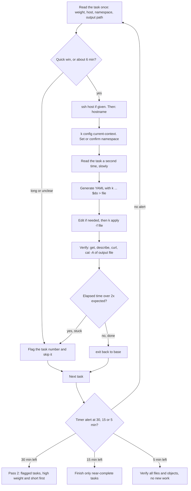

# T2.10 Exam environment, docs navigation and time strategy

> Competency: n/a, foundation topic | Domain/weight: n/a (foundation; supports both exams) | Est. time: 1.5 h | Prerequisites: T2.02, T1.03, T1.14

Shell setup used in every command of this lesson (also in [00-conventions](../00-conventions.md)):

```bash
alias k=kubectl
export do="--dry-run=client -o yaml"
export now="--force --grace-period=0"
source <(kubectl completion bash); complete -o default -F __start_kubectl k
```

Use `bash` for these (the `$do` trick relies on bash splitting the variable into words). In scripts run with `bash script.sh`, aliases are off, so the `check.sh` scripts in section 7 call `kubectl` directly.

Prerequisites, not re-taught here: kubectl speed and the `$do` factory are in [T2.02](../part2-basics/T2.02-kubectl-fluency-and-productivity.md); Vim and tmux editing habits are in [T1.03](../part1-linux/T1.03-vim-and-tmux-for-yaml-editing.md); `ssh`, `~/.ssh/config` and moving between hosts are in [T1.14](../part1-linux/T1.14-ssh-and-remote-work-across-nodes.md).

How to read the output blocks. This lesson has three kinds of block:

- `REAL OUTPUT (kubectl client v1.37.1, no cluster)`: captured on the author's machine with a throw-away kubeconfig that has fake clusters. Only commands that do not need a live API server work this way (`kubectl config ...`, `kubectl create ... $do`). Nothing was sent to a real cluster.
- `EXPECTED OUTPUT (not captured)`: needs a live kind cluster, a VM, or a browser. It is listed in section 11.
- Docs facts: each URL was fetched on 2026-10-27 and returned HTTP 200. Facts about the exam are quoted from the Linux Foundation (LF) pages and carry the page URL.

## 1. Why this matters

Both exams are timed command-line tasks: the Linux Foundation says they consist of 15-20 performance-based tasks (https://docs.linuxfoundation.org/tc-docs/certification/tips-cka-and-ckad) and last 2 hours (https://docs.linuxfoundation.org/tc-docs/certification/faq-cka-ckad-cks). Many candidates who know the material lose points for reasons that are not knowledge: they work on the wrong host, in the wrong namespace, write the answer file to a slightly different path, close the wrong window, or spend 20 minutes on one hard task. This lesson turns the published rules into a short routine that you practise in every later lab, so that on exam day the routine runs without thought.

## 2. Concepts

Index: 2.1 verified exam facts; 2.2 how a task is delivered (hosts, ssh, `base`, `sudo -i`, tools); 2.3 the remote desktop and keyboard rules; 2.4 allowed documentation; 2.5 searching the docs fast; 2.6 time and triage; 2.7 context and namespace discipline; 2.8 verification and exact outputs; 2.9 the killer.sh simulator; 2.10 exam-day checklist; 2.11 related but different.

### 2.1 Verified exam facts

I re-fetched the LF pages on 2026-10-27 and the rules below match the research summary. Re-check the pages marked (star) right before your own exam, because the LF edits them.

| Fact | Value | Source |
|---|---|---|
| Format | Online, remotely proctored, performance-based tasks on the Linux command line | https://docs.linuxfoundation.org/tc-docs/certification/tips-cka-and-ckad (star) |
| Number of tasks | "The exams consist of 15-20 performance-based tasks." | same page |
| Duration | 2 hours for CKA and CKAD | https://docs.linuxfoundation.org/tc-docs/certification/faq-cka-ckad-cks (star) |
| Pass mark | 66% or above for CKA; 66% or above for CKAD | same FAQ |
| Kubernetes version | The CKA and CKAD environments "currently" run Kubernetes v1.37. Environments are aligned to the newest minor "within approximately 4 to 8 weeks of the K8s release date" | same FAQ |
| Results | Scored automatically; the score report is emailed within 24 hours of finishing (technical difficulties can change that) | same FAQ |
| Languages of the tasks | English, Simplified Chinese, Japanese | same FAQ |
| Certificate validity | 2 years (3 years if earned before 2024-04-01); you renew by passing again | same FAQ |

Pass mark arithmetic (this is arithmetic, not an LF claim): a score of 66% means you may miss up to 34% of the available score. You do not have to finish everything. This is the basis of the triage rules in section 2.6.

Three things the LF pages I fetched do not state, so treat them as UNVERIFIED: how many clusters or kubeconfig contexts a task uses, which Linux distribution the exam hosts run, and which Helm, CNI or ingress versions are installed. Do not build a plan on any of them.

### 2.2 How a task is delivered: hosts, `base`, ssh, `sudo -i`, tools

Source for this whole subsection: https://docs.linuxfoundation.org/tc-docs/certification/tips-cka-and-ckad (star).

- **Per-task host.** "You must complete each task in this exam on a designated host." Each task tells you which host to use. An information box gives the `ssh <nodename>` command. After the task you `exit` back to host `base`. So the day has the shape: start at `base`, `ssh node-x`, work, `exit`, back at `base`, read the next task.
- **`base` has no tools.** "The base system (hostname `base`) does not have any of the above tools pre-installed." The tools are installed on the hosts you ssh to, not on `base`. Do not try to run `k` on `base`.
- **No nested ssh.** "Nested ssh is not supported." That means: from inside `ssh node-x` you must not `ssh node-y`. Exit back to `base` first. The exact error text you would get is UNVERIFIED; do not test it in the exam.
- **`sudo -i`.** "You can assume elevated privileges on any host by issuing the following command: `sudo -i`." Use it only when the task needs root (files under `/etc`, `systemctl`, the control plane files under `/etc/kubernetes`). When you finish, `exit` once to leave the root shell, and `exit` again to leave the host.
- **Tools on the ssh hosts.** The page lists: `kubectl` "with `k` alias and Bash autocompletion", `yq` for YAML processing, `curl` and `wget` for testing web services, and `man` with the man pages. Everything else (for example `jq`, `tmux`) is not promised, so do not rely on it in exam-style tasks.
- **Do not reboot `base`.** "Restarting the base node is prohibited." Doing so does not restart your exam environment.

**The alias name is UNVERIFIED.** The research summary quotes the page as "kalias". The text I fetched reads "`k` alias", which suggests an alias named `k`. The page uses a code span for `k` followed by the word "alias", so the exact name on the exam hosts is not confirmed. Habit: on your first host run `alias` and `type k`. If `k` is missing, define it yourself (below). It costs 5 seconds.

**Under the hood: what each `ssh`, `sudo -i` and `exit` really does.**

1. `ssh node-x` starts a new login shell on a different machine. That shell has its own environment, its own current directory and its own kubeconfig file. Variables and aliases you set on `base` do not follow you. This is why `$do` and `k` must be re-created on a host if the host does not provide them.
2. `sudo -i` starts a root login shell. A login shell builds a fresh environment, so your shell variables (`do`, `now`) and your aliases are gone, and the working directory becomes root's home. Root also reads its own `~/.kube/config`, not yours. Whether kubectl works as root on the exam hosts is UNVERIFIED. Rule: run `kubectl` as the normal user; use `sudo -i` only for host-level work. If you must run `kubectl` as root, run `k config current-context` first.
3. `exit` closes the innermost shell only. After `sudo -i` and `ssh` you need two `exit`s. Typing one `exit` too many on `base` closes your terminal window. Check the prompt (`hostname`) before the next `exit`.

The "shell setup" block at the top of this lesson is exactly what you paste after each `ssh`, if the host does not already define it. Paste with Ctrl+Shift+V (section 2.3).

### 2.3 The remote desktop and keyboard rules

Sources: https://docs.linuxfoundation.org/tc-docs/certification/tips-cka-and-ckad (star) and https://docs.linuxfoundation.org/tc-docs/certification/lf-handbook2/exam-user-interface/examui-performance-based-exams.md.

| Item | Rule |
|---|---|
| Programs on the remote desktop | Terminal Emulator; Firefox, used to access "Resources Allowed" (section 2.4); Virtual Keyboard; VSCodium (opens from the Applications menu or its desktop icon). The research summary also records that the VSCodium integrated terminal is allowed and extensions are prohibited (from the same ExamUI page). |
| Copy in the terminal | Ctrl+Shift+C |
| Paste in the terminal | Ctrl+Shift+V |
| Closing / word delete | Use Ctrl+Alt+W instead of Ctrl+W |
| INSERT key | Prohibited inside the Remote Desktop ("for security reasons") |
| Locate the cursor | Ctrl+Alt+K (from the research summary, E10) |

Why Ctrl+W deserves a warning. The LF page tells you to use Ctrl+Alt+W instead of Ctrl+W but does not say why. My explanation: in a browser Ctrl+W closes the tab, in bash it deletes the previous word, and in Vim it is the prefix for window commands. A stray Ctrl+W at the wrong moment can close a window or tab and the work in it is lost. Treat every Ctrl+W as dangerous and use Ctrl+Alt+W wherever you would have used it (T1.03 covers the Vim window commands). If you use Vim, make sure your muscle memory for `:wq` happens before any Ctrl+W-like key.

No INSERT key means that Vim users who press `Insert` to enter insert mode will get nothing. Use `i`, `a` or `o`.

Timer and pause behaviour (https://docs.linuxfoundation.org/tc-docs/certification/lf-handbook2/exam-user-interface/examui-performance-based-exams.md):

- "A visible alert will be presented at 30mins, 15mins and 5mins remaining." These are your three fixed checkpoints.
- "Requesting a break via the Pause Exam function will not stop the timer."
- "The timer will not pause, and there is no way to ADD time back to the timer in the event of a system disconnect." So a lost connection costs real minutes.

### 2.4 Allowed documentation

Source: https://docs.linuxfoundation.org/tc-docs/certification/certification-resources-allowed.

| Resource | CKA | CKAD |
|---|---|---|
| https://kubernetes.io/docs (and the built-in search on that site) | yes | yes |
| https://kubernetes.io/blog/ | yes | yes |
| https://helm.sh/docs | yes | yes |
| Task-specific documentation in the "Quick Reference" box of the task | yes | yes |
| https://gateway-api.sigs.k8s.io | yes | CKA only |

Rules that follow from the page: using the search function on kubernetes.io/docs is allowed, "but you must not open external search results." All available language translations are allowed (the page recommends English). Docs installed under `/usr/share` and distro packages are allowed (research summary E13). The browser is Firefox on the remote desktop; it is the only way to read the docs. Forbidden items (research summary E14, from https://docs.linuxfoundation.org/tc-docs/certification/lf-handbook2/exam-rules-and-policies.md): notes, other devices, browsing the internet with tools like Vim or Emacs, and any other app or window besides the exam.

Practical consequences:

- Do not bookmark or plan on Stack Overflow, GitHub or vendor pages. They are not on the list.
- The `man` pages on the host are a second source, offline, for Linux tasks (`man 5 sshd_config`).
- Use `k explain` (section 4) before opening the browser. It is always faster for a field name.

### 2.5 Searching the docs fast

The docs are large. A typical reading task is "find the YAML for X". Four tactics, in the order you should try them.

1. **Known page path.** Type the URL. The site is laid out by type: `/docs/concepts/` (what it is, with an example), `/docs/tasks/` (how to do it, step by step), `/docs/reference/` (field and command reference). Pages you will use again and again are in the table below. Every URL in it returned HTTP 200 on 2026-10-27, and I confirmed that each page contains a `kind: <Kind>` YAML example (a text check on the page, not a run).
2. **In-site search.** The search box on kubernetes.io opens `https://kubernetes.io/search/?q=<words>`. Example: `https://kubernetes.io/search/?q=networkpolicy` returns a page titled "Search Results | Kubernetes" (HTTP 200). The results are rendered by JavaScript in the browser, so which hit comes first is UNVERIFIED. Open only results that stay on kubernetes.io.
3. **Ctrl+F inside the page.** The pages are long. Search for the Kind (`kind: NetworkPolicy`), a field (`podSelector`), or a title word (`Default deny`). On the NetworkPolicy page, the text "Default deny all ingress traffic" is a section heading and the example is named `default-deny-ingress` (verified in the page text).
4. **The Quick Reference page** https://kubernetes.io/docs/reference/kubectl/quick-reference/ for command syntax, and `k explain` for fields.

Mental bookmarks per topic (open these by typing the path after `https://kubernetes.io`):

| You need | Path |
|---|---|
| Pod example | `/docs/concepts/workloads/pods/` |
| Deployment | `/docs/concepts/workloads/controllers/deployment/` |
| Service | `/docs/concepts/services-networking/service/` |
| NetworkPolicy | `/docs/concepts/services-networking/network-policies/` |
| Ingress | `/docs/concepts/services-networking/ingress/` |
| PV / PVC | `/docs/concepts/storage/persistent-volumes/` |
| StorageClass | `/docs/concepts/storage/storage-classes/` |
| ConfigMap | `/docs/concepts/configuration/configmap/` |
| Secret | `/docs/concepts/configuration/secret/` |
| CronJob | `/docs/concepts/workloads/controllers/cron-jobs/` |
| RBAC (Role, RoleBinding) | `/docs/reference/access-authn-authz/rbac/` |
| Probes | `/docs/tasks/configure-pod-container/configure-liveness-readiness-startup-probes/` |
| Taints and tolerations | `/docs/concepts/scheduling-eviction/taint-and-toleration/` |
| Node affinity | `/docs/tasks/configure-pod-container/assign-pods-nodes-using-node-affinity/` |
| securityContext | `/docs/tasks/configure-pod-container/security-context/` |
| ResourceQuota | `/docs/concepts/policy/resource-quotas/` |
| kubectl cheat sheet | `/docs/reference/kubectl/quick-reference/` |
| Gateway API (CKA only) | `https://gateway-api.sigs.k8s.io` |
| Helm | `https://helm.sh/docs` |

"Prepared mental bookmarks" means you practise until you can type these paths without looking. You may not bring written notes into the exam (forbidden list above), and anything you rely on must be in your head or in the docs. The browser's own bookmarks are not mentioned on the LF pages, so do not count on them (UNVERIFIED).

The docs home page is https://kubernetes.io/docs/home/, the blog is https://kubernetes.io/blog/. The version menu on the site lists v1.37 first (seen in the page header on 2026-10-27), which is the exam version.

### 2.6 Time and triage

The arithmetic: 120 minutes divided by 20 tasks is 6 minutes a task; divided by 15 tasks it is 8 minutes. So about 6 to 8 minutes on average. Some tasks are 2-minute one-liners and some are 12-minute multi-step jobs.

Task weights. The topic checklist says to read the weight of each task. The LF pages I fetched do not describe how weights are shown or whether partial work earns partial credit, so both are UNVERIFIED. Use the weight if the task text shows one; never assume partial credit.

Rules of thumb (advice, not LF rules):

1. **First read, 20 seconds.** Read the whole task. Decide: quick win, normal, or long.
2. **Skip long or unclear tasks and flag them.** Remember the task numbers you skipped. Whether the exam interface has a flag or notes feature is UNVERIFIED, so do not depend on it; the ban on notes in section 2.4 covers material from outside the exam. A safe habit: keep the list as a comment line at the top of your terminal session on `base`, for example `# skipped: 4 7 11`.
3. **Skip at 2x the expected time.** If a task you expected to take 5 minutes has taken 10, stop, leave it in a safe state (nothing half-applied that breaks other work), flag it, and move on.
4. **Pass 1 for easy points, pass 2 for the rest.** A 66% pass mark means the easy and medium tasks carry you.
5. **Use the three alerts.** At 30 minutes left, stop starting new long tasks. At 15 minutes left, only finish what is nearly done. At 5 minutes left, verify that every answer file exists at its exact path.

| Alert (LF) | What you do |
|---|---|
| 30 min left | Count unfinished tasks. Go to the flagged tasks that are highest weight and shortest. |
| 15 min left | Finish only tasks that are close. Stop debugging deep problems. |
| 5 min left | Run read-only verifications: `ls` the output files, `k get` the key objects, check you are not in a root shell with half-typed commands. |

### 2.7 Context and namespace discipline

A **context** is a kubeconfig entry that bundles a cluster, a user and an optional default namespace (full explanation in [T2.02](../part2-basics/T2.02-kubectl-fluency-and-productivity.md)). The research summary notes that the LF pages describe a separate ssh host per task, and say nothing about how many clusters or contexts there are (UNVERIFIED). So the habit is general: if the task gives you a `kubectl config use-context ...` line, run it exactly; if it gives a namespace, use it on every command; and in all cases check where you are.

Start of every task, 10 seconds:

```bash
hostname                       # which machine am I on? (base, or the node the task named)
k config current-context       # which cluster will my commands hit?
k config view --minify | grep namespace   # which namespace is the default? (no output = default)
```

Option A: pass `-n <ns>` on every command. Safe against a wrong default but you must never forget it once.
Option B: set the default for the context once: `k config set-context --current --namespace=<ns>`. Fast, but it changes the kubeconfig, so you must reset it when the next task needs another namespace.

Many experienced candidates pick B and verify it with the `minify` line. Whichever you choose, **never mix** the two within one task.

REAL OUTPUT (kubectl client v1.37.1, no cluster), with a throw-away kubeconfig of two fake contexts `ctx-a` and `ctx-b`:

```text
$ kubectl config use-context ctx-a
Switched to context "ctx-a".
$ kubectl config current-context
ctx-a
$ kubectl config set-context --current --namespace=lab-t210
Context "ctx-a" modified.
$ kubectl config view --minify | grep namespace
    namespace: lab-t210
$ kubectl config get-contexts
CURRENT   NAME    CLUSTER   AUTHINFO   NAMESPACE
*         ctx-a   c1        u1         lab-t210
          ctx-b   c2        u1         team-b
```

Reading it: the `*` marks the current context; the NAMESPACE column is the default namespace of each context; blank means `default`. Resetting a default namespace: `k config set-context --current --namespace=""` removes the field (I checked that the context prints with a blank NAMESPACE afterwards).

What a wrong or unreachable context looks like (REAL OUTPUT (kubectl client v1.37.1, no cluster), pointing at a cluster that is not running):

```text
$ kubectl get po
E1027 20:31:04.876673   91957 memcache.go:381] "Couldn't get current server API group list" err="Get \"https://127.0.0.1:6443/api?timeout=32s\": dial tcp 127.0.0.1:6443: connect: connection refused"
The connection to the server 127.0.0.1:6443 was refused - did you specify the right host or port?
```

(The first line repeated a few times in my capture; only the first is shown.) That message means: the context points at a server that is not answering. On the exam, first suspect you are on the wrong host (`hostname`), not that the cluster is broken.

### 2.8 Verification and exact outputs

Graders check cluster state and files. You cannot assume that a command that printed `created` did what the task wanted. After each task:

- Objects: `k get <kind> <name> -n <ns>` (existence, READY, replicas) and `k describe` (events at the bottom show why it failed).
- Services: `k get svc,endpointslices -n <ns>`, then `curl` against the ClusterIP or Pod IP from a node (`curl` is on the hosts).
- Files: `cat -A <path>` shows exact bytes (a trailing `$` marks end of line, `^I` a tab). `ls -l <path>` confirms the exact path and that the file is not empty.
- "Write outputs exactly where asked": copy the path from the task text, do not retype it. Write exactly what was asked: if the task says "one name per line", do not add headings or a trailing summary. If it says a file `/opt/results/pods.txt`, check the directory exists first (`ls -ld /opt/results`).

Dry-run is not done: `k create ... $do > file.yaml` only writes a file. The object exists only after `k apply -f file.yaml`. Check with `k get`.

### 2.9 The killer.sh simulator

Sources: https://docs.linuxfoundation.org/tc-docs/certification/faq-cka-ckad-cks and https://killer.sh/faq.

- Registrations include "two attempts (per exam registration)". Each attempt gives 36 hours of access "starting from the time of activation". Access is not included with CKA-SINGLE or CKAD-SINGLE registrations ("Exam Simulator access is not included in CKA-SINGLE, CKAD-SINGLE, CKS-SINGLE Exam Registrations"). The research summary (E20) records 17 questions per session; the killer.sh FAQ I fetched says the simulator has more questions than the real exams and that two sets are provided in the same simulator (I could not confirm the count of 17).
- The killer.sh FAQ says the 36 hours are time based, not usage based, and cannot be spread over several days. So start a session only when you have the time to use it.
- The countdown is "just an indicator" for yourself: when it reaches 0 you can view solutions and score, and you keep the environment for the 36 hours in total.
- killer.sh tip from its FAQ: no password is needed for ssh between its hosts, and you must run `exit` to get back to the main terminal. The same habit is used in the real exam (section 2.2).
- Free practice scenarios: https://killercoda.com/killer-shell-cka and https://killercoda.com/killer-shell-ckad (both HTTP 200 on 2026-10-27).

How to use the two attempts: attempt 1 about two to three weeks before the exam, to find weak topics (do it under a 2-hour timer, no docs beyond the allowed list). Study the solutions after the countdown ends. Attempt 2 about two or three days before the exam, as a dress rehearsal using your exact routine.

### 2.10 Exam-day checklist

All items come from https://docs.linuxfoundation.org/tc-docs/certification/tips-cka-and-ckad (star) unless another URL is given.

| Check | Rule (LF wording) |
|---|---|
| ID | "All IDs must be a valid (unexpired) Government-issued original, physical document (not photocopied or electronic)". The first and last name on the ID must exactly match the verified name on your exam checklist. |
| Room | You must remain within the camera frame; no bright lights or windows behind you; a hard surface to place your device on. |
| Monitor | "One active monitor (either built in or external)". "Dual Monitors are NOT supported". |
| Browser | The exam runs on PSI's proctoring platform "Bridge", using the PSI Secure Browser. |
| No VM | "You cannot take an exam using a virtual machine even though the compatibility check may not display any issues". |
| Webcam and microphone | Required (research summary E25). |
| Forbidden | Notes, other devices, other apps or windows besides the exam (https://docs.linuxfoundation.org/tc-docs/certification/lf-handbook2/exam-rules-and-policies.md). |

Also: run the compatibility check early, close all other programs, and restart nothing in the middle (a disconnect does not stop the timer, section 2.3).

### 2.11 Related but different

| Pair | Difference |
|---|---|
| `ssh <host>` vs `k config use-context` | ssh changes the machine you type on; use-context changes which cluster kubectl talks to. A task can need either or both. |
| `-n <ns>` vs the context's default namespace | `-n` applies to one command; the default applies to all commands in that context until you change it. |
| `sudo -i` vs `su` | `sudo -i` is the documented way on the exam hosts; it starts a root login shell using your sudo right. `su` is not mentioned on the LF page. |
| Pause Exam vs timer | Pause Exam does not stop the timer. |
| killer.sh vs Killercoda | killer.sh is the simulator that comes with most exam registrations (36 h sessions, two attempts); Killercoda publishes the Killer Shell scenarios you open in a browser (its pricing is UNVERIFIED). |
| `$do` generation vs `apply` | `$do` only prints or writes YAML; nothing is created until you apply. |

## 3. How it works (diagram)



Walkthrough:

1. You read the task once and choose: do it now or flag it. This decision costs 20 seconds and protects the whole exam.
2. For a task you do now, the routine is always the same: host, `hostname`, context, namespace, second read, generate, apply, verify. The two reads catch the wrong namespace and the wrong output path, which are the commonest losses.
3. The verify step is part of the task, not an extra. It is where the traps show up.
4. The elapsed-time check sends you to the flag list if the task has grown past about 2x its expected time.
5. After `exit` you are back on `base` and the loop restarts. The three LF alerts (30, 15, 5 minutes) switch the loop from first pass, to second pass, to final check.

## 4. Commands and YAML you must produce fast

**Imperative shortcuts**

```bash
ssh <host>                         # start of a task, using the host named in the task's information box
hostname                           # prove which machine you are on; the answer must match the task
sudo -i                            # only if the task needs root; exit once to leave root, once more to leave the host
exit                               # leave the shell; repeat until the prompt says base
k config current-context           # which cluster am I on?
k config use-context <name>        # switch cluster if the task says so
k config view --minify | grep namespace          # the context's default namespace (blank = default)
k config set-context --current --namespace=<ns>  # set default namespace for this context
k config set-context --current --namespace=""    # remove it again
alias k=kubectl                    # in case the host lacks it (alias name on exam hosts UNVERIFIED)
k explain pod.spec.restartPolicy   # field docs from the API server; no browser needed
k explain pod.spec --recursive | less            # all fields under a path; search with /
cat -A answers.txt                 # show exact bytes of an output file
```

The sixty-second routine for a task, copy-paste ready:

```bash
# 1. host (only if the task names one)
ssh <host>
# 2. which machine? (needs to match the task)
hostname
# 3. shell setup, only if missing (check with: type k)
alias k=kubectl; export do="--dry-run=client -o yaml"; export now="--force --grace-period=0"
source <(kubectl completion bash); complete -o default -F __start_kubectl k
# 4. cluster and namespace
k config current-context
k config set-context --current --namespace=<ns-from-task>
k config view --minify | grep namespace
# 5. read the task again (output path? names? image tag?)
# 6. generate
k create deploy <name> --image=<image:tag> --replicas=2 $do > ~/<name>.yaml
```

**The declarative YAML.** `k create deploy ... $do` prints a complete Deployment. REAL OUTPUT (kubectl client v1.37.1, no cluster); this command does not need a server:

```text
$ k create deploy report --image=nginx:1.27 --replicas=2 $do
apiVersion: apps/v1
kind: Deployment
metadata:
  labels:
    app: report
  name: report
spec:
  replicas: 2
  selector:
    matchLabels:
      app: report
  strategy: {}
  template:
    metadata:
      labels:
        app: report
    spec:
      containers:
      - image: nginx:1.27
        name: nginx
        resources: {}
status: {}
```

The same file with every field explained. It applies cleanly with `k apply -f` (namespace comes from the context default or `-n`):

```yaml
apiVersion: apps/v1          # API group/version for Deployment. A wrong value gives "no matches for kind".
kind: Deployment             # The object type. Must match the apiVersion's group.
metadata:
  labels:
    app: report              # Label on the Deployment itself (the generator copies the name). Optional.
  name: report               # Object name, unique per namespace. Use exactly the name in the task.
spec:
  replicas: 2                # Number of Pods wanted. Default 1. Setting 0 stops all Pods.
  selector:
    matchLabels:
      app: report            # Which Pods this Deployment owns. MUST match template labels or the API rejects it.
  strategy: {}               # Empty means the default RollingUpdate (25% max surge, 25% max unavailable).
  template:                  # Pod template: what each replica looks like.
    metadata:
      labels:
        app: report          # Pod labels; the selector above matches these.
    spec:
      containers:
      - image: nginx:1.27    # Always a pinned tag. ":latest" gives unpredictable results.
        name: nginx          # Container name; the generator takes it from the image.
        resources: {}        # No requests or limits. Fine in a lab; check the task if it asks for limits.
status: {}                   # Output field; the API server ignores it on create.
```

Risky values: a `selector` that does not match the `template.metadata.labels` is rejected; a missing tag means `:latest`; `replicas: 0` silently removes all Pods.

The start-of-task routine as a function you can paste once per host, if you like (it prints the three facts you must see):

```bash
where() { echo "host: $(hostname)"; echo "context: $(kubectl config current-context)"; echo "namespace: $(kubectl config view --minify -o jsonpath='{..namespace}')"; }
```

**Speed drill (target: 30-90 seconds each)**

Setup, once, on the kind `lab` cluster (context `kind-lab`; the lab VM is only needed for drill 8):

```bash
k config use-context kind-lab
k create ns lab-t210-d
k create ns lab-t210-e
mkdir -p ~/lab/t210
```

1. (20 s) Define `k`, `$do`, `$now` and completion in the current shell, and prove `k` works with `type k`.
2. (40 s) Print the current context and its default namespace, then make `lab-t210-d` the default namespace of the current context.
3. (60 s) Generate a Pod YAML for `web` (nginx:1.27, label `app=web`) into `~/lab/t210/web.yaml` with `$do`, then apply it.
4. (45 s) Without opening a browser, find the allowed values of a Pod's `restartPolicy`.
5. (90 s) In the docs, find the "default deny all ingress" NetworkPolicy example by typing the page path, copy it into `~/lab/t210/deny.yaml`, and apply it in `lab-t210-d`.
6. (45 s) Save the Pod names of namespace `lab-t210-d`, one per line, into `~/lab/t210/pods.txt` and show the exact bytes of the file.
7. (60 s) You ran `k create deploy x --image=nginx:1.27` and then realised the task wanted it in `lab-t210-e`. Find where it was created and fix it.
8. (90 s, needs the VM) Run the host routine: ssh to the lab VM, show the hostname, become root, show who you are, return all the way to your own machine, and show the hostname again.

<details><summary>Answers</summary>

```bash
# 1
alias k=kubectl; export do="--dry-run=client -o yaml"; export now="--force --grace-period=0"
source <(kubectl completion bash); complete -o default -F __start_kubectl k
type k

# 2
k config current-context
k config view --minify | grep namespace
k config set-context --current --namespace=lab-t210-d

# 3 (uses the default namespace from drill 2)
k run web --image=nginx:1.27 --labels=app=web $do > ~/lab/t210/web.yaml
k apply -f ~/lab/t210/web.yaml
k get pod web

# 4
k explain pod.spec.restartPolicy
```

EXPECTED OUTPUT (not captured) for drill 4: a block starting `KIND: Pod`, `VERSION: v1`, `FIELD: restartPolicy <string>`, and a description that names the allowed values `Always`, `OnFailure` and `Never`, with `Always` the default. The exact wording is not captured.

```bash
# 5: browser: https://kubernetes.io/docs/concepts/services-networking/network-policies/
#    Ctrl+F "Default deny all ingress traffic". Copy the example. In the terminal:
cat > ~/lab/t210/deny.yaml      # paste with Ctrl+Shift+V, then Ctrl+D on its own line
k apply -f ~/lab/t210/deny.yaml -n lab-t210-d
k get netpol -n lab-t210-d
```

The example is this complete manifest (the docs name it `default-deny-ingress`):

```yaml
apiVersion: networking.k8s.io/v1
kind: NetworkPolicy
metadata:
  name: default-deny-ingress
spec:
  podSelector: {}     # empty selector = every Pod in the namespace
  policyTypes:
  - Ingress           # only Ingress listed and no ingress rules = all inbound traffic denied
```

```bash
# 6
k get po -n lab-t210-d -o name | cut -d/ -f2 > ~/lab/t210/pods.txt
cat -A ~/lab/t210/pods.txt          # "web$" and nothing else if only web exists

# 7
k get deploy -A | grep -w x         # shows which namespace it landed in (the context default, lab-t210-d)
k delete deploy x -n lab-t210-d
k create deploy x --image=nginx:1.27 -n lab-t210-e
k get deploy x -n lab-t210-e

# 8
ssh lab-vm
hostname
sudo -i
whoami          # root
exit            # leave the root shell
exit            # leave the VM
hostname        # back on your own machine
```

</details>

Drill cleanup (run after all drills; returns the cluster to baseline):

```bash
k delete ns lab-t210-d lab-t210-e
k config set-context --current --namespace=""
rm -f ~/lab/t210/web.yaml ~/lab/t210/deny.yaml ~/lab/t210/pods.txt
```

## 5. Worked example

Goal: run the sixty-second routine on a realistic task, then deliberately fall into the wrong-context trap and see how the routine catches it. Environment: kind cluster `lab` (context `kind-lab`), shell setup from the top of the lesson. Kubectl commands against the cluster are EXPECTED OUTPUT (not captured) because kind is not installed on the authoring machine; the `kubectl config` and `$do` outputs shown earlier are real.

**The task, written like an exam task:**

> Cluster context `kind-lab`. Create a Deployment named `report` with 2 replicas of `nginx:1.27` in namespace `lab-t210-w`. Then save the names of its Pods, one per line, in `~/lab/t210/w/pods.txt`.

**Step 1: where am I (10 seconds).** On the real exam this step also contains `ssh <host>`; on the lab, you are on your own machine, so only the cluster matters.

```bash
mkdir -p ~/lab/t210/w
k config use-context kind-lab
k config current-context
k create ns lab-t210-w
k config set-context --current --namespace=lab-t210-w
k config view --minify | grep namespace
```

EXPECTED OUTPUT (not captured):

```text
Switched to context "kind-lab".
kind-lab
namespace/lab-t210-w created
Context "kind-lab" modified.
    namespace: lab-t210-w
```

What to look for: the context name in line 2 equals the task's context; the last line equals the task's namespace. If either differs, stop and fix before any other command.

**Step 2: read the task a second time.** Facts to extract: name `report`, replicas 2, image `nginx:1.27`, namespace `lab-t210-w`, output file `~/lab/t210/w/pods.txt`, one name per line (no `pod/` prefix is implied, so write bare names).

**Step 3: generate, apply, verify.**

```bash
k create deploy report --image=nginx:1.27 --replicas=2 $do > ~/lab/t210/w/report.yaml
k apply -f ~/lab/t210/w/report.yaml
k rollout status deploy/report
k get deploy report -o wide
```

The generated YAML is the real output shown in section 4. `k apply` reads the namespace from the context default, which you set in step 1.

EXPECTED OUTPUT (not captured):

```text
deployment.apps/report created
deployment "report" successfully rolled out
NAME     READY   UP-TO-DATE   AVAILABLE   AGE   CONTAINERS   IMAGES       SELECTOR
report   2/2     2            2           20s   nginx        nginx:1.27   app=report
```

The READY column must read `2/2`. If it reads `0/2` for long, run `k describe deploy report` and `k get po`, then read the Events at the bottom (image pull errors and scheduling problems show there).

**Step 4: write the answer file exactly as asked.**

```bash
k get po -l app=report -o name | cut -d/ -f2 > ~/lab/t210/w/pods.txt
cat -A ~/lab/t210/w/pods.txt
wc -l < ~/lab/t210/w/pods.txt
```

`-o name` prints `pod/<name>`; `cut -d/ -f2` keeps the part after the slash. `cat -A` marks every line end with `$`, so you can see a stray space or an empty last line.

EXPECTED OUTPUT (not captured):

```text
report-<hash>-<id1>$
report-<hash>-<id2>$
2
```

The hash and ids differ on every run. `wc -l` prints `2`.

**Step 5: the trap.** Switch to a different context and try the same `get`, to see why step 1 matters. With a context that points at a dead server the command fails loudly, as in the REAL OUTPUT block in section 2.7. In real life the wrong context usually points at a live cluster and the command silently works on the wrong objects. That is why you run `k config current-context` before every task, not after an error.

**Step 6: cleanup.**

```bash
k delete ns lab-t210-w
k config set-context --current --namespace=""
rm -rf ~/lab/t210/w
```

## 6. Common mistakes and how to fix them

| Symptom | What you will see | Cause | Fix |
|---|---|---|---|
| Task done in the wrong context or host | Commands succeed, but the grader finds nothing; or `The connection to the server ... was refused - did you specify the right host or port?`; or `bash: k: command not found` after a `sudo -i` | Skipped setup: no `hostname` / `k config current-context` check | Run the routine: `hostname`, `k config current-context`, `k config view --minify \| grep namespace`. Redo the task in the right place. |
| Object created in the wrong namespace | `k get deploy shop` prints `Error from server (NotFound): deployments.apps "shop" not found`, or the right name exists but with the old replica count | The context's default namespace was not the task's namespace and `-n` was missing | `k get deploy -A \| grep -w shop` to find all copies; fix the right one with `-n <ns>`; delete the stray one you created |
| Ran out of time on one task | 40 minutes gone, 5 tasks never opened | No triage; kept debugging | Skip at 2x the expected time, flag it, return after the first pass (section 2.6) |
| Lost work after closing a browser tab or window | The terminal or browser window vanishes; unsaved text is gone | Ctrl+W used | Use Ctrl+Alt+W instead; save files (`:w`) often; keep the YAML on disk before applying |
| Answer file in the wrong place or with the wrong content | `cat: <path>: No such file or directory`; or the file has `pod/` prefixes | Path retyped with a typo; wrong format | Copy the path from the task text; `ls -l <path>`; `cat -A <path>` |
| Nested ssh | The connection is not supported (exact text UNVERIFIED) | `ssh` run on a host instead of on `base` | `exit` until `hostname` prints `base`; then `ssh <next host>` |
| Alias or variable missing after switching host or root shell | `bash: k: command not found`; or `$do` expands to nothing and kubectl runs a real command instead of printing YAML | New shell has a new environment | Paste the setup block again; verify with `type k` and `echo "$do"` |

**Troubleshooting path for "wrong context or host" (commands in the order you should run them).**

1. `hostname`. Compare with the host in the task. If it is `base` and the task named a node, you forgot to ssh. If it is a node but the task named another, `exit` and ssh again.
2. `k config current-context`. Compare with the task. If it differs, `k config use-context <name>`.
3. `k config view --minify | grep namespace`. No output means `default`. Compare with the task.
4. `k get <kind> -A | grep -w <name>`. This lists every copy of the object across namespaces. How to read it: if the object is in a namespace the task did not name, you wrote to the wrong place. Delete it there and recreate it in the right one.
5. Re-run the task's verification (section 2.8).

**Troubleshooting path for "ran out of time".** At each alert, count the flagged tasks. Check the clock when you finish each task and keep a running list of which tasks are done and which are flagged. The cause is always a decision that was not made early: apply the 2x rule at once, when you are still calm.

**Troubleshooting path for "answer file wrong".** `ls -l <path>` (exists? size is not 0?), `cat -A <path>` (extra spaces, tabs, missing newline, `pod/` prefixes), `diff <(cat <path>) <(your command)` to compare with a fresh output.

## 7. Labs

Lab order: A (Easy), then B (Medium), then C (Break-fix). Each lab returns the cluster to baseline, so any order works. Only lab A needs the second cluster `lab2`; labs B and C use `kind-lab` and the VM.

Environments (conventions: kind, plus a VM for the host steps):

- Cluster `lab` with context `kind-lab` from `env/kind-up.sh` (1 control plane + 2 workers, Calico).
- A second cluster `lab2` with context `kind-lab2` (one node is enough), created in lab A's setup.
- One Ubuntu VM you can reach with `ssh lab-vm` (the lab VM from [T1.14](../part1-linux/T1.14-ssh-and-remote-work-across-nodes.md); name it in `~/.ssh/config`). Without a VM, you can still do all cluster tasks; the host-only tasks (A10, C2) can be skipped, and their checks will fail on purpose. A `docker exec` into a kind node is NOT the same as ssh and is not a substitute for practising the ssh routine.

### Lab A (Easy): timed 10-task mini mock with context and namespace switches

**Setup** (about 3 minutes):

```bash
mkdir -p ~/lab/t210/out

# second cluster, one node, default CNI is enough for this lab
kind create cluster --name lab2 --image kindest/node:v1.37.0@sha256:a1ed56cfb0e7b93589bdf97c8cd566405a265939e3620fc4f5de89adff580ae5

kubectl --context kind-lab  create ns lab-t210
kubectl --context kind-lab2 create ns lab-t210
kubectl --context kind-lab2 create ns lab-t210-b

kubectl --context kind-lab -n lab-t210 create deployment old --image=nginx:1.27 --replicas=1
kubectl --context kind-lab -n lab-t210 run p1 --image=nginx:1.27 --labels=role=ok
kubectl --context kind-lab -n lab-t210 run p2 --image=nginx:1.27 --labels=role=broken

# leave the "wrong" context active on purpose
kubectl config use-context kind-lab2
```

Write the scoring script (it uses `kubectl` directly, not the alias, because scripts do not expand aliases):

```bash
cat > ~/lab/t210/check.sh <<'EOF'
#!/usr/bin/env bash
O=$HOME/lab/t210/out
t1()  { [ "$(kubectl --context kind-lab -n lab-t210 get pod web -o jsonpath='{.metadata.labels.tier}/{.spec.containers[0].image}')" = "front/nginx:1.27" ]; }
t2()  { [ "$(kubectl --context kind-lab2 -n lab-t210 get deploy api -o jsonpath='{.spec.replicas}/{.spec.template.spec.containers[0].image}')" = "3/nginx:1.27" ]; }
t3()  { [ "$(kubectl --context kind-lab -n lab-t210 get deploy old -o jsonpath='{.spec.replicas}')" = 4 ]; }
t4()  { [ "$(cat "$O/ns2.txt")" = "$(printf 'lab-t210\nlab-t210-b')" ]; }
t5()  { [ "$(kubectl --context kind-lab -n lab-t210 get cm app-cfg -o jsonpath='{.data.mode}')" = prod ]; }
t6()  { [ "$(kubectl --context kind-lab -n lab-t210 get svc old-svc -o jsonpath='{.spec.type}/{.spec.ports[0].port}/{.spec.selector.app}')" = "ClusterIP/80/old" ]; }
t7()  { grep -q '^kind: Job' "$O/job.yaml" && grep -q 'image: busybox:1.36' "$O/job.yaml" && grep -q 'name: once' "$O/job.yaml" && ! kubectl --context kind-lab -n lab-t210 get job once; }
t8()  { [ "$(kubectl --context kind-lab2 -n lab-t210-b get pod cache -o jsonpath='{.spec.containers[0].image}')" = busybox:1.36 ] && [ "$(kubectl config view -o jsonpath='{.contexts[?(@.name=="kind-lab2")].context.namespace}')" = lab-t210-b ]; }
t9()  { [ "$(cat "$O/broken.txt")" = p2 ]; }
t10() { [ "$(ssh -n lab-vm 'sudo cat /root/t210.txt')" = "$(ssh -n lab-vm hostname)" ]; }
score=0
for n in 1 2 3 4 5 6 7 8 9 10; do
  if t$n >/dev/null 2>&1; then echo "task $n PASS"; score=$((score+1)); else echo "task $n FAIL"; fi
done
echo "score: $score / 10 (pass mark of the real exam is 66%, so 7 would pass)"
test "$score" -ge 7
EOF
chmod +x ~/lab/t210/check.sh
```

Start a 60-minute timer with the same three alerts as the real exam (30, 15 and 5 minutes left) in the background, then start the clock:

```bash
( sleep 1800; echo ">>> 30 min left"; sleep 900; echo ">>> 15 min left"; sleep 600; echo ">>> 5 min left" ) &
date
```

**Tasks** (60 minutes for 10 tasks; this is exam pace of about 6 minutes each):

1. Context `kind-lab`, namespace `lab-t210`: create a Pod `web` with image `nginx:1.27` and label `tier=front`.
2. Context `kind-lab2`, namespace `lab-t210`: create a Deployment `api` with image `nginx:1.27` and 3 replicas.
3. Context `kind-lab`, namespace `lab-t210`: the Deployment `old` has 1 replica. Scale it to 4.
4. Context `kind-lab2`: write the names of all namespaces whose name starts with `lab-` into `~/lab/t210/out/ns2.txt`, one per line, sorted.
5. Context `kind-lab`, namespace `lab-t210`: create a ConfigMap `app-cfg` with the key `mode` and the value `prod`.
6. Context `kind-lab`, namespace `lab-t210`: expose Deployment `old` with a ClusterIP Service `old-svc` on port 80.
7. Context `kind-lab`, namespace `lab-t210`: write the YAML (do not create the object) of a Job `once` with image `busybox:1.36` that runs `echo hello`, to `~/lab/t210/out/job.yaml`.
8. Context `kind-lab2`: make `lab-t210-b` the default namespace of that context. Then, without using `-n`, create a Pod `cache` with image `busybox:1.36` that runs `sleep 3600`.
9. Context `kind-lab`, namespace `lab-t210`: one Pod has the label `role=broken`. Write only its name to `~/lab/t210/out/broken.txt`.
10. Host `lab-vm` (ssh): as root, write the output of `hostname` into `/root/t210.txt`. Return to your own machine when done.

<details><summary>Hints</summary>

- Before each task: `k config current-context`. Tasks 2, 4 and 8 use the other cluster. `--context <name>` on a single command is a valid alternative to `use-context`.
- Task 4: `k get ns -o name` prints `namespace/<name>`. Use `cut -d/ -f2`, `grep '^lab-'` and `sort`.
- Task 7: generators accept a command after `--`: `k create job <name> --image= $do -- echo hello`. Redirect with `>`, and do not `apply`.

</details>

<details><summary>Solution</summary>

Each step is needed because the clock starts with the wrong context active, so the first command of each task must establish where you are.

```bash
# 1
k config use-context kind-lab
k -n lab-t210 run web --image=nginx:1.27 --labels=tier=front

# 2
k config use-context kind-lab2
k -n lab-t210 create deploy api --image=nginx:1.27 --replicas=3

# 3
k config use-context kind-lab
k -n lab-t210 scale deploy old --replicas=4

# 4 (context kind-lab2; the other context would give a list without lab-t210-b)
k --context kind-lab2 get ns -o name | cut -d/ -f2 | grep '^lab-' | sort > ~/lab/t210/out/ns2.txt

# 5
k -n lab-t210 create cm app-cfg --from-literal=mode=prod

# 6
k -n lab-t210 expose deploy old --name=old-svc --port=80

# 7: $do makes it print YAML only; the Job is never created
k -n lab-t210 create job once --image=busybox:1.36 $do -- echo hello > ~/lab/t210/out/job.yaml

# 8: set the default namespace first, then create without -n
k config use-context kind-lab2
k config set-context --current --namespace=lab-t210-b
k run cache --image=busybox:1.36 -- sleep 3600

# 9
k config use-context kind-lab
k -n lab-t210 get po -l role=broken -o name | cut -d/ -f2 > ~/lab/t210/out/broken.txt

# 10
ssh lab-vm
hostname               # confirm you are on the VM
sudo -i
hostname > /root/t210.txt
exit                   # leave root
exit                   # leave the VM
```

Why these steps: tasks 1 to 3 and 5 to 7 and 9 act on `kind-lab`, tasks 2, 4 and 8 on `kind-lab2`, so a task done before its `use-context` lands in the wrong cluster. Task 8 changes the kubeconfig, so it is the one task where "default namespace" is part of the answer. `$do` in task 7 is what makes "write the YAML" different from "create the object".

</details>

**Verification** (each line can fail; it exits non-zero below 7 of 10):

```bash
bash ~/lab/t210/check.sh
echo "exit code: $?"
```

EXPECTED OUTPUT (not captured), when all tasks are right:

```text
task 1 PASS
...
task 10 PASS
score: 10 / 10 (pass mark of the real exam is 66%, so 7 would pass)
exit code: 0
```

A failing task prints `task N FAIL`. Re-read the task, check context and namespace first.

**Cleanup:**

```bash
kill %1 2>/dev/null
kind delete cluster --name lab2
kubectl config use-context kind-lab
kubectl delete ns lab-t210
ssh lab-vm 'sudo rm -f /root/t210.txt'
rm -rf ~/lab/t210/out ~/lab/t210/check.sh
```

After cleanup the cluster `lab` has no `lab-t210` namespace, `lab2` is deleted (so the `kind-lab2` context is removed by kind), and the VM has no `/root/t210.txt`.

### Lab B (Medium): docs scavenger hunt, 15 YAML examples in under 10 minutes

**Environment:** a browser with the official docs (practise with kubernetes.io only), the kind cluster `lab`, and a terminal. Setup:

```bash
k config use-context kind-lab
mkdir -p ~/lab/t210/hunt
cd ~/lab/t210/hunt
```

**Task statement.** Start a 10-minute timer. For each of the 15 Kinds in the list, find a YAML example for it on kubernetes.io, copy it into the file named in the list inside `~/lab/t210/hunt/`. You may use the in-site search, page paths and Ctrl+F. Do not open external search results.

| File | Kind |
|---|---|
| `pod.yaml` | Pod |
| `deployment.yaml` | Deployment |
| `service.yaml` | Service |
| `networkpolicy.yaml` | NetworkPolicy |
| `ingress.yaml` | Ingress |
| `pvc.yaml` | PersistentVolumeClaim |
| `configmap.yaml` | ConfigMap |
| `secret.yaml` | Secret |
| `cronjob.yaml` | CronJob |
| `rolebinding.yaml` | RoleBinding |
| `storageclass.yaml` | StorageClass |
| `daemonset.yaml` | DaemonSet |
| `statefulset.yaml` | StatefulSet |
| `limitrange.yaml` | LimitRange |
| `resourcequota.yaml` | ResourceQuota |

Pasting tip: `cat > pod.yaml`, paste with Ctrl+Shift+V, then press Ctrl+D on a new line. This avoids auto-indent damage that pasting into Vim can cause (see [T1.03](../part1-linux/T1.03-vim-and-tmux-for-yaml-editing.md)).

<details><summary>Hints</summary>

- Do not use search for kinds with obvious pages. `/docs/concepts/workloads/` holds Pod, Deployment, StatefulSet, DaemonSet, Job and CronJob pages; `/docs/concepts/services-networking/` holds Service, Ingress and NetworkPolicy; `/docs/concepts/storage/` holds PV, PVC and StorageClass.
- Use Ctrl+F `kind: <Kind>` on the page. If the page has several, take the first one that is a complete manifest with `apiVersion`, `kind`, `metadata`.
- The docs sometimes show a manifest without a namespace. That is fine for this lab.

</details>

<details><summary>Solution (answer key)</summary>

Each URL below returned HTTP 200 on 2026-10-27, and the page text contains `kind: <Kind>` (checked as text, not run). Pages are edited over time, so the position of the example on the page and its name can change; the page path is stable.

| Kind | Page |
|---|---|
| Pod | https://kubernetes.io/docs/concepts/workloads/pods/ |
| Deployment | https://kubernetes.io/docs/concepts/workloads/controllers/deployment/ |
| Service | https://kubernetes.io/docs/concepts/services-networking/service/ |
| NetworkPolicy | https://kubernetes.io/docs/concepts/services-networking/network-policies/ |
| Ingress | https://kubernetes.io/docs/concepts/services-networking/ingress/ |
| PersistentVolumeClaim | https://kubernetes.io/docs/concepts/storage/persistent-volumes/ |
| ConfigMap | https://kubernetes.io/docs/concepts/configuration/configmap/ |
| Secret | https://kubernetes.io/docs/concepts/configuration/secret/ |
| CronJob | https://kubernetes.io/docs/concepts/workloads/controllers/cron-jobs/ |
| RoleBinding | https://kubernetes.io/docs/reference/access-authn-authz/rbac/ |
| StorageClass | https://kubernetes.io/docs/concepts/storage/storage-classes/ |
| DaemonSet | https://kubernetes.io/docs/concepts/workloads/controllers/daemonset/ |
| StatefulSet | https://kubernetes.io/docs/concepts/workloads/controllers/statefulset/ |
| LimitRange | https://kubernetes.io/docs/concepts/policy/limit-range/ |
| ResourceQuota | https://kubernetes.io/docs/concepts/policy/resource-quotas/ |

Bonus pages (also verified 200): probes `/docs/tasks/configure-pod-container/configure-liveness-readiness-startup-probes/`, taints and tolerations `/docs/concepts/scheduling-eviction/taint-and-toleration/`, node affinity `/docs/tasks/configure-pod-container/assign-pods-nodes-using-node-affinity/`, securityContext `/docs/tasks/configure-pod-container/security-context/`.

Why this is faster than searching: the docs are organised by type (workloads, services-networking, storage, configuration, policy), so a known path takes one URL typed in 5 seconds, while a search needs typing, a results page and a click. Search is for things whose page you do not know.

</details>

**Verification** (fails if any file is missing, empty or the wrong Kind):

```bash
cd ~/lab/t210/hunt
ok=0
for pair in pod:Pod deployment:Deployment service:Service networkpolicy:NetworkPolicy ingress:Ingress pvc:PersistentVolumeClaim configmap:ConfigMap secret:Secret cronjob:CronJob rolebinding:RoleBinding storageclass:StorageClass daemonset:DaemonSet statefulset:StatefulSet limitrange:LimitRange resourcequota:ResourceQuota; do
  f=${pair%%:*}.yaml; kind=${pair##*:}
  if [ -s "$f" ] && yq '.kind' "$f" 2>/dev/null | grep -qx "$kind"; then ok=$((ok+1)); else echo "MISSING or wrong kind: $f ($kind)"; fi
done
echo "$ok / 15"; test "$ok" -eq 15
```

`yq '.kind' file` prints the Kind of each YAML document in the file (a multi-document file prints one per document separated by `---`), and `grep -qx` requires a whole-line match. Score: 15 files in under 10 minutes is the target; under 15 minutes is fine for a first try.

Optional second check (informational, not pass/fail): ask the API server whether each manifest is valid without creating anything.

```bash
for f in *.yaml; do echo "== $f"; k apply --dry-run=server -f "$f" -n default 2>&1 | tail -2; done
```

`--dry-run=server` sends the object through validation and admission and discards it. An example may fail because it names another namespace or refers to something that does not exist; reading the error is part of the practice (use `k explain` for fields).

**Cleanup:**

```bash
rm -rf ~/lab/t210/hunt
```

### Lab C (Break-fix): a 3-task mock with three traps, then score yourself

**Environment:** kind `lab` plus the VM. Run `break.sh` to build the exam-like state. Do not read it before the lab. (It prints nothing about its purpose.)

```bash
cat > ~/lab/t210/break.sh <<'EOF'
#!/usr/bin/env bash
set -e
K="kubectl --context kind-lab"
mkdir -p "$HOME/lab/t210/c/answer" "$HOME/lab/t210/c/answers"
for ns in lab-t210 lab-t210-decoy; do
  $K create ns "$ns"
  $K -n "$ns" create deployment shop --image=nginx:1.27 --replicas=1
  $K -n "$ns" run probe --image=nginx:1.27
  $K -n "$ns" wait --for=condition=Ready pod/probe --timeout=120s
done
echo stale > "$HOME/lab/t210/c/answer/pod-ip.txt"
ssh -n lab-vm 'sudo rm -f /root/t210-c.txt'
kubectl config use-context kind-lab
kubectl config set-context --current --namespace=lab-t210-decoy
EOF
bash ~/lab/t210/break.sh
```

`break.sh` needs `ssh lab-vm` to work (it stops at that line otherwise). If `lab-t210` already exists in `kind-lab` from another lab, delete it first.

**Tasks** (write them down; you have 15 minutes):

1. Context `kind-lab`, namespace `lab-t210`: the Deployment `shop` has 1 replica. Scale it to 3.
2. Host `lab-vm`: as root, write the output of `uname -r` into `/root/t210-c.txt`. Return to your own machine when done.
3. Context `kind-lab`, namespace `lab-t210`: write the IP address of the Pod `probe` into `~/lab/t210/c/answers/pod-ip.txt`.

<details><summary>Hints</summary>

- Run the routine before the first command: `hostname`, `k config current-context`, `k config view --minify | grep namespace`.
- `k get deploy -A | grep -w shop` lists every `shop` in the cluster.
- Look at `ls ~/lab/t210/c` before you write the file, and copy the path from the task text.

</details>

<details><summary>Solution</summary>

The three faults, and why each one matters:

1. **Wrong namespace.** `break.sh` set the default namespace of `kind-lab` to `lab-t210-decoy`, where a `shop` Deployment and a `probe` Pod also exist. A `k scale deploy shop --replicas=3` without `-n` succeeds, scaling the decoy, and the real one stays at 1. The routine line `k config view --minify | grep namespace` shows `namespace: lab-t210-decoy`, which is not the task's namespace.
2. **Wrong host.** The file must be written on `lab-vm` as root. If you type `uname -r > /root/t210-c.txt` on your own machine, it is the wrong kernel and may not even work. The routine step `hostname` shows which machine you are on.
3. **Output file path.** The task path is `answers/` but a stale directory `answer/` (singular) exists too, with a file of the same name containing `stale`. Tab completion or a typo drops the file in `answer/`. Copy the path from the task text.

Commands:

```bash
# routine
hostname
k config current-context
k config view --minify | grep namespace       # shows lab-t210-decoy: the trap
k config set-context --current --namespace=lab-t210
k config view --minify | grep namespace

# task 1
k scale deploy shop --replicas=3
k get deploy shop                              # READY 3/3 after a few seconds

# task 3
ls ~/lab/t210/c                                # answer and answers: read carefully
k get pod probe -o jsonpath='{.status.podIP}' > ~/lab/t210/c/answers/pod-ip.txt
cat -A ~/lab/t210/c/answers/pod-ip.txt         # one IP; no "$" after it because jsonpath adds no newline

# task 2
ssh lab-vm
hostname                                       # must print the VM's name
sudo -i
uname -r > /root/t210-c.txt
cat /root/t210-c.txt
exit
exit
hostname                                       # back on your own machine
```

The jsonpath output has no trailing newline, so `cat -A` shows the IP with no `$`. A grader reading the file with a trim still gets the same value; if a task says "one value per line", add `echo` to end the line.

</details>

**Verification** (each check can fail; the third compares to the live value):

```bash
cat > ~/lab/t210/c/check.sh <<'EOF'
#!/usr/bin/env bash
s=0
if [ "$(kubectl --context kind-lab -n lab-t210 get deploy shop -o jsonpath='{.spec.replicas}')" = 3 ] && [ "$(kubectl --context kind-lab -n lab-t210-decoy get deploy shop -o jsonpath='{.spec.replicas}')" = 1 ]; then echo "task 1 PASS"; s=$((s+1)); else echo "task 1 FAIL"; fi
if [ "$(ssh -n lab-vm 'sudo cat /root/t210-c.txt')" = "$(ssh -n lab-vm uname -r)" ]; then echo "task 2 PASS"; s=$((s+1)); else echo "task 2 FAIL"; fi
if [ "$(cat "$HOME/lab/t210/c/answers/pod-ip.txt")" = "$(kubectl --context kind-lab -n lab-t210 get pod probe -o jsonpath='{.status.podIP}')" ]; then echo "task 3 PASS"; s=$((s+1)); else echo "task 3 FAIL"; fi
echo "score: $s / 3"
test "$s" -eq 3
EOF
bash ~/lab/t210/c/check.sh
```

EXPECTED OUTPUT (not captured), when all three are right:

```text
task 1 PASS
task 2 PASS
task 3 PASS
score: 3 / 3
```

Task 1 passes only if the real Deployment is at 3 and the decoy is untouched (still 1), so scaling the wrong one fails both halves. Self-score honestly: one point per PASS, minus one if you ran any command before checking context and namespace. Below 3 points, redo the lab after `cleanup`, with the routine written on paper next to you for the first run only.

**Cleanup:**

```bash
kubectl --context kind-lab delete ns lab-t210 lab-t210-decoy
kubectl config set-context kind-lab --namespace=""
ssh lab-vm 'sudo rm -f /root/t210-c.txt'
rm -rf ~/lab/t210/c ~/lab/t210/break.sh
```

## 8. Exam tips

- **Routine first, always.** `hostname`, `k config current-context`, namespace line, second read of the task, then type. Ten seconds that prevent the three biggest non-knowledge losses.
- **Re-create your shell after every ssh and after `sudo -i`.** A new shell has no `$do` and maybe no `k` (section 2.2). Paste the four-line block with Ctrl+Shift+V.
- **Skip at 2x, flag, return.** At 30 minutes left go back to the flagged tasks, high weight first if weights are shown. At 5 minutes left only verify.
- **Know three docs entry points by heart:** https://kubernetes.io/docs/home/ , https://kubernetes.io/docs/reference/kubectl/quick-reference/ and https://kubernetes.io/blog/ . Beyond those, use known paths (section 2.5) before search.
- **Traps to check before moving on:** right host (`hostname`), right namespace (`-n` or minify line), exact output path (copy it), exact content format (`cat -A`), and that you are back on `base` before the next `ssh`.
- **Never type Ctrl+W; never use INSERT.** Use Ctrl+Alt+W, `i`/`a`/`o`, and Ctrl+Shift+C / Ctrl+Shift+V.

## 9. Quick review

1. What command does the task's information box give you to reach the host, and how do you come back? <details><summary>Answer</summary>`ssh <nodename>`; you `exit` back to host `base` after each task (https://docs.linuxfoundation.org/tc-docs/certification/tips-cka-and-ckad).</details>
2. Why must you not run `ssh node-y` from inside `ssh node-x`? <details><summary>Answer</summary>Nested ssh is not supported on the exam; exit to `base` first.</details>
3. Which command gives you root on a host, and what happens to your aliases and variables? <details><summary>Answer</summary>`sudo -i`. It starts a root login shell with a fresh environment, so `k`, `$do` and `$now` from your normal shell are gone until you define them again.</details>
4. Which tools are installed on the ssh hosts, and which is not on `base`? <details><summary>Answer</summary>kubectl (with an alias and Bash autocompletion), yq, curl, wget and man on the hosts; `base` has none of them. Do not rely on jq or tmux.</details>
5. What is the keyboard rule about Ctrl+W, and what is prohibited on the remote desktop? <details><summary>Answer</summary>Use Ctrl+Alt+W instead of Ctrl+W (a normal Ctrl+W can close a window or tab and lose work); the INSERT key is prohibited. Copy and paste in the terminal are Ctrl+Shift+C and Ctrl+Shift+V.</details>
6. Which documentation sites are allowed, and which one is CKA only? <details><summary>Answer</summary>kubernetes.io/docs (search allowed, no external results), kubernetes.io/blog, helm.sh/docs and the Quick Reference box; gateway-api.sigs.k8s.io is CKA only.</details>
7. Give the exact command to check where kubectl will act, and the command that shows the namespace default. <details><summary>Answer</summary>`k config current-context`; `k config view --minify | grep namespace` (no output means `default`).</details>
8. What do the 30, 15 and 5 minute alerts mean for your plan, and does Pause Exam help? <details><summary>Answer</summary>30: go to flagged tasks, stop starting long ones; 15: finish only near-complete tasks; 5: verify only. Pause Exam does not stop the timer, and lost time after a disconnect is not added back.</details>
9. Why is a 66% pass mark important for time strategy? <details><summary>Answer</summary>You may miss up to 34% of the score, so skipping long tasks to secure the easier ones is a valid plan.</details>
10. How many killer.sh attempts do you get, how long is each, and when are they not included? <details><summary>Answer</summary>Two attempts per exam registration, 36 hours of access each from the moment of activation; not included in CKA-SINGLE or CKAD-SINGLE registrations.</details>
11. Why `cat -A` on an answer file? <details><summary>Answer</summary>It shows line ends (`$`), tabs (`^I`) and stray spaces, so you see exactly what a grader will read.</details>

## 10. References

Kubernetes docs (allowed in the exam):

- https://kubernetes.io/docs/home/
- https://kubernetes.io/docs/reference/kubectl/quick-reference/
- https://kubernetes.io/blog/
- https://kubernetes.io/search/?q=networkpolicy (the search page used in section 2.5)

Linux Foundation exam pages (rules; re-check before your exam):

- https://docs.linuxfoundation.org/tc-docs/certification/tips-cka-and-ckad
- https://docs.linuxfoundation.org/tc-docs/certification/faq-cka-ckad-cks
- https://docs.linuxfoundation.org/tc-docs/certification/certification-resources-allowed
- https://docs.linuxfoundation.org/tc-docs/certification/lf-handbook2/exam-user-interface/examui-performance-based-exams.md
- https://docs.linuxfoundation.org/tc-docs/certification/lf-handbook2/exam-rules-and-policies.md

Practice resources:

- https://killer.sh/faq
- https://killercoda.com/killer-shell-cka
- https://killercoda.com/killer-shell-ckad

Related lessons: [T2.02](../part2-basics/T2.02-kubectl-fluency-and-productivity.md), [T1.03](../part1-linux/T1.03-vim-and-tmux-for-yaml-editing.md), [T1.14](../part1-linux/T1.14-ssh-and-remote-work-across-nodes.md).

## 11. To verify

**Known limitation.** This lesson was written on a machine with no kind binary and no VM, so the "real output captured" criterion is only partly met. The `kubectl config` and `kubectl create ... $do` blocks are real (kubectl client v1.37.1, throw-away kubeconfig, no cluster). Every block that needs a live cluster, a VM or a browser is labelled `EXPECTED OUTPUT (not captured)`. To meet the criterion fully, run sections 4 to 7 on a 3-node kind cluster plus a second `lab2` cluster and an Ubuntu VM reachable by `ssh lab-vm`, and replace those blocks.

Exam facts re-checked on 2026-10-27 against the LF pages (tips, FAQ, resources allowed, ExamUI): unchanged from the research summary. Re-check them right before publishing and before the exam.

Not confirmed on a live cluster or host:

- Section 4, drill 4: output of `k explain pod.spec.restartPolicy` (field text and allowed values), expected.
- Section 5: all cluster outputs (context switch on kind-lab, namespace create, rollout status, `get deploy -o wide`, pods file), expected.
- Section 7, lab A: the whole flow, including `kind create cluster --name lab2` with the pinned image, the `check.sh` result `10 / 10`, and `ssh lab-vm` steps. The `kubectl config view -o jsonpath` filter used in task 8 was tested only on a throw-away kubeconfig.
- Section 7, lab B: `yq '.kind'` on real downloaded examples; the `--dry-run=server` results for each example.
- Section 7, lab C: `break.sh` end to end (Pod `probe` becoming Ready under Calico), `check.sh` result, and the `uname -r` comparison on the VM.
- Whether `k run ... $do` also works offline: in my capture, `kubectl get po` against a dead server printed discovery errors; I did not test `k run ... $do` offline, so the lesson uses `k create deploy/job ... $do` for offline captures.

UNVERIFIED exam items (do not rely on them):

- The exact alias name on the exam hosts. The research summary says "kalias"; the fetched page text reads "`k` alias".
- Whether kubectl works for root after `sudo -i` on the exam hosts.
- How task weights are shown, whether partial credit exists, and whether the exam interface has a flag or notes feature.
- How many clusters or kubeconfig contexts the exam uses; the exam hosts' Linux distribution; the Helm, CNI and ingress or Gateway versions.
- The exact error text of nested ssh.
- The killer.sh "17 questions per session" figure (research summary E20; the killer.sh FAQ says the simulator has more questions than the real exam).
- Which result is first for the docs search "networkpolicy" (results are rendered by JavaScript).
- Whether browser bookmarks are available in the exam browser.

Self-check:

- [x] Every subtopic bullet from the entry appears in section 2 or 4 (verified facts; per-task host, `base`, no nested ssh, `sudo -i`, tools; remote desktop and keys; allowed docs; docs search; triage and alerts; context and namespace; verification; killer.sh; exam-day checklist)
- [x] Every "Common mistake" from the entry appears in section 6 (wrong context/host; no triage; Ctrl+W)
- [x] All 3 labs have setup, task, hints, collapsed solution, verification, cleanup
- [x] All YAML is complete and valid for v1.37; no `:latest` images
- [x] Done criteria: every exam fact cites an LF URL; the scavenger-hunt answer key with URLs is in lab B; every lab has setup, task, hints, collapsed solution, verification command and cleanup
- [x] No exam fact without a source URL; unknowns marked UNVERIFIED
- [x] Output blocks are real or labelled `EXPECTED OUTPUT (not captured)`
