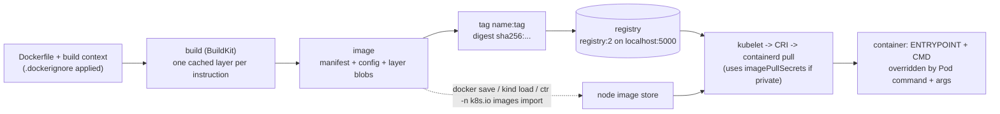

# T3.01 Define, Build and Modify Container Images

> Competency: "Define, build and modify container images" (CKAD-1.1) | Domain/weight: CKAD, Application Design and Build (20%) | Est. time: 3 h | Prerequisites: T1.11, T2.09

Shell setup (from [conventions](../00-conventions.md); put it at the top of every session):

```bash
alias k=kubectl
export do="--dry-run=client -o yaml"
export now="--force --grace-period=0"
source <(kubectl completion bash); complete -o default -F __start_kubectl k
```

Lab environment for this lesson: your **laptop with Docker or Podman** (builds, tags, registry, save/load) plus the **kind** cluster `lab` (context `kind-lab`) for the Kubernetes steps. Namespace: `lab-t301`. Files go in `~/lab/t301/`.

> Output policy. Two kinds of output blocks appear below.
> - `REAL OUTPUT (Docker 29.8.2, OrbStack, linux/arm64)` was captured on the machine where this lesson was written. It is allowed for plain Linux/Docker commands (conventions section 10). Sizes, digests and ages will differ a little on your machine (for example amd64 binaries are a different size than arm64 ones).
> - `EXPECTED OUTPUT (not captured)` is used wherever a kind cluster, Podman, or a failure inside a cluster is involved. kind and Podman are not installed on the writing machine. The shape is correct for Kubernetes v1.37, but section 11 lists everything to confirm on a live cluster.
> - Exam hosts: the only tools the official exam page promises on every SSH host are `kubectl`, `yq`, `curl`, `wget` and `man` ([source](https://docs.linuxfoundation.org/tc-docs/certification/tips-cka-and-ckad)). Whether `docker` or `podman` exist on exam hosts is **UNVERIFIED**. This lesson teaches both, and teaches the Kubernetes side (command/args, imagePullSecrets, image fields) that you can always do with `kubectl` alone.

---

## 1. Why this matters

Every Pod starts from a container image, and someone has to write the recipe that makes it. In real life a badly written image gives you 1 GB deployments that pull slowly, containers that run as root, and Pods that take 30 seconds to stop because the app never sees SIGTERM. Practise fixing a Dockerfile, building and tagging an image, and exporting an image to a tar file, in case a task asks for them (the official tool list does not promise `docker` or `podman` on exam hosts, which is UNVERIFIED; see section 8). Practise running the image in a Pod with the right `command`, `args` and pull secret. This lesson gives you the Dockerfile instructions, the build and export commands for both Docker and Podman, and the exact mapping from a Dockerfile to a Pod spec.

For what an image *is* (OCI layout, registries, containerd, runc, `crictl`) see [T1.11](../part1-linux/T1.11-containers-images-registries-and-runtimes-oci.md). For how the kind cluster is created and how its nodes work see [T2.09](../part2-basics/T2.09-local-practice-clusters-kind-and-minikube.md). For signals and PID 1 on plain Linux see [T1.05](../part1-linux/T1.05-processes-and-signals.md).

---

## 2. Concepts

### 2.1 What an image is, and what a Dockerfile is

An **image** is a read-only package that holds a filesystem and some start-up settings. It has three parts:

- **Layers**: compressed tar files. Each layer is the set of file changes made by one build instruction.
- **Config**: a JSON file with the default user, environment variables, working directory, `Entrypoint`, `Cmd`, exposed ports, and the CPU architecture.
- **Manifest**: a JSON file that lists the config and the layers by their **digest**. A digest is the SHA-256 hash of the content, written `sha256:<64 hex characters>`.

A **Dockerfile** (Podman and Buildah call the same format a **Containerfile**) is a text recipe. A **builder** reads it top to bottom, runs each instruction, and writes a layer for each one that changes files. The folder you pass to the build command is the **build context**. Only files inside the context can be copied into the image.

Why this design? Layers are content-addressed, so two images that share a base share those bytes on disk and on the network. A node that already has `alpine` does not download it again. The cost: layers are permanent. A file you add in one layer and delete in the next is still in the image (the delete is just a marker in the later layer). That is why secrets must never be copied in, even if you "remove" them afterwards.

### 2.2 Dockerfile instructions you must know

| Instruction | What it does | Default / notes | Risky use |
|---|---|---|---|
| `FROM image:tag [AS name]` | Starts a new build stage from a base image. Every Dockerfile begins with one (a bare `ARG` may come before). | Tag defaults to `latest` if omitted. | `FROM node` or `:latest`: the base changes under you. Pin a tag, or a digest. |
| `RUN cmd` | Runs a command at **build time** and saves the result as a layer. | Shell form runs `/bin/sh -c "cmd"`. | `apt-get update` in one `RUN` and `apt-get install` in another: the cached `update` goes stale. |
| `COPY src dest` | Copies files from the build context into the image. | Files are owned by root unless `--chown=uid:gid` is given. | `COPY . .` before installing dependencies breaks the cache (section 2.5). |
| `ADD src dest` | Like `COPY`, plus it unpacks a local `.tar` archive and can download a URL. | Use only when you want the unpacking. | A URL in `ADD` is not cached by content and not verified. Prefer `COPY`. |
| `WORKDIR /path` | Sets the working directory for later instructions and for the container start. Creates it if missing. | Default is `/`. | Using `RUN cd /x` instead: the `cd` is forgotten after that one `RUN`. |
| `ENV KEY=value` | Sets an environment variable in the image. It is present at build time **and** in every running container. | None. | Putting passwords here: they sit in the image config for anyone to read. |
| `ARG NAME[=default]` | A **build-time only** variable, set with `--build-arg NAME=value`. It does not exist in the running container. | None. | Secrets in `ARG`: the value is visible in `docker history`. Use `RUN --mount=type=secret` instead. |
| `EXPOSE 8080` | **Documentation** only: records that the app listens on that port. It does not publish or open anything. | None. | Believing it opens the port. Kubernetes ignores it; the Pod's `containerPort` is also informational. |
| `USER uid[:gid]` | Sets the user that later `RUN` instructions and the container's main process run as. | `root` (UID 0). | A user **name** (`USER app`) cannot be checked by `runAsNonRoot: true`. Use a number. |
| `ENTRYPOINT` | The executable that always runs. | None (then `CMD` is the whole command). | Shell form: the app is not PID 1 and misses signals (section 2.4). |
| `CMD` | The **default arguments** for `ENTRYPOINT`, or the default command if there is no `ENTRYPOINT`. Easy to override. | None. | Writing two `CMD` lines: only the last one counts. |
| `HEALTHCHECK` | Tells **Docker** how to test the container. | **Kubernetes ignores it.** | Relying on it in a cluster. Use the Pod's `livenessProbe` and `readinessProbe` (probes have their own lesson later in Part 3). |

Two more you will meet: `LABEL key=value` adds metadata, and `VOLUME /data` declares a mount point (avoid it in images for Kubernetes; declare volumes in the Pod).

A note on `ARG` and `FROM`: an `ARG` declared before the first `FROM` can be used only in `FROM` lines. To use it inside a stage, declare `ARG` again after that `FROM`.

### 2.3 Exec form versus shell form

`ENTRYPOINT` and `CMD` each have two spellings:

| Form | Written as | What actually runs |
|---|---|---|
| **Exec form** | `ENTRYPOINT ["/web", "--port", "8080"]` (JSON array, double quotes) | `/web --port 8080` directly. |
| **Shell form** | `ENTRYPOINT /web --port 8080` | `/bin/sh -c "/web --port 8080"`. |

Use exec form. The JSON array must use double quotes and no trailing comma; otherwise Docker silently treats the line as shell form.

**Under the hood: PID 1 and signals.** The first process in a container is PID 1. The Linux kernel treats PID 1 specially: a signal with **no handler** installed by that process is ignored, instead of killing it with the default action. When you delete a Pod, the kubelet asks the runtime to send **SIGTERM** to PID 1, waits `terminationGracePeriodSeconds` (default 30 s), then sends **SIGKILL**. Two things can go wrong:

1. The shell form makes `/bin/sh` PID 1 and your app a child. The shell does not forward SIGTERM to the child.
2. Even in exec form, an app that never installed a SIGTERM handler is ignored by the kernel when it is PID 1.

Both end the same way: the stop takes the whole grace period and the container exits with code 137 (128 + 9, killed by SIGKILL). This was measured on the writing machine. In the break-fix lab (section 7.3) a shell-wrapped start script took the whole 5 s timeout given to `docker stop` and exited 137, while the fixed image stopped in under a second with exit 0.

One more detail from the captures: with a single simple command, Alpine's shell (BusyBox `sh -c "sleep 3600"`) replaces itself with that command (it "execs"), so the shell form looked fine for `CMD sleep 3600`. The wrapper problem appears as soon as the command is a script, a pipeline, or has `&&`. Do not depend on shell optimisations. Use exec form, and put `exec` before the final command in any start script.

### 2.4 `ENTRYPOINT` versus `CMD`, and the Pod mapping

Docker combines them as `ENTRYPOINT + CMD`. Kubernetes keeps the same idea but renames the knobs:

| Dockerfile | Pod container field | `docker run` equivalent |
|---|---|---|
| `ENTRYPOINT` | `command` | `--entrypoint` |
| `CMD` | `args` | arguments after the image name |

**Rule: `command` replaces the image's `ENTRYPOINT` and also discards the image's `CMD`. `args` replaces only `CMD`.** Source: [Define a Command and Arguments for a Container](https://kubernetes.io/docs/tasks/inject-data-application/define-command-argument-container/) (on kubernetes.io/docs, allowed in the exam). Say the image has `ENTRYPOINT ["echo", "entry"]` and `CMD ["default"]`:

| Pod sets | Runs | Why |
|---|---|---|
| nothing | `echo entry default` | Both come from the image. |
| `args: ["hello"]` | `echo entry hello` | Only `CMD` replaced. |
| `command: ["printenv"]` | `printenv` | `command` also drops the image `CMD`. |
| `command: ["printenv"]` and `args: ["HOME"]` | `printenv HOME` | Both replaced. |

Imperative: `k run x --image=busybox:1.36 --command -- echo hello` fills **`command`** (everything after `--` is the command). Without `--command`, everything after `--` fills **`args`**.

If the field names confuse you under time pressure, run `k explain pod.spec.containers.command` and read the first lines.

### 2.5 Layer caching, instruction order, and `.dockerignore`

The builder caches each instruction. It reuses the cached layer when the instruction text is identical **and** (for `COPY`/`ADD`) the checksums of the copied files are identical. The moment one instruction misses the cache, **every instruction after it is rebuilt**. So order from least-often-changing to most-often-changing: base image, system packages, dependency manifest, install dependencies, then your source code.

Here is the proof, captured from real builds. One file (`index.html`) was changed and two Dockerfiles were rebuilt that differ only in the order of `COPY . .` and `RUN apk add`.

REAL OUTPUT (Docker 29.8.2, OrbStack, linux/arm64) with `COPY . .` first:

```
#6 [2/4] WORKDIR /app
#6 CACHED
#7 [3/4] COPY . .
#8 [4/4] RUN apk add --no-cache curl          <- runs again, downloads again
```

REAL OUTPUT (Docker 29.8.2, OrbStack, linux/arm64) with `RUN apk add` first, `COPY . .` last:

```
#6 [2/4] WORKDIR /app
#6 CACHED
#7 [3/4] RUN apk add --no-cache curl
#7 CACHED                                     <- reused
#8 [4/4] COPY . .                             <- only this rebuilds
```

Related cache traps:

- A `RUN` is cached by its **text**, not by what the network would return today. `RUN apt-get update` can therefore stay stale. Put `apt-get update && apt-get install -y pkg && rm -rf /var/lib/apt/lists/*` in **one** `RUN`. Force a rebuild with `--no-cache`.
- Each `RUN` makes a layer. Deleting files in a later `RUN` does not shrink the image. Clean up in the same `RUN` that created the files.

**`.dockerignore`** is a file in the context root. It lists paths that are **not** sent to the builder. Without it, `COPY . .` copies everything, including `.git`, local `node_modules`, logs and `.env` files. That makes builds slow, breaks the cache (the `.git` folder changes on every commit), and can leak secrets. Example:

```
.git
node_modules
*.log
.env
```

### 2.6 Multi-stage builds

A normal build keeps everything it ever installed: compilers, package managers, source code. A **multi-stage build** uses several `FROM` lines. Each `FROM` starts a fresh stage. You build in a big stage and copy only the result into a small final stage:

```dockerfile
# stage 1, named "build"
FROM golang:1.23-alpine AS build
WORKDIR /src
COPY go.mod main.go ./
RUN CGO_ENABLED=0 go build -o /web .

# stage 2: the last stage is the final image
FROM gcr.io/distroless/static:nonroot
# take one file from the "build" stage
COPY --from=build /web /web
ENTRYPOINT ["/web"]
```

Comments must sit on their own line. A Dockerfile has no inline comments: `FROM x   # note` is rejected (the extra words are read as arguments), and on a `COPY` line the `#` would be read as a path. The full, explained version is in section 4.2.

Everything else in the `build` stage is thrown away. Useful build flags: `--target build` stops at a named stage (good for debugging a build step), and `COPY --from=<image>` can also copy from any other image, not only from a stage.

The size difference is large. REAL OUTPUT (Docker 29.8.2, OrbStack, linux/arm64): the same 12-line Go web server built both ways.

```
$ docker images web --format 'table {{.Repository}}\t{{.Tag}}\t{{.Size}}'
REPOSITORY   TAG          SIZE
web          1.0          9.59MB         <- multi-stage, distroless final image
web          1.0-single   325MB          <- single stage, full Go toolchain
```

### 2.7 Small and secure base images, and running as non-root

| Base | Size (typical) | Has a shell? | CA bundle, tz data, `/etc/passwd` | Use it for | Caution |
|---|---|---|---|---|---|
| `ubuntu`, `debian` | 30-80 MB | yes | Has `/etc/passwd`. CA certificates and (on Ubuntu) `tzdata` are not in the base image: `apt-get install ca-certificates tzdata`. | Apps that need many OS packages. | Big attack surface. |
| `alpine` | about 8 MB | yes (BusyBox) | Has `/etc/passwd` and a CA bundle (`ca-certificates-bundle`). No `tzdata`: `apk add tzdata`. | Small image that is still easy to debug. | Uses musl libc, not glibc. A binary built for glibc may fail with `no such file or directory`. |
| `gcr.io/distroless/static` (`:nonroot` tag) | about 2 MB | **no** | CA certs, tz data, a `nonroot` user | Static binaries (Go, Rust). | No shell: `k exec ... -- sh` fails. Debug with an ephemeral container: `k debug -it POD --image=busybox:1.36 --target=CONTAINER`. |
| `scratch` | 0 bytes | no | **nothing** | A fully static binary. | No CA certs (HTTPS calls fail), no `/tmp`, no timezone data. |

**Running as non-root.** By default a container's process is root (UID 0) inside its own namespaces. If an attacker escapes, root is worse than an unprivileged user. So add `USER <number>` and, in the Pod, `securityContext.runAsNonRoot: true` (the field is shown in section 4 here).

Always use a **numeric** UID such as `USER 10001`. With `runAsNonRoot: true` the kubelet must prove the user is not root *before* starting the container. It can read a number from the image config, but it cannot map a name like `app` to a UID. Then the container fails with `Error: container has runAsNonRoot and image has non-numeric user (app), cannot verify user is non-root`. Distroless `:nonroot` images use UID/GID 65532.

**Privileged ports.** The kernel setting `net.ipv4.ip_unprivileged_port_start` is the lowest port a process without privilege may bind. The classic kernel value is 1024. When it is 1024, a non-root web server that tries port 80 fails with `listen tcp :80: bind: permission denied`. Whether a non-root Pod can bind port 80 therefore depends on the value the container runtime sets for that container's network namespace: Docker and containerd 2.x (the runtime on `kindest/node:v1.37.0`) default it to 0 (any port is allowed; the containerd default is UNVERIFIED here, see section 11), while older runtimes and hardened clusters can leave it at 1024. Do not rely on either behaviour. Check it inside a running Pod with `k exec POD -- cat /proc/sys/net/ipv4/ip_unprivileged_port_start` (this needs a shell and `cat` in the image; use an ephemeral container for distroless).

Fixes, from best to worst: (1) make the app listen on 8080 and put a Service port 80 in front of it, which works on every cluster; (2) add the capability `NET_BIND_SERVICE` in the container's `securityContext.capabilities.add`; (3) set the sysctl `net.ipv4.ip_unprivileged_port_start` in the Pod's `securityContext.sysctls` (see section 11). Running as root "to fix it" is the wrong answer.

What was captured here: `docker run --user 10001` binds port 80 with Docker's default, and fails with `permission denied` when the sysctl is forced to 1024 with `--sysctl net.ipv4.ip_unprivileged_port_start=1024` (section 6). So "it worked in Docker" is not proof it works elsewhere. The Pod case on kind was not captured (section 11).

### 2.8 Building: docker, podman, buildah and BuildKit

| Tool | Build command | Notes |
|---|---|---|
| Docker | `docker build -t web:1.0 -f Dockerfile .` | Needs the Docker daemon. Uses BuildKit by default since Docker 23. |
| Podman | `podman build -t web:1.0 -f Dockerfile .` | Daemonless, same Dockerfile syntax. Accepts `Containerfile` too. An unqualified name `web:1.0` is stored as `localhost/web:1.0`. |
| Buildah | `buildah build -t web:1.0 .` | The builder library that Podman uses. Awareness only for the CKAD. |
| BuildKit | `docker buildx build ...` | The modern engine: runs independent stages in parallel, keeps a good cache, supports `--platform` and `RUN --mount=type=secret`. The lab pin is v0.34.1; the Docker on the writing machine bundled v0.33.1 (section 11). |

Parts of the build command: `-t name:tag` names the result (repeat `-t` for several tags), `-f path` selects the Dockerfile (default is `Dockerfile` in the context), the final `.` is the **context directory**. Forgetting the dot gives `"docker buildx build" requires 1 argument`.

**Image architecture.** An image is built for one CPU architecture (for example `amd64` or `arm64`). A node cannot run the other kind: the container starts, the kernel cannot execute the binary, and the log says `exec format error`. This is common when you build on an Apple Silicon laptop (arm64) and push to an amd64 cluster. Build for the cluster with `docker buildx build --platform linux/amd64 ...`, or build a multi-arch image with `--platform linux/amd64,linux/arm64 --push`. For a Go program, `GOARCH=amd64` in the build stage does the same. Check the arch of an image with `docker image inspect IMG --format '{{.Architecture}}'` and of your nodes with `k get nodes -o jsonpath='{.items[*].status.nodeInfo.architecture}'`.

### 2.9 Tags and digests

A **tag** (`web:1.0`) is a movable label. The owner of a registry repository can push a different image to the same tag tomorrow. A **digest** (`web@sha256:...`) names exact content and can never change. Pin a digest when you need to be sure of what runs.

```bash
docker tag web:1.0 localhost:5000/web:1.0      # add a second name to the same image (no copy)
docker images --digests                        # show the DIGEST column
```

A digest is created when the image is pushed to a registry (the registry computes the manifest digest). A locally built, never-pushed image may show `<none>` in the digest column. In a Pod, `image: localhost:5000/web@sha256:<digest>` pins it. You can write both, `web:1.0@sha256:...`; then the digest wins and the tag is only a comment for humans.

The kubelet's **`imagePullPolicy`** decides whether to contact the registry:

| Value | Meaning | Default when |
|---|---|---|
| `IfNotPresent` | Pull only if the node does not already have the image. | The tag is not `latest` (or it is a digest). |
| `Always` | Ask the registry every time (it still skips the download if the digest matches). | The tag is `latest` or there is no tag. |
| `Never` | Never pull. The image must already be on the node, or the Pod fails with `ErrImageNeverPull`. | Never the default. |

Source: [Images](https://kubernetes.io/docs/concepts/containers/images/). This is why locally built images must have an explicit non-`latest` tag. An image called just `web` is `web:latest`, the policy becomes `Always`, the kubelet tries to pull from Docker Hub, and the Pod ends in `ErrImagePull`/`ImagePullBackOff`.

### 2.10 Registries: login, push, pull

A **registry** stores images. The name tells the client where: `localhost:5000/web:1.0` means "host `localhost`, port 5000, repository `web`, tag `1.0`". A name with no host (`nginx:1.27`) means Docker Hub.

```bash
docker run -d --name registry -p 5000:5000 registry:2   # a local, unauthenticated registry
docker tag web:1.0 localhost:5000/web:1.0
docker push localhost:5000/web:1.0
curl -s localhost:5000/v2/_catalog                      # list repositories
curl -s localhost:5000/v2/web/tags/list                 # list tags
docker login localhost:5000 -u USER --password-stdin    # only when the registry requires auth
```

Plain `registry:2` has no authentication, so `docker login` is not needed for it. Docker treats `localhost` registries as allowed over plain HTTP. A registry on any other hostname without TLS needs to be listed in the daemon's `insecure-registries` setting. On macOS, port 5000 may already be used by the AirPlay Receiver; use host port 5001 (`-p 5001:5000`) and the name `localhost:5001/...` if so (the captured output in section 5 uses 5001 for that reason).

Podman equivalents: `podman push localhost:5000/web:1.0 --tls-verify=false`, `podman login`, `podman pull`.

### 2.11 Exporting and importing images (tarballs)

An image can be written to a single `.tar` file, copied anywhere, and loaded again. This is how you move images with no registry.

| Task | Docker | Podman |
|---|---|---|
| Save | `docker save web:1.0 -o /opt/web.tar` | `podman save -o /opt/web.tar localhost/web:1.0` |
| Save as OCI | (Docker 29 with the containerd image store already writes an OCI layout, see below) | `podman save --format oci-archive -o web.tar localhost/web:1.0` |
| Load | `docker load -i /opt/web.tar` | `podman load -i /opt/web.tar` |

Podman's `--format` accepts `docker-archive` (the default), `oci-archive`, `oci-dir` and `docker-dir`; confirm with `podman save --help` on your version (section 11). `docker save` takes several images at once (`docker save a:1 b:1 -o all.tar`).

REAL OUTPUT (Docker 29.8.2, OrbStack, linux/arm64): the top-level contents of `docker save web:1.0 -o w.tar`, listed with `tar tf w.tar | grep -v blobs/`:

```
index.json
manifest.json
oci-layout
repositories
```

`index.json` and `oci-layout` are the OCI image layout; `manifest.json` is the older Docker format. Older Docker versions with the classic image store write only `manifest.json` and per-layer folders. Both load fine.

### 2.12 Modifying an existing image

You cannot edit a layer. There are two ways to "modify" an image:

1. **Layer on top of it.** Write a new Dockerfile whose `FROM` is the existing image and add what you need:

   ```dockerfile
   FROM localhost:5000/web:1.0
   COPY extra.conf /etc/extra.conf
   ```

   Build it as `web:1.1`. Only the new layer is added; base layers are reused.
2. **Edit the original Dockerfile and rebuild.** This is the right answer when you own the source, because a hand-patched image drifts from its recipe. Use the cache rules in section 2.5.

A third way exists for quick experiments: `docker run` a container, change it, then `docker commit CONTAINER web:1.1`. It works but leaves no recipe, so it is not a good production habit; use it only when a task explicitly says to commit a container.

After you change an image, **bump the tag** (`1.0` to `1.1`) and update the Pod. Re-using `1.0` leaves nodes that already cached `1.0` running the old content, because `IfNotPresent` is satisfied.

### 2.13 Getting images into a cluster

A Pod runs on a node, and the node's container runtime pulls the image. Your laptop's Docker store is a different place. The image must reach each node's runtime, by one of three routes:

| Route | Command | When |
|---|---|---|
| Push to a registry the nodes can reach, then reference it in the Pod | `docker push registry.example.com/team/web:1.0` | Real clusters. Needs `imagePullSecrets` if private (section 2.15). |
| `kind load` | `kind load docker-image web:1.0 --name lab` | kind clusters. Copies the image into **every** kind node. |
| Import into containerd on the node | `sudo ctr -n k8s.io images import web.tar` | kubeadm VMs, or one kind node. Do it on **every node that may run the Pod**. |

Two node tools appear below. **containerd** is the container runtime on the nodes (see [T1.11](../part1-linux/T1.11-containers-images-registries-and-runtimes-oci.md)). **`ctr`** is containerd's own low-level command line tool, and **`crictl`** is a client that talks to the runtime through the Container Runtime Interface (CRI), the API the kubelet itself uses, so `crictl images` shows exactly what the kubelet can see.

**With kind**

- The kind cluster in this guide is named `lab`, not the default `kind`. Without `--name lab`, kind says `no nodes found for cluster "kind"`.
- `kind load image-archive web.tar --name lab` loads from a tar and works with Podman as well (`podman save` first).
- A kind node is a Docker container, so to import by hand: `docker cp web.tar lab-worker:/web.tar` then `docker exec lab-worker ctr -n k8s.io images import /web.tar`. Node names are `lab-control-plane`, `lab-worker`, `lab-worker2`.
- Pods reach a `localhost:5000` registry on your laptop **only if** the node's `localhost` is your laptop. In kind it is not: `localhost` inside a node is the node itself. So for kind use `kind load`, or attach a registry container to the kind Docker network (a documented kind pattern, not needed for the CKAD).
- How `kind load` behaves with Docker's newer containerd image store and with containerd 2.x nodes: confirm on your machine (section 11). If `kind load docker-image` fails, fall back to `docker save` plus `kind load image-archive`.

**With kubeadm VMs or any containerd node**

- containerd keeps Kubernetes images in the namespace `k8s.io`. `ctr images import` without `-n k8s.io` puts the image in the `default` namespace, where the kubelet cannot see it. Verify with `crictl images | grep web`.
- Import on **every node that may run the Pod**, because each node has its own image store.

**Naming rule (both)**

- The image name in the Pod must match the loaded name **exactly**, including the `localhost:5000/` prefix. If you tag `localhost:5000/web:1.0` and load it, the Pod says `image: localhost:5000/web:1.0` and, with the default `IfNotPresent`, never touches a registry.

### 2.14 Under the hood: what the kubelet does with `image:`

1. The scheduler picks a node. The kubelet sees a Pod whose container has `image: X`.
2. The kubelet applies `imagePullPolicy`. For `IfNotPresent` it asks the runtime (over the CRI `ImageService`) whether `X` exists locally.
3. If a pull is needed, containerd resolves the name to a registry, fetches the **manifest** (if it is an index for several platforms it picks the entry for the node's OS/arch), downloads the config and layer blobs it does not have, verifies each digest, and unpacks the layers into the snapshotter.
4. For private registries the kubelet sends credentials from the Pod's `imagePullSecrets` (the ServiceAccount's list was already copied into the Pod when it was created, see section 2.15). Since Kubernetes v1.35 the feature gate `KubeletEnsureSecretPulledImages` is beta and enabled by default (per the [Images](https://kubernetes.io/docs/concepts/containers/images/) page). With it, the kubelet checks credentials even for an image that is already on the node: a Pod whose credentials never pulled that image must pull it again from the registry, while a Pod that reuses credentials that already pulled it successfully is validated locally. The kubelet configuration field `imagePullCredentialsVerificationPolicy` controls this. Its default, `NeverVerifyPreloadedImages`, skips the check for images pulled outside the kubelet (preloaded images; images put on the node with `kind load` or `ctr import` are pulled outside the kubelet, so they should count as preloaded, to confirm in section 11) and verifies all others. The other values are `NeverVerify` (old behaviour: a cached image is used without any check), `NeverVerifyAllowListedImages` and `AlwaysVerify`. The page documents the beta state for v1.35; the state on v1.37 and on the kind nodes is UNVERIFIED (section 11).
5. The runtime creates the container with the image's `Entrypoint`, `Cmd`, `Env`, `WorkingDir` and `User`, **overridden** by the Pod's `command`, `args`, `env`, `workingDir` and `securityContext`. `runc` starts PID 1.
6. The status field `containerStatuses[].imageID` records the digest that was actually used: `k get pod web -o jsonpath='{.status.containerStatuses[0].imageID}'`.

### 2.15 `imagePullSecrets` for private registries

A private registry requires credentials. Kubernetes stores them in a **Secret** of type `kubernetes.io/dockerconfigjson` with one key, `.dockerconfigjson`, whose value is a Docker `config.json` fragment. Create it imperatively:

```bash
k create secret docker-registry regcred \
  --docker-server=registry.example.com \
  --docker-username=builder \
  --docker-password='S3cret!' \
  --docker-email=builder@example.com -n lab-t301
```

| Flag | Meaning |
|---|---|
| `--docker-server` | Registry host (and port). Must match the host in the Pod's `image:` exactly. For Docker Hub it is `https://index.docker.io/v1/`. |
| `--docker-username`, `--docker-password` | The login. For many registries the "password" is an access token. |
| `--docker-email` | Optional. |

Then reference the Secret from the Pod (section 4) or from the ServiceAccount (every Pod **created afterwards** with that account inherits it):

```bash
k patch serviceaccount default -n lab-t301 -p '{"imagePullSecrets":[{"name":"regcred"}]}'
```

**When a reference takes effect.** The ServiceAccount's `imagePullSecrets` are copied into a Pod only when the Pod is created (the ServiceAccount admission step). A Pod that already exists never inherits a later patch. `spec.imagePullSecrets` of a live Pod cannot be changed either: `k apply` of a bare Pod manifest with a new `imagePullSecrets` is rejected with an error that says pod updates may not change fields other than a short list (such as the image). So for a **bare Pod** stuck in `ErrImagePull`, create the Secret first, then delete and recreate the Pod: `k delete pod POD -n NS $now; k apply -f pod.yaml`. For a **Deployment**, edit the Pod template (`k edit deploy`, or `k patch`), which rolls new Pods. The one change a stuck Pod does pick up by itself is the **content** of a Secret that has the same name, on its next pull retry.

The Secret must be in the **same namespace** as the Pod. Another route is to turn an existing login file into a Secret: `k create secret generic regcred --type=kubernetes.io/dockerconfigjson --from-file=.dockerconfigjson=$HOME/.docker/config.json`. Reference: [Pull an Image from a Private Registry](https://kubernetes.io/docs/tasks/configure-pod-container/pull-image-private-registry/).

Note: a Secret's data is only base64-encoded, not encrypted. `k get secret regcred -o jsonpath='{.data.\.dockerconfigjson}' | base64 -d` shows the login. (Secrets in general have their own lesson later in Part 3.)

### 2.16 Related but different

- **Image versus container**: an image is the template; a container is a running instance with a writable layer on top. Deleting a container does not delete the image.
- **`docker save` versus `docker export`**: `save` writes an image (layers, tags, config). `export` flattens a container's filesystem into a tar with no metadata and cannot be re-loaded with `docker load`.
- **`containerPort`/`EXPOSE` versus Service port**: neither opens a port. The app must listen; a Service routes to it.
- **`docker build` versus `kubectl`**: kubectl never builds images. It only references names.

---

## 3. How it works (diagram)



1. The builder reads the Dockerfile and the build context (minus `.dockerignore` paths) and runs the instructions. Each file-changing instruction becomes a layer that is cached.
2. The result is an image: a manifest that points to a config and to the layer blobs by digest.
3. You give the image a name with `docker tag`. The name decides which registry it goes to. `docker push` uploads the missing blobs and the registry reports the digest.
4. When a Pod is scheduled, the kubelet asks containerd for the image. If it is not on the node, containerd pulls it from the registry, using the Pod's pull secret for private repositories.
5. The dotted path is the no-registry route: put the image straight into the node's store (`kind load`, `ctr import`). The kubelet then finds it locally and skips the pull.
6. The container starts with the image's ENTRYPOINT and CMD, unless the Pod's `command` and `args` replace them.

---

## 4. Commands and YAML you must produce fast

### 4.1 Imperative shortcuts

```bash
docker build -t web:1.0 .                        # build from ./Dockerfile; context is the current directory
docker build -t web:1.0 -f docker/Dockerfile .   # use a Dockerfile in another path, context still "."
podman build -t web:1.0 .                        # same with Podman (stored as localhost/web:1.0)
docker tag web:1.0 localhost:5000/web:1.0        # second name for the same image
docker push localhost:5000/web:1.0               # upload to the registry named in the tag
docker images --digests                          # list images with digests
docker save web:1.0 -o /opt/web.tar              # export to a tarball
podman save --format oci-archive -o /opt/web.tar localhost/web:1.0   # Podman, OCI layout
docker load -i /opt/web.tar                      # import a tarball
kind load docker-image web:1.0 --name lab        # copy into every node of the kind cluster "lab"
kind load image-archive /opt/web.tar --name lab  # same, from a tarball
k create secret docker-registry regcred --docker-server=registry.example.com \
  --docker-username=builder --docker-password='S3cret!'   # registry login Secret
k run web --image=localhost:5000/web:1.0 $do > pod.yaml   # start a Pod manifest, then add imagePullSecrets
yq -i '.spec.imagePullSecrets = [{"name":"regcred"}]' pod.yaml   # add the pull secret with yq (yq is on exam hosts)
k run echo --image=busybox:1.36 --restart=Never --command -- echo hello   # sets spec.containers[].command
k run args-demo --image=busybox:1.36 --restart=Never -- hello              # sets spec.containers[].args
```

### 4.2 The multi-stage Dockerfile you should write from memory

Eight lines. It builds a Go program in a big stage, copies one file into a tiny non-root final stage, and uses exec-form `ENTRYPOINT`:

```dockerfile
FROM golang:1.23-alpine AS build
WORKDIR /src
COPY go.mod main.go ./
RUN CGO_ENABLED=0 go build -o /web .

FROM gcr.io/distroless/static:nonroot
COPY --from=build /web /web
USER 65532:65532
ENTRYPOINT ["/web"]
```

Line by line: `AS build` names stage 1. `COPY go.mod main.go ./` copies only what the build needs (so a README change does not bust the cache). `CGO_ENABLED=0` makes a fully static binary, which is required because distroless/static has no C library. The second `FROM` starts the final image. `COPY --from=build` pulls the binary across. `USER 65532:65532` is numeric on purpose. `ENTRYPOINT ["/web"]` is exec form, so `/web` is PID 1 and gets SIGTERM.

For Node or Python the shape is the same: stage 1 installs dependencies and builds, stage 2 starts from a small runtime base (`node:22-alpine`, `python:3.12-slim`), copies the result, sets a numeric `USER`, and uses exec-form `ENTRYPOINT`/`CMD`.

### 4.3 The Pod YAML

A Pod that runs the pushed image, pulls with a registry secret, and passes the checks of a non-root image:

```yaml
apiVersion: v1                        # core API group, Pod is v1
kind: Pod
metadata:
  name: web                           # Pod name
  namespace: lab-t301                 # the Secret regcred must be in this same namespace
spec:
  imagePullSecrets:                   # list of Secret names the kubelet uses to log in to registries
    - name: regcred                   # Secret of type kubernetes.io/dockerconfigjson in this namespace
  containers:
    - name: web                       # container name (unique in the Pod)
      image: localhost:5000/web:1.0   # host:port/repo:tag. Never ":latest"; a digest form is repo@sha256:...
      imagePullPolicy: IfNotPresent   # default for a non-latest tag; Always re-checks the registry; Never needs a preloaded image
      ports:
        - containerPort: 8080         # documentation only; the app must really listen on 8080
      securityContext:
        runAsNonRoot: true            # kubelet refuses to start the container if the image user is root (UID 0)
        runAsUser: 65532              # optional: force this UID (overrides USER in the image)
        allowPrivilegeEscalation: false   # block setuid tricks
        capabilities:
          drop: ["ALL"]               # drop every Linux capability; add NET_BIND_SERVICE only if you must bind <1024
```

Field notes:

- `imagePullSecrets` sits at **`spec`** level, not inside the container. Default: empty (no credentials). It is fixed once the Pod exists (section 2.15).
- `runAsNonRoot` defaults to unset (root is allowed). With `true` and an image whose `USER` is a name or is unset (root), the container fails with a `CreateContainerConfigError` event.
- `runAsUser` defaults to the image's `USER`. A risky value is `0`, which makes the Pod run as root.
- `allowPrivilegeEscalation` defaults to `true` (it is forced to true when the container is `privileged` or has `CAP_SYS_ADMIN`). Setting `false` stops a process from gaining more privileges than its parent through setuid binaries.
- `capabilities.drop: ["ALL"]` removes every Linux capability from the default set the runtime grants. Risky values: `capabilities.add: ["SYS_ADMIN"]` (close to root on the node) and `privileged: true` (all capabilities plus access to host devices). Add only the one capability you need, such as `NET_BIND_SERVICE`.

If you pin by digest (use the digest your own push printed; the value below is the one from the captured run in section 5 and will not match your build):

```yaml
apiVersion: v1
kind: Pod
metadata:
  name: web-pinned
  namespace: lab-t301
spec:
  containers:
    - name: web
      image: localhost:5000/web@sha256:5fd70fb7dc8972eb565085ce9e679f2a78f2e4677ea0af4c7f9889564dbb1ac2
```

And a Pod showing `command` and `args` against an image with an entrypoint (this uses `busybox:1.36`, which has no `ENTRYPOINT`):

```yaml
apiVersion: v1
kind: Pod
metadata:
  name: cmd-demo
  namespace: lab-t301
spec:
  restartPolicy: Never
  containers:
    - name: c
      image: busybox:1.36
      command: ["printenv"]           # replaces ENTRYPOINT (and drops the image CMD)
      args: ["HOSTNAME"]              # replaces CMD; the process runs: printenv HOSTNAME
```

### 4.4 Speed drill

Setup (one block, run it first; it is self-contained and uses its own folder `~/lab/t301/drill`):

```bash
k create ns lab-t301 --dry-run=client -o yaml | k apply -f -
mkdir -p ~/lab/t301/drill && cd ~/lab/t301/drill
cat > main.go <<'EOF'
package main

import (
	"fmt"
	"net/http"
)

func main() {
	http.HandleFunc("/", func(w http.ResponseWriter, r *http.Request) { fmt.Fprintln(w, "hello from web 1.0") })
	http.ListenAndServe(":8080", nil)
}
EOF
printf 'module web\n\ngo 1.23\n' > go.mod
cat > Dockerfile <<'EOF'
FROM golang:1.23-alpine AS build
WORKDIR /src
COPY go.mod main.go ./
RUN CGO_ENABLED=0 go build -o /web .

FROM gcr.io/distroless/static:nonroot
COPY --from=build /web /web
USER 65532:65532
ENTRYPOINT ["/web"]
EOF
docker run -d --name registry -p 5000:5000 registry:2   # on macOS use -p 5001:5000 and localhost:5001 below
```

Docker is assumed; use `podman` and the `localhost/` prefix if you prefer. Run the steps in order. Targets are exam pace.

1. (2 min) Build the image `web:1.0` from the current directory, tag it `localhost:5000/web:1.0`, push it, and show its digest column.
2. (1 min) Save `web:1.0` to `~/lab/t301/drill/web.tar`, delete the `web:1.0` name, load it back.
3. (1 min) Create a registry Secret `regcred` in `lab-t301` for server `registry.example.com`, user `builder`, password `pw1`.
4. (1 min) Make every Pod **created from now on** in `lab-t301` with the `default` ServiceAccount inherit `regcred`.
5. (1 min) Run a Pod `echo` (busybox:1.36, `Never` restart) that runs `echo hello`, then print its log.
6. (1 min) The line `CMD /web --port 8080` is in a Dockerfile. Rewrite it in exec form.
7. (2 min) Generate `drill-pod.yaml` for a Pod `web` in `lab-t301` with image `localhost:5000/web:1.0` and add the pull secret `regcred` using yq, without opening an editor.
8. (2 min) Load `localhost:5000/web:1.0` into the kind cluster, apply `drill-pod.yaml`, wait until the Pod is Ready, and print the digest it actually used.

<details><summary>Answers</summary>

```bash
# 1
docker build -t web:1.0 . && docker tag web:1.0 localhost:5000/web:1.0 && docker push localhost:5000/web:1.0 && docker images --digests | grep -E 'REPOSITORY|localhost:5000/web'
# 2
docker save web:1.0 -o ~/lab/t301/drill/web.tar && docker rmi web:1.0 && docker load -i ~/lab/t301/drill/web.tar
# 3
k create secret docker-registry regcred -n lab-t301 --docker-server=registry.example.com --docker-username=builder --docker-password=pw1
# 4  (copied into Pods at creation only; existing Pods do not change)
k patch serviceaccount default -n lab-t301 -p '{"imagePullSecrets":[{"name":"regcred"}]}'
# 5  (--command makes it spec.containers[].command)
k run echo -n lab-t301 --image=busybox:1.36 --restart=Never --command -- echo hello
sleep 3; k logs echo -n lab-t301
# 6
#   CMD ["/web", "--port", "8080"]
# 7
k run web --image=localhost:5000/web:1.0 $do > drill-pod.yaml
yq -i '.spec.imagePullSecrets = [{"name":"regcred"}]' drill-pod.yaml
# 8  (pass -n at apply time: the generated YAML carries no namespace)
kind load docker-image localhost:5000/web:1.0 --name lab
k apply -f drill-pod.yaml -n lab-t301
k wait --for=condition=Ready pod/web -n lab-t301 --timeout=60s
k get pod web -n lab-t301 -o jsonpath='{.status.containerStatuses[0].imageID}{"\n"}'
```

Step 8 passes `-n lab-t301` at apply time so the Pod lands in the lab namespace whether or not the generated YAML carries one.

Drill cleanup (deleting the namespace also removes the Secret, the ServiceAccount patch and the Pods, so the worked example starts clean):

```bash
k delete ns lab-t301 --wait
docker rm -f registry
docker rmi web:1.0 localhost:5000/web:1.0 2>/dev/null
for n in lab-control-plane lab-worker lab-worker2; do docker exec $n crictl rmi localhost:5000/web:1.0 2>/dev/null; done
rm -rf ~/lab/t301/drill
```

</details>

---

## 5. Worked example

Goal: build a small Go web server as a multi-stage image, compare sizes, run it, tag and push it to a local registry, export it, load it into kind, and run it in a Pod with a pull secret. Environment: laptop Docker + kind `lab`, namespace `lab-t301`. Output blocks marked REAL were captured from Docker; the kind blocks are expected.

**Step 1. Create the app and the single-stage version.**

```bash
k create ns lab-t301 --dry-run=client -o yaml | k apply -f -   # safe to repeat if the namespace already exists
mkdir -p ~/lab/t301/web ~/lab/t301/single && cd ~/lab/t301/web
cat > main.go <<'EOF'
package main

import (
	"fmt"
	"net/http"
)

func main() {
	http.HandleFunc("/", func(w http.ResponseWriter, r *http.Request) { fmt.Fprintln(w, "hello from web 1.0") })
	http.ListenAndServe(":8080", nil)
}
EOF
cat > go.mod <<'EOF'
module web

go 1.23
EOF
cp main.go go.mod ../single/
cat > ../single/Dockerfile <<'EOF'
FROM golang:1.23-alpine
WORKDIR /src
COPY . .
RUN go build -o /web .
CMD ["/web"]
EOF
cat > Dockerfile <<'EOF'
FROM golang:1.23-alpine AS build
WORKDIR /src
COPY go.mod main.go ./
RUN CGO_ENABLED=0 go build -o /web .

FROM gcr.io/distroless/static:nonroot
COPY --from=build /web /web
USER 65532:65532
ENTRYPOINT ["/web"]
EOF
```

The app listens on 8080 (unprivileged), so it will work as non-root. The single-stage Dockerfile keeps the whole Go toolchain and uses `CMD`, which is fine for a comparison.

**Step 2. Build both and compare sizes.**

```bash
(cd ../single && docker build -t web:1.0-single .)
docker build -t web:1.0 .
docker images web --format 'table {{.Repository}}\t{{.Tag}}\t{{.Size}}'
```

REAL OUTPUT (Docker 29.8.2, OrbStack, linux/arm64):

```
REPOSITORY   TAG          SIZE
web          1.0          9.59MB
web          1.0-single   325MB
```

The multi-stage image is about 34 times smaller. Why the difference? `docker history` shows it. REAL OUTPUT (Docker 29.8.2, OrbStack, linux/arm64), `docker history web:1.0-single`, trimmed:

```
SIZE     CREATED BY
0B       CMD ["/web"]
80.4MB   RUN /bin/sh -c go build -o /web . # buildkit      <- the compile step adds 80 MB (build cache and output)
308B     COPY . . # buildkit
...
235MB    COPY /target/ / # buildkit                           <- a layer from the golang base image (the Go toolchain)
```

And `docker history web:1.0`, trimmed. REAL OUTPUT (Docker 29.8.2, OrbStack, linux/arm64):

```
SIZE      CREATED BY
0B        ENTRYPOINT ["/web"]
0B        USER 65532:65532
7.21MB    COPY /web /web # buildkit                       <- our static binary
258kB     bazel build //common:cacerts_debian13_arm64_...  <- distroless base layers (CA certs, tz, passwd...)
...
```

**Step 3. Run it locally and check the user.**

```bash
docker run -d --name web-test -p 8080:8080 web:1.0
curl -s localhost:8080
docker inspect web-test --format 'user={{.Config.User}} entrypoint={{json .Config.Entrypoint}}'
docker rm -f web-test
```

REAL OUTPUT (Docker 29.8.2, OrbStack, linux/arm64; captured with host port 18080 to avoid a clash):

```
hello from web 1.0
user=65532:65532 entrypoint=["/web"]
```

`docker inspect` reads the image config: a numeric user and exec-form entrypoint. If the first number were `0` or empty, the container would run as root.

**Step 4. Start a local registry, tag, push, read the digest.**

```bash
docker run -d --name registry -p 5000:5000 registry:2
docker tag web:1.0 localhost:5000/web:1.0
docker push localhost:5000/web:1.0
docker images --digests | grep -E 'REPOSITORY|localhost:5000/web'
curl -s localhost:5000/v2/_catalog; curl -s localhost:5000/v2/web/tags/list
```

REAL OUTPUT (Docker 29.8.2, OrbStack, linux/arm64; captured with host port 5001 because macOS AirPlay holds 5000, so the name in the capture is `localhost:5001/web`):

```
1.0: digest: sha256:5fd70fb7dc8972eb565085ce9e679f2a78f2e4677ea0af4c7f9889564dbb1ac2 size: 3233
REPOSITORY           TAG   DIGEST                                                                    SIZE
localhost:5001/web   1.0   sha256:5fd70fb7dc8972eb565085ce9e679f2a78f2e4677ea0af4c7f9889564dbb1ac2   9.59MB
{"repositories":["web"]}
{"name":"web","tags":["1.0"]}
```

The last two lines are the registry's HTTP API: the repository `web` has one tag, `1.0`. The digest is what you would pin in a Pod. (Your digest will differ; it depends on your CPU architecture and build time.)

**Step 5. Export to a tarball and load it back.**

```bash
docker save web:1.0 -o ~/lab/t301/web.tar
ls -l ~/lab/t301/web.tar
docker rmi web:1.0 localhost:5000/web:1.0
docker load -i ~/lab/t301/web.tar
```

REAL OUTPUT (Docker 29.8.2, OrbStack, linux/arm64):

```
(file size shown by ls: 11M)
Loaded image: web:1.0
```

Note the tar contains the name `web:1.0` only; the `localhost:5000/web:1.0` tag was a second name and has to be re-created with `docker tag` (or saved explicitly by listing both names).

With Podman the same step is: `podman save --format oci-archive -o ~/lab/t301/web.tar localhost/web:1.0`, then `podman load -i ~/lab/t301/web.tar`.

**Step 6. Load the image into kind under the name the Pod will use.**

```bash
docker tag web:1.0 localhost:5000/web:1.0
kind load docker-image localhost:5000/web:1.0 --name lab
docker exec lab-worker crictl images | grep -E 'IMAGE|localhost:5000/web'
```

EXPECTED OUTPUT (not captured):

```
Image: "localhost:5000/web:1.0" with ID "sha256:..." not yet present on node "lab-worker", loading...
...
localhost:5000/web   1.0   <image-id>   <size>
```

`kind load` copies the image to every node (control plane and both workers). The `crictl images` command runs inside a worker and proves the node runtime has it. The name must match the Pod's `image:` exactly.

**Step 7. Create the pull secret and run the Pod.**

```bash
k create secret docker-registry regcred -n lab-t301 \
  --docker-server=localhost:5000 --docker-username=builder --docker-password=pw1
cat > ~/lab/t301/web/pod.yaml <<'EOF'
apiVersion: v1
kind: Pod
metadata:
  name: web
  namespace: lab-t301
spec:
  imagePullSecrets:
    - name: regcred
  containers:
    - name: web
      image: localhost:5000/web:1.0
      imagePullPolicy: IfNotPresent
      ports:
        - containerPort: 8080
      securityContext:
        runAsNonRoot: true
        runAsUser: 65532
        allowPrivilegeEscalation: false
        capabilities:
          drop: ["ALL"]
EOF
k apply -f ~/lab/t301/web/pod.yaml
k wait --for=condition=Ready pod/web -n lab-t301 --timeout=60s
k get pod web -n lab-t301 -o jsonpath='{.status.containerStatuses[0].imageID}{"\n"}'
```

EXPECTED OUTPUT (not captured):

```
secret/regcred created
pod/web created
pod/web condition met
localhost:5000/web@sha256:<digest>
```

How to read it: `condition met` means the container started and is Ready. The `imageID` shows the digest the kubelet used. Because the image was preloaded and the policy is `IfNotPresent`, the kubelet never contacted a registry, so the secret was not used here; it only matters when a real pull happens. (In this guide's kind cluster a pull from `localhost:5000` would fail anyway, because `localhost` inside a node is the node.)

Check the pull-secret wiring. The registry here is unauthenticated, so nothing exercises the login; the check is that the Secret and the Pod fields are what a real private-registry Pod needs. Each line fails if the Secret type, the Pod reference or the server name is wrong:

```bash
test "$(k get secret regcred -n lab-t301 -o jsonpath='{.type}')" = kubernetes.io/dockerconfigjson && echo "PASS secret type"
test "$(k get pod web -n lab-t301 -o jsonpath='{.spec.imagePullSecrets[0].name}')" = regcred && echo "PASS pod references regcred"
k get secret regcred -n lab-t301 -o jsonpath='{.data.\.dockerconfigjson}' | base64 -d | grep -q '"localhost:5000"' && echo "PASS server matches image host"
```

EXPECTED OUTPUT (not captured): three `PASS` lines. (`base64 -d` is the GNU/Linux spelling; macOS accepts `-D` or `-d` depending on the version.)

**Step 8. Hit it.**

```bash
k port-forward -n lab-t301 pod/web 18080:8080 &
PF=$!; sleep 2; curl -s localhost:18080; kill $PF
```

EXPECTED OUTPUT (not captured):

```
hello from web 1.0
```

Distroless has no shell, so `k exec web -- sh` fails. If you need to look inside, use an ephemeral container: `k debug -it web -n lab-t301 --image=busybox:1.36 --target=web -- sh`. The SIGTERM check is in the break-fix lab (section 7.3).

**Cleanup for the worked example:**

```bash
k delete pod web -n lab-t301 $now
k delete secret regcred -n lab-t301
docker rm -f registry; docker rmi web:1.0 web:1.0-single localhost:5000/web:1.0
for n in lab-control-plane lab-worker lab-worker2; do docker exec $n crictl rmi localhost:5000/web:1.0; done
rm -rf ~/lab/t301/web ~/lab/t301/single ~/lab/t301/web.tar
```

---

## 6. Common mistakes and how to fix them

All error text for in-cluster failures is **EXPECTED OUTPUT (not captured)** unless marked REAL. Run the same diagnostic ladder each time: `k get pod -n NS` (status), `k describe pod POD -n NS` (read **Events** at the bottom), `k logs POD -n NS` (add `--previous` after a crash), `k get pod POD -n NS -o jsonpath='{.spec.containers[*].image}'` (is the name what you think?), and on the node `crictl images` (is the image there?).

| Symptom | What you will see (exact text) | Cause | Fix (command) |
|---|---|---|---|
| Build is slow on every code change | Build log: the `RUN` for dependency install is not marked `CACHED` after you edit one source file (REAL OUTPUT shown in section 2.5). | `COPY . .` comes before the dependency install, so any file change invalidates it. | Move the manifest copy and install first, `COPY . .` last. Add a `.dockerignore`. Rebuild: `docker build -t web:1.1 .` |
| Pod `CrashLoopBackOff` right after start, container never serves | `k get pod`: `CrashLoopBackOff`. `k logs POD`: `exec /web: exec format error` (older runc prints `exec user process caused: exec format error`). | Image built for the wrong CPU architecture (for example arm64 laptop, amd64 nodes). | Compare `docker image inspect web:1.0 --format '{{.Architecture}}'` with `k get nodes -o jsonpath='{.items[*].status.nodeInfo.architecture}'`. Rebuild: `docker buildx build --platform linux/amd64 -t web:1.1 --load .` or multi-arch: `docker buildx build --platform linux/amd64,linux/arm64 -t REG/web:1.1 --push .` |
| Container exits at start, port below 1024 | REAL OUTPUT (Docker, forced `--sysctl net.ipv4.ip_unprivileged_port_start=1024`): `listen tcp :80: bind: permission denied` | A non-root user cannot bind a port below `net.ipv4.ip_unprivileged_port_start`. This happens when that value is 1024. Docker's default is 0 and containerd 2.x may also default to 0 (UNVERIFIED), so the error may not appear on every cluster. Check: `k exec POD -- cat /proc/sys/net/ipv4/ip_unprivileged_port_start`. | Make the app listen on 8080 and set Service `port: 80`, `targetPort: 8080`. Or add `securityContext.capabilities.add: ["NET_BIND_SERVICE"]`. Do not switch to root. |
| Pod stuck `ErrImagePull`, then `ImagePullBackOff`, private registry | `k describe pod`: `Failed to pull image "registry.example.com/team/web:1.0": ... pull access denied, repository does not exist or may require authorization` (middle part varies by registry and runtime; a `401`/`unauthorized` text is common). | The registry needs a login and the Pod has no `imagePullSecrets`, or the Secret is in another namespace, or `--docker-server` does not match the host in `image:`. | Create the Secret, then **recreate the Pod** (bare Pod) or edit the template (Deployment). Steps in the numbered list under this table. |
| Locally built image will not start in kind | `ErrImagePull` / `ImagePullBackOff`, event `Failed to pull image "web": ... pull access denied` | The image name is `web`, which means `web:latest`, so the pull policy is `Always` and it tries Docker Hub. Or you loaded into the wrong cluster. | Tag with an explicit version: `docker tag web web:1.0`. Load: `kind load docker-image web:1.0 --name lab`. Use `image: web:1.0`. Check: `docker exec lab-worker crictl images \| grep web` |
| Pod fails with `ErrImageNeverPull` | Event: `Container image "web:1.0" is not present with pull policy of Never` | `imagePullPolicy: Never` and the node does not have the image (loaded on another node only, or not loaded). | `kind load docker-image web:1.0 --name lab` (all nodes), or on kubeadm import on the node the Pod landed on: `sudo ctr -n k8s.io images import web.tar` |
| `CreateContainerConfigError`, non-root check | Event: `Error: container has runAsNonRoot and image will run as root` or `... image has non-numeric user (app), cannot verify user is non-root` | `runAsNonRoot: true` but the image `USER` is unset (root) or a name. | Add a numeric `USER 10001` to the Dockerfile and rebuild, or set `securityContext.runAsUser: 10001` in the Pod. |
| Pod takes 30 s to delete; exit code 137 | `k get pod -w` shows `Terminating` for the full grace period. `k get pod POD -o jsonpath='{.status.containerStatuses[0].lastState.terminated.exitCode}'` prints `137`. REAL: `docker stop` on a shell-wrapped image took the whole 5 s timeout and exit code was 137. | The app is not PID 1 (shell form, or a script without `exec`) or has no SIGTERM handler. | Exec-form `ENTRYPOINT ["/web"]`; in scripts write `exec /web`; handle SIGTERM in the app. Rebuild and bump the tag. |
| Change does not show up after rebuild | Pod still runs old behaviour; `imageID` digest is unchanged. | You re-used the tag; nodes that already have it use `IfNotPresent`. | Use a new tag `1.1`, `kind load` it, `k set image pod/web web=localhost:5000/web:1.1 -n NS` (or edit the Deployment). |

**Fixing a private-registry `ErrImagePull`, step by step.**

1. Create the Secret in the Pod's namespace: `k create secret docker-registry regcred -n NS --docker-server=registry.example.com --docker-username=U --docker-password=P`. The server must equal the host part of `image:`.
2. Bare Pod: the existing Pod cannot take the new reference. A ServiceAccount patch is copied into a Pod only when the Pod is created, and `spec.imagePullSecrets` on a live Pod is immutable (`k apply` of the changed manifest is rejected). Add `imagePullSecrets` to the manifest (or patch the ServiceAccount), then `k delete pod POD -n NS $now; k apply -f pod.yaml`.
3. Deployment: add the reference to the Pod template with `k patch deploy NAME -n NS -p '{"spec":{"template":{"spec":{"imagePullSecrets":[{"name":"regcred"}]}}}}'`. That rolls new Pods that carry it. A ServiceAccount patch also works if you follow it with `k rollout restart deploy NAME`, because only Pods created after the patch inherit it.
4. If the Secret already exists and is referenced but the login was wrong, `k create secret ... --dry-run=client -o yaml | k apply -f -` with the corrected values. The stuck Pod re-reads a same-name Secret on its next retry (the back-off can last up to about five minutes); deleting the Pod makes it immediate.
5. Verify: `k get pod POD -n NS -o jsonpath='{.spec.imagePullSecrets[*].name}'` prints `regcred`, and the Pod reaches `Running`.

**Reading an `ErrImagePull` from first principles.** 1) `k get pod` shows `ErrImagePull` (a pull just failed) and later `ImagePullBackOff` (the kubelet is waiting before retrying; the wait grows up to about five minutes). 2) `k describe pod` Events shows the pull message. Three families of text: `not found`/`manifest unknown` (wrong name or tag), `unauthorized`/`pull access denied` (credentials or a private repo), `no such host`/`i/o timeout` (DNS or network, not a Kubernetes object). 3) For the middle family check `k get pod POD -o jsonpath='{.spec.imagePullSecrets}'` and `k get secret -n NS`. A name-or-tag typo and a missing secret can print similar text on some registries (a registry may answer "denied" for a repo that does not exist), so check the image string first: it is free.

---

## 7. Labs

Lab order: any order. Each lab leaves the cluster at baseline (the cleanup removes node image caches too). Environment for all three: laptop with Docker (Podman alternatives are noted) and the kind cluster `lab` from `env/kind-up.sh`. Namespace `lab-t301`. Labs 7.1 and 7.3 create the namespace themselves (safe to repeat) and delete it in their cleanup; lab 7.2 does not need it.

### 7.1 Easy: a static site image, loaded into kind

**Setup**

```bash
k create ns lab-t301 --dry-run=client -o yaml | k apply -f -
mkdir -p ~/lab/t301/easy && cd ~/lab/t301/easy
echo '<h1>Hello CKAD</h1>' > index.html
```

**Task.** In `~/lab/t301/easy` write a `Dockerfile` that serves `index.html` with `nginx:1.27`. Build it as `site:1.0`. Run it locally on host port 8081 and confirm it answers. Load it into the kind cluster `lab` and run a Pod `site` in namespace `lab-t301` from image `site:1.0`. Confirm the Pod is Ready and serves the page.

<details><summary>Hints</summary>

1. nginx serves files from `/usr/share/nginx/html`. One `COPY` is enough.
2. The cluster is named `lab`: `kind load docker-image ... --name lab`.
3. `site:1.0` has an explicit tag, so the default pull policy is `IfNotPresent` and the preloaded image is used.

</details>

<details><summary>Solution</summary>

```bash
cd ~/lab/t301/easy
cat > Dockerfile <<'EOF'
FROM nginx:1.27
COPY index.html /usr/share/nginx/html/index.html
EOF
docker build -t site:1.0 .                         # (podman: podman build -t site:1.0 .)
docker run -d --name site-test -p 8081:80 site:1.0 # run it locally first: cheapest place to find mistakes
curl -s localhost:8081                             # expect the <h1> line
docker rm -f site-test
kind load docker-image site:1.0 --name lab         # the node runtimes cannot see your laptop's Docker store
k run site -n lab-t301 --image=site:1.0 --port=80  # tag is not latest -> IfNotPresent -> uses the loaded image
k wait --for=condition=Ready pod/site -n lab-t301 --timeout=60s
```

Why each step: building locally and running first proves the image works before Kubernetes is involved. `kind load` is the bridge to the nodes. Using `site:1.0` (not `site`) avoids the implicit `latest` pull policy trap.

</details>

**Verification**

```bash
docker image inspect site:1.0 >/dev/null && echo "image exists"
k get pod site -n lab-t301 -o jsonpath='{.spec.containers[0].image}' | grep -qx 'site:1.0' && echo "PASS image name"
test "$(k get pod site -n lab-t301 -o jsonpath='{.status.phase}')" = Running && echo "PASS running"
k port-forward -n lab-t301 pod/site 18081:80 >/dev/null & PF=$!; sleep 2
curl -s localhost:18081 | grep -q 'Hello CKAD' && echo "PASS serves page"; kill $PF
```

EXPECTED OUTPUT (not captured): four lines beginning `image exists` and then three `PASS ...` lines. Any missing line means that step failed.

**Cleanup**

```bash
k delete ns lab-t301
docker rm -f site-test 2>/dev/null; docker rmi site:1.0
for n in lab-control-plane lab-worker lab-worker2; do docker exec $n crictl rmi docker.io/library/site:1.0 2>/dev/null; done
rm -rf ~/lab/t301/easy
```

### 7.2 Medium: single-stage to multi-stage, compare, export

**Setup**

```bash
mkdir -p ~/lab/t301/medium && cd ~/lab/t301/medium
cat > main.go <<'EOF'
package main

import (
	"fmt"
	"net/http"
)

func main() {
	http.HandleFunc("/", func(w http.ResponseWriter, r *http.Request) { fmt.Fprintln(w, "hello from web 1.0") })
	http.ListenAndServe(":8080", nil)
}
EOF
printf 'module web\n\ngo 1.23\n' > go.mod
cat > Dockerfile.single <<'EOF'
FROM golang:1.23-alpine
WORKDIR /src
COPY . .
RUN go build -o /web .
CMD /web
EOF
docker build -t web:1.0-single -f Dockerfile.single .
```

**Task.** `Dockerfile.single` builds a working but huge image. In `~/lab/t301/medium` write a new `Dockerfile` (multi-stage) that: builds the binary in a Go stage, uses `gcr.io/distroless/static:nonroot` as the final stage, runs as numeric user `65532:65532`, and starts the app with an exec-form `ENTRYPOINT`. Build it as `web:1.0`. The final image must be smaller than 30 MB. Then export `web:1.0` to `~/lab/t301/web-oci.tar` (with Podman use `--format oci-archive`; with Docker use `docker save`). Record both image sizes in `~/lab/t301/medium/sizes.txt` with `docker images web`.

<details><summary>Hints</summary>

1. A static Go binary needs `CGO_ENABLED=0`, because distroless/static has no C library.
2. `COPY --from=build /web /web` takes the file from the first stage.
3. `podman save --format oci-archive -o FILE IMAGE`; with Docker `docker save IMAGE -o FILE`. Podman names a locally built image `localhost/web:1.0`.

</details>

<details><summary>Solution</summary>

```bash
cd ~/lab/t301/medium
cat > Dockerfile <<'EOF'
FROM golang:1.23-alpine AS build
WORKDIR /src
COPY go.mod main.go ./
RUN CGO_ENABLED=0 go build -o /web .

FROM gcr.io/distroless/static:nonroot
COPY --from=build /web /web
USER 65532:65532
ENTRYPOINT ["/web"]
EOF
docker build -t web:1.0 .
docker images web > sizes.txt; cat sizes.txt
docker save web:1.0 -o ~/lab/t301/web-oci.tar
# Podman version of the last two commands:
#   podman build -t web:1.0 .
#   podman save --format oci-archive -o ~/lab/t301/web-oci.tar localhost/web:1.0
```

Why each step: `CGO_ENABLED=0` builds a static binary so it runs on a base with no libc. The second `FROM` discards the toolchain. The numeric `USER` lets `runAsNonRoot` verify it later. `ENTRYPOINT` in exec form makes `/web` PID 1. Saving after the build gives a portable file.

</details>

**Verification**

```bash
test "$(docker image inspect web:1.0 --format '{{.Size}}')" -lt 30000000 && echo "PASS small"
test "$(docker image inspect web:1.0-single --format '{{.Size}}')" -lt 30000000 && echo "single is small?!" || echo "PASS single is big (as expected)"
test "$(docker image inspect web:1.0 --format '{{.Config.User}}')" = "65532:65532" && echo "PASS user"
test "$(docker image inspect web:1.0 --format '{{json .Config.Entrypoint}}')" = '["/web"]' && echo "PASS exec-form entrypoint"
tar tf ~/lab/t301/web-oci.tar | grep -Eq '^(index.json|manifest.json)$' && echo "PASS tar contains manifest"
grep -q '1.0-single' ~/lab/t301/medium/sizes.txt && echo "PASS sizes recorded"
```

The `docker image inspect ... .Size` check can fail: a single-stage image is far above 30 MB, which is why line 2 asserts the opposite for `web:1.0-single`. EXPECTED OUTPUT (not captured on your machine): six `PASS` lines. On the writing machine the sizes were 9.59 MB and 325 MB (REAL, Docker 29.8.2).

**Cleanup**

```bash
docker rmi web:1.0 web:1.0-single
rm -rf ~/lab/t301/medium ~/lab/t301/web-oci.tar
```

### 7.3 Break-fix: an image that ignores SIGTERM and runs as root

**Setup.** Run `break.sh`. It writes the app and a broken Dockerfile, builds `sigtest:1.0`, loads it into kind and starts a Pod.

```bash
cat > ~/lab/t301/break.sh <<'SCRIPT'
#!/usr/bin/env bash
set -e
k=kubectl
$k create ns lab-t301 --dry-run=client -o yaml | $k apply -f -
mkdir -p ~/lab/t301/bf && cd ~/lab/t301/bf
cat > main.go <<'EOF'
package main

import (
	"context"
	"fmt"
	"net/http"
	"os"
	"os/signal"
	"syscall"
	"time"
)

func main() {
	addr := ":8080"
	if p := os.Getenv("PORT"); p != "" {
		addr = ":" + p
	}
	srv := &http.Server{Addr: addr}
	http.HandleFunc("/", func(w http.ResponseWriter, r *http.Request) { fmt.Fprintf(w, "uid=%d\n", os.Getuid()) })
	ctx, stop := signal.NotifyContext(context.Background(), syscall.SIGTERM, syscall.SIGINT)
	defer stop()
	go func() {
		if err := srv.ListenAndServe(); err != http.ErrServerClosed {
			fmt.Println("listen error:", err)
			os.Exit(1)
		}
	}()
	fmt.Println("listening on", addr)
	<-ctx.Done()
	fmt.Println("got signal, shutting down")
	c, cancel := context.WithTimeout(context.Background(), 5*time.Second)
	defer cancel()
	srv.Shutdown(c)
}
EOF
printf 'module web\n\ngo 1.23\n' > go.mod
cat > start.sh <<'EOF'
#!/bin/sh
echo "starting web"
/web
EOF
chmod +x start.sh
cat > Dockerfile <<'EOF'
FROM golang:1.23-alpine AS build
WORKDIR /src
COPY go.mod main.go ./
RUN CGO_ENABLED=0 go build -o /web .

FROM alpine:3.20
COPY --from=build /web /web
COPY start.sh /start.sh
ENTRYPOINT /start.sh
EOF
docker build -q -t sigtest:1.0 .
kind load docker-image sigtest:1.0 --name lab
cat <<'EOF' | $k apply -f -
apiVersion: v1
kind: Pod
metadata:
  name: sig
  namespace: lab-t301
spec:
  containers:
    - name: web
      image: sigtest:1.0
      ports:
        - containerPort: 8080
      securityContext:
        runAsNonRoot: true
        allowPrivilegeEscalation: false
EOF
echo "fault injected: see Pod sig in lab-t301"
SCRIPT
bash ~/lab/t301/break.sh
```

**Task.** The Pod `sig` in namespace `lab-t301` does not start (look at its status and events). The image source is in `~/lab/t301/bf`. Fix the image so that: (a) it runs as the numeric user `10001`, (b) `/web` is PID 1 in the container, and (c) `docker stop` finishes in about a second and the container exits with code 0 (the app shuts down on SIGTERM). Build the fixed image as `sigtest:1.1`, load it into kind, and update the Pod `sig` to use it so it becomes Ready. You may edit `Dockerfile` and `start.sh` only; do not touch `main.go`.

<details><summary>Hints</summary>

1. Start with `k describe pod sig -n lab-t301` and read the last event. Then run the old image locally: `docker run -d --name bad sigtest:1.0` and `docker exec bad ps`. Who is PID 1? Who is the user (`docker exec bad id -u`)?
2. Two separate things stop the signal: how the Dockerfile starts the script, and how the script starts the app.
3. Alpine's `adduser -D -u 10001 app` creates the user; `USER 10001` selects it. Bump the tag to `1.1` or nodes keep using the old image.

</details>

<details><summary>Solution</summary>

Diagnose first.

```bash
k get pod sig -n lab-t301                       # CreateContainerConfigError
k describe pod sig -n lab-t301 | tail -5        # event: container has runAsNonRoot and image will run as root
docker run -d --name bad sigtest:1.0; sleep 1
docker exec bad ps -o pid,user,args             # PID 1 = /bin/sh /start.sh (root); /web is PID 6
time docker stop bad; docker inspect bad --format '{{.State.ExitCode}}'   # ~10 s, 137
docker rm bad
```

REAL OUTPUT (Docker 29.8.2, OrbStack, linux/arm64) of the PID listing and the stop (with `-t 5`):

```
PID   USER     COMMAND
    1 root     {start.sh} /bin/sh /start.sh
    6 root     /web
stop took 5s exit=137
```

The cause is three problems in two files. (1) No `USER`, so the image runs as root, and the Pod demands non-root. (2) `start.sh` runs `/web` as a child, so the shell is PID 1 and never passes SIGTERM on. (3) `ENTRYPOINT /start.sh` is shell form. The captured process list shows only one shell (BusyBox `sh -c` runs a single command directly, so PID 1 is `/bin/sh /start.sh`, not two nested shells), but shell form is still wrong: it relies on shell behaviour and, with a longer command, adds a `/bin/sh -c` wrapper that holds PID 1. Exec form removes that dependency. The fix:

```bash
cd ~/lab/t301/bf
cat > start.sh <<'EOF'
#!/bin/sh
echo "starting web"
exec /web
EOF
cat > Dockerfile <<'EOF'
FROM golang:1.23-alpine AS build
WORKDIR /src
COPY go.mod main.go ./
RUN CGO_ENABLED=0 go build -o /web .

FROM alpine:3.20
RUN adduser -D -u 10001 app
COPY --from=build /web /web
COPY start.sh /start.sh
USER 10001
ENTRYPOINT ["/start.sh"]
EOF
docker build -q -t sigtest:1.1 .
kind load docker-image sigtest:1.1 --name lab
k set image pod/sig web=sigtest:1.1 -n lab-t301
k wait --for=condition=Ready pod/sig -n lab-t301 --timeout=90s
```

`exec /web` replaces the shell with the app, so `/web` becomes PID 1 and receives SIGTERM. The exec-form `ENTRYPOINT` removes the second wrapper. `USER 10001` is numeric, so `runAsNonRoot` can verify it. Changing the tag to `1.1` is needed because the node has already cached `1.0`.

</details>

**Verification**

```bash
cd ~/lab/t301/bf
docker run -d --name bf-check sigtest:1.1 >/dev/null; sleep 1
test "$(docker exec bf-check id -u)" = 10001 && echo "PASS uid 10001"
docker exec bf-check ps -o pid,args | grep -q '^ *1 /web' && echo "PASS /web is PID 1"
s=$(date +%s); docker stop bf-check >/dev/null; e=$(date +%s)
test $((e-s)) -le 3 && echo "PASS stop fast"
test "$(docker inspect bf-check --format '{{.State.ExitCode}}')" = 0 && echo "PASS exit 0"
docker logs bf-check | grep -q 'got signal' && echo "PASS handled SIGTERM"
docker rm bf-check >/dev/null
test "$(k get pod sig -n lab-t301 -o jsonpath='{.spec.containers[0].image}')" = sigtest:1.1 && echo "PASS pod image"
test "$(k get pod sig -n lab-t301 -o jsonpath='{.status.phase}')" = Running && echo "PASS pod running"
test "$(k exec -n lab-t301 sig -- id -u)" = 10001 && echo "PASS pod uid"
s=$(date +%s); k delete pod sig -n lab-t301 --wait >/dev/null; e=$(date +%s)
test $((e-s)) -le 5 && echo "PASS pod deleted quickly"
```

Every check can fail: with the broken image the UID is 0, PID 1 is `/bin/sh`, the stop takes the full timeout, and the exit code is 137. EXPECTED OUTPUT (not captured on kind): nine `PASS` lines. The Docker-only checks were reproduced for real on the writing machine: fixed image stop took 0 s, exit 0, log line `got signal, shutting down` (REAL, Docker 29.8.2, OrbStack, linux/arm64).

**Cleanup**

```bash
k delete ns lab-t301
docker rm -f bad bf-check 2>/dev/null; docker rmi sigtest:1.0 sigtest:1.1
for n in lab-control-plane lab-worker lab-worker2; do docker exec $n crictl rmi docker.io/library/sigtest:1.0 docker.io/library/sigtest:1.1 2>/dev/null; done
rm -rf ~/lab/t301/bf ~/lab/t301/break.sh
```

---

## 8. Exam tips

- Tool availability: the official exam page lists only `kubectl`, `yq`, `curl`, `wget` and `man` on SSH hosts ([source](https://docs.linuxfoundation.org/tc-docs/certification/tips-cka-and-ckad)). Whether `docker` or `podman` is present is **UNVERIFIED**. Practise both, and if the task names one, use that one. Never assume `jq` or `kind` exists.
- The part you can always do with `kubectl`: `command`/`args` (remember `command` replaces `ENTRYPOINT` and drops `CMD`), `image:` with a pinned tag, `imagePullPolicy`, `imagePullSecrets`, `securityContext.runAsNonRoot`. Use `k explain pod.spec.containers.command` if you blank.
- Docs pages to open: [Images](https://kubernetes.io/docs/concepts/containers/images/) (pull policy, digests, `imagePullSecrets`), [Pull an Image from a Private Registry](https://kubernetes.io/docs/tasks/configure-pod-container/pull-image-private-registry/) (the `docker-registry` Secret and a Pod example), [Containers](https://kubernetes.io/docs/concepts/containers/).
- Before moving on from an image task, check: tag is not `latest`; the tar or tag name is exactly the one requested (a wrong path is the same as no answer); `USER` is a number; `ENTRYPOINT`/`CMD` use the JSON array form; the Pod's secret is in the same namespace.
- Time saver: write the first line `FROM ... AS build`, the second `FROM`, then `COPY --from=build`; the middle lines are the language's usual build command. Do not polish.
- If a build fails, read the **first** red error, not the last line. Add `--progress=plain` to see every step's output.

---

## 9. Quick review

1. What command builds `web:1.0` from `./Dockerfile` with the current directory as context, and what does the final `.` mean?
2. Why does `COPY . .` before `RUN npm install` make builds slow?
3. A Pod sets only `args: ["x"]`. What happens to the image's `ENTRYPOINT` and `CMD`? What if it sets only `command`?
4. Why is `ENTRYPOINT ["/web"]` better than `ENTRYPOINT /web`?
5. Which command exports `web:1.0` to `/opt/web.tar`, with Docker and with Podman as an OCI archive?
6. A Pod with an image built on a laptop is `CrashLoopBackOff` and the log says `exec format error`. What is wrong and how do you check it?
7. How do you load `web:1.0` into the kind cluster named `lab`, and why must you load into every node?
8. What is the difference between a tag and a digest, and how do you pin one in a Pod?
9. What does `HEALTHCHECK` in a Dockerfile do in Kubernetes?
10. A private-registry Pod is in `ErrImagePull`. Which three things do you verify about the Secret?

<details><summary>Answers</summary>

1. `docker build -t web:1.0 .`. The `.` is the build context: the directory whose files `COPY` may use (`-f` picks a different Dockerfile; the context stays the `.`).
2. Any change to any file invalidates the `COPY . .` layer, and every later layer (including the dependency install) rebuilds. Copy only the dependency manifest first, install, then copy the source.
3. `args` replaces `CMD` only; `ENTRYPOINT` stays. With only `command`, `ENTRYPOINT` is replaced and the image `CMD` is also dropped.
4. Exec form runs `/web` directly as PID 1, so it receives SIGTERM from the kubelet. Shell form runs `/bin/sh -c`, the shell is PID 1 and does not forward the signal, so the Pod waits the full grace period and is killed (exit 137).
5. `docker save web:1.0 -o /opt/web.tar`; `podman save --format oci-archive -o /opt/web.tar localhost/web:1.0`.
6. The image architecture differs from the node's (for example arm64 image on amd64 nodes). Compare `docker image inspect IMG --format '{{.Architecture}}'` to `k get nodes -o jsonpath='{.items[*].status.nodeInfo.architecture}'`; rebuild with `docker buildx build --platform linux/amd64 ...`.
7. `kind load docker-image web:1.0 --name lab`. The Pod can be scheduled on any node and the kubelet uses its own node's runtime, so every node needs the image (kind load does all of them).
8. A tag is a movable label; a digest (`sha256:...`) is the hash of the content and never changes. Pin with `image: repo@sha256:<digest>` (the digest comes from `docker images --digests` after a push, or from the Pod's `imageID`).
9. Nothing. Kubernetes ignores `HEALTHCHECK`; use `livenessProbe`/`readinessProbe`/`startupProbe` in the Pod spec.
10. The Secret is type `kubernetes.io/dockerconfigjson`, it is in the same namespace as the Pod, and its `--docker-server` matches the host in `image:`; also that the Pod (or its ServiceAccount, before the Pod was created) references it under `imagePullSecrets`. A bare Pod that already exists cannot take a new reference: delete and recreate it.

</details>

---

## 10. References

Kubernetes docs (allowed in the exam):

- https://kubernetes.io/docs/concepts/containers/images/
- https://kubernetes.io/docs/tasks/configure-pod-container/pull-image-private-registry/
- https://kubernetes.io/docs/concepts/containers/
- https://kubernetes.io/docs/tasks/inject-data-application/define-command-argument-container/

Exam facts (tool list on SSH hosts, ExamUI):

- https://docs.linuxfoundation.org/tc-docs/certification/tips-cka-and-ckad

Study resources (coverage only; content here is original):

- R6 bmuschko/ckad-study-guide, chapter 4: https://github.com/bmuschko/ckad-study-guide
- R2 dgkanatsios/CKAD-exercises: https://github.com/dgkanatsios/CKAD-exercises
- R3 bmuschko/ckad-crash-course: https://github.com/bmuschko/ckad-crash-course

Prerequisite lessons: [T1.11](../part1-linux/T1.11-containers-images-registries-and-runtimes-oci.md), [T2.09](../part2-basics/T2.09-local-practice-clusters-kind-and-minikube.md).

---

## 11. To verify

**Known limitation.** kind and Podman are not installed on the machine where this lesson was written, and the exam-style Done criterion "includes real output on a cluster" cannot be met for in-cluster steps. Real output was captured from Docker 29.8.2 (OrbStack, linux/arm64, BuildKit v0.33.1, buildx v0.37.2) for: the single-stage versus multi-stage sizes, `docker history`, `docker run`/`curl`, the registry push and digest, `docker save` contents, the cache-order builds, the exec-form versus shell-form stop timing, and the non-root port-80 failure. To meet the remaining criteria a reader needs a 3-node kind cluster (`env/kind-up.sh`) and, for Podman, a machine with Podman installed. Every item below is unconfirmed.

EXPECTED OUTPUT (not captured) blocks in this lesson:

- Section 5, steps 6, 7 and 8: `kind load` messages, `crictl images`, `secret/regcred created`, Pod `condition met`, `imageID`, the three pull-secret `PASS` lines, `port-forward` + `curl`.
- Section 4.4: the kind steps of the speed drill (step 8).
- Section 6: every in-cluster error text (`exec format error`, `ErrImagePull`, `ErrImageNeverPull`, `CreateContainerConfigError` messages). The exact wording of the middle of the pull error depends on the registry and the containerd version; the quoted `runAsNonRoot` messages are from memory of the kubelet source and should be copied from a live event.
- Section 7: the `PASS` lines for the kind-dependent verification parts of labs 7.1 and 7.3, and the kind-side cleanup commands.

Version-dependent or environment-dependent claims to confirm:

- **Docker/Podman on exam hosts: UNVERIFIED.** The official page lists only kubectl, yq, curl, wget, man (https://docs.linuxfoundation.org/tc-docs/certification/tips-cka-and-ckad).
- **`podman save --format` values** (`docker-archive`, `oci-archive`, `oci-dir`, `docker-dir`) and the default: check with `podman save --help` and `podman save --format oci-archive` on a Podman host. Also check that locally built images are named `localhost/web:1.0`.
- **`kind load docker-image` on kind v0.33.0 with `kindest/node:v1.37.0` (containerd 2.x)**, especially with Docker's containerd image store (Docker 29 defaults to it). If it errors (for example about a missing content digest or platform), use `docker save` + `kind load image-archive`, or `ctr -n k8s.io images import --all-platforms`.
- **`ctr -n k8s.io images import`** against a kind node and a kubeadm VM, and the `crictl images` / `crictl rmi` image names (`docker.io/library/<name>:<tag>` for unqualified images) used in cleanup commands.
- **Safe sysctl `net.ipv4.ip_unprivileged_port_start`** as a Pod `securityContext.sysctls` entry on v1.37 (stated from memory; believed to have become a safe sysctl in v1.22). Also confirm what value a non-root Pod sees on kind (`k exec POD -- cat /proc/sys/net/ipv4/ip_unprivileged_port_start`) and whether binding port 80 as `runAsUser: 10001` succeeds. containerd 2.x is reported to enable unprivileged ports by default (value 0), so the `permission denied` symptom may not reproduce on kind. Only the Docker case with a forced sysctl of 1024 was captured. Keep this item until run on kind.
- **BuildKit v0.34.1** (lab pin) versus the v0.33.1 bundled with the Docker used for the captures; no behaviour here is known to depend on the difference.
- **Multi-platform build** commands (`docker buildx build --platform linux/amd64,linux/arm64 --push`): need a builder with the `docker-container` driver or the containerd image store; not run here.
- **`gcr.io/distroless/static:nonroot`** and `golang:1.23-alpine` tags: pulled and worked on the writing date; pin by digest if the tags move. `alpine:3.20` and `registry:2` likewise.
- **`runAsNonRoot` event texts** (`image will run as root`, `image has non-numeric user`) and the pull-error texts in section 6.
- **Image pull credential verification** (section 2.14, step 4): the text and defaults (`KubeletEnsureSecretPulledImages`, beta since v1.35 and enabled by default, `imagePullCredentialsVerificationPolicy` default `NeverVerifyPreloadedImages`) come from the Images page. Confirm the stage on v1.37 and that images added with `kind load` or `ctr import` count as preloaded on a live kind node.
- **ServiceAccount `imagePullSecrets` copied at Pod creation only, and `spec.imagePullSecrets` immutable on a live Pod** (sections 2.15 and 6): stated from the admission and Pod-update rules; confirm the exact rejection text on a live cluster by running `k apply` of a bare Pod manifest with a changed `imagePullSecrets`.
- **Authenticated registry (`htpasswd`) in kind**: not run. The worked example (section 5, step 7) checks the Secret type, the Pod's `imagePullSecrets` name and the server name inside the Secret, which are structural checks, not a real authenticated pull.
- **`k debug --target`** with a distroless container on v1.37: ephemeral containers are stable, but the exact flags are not exercised here.

---

Self-check

[x] Every subtopic bullet from the entry appears in section 2 or 4 (instructions incl. HEALTHCHECK, exec/shell + PID 1, caching + .dockerignore, multi-stage, bases + USER, build tools/BuildKit, tags/digests, registry, save/load, modify, kind/ctr, Pod mapping, imagePullSecrets, docker/podman UNVERIFIED)
[x] Every "Common mistake" from the entry appears in section 6 (slow build, exec format error, port 80 permission denied, ErrImagePull private registry)
[x] All 3 labs have setup, task, hints, collapsed solution, verification, cleanup
[x] All YAML is complete and valid for v1.37; no :latest images
[x] Every "Done criteria" item is met: [x] real `docker images` size output before/after multi-stage (REAL OUTPUT, Docker); [x] covers both docker and podman commands; [x] every lab has setup, task, hints, collapsed solution, verification command and cleanup
[x] No exam fact without a source URL; unknowns marked UNVERIFIED
[x] Output blocks are real, or labelled "EXPECTED OUTPUT (not captured)"
