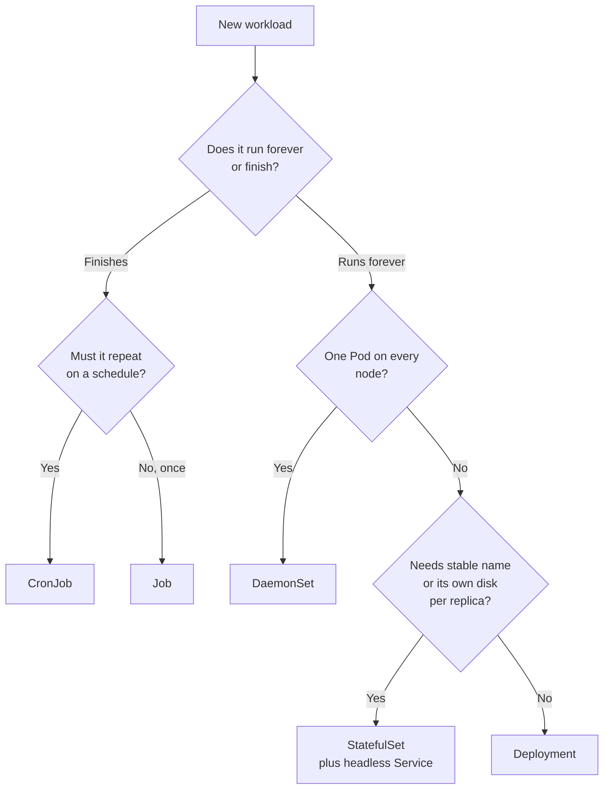
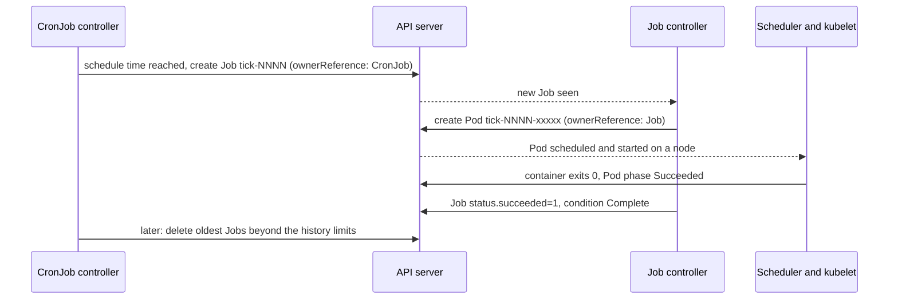

# T3.02 Choose and Use the Right Workload Resource

> Competency: "Choose and use the right workload resource (Deployment, DaemonSet, CronJob, etc.)" (CKAD-1.2) | Domain/weight: CKAD, Application Design and Build (20%) | Est. time: 4 h | Prerequisites: T2.05

Shell setup (from [conventions](../00-conventions.md); put it at the top of every session):

```bash
alias k=kubectl
export do="--dry-run=client -o yaml"
export now="--force --grace-period=0"
source <(kubectl completion bash); complete -o default -F __start_kubectl k
```

Lab environment for this lesson: **kind** (cluster `lab`, context `kind-lab`, 1 control plane + 2 workers). Namespaces: `lab-t302` (worked example and labs) and `lab-t302-drill` (speed drills). Files go in `~/lab/t302/`.

> Output policy. Three kinds of output blocks appear in this lesson, and each is labelled.
>
> - `REAL OUTPUT (kubectl client v1.37.1, offline)`: I ran `--dry-run=client` commands on the machine where this lesson was written. No cluster was needed.
> - `REAL OUTPUT (server dry-run, kind v0.33.0, v1.37.0)`: I sent objects to the API server of an existing kind v1.37.0 cluster with `--dry-run=server` (nothing is stored, nothing runs), or ran read-only `explain`/`get` commands. This proves that every YAML in this lesson is accepted by a v1.37.0 API server and shows the exact validation errors. It does **not** prove how the Pods behave at run time.
> - `EXPECTED OUTPUT (not captured)`: I could not run the workload on a cluster of my own (see the "Known limitation" paragraph in section 11). The shape is right for v1.37; names, hash suffixes, IPs and ages will differ on your cluster.

---

## 1. Why this matters

Every Kubernetes workload kind answers three questions in a different way: how many copies run, what happens when a copy dies, and does a copy keep its name and disk. If you pick a Deployment for a batch task, the Pod restarts forever. If you pick a Deployment for a database, the Pods lose their disks and names. If you pick a Job for a nightly report, it runs once and never again.

The CKAD exam gives you a scenario ("run this once per node", "run this every night at 02:00", "each replica needs its own volume") and expects the right `kind` with the right fields. The exam averages about 6 minutes per task (15-20 tasks in 2 hours; sources: [E2](https://docs.linuxfoundation.org/tc-docs/certification/tips-cka-and-ckad), [E3](https://docs.linuxfoundation.org/tc-docs/certification/faq-cka-ckad-cks)), so you need to pick the kind in seconds and produce the YAML fast.

This lesson assumes you know ReplicaSets and basic Deployments; if not, read [T2.05](../part2-basics/T2.05-controllers-replicasets-deployments-basics-and-garbage.md) first. The ownership chain (CronJob owns Job owns Pod) uses the garbage collection rules from that lesson.

---

## 2. Concepts

### 2.1 The decision table

A **workload resource** is an API object that creates and manages Pods for you. All of them wrap a Pod template (`spec.template`). They differ in the rules around that template.

| If the app... | Use | Scenario you could be given | Pod names | Restarts / replaces | Scale |
|---|---|---|---|---|---|
| is stateless and runs forever | **Deployment** | "Run a web front end with 3 replicas and roll out new versions" | random suffix (`web-7d9f-x2k4p`) | a dead Pod is replaced by a new one | `replicas`, any number |
| must run exactly one copy on every (or selected) node | **DaemonSet** | "Run a log collector on every node" | random suffix | new node gets a Pod; node removed, Pod removed | one per eligible node, no `replicas` field |
| needs a stable name, a stable DNS name, or its own disk per replica | **StatefulSet** | "Run a 3-node database; each node keeps its data and its address" | ordered: `db-0`, `db-1`, `db-2` | replacement keeps the same name and the same PVC | `replicas`, ordered |
| runs a task until it succeeds, then stops | **Job** | "Compute a report once and keep the logs" | `job-name-<random>` | failed Pods retried up to `backoffLimit` | `completions`, `parallelism` |
| runs a task on a schedule | **CronJob** | "Every night at 02:00 run the backup task" | Job `cron-<minutes>`, Pod under it | creates a new Job per tick | one Job per tick |
| is a one-off test or debug container | **bare Pod** | "Start a throw-away Pod to test DNS" | the name you give | nothing replaces it if the node dies | 1 |

Two more kinds appear in questions as distractors:

- **ReplicaSet**: keeps N identical Pods. A Deployment creates and manages ReplicaSets. You almost never create one yourself (see 2.9).
- **ReplicationController**: the old predecessor of ReplicaSet. Do not use it.

### 2.2 Under the hood: who does the work

Each workload kind has a **controller**: a loop in `kube-controller-manager` that compares what you asked for (spec) with what exists (status) and fixes the difference. You never talk to controllers directly. You write the object, and the controller reacts.

- The **Job controller** creates Pods from the template, counts how many ended in phase `Succeeded` and how many in `Failed`, and stops when the goal is reached or a limit is hit. It writes the result into `status` and adds conditions (`Complete`, `Failed`).
- The **CronJob controller** wakes up about every 10 seconds, looks at each CronJob schedule, and when a scheduled time has passed it creates a Job (with an ownerReference to the CronJob). It does not run Pods itself.
- The **DaemonSet controller** looks at every node. For each node that matches the Pod template's node selection and tolerations, it makes sure one Pod exists. It creates Pods already bound to the node by adding a node affinity on the node name, so the default scheduler places them. A new node appears: a new Pod appears.
- The **StatefulSet controller** creates Pods one by one with an ordinal (`-0`, `-1`, ...), creates a PersistentVolumeClaim (PVC) for each ordinal from `volumeClaimTemplates`, and re-attaches the same PVC when a Pod with that ordinal is re-created.
- The **Deployment controller** manages ReplicaSets (rolling update, rollback); the ReplicaSet controller keeps the Pod count. See T2.05.

All of these set an `ownerReference` on what they create. Delete the owner and the garbage collector deletes the dependents (T2.05).

### 2.3 Job

**What it is.** A Job runs Pods **to completion**. A Pod is a success when its main container exits with code 0. The Job is done when enough Pods succeeded.

**Problem it solves.** A Deployment's Pod has `restartPolicy: Always`, so a container that exits is restarted. That is wrong for a task that should end. A Job's Pod must use `restartPolicy: Never` or `OnFailure`, so exit 0 means "finished".

**restartPolicy in a Job's Pod template** (the field is required, there is no default):

| Value | On container failure | Pods you see on failure | Use when |
|---|---|---|---|
| `Never` | the Pod is marked `Failed`; the Job controller creates a **new Pod** | many Pods (`Error` status), good for reading logs of each attempt | you want one clean log per attempt; required with `podFailurePolicy` |
| `OnFailure` | the kubelet restarts the **container in the same Pod** | one Pod with a rising `RESTARTS` count | you want fewer Pods; the node keeps the data of `emptyDir` between tries |
| `Always` | **rejected by the API server** | none | never valid in a Job |

Real output of the rejection (the YAML from section 4 with `Always`):

```text
REAL OUTPUT (server dry-run, kind v0.33.0, v1.37.0)
The Job "batch5" is invalid: spec.template.spec.restartPolicy: Required value: valid values: "OnFailure", "Never"
```

**The Job fields**

| Field | What it does | Default | Risky or invalid value |
|---|---|---|---|
| `completions` | Number of Pods that must succeed. | `1` if both `completions` and `parallelism` are unset. If you set `parallelism` only, a "work queue" Job: the first Pod that succeeds ends the Job. | With `Indexed` mode it must be set. Leaving it unset while setting `parallelism` makes a "work queue" Job, which is rarely what an exam task wants. |
| `parallelism` | Maximum number of Pods running at the same time. | `1` | `0` pauses the Job. Larger than `completions` is pointless. The real number is lower at the end, when fewer completions remain than `parallelism`. |
| `backoffLimit` | How many failed Pods or restarts are tolerated before the Job is marked `Failed`. Retries wait with exponential back-off (10 s, 20 s, 40 s ... up to 6 minutes). | `6` | `0` means no retry at all. |
| `activeDeadlineSeconds` | Maximum seconds the Job may run in total, counted from its start. When the time is up, all running Pods are killed and the Job is `Failed` with reason `DeadlineExceeded`. It wins over `backoffLimit`. | none | Too small a value kills good Pods. Must be a positive integer. |
| `ttlSecondsAfterFinished` | Seconds after the Job finishes (Complete or Failed) before the TTL controller deletes the Job and its Pods. | unset: the Job stays forever | `0` deletes immediately, so you lose the logs. |
| `completionMode` | `NonIndexed` or `Indexed` (see 2.4). | `NonIndexed` | `Indexed` needs `completions`. |
| `podFailurePolicy` | Rules that decide what to do with a failed Pod based on exit code or Pod condition (see 2.4). | none | Needs `restartPolicy: Never`. |
| `successPolicy` | Rules that let the Job succeed before every index has finished (see 2.4). | none | Needs `completionMode: Indexed`. |
| `podReplacementPolicy` | When to create a replacement Pod (see 2.4). | `TerminatingOrFailed` (or `Failed` when `podFailurePolicy` is set) | |
| `suspend` | `true` stops creating Pods and kills running ones. | `false` | |

You can read these defaults and descriptions yourself in the exam: `k explain job.spec.backoffLimit`.

The imperative command has no flags for these fields. `k create job` takes `--image`, `--from` and a command after `--`. To set `completions` or `parallelism`, generate the YAML with `$do` and edit it (section 4).

Real output (kubectl client v1.37.1, offline). Note that `restartPolicy: Never` is filled in for you:

```text
REAL OUTPUT (kubectl client v1.37.1, offline)
$ k create job pi --image=perl:5.34 $do -- perl -Mbignum=bpi -wle 'print bpi(200)'
apiVersion: batch/v1
kind: Job
metadata:
  name: pi
spec:
  template:
    metadata: {}
    spec:
      containers:
      - command:
        - perl
        - -Mbignum=bpi
        - -wle
        - print bpi(200)
        image: perl:5.34
        name: pi
        resources: {}
      restartPolicy: Never
status: {}
```

**How completions and parallelism work together.** With `completions: 5` and `parallelism: 2`, the controller starts 2 Pods. When one succeeds, it starts the next, so at most 2 run at once. After 5 successes the Job is `Complete`. Failed Pods do not count as completions and count towards `backoffLimit`.

**Conditions and failure reasons.**

| Reason | Meaning | Condition message (the stable part) |
|---|---|---|
| `BackoffLimitExceeded` | more than `backoffLimit` failures | "Job has reached the specified backoff limit" |
| `DeadlineExceeded` | ran longer than `activeDeadlineSeconds` | "Job was active longer than specified deadline" |
| `PodFailurePolicy` | a `FailJob` rule matched | text names the container, Pod and rule |

Read them with `k describe job NAME` (the Events and Conditions parts) or `k get job NAME -o jsonpath='{.status.conditions}'`.

### 2.4 Job: Indexed mode, podFailurePolicy, successPolicy, podReplacementPolicy

**Indexed mode (`completionMode: Indexed`).** In the default mode (`NonIndexed`) all Pods are interchangeable. In `Indexed` mode each Pod gets a number from `0` to `completions - 1`. The Job is complete when every index has one successful Pod. The index reaches the container in three ways: the annotation and label `batch.kubernetes.io/job-completion-index`, the environment variable `JOB_COMPLETION_INDEX`, and the Pod name (`idx-0-<random>`). This lets one Job split work: Pod 0 handles shard 0, Pod 1 handles shard 1, and so on. Indexed mode also unlocks `backoffLimitPerIndex` and `maxFailedIndexes` (a retry budget per index; check `k explain job.spec.backoffLimitPerIndex`) and `successPolicy`.

```yaml
apiVersion: batch/v1
kind: Job
metadata:
  name: idx
  namespace: lab-t302
spec:
  completions: 4                 # 4 indexes: 0,1,2,3
  parallelism: 2                 # two at a time
  completionMode: Indexed        # each Pod gets JOB_COMPLETION_INDEX
  template:
    spec:
      restartPolicy: Never
      containers:
      - name: work
        image: busybox:1.36
        command: ["sh", "-c", "echo my index is $JOB_COMPLETION_INDEX"]
```

Observe: `k logs -n lab-t302 -l job-name=idx --prefix` prints one line per Pod, each with a different index. EXPECTED OUTPUT (not captured):

```text
EXPECTED OUTPUT (not captured)
[pod/idx-0-<rand>/work] my index is 0
[pod/idx-1-<rand>/work] my index is 1
[pod/idx-2-<rand>/work] my index is 2
[pod/idx-3-<rand>/work] my index is 3
```

**podFailurePolicy.** By default every failed Pod counts towards `backoffLimit`, so a Pod that fails for a reason that will never go away (a bad config file, exit code 42) is retried up to 6 more times. `podFailurePolicy` lets you say: "if the container exits with code 42, fail the Job at once", or "if the Pod was evicted by a disruption, do not count it".

| Part | Values | Meaning |
|---|---|---|
| `rules[].action` | `FailJob` | mark the Job `Failed` and kill the running Pods |
| | `FailIndex` | fail only that index (needs `backoffLimitPerIndex`) |
| | `Ignore` | do not count the failure towards `backoffLimit`; create a replacement |
| | `Count` | the default behaviour: count it |
| `rules[].onExitCodes` | `containerName`, `operator` (`In` or `NotIn`), `values` (list of integers) | match on the container exit code |
| `rules[].onPodConditions` | `type`, `status` (default `True`) | match on a Pod condition such as `DisruptionTarget` |

Rules are checked in order; the first match wins. `podFailurePolicy` requires `restartPolicy: Never`. Real rejection:

```text
REAL OUTPUT (server dry-run, kind v0.33.0, v1.37.0)
The Job "pfp" is invalid: spec.template.spec.restartPolicy: Invalid value: "OnFailure": only "Never" is supported when podFailurePolicy is specified
```

Runnable example (the container always exits 42):

```yaml
apiVersion: batch/v1
kind: Job
metadata:
  name: pfp
  namespace: lab-t302
spec:
  completions: 1
  backoffLimit: 6                # without the rule below, 7 Pods would run
  podReplacementPolicy: Failed   # required value when podFailurePolicy is set
  podFailurePolicy:
    rules:
    - action: FailJob            # exit code 42 = fatal, stop at once
      onExitCodes:
        containerName: work
        operator: In
        values: [42]
    - action: Ignore             # a node drain or eviction is not the app's fault
      onPodConditions:
      - type: DisruptionTarget
  template:
    spec:
      restartPolicy: Never       # mandatory with podFailurePolicy
      containers:
      - name: work
        image: busybox:1.36
        command: ["sh", "-c", "echo fatal config error; exit 42"]
```

Observe: the Job fails after **one** Pod. `k get pods -n lab-t302 -l job-name=pfp` shows a single `Error` Pod, and the condition reason is `PodFailurePolicy`. EXPECTED OUTPUT (not captured):

```text
EXPECTED OUTPUT (not captured)
$ k get job pfp -n lab-t302 -o jsonpath='{.status.conditions[?(@.type=="Failed")].reason}{"\n"}'
PodFailurePolicy
$ k get pods -n lab-t302 -l job-name=pfp --no-headers | wc -l
1
```

**successPolicy** (GA in v1.33 according to the topic notes; see section 11). A normal Indexed Job needs **every** index to succeed. A `successPolicy` declares the Job successful earlier, for example "the Job is fine when the leader index 0 succeeded" (a typical MPI or leader/worker shape), and then removes the rest of the Pods.

| Part | Meaning |
|---|---|
| `rules[].succeededIndexes` | a string of indexes and ranges, such as `"0,2-3"` |
| `rules[].succeededCount` | how many of those indexes (or of all, if `succeededIndexes` is not set) must succeed |
| at least one of the two is required in each rule | rules are evaluated in order; the first rule met wins; at most 20 rules |
| requires `completionMode: Indexed` | otherwise the API server rejects it |

```text
REAL OUTPUT (server dry-run, kind v0.33.0, v1.37.0)
The Job "succ" is invalid: spec.successPolicy: Invalid value: {"Rules":[{"SucceededIndexes":"0,1","SucceededCount":1}]}: requires indexed completion mode
```

Runnable example. Indexes 0 and 1 finish at once; indexes 2 and 3 sleep for 2 minutes. The rule says "one success among indexes 0 and 1 is enough".

```yaml
apiVersion: batch/v1
kind: Job
metadata:
  name: succ
  namespace: lab-t302
spec:
  completions: 4
  parallelism: 4
  completionMode: Indexed          # mandatory for successPolicy
  successPolicy:
    rules:
    - succeededIndexes: "0,1"      # look only at these indexes
      succeededCount: 1            # one success among them ends the Job
  template:
    spec:
      restartPolicy: Never
      containers:
      - name: work
        image: busybox:1.36
        command: ["sh", "-c", "echo index $JOB_COMPLETION_INDEX; if [ $JOB_COMPLETION_INDEX -ge 2 ]; then sleep 120; fi"]
```

Observe: within seconds the Job gets the condition `SuccessCriteriaMet`, then `Complete`; the sleeping Pods of indexes 2 and 3 are terminated. EXPECTED OUTPUT (not captured):

```text
EXPECTED OUTPUT (not captured)
$ k get job succ -n lab-t302 -o jsonpath='{.status.conditions[*].type}{"\n"}'
SuccessCriteriaMet Complete
```

**podReplacementPolicy** (GA in v1.34 according to the topic notes; see section 11). When a Job Pod is deleted or evicted, it first goes through a `Terminating` phase (it has a `deletionTimestamp` but still runs for the grace period). By default the controller creates the replacement **immediately**, so for a moment two Pods for the same slot may exist. For work that cannot run twice at once, wait until the old Pod is gone.

| Value | Behaviour | Observe |
|---|---|---|
| `TerminatingOrFailed` (default) | replacement is created as soon as the old Pod is terminating or failed | `k get job NAME -o jsonpath='{.status.terminating}'` shows Pods still shutting down while new ones already start |
| `Failed` | replacement is created only when the old Pod is fully `Failed` (or `Succeeded`) | `status.terminating` counts the old Pod; no replacement exists until it is gone |

Real field check: `k explain job.spec.podReplacementPolicy` lists the two values `Failed` and `TerminatingOrFailed`, and says "When using podFailurePolicy, Failed is the only allowed value." That is why the `pfp` example above sets `podReplacementPolicy: Failed`.

To see the difference: run a Job whose Pod ignores SIGTERM (`command: ["sh","-c","trap '' TERM; sleep 600"]`) with `terminationGracePeriodSeconds: 30`, delete its Pod with `k delete pod NAME --wait=false`, and run `k get pods -l job-name=NAME` once per second for 30 seconds. With the default you see a second Pod start at once; with `Failed` you see only the `Terminating` one until it is gone.

### 2.5 CronJob

**What it is.** A CronJob creates a Job on a repeating schedule. Think of the Unix `cron` service, running in the cluster.

**Problem it solves.** A Job runs once. A nightly backup, a cache warm-up or a report must run again and again. Without a CronJob you would run `k create job` by hand each time.

**The CronJob fields**

| Field | What it does | Default | Risky or invalid value |
|---|---|---|---|
| `schedule` | Five-field cron string: `minute hour day-of-month month day-of-week`. | required | `61 * * * *` is rejected. A `CRON_TZ=` or `TZ=` prefix is rejected (use `timeZone`). |
| `timeZone` | IANA zone name (for example `Etc/UTC`, `Europe/Berlin`) in which `schedule` is read. | the time zone of the kube-controller-manager process | An unknown name is rejected. A name that later stops being valid makes the controller stop creating Jobs (event reason `UnknownTimeZone`). |
| `concurrencyPolicy` | What to do if the previous Job is still running at the next tick. | `Allow` | `Allow` with a slow Job piles Jobs up (see 2.6). |
| `startingDeadlineSeconds` | How late (in seconds) a Job may still be started if its tick was missed (controller down, suspended). A tick later than this is counted as missed and skipped. | unset: no deadline | Under 10 may make the CronJob never start, because the controller checks only about every 10 s. |
| `successfulJobsHistoryLimit` | How many finished successful Jobs to keep. | `3` | `0` deletes them at once (no logs). |
| `failedJobsHistoryLimit` | How many finished failed Jobs to keep. | `1` | `0` deletes them at once. |
| `suspend` | `true` stops new Jobs. Jobs already running are not affected. | `false` | A forgotten `true` is the classic "never fires" bug. |
| `jobTemplate` | The Job spec (with its own `template`, `backoffLimit`, `ttlSecondsAfterFinished` and so on). | required | Put `restartPolicy` and the containers in `jobTemplate.spec.template.spec`. |

```text
REAL OUTPUT (server dry-run, kind v0.33.0, v1.37.0)
$ k explain cronjob.spec.successfulJobsHistoryLimit
    The number of successful finished jobs to retain. Value must be non-negative
    integer. Defaults to 3.
$ k explain cronjob.spec.failedJobsHistoryLimit
    The number of failed finished jobs to retain. Value must be non-negative
    integer. Defaults to 1.
```

**Cron syntax.** Five fields, separated by spaces:

```text
┌───────── minute        (0-59)
│ ┌─────── hour          (0-23)
│ │ ┌───── day of month  (1-31)
│ │ │ ┌─── month         (1-12 or JAN-DEC)
│ │ │ │ ┌─ day of week   (0-6 or SUN-SAT; 0 = Sunday)
* * * * *
```

| Schedule | Meaning |
|---|---|
| `*/1 * * * *` | every minute |
| `*/5 * * * *` | every 5 minutes |
| `0 2 * * *` | every day at 02:00 |
| `30 3 * * 1-5` | Monday to Friday at 03:30 |
| `0 0 1 * *` | midnight on the 1st of each month |
| `@hourly`, `@daily`, `@weekly`, `@monthly`, `@yearly` | shortcuts for `0 * * * *`, `0 0 * * *`, `0 0 * * 0`, `0 0 1 * *`, `0 0 1 1 *` |

Real validation errors for the three common schedule mistakes:

```text
REAL OUTPUT (server dry-run, kind v0.33.0, v1.37.0)
The CronJob "tick" is invalid: spec.schedule: Invalid value: "61 * * * *": end of range (61) above maximum (59): 61
The CronJob "tick" is invalid: spec.schedule: Invalid value: "CRON_TZ=UTC */1 * * * *": cannot use TZ or CRON_TZ in schedule, use timeZone field instead
The CronJob "tick" is invalid: spec.timeZone: Invalid value: "Mars/Olympus": unknown time zone Mars/Olympus
```

**Under the hood: what the CronJob controller does at each wake-up.**

1. List the child Jobs through their ownerReferences and clean up finished ones beyond the history limits.
2. Compute the schedule times that fall between `status.lastScheduleTime` and now.
3. If there are none, stop. If the latest is older than `startingDeadlineSeconds`, skip it and record an event.
4. If `suspend` is true, stop.
5. Apply `concurrencyPolicy` (Allow: create; Forbid: skip if one is active; Replace: delete the active Job, then create).
6. Create the Job named `<cronjob>-<scheduled time in minutes since the Unix epoch>` and set `status.lastScheduleTime`.

If more than 100 ticks were missed (for example a CronJob suspended for a day with `*/1`), and no `startingDeadlineSeconds` is set, the controller refuses to guess and logs an event "too many missed start times". Setting `startingDeadlineSeconds` limits the look-back window and avoids this. The CronJob name may be at most 52 characters, because the Job name adds a suffix.

**Run it by hand.** `k create job manual --from=cronjob/tick` creates a Job from the CronJob's `jobTemplate`, right now, outside the schedule. The new Job gets the annotation `cronjob.kubernetes.io/instantiate: manual`. Use it to test a CronJob's template without waiting, and to prove a "never fires" CronJob has a good template (the problem is then the schedule, not the template).

### 2.6 CronJob concurrencyPolicy

| Value | At the next tick, if the last Job is still running | Observe | Use for |
|---|---|---|---|
| `Allow` (default) | starts another Job; they overlap | `k get cronjob` ACTIVE column grows: 1, 2, 3 ... | independent tasks that are safe to overlap |
| `Forbid` | skips this tick | ACTIVE stays 1; an event says the new Job was skipped | tasks that must not overlap (backups, migrations) |
| `Replace` | deletes the running Job and starts a new one | the running Job name changes each minute | tasks where only the latest run matters |

Runnable example for each, using a Job that takes longer (150 s) than the tick (60 s). Pick the value with a patch and watch ACTIVE for 4 minutes:

```bash
k create cronjob slow -n lab-t302 --image=busybox:1.36 --schedule='*/1 * * * *' -- sleep 150
k patch cronjob slow -n lab-t302 -p '{"spec":{"concurrencyPolicy":"Allow"}}'     # then Forbid, then Replace
k get cronjob slow -n lab-t302 -w
```

### 2.7 DaemonSet

**What it is.** A DaemonSet runs **one Pod on each node** (or on each node that matches a selector).

**Problem it solves.** Some programs belong to the node, not to the application: a log shipper, a node monitoring agent, a CNI or storage plug-in. A Deployment with `replicas: 3` on a 3-node cluster does not guarantee one per node; two could land on the same node. A DaemonSet guarantees it, and it follows node count as nodes join and leave.

**Fields**

| Field | What it does | Default | Notes |
|---|---|---|---|
| no `replicas` | The count is the number of eligible nodes. | n/a | A `replicas` field is **rejected**: `strict decoding error: unknown field "spec.replicas"` |
| `selector` | Must match the Pod template labels. | required | |
| `template.spec.nodeSelector` | Run only on nodes with these labels. | all nodes | `k label node w1 disk=ssd`, then `nodeSelector: {disk: ssd}` |
| `template.spec.tolerations` | Allow Pods on tainted nodes. | the controller adds tolerations for not-ready, unreachable, disk/memory/PID pressure and unschedulable; it adds **no** control-plane toleration | see below |
| `updateStrategy.type` | `RollingUpdate` or `OnDelete`. | `RollingUpdate` | |
| `updateStrategy.rollingUpdate.maxUnavailable` | How many nodes may lose their Pod at once during an update. | `1` | cannot be `0` if `maxSurge` is `0` |
| `updateStrategy.rollingUpdate.maxSurge` | How many nodes may run an extra new Pod while the old one still runs. | `0` | cannot be `0` if `maxUnavailable` is `0` |
| `minReadySeconds`, `revisionHistoryLimit` | as in Deployments | `0`, `10` | |

Note the spelling: Deployments call it `strategy`, DaemonSets and StatefulSets call it `updateStrategy`. A wrong key is a strict-decoding error.

```text
REAL OUTPUT (server dry-run, kind v0.33.0, v1.37.0)
Error from server (BadRequest): error when creating "STDIN": DaemonSet in version "v1" cannot be handled as a DaemonSet: strict decoding error: unknown field "spec.replicas"
```

**Control-plane nodes are tainted.** A kubeadm and kind control-plane node carries the taint `node-role.kubernetes.io/control-plane:NoSchedule`. Without a matching toleration the DaemonSet Pod is not created there. If you want the agent on every node including the control plane, add:

```yaml
tolerations:
- key: node-role.kubernetes.io/control-plane   # the taint key
  operator: Exists                             # match any value
  effect: NoSchedule                           # the taint effect
```

Read-only check on the existing kind v1.37.0 cluster:

```text
REAL OUTPUT (server dry-run, kind v0.33.0, v1.37.0)
$ k get node -o custom-columns=N:.metadata.name,T:.spec.taints
N                      T
k-t203-control-plane   [map[effect:NoSchedule key:node-role.kubernetes.io/control-plane]]
k-t203-worker          <none>
k-t203-worker2         <none>
```

**Update strategies**

| Strategy | What happens when you change the Pod template | Observe | Use for |
|---|---|---|---|
| `RollingUpdate` | Pods are replaced node by node, at most `maxUnavailable` at a time | `k rollout status ds/agent` follows the progress | normal agents |
| `OnDelete` | nothing happens until you delete a Pod by hand; the new Pod then uses the new template | `k rollout status` is not available (it works only with RollingUpdate), so check the image of each Pod with `k get pods -o custom-columns=N:.metadata.name,I:.spec.containers[0].image` | agents where you control the order node by node |

Runnable example (also in section 4): the DaemonSet `agent` from the file below. `nodeSelector` is shown as a comment so that the file stays valid and runs on all nodes.

### 2.8 StatefulSet

**What it is.** A StatefulSet manages Pods that need a **stable identity**: a fixed name, a fixed DNS name, and (optionally) their own volume that follows them.

**Problem it solves.** Databases and clustered systems (etcd, Kafka, ZooKeeper, PostgreSQL replicas) need to know who is who. Replica 0 may be the primary; replica 1 must find replica 0 by name even after restarts; each replica must keep its own data. A Deployment cannot do this: its Pods have random names, share one volume definition, and are replaced by brand-new, differently named Pods.

**What you get**

1. **Ordinal names.** Pods are named `<statefulset>-0`, `<statefulset>-1`, ... A replaced Pod gets the **same** name.
2. **A stable DNS name per Pod**, through a **headless Service** (a Service with `clusterIP: None`: it has no virtual IP; DNS returns the Pod IPs, and each Pod gets its own record). The record is `<pod>.<service>.<namespace>.svc.cluster.local`, for example `web-0.web.lab-t302.svc.cluster.local`.
3. **A PVC per Pod** from `volumeClaimTemplates`, named `<template>-<statefulset>-<ordinal>`, for example `data-web-0`. When `web-0` is re-created it mounts `data-web-0` again.
4. **Ordered operations**: create 0, then 1, then 2 (each must be Ready first); delete in reverse.

**Fields**

| Field | What it does | Default | Notes |
|---|---|---|---|
| `serviceName` | Name of the headless Service that gives the Pods their DNS names. | in 1.37 the API accepts an object without it (checked with a server dry-run), but the Pods then get no per-Pod DNS name from the set | Always set it. The Service must exist and have `clusterIP: None` and a selector that matches the Pods. Create it first. |
| `replicas` | Number of Pods. | `1` | |
| `selector` | Must match the template labels. | required | immutable after creation |
| `podManagementPolicy` | `OrderedReady` or `Parallel`. | `OrderedReady` | see table below |
| `updateStrategy.type` | `RollingUpdate` or `OnDelete`. | `RollingUpdate` | |
| `updateStrategy.rollingUpdate.partition` | Only Pods with ordinal **greater than or equal to** `partition` are updated. | `0` (update all) | canary: set `partition: 2` on 3 replicas, so only `web-2` updates |
| `updateStrategy.rollingUpdate.maxUnavailable` | Pods that may be down during an update (beta, on by default per `k explain`). | `1` | may not be effective with `OrderedReady` |
| `volumeClaimTemplates` | PVC templates, one PVC per Pod and template. | none | each name must match a `volumeMounts` entry |
| `persistentVolumeClaimRetentionPolicy` | `whenDeleted` and `whenScaled`, each `Retain` or `Delete`. | `Retain` for both | by default PVCs **survive** scale-down and deletion; delete them yourself |
| `ordinals.start` | First ordinal. | `0` | rarely needed |
| `minReadySeconds`, `revisionHistoryLimit` | as in Deployments | `0`, `10` | |

**podManagementPolicy**

| Value | Scale up | Scale down | Observe | Use for |
|---|---|---|---|---|
| `OrderedReady` | one Pod at a time, in order; the next starts only when the previous is Ready | reverse order, one at a time | `k get pods -w` shows `web-0` Ready before `web-1` appears | clusters that must form in order |
| `Parallel` | all Pods at once | all at once | all three Pods appear within a second | independent replicas that only need identity |

Set `podManagementPolicy` in the YAML when you first create the StatefulSet. Whether it can be changed afterwards is not covered here (section 11).

**Update strategies**

| Strategy | Behaviour | Observe |
|---|---|---|
| `RollingUpdate` | Pods are replaced from the **highest ordinal down to the lowest** (2, 1, 0), one at a time, each Ready before the next. Only ordinals at or above `partition` are touched. | `k rollout status sts/web` |
| `OnDelete` | no automatic update; you delete each Pod and it comes back with the new template | compare the Pod image after deleting |

Partition example: `k patch sts web -p '{"spec":{"updateStrategy":{"rollingUpdate":{"partition":2}}}}'`, then change the image. Only `web-2` gets the new image. Lower the partition to `1`, then `0`, to roll out further. Setting `partition` equal to `replicas` freezes all updates.

**Runnable example** (headless Service first, then the StatefulSet). It uses `storageClassName: standard`, the default StorageClass on kind (see the check below).

```yaml
apiVersion: v1
kind: Service
metadata:
  name: web
  namespace: lab-t302
spec:
  clusterIP: None            # headless: no virtual IP, per-Pod DNS records
  selector:
    app: web                 # must match the Pod labels below
  ports:
  - name: http
    port: 80
    targetPort: 80           # headless Services do no port translation: clients use the Pod port
---
apiVersion: apps/v1
kind: StatefulSet
metadata:
  name: web
  namespace: lab-t302
spec:
  serviceName: web           # the headless Service above
  replicas: 3
  selector:
    matchLabels:
      app: web
  podManagementPolicy: OrderedReady   # default; Parallel starts all at once
  updateStrategy:
    type: RollingUpdate
    rollingUpdate:
      partition: 0           # update every ordinal >= 0
  template:
    metadata:
      labels:
        app: web
    spec:
      containers:
      - name: nginx
        image: nginx:1.27
        ports:
        - containerPort: 80
          name: http
        volumeMounts:
        - name: data         # must match the claim template name
          mountPath: /usr/share/nginx/html
  volumeClaimTemplates:
  - metadata:
      name: data             # PVCs are named data-web-0, data-web-1, data-web-2
    spec:
      accessModes: ["ReadWriteOnce"]
      storageClassName: standard   # kind's default StorageClass (see check below)
      resources:
        requests:
          storage: 100Mi
```

The default StorageClass on kind (read-only check on an existing v1.37.0 kind cluster):

```text
REAL OUTPUT (server dry-run, kind v0.33.0, v1.37.0)
$ k get sc,nodes        # first lines, trimmed
NAME                                             PROVISIONER             RECLAIMPOLICY   VOLUMEBINDINGMODE      ALLOWVOLUMEEXPANSION   AGE
storageclass.storage.k8s.io/standard (default)   rancher.io/local-path   Delete          WaitForFirstConsumer   false                  14h
```

`WaitForFirstConsumer` means a PVC stays `Pending` until a Pod that uses it is scheduled. That is normal, not an error.

**DNS for StatefulSet Pods.** Format: `<pod>.<service>.<namespace>.svc.cluster.local`. Inside the same namespace the short forms `web-0.web` and `web-0.web.lab-t302` also resolve (the Pod's DNS search path adds the rest). The Service name alone (`web`) returns the A records of all ready Pods. Because the Service is headless, there is no port translation: connect to the Pod port (80 here), not to the Service `port`. Do not write a bare "pod-0.svc" in an answer; the full form always contains the namespace.

**Delete behaviour.** `k delete sts web` removes the Pods but **not** the PVCs (default `Retain`). Re-creating the StatefulSet re-attaches the old data. To remove the data, delete the PVCs: `k delete pvc -l app=web` or by name. Also `k delete sts web --cascade=orphan` deletes only the StatefulSet object and leaves the Pods running (garbage collection, see T2.05).

**No imperative generator.** `k create` has subcommands for deployment, job and cronjob, but none for daemonset or statefulset. The fast way is to generate a Deployment and change it (section 4).

### 2.9 ReplicaSet vs Deployment, and why Deployment

A **ReplicaSet** keeps N copies of a Pod template alive. It can scale and replace dead Pods. It cannot do a rolling update: if you change its template, existing Pods are **not** touched; only new Pods use the new template. It has no rollback and no history.

A **Deployment** owns ReplicaSets. When you change the Pod template it creates a new ReplicaSet, scales it up while scaling the old one down (rolling update), and keeps old ReplicaSets for rollback.

| Need | ReplicaSet | Deployment |
|---|---|---|
| keep N Pods alive | yes | yes (through its ReplicaSet) |
| rolling update | no | yes (`strategy`, `maxSurge`, `maxUnavailable`) |
| `k rollout undo` | no | yes |
| `k rollout history` | no | yes |
| pause / resume rollouts | no | yes |
| when to create one yourself | almost never | the default choice for stateless apps |

If a question says "ensure three replicas of this Pod" and nothing else, write a Deployment. Only if the question names ReplicaSet explicitly, create a ReplicaSet (`k create deployment` and change the `kind`, then drop `strategy`).

### 2.10 Bare Pods: when are they acceptable?

A **bare Pod** is a Pod created without a controller (`k run`, or `kind: Pod`). The kubelet restarts its containers according to `restartPolicy`, but if the Pod is deleted or its node dies, nothing creates a replacement.

Acceptable:

- a throw-away debug or test Pod (`k run tmp --image=busybox:1.36 --rm -it --restart=Never -- sh`)
- a one-off check in an exam task that says "create a Pod"
- **static Pods** and system components managed by the kubelet (CKA topic)

Not acceptable for anything that must stay up or finish reliably: use a Deployment (runs forever) or a Job (finishes). A "Pod" with `restartPolicy: OnFailure` is not a Job: it has no retry limit, no completion count, no history.

### 2.11 kubectl rollout works for Deployment, DaemonSet and StatefulSet

`k rollout status`, `history`, `undo`, `restart` and `pause` work for `deployment`, `daemonset` and `statefulset`. They do **not** apply to Jobs or CronJobs (a Job template is immutable once created; to change a CronJob template, edit the CronJob and the next Job uses it).

```bash
k rollout status ds/agent -n lab-t302        # waits until every node's Pod is updated and ready
k rollout status sts/web -n lab-t302         # waits for the ordered update
k rollout undo ds/agent -n lab-t302          # go back to the previous revision
k rollout restart sts/web -n lab-t302        # recreate Pods with the same template
```

`rollout status` works only for the `RollingUpdate` strategy. For `OnDelete` kubectl reports that rollout status is available only for RollingUpdate.

### 2.12 Related but different

- **Job vs bare Pod with `restartPolicy: OnFailure`**: the Job counts completions, limits retries, and keeps history; the Pod does not.
- **DaemonSet vs static Pod**: both give "one per node". A DaemonSet is an API object managed by the control plane; a static Pod is a file on a node read by the kubelet. DaemonSet is the CKAD answer.
- **CronJob `suspend` vs Job `suspend`**: the CronJob field stops new Jobs; the Job field stops the Pods of one Job.
- **Deployment `strategy` vs DaemonSet/StatefulSet `updateStrategy`**: different key names.
- **StatefulSet vs Deployment with a PVC**: a Deployment with `replicas: 3` and one PVC shares one volume (and usually fails, because a `ReadWriteOnce` volume mounts on one node). A StatefulSet gives each replica its own PVC.

---

## 3. How it works (diagram)

**Picking the kind.** Follow the arrows from the top.



**What happens on each CronJob tick.**



**Walkthrough of the flowchart.** First ask whether the process is meant to end. If it ends, a schedule makes it a CronJob and no schedule makes it a Job. If it runs forever, ask whether it belongs to the node (DaemonSet), then whether replicas need their own name or disk (StatefulSet). Everything else is a Deployment.

**Walkthrough of the sequence.** The CronJob controller never creates Pods. It creates a Job and sets the CronJob as owner. The Job controller creates Pods and owns them. Deleting the CronJob deletes its Jobs and their Pods through garbage collection. The history limits make the CronJob controller delete old finished Jobs. `k create job --from=cronjob/NAME` skips the first arrow and creates the Job directly from the template.

---

## 4. Commands and YAML you must produce fast

### 4.1 Imperative shortcuts

```bash
k create deployment web --image=nginx:1.27 --replicas=3        # Deployment (also: $do > web.yaml)
k create job pi --image=perl:5.34 -- perl -Mbignum=bpi -wle 'print bpi(200)'   # Job; command after "--"
k create cronjob tick --image=busybox:1.36 --schedule='*/1 * * * *' -- date    # CronJob; note the quotes around the schedule
k create job manual --from=cronjob/tick                         # one Job now, from the CronJob template
k get jobs,cronjobs                                             # both kinds in one call
k rollout status ds/agent                                       # waits for a DaemonSet rollout
```

| Command | Explanation |
|---|---|
| `k create job pi --image=... -- CMD ARGS` | Creates a Job with `restartPolicy: Never` (filled in for you). Everything after `--` is the container command. The perl image is large (hundreds of MB); the first pull can take a minute. |
| `k create cronjob tick --image=... --schedule='...' -- CMD` | Creates a CronJob with `restartPolicy: OnFailure` (filled in for you). Always quote the schedule: unquoted `*` is expanded by the shell. |
| `k create job NAME --from=cronjob/CJ` | Copies the CronJob `jobTemplate` into a new Job. Needs a live cluster (it reads the CronJob). |
| `k get jobs,cronjobs` | Shows both. The CronJob row has `SCHEDULE`, `TIMEZONE`, `SUSPEND`, `ACTIVE`, `LAST SCHEDULE`. |
| `k rollout status ds/agent` | Blocks until the DaemonSet rollout finishes. The same works for `deploy/NAME` and `sts/NAME`. |

There is **no** `k create daemonset` and **no** `k create statefulset`. Generate a Deployment and convert it.

Real client-side output for the CronJob (note `restartPolicy: OnFailure`):

```text
REAL OUTPUT (kubectl client v1.37.1, offline)
$ k create cronjob tick --image=busybox:1.36 --schedule='*/1 * * * *' $do -- date
apiVersion: batch/v1
kind: CronJob
metadata:
  name: tick
spec:
  jobTemplate:
    metadata:
      name: tick
    spec:
      template:
        metadata: {}
        spec:
          containers:
          - command:
            - date
            image: busybox:1.36
            name: tick
            resources: {}
          restartPolicy: OnFailure
  schedule: '*/1 * * * *'
status: {}
```

### 4.2 Deployment YAML to DaemonSet in under 60 seconds

Generate, then edit three things: `kind`, delete `replicas`, delete `strategy`. (`status` and `creationTimestamp` are harmless.) The two routes:

```bash
# Route A: yq (installed on every exam SSH host, E9)
k create deployment agent --image=busybox:1.36 $do -- sleep 3600 > ds.yaml
yq -i '.kind="DaemonSet" | del(.spec.replicas, .spec.strategy, .status, .metadata.creationTimestamp)' ds.yaml
k apply -f ds.yaml

# Route B: editor. Open ds.yaml, then: change "kind: Deployment" to "kind: DaemonSet",
# delete the "replicas: 1" line, delete the "strategy: {}" line, save, apply.
```

Real output of Route A (here `yq` printed the file to the screen instead of editing it in place; the content is the same):

```text
REAL OUTPUT (kubectl client v1.37.1, offline; yq v4.54.1)
apiVersion: apps/v1
kind: DaemonSet
metadata:
  labels:
    app: agent
  name: agent
spec:
  selector:
    matchLabels:
      app: agent
  template:
    metadata:
      labels:
        app: agent
    spec:
      containers:
        - command:
            - sleep
            - "3600"
          image: busybox:1.36
          name: busybox
          resources: {}
```

To add the control-plane toleration with `yq`:

```bash
yq -i '.spec.template.spec.tolerations = [{"key":"node-role.kubernetes.io/control-plane","operator":"Exists","effect":"NoSchedule"}]' ds.yaml
```

The same conversion works for a StatefulSet: change `kind`, drop `strategy`, add `serviceName`, add `volumeClaimTemplates`, and create the headless Service:

```bash
k create deployment web --image=nginx:1.27 --replicas=3 $do | yq '.kind="StatefulSet" | .spec.serviceName="web" | del(.spec.strategy,.status,.metadata.creationTimestamp)' > sts.yaml
```

I checked that the result is accepted by a v1.37.0 API server (server dry-run: `statefulset.apps/web created (server dry run)`). You still add the `volumeClaimTemplates`, the `volumeMounts` and the Service by hand.

### 4.3 Job with completions 5, parallelism 2, backoffLimit 3

Imperative shortcut: generate and patch with `yq`:

```bash
k create job batch5 -n lab-t302 --image=busybox:1.36 $do -- sh -c 'echo start $(hostname); sleep 5; echo done $(hostname)' > batch5.yaml
yq -i '.spec.completions=5 | .spec.parallelism=2 | .spec.backoffLimit=3' batch5.yaml
```

The full declarative YAML, with every field explained:

```yaml
apiVersion: batch/v1
kind: Job
metadata:
  name: batch5
  namespace: lab-t302
spec:
  completions: 5                   # the Job is done after 5 Pods succeeded
  parallelism: 2                   # run at most 2 Pods at the same time
  backoffLimit: 3                  # after more than 3 failed Pods the Job is Failed (default 6)
  activeDeadlineSeconds: 120       # hard limit for the whole Job; wins over backoffLimit
  ttlSecondsAfterFinished: 600     # delete the Job and its Pods 10 minutes after it finishes
  template:
    spec:
      restartPolicy: Never         # required: Never or OnFailure; "Always" is rejected
      containers:
      - name: work
        image: busybox:1.36
        command: ["sh", "-c", "echo start $(hostname); sleep 5; echo done $(hostname)"]
```

The CronJob YAML with every field explained:

```yaml
apiVersion: batch/v1
kind: CronJob
metadata:
  name: tick
  namespace: lab-t302
spec:
  schedule: "*/1 * * * *"          # every minute; quote it
  timeZone: "Etc/UTC"              # IANA name; do not use CRON_TZ= in schedule
  concurrencyPolicy: Forbid        # skip a tick while the previous Job still runs (default Allow)
  startingDeadlineSeconds: 60      # a tick missed by more than 60 s is skipped (keep it >= 10)
  successfulJobsHistoryLimit: 3    # keep 3 finished OK Jobs (the default)
  failedJobsHistoryLimit: 1        # keep 1 finished failed Job (the default)
  suspend: false                   # true stops new Jobs; running Jobs continue
  jobTemplate:
    spec:
      ttlSecondsAfterFinished: 300 # Job-level fields go here, not under spec
      template:
        spec:
          restartPolicy: OnFailure # Never or OnFailure
          containers:
          - name: tick
            image: busybox:1.36
            command: ["date"]
```

The DaemonSet YAML with every field explained:

```yaml
apiVersion: apps/v1
kind: DaemonSet
metadata:
  name: agent
  namespace: lab-t302
spec:
  selector:                        # must match template labels; no replicas field exists
    matchLabels:
      app: agent
  updateStrategy:                  # note the name: not "strategy"
    type: RollingUpdate            # or OnDelete
    rollingUpdate:
      maxUnavailable: 1            # nodes allowed to be without the agent during an update
  template:
    metadata:
      labels:
        app: agent
    spec:
      # nodeSelector:              # uncomment to limit to labelled nodes
      #   disk: ssd
      tolerations:
      - key: node-role.kubernetes.io/control-plane   # allow the control-plane taint
        operator: Exists
        effect: NoSchedule
      containers:
      - name: agent
        image: busybox:1.36
        command: ["sh", "-c", "while true; do echo agent on $NODE; sleep 30; done"]
        env:
        - name: NODE
          valueFrom:
            fieldRef:
              fieldPath: spec.nodeName   # the node this Pod runs on
```

All the YAML blocks in this section were accepted by a v1.37.0 API server with `kubectl apply --dry-run=server` (the namespace was changed to `default` for that check, because the dry-run cluster had no `lab-t302` namespace).

### 4.4 Speed drill

Setup: `k create ns lab-t302-drill` and `cd ~/lab/t302`. Each task has a target time (exam pace is about 6 minutes per task on average, so these are mini-tasks). Cleanup at the end: `k delete ns lab-t302-drill`. All objects go in `lab-t302-drill`; nothing uses a fixed node port, so nothing leaks into the worked example or the labs.

1. **(1 min)** Create a Job `pi` in `lab-t302-drill` with image `perl:5.34` that prints 200 digits of pi with `perl -Mbignum=bpi -wle 'print bpi(200)'`.
2. **(2 min)** Create a Job `batch5` in `lab-t302-drill` with image `busybox:1.36`, command `echo hi`, `completions: 5`, `parallelism: 2`, `backoffLimit: 3`.
3. **(2 min)** Create a CronJob `tick` with image `busybox:1.36` running `date` every 5 minutes, then start one run immediately as a Job named `manual`.
4. **(1 min)** Suspend CronJob `tick` and set `concurrencyPolicy` to `Replace` with a single command.
5. **(1 min)** Turn a Deployment YAML for `agent` (image `busybox:1.36`, command `sleep 3600`) into a DaemonSet that also runs on the control-plane node.
6. **(4 min)** Create a headless Service `db` and a StatefulSet `db` (2 replicas, `nginx:1.27`, a 50Mi PVC named `www` per Pod mounted at `/usr/share/nginx/html`, `storageClassName: standard`).
7. **(2 min)** Create an Indexed Job `idx` with 3 completions whose Pod prints its own index.
8. **(1 min)** For each scenario name the kind: (a) a node-level metrics agent; (b) a primary/replica database with one disk per replica; (c) a stateless API with 4 replicas; (d) a database migration that runs once; (e) a cache-purge task every night at 01:15.

<details><summary>Answers</summary>

1.
```bash
k create job pi -n lab-t302-drill --image=perl:5.34 -- perl -Mbignum=bpi -wle 'print bpi(200)'
```
2.
```bash
k create job batch5 -n lab-t302-drill --image=busybox:1.36 $do -- echo hi > batch5.yaml
yq -i '.spec.completions=5 | .spec.parallelism=2 | .spec.backoffLimit=3' batch5.yaml
k apply -f batch5.yaml
```
3.
```bash
k create cronjob tick -n lab-t302-drill --image=busybox:1.36 --schedule='*/5 * * * *' -- date
k create job manual -n lab-t302-drill --from=cronjob/tick
```
4.
```bash
k patch cronjob tick -n lab-t302-drill -p '{"spec":{"suspend":true,"concurrencyPolicy":"Replace"}}'
```
5.
```bash
k create deployment agent -n lab-t302-drill --image=busybox:1.36 $do -- sleep 3600 > ds.yaml
yq -i '.kind="DaemonSet" | del(.spec.replicas, .spec.strategy, .status, .metadata.creationTimestamp) | .spec.template.spec.tolerations = [{"key":"node-role.kubernetes.io/control-plane","operator":"Exists","effect":"NoSchedule"}]' ds.yaml
k apply -f ds.yaml
```
6. Use the YAML from section 2.8 with `name: db`, `app: db`, `replicas: 2`, `storage: 50Mi`, claim template name `www`, namespace `lab-t302-drill`. Create the Service first (`clusterIP: None`).
7. Copy the `idx` YAML from section 2.4, set `completions: 3`, namespace `lab-t302-drill`, `k apply -f`.
8. (a) DaemonSet; (b) StatefulSet with a headless Service; (c) Deployment; (d) Job; (e) CronJob with `schedule: "15 1 * * *"`.

</details>

Cleanup: `k delete ns lab-t302-drill; rm -f ~/lab/t302/batch5.yaml ~/lab/t302/ds.yaml`

---

## 5. Worked example

Goal: run a Job, a Job with completions and parallelism, a CronJob with a manual trigger, and a DaemonSet, and read each result. Environment: **kind**, 1 control plane + 2 workers. All output in this section is `EXPECTED OUTPUT (not captured)`.

**Step 1. Setup.**

```bash
k create ns lab-t302
mkdir -p ~/lab/t302 && cd ~/lab/t302
k get nodes
```

```text
EXPECTED OUTPUT (not captured)
NAME                STATUS   ROLES           AGE   VERSION
lab-control-plane   Ready    control-plane   5m    v1.37.0
lab-worker          Ready    <none>          5m    v1.37.0
lab-worker2         Ready    <none>          5m    v1.37.0
```

Three nodes. Remember this count: the DaemonSet step compares against it.

**Step 2. The imperative Job.**

```bash
k create job pi -n lab-t302 --image=perl:5.34 -- perl -Mbignum=bpi -wle 'print bpi(200)'
k get job,pods -n lab-t302
k logs job/pi -n lab-t302
```

`k logs job/pi` picks one Pod of the Job. The first image pull of `perl:5.34` can take a minute, so `ContainerCreating` is normal at first.

```text
EXPECTED OUTPUT (not captured)
NAME           STATUS     COMPLETIONS   DURATION   AGE
job.batch/pi   Complete   1/1           12s        15s

NAME           READY   STATUS      RESTARTS   AGE
pod/pi-<rand>  0/1     Completed   0          15s

3.14159265358979323846264338327950288419716939937510...   (200 digits in total)
```

Read it like this: `COMPLETIONS 1/1` means one Pod succeeded out of one wanted; `STATUS Completed` is a Pod that exited 0 (it is not running, but it stays so you can read its logs). The `STATUS` column of `k get job` may not be present on older kubectl; the `COMPLETIONS` column always is.

**Step 3. A Job with completions 5 and parallelism 2.**

```bash
cat > batch5.yaml <<'EOF'
apiVersion: batch/v1
kind: Job
metadata:
  name: batch5
  namespace: lab-t302
spec:
  completions: 5
  parallelism: 2
  backoffLimit: 3
  activeDeadlineSeconds: 120
  ttlSecondsAfterFinished: 600
  template:
    spec:
      restartPolicy: Never
      containers:
      - name: work
        image: busybox:1.36
        command: ["sh", "-c", "echo start $(hostname); sleep 5; echo done $(hostname)"]
EOF
k apply -f batch5.yaml
k get pods -n lab-t302 -l job-name=batch5 -w
```

Press Ctrl+C when all five Pods are `Completed`. The `-l job-name=batch5` selector uses the label the Job controller puts on every Pod it creates.

```text
EXPECTED OUTPUT (not captured)
NAME                READY   STATUS              RESTARTS   AGE
batch5-<a>          0/1     ContainerCreating   0          1s
batch5-<b>          0/1     ContainerCreating   0          1s
batch5-<a>          1/1     Running             0          3s
batch5-<b>          1/1     Running             0          3s
batch5-<a>          0/1     Completed           0          8s
batch5-<b>          0/1     Completed           0          8s
batch5-<c>          0/1     ContainerCreating   0          0s
batch5-<d>          0/1     ContainerCreating   0          0s
...
```

What to look for: never more than two Pods in `Running` at the same time (that is `parallelism: 2`), and the third and fourth Pods appear only when the first two complete. After 5 `Completed` Pods the Job stops creating more.

```bash
k get job batch5 -n lab-t302
k logs -n lab-t302 -l job-name=batch5 --prefix --tail=-1
```

```text
EXPECTED OUTPUT (not captured)
NAME     STATUS     COMPLETIONS   DURATION   AGE
batch5   Complete   5/5           22s        25s

[pod/batch5-<a>/work] start batch5-<a>
[pod/batch5-<a>/work] done batch5-<a>
...  (10 lines in total: 5 Pods x 2 lines)
```

`--tail=-1` is needed because with a label selector `k logs` shows only the last 10 lines per Pod by default; here each Pod has 2 lines, so it is a safety habit, not a need. Each Pod prints its own name because the hostname of a Pod is its Pod name.

**Step 4. A CronJob and a manual run.**

```bash
k create cronjob tick -n lab-t302 --image=busybox:1.36 --schedule='*/1 * * * *' -- date
k create job manual -n lab-t302 --from=cronjob/tick
k get jobs,cronjobs -n lab-t302
```

```text
EXPECTED OUTPUT (not captured)
NAME               STATUS     COMPLETIONS   DURATION   AGE
job.batch/batch5   Complete   5/5           22s        2m
job.batch/manual   Complete   1/1           3s         6s
job.batch/pi       Complete   1/1           12s        3m

NAME                 SCHEDULE      TIMEZONE   SUSPEND   ACTIVE   LAST SCHEDULE   AGE
cronjob.batch/tick   */1 * * * *   <none>     False     0        <none>          9s
```

`manual` completed although the CronJob has never fired (`LAST SCHEDULE <none>`). That proves the template works. `TIMEZONE <none>` means no `timeZone` is set, so the controller's own zone applies. Wait 60 to 90 seconds and repeat `k get jobs,cronjobs -n lab-t302`:

```text
EXPECTED OUTPUT (not captured)
job.batch/tick-<minutes>   Complete   1/1           3s         20s
cronjob.batch/tick   */1 * * * *   <none>     False     0        25s             2m
```

The Job name ends with the scheduled time in minutes since the epoch, so two Jobs never get the same name. Check the ownership chain: `k get job -n lab-t302 -o custom-columns=N:.metadata.name,OWNER:.metadata.ownerReferences[0].name`. Jobs made by the schedule show the CronJob as owner. `kubectl create job --from` also records the CronJob as owner, so `manual` should show `tick` too (confirm; see section 11).

```text
EXPECTED OUTPUT (not captured)
N                   OWNER
batch5              <none>
manual              tick
pi                  <none>
tick-<minutes>      tick
```

Deleting the CronJob would therefore delete both `manual` and `tick-<minutes>` through garbage collection, but not `batch5` or `pi`.

Stop the CronJob so it does not keep making Jobs: `k patch cronjob tick -n lab-t302 -p '{"spec":{"suspend":true}}'`.

**Step 5. The DaemonSet, first without the toleration.**

```bash
k create deployment agent -n lab-t302 --image=busybox:1.36 $do -- sh -c 'while true; do echo agent on $(hostname); sleep 30; done' > ds.yaml
yq -i '.kind="DaemonSet" | del(.spec.replicas, .spec.strategy, .status, .metadata.creationTimestamp)' ds.yaml
k apply -f ds.yaml
k rollout status ds/agent -n lab-t302
k get ds,pods -n lab-t302 -l app=agent -o wide
```

```text
EXPECTED OUTPUT (not captured)
daemon set "agent" successfully rolled out

NAME                   DESIRED   CURRENT   READY   UP-TO-DATE   AVAILABLE   NODE SELECTOR   AGE
daemonset.apps/agent   2         2         2       2            2           <none>          20s

NAME              READY   STATUS    RESTARTS   AGE   IP            NODE
pod/agent-<a>     1/1     Running   0          20s   10.244.1.x    lab-worker
pod/agent-<b>     1/1     Running   0          20s   10.244.2.x    lab-worker2
```

`DESIRED 2` on a 3-node cluster is the symptom of the missing toleration: the control-plane node is tainted. Confirm it: `k get node lab-control-plane -o jsonpath='{.spec.taints}'`, which prints the taint `node-role.kubernetes.io/control-plane` with effect `NoSchedule`. (Read-only proof of the taint on a v1.37.0 kind node is in section 2.7.)

Add the toleration and re-apply:

```bash
yq -i '.spec.template.spec.tolerations = [{"key":"node-role.kubernetes.io/control-plane","operator":"Exists","effect":"NoSchedule"}]' ds.yaml
k apply -f ds.yaml
k rollout status ds/agent -n lab-t302
k get ds agent -n lab-t302
```

```text
EXPECTED OUTPUT (not captured)
Waiting for daemon set "agent" rollout to finish: 0 of 3 updated pods are available...
daemon set "agent" successfully rolled out

NAME    DESIRED   CURRENT   READY   UP-TO-DATE   AVAILABLE   NODE SELECTOR   AGE
agent   3         3         3       3            3           <none>          1m
```

`DESIRED 3` now equals the node count. Changing the Pod template triggered a `RollingUpdate`, one node at a time (`maxUnavailable: 1`).

**Step 6. Cleanup.**

```bash
k delete ns lab-t302
rm -f ~/lab/t302/batch5.yaml ~/lab/t302/ds.yaml
```

The StatefulSet is practiced in the Medium lab (section 7).

---

## 6. Common mistakes and how to fix them

The troubleshooting path for any workload that "does not work" is the same, in this order:

1. `k get <kind> NAME` : read the counts (`COMPLETIONS`, `DESIRED`/`READY`, `ACTIVE`, `SUSPEND`).
2. `k describe <kind> NAME` : read Events and Conditions at the bottom.
3. `k get pods -l <label>` : look at the Pod `STATUS` and `RESTARTS`.
4. `k describe pod POD` and `k logs POD` (add `--previous` for a restarted container) : find the reason.
5. `k get <kind> NAME -o yaml` : check the spec fields from sections 2 and 4.

| # | Symptom | What you will see | Cause | Fix |
|---|---|---|---|---|
| 1 | Job cannot be created | `The Job "batch5" is invalid: spec.template.spec.restartPolicy: Required value: valid values: "OnFailure", "Never"` (real text) | The Pod template has `restartPolicy: Always` (or none, since a Job has no default). A Job's Pod must be allowed to finish. | Set `restartPolicy: Never` or `OnFailure` in `spec.template.spec`. `k explain job.spec.template.spec.restartPolicy` shows the rule. |
| 2 | Job keeps creating Pods and never finishes | `k get pods -l job-name=NAME` lists several `Error` Pods (or one Pod with a rising `RESTARTS` and `CrashLoopBackOff`); `k get job` shows `COMPLETIONS 0/1`; after the limit, `k describe job` shows `Job has reached the specified backoff limit` (reason `BackoffLimitExceeded`) | The container exits non-zero. The Job retries up to `backoffLimit` (default **6**) with growing delays. With `OnFailure` the same Pod restarts; with `Never` new Pods appear. | Diagnose with `k logs POD` (use `--previous` with `OnFailure`) and `k describe pod POD`. Fix the command or image. Lower `backoffLimit` (for example `2`) to stop sooner and add `activeDeadlineSeconds` as a hard stop. Edit the Job spec: a Job Pod template cannot be edited in place, so `k delete job NAME` and re-apply. |
| 3 | Job killed after a fixed time | `Job was active longer than specified deadline`, reason `DeadlineExceeded`; running Pods are terminated | `activeDeadlineSeconds` is smaller than the real run time. It beats `backoffLimit`. | Raise `activeDeadlineSeconds` or remove it. Delete and re-apply the Job. |
| 4 | CronJob runs pile up | `k get cronjob` shows `ACTIVE 3` (or more) and `k get pods` has several Running Pods of the same task | The Jobs take longer than the schedule interval and `concurrencyPolicy` is `Allow` (the default), so every tick starts another Job. | `k patch cronjob NAME -p '{"spec":{"concurrencyPolicy":"Forbid"}}'` (skip a tick while one runs) or `Replace` (kill the old one). Remove the extra Jobs: `k delete job NAME`. |
| 5 | CronJob never fires | `k get cronjob` shows `LAST SCHEDULE <none>` and `ACTIVE 0` long after the first scheduled time | `suspend: true`; or a schedule that rarely matches (wrong day-of-week, month or hour); or a `timeZone` that moves the tick to another hour. (A malformed schedule is rejected at creation, so it cannot be the cause of a CronJob that exists.) | `k get cronjob NAME -o jsonpath='{.spec.suspend} {.spec.schedule} {.spec.timeZone}{"\n"}'`, then patch the wrong one. Prove the template with `k create job t --from=cronjob/NAME`. See Lab 3. |
| 6 | CronJob stopped after being suspended for a long time | an event like "too many missed start times" and no new Jobs | More than 100 ticks were missed and no `startingDeadlineSeconds` is set. The exact event text is not verified (section 11). | Set `startingDeadlineSeconds` (for example `120`) so the look-back window is small. |
| 7 | DaemonSet Pod missing on the control-plane node | `k get ds` shows `DESIRED 2` on a 3-node cluster; `k get nodes` shows 3 | The control-plane node has the taint `node-role.kubernetes.io/control-plane:NoSchedule` and the Pod template has no toleration. | Add `tolerations: [{key: node-role.kubernetes.io/control-plane, operator: Exists, effect: NoSchedule}]` under `spec.template.spec`. DaemonSet templates can be edited: `k apply -f` triggers the rolling update. |
| 8 | DaemonSet rejected | `strict decoding error: unknown field "spec.replicas"` (real text) | A Deployment YAML was converted without removing `replicas`. `strategy` must also become `updateStrategy` (or be dropped). | Delete `replicas` and `strategy`. |
| 9 | DaemonSet runs only on some nodes | `DESIRED` is smaller than the node count, and the control-plane taint is not the reason | A `nodeSelector` (or node affinity) in the template matches only some nodes. | `k get ds NAME -o jsonpath='{.spec.template.spec.nodeSelector}'` and compare with `k get nodes --show-labels`. Label the missing nodes or change the selector. |
| 10 | StatefulSet Pods stuck in Pending | `k get pods` shows `web-0 0/1 Pending`; `k get pvc` shows `data-web-0 Pending`; `k describe pod web-0` Events contain `pod has unbound immediate PersistentVolumeClaims` (the text after it varies) and `k describe pvc` shows no volume bound | The `volumeClaimTemplates` have no `storageClassName` and the cluster has no default StorageClass, or `storageClassName` names a class that does not exist, so no volume is ever provisioned. On kind the default class is `standard`. | `k get sc` (is one marked `(default)`?). Set `storageClassName: standard` (or an existing class). Because `volumeClaimTemplates` cannot be edited after creation, delete and re-create: `k delete sts web` and `k delete pvc -l app=web`, fix the YAML, `k apply -f`. |
| 11 | StatefulSet Pods start one after another and `web-1` never appears | `web-0` is `Running` but `0/1` Ready, no `web-1` | `podManagementPolicy: OrderedReady` waits for `web-0` to be Ready (a failing readiness probe or crash blocks the rest). | Fix `web-0` (`k logs web-0`, `k describe pod web-0`). If the replicas do not depend on each other, use `podManagementPolicy: Parallel` when creating the set. |
| 12 | Per-Pod DNS name does not resolve | `getent hosts web-0.web` prints nothing, or `nslookup` says `NXDOMAIN` | The Service is not headless, or its selector does not match the Pod labels, or `serviceName` names a Service that does not exist. Also, a Pod that is not Ready is not published in DNS for a normal headless Service. | `k get svc web -o jsonpath='{.spec.clusterIP}'` must print `None`. `k get endpointslices -l kubernetes.io/service-name=web`: the Pods must be listed. Compare `k get svc web -o jsonpath='{.spec.selector}'` with `k get pods --show-labels`. |
| 13 | Data survives `delete sts` and shows up again | After re-creating a StatefulSet the old data is back, or `k get pvc` still lists claims | `persistentVolumeClaimRetentionPolicy` defaults to `Retain`. This is by design. | To remove the data: `k delete pvc -l app=web`. To delete automatically, set `persistentVolumeClaimRetentionPolicy: {whenDeleted: Delete, whenScaled: Delete}` before you need it. |

---

## 7. Labs

Order: Easy, Medium, Break-fix. Each lab creates its own `lab-t302` namespace and ends by deleting it, so you can run them in any order. Environment for all three: **kind** (3 nodes, default StorageClass `standard`). Run `export do="--dry-run=client -o yaml"` and `alias k=kubectl` first.

### Lab 1 (Easy): Job with 6 completions and 3 parallel

**Setup**

```bash
k create ns lab-t302
mkdir -p ~/lab/t302 && cd ~/lab/t302
```

**Task.** In namespace `lab-t302`, create a Job named `six` that uses image `busybox:1.36`. It must run 6 Pods to completion, 3 at a time, with `backoffLimit: 2`. Each Pod prints the line `hello from <pod name>` (use the Pod hostname) and then sleeps 10 seconds so you can see the parallelism. Save the output of every Pod, one after the other, into `~/lab/t302/six.txt`.

<details><summary>Hint 1</summary>

`k create job` cannot set `completions` or `parallelism`. Generate the YAML with `$do` and add the fields with `yq` or an editor.

</details>

<details><summary>Hint 2</summary>

The Job controller labels each Pod `job-name=six`. You can read all logs at once with a label selector.

</details>

<details><summary>Hint 3</summary>

Watch the Pods with `k get pods -n lab-t302 -l job-name=six -w`. You should never see more than three in `Running`.

</details>

<details><summary>Solution</summary>

Generate the Job, then set the three fields. The imperative command gives a valid Job with `restartPolicy: Never`; the editing step adds what the command cannot.

```bash
k create job six -n lab-t302 --image=busybox:1.36 $do -- sh -c 'echo hello from $(hostname); sleep 10' > six.yaml
yq -i '.spec.completions=6 | .spec.parallelism=3 | .spec.backoffLimit=2' six.yaml
k apply -f six.yaml
k get pods -n lab-t302 -l job-name=six -w      # Ctrl+C after 6 Completed
```

Collect the logs. `--tail=-1` removes the default 10-line limit that applies when a selector is used, and without `--prefix` you get only the content:

```bash
k logs -n lab-t302 -l job-name=six --tail=-1 > ~/lab/t302/six.txt
cat ~/lab/t302/six.txt
```

Why this works: `-l job-name=six` selects the six Completed Pods (finished Pods are kept, so their logs stay readable). Each Pod's hostname is its Pod name, so the six lines are different.

</details>

**Verification**

```bash
test "$(k get job six -n lab-t302 -o jsonpath='{.status.succeeded}')" = "6" && echo "succeeded OK"
test "$(k get job six -n lab-t302 -o jsonpath='{.spec.parallelism}')" = "3" && echo "parallelism OK"
test "$(grep -c '^hello from six-' ~/lab/t302/six.txt)" = "6" && echo "log file OK"
test "$(sort -u ~/lab/t302/six.txt | wc -l | tr -d ' ')" = "6" && echo "six distinct Pods OK"
```

Each `test` prints its line only when it is true; any missing line means a failed check.

**Cleanup**

```bash
k delete ns lab-t302
rm -f ~/lab/t302/six.yaml ~/lab/t302/six.txt
```

### Lab 2 (Medium): StatefulSet with a headless Service and per-Pod PVCs

**Setup**

```bash
k create ns lab-t302
mkdir -p ~/lab/t302 && cd ~/lab/t302
k get sc          # confirm a class named "standard" is marked (default)
```

**Task.** In namespace `lab-t302` create:

1. A headless Service `db` (port 80) selecting Pods with `app=db`.
2. A StatefulSet `db` with 3 replicas of `nginx:1.27`, `serviceName: db`, and a volumeClaimTemplate named `www` (`ReadWriteOnce`, `50Mi`, `storageClassName: standard`) mounted at `/usr/share/nginx/html`.
3. In each Pod, write the Pod's own name into `/usr/share/nginx/html/index.html`.
4. Delete the Pod `db-1`, wait until it is Ready again, and show that its `index.html` still says `db-1`.
5. From inside Pod `db-1`, resolve `db-0.db.lab-t302.svc.cluster.local` and save the output into `~/lab/t302/db0.txt`.

<details><summary>Hint 1</summary>

Create the Service first. Generate a Deployment YAML and convert it: change `kind`, add `serviceName`, drop `strategy`, then add `volumeClaimTemplates` and `volumeMounts` by hand.

</details>

<details><summary>Hint 2</summary>

PVC names are `<template name>-<statefulset name>-<ordinal>`: here `www-db-0`, `www-db-1`, `www-db-2`.

</details>

<details><summary>Hint 3</summary>

The nginx image contains `getent`. `getent hosts NAME` uses the same resolver as applications and prints the IP followed by the name.

</details>

<details><summary>Solution</summary>

Create the Service and the StatefulSet from one file. The Service must be headless (`clusterIP: None`) so each Pod gets its own DNS record; `serviceName` links the set to it.

```bash
cat > db.yaml <<'EOF'
apiVersion: v1
kind: Service
metadata:
  name: db
  namespace: lab-t302
spec:
  clusterIP: None
  selector:
    app: db
  ports:
  - name: http
    port: 80
    targetPort: 80
---
apiVersion: apps/v1
kind: StatefulSet
metadata:
  name: db
  namespace: lab-t302
spec:
  serviceName: db
  replicas: 3
  selector:
    matchLabels:
      app: db
  template:
    metadata:
      labels:
        app: db
    spec:
      containers:
      - name: nginx
        image: nginx:1.27
        ports:
        - containerPort: 80
        volumeMounts:
        - name: www
          mountPath: /usr/share/nginx/html
  volumeClaimTemplates:
  - metadata:
      name: www
    spec:
      accessModes: ["ReadWriteOnce"]
      storageClassName: standard
      resources:
        requests:
          storage: 50Mi
EOF
k apply -f db.yaml
k rollout status sts/db -n lab-t302
k get pods,pvc -n lab-t302
```

`rollout status` waits for the ordered start (db-0, then db-1, then db-2). The PVCs are `Pending` until each Pod is scheduled (`WaitForFirstConsumer`), then `Bound`.

Write the identity into each volume, then prove it survives a Pod replacement:

```bash
for i in 0 1 2; do k exec -n lab-t302 db-$i -- sh -c 'hostname > /usr/share/nginx/html/index.html'; done
k delete pod db-1 -n lab-t302
k wait --for=condition=Ready pod/db-1 -n lab-t302 --timeout=120s
k exec -n lab-t302 db-1 -- cat /usr/share/nginx/html/index.html
```

The new Pod has the same name `db-1` and mounts the same claim `www-db-1`, so the file is still there. (A Deployment Pod would have come back with a new name and, without a PVC, an empty directory.)

Resolve the other Pod by its stable DNS name, from inside `db-1`:

```bash
k exec -n lab-t302 db-1 -- getent hosts db-0.db.lab-t302.svc.cluster.local > ~/lab/t302/db0.txt
cat ~/lab/t302/db0.txt
```

The name has the form `<pod>.<service>.<namespace>.svc.cluster.local`. The output is the Pod IP of `db-0` followed by the name.

</details>

**Verification**

```bash
test "$(k get sts db -n lab-t302 -o jsonpath='{.status.readyReplicas}')" = "3" && echo "3 ready OK"
test "$(k get pvc -n lab-t302 --no-headers | grep -c Bound)" = "3" && echo "3 PVCs bound OK"
test "$(k get pvc www-db-2 -n lab-t302 -o jsonpath='{.spec.storageClassName}')" = "standard" && echo "class OK"
test "$(k exec -n lab-t302 db-1 -- cat /usr/share/nginx/html/index.html)" = "db-1" && echo "data survived OK"
grep -q "$(k get pod db-0 -n lab-t302 -o jsonpath='{.status.podIP}')" ~/lab/t302/db0.txt && echo "DNS file OK"
```

**Cleanup**

```bash
k delete ns lab-t302          # removes the StatefulSet, Service and PVCs; the default class has reclaimPolicy Delete
rm -f ~/lab/t302/db.yaml ~/lab/t302/db0.txt
```

If you delete only the StatefulSet instead, the PVCs stay (retention policy `Retain`): `k delete pvc -l app=db -n lab-t302`.

### Lab 3 (Break-fix): a CronJob that never fires

**Setup.** Run `break.sh`. It creates the namespace and the broken CronJob.

```bash
cat > ~/lab/t302/break.sh <<'SCRIPT'
#!/usr/bin/env bash
k=kubectl
$k create ns lab-t302
cat <<'EOF' | $k apply -f -
apiVersion: batch/v1
kind: CronJob
metadata:
  name: report
  namespace: lab-t302
spec:
  schedule: "0 0 1 1 *"
  timeZone: "Asia/Tokyo"
  suspend: true
  successfulJobsHistoryLimit: 3
  failedJobsHistoryLimit: 1
  jobTemplate:
    spec:
      template:
        spec:
          restartPolicy: OnFailure
          containers:
          - name: report
            image: busybox:1.36
            command: ["sh", "-c", "echo report at $(date -u)"]
EOF
SCRIPT
chmod +x ~/lab/t302/break.sh && ~/lab/t302/break.sh
```

**Task.** In namespace `lab-t302` the CronJob `report` is meant to run **every 2 minutes**, with the schedule read in **UTC** (`Etc/UTC`). It has never created a Job. Fix the CronJob **in place** (do not delete it) so that it starts firing, and show that at least one Job owned by it exists.

<details><summary>Hint 1</summary>

First prove the template is fine: `k create job t --from=cronjob/report -n lab-t302`, then check that `t` completes. If it does, the problem is when and whether the CronJob fires, not what it runs.

</details>

<details><summary>Hint 2</summary>

Read the three fields that control firing: `k get cronjob report -n lab-t302 -o jsonpath='{.spec.suspend} | {.spec.schedule} | {.spec.timeZone}{"\n"}'`. The `k get cronjob` columns `SUSPEND` and `LAST SCHEDULE` already show part of the story.

</details>

<details><summary>Hint 3</summary>

Use one `k patch --type=merge` with a JSON body containing all the fields you need to change. A CronJob accepts changes to `schedule`, `timeZone` and `suspend` while it exists.

</details>

<details><summary>Solution</summary>

Diagnose in the order from section 6.

```bash
k get cronjob report -n lab-t302
k describe cronjob report -n lab-t302
k get cronjob report -n lab-t302 -o jsonpath='{.spec.suspend} | {.spec.schedule} | {.spec.timeZone}{"\n"}'
```

What you see: `SUSPEND True`, `LAST SCHEDULE <none>`, no events, and `true | 0 0 1 1 * | Asia/Tokyo`. Three separate problems:

1. `suspend: true` stops the controller from creating Jobs at all. This alone explains "never fires".
2. `0 0 1 1 *` means midnight on 1 January only: once a year, not every 2 minutes.
3. `timeZone: Asia/Tokyo` reads the schedule in Japan time, not UTC.

Fixing only one still leaves the others, so patch all three at once:

```bash
k patch cronjob report -n lab-t302 --type=merge -p '{"spec":{"schedule":"*/2 * * * *","timeZone":"Etc/UTC","suspend":false}}'
```

Wait up to 2 minutes for the next even minute:

```bash
k get cronjob report -n lab-t302 -w       # Ctrl+C when LAST SCHEDULE is no longer <none>
k get jobs -n lab-t302
```

</details>

**Verification** (each check can fail; the last one waits up to 3 minutes)

```bash
test "$(k get cronjob report -n lab-t302 -o jsonpath='{.spec.suspend}')" = "false" && echo "suspend OK"
test "$(k get cronjob report -n lab-t302 -o jsonpath='{.spec.schedule}')" = "*/2 * * * *" && echo "schedule OK"
test "$(k get cronjob report -n lab-t302 -o jsonpath='{.spec.timeZone}')" = "Etc/UTC" && echo "timezone OK"
for i in $(seq 1 18); do
  [ -n "$(k get cronjob report -n lab-t302 -o jsonpath='{.status.lastScheduleTime}')" ] && break
  sleep 10
done
test -n "$(k get cronjob report -n lab-t302 -o jsonpath='{.status.lastScheduleTime}')" && echo "fired OK"
k get jobs -n lab-t302 -o jsonpath='{range .items[*]}{.metadata.ownerReferences[0].name}{"\n"}{end}' | grep -qx report && echo "owned Job OK"
```

If the "fired OK" line is missing after 3 minutes, look at `k describe cronjob report -n lab-t302` for events and re-check `suspend`.

**Cleanup**

```bash
k delete ns lab-t302
rm -f ~/lab/t302/break.sh
```

---

## 8. Exam tips

- **Pick the kind from the verb in the task.** "On every node" is a DaemonSet. "Each replica keeps its own data and name" is a StatefulSet. "Once" is a Job. "Every night" is a CronJob. Everything else is a Deployment. Say the sentence in your head before typing.
- **Fastest path for DaemonSet and StatefulSet:** `k create deployment ... $do > f.yaml`, then change `kind`, delete `replicas` and `strategy`. `yq` is on every exam SSH host (E9), so a one-line `yq -i` is allowed; the editor route is just as fast. `k create` has no `daemonset` or `statefulset` subcommand.
- **Job fields the command cannot set:** `completions`, `parallelism`, `backoffLimit`, `activeDeadlineSeconds`, `ttlSecondsAfterFinished`. Generate the YAML with `$do` and add them. Always check `restartPolicy` is `Never` or `OnFailure`.
- **Open these pages** (allowed in the exam, E13) when you forget a field: https://kubernetes.io/docs/concepts/workloads/controllers/job/ , https://kubernetes.io/docs/concepts/workloads/controllers/cron-jobs/ , https://kubernetes.io/docs/concepts/workloads/controllers/daemonset/ , https://kubernetes.io/docs/concepts/workloads/controllers/statefulset/ . The overview is https://kubernetes.io/docs/concepts/workloads/controllers/ . `k explain job.spec.successPolicy` also works with no browser.
- **Traps to check before moving on:** the namespace in `-n` and in the YAML `metadata.namespace`; the cron schedule is quoted; the DaemonSet has the control-plane toleration if the task says "all nodes"; the StatefulSet's headless Service exists before the set and its `clusterIP` is `None`; `storageClassName` matches `k get sc`; `k get jobs` shows the right `COMPLETIONS` before you stop.
- **Prove it, quickly:** `k get jobs,cronjobs`, `k rollout status ds/NAME`, and `k create job x --from=cronjob/NAME` (then delete `x`) take seconds and show that a CronJob template works.

---

## 9. Quick review

1. Which kind runs a Pod on every node, and which field can you not set on it?
2. Why is `restartPolicy: Always` rejected in a Job, and what are the two valid values?
3. What command creates a Job from an existing CronJob right now?
4. A CronJob's tasks take 5 minutes but run every minute. What happens with the default policy and how do you stop it?
5. What does `partition: 2` do on a StatefulSet with 3 replicas?
6. Write the DNS name of the first Pod of StatefulSet `db` with Service `db` in namespace `prod`.
7. Why does a StatefulSet use a headless Service?
8. A DaemonSet shows `DESIRED 2` on a 3-node kind cluster. Why, and what is the fix?
9. What is the difference between a ReplicaSet and a Deployment when you change the Pod template?
10. When is a bare Pod acceptable, and when is it wrong?

<details><summary>Answers</summary>

1. DaemonSet. You cannot set `replicas` (the API server rejects it with `unknown field "spec.replicas"`); the count is the number of eligible nodes.
2. A Job's Pods must be allowed to end. `Always` restarts a container that exits, so the Job could never complete. Valid: `Never` (new Pod on failure) and `OnFailure` (restart the container in the same Pod).
3. `k create job NAME --from=cronjob/CRONJOB`.
4. With `Allow` (default) every tick starts another Job, so Jobs and Pods pile up (`ACTIVE` grows). Set `concurrencyPolicy: Forbid` (skip) or `Replace` (kill the old one), for example with `k patch cronjob NAME -p '{"spec":{"concurrencyPolicy":"Forbid"}}'`.
5. Only Pods with ordinal 2 or higher are updated, so only `db-2` gets the new template (a canary). Lower the partition to roll out further.
6. `db-0.db.prod.svc.cluster.local`.
7. A headless Service (`clusterIP: None`) has no virtual IP, so DNS returns each Pod's own IP and creates a record per Pod (`pod.service.namespace.svc.cluster.local`). That is what gives the Pods a stable network identity.
8. The control-plane node has the taint `node-role.kubernetes.io/control-plane:NoSchedule` and the DaemonSet has no toleration. Add the toleration under `spec.template.spec.tolerations` and apply.
9. A ReplicaSet does not touch existing Pods when the template changes. A Deployment creates a new ReplicaSet and rolls Pods over gradually, with rollback.
10. Acceptable for a throw-away test or debug container, or for static Pods. Wrong for anything that must stay up (use a Deployment) or must run to completion with retries (use a Job), because nothing replaces a deleted or lost bare Pod.

</details>

---

## 10. References

Official docs (allowed in the exam):

- https://kubernetes.io/docs/concepts/workloads/controllers/
- https://kubernetes.io/docs/concepts/workloads/controllers/job/
- https://kubernetes.io/docs/concepts/workloads/controllers/cron-jobs/
- https://kubernetes.io/docs/concepts/workloads/controllers/daemonset/
- https://kubernetes.io/docs/concepts/workloads/controllers/statefulset/

Study resources (coverage only, not exam-allowed):

- R2 dgkanatsios/CKAD-exercises: https://github.com/dgkanatsios/CKAD-exercises
- R6 bmuschko/ckad-study-guide (chapter 6): https://github.com/bmuschko/ckad-study-guide
- R3 bmuschko/ckad-crash-course: https://github.com/bmuschko/ckad-crash-course
- B3 Kubernetes Patterns, 2nd edition (free PDF, Red Hat registration): https://k8spatterns.com/

Exam facts used in this lesson: duration and pace ([E2](https://docs.linuxfoundation.org/tc-docs/certification/tips-cka-and-ckad), [E3](https://docs.linuxfoundation.org/tc-docs/certification/faq-cka-ckad-cks)); tools on SSH hosts (E9, https://docs.linuxfoundation.org/tc-docs/certification/tips-cka-and-ckad); allowed documentation (E13, https://docs.linuxfoundation.org/tc-docs/certification/certification-resources-allowed).

Prerequisite: [T2.05](../part2-basics/T2.05-controllers-replicasets-deployments-basics-and-garbage.md).

---

## 11. To verify

**Known limitation.** The "real output of a Job with completions/parallelism" done criterion could not be met with a live run. The machine-wide kind lock (`/tmp/kind-lab.lock`) had been held since 2026-10-27 21:09 by another run whose clusters were still up, and my 20-minute wait for it expired, so I did not create a cluster. Because of that, all run-time outputs of Jobs, CronJobs, DaemonSets and StatefulSets are labelled `EXPECTED OUTPUT (not captured)`. To meet the criterion, run section 5 and the three labs on a 3-node kind cluster (v0.33.0, `kindest/node:v1.37.0`) and paste the real output.

**Verified in this lesson** (against the API server of an existing kind v1.37.0 cluster using `--dry-run=server`, `explain` and read-only `get`, and against kubectl client v1.37.1 offline):

- All YAML in sections 2 and 4 and in the labs (Job, Indexed Job, Job with `podFailurePolicy`, Job with `successPolicy`, CronJob, DaemonSet, headless Service plus StatefulSet) is accepted by a v1.37.0 API server.
- Field names and enums: `job.spec.podFailurePolicy` (actions `Count`, `FailIndex`, `FailJob`, `Ignore`; `onExitCodes` and `onPodConditions`), `job.spec.successPolicy.rules` (`succeededIndexes`, `succeededCount`), `job.spec.podReplacementPolicy` (`Failed`, `TerminatingOrFailed`), `job.spec.backoffLimitPerIndex`, `job.spec.maxFailedIndexes`, `cronjob.spec.timeZone`, `statefulset.spec.persistentVolumeClaimRetentionPolicy`, `statefulset.spec.ordinals`.
- Defaults from `k explain`: `backoffLimit` 6, `successfulJobsHistoryLimit` 3, `failedJobsHistoryLimit` 1, `concurrencyPolicy` Allow, `podManagementPolicy` OrderedReady, DaemonSet `maxUnavailable` 1 and `maxSurge` 0, StatefulSet `maxUnavailable` 1, PVC retention `Retain`, `timeZone` default is the controller's zone.
- The kind default StorageClass is `standard` (`rancher.io/local-path`, `WaitForFirstConsumer`).
- The exact validation errors quoted in sections 2 and 6 (restartPolicy, podFailurePolicy with OnFailure, successPolicy without Indexed, bad cron range, `CRON_TZ` in schedule, unknown time zone, `spec.replicas` in a DaemonSet).
- `k create job` and `k create cronjob` fill in `restartPolicy` `Never` and `OnFailure`; the `yq` conversion Deployment to DaemonSet and StatefulSet.

**Still to verify on a live cluster** (every item below depends on running Pods or on a version detail I could not confirm):

1. Every block labelled `EXPECTED OUTPUT (not captured)` in sections 2.4, 5 and 7: Pod names, the `k get jobs` columns (the `STATUS` column of `k get job` and the `TIMEZONE` column of `k get cronjob` depend on the kubectl version), `rollout status` message wording for ds and sts, and the `getent hosts` output format.
2. Section 5, step 4: that a Job created with `--from=cronjob/...` carries an `ownerReference` to the CronJob in v1.37 (the expected block assumes it does).
3. GA versions quoted from the topic notes: `successPolicy` GA in v1.33 and `podReplacementPolicy` GA in v1.34. Confirm in the v1.33 and v1.34 release notes.
4. The `successPolicy` run-time behaviour: conditions `SuccessCriteriaMet` then `Complete`, and removal of the remaining Pods (the `k explain` text for `successPolicy.rules` says this, but I did not run it).
5. The `podFailurePolicy` run-time behaviour: reason `PodFailurePolicy` and exactly one Pod for exit code 42.
6. The `podReplacementPolicy` experiment in 2.4 (`status.terminating` values and the Pod timings).
7. The event text for a CronJob that missed more than 100 ticks ("too many missed start times"); and the `Forbid` skip event wording.
8. The exact Pod and PVC event text for a StatefulSet with no usable StorageClass (only the fragment `unbound immediate PersistentVolumeClaims` is stated, and the cause is stated from general knowledge, not from a run).
9. `serviceName` is optional in the v1.37 API (the server accepted a StatefulSet without it); confirm what DNS names the Pods get in that case. The lesson only says "always set it".
10. That `volumeClaimTemplates` cannot be edited on an existing StatefulSet in v1.37 (historically immutable; newer releases may relax this). The fix in mistake 10 (delete and re-create) works either way.
11. The Lab 3 timing: that the `*/2` CronJob fires within 3 minutes of the patch (the loop allows 180 s) and that `Asia/Tokyo` to `Etc/UTC` changes nothing for a `*/2` schedule except the field check.
12. The `perl:5.34` image pull time and that `perl -Mbignum=bpi -wle 'print bpi(200)'` prints 200 significant digits.

---

Self-check:

- [x] Every subtopic bullet from the entry appears in section 2 or 4 (decision table, Job fields, Indexed/podFailurePolicy/successPolicy/podReplacementPolicy, CronJob fields, `create job --from`, DaemonSet tolerations/updateStrategy/nodeSelector, StatefulSet serviceName/ordinals/volumeClaimTemplates/podManagementPolicy/partition, StatefulSet DNS, ReplicaSet vs Deployment, bare Pods, imperative commands and no generator for DS/STS, rollout status for deploy/ds/sts)
- [x] Every "Common mistake" from the entry appears in section 6 (rows 1-2 Job, row 4 CronJob pile-up, row 7 DaemonSet taint, row 10 StatefulSet Pending)
- [x] All 3 labs have setup, task, hints, collapsed solution, verification, cleanup
- [x] All YAML is complete and valid for v1.37 (server dry-run on a v1.37.0 API server); no `:latest` images
- [x] Done criteria: decision table with one scenario per kind (section 2.1) [x]; real output of a Job with completions/parallelism [ ] (not met: no live run, labelled EXPECTED, explained in section 11 Known limitation); every lab has setup, task, hints, collapsed solution, verification and cleanup [x]
- [x] No exam fact without a source URL; unknowns marked UNVERIFIED or listed in section 11
- [x] Output blocks are real (labelled with their source), or labelled `EXPECTED OUTPUT (not captured)`
