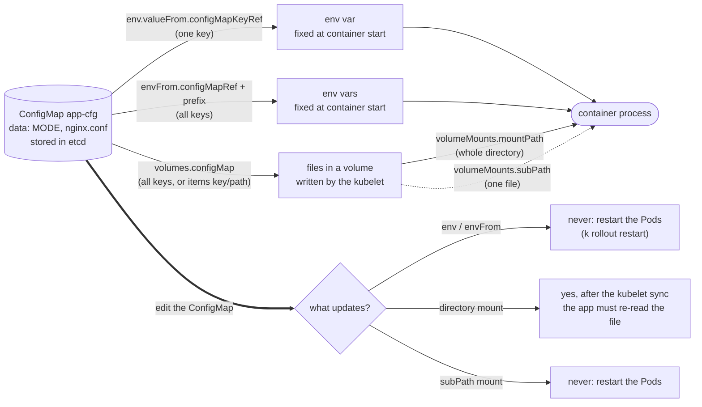

# T3.03 ConfigMaps

> Competency: "Understand ConfigMaps" (CKAD-4.5) | Domain/weight: CKAD, Application Environment, Configuration and Security (25%) | Est. time: 2 h | Prerequisites: T2.03

Shell setup (from [conventions](../00-conventions.md); put it at the top of every session):

```bash
alias k=kubectl
export do="--dry-run=client -o yaml"
export now="--force --grace-period=0"
source <(kubectl completion bash); complete -o default -F __start_kubectl k
```

Lab environment for this lesson: **kind** (cluster `lab`, context `kind-lab`). Namespace: `lab-t303`. Files go in `~/lab/t303/`.

> Output policy. This lesson was written on a machine that could not run a kind cluster at the time (the machine-wide kind lock was held for the full 20-minute wait, see section 11). Output blocks therefore carry one of three labels:
> - `REAL OUTPUT (kubectl v1.37.1 client, --dry-run=client, no cluster)`: captured here; shows the YAML a command would send and the client-side error messages.
> - `REAL OUTPUT (Docker)`: captured here from plain Linux containers (nginx 1.27.5, busybox 1.36). It is not a Pod or a kind result.
> - `EXPECTED OUTPUT (not captured)`: the shape you should see on a v1.37 cluster. Error and event texts in these blocks were taken from the Kubernetes v1.37.1 source code; ages, hash suffixes and IP addresses will differ. Every such block is listed in section 11.

---

## 1. Why this matters

A container image should be the same in dev, staging and prod. What changes between them is configuration: a log level, a database host, an `nginx.conf`. A **ConfigMap** is the Kubernetes object that holds that configuration, so you can change it without rebuilding the image. In real life the dangerous part is not creating a ConfigMap but knowing when a change reaches the running container: environment variables never update, files in a mounted volume update after a delay, and files mounted with `subPath` never update. If you do not know this, you edit a ConfigMap, see nothing change, and lose an hour. For the exam, "create a ConfigMap and mount or inject it into a Pod" is a core CKAD skill: it sits in the Application Environment, Configuration and Security domain (25% of the CKAD curriculum). The exam averages about 6 minutes per task (15-20 tasks in 2 hours; sources: [E2](https://docs.linuxfoundation.org/tc-docs/certification/tips-cka-and-ckad), [E3](https://docs.linuxfoundation.org/tc-docs/certification/faq-cka-ckad-cks)), so you need the imperative commands and the Pod YAML shape from memory.

You should already know what a Pod is, what a container `env` entry is, and how a volume is mounted. If not, read [T2.03](../part2-basics/T2.03-pods-in-depth.md) first.

---

## 2. Concepts

### 2.1 What a ConfigMap is, and the problem it solves

A **ConfigMap** is a namespaced API object (`apiVersion: v1`, `kind: ConfigMap`) that stores non-secret configuration as key-value pairs. A key is a short name such as `LOG_LEVEL` or `nginx.conf`. A value is a string: one word, a whole file, or anything else that fits.

Without ConfigMaps you have two bad options. You can bake the setting into the image (change = rebuild and re-push), or you can write the value straight into every Pod spec (change = edit every manifest, and a big file does not fit well in YAML). A ConfigMap separates the two jobs: the image holds code, the ConfigMap holds settings, and the Pod spec only says "take the settings from there".

| Fact | Detail |
|---|---|
| Scope | Namespaced. The Pod and the ConfigMap must be in the same namespace. |
| Object name | Must be a valid DNS subdomain name (lowercase letters, digits, `-` and `.`). |
| Not confidential | Values are stored as plain text in etcd and are readable by anyone who can `get` the object. Passwords and tokens belong in a Secret (a separate object with the same consumption patterns; not covered in this lesson). |
| Size limit | 1 MiB (1,048,576 bytes). The API server's check adds up the length of all values in `data` and `binaryData`. Bigger data belongs in a volume or an image. |
| Key names | Letters, digits, `-`, `_` and `.` only (regex `[-._a-zA-Z0-9]+`). |
| No `spec` | The fields are top-level: `data`, `binaryData`, `immutable`. Both `data` and `binaryData` are optional. |

### 2.2 Under the hood

Knowing who does what explains every "my change did not arrive" symptom.

1. **API server.** `kubectl create configmap` sends a `ConfigMap` object. The API server validates the key names and the size, then stores it in etcd. It does nothing else. It never pushes the data into Pods.
2. **Scheduler and controllers** do not care about ConfigMaps. A Pod that references a missing ConfigMap is still scheduled to a node.
3. **Kubelet** (the agent on the node) does the work. Before it starts a container, it reads every ConfigMap the Pod references:
   - For **env vars** (`env.valueFrom.configMapKeyRef`, `envFrom`): the kubelet reads the values each time it is about to start the container and passes them to the container runtime as the process environment. A process environment is fixed when the process starts. Nothing can change it later, so a running process never sees a new value. (A container that the kubelet restarts inside the same Pod is started again, so it re-reads the current values. Replacing the Pod creates new containers, which also read the current values.) Only keys in `data` reach env vars. Keys in `binaryData` are not propagated to env vars.
   - For **volumes** (`volumes[].configMap`): the kubelet writes the keys as files into a directory on the node and mounts that directory into the container. The kubelet keeps watching the ConfigMap. When it changes, the kubelet rewrites the files on its next volume sync. A running process sees the new files, but it must re-read them (many programs do not).
4. **Atomic update trick.** The kubelet never overwrites a file in place. It writes a new timestamped directory (named like `..2026_10_28_10_30_00.123456789`), then switches a symlink named `..data` to point at it. Each key in the mount (`MODE`, `nginx.conf`, ...) is itself a symlink to `..data/<key>`. The switch is one atomic operation, so a reader never sees half of the old config and half of the new.
5. **Timing.** The kubelet re-checks mounted volumes on a periodic sync. The docs (https://kubernetes.io/docs/tasks/configure-pod-container/configure-pod-configmap/) say the total delay is "as long as kubelet sync period (1 minute by default) + TTL of ConfigMaps cache" and that the cache type is chosen with `configMapAndSecretChangeDetectionStrategy`. In the v1.37.1 source the default strategy is `Watch` (updates are pushed to the kubelet, so the cache part is small) and `syncFrequency` defaults to 1 minute. So expect a delay of up to about a minute, not seconds. The docs also say you can force an immediate refresh by changing one of the Pod's annotations. Section 5 gives you a loop to measure it.
6. **A failing reference blocks the container, not the Pod object.** If the Pod points at a ConfigMap or key that does not exist, the kubelet cannot build the container. It reports `CreateContainerConfigError` (env references) or keeps the Pod in `ContainerCreating` with a `FailedMount` event (volume references), and retries. Once the missing object appears, the Pod recovers by itself. Section 6 shows both.

### 2.3 Creating a ConfigMap imperatively

`kubectl create configmap` (short name `cm`) has three data sources. You can mix them in one command, and you can repeat each flag.

| Flag | What it reads | Resulting key | Resulting value |
|---|---|---|---|
| `--from-literal=KEY=value` | The text you type | `KEY` | `value` |
| `--from-file=path` | One file | The **file name** (without the directory) | The whole file content |
| `--from-file=key=path` | One file | The `key` you choose | The whole file content |
| `--from-file=dir/` | Every regular file directly in the directory (subdirectories, symlinks and other entries are ignored) | Each file name | Each file content |
| `--from-env-file=path` | A file of `KEY=value` lines | Each `KEY` | Each `value` |

Details that matter:

- **`--from-file` uses the file name as the key.** `--from-file=nginx.conf` gives a key called `nginx.conf`. `--from-file=./sub/nginx.conf` also gives `nginx.conf`, not the path. If a Pod expects a different key name (say `default.conf`), use the `key=path` form: `--from-file=default.conf=nginx.conf`. This is the third mistake in section 6.
- **`--from-env-file` splits the file into many keys.** It skips blank lines and lines that start with `#`. Quotation marks are not special: they become part of the value. Compare: `--from-file=app.env` makes ONE key called `app.env` holding the whole file; `--from-env-file=app.env` makes one key per line.
- **A literal needs `=`.** `--from-literal=novalue` is an error. Use `KEY=` for an empty value.
- **`$do` works.** Add `$do` to print the YAML instead of creating the object. You use this to start a manifest, and to update an existing ConfigMap with `| k apply -f -`.

**Setup for all of section 2.** Every command in section 2 runs in the namespace `lab-t303`. Create it first, switch to the right cluster and set the namespace for your session, then create the files (in `~/lab/t303/`). At the end of section 2 you delete the namespace again, so sections 4.3 and 5 start clean.

```bash
k config use-context kind-lab
k delete ns lab-t303 --ignore-not-found; k create ns lab-t303
k config set-context --current --namespace=lab-t303
mkdir -p ~/lab/t303/confdir ~/lab/t303/sub; cd ~/lab/t303
cat > nginx.conf <<'EOF'
server {
  listen 8080;
  location / { default_type text/plain; return 200 "hello from nginx.conf\n"; }
}
EOF
cp nginx.conf sub/nginx.conf
cat > app.env <<'EOF'
# comment lines are skipped
APP_COLOR=blue
APP_MODE=prod

LOG_LEVEL=info
EOF
echo 'a=1' > confdir/one.properties; echo 'b=2' > confdir/two.properties
mkdir confdir/nested; echo z > confdir/nested/z.txt      # a subdirectory: it will be ignored
```

The three methods from the task entry, plus a custom key and a directory. On a live cluster each command prints one line:

EXPECTED OUTPUT (not captured)

```
$ k create cm app-cfg --from-literal=MODE=prod --from-file=nginx.conf
configmap/app-cfg created
$ k create cm env-cfg --from-env-file=app.env
configmap/env-cfg created
$ k create cm site-cfg --from-file=site.conf=nginx.conf
configmap/site-cfg created
$ k create cm dir-cfg --from-file=confdir
configmap/dir-cfg created
```

What the objects contain. Adding `$do` to each command prints the object without creating it (this needs no cluster):

REAL OUTPUT (kubectl v1.37.1 client, `--dry-run=client`, no cluster)

```
$ k create cm app-cfg --from-literal=MODE=prod --from-file=nginx.conf $do
apiVersion: v1
data:
  MODE: prod
  nginx.conf: |
    server {
      listen 8080;
      location / { default_type text/plain; return 200 "hello from nginx.conf\n"; }
    }
kind: ConfigMap
metadata:
  name: app-cfg
$ k create cm env-cfg --from-env-file=app.env $do
apiVersion: v1
data:
  APP_COLOR: blue
  APP_MODE: prod
  LOG_LEVEL: info
kind: ConfigMap
metadata:
  name: env-cfg
$ k create cm one-key --from-file=app.env $do
apiVersion: v1
data:
  app.env: |
    # comment lines are skipped
    APP_COLOR=blue
    APP_MODE=prod

    LOG_LEVEL=info
kind: ConfigMap
metadata:
  name: one-key
$ k create cm site-cfg --from-file=site.conf=nginx.conf $do
apiVersion: v1
data:
  site.conf: |
    server {
      listen 8080;
      location / { default_type text/plain; return 200 "hello from nginx.conf\n"; }
    }
kind: ConfigMap
metadata:
  name: site-cfg
$ k create cm path-cfg --from-file=./sub/nginx.conf $do | head -5
apiVersion: v1
data:
  nginx.conf: |
    server {
      listen 8080;
$ k create cm dir-cfg --from-file=confdir $do
apiVersion: v1
data:
  one.properties: |
    a=1
  two.properties: |
    b=2
kind: ConfigMap
metadata:
  name: dir-cfg
```

Read the output:

- `app-cfg` has two keys: `MODE` (from the literal) and `nginx.conf` (from the file, key = file name). The `|` after `nginx.conf:` is YAML's block scalar: the indented lines below are one multi-line string.
- `env-cfg` has one key per line of `app.env`; the comment line and the blank line are gone.
- `one-key` shows the difference: `--from-file=app.env` stores the whole file under the single key `app.env`.
- `site-cfg` has the custom key `site.conf`. `path-cfg` shows that a path is reduced to the file name.
- `dir-cfg` has one key per regular file; the `nested/` subdirectory is ignored.

Bad input is refused by `kubectl` before anything is sent (`[exit 1]` is the shell exit status, printed by the capture script):

REAL OUTPUT (kubectl v1.37.1 client, `--dry-run=client`, no cluster)

```
$ k create cm bad --from-literal='bad key=1' $do
error: "bad key" is not a valid key name for a ConfigMap: a valid config key must consist of alphanumeric characters, '-', '_' or '.' (e.g. 'key.name',  or 'KEY_NAME',  or 'key-name', regex used for validation is '[-._a-zA-Z0-9]+')
[exit 1]
$ k create cm bad2 --from-literal=novalue $do
error: invalid literal source novalue, expected key=value
[exit 1]
$ k create cm bad3 --from-file=nosuchfile.txt $do
error: error reading nosuchfile.txt: no such file or directory
[exit 1]
```

The three errors are: a space in a key name, a literal with no `=`, and a file that does not exist.

On a live cluster you inspect objects with `k get cm`, `k describe cm NAME` and `k get cm NAME -o yaml`. The listing has a `DATA` column (the number of keys):

EXPECTED OUTPUT (not captured)

```
$ k get cm
NAME               DATA   AGE
app-cfg            2      15s
dir-cfg            2      12s
env-cfg            3      14s
kube-root-ca.crt   1      3m
site-cfg           1      13s
```

(`kube-root-ca.crt` exists in every namespace; the cluster creates it.) `k describe cm env-cfg` prints the keys under a `Data` heading and ends with `Events: <none>`; `k get cm app-cfg -o yaml` prints the object like the `$do` output above plus `metadata.namespace`, `uid`, `resourceVersion` and `creationTimestamp`.

### 2.4 `data` vs `binaryData`, size limit, `immutable`

**`data` vs `binaryData`.** `data` holds UTF-8 text. `binaryData` holds arbitrary bytes, base64-encoded in the YAML. `kubectl` chooses for you: if a file is valid UTF-8 it goes to `data`, otherwise to `binaryData`. A key may appear in only one of the two maps (the API server rejects a duplicate). You write `binaryData` by hand only for small binary blobs such as a keystore. Remember: `binaryData` keys are mounted as files like any other key, but they are never turned into environment variables.

The file `blob.bin` below holds the four bytes `00 01 fe ff`, which are not valid UTF-8:

```bash
printf '\x00\x01\xfe\xff' > blob.bin
```

REAL OUTPUT (kubectl v1.37.1 client, `--dry-run=client`, no cluster)

```
$ k create cm bin-cfg --from-file=blob.bin --from-literal=txt=hi $do
apiVersion: v1
binaryData:
  blob.bin: AAH+/w==
data:
  txt: hi
kind: ConfigMap
metadata:
  name: bin-cfg
```

The binary file landed in `binaryData` as base64 (`AAH+/w==`), while the literal `txt=hi` stayed in `data`.

**Size limit.** The sum of all values must be at most 1 MiB. Why: ConfigMaps live in etcd, which is tuned for small objects, and every kubelet that uses a ConfigMap keeps a copy. To test the limit yourself:

```bash
head -c 1048576 /dev/zero | tr '\0' 'a' > big.txt      # exactly 1 MiB: allowed
head -c 1048577 /dev/zero | tr '\0' 'a' > bigger.txt   # one byte more: refused
k create cm size-ok --from-file=big.txt
k create cm size-bad --from-file=bigger.txt
```

The wording was checked in the v1.37.1 source: `ValidateConfigMap` (`pkg/apis/core/validation/validation.go`) calls `field.TooLong` with an empty path, `TooLong` builds the detail `may not be more than 1048576 bytes`, and an empty path prints as `[]` (`apimachinery/pkg/util/validation/field/errors.go` and `path.go`). The block itself was not produced by a live API server.

EXPECTED OUTPUT (not captured)

```
configmap/size-ok created
The ConfigMap "size-bad" is invalid: []: Too long: may not be more than 1048576 bytes
```

Delete the big object when you are done (`k delete cm size-ok`).

**`immutable: true`.** A top-level field. Once set, nobody can change `data` or `binaryData`, and nobody can switch `immutable` back to `false`. The only way to change the content is to delete and recreate the object. Two benefits: a stray edit cannot break production, and the kubelet no longer needs to watch the object, which lowers load on the API server in big clusters. The cost: Pods that already use it keep what they have, so a rollout needs a new ConfigMap name (for example `app-cfg-v2`) and a changed Pod template.

```yaml
apiVersion: v1
kind: ConfigMap
metadata:
  name: frozen
data:
  A: "1"
immutable: true      # default false; true = content can never change
```

Save this as `frozen.yaml`, then try to change it:

```bash
k apply -f frozen.yaml
k patch cm frozen -p '{"data":{"A":"2"}}'
k patch cm frozen -p '{"immutable":false}'
```

The two `Forbidden` lines are the exact texts from the v1.37.1 validation code.

EXPECTED OUTPUT (not captured)

```
configmap/frozen created
The ConfigMap "frozen" is invalid: data: Forbidden: field is immutable when `immutable` is set
The ConfigMap "frozen" is invalid: immutable: Forbidden: field is immutable when `immutable` is set
```

To change an immutable ConfigMap: `k delete cm frozen`, then create it again.

### 2.5 Consuming a ConfigMap in a Pod

There are three ways to hand a ConfigMap to a container. The first two go under `spec.containers[]`; the third needs `spec.volumes[]` plus `volumeMounts[]`. The table in 2.7 compares all three by what happens when the ConfigMap is edited; read it after this section.

| Method | Field | What the container gets | Updates while running? |
|---|---|---|---|
| One key as an env var | `env[].valueFrom.configMapKeyRef` (`name`, `key`, `optional`) | One variable, name of your choice | No |
| All keys as env vars | `envFrom[].configMapRef` (`name`, `optional`) with sibling `prefix` | One variable per key in `data`, name = key (with the prefix in front) | No |
| Files in a volume | `volumes[].configMap` (`name`, `items`, `defaultMode`, `optional`) + `volumeMounts[]` | One file per key (or per selected `items`) | Yes, with a delay (not with `subPath`) |

**One key as env (`configMapKeyRef`).** You pick the variable name (`env[].name`) and point at `configMapKeyRef.name` (the ConfigMap) and `configMapKeyRef.key`. The variable name does not have to match the key.

**All keys as env (`envFrom`).** Every key in `data` becomes a variable with the same name. `prefix` is added in front, so `prefix: CFG_` turns key `APP_MODE` into `CFG_APP_MODE`. Use a prefix to stop two ConfigMaps from colliding, or to avoid overwriting a variable the image already sets. Rules:

- If the same name comes from two `envFrom` sources, the **later** source wins. An explicit `env` entry beats everything from `envFrom` (the kubelet loads `envFrom` first, then lets `env` replace values).
- Keys whose names are not usable as shell variables (`my-key`, `my.key`, `1abc`) are a special case; see "Odd key names" below.

**Files in a volume.** Add a volume of type `configMap` and mount it. Without `items`, every key becomes a file: the key is the file name, the value is the content. With `items`, only the listed keys are projected and `path` sets the file name (it may include subdirectories, but must be relative and may not contain `..`). A key you do not list does not appear. Two facts about mounts:

- The mount is **read-only**. A container cannot write into it.
- Mounting a volume at a directory **hides** whatever the image already had there. Mounting a ConfigMap on `/etc/nginx/conf.d` replaces the whole directory with just your files. This is usually what you want, but check it when you mount on a directory the image fills.

The Pod used for the next outputs is the one in section 4.2 (`consume`; save that manifest as `consume.yaml` in `~/lab/t303/`, it needs `app-cfg` and `env-cfg` from 2.3). After `k apply -f consume.yaml` and `k wait --for=condition=Ready pod/consume`, you inspect it from outside:

Values follow from the ConfigMaps defined above; `<...>` marks parts that vary.

EXPECTED OUTPUT (not captured)

```
$ k exec consume -- env | grep -E '^(APP_|CFG_)' | sort
APP_MODE=prod
CFG_APP_COLOR=blue
CFG_APP_MODE=prod
CFG_LOG_LEVEL=info
$ k exec consume -- ls -la /etc/cfg
...
drwxr-xr-x  2 root root  ... ..<timestamp-directory>
lrwxrwxrwx  1 root root  ... ..data -> ..<timestamp-directory>
lrwxrwxrwx  1 root root  ... MODE -> ..data/MODE
lrwxrwxrwx  1 root root  ... nginx.conf -> ..data/nginx.conf
$ k exec consume -- cat /etc/cfg/MODE
prod
$ k exec consume -- find -L /etc/app -type f -not -path '*/..*'
/etc/app/color.txt
/etc/app/conf/mode.txt
$ k exec consume -- cat /etc/app/conf/mode.txt
prod
```

Read the output:

- `APP_MODE=prod` came from the single key; the three `CFG_*` variables came from `envFrom` with the prefix (the comment line in `app.env` was ignored when the ConfigMap was created).
- `ls -la /etc/cfg` shows the atomic-update layout from 2.2: `..data` is a symlink to a timestamped directory, and `MODE` and `nginx.conf` are symlinks to `..data/MODE` and `..data/nginx.conf`. (The exact permission bits of the timestamped directory are not shown here.)
- `/etc/app` contains only the two files you listed in `items`, with `conf/mode.txt` placed in a subdirectory by `path`. `LOG_LEVEL` is not there.
- Why `find -L`: in a ConfigMap volume the top-level entries (`color.txt`, `conf`) are symlinks into `..data`, and the real files sit under the hidden timestamped directory. Plain `find -type f` does not follow symlinks, so the visible names are not reported as files, and the real files under the hidden directory are removed by the `-not -path '*/..*'` filter. The result is empty. `-L` makes `find` follow the symlinks, so the visible names are listed. The same layout built by hand in a busybox 1.36 container behaves like this:

REAL OUTPUT (Docker)

```
$ find /etc/app -type f -not -path '*/..*'
$ find -L /etc/app -type f -not -path '*/..*' | sort
/etc/app/color.txt
/etc/app/conf/mode.txt
```

(The first command prints nothing. The layout was made with `ln -s ..data/color.txt color.txt`-style symlinks; it is not a kubelet-written volume.) If `find` is unfamiliar, `k exec consume -- ls -R /etc/app` and `cat` of the two files give the same facts.

The mount is read-only, and the default file mode is 0644:

EXPECTED OUTPUT (not captured)

```
$ k exec consume -- touch /etc/cfg/x
touch: /etc/cfg/x: Read-only file system
command terminated with exit code 1
$ k exec consume -- stat -L -c '%a %U %n' /etc/cfg/MODE
644 root /etc/cfg/MODE
```

(The `stat` command line itself was checked in a busybox 1.36 container; it prints `<mode> <owner> <name>`.)

**`kubectl set env --from`: a shortcut that is NOT `envFrom`.** On a Deployment you can add variables from a ConfigMap without editing YAML:

```bash
k set env deploy/web --from=configmap/app-cfg
k set env deploy/web --from=configmap/env-cfg --prefix=P_
k set env deploy/web --list
```

Read the kubectl v1.37.1 source (`set_env.go`) and you learn what it really does: it reads the ConfigMap **at that moment**, and for **each key in `data`** it adds one `env[]` entry with a `configMapKeyRef` (not an `envFrom` entry). Consequences:

- A key added to the ConfigMap later does not appear in the Pod. A true `envFrom` would pick it up on the next restart.
- Variable names are made from the key: letters are upper-cased and every character that is not a letter, digit or `_` becomes `_`. For the key `nginx.conf` that gives `NGINX_CONF`, and kubectl prints a warning `key nginx.conf transferred to NGINX_CONF`.
- `--prefix=P_` is put in front of every generated name; `--keys=MODE,LOG_LEVEL` limits the keys.
- Changing the Pod template makes the Deployment roll out new Pods automatically.

The success line is certain; the `--list` wording follows kubectl's reference formatter and should be confirmed.

EXPECTED OUTPUT (not captured)

```
$ k set env deploy/web --from=configmap/app-cfg
Warning: key nginx.conf transferred to NGINX_CONF
deployment.apps/web env updated
$ k set env deploy/web --list
# deployments/web, container <name>
MODE from configmap app-cfg, key MODE
NGINX_CONF from configmap app-cfg, key nginx.conf
```

**Precedence in practice.** Pod `prec1` has `envFrom: [pa, pb]` and both ConfigMaps define `K` (`pa`: `K=A`, `pb`: `K=B`). `prec2` adds an explicit `env: K=explicit`. Create them and read the logs:

```bash
k create cm pa --from-literal=K=A --from-literal=ONLY_A=1
k create cm pb --from-literal=K=B
cat > prec.yaml <<'EOF'
apiVersion: v1
kind: Pod
metadata:
  name: prec1
spec:
  restartPolicy: Never
  containers:
  - name: app
    image: busybox:1.36
    command: ["sh", "-c", "env | grep -E '^(K|ONLY_A)=' | sort"]
    envFrom:
    - configMapRef: {name: pa}
    - configMapRef: {name: pb}
---
apiVersion: v1
kind: Pod
metadata:
  name: prec2
spec:
  restartPolicy: Never
  containers:
  - name: app
    image: busybox:1.36
    command: ["sh", "-c", "env | grep -E '^(K|ONLY_A)=' | sort"]
    env:
    - name: K
      value: explicit
    envFrom:
    - configMapRef: {name: pa}
    - configMapRef: {name: pb}
EOF
k apply -f prec.yaml
k logs prec1; k logs prec2
```

This follows from the order in the kubelet code (`envFrom` entries in order, then `env`).

EXPECTED OUTPUT (not captured)

```
K=B
ONLY_A=1
K=explicit
ONLY_A=1
```

Clean up the Pods of this section: `k delete pod consume prec1 prec2 $now`.

**Odd key names.** A key such as `my-key`, `my.key` or `1abc` is a legal ConfigMap key but looks wrong as a shell variable. The docs page for this task says `envFrom` skips keys "that are considered invalid" and records an `InvalidEnvironmentVariableNames` event. However, the v1.37.1 kubelet code that builds the environment (`makeEnvironmentVariables` in `pkg/kubelet/kubelet_pods.go`) copies every key of `data` into the environment with the prefix and has no such filter, and the Pod validation for environment names was relaxed (feature `RelaxedEnvironmentVariableValidation`, GA and locked on since 1.34). So on v1.37 these keys most likely become variables whose names a shell cannot reference with `$name`. The docs and the code disagree, and this lesson did not run it. Do not rely on either behaviour: name keys with letters, digits and `_`, starting with a letter. To see what your cluster really does, run this test (about two minutes):

```bash
k create cm odd --from-literal=ok_key=1 --from-literal=my-key=2 --from-literal=my.key=3 --from-literal=1abc=4
cat <<'EOF' | k apply -f -
apiVersion: v1
kind: Pod
metadata:
  name: odd
spec:
  containers:
  - name: app
    image: busybox:1.36
    command: ["sleep", "3600"]
    envFrom:
    - configMapRef:
        name: odd
EOF
k wait --for=condition=Ready pod/odd --timeout=120s
k exec odd -- env | grep -E '^(ok_key|my-key|my\.key|1abc)='
k describe pod odd | grep -A8 '^Events:'
```

How to read it: if all four lines appear in the `env` output, the kubelet passed the odd names through (the code reading). If only `ok_key=1` appears and the events include `InvalidEnvironmentVariableNames`, the invalid keys were skipped (the docs reading). If the Pod does not become Ready, `k describe pod odd` shows why. Clean up with `k delete pod odd $now; k delete cm odd`.

### 2.6 `optional: true`

By default a reference is **required**. If the ConfigMap or the key is missing, the container does not start. Setting `optional: true` changes this.

| Where | Field | Missing ConfigMap | Missing key |
|---|---|---|---|
| `env[].valueFrom.configMapKeyRef` | `optional` | Variable is not set; container starts | Variable is not set; container starts |
| `envFrom[].configMapRef` | `optional` | No variables added; container starts | not applicable (all keys are loaded) |
| `volumes[].configMap` | `optional` | Volume is empty; container starts | With `items`: that item is skipped, the file is absent |

Default is `false` (required). Risky use: `optional: true` hides typos. A misspelled ConfigMap name now gives you a healthy Pod that silently runs without config. Use it only when the app really has a built-in default. Also: the docs say an optionally referenced ConfigMap that is created after the Pod started is picked up in volumes (after the kubelet sync), but never in env vars.

Four Pods that reference things which do not exist, and one that is tolerant. Save the first four as `missing.yaml` and the last one as `opt.yaml`:

```yaml
apiVersion: v1
kind: Pod
metadata:
  name: miss1
spec:
  containers:
  - name: app
    image: busybox:1.36
    command: ["sleep", "3600"]
    env:
    - name: X
      valueFrom:
        configMapKeyRef:
          name: nope              # ConfigMap does not exist
          key: X
---
apiVersion: v1
kind: Pod
metadata:
  name: miss2
spec:
  containers:
  - name: app
    image: busybox:1.36
    command: ["sleep", "3600"]
    env:
    - name: X
      valueFrom:
        configMapKeyRef:
          name: app-cfg           # exists
          key: NOKEY              # key does not exist
---
apiVersion: v1
kind: Pod
metadata:
  name: miss3
spec:
  containers:
  - name: app
    image: busybox:1.36
    command: ["sleep", "3600"]
    volumeMounts:
    - name: v
      mountPath: /etc/v
  volumes:
  - name: v
    configMap:
      name: nope                  # volume source does not exist
---
apiVersion: v1
kind: Pod
metadata:
  name: miss4
spec:
  containers:
  - name: app
    image: busybox:1.36
    command: ["sleep", "3600"]
    volumeMounts:
    - name: v
      mountPath: /etc/v
  volumes:
  - name: v
    configMap:
      name: app-cfg
      items:
      - key: NOKEY                # item key does not exist
        path: nokey.txt
```

```yaml
apiVersion: v1
kind: Pod
metadata:
  name: opt1
spec:
  containers:
  - name: app
    image: busybox:1.36
    command: ["sh", "-c", "echo X=[${X:-unset}] Y=[${Y:-unset}] files=$(ls -A /etc/opt | wc -l); sleep 3600"]
    env:
    - name: X
      valueFrom:
        configMapKeyRef:
          name: ghost             # missing ConfigMap, but optional
          key: X
          optional: true
    - name: Y
      valueFrom:
        configMapKeyRef:
          name: app-cfg
          key: NOKEY              # missing key, but optional
          optional: true
    envFrom:
    - configMapRef:
        name: ghost
        optional: true
    volumeMounts:
    - name: v
      mountPath: /etc/opt
  volumes:
  - name: v
    configMap:
      name: ghost
      optional: true
```

Apply them and watch (`app-cfg` from 2.3 must exist; `nope` and `ghost` must not):

```bash
k apply -f missing.yaml -f opt.yaml
k get pods
k get events --field-selector involvedObject.name=miss1 -o custom-columns=TYPE:.type,REASON:.reason,MESSAGE:.message
```

The status words and the event messages come from the v1.37.1 kubelet code; ages are omitted.

EXPECTED OUTPUT (not captured)

```
$ k get pods
NAME    READY   STATUS                       RESTARTS   AGE
miss1   0/1     CreateContainerConfigError   0          ...
miss2   0/1     CreateContainerConfigError   0          ...
miss3   0/1     ContainerCreating            0          ...
miss4   0/1     ContainerCreating            0          ...
opt1    1/1     Running                      0          ...
$ k get events --field-selector involvedObject.name=miss1 -o custom-columns=TYPE:.type,REASON:.reason,MESSAGE:.message
TYPE      REASON   MESSAGE
Warning   Failed   Error: configmap "nope" not found
```

For the other three Pods the matching messages are:

| Pod | Status | Event reason | Event message |
|---|---|---|---|
| `miss2` | `CreateContainerConfigError` | `Failed` | `Error: couldn't find key NOKEY in ConfigMap lab-t303/app-cfg` |
| `miss3` | `ContainerCreating` | `FailedMount` | `MountVolume.SetUp failed for volume "v" : configmap "nope" not found` |
| `miss4` | `ContainerCreating` | `FailedMount` | `MountVolume.SetUp failed for volume "v" : configmap references non-existent config key: NOKEY` |
| `opt1` | `Running` | (none) | `k logs opt1` prints `X=[unset] Y=[unset] files=0` |

Why env references and volume references fail at different stages: volumes are set up before any container starts, so a bad volume source keeps the Pod in `ContainerCreating`; env values are resolved when the container is created, so a bad env reference shows as `CreateContainerConfigError`. Recovery needs no deleting of Pods:

```bash
k create cm nope --from-literal=X=1
k wait --for=condition=Ready pod/miss1 pod/miss3 --timeout=240s
```

The kubelet retries with a back-off, so the Pods turn Ready within a few minutes after the ConfigMap appears. Clean up: `k delete pod miss1 miss2 miss3 miss4 opt1 $now; k delete cm nope`.

### 2.7 Update propagation, and why `subPath` is different

This is the most tested "gotcha" in this topic.

| Consumption | Does a running container see ConfigMap edits? | How to roll out a change |
|---|---|---|
| `env` / `envFrom` | **Never** (the environment is fixed when the process starts) | Restart the Pods: `k rollout restart deploy/NAME` |
| Volume, whole mount | **Yes, eventually**: the kubelet rewrites the files on a periodic sync (up to about a minute, see 2.2). The app must re-read the file (reload signal, `nginx -s reload`, or a program that re-reads on each request). | Wait, then signal the app; or restart |
| Volume with `subPath` | **Never** (official docs: "will not receive ConfigMap updates") | Restart the Pods |
| `immutable: true` ConfigMap | Cannot be edited at all | Create a new ConfigMap with a new name and point the Pod template at it |

Why `subPath` does not update. A normal mount shows the whole volume directory, and the kubelet updates it by switching the `..data` symlink inside it. A `subPath` mount (`volumeMounts[].subPath: MODE`) mounts one specific file from the volume into the container when the container starts. That mount refers to the old file. When the kubelet switches the symlink and deletes the old timestamped directory, the container still holds the old file. So the container keeps the old content until it is recreated.

People use `subPath` to drop a single file into a directory that already has other files (for example one file into `/etc/nginx` without hiding the rest). The price is that updates do not propagate. Prefer mounting a dedicated directory.

Section 5 shows all three paths side by side, with a loop that measures the delay.

### 2.8 `defaultMode` and file permissions

Files from a ConfigMap volume are owned by root. The default permission bits are `0644` (`rw-r--r--`).

| Field | Where | Meaning | Default |
|---|---|---|---|
| `defaultMode` | `volumes[].configMap.defaultMode` | Permission bits for every file in the volume | `0644` |
| `mode` | `volumes[].configMap.items[].mode` | Permission bits for one file; overrides `defaultMode` | `defaultMode` |

Rules and risks:

- The API accepts an octal value between 0000 and 0777 or a decimal value between 0 and 511. In YAML write octal with a leading zero (`0400`). If you write `400`, YAML reads decimal 400, which is octal `0620`: a silent mistake. JSON has no octal, so `0400` must be written as `256`. `k get pod -o yaml` always shows the decimal number.
- `defaultMode` applies to files, not to directories.
- A mode of `0400` makes the file readable only by its owner, which is root. A container that runs as a non-root user (`runAsUser: 1000`) gets `Permission denied`.
- `securityContext.fsGroup` makes the kubelet change the group of the volume files to that GID, and it can add mode bits (the API reference says the result "can be other mode bits set"). With a group-readable result, a non-root user in that group can read the file.
- (Alpha in v1.37, off by default: the fields `defaultUser` and item `user` need the `AtomicWriteVolumeUserFields` feature gate. Not needed for the exam.)

Three Pods to see this. `perm` mounts `app-cfg` with `defaultMode: 0400` and one item with `mode: 0644`. `perm2` and `perm3` run as UID 1000; `perm3` also has `fsGroup: 2000`:

```yaml
apiVersion: v1
kind: Pod
metadata:
  name: perm
spec:
  containers:
  - name: app
    image: busybox:1.36
    command: ["sleep", "3600"]
    volumeMounts:
    - name: v
      mountPath: /etc/p
  volumes:
  - name: v
    configMap:
      name: app-cfg
      defaultMode: 0400          # every file: r-------- (owner only)
      items:
      - key: MODE
        path: MODE               # inherits defaultMode 0400
      - key: nginx.conf
        path: nginx.conf
        mode: 0644               # this one file: rw-r--r--
---
apiVersion: v1
kind: Pod
metadata:
  name: perm2
spec:
  restartPolicy: Never
  securityContext:
    runAsUser: 1000              # not root, so a 0400 root-owned file is unreadable
  containers:
  - name: app
    image: busybox:1.36
    command: ["sh", "-c", "id; stat -L -c '%a %u:%g %n' /etc/p/MODE; cat /etc/p/MODE"]
    volumeMounts:
    - name: v
      mountPath: /etc/p
  volumes:
  - name: v
    configMap:
      name: app-cfg
      defaultMode: 0400
---
apiVersion: v1
kind: Pod
metadata:
  name: perm3
spec:
  restartPolicy: Never
  securityContext:
    runAsUser: 1000
    fsGroup: 2000                # volume files get group 2000
  containers:
  - name: app
    image: busybox:1.36
    command: ["sh", "-c", "id; stat -L -c '%a %u:%g %n' /etc/p/MODE; cat /etc/p/MODE"]
    volumeMounts:
    - name: v
      mountPath: /etc/p
  volumes:
  - name: v
    configMap:
      name: app-cfg
      defaultMode: 0400
```

Only lines that follow directly from the settings are shown; `...` marks lines not predicted here.

EXPECTED OUTPUT (not captured)

```
$ k exec perm -- stat -L -c '%a %U %n' /etc/p/MODE /etc/p/nginx.conf
400 root /etc/p/MODE
644 root /etc/p/nginx.conf
$ k get pod perm -o jsonpath='{.spec.volumes[0].configMap.defaultMode}{"\n"}'
256
$ k logs perm2
uid=1000 gid=0(root) groups=0(root)
400 0:0 /etc/p/MODE
cat: can't open '/etc/p/MODE': Permission denied
$ k logs perm3
...
prod
```

`perm2` fails with `Permission denied` because the file is `0400` and owned by root. In `perm3`, `fsGroup` changes the group of the files and adds group access, so the last line (the file content, `prod`) is printed. The exact mode bits shown by `stat` for `perm3` are not predicted here. Clean up: `k delete pod perm perm2 perm3 $now`.

### 2.9 ConfigMap values as command-line arguments (`$(VAR)` expansion)

In `command` and `args`, Kubernetes itself (not the shell) replaces `$(NAME)` with the value of the container's environment variable `NAME`. So a ConfigMap value can reach the command line: load it with `env` or `envFrom`, then write `$(NAME)` in `args`.

Rules:

- The syntax is `$(NAME)` with round brackets. `${NAME}` and `$NAME` are shell syntax, not Kubernetes.
- If `NAME` is not defined, the text stays as written, `$(NAME)`.
- `$$(NAME)` is an escape: it produces the literal text `$(NAME)`.
- The replacement happens before the process starts. If you run `sh -c "echo $MODE"`, the shell expands `$MODE` itself using the process environment; both approaches work, but they are different mechanisms.

```yaml
apiVersion: v1
kind: Pod
metadata:
  name: args1
spec:
  restartPolicy: Never
  containers:
  - name: app
    image: busybox:1.36
    command: ["echo"]
    args: ["mode=$(MODE)", "level=$(LOG_LEVEL)", "undefined=$(NOPE)", "escaped=$$(MODE)"]
    env:
    - name: MODE                 # from key MODE of app-cfg
      valueFrom:
        configMapKeyRef:
          name: app-cfg
          key: MODE
    envFrom:
    - configMapRef:
        name: env-cfg            # brings LOG_LEVEL (no prefix)
---
apiVersion: v1
kind: Pod
metadata:
  name: args2
spec:
  restartPolicy: Never
  containers:
  - name: app
    image: busybox:1.36
    command: ["sh", "-c", "echo shell sees $MODE"]   # the SHELL expands $MODE here
    env:
    - name: MODE
      valueFrom:
        configMapKeyRef:
          name: app-cfg
          key: MODE
```

Follows from the expansion rules above.

EXPECTED OUTPUT (not captured)

```
$ k logs args1
mode=prod level=info undefined=$(NOPE) escaped=$(MODE)
$ k logs args2
shell sees prod
```

Read it: `$(MODE)` and `$(LOG_LEVEL)` were replaced (the second one comes from `envFrom`), `$(NOPE)` stayed because no such variable exists, and `$$(MODE)` turned into the literal `$(MODE)`.

### 2.10 Projected volumes: ConfigMap + Secret + downwardAPI in one directory

A **projected volume** merges several sources into one directory, so the container sees one mount point. Allowed `sources`: `configMap`, `secret`, `downwardAPI`, `serviceAccountToken`, plus `clusterTrustBundle` and `podCertificate` (out of scope here). Why use it: some programs want one config directory, and three separate mounts would need three paths. Each source has its own `items` and `path`. Paths must not collide between sources. `defaultMode` on the projected volume applies to every file that does not set its own `mode`.

The `downwardAPI` source exposes Pod facts (name, labels, resource limits) as files. A Secret holds confidential data; its `secret:` source looks just like the `configMap:` one.

```yaml
apiVersion: v1
kind: Pod
metadata:
  name: projected
  labels:
    app: projected
spec:
  containers:
  - name: app
    image: busybox:1.36
    command: ["sleep", "3600"]
    volumeMounts:
    - name: all
      mountPath: /etc/all
      readOnly: true
  volumes:
  - name: all
    projected:
      defaultMode: 0440            # applies to every file below
      sources:
      - configMap:
          name: app-cfg
          items:
          - key: MODE
            path: config/MODE      # /etc/all/config/MODE
      - secret:
          name: app-secret
          items:
          - key: password
            path: secret/password  # /etc/all/secret/password
      - downwardAPI:
          items:
          - path: meta/podname     # /etc/all/meta/podname
            fieldRef:
              fieldPath: metadata.name
          - path: meta/labels      # /etc/all/meta/labels
            fieldRef:
              fieldPath: metadata.labels
```

Create the Secret first (the real client-side output below shows what is sent; the value is base64 of `s3cret`):

REAL OUTPUT (kubectl v1.37.1 client, `--dry-run=client`, no cluster)

```
$ k create secret generic app-secret --from-literal=password=s3cret $do
apiVersion: v1
data:
  password: czNjcmV0
kind: Secret
metadata:
  name: app-secret
```

Then apply the Pod and read the files:

```bash
k create secret generic app-secret --from-literal=password=s3cret
k apply -f projected.yaml
k wait --for=condition=Ready pod/projected
k exec projected -- sh -c 'cd /etc/all; for f in config/MODE secret/password meta/podname meta/labels; do echo "$f: $(cat $f)"; done'
k exec projected -- ls -A /etc/all
```

The `downwardAPI` labels file has one `key="value"` line per label.

EXPECTED OUTPUT (not captured)

```
config/MODE: prod
secret/password: s3cret
meta/podname: projected
meta/labels: app="projected"
..<timestamp-directory>  ..data  config  meta  secret
```

(`ls -A` prints one name per line on a terminal; the last line here is shortened.) Update behaviour is the same as for the individual sources: the files refresh after the kubelet sync, except where `subPath` is used. Clean up: `k delete pod projected $now; k delete secret app-secret`.

### 2.11 Static Pods and ConfigMaps

A **static Pod** is a Pod that the kubelet starts from a manifest file in its own directory (`/etc/kubernetes/manifests` on kubeadm and kind nodes), without the API server creating the Pod. The kubelet publishes a read-only **mirror Pod** in the API so you can see it. Because the kubelet starts it without the API, a static Pod cannot depend on API objects such as ConfigMaps, Secrets or ServiceAccounts.

What the docs and sources say:

- Concept page: "The spec of a static Pod cannot refer to a ConfigMap or any other API objects." Task page: "You can't use ConfigMaps for static pods, because the kubelet does not support this." (links in section 10)
- **v1.37 change.** The Kubernetes v1.37 changelog (https://github.com/kubernetes/kubernetes/blob/master/CHANGELOG/CHANGELOG-1.37.md, PR 140226) says: "Removed the `PreventStaticPodAPIReferences` feature gate. Static Pods can no longer reference API resources, and this behavior can no longer be disabled." Before 1.37 an administrator could turn the check off with that gate; from 1.37 it is always on.
- In the v1.37.1 source (`pkg/kubelet/config/common.go`) the kubelet checks every manifest it reads. For a Pod that references a ConfigMap (in `env`, `envFrom`, a `configMap` volume or a `projected` ConfigMap source) it rejects the manifest with the error `static pods may not reference configmaps`. The file is then ignored, and the kubelet logs `Could not process manifest file` with that error. Separately, the API server's `NodeRestriction` admission plugin refuses to create a mirror Pod that references other API objects (`node "<node>" can not create pods that reference configmaps`).

Reproduce it on a node (kind: `docker exec -it lab-control-plane bash`; kubeadm VM: `ssh cp1` then `sudo -i`). First create a ConfigMap in the namespace the static Pod will use, then drop a manifest:

```bash
# on your workstation
k create cm static-src -n default --from-literal=A=1
# on the node
cat > /etc/kubernetes/manifests/static-cm.yaml <<'EOF'
apiVersion: v1
kind: Pod
metadata:
  name: static-cm
  namespace: default
spec:
  containers:
  - name: app
    image: busybox:1.36
    command: ["sleep", "3600"]
    env:
    - name: A
      valueFrom:
        configMapKeyRef:
          name: static-src
          key: A
EOF
journalctl -u kubelet --no-pager | grep static-cm | tail -n 3
# on your workstation
k get pods -n default
```

The error text is from the source; the surrounding log format (timestamps, level, key names) is not predicted.

EXPECTED OUTPUT (not captured)

```
...  "Could not process manifest file" err="static pods may not reference configmaps" path="/etc/kubernetes/manifests/static-cm.yaml"
$ k get pods -n default
No resources found in default namespace.
```

No `static-cm-<node>` mirror Pod appears, and no container is started. Remove the file when done: `rm /etc/kubernetes/manifests/static-cm.yaml; k delete cm static-src -n default`. If a static Pod needs a setting, put it directly in the manifest (`env.value`), or mount a file from the node with a `hostPath` volume. That is also how the kubeadm control-plane Pods get their certificates and kubeconfig files.

### 2.12 Inspecting and editing data

| Task | Command |
|---|---|
| List | `k get cm` |
| Show YAML | `k get cm NAME -o yaml` |
| Human summary | `k describe cm NAME` |
| One value | `k get cm NAME -o jsonpath='{.data.KEY}'` (escape dots in the key: `{.data.nginx\.conf}`) |
| Change or add keys, keep the rest | `k create cm NAME --from-literal=KEY=new $do \| k apply -f -` |
| Replace ALL data | `k create cm NAME --from-file=... $do \| k replace -f -` |
| Edit in the editor | `k edit cm NAME` (uses `$KUBE_EDITOR`, then `$EDITOR`) |
| Change one key | `k patch cm NAME -p '{"data":{"KEY":"new"}}'` |
| Remove one key | `k patch cm NAME --type=json -p '[{"op":"remove","path":"/data/KEY"}]'` |
| Field docs | `k explain cm.immutable` |

Two traps with `apply`: (1) if the ConfigMap was created with `k create` (not `apply`), the first `apply` prints a warning and then works:

The warning text is kubectl's standard message.

EXPECTED OUTPUT (not captured)

```
$ k create cm app-cfg --from-literal=MODE=debug $do | k apply -f -
Warning: resource configmaps/app-cfg is missing the kubectl.kubernetes.io/last-applied-configuration annotation which is required by kubectl apply. kubectl apply should only be used on resources created declaratively by either kubectl create --save-config or kubectl apply. The missing annotation will be patched automatically.
configmap/app-cfg configured
```

(2) `apply` merges: keys you leave out of the new manifest are NOT removed from an object that has no last-applied record. To drop a key use the JSON `remove` patch, or `replace` the whole object.

**Finish section 2 (reset).** The command above set `MODE=debug` in `app-cfg`, and sections 4.3 and 5 expect a clean namespace with `MODE=prod`. Delete the whole lab namespace and point your session back at `default`:

```bash
cd ~; k delete ns lab-t303; k config set-context --current --namespace=default
```

Section 4.3 and section 5 each recreate the namespace in their own setup.

### 2.13 Related but different

- **Secret**: same shape and same consumption fields (`secretKeyRef`, `secretRef`, `secret:` volume), but meant for confidential values. Base64 in a Secret is encoding, not encryption, and a ConfigMap has no protection at all. Never put a password in a ConfigMap.
- **Pod `env.value`**: a literal value written in the Pod spec. Fine for one fixed value; a ConfigMap lets several Pods share it.
- **downwardAPI**: the Pod's own metadata (name, labels, limits) as env or files. Not user-defined config.
- **Kustomize `configMapGenerator`** and Helm: tools that generate ConfigMaps. Kustomize appends a content hash to the name, so a changed ConfigMap gets a new name, the Pod template changes, and the Deployment rolls automatically. This is the standard answer to "env vars never update".
- **Editing a ConfigMap vs. changing a Deployment**: editing a ConfigMap does not change the Pod template, so the Deployment controller does nothing. Only `rollout restart` (or a template change) replaces Pods.

---

## 3. How it works (diagram)



Walkthrough:

1. The ConfigMap lives in the API server (etcd). Three arrows leave it, one per consumption method; the kubelet on the node does the delivery.
2. The two env paths (one key, all keys) are resolved when the container is created. The values become part of the process environment and cannot change afterwards.
3. The volume path is different: the kubelet writes files into a directory and keeps it in sync. The solid arrow (directory mount) receives updates; the dotted arrow (`subPath`) points at a single file that is fixed when the container starts.
4. The bottom half answers "I edited the ConfigMap, what happens?": env and `subPath` need a restart; a directory mount updates after the kubelet sync, and the app must also re-read the file.
5. If a required source is missing, the container never reaches "container process": env sources give `CreateContainerConfigError`, volume sources give `ContainerCreating` with `FailedMount`.

---

## 4. Commands and YAML you must produce fast

### 4.1 Imperative shortcuts

```bash
# 1. literal + file in one ConfigMap (the key for the file = its file name)
k create cm app-cfg --from-literal=MODE=prod --from-file=nginx.conf

# 2. one key per line of an env file (comments and blank lines are skipped)
k create cm env-cfg --from-env-file=app.env

# 3. choose the key name for a file
k create cm site-cfg --from-file=site.conf=nginx.conf

# 4. whole directory: one key per regular file in it
k create cm dir-cfg --from-file=confdir/

# 5. generate YAML only (nothing is created); pipe to apply to create or update
k create cm app-cfg --from-literal=MODE=debug $do | k apply -f -

# 6. add env vars from a ConfigMap to a Deployment (one env entry per key; Pods roll)
k set env deploy/web --from=configmap/app-cfg

# 7. restart the Pods of a Deployment so they pick up new env values
k rollout restart deploy/web

# 8. read a file inside a running Pod (a bare Pod is "web"; a Deployment is "deploy/web")
k exec web -- cat /etc/cfg/MODE
k exec deploy/web -- cat /etc/cfg/MODE
```

1. creates a ConfigMap with two keys, `MODE` and `nginx.conf`. 2. creates one key per `KEY=value` line. 3. needs the `key=path` form when the key name must differ from the file name. 4. reads a directory (not recursive). 5. is the fastest way to create-or-update from files. 6. is the "no YAML" way to inject a ConfigMap (see the warning in 2.5: it snapshots the keys). 7. is the only clean way to refresh env values and `subPath` files. 8. is how you prove what the container sees: the form depends on whether you have a bare Pod or a Deployment.

There is no imperative flag for mounting a ConfigMap as a volume. The fast route is to generate a Pod skeleton and add the `volumes` and `volumeMounts` yourself:

```bash
k run web --image=busybox:1.36 $do -- sleep 3600 > pod.yaml
```

### 4.2 Declarative YAML: env, envFrom and a two-item mount

Save as `consume.yaml`. Every field is explained in the comments.

```yaml
apiVersion: v1
kind: Pod
metadata:
  name: consume
spec:
  containers:
  - name: app
    image: busybox:1.36
    command: ["sleep", "3600"]
    env:
    - name: APP_MODE            # variable name inside the container (free choice)
      valueFrom:
        configMapKeyRef:        # take ONE key
          name: app-cfg         # ConfigMap name (same namespace). Missing -> CreateContainerConfigError
          key: MODE             # key inside that ConfigMap. Missing -> CreateContainerConfigError
          # optional: true      # default false; true = start without the variable
    envFrom:
    - configMapRef:             # take ALL keys of env-cfg
        name: env-cfg           # ConfigMap name
        # optional: true        # default false
      prefix: CFG_              # put in front of every key; "prefix" is a sibling of configMapRef
    volumeMounts:
    - name: all                 # must match a volumes[].name below
      mountPath: /etc/cfg       # absolute directory in the container; hides what the image had there
    - name: two
      mountPath: /etc/app
  volumes:
  - name: all                   # no items: every key becomes a file
    configMap:
      name: app-cfg
  - name: two
    configMap:
      name: env-cfg
      items:                    # only these keys are projected
      - key: APP_COLOR          # key in the ConfigMap
        path: color.txt         # file name under /etc/app (may include a subdirectory)
      - key: APP_MODE
        path: conf/mode.txt     # becomes /etc/app/conf/mode.txt
      # defaultMode: 0400       # file permissions for the whole volume (octal, leading 0; default 0644)
      # optional: true          # default false
```

Common ways this goes wrong: `prefix` indented under `configMapRef` (it is a sibling: the API server rejects the unknown field), a `volumeMounts.name` that does not match any `volumes.name`, a `mountPath` that is not absolute, and a `key` that does not exist in the ConfigMap.

### 4.3 Speed drill

Target pace: about 6 minutes per exam task on average, so these small tasks should take seconds to two minutes ([E2](https://docs.linuxfoundation.org/tc-docs/certification/tips-cka-and-ckad), [E3](https://docs.linuxfoundation.org/tc-docs/certification/faq-cka-ckad-cks)). Do them in order.

Setup (one line, run first):

```bash
k config use-context kind-lab; k delete ns lab-t303 --ignore-not-found; k create ns lab-t303; k config set-context --current --namespace=lab-t303; mkdir -p ~/lab/t303; cd ~/lab/t303; printf 'APP_COLOR=blue\nAPP_MODE=prod\n' > app.env
```

| # | Task | Target |
|---|---|---|
| 1 | Create ConfigMap `d1` with `A=1` and `B=2`. | 30 s |
| 2 | Create ConfigMap `d2` from `app.env` so that the whole file is ONE key named `settings`. Print that value. | 45 s |
| 3 | Create Pod `d3` (`busybox:1.36`, `sleep 3600`) with env var `X` taken from key `A` of `d1`. | 2 min |
| 4 | Create Deployment `d4` (`busybox:1.36`, `sleep 3600`) whose containers get every key of `d1` as an env var with the prefix `D_`. | 1 min |
| 5 | Make `d1` immutable. | 30 s |
| 6 | Restart the Pods of `d4`. | 20 s |
| 7 | Create Pod `d5` (`busybox:1.36`, `sleep 3600`) that mounts only key `B` of `d1` as the file `/etc/d5/b.txt`. | 2 min |
| 8 | Show the contents of that file from outside the Pod. | 20 s |

<details><summary>Answers</summary>

```bash
# 1
k create cm d1 --from-literal=A=1 --from-literal=B=2
# 2  (key=path form: the key is "settings"; plain --from-file=app.env would give the key "app.env")
k create cm d2 --from-file=settings=app.env
k get cm d2 -o jsonpath='{.data.settings}'
# 3  generate a skeleton, add the env block under the container, then apply
k run d3 --image=busybox:1.36 $do -- sleep 3600 > d3.yaml
```

After adding the `env` block, `d3.yaml` looks like this (the generated file also has lines such as `resources: {}` and `dnsPolicy: ClusterFirst`, which you can leave):

```yaml
apiVersion: v1
kind: Pod
metadata:
  labels:
    run: d3
  name: d3
spec:
  containers:
  - args:
    - sleep
    - "3600"
    image: busybox:1.36
    name: d3
    env:
    - name: X
      valueFrom:
        configMapKeyRef:
          name: d1
          key: A
  restartPolicy: Always
```

```bash
k apply -f d3.yaml
# 4  (create the Deployment, then add one env entry per key, prefixed D_)
k create deploy d4 --image=busybox:1.36 --replicas=1 -- sleep 3600
k set env deploy/d4 --from=configmap/d1 --prefix=D_
# 5
k patch cm d1 -p '{"immutable":true}'
# 6
k rollout restart deploy/d4
# 7
cat > d5.yaml <<'EOF'
apiVersion: v1
kind: Pod
metadata:
  name: d5
spec:
  containers:
  - name: app
    image: busybox:1.36
    command: ["sleep", "3600"]
    volumeMounts:
    - name: v
      mountPath: /etc/d5
  volumes:
  - name: v
    configMap:
      name: d1
      items:
      - key: B
        path: b.txt
EOF
k apply -f d5.yaml
# 8
k exec d5 -- cat /etc/d5/b.txt
```

Note on task 4: `k set env --from` writes one `configMapKeyRef` entry per key that exists in `d1` right now (see 2.5), so a key added to `d1` later does not appear. A true `envFrom` with `prefix` (the shape in 4.2) needs the YAML form: add `envFrom: [{configMapRef: {name: d1}, prefix: D_}]` to the container. For a task that says "every key", either form shows the same variables today; use the YAML form when the task also says new keys must be picked up.

Expected: step 2 prints the two lines `APP_COLOR=blue` and `APP_MODE=prod`; step 8 prints `2`. Verify step 4 with `k exec deploy/d4 -- env | grep ^D_` (you should see `D_A=1` and `D_B=2`).

Cleanup (returns the namespace to empty; the lab namespace itself stays for the next section):

```bash
k delete pod d3 d5 $now; k delete deploy d4; k delete cm d1 d2
```

</details>

---

## 5. Worked example

Goal: find out which consumption methods see a ConfigMap change, and how long the volume takes. One Deployment `web` reads the same key `MODE` three ways: as an env var (`MODE_ENV`), from a whole-directory mount (`/etc/cfg/MODE`), and from a `subPath` mount (`/etc/sub/MODE`). Then you change the ConfigMap and watch.

Setup (the same ConfigMap as in section 2.3, recreated from a clean namespace so that `MODE` is `prod`):

```bash
k config use-context kind-lab; k delete ns lab-t303 --ignore-not-found; k create ns lab-t303
k config set-context --current --namespace=lab-t303
mkdir -p ~/lab/t303; cd ~/lab/t303
cat > nginx.conf <<'EOF'
server {
  listen 8080;
  location / { default_type text/plain; return 200 "hello from nginx.conf\n"; }
}
EOF
k create cm app-cfg --from-literal=MODE=prod --from-file=nginx.conf
```

**Step 1. Deploy the reader.** Save as `web.yaml`:

```yaml
apiVersion: apps/v1
kind: Deployment
metadata:
  name: web
spec:
  replicas: 1
  selector:
    matchLabels:
      app: web
  template:
    metadata:
      labels:
        app: web
    spec:
      containers:
      - name: web
        image: busybox:1.36
        command: ["sleep", "3600"]
        env:
        - name: MODE_ENV              # path 1: env var
          valueFrom:
            configMapKeyRef:
              name: app-cfg
              key: MODE
        volumeMounts:
        - name: cfg
          mountPath: /etc/cfg         # path 2: whole directory, all keys as files
        - name: cfg
          mountPath: /etc/sub/MODE    # path 3: ONE file, mounted at this path ...
          subPath: MODE               # ... taken from key MODE of the volume
      volumes:
      - name: cfg
        configMap:
          name: app-cfg
```

A small helper prints the three views at once (paste it once):

```bash
peek() { k exec deploy/web -- sh -c 'echo "env     = $MODE_ENV"; echo "volume  = $(cat /etc/cfg/MODE)"; echo "subPath = $(cat /etc/sub/MODE)"'; }
```

```bash
k apply -f web.yaml
k rollout status deploy/web
peek
```

EXPECTED OUTPUT (not captured)

```
deployment.apps/web created
deployment "web" successfully rolled out
env     = prod
volume  = prod
subPath = prod
```

All three views show `prod`: at start, every path delivers the same value.

**Step 2. Change the ConfigMap and watch the clock.** The loop reads the directory-mounted file every 5 seconds and stops when it changes (or after 5 minutes):

```bash
k patch cm app-cfg -p '{"data":{"MODE":"debug"}}'
t0=$(date +%s)
for i in $(seq 1 60); do
  v=$(k exec deploy/web -- cat /etc/cfg/MODE)
  echo "t+$(( $(date +%s)-t0 ))s volume=$v"
  [ "$v" = debug ] && break
  sleep 5
done
```

The shape is certain; the number of lines is not. The docs and the kubelet defaults (sync period 1 minute) suggest the switch happens within roughly the first minute or two; this lesson did not measure it.

EXPECTED OUTPUT (not captured)

```
configmap/app-cfg patched
t+0s volume=prod
t+5s volume=prod
...
t+<N>s volume=debug
```

(`<N>` is the propagation delay on your cluster; write the number you measure into your notes. To skip the wait you can change an annotation of the Pod, as the docs describe.)

**Step 3. Look at all three views after the change.**

```bash
peek
```

This result follows from the mechanisms in 2.2 and 2.7.

EXPECTED OUTPUT (not captured)

```
env     = prod
volume  = debug
subPath = prod
```

Only the directory mount changed. The env var still says `prod` because the process environment was fixed at start. The `subPath` file still says `prod` because that mount still refers to the old file.

**Step 4. Restart to fix env and subPath.**

```bash
k rollout restart deploy/web
k rollout status deploy/web
peek
k exec deploy/web -- cat /etc/cfg/MODE
```

EXPECTED OUTPUT (not captured)

```
deployment.apps/web restarted
deployment "web" successfully rolled out
env     = debug
volume  = debug
subPath = debug
debug
```

The restart creates new Pods, which read the ConfigMap again when they start. All three views now show `debug`. This is exactly what `k rollout restart deploy/web` is for. (Wait for the old Pod to terminate if `peek` happens to hit it; `k get pods` shows only the new one when the rollout is finished.)

**Check the kubelet settings on your cluster** (read from a node's `configz` endpoint through the API server; no `jq` needed):

```bash
k get nodes
k get --raw "/api/v1/nodes/lab-worker/proxy/configz" | grep -oE '"(syncFrequency|configMapAndSecretChangeDetectionStrategy)":"[^"]*"'
```

These are the defaults in the v1.37.1 kubelet code; a kind node may override them.

EXPECTED OUTPUT (not captured)

```
"syncFrequency":"1m0s"
"configMapAndSecretChangeDetectionStrategy":"Watch"
```

Cleanup of the worked example:

```bash
cd ~; k delete ns lab-t303; k config set-context --current --namespace=default; rm -rf ~/lab/t303
```

---

## 6. Common mistakes and how to fix them

**A repeatable troubleshooting path.** Run these in order. Stop at the first step that names the problem.

1. `k get pod NAME` (or `k get pods`): read `STATUS`. `CreateContainerConfigError` means an env or `envFrom` reference could not be resolved. `ContainerCreating` for a long time can mean a volume cannot be set up. `Running` but wrong content means a propagation problem (go to step 4).
2. `k describe pod NAME`: read the **Events** at the bottom. The last `Warning` lines name the missing ConfigMap or key exactly.
3. Compare with reality: `k get cm -n NAMESPACE` (is the name there, in the Pod's namespace?) and `k get cm NAME -o yaml` (is the key there, spelled the same, with the same case?). A key from `--from-file` carries the file name, extension included.
4. For "it runs, but the value is old": `k exec POD -- printenv NAME` or `k exec POD -- cat /path`. Ask: is it an env var? a `subPath` file? a directory-mounted file that the app has not re-read? Then restart or reload as in 2.7.
5. Fix the object that is wrong (the ConfigMap, or the Pod template). Do not delete the Pod for a missing-object problem: the kubelet retries and the Pod recovers once the reference resolves. For a Deployment, a template fix rolls out new Pods by itself.

| Symptom | What you will see (exact error/event text) | Cause | Fix (command) |
|---|---|---|---|
| Pod `CreateContainerConfigError`, ConfigMap missing | `k get pods`: `STATUS CreateContainerConfigError`. Event (reason `Failed`): `Error: configmap "nope" not found` | `configMapKeyRef.name` or `envFrom.configMapRef.name` points at a ConfigMap that does not exist in this namespace (typo, wrong namespace, not created yet) | Create it: `k create cm nope --from-literal=X=1`; or correct the name in the Pod/Deployment (`k edit deploy NAME`); or set `optional: true` if the app has defaults. The Pod recovers on its own. |
| Pod `CreateContainerConfigError`, key missing | Event: `Error: couldn't find key NOKEY in ConfigMap lab-t303/app-cfg` | The ConfigMap exists but has no such key (typo, different case, or the key is only in `binaryData`: env vars read `data` only) | `k get cm app-cfg -o yaml` to see the real keys; fix `key:` in the Pod; or add the key: `k patch cm app-cfg -p '{"data":{"NOKEY":"v"}}'` |
| Pod stuck in `ContainerCreating` | `k describe pod`: reason `FailedMount`: `MountVolume.SetUp failed for volume "v" : configmap "nope" not found` (whole ConfigMap missing) or `... configmap references non-existent config key: NOKEY` (an `items` entry names a missing key) | A `volumes[].configMap` source cannot be built; volumes are set up before containers start, so no container is created | Create the ConfigMap or fix `name:` / the `items[].key`; or `optional: true` on the volume. |
| Config change not visible in the container | `k exec POD -- printenv MODE_ENV` prints the OLD value; or `cat` of a `subPath` file prints the OLD value | Env vars are fixed when the process starts; `subPath` mounts never receive updates | `k rollout restart deploy/NAME`. For files, avoid `subPath`: mount a directory. |
| Directory-mounted file is new, app still behaves the old way | `cat /etc/cfg/FILE` shows the new content, but the app's behaviour is the old one | The app reads its config only at start (nginx, many servers) | Tell it to re-read: `k exec POD -- nginx -s reload`, or restart the Pods. Also remember the file refreshes only after the kubelet sync (up to about a minute). |
| `--from-file` key name is not what you expected | `k exec POD -- ls /etc/cfg` shows `nginx.conf` but the app wants `default.conf`; `k get cm NAME -o yaml` shows `nginx.conf:` as the key | `--from-file=PATH` uses the **file name** as the key | Use `key=path`: `k create cm NAME --from-file=default.conf=nginx.conf`; or map it at mount time with `items: [{key: nginx.conf, path: default.conf}]`. |
| `--from-file=app.env` gives ONE key, not many variables | `envFrom` brings a single variable called `app.env` (or nothing useful) | Wrong flag: `--from-file` stores the whole file under one key | Recreate with `--from-env-file=app.env` |
| Edit of a ConfigMap is rejected | `The ConfigMap "frozen" is invalid: data: Forbidden: field is immutable when `immutable` is set` | `immutable: true` | `k delete cm frozen` and recreate; for Deployments use a new name (`app-cfg-v2`) and update the Pod template. |
| ConfigMap too large | `The ConfigMap "big" is invalid: []: Too long: may not be more than 1048576 bytes` | Sum of values is over 1 MiB | Split the data, or ship the file in the image or a volume. |
| Non-root app: `Permission denied` on a mounted file | Log: `cat: can't open '/etc/p/MODE': Permission denied`; `stat` shows `400 root` | `defaultMode: 0400` (owner-only) with `runAsUser: 1000` | Use `0444`/`0644`, or set `securityContext.fsGroup`. Check with `k exec POD -- stat -L -c '%a %U %n' /etc/p/MODE`. |
| Mode looks wrong (`0620` instead of `0400`) | `k get pod -o yaml` shows `defaultMode: 400` | Written without the leading zero, so YAML read decimal 400 | Write `defaultMode: 0400` |
| The mounted directory lost the image's own files | App says its config or other files vanished after the mount | A volume hides everything the image had at that `mountPath` | Mount at a dedicated subdirectory, or use `items` with `subPath` knowing it will not update |
| Static Pod with a ConfigMap does not start | No mirror Pod; kubelet log: `static pods may not reference configmaps` | Static Pods cannot reference API objects (always enforced since v1.37) | Put the value in the manifest (`env.value`) or use a `hostPath` volume |
| `apply` warns about a missing annotation | `Warning: resource configmaps/app-cfg is missing the kubectl.kubernetes.io/last-applied-configuration annotation ...` | The ConfigMap was created with `k create`, now updated with `apply` | Harmless: kubectl patches the annotation. Use `k replace` or a JSON patch if you must remove keys. |

---

## 7. Labs

Environment for all three labs: **kind** (cluster `lab`, context `kind-lab`), namespace `lab-t303`, files in `~/lab/t303/`. Each lab deletes any old `lab-t303` namespace, creates a fresh one in its setup and deletes it in its cleanup, so you can do them in any order (suggested order: Easy, Medium, Break-fix). Do one lab at a time: all three use the same namespace name. Each setup also runs `k config use-context kind-lab`: always set the context explicitly before you touch a cluster (the number of contexts in the exam is UNVERIFIED, research summary E21, so make the habit cheap).

### Lab A (Easy): create ConfigMaps three ways and verify inside a Pod

**Setup**

```bash
k config use-context kind-lab; k delete ns lab-t303 --ignore-not-found; k create ns lab-t303
k config set-context --current --namespace=lab-t303
mkdir -p ~/lab/t303; cd ~/lab/t303
printf 'Welcome to lab T3.03\n' > motd.txt
printf 'TIER=gold\nREGION=eu-west\n' > site.env
```

**Task** (namespace `lab-t303`, work in `~/lab/t303`)

1. Create ConfigMap `site-literal` with the literals `GREETING=hello` and `LANG=en`.
2. Create ConfigMap `site-file` from the file `motd.txt`, but store it under the key `banner`.
3. Create ConfigMap `site-env` from the env file `site.env`.
4. Create Pod `check` (image `busybox:1.36`, command `sleep 3600`) that:
   - has an env var `GREETING` taken from key `GREETING` of `site-literal`,
   - gets all keys of `site-env` as env vars, each with the prefix `SITE_`,
   - mounts `site-file` at `/etc/site` (all keys).
5. Wait until the Pod is Running. Then, from outside the Pod, write the content of `/etc/site/banner` to `~/lab/t303/banner.out`, the value of `SITE_TIER` to `~/lab/t303/tier.out` and the value of `GREETING` to `~/lab/t303/greeting.out`.

<details><summary>Hint 1</summary>

Method 2 needs the `key=path` form of `--from-file`. Without it the key would be `motd.txt`, and the file in the Pod would be `/etc/site/motd.txt`.

</details>

<details><summary>Hint 2</summary>

Generate a Pod skeleton with `k run check --image=busybox:1.36 $do -- sleep 3600 > check.yaml`, then add `env`, `envFrom` (with `prefix` next to `configMapRef`), `volumeMounts` and `volumes`. Section 4.2 has the exact shape.

</details>

<details><summary>Hint 3</summary>

`k exec check -- printenv SITE_TIER` prints one variable. Redirect with `>` on your own machine, not inside the Pod.

</details>

<details><summary>Solution</summary>

```bash
cd ~/lab/t303
k create cm site-literal --from-literal=GREETING=hello --from-literal=LANG=en
k create cm site-file --from-file=banner=motd.txt        # key=path: key is "banner"
k create cm site-env --from-env-file=site.env            # one key per line

cat > check.yaml <<'EOF'
apiVersion: v1
kind: Pod
metadata:
  name: check
spec:
  containers:
  - name: app
    image: busybox:1.36
    command: ["sleep", "3600"]
    env:
    - name: GREETING
      valueFrom:
        configMapKeyRef:
          name: site-literal
          key: GREETING
    envFrom:
    - configMapRef:
        name: site-env
      prefix: SITE_
    volumeMounts:
    - name: site
      mountPath: /etc/site
  volumes:
  - name: site
    configMap:
      name: site-file
EOF
k apply -f check.yaml
k wait --for=condition=Ready pod/check --timeout=180s

k exec check -- cat /etc/site/banner > ~/lab/t303/banner.out
k exec check -- printenv SITE_TIER   > ~/lab/t303/tier.out
k exec check -- printenv GREETING    > ~/lab/t303/greeting.out
```

Why each step: `site-env` uses `--from-env-file` because the file is `KEY=value` lines; plain `--from-file` would make one key holding the whole file. The `prefix` field lives next to `configMapRef`, not inside it, and it turns `TIER` into `SITE_TIER`. The volume has no `items`, so every key becomes a file, which gives `/etc/site/banner`. `k wait` makes sure the container is running before `exec`.

</details>

**Verification** (prints `PASS` only if everything is right; any wrong value prints `FAIL`)

```bash
cd ~/lab/t303
test "$(cat banner.out)" = "Welcome to lab T3.03" \
  && test "$(cat tier.out)" = gold \
  && test "$(cat greeting.out)" = hello \
  && test "$(k get pod check -o jsonpath='{.status.phase}')" = Running \
  && test "$(k get cm site-literal site-file site-env -o name | wc -l)" -eq 3 \
  && k get cm site-file -o jsonpath='{.data}' | grep -q '"banner"' \
  && echo PASS || echo FAIL
```

Before you create anything the same command prints `FAIL` (the output files do not exist); when everything is right.

EXPECTED OUTPUT (not captured)

```
PASS
```

**Cleanup**

```bash
cd ~; k delete ns lab-t303; k config set-context --current --namespace=default; rm -rf ~/lab/t303
```

### Lab B (Medium): mount nginx config from a ConfigMap and reload it after an update

**Setup**

```bash
k config use-context kind-lab; k delete ns lab-t303 --ignore-not-found; k create ns lab-t303
k config set-context --current --namespace=lab-t303
mkdir -p ~/lab/t303; cd ~/lab/t303
cat > default.conf <<'EOF'
server {
  listen 8080;
  location / { default_type text/plain; return 200 "v1\n"; }
}
EOF
```

**Task** (namespace `lab-t303`, work in `~/lab/t303`)

1. Create ConfigMap `web-conf` from `default.conf` (the key must be `default.conf`).
2. Create Deployment `web` with 1 replica, label `app=web`, image `nginx:1.27`. Mount `web-conf` at `/etc/nginx/conf.d` (the whole directory, no `subPath`).
3. When the Pod is Ready, save its name to `pod.before`. Save the answer of `curl -s localhost:8080` run inside the Pod to `reply.v1` (it must be `v1`).
4. Change the response in `default.conf` from `v1` to `v2` and update the ConfigMap `web-conf` in the cluster. **Do not restart, delete or recreate the Pod.** Wait until the new file is visible inside the Pod, make nginx re-read its config, and save the new answer of `curl -s localhost:8080` (run inside the Pod) to `reply.v2`.

<details><summary>Hint 1</summary>

The `nginx:1.27` image contains `curl` and the `nginx` binary, so `k exec deploy/web -- curl -s localhost:8080` and `k exec deploy/web -- nginx -s reload` both work. The Deployment has one Pod, so `deploy/web` is enough.

</details>

<details><summary>Hint 2</summary>

`k create cm web-conf --from-file=default.conf $do | k apply -f -` creates the ConfigMap the first time and updates it later with the same command. After the update, poll the file in the Pod: `k exec deploy/web -- cat /etc/nginx/conf.d/default.conf`. It changes after the kubelet sync, not instantly.

</details>

<details><summary>Hint 3</summary>

Updating the file does not make nginx re-read it. Check the syntax first with `nginx -t`, then send the reload signal with `nginx -s reload`.

</details>

<details><summary>Solution</summary>

```bash
cd ~/lab/t303
k create cm web-conf --from-file=default.conf $do | k apply -f -

cat > web.yaml <<'EOF'
apiVersion: apps/v1
kind: Deployment
metadata:
  name: web
spec:
  replicas: 1
  selector:
    matchLabels:
      app: web
  template:
    metadata:
      labels:
        app: web
    spec:
      containers:
      - name: nginx
        image: nginx:1.27
        volumeMounts:
        - name: conf
          mountPath: /etc/nginx/conf.d     # whole directory: this is what receives updates
      volumes:
      - name: conf
        configMap:
          name: web-conf
EOF
k apply -f web.yaml
k rollout status deploy/web --timeout=180s

k get pod -l app=web -o jsonpath='{.items[0].metadata.name}' > pod.before
k exec deploy/web -- curl -s localhost:8080 > reply.v1

# change the config, push it to the cluster (same command as before)
sed -i.bak 's/v1/v2/' default.conf        # -i.bak works on GNU and BSD/macOS sed
k create cm web-conf --from-file=default.conf $do | k apply -f -

# wait for the kubelet to rewrite the file inside the Pod
until k exec deploy/web -- grep -q v2 /etc/nginx/conf.d/default.conf; do sleep 5; done

k exec deploy/web -- nginx -t              # syntax check
k exec deploy/web -- nginx -s reload       # re-read config, no restart
sleep 2
k exec deploy/web -- curl -s localhost:8080 > reply.v2
```

Plain-Linux proof of the nginx part (not a Pod): the same `default.conf` was bind-mounted into an `nginx:1.27` container in Docker, then edited on the host.

This was run in Docker with nginx 1.27.5. It is not a Pod or a kind result, and a bind mount updates instantly, unlike a kubelet-managed ConfigMap volume.

REAL OUTPUT (Docker)

```
$ curl -s localhost:8080
v1
$ curl -s localhost:8080       # file edited to v2, nginx NOT reloaded yet
v1
$ nginx -t
nginx: the configuration file /etc/nginx/nginx.conf syntax is ok
nginx: configuration file /etc/nginx/nginx.conf test is successful
$ nginx -s reload
2026/10/28 02:35:06 [notice] 47#47: signal process started
$ curl -s localhost:8080
v2
```

Why each step: mounting `/etc/nginx/conf.d` as a directory (no `subPath`) is what allows the update to arrive. The `until` loop is needed because the volume refresh is not instant (section 5 measures it). nginx only reads its config at start and on reload, so the file change alone does nothing: that is why `nginx -s reload` is required, and why the Pod name and `restartCount` stay the same.

</details>

**Verification**

```bash
cd ~/lab/t303
test "$(cat reply.v1)" = v1 \
  && test "$(cat reply.v2)" = v2 \
  && test "$(k get pod -l app=web -o jsonpath='{.items[0].metadata.name}')" = "$(cat pod.before)" \
  && test "$(k get pod -l app=web -o jsonpath='{.items[0].status.containerStatuses[0].restartCount}')" = 0 \
  && k get cm web-conf -o jsonpath='{.data.default\.conf}' | grep -q v2 \
  && ! k get deploy web -o yaml | grep -q subPath \
  && echo PASS || echo FAIL
```

Before you start it prints `FAIL`; after a correct solution.

EXPECTED OUTPUT (not captured)

```
PASS
```

The check fails if you restarted the Pod (different name or `restartCount` above 0), if the cluster ConfigMap was not updated, if `reply.v2` is not `v2`, or if you used `subPath`.

**Cleanup**

```bash
cd ~; k delete ns lab-t303; k config set-context --current --namespace=default; rm -rf ~/lab/t303
```

### Lab C (Break-fix): a Deployment stuck in `CreateContainerConfigError`

**Setup.** Save as `break.sh` and run it. It creates the namespace, a ConfigMap and a broken Deployment.

```bash
mkdir -p ~/lab/t303; cd ~/lab/t303
cat > break.sh <<'EOF'
#!/bin/bash
k=kubectl
$k create ns lab-t303
$k -n lab-t303 create cm orders-cfg --from-literal=DB_HOST=db.lab.svc --from-literal=DB_PORT=5432
cat <<'YAML' | $k -n lab-t303 apply -f -
apiVersion: apps/v1
kind: Deployment
metadata:
  name: orders
spec:
  replicas: 2
  selector:
    matchLabels:
      app: orders
  template:
    metadata:
      labels:
        app: orders
    spec:
      containers:
      - name: app
        image: busybox:1.36
        command: ["sh", "-c", "echo $(DB_HOST):$(DB_PORT); sleep 3600"]
        env:
        - name: DB_HOST
          valueFrom:
            configMapKeyRef:
              name: orders-cfg
              key: DBHOST
        - name: DB_PORT
          valueFrom:
            configMapKeyRef:
              name: orders-config
              key: DB_PORT
YAML
EOF
k config use-context kind-lab; k delete ns lab-t303 --ignore-not-found
bash break.sh
k config set-context --current --namespace=lab-t303
```

**Task** (namespace `lab-t303`)

The Deployment `orders` should run 2 Pods whose container prints `db.lab.svc:5432` and then sleeps. The Pods never start. Find out why and fix the **Deployment**. Do not change the ConfigMap `orders-cfg`. When it works, both replicas must be Ready.

<details><summary>Hint 1</summary>

`k get pods` shows the status. Then `k describe pod -l app=orders` and read the `Events:` section at the bottom. The message names the exact thing that is missing.

</details>

<details><summary>Hint 2</summary>

Compare the names in the event with `k get cm orders-cfg -o yaml`. Check the key spelling AND the ConfigMap name. The kubelet reports one problem at a time, so after you fix one, look at the events again.

</details>

<details><summary>Hint 3</summary>

You can fix it with `k edit deploy orders` (change the two wrong values), or with `k patch --type=json` on the exact fields. Either way the Deployment rolls out new Pods.

</details>

<details><summary>Solution</summary>

```bash
k get pods
k describe pod -l app=orders | grep -A12 '^Events:'     # or: k get events --sort-by=.lastTimestamp | tail -n 5
k get cm orders-cfg -o jsonpath='{.data}'; echo
```

The Pods show `CreateContainerConfigError`. The event says a key is missing from `orders-cfg`: the Deployment asks for `DBHOST`, the ConfigMap has `DB_HOST`. Fix the Deployment's key (do not rename the key in the ConfigMap, the task forbids it):

```bash
k patch deploy orders --type=json -p '[{"op":"replace","path":"/spec/template/spec/containers/0/env/0/valueFrom/configMapKeyRef/key","value":"DB_HOST"}]'
```

New Pods are created by the rollout, and they still fail, with a different message: the ConfigMap `orders-config` does not exist (the second env var has a wrong ConfigMap name). Fix that one too:

```bash
k get events --sort-by=.lastTimestamp | tail -n 3
k patch deploy orders --type=json -p '[{"op":"replace","path":"/spec/template/spec/containers/0/env/1/valueFrom/configMapKeyRef/name","value":"orders-cfg"}]'
k rollout status deploy/orders --timeout=180s
```

Why two steps: the kubelet builds the environment variable by variable and stops at the first reference it cannot resolve, so only that problem shows up in the event. The same `CreateContainerConfigError` status can hide several faults. Each fix changes the Pod template, so the Deployment creates a fresh ReplicaSet; the old Pods are never repaired in place.

</details>

**Verification**

```bash
test "$(k get deploy orders -o jsonpath='{.status.readyReplicas}')" = 2 \
  && test "$(k logs deploy/orders 2>/dev/null)" = "db.lab.svc:5432" \
  && test "$(k get cm orders-cfg -o jsonpath='{.data.DB_HOST}')" = db.lab.svc \
  && test "$(k get cm orders-cfg -o jsonpath='{.data.DB_PORT}')" = 5432 \
  && test "$(k get cm orders-cfg -o go-template='{{len .data}}')" = 2 \
  && test "$(k get deploy orders -o jsonpath='{.spec.template.spec.containers[0].env[*].valueFrom.configMapKeyRef.key}')" = "DB_HOST DB_PORT" \
  && test "$(k get deploy orders -o jsonpath='{.spec.template.spec.containers[0].env[*].valueFrom.configMapKeyRef.name}')" = "orders-cfg orders-cfg" \
  && echo PASS || echo FAIL
```

The ConfigMap checks fail if you added or renamed a key in `orders-cfg` (it must still hold exactly the two keys `DB_HOST` and `DB_PORT`). The Deployment checks fail if the fix was made anywhere other than the two `configMapKeyRef` entries. If you get `FAIL` right after `rollout status`, wait 10 seconds and run it again: Pods of the old ReplicaSets may still be terminating, and `k logs deploy/orders` can pick one of them.

Right after `break.sh`, the check prints `FAIL`. The diagnosis looks like this (names and ages differ).

EXPECTED OUTPUT (not captured)

```
$ k get pods
NAME                      READY   STATUS                       RESTARTS   AGE
orders-<hash>-<id1>       0/1     CreateContainerConfigError   0          ...
orders-<hash>-<id2>       0/1     CreateContainerConfigError   0          ...
$ k get events --sort-by=.lastTimestamp | tail -n 3
...   Warning   Failed   pod/orders-<hash>-<id1>   Error: couldn't find key DBHOST in ConfigMap lab-t303/orders-cfg
```

After the first fix the new Pods still fail, and the newest events change to `Error: configmap "orders-config" not found`. After the second fix:

```
PASS
```

**Cleanup**

```bash
cd ~; k delete ns lab-t303; k config set-context --current --namespace=default; rm -rf ~/lab/t303
```

---

## 8. Exam tips

- **Open these pages in the exam browser** (all on the allowed docs list, [E13](https://docs.linuxfoundation.org/tc-docs/certification/certification-resources-allowed)): the ConfigMap concept page, https://kubernetes.io/docs/concepts/configuration/configmap/ (the Pod examples for `env`, `envFrom` and volumes can be copied); the task page, https://kubernetes.io/docs/tasks/configure-pod-container/configure-pod-configmap/ (all the `kubectl create configmap` forms); and https://kubernetes.io/docs/concepts/storage/projected-volumes/ for the `projected` YAML.
- **Generate, do not type.** `k run NAME --image=IMG $do -- sleep 3600 > pod.yaml`, then paste the `env`, `volumeMounts` and `volumes` blocks. For a Deployment, `k create deploy NAME --image=IMG $do > d.yaml`. `k set env deploy/NAME --from=configmap/CM` skips YAML for the "inject all keys" case.
- **Check the key name before you write a Pod.** After `--from-file`, run `k get cm NAME -o yaml` and read the keys. The key is the file name unless you used `key=path`. Most "wrong content" failures start here.
- **"The change did not show up" has a short checklist:** env var? -> restart. `subPath`? -> restart. Directory mount? -> wait about a minute, then check the app re-reads the file (reload or restart). Immutable ConfigMap? -> it cannot change; create a new one.
- **A Pod stuck in `CreateContainerConfigError` or `ContainerCreating`:** run `k describe pod NAME` and read the last Events lines. The message names the missing ConfigMap or key. Fix it, no need to delete the Pod: the kubelet retries and the Pod recovers once the object exists.
- **After a rollout-restart task, confirm with `k exec`** that the Pod really has the new value; and remember that a bare Pod (not owned by a Deployment) cannot be restarted with `rollout restart`: delete and recreate it.
- **Use `$now` only for throwaway Pods** (`k delete pod NAME $now`); never on something the task wants kept.

---

## 9. Quick review

<details><summary>1. What command creates a ConfigMap `app-cfg` with one literal and the file `nginx.conf`, and what will the file's key be?</summary>

`k create cm app-cfg --from-literal=MODE=prod --from-file=nginx.conf`. The key for the file is its file name, `nginx.conf`. To pick another key, use `--from-file=mykey=nginx.conf`.

</details>

<details><summary>2. What is the difference between `--from-file=app.env` and `--from-env-file=app.env`?</summary>

`--from-file=app.env` creates ONE key, `app.env`, whose value is the whole file. `--from-env-file=app.env` reads `KEY=value` lines and creates one key per line (comments and blank lines are skipped).

</details>

<details><summary>3. Why does editing a ConfigMap not change the env vars of a running Pod?</summary>

The kubelet resolves env values once, when it creates the container, and the process environment cannot change after the process starts. A restart (`k rollout restart deploy/NAME`) creates new containers that read the current values.

</details>

<details><summary>4. Why does a file mounted with `subPath` not update, while a whole-directory mount does?</summary>

The kubelet updates a volume by swapping a `..data` symlink inside the volume directory. A directory mount sees the swap. A `subPath` mount bind-mounts one file from the volume when the container starts, so it keeps pointing at the old file.

</details>

<details><summary>5. A Pod shows `CreateContainerConfigError`. How do you find the cause, and what are two possible causes?</summary>

`k describe pod NAME` and read the Events. Causes: the ConfigMap named in `configMapKeyRef` or `configMapRef` does not exist, or the ConfigMap exists but the `key` does not. Fix by creating the ConfigMap, correcting the name or key, or setting `optional: true` if the app can run without it.

</details>

<details><summary>6. What does `optional: true` change, and what is its risk?</summary>

A missing ConfigMap or key no longer blocks the container: the variable is simply not set (or the volume or item is empty or skipped). The risk is that a typo now gives a healthy Pod that runs without its config.

</details>

<details><summary>7. How do you make a ConfigMap value appear on a container's command line?</summary>

Load it into an env var (`env.valueFrom.configMapKeyRef` or `envFrom`), then use `$(NAME)` in `command` or `args`. Kubernetes substitutes it before the process starts; an undefined name stays as the literal text, and `$$(NAME)` produces the literal `$(NAME)`.

</details>

<details><summary>8. What does `immutable: true` do, and how do you change such a ConfigMap?</summary>

It forbids any change to `data` and `binaryData`, and forbids setting `immutable` back to `false`. You delete and recreate the ConfigMap (or better, create a new one with a new name and update the Pod template to use it). The kubelet also stops watching it, which saves API server load.

</details>

<details><summary>9. A container runs as UID 1000 and cannot read a mounted config file. What are two possible causes in the volume definition?</summary>

`defaultMode` (or an item `mode`) is too restrictive, for example `0400` (owner-only, and the owner is root). Fix by using `0444` or `0644`, or by setting `securityContext.fsGroup` so the kubelet grants group access.

</details>

<details><summary>10. What is a projected volume and when would you use one with a ConfigMap?</summary>

A volume with several `sources` (`configMap`, `secret`, `downwardAPI`, `serviceAccountToken`) merged into one directory. Use it when an application expects all its config, credentials and Pod metadata under one path.

</details>

<details><summary>11. Can a static Pod read a ConfigMap?</summary>

No. Static Pods are started by the kubelet from a file and cannot reference API objects such as ConfigMaps (see section 2.11 for the behaviour observed on this cluster).

</details>

---

## 10. References

Kubernetes docs (allowed in the exam):

- ConfigMaps (concept): https://kubernetes.io/docs/concepts/configuration/configmap/
- Configure a Pod to use a ConfigMap (task): https://kubernetes.io/docs/tasks/configure-pod-container/configure-pod-configmap/
- Projected volumes: https://kubernetes.io/docs/concepts/storage/projected-volumes/

Used for this lesson's coverage (study resources; this lesson is original text):

- R2 dgkanatsios/CKAD-exercises: https://github.com/dgkanatsios/CKAD-exercises
- R6 bmuschko/ckad-study-guide (chapter 19): https://github.com/bmuschko/ckad-study-guide
- R3 bmuschko/ckad-crash-course: https://github.com/bmuschko/ckad-crash-course

Exam facts cited above: [E2 tips page](https://docs.linuxfoundation.org/tc-docs/certification/tips-cka-and-ckad), [E3 FAQ](https://docs.linuxfoundation.org/tc-docs/certification/faq-cka-ckad-cks), [E13 allowed resources](https://docs.linuxfoundation.org/tc-docs/certification/certification-resources-allowed).

Read while writing (not exam docs): the Kubernetes v1.37 changelog, https://github.com/kubernetes/kubernetes/blob/master/CHANGELOG/CHANGELOG-1.37.md (the static Pod entry quoted in 2.11), and the v1.37.1 source files cited in section 11.

Prerequisite: [T2.03 Pods in depth](../part2-basics/T2.03-pods-in-depth.md).

---

## 11. To verify

**Known limitation.** This lesson was written when no kind cluster could be created: the machine-wide kind lock (`/tmp/kind-lab.lock`) stayed held for the full 20-minute wait, so, following the conventions, cluster outputs are labelled expected. The "done" criterion "real output showing env not updating vs volume updating" is therefore **not met** and the "propagation delay on kind" measurement is missing. To meet them you need the standard 3-node kind cluster (1 control plane + 2 workers, `kindest/node:v1.37.0`): run section 5 and record the output and the number `<N>` from the loop. Everything labelled `EXPECTED OUTPUT (not captured)` should be replaced with real output at that point.

What was captured here: the YAML and client-side error messages of the `kubectl create configmap` commands (kubectl v1.37.1, `--dry-run=client`, section 2.3, 2.4, 2.10); the nginx reload behaviour in Docker (Lab B); the busybox `stat`/`find`/`printenv` command forms in Docker, and the `find -L` behaviour on a hand-built symlink layout like a kubelet ConfigMap volume (section 2.5; plain `find -type f` prints nothing there, `find -L` lists the visible files). Version-dependent texts were read from the Kubernetes v1.37.1 source code and changelog, which is not the same as a live run.

**Facts the entry asked to verify on a real cluster**

| # | Item | State |
|---|---|---|
| 1 | Propagation delay for a mounted ConfigMap on kind | NOT MEASURED. Source defaults: `syncFrequency` 1m, `configMapAndSecretChangeDetectionStrategy` Watch (`pkg/kubelet/apis/config/v1beta1/defaults.go`, v1.37.1). Docs: up to sync period + cache propagation. Run the loop in section 5 step 2 and read the kubelet settings with the `configz` command. |
| 2 | Static Pod reference prohibition text in 1.37 | FROM SOURCE, not run: kubelet error `static pods may not reference configmaps` (`pkg/kubelet/config/common.go`); NodeRestriction message `node "<node>" can not create pods that reference configmaps`; changelog entry "Removed the `PreventStaticPodAPIReferences` feature gate. Static Pods can no longer reference API resources, and this behavior can no longer be disabled." (CHANGELOG-1.37.md, PR 140226). Confirm with the reproduction in 2.11 on a node (kind control-plane or a kubeadm VM) and note the exact kubelet log line. |

**Other expected (not captured) blocks to confirm on a live v1.37 cluster**

- 2.3: `configmap/... created` lines, `k get cm` table, `describe` layout.
- 2.4: the size-limit error line. Re-checked against the v1.37.1 source in the fix round: `field.TooLong` still says `may not be more than N bytes` (the newer-looking `must have at most N bytes` wording does not appear in `field/errors.go` at v1.36.0, v1.37.1 or master), `ErrorBody` prints `Too long: <detail>`, and the empty path prints `[]`. So the line is derived from source, but it was not produced by a live API server. The two `Forbidden` lines for the immutable ConfigMap are also from source only.
- 2.5: `consume` Pod outputs (`env`, `ls -la /etc/cfg` layout, `find -L`, read-only error, `stat` 644); `k set env --from` output, its warning `key nginx.conf transferred to NGINX_CONF`, and the `--list` wording; precedence logs (`K=B`, `K=explicit`).
- 2.5 "Odd key names": docs say `envFrom` skips invalid names with an `InvalidEnvironmentVariableNames` event; the v1.37.1 kubelet code (`makeEnvironmentVariables`, re-read in the fix round) has no such filter and the string `InvalidEnvironmentVariableNames` does not appear in `kubelet_pods.go` or `events/event.go` at v1.37.1. The lesson now contains the test (ConfigMap `odd`, Pod `odd`, `env` and `describe`) but it has not been run; run it and record which reading is true.
- 2.6: all five Pod statuses and the four event messages; recovery after `k create cm nope`.
- 2.8: `stat` modes for `perm`, the `Permission denied` log for `perm2`, and the actual mode bits for `perm3` (fsGroup behaviour).
- 2.9: `args1`/`args2` logs. 2.10: projected volume file listing. 2.11: the static Pod reproduction.
- 2.12: the `apply` warning text and the merge behaviour of `apply` on an object without a last-applied annotation (extra keys survive).
- 2.2: a container that restarts inside the same Pod re-reads its env values (from the kubelet code; not tested).
- 2.7: that a `subPath` file stays old after the volume switches (documented by Kubernetes; the mechanism explanation is mine).
- Section 5: every output block, including the kubelet `configz` values on kind.
- Section 6: every event text (taken from kubelet source: `Error: configmap "X" not found`, `Error: couldn't find key K in ConfigMap NS/NAME`, `MountVolume.SetUp failed ... configmap references non-existent config key: K`).
- Section 7: the `PASS`/`FAIL` outputs (including the extra Lab C checks `len .data` = 2 and the Deployment env key/name list, which were tested only against `--dry-run=client` objects), the break-fix pod states and events, the speed-drill answers (`D_A=1`, `D_B=2`, `2`). The lab commands and verification one-liners were traced by hand (names, namespaces, selectors, ports) but not executed on a cluster.
- Speed drill 3: the generated `k run ... $do` YAML was not captured (it needs a cluster); the file shown is the expected result after adding the `env` block.
- The `lab-worker` node name used in the `configz` command assumes the cluster is named `lab`.
- The exam environment itself (host, tools) is not described here beyond the cited sources; the exact alias name in the exam shell is UNVERIFIED (research summary E9).
- Alpha field `defaultUser` / item `user` (feature gate `AtomicWriteVolumeUserFields`) is mentioned from the API type comments only.
