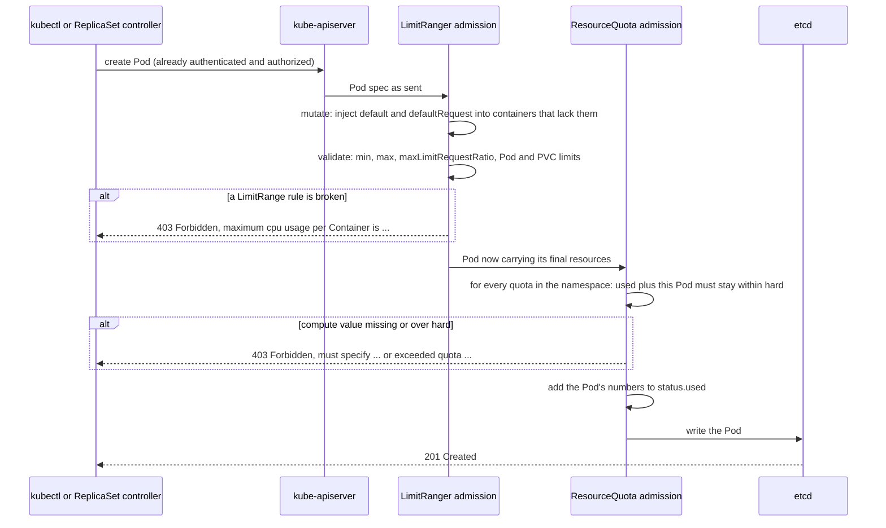

# T3.06 Requests, limits and quotas: ResourceQuota and LimitRange

> Competency: "Understand requests, limits, quotas" (CKAD-4.3) | Domain/weight: CKAD, Application Environment, Configuration and Security (25%) | Est. time: 2.5 h | Prerequisites: T3.05

Shell setup (from [conventions](../00-conventions.md); put it at the top of every session):

```bash
alias k=kubectl
export do="--dry-run=client -o yaml"
export now="--force --grace-period=0"
source <(kubectl completion bash); complete -o default -F __start_kubectl k
```

Lab environment for this lesson: **kind** (cluster `lab`, context `kind-lab`, 1 control plane + 2 workers). Namespaces: `lab-t306` (worked example) and `lab-t306-a`, `-b`, `-c`, `-drill` (labs and drills), `lab-t306-lr` (section 6 walkthrough) and `lab-t306-pc` (section 2.6 example). Files go in `~/lab/t306/`.

> Output labels. Blocks labelled `REAL OUTPUT (kind v0.33.0, v1.37.0)` were captured on this machine from a 3-node kind cluster (node image `kindest/node:v1.37.0`, kubectl v1.37.1). The cluster used kind's default CNI instead of Calico, which does not matter here: quotas and LimitRanges are API-server admission checks. Pod name suffixes, ages and UIDs will differ on your machine. Anything that was not run is listed in section 11.

Prerequisite, not re-taught here: how `requests`, `limits`, units (`m`, `Mi`) and QoS classes work inside one container, [T3.05 Define resource requirements](../part3-ckad/T3.05-define-resource-requirements.md). Also assumed: Pods ([T2.03](../part2-basics/T2.03-pods-in-depth.md)), Deployments and ReplicaSets ([T2.05](../part2-basics/T2.05-controllers-replicasets-deployments-basics-and-garbage.md)), namespaces ([T2.04](../part2-basics/T2.04-labels-selectors-annotations-and-namespaces.md)) and reading events ([T2.08](../part2-basics/T2.08-events-describe-and-reading-object-status.md)).

---

## 1. Why this matters

Teams share one cluster by getting one namespace each. The cluster admin protects the others by putting a **ResourceQuota** (a cap on the total a namespace may use) and a **LimitRange** (rules and defaults for each single container) in that namespace. A Pod that breaks these rules is refused by the API server at creation time, and a Deployment that breaks them shows `0/3` ready with no Pods at all, which looks like a mystery if you do not know where to look. The competency "Understand requests, limits, quotas" (CKAD-4.3) makes this fair game, so practise creating a quota or a LimitRange and diagnosing a workload that will not start in a limited namespace. About 6 minutes per task is the average pace ([E2](https://docs.linuxfoundation.org/tc-docs/certification/tips-cka-and-ckad), [E3](https://docs.linuxfoundation.org/tc-docs/certification/faq-cka-ckad-cks)), so you need the commands and the error messages in your fingers.

---

## 2. Concepts

### 2.1 Two objects, two jobs

Problem: [T3.05](../part3-ckad/T3.05-define-resource-requirements.md) taught you to set requests and limits on a container. But nothing forces a developer to do it, and nothing stops one team from asking for the whole cluster. Two namespaced objects fix this.

| | ResourceQuota | LimitRange |
|---|---|---|
| Question it answers | "How much may this namespace use **in total**?" | "What may **one** container, Pod or PVC look like?" |
| Scope of the rule | Sum over all objects in the namespace | One object at a time |
| Can it fill in missing values? | No. It only counts and refuses | **Yes**: `default` and `defaultRequest` are injected into containers that omit them |
| Typical rejection | `exceeded quota`, `must specify limits.cpu` | `maximum cpu usage per Container is ...` |
| Short name in kubectl | `quota` | `limits` |
| API group/version | `v1` (core) | `v1` (core) |

Both are enforced by **admission plugins** inside the kube-apiserver. Admission is the last gate a create or update request passes before it is stored in etcd. If either plugin says no, the object is never stored, so there is nothing to `describe` afterwards: you only have the error message (or, for objects made by a controller, an event).

REAL OUTPUT (kind v0.33.0, v1.37.0):

```text
$ k api-resources | grep -E 'quota|limitrange'
limitranges                         limits       v1                                true         LimitRange
resourcequotas                      quota        v1                                true         ResourceQuota
$ k -n kube-system get pod -l component=kube-apiserver -o yaml | grep -E 'enable-admission|disable-admission'
      - --enable-admission-plugins=NodeRestriction
```

The second command shows that the cluster only adds `NodeRestriction` by hand. `LimitRanger` and `ResourceQuota` are in the default-enabled set and still work, as every capture below proves.

### 2.2 ResourceQuota: compute quotas

A ResourceQuota has one important field, `spec.hard`: a map of resource name to the maximum total. The current total is kept by the system in `status.used`.

| Key in `spec.hard` | What it sums | Notes |
|---|---|---|
| `requests.cpu` | Every container's `resources.requests.cpu` of all non-terminal Pods | Plain `cpu` is documented as an alias of `requests.cpu` (not tested here, see section 11) |
| `requests.memory` | Same for memory | Write `2Gi`, not `2G` (power of 10 vs power of 2, see T3.05) |
| `limits.cpu` | Every container's `resources.limits.cpu` | Total of limits may be larger than the node: limits can overcommit, the quota just caps the sum |
| `limits.memory` | Same for memory | |
| `requests.ephemeral-storage`, `limits.ephemeral-storage` | Local disk requests/limits | Accepted by the API (tested); see 2.3 for what it does **not** do |
| `pods` | Number of non-terminal Pods | A Pod in phase `Succeeded` or `Failed` does not count (tested, see 2.12) |

The four main keys are the ones the entry and the exam care about:

```yaml
spec:
  hard:
    requests.cpu: "2"        # all Pods together may request 2 CPUs
    requests.memory: 2Gi
    limits.cpu: "4"          # and may be limited to at most 4 CPUs in total
    limits.memory: 4Gi
```

Fields you can set on `spec`:

| Field | What it does | Default | Risky or invalid |
|---|---|---|---|
| `hard` | Map of limits | none (a quota with no `hard` limits nothing) | A value lower than the current `used` is accepted (2.12). A bad scope for a key is rejected (2.6) |
| `scopes` | List of simple filters, ANDed: the quota only counts matching Pods | none = counts everything | A scope that does not support a key in `hard` is rejected |
| `scopeSelector` | Same idea with operators (`In`, `NotIn`, `Exists`, `DoesNotExist`) | none | Needed for `PriorityClass` scope |

You can have several quotas in one namespace. A request must satisfy **all** of them.

### 2.3 Effect: once a compute quota exists, Pods must declare resources

This is the rule that surprises everyone. If a namespace has a quota that limits `requests.cpu`, `requests.memory`, `limits.cpu` or `limits.memory`, then every new Pod in that namespace must state that same value on each container. The reason: the quota plugin has to add the Pod's number to `used`. A container with no number would count as "unlimited" and the cap would mean nothing. So the API server refuses the Pod instead of guessing.

There are two ways out:

1. Put `resources` on every container (what you do in the exam when told not to change the namespace).
2. Create a **LimitRange** with `default` and `defaultRequest` so the API server fills the missing values (2.8).

The check is per key. If the quota only limits `pods` (a pure count), Pods without resources are fine (captured in 2.4). The "must specify" rule covers CPU and memory. A quota on `requests.ephemeral-storage` does **not** force Pods to declare ephemeral storage.

REAL OUTPUT (kind v0.33.0, v1.37.0), quota with `requests.ephemeral-storage=1Gi`, Pod with no resources at all:

```text
$ k run noeph --image=busybox:1.36 -n lab-t306-t -- sleep 3600
pod/noeph created
```

### 2.4 Object count quotas

Besides compute, a quota can cap how many objects of a kind exist. Why: each Service may take a cluster IP or a cloud load balancer, each ConfigMap or PVC takes storage in etcd or in a disk pool, and a runaway script can create thousands.

| Key | Counts |
|---|---|
| `pods` | Non-terminal Pods |
| `services` | Services (also `services.nodeports`, `services.loadbalancers`) |
| `configmaps` | ConfigMaps |
| `persistentvolumeclaims` | PVCs |
| `count/<resource>.<group>` | Any namespaced resource. Core group has no suffix: `count/secrets`. Others: `count/deployments.apps`, `count/jobs.batch` |

Two traps, both captured:

* Every namespace starts with one ConfigMap, `kube-root-ca.crt`, and it **counts**. A quota of `configmaps=1` leaves room for none.
* For `count/deployments.apps` the quota stops the Deployment object itself. The error is returned to you at `k create deploy`.

REAL OUTPUT (kind v0.33.0, v1.37.0):

```text
$ k get cm -n lab-t306-k
NAME               DATA   AGE
kube-root-ca.crt   1      0s
$ k create quota cmq --hard=configmaps=1 -n lab-t306-k
resourcequota/cmq created
$ k create cm one --from-literal=a=b -n lab-t306-k
error: failed to create configmap: configmaps "one" is forbidden: exceeded quota: cmq, requested: configmaps=1, used: configmaps=1, limited: configmaps=1
```

More captures, from one quota (`pods=4, services=2, configmaps=3, persistentvolumeclaims=2, count/deployments.apps=1`) in namespace `lab-t306-cnt`:

```text
$ k create svc clusterip s3 --tcp=80 -n lab-t306-cnt
error: failed to create ClusterIP service: services "s3" is forbidden: exceeded quota: team-objects, requested: services=1, used: services=2, limited: services=2
$ k create deploy d2 --image=nginx:1.27 --replicas=0 -n lab-t306-cnt
error: failed to create deployment: deployments.apps "d2" is forbidden: exceeded quota: team-objects, requested: count/deployments.apps=1, used: count/deployments.apps=1, limited: count/deployments.apps=1
$ k run p-d --image=busybox:1.36 -n lab-t306-cnt -- sleep 3600
Error from server (Forbidden): pods "p-d" is forbidden: exceeded quota: team-objects, requested: pods=1, used: pods=4, limited: pods=4
```

Note the first Pods (`okpod`, `p-a`, `p-b`, `p-c`) were created with no resources and no error: this quota has no compute key, so rule 2.3 does not apply.

### 2.5 Storage quotas

Storage is counted when a **PVC** is created, from `spec.resources.requests.storage`. (PVCs are covered in a later lesson; here you only need the quota side.)

| Key | Meaning |
|---|---|
| `requests.storage` | Sum of storage requested by all PVCs in the namespace |
| `persistentvolumeclaims` | Number of PVCs |
| `<sc>.storageclass.storage.k8s.io/requests.storage` | Same sum, but only PVCs of StorageClass `<sc>` |
| `<sc>.storageclass.storage.k8s.io/persistentvolumeclaims` | Number of PVCs of that class |

Why the per-class keys: expensive SSD classes can be capped tightly while cheap classes stay open. A PVC counts against the per-class keys of the class named in its `storageClassName`, and always against the generic keys.

REAL OUTPUT (kind v0.33.0, v1.37.0). Quota: `requests.storage=3Gi`, `standard.storageclass.storage.k8s.io/requests.storage=2Gi`, `standard.storageclass.storage.k8s.io/persistentvolumeclaims=1`, `persistentvolumeclaims=2`. PVC `p1` (1Gi, class `standard`) was created first. The two blocks below come from two moments of the same run: the `describe` block was taken later, after `p5` also existed; the `p3` refusal was captured earlier, when only `p1` existed (which is why its `used` shows `requests.storage=1Gi` and the generic `persistentvolumeclaims` key is not listed as exceeded).

```text
$ k describe quota team-objects -n lab-t306-cnt      # after p1 and p5 (class "nosuch") exist
Resource                                                     Used  Hard
--------                                                     ----  ----
persistentvolumeclaims                                       2     2
requests.storage                                             2Gi   3Gi
standard.storageclass.storage.k8s.io/persistentvolumeclaims  1     1
standard.storageclass.storage.k8s.io/requests.storage        1Gi   2Gi
...
$ sed 's/p1/p3/; s/1Gi/3Gi/' lab/pvc-s.yaml | k apply -n lab-t306-cnt -f -
Error from server (Forbidden): error when creating "STDIN": persistentvolumeclaims "p3" is forbidden: exceeded quota: team-objects, requested: requests.storage=3Gi,standard.storageclass.storage.k8s.io/persistentvolumeclaims=1,standard.storageclass.storage.k8s.io/requests.storage=3Gi, used: requests.storage=1Gi,standard.storageclass.storage.k8s.io/persistentvolumeclaims=1,standard.storageclass.storage.k8s.io/requests.storage=1Gi, limited: requests.storage=3Gi,standard.storageclass.storage.k8s.io/persistentvolumeclaims=1,standard.storageclass.storage.k8s.io/requests.storage=2Gi
```

In the `p3` message, `used` is the state with only `p1` in the namespace. How to read the long message: `requested` is what the new object adds, `used` is the current total, `limited` is `hard`. Only the keys that would be exceeded are printed. Here three keys are over the limit at once. Also note `p5`, which named a class that does not exist (`nosuch`), still counted against the generic PVC keys (2/2): the quota does not check that the class exists.

### 2.6 Quota scopes

A **scope** limits a quota to a subset of Pods. Why: the admin wants "at most 1 Pod that sets no resources" or "at most 10 high priority Pods", without touching the rest.

| Scope | Matches | Keys allowed in `hard` |
|---|---|---|
| `BestEffort` | Pods with no requests and no limits at all (QoS class BestEffort, see T3.05) | `pods` only (other keys are rejected, see below) |
| `NotBestEffort` | Pods with at least one request or limit (Burstable or Guaranteed) | `pods`, and the compute keys |
| `PriorityClass` (via `scopeSelector`) | Pods whose `priorityClassName` matches | `pods` and compute keys (docs; only `pods` was run) |
| `Terminating`, `NotTerminating` | Pods with / without `activeDeadlineSeconds` | listed on the docs page; not tested here |

`kubectl create quota --scopes=...` handles the simple scopes. `PriorityClass` needs YAML with `scopeSelector`.

REAL OUTPUT (kind v0.33.0, v1.37.0), namespace `lab-t306-sc`:

```text
$ k create quota be-q --hard=pods=1 --scopes=BestEffort -n lab-t306-sc
resourcequota/be-q created
$ k create quota nbe-q --hard=pods=2,requests.cpu=1,limits.cpu=2 --scopes=NotBestEffort -n lab-t306-sc
resourcequota/nbe-q created
$ k describe quota be-q -n lab-t306-sc
Name:       be-q
Namespace:  lab-t306-sc
Scopes:     BestEffort
 * Matches all pods that do not have resource requirements set. These pods have a best effort quality of service.
Resource  Used  Hard
--------  ----  ----
pods      0     1
$ k run be1 --image=busybox:1.36 -n lab-t306-sc -- sleep 3600
pod/be1 created
$ k run be2 --image=busybox:1.36 -n lab-t306-sc -- sleep 3600
Error from server (Forbidden): pods "be2" is forbidden: exceeded quota: be-q, requested: pods=1, used: pods=1, limited: pods=1
$ k create quota bad-q --hard=requests.cpu=1 --scopes=BestEffort -n lab-t306-sc
error: failed to create quota: ResourceQuota "bad-q" is invalid: spec.scopes: Invalid value: ["BestEffort"]: unsupported scope applied to resource
```

Look at what did **not** happen: `nbe-q` has `requests.cpu` in it, yet `be1` (which has no resources) was not asked to specify CPU. Rule 2.3 applies only when the Pod matches the quota's scope. So a scoped quota is not a safe way to force resources on everyone.

`PriorityClass` scope. First create the PriorityClass (it is cluster-scoped, so there is no `-n`), then the quota. Pods choose the class with `spec.priorityClassName`:

```bash
k create priorityclass high-t306 --value=1000
```

Quota YAML:

```yaml
apiVersion: v1
kind: ResourceQuota
metadata:
  name: high-q
spec:
  hard:
    pods: "1"                 # at most one Pod of the selected priority class
  scopeSelector:
    matchExpressions:
    - scopeName: PriorityClass   # the scope to filter on
      operator: In               # In, NotIn, Exists or DoesNotExist
      values: ["high-t306"]      # the PriorityClass names this quota counts
```

The Pod (`lab/pod-high.yaml` in the capture; it has no `resources` because the quota only counts Pods). Copy it and change `name` for the second Pod:

```yaml
apiVersion: v1
kind: Pod
metadata:
  name: high1
spec:
  priorityClassName: high-t306   # selects the PriorityClass; the quota counts Pods with this value
  containers:
  - name: c
    image: busybox:1.36
    command: ["sleep","3600"]
```

REAL OUTPUT (kind v0.33.0, v1.37.0), a PriorityClass `high-t306` and two Pods that use it:

```text
$ k apply -f lab/pod-high.yaml -n lab-t306-pc
pod/high1 created
$ sed 's/high1/high2/' lab/pod-high.yaml | k apply -n lab-t306-pc -f -
Error from server (Forbidden): error when creating "STDIN": pods "high2" is forbidden: exceeded quota: high-q, requested: pods=1, used: pods=1, limited: pods=1
```

To observe the effect, read the quota after `high1` exists. EXPECTED OUTPUT (not captured; the header lines of `describe` for a `scopeSelector` quota are left as `...` because their exact text was not captured):

```text
$ k describe quota high-q -n lab-t306-pc
...
Resource  Used  Hard
--------  ----  ----
pods      1     1
```

A Pod without `priorityClassName` is not counted by `high-q`. Cleanup for this example: `k delete ns lab-t306-pc; k delete priorityclass high-t306` (the PriorityClass survives namespace deletion).

`Terminating` and `NotTerminating` work like the simple scopes. `Terminating` matches Pods that have `spec.activeDeadlineSeconds` set (for example Pods of a Job with a deadline), `NotTerminating` matches Pods without it. Try: `k create quota term-q --hard=pods=1 --scopes=Terminating -n <ns>`, then a Pod with `activeDeadlineSeconds: 600` raises `Used` to 1 and a plain Pod leaves it at 0 (expected, not run, see section 11).

Warning for BestEffort: because LimitRanger runs before ResourceQuota (2.9), in a namespace that has a LimitRange with defaults the Pod already has requests when the quota looks at it, so it is never BestEffort. A `BestEffort` quota then never matches. (This follows from the order of plugins; the combination itself was not run, see section 11.)

### 2.7 Creating and reading a quota

Imperative (this is the fast path):

```bash
k create quota team-q --hard=requests.cpu=2,requests.memory=2Gi,limits.cpu=4,limits.memory=4Gi,pods=10 -n team
k create quota be-q --hard=pods=1 --scopes=BestEffort -n team
```

`k create quota` has `--hard` (comma list) and `--scopes` (comma list, all must match). It has no flag for `scopeSelector`. Any key is accepted, including `count/jobs.batch`. Add `$do` to get YAML.

Read it with `describe` (columns Used and Hard) or `get`:

REAL OUTPUT (kind v0.33.0, v1.37.0):

```text
$ k describe quota -n lab-t306
Name:            team-q
Namespace:       lab-t306
Resource         Used  Hard
--------         ----  ----
limits.cpu       0     4
limits.memory    0     4Gi
pods             0     10
requests.cpu     0     2
requests.memory  0     2Gi
$ k get quota -n lab-t306
NAME     REQUEST                                                 LIMIT                                   AGE
team-q   pods: 0/10, requests.cpu: 0/2, requests.memory: 0/2Gi   limits.cpu: 0/4, limits.memory: 0/4Gi   0s
```

For scripts: `k get quota team-q -o jsonpath='{.status.used.requests\.cpu}'` (the dot in the key must be escaped with a backslash).

### 2.8 LimitRange

A LimitRange lives in a namespace and has a list `spec.limits`. Each item has a `type` and up to five constraint maps. Why it exists: with a quota in place, every developer would have to write resource blocks in every Pod. The admin puts the defaults once, and also caps what a single container may ask for, so one Pod cannot swallow the entire quota.

| `type` | Applies to | Which fields make sense |
|---|---|---|
| `Container` | Each container in a new Pod | `default`, `defaultRequest`, `min`, `max`, `maxLimitRequestRatio` |
| `Pod` | The **sum** over all containers of a new Pod | `min`, `max`, `maxLimitRequestRatio` (use these on Pod; defaults are for containers) |
| `PersistentVolumeClaim` | A new PVC (resource `storage`) | `min`, `max` |

| Field | What it does | If you omit it |
|---|---|---|
| `default` | The **limit** injected into a container that has no limit | See "defaulting rules" below |
| `defaultRequest` | The **request** injected into a container that has no request | See below |
| `min` | Smallest allowed request/limit. Violation: reject | No minimum |
| `max` | Largest allowed limit. Violation: reject | No maximum |
| `maxLimitRequestRatio` | `limit / request` must be at most this number. Violation: reject | No ratio check |

The names are confusing: **`default` means default limit**, and `defaultRequest` means default request.

**Defaulting rules** (all captured):

| LimitRange has | Container with nothing set gets | Evidence |
|---|---|---|
| `default` + `defaultRequest` | limit = `default`, request = `defaultRequest` | worked example |
| Only `default` | limit = `default`, **request = the same value** | below |
| Only `defaultRequest` | request only, **no limit** | below |
| Only `max` | limit = `max` and request = `max` | below |

```text
$ k run d1 ...    # LimitRange has only default: {cpu: 300m, memory: 200Mi}
{"limits":{"cpu":"300m","memory":"200Mi"},"requests":{"cpu":"300m","memory":"200Mi"}}
$ k run d2 ...    # LimitRange has only defaultRequest: {cpu: 100m, memory: 50Mi}
{"requests":{"cpu":"100m","memory":"50Mi"}}
$ k get pod d2 -o jsonpath='{.status.qosClass}'
Burstable
$ k describe limitrange max-only      # LimitRange has only max: {cpu: 300m, memory: 200Mi}
Type        Resource  Min  Max    Default Request  Default Limit  Max Limit/Request Ratio
----        --------  ---  ---    ---------------  -------------  -----------------------
Container   cpu       -    300m   300m             300m           -
Container   memory    -    200Mi  200Mi            200Mi          -
```

(REAL OUTPUT, kind v0.33.0, v1.37.0.) The last block is the lesson: if you set `max` and no `default`, the API server stores `max` as the default limit and default request. A Pod with nothing set then gets the maximum for both. That is usually not what you want, so set `default` and `defaultRequest` yourself.

The LimitRange only fills **missing** values. A container that sets its own request and limit keeps them, unless they break `min`, `max` or the ratio.

A LimitRange must be consistent with itself. Defaults larger than `max` are rejected when you create it.

```text
$ k apply -f lab/lr-bad.yaml -n lab-t306-x      # default cpu 2, max cpu 1
The LimitRange "bad" is invalid: 
* spec.limits[0].defaultRequest[cpu]: Invalid value: "2": default request value 2 is greater than max value 1
* spec.limits[0].default[cpu]: Invalid value: "1": default value 2 is greater than max value 1
```

(REAL OUTPUT, kind v0.33.0, v1.37.0. The server also copied `default` into `defaultRequest` as described above, which is why both lines appear.)

Constraint checks, all in one LimitRange (Container min 100m/64Mi, max 1/512Mi, ratio 4 for CPU; Pod max 1500m/768Mi; PVC 1Gi to 5Gi). REAL OUTPUT (kind v0.33.0, v1.37.0):

```text
$ k describe limitrange container-bounds -n lab-t306-x
Name:                  container-bounds
Namespace:             lab-t306-x
Type                   Resource  Min   Max    Default Request  Default Limit  Max Limit/Request Ratio
----                   --------  ---   ---    ---------------  -------------  -----------------------
Container              cpu       100m  1      250m             500m           4
Container              memory    64Mi  512Mi  128Mi            256Mi          -
Pod                    cpu       -     1500m  -                -              -
Pod                    memory    -     768Mi  -                -              -
PersistentVolumeClaim  storage   1Gi   5Gi    -                -              -
# request 50m (below min):
Error from server (Forbidden): pods "small" is forbidden: minimum cpu usage per Container is 100m, but request is 50m
# request 150m, limit 900m (ratio 6):
Error from server (Forbidden): pods "ratio" is forbidden: cpu max limit to request ratio per Container is 4, but provided ratio is 6.000000
# two containers with limit 800m each (sum 1600m):
Error from server (Forbidden): pods "twoc" is forbidden: maximum cpu usage per Pod is 1500m, but limit is 1600m
# PVC 10Gi:
Error from server (Forbidden): persistentvolumeclaims "data" is forbidden: maximum storage usage per PersistentVolumeClaim is 5Gi, but request is 10Gi
# PVC 500Mi:
Error from server (Forbidden): persistentvolumeclaims "data" is forbidden: minimum storage usage per PersistentVolumeClaim is 1Gi, but request is 500Mi
```

When one Pod breaks several rules the server reports them together in one list:

```text
Error from server (Forbidden): error when creating "lab/podcpu.yaml": pods "big" is forbidden: [maximum cpu usage per Container is 1, but limit is 2, cpu max limit to request ratio per Container is 4, but provided ratio is 20.000000, maximum cpu usage per Pod is 1500m, but limit is 2]
```

(REAL OUTPUT, kind v0.33.0, v1.37.0.) Fix the first item and re-run; read all items before you edit.

Several LimitRanges can sit in one namespace. Their rules are all applied, which can produce surprises. REAL OUTPUT (kind v0.33.0, v1.37.0): one LimitRange had `defaultRequest cpu 100m`, another had `max cpu 10m` (so default limit 10m). A Pod with nothing set got request 100m and limit 10m, and the **API validation** (not a LimitRange check) refused it:

```text
The Pod "new" is invalid: spec.containers[0].resources.requests: Invalid value: "100m": must be less than or equal to cpu limit of 10m
```

Keep one LimitRange per namespace unless you have a reason.

### 2.9 Admission order and what happens under the hood

Under the hood, a Pod create request goes through these steps in the kube-apiserver:

1. Authentication and authorization (are you allowed to create Pods here?).
2. Admission plugins. Two are relevant:
   * **LimitRanger**: first **mutates** (injects `default` and `defaultRequest` into containers that lack values), then **validates** (`min`, `max`, `maxLimitRequestRatio`).
   * **ResourceQuota**: reads the Pod (now with the injected values), checks every matching quota in the namespace, and adds the Pod's numbers to `status.used`. It is deliberately the last plugin, so only requests that passed every other check get counted.
3. If all plugins accept, the Pod is written to etcd and a 201 is returned. Otherwise the client gets **403 Forbidden** with the message and nothing is stored.

The practical rule: **LimitRange defaults are applied first, then the quota is checked**. That is why a LimitRange with defaults makes "must specify limits.cpu" go away (proved in the worked example), and why the quota's `used` numbers reflect the injected values.

The LimitRanger also leaves a note on the Pod so you can tell where the numbers came from (REAL OUTPUT, kind v0.33.0, v1.37.0):

```text
$ k get pod noreq -n lab-t306 -o jsonpath='{.metadata.annotations}{"\n"}'
{"kubernetes.io/limit-ranger":"LimitRanger plugin set: cpu, memory request for container noreq; cpu, memory limit for container noreq"}
```

A **ResourceQuota controller** in kube-controller-manager keeps `status.used` correct by recounting when objects are deleted or the quota changes. So `used` can lag for a few seconds after a delete. In the captures here it updated immediately.

Both plugins act only on **create** (and for quota, on updates that change the counted numbers). They never go back and change objects that already exist. Section 2.12 covers what that means.

### 2.10 The error messages, one place

| You see | Which plugin | Meaning |
|---|---|---|
| `failed quota: <q>: must specify limits.cpu for: <container>; ...` | ResourceQuota | A compute quota applies to this Pod but the container has no value. Lists every missing key |
| `exceeded quota: <q>, requested: ..., used: ..., limited: ...` | ResourceQuota | Adding this object would push at least one key over `hard`. Only the keys over the limit are listed |
| `maximum cpu usage per Container is 500m, but limit is 1` | LimitRanger | A container limit is above `max` |
| `minimum cpu usage per Container is 100m, but request is 50m` | LimitRanger | A container request is below `min` |
| `cpu max limit to request ratio per Container is 4, but provided ratio is 6.000000` | LimitRanger | limit / request is above `maxLimitRequestRatio` |
| `maximum cpu usage per Pod is 1500m, but limit is 1600m` | LimitRanger | Sum over containers is above a `type: Pod` max |
| `maximum storage usage per PersistentVolumeClaim is 5Gi, but request is 10Gi` | LimitRanger | PVC above `max` (or `minimum ...` below `min`) |

All of these arrive as `Error from server (Forbidden)` from kubectl, and as the text inside `FailedCreate` events when a controller (ReplicaSet, Job, StatefulSet) made the request.

### 2.11 Deployments: why Pods never appear

When you run `k create deploy`, you create a **Deployment**. The Deployment controller creates a **ReplicaSet**. The ReplicaSet controller then creates the **Pods**. The quota or LimitRange only judges the last step. The Deployment and ReplicaSet objects are accepted without question (unless you have a `count/deployments.apps` quota), so kubectl says "created" and everything looks fine.

The refusal of a Pod create is a normal API error to the ReplicaSet controller. It records it as a `FailedCreate` **event** on the ReplicaSet, keeps trying with growing delays, and the Deployment stays at `0/3`. There are no Pods, so `k describe pod` and `k logs` have nothing to show. The rule: **if a controller shows fewer Pods than it wants and there are no Pods to describe, describe the ReplicaSet and read its events.** Details in the worked example.

Rolling updates are affected too. During an update a Deployment first creates new Pods (up to `maxSurge`, default 25%, rounded up to at least 1) and only then removes old ones. If the quota's `pods` (or CPU) is already full, the surge Pod is refused and the rollout hangs with the old Pods still serving.

REAL OUTPUT (kind v0.33.0, v1.37.0), quota `pods=3`, Deployment of 3 replicas, then `k set image deploy app nginx=nginx:1.27.5`:

```text
$ k get deploy,rs -n lab-t306-r
NAME                  READY   UP-TO-DATE   AVAILABLE   AGE
deployment.apps/app   3/3     0            3           11s

NAME                             DESIRED   CURRENT   READY   AGE
replicaset.apps/app-5bfffccc44   1         0         0       10s
replicaset.apps/app-677dd556b5   3         3         3       11s
$ k get events -n lab-t306-r --field-selector reason=FailedCreate -o custom-columns=MSG:.message | tail -1
(combined from similar events): Error creating: pods "app-5bfffccc44-vxcq6" is forbidden: exceeded quota: tight-q, requested: pods=1, used: pods=3, limited: pods=3
```

`UP-TO-DATE` is 0 and the new ReplicaSet wants 1 Pod but has 0. Two fixes: raise the quota, or make the update replace in place with `maxSurge: 0`. REAL OUTPUT (kind v0.33.0, v1.37.0), after the patch the rollout completes:

```text
$ k patch deploy app -n lab-t306-r --type merge -p '{"spec":{"strategy":{"rollingUpdate":{"maxSurge":0,"maxUnavailable":1}}}}'
deployment.apps/app patched
$ k rollout status deploy app -n lab-t306-r --timeout=90s
...
deployment "app" successfully rolled out
```

### 2.12 What a quota or LimitRange does not do (namespace and cluster effects)

* **Namespace-level only.** Both objects are namespaced. A quota in `team-a` has no effect in `team-b`. Core Kubernetes has no cluster-wide quota object (OpenShift's ClusterResourceQuota is a different product).
* **Cluster-level switch.** The two plugins are enabled in the API server for the whole cluster. If an admin disabled them, the objects are stored but nothing is enforced.
* **Not related to node capacity.** A quota never looks at nodes. The sum of all namespace quotas can be larger than the cluster. A Pod can pass the quota and still stay `Pending` because no node has room. The symptoms differ: **quota/LimitRange: 403 at creation, no Pod object. Scheduler: the Pod exists and is `Pending` with `Insufficient cpu` in its events.**
* **Applies to everyone** in the namespace, including cluster-admins.
* **Create-time only for existing objects.** Creating a quota does not touch Pods that already run; they are counted in `used`, but they are not evicted. REAL OUTPUT (kind v0.33.0, v1.37.0): a Pod `pre` was created first, then quota `late` (pods=5, requests.cpu=1, limits.cpu=1):

```text
$ k describe quota late -n lab-t306-d
Resource      Used  Hard
--------      ----  ----
limits.cpu    0     1
pods          1     5
requests.cpu  0     1
$ k get pod pre -n lab-t306-d
NAME   READY   STATUS    RESTARTS   AGE
pre    1/1     Running   0          2s
```

  `pre` had no CPU numbers, so it adds 0 to the CPU totals, and it runs on. The same holds for lowering a quota below `used`: REAL OUTPUT (kind v0.33.0, v1.37.0): `pods=3` lowered to `pods=1` with three Pods running:

```text
$ k describe quota q -n lab-t306-l
Resource    Used  Hard
--------    ----  ----
pods        3     1
$ k run extra --image=nginx:1.27 -n lab-t306-l
Error from server (Forbidden): pods "extra" is forbidden: exceeded quota: q, requested: pods=1, used: pods=3, limited: pods=1
```

  Nothing is killed. New Pods are refused until `used` falls below `hard`.
* **LimitRange changes affect only new objects.** The "LimitRange `max` smaller than an existing Pod" walkthrough in section 6 shows a Pod that keeps running under a LimitRange it would now violate, and the Deployment that cannot re-create it after the Pod is deleted.
* **Terminal Pods do not count.** A Pod that finished (`Completed`) is not in `pods`. REAL OUTPUT (kind v0.33.0, v1.37.0): after Pod `once` completed, `describe quota t-q` showed `pods 0 2`.
* **Defaults go on the Pod, not on the Deployment.** The LimitRanger works on the Pod create request. The Deployment's own template stays without resources; each new Pod gets its own injected copy.

### 2.13 Related but different

* **Resources in the container (T3.05)**: what one container asks for and may use. A quota and a LimitRange are the *namespace's* rules about those numbers.
* **Scheduler `Pending`**: node capacity. **Quota `Forbidden`**: namespace policy. Two different places to look.
* **QoS class and eviction**: derived from requests/limits on the node at runtime. Quota does not evict anything.
* **PriorityClass**: scheduling order and preemption. Quota can only count Pods per class (2.6).
* **Quota `used` vs `kubectl top`**: `status.used` is the sum of declared requests/limits, not live usage.

---

## 3. How it works (diagram)



Walkthrough:

1. The request is already past authentication and authorization when admission starts. Admission never decides *who* may act, only *what* may be created.
2. LimitRanger runs first. It fills missing values, then checks each container, the Pod sum and PVC sizes against `min`, `max` and the ratio.
3. ResourceQuota runs last and sees the Pod with the injected values. That is why defaults cure "must specify".
4. Each refusal is a 403 with the message in the response. A controller that made the request turns that response into a `FailedCreate` event on its own object.
5. Only after both plugins accept is the Pod stored, and the quota's `status.used` grows by the Pod's numbers.

---

## 4. Commands and YAML you must produce fast

**Imperative shortcuts**

```bash
# Quota for a namespace: compute + count in one line. Always -n.
k create quota team-q --hard=requests.cpu=2,requests.memory=2Gi,limits.cpu=4,limits.memory=4Gi,pods=10 -n team

# Quota limited to a scope (BestEffort / NotBestEffort).
k create quota be-q --hard=pods=1 --scopes=BestEffort -n team

# Count quota on non-core resources.
k create quota objs --hard=count/deployments.apps=3,count/jobs.batch=2 -n team

# Read it: Used vs Hard.
k describe quota -n team
k get quota -n team                       # compact one-liner per quota

# Is there a LimitRange here? What are its values?
k get limitrange -n team -o yaml
k describe limitrange -n team             # table: Min, Max, Default Request, Default Limit, Ratio

# A workload has fewer Pods than it should and no Pods to describe?
k describe rs -n team | grep -A3 FailedCreate
k get events -n team --field-selector reason=FailedCreate

# Put resources on a Deployment without editing YAML (T3.05).
k set resources deploy web -n team --requests=cpu=100m,memory=64Mi --limits=cpu=200m,memory=128Mi

# Raise one quota value without deleting anything.
k patch quota team-q -n team --type merge -p '{"spec":{"hard":{"pods":"20"}}}'
```

There is no imperative command for a LimitRange. Write the YAML (from the docs page, or from memory using the block below).

**Declarative: LimitRange with container defaults**

```yaml
apiVersion: v1
kind: LimitRange
metadata:
  name: container-defaults       # name is free; it is namespaced, so pass -n on apply
spec:
  limits:
  - type: Container              # Container | Pod | PersistentVolumeClaim
    default:                     # DEFAULT LIMIT injected when a container sets no limit
      cpu: 500m
      memory: 512Mi
    defaultRequest:              # DEFAULT REQUEST injected when a container sets no request
      cpu: 250m
      memory: 256Mi
```

Add `min`, `max` and `maxLimitRequestRatio` in the same item when the task asks for bounds. Keep `default` at or below `max` and `defaultRequest` at or below `default`, or the API server rejects the LimitRange (2.8):

```yaml
apiVersion: v1
kind: LimitRange
metadata:
  name: container-bounds
spec:
  limits:
  - type: Container
    default: {cpu: 500m, memory: 256Mi}        # default limit
    defaultRequest: {cpu: 250m, memory: 128Mi} # default request
    min: {cpu: 100m, memory: 64Mi}             # requests/limits below this are refused
    max: {cpu: "1", memory: 512Mi}             # limits above this are refused
    maxLimitRequestRatio: {cpu: "4"}           # limit/request for CPU must be <= 4
  - type: Pod
    max: {cpu: 1500m, memory: 768Mi}           # sum over all containers of one Pod
  - type: PersistentVolumeClaim
    min: {storage: 1Gi}                        # per-PVC size bounds
    max: {storage: 5Gi}
```

**Declarative: ResourceQuota with compute and object counts**

```yaml
apiVersion: v1
kind: ResourceQuota
metadata:
  name: team-q
spec:
  hard:                          # every key is a maximum TOTAL for the namespace
    requests.cpu: "2"            # sum of container CPU requests
    requests.memory: 2Gi         # sum of container memory requests
    limits.cpu: "4"              # sum of container CPU limits
    limits.memory: 4Gi           # sum of container memory limits
    pods: "10"                   # number of non-terminal Pods
    services: "5"                # number of Services
    configmaps: "10"             # number of ConfigMaps (kube-root-ca.crt is one of them)
    persistentvolumeclaims: "4"  # number of PVCs
    count/deployments.apps: "5"  # number of Deployments (generic count/<resource>.<group>)
    requests.storage: 20Gi       # sum of storage requested by PVCs
```

Quote plain numbers (`"2"`, `"10"`) so the value is certainly a string quantity.

**Speed drill** (target about 12 minutes in total; answers collapsed)

Setup (one line): `k create ns lab-t306-drill; k create quota need --hard=requests.cpu=1,requests.memory=1Gi,limits.cpu=2,limits.memory=2Gi -n lab-t306-drill; k create deploy dd --image=nginx:1.27 -n lab-t306-drill`

Do them in order; the first two depend on the setup.

1. (2 min) Deployment `dd` shows `0/1`. Find the reason with one command.
2. (90 s) Make `dd` start without touching or deleting quota `need`: requests 100m CPU and 64Mi memory, limits 200m and 128Mi.
3. (60 s) Create quota `q1` with at most 2 Pods, 1 Service and 5 ConfigMaps.
4. (60 s) Print the number of Pods the quota `q1` currently counts (just the value).
5. (60 s) Raise `q1` to 5 Pods without deleting it.
6. (90 s) Produce (do not apply) the YAML of a quota `be` for 5 BestEffort Pods.
7. (90 s) Create quota `objs` allowing 3 Deployments and 2 Jobs.
8. (2.5 min) Create LimitRange `lr`: default limits cpu 300m, memory 200Mi; default requests cpu 100m, memory 100Mi. Prove it by creating Pod `lrtest` (`nginx:1.27`, no resources) and printing its resources.

<details><summary>Answers</summary>

```bash
# 1  (FailedCreate event names the missing keys)
k describe rs -n lab-t306-drill | grep -A3 FailedCreate
# 2  (quota stays; the Pods now carry numbers)
k set resources deploy dd -n lab-t306-drill --requests=cpu=100m,memory=64Mi --limits=cpu=200m,memory=128Mi
# 3
k create quota q1 --hard=pods=2,services=1,configmaps=5 -n lab-t306-drill
# 4  (1 if dd has one Pod; it also counts)
k get quota q1 -n lab-t306-drill -o jsonpath='{.status.used.pods}{"\n"}'
# 5
k patch quota q1 -n lab-t306-drill --type merge -p '{"spec":{"hard":{"pods":"5"}}}'
# 6
k create quota be --hard=pods=5 --scopes=BestEffort $do
# 7
k create quota objs --hard=count/deployments.apps=3,count/jobs.batch=2 -n lab-t306-drill
# 8
cat <<'EOF' | k apply -n lab-t306-drill -f -
apiVersion: v1
kind: LimitRange
metadata:
  name: lr
spec:
  limits:
  - type: Container
    default: {cpu: 300m, memory: 200Mi}
    defaultRequest: {cpu: 100m, memory: 100Mi}
EOF
k run lrtest --image=nginx:1.27 -n lab-t306-drill
k get pod lrtest -n lab-t306-drill -o jsonpath='{.spec.containers[0].resources}{"\n"}'
```

REAL OUTPUT (kind v0.33.0, v1.37.0) for drills 3 and 2 (run in a similar namespace; drill 1 and 4 to 7 were not run as written). The third line is not a drill answer: it is the resources of a Pod created by Deployment `dd` after drill 2, which shows that the new Pods carry the numbers:

```text
resourcequota/q1 created
deployment.apps/dd resource requirements updated
{"limits":{"cpu":"200m","memory":"128Mi"},"requests":{"cpu":"100m","memory":"64Mi"}}
```

Expected for drill 8 (the commands were run in the worked example and lab with other values; this exact LimitRange was not run): `{"limits":{"cpu":"300m","memory":"200Mi"},"requests":{"cpu":"100m","memory":"100Mi"}}`. See section 11.

</details>

Cleanup: `k delete ns lab-t306-drill`

---

## 5. Worked example

Goal: a shared namespace has a quota. A Pod and a Deployment without resources are refused, a LimitRange fixes it, and then we run into the quota ceiling. Environment: kind. Namespace `lab-t306`. Every block below is REAL OUTPUT (kind v0.33.0, v1.37.0); trimmed with `...`.

**Step 1. Create the namespace and the quota (imperative).**

```text
$ k create ns lab-t306
namespace/lab-t306 created
$ k create quota team-q --hard=requests.cpu=2,requests.memory=2Gi,limits.cpu=4,limits.memory=4Gi,pods=10 -n lab-t306
resourcequota/team-q created
$ k describe quota -n lab-t306
Name:            team-q
Namespace:       lab-t306
Resource         Used  Hard
--------         ----  ----
limits.cpu       0     4
limits.memory    0     4Gi
pods             0     10
requests.cpu     0     2
requests.memory  0     2Gi
```

What to look for: all `Used` are 0 and `Hard` is exactly what you typed. `describe` sorts the keys alphabetically.

**Step 2. A bare Pod is refused.**

```text
$ k run noreq --image=nginx:1.27 -n lab-t306
Error from server (Forbidden): pods "noreq" is forbidden: failed quota: team-q: must specify limits.cpu for: noreq; limits.memory for: noreq; requests.cpu for: noreq; requests.memory for: noreq
```

Reading it: `failed quota: team-q` names the quota. `must specify ...` lists the four keys the container lacks. `for: noreq` is the container name (kubectl names the container like the Pod).

**Step 3. A Deployment is "created" but starts nothing.**

```text
$ k create deploy web --image=nginx:1.27 --replicas=3 -n lab-t306
deployment.apps/web created
$ k get deploy,rs,pods -n lab-t306
NAME                  READY   UP-TO-DATE   AVAILABLE   AGE
deployment.apps/web   0/3     0            0           6s

NAME                             DESIRED   CURRENT   READY   AGE
replicaset.apps/web-69c6f74b8b   3         0         0       6s
```

No Pods are listed. The ReplicaSet wants 3 and has 0 (`CURRENT 0`). Ask the ReplicaSet why:

```text
$ k describe rs -n lab-t306 | grep -A3 FailedCreate
  ReplicaFailure   True    FailedCreate
Events:
  Type     Reason        Age   From                   Message
  ----     ------        ----  ----                   -------
  Warning  FailedCreate  6s    replicaset-controller  Error creating: pods "web-69c6f74b8b-tflzn" is forbidden: failed quota: team-q: must specify limits.cpu for: nginx; limits.memory for: nginx; requests.cpu for: nginx; requests.memory for: nginx
...
```

The first line is the ReplicaSet condition `ReplicaFailure`; the `Warning FailedCreate` lines are the events. Here the container is called `nginx` (the name `k create deploy` gave it). The same text is available with `k get events -n lab-t306 --sort-by=.lastTimestamp`.

**Step 4. Add a LimitRange with defaults** (file `~/lab/t306/limitrange.yaml`, the block from section 4):

```text
$ k apply -f limitrange.yaml -n lab-t306
limitrange/container-defaults created
$ k get limitrange -n lab-t306 -o yaml
...
  spec:
    limits:
    - default:
        cpu: 500m
        memory: 512Mi
      defaultRequest:
        cpu: 250m
        memory: 256Mi
      type: Container
...
$ k describe limitrange -n lab-t306
Name:       container-defaults
Namespace:  lab-t306
Type        Resource  Min  Max  Default Request  Default Limit  Max Limit/Request Ratio
----        --------  ---  ---  ---------------  -------------  -----------------------
Container   cpu       -    -    250m             500m           -
Container   memory    -    -    256Mi            512Mi          -
```

Now the same bare Pod works, and the Deployment recovers without being touched, because the ReplicaSet keeps retrying:

```text
$ k run noreq --image=nginx:1.27 -n lab-t306
pod/noreq created
$ k get pod noreq -n lab-t306 -o jsonpath='{.spec.containers[0].resources}{"\n"}'
{"limits":{"cpu":"500m","memory":"512Mi"},"requests":{"cpu":"250m","memory":"256Mi"}}
$ k get deploy,pods -n lab-t306        # about 10 s after the LimitRange was created
NAME                  READY   UP-TO-DATE   AVAILABLE   AGE
deployment.apps/web   0/3     3            0           11s

NAME                       READY   STATUS              RESTARTS   AGE
pod/noreq                  0/1     ContainerCreating   0          5s
pod/web-69c6f74b8b-h2w6w   0/1     ContainerCreating   0          0s
...
```

The Pod's resources match the LimitRange: `default` became the limit, `defaultRequest` the request. The note `kubernetes.io/limit-ranger` on the Pod (section 2.9) says which values were injected. The ReplicaSet controller retries with a growing delay; here the Pods appeared about 10 s after the LimitRange. Be patient before assuming your fix failed.

**Step 5. Read the quota: the defaults are what is counted.**

```text
$ k describe quota -n lab-t306
Resource         Used  Hard
--------         ----  ----
limits.cpu       2     4
limits.memory    2Gi   4Gi
pods             4     10
requests.cpu     1     2
requests.memory  1Gi   2Gi
```

Four Pods (`noreq` and 3 of `web`) times 250m request is 1 CPU, times 500m limit is 2 CPU. Check the arithmetic yourself every time.

**Step 6. Hit the ceiling.**

```text
$ k scale deploy web --replicas=12 -n lab-t306
deployment.apps/web scaled
$ k get deploy web -n lab-t306
NAME   READY   UP-TO-DATE   AVAILABLE   AGE
web    6/12    7            6           26s       # momentary; it settles at 7 web Pods (8 Pods with noreq)
$ k get events -n lab-t306 --field-selector reason=FailedCreate | tail -1
14s         Warning   FailedCreate   replicaset/web-69c6f74b8b   (combined from similar events): Error creating: pods "web-69c6f74b8b-g6d9x" is forbidden: exceeded quota: team-q, requested: limits.cpu=500m,limits.memory=512Mi,requests.cpu=250m,requests.memory=256Mi, used: limits.cpu=4,limits.memory=4Gi,requests.cpu=2,requests.memory=2Gi, limited: limits.cpu=4,limits.memory=4Gi,requests.cpu=2,requests.memory=2Gi
$ k describe quota -n lab-t306
Resource         Used  Hard
--------         ----  ----
limits.cpu       4     4
limits.memory    4Gi   4Gi
pods             8     10
requests.cpu     2     2
requests.memory  2Gi   2Gi
```

Reading the message: all four compute keys are full (`used` equals `limited`), but `pods` is 8 of 10, so **pods was not the limit, CPU and memory were**. Eight Pods at 250m is exactly 2 CPU. A ninth cannot fit. (Do not trust the `6/12` line: that capture was taken while Pods were still starting.)

**Step 7. Clean up.**

```bash
k delete ns lab-t306
```

---

## 6. Common mistakes and how to fix them

| Symptom | What you will see | Cause | Fix |
|---|---|---|---|
| Deployment `0/3`, no Pods | `k describe rs`: `FailedCreate ... failed quota: team-q: must specify limits.cpu for: nginx; limits.memory ...; requests.cpu ...; requests.memory ...` | Namespace has a compute quota; the Pod template has no resources and no LimitRange supplies defaults | `k set resources deploy web --requests=cpu=100m,memory=64Mi --limits=cpu=200m,memory=128Mi`, or add a LimitRange with `default` and `defaultRequest` |
| `k run` / `k apply` of a Pod refused | `Error from server (Forbidden): pods "noreq" is forbidden: failed quota: team-q: must specify limits.cpu for: noreq; ...` | Same, for a single Pod | Add `resources` to the YAML, or a LimitRange |
| Some replicas run, the rest never appear (`8/12`) | `FailedCreate ... exceeded quota: team-q, requested: requests.cpu=250m,..., used: requests.cpu=2,..., limited: requests.cpu=2,...` | Quota full for one or more keys (read which keys `used` equals `limited`) | Lower the Pods' requests, scale down, or raise the quota: `k patch quota team-q -n team --type merge -p '{"spec":{"hard":{"requests.cpu":"4"}}}'` |
| Quota full on `pods` | `exceeded quota: team-quota, requested: pods=1, used: pods=2, limited: pods=2` | `spec.hard.pods` is smaller than replicas (rolling updates need extra room) | Raise `pods`, or reduce replicas |
| Pod refused with a max error | `Error from server (Forbidden): pods "big" is forbidden: maximum cpu usage per Container is 500m, but limit is 1` | LimitRange `max` is below the container's limit | Lower the container's limit to at most `max` (or ask the admin to raise `max`) |
| Several messages in `[ ... ]` | `pods "big" is forbidden: [maximum cpu usage per Container is 1, but limit is 2, cpu max limit to request ratio per Container is 4, but provided ratio is 20.000000, maximum cpu usage per Pod is 1500m, but limit is 2]` | The Pod breaks several LimitRange rules at once | Satisfy every item: per-container max, ratio and Pod sum |
| Min / ratio refusals | `minimum cpu usage per Container is 100m, but request is 50m` and `cpu max limit to request ratio per Container is 4, but provided ratio is 6.000000` | Request below `min`, or limit more than `maxLimitRequestRatio` times the request | Raise the request, or lower the limit |
| LimitRange `max` is smaller than an existing Pod: nothing happens, then a restart fails | Existing Pod stays `Running`. After the Pod is deleted, `k get deploy` shows `0/1` and `FailedCreate ... maximum cpu usage per Container is 300m, but limit is 1` | Admission runs at create time only; the old Pod was admitted before the rule existed. Any re-creation (deleted Pod, node drain, rollout) is judged again | Edit the Deployment's limits to fit the new `max` (`k set resources`), or have the admin raise `max` |
| Rollout hangs at the old replicas | `READY 3/3 UP-TO-DATE 0`; `FailedCreate ... exceeded quota: tight-q, requested: pods=1, used: pods=3, limited: pods=3` | The update needs a surge Pod and the quota has no room | Raise `pods`, or patch the Deployment to `maxSurge: 0`, `maxUnavailable: 1` |
| Quota seems "one too small" | `exceeded quota: cmq, requested: configmaps=1, used: configmaps=1, limited: configmaps=1` with no ConfigMaps of yours | `kube-root-ca.crt` is counted | Add 1 to `configmaps` |
| Quota lowered, new Pods refused, old ones fine | `k describe quota`: `pods 3 1` (Used above Hard) | Quota updates never evict; they only block new objects | Scale down or delete Pods until `used` is below `hard`, or raise `hard` |
| Quota refused with a scope error | `ResourceQuota "bad-q" is invalid: spec.scopes: Invalid value: ["BestEffort"]: unsupported scope applied to resource` | `BestEffort` scope only supports counting Pods | Use `NotBestEffort`, or remove compute keys |
| LimitRange refused | `The LimitRange "bad" is invalid: * spec.limits[0].default[cpu]: Invalid value: "1": default value 2 is greater than max value 1` | `default` / `defaultRequest` above `max` | Make defaults at most `max` |
| Pod invalid with request above limit | `The Pod "new" is invalid: spec.containers[0].resources.requests: Invalid value: "100m": must be less than or equal to cpu limit of 10m` | Two LimitRanges: one gave a default request of 100m, another set a 10m limit (`max` becomes the default limit) | Keep one LimitRange per namespace, or set `default`/`defaultRequest` so request <= limit |

(All message texts above are REAL OUTPUT (kind v0.33.0, v1.37.0); the container name in the message is whatever your container is called.)

**Walkthrough: LimitRange `max` smaller than an existing Pod** (entry mistake 3). Setup: a Deployment whose Pod has a CPU limit of 1, then a LimitRange with `max` 300m. EXPECTED OUTPUT (not captured as one sequence; the error text itself is the real text from the table above; see section 11):

```bash
k create ns lab-t306-lr
k create deploy keep --image=nginx:1.27 -n lab-t306-lr
k set resources deploy keep -n lab-t306-lr --limits=cpu=1       # no LimitRange or quota yet, so this is accepted
k wait --for=condition=Available deploy/keep -n lab-t306-lr --timeout=90s
cat <<'EOF' | k apply -n lab-t306-lr -f -
apiVersion: v1
kind: LimitRange
metadata:
  name: lr-max
spec:
  limits:
  - type: Container
    max: {cpu: 300m}
EOF
k get pods -n lab-t306-lr                                       # 1) the old Pod is still Running
k delete pod -l app=keep -n lab-t306-lr                         # 2) force a re-creation
k get deploy keep -n lab-t306-lr                                # 3) 0/1: the replacement was refused
k describe rs -n lab-t306-lr | grep -A3 FailedCreate           # 4) read the reason
```

```text
$ k get pods -n lab-t306-lr
NAME                    READY   STATUS    RESTARTS   AGE
keep-...                1/1     Running   0          ...
$ k get deploy keep -n lab-t306-lr
NAME   READY   UP-TO-DATE   AVAILABLE   AGE
keep   0/1     1            0           ...
$ k describe rs -n lab-t306-lr | grep -A3 FailedCreate
...
  Warning  FailedCreate  ...  replicaset-controller  Error creating: pods "keep-..." is forbidden: maximum cpu usage per Container is 300m, but limit is 1
```

How to read it: step 1 proves the rule did not touch the old Pod. After step 2 there is no Pod, so `describe pod` is useless; the ReplicaSet event is the only place with the reason (the message starts with `maximum`, so it is a LimitRange rule, not a quota). Fix: `k set resources deploy keep -n lab-t306-lr --limits=cpu=300m` (the new template creates a Pod that fits), or ask the admin to raise `max`. Cleanup: `k delete ns lab-t306-lr`.

**A repeatable troubleshooting path**

1. See what exists: `k get deploy,rs,pods -n <ns>`. Count the Pods against what the controller wants. If a Pod exists and is `Pending`, this is the scheduler, not a quota: `k describe pod` and look for `Insufficient cpu`.
2. No Pod to describe? Ask the controller: `k describe rs -n <ns> | grep -A3 FailedCreate`, or `k get events -n <ns> --field-selector reason=FailedCreate`. For a Job, describe the Job; for a bare `kubectl run`, the error is printed directly.
3. Classify the message by its first words:
   * `failed quota: ... must specify` means missing resources (add them, or a LimitRange).
   * `exceeded quota: ... requested/used/limited` means a total is full. Find the keys where `used` equals `limited`.
   * `maximum` / `minimum` / `max limit to request ratio` means a LimitRange rule.
4. Look at the rules: `k describe quota -n <ns>` (Used against Hard) and `k describe limitrange -n <ns>`. Compare with the Pod template: `k get deploy <name> -n <ns> -o jsonpath='{.spec.template.spec.containers[*].resources}'`.
5. Fix the workload first (smaller numbers) unless the task says to change the quota. Then wait for the controller retry, or re-apply the Pod, and check `k get deploy`.

---

## 7. Labs

All three labs use kind (cluster `lab`). Each lab has its own namespace and cleans up after itself, so any order works. Suggested order: Easy, Medium, Break-fix. Create the files directory once: `mkdir -p ~/lab/t306`. On the exam you first run the `kubectl config use-context ...` command given in the task; the kind context here is `kind-lab`, so run `k config use-context kind-lab` before the labs. Each lab then states its namespace with `-n`.

### Lab 1 (Easy): fill a quota until it refuses

**Environment:** kind. **Setup:**

```bash
mkdir -p ~/lab/t306 && cd ~/lab/t306
k create ns lab-t306-a
cat > pod.yaml <<'EOF'
apiVersion: v1
kind: Pod
metadata:
  name: NAME
spec:
  containers:
  - name: c
    image: busybox:1.36
    command: ["sleep","3600"]
    resources:
      requests: {cpu: 200m, memory: 128Mi}
      limits: {cpu: 400m, memory: 256Mi}
EOF
```

**Task.** In namespace `lab-t306-a`:

1. Create a ResourceQuota `easy-q` with: `requests.cpu=500m`, `requests.memory=512Mi`, `limits.cpu=1`, `limits.memory=1Gi`, `pods=3`.
2. Using `~/lab/t306/pod.yaml` (replace `NAME`), create Pods `p1`, `p2` and `p3`, in that order. `p3` must be refused. Save the complete refusal message in `~/lab/t306/rejection.txt`.
3. Write the quota's current `requests.cpu` used value (only the value) to `~/lab/t306/used-cpu.txt`.

<details><summary>Hint 1</summary>

`sed 's/NAME/p1/' pod.yaml | k apply -n lab-t306-a -f -` creates a Pod without editing the file. kubectl writes errors to stderr, so redirect with `2>`.

</details>
<details><summary>Hint 2</summary>

Each Pod requests 200m CPU. Two Pods use 400m of the 500m, so the third needs 600m. Which key is exceeded first?

</details>
<details><summary>Hint 3</summary>

The used value is in `status.used`; a key with a dot needs `\.` in jsonpath: `{.status.used.requests\.cpu}`.

</details>

<details><summary>Solution</summary>

```bash
cd ~/lab/t306
k create quota easy-q --hard=requests.cpu=500m,requests.memory=512Mi,limits.cpu=1,limits.memory=1Gi,pods=3 -n lab-t306-a
sed 's/NAME/p1/' pod.yaml | k apply -n lab-t306-a -f -
sed 's/NAME/p2/' pod.yaml | k apply -n lab-t306-a -f -
sed 's/NAME/p3/' pod.yaml | k apply -n lab-t306-a -f - 2> rejection.txt
k get quota easy-q -n lab-t306-a -o jsonpath='{.status.used.requests\.cpu}' > used-cpu.txt
```

Why: `p1` and `p2` fit. `p3` would bring requests.cpu to 600m (above 500m) and limits.cpu to 1200m (above 1), so the quota refuses it. The `pods` count (3) was never the limit. REAL OUTPUT (kind v0.33.0, v1.37.0):

```text
$ sed 's/NAME/p3/' pod.yaml | k apply -n lab-t306-a -f - 2> rejection.txt; cat rejection.txt
Error from server (Forbidden): error when creating "STDIN": pods "p3" is forbidden: exceeded quota: easy-q, requested: limits.cpu=400m,requests.cpu=200m, used: limits.cpu=800m,requests.cpu=400m, limited: limits.cpu=1,requests.cpu=500m
$ k describe quota easy-q -n lab-t306-a
Name:            easy-q
Namespace:       lab-t306-a
Resource         Used   Hard
--------         ----   ----
limits.cpu       800m   1
limits.memory    512Mi  1Gi
pods             2      3
requests.cpu     400m   500m
requests.memory  256Mi  512Mi
```

Memory is not in the message because memory still fits (256Mi + 128Mi is below 512Mi); only exceeded keys are printed.

</details>

**Verification** (each line prints `...-OK` or nothing):

```bash
cd ~/lab/t306
grep -q 'exceeded quota: easy-q' rejection.txt && echo REJECTION-OK
test "$(cat used-cpu.txt)" = 400m && echo USED-OK
test "$(k get pods -n lab-t306-a --no-headers | wc -l)" -eq 2 && echo TWO-PODS-OK
test "$(k get quota easy-q -n lab-t306-a -o jsonpath='{.spec.hard.pods}')" = 3 && echo QUOTA-OK
```

Four `-OK` lines mean success. (REAL OUTPUT, kind v0.33.0, v1.37.0: the `grep` check printed `OK1` in the capture run, `used` printed `400m`, `hard.pods` printed `3`, the Pod count was 2. The `test` combinations in this block were assembled from those values, not run as written.)

**Cleanup:**

```bash
k delete ns lab-t306-a
rm -f ~/lab/t306/pod.yaml ~/lab/t306/rejection.txt ~/lab/t306/used-cpu.txt
```

### Lab 2 (Medium): LimitRange defaults and a max

**Environment:** kind. **Setup:**

```bash
cd ~/lab/t306
k create ns lab-t306-b
cat > quota.yaml <<'EOF'
apiVersion: v1
kind: ResourceQuota
metadata:
  name: compute-q
spec:
  hard:
    requests.cpu: "1"
    requests.memory: 1Gi
    limits.cpu: "2"
    limits.memory: 2Gi
    pods: "5"
EOF
cat > big.yaml <<'EOF'
apiVersion: v1
kind: Pod
metadata:
  name: big
spec:
  containers:
  - name: c
    image: nginx:1.27
    resources:
      limits: {cpu: "1", memory: 128Mi}
EOF
k apply -f quota.yaml -n lab-t306-b
```

**Task.** In namespace `lab-t306-b` (quota `compute-q` already exists, do not change it):

1. Show that `k run plain --image=nginx:1.27` is refused. (No file needed.)
2. Create a LimitRange `defaults` for containers: default limits `cpu=200m`, `memory=128Mi`; default requests `cpu=100m`, `memory=64Mi`; maximum `cpu=500m`, `memory=256Mi`.
3. Create Pod `plain` (`nginx:1.27`, no resources). Write the resources the API server injected (JSON from `jsonpath`) to `~/lab/t306/injected.json`.
4. Try to create the Pod in `~/lab/t306/big.yaml`. It must be refused. Save the error message in `~/lab/t306/big-error.txt`.

<details><summary>Hint 1</summary>

There is no `k create limitrange`. Write the YAML: `apiVersion: v1`, `kind: LimitRange`, `spec.limits[0].type: Container`, then `default`, `defaultRequest`, `max`.

</details>
<details><summary>Hint 2</summary>

The injected values are on the Pod: `k get pod plain -n lab-t306-b -o jsonpath='{.spec.containers[0].resources}'`.

</details>
<details><summary>Hint 3</summary>

`big.yaml` sets only a limit. Which LimitRange field makes a limit of `1` CPU illegal?

</details>

<details><summary>Solution</summary>

```bash
cd ~/lab/t306
k run plain --image=nginx:1.27 -n lab-t306-b          # refused: must specify ...
cat > lr.yaml <<'EOF'
apiVersion: v1
kind: LimitRange
metadata:
  name: defaults
spec:
  limits:
  - type: Container
    default: {cpu: 200m, memory: 128Mi}
    defaultRequest: {cpu: 100m, memory: 64Mi}
    max: {cpu: 500m, memory: 256Mi}
EOF
k apply -f lr.yaml -n lab-t306-b
k run plain --image=nginx:1.27 -n lab-t306-b
k get pod plain -n lab-t306-b -o jsonpath='{.spec.containers[0].resources}' > injected.json
k apply -f big.yaml -n lab-t306-b 2> big-error.txt
```

Why: step 1 fails because `compute-q` limits four compute keys but `plain` has none (rule 2.3). The LimitRange injects `default` and `defaultRequest` before the quota is checked (2.9), so the second `k run` is accepted. `big` has a limit of 1 CPU, above `max` 500m, so LimitRanger refuses it before the quota is even consulted. REAL OUTPUT (kind v0.33.0, v1.37.0):

```text
$ k run plain --image=nginx:1.27 -n lab-t306-b
Error from server (Forbidden): pods "plain" is forbidden: failed quota: compute-q: must specify limits.cpu for: plain; limits.memory for: plain; requests.cpu for: plain; requests.memory for: plain
$ k get pod plain -n lab-t306-b -o jsonpath='{.spec.containers[0].resources}'
{"limits":{"cpu":"200m","memory":"128Mi"},"requests":{"cpu":"100m","memory":"64Mi"}}
$ k apply -f big.yaml -n lab-t306-b
Error from server (Forbidden): error when creating "big.yaml": pods "big" is forbidden: maximum cpu usage per Container is 500m, but limit is 1
$ k describe quota compute-q -n lab-t306-b
Resource         Used   Hard
--------         ----   ----
limits.cpu       200m   2
limits.memory    128Mi  2Gi
pods             1      5
requests.cpu     100m   1
requests.memory  64Mi   1Gi
```

The quota shows only `plain` was counted: refused Pods cost nothing.

</details>

**Verification:**

```bash
cd ~/lab/t306
test "$(k get pod plain -n lab-t306-b -o jsonpath='{.spec.containers[0].resources.limits.cpu}')" = 200m && echo DEFAULT-LIMIT-OK
test "$(k get pod plain -n lab-t306-b -o jsonpath='{.spec.containers[0].resources.requests.memory}')" = 64Mi && echo DEFAULT-REQUEST-OK
grep -q '"limits":{"cpu":"200m","memory":"128Mi"}' injected.json && echo FILE-OK
grep -q 'maximum cpu usage per Container is 500m' big-error.txt && echo MAX-OK
k get pod big -n lab-t306-b 2>&1 | grep -q NotFound && echo BIG-ABSENT
test "$(k get quota compute-q -n lab-t306-b -o jsonpath='{.spec.hard.pods}')" = 5 && echo QUOTA-UNCHANGED
```

Six `-OK`/`ABSENT`/`UNCHANGED` lines mean success. (Values checked above against the captured output; the assembled lines were not run as one script.)

**Cleanup:**

```bash
k delete ns lab-t306-b
rm -f ~/lab/t306/{quota.yaml,lr.yaml,big.yaml,injected.json,big-error.txt}
```

### Lab 3 (Break-fix): a team namespace cannot deploy

**Environment:** kind. **Setup** (this injects the fault; run it once):

```bash
mkdir -p ~/lab/t306 && cd ~/lab/t306
cat > break.sh <<'EOF'
mkdir -p ~/lab/t306
kubectl create ns lab-t306-c
kubectl create quota team-quota -n lab-t306-c --hard=pods=2,requests.cpu=1,requests.memory=1Gi,limits.cpu=2,limits.memory=2Gi
kubectl get quota team-quota -n lab-t306-c -o jsonpath='{.metadata.uid}' > ~/lab/t306/quota-uid
kubectl create deploy api -n lab-t306-c --image=nginx:1.27 --replicas=3
EOF
bash break.sh
sleep 6
```

**Task.** The team's Deployment `api` in namespace `lab-t306-c` must run all 3 replicas, and it does not. Make all 3 Pods `Running` and `Ready`. Rules: keep 3 replicas; do **not** delete or recreate the ResourceQuota `team-quota`; the image stays `nginx:1.27`.

<details><summary>Hint 1</summary>

No Pods exist, so describe the ReplicaSet, not a Pod. Read the newest `FailedCreate` event carefully: after you fix one problem the message may change to a different one.

</details>
<details><summary>Hint 2</summary>

Two separate things are wrong. One is about what each Pod declares. The other is about how many Pods the namespace allows. Compare `k describe quota` with the Deployment's replicas.

</details>
<details><summary>Hint 3</summary>

Editing a quota in place (`k patch quota` or `k edit quota`) is not deleting it. The quota's UID stays the same.

</details>

<details><summary>Solution</summary>

Diagnose in order (REAL OUTPUT, kind v0.33.0, v1.37.0):

```text
$ k get deploy,rs,pods -n lab-t306-c
NAME                  READY   UP-TO-DATE   AVAILABLE   AGE
deployment.apps/api   0/3     0            0           6s

NAME                             DESIRED   CURRENT   READY   AGE
replicaset.apps/api-7c5b468964   3         0         0       6s
$ k describe rs -n lab-t306-c | grep -A3 FailedCreate | head -6
  ReplicaFailure   True    FailedCreate
Events:
  ...
  Warning  FailedCreate  6s               replicaset-controller  Error creating: pods "api-7c5b468964-8fzlk" is forbidden: failed quota: team-quota: must specify limits.cpu for: nginx; limits.memory for: nginx; requests.cpu for: nginx; requests.memory for: nginx
```

Problem 1: the Pods declare nothing. Fix the Deployment (the quota stays untouched):

```bash
k set resources deploy api -n lab-t306-c --requests=cpu=200m,memory=128Mi --limits=cpu=400m,memory=256Mi
```

This changes the Pod template, so a new ReplicaSet is made. After about 20 s:

```text
$ k get deploy,pods -n lab-t306-c
NAME                  READY   UP-TO-DATE   AVAILABLE   AGE
deployment.apps/api   2/3     2            2           26s

NAME                       READY   STATUS    RESTARTS   AGE
pod/api-6dc5c8d6c4-kxxcf   1/1     Running   0          19s
pod/api-6dc5c8d6c4-ngqr2   1/1     Running   0          20s
$ k get events -n lab-t306-c --sort-by=.lastTimestamp -o custom-columns=REASON:.reason,MSG:.message | tail -1
FailedCreate        (combined from similar events): Error creating: pods "api-6dc5c8d6c4-529zd" is forbidden: exceeded quota: team-quota, requested: pods=1, used: pods=2, limited: pods=2
```

Problem 2 is now visible: `pods=2` but the Deployment needs 3. Raise that one key; the ReplicaSet creates the third Pod on its next retry:

```bash
k patch quota team-quota -n lab-t306-c --type merge -p '{"spec":{"hard":{"pods":"3"}}}'
```

```text
$ k get deploy api -n lab-t306-c
NAME   READY   UP-TO-DATE   AVAILABLE   AGE
api    3/3     3            3           31s
$ k describe quota team-quota -n lab-t306-c
Resource         Used   Hard
--------         ----   ----
limits.cpu       1200m  2
limits.memory    768Mi  2Gi
pods             3      3
requests.cpu     600m   1
requests.memory  384Mi  1Gi
```

Alternative for problem 1: add a LimitRange `defaults` in the namespace (`default` 400m/256Mi, `defaultRequest` 200m/128Mi). The existing ReplicaSet then succeeds on retry with no change to the Deployment. REAL OUTPUT (kind v0.33.0, v1.37.0): after applying that LimitRange and the same quota patch, `api` became `3/3` in about 10 s and the Pods carried `{"limits":{"cpu":"400m","memory":"256Mi"},"requests":{"cpu":"200m","memory":"128Mi"}}`.

</details>

**Verification** (before the fix every line must print nothing):

```bash
test "$(k get deploy api -n lab-t306-c -o jsonpath='{.status.readyReplicas}')" = 3 && echo READY-OK
test "$(k get deploy api -n lab-t306-c -o jsonpath='{.spec.replicas}')" = 3 && echo REPLICAS-OK
test "$(k get quota team-quota -n lab-t306-c -o jsonpath='{.metadata.uid}')" = "$(cat ~/lab/t306/quota-uid)" && echo QUOTA-KEPT
test "$(k get quota team-quota -n lab-t306-c -o jsonpath='{.spec.hard.pods}')" -ge 3 && echo PODS-OK
```

These four checks were run on a fixed lab and all printed their `-OK` / `QUOTA-KEPT` line. On a freshly broken lab the first check printed nothing and exited with status 1.

**Cleanup:**

```bash
k delete ns lab-t306-c
rm -f ~/lab/t306/break.sh ~/lab/t306/quota-uid
```

---

## 8. Exam tips

* **Pace.** The exam has 15-20 tasks in 2 hours ([E2](https://docs.linuxfoundation.org/tc-docs/certification/tips-cka-and-ckad), [E3](https://docs.linuxfoundation.org/tc-docs/certification/faq-cka-ckad-cks)), so a quota task must take minutes: `k create quota ... --hard=...`, then `k describe quota`. Do not write quota YAML by hand when the imperative command works.
* **Docs pages to open** (all allowed, kubernetes.io/docs): [Resource Quotas](https://kubernetes.io/docs/concepts/policy/resource-quotas/) (keys, scopes, `scopeSelector` YAML), [Limit Ranges](https://kubernetes.io/docs/concepts/policy/limit-range/) (copy the YAML), [Configure Memory and CPU Quotas for a Namespace](https://kubernetes.io/docs/tasks/administer-cluster/manage-resources/quota-memory-cpu-namespace/), [Configure Default Memory Requests and Limits for a Namespace](https://kubernetes.io/docs/tasks/administer-cluster/manage-resources/memory-default-namespace/).
* **First look in a limited namespace.** `k get quota,limitrange -n <ns>` then `k describe quota -n <ns>`. It takes 10 seconds and tells you the rules before you write anything.
* **Controller shows `0/N`?** `k describe rs` and read `FailedCreate`. Do not run `k describe pod` or `k logs` on Pods that do not exist.
* **Traps before you move on.** Did you pass `-n`? Is the message `must specify`, `exceeded quota` or `maximum` (three different fixes)? Did you change the quota when the task said to keep it? Is the arithmetic right (replicas times request)? After a fix, wait for the ReplicaSet retry and run `k get deploy`, do not assume.
* **Units.** `Gi` and `Mi` in quotas as well. `2G` is not `2Gi`. Quote plain numbers in YAML.
* **Verify tools.** Use `yq`, `curl`, `wget` or `man` if needed; do not rely on `jq` ([E9](https://docs.linuxfoundation.org/tc-docs/certification/tips-cka-and-ckad)).

---

## 9. Quick review

1. What is the single command to create a quota of 2 CPU requests, 4 CPU limits and 10 Pods in namespace `team`?

<details><summary>Answer</summary>

`k create quota team-q --hard=requests.cpu=2,limits.cpu=4,pods=10 -n team`. Add memory keys if the task asks.

</details>

2. In a LimitRange, which field is the default limit and which is the default request?

<details><summary>Answer</summary>

`default` is the limit. `defaultRequest` is the request. The names are misleading, so check twice.

</details>

3. A quota limits `requests.memory`. Why is a Pod with no resources refused instead of just counted as zero?

<details><summary>Answer</summary>

A container with no value would count as "unlimited" and make the cap meaningless, so the quota plugin refuses with `must specify ...`. A LimitRange with defaults avoids it because the defaults are injected before the quota check.

</details>

4. Deployment shows `0/3` and `k get pods` is empty. Which command explains it?

<details><summary>Answer</summary>

`k describe rs -n <ns> | grep -A3 FailedCreate` (or `k get events -n <ns> --field-selector reason=FailedCreate`). The Pods were refused at admission, so only the ReplicaSet has events.

</details>

5. What is the order of LimitRange and ResourceQuota in admission, and what follows from it?

<details><summary>Answer</summary>

LimitRanger first (it injects defaults, then checks min/max/ratio). ResourceQuota last. So defaults count toward the quota and cure "must specify".

</details>

6. What does `used: limits.cpu=4,...  limited: limits.cpu=4,...` in an `exceeded quota` message tell you?

<details><summary>Answer</summary>

The `limits.cpu` total is already at the cap, so any new Pod with a CPU limit is refused. Only the exceeded keys are listed; compare with `k describe quota` for the others.

</details>

7. A LimitRange `max` of 300m is created while a Pod with limit `1` is Running. What happens to the Pod, and to a replacement?

<details><summary>Answer</summary>

The running Pod is unaffected, because admission happens only at create time. A replacement (after deletion or a rollout) is refused with `maximum cpu usage per Container is 300m, but limit is 1`, so the Deployment drops to `0/1`.

</details>

8. Which quota key counts PVCs of StorageClass `fast` only?

<details><summary>Answer</summary>

`fast.storageclass.storage.k8s.io/persistentvolumeclaims` for the number, and `fast.storageclass.storage.k8s.io/requests.storage` for the total size.

</details>

9. You set a BestEffort-scoped quota with `requests.cpu` in it. What happens, and why?

<details><summary>Answer</summary>

It is rejected: `unsupported scope applied to resource`. BestEffort Pods have no requests, so the scope only allows counting Pods.

</details>

10. A rolling update is stuck with `UP-TO-DATE 0` and the quota `pods` is full. Name two fixes.

<details><summary>Answer</summary>

Raise `pods` in the quota, or patch the Deployment strategy to `maxSurge: 0` and `maxUnavailable: 1` so it needs no extra Pod.

</details>

11. Why is a Pod that is `Pending` with `Insufficient cpu` not a quota problem?

<details><summary>Answer</summary>

Quota refusal happens at creation (HTTP 403, no Pod). A `Pending` Pod exists; it was admitted and the scheduler cannot find a node with room.

</details>

---

## 10. References

kubernetes.io (allowed in the exam):

* https://kubernetes.io/docs/concepts/policy/resource-quotas/
* https://kubernetes.io/docs/concepts/policy/limit-range/
* https://kubernetes.io/docs/tasks/administer-cluster/manage-resources/quota-memory-cpu-namespace/
* https://kubernetes.io/docs/tasks/administer-cluster/manage-resources/memory-default-namespace/

Exam facts used: https://docs.linuxfoundation.org/tc-docs/certification/tips-cka-and-ckad and https://docs.linuxfoundation.org/tc-docs/certification/faq-cka-ckad-cks

Coverage references (study aids only, not exam resources; this lesson is original text):

* R6 bmuschko/ckad-study-guide, https://github.com/bmuschko/ckad-study-guide (ch 18)
* R2 dgkanatsios/CKAD-exercises, https://github.com/dgkanatsios/CKAD-exercises
* R3 bmuschko/ckad-crash-course, https://github.com/bmuschko/ckad-crash-course

---

## 11. To verify

**Known limitation.** The "real rejection messages" and "defaults injected" criteria are met with real output from kind v0.33.0 / `kindest/node:v1.37.0` (client kubectl v1.37.1). Differences from the lab spec: the capture cluster was named `k-t306` (context `kind-k-t306`), 1 control plane + 2 workers, with kind's default CNI instead of Calico; the lesson text uses cluster `lab`. Nothing in this lesson depends on the CNI. The items below were not run and should be confirmed on a v1.37 cluster.

* Plain `cpu` and `memory` as aliases of `requests.cpu` and `requests.memory` in `spec.hard` (taken from the docs page, not run).
* Scopes `Terminating` and `NotTerminating` (docs page only).
* `type: Pod` with `min`, and `type: Pod` or `PersistentVolumeClaim` with `default`/`defaultRequest`: not run. The lesson only uses `max` on Pod and `min`/`max` on PVC (run).
* The claim that a LimitRange with defaults makes a `BestEffort`-scoped quota never match, and that a Pod with only `default` set ends up in QoS class Guaranteed: both follow from the admission order and from `requests == limits` in the captured output; `qosClass` was captured only for the `defaultRequest`-only case (`Burstable`).
* "ResourceQuota is the last admission plugin" and the exact internal order of the plugins relative to other plugins and webhooks: from the Kubernetes admission design, not observed (observed: defaults satisfy the quota check, so LimitRanger runs before it).
* The `Used` column can lag a few seconds after a delete (the quota controller recount). In every capture it updated immediately.
* The ReplicaSet retry delay after a fix. About 10 s in the worked example; your timing will differ.
* The complete ResourceQuota YAML in section 4 was not applied as one file. Every key in it (`requests.*`, `limits.*`, `pods`, `services`, `configmaps`, `persistentvolumeclaims`, `count/deployments.apps`, `requests.storage`) was applied successfully in other quotas.
* Speed drills 1, 4, 5, 6, 7 and 8 (drill 8 is a LimitRange `lr` with 300m/200Mi and 100m/100Mi; the others use commands run in other forms) and the assembled `test` verification lines in labs 1 and 2 were not run as written; the underlying values were captured in other runs.
* Section 2.6: the `describe quota high-q` output for a `scopeSelector` quota (header lines not captured), the exact text of `lab/pod-high.yaml` (the snippet in the lesson has the same shape), and the `Terminating` example with `activeDeadlineSeconds`: not run.
* Section 6 walkthrough "LimitRange `max` smaller than an existing Pod": the command sequence in namespace `lab-t306-lr` was assembled from separately captured pieces and was not run as one sequence. Confirm that `app=keep` selects the Pod and that the `FailedCreate` text matches.
* Pod-level resources (`spec.resources` on a Pod) and how quota and LimitRange treat them: not covered in this lesson, not tested.
