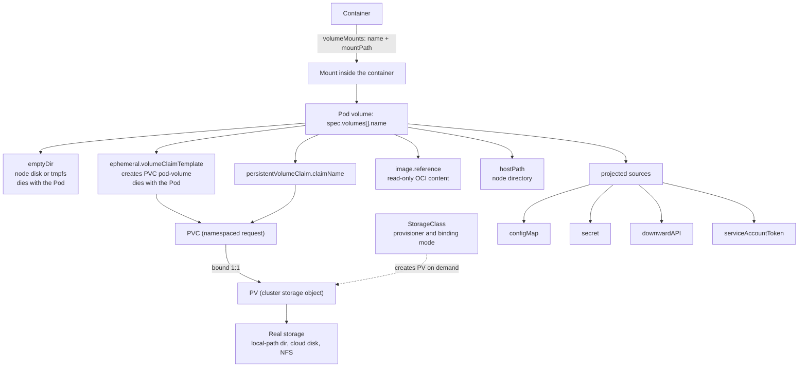

# T3.07 Utilize persistent and ephemeral volumes

> Competency: "Utilize persistent and ephemeral volumes" (CKAD-1.4) | Domain/weight: CKAD, Application Design and Build (20%) | Est. time: 3.5 h | Prerequisites: T3.03, T3.04

Shell setup (from [conventions](../00-conventions.md); put it at the top of every session):

```bash
alias k=kubectl
export do="--dry-run=client -o yaml"
export now="--force --grace-period=0"
source <(kubectl completion bash); complete -o default -F __start_kubectl k
```

Lab environment for this lesson: **kind** (cluster `lab`, context `kind-lab`, local-path provisioner as the default StorageClass). Namespace: `lab-t307`. Files go in `~/lab/t307/`.

Prerequisites you should have read: [T3.03 ConfigMaps](../part3-ckad/T3.03-configmaps.md) and [T3.04 Create & consume Secrets](../part3-ckad/T3.04-create-consume-secrets.md). A ConfigMap or a Secret is mounted as a volume in exactly the way shown there. This lesson only adds what changes when you combine them with other volume types (the `projected` volume, section 2.7). Workload basics (Deployment, StatefulSet) are in [T3.02](../part3-ckad/T3.02-choose-and-use-the-right-workload.md). Security contexts are in [T3.17](../part3-ckad/T3.17-understand-application-security-securitycontexts-and-capabilities.md).

> Output policy. Output blocks in this lesson carry one of these labels:
> - `REAL OUTPUT (API server v1.37.0, read-only: explain / get / server dry-run)`: captured on a kind cluster with a v1.37.0 API server. That cluster belonged to another session, so only read-only commands were run against it. Nothing was created, and no Pod was started.
> - `REAL OUTPUT (kubectl v1.37.1 client, --dry-run=client, no cluster)`: shows the object a command would send.
> - `REAL OUTPUT (Docker)`: plain Linux behaviour captured in a container. It is not a Pod or a kind result.
> - `EXPECTED OUTPUT (not captured)`: the shape you should see on a v1.37 cluster. Names, ages, UIDs and sizes will differ. Every such block is listed in section 11.
>
> Commands that print output but have no label (for example the `Observe:` lines under a manifest) are described in words only. What they print is the expected behaviour, not captured output, and section 11 lists them too.

---

## 1. Why this matters

A container's filesystem is created from the image when the container starts and is thrown away when it restarts. Anything an application writes (an upload, a database file, a cache) is gone after the next crash. Data that must survive a restart, or that two containers must share, has to live in a **volume**. In real life, the classic outage is a database Pod that is rescheduled and comes back empty because nobody mounted storage. In the CKAD curriculum this is the competency "Utilize persistent and ephemeral volumes" under Application Design and Build (20%). The exam averages about 6 minutes per task (15-20 tasks in 2 hours; sources: [E2](https://docs.linuxfoundation.org/tc-docs/certification/tips-cka-and-ckad), [E3](https://docs.linuxfoundation.org/tc-docs/certification/faq-cka-ckad-cks)), so you need to know the shape of a shared `emptyDir`, a PVC plus a Pod that mounts it, and a generic ephemeral volume well enough to write each one from memory, and use the docs only for the details. You also need to know which volume type to pick, and how to read a Pending PVC.

---

## 2. Concepts

### 2.1 Volume vs volumeMount, and the mount fields

A Pod uses storage in two steps, and both steps are needed:

1. `spec.volumes[]` **declares** a volume for the whole Pod. It has a `name` and exactly one *source* (`emptyDir`, `persistentVolumeClaim`, `configMap`, and so on). The source says where the data comes from.
2. `spec.containers[].volumeMounts[]` says that **this container** sees that volume at a path. `name` must equal a name in `spec.volumes`.

Different containers in one Pod can mount the same volume at different paths. That is how containers share files.

If you declare a volume and mount nothing, the volume exists but no container sees it. If you mount a name that is not declared, the API server rejects the Pod: `spec.containers[0].volumeMounts[0].name: Not found: "x"`.

Why volumes are Pod-level and not container-level: a container can restart (new filesystem) while the Pod stays. The kubelet keeps the volume directory on the node and bind-mounts it into each new container. So a volume outlives container restarts. How long it lives after that depends on the source (table in 2.2).

| `volumeMounts` field | What it does | Default | Risky or invalid values |
|---|---|---|---|
| `name` | Which volume from `spec.volumes` | required | A name that is not declared is rejected |
| `mountPath` | Directory inside the container where the volume appears | required | Mounting over a populated directory hides the image's files there (section 2.15). A path that contains `:` is invalid |
| `readOnly` | The container cannot write through this mount | `false` | Writes fail with `Read-only file system`. It is per mount, so one container can write while another has `readOnly: true` |
| `subPath` | Mount only this file or directory of the volume instead of the volume root | `""` (whole volume) | An absolute path or `..` is rejected. If the path does not exist in the volume, the kubelet creates it **as a directory**, even if you wanted a file. A subPath mount does not receive ConfigMap/Secret updates |
| `subPathExpr` | Like `subPath`, but expands `$(VAR_NAME)` using this container's environment variables | `""` | Cannot be set together with `subPath`. Only `$(VAR)` syntax works, not `${VAR}` or `$VAR` |
| `mountPropagation` | How mounts inside the volume are seen by other mounts | `None` | `Bidirectional` needs a privileged container. Not an exam topic |
| `recursiveReadOnly` | With `readOnly: true`, also make submounts read-only | unset | Needs a supporting runtime. Not an exam topic |

**subPathExpr example.** Several Pods write to one shared volume, and each must have its own directory named after the Pod. The `viewer` container mounts the whole volume, so you can see what the kubelet created. This YAML is complete.

```yaml
apiVersion: v1
kind: Pod
metadata:
  name: subs
  namespace: lab-t307
spec:
  containers:
  - name: app
    image: busybox:1.36
    command: ["sh", "-c", "echo hi > /logs/out.txt; sleep 3600"]
    env:
    - name: POD_NAME                  # the variable that subPathExpr expands
      valueFrom:
        fieldRef:
          fieldPath: metadata.name
    volumeMounts:
    - name: vol
      mountPath: /logs
      subPathExpr: $(POD_NAME)        # volume dir "subs" is mounted at /logs
    - name: vol
      mountPath: /etc/app
      subPath: config                 # fixed sub-directory, created empty if missing
  - name: viewer
    image: busybox:1.36
    command: ["sleep", "3600"]
    volumeMounts:
    - name: vol
      mountPath: /all                 # whole volume
  volumes:
  - name: vol
    emptyDir: {}
```

Observe it: `k exec subs -c viewer -- ls /all` prints `config` and `subs`, and `k exec subs -c viewer -- cat /all/subs/out.txt` prints `hi`. (`EXPECTED OUTPUT (not captured)` for both. See section 11.) The directory `config` exists only because the kubelet created it.

### 2.2 The volume types at a glance

Kubernetes has many volume sources. The ones you must handle are in this table. "Survives" answers: after what event is the data gone?

**What to memorise for the exam.** Know `emptyDir` (shared by two containers) and `persistentVolumeClaim` (PVC plus a Pod that mounts it) well enough to write them from memory, and know the shape of `ephemeral.volumeClaimTemplate`. For the rest (`hostPath`, `projected`, `downwardAPI`, `image`) know what each is for and which docs page has the YAML.

| Source | What it is | Data survives container restart? | Survives Pod deletion? | Typical use |
|---|---|---|---|---|
| `emptyDir` | Empty directory made when the Pod lands on a node | Yes | No | Scratch space, sharing between containers |
| `hostPath` | A path on the node's own filesystem | Yes | Yes, but only on that node | Node agents, labs. Risky (2.4) |
| `configMap`, `secret` | Keys of a ConfigMap or Secret as files | Yes (read-only data) | n/a, it is re-created from the API | Config files, credentials ([T3.03](../part3-ckad/T3.03-configmaps.md), [T3.04](../part3-ckad/T3.04-create-consume-secrets.md)) |
| `downwardAPI` | Pod metadata (labels, name, limits) as files | Yes | n/a | Let an app read its own labels or limits |
| `projected` | Several of the above merged in one directory | Yes | n/a | One config directory from many sources |
| `ephemeral` (generic ephemeral volume) | A PVC created *for the Pod* from a template | Yes | **No**, the PVC is deleted with the Pod | Scratch space that needs real storage-class features |
| `image` | The content of an OCI image or artifact, read-only | Yes | n/a | Ship data or tools separately from the app image |
| `persistentVolumeClaim` | A claim on storage that exists independently of the Pod | Yes | **Yes** | Databases, uploads, anything to keep |
| `gitRepo` | Clones a git repo at Pod start | n/a | n/a | **Removed from use. Do not use** (2.12) |

**Ephemeral versus persistent.** An *ephemeral* volume has the same lifetime as the Pod. A *persistent* volume is a separate API object (PersistentVolumeClaim and PersistentVolume) with its own lifetime. A Pod can be deleted and a new Pod can mount the same claim and read the old data.

### 2.3 emptyDir: scratch space and container sharing

An `emptyDir` is an empty directory that the kubelet creates when the Pod is assigned to a node. It is deleted when the Pod is removed from that node for any reason. A container crash or restart does *not* delete it. So an `emptyDir` is right for caches, scratch files and handing files between containers (for example, an init container prepares files and the main container reads them). It is wrong for anything you need after the Pod is gone.

| Field | Meaning | Default | Risky or invalid values |
|---|---|---|---|
| `medium` | Where the data lives | `""` = the node's disk (under the kubelet directory) | The documented values are `""` and `Memory` (the kubelet also knows `HugePages` variants, which are outside this lesson). Use only these |
| `medium: Memory` | The directory is a **tmpfs** (a filesystem held in RAM) | n/a | The data counts against the container memory limit. Fills memory fast. Data is lost if the node reboots |
| `sizeLimit` | Upper bound on usage, e.g. `100Mi` | none | On disk the limit is *enforced late*: the kubelet checks usage periodically and **evicts the Pod** when it is above the limit. It is not an instant write error. For `Memory` the limit applies too, as the smaller of `sizeLimit` and the sum of the container memory limits |

**Under the hood.** The kubelet creates the directory at `/var/lib/kubelet/pods/<pod-uid>/volumes/kubernetes.io~empty-dir/<volume-name>` on the node. With `medium: Memory` it mounts a tmpfs there. When it starts a container, the container runtime bind-mounts that directory at the `mountPath`. When the Pod is deleted, the kubelet removes the directory. That explains the lifetime rule: the data is tied to the Pod's presence on the node, not to any container.

Two containers sharing a log file (this YAML is complete; it is also the Easy lab base):

```yaml
apiVersion: v1
kind: Pod
metadata:
  name: app
  namespace: lab-t307
spec:
  containers:
  - name: app
    image: busybox:1.36
    command: ["sh", "-c", "while true; do date >> /shared/log.txt; sleep 2; done"]
    volumeMounts:
    - name: shared
      mountPath: /shared
  - name: sidecar
    image: busybox:1.36
    command: ["sleep", "3600"]
    volumeMounts:
    - name: shared
      mountPath: /shared
      readOnly: true
  volumes:
  - name: shared
    emptyDir:
      sizeLimit: 100Mi
```

Observe: `k exec app -c sidecar -- ls /shared` should list `log.txt`, and `k exec app -c sidecar -- sh -c 'echo x > /shared/y'` should fail with `Read-only file system`.

A RAM-backed one, mounted at `/cache`, would be:

```yaml
  volumes:
  - name: cache
    emptyDir:
      medium: Memory      # tmpfs
      sizeLimit: 64Mi
```

Observe with `k exec <pod> -- df -h /cache`. The filesystem column shows `tmpfs`. On disk-backed `emptyDir` it shows the node's disk device or `overlay`. (`EXPECTED OUTPUT (not captured)`.)

### 2.4 hostPath: a node directory, and why it is risky

A `hostPath` volume mounts a file or directory from the **node's** filesystem into the Pod. The data survives the Pod, but it is tied to one node. If the Pod is rescheduled to another node, it sees a different (probably empty) directory.

| `type` | Behaviour | What happens if it is missing |
|---|---|---|
| `""` (default) | No check at all | Mount proceeds with whatever is there; if nothing exists, the container runtime creates a **root-owned directory** |
| `DirectoryOrCreate` | Directory; created with mode `0755` and the kubelet's owner if missing | Created |
| `Directory` | A directory must already exist | Pod stuck `ContainerCreating`; event says the path is not a directory or does not exist |
| `FileOrCreate` | File; created with mode `0644` if missing (the parent directory must exist) | Created |
| `File` | A file must already exist | Pod stuck `ContainerCreating` |
| `Socket`, `CharDevice`, `BlockDevice` | A UNIX socket / character device / block device must exist | Pod stuck `ContainerCreating` |

The type descriptions above come from the API server's own schema:

```text
REAL OUTPUT (API server v1.37.0, read-only: explain / get / server dry-run)
$ kubectl explain pod.spec.volumes.hostPath.type
...
     - `"DirectoryOrCreate"` If nothing exists at the given path, an empty
    directory will be created there as needed with file mode 0755, having the
    same group and ownership with Kubelet.
     - `"File"` A file must exist at the given path
     - `"FileOrCreate"` If nothing exists at the given path, an empty file will
    be created there as needed with file mode 0644, having the same group and
    ownership with Kubelet.
...
```

Why it is risky:

- **Host access.** A Pod that mounts `/` or `/var/run` (the container runtime socket) can read other Pods' data or take over the node. This is why the Pod Security "baseline" and "restricted" profiles forbid `hostPath` ([T3.17](../part3-ckad/T3.17-understand-application-security-securitycontexts-and-capabilities.md)).
- **Node-bound.** Two replicas on different nodes see different data. A reschedule loses the data.
- **Permissions.** The directory it creates is owned by root with mode `0755`, so a Pod running as a non-root user cannot write to it (section 6). `fsGroup` does **not** fix a `hostPath` (2.16).

A complete example (the `type` makes the Pod fail loudly if the path is wrong):

```yaml
apiVersion: v1
kind: Pod
metadata:
  name: hp
  namespace: lab-t307
spec:
  containers:
  - name: app
    image: busybox:1.36
    command: ["sh", "-c", "date >> /host-data/stamp; sleep 3600"]
    volumeMounts:
    - name: host
      mountPath: /host-data
  volumes:
  - name: host
    hostPath:
      path: /tmp/lab-t307          # a path on the NODE, not in your terminal
      type: DirectoryOrCreate
```

On kind the "node" is a Docker container: look at the file with `docker exec lab-worker cat /tmp/lab-t307/stamp` (use the node name that `k get pod hp -o wide` shows). `EXPECTED OUTPUT (not captured)`.

**The failing variant: `type: Directory` on a path that does not exist.** `Directory` never creates anything, so the check fails when the path is missing. Same Pod, different volume:

```yaml
apiVersion: v1
kind: Pod
metadata:
  name: hpdir
  namespace: lab-t307
spec:
  containers:
  - name: app
    image: busybox:1.36
    command: ["sleep", "3600"]
    volumeMounts:
    - name: host
      mountPath: /host-data
  volumes:
  - name: host
    hostPath:
      path: /tmp/no-such-dir-t307      # nothing creates this path
      type: Directory
```

Observe: `k get pod hpdir` stays `ContainerCreating`. `k describe pod hpdir` shows, at the bottom, a `FailedMount` event (Warning) whose message says that the `hostPath` type check failed for `/tmp/no-such-dir-t307` (the exact wording is UNVERIFIED, see section 11). Compare: change `type` to `DirectoryOrCreate` and re-create the Pod (`k replace --force -f hpdir.yaml`), and it starts. `type: File` fails the same way for a missing file.

Cleanup for both examples: `k delete pod hp hpdir -n lab-t307 $now`, then remove the directory the first one created on its node: `docker exec lab-worker rm -rf /tmp/lab-t307` (and on `lab-worker2` if the Pod ran there).

### 2.5 configMap and secret volumes (short recap)

Full detail is in [T3.03](../part3-ckad/T3.03-configmaps.md) and [T3.04](../part3-ckad/T3.04-create-consume-secrets.md). The part that matters for this lesson:

- Each key becomes a file named after the key. The value is the file content.
- `items: [{key, path}]` picks keys and renames them. `defaultMode` sets file permissions (default `0644`; write it in octal with a leading `0`, for example `0400`, because YAML reads `400` as decimal).
- The kubelet refreshes the files when the object changes (after a delay of up to about a minute). A `subPath` mount and environment variables never refresh.
- The files are read-only for the container. Secret files live on a tmpfs, so they are not written to the node's disk.
- `optional: true` lets the Pod start if the object does not exist. Otherwise the Pod waits in `ContainerCreating` with a `FailedMount` event.

A standalone example, with `items` and `defaultMode`. It mounts only the key `level`, renames it to `conf/level.txt`, and makes every file readable by the owner only:

```yaml
apiVersion: v1
kind: ConfigMap
metadata:
  name: site-cfg
  namespace: lab-t307
data:
  level: debug
  color: blue
---
apiVersion: v1
kind: Pod
metadata:
  name: cmvol
  namespace: lab-t307
spec:
  containers:
  - name: app
    image: busybox:1.36
    command: ["sleep", "3600"]
    volumeMounts:
    - name: cfg
      mountPath: /etc/site
  volumes:
  - name: cfg
    configMap:
      name: site-cfg
      defaultMode: 0400          # octal; applies to every file
      items:
      - key: level               # only this key is projected
        path: conf/level.txt     # file /etc/site/conf/level.txt
```

Observe: `k exec cmvol -- cat /etc/site/conf/level.txt` prints `debug`; `k exec cmvol -- ls -lL /etc/site/conf/level.txt` shows mode `-r--------`; `k exec cmvol -- ls /etc/site/color` fails with `No such file or directory`, because `color` is not listed in `items`. (`EXPECTED OUTPUT (not captured)`.) A Secret volume has the same shape with `secret: {secretName: <name>}` instead of `configMap: {name: <name>}`; note the different field name (`secretName`). Clean up: `k delete pod cmvol -n lab-t307 $now; k delete cm site-cfg -n lab-t307`.

### 2.6 downwardAPI volume

The **downward API** lets a container read facts about its own Pod without calling the API server. In a volume, each item becomes a file.

| `items[]` field | Meaning |
|---|---|
| `path` | File name (relative path, no `..`) |
| `fieldRef.fieldPath` | One of `metadata.name`, `metadata.namespace`, `metadata.uid`, `metadata.labels`, `metadata.annotations`, `metadata.labels['key']`, `metadata.annotations['key']` |
| `resourceFieldRef` | A container's `limits.cpu`, `limits.memory`, `requests.cpu`, `requests.memory` (and ephemeral-storage variants). In a **volume** you must also set `containerName` |
| `mode` | Permissions for this file; overrides `defaultMode` |

A volume can expose the whole label map (`metadata.labels`), which an environment variable cannot. Label changes on a running Pod are written to the file later, while an environment variable is fixed at container start. The `labels` file is written as `key="value"` lines.

### 2.7 projected volume: many sources, one directory

A `projected` volume merges several sources into **one** directory, so you mount one path and get files from different objects.

| Source | What it adds |
|---|---|
| `configMap` | Keys of a ConfigMap (supports `items`, `optional`) |
| `secret` | Keys of a Secret (supports `items`, `optional`) |
| `downwardAPI` | Pod fields, as in 2.6 |
| `serviceAccountToken` | A short-lived token for the Pod's ServiceAccount; fields `path`, `audience`, `expirationSeconds` (minimum 600) |
| `clusterTrustBundle` | CA certificates from a ClusterTrustBundle object |
| `podCertificate` | A key and certificate issued to the Pod (the API server lists this source in v1.37; details are outside this lesson) |

All sources must be in the Pod's namespace (ClusterTrustBundle is cluster-scoped). Two sources that write the same `path` are an error. The list of sources was checked on the API server:

```text
REAL OUTPUT (API server v1.37.0, read-only: explain / get / server dry-run)
$ kubectl explain pod.spec.volumes.projected.sources
  clusterTrustBundle	<ClusterTrustBundleProjection>
  configMap	<ConfigMapProjection>
  downwardAPI	<DownwardAPIProjection>
  podCertificate	<PodCertificateProjection>
  secret	<SecretProjection>
  serviceAccountToken	<ServiceAccountTokenProjection>
```

**Why it exists.** Every Pod already gets a projected volume: the ServiceAccount token directory at `/var/run/secrets/kubernetes.io/serviceaccount` mixes the token, `ca.crt` and the namespace. It lets you give the app one directory such as `/etc/all` instead of three separate mounts.

Complete example (a ConfigMap, a Secret and the downward API in one volume):

```yaml
apiVersion: v1
kind: ConfigMap
metadata:
  name: app-config
  namespace: lab-t307
data:
  LOG_LEVEL: debug
---
apiVersion: v1
kind: Secret
metadata:
  name: app-secret
  namespace: lab-t307
type: Opaque
stringData:
  password: s3cr3t
---
apiVersion: v1
kind: Pod
metadata:
  name: proj
  namespace: lab-t307
  labels:
    app: proj
spec:
  containers:
  - name: app
    image: busybox:1.36
    command: ["sleep", "3600"]
    resources:
      limits:
        memory: 64Mi            # needed for the resourceFieldRef below
    volumeMounts:
    - name: all
      mountPath: /etc/all
      readOnly: true
  volumes:
  - name: all
    projected:
      defaultMode: 0440         # file mode for every file (octal)
      sources:
      - configMap:
          name: app-config      # file /etc/all/LOG_LEVEL
      - secret:
          name: app-secret
          items:
          - key: password
            path: creds/password   # file /etc/all/creds/password
      - downwardAPI:
          items:
          - path: labels           # file /etc/all/labels
            fieldRef:
              fieldPath: metadata.labels
          - path: mem-limit        # file /etc/all/mem-limit
            resourceFieldRef:
              containerName: app
              resource: limits.memory
```

Observe: `k exec proj -- ls -R /etc/all` and `k exec proj -- cat /etc/all/labels /etc/all/mem-limit` (labels line `app="proj"`; the memory limit printed in bytes, `67108864`). `EXPECTED OUTPUT (not captured)`. This manifest was validated against the v1.37.0 API server with `kubectl apply --dry-run=server`, which accepted all three objects.

### 2.8 Generic ephemeral volumes

An **emptyDir** has only the node's disk. Sometimes you want scratch storage from a real StorageClass (a different disk, a size guarantee, capacity checks by the scheduler), and you still want it to disappear with the Pod. That is a **generic ephemeral volume**: a volume source `ephemeral.volumeClaimTemplate` in the Pod spec. It contains a PVC template (`metadata` and `spec`, with the same fields as a PVC).

How it works:

1. When the Pod is created, the ephemeral-volume controller (part of kube-controller-manager) creates a real PVC named `<pod-name>-<volume-name>`. For the example below that is `scratch-scratch`.
2. The PVC has an **ownerReference** pointing at the Pod. Kubernetes' garbage collector deletes the PVC when the Pod is deleted. With reclaim policy `Delete` on the StorageClass, the PV and its data go too.
3. From then on it behaves like any PVC: binding mode, access modes and provisioning all follow the StorageClass.

| Compare | `emptyDir` | Generic ephemeral volume | PVC volume |
|---|---|---|---|
| Created by | kubelet | ephemeral-volume controller | You (separate object) |
| Storage class features | none | yes | yes |
| Lifetime | Pod | Pod | independent |
| Visible as PVC (`k get pvc`) | no | yes (`<pod>-<volume>`) | yes |

Risky values: the template needs a `storageClassName` that can provision dynamically (or a default one); `volumeClaimTemplate.spec` is required; and if a PVC with the target name already exists but was *not* created for this Pod, the Pod waits and reports a conflict instead of reusing it.

```yaml
apiVersion: v1
kind: Pod
metadata:
  name: scratch
  namespace: lab-t307
spec:
  containers:
  - name: app
    image: busybox:1.36
    command: ["sh", "-c", "echo hello > /scratch/f; sleep 3600"]
    volumeMounts:
    - name: scratch
      mountPath: /scratch
  volumes:
  - name: scratch
    ephemeral:
      volumeClaimTemplate:
        metadata:
          labels:
            purpose: scratch      # labels/annotations copied to the PVC
        spec:
          accessModes: ["ReadWriteOnce"]
          storageClassName: standard
          resources:
            requests:
              storage: 1Gi
```

Observe: `k get pvc` shows `scratch-scratch`. After `k delete pod scratch`, `k get pvc` shows it is gone. The fields of `ephemeral` and the Pod manifest were checked on the API server:

```text
REAL OUTPUT (API server v1.37.0, read-only: explain / get / server dry-run)
$ kubectl explain pod.spec.volumes.ephemeral
  volumeClaimTemplate	<PersistentVolumeClaimTemplate>

$ kubectl apply --dry-run=server -f ephemeral.yaml     # namespace changed to default for the check
pod/scratch created (server dry run)
```

### 2.9 Image volumes (OCI volume source)

An **image volume** mounts the *contents of an OCI image or artifact* into a container, read-only. "OCI" (Open Container Initiative) is the standard format of container images. The image is pulled by the kubelet like any image, and its filesystem layers are merged and mounted at the `mountPath`. Per the topic entry, the feature is GA (stable) in v1.36; the API schema text does not state the stage, and a live-cluster confirmation is listed in section 11.

**Why it exists.** Before image volumes you had to bake data (a model file, a plugin, a set of CLI tools) into the application image, or copy it with an init container into an `emptyDir`. Now the data ships as its own image, updated on its own schedule, and the app image stays small.

| Field | Meaning | Default | Risky or invalid values |
|---|---|---|---|
| `image.reference` | The image or artifact to mount. Behaves like `containers[].image` | required | A tag that does not exist keeps the Pod in `ContainerCreating`. Do not use `:latest` |
| `image.pullPolicy` | `Always`, `IfNotPresent` or `Never` | `Always` if the tag is `:latest`, otherwise `IfNotPresent` | `Never` fails if the image is not already on the node |

Facts from the API schema (copied from the `explain` output below): the volume is mounted read-only; image pull secrets are found the same way as for containers; the volume is resolved when the Pod starts, so new content appears when the Pod is deleted and recreated; and a failed pull blocks the containers from starting.

```text
REAL OUTPUT (API server v1.37.0, read-only: explain / get / server dry-run)
$ kubectl explain pod.spec.volumes.image
FIELD: image <ImageVolumeSource>
...
FIELDS:
  pullPolicy	<string>
  enum: Always, IfNotPresent, Never
...
  reference	<string>
    Required: Image or artifact reference to be used. Behaves in the same way as
    pod.spec.containers[*].image. ...
```

The same schema says that the OCI object is merged "in the same way as for container images", mounted read-only, that `subPath` is supported (not before 1.33), and that `fsGroupChangePolicy` has no effect on this volume type. The container runtime must support image volumes (containerd and CRI-O do in recent versions). The runtime version on your kind nodes was not checked here, so treat that as a "To verify" item.

```yaml
apiVersion: v1
kind: Pod
metadata:
  name: imgvol
  namespace: lab-t307
spec:
  containers:
  - name: app
    image: busybox:1.36
    command: ["sleep", "3600"]
    volumeMounts:
    - name: tools
      mountPath: /opt/nginx-fs       # the root of the nginx image appears here
  volumes:
  - name: tools
    image:
      reference: nginx:1.27          # what to mount
      pullPolicy: IfNotPresent       # pull only if the node does not have it
```

Observe: `k exec imgvol -- ls /opt/nginx-fs/usr/share/nginx/html` lists `50x.html` and `index.html`, and `k exec imgvol -- touch /opt/nginx-fs/x` fails with `Read-only file system`. (`EXPECTED OUTPUT (not captured)`.) The manifest passed `kubectl apply --dry-run=server` against the v1.37.0 API server.

**Related but different.** An image volume mounts a *data* image into a *running* app container. It is not the container's own image, and it is not an init-container copy. The data is not copied; it is a read-only mount.

### 2.10 PersistentVolumeClaim from the developer side

Two objects separate "what the app asks for" from "what the cluster has":

- **PersistentVolume (PV)**: a piece of storage in the cluster. It is cluster-scoped. An administrator creates it, or a provisioner creates it automatically.
- **PersistentVolumeClaim (PVC)**: a namespaced *request* for storage by a developer. The Pod references the PVC, never the PV.
- **StorageClass (SC)**: a recipe that says how to create a PV on demand (which provisioner, which parameters, which binding mode, what happens on delete).

The flow: you create a PVC; Kubernetes finds a PV that satisfies it (or the StorageClass's provisioner creates one); the two are **bound** one-to-one; the Pod mounts the claim. Without this split, every developer would need to know disk IDs and NFS servers.

PVC fields you must know:

| Field | Meaning | Default | Risky or invalid values |
|---|---|---|---|
| `spec.accessModes` | How the volume may be mounted (table below) | none, required | A mode the storage cannot do leaves the PVC unbound |
| `spec.resources.requests.storage` | Minimum size, for example `1Gi` | required | The bound PV may be bigger. `1G` (decimal) and `1Gi` (binary) are different sizes. You cannot shrink a PVC |
| `spec.storageClassName` | Which SC provisions it | omitted = the cluster's **default** SC | `""` (empty string) = *no* class, bind only to a PV that also has no class (no provisioning). A name that does not exist = stays Pending |
| `spec.volumeMode` | `Filesystem` or `Block` | `Filesystem` | `Block` gives a raw device. Mount it with `volumeDevices[].devicePath`, not `volumeMounts` |
| `spec.volumeName` | Bind to this exact PV | unset | Bypasses the SC. Admin-style |
| `spec.selector` | Label selector for PVs | unset | Cannot be combined with dynamic provisioning from most SCs |

| Access mode | Short | Meaning |
|---|---|---|
| `ReadWriteOnce` | RWO | Read-write by Pods on **one node** (several Pods on the same node can share it) |
| `ReadOnlyMany` | ROX | Read-only by Pods on many nodes |
| `ReadWriteMany` | RWX | Read-write by Pods on many nodes |
| `ReadWriteOncePod` | RWOP | Read-write by exactly **one Pod** in the cluster |

The mode is a promise about *attachment*, and the storage backend must support it. Local-path storage (kind) and most cloud block disks support only RWO or RWOP. NFS and some file systems support RWX. A simple RWOP claim for comparison:

```yaml
apiVersion: v1
kind: PersistentVolumeClaim
metadata:
  name: single
  namespace: lab-t307
spec:
  accessModes: ["ReadWriteOncePod"]
  resources:
    requests:
      storage: 100Mi
```

Observe: `k get pvc single -o jsonpath='{.spec.accessModes}'` prints `["ReadWriteOncePod"]`. With the default SC it stays `Pending` until a Pod uses it (2.11).

**How to observe the other modes.** `k get pvc,pv` prints the short names (`RWO`, `ROX`, `RWX`, `RWOP`) in the `ACCESS MODES` column. On kind you can request `ReadOnlyMany` or `ReadWriteMany` from the default class, but local-path storage is a directory on one node, so it does not provide shared multi-node access. Whether the provisioner accepts or rejects such a claim is a "To verify" item (section 11). To see RWX work you need a backend that supports it, such as an NFS server, which this lab setup does not have. For the exam, read the task: if it says several Pods on different nodes must write the same files, the claim and PV need `ReadWriteMany`.

**Reclaim policy and lifecycle.** The PV's `persistentVolumeReclaimPolicy` says what happens when the claim is deleted: `Delete` (the PV and the data are removed; this is the default for dynamically provisioned volumes) or `Retain` (the PV and data stay, and the PV becomes `Released`). A PVC that a Pod still uses goes `Terminating` and is only removed after the Pod is gone ("PVC protection"). A PVC can only be grown if the SC has `allowVolumeExpansion: true`; the kind default SC does not.

A **static** PV (made by hand, no SC) looks like this. As a developer you will usually meet this only in CKA-style tasks, but you must be able to read it:

```yaml
apiVersion: v1
kind: PersistentVolume
metadata:
  name: pv-static
spec:
  capacity:
    storage: 1Gi
  accessModes: ["ReadWriteOnce"]
  persistentVolumeReclaimPolicy: Retain
  storageClassName: manual         # a PVC that sets the same class and fits can bind to it
  hostPath:
    path: /tmp/pv-static           # node path; for labs only
```

A PVC with `storageClassName: manual` and `storage: 500Mi` would bind to it. (`EXPECTED` behaviour; not run in this lesson.)

Check what you have with the commands from the entry:

```text
REAL OUTPUT (API server v1.37.0, read-only: explain / get / server dry-run)
$ kubectl get sc
NAME                 PROVISIONER             RECLAIMPOLICY   VOLUMEBINDINGMODE      ALLOWVOLUMEEXPANSION   AGE
standard (default)   rancher.io/local-path   Delete          WaitForFirstConsumer   false                  12m
```

This is the kind default StorageClass in v1.37.0: name `standard`, provisioner `rancher.io/local-path`, reclaim `Delete`, binding mode `WaitForFirstConsumer`, no expansion.

### 2.11 Binding modes: Immediate vs WaitForFirstConsumer

The StorageClass field `volumeBindingMode` decides *when* a PVC is bound and a PV is made.

| Mode | When the PV is provisioned and bound | Effect for you |
|---|---|---|
| `Immediate` | As soon as the PVC is created | PVC goes `Bound` with no Pod. The volume may be created in a zone the Pod cannot reach (for topology-restricted storage) |
| `WaitForFirstConsumer` | When the first **Pod that uses the PVC is scheduled** | PVC stays `Pending` until you create such a Pod. That is normal, not an error |

**Why `WaitForFirstConsumer` exists.** Local and zonal storage lives in one place (one node or one zone). If the volume were created first, the scheduler would be forced to put the Pod there, possibly onto a node without CPU. By waiting, the scheduler first picks a node considering all constraints, then the provisioner creates the volume where that node is.

**Under the hood.** (1) The scheduler's volume-binding step sees an unbound PVC with a WaitForFirstConsumer class and defers. (2) After it picks a node it annotates the PVC with `volume.kubernetes.io/selected-node`. (3) The provisioner (for kind, the local-path provisioner) sees the annotation and creates a PV with node affinity to that node. (4) The PV controller binds PVC and PV. (5) The kubelet mounts it and starts the container.

Symptom on a fresh claim: `k get pvc data` shows `Pending` and `k describe pvc data` has an event `WaitForFirstConsumer ... waiting for first consumer to be created before binding`. Fix: create a Pod that mounts the claim.

**Runnable example of both modes side by side.** `standard` (the kind default) is `WaitForFirstConsumer`. The StorageClass below uses the same provisioner but with `Immediate`. A StorageClass is cluster-scoped, so it has no `namespace`. The PVC `lazy` uses `standard`, the PVC `imm` uses the new class, and no Pod exists for either. It assumes `k create ns lab-t307` has been run.

```yaml
apiVersion: storage.k8s.io/v1
kind: StorageClass
metadata:
  name: immediate
provisioner: rancher.io/local-path
reclaimPolicy: Delete
volumeBindingMode: Immediate        # bind and provision as soon as the PVC exists
---
apiVersion: v1
kind: PersistentVolumeClaim
metadata:
  name: imm
  namespace: lab-t307
spec:
  accessModes: ["ReadWriteOnce"]
  storageClassName: immediate
  resources:
    requests:
      storage: 100Mi
---
apiVersion: v1
kind: PersistentVolumeClaim
metadata:
  name: lazy
  namespace: lab-t307
spec:
  accessModes: ["ReadWriteOnce"]
  storageClassName: standard
  resources:
    requests:
      storage: 100Mi
```

Observe with `k get pvc -n lab-t307` and `k get sc`:

```text
EXPECTED OUTPUT (not captured)
NAME   STATUS    VOLUME         CAPACITY   ACCESS MODES   STORAGECLASS   AGE
imm    Bound     pvc-9a2d...    100Mi      RWO            immediate      6s
lazy   Pending                                            standard       6s
```

`imm` is `Bound` with no Pod at all, and `k get pv` lists a PV for it. `lazy` stays `Pending` until you create a Pod that mounts it. Test it: `k get pvc imm -n lab-t307 -o jsonpath='{.status.phase}'` prints `Bound`, and the same command for `lazy` prints `Pending`; if both print `Bound`, the class `standard` is not `WaitForFirstConsumer` on your cluster, so run `k get sc` and read the `VOLUMEBINDINGMODE` column. If `imm` stays `Pending` instead, run `k describe pvc imm -n lab-t307` and read the Events: the installed local-path provisioner version may not support `Immediate` (UNVERIFIED, section 11). In that case the table above still describes the Kubernetes behaviour; the provisioner is the limit.

Cleanup (the StorageClass is cluster-scoped, so deleting the namespace does **not** remove it):

```bash
k delete pvc imm lazy -n lab-t307
k delete sc immediate
```

### 2.12 gitRepo volume: disabled, use an init container

The `gitRepo` volume cloned a Git repository into a directory when the Pod started. It was deprecated in v1.11 and has been turned off because it was a security risk (cloning ran git on the node, and a hostile repository could abuse that). The API server warning says it is disabled by default since v1.33; the entry's source says the driver was disabled for good in v1.36. The v1.37 schema says it is deprecated and names the replacement:

```text
REAL OUTPUT (API server v1.37.0, read-only: explain / get / server dry-run)
$ kubectl explain pod.spec.volumes.gitRepo
FIELD: gitRepo <GitRepoVolumeSource>

DESCRIPTION:
    gitRepo represents a git repository at a particular revision. Deprecated:
    GitRepo is deprecated. To provision a container with a git repo, mount an
    EmptyDir into an InitContainer that clones the repo using git, then mount
    the EmptyDir into the Pod's container.
...
```

Important detail: the **API server still accepts** the field (with a warning), so `kubectl apply` succeeds. The failure comes later, on the node:

```text
REAL OUTPUT (API server v1.37.0, read-only: explain / get / server dry-run)
$ kubectl apply --dry-run=server -f gitrepo-pod.yaml
Warning: spec.volumes[0].gitRepo: deprecated in v1.11, and disabled by default in v1.33+
pod/git created (server dry run)
```

So a Pod with `gitRepo` is created, the scheduler places it, and the kubelet cannot mount the volume. Expect it to stay `ContainerCreating` with a `FailedMount` event. (The exact event text is not captured; see section 11.)

**The replacement.** Clone in an **init container** (a container that runs to completion before the main containers start) into an `emptyDir`, then mount that `emptyDir` in the main container. For a repo that must stay up to date, a `git-sync` sidecar does the same repeatedly. The init-container version, complete:

```yaml
apiVersion: v1
kind: Pod
metadata:
  name: src
  namespace: lab-t307
spec:
  initContainers:
  - name: clone
    image: alpine/git:2.47.2
    command: ["git", "clone", "--depth", "1", "https://github.com/kubernetes/examples.git", "/src"]
    volumeMounts:
    - name: src
      mountPath: /src
  containers:
  - name: app
    image: busybox:1.36
    command: ["sleep", "3600"]
    volumeMounts:
    - name: src
      mountPath: /src
      readOnly: true
  volumes:
  - name: src
    emptyDir: {}
```

The tag `alpine/git:2.47.2` and the network access of your nodes were not checked (section 11). A `git clone` into an empty existing directory is allowed, which is why the mount point itself works as the target.

### 2.13 Using a PVC in a Pod or a Deployment, and ReadWriteOnce with replicas

A Pod mounts a claim with `volumes[].persistentVolumeClaim.claimName` (and optionally `readOnly: true`). In a Deployment the same block sits in `spec.template.spec`. The claim must exist **in the same namespace**. If it does not, the Pod stays `Pending` and the scheduler event says `persistentvolumeclaim "x" not found`.

A Deployment with `replicas: 3` that points at **one** claim gives **all three Pods the same volume**. Two things follow:

- If the claim is RWO, the Pods must all run on the **same node**. If the scheduler (or a rolling update) puts one on another node, the attach fails. With network block storage (cloud disks) you see the second replica stuck in `ContainerCreating` with an event like `Multi-Attach error for volume "pvc-..." Volume is already exclusively attached to one node and can't be attached to another`.
- With node-local storage such as kind's local-path, the PV has **node affinity**, so the scheduler puts all replicas on that one node and they all run, sharing one directory. A Pod that cannot fit there stays Pending with `volume node affinity conflict`. So on kind you will not reproduce `Multi-Attach`. Know what it looks like for the exam and for production anyway.

Even when all replicas can mount it, one writable directory shared by three app instances is usually wrong for a database. Choose one of:

| You need | Use |
|---|---|
| One Pod, data must survive | Deployment with `replicas: 1` (use `strategy: Recreate` so the old Pod releases an RWO disk first) |
| Each replica has its own disk | **StatefulSet** with `volumeClaimTemplates` (2.14) |
| Many Pods read and write the same files | A StorageClass and PV that support **RWX** (NFS, a distributed file system) |
| Many Pods read the same files | ROX volume, or an image volume (read-only) |

### 2.14 StatefulSet volumeClaimTemplates

A **StatefulSet** ([T3.02](../part3-ckad/T3.02-choose-and-use-the-right-workload.md)) gives every replica a stable name (`web-0`, `web-1`) and, with `volumeClaimTemplates`, a **separate PVC per replica**, named `<template-name>-<statefulset-name>-<ordinal>`, for example `data-web-0`. If `web-0` is deleted and recreated, the new `web-0` re-attaches to `data-web-0` and finds its data.

```yaml
apiVersion: v1
kind: Service
metadata:
  name: web
  namespace: lab-t307
spec:
  clusterIP: None            # headless, required by serviceName below
  selector:
    app: web
  ports:
  - port: 80
---
apiVersion: apps/v1
kind: StatefulSet
metadata:
  name: web
  namespace: lab-t307
spec:
  serviceName: web
  replicas: 2
  selector:
    matchLabels:
      app: web
  persistentVolumeClaimRetentionPolicy:
    whenDeleted: Retain      # keep PVCs if the StatefulSet is deleted (default)
    whenScaled: Retain       # keep PVCs of removed replicas (default)
  template:
    metadata:
      labels:
        app: web
    spec:
      containers:
      - name: web
        image: nginx:1.27
        volumeMounts:
        - name: data
          mountPath: /usr/share/nginx/html
  volumeClaimTemplates:
  - metadata:
      name: data
    spec:
      accessModes: ["ReadWriteOnce"]
      storageClassName: standard
      resources:
        requests:
          storage: 1Gi
```

Observe: `k get pvc` shows `data-web-0` and `data-web-1`. After `k scale sts web --replicas=1`, `data-web-1` is still there (retention `Retain`). With `whenScaled: Delete` it would be removed. By default, deleting a StatefulSet does *not* delete its PVCs. Note that mounting `data` over `/usr/share/nginx/html` hides nginx's default page (2.15).

### 2.15 Mounts hide image files

When you mount a volume at a path, the volume's content **replaces** whatever the image had at that path, as far as the container can see. A fresh `emptyDir` or PVC is empty, so the directory looks empty. Unlike Docker named volumes, Kubernetes does not copy the image's files into a new volume.

A Docker run shows the same Linux behaviour (bind-mounting an empty directory over nginx's web root):

```text
REAL OUTPUT (Docker)
--- before:
50x.html
index.html
--- empty dir bind-mounted over it:
total 0
drwxr-xr-x 1 root root 64 Oct 28 03:51 .
drwxr-xr-x 1 root root  8 Jun 11  2025 ..
--- single file bind-mounted (the subPath idea):
50x.html
index.html
one.html
```

This is a plain Docker bind mount, shown only to demonstrate the kernel behaviour. It is not a Pod. In Kubernetes the way to add a single file without hiding the rest is `subPath`:

```yaml
    volumeMounts:
    - name: site
      mountPath: /usr/share/nginx/html/one.html   # the file to appear
      subPath: one.html                           # key or path inside the volume
```

The other fixes are to mount at a path the image does not use, or to copy the image files into the volume with an init container first.

### 2.16 fsGroup and permissions on volumes

A container usually does not run as root (and you should not make it). A volume created by the platform is often owned by root, so a non-root process gets `Permission denied`. Pod-level `securityContext.fsGroup` solves that for volumes that support ownership management: the kubelet makes the volume's files group-owned by that GID, adds the group to every container process, and sets the setgid bit on directories so new files inherit the group. See [T3.17](../part3-ckad/T3.17-understand-application-security-securitycontexts-and-capabilities.md) for the whole `securityContext`.

```yaml
apiVersion: v1
kind: Pod
metadata:
  name: perm
  namespace: lab-t307
spec:
  securityContext:
    runAsUser: 1000            # container processes run as UID 1000
    fsGroup: 2000              # volume group ownership and an extra group of the process
    fsGroupChangePolicy: OnRootMismatch   # only re-chown if the volume root has the wrong owner
  containers:
  - name: app
    image: busybox:1.36
    command: ["sh", "-c", "ls -ld /data; id; touch /data/ok; sleep 3600"]
    volumeMounts:
    - name: data
      mountPath: /data
  volumes:
  - name: data
    emptyDir: {}
```

| `fsGroupChangePolicy` | What the kubelet does at mount time | How to observe |
|---|---|---|
| `Always` (default) | Re-owns every file in the volume on each mount. Slow for big volumes | `k get pod perm -o jsonpath='{.spec.securityContext.fsGroupChangePolicy}'` prints the value you set (empty means the default `Always`) |
| `OnRootMismatch` | Walks the volume only if the root directory of the volume has the wrong owner or permissions | Same command prints `OnRootMismatch`. The speed difference shows only on a large volume of a driver that supports ownership management, which the kind setup does not give you |

The API schema notes that the policy has no effect on `secret`, `configMap` or `emptyDir`, so the `perm` Pod above cannot show a difference between the two values. Expected log from `k logs perm`: the directory line shows group `2000` and mode `drwxrwsrwx` (an `emptyDir` is created world-writable), and `id` shows `groups=2000`. `EXPECTED OUTPUT (not captured)`.

Because `emptyDir` is world-writable, `perm` works even without `fsGroup`, so it does not show the problem. A case that does reproduce `Permission denied` is a non-root Pod on a `hostPath` directory created by the kubelet, which is root-owned with mode `0755`:

```yaml
apiVersion: v1
kind: Pod
metadata:
  name: hpperm
  namespace: lab-t307
spec:
  securityContext:
    runAsUser: 1000
    fsGroup: 2000                   # set on purpose: it does NOT help on hostPath
  containers:
  - name: app
    image: busybox:1.36
    command: ["sh", "-c", "touch /hostdata/ok; echo touch-exit=$?; sleep 3600"]
    volumeMounts:
    - name: host
      mountPath: /hostdata
  volumes:
  - name: host
    hostPath:
      path: /tmp/lab-t307-perm
      type: DirectoryOrCreate
```

Save it as `hpperm.yaml` and `k apply -f hpperm.yaml`. Observe: `k logs hpperm` prints `touch: /hostdata/ok: Permission denied` and `touch-exit=1`, even though `fsGroup` is set. (`EXPECTED OUTPUT (not captured)`.) The fix is an init container that runs as root and changes the owner. Add this block to the same Pod `spec` (a sibling of `containers`), then run `k replace --force -f hpperm.yaml`:

```yaml
  initContainers:
  - name: fix-owner
    image: busybox:1.36
    command: ["sh", "-c", "chown 1000:2000 /hostdata"]
    securityContext:
      runAsUser: 0                  # override the Pod-level UID 1000 for this container only
    volumeMounts:
    - name: host
      mountPath: /hostdata
```

After the replace, `k logs hpperm` prints `touch-exit=0`. The verification can fail: if you leave out the init container, or keep `runAsUser` at 1000 for it, the `chown` is not allowed or never runs and the log still shows `Permission denied`. Clean up: `k delete pod hpperm -n lab-t307 $now`, then `docker exec lab-worker rm -rf /tmp/lab-t307-perm` (and on `lab-worker2` if the Pod ran there).

Things to remember:

- `fsGroup` works for volumes whose driver supports ownership management (emptyDir, most CSI block volumes, and `ephemeral` and PVC volumes on such drivers). It does **not** work for `hostPath`, and image volumes ignore the change policy. For a `hostPath` that is root-owned, the fix is outside the volume: an init container that runs as root and does `chown`/`chmod`, or preparing the directory on the node.
- On kind, the local-path provisioner creates volume directories with open permissions (mode `0777`), so a non-root Pod can usually write to a PVC there and you will *not* see `Permission denied`. On cloud disks you will. What the exam environment's StorageClass does is UNVERIFIED.

### 2.17 Checking storage

The commands, in the order you use them:

| Command | Answers |
|---|---|
| `k get sc` | Which classes exist, which is `(default)`, and the binding mode |
| `k get pvc` and `k get pvc,pv` | Is the claim `Pending` or `Bound`? Which PV, what size, which class |
| `k describe pvc data` | The **Events** at the bottom: why is it Pending? |
| `k describe pod app` | `Volumes:` section and Events (`FailedMount`, `FailedScheduling`) |
| `k exec app -- df -h /data` | The mount is really there and its size and device |
| `k exec app -c sidecar -- ls /shared` | What a specific container sees |
| `k get pv <name> -o yaml` | Node affinity and reclaim policy of the PV behind a claim |

### 2.18 Related but different

- **Volume vs PersistentVolume.** "Volume" is the Pod-level entry in `spec.volumes`. A "PersistentVolume" is a cluster object that may sit behind one volume source (`persistentVolumeClaim`).
- **PVC vs ConfigMap-as-volume.** Both appear in `spec.volumes`, but a ConfigMap is read-only configuration data stored in etcd. A PVC is real storage.
- **emptyDir vs ephemeral volume.** Both die with the Pod. Only the second goes through a StorageClass.
- **Container filesystem vs volume.** The container's writable layer is lost on restart. A volume is not.

---

## 3. How it works (diagram)



Walkthrough:

1. The container only knows a path. `volumeMounts` links that path to a volume **name**; the name resolves to one entry in `spec.volumes`.
2. That entry has exactly one source. `emptyDir`, `image`, `hostPath` and `projected` are resolved by the kubelet on the node.
3. `persistentVolumeClaim` and `ephemeral` go through a PVC. For `ephemeral`, Kubernetes creates the PVC for you and deletes it with the Pod.
4. The PVC is bound one-to-one to a PV. The StorageClass tells the provisioner how to create the PV and *when* (`Immediate` or `WaitForFirstConsumer`). The PV points at the real storage.
5. A `projected` volume is only a merge of read-only API-backed sources (ConfigMap, Secret, downward API, token).

---

## 4. Commands and YAML you must produce fast

### 4.1 Imperative shortcuts

There is no `kubectl create pvc` and no flag that adds a volume to `k run`. The fastest path is to generate the Pod and edit in the volume.

```bash
k run app --image=busybox:1.36 $do -- sleep 3600 > pod.yaml     # skeleton Pod
k create deploy store --image=busybox:1.36 $do -- sleep 3600 > deploy.yaml   # skeleton Deployment
k explain pod.spec.volumes.ephemeral --recursive                # field names; needs the terminal, not the browser
k get sc                                                        # class name, default, binding mode
k get pvc,pv                                                    # bound or pending
k describe pvc data                                             # why pending: read Events
k exec app -- df -h /data                                       # is the volume mounted
k exec app -c sidecar -- ls /shared                             # what a given container sees
```

Below is the real skeleton from the `k create deploy` command (it has no volume yet):

```text
REAL OUTPUT (kubectl v1.37.1 client, --dry-run=client, no cluster)
$ k create deploy store --image=busybox:1.36 $do -- sleep 3600
apiVersion: apps/v1
kind: Deployment
metadata:
  labels:
    app: store
  name: store
spec:
  replicas: 1
  selector:
    matchLabels:
      app: store
  strategy: {}
  template:
    metadata:
      labels:
        app: store
    spec:
      containers:
      - command:
        - sleep
        - "3600"
        image: busybox:1.36
        name: busybox
        resources: {}
status: {}
```

Note that the container is named `busybox` (taken from the image), not `store`. Add a `volumes` list under `spec.template.spec` (`spec` for a Pod) and a `volumeMounts` list under the container.

`k run app --image=busybox:1.36 $do -- sleep 3600` prints a Pod skeleton of the same shape, with the container named `app` (`EXPECTED OUTPUT (not captured)`; see section 11).

Know the shape of each volume block well enough to write it, and use the docs pages "Volumes" or "Persistent Volumes" to copy the exact field names you are unsure about.

### 4.2 Declarative YAML to produce

**(a) A Pod with an emptyDir shared by two containers**

```yaml
apiVersion: v1
kind: Pod
metadata:
  name: app                  # Pod name; used with k exec app
  namespace: lab-t307
spec:
  containers:
  - name: app                # first container: the writer
    image: busybox:1.36      # pinned tag, never :latest
    command: ["sh", "-c", "while true; do date >> /shared/log.txt; sleep 2; done"]
    volumeMounts:
    - name: shared           # must match volumes[].name below
      mountPath: /shared     # where this container sees the volume
  - name: sidecar            # second container: the reader (k exec app -c sidecar)
    image: busybox:1.36
    command: ["sleep", "3600"]
    volumeMounts:
    - name: shared
      mountPath: /shared     # same volume; the path could differ
      readOnly: true         # this container cannot write
  volumes:
  - name: shared             # the Pod-level volume
    emptyDir:                # source type
      sizeLimit: 100Mi       # optional: kubelet evicts the Pod if usage exceeds it
```

**(b) A PVC (1Gi, RWO, class standard) and a Pod that mounts it at /data**

```yaml
apiVersion: v1
kind: PersistentVolumeClaim
metadata:
  name: data                 # the claim name the Pod will reference
  namespace: lab-t307
spec:
  accessModes: ["ReadWriteOnce"]   # one node at a time
  storageClassName: standard       # kind default class; omit to use the default
  resources:
    requests:
      storage: 1Gi                 # minimum size
---
apiVersion: v1
kind: Pod
metadata:
  name: app
  namespace: lab-t307
spec:
  containers:
  - name: app
    image: busybox:1.36
    command: ["sh", "-c", "date >> /data/log.txt; sleep 3600"]
    volumeMounts:
    - name: data             # matches volumes[].name
      mountPath: /data
  volumes:
  - name: data
    persistentVolumeClaim:
      claimName: data        # must match the PVC's metadata.name (same namespace)
```

**(c) A generic ephemeral volume** is the YAML in section 2.8. Memorise its shape: `volumes[].ephemeral.volumeClaimTemplate.spec` is a normal PVC `spec`.

These manifests were checked with `kubectl apply --dry-run=server` against a v1.37.0 API server (namespace changed to `default` for the check):

```text
REAL OUTPUT (API server v1.37.0, read-only: explain / get / server dry-run)
pod/app created (server dry run)                       # emptydir.yaml
persistentvolumeclaim/data created (server dry run)    # pvc.yaml
pod/app created (server dry run)
pod/scratch created (server dry run)                   # ephemeral.yaml
pod/imgvol created (server dry run)                    # image.yaml
configmap/app-config created (server dry run)          # projected.yaml
secret/app-secret created (server dry run)
pod/proj created (server dry run)
```

### 4.3 Speed drill

Setup once: `k create ns lab-t307`. Use `-n lab-t307` or set it with `k config set-context --current --namespace=lab-t307`. Every item names the objects it creates and its answer ends with a cleanup line, so no item leaves anything behind for the worked example or the labs. Items 6 and 8 have their own setup line. Targets are exam pace.

1. **(3 min)** Create Pod `a` (`busybox:1.36`, `sleep 3600`) with an `emptyDir` mounted at `/work`. Write `hello` to `/work/f` and read it back.
2. **(4 min)** Create PVC `data` (1Gi, RWO, class `standard`) and Pod `b` that mounts it at `/data`. State why the PVC is Pending before the Pod exists.
3. **(4 min)** Create Pod `c` with a generic ephemeral volume `scratch` (1Gi, RWO, `standard`) at `/scratch`. Name the PVC that appears.
4. **(2 min)** Create Pod `m` (`busybox:1.36`, `sleep 3600`) with a RAM-backed `emptyDir` of at most 64Mi mounted at `/cache`. Which filesystem type does `df` show?
5. **(5 min)** Create Pod `d` that mounts one `projected` volume at `/etc/all` with a ConfigMap `cm1` (key `a=1`) and a Secret `s1` (key `p=2`).
6. **(4 min)** Setup: `k create cm site --from-literal=index.html='<h1>hi</h1>' -n lab-t307`. Create Pod `n` (`nginx:1.27`) that serves the ConfigMap `site` file `index.html` from `/usr/share/nginx/html/index.html`. Mounting the ConfigMap over the whole directory would make `50x.html` vanish, so mount only the one file and check that `50x.html` is still there.
7. **(3 min)** Pod `e` mounts the content of image `nginx:1.27` read-only at `/opt/fs` using an image volume.
8. **(2 min)** Setup: apply only the PVC `data` from 4.2(b) (no Pod). `k get pvc data` shows `Pending`. List the two commands and the first thing to read.

Cleanup for the whole drill, if you skipped any per-item cleanup: `k delete pod a b c m d n e -n lab-t307 $now --ignore-not-found; k delete pvc data -n lab-t307 --ignore-not-found; k delete cm cm1 site -n lab-t307 --ignore-not-found; k delete secret s1 -n lab-t307 --ignore-not-found`.

<details><summary>Answers</summary>

1. ```bash
   k run a --image=busybox:1.36 -n lab-t307 $do -- sleep 3600 > a.yaml
   # edit: under the container add
   #   volumeMounts: [{name: w, mountPath: /work}]
   # under spec add
   #   volumes: [{name: w, emptyDir: {}}]
   k apply -f a.yaml
   k exec -n lab-t307 a -- sh -c 'echo hello > /work/f; cat /work/f'
   k delete pod a -n lab-t307 $now
   ```
2. Write the PVC and Pod from 4.2(b) into one file, rename the Pod to `b`, and `k apply -f`. The default class `standard` has `WaitForFirstConsumer`, so the PVC stays `Pending` until a Pod that uses it is scheduled (check: `k get sc`, `k describe pvc data`). After the Pod runs, `k get pvc,pv` shows `Bound`. Clean up: `k delete pod b -n lab-t307 $now; k delete pvc data -n lab-t307`. (Write the two kinds separately: `k delete pod b pvc data` would treat `pvc` and `data` as more Pod names and leave the PVC behind. `k delete pod/b pvc/data -n lab-t307` also works.)
3. Use the YAML from 2.8 with `name: c`. `k get pvc -n lab-t307` shows `c-scratch` (`<pod>-<volume>`). Clean up: `k delete pod c -n lab-t307 $now` (the PVC goes with it).
4. ```yaml
     volumes:
     - name: cache
       emptyDir:
         medium: Memory
         sizeLimit: 64Mi
   ```
   mounted at `/cache` with `volumeMounts: [{name: cache, mountPath: /cache}]`. `k exec m -n lab-t307 -- df -h /cache` shows `tmpfs`. Remember that the data counts against the memory limit. Clean up: `k delete pod m -n lab-t307 $now`.
5. ```bash
   k create cm cm1 --from-literal=a=1 -n lab-t307
   k create secret generic s1 --from-literal=p=2 -n lab-t307
   ```
   Then in the Pod:
   ```yaml
     volumes:
     - name: all
       projected:
         sources:
         - configMap: {name: cm1}
         - secret: {name: s1}
   ```
   mounted with `volumeMounts: [{name: all, mountPath: /etc/all}]`. Check `k exec d -- ls /etc/all` shows `a` and `p`. Clean up: `k delete pod d -n lab-t307 $now; k delete cm cm1 -n lab-t307; k delete secret s1 -n lab-t307`.
6. Use `mountPath: /usr/share/nginx/html/index.html` with `subPath: index.html` on the ConfigMap volume:
   ```yaml
     containers:
     - name: n
       image: nginx:1.27
       volumeMounts:
       - {name: site, mountPath: /usr/share/nginx/html/index.html, subPath: index.html}
     volumes:
     - name: site
       configMap: {name: site}
   ```
   Check: `k exec n -n lab-t307 -- ls /usr/share/nginx/html` lists both `50x.html` and `index.html`. The other files of the image directory stay visible. A `subPath` mount does not get later ConfigMap updates. Clean up: `k delete pod n -n lab-t307 $now; k delete cm site -n lab-t307`.
7. ```yaml
     containers:
     - name: e
       image: busybox:1.36
       command: ["sleep", "3600"]
       volumeMounts:
       - {name: fs, mountPath: /opt/fs}
     volumes:
     - name: fs
       image: {reference: "nginx:1.27", pullPolicy: IfNotPresent}
   ```
   Check: `k exec e -n lab-t307 -- ls /opt/fs/usr/share/nginx/html`. Clean up: `k delete pod e -n lab-t307 $now`.
8. `k describe pvc data` (read the Events at the bottom) and `k get sc` (look at `VOLUMEBINDINGMODE` and whether the class named in the PVC exists). Event `waiting for first consumer to be created before binding` means "start a Pod"; `storageclass ... not found` means a wrong class name. Clean up: `k delete pvc data -n lab-t307`.

</details>

---

## 5. Worked example

Goal: prove that data in a PVC survives when the Pod is deleted. Environment: kind cluster `lab`, namespace `lab-t307`. Every output block in this section is `EXPECTED OUTPUT (not captured)`: no cluster could be started for this lesson (section 11).

**Step 1. Namespace and the storage classes.**

```bash
mkdir -p ~/lab/t307 && cd ~/lab/t307
k create ns lab-t307
k config set-context --current --namespace=lab-t307
k get sc
```

```text
EXPECTED OUTPUT (not captured)
NAME                 PROVISIONER             RECLAIMPOLICY   VOLUMEBINDINGMODE      ALLOWVOLUMEEXPANSION   AGE
standard (default)   rancher.io/local-path   Delete          WaitForFirstConsumer   false                  1h
```

Read it: there is one class, it is the default, and `WaitForFirstConsumer` means a claim will not bind until a Pod uses it.

**Step 2. Create only the claim.**

```bash
cat > pvc.yaml <<'EOF'
apiVersion: v1
kind: PersistentVolumeClaim
metadata:
  name: data
  namespace: lab-t307
spec:
  accessModes: ["ReadWriteOnce"]
  storageClassName: standard
  resources:
    requests:
      storage: 1Gi
EOF
k apply -f pvc.yaml
k get pvc,pv
k describe pvc data | tail -6
```

```text
EXPECTED OUTPUT (not captured)
NAME                         STATUS    VOLUME   CAPACITY   ACCESS MODES   STORAGECLASS   AGE
persistentvolumeclaim/data   Pending                                      standard       5s
...
Events:
  Type    Reason                Age   From                         Message
  ----    ------                ----  ----                         -------
  Normal  WaitForFirstConsumer  4s    persistentvolume-controller  waiting for first consumer to be created before binding
```

No PV exists yet, and `Pending` here is correct. The event names the cause.

**Step 3. Create the Pod that consumes it.**

```bash
cat > pod.yaml <<'EOF'
apiVersion: v1
kind: Pod
metadata:
  name: app
  namespace: lab-t307
spec:
  containers:
  - name: app
    image: busybox:1.36
    command: ["sh", "-c", "date >> /data/log.txt; sleep 3600"]
    volumeMounts:
    - name: data
      mountPath: /data
  volumes:
  - name: data
    persistentVolumeClaim:
      claimName: data
EOF
k apply -f pod.yaml
k wait --for=condition=Ready pod/app --timeout=90s
k get pvc,pv
```

```text
EXPECTED OUTPUT (not captured)
pod/app condition met
NAME                         STATUS   VOLUME                                     CAPACITY   ACCESS MODES   STORAGECLASS   AGE
persistentvolumeclaim/data   Bound    pvc-3f1c0f9e-...                           1Gi        RWO            standard       40s

NAME                                                        CAPACITY   ACCESS MODES   RECLAIM POLICY   STATUS   CLAIM            STORAGECLASS
persistentvolume/pvc-3f1c0f9e-...                           1Gi        RWO            Delete           Bound    lab-t307/data    standard
```

The scheduler placed the Pod, the provisioner created a PV for that node, and the claim is `Bound`. The PV is cluster-scoped, so its `CLAIM` column shows `namespace/name`.

**Step 4. Look at the mount from inside.**

```bash
k exec app -- df -h /data
k exec app -- cat /data/log.txt
k get pod app -o wide
```

```text
EXPECTED OUTPUT (not captured)
Filesystem                Size      Used Available Use% Mounted on
/dev/vda1                58.4G     12.0G     43.4G  22% /data
Wed Oct 28 03:55:01 UTC 2026
```

`df` shows the node's disk, because local-path is a directory on the node. The size is the node's disk, not 1Gi: local-path does not enforce the request. The `log.txt` has one line. Note the node name from `-o wide` (for example `lab-worker`).

**Step 5. Delete the Pod, make a new one, read the old data.**

```bash
k delete pod app $now
k apply -f pod.yaml
k wait --for=condition=Ready pod/app --timeout=90s
k exec app -- cat /data/log.txt
```

```text
EXPECTED OUTPUT (not captured)
Wed Oct 28 03:55:01 UTC 2026
Wed Oct 28 03:57:40 UTC 2026
```

Two lines: the first was written by the old Pod, the second by the new one. This is the proof: the claim and its data outlived the Pod. Replace the PVC volume with `emptyDir: {}` and repeat, and you would see only one line.

**Step 6. Where the data lives (kind only).**

```bash
k get pv -o jsonpath='{.items[0].spec.hostPath.path}{"\n"}'
k get pv -o yaml | grep -A3 hostPath
docker exec lab-worker ls /var/local-path-provisioner
```

```text
EXPECTED OUTPUT (not captured)
/var/local-path-provisioner/pvc-3f1c0f9e-..._lab-t307_data
  hostPath:
    path: /var/local-path-provisioner/pvc-3f1c0f9e-..._lab-t307_data
    type: DirectoryOrCreate
pvc-3f1c0f9e-..._lab-t307_data
```

The path shows `<pv-name>_<namespace>_<claim>`. Use the node name from step 4 instead of `lab-worker` if it differs. The local-path provisioner creates PVs with a `hostPath` source by default, so `spec.hostPath.path` is the field to read. If the jsonpath prints an empty line, the PV uses a different source on your provisioner version: run the `-o yaml` command and read which source key (`hostPath` or `local`) is present. This is a "To verify" item (section 11).

**Step 7. Cleanup.**

```bash
k delete pod app $now
k delete pvc data
k get pv          # the PV is deleted too, because the reclaim policy is Delete
```

---

## 6. Common mistakes and how to fix them

| Symptom | What you will see (exact error/event text) | Cause | Fix (command) |
|---|---|---|---|
| PVC `Pending` forever | `k get pvc`: `STATUS Pending`. `k describe pvc data`: `waiting for first consumer to be created before binding` (reason `WaitForFirstConsumer`). Other causes: `storageclass.storage.k8s.io "fast" not found`, or `no persistent volumes available for this claim and no storage class is set` | (1) Binding mode `WaitForFirstConsumer` and no Pod uses the claim yet. (2) Wrong or missing `storageClassName`. (3) `storageClassName: ""` with no matching static PV | `k describe pvc data`, `k get sc`; create the Pod (case 1), fix the class name (case 2); PVC `spec` is mostly immutable, so `k delete pvc data` and re-apply with the right class |
| Second replica stuck `ContainerCreating` | `Multi-Attach error for volume "pvc-..." Volume is already exclusively attached to one node and can't be attached to another` (event on the Pod) | RWO volume on network block storage; the new replica was scheduled on another node | Run one replica, or use RWX storage, or use a StatefulSet with `volumeClaimTemplates` so each replica has its own claim: `k get pod -o wide`, `k describe pod <pod>` |
| Mounted dir looks empty / app broken after mount | `ls /usr/share/nginx/html` inside the container returns nothing, or the app logs `No such file or directory` | `mountPath` is a directory the image fills with files; the new volume replaces them | Use `subPath` with a file `mountPath`, or mount at a path the image does not use, or seed the volume with an init container |
| `Permission denied` writing | `touch: /data/x: Permission denied` (container logs) | Process is non-root, and the volume is owned by root with mode `0755` (typical for `hostPath` and some CSI disks) | Add `securityContext.fsGroup: <gid>` at Pod level (works for emptyDir and drivers that support ownership); for `hostPath`, fix owner with an init container or prepare the node path. Check: `k exec <pod> -- ls -ld /data`, `k exec <pod> -- id` |
| Pod `Pending`, claim not found | `0/3 nodes are available: persistentvolumeclaim "note" not found.` (scheduler event) | `claimName` does not match any PVC in the Pod's namespace (typo or wrong namespace) | `k get pvc`; Pod volumes are immutable, so `k delete pod x` and re-create with the right `claimName` (or `k replace --force -f pod.yaml`) |
| Pod with `gitRepo` volume stays `ContainerCreating` | API accepts it with `Warning: spec.volumes[0].gitRepo: deprecated in v1.11, and disabled by default in v1.33+`; later a `FailedMount` event (exact text UNVERIFIED) | The `gitRepo` driver is off | Replace with an init container that clones into an `emptyDir` (section 2.12) |
| Unwanted empty directory instead of a file | `cat: read error: Is a directory` | `subPath` named a path that did not exist in the volume, and the kubelet created a directory | Create the file in the volume first (or use a ConfigMap key), or fix the `subPath` spelling |

**Reading a Pending PVC step by step.** (1) `k get pvc` to see the status and class. (2) `k describe pvc <name>` and read the last Events line: the message tells you which case it is. (3) `k get sc` to check the class name exists and the binding mode. (4) If the class is fine and the mode is `WaitForFirstConsumer`, the Pod is the missing piece: `k get pod`. (5) If a Pod exists but is `Pending`, `k describe pod` shows the scheduler's reason (for example the claim name is wrong).

**Reading a stuck `ContainerCreating` Pod.** (1) `k describe pod <pod>` and read the Events. (2) A `FailedMount` or `FailedAttachVolume` event names the volume. (3) `k get pvc,pv` to see whether the claim is bound. (4) `k get pod -o wide` shows the node: compare with the node of the Pod that already holds an RWO volume.

---

## 7. Labs

Lab order: Easy, Medium, then Break-fix. Each lab starts from the baseline (no `lab-t307` namespace) and its cleanup returns to the baseline, so any order works. All three use the **kind** environment, cluster `lab`, context `kind-lab`. Files go in `~/lab/t307/`.

### 7.1 Easy: two containers exchange files via emptyDir

**Setup**

```bash
kubectl config use-context kind-lab
mkdir -p ~/lab/t307 && cd ~/lab/t307
k create ns lab-t307
```

**Task.** In namespace `lab-t307`, create a Pod `exchange` with two containers, both `busybox:1.36`:

- `writer` runs `sh -c 'while true; do echo hello >> /out/msg.txt; sleep 2; done'` and mounts a volume at `/out`.
- `reader` runs `sleep 3600` and mounts the **same** volume at `/in`, **read-only**.

The volume is an `emptyDir` limited to `50Mi`. When the Pod is Running, save the output of `ls /in` from the `reader` container to `~/lab/t307/easy.txt`.

<details><summary>Hint 1</summary>

Generate a skeleton with `k run exchange --image=busybox:1.36 -n lab-t307 $do -- sleep 3600 > exchange.yaml`, then add the second container and the volume by hand.

</details>

<details><summary>Hint 2</summary>

The two containers use different `mountPath` values, but the same `name` in `volumeMounts`. Only the reader has `readOnly: true`.

</details>

<details><summary>Hint 3</summary>

Use `k exec exchange -c reader -n lab-t307 -- ls /in > ~/lab/t307/easy.txt`. The writer container needs a few seconds to create the file.

</details>

<details><summary>Solution</summary>

```bash
cat > ~/lab/t307/exchange.yaml <<'EOF'
apiVersion: v1
kind: Pod
metadata:
  name: exchange
  namespace: lab-t307
spec:
  containers:
  - name: writer
    image: busybox:1.36
    command: ["sh", "-c", "while true; do echo hello >> /out/msg.txt; sleep 2; done"]
    volumeMounts:
    - name: box
      mountPath: /out
  - name: reader
    image: busybox:1.36
    command: ["sleep", "3600"]
    volumeMounts:
    - name: box
      mountPath: /in
      readOnly: true
  volumes:
  - name: box
    emptyDir:
      sizeLimit: 50Mi
EOF
k apply -f ~/lab/t307/exchange.yaml
k wait --for=condition=Ready pod/exchange -n lab-t307 --timeout=90s
sleep 4
k exec exchange -c reader -n lab-t307 -- ls /in > ~/lab/t307/easy.txt
```

Why each part: one `volumes` entry (`box`) is the shared directory. The writer's mount at `/out` and the reader's mount at `/in` point at the same node directory, which is why a file written in one path shows up in the other. `readOnly: true` is set on the reader's mount only, so the writer can still write. `sleep 4` gives the writer time to create the first line.

</details>

**Verification** (each line exits non-zero on failure)

```bash
grep -qx 'msg.txt' ~/lab/t307/easy.txt && echo "file list OK"
k exec exchange -c reader -n lab-t307 -- grep -q hello /in/msg.txt && echo "content visible OK"
! k exec exchange -c reader -n lab-t307 -- sh -c 'echo x > /in/y' 2>/dev/null && echo "read-only OK"
test "$(k get pod exchange -n lab-t307 -o jsonpath='{.spec.volumes[0].emptyDir.sizeLimit}')" = "50Mi" && echo "limit OK"
```

**Cleanup**

```bash
k delete ns lab-t307          # waits until the namespace is gone, so the next lab can re-create it
rm -f ~/lab/t307/exchange.yaml ~/lab/t307/easy.txt
```

### 7.2 Medium: a Deployment writes to a PVC, delete the Pod, prove the data persists

**Setup**

```bash
kubectl config use-context kind-lab
mkdir -p ~/lab/t307 && cd ~/lab/t307
k create ns lab-t307
k get sc          # confirm a default class named standard exists
```

**Task.** In namespace `lab-t307`:

1. Create a PVC `store-data`: `1Gi`, `ReadWriteOnce`, class `standard`.
2. Create a Deployment `store` (1 replica, label `app=store`, image `busybox:1.36`) that mounts the claim at `/data` and runs:
   `sh -c '[ -f /data/id ] || cat /proc/sys/kernel/random/uuid > /data/id; echo "$HOSTNAME started" >> /data/starts; sleep 3600'`
3. When it is Running, save the content of `/data/id` to `~/lab/t307/id.before`.
4. Force-delete the Pod. Wait until the Deployment's new Pod is Ready.
5. Show that `/data/id` has the same content as before and that `/data/starts` has exactly 2 lines. Save the new id to `~/lab/t307/id.after`.

<details><summary>Hint 1</summary>

Create the Deployment skeleton with `k create deploy store --image=busybox:1.36 -n lab-t307 $do -- sh -c '...' > store.yaml`, then add `volumes` and `volumeMounts` to the Pod template. The Deployment does not create the PVC; write that object yourself.

</details>

<details><summary>Hint 2</summary>

The PVC will be `Pending` until the Deployment's Pod is scheduled. That is expected with `WaitForFirstConsumer`.

</details>

<details><summary>Hint 3</summary>

After `k delete pod -l app=store -n lab-t307 --force --grace-period=0`, the ReplicaSet needs a moment to create the new Pod, and `k wait` fails at once if no Pod exists yet. First loop until a Pod exists (`until [ -n "$(k get pod -l app=store -n lab-t307 -o name)" ]; do sleep 1; done`), then `k wait --for=condition=Ready pod -l app=store -n lab-t307 --timeout=90s`, then use `k exec deploy/store -n lab-t307 -- ...`.

</details>

<details><summary>Solution</summary>

```bash
cat > ~/lab/t307/store.yaml <<'EOF'
apiVersion: v1
kind: PersistentVolumeClaim
metadata:
  name: store-data
  namespace: lab-t307
spec:
  accessModes: ["ReadWriteOnce"]
  storageClassName: standard
  resources:
    requests:
      storage: 1Gi
---
apiVersion: apps/v1
kind: Deployment
metadata:
  name: store
  namespace: lab-t307
spec:
  replicas: 1
  strategy:
    type: Recreate            # an RWO claim: stop the old Pod before starting the new one
  selector:
    matchLabels:
      app: store
  template:
    metadata:
      labels:
        app: store
    spec:
      containers:
      - name: app
        image: busybox:1.36
        command:
        - sh
        - -c
        - '[ -f /data/id ] || cat /proc/sys/kernel/random/uuid > /data/id; echo "$HOSTNAME started" >> /data/starts; sleep 3600'
        volumeMounts:
        - name: data
          mountPath: /data
      volumes:
      - name: data
        persistentVolumeClaim:
          claimName: store-data
EOF
k apply -f ~/lab/t307/store.yaml
k rollout status deploy/store -n lab-t307 --timeout=120s     # waits until the Pod exists and is Ready
k exec deploy/store -n lab-t307 -- cat /data/id > ~/lab/t307/id.before
k delete pod -l app=store -n lab-t307 $now
until [ -n "$(k get pod -l app=store -n lab-t307 -o name)" ]; do sleep 1; done   # wait for the ReplicaSet to create the new Pod
k wait --for=condition=Ready pod -l app=store -n lab-t307 --timeout=120s
k exec deploy/store -n lab-t307 -- cat /data/id > ~/lab/t307/id.after
k exec deploy/store -n lab-t307 -- cat /data/starts
```

Why each part: the claim is separate from the Deployment, so deleting the Pod does not touch it. The shell test `[ -f /data/id ] ||` makes the id be written only once, so an unchanged id after the restart proves the same data came back (a new id would mean an empty volume). `starts` gets one line per Pod start, so it has 2 lines after one delete. `k rollout status` runs first because `k wait` fails with `no matching resources found` when the Pod does not exist yet; after the force delete the `until` loop does the same job. `strategy: Recreate` keeps an RWO claim from being needed by two Pods during a rolling update. Expected `starts`: two lines with two different Pod names, `store-<hash>-<a> started` and `store-<hash>-<b> started`.

</details>

**Verification**

```bash
test "$(k get pvc store-data -n lab-t307 -o jsonpath='{.status.phase}')" = "Bound" && echo "bound OK"
test -s ~/lab/t307/id.before && cmp ~/lab/t307/id.before ~/lab/t307/id.after && echo "same id OK"
test "$(k exec deploy/store -n lab-t307 -- sh -c 'wc -l < /data/starts')" = "2" && echo "two starts OK"
test "$(k get deploy store -n lab-t307 -o jsonpath='{.spec.template.spec.volumes[0].persistentVolumeClaim.claimName}')" = "store-data" && echo "claim OK"
```

**Cleanup**

```bash
k delete ns lab-t307          # waits until the namespace is gone, so the next lab can re-create it
rm -f ~/lab/t307/store.yaml ~/lab/t307/id.before ~/lab/t307/id.after
# the PV is deleted automatically (reclaim policy Delete); check later: k get pv
```

### 7.3 Break-fix: a gitRepo volume and a wrong claimName

**Environment:** kind, cluster `lab`. The init container needs the kind nodes to reach `github.com` and pull `alpine/git:2.47.2` (see section 11). The cluster is otherwise at baseline.

**Setup** (`break.sh` injects the fault)

```bash
mkdir -p ~/lab/t307 && cd ~/lab/t307
cat > break.sh <<'EOF'
#!/usr/bin/env bash
set -euo pipefail
kubectl create ns lab-t307
kubectl apply -f - <<'YAML'
apiVersion: v1
kind: PersistentVolumeClaim
metadata:
  name: notes
  namespace: lab-t307
spec:
  accessModes: ["ReadWriteOnce"]
  storageClassName: standard
  resources:
    requests:
      storage: 1Gi
---
apiVersion: v1
kind: Pod
metadata:
  name: web
  namespace: lab-t307
spec:
  containers:
  - name: web
    image: busybox:1.36
    command: ["sleep", "3600"]
    volumeMounts:
    - name: src
      mountPath: /src
    - name: notes
      mountPath: /notes
  volumes:
  - name: src
    gitRepo:
      repository: https://github.com/kubernetes/examples.git
      revision: master
      directory: .
  - name: notes
    persistentVolumeClaim:
      claimName: note
YAML
EOF
chmod +x break.sh && ./break.sh
```

**Task.** In namespace `lab-t307`, Pod `web` never becomes Running. Make it Running **without changing the container image or command**:

- The repository `https://github.com/kubernetes/examples.git` must be available in the container at `/src` (the file `/src/README.md` must exist). Do not use a `gitRepo` volume.
- The existing PVC `notes` must be mounted at `/notes`, and the container must be able to write to `/notes`.
- Keep the Pod name `web`. Save your final manifest to `~/lab/t307/web-fixed.yaml`.

<details><summary>Hint 1</summary>

Start with `k describe pod web -n lab-t307` and `k get pvc -n lab-t307`. Two separate things are wrong. Find the Event that names the missing object first.

</details>

<details><summary>Hint 2</summary>

Volumes cannot be edited on a running Pod. You must delete the Pod and create it again (`k replace --force -f file.yaml` does both).

</details>

<details><summary>Hint 3</summary>

Replace the `gitRepo` volume with an `emptyDir`, add an init container that runs `git clone` into it, and mount the same `emptyDir` in the main container.

</details>

<details><summary>Solution</summary>

Diagnosis:

```bash
k get pod web -n lab-t307                      # Pending
k describe pod web -n lab-t307 | tail -8       # scheduler: persistentvolumeclaim "note" not found
k get pvc -n lab-t307                          # the claim is called notes, not note
```

```text
EXPECTED OUTPUT (not captured)
Events:
  Type     Reason            Age   From               Message
  ----     ------            ----  ----               -------
  Warning  FailedScheduling  10s   default-scheduler  0/3 nodes are available: persistentvolumeclaim "note" not found. ...
```

Fault 1: `claimName: note` names a PVC that does not exist (the claim is `notes`), so the scheduler cannot place the Pod. Fault 2: the `gitRepo` volume is disabled; once the claim is fixed the Pod would still sit in `ContainerCreating` because the kubelet cannot set up that volume (the API server only prints a deprecation warning when you apply it).

Fix:

```bash
cat > ~/lab/t307/web-fixed.yaml <<'EOF'
apiVersion: v1
kind: Pod
metadata:
  name: web
  namespace: lab-t307
spec:
  initContainers:
  - name: clone
    image: alpine/git:2.47.2
    command: ["git", "clone", "--depth", "1", "https://github.com/kubernetes/examples.git", "/src"]
    volumeMounts:
    - name: src
      mountPath: /src
  containers:
  - name: web
    image: busybox:1.36
    command: ["sleep", "3600"]
    volumeMounts:
    - name: src
      mountPath: /src
    - name: notes
      mountPath: /notes
  volumes:
  - name: src
    emptyDir: {}
  - name: notes
    persistentVolumeClaim:
      claimName: notes
EOF
k replace --force -f ~/lab/t307/web-fixed.yaml
k wait --for=condition=Ready pod/web -n lab-t307 --timeout=180s
```

Why: an init container runs to completion first, so the main container starts only after the clone is on the shared `emptyDir`. The `emptyDir` is the replacement for the old git volume. The corrected `claimName` lets the scheduler find the claim; because the class is `WaitForFirstConsumer`, the claim becomes `Bound` once the Pod is scheduled. If the write to `/notes` is denied on your storage, add `securityContext.fsGroup` at Pod level; on kind's local-path it is not needed because the directory is world-writable. If your nodes have no internet access, the init container cannot clone; that is an environment limit, not a manifest error (`k logs web -c clone -n lab-t307` shows the network error).

</details>

**Verification** (each line exits non-zero on failure)

```bash
test "$(k get pod web -n lab-t307 -o jsonpath='{.status.phase}')" = "Running" && echo "running OK"
k exec web -n lab-t307 -- test -f /src/README.md && echo "repo OK"
k exec web -n lab-t307 -- sh -c 'echo ok > /notes/f && cat /notes/f' | grep -qx ok && echo "claim write OK"
test "$(k get pod web -n lab-t307 -o jsonpath='{.spec.volumes[?(@.persistentVolumeClaim)].persistentVolumeClaim.claimName}')" = "notes" && echo "claimName OK"
! k get pod web -n lab-t307 -o yaml | grep -q gitRepo && echo "no gitRepo OK"
```

**Cleanup**

```bash
k delete ns lab-t307          # waits until the namespace is gone, so the next lab can re-create it
rm -f ~/lab/t307/break.sh ~/lab/t307/web-fixed.yaml
```

---

## 8. Exam tips

- **Generate, then edit.** `k run x --image=busybox:1.36 $do -- sleep 3600 > p.yaml`, then add `volumeMounts` and `volumes`. The three names (`volumes[].name`, `volumeMounts[].name` and, for a claim, `claimName`) must each match. A mismatch in the first two is rejected by the API server, and a wrong `claimName` leaves the Pod `Pending`, so compare the three names before you apply.
- **Docs pages to open** (allowed in the exam, source E13: https://docs.linuxfoundation.org/tc-docs/certification/certification-resources-allowed): https://kubernetes.io/docs/concepts/storage/volumes/ for every volume type, https://kubernetes.io/docs/concepts/storage/ephemeral-volumes/ for the ephemeral YAML, https://kubernetes.io/docs/concepts/storage/persistent-volumes/ for PVC and PV, https://kubernetes.io/docs/tutorials/configuration/configure-persistent-volume-storage/ for a full PVC-in-Pod example, and https://kubernetes.io/docs/tasks/configure-pod-container/image-volumes/ for image volumes.
- **`k explain` needs only the terminal, not the browser.** `k explain pod.spec.volumes.ephemeral.volumeClaimTemplate.spec --recursive` prints the PVC fields. It reads the schema from the API server, so it works only while your cluster is reachable.
- **Before moving on, check:** `k get pvc` says `Bound` (or `Pending` only because no Pod exists yet), `k get pod` says `Running`, and `k exec <pod> -- ls <mountPath>` shows what you expect.
- **Pending PVC is often fine.** With `WaitForFirstConsumer`, read the `describe` event before you "fix" anything.
- **Check the namespace.** A Pod and its PVC must share a namespace; an exam task names the namespace, and objects created without `-n` land in the wrong one.

---

## 9. Quick review

1. Which two Pod-spec fields connect a container to storage, and what must match between them?
   <details><summary>Answer</summary>`spec.volumes[].name` and `spec.containers[].volumeMounts[].name` must be equal. The first declares the volume, the second says where a container sees it.</details>
2. What command shows why a PVC is `Pending`?
   <details><summary>Answer</summary>`k describe pvc <name>`; read the Events at the bottom. Also check `k get sc` for the binding mode and class name.</details>
3. Why does a new PVC stay `Pending` on kind until a Pod uses it?
   <details><summary>Answer</summary>The default class `standard` uses `volumeBindingMode: WaitForFirstConsumer`. The volume is created on the node the scheduler picks for the first Pod that uses the claim.</details>
4. When is `emptyDir` data lost, and when is it not?
   <details><summary>Answer</summary>It is lost when the Pod is removed from the node. It survives container crashes and restarts, because the volume belongs to the Pod.</details>
5. What does `medium: Memory` do, and what is the risk?
   <details><summary>Answer</summary>It backs the `emptyDir` with tmpfs (RAM). The data counts against the container memory limit and is lost on node reboot; a large write can get the container OOM-killed.</details>
6. What is the name of the PVC that a generic ephemeral volume `scratch` creates in Pod `c`, and when does it disappear?
   <details><summary>Answer</summary>`c-scratch` (`<pod>-<volume>`). It has the Pod as owner, so it is garbage-collected when the Pod is deleted.</details>
7. How do you mount one file from a volume into a directory the image already fills, without hiding the other files?
   <details><summary>Answer</summary>Set `mountPath` to the file path and `subPath` to the file name or path inside the volume (for example `mountPath: /usr/share/nginx/html/index.html`, `subPath: index.html`).</details>
8. A Deployment with 3 replicas uses one RWO claim on cloud block storage. What do you expect, and what are the fixes?
   <details><summary>Answer</summary>Replicas on other nodes get stuck in `ContainerCreating` with `Multi-Attach error`. Use one replica, RWX storage, or a StatefulSet with `volumeClaimTemplates` (one PVC per replica).</details>
9. What replaces the removed `gitRepo` volume?
   <details><summary>Answer</summary>An init container (for example with `git`) that clones into an `emptyDir`, which the main container then mounts. For continuous sync, a git-sync sidecar.</details>
10. A non-root container gets `Permission denied` writing to a volume. Which field do you try first, and where does it not work?
    <details><summary>Answer</summary>Pod-level `securityContext.fsGroup`. It does not work on `hostPath`; there use an init container to chown the directory, or fix the node path.</details>
11. What is mounted by an `image` volume and can the container write to it?
    <details><summary>Answer</summary>The content of an OCI image or artifact (`image.reference`, `image.pullPolicy`). It is read-only.</details>

---

## 10. References

Kubernetes documentation (all allowed in the exam):

- https://kubernetes.io/docs/concepts/storage/volumes/
- https://kubernetes.io/docs/concepts/storage/ephemeral-volumes/
- https://kubernetes.io/docs/concepts/storage/persistent-volumes/
- https://kubernetes.io/docs/tutorials/configuration/configure-persistent-volume-storage/
- https://kubernetes.io/docs/tasks/configure-pod-container/image-volumes/

Exam facts used: https://docs.linuxfoundation.org/tc-docs/certification/tips-cka-and-ckad (E2), https://docs.linuxfoundation.org/tc-docs/certification/faq-cka-ckad-cks (E3), https://docs.linuxfoundation.org/tc-docs/certification/certification-resources-allowed (E13).

Coverage references (study aids, not exam resources; content here is original):

- R6 bmuschko/ckad-study-guide: https://github.com/bmuschko/ckad-study-guide (chapter 7)
- R2 dgkanatsios/CKAD-exercises: https://github.com/dgkanatsios/CKAD-exercises
- R3 bmuschko/ckad-crash-course: https://github.com/bmuschko/ckad-crash-course

Related lessons: [T3.02](../part3-ckad/T3.02-choose-and-use-the-right-workload.md), [T3.03](../part3-ckad/T3.03-configmaps.md), [T3.04](../part3-ckad/T3.04-create-consume-secrets.md), [T3.17](../part3-ckad/T3.17-understand-application-security-securitycontexts-and-capabilities.md).

---

## 11. To verify

**Known limitation.** No cluster of its own was run for this lesson. kind v0.33.0 was downloaded, but the machine-wide cluster lock (`/tmp/kind-lab.lock`) was held by other sessions for the whole 20-minute wait, so no cluster was created, as conventions section 11 requires. The "real output captured, write, delete Pod, read" criterion is therefore met only as a `EXPECTED OUTPUT (not captured)` walkthrough (section 5) with a complete, copy-paste-ready procedure. To meet it: run the section 5 and section 7 commands on a 3-node kind cluster (or 3 VMs) with `kindest/node:v1.37.0` and replace the labelled blocks with real output. The default kind CNI vs Calico choice does not affect these labs.

What was actually run (labelled `REAL OUTPUT`): read-only `kubectl explain`, `kubectl get sc` and `kubectl apply --dry-run=server` against an existing kind cluster with a v1.37.0 API server (another session's cluster; nothing was created), client dry-runs with kubectl v1.37.1, and a Docker bind-mount demonstration.

Items to confirm on a live v1.37 cluster:

- Image volumes (2.9): that `image.reference` / `image.pullPolicy` work end to end on the kind node runtime (containerd version on `kindest/node:v1.37.0`), that the feature is GA (stable) in v1.36 (taken from the entry; the `explain` text does not state the stage), the file listing in `ls /opt/nginx-fs/usr/share/nginx/html`, and the exact `touch` error text. Also the event text if the runtime does not support image volumes.
- `gitRepo` (2.12, 6, 7.3): exact kubelet event/message for a Pod with a `gitRepo` volume in v1.37 (the API server only warns: `deprecated in v1.11, and disabled by default in v1.33+`). Confirm the Pod stays `ContainerCreating` with `FailedMount`.
- Image tag `alpine/git:2.47.2` exists and its entrypoint is `git`; the kind nodes can reach `github.com`; `README.md` exists at the root of `kubernetes/examples` (used in the lab verification); the `master` revision name of that repo.
- Expected-output blocks: 2.1 (subPath/subPathExpr listing), 2.3 (`df` showing `tmpfs`), 2.4 (hostPath on a kind node, and the `hpdir` Pod stuck `ContainerCreating` with a `FailedMount` event; the exact message about the failed `hostPath` type check is not captured), 2.5 (the `cmvol` listing, file mode `-r--------` and the missing `color` file), 2.7 (projected file contents, the `labels` format `app="proj"`, `mem-limit` as `67108864`), 2.8 (PVC `scratch-scratch` appears and disappears), 2.14 (StatefulSet PVC names and retention), 2.16 (`fsGroup` output: group `2000`, mode `drwxrwsrwx`; the `hpperm` Pod log `Permission denied` / `touch-exit=1`, then `touch-exit=0` after the root init container; that the kubelet creates the `DirectoryOrCreate` directory root-owned with mode `0755` on a kind node), 2.10 (the static PV `pv-static` and a PVC with class `manual` binding to it, labelled "EXPECTED behaviour"; what the default class does with an `ReadWriteMany` or `ReadOnlyMany` claim), 2.11 (the `immediate` StorageClass with PVC `imm` going `Bound` with no Pod while `lazy` stays `Pending`; if `imm` stays `Pending`, the `describe` event text, because the local-path provisioner version may not support `Immediate`), 4.1 (the `k run ... $do` Pod skeleton and the container name `app`), 4.3 (the drill answers, run as written), section 5 steps 1-7, the break-fix diagnosis event in 7.3, and the Easy and Medium lab verifications.
- Section 5 step 6: that the PV field that holds the node path for local-path PVs is `spec.hostPath.path` (the lesson uses it; `spec.local.path` is the alternative if the provisioner version differs) and the directory `/var/local-path-provisioner` on the kind node.
- 2.9: the exact `touch` error text for the read-only image volume (`Read-only file system` is expected).
- Exact event texts quoted from memory, not captured: `waiting for first consumer to be created before binding`, `storageclass.storage.k8s.io "..." not found`, `no persistent volumes available for this claim and no storage class is set`, `persistentvolumeclaim "..." not found` (scheduler), `Multi-Attach error for volume ... exclusively attached to one node`, `volume node affinity conflict`.
- Behaviour claims: `fsGroup` has no effect on `hostPath`; kind's local-path directories are created world-writable (so `Permission denied` on a PVC is not reproducible on kind); a missing `subPath` target is created as a directory; `RWO` replicas all land on the one node because of PV node affinity.
- The `ReadWriteOncePod` claim stays `Pending` on the default class until a Pod uses it (2.10).
- The exam environment's StorageClass names and binding mode are UNVERIFIED. Run `k get sc` first in any storage task.
- New fields seen in the v1.37.0 schema but not covered or checked: `volumeMounts[].bindMountOptions` (the API text says alpha, behind the `VolumeBindMountOptions` gate) and the `user`/`defaultUser` fields of the downwardAPI and secret volume sources.
