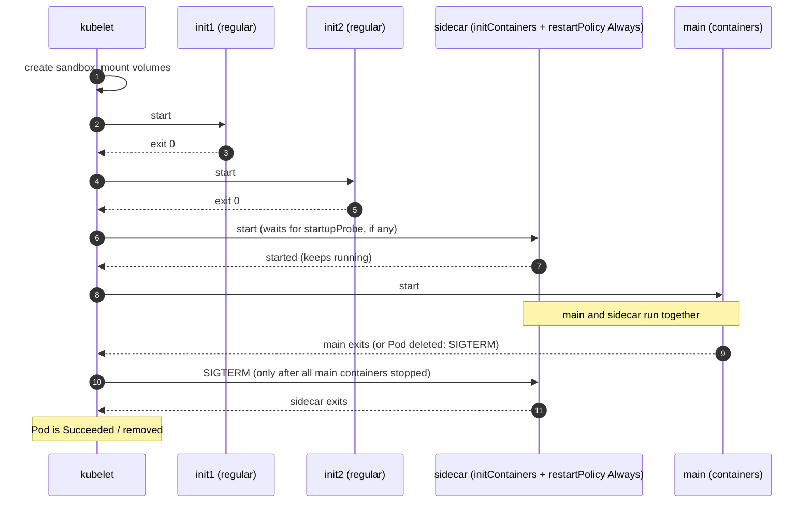

# T3.08 Multi-container Pod patterns: init, sidecar, adapter, ambassador

> Competency: "Understand multi-container Pod design patterns (e.g. sidecar, init and others)" (CKAD-1.3) | Domain/weight: CKAD, Application Design and Build (20%) | Est. time: 3 h | Prerequisites: T3.07, T2.03

Shell setup (from [conventions](../00-conventions.md); put it at the top of every session):

```bash
alias k=kubectl
export do="--dry-run=client -o yaml"
export now="--force --grace-period=0"
source <(kubectl completion bash); complete -o default -F __start_kubectl k
```

Lab environment for this lesson: **kind** (a 3-node cluster, Kubernetes v1.37.0). Use the `kind-lab` cluster (create it with `env/kind-up.sh`, select it with `k config use-context kind-lab`). Namespace: `lab-t308`. Files go in `~/lab/t308/`. Create both once, and make the namespace your default so you can leave out `-n`:

```bash
k config use-context kind-lab
k create ns lab-t308
k config set-context --current --namespace=lab-t308
mkdir -p ~/lab/t308
```

Prerequisites: Pods, their lifecycle and `restartPolicy` are in [T2.03](../part2-basics/T2.03-pods-in-depth.md). Volumes, and `emptyDir` in particular, are in [T3.07](../part3-ckad/T3.07-utilize-persistent-and-ephemeral-volumes.md). This lesson uses both without re-teaching them.

> Output policy. Every output block labelled `REAL OUTPUT (kind v0.33.0, v1.37.0)` was captured by running the command on a 3-node kind cluster (1 control plane + 2 workers, node image `kindest/node:v1.37.0` pinned by digest as in the conventions, client `kubectl` v1.37.1) on the machine where this lesson was written. That cluster used the default kind network plugin (kindnet) instead of Calico, because this lesson needs no NetworkPolicy. Pod IPs, hash suffixes, image sizes, ages and clock times will differ on your cluster. A few outputs are trimmed with `...` or by removing lines that do not matter (for example `Container ID`); trimmed outputs say so. Section 11 lists the claims that were not tested.

---

## 1. Why this matters

Most real applications need a helper next to the main process: something to prepare data before it starts, something to ship its logs, something to proxy its traffic. If you cram the helper into the main image, you cannot update, scale or secure the two parts separately. If you put the helper in the wrong place in the Pod spec, you get a Pod that is stuck in `Init:0/1`, a Job that runs for ever, or a log shipper that reads an empty file.

The CKAD curriculum names these patterns directly ("sidecar, init and others", competency CKAD-1.3), so practise adding an init container or a sidecar to a Pod or Deployment, usually with a shared volume, and reading logs from the right container with `-c`. Since Kubernetes v1.33, the correct way to write a sidecar is a **native sidecar** (an init container with `restartPolicy: Always`), and many older tutorials still show the old way. The exam averages about 6 minutes per task (15-20 tasks in 2 hours; sources: [E2](https://docs.linuxfoundation.org/tc-docs/certification/tips-cka-and-ckad), [E3](https://docs.linuxfoundation.org/tc-docs/certification/faq-cka-ckad-cks)), so you must be able to write this YAML from memory in about three minutes.

---

## 2. Concepts

### 2.1 Why one Pod can hold several containers

A **Pod** is the smallest thing Kubernetes schedules. It is one or more containers that always run on the same node and are managed as one unit. Putting two containers in one Pod is not a way to "run two apps". It is a way to give one app a helper that must live and die with it and must be very close to it.

Containers in one Pod share some things and keep others separate. This table is the foundation of every pattern in this lesson.

| Thing | Shared between the containers of a Pod? | What it means in practice |
|---|---|---|
| Network namespace (IP address, ports, `localhost`) | Yes, always | A sidecar reaches the main container at `localhost:<port>`. Two containers cannot listen on the same port. |
| Volumes | Only if each container mounts the same volume | You declare a volume once in `spec.volumes`. Each container chooses its own `mountPath`. |
| Root filesystem | No | Each container has the filesystem of its own image. Files written outside a volume are private. |
| Process (PID) namespace | No, unless `spec.shareProcessNamespace: true` | By default `ps` in one container shows only that container's processes. |
| CPU and memory limits | No, each container has its own `resources` | The scheduler adds them up to find a node (see 2.9). |
| Environment variables, command, image | No | Each container is configured on its own. |
| Lifecycle | Partly | They are scheduled together and deleted together. They start and stop in an order that depends on the container kind (see 2.11). |

**Related but different: two containers in one Pod vs two Pods.** If two parts must scale independently (for example 2 web servers and 5 workers), they are two Deployments, not two containers in one Pod. Put containers together only when they must share `localhost` or a volume, and must always run at the same scale. A database next to its web app is almost always a mistake. A log shipper next to its app is the right case.

### 2.2 The four patterns

A **design pattern** here is just a name for a common way to arrange containers. Learn the names, because the exam text and the docs use them.

| Pattern | Job in one sentence | When it runs | Typical example | How you write it |
|---|---|---|---|---|
| **Init container** | Prepare something, then exit, before the app starts | Before the app containers, one after another, each must finish | Wait for a database, fetch a config file, set file permissions | An entry in `spec.initContainers` |
| **Sidecar** | Extend or support the main container for its whole life | Next to the main container | Log shipper, config reloader, service-mesh proxy | A native sidecar: an entry in `spec.initContainers` with `restartPolicy: Always`. Older style: a second entry in `spec.containers`. |
| **Adapter** | Change the output of the main container into the format the outside world expects | Next to the main container | Turn a custom log or metrics format into JSON or Prometheus format | A sidecar whose job is conversion |
| **Ambassador** | Be the main container's local proxy to the outside world | Next to the main container | Main talks to `localhost:8080`, the ambassador handles service discovery, TLS, retries | A sidecar whose job is proxying |

An important point: **Kubernetes has no field called `adapter` or `ambassador`.** The adapter and the ambassador are sidecars with a specific purpose. Only the init container and the sidecar exist as different things in the Pod spec. The pattern names describe the intent, not the YAML.

- **Sidecar** (extends): the main container has something missing, the sidecar adds it. Direction: it reads or watches the main container.
- **Adapter** (normalises what comes out): the main container produces output in a private format, the adapter converts it so that a standard consumer (a log collector, a metrics scraper) can read it. Direction: main to outside, through the adapter.
- **Ambassador** (hides what is outside): the main container needs to talk to something remote, but you do not want that logic in the app. The app talks to `localhost`, and the ambassador deals with the remote side. Direction: main to outside, through the ambassador. Also called an "ambassador" because it represents the app to the outside world.

### 2.3 Init containers

An **init container** is a container that runs to completion before any app container starts. If you have several, they run **one at a time, in the order they are written**. The next one starts only after the previous one exits with code 0. Only when all init containers have succeeded does the kubelet start the app containers (`spec.containers`).

**The problem they solve.** Some work must happen exactly once, in order, before the app runs, and does not belong in the app image: waiting for a dependency, downloading a file, generating a config, changing the owner of a volume. Doing it in the app's start script mixes two jobs, forces the app image to carry extra tools (`git`, `curl`, `psql`), and runs the job again on every app restart.

**What breaks without it.** Without an init container, the app starts, cannot reach its database, crashes, restarts, and you read a wall of `CrashLoopBackOff`. With an init container waiting for the database, the Pod sits in `Init:0/1` and the reason is on the init container's log.

Rules for init containers:

| Rule | Detail |
|---|---|
| Order | They run sequentially in the order of `spec.initContainers`. |
| Completion | Each must exit 0. The next one starts only then. |
| Image | Each can use a different image. A common trick: a small image with `curl` or `git` for the init, a slim image for the app. |
| Fields | Same fields as an app container (`image`, `command`, `env`, `volumeMounts`, `resources`, `securityContext`), **except** `lifecycle`, `livenessProbe`, `readinessProbe` and `startupProbe`. The probes are rejected on a regular init container (see 2.8 for the exact message and the exception). |
| Names | Names must be unique across init containers **and** app containers in the Pod. |
| Network | The network is up, so an init container can use DNS and call Services. |
| Volumes | They can mount the same volumes as the app containers. This is how they hand over data. |
| Readiness | While init containers run, the Pod is not `Ready` and no Service sends traffic to it. |
| Pod status | The Pod phase is `Pending` during the init phase. `kubectl get` shows `Init:N/M` (see 2.10). |
| Rerun | They run again if the Pod's sandbox (the pause container) is recreated, for example after a node reboot, or if all the init container records have been garbage-collected. A restart of an app container does **not** rerun them. So write init containers to be safe to run twice (idempotent). |
| Changing them | You cannot change most Pod fields in place. A new `image` for an init container is allowed on a live Pod (`k set image pod/<pod> <init>=<image>` works), but changing its `command` is rejected (exact message in section 6). In practice you delete and recreate the Pod, or change the Deployment template. |

Two of these rules, checked against the API server with a Pod that uses the name `same` for an init container and for an app container, and mounts a volume `nope` that is not declared:

```text
REAL OUTPUT (server dry-run, kind v0.33.0, v1.37.0)
The Pod "dup" is invalid: 
* spec.containers[0].volumeMounts[0].name: Not found: "nope"
* spec.initContainers[0].name: Duplicate value: "same"
```

Both mistakes are caught when you apply, not later. (A volume name that exists but is the wrong one is not caught: that is the silent failure in section 6, row 3.)

**Why the probe fields are rejected.** A regular init container is supposed to finish. A liveness or readiness probe makes no sense for something that is meant to exit. The API server therefore rejects probes on it. A native sidecar (2.4) is an init container that is meant to keep running, so it is allowed probes.

**What `restartPolicy` does to init containers.** The Pod-level `spec.restartPolicy` decides what the kubelet does when an init container fails (exits non-zero).

| Pod `restartPolicy` | Init container exits non-zero | What you see in `k get pod` | Pod ends up |
|---|---|---|---|
| `Always` (default) | The kubelet restarts that init container, with a growing back-off delay (the exact delays depend on the kubelet version; see the captured events in section 6) | `Init:Error` briefly, then `Init:CrashLoopBackOff` | Stays `Pending`, keeps retrying |
| `OnFailure` | Same as `Always` | `Init:Error` then `Init:CrashLoopBackOff` | Stays `Pending`, keeps retrying |
| `Never` | The kubelet does not restart it. The Pod fails. | `Init:Error` | Phase `Failed`. The app containers never start. |

Note that `Always` and `OnFailure` behave the same for init containers: a failing init container is retried. `Never` is the only policy that gives up. (A Deployment's Pod template must use `Always`, so inside a Deployment a failing init container always retries.) Section 6 (walkthrough 2) runs `Always` and `Never` side by side: `fail-always` retries and its `RESTARTS` grows, `fail-never` stops with phase `Failed`. To try `OnFailure`, copy `fail-never.yaml`, change the line to `restartPolicy: OnFailure` and watch `RESTARTS` grow the same way (not run for this lesson, see section 11).

**Related but different.** An init container is not a `startupProbe`: a probe only observes one container, an init container runs its own code and can prepare things. It is also not a Job: a Job is a separate workload that runs to completion on its own, while an init container is one step inside the start of one Pod and reruns whenever the Pod's sandbox is recreated.

**Use cases, with one concrete shape each.**

- *Wait for a dependency.* A loop that only exits when `nslookup db` or `wget` works. Important detail: `nslookup` on a **Service** name succeeds as soon as the Service object exists, even if no Pod behind it is ready. DNS only proves the Service exists. To prove it answers, loop on `wget -q -T 2 -O /dev/null http://db:80` or `nc -z db 80`. The speed drill and the worked example use `nslookup` because that is the pattern in the docs and the entry.
- *Fetch config or data.* `wget -O /work/config.json http://config-service/...` writes into an `emptyDir` that the app mounts.
- *Prepare a volume.* `chown 1000:1000 /data` or write an `index.html`. Only the init container needs to run as root. The app container can run as a normal user.
- *Run a one-off migration.* Run `./migrate` once before the app starts. Because an init container reruns when the sandbox is recreated, the migration must be safe to repeat.

### 2.4 Native sidecar containers (the modern way)

A **sidecar** is a helper that runs next to the main container for the whole life of the Pod. For years the only way to build one was to add a second entry under `spec.containers`. That works but has three real problems (see 2.5). Kubernetes added a better way, called the **native sidecar**, and it is generally available (GA) since v1.33 (it was alpha in 1.28 and beta in 1.29; source: the entry for this lesson and the sidecar docs page in section 10).

A native sidecar is an **init container with `restartPolicy: Always`**. That is the whole trick. One field turns an init container that "runs once and exits" into one that "starts, stays running, and is restarted if it dies".

```yaml
spec:
  initContainers:
  - name: log-shipper
    image: busybox:1.36
    restartPolicy: Always        # <- this one field makes it a native sidecar
    command: ['sh', '-c', 'tail -F /var/log/app/app.log']
```

Behaviour of a native sidecar:

| Phase | What happens |
|---|---|
| Start | It starts in order with the other init containers. The kubelet starts the next init container as soon as the sidecar has **started**. If the sidecar has a `startupProbe`, the kubelet waits until that probe succeeds. It does not wait for the sidecar to exit (it never does). |
| Run | It keeps running while the app containers run. If it crashes, the kubelet restarts it, **whatever the Pod's `restartPolicy` is**. |
| Stop | When the app containers have all stopped, the kubelet stops the sidecars, in reverse order of the spec. A sidecar therefore stops **after** the main container, so it can still ship the last log lines. |
| Jobs | A sidecar does not stop a Job's Pod from completing. When the main containers finish, the sidecar is stopped and the Job can complete. |
| Probes | `startupProbe`, `livenessProbe` and `readinessProbe` are allowed (see 2.8). |
| `kubectl` | It is listed under `initContainers`, not under `containers`. Use `-c <name>` to read its logs. |

`restartPolicy` is a field on the **container** here, not on the Pod. For an init container, the value `Always` is the one that means "sidecar". You can read the field's description in the cluster itself, which is also the exam-friendly way:

```bash
k explain pod.spec.initContainers.restartPolicy
```

```text
REAL OUTPUT (kind v0.33.0, v1.37.0)
KIND:       Pod
VERSION:    v1

FIELD: restartPolicy <string>


DESCRIPTION:
    RestartPolicy defines the restart behavior of individual containers in a
    pod. This overrides the pod-level restart policy. When this field is not
    specified, the restart behavior is defined by the Pod's restart policy and
    the container type. Additionally, setting the RestartPolicy as "Always" for
    the init container will have the following effect: this init container will
    be continually restarted on exit until all regular containers have
    terminated. Once all regular containers have completed, all init containers
    with restartPolicy "Always" will be shut down. This lifecycle differs from
    normal init containers and is often referred to as a "sidecar" container.
    Although this init container still starts in the init container sequence, it
    does not wait for the container to complete before proceeding to the next
    init container. Instead, the next init container starts immediately after
    this init container is started, or after any startupProbe has successfully
    completed.
    
```

**`restartPolicy: Always` on an entry under `spec.containers` is not a sidecar.** On Kubernetes v1.37 the API server accepts a container-level `restartPolicy` on regular containers too (the feature `ContainerRestartRules` is beta and on by default; `k explain pod.spec.containers.restartPolicyRules` shows the related rules). On a regular container it only decides whether that container is restarted when it exits. It does not change the start order, the stop order or the Job behaviour. The sidecar meaning exists only when the container is in `initContainers`. Section 2.5 shows a Job whose helper has `restartPolicy: Always` under `containers`: it still never completes.

### 2.5 Classic sidecar vs native sidecar

The classic sidecar is just a second container in `spec.containers`. It is still valid, and you will see it in many manifests. These are the differences, and the first two are the reasons native sidecars exist.

| Question | Classic sidecar (second entry in `containers`) | Native sidecar (`initContainers` + `restartPolicy: Always`) |
|---|---|---|
| Start order | All app containers start together. There is no guarantee the sidecar is ready before the main container needs it. | The sidecar starts first, and with a `startupProbe` the main container waits until the sidecar is up. |
| Stop order | All containers receive `SIGTERM` at the same time. The log shipper can die before the app has written its last lines. | Main containers are stopped first. Sidecars are stopped afterwards, in reverse order. |
| Job completion | The Job never completes: the sidecar never exits, so the Pod never reaches `Succeeded`. | The Job completes after the main container finishes and the sidecar has stopped. The kubelet sends the sidecar `SIGTERM`; if the sidecar ignores it, the Pod waits for the grace period (30 s by default) and then kills it. |
| Pod-level `restartPolicy: Never` | A crashed sidecar is not restarted. | A crashed sidecar is restarted (checked on v1.37: a sidecar that exits 1 after 5 s reached `restartCount` 3 in a Pod with `restartPolicy: Never`). |
| Probes | Allowed. | Allowed. |
| Where it shows | `READY x/y` counts it. Status is in `.status.containerStatuses`. | `READY x/y` counts it too (a Pod with one native sidecar and one main container shows `2/2`). Status is in `.status.initContainerStatuses`. |
| Works on old clusters | Yes, all versions. | Needs v1.29+ (beta, on by default). GA since v1.33. |
| Resources | Added to the sum of app containers. | Added to the sum, and also counted for init containers that start after it (see 2.9). |

You can prove the Job difference yourself. Both Jobs below run a worker that prints and exits after 5 seconds, plus a helper that loops for ever. The only difference is where the helper sits.

```yaml
# job-native.yaml: the helper is a native sidecar
apiVersion: batch/v1
kind: Job
metadata:
  name: job-native
  namespace: lab-t308
spec:
  backoffLimit: 0                # do not retry failed Pods; keeps the demo simple
  template:
    spec:
      restartPolicy: Never       # Jobs need Never or OnFailure
      initContainers:
      - name: helper
        image: busybox:1.36
        restartPolicy: Always    # native sidecar
        command: ['sh', '-c', 'trap "exit 0" TERM; while true; do sleep 1; done']   # exit on SIGTERM
      containers:
      - name: work
        image: busybox:1.36
        command: ['sh', '-c', 'echo working; sleep 5; echo done']
```

```yaml
# job-classic.yaml: the helper is a second regular container
apiVersion: batch/v1
kind: Job
metadata:
  name: job-classic
  namespace: lab-t308
spec:
  backoffLimit: 0
  template:
    spec:
      restartPolicy: Never
      containers:
      - name: work
        image: busybox:1.36
        command: ['sh', '-c', 'echo working; sleep 5; echo done']
      - name: helper
        image: busybox:1.36
        command: ['sh', '-c', 'while true; do sleep 1; done']
```

```bash
k apply -f job-native.yaml -f job-classic.yaml
sleep 30
k get job,pod
```

```text
REAL OUTPUT (kind v0.33.0, v1.37.0)
$ k get job,pod
NAME                    STATUS     COMPLETIONS   DURATION   AGE
job.batch/job-classic   Running    0/1           40s        40s
job.batch/job-native    Complete   1/1           8s         40s

NAME                    READY   STATUS      RESTARTS   AGE
pod/job-classic-9j92k   1/2     NotReady    0          40s
pod/job-native-9bd6g    0/2     Completed   0          40s
```

Read it like this. `job-native` is `Complete` (1/1) with a duration of 8 s: `work` exited after about 5 s, the kubelet then sent `SIGTERM` to `helper`, the `trap` made it exit, and the Pod ended in `Completed`. The `READY 0/2` shown for a finished Pod is normal: both containers have stopped. `job-classic` is still `Running` and its Pod shows `1/2 NotReady`: `work` has exited but `helper` has not, so the Pod is not finished and the Job never counts it as a success. Fix for the classic Job: move `helper` to `initContainers` and add `restartPolicy: Always` (this is the "Job never completes" failure in section 6).

**Why the `trap` line matters.** The shell that runs as the container's main process (PID 1) ignores `SIGTERM` unless you install a handler. Without `trap`, the native sidecar does not stop when asked. The kubelet waits the full `terminationGracePeriodSeconds` (30 s) and then kills it. I measured this on v1.37: the same Job without the `trap` showed `Running 0/1` for about 40 s and then `Complete 1/1` with a duration of 39 s, against 8 s with the `trap`. The Job still completes, but 30 s late.

The same helper with `restartPolicy: Always` written under `containers` (no `initContainers`) does not help:

```text
REAL OUTPUT (kind v0.33.0, v1.37.0)
NAME                       STATUS    COMPLETIONS   DURATION   AGE
job.batch/job-classic-ra   Running   0/1           30s        30s

NAME                       READY   STATUS     RESTARTS   AGE
pod/job-classic-ra-6wn4d   1/2     NotReady   0          30s
```

### 2.6 Adapter and ambassador in practice

Both are sidecars. What matters is what they do and which way the data flows.

**Adapter (format conversion).** The main container writes lines such as `level=info msg=tick n=3` into a file. A log collector in the cluster expects JSON. You do not change the app. You add an adapter that tails the file and writes `{"level":"info","msg":"tick","n":3}`. The shared `emptyDir` is the contract between the two. The medium lab (section 7) builds this.

**Ambassador (local proxy).** The main container wants to call a remote `backend`. Instead of putting service discovery, retries and TLS inside the app, the app calls `localhost:8080`. A second container in the same Pod listens on 8080 and forwards to the real backend. This works because of the shared network namespace (2.7). The worked example (section 5) builds it with `nginx`.

How to choose the name in a design question:

| If the helper... | It is a... |
|---|---|
| runs once before the app and exits | init container |
| adds a capability (ships logs, reloads config, syncs files) | sidecar |
| converts the app's output to a standard format | adapter |
| proxies the app's outgoing calls through `localhost` | ambassador |

### 2.7 How containers share data: volumes, localhost, process namespace

**emptyDir volume** (see [T3.07](../part3-ckad/T3.07-utilize-persistent-and-ephemeral-volumes.md) for all the details). An `emptyDir` is an empty directory created when the Pod is scheduled to a node. Every container that mounts it sees the same files. It survives container restarts but is deleted with the Pod. It is the standard way to hand files between init container, main container and sidecar. You write it in two places, and the **volume name must match exactly**:

```yaml
spec:
  volumes:
  - name: logs            # (1) declare once, here
    emptyDir: {}
  containers:
  - name: main
    volumeMounts:
    - name: logs          # (2) refer to it by the same name
      mountPath: /var/log/app
```

Each container picks its own `mountPath`. Two containers may mount the same volume at different paths. A consumer that only reads can add `readOnly: true`. If a container does not list the volume under `volumeMounts`, it does not see it, even though the volume exists in the Pod.

**localhost.** All containers of a Pod share one network namespace, so they have the same IP and the same `localhost`. A sidecar can call the main container on `localhost:8080`, and the other way round. Consequence: two containers in one Pod cannot both listen on the same port. The second one fails with "address already in use".

**shareProcessNamespace.** By default, each container has its own PID (process ID) namespace, so `ps` inside a container shows only that container's processes. With `spec.shareProcessNamespace: true`, all containers share one PID namespace. A debug container can then see and signal the main container's processes. Effects to know: the Pod's pause process becomes PID 1; a container's main process is no longer PID 1, so signals and zombie handling change; and a process in one container can read another container's files through `/proc/<pid>/root` if the user IDs allow it. It is off by default and is a field of `spec` (not of a container). The docs page is listed in section 8.

```yaml
# share.yaml
apiVersion: v1
kind: Pod
metadata:
  name: share
  namespace: lab-t308
spec:
  shareProcessNamespace: true    # a field of spec, a sibling of containers
  containers:
  - name: main
    image: busybox:1.36
    command: ['sleep', '3600']
  - name: debug
    image: busybox:1.36
    command: ['sleep', '3600']
```

```bash
k apply -f share.yaml
k wait --for=condition=Ready pod/share --timeout=60s
k exec share -c debug -- ps
```

```text
REAL OUTPUT (kind v0.33.0, v1.37.0)
$ k exec share -c debug -- ps
PID   USER     TIME  COMMAND
    1 65535     0:00 /pause
    7 root      0:00 sleep 3600
   17 root      0:00 sleep 3600
   27 root      0:00 ps
```

The first process is `/pause` (the Pod's sandbox process) with PID 1. Both `sleep` processes, one from each container, are visible from `debug`. Without `shareProcessNamespace` the same `ps` shows only `ps` itself.

### 2.8 Probes on sidecars

A regular init container cannot have probes (it must exit; see 2.3). The API server rejects them. Save this Pod as `initprobe.yaml` (it is intentionally invalid: the probe is on a regular init container) and send it to the API server without creating anything:

```yaml
apiVersion: v1
kind: Pod
metadata:
  name: bad-init-probe
  namespace: lab-t308
spec:
  initContainers:
  - name: setup
    image: busybox:1.36
    command: ['sh', '-c', 'echo hi']
    readinessProbe:               # not allowed: no restartPolicy: Always on this init container
      exec:
        command: ['true']
  containers:
  - name: main
    image: busybox:1.36
    command: ['sleep', '3600']
```

```bash
k apply --dry-run=server -f initprobe.yaml
```

```text
REAL OUTPUT (server dry-run, kind v0.33.0, v1.37.0)
$ k apply --dry-run=server -f initprobe.yaml
The Pod "bad-init-probe" is invalid: spec.initContainers[0].readinessProbe: Forbidden: may not be set for init containers without restartPolicy=Always
```

`livenessProbe`, `startupProbe` and `lifecycle` on a regular init container are rejected with the same message (checked on v1.37). A native sidecar, in contrast, can have all three probes, and they do real work.

Probes on a native sidecar:

| Probe on the sidecar | Effect |
|---|---|
| `startupProbe` | The kubelet **does not start the next container** (the next init container, and then the app containers) until this probe succeeds. This is how you make the main container wait for a proxy. |
| `readinessProbe` | While it fails, the sidecar is not ready, so the Pod is not `Ready`, so Services do not send traffic to the Pod. |
| `livenessProbe` | If it fails `failureThreshold` times in a row, only the sidecar is restarted. The main container is untouched. |

The probe fields, defaults and the three types of check (exec, HTTP, TCP) are the same as on app containers: see [T3.09](../part3-ckad/T3.09-implement-probes-and-health-checks.md). The worked example in section 5 shows a sidecar with a startup probe that holds back the main container for 15 seconds.

### 2.9 Resource accounting for init containers and sidecars

The scheduler must pick a node with enough free CPU and memory. It needs one number for the whole Pod, called the **effective request**. The rules are:

1. App containers all run at the same time, so their requests are **added**.
2. Regular init containers run one at a time, before the app. So only the **largest** one counts, not the sum.
3. Native sidecars run at the same time as everything that starts after them. So a sidecar's request is **added** to the app total, and also added to every init container that starts **after** the sidecar.
4. The effective request is the **larger** of: (a) the highest "init container request plus the sidecars started before it", and (b) the sum of all app containers and all sidecars. The same rule applies to limits and to every resource (CPU, memory).

Worked numbers (the Pod `res` used in section 5): sidecar `side` requests 300m CPU, then a regular init container `setup` requests 200m, and the app container `main` requests 100m.

| Step | Calculation | CPU |
|---|---|---|
| Init container `setup` runs while `side` already runs | 200m + 300m (the sidecar started before it) | 500m |
| App phase: `main` plus `side` | 100m + 300m | 400m |
| Effective request | the larger of the two | **500m** |

A classic sidecar (second app container) would simply be added to the app sum. Effect: init containers with big requests can make a Pod unschedulable even though the app itself is small, so a heavy `git clone` init container should not ask for more than it needs. You can see the effective request per Pod in `k describe node <node>`, in the "Non-terminated Pods" table (section 5 shows it).

### 2.10 Seeing what is happening: logs, exec, describe, status

Every command that targets a container needs `-c <name>` if the Pod has more than one container. Init containers and native sidecars are addressed with the same `-c`.

| Task | Command |
|---|---|
| Logs of an init container | `k logs app -c wait-for-db` |
| Follow the logs of a sidecar | `k logs app -c log-shipper -f` |
| Logs of the previous (crashed) instance | `k logs app -c <name> --previous` |
| Logs of every container, with a prefix | `k logs app --all-containers --prefix` |
| Shell in the main container | `k exec -it app -c main -- sh` |
| List the init container names | `k get pod app -o jsonpath='{.spec.initContainers[*].name}'` |
| List the app container names | `k get pod app -o jsonpath='{.spec.containers[*].name}'` |
| Init container states | `k get pod app -o jsonpath='{.status.initContainerStatuses[*].state}'` |

If you leave out `-c`, `kubectl` picks a default container: the one named in the annotation `kubectl.kubernetes.io/default-container`, or the first entry of `spec.containers`. It prints a line such as `Defaulted container "main" out of: main, log-shipper (init), wait-for-db (init)` on **stderr**. The line also tells you the names of the other containers. That default is never an init container, so a log request without `-c` can show you the wrong container without any error. In the worked example you see the real text, and the real error you get when the default container has not started yet.

**What `k get pod` shows in the STATUS column.**

| STATUS | Meaning |
|---|---|
| `Init:0/2` | 0 of the 2 init containers have finished. The first one is running or waiting. |
| `Init:1/2` | 1 finished, the second one is running or waiting. |
| `PodInitializing` | All init containers have finished (or the sidecars have started). The app containers are being created. |
| `Init:Error` | An init container exited non-zero and has not been retried yet (or the Pod's `restartPolicy` is `Never`). |
| `Init:CrashLoopBackOff` | An init container keeps failing and the kubelet is waiting before the next attempt. |
| `Init:ImagePullBackOff` / `Init:ErrImagePull` | The image of an init container cannot be pulled. |
| `Running` | App containers are running. |

How the numbers are counted: the second number is the count of **all** `initContainers` entries, native sidecars included. The `READY` column of a running Pod counts the native sidecars as well. In the worked example the Pod has one regular init container, one native sidecar and one app container: it shows `Init:0/2` and `READY 0/2` while it waits (the 2 in `READY` is sidecar + main), then `2/2` when running.

`k describe pod` has a section `Init Containers:` listing each one with `State`, `Last State`, `Exit Code`, `Ready` and `Restart Count`. A native sidecar is listed there too, with `State: Running` and `Ready: True`. On v1.37 `describe` prints **no** `Restart Policy` line for it, so the way to tell a sidecar from a finished init container is `State: Running` (a regular init container is `Terminated` / `Completed` when it is done), or `k get pod <pod> -o jsonpath='{.spec.initContainers[*].restartPolicy}'`. The `Events:` section at the bottom is where a failing init container leaves a trace (`BackOff`, `Failed`).

### 2.11 Start order and termination order

Start order, for a Pod with two regular init containers, one native sidecar and one main container:

1. The kubelet creates the Pod sandbox (the pause container that owns the network namespace) and mounts the volumes.
2. It runs init container 1 and waits for exit code 0.
3. It runs init container 2 and waits for exit code 0.
4. It starts the sidecar. If the sidecar has a startup probe, it waits for it. Then it moves on. The sidecar keeps running.
5. It starts the app containers.

The order of entries in `initContainers` is what matters. A native sidecar placed **before** a regular init container is already running when that init container runs (so the init container can use it, for example a proxy). A sidecar placed **after** it starts only when the earlier init container has finished.

Termination order, when the Pod is deleted or the main container exits:

1. App containers receive `SIGTERM`. They have the grace period (`terminationGracePeriodSeconds`, default 30 s) to exit; after that `SIGKILL`.
2. When all app containers have stopped, the kubelet sends `SIGTERM` to the sidecars, in the **reverse order** of `initContainers`.
3. The Pod is removed.

The grace period is for the whole Pod, not per container. A sidecar that needs 20 s to flush its buffer, behind a main container that needs 15 s, does not fit in the default 30 s. The section 5 run proves the order with timestamps.

### 2.12 Debugging a stuck init container

Use the same four steps every time.

1. **Read the status.** `k get pod app`. `Init:0/1` means the first init container is running or waiting. `Init:Error` or `Init:CrashLoopBackOff` means it failed. `Init:ImagePullBackOff` means the image is wrong.
2. **Find out which init container and why.** `k describe pod app`. Look at `Init Containers:` for the `State`, `Reason`, `Exit Code`, and at `Events:` for the last message.
3. **Read its logs.** `k logs app -c <init-name>` (add `--previous` for a crashed one). Most causes are in the log of the container itself.
4. **Test what the init container waits for.** If it waits for a Service, run a throw-away Pod and test the same name: `k run t --rm -it --restart=Never --image=busybox:1.36 -- nslookup db`. Check that the Service exists (`k get svc db`) and has endpoints (`k get endpointslices -l kubernetes.io/service-name=db`).

You cannot `exec` into an init container that has already exited. You can into a running one (a stuck wait loop, or a native sidecar).

### 2.13 Under the hood

Knowing who does what makes the failures easy to read.

1. **The API server only stores the spec and validates it.** It rejects probes on regular init containers, duplicate names and unknown volume names at apply time (the real messages are in 2.3, 2.8 and section 6). It does not know about start order. A Deployment, Job or other controller just copies the Pod template, init containers included.
2. **The scheduler** reads the Pod spec once and computes the effective request of 2.9. It only compares that number with the free resources of each node.
3. **The kubelet on the node does all the sequencing.** It creates the Pod sandbox (the `pause` container that owns the network namespace and, with `shareProcessNamespace`, the PID namespace), mounts the volumes, then starts init containers one by one through the container runtime (containerd in kind and kubeadm clusters). It watches each exit code. For a native sidecar it additionally waits for the container to start, and for its startup probe if one exists. When the Pod is deleted it stops the app containers first and the sidecars afterwards.
4. **The kubelet reports status back** in `status.initContainerStatuses` and `status.containerStatuses` and in the Pod conditions. `Initialized` becomes `True` when all init containers have finished or (sidecars) started. `Ready` needs every app container ready and every native sidecar ready.
5. **`kubectl logs` and `exec` are proxied.** `kubectl` asks the API server, which forwards the request to the kubelet of the node, which reads the container's log file or opens a stream into the container. That is why `k logs` on a container that was never created answers with the kubelet's message `waiting to start: PodInitializing`, and why `exec` into a finished init container fails:

```text
REAL OUTPUT (kind v0.33.0, v1.37.0)
$ k exec app -c wait-for-db -- ls
error: unable to upgrade connection: container not found ("wait-for-db")
```

6. **Services.** A Pod that is not `Ready` is marked `ready: false` in the EndpointSlice and Services do not route traffic to it. So a sidecar that is not ready, or an init container that has not finished, keeps the Pod from receiving Service traffic.

---

## 3. How it works (diagram)

The sequence diagram shows the life of one Pod with two init containers, one native sidecar and one main container. Time runs downwards.



Walkthrough:

- Steps 2-5: init containers are strictly sequential. Init2 does not start until init1 has exited with code 0. During this time `k get pod` shows `Init:0/3`, `Init:1/3`, `Init:2/3` (the sidecar counts as one of the init entries).
- Steps 6-7: the sidecar is started in its place in the list. The kubelet does not wait for it to exit, only for it to start (or to pass its startup probe).
- Step 8: the main container starts after the sidecar is up. From now on, sidecar and main run side by side.
- Steps 10-11: shutdown reverses the dependency. The main container stops first. The sidecar gets `SIGTERM` only after that, so it can still ship the last log line.
- With a classic sidecar (second regular container) steps 6-8 collapse into "start together", and step 10 becomes "everything gets `SIGTERM` at once". That is exactly what native sidecars fix.

---
## 4. Commands and YAML you must produce fast

### 4.1 Imperative shortcuts

There is **no imperative flag** for `initContainers`. `k run` and `k create deployment` can only create `containers`. The fast path is: generate a skeleton with `$do`, then add the init container or sidecar by editing the file.

```bash
# 1. Skeleton for the main container (a Pod). $do = --dry-run=client -o yaml
k run app --image=busybox:1.36 $do -- sh -c 'sleep 3600' > app.yaml
```

Generates a Pod with one entry under `containers`. You then add `volumes`, `initContainers` and `volumeMounts` by hand (in a terminal editor, or in the VSCodium editor that the exam desktop provides; source: [E11](https://docs.linuxfoundation.org/tc-docs/certification/lf-handbook2/exam-user-interface/examui-performance-based-exams.md)).

```bash
# 2. Skeleton for a Deployment: the Pod spec you edit is spec.template.spec
k create deployment web --image=nginx:1.27 $do > web.yaml
```

For a Deployment, `initContainers` goes under `spec.template.spec`, as a sibling of `containers`. Changing it rolls out new Pods.

```bash
# 3. Edit a live Deployment (rolls out new Pods). A bare Pod cannot take most edits.
k edit deploy web
# 4. For a bare Pod, dump, edit and force-replace (deletes and recreates the Pod)
k get pod app -o yaml > app.yaml && vim app.yaml && k replace --force -f app.yaml
```

```bash
# 5. Find a field name without leaving the terminal
k explain pod.spec.initContainers.restartPolicy
k explain pod.spec --recursive | grep -i -A2 shareProcess
```

```bash
# 6. Look into the containers
k get pod app -o jsonpath='{.spec.initContainers[*].name}'      # init container and sidecar names
k logs app -c init-fetch                                         # logs of one container
k logs app -c log-shipper -f                                     # follow a sidecar
k exec -it app -c main -- sh                                     # shell in the main container
k logs app --all-containers --prefix --tail=3                    # all containers, labelled
```

The docs shortcut: the page [init-containers](https://kubernetes.io/docs/concepts/workloads/pods/init-containers/) has a complete Pod with two init containers that wait for Services using `nslookup`. The page [sidecar-containers](https://kubernetes.io/docs/concepts/workloads/pods/sidecar-containers/) has a complete native sidecar Pod and a Job. In the exam, copying a block from these pages and renaming it is faster than typing it.

### 4.2 The declarative YAML to know by heart

One init container that waits for a Service by DNS, one native sidecar that tails a shared log, and the main container that writes the log. Every field is explained in the comments.

```yaml
apiVersion: v1                          # Pods are in the core group
kind: Pod
metadata:
  name: app
  namespace: lab-t308
  labels:
    app: app
spec:
  volumes:                              # volumes are declared once per Pod
  - name: logs                          # the name every volumeMount must repeat exactly
    emptyDir: {}                        # empty dir on the node, shared, deleted with the Pod
  initContainers:                       # runs BEFORE spec.containers, in this order
  - name: wait-for-db                   # regular init container (no restartPolicy): must exit 0
    image: busybox:1.36                 # pinned tag, never :latest
    command: ['sh', '-c', 'until nslookup db.lab-t308.svc.cluster.local; do echo "waiting for db"; sleep 2; done']
                                        # loop ends (exit 0) when the Service name resolves
  - name: log-shipper                   # native sidecar: starts after wait-for-db has finished
    image: busybox:1.36
    restartPolicy: Always               # this one field makes it a sidecar: keeps running, restarted if it dies
    command: ['sh', '-c', 'touch /var/log/app/app.log; tail -n+1 -F /var/log/app/app.log']
                                        # touch: create the file so tail has something to follow
                                        # tail -F: follow by name, survives file re-creation; output goes to the container's stdout
    volumeMounts:
    - name: logs                        # must match spec.volumes[].name
      mountPath: /var/log/app           # where the volume appears in THIS container
  containers:                           # app containers: start after all init containers are started/done
  - name: main
    image: busybox:1.36
    command: ['sh', '-c', 'i=0; while true; do i=$((i+1)); echo "$(date +%T) request $i" >> /var/log/app/app.log; sleep 3; done']
    volumeMounts:
    - name: logs                        # same volume, same path: this is how the sidecar sees the log
      mountPath: /var/log/app
```

Save it as `~/lab/t308/app.yaml`. It needs a Service called `db` in the same namespace to leave the first init container: `k create service clusterip db --tcp=80:80`.

Fields that matter, with defaults and risky values:

| Field | What it does | Default | Risky or invalid value |
|---|---|---|---|
| `spec.initContainers[]` | List of init containers and native sidecars. Order = run order. | empty | A name that is also used in `containers` is rejected (names must be unique in the Pod). |
| `initContainers[].restartPolicy` | Makes the init container a native sidecar. | not set: runs once to completion | Only `Always` is the sidecar value. On `spec.containers` entries the field is accepted on v1.37 but only controls restart-on-exit; it does not create a sidecar (see 2.4 and section 6 row 8). Only an `initContainers` entry with `Always` is a native sidecar. |
| `initContainers[].command` | Overrides the image `ENTRYPOINT`. | image entrypoint | A sidecar whose command exits makes the kubelet restart it in a loop (`CrashLoopBackOff`). A regular init container whose command never exits blocks the Pod for ever. |
| `volumeMounts[].name` | Which Pod volume to mount. | required | A name that is not in `spec.volumes` is rejected by the API server. A name that is a different volume (valid but wrong) gives the "sidecar reads an empty file" failure. |
| `volumeMounts[].mountPath` | Directory inside the container. | required | Mounting over a directory that holds image files hides those files. |
| `volumeMounts[].readOnly` | Consumer cannot write. | `false` | Writing from a read-only mount fails with "Read-only file system". |
| `volumes[].emptyDir` | Scratch dir shared by containers. | `{}` = on the node disk | `medium: Memory` counts against container memory limits (see [T3.07](../part3-ckad/T3.07-utilize-persistent-and-ephemeral-volumes.md)). |
| `spec.restartPolicy` | What the kubelet does when a container exits. | `Always` | `Never` makes a failing init container fail the whole Pod (see 2.3). |
| `spec.terminationGracePeriodSeconds` | Time for the whole Pod to stop after `SIGTERM`. | `30` | `0` is forced kill and gives sidecars no time to flush. |
| `spec.shareProcessNamespace` | One PID namespace for all containers. | `false` | The first process of a container is no longer PID 1. |

### 4.3 Speed drill

Eight tasks. Target times are for exam pace (about 6 min per task on average; sources E2 and E3). Try each one with the clock running before you open the answer. Setup, once:

```bash
k create ns lab-t308 2>/dev/null; k config set-context --current --namespace=lab-t308; mkdir -p ~/lab/t308 && cd ~/lab/t308
```

**Drill 1 (3 min).** Create Pod `d1` with the image `nginx:1.27`. An init container `init-html` (image `busybox:1.36`) must write the text `hello from init` into `index.html` in an `emptyDir` volume named `html`. Mount the volume at `/work` in the init container and at `/usr/share/nginx/html` in nginx.

<details><summary>Answer</summary>

```bash
k run d1 --image=nginx:1.27 $do > d1.yaml
```

Edit `d1.yaml` so that the `spec` contains:

```yaml
spec:
  volumes:
  - name: html
    emptyDir: {}
  initContainers:
  - name: init-html
    image: busybox:1.36
    command: ['sh', '-c', 'echo "hello from init" > /work/index.html']
    volumeMounts:
    - name: html
      mountPath: /work
  containers:
  - name: d1
    image: nginx:1.27
    volumeMounts:
    - name: html
      mountPath: /usr/share/nginx/html
```

`k apply -f d1.yaml`, then `k exec d1 -- cat /usr/share/nginx/html/index.html` prints `hello from init`.
</details>

**Drill 2 (2 min).** Pod `d2` below has a log shipper as a classic second container. Rewrite it as a native sidecar. Save the file first:

```bash
cat > d2.yaml <<'EOF'
apiVersion: v1
kind: Pod
metadata:
  name: d2
  namespace: lab-t308
spec:
  volumes:
  - name: shared
    emptyDir: {}
  containers:
  - name: main
    image: busybox:1.36
    command: ['sh', '-c', 'while true; do date >> /shared/out.log; sleep 2; done']
    volumeMounts:
    - name: shared
      mountPath: /shared
  - name: side
    image: busybox:1.36
    command: ['sh', '-c', 'touch /shared/out.log; tail -F /shared/out.log']
    volumeMounts:
    - name: shared
      mountPath: /shared
EOF
k apply -f d2.yaml
```

<details><summary>Answer</summary>

Move the whole `side` block from `containers` to a new `initContainers` list (a sibling of `containers`) and add `restartPolicy: Always` to it. The Pod cannot be edited in place, so delete and re-apply:

```bash
k delete pod d2 $now
```

```yaml
spec:
  volumes:
  - name: shared
    emptyDir: {}
  initContainers:
  - name: side
    image: busybox:1.36
    restartPolicy: Always
    command: ['sh', '-c', 'touch /shared/out.log; tail -F /shared/out.log']
    volumeMounts:
    - name: shared
      mountPath: /shared
  containers:
  - name: main
    image: busybox:1.36
    command: ['sh', '-c', 'while true; do date >> /shared/out.log; sleep 2; done']
    volumeMounts:
    - name: shared
      mountPath: /shared
```
</details>

**Drill 3 (1 min).** For the new `d2`, print the names of its init containers (one line) and then the last 2 lines of the shared file, read from the sidecar container.

<details><summary>Answer</summary>

```bash
k get pod d2 -o jsonpath='{.spec.initContainers[*].name}'; echo
k exec d2 -c side -- tail -n 2 /shared/out.log
```

The first prints `side`. The second prints two `date` lines. `-c side` selects the sidecar: it is addressed like any container.
</details>

**Drill 4 (2 min).** The Pod `d4` below fails in its init container. Save the log of that init container to `/tmp/d4.log`. Setup:

```bash
cat > d4.yaml <<'EOF'
apiVersion: v1
kind: Pod
metadata:
  name: d4
  namespace: lab-t308
spec:
  restartPolicy: Never
  initContainers:
  - name: prep
    image: busybox:1.36
    command: ['sh', '-c', 'echo prep failed; exit 1']
  containers:
  - name: main
    image: busybox:1.36
    command: ['sleep', '3600']
EOF
k apply -f d4.yaml
```

<details><summary>Answer</summary>

`restartPolicy: Never` in the Pod means the failing init container is not retried, so the Pod shows `Init:Error`.

```bash
k get pod d4                       # STATUS Init:Error
k logs d4 -c prep > /tmp/d4.log
cat /tmp/d4.log                    # prep failed
```
</details>

**Drill 5 (3 min).** Create Pod `d5` (image `nginx:1.27`) with an init container `wait-db` (`busybox:1.36`) that loops on `nslookup d5-db.lab-t308.svc.cluster.local` until it resolves. Show that it is stuck, then release it by creating the Service `d5-db`.

<details><summary>Answer</summary>

```bash
k run d5 --image=nginx:1.27 $do > d5.yaml
```

Add under `spec`:

```yaml
  initContainers:
  - name: wait-db
    image: busybox:1.36
    command: ['sh', '-c', 'until nslookup d5-db.lab-t308.svc.cluster.local; do sleep 2; done']
```

```bash
k apply -f d5.yaml
k get pod d5                       # Init:0/1
k create service clusterip d5-db --tcp=80:80
k get pod d5 -w                    # Init:0/1 -> PodInitializing -> Running (Ctrl+C)
```
</details>

**Drill 6 (2 min).** Without changing the file, find out which container is the default container that `k logs d5` would pick, and read the log of the init container.

<details><summary>Answer</summary>

```bash
k logs d5                          # stderr: Defaulted container "d5" out of: d5, wait-db (init)
                                   # while d5 is still Init:0/1 this is followed by:
                                   # Error from server (BadRequest): container "d5" in pod "d5" is waiting to start: PodInitializing
                                   # once d5 is Running (after Drill 5 created the Service) it prints the nginx logs instead
k logs d5 -c wait-db
```

The default is the first entry in `spec.containers`. An init container is never the default. To see the `PodInitializing` error, run this drill before creating the Service `d5-db` in Drill 5, or delete the Service and recreate `d5` first.
</details>

**Drill 7 (2 min, no cluster needed).** A Pod has: a native sidecar requesting 250m CPU, then a regular init container requesting 500m CPU, then a main container requesting 300m CPU. What is the effective CPU request?

<details><summary>Answer</summary>

Init phase: the regular init container runs while the sidecar (started before it) runs: 500m + 250m = 750m. App phase: 300m + 250m = 550m. The effective request is the larger: **750m**. (If the sidecar were listed after the init container, the init phase would be 500m and the Pod's request would be 550m.)
</details>

**Drill 8 (2 min).** Create Pod `d8` with two containers `main` and `debug` (both `busybox:1.36`, `sleep 3600`) so that `debug` can list the processes of `main`.

<details><summary>Answer</summary>

```bash
k run d8 --image=busybox:1.36 $do -- sleep 3600 > d8.yaml
```

Edit: add `shareProcessNamespace: true` under `spec`, and a second container `debug` with the same image and command. Rename the first container to `main` (`name: main`). Apply, then:

```bash
k exec d8 -c debug -- ps
```

`ps` lists `sleep 3600` of both containers.
</details>

Cleanup for all drills:

```bash
k delete pod d1 d2 d4 d5 d8 $now --ignore-not-found; k delete svc d5-db --ignore-not-found; rm -f /tmp/d4.log
```

---

## 5. Worked example

Goal: build the Pod `app` from section 4.2, watch it wait for a dependency, find out why, release it, and inspect all three kinds of containers. Then prove the start and stop order, the startup probe on a sidecar, the ambassador, and the resource arithmetic. Commands run in the namespace `lab-t308`.

Steps in this section: 1 create the Pod before its dependency; 2 diagnose it; 3 create the dependency; 4 inspect the containers; 5 start and stop order (Pods `order`, `classic-order`, `early`, `flaky`); 6 startup and readiness probes on a sidecar (`probed`, `notready`); 7 ambassador (`amb`); 8 resource accounting (`res`); 9 `shareProcessNamespace` (`share`). The cleanup at the end removes all of them.

**Step 1. Create the Pod before its dependency exists.** The Service `db` does not exist yet, so the first init container cannot finish. In a second terminal, start a watch first, so you see every state change:

```bash
k get pod app -w
```

In the first terminal:

```bash
cd ~/lab/t308
k apply -f app.yaml
```

```text
REAL OUTPUT (kind v0.33.0, v1.37.0)
NAME   READY   STATUS    RESTARTS   AGE
app    0/2     Pending   0          0s
app    0/2     Pending   0          0s
app    0/2     Init:0/2   0          0s
app    0/2     Init:0/2   0          0s
app    0/2     Init:0/2   0          0s
```

**Step 2. Diagnose the stuck Pod.** Follow the four steps of 2.12: status, describe, logs, test the dependency.

```bash
k get pod app
k logs app
k logs app -c wait-for-db
```

```text
REAL OUTPUT (kind v0.33.0, v1.37.0)
$ k get pod app
NAME   READY   STATUS     RESTARTS   AGE
app    0/2     Init:0/2   0          12s

$ k logs app
Defaulted container "main" out of: main, wait-for-db (init), log-shipper (init)
Error from server (BadRequest): container "main" in pod "app" is waiting to start: PodInitializing

$ k logs app -c wait-for-db

** server can't find db.lab-t308.svc.cluster.local: NXDOMAIN

waiting for db
Server:		10.96.0.10
Address:	10.96.0.10:53

** server can't find db.lab-t308.svc.cluster.local: NXDOMAIN

** server can't find db.lab-t308.svc.cluster.local: NXDOMAIN

waiting for db
```

How to read this:

- `Init:0/2` says: 0 of the 2 `initContainers` entries are done. There are two entries because the sidecar `log-shipper` counts too.
- `k logs app` without `-c` asks for the **default** container, which is `main`. It has not been created yet, so the request fails. The first line (`Defaulted container "main" out of: ...`) tells you which container was chosen and lists the others; the init containers carry the suffix `(init)`. The error says `PodInitializing`, not "the init container is the problem". Always go to `-c <init-name>` next.
- `k logs app -c wait-for-db` has the answer: `nslookup` does not find `db.lab-t308.svc.cluster.local`. The init container is doing its job. The fault is the missing Service.

Describe confirms which init container is running:

```bash
k describe pod app
```

```text
REAL OUTPUT (kind v0.33.0, v1.37.0)
Name:             app
Namespace:        lab-t308
Node:             k-t308-worker/192.168.147.9
Status:           Pending
...
Init Containers:
  wait-for-db:
    Image:         busybox:1.36
    Command:
      sh
      -c
      until nslookup db.lab-t308.svc.cluster.local; do echo "waiting for db"; sleep 2; done
    State:          Running
      Started:      Wed, 28 Oct 2026 12:43:49 +0800
    Ready:          False
    Restart Count:  0
  log-shipper:
    Image:         busybox:1.36
    Command:
      sh
      -c
      touch /var/log/app/app.log; tail -n+1 -F /var/log/app/app.log
    State:          Waiting
      Reason:       PodInitializing
    Ready:          False
    Restart Count:  0
Containers:
  main:
    ...
    State:          Waiting
      Reason:       PodInitializing
    ...
Conditions:
  Type                        Status
  PodReadyToStartContainers   True 
  Initialized                 False 
  Ready                       False 
  ContainersReady             False 
  PodScheduled                True 
...
Events:
  Type    Reason     Age   From               Message
  ----    ------     ----  ----               -------
  Normal  Scheduled  12s   default-scheduler  Successfully assigned lab-t308/app to k-t308-worker
  Normal  Pulling    11s   kubelet            spec.initContainers{wait-for-db}: Pulling image "busybox:1.36"
  Normal  Pulled     4s    kubelet            spec.initContainers{wait-for-db}: Successfully pulled image "busybox:1.36" in 7.256s (7.256s including waiting). Image size: 1906887 bytes.
  Normal  Created    4s    kubelet            spec.initContainers{wait-for-db}: Container created
  Normal  Started    4s    kubelet            spec.initContainers{wait-for-db}: Container started
```

What to see: `Status: Pending`; `wait-for-db` is `Running` and `Ready: False`; `log-shipper` is `Waiting` with `Reason: PodInitializing`; `main` is also `Waiting`; the `Initialized` condition is `False`. In `Events` nothing is wrong: the image was pulled and the container started. A looping init container is a healthy container that is doing exactly what it was told. (Lines that do not matter here, such as `Container ID` and `Image ID`, are removed and replaced by `...`.)

Get the names and states with `jsonpath` (a quick way to read many pods in a script):

```bash
k get pod app -o jsonpath='{.spec.initContainers[*].name}'
k get pod app -o jsonpath='{range .status.initContainerStatuses[*]}{.name}{"\t"}{.state}{"\n"}{end}'
```

```text
REAL OUTPUT (kind v0.33.0, v1.37.0)
wait-for-db log-shipper
wait-for-db	{"running":{"startedAt":"2026-10-28T04:43:49Z"}}
log-shipper	{"waiting":{"reason":"PodInitializing"}}
```

**Step 3. Create the dependency.** Any ClusterIP Service named `db` satisfies the DNS lookup:

```bash
k create service clusterip db --tcp=80:80
k wait --for=condition=Ready pod/app --timeout=60s
k get pod app
```

```text
REAL OUTPUT (kind v0.33.0, v1.37.0), the `service/db created` line is the standard kubectl message
service/db created
pod/app condition met
NAME   READY   STATUS    RESTARTS   AGE
app    2/2     Running   0          38s
```

(The age comes from an earlier run of the same example; the sequence is the same as in the watch below.)

The watch from step 1 now continues. The full sequence of states of this Pod:

```text
REAL OUTPUT (kind v0.33.0, v1.37.0)
NAME   READY   STATUS    RESTARTS   AGE
app    0/2     Pending   0          0s
app    0/2     Pending   0          0s
app    0/2     Init:0/2   0          0s
app    0/2     Init:0/2   0          0s
app    0/2     Init:0/2   0          0s
app    0/2     Init:1/2   0          17s
app    1/2     PodInitializing   0          18s
app    2/2     Running           0          18s
```

Read the `STATUS` column from top to bottom: `Pending` (being scheduled), `Init:0/2` (the wait loop runs, for about 17 s here because the Service was created 15 s after the Pod), `Init:1/2` (the wait loop has exited 0; the sidecar is next), `PodInitializing` (the sidecar is up, `main` is being created), `Running`. The `READY` column goes `0/2`, `1/2` (the sidecar is ready), `2/2`.

**Step 4. Inspect each container.**

```bash
k logs app -c log-shipper -f          # Ctrl+C to stop
```

```text
REAL OUTPUT (kind v0.33.0, v1.37.0)
...
04:44:13 request 7
04:44:16 request 8
04:44:19 request 9
04:44:22 request 10
04:44:25 request 11
```

The `log-shipper` prints the lines that `main` writes into the shared file. Two different containers, one file: that proves both mount the same volume.

```bash
k exec -it app -c main -- sh
# inside: ls -l /var/log/app; tail -n 2 /var/log/app/app.log; exit
```

```text
REAL OUTPUT (kind v0.33.0, v1.37.0)
total 4
-rw-r--r--    1 root     root           211 Oct 28 04:44 app.log
04:44:22 request 10
04:44:25 request 11
```

Calling `exec` without `-c` uses the default container and prints the `Defaulted container` line:

```text
REAL OUTPUT (kind v0.33.0, v1.37.0)
$ k exec app -- ls /var/log/app
Defaulted container "main" out of: main, wait-for-db (init), log-shipper (init)
app.log
```

All containers at once, with a prefix:

```bash
k logs app --all-containers --prefix --tail=2
```

```text
REAL OUTPUT (kind v0.33.0, v1.37.0)
[pod/app/wait-for-db] Address: 10.96.247.46
[pod/app/wait-for-db] 
[pod/app/log-shipper] 04:44:22 request 10
[pod/app/log-shipper] 04:44:25 request 11
```

`--all-containers` also includes init containers that have already finished: you see the last lines of `wait-for-db` (the successful lookup). `main` writes only to the file, so it has no output of its own.

Now the state of a running Pod. Native sidecars are reported under `initContainerStatuses` (with `started=true` and still `running`), app containers under `containerStatuses`:

```bash
k get pod app -o jsonpath='{range .status.initContainerStatuses[*]}{.name}{" ready="}{.ready}{" started="}{.started}{" restarts="}{.restartCount}{" state="}{.state}{"\n"}{end}'
k get pod app -o jsonpath='{range .status.containerStatuses[*]}{.name}{" ready="}{.ready}{" started="}{.started}{"\n"}{end}'
```

```text
REAL OUTPUT (kind v0.33.0, v1.37.0)
wait-for-db ready=true started=false restarts=0 state={"terminated":{"containerID":"containerd://4678e069f8e6a3999e5b1d79ca90bb08758b55325a0edc70280fc81cd6010b6b","exitCode":0,"finishedAt":"2026-10-28T04:43:55Z","reason":"Completed","startedAt":"2026-10-28T04:43:49Z"}}
log-shipper ready=true started=true restarts=0 state={"running":{"startedAt":"2026-10-28T04:43:55Z"}}
main ready=true started=true
```

`wait-for-db` is `ready=true started=false` with a `terminated` state, exit code 0, reason `Completed`. `log-shipper` is `ready=true started=true` and `running`. Both `wait-for-db` and `log-shipper` started in the same second the first one finished.

`describe` now shows the sidecar in the `Init Containers:` section with `State: Running` and `Ready: True`, while `wait-for-db` is `Terminated` with `Completed` (v1.37 prints no `Restart Policy` line, so the running state is how you recognise the sidecar):

```text
REAL OUTPUT (kind v0.33.0, v1.37.0)
Init Containers:
  wait-for-db:
    Image:         busybox:1.36
    Command:
      sh
      -c
      until nslookup db.lab-t308.svc.cluster.local; do echo "waiting for db"; sleep 2; done
    State:          Terminated
      Reason:       Completed
      Exit Code:    0
      Started:      Wed, 28 Oct 2026 12:43:49 +0800
      Finished:     Wed, 28 Oct 2026 12:43:55 +0800
    Ready:          True
    Restart Count:  0
  log-shipper:
    Image:         busybox:1.36
    Command:
      sh
      -c
      touch /var/log/app/app.log; tail -n+1 -F /var/log/app/app.log
    State:          Running
      Started:      Wed, 28 Oct 2026 12:43:55 +0800
    Ready:          True
    Restart Count:  0
Containers:
  main:
    ...
    State:          Running
    Ready:          True
    ...
```

The Pod conditions for the running Pod:

```bash
k get pod app -o jsonpath='{range .status.conditions[*]}{.type}={.status}{"\n"}{end}'
```

```text
REAL OUTPUT (kind v0.33.0, v1.37.0)
PodReadyToStartContainers=True
Initialized=True
Ready=True
ContainersReady=True
PodScheduled=True
```

`Initialized=True` means all init containers have completed or (for sidecars) started. `Ready=True` needs every container ready, including the sidecar (the next section shows what happens when the sidecar is not ready).

**Step 5. Prove the start and stop order.** The Pod `order` has two regular init containers, a sidecar and a main container. Every container prints a timestamp. The sidecar and `main` also trap `SIGTERM` and print when they receive it and when they exit (the main container needs 3 s to stop, the sidecar 2 s). Save `order.yaml`:

```yaml
apiVersion: v1
kind: Pod
metadata:
  name: order
  namespace: lab-t308
spec:
  terminationGracePeriodSeconds: 30
  initContainers:
  - name: init-one
    image: busybox:1.36
    command: ['sh', '-c', 'echo "init-one start $(date +%T)"; sleep 3; echo "init-one done $(date +%T)"']
  - name: init-two
    image: busybox:1.36
    command: ['sh', '-c', 'echo "init-two start $(date +%T)"; sleep 3; echo "init-two done $(date +%T)"']
  - name: sidecar
    image: busybox:1.36
    restartPolicy: Always
    command:
    - sh
    - -c
    - |
      trap 'echo "sidecar got SIGTERM $(date +%T)"; sleep 2; echo "sidecar exit $(date +%T)"; exit 0' TERM
      echo "sidecar start $(date +%T)"
      while true; do sleep 1; done
  containers:
  - name: main
    image: busybox:1.36
    command:
    - sh
    - -c
    - |
      trap 'echo "main got SIGTERM $(date +%T)"; sleep 3; echo "main exit $(date +%T)"; exit 0' TERM
      echo "main start $(date +%T)"
      while true; do sleep 1; done
```

(The traps are written with single quotes inside a block scalar, so `$(date +%T)` runs when the signal arrives. With double quotes the shell would expand it when the trap is set. The shell runs a trap after the current `sleep 1` ends, so a container reacts to `SIGTERM` within one second. In the log you see the time of the signal, not of the kubelet's request.)

```bash
k apply -f order.yaml
k wait --for=condition=Ready pod/order --timeout=90s
k get pod order
```

```text
REAL OUTPUT (kind v0.33.0, v1.37.0)
NAME    READY   STATUS    RESTARTS   AGE
order   2/2     Running   0          17s
```

Once it is `Running`, read the start lines of each container:

```bash
for c in init-one init-two sidecar main; do echo "--- $c"; k logs order -c $c; done
```

```text
REAL OUTPUT (kind v0.33.0, v1.37.0)
--- init-one
init-one start 04:45:41
init-one done 04:45:44
--- init-two
init-two start 04:45:46
init-two done 04:45:49
--- sidecar
sidecar start 04:45:50
--- main
main start 04:45:50
```

The init containers run one after the other (each `done` time is before the next `start` time), the sidecar starts after `init-two` is done, and `main` starts after the sidecar. Now follow the logs of `main` and the sidecar in the background, and delete the Pod:

```bash
k logs order -c main -f > main.out &
k logs order -c sidecar -f > sidecar.out &
sleep 2
k delete pod order
sleep 3
echo "--- main"; cat main.out; echo "--- sidecar"; cat sidecar.out
```

```text
REAL OUTPUT (kind v0.33.0, v1.37.0)
--- main
main start 04:45:50
main got SIGTERM 04:45:55
main exit 04:45:58
--- sidecar
sidecar start 04:45:50
sidecar got SIGTERM 04:45:58
sidecar exit 04:46:00
```

Read the timestamps. Start: `init-one` 04:45:41 to 04:45:44, `init-two` from 04:45:46 to 04:45:49 (the two seconds between are the kubelet's own work), then `sidecar` and `main` at 04:45:50. Stop: `main` got `SIGTERM` at 04:45:55 and exited at 04:45:58 (3 s of work). The sidecar got `SIGTERM` at **04:45:58**, the second `main` exited, and exited at 04:46:00. So the sidecar was kept alive until the main container had gone, then stopped. With a classic second container both containers get the signal at the same moment:

```text
REAL OUTPUT (kind v0.33.0, v1.37.0), Pod classic-order
--- main
main start 04:56:23
main got SIGTERM 04:56:25
main exit 04:56:28
--- side
side start 04:56:23
side got SIGTERM 04:56:25
side exit 04:56:27
```

In the Pod `classic-order` (below) both containers log `got SIGTERM 04:56:25`. A log shipper in that Pod could be gone before the main container wrote its last lines. The Pod, saved as `classic-order.yaml`:

```yaml
apiVersion: v1
kind: Pod
metadata:
  name: classic-order
  namespace: lab-t308
spec:
  terminationGracePeriodSeconds: 30
  containers:
  - name: main
    image: busybox:1.36
    command:
    - sh
    - -c
    - |
      trap 'echo "main got SIGTERM $(date +%T)"; sleep 3; echo "main exit $(date +%T)"; exit 0' TERM
      echo "main start $(date +%T)"
      while true; do sleep 1; done
  - name: side
    image: busybox:1.36
    command:
    - sh
    - -c
    - |
      trap 'echo "side got SIGTERM $(date +%T)"; sleep 2; echo "side exit $(date +%T)"; exit 0' TERM
      echo "side start $(date +%T)"
      while true; do sleep 1; done
```

**A sidecar is available to later init containers.** An init container that is listed after a native sidecar can use it, because the sidecar is already running when the next init container starts. The Pod `early` starts an `httpd` sidecar, then an init container calls it on `localhost`:

```yaml
apiVersion: v1
kind: Pod
metadata:
  name: early
  namespace: lab-t308
spec:
  initContainers:
  - name: proxy                  # native sidecar, listed first
    image: busybox:1.36
    restartPolicy: Always
    command: ['sh', '-c', 'mkdir -p /www; echo hello-from-proxy > /www/index.html; httpd -f -p 8081 -h /www']
  - name: use-proxy              # regular init container, runs while the sidecar runs
    image: busybox:1.36
    command: ['sh', '-c', 'wget -qO- http://localhost:8081/']
  containers:
  - name: main
    image: busybox:1.36
    command: ['sleep', '3600']
```

```text
REAL OUTPUT (kind v0.33.0, v1.37.0)
$ k logs early -c use-proxy
hello-from-proxy

NAME    READY   STATUS    RESTARTS   AGE
early   2/2     Running   0          1s
```

The kubelet starts the next init container as soon as the sidecar has started, not when it is ready. If the sidecar needs time to open its port, give it a `startupProbe` (next step); the example above worked because `httpd` opens its port at once.

**A crashed sidecar is restarted, even with Pod `restartPolicy: Never`.** Pod `flaky` has a sidecar that exits with code 1 five seconds after it starts:

```yaml
apiVersion: v1
kind: Pod
metadata:
  name: flaky
  namespace: lab-t308
spec:
  restartPolicy: Never
  initContainers:
  - name: flaky-side
    image: busybox:1.36
    restartPolicy: Always
    command: ['sh', '-c', 'echo up; sleep 5; exit 1']
  containers:
  - name: main
    image: busybox:1.36
    command: ['sleep', '3600']
```

Save it as `flaky.yaml`, then:

```bash
k apply -f flaky.yaml
sleep 60
k get pod flaky
k get pod flaky -o jsonpath='{range .status.initContainerStatuses[*]}{.name}{" restarts="}{.restartCount}{" ready="}{.ready}{"\n"}{end}'
```

```text
REAL OUTPUT (kind v0.33.0, v1.37.0), the two commands in this order
NAME    READY   STATUS       RESTARTS      AGE
flaky   1/2     Init:Error   3 (36s ago)   65s
flaky-side restarts=3 ready=false
```

`RESTARTS 3` and the sidecar `restartCount=3`: the kubelet restarts the sidecar with the usual back-off. A regular container in a Pod with `restartPolicy: Never` would not be restarted. `STATUS Init:Error` is shown for a moment after each crash, and `READY 1/2` means `main` is ready and the sidecar is not at that instant. (The captured sample was taken about 60 s after the apply.)

**Step 6. A startup probe on a sidecar holds back the main container.** The sidecar `proxy` creates `/tmp/ready` after 15 s. Its `startupProbe` runs `cat /tmp/ready`. The main container must not start before the probe passes:

```yaml
apiVersion: v1
kind: Pod
metadata:
  name: probed
  namespace: lab-t308
spec:
  initContainers:
  - name: proxy
    image: busybox:1.36
    restartPolicy: Always
    command: ['sh', '-c', 'sleep 15; touch /tmp/ready; sleep 3600']
    startupProbe:                       # allowed because restartPolicy is Always
      exec:
        command: ['cat', '/tmp/ready']
      periodSeconds: 2                  # check every 2 s
      failureThreshold: 30              # give up after 30 failures (60 s); then the sidecar is restarted
    readinessProbe:                     # the sidecar must be ready for the Pod to be Ready
      exec:
        command: ['cat', '/tmp/ready']
      periodSeconds: 5
  containers:
  - name: main
    image: busybox:1.36
    command: ['sh', '-c', 'echo main started $(date +%T); sleep 3600']
```

Save it as `probe.yaml`, then:

```bash
k apply -f probe.yaml
for i in 1 2 3 4 5 6 7 8 9; do sleep 4; echo "t=$((i*4))s"; k get pod probed --no-headers; k logs probed -c main 2>&1 | head -1; done
```

```text
REAL OUTPUT (kind v0.33.0, v1.37.0), trimmed: the real run also printed a line with the Pod conditions in every iteration (removed here); iterations after t=16s are cut
t=4s
probed   0/2   Init:0/1   0     4s
Error from server (BadRequest): container "main" in pod "probed" is waiting to start: PodInitializing
t=8s
probed   0/2   Init:0/1   0     8s
Error from server (BadRequest): container "main" in pod "probed" is waiting to start: PodInitializing
t=12s
probed   0/2   Init:0/1   0     12s
Error from server (BadRequest): container "main" in pod "probed" is waiting to start: PodInitializing
t=16s
probed   2/2   Running   0     16s
...
```

Until the sidecar's startup probe passes (about 15 s), the Pod stays `Init:0/1` and `k logs probed -c main` fails with `waiting to start: PodInitializing`: the main container has not been created. When `/tmp/ready` appears, the probe succeeds, and `main` starts at once (at `t=16s` the Pod is `2/2 Running`; `k logs probed -c main` then prints its `main started <time>` line). The kubelet checks every `periodSeconds`, so the exact moment varies by up to 2 s.

**The readiness probe of a sidecar decides whether the Pod is Ready.** Pod `notready` has a sidecar whose readiness probe cannot pass (the file `/tmp/ready` does not exist) and a healthy `main`:

```yaml
apiVersion: v1
kind: Pod
metadata:
  name: notready
  namespace: lab-t308
spec:
  initContainers:
  - name: proxy
    image: busybox:1.36
    restartPolicy: Always
    command: ['sleep', '3600']
    readinessProbe:
      exec:
        command: ['cat', '/tmp/ready']
      periodSeconds: 3
  containers:
  - name: main
    image: busybox:1.36
    command: ['sleep', '3600']
```

Save it as `notready.yaml`, apply it, wait about 40 s, then run:

```bash
k get pod notready
k get pod notready -o jsonpath='{range .status.conditions[?(@.type=="Ready")]}{.type}={.status}{"\n"}{end}{range .status.conditions[?(@.type=="ContainersReady")]}{.type}={.status}{"\n"}{end}'
k get pod notready -o jsonpath='{range .status.initContainerStatuses[*]}{.name}{" ready="}{.ready}{" started="}{.started}{"\n"}{end}{range .status.containerStatuses[*]}{.name}{" ready="}{.ready}{" started="}{.started}{"\n"}{end}'
```

```text
REAL OUTPUT (kind v0.33.0, v1.37.0), the output of the three commands in this order (the exact jsonpath filters above were not run; the values shown were read from the same Pod)
NAME       READY   STATUS    RESTARTS   AGE
notready   1/2     Running   0          40s
Ready=False
ContainersReady=False
proxy ready=false started=true
main ready=true started=true
```

The Pod is `Running`, `READY 1/2`, and the conditions `Ready` and `ContainersReady` are `False`, so no Service would send it traffic. After `k exec notready -c proxy -- touch /tmp/ready` the next probe passes and the Pod shows `2/2`.

**Step 7. Ambassador.** `main` calls `localhost:8080`. An nginx sidecar listens on 8080 and forwards to the Service `backend`. The proxy config comes from a ConfigMap (see [T3.03](../part3-ckad/T3.03-configmaps.md)):

```yaml
apiVersion: v1
kind: ConfigMap
metadata:
  name: amb-conf
  namespace: lab-t308
data:
  default.conf: |
    server {
      listen 8080;                  # the ambassador listens on 8080 on the Pod's localhost
      location / {
        proxy_pass http://backend.lab-t308.svc.cluster.local:80;   # the remote side the app does not know about
      }
    }
---
apiVersion: v1
kind: Pod
metadata:
  name: backend
  namespace: lab-t308
  labels:
    app: backend
spec:
  containers:
  - name: nginx
    image: nginx:1.27
    ports:
    - containerPort: 80
---
apiVersion: v1
kind: Service
metadata:
  name: backend
  namespace: lab-t308
spec:
  selector:
    app: backend
  ports:
  - port: 80
    targetPort: 80
---
apiVersion: v1
kind: Pod
metadata:
  name: amb
  namespace: lab-t308
spec:
  volumes:
  - name: conf
    configMap:
      name: amb-conf
  initContainers:
  - name: ambassador
    image: nginx:1.27
    restartPolicy: Always           # native sidecar: running before main starts
    volumeMounts:
    - name: conf
      mountPath: /etc/nginx/conf.d  # replaces the image's default.conf with ours
  containers:
  - name: main
    image: busybox:1.36
    command: ['sh', '-c', 'sleep 3600']
```

```bash
k apply -f amb.yaml
k wait --for=condition=Ready pod/amb pod/backend --timeout=90s
k exec amb -c main -- wget -qO- localhost:8080 | head -6
```

```text
REAL OUTPUT (kind v0.33.0, v1.37.0)
$ k exec amb -c main -- wget -qO- localhost:8080
<!DOCTYPE html>
<html>
<head>
<title>Welcome to nginx!</title>
<style>
html { color-scheme: light dark; }

$ k get pod amb
NAME   READY   STATUS    RESTARTS   AGE
amb    2/2     Running   0          14s
```

The request leaves `main` for `localhost:8080`, is accepted by the ambassador in the same network namespace, and is forwarded to the `backend` Service. `main` knows nothing about the Service name. Swapping the backend later means changing only the ambassador's config.

**Step 8. Resource accounting.** Pod `res` has the numbers from 2.9: sidecar 300m, regular init 200m, main 100m. Expected effective request: 500m.

Save as `res.yaml`:

```yaml
apiVersion: v1
kind: Pod
metadata:
  name: res
  namespace: lab-t308
spec:
  initContainers:
  - name: side
    image: busybox:1.36
    restartPolicy: Always
    command: ['sleep', '3600']
    resources:
      requests: {cpu: 300m, memory: 64Mi}
  - name: setup
    image: busybox:1.36
    command: ['sh', '-c', 'echo setup; sleep 2']
    resources:
      requests: {cpu: 200m, memory: 32Mi}
  containers:
  - name: main
    image: busybox:1.36
    command: ['sleep', '3600']
    resources:
      requests: {cpu: 100m, memory: 16Mi}
```

```bash
k apply -f res.yaml
k wait --for=condition=Ready pod/res --timeout=90s
k get pod res -o jsonpath='{.spec.nodeName}{"\n"}'
k describe node <that-node> | sed -n '/Non-terminated Pods/,/Allocated resources/p'
```

```text
REAL OUTPUT (kind v0.33.0, v1.37.0)
  Namespace                   Name                CPU Requests  CPU Limits  Memory Requests  Memory Limits  Age
  ---------                   ----                ------------  ----------  ---------------  -------------  ---
  lab-t308                    res                 500m (4%)     0 (0%)      96Mi (0%)        0 (0%)         4s
```

The `CPU Requests` column for `res` is **500m**, as calculated in 2.9, not the 100m of the app container and not the 600m sum of everything. The memory column shows **96Mi**: init phase 32Mi + 64Mi (sidecar) = 96Mi, app phase 16Mi + 64Mi = 80Mi, the larger is 96Mi. The node name differs on your cluster; the node table lists every Pod of the node, so keep only the `lab-t308` rows.

**Step 9. `shareProcessNamespace`.** The Pod `share` from 2.7 (file `share.yaml`):

```bash
k apply -f share.yaml
k exec share -c debug -- ps
```

```text
REAL OUTPUT (kind v0.33.0, v1.37.0)
$ k exec share -c debug -- ps
PID   USER     TIME  COMMAND
    1 65535     0:00 /pause
    7 root      0:00 sleep 3600
   17 root      0:00 sleep 3600
   27 root      0:00 ps
```

**Cleanup:**

```bash
k delete pod app order classic-order probed notready early amb backend res share flaky $now --ignore-not-found
k delete job job-native job-classic job-classic-ra --ignore-not-found
k delete svc db backend --ignore-not-found
k delete cm amb-conf --ignore-not-found
```

---
## 6. Common mistakes and how to fix them

The table gives the symptom, the exact text you see, the cause and the fix. The walkthroughs under the table show the order of the diagnostic commands and how to read their output.

| # | Symptom | What you will see (exact text) | Cause | Fix (command) |
|---|---|---|---|---|
| 1 | Pod stuck `Init:0/1` (or `Init:0/2`) | `STATUS Init:0/2`. `k logs <pod> -c <init>` repeats the wait message. | The init container loops until a dependency answers (here a Service name that does not resolve), and the dependency is missing, misnamed or in another namespace. | `k logs <pod> -c <init>`, then `k get svc <name> -n <ns>`; create or correct the Service: `k create service clusterip db --tcp=80:80` |
| 2 | Job never completes | `k get job`: `COMPLETIONS 0/1`. `k get pod`: `NotReady`/`Running` (1 of 2 containers still running), the main container shows `Completed`. | The helper is a regular container in `spec.containers`. It never exits, so the Pod never ends. | Move it to `initContainers` and add `restartPolicy: Always`. Recreate the Job (`k delete job <name>`, `k apply -f`). |
| 3 | Sidecar reads an empty file | No error. `k logs <pod> -c <sidecar>` is empty. `k exec <pod> -c main -- ls /path` shows the file, `k exec <pod> -c <sidecar> -- ls /path` does not (or shows an empty one). | The two containers mount different volumes (or the same volume at paths that do not line up). A wrong volume name in `volumeMounts` that does not exist is rejected at apply time; one that exists but is the wrong volume is silent. | Compare `k get pod <pod> -o jsonpath='{range .spec.containers[*]}{.name}{" "}{.volumeMounts}{"\n"}{end}'` for all containers (and `initContainers`). Use the same `name`, recreate the Pod. |
| 4 | `k logs <pod>` shows the wrong container, or fails while the Pod is initialising | `Defaulted container "main" out of: main, wait-for-db (init), log-shipper (init)` then `Error from server (BadRequest): container "main" in pod "app" is waiting to start: PodInitializing`. On a running Pod only the first line appears and you read the default container's output. | Without `-c`, `kubectl` picks the default container (first in `spec.containers`), which may be a different one or not started yet. Init containers and sidecars are never the default. | `k logs <pod> -c <name>`. Names: `k get pod <pod> -o jsonpath='{.spec.initContainers[*].name} {.spec.containers[*].name}'` |
| 5 | `Init:CrashLoopBackOff` | `STATUS Init:CrashLoopBackOff`. Events: `Back-off restarting failed container bad in pod fail-always_lab-t308(...)`. `RESTARTS` grows. | The init container exits non-zero and the Pod `restartPolicy` is `Always` or `OnFailure`, so the kubelet retries with growing delays. | `k logs <pod> -c <init>` (add `--previous` for the instance before the current one), fix the command or dependency, recreate the Pod. |
| 6 | `Init:Error` and the Pod never starts | `STATUS Init:Error`, phase `Failed`. | The init container exited non-zero and the Pod has `restartPolicy: Never`, so it is not retried. | `k logs <pod> -c <init>`; fix; recreate the Pod. |
| 7 | Probe on a regular init container rejected | `The Pod "bad-init-probe" is invalid: spec.initContainers[0].readinessProbe: Forbidden: may not be set for init containers without restartPolicy=Always` | Regular init containers must exit, so probes are not allowed on them. | Remove the probe, or make it a native sidecar (`restartPolicy: Always`). |
| 8 | A Job still never completes although the helper has `restartPolicy: Always` | No error. `k get job`: `Running 0/1`. `k get pod`: `1/2 NotReady`. The v1.37 API server **accepts** `restartPolicy` on a container in `spec.containers`. | The field only means "restart this container when it exits" there. The sidecar behaviour exists only for entries of `initContainers`. | Move the container to `initContainers` (keep `restartPolicy: Always`). |
| 9 | `Init:ImagePullBackOff` | `STATUS Init:ImagePullBackOff` (and `Init:ErrImagePull` right after the first failure). Events: `Failed to pull image "busybox:1.36-nosuchtag" ... not found`. | Typo in the init container's image or tag, or the registry is unreachable. | `k describe pod <pod>` (events show the pull error); `k set image pod/<pod> <init>=<image>`. Changing the image is allowed on a live Pod; the Pod then continues. |
| 10 | Two containers crash with "address already in use" | EXPECTED OUTPUT (not captured, section 11 item 13): `k get pod clash` shows `READY 1/2` and `STATUS` `Error` or `CrashLoopBackOff` with growing `RESTARTS`. The log of the failing container is an nginx `[emerg] ... bind() to 0.0.0.0:80 failed (98: Address already in use)` line (exact wording unverified). | Containers of a Pod share one network namespace, so two cannot listen on the same port. The container that starts second is the one that fails; it is not guaranteed to be `web2`. Find it with `k get pod clash -o jsonpath='{range .status.containerStatuses[*]}{.name}{" restarts="}{.restartCount}{"\n"}{end}'` (the one with restarts), then read `k logs clash -c <that-name>`. | Change one container's listening port; recreate. |
| 11 | The main container starts before the helper is ready and fails its first calls | Typical symptom (not captured): the first requests to `localhost:<port>` are refused, then it works. | Classic sidecars start at the same time as the main container; there is no ordering. | Use a native sidecar and a `startupProbe` on it, so the main container starts only when it passes. |

**Files used in this section.** `fail-never.yaml` fails in an init container with a Pod that does not retry. `fail-always.yaml` is the same file without the line `restartPolicy: Never` (and with `name: fail-always`). Save each Pod manifest in this section under the file name used in the text (`fail-never.yaml`, `fail-always.yaml`, `badimg.yaml`, `clash.yaml`, `shipper-bad.yaml`).

```yaml
apiVersion: v1
kind: Pod
metadata:
  name: fail-never
  namespace: lab-t308
spec:
  restartPolicy: Never
  initContainers:
  - name: bad
    image: busybox:1.36
    command: ['sh', '-c', 'echo "bad init failing"; exit 1']
  containers:
  - name: main
    image: busybox:1.36
    command: ['sleep', '3600']
```

`badimg.yaml` (row 9) has an init container with an image tag that does not exist, `clash.yaml` (row 10) has two nginx containers that both listen on port 80:

```yaml
apiVersion: v1
kind: Pod
metadata:
  name: badimg
  namespace: lab-t308
spec:
  initContainers:
  - name: setup
    image: busybox:1.36-nosuchtag
    command: ['sh', '-c', 'echo hi']
  containers:
  - name: main
    image: busybox:1.36
    command: ['sleep', '3600']
```

```yaml
apiVersion: v1
kind: Pod
metadata:
  name: clash
  namespace: lab-t308
spec:
  containers:
  - name: web1
    image: nginx:1.27
  - name: web2
    image: nginx:1.27
```

**Walkthrough 1: stuck in `Init:0/N`.** (Row 1.) Run these in order:

1. `k get pod app`. `Init:0/2` tells you that you are still in the init phase and that no init container has finished.
2. `k describe pod app`. In `Init Containers:` find the first one whose `State` is `Running` (or `Waiting`). That is the blocker. In `Events:` there is nothing alarming: a looping init container is healthy from the kubelet's point of view.
3. `k logs app -c wait-for-db`. You see the loop output. This is where the real cause is.
4. Test the thing it waits for from the same namespace: `k get svc db`. `Error from server (NotFound)` means the Service is missing. If it exists, test resolution: `k run t --rm -it --restart=Never --image=busybox:1.36 -- nslookup db.lab-t308.svc.cluster.local`.
5. Fix the dependency. The init container needs no change; it exits by itself within one loop period and the Pod continues.

A trap: if the log shows nothing at all, the container may not have started (image pull). Then the STATUS would be `Init:ImagePullBackOff` or `Init:ErrImagePull`, not `Init:0/N`.

**Walkthrough 2: `Init:CrashLoopBackOff` and `Init:Error`.** (Rows 5 and 6.)

Two Pods have the same failing init container (`echo "bad init failing"; exit 1`). `fail-never` has `restartPolicy: Never`, `fail-always` has the default `Always`. Run:

```bash
k apply -f fail-never.yaml -f fail-always.yaml
sleep 45
k get pod fail-never fail-always
for p in fail-never fail-always; do echo "phase=$(k get pod $p -o jsonpath='{.status.phase}')"; done
```

```text
REAL OUTPUT (kind v0.33.0, v1.37.0), the output of the two commands
NAME          READY   STATUS       RESTARTS      AGE
fail-never    0/1     Init:Error   0             45s
fail-always   0/1     Init:Error   3 (33s ago)   45s
phase=Failed
phase=Pending
```

Read it: `fail-never` has `RESTARTS 0` and phase `Failed`: the kubelet ran the init container once and gave up. `fail-always` has `RESTARTS 3` and phase `Pending`: it keeps retrying. Watching `fail-always` for several minutes, the STATUS column alternates between two values:

```text
REAL OUTPUT (kind v0.33.0, v1.37.0), reformatted from `k get pod --no-headers` samples taken every 10 s
12:51:29  Init:Error            5 (113s ago)
12:52:09  Init:Error            5 (2m33s ago)
12:52:19  Init:CrashLoopBackOff  5 (82s ago)
...
12:53:40  Init:CrashLoopBackOff  5 (2m43s ago)
12:53:50  Init:Error            6 (2m53s ago)
```

`Init:Error` is shown right after an attempt failed (and while the kubelet is about to retry); `Init:CrashLoopBackOff` is shown during the back-off wait. Both mean the same thing for the diagnosis: read the init container's log. Next, the diagnostic commands in order:

1. `k logs fail-always` fails and does not help:

```text
REAL OUTPUT (kind v0.33.0, v1.37.0)
$ k logs fail-always
Defaulted container "main" out of: main, bad (init)
Error from server (BadRequest): container "main" in pod "fail-always" is waiting to start: PodInitializing
```

   Without `-c` you ask the main container, which was never created. Use the init container's name from the `Defaulted container` line.

2. `k logs fail-always -c bad` shows the reason:

```text
REAL OUTPUT (kind v0.33.0, v1.37.0)
$ k logs fail-always -c bad
bad init failing
```

   `--previous` (`k logs fail-always -c bad --previous`) is meant for the instance before the current one. In the run above the container runtime had already removed the old instance and the command answered `unable to retrieve container logs for containerd://...`. If that happens, `k logs ... -c bad` without `--previous` is enough, because the current (just failed) instance is still there.

3. `k describe pod fail-always` confirms `Exit Code: 1`, `Reason: Error`, `Restart Count`, and the event `Back-off restarting failed container bad in pod ...`:

```text
REAL OUTPUT (kind v0.33.0, v1.37.0)
Init Containers:
  bad:
    Image:         busybox:1.36
    Command:
      sh
      -c
      echo "bad init failing"; exit 1
    State:          Terminated
      Reason:       Error
      Exit Code:    1
      Started:      Wed, 28 Oct 2026 12:48:55 +0800
      Finished:     Wed, 28 Oct 2026 12:48:55 +0800
    Last State:     Terminated
      Reason:       Error
      Exit Code:    1
      Started:      Wed, 28 Oct 2026 12:48:26 +0800
      Finished:     Wed, 28 Oct 2026 12:48:26 +0800
    Ready:          False
    Restart Count:  3
...
Events:
  Type     Reason     Age               From               Message
  Normal   Started    4s (x4 over 44s)  kubelet            spec.initContainers{bad}: Container started
  Warning  BackOff    3s (x3 over 43s)  kubelet            spec.initContainers{bad}: Back-off restarting failed container bad in pod fail-always_lab-t308(3d650e1e-099a-4d00-8d68-383a8c8d4019)
```

4. Fix the command (or the dependency it needs). Container commands cannot be edited on a live Pod. Delete and recreate the Pod, or change the Deployment template. If you try to change the command in place (here on the Pod `fail-always`: `k patch pod fail-always --type=json -p '[{"op":"replace","path":"/spec/initContainers/0/command","value":["true"]}]'`) the API server answers with the message below. The capture was made on a different Pod, named `res`, so on your cluster the Pod name in the first line is `fail-always`:

```text
REAL OUTPUT (kind v0.33.0, v1.37.0), first line only
The Pod "res" is invalid: spec: Forbidden: pod updates may not change fields other than `spec.containers[*].image`,`spec.initContainers[*].image`,`spec.activeDeadlineSeconds`,`spec.tolerations` (only additions to existing tolerations),`spec.terminationGracePeriodSeconds` (allow it to be set to 1 if it was previously negative)
```

5. For `fail-never` the commands are the same, except `describe` shows `Restart Count: 0` and no `BackOff` event, and `k get pod -o jsonpath='{.status.phase}'` prints `Failed`.

An image error looks different: `Init:ImagePullBackOff`. Its events (row 9 of the table):

```text
REAL OUTPUT (kind v0.33.0, v1.37.0)
Events:
  Type     Reason     Age                From               Message
  ----     ------     ----               ----               -------
  Normal   Scheduled  40s                default-scheduler  Successfully assigned lab-t308/badimg to k-t308-worker
  Warning  Failed     25s (x2 over 38s)  kubelet            spec.initContainers{setup}: Failed to pull image "busybox:1.36-nosuchtag": rpc error: code = NotFound desc = failed to pull and unpack image "docker.io/library/busybox:1.36-nosuchtag": failed to resolve reference "docker.io/library/busybox:1.36-nosuchtag": docker.io/library/busybox:1.36-nosuchtag: not found
  Normal   BackOff    14s (x2 over 38s)  kubelet            spec.initContainers{setup}: Back-off pulling image "busybox:1.36-nosuchtag"
  Warning  Failed     14s (x2 over 38s)  kubelet            spec.initContainers{setup}: Error: ImagePullBackOff
  Normal   Pulling    1s (x3 over 39s)   kubelet            spec.initContainers{setup}: Pulling image "busybox:1.36-nosuchtag"
```

**Walkthrough 3: a Job that never completes.** (Row 2.)

1. `k get job,pod`. The Job shows `COMPLETIONS 0/1`. The Pod is `Running`, not `Completed`.
2. `k get pod <pod> -o jsonpath='{range .status.containerStatuses[*]}{.name}{" "}{.state}{"\n"}{end}'`. You see one container `terminated` with exit code 0 (the worker) and one `running` (the helper).
3. The cause is not a failure. The Pod is still alive because a container is still alive. The helper must either exit when the worker is done (needs coordination, hard) or be a native sidecar.

The output for steps 1-2 is in section 2.5.

**Walkthrough 4: the sidecar sees nothing.** (Row 3.) The Pod `shipper-bad` below is valid and `Running`, but the sidecar mounts the volume `scratch` and `main` writes into the volume `logs`:

```yaml
apiVersion: v1
kind: Pod
metadata:
  name: shipper-bad
  namespace: lab-t308
spec:
  volumes:
  - name: logs
    emptyDir: {}
  - name: scratch
    emptyDir: {}
  initContainers:
  - name: log-shipper
    image: busybox:1.36
    restartPolicy: Always
    command: ['sh', '-c', 'touch /var/log/app/app.log; tail -n+1 -F /var/log/app/app.log']
    volumeMounts:
    - name: scratch
      mountPath: /var/log/app
  containers:
  - name: main
    image: busybox:1.36
    command: ['sh', '-c', 'i=0; while true; do i=$((i+1)); echo "request $i" >> /var/log/app/app.log; sleep 2; done']
    volumeMounts:
    - name: logs
      mountPath: /var/log/app
```

No error is raised, so you must compare the containers:

```bash
k logs shipper-bad -c log-shipper
k exec shipper-bad -c main -- ls -l /var/log/app
k exec shipper-bad -c log-shipper -- ls -l /var/log/app
```

If the first container lists `app.log` with a size and the second lists an empty directory or an empty file, the containers do not share the volume. Then print the mounts of every container side by side:

```bash
k get pod shipper-bad -o jsonpath='{range .spec.initContainers[*]}{.name}{": "}{.volumeMounts[*].name}{"\n"}{end}{range .spec.containers[*]}{.name}{": "}{.volumeMounts[*].name}{"\n"}{end}'
```

```text
REAL OUTPUT (kind v0.33.0, v1.37.0)
$ k logs shipper-bad -c log-shipper
(no output)
$ k exec shipper-bad -c main -- ls -l /var/log/app
total 4
-rw-r--r--    1 root     root            30 Oct 28 04:56 app.log
$ k exec shipper-bad -c log-shipper -- ls -l /var/log/app
total 0
-rw-r--r--    1 root     root             0 Oct 28 04:56 app.log
$ k get pod shipper-bad -o jsonpath=...
log-shipper: scratch kube-api-access-r79l9
main: logs kube-api-access-r79l9
```

(The capture was made with this Pod under the name `shipper`; it is renamed here so that it does not clash with the Pod `shipper` of lab 7.2. Nothing else differs.) Read it: `k logs` prints nothing (the line `(no output)` in the block is added by hand). `main` sees an `app.log` of 30 bytes, the sidecar sees its own empty `app.log` (it created the file itself with `touch`). The last command shows why: the sidecar mounts `scratch`, `main` mounts `logs`. (`kube-api-access-...` is the automatic service account token volume; ignore it.) Every container that must share data has to print the **same volume name**. You cannot add the mount on the live Pod (volume mounts are immutable), so edit the manifest and `k replace --force -f`. Lab 7.3 trains exactly this.

**Cleanup for section 6** (run it before the labs, so that no leftover Pod is in the way):

```bash
k delete pod shipper-bad fail-never fail-always badimg clash $now --ignore-not-found
k delete job job-native job-classic job-classic-ra --ignore-not-found
```

---
## 7. Labs

Environment for all three labs: **kind** (3-node cluster, Kubernetes v1.37.0), namespace `lab-t308`, files in `~/lab/t308/`. Each lab uses its own object names and ends with cleanup, so you can do them in any order. Suggested order: Easy, Medium, then Break-fix.

One-time setup (skip if done):

```bash
k create ns lab-t308 2>/dev/null
k config set-context --current --namespace=lab-t308
mkdir -p ~/lab/t308 && cd ~/lab/t308
```

### 7.1 Easy: an init container that writes the web page

**Setup.** None beyond the one-time setup above.

**Task.** In namespace `lab-t308` create a Pod `web` with one app container `nginx` (image `nginx:1.27`). An init container `init-page` (image `busybox:1.36`) must write a file `index.html` that contains exactly `<h1>Built by init</h1>` into an `emptyDir` volume named `site`. Mount the volume at `/site` in the init container and at `/usr/share/nginx/html` in the nginx container. When the Pod is `Running`, request `/` from it and save the response body to `~/lab/t308/easy.out`.

<details><summary>Hint 1</summary>

Generate the skeleton: `k run web --image=nginx:1.27 $do > web.yaml`. Then add `volumes`, `initContainers` and the `volumeMounts` by hand. `initContainers` is a sibling of `containers`.
</details>

<details><summary>Hint 2</summary>

The volume name must be the same in `spec.volumes`, in the init container's `volumeMounts` and in nginx's `volumeMounts`. The mount paths differ: `/site` for the init container, `/usr/share/nginx/html` for nginx.
</details>

<details><summary>Hint 3</summary>

To fetch the page from your terminal: `k port-forward pod/web 8080:80 &` and then `curl -s localhost:8080`. Stop the port-forward with `kill %1` afterwards.
</details>

<details><summary>Solution</summary>

```bash
k run web --image=nginx:1.27 $do > web.yaml
```

Edit `web.yaml` so the `spec` looks like this (the container name `nginx` is set explicitly, because `k run` names the container after the Pod):

```yaml
apiVersion: v1
kind: Pod
metadata:
  name: web
  namespace: lab-t308
  labels:
    run: web
spec:
  volumes:
  - name: site                  # one volume, shared by both containers
    emptyDir: {}
  initContainers:
  - name: init-page             # runs first, must exit 0
    image: busybox:1.36
    command: ['sh', '-c', 'echo "<h1>Built by init</h1>" > /site/index.html']
    volumeMounts:
    - name: site
      mountPath: /site          # where the init container writes
  containers:
  - name: nginx
    image: nginx:1.27
    volumeMounts:
    - name: site
      mountPath: /usr/share/nginx/html   # nginx serves files from here
```

Why each part is needed: the init container must finish before nginx starts, so the file already exists when nginx first serves a request. The `emptyDir` is the only place both containers can see. The image's default `index.html` in `/usr/share/nginx/html` is hidden by the mount, so nginx serves our file.

```bash
k apply -f web.yaml
k wait --for=condition=Ready pod/web --timeout=60s
k port-forward pod/web 8080:80 &
sleep 2
curl -s localhost:8080 > ~/lab/t308/easy.out
kill %1
cat ~/lab/t308/easy.out
```
</details>

**Verification.** Each command prints `PASS` only if the check holds:

```bash
test "$(k get pod web -o jsonpath='{.status.phase}')" = Running && echo PASS-phase
test "$(k get pod web -o jsonpath='{.spec.initContainers[0].name}')" = init-page && echo PASS-init-name
test "$(k get pod web -o jsonpath='{.status.initContainerStatuses[0].state.terminated.reason}')" = Completed && echo PASS-init-completed
grep -qx '<h1>Built by init</h1>' ~/lab/t308/easy.out && echo PASS-file
```

If a check prints nothing, that check failed. If `easy.out` is empty, the port-forward was not ready: wait a second longer and run the `curl` again.

**Cleanup.**

```bash
k delete pod web $now --ignore-not-found
rm -f ~/lab/t308/web.yaml ~/lab/t308/easy.out
```

### 7.2 Medium: log shipper and adapter as native sidecars

**Setup.** None beyond the one-time setup.

**Task.** In namespace `lab-t308` create a Pod `shipper` with an `emptyDir` volume `logs` and three containers, all with image `busybox:1.36` and all mounting `logs` at `/var/log/app`:

1. App container `main` appends a line `level=info msg=tick n=<counter>` to `/var/log/app/app.log` every 2 seconds. The counter starts at 1 and goes up by 1.
2. Native sidecar `log-shipper` follows `/var/log/app/app.log` and prints it to its standard output.
3. Native sidecar `adapter` reads the same file and, for every line, appends one JSON object such as `{"level":"info","msg":"tick","n":3}` to `/var/log/app/app.json`.

The init order must be `log-shipper` first, then `adapter`. Then inspect each container: read the shipper's logs, read the last line of `app.json` through the adapter, and list all containers' logs with a prefix.

<details><summary>Hint 1</summary>

Both sidecars go under `initContainers`, in the order `log-shipper`, `adapter`, each with `restartPolicy: Always`. `main` is the only entry under `containers`.
</details>

<details><summary>Hint 2</summary>

Each sidecar should `touch /var/log/app/app.log` first. The sidecars start before `main`, and `tail -F` on a missing file keeps retrying and prints an error line; creating the file first avoids the noise.
</details>

<details><summary>Hint 3</summary>

The adapter can be a shell loop: `tail -n+1 -F /var/log/app/app.log | while read -r lvl msg n; do ...; done`. The shell parameter expansion `${lvl#level=}` removes the prefix `level=`. Use a YAML block scalar (`|`) for the script so you do not have to escape the quotes.
</details>

<details><summary>Solution</summary>

Save as `~/lab/t308/shipper.yaml`:

```yaml
apiVersion: v1
kind: Pod
metadata:
  name: shipper
  namespace: lab-t308
spec:
  volumes:
  - name: logs                           # the shared contract between the three containers
    emptyDir: {}
  initContainers:
  - name: log-shipper                    # first native sidecar: starts first
    image: busybox:1.36
    restartPolicy: Always
    command: ['sh', '-c', 'touch /var/log/app/app.log; tail -n+1 -F /var/log/app/app.log']
    volumeMounts:
    - name: logs
      mountPath: /var/log/app
  - name: adapter                        # second native sidecar: converts to JSON
    image: busybox:1.36
    restartPolicy: Always
    command:
    - sh
    - -c
    - |
      touch /var/log/app/app.log
      tail -n+1 -F /var/log/app/app.log | while read -r lvl msg n; do
        echo "{\"level\":\"${lvl#level=}\",\"msg\":\"${msg#msg=}\",\"n\":${n#n=}}" >> /var/log/app/app.json
      done
    volumeMounts:
    - name: logs
      mountPath: /var/log/app
  containers:
  - name: main
    image: busybox:1.36
    command:
    - sh
    - -c
    - |
      n=0
      while true; do
        n=$((n+1))
        echo "level=info msg=tick n=$n" >> /var/log/app/app.log
        sleep 2
      done
    volumeMounts:
    - name: logs
      mountPath: /var/log/app
```

Why this works: the sidecars are `initContainers` entries with `restartPolicy: Always`, so the kubelet starts them one after the other and then starts `main`. All three mount the volume `logs` at the same path, so the file `main` writes is the file both sidecars read. The adapter writes a second file in the same volume. Nothing is changed in `main`: the adapter pattern leaves the app alone.

```bash
k apply -f ~/lab/t308/shipper.yaml
k wait --for=condition=Ready pod/shipper --timeout=90s
sleep 6
k logs shipper -c log-shipper
k exec shipper -c adapter -- tail -n 2 /var/log/app/app.json
k logs shipper --all-containers --prefix --tail=2
```
</details>

**Verification.**

```bash
test "$(k get pod shipper -o jsonpath='{.spec.initContainers[*].name}')" = "log-shipper adapter" && echo PASS-order
test "$(k get pod shipper -o jsonpath='{.status.initContainerStatuses[*].started}')" = "true true" && echo PASS-sidecars-running
k logs shipper -c log-shipper | grep -q 'level=info msg=tick n=1' && echo PASS-shipper
k exec shipper -c adapter -- tail -n 1 /var/log/app/app.json | grep -Eq '^\{"level":"info","msg":"tick","n":[0-9]+\}$' && echo PASS-json
```

Each prints its `PASS-...` line only when it holds. If `PASS-json` is missing, print the file (`k exec shipper -c adapter -- cat /var/log/app/app.json`): a blank file means the adapter has not read a line yet (wait 4 s and retry); a line with extra quotes means the escaping in the `echo` is wrong.

**Cleanup.**

```bash
k delete pod shipper $now --ignore-not-found
rm -f ~/lab/t308/shipper.yaml
```

### 7.3 Break-fix: a Pod that never starts, then starts and ships nothing

**Setup.** Run `break.sh`. It creates the Pod `report` with two faults.

```bash
cat > ~/lab/t308/break.sh <<'EOS'
#!/bin/bash
mkdir -p ~/lab/t308
cat > ~/lab/t308/report.yaml <<'EOF'
apiVersion: v1
kind: Pod
metadata:
  name: report
  namespace: lab-t308
spec:
  volumes:
  - name: logs
    emptyDir: {}
  - name: scratch
    emptyDir: {}
  initContainers:
  - name: prep
    image: busybox:1.36
    command: ['sh', '-c', 'until test -f /tmp/ready; do echo "waiting for /tmp/ready"; sleep 2; done']
  - name: log-shipper
    image: busybox:1.36
    restartPolicy: Always
    command: ['sh', '-c', 'touch /var/log/app/app.log; tail -n+1 -F /var/log/app/app.log']
    volumeMounts:
    - name: scratch
      mountPath: /var/log/app
  containers:
  - name: main
    image: busybox:1.36
    command: ['sh', '-c', 'i=0; while true; do i=$((i+1)); echo "request $i" >> /var/log/app/app.log; sleep 2; done']
    volumeMounts:
    - name: logs
      mountPath: /var/log/app
EOF
kubectl create ns lab-t308 2>/dev/null
kubectl apply -f ~/lab/t308/report.yaml
EOS
chmod +x ~/lab/t308/break.sh && ~/lab/t308/break.sh
```

**Task.** The Pod `report` in namespace `lab-t308` should run its app container `main` and a log shipper `log-shipper` that prints what `main` writes. It does not. Find out why and fix everything that is wrong, without renaming any container or volume. The Pod must end up `Running` and `k logs report -c log-shipper` must show the `request N` lines. Keep a copy of the working manifest in `~/lab/t308/report-fixed.yaml`.

<details><summary>Hint 1</summary>

Start with `k get pod report`, then `k describe pod report`, then `k logs report -c <the init container>`. A Pod that is `Init:...` is waiting for an init container. Read what that container is doing, and what it is waiting for.
</details>

<details><summary>Hint 2</summary>

The file `/tmp/ready` that the loop waits for lives in the init container's own filesystem. Nothing in the Pod can create it from outside. An init container must exit by itself.
</details>

<details><summary>Hint 3</summary>

After the first fix the Pod is `Running`, but the shipper prints nothing. Compare the `volumeMounts` of `main` and `log-shipper`: which volume does each mount at `/var/log/app`? Remember that most Pod fields cannot be changed on a live Pod.
</details>

<details><summary>Solution</summary>

**Diagnose, in order.**

```bash
k get pod report
```

It stays at `Init:0/2`. The first init container, `prep`, has not finished.

```bash
k logs report -c prep
```

It prints `waiting for /tmp/ready` over and over. The loop waits for a file in the init container's own filesystem. Nothing writes that file, so the loop never exits, so the Pod can never start `log-shipper` or `main`. This is fault 1. The fix is to make `prep` do its job and exit (here: print a message and exit 0).

Container commands cannot be changed on a live Pod, so recreate it. Edit `report.yaml`:

```bash
sed -i.bak "s#until test -f /tmp/ready; do echo \"waiting for /tmp/ready\"; sleep 2; done#echo prepared#" ~/lab/t308/report.yaml
```

(or edit the `command` of `prep` by hand to `['sh', '-c', 'echo prepared']`).

Apply it and look again before touching anything else:

```bash
k replace --force -f ~/lab/t308/report.yaml
k wait --for=condition=Ready pod/report --timeout=60s
k logs report -c log-shipper
```

The Pod is `Running`, and the shipper prints nothing. This is fault 2: `log-shipper` mounts the volume `scratch`, but `main` writes into the volume `logs`. Both mount it at `/var/log/app`, but they are two different volumes, so the shipper tails an empty file of its own. Fix: the shipper must mount `logs`. Change `name: scratch` to `name: logs` in the `log-shipper`'s `volumeMounts`:

```bash
sed -i.bak 's/^    - name: scratch$/    - name: logs/' ~/lab/t308/report.yaml
```

(or edit it by hand), then recreate the Pod again:

```bash
k replace --force -f ~/lab/t308/report.yaml
k wait --for=condition=Ready pod/report --timeout=60s
sleep 4
k logs report -c log-shipper
cp ~/lab/t308/report.yaml ~/lab/t308/report-fixed.yaml
```

The shipper now prints `request 1`, `request 2` and so on. The unused volume `scratch` may stay: it does no harm (you were told not to rename volumes).
</details>

**Verification.**

```bash
test "$(k get pod report -o jsonpath='{.status.phase}')" = Running && echo PASS-running
test "$(k get pod report -o jsonpath='{.status.initContainerStatuses[0].state.terminated.reason}')" = Completed && echo PASS-prep-completed
k logs report -c log-shipper | grep -q '^request [0-9]' && echo PASS-shipper-sees-main
test "$(k get pod report -o jsonpath='{.spec.initContainers[1].volumeMounts[0].name}')" = logs && echo PASS-same-volume
```

Before the fix every line is missing; after the fix all four `PASS-...` lines appear.

**Cleanup.**

```bash
k delete pod report $now --ignore-not-found
rm -f ~/lab/t308/break.sh ~/lab/t308/report.yaml ~/lab/t308/report.yaml.bak ~/lab/t308/report-fixed.yaml
```

When all three labs are done, return the cluster to the baseline: `k delete ns lab-t308` (and `k config set-context --current --namespace=default`).

---

## 8. Exam tips

- **Open the right docs page first.** For init containers: <https://kubernetes.io/docs/concepts/workloads/pods/init-containers/>. For a native sidecar and the Job example: <https://kubernetes.io/docs/concepts/workloads/pods/sidecar-containers/>. For a shared `emptyDir` between two containers: <https://kubernetes.io/docs/tasks/access-application-cluster/communicate-containers-same-pod-shared-volume/>. For `shareProcessNamespace`: <https://kubernetes.io/docs/tasks/configure-pod-container/share-process-namespace/>. All are on `kubernetes.io/docs`, which the exam allows (source: [E13](https://docs.linuxfoundation.org/tc-docs/certification/certification-resources-allowed)). Copy the YAML block, rename, move on.
- **Wording tells you the shape.** "Run before the app", "prepare", "wait for" means `initContainers`. "Alongside", "ship the logs", "for the whole life of the Pod" means a sidecar. If the task says the Job must still complete, or that the helper must start first, use the native form (`initContainers` + `restartPolicy: Always`). Do exactly what the task text says: if it says "second container", use `containers`; if it needs the helper to start first or a Job to complete, use the native form.
- **Check the three names that must match.** (1) The volume name in `spec.volumes` and in every `volumeMounts`. (2) The `mountPath` of the container that writes and of the one that reads. (3) The container name you pass to `-c`. A wrong volume name in `volumeMounts` is rejected at apply time; a *valid but different* volume name is silent and gives an empty file.
- **Know where to look when a Pod is not Ready.** `k get pod` (STATUS `Init:...`), `k describe pod` (Events), `k logs <pod> -c <init-name>`. Do not call `k logs <pod>` and stop at the first error: for a Pod that has init containers it reports the main container, which has not started.
- **A Pod is mostly immutable.** For a bare Pod, `k get pod x -o yaml > x.yaml`, edit, `k replace --force -f x.yaml` (about 20 seconds). For a Deployment, `k edit deploy` or edit the YAML and `k apply`.
- **Don't forget the grace period.** If a task says a sidecar needs time to flush on shutdown, check `terminationGracePeriodSeconds`.

---

## 9. Quick review

**1. What single field turns an init container into a native sidecar, and where is it written?**

<details><summary>Answer</summary>

`restartPolicy: Always`, on the container entry under `spec.initContainers`. It is a container-level field, not the Pod-level `spec.restartPolicy`.
</details>

**2. A Pod has been `Init:0/1` for 10 minutes. Which commands do you run, in which order?**

<details><summary>Answer</summary>

`k describe pod <pod>` (which init container, events), then `k logs <pod> -c <init-name>` (what it is doing), then test the thing it waits for (`k get svc`, `k run ... nslookup`).
</details>

**3. Why does a Job whose Pod has a classic sidecar never complete, and how do you fix it?**

<details><summary>Answer</summary>

The Job is complete when the Pod ends. The Pod only ends when every container has exited, and the classic sidecar never exits. Move the sidecar to `initContainers` with `restartPolicy: Always`: the kubelet stops native sidecars once all app containers have finished.
</details>

**4. In which order are containers stopped when a Pod with a native sidecar is deleted?**

<details><summary>Answer</summary>

App containers first. When they have all stopped, sidecars are stopped in the reverse order of `initContainers`. Everything shares one grace period (`terminationGracePeriodSeconds`, default 30 s).
</details>

**5. Name the four patterns and say which of them are separate kinds of container in the Pod spec.**

<details><summary>Answer</summary>

Init, sidecar, adapter, ambassador. Only init containers (`initContainers`) and sidecars (native: `initContainers` + `restartPolicy: Always`; classic: `containers`) exist in the spec. Adapter and ambassador are sidecars with a specific job: format conversion, and local proxy to the outside.
</details>

**6. Which probes can a regular init container have, and which can a native sidecar have?**

<details><summary>Answer</summary>

A regular init container can have none (the API server rejects `startupProbe`, `livenessProbe`, `readinessProbe` and `lifecycle`). A native sidecar can have startup, liveness and readiness probes. The startup probe also delays the start of the containers after it.
</details>

**7. A Pod has a sidecar requesting 200m CPU, then a regular init container requesting 500m, then `main` requesting 100m. What is the effective CPU request?**

<details><summary>Answer</summary>

The init container runs while the earlier sidecar runs: 500m + 200m = 700m. App phase: 100m + 200m = 300m. The effective request is the larger, 700m.
</details>

**8. The sidecar's log is empty although `main` writes to the file. What do you check?**

<details><summary>Answer</summary>

That both containers mount the **same volume** (compare the `name` in each container's `volumeMounts`, not only the `mountPath`), that the paths agree, and that the file name is the same. Check with `k exec <pod> -c <container> -- ls -l <path>` in both containers.
</details>

**9. Why do two containers in a Pod see each other on `localhost`, and what is the limit that follows?**

<details><summary>Answer</summary>

They share one network namespace, so one IP and one set of ports. Two containers cannot listen on the same port in the same Pod.
</details>

**10. What does `shareProcessNamespace: true` change, and where do you set it?**

<details><summary>Answer</summary>

It puts all containers in one PID namespace, so `ps` in one container lists the processes of the others, and signals can cross containers. It is set at Pod level (`spec.shareProcessNamespace`), not on a container. Side effect: a container's main process is no longer PID 1.
</details>

**11. Why is `k logs app` not enough to read the log of an init container?**

<details><summary>Answer</summary>

Without `-c`, `kubectl` uses the default container, which is the first entry of `spec.containers` (or the container named in the `kubectl.kubernetes.io/default-container` annotation), never an init container. Use `k logs app -c <init-name>`.
</details>

---

## 10. References

- Init containers: <https://kubernetes.io/docs/concepts/workloads/pods/init-containers/>
- Sidecar containers: <https://kubernetes.io/docs/concepts/workloads/pods/sidecar-containers/>
- Communicate between containers in the same Pod with a shared volume: <https://kubernetes.io/docs/tasks/access-application-cluster/communicate-containers-same-pod-shared-volume/>
- Share the process namespace between containers: <https://kubernetes.io/docs/tasks/configure-pod-container/share-process-namespace/>
- bmuschko/ckad-study-guide, chapter 8 (coverage reference): <https://github.com/bmuschko/ckad-study-guide>
- k8spatterns/examples (pattern examples, coverage reference): <https://github.com/k8spatterns/examples>
- Kubernetes Patterns, 2nd edition (free PDF with Red Hat registration): <https://k8spatterns.com/>
- dgkanatsios/CKAD-exercises (practice questions, coverage reference): <https://github.com/dgkanatsios/CKAD-exercises>
- Exam facts used in this lesson: <https://docs.linuxfoundation.org/tc-docs/certification/tips-cka-and-ckad>, <https://docs.linuxfoundation.org/tc-docs/certification/faq-cka-ckad-cks>, <https://docs.linuxfoundation.org/tc-docs/certification/certification-resources-allowed>

Only the `kubernetes.io` pages are usable during the exam. The GitHub and book links are for study.

---
## 11. To verify

**Known limitation.** None of the required done criteria is unmet: the Init-state progression, the native-versus-classic Job comparison and the lab checks were all run on a live kind v0.33.0 / v1.37.0 cluster. Two limits remain. First, the cluster used kindnet, not Calico (irrelevant here). Second, each experiment was run once, so timings (back-off delays, 15 s probes, 30 s grace periods) are single observations. To repeat everything yourself, use a 3-node kind cluster as in the conventions.

Checked on the live cluster (these were on the "must verify" list of the entry):

- Native sidecar shutdown order on v1.37: the main container is stopped first, the sidecar gets `SIGTERM` only after `main` has exited (timestamps in section 5, step 5). With two regular containers both get `SIGTERM` at the same second.
- How `describe` shows a sidecar: under `Init Containers:` with `State: Running` and `Ready: True`; no `Restart Policy` line is printed (section 5, step 4).

Not tested, taken from the Kubernetes documentation or from general knowledge. Confirm them on a live cluster before relying on them:

1. **Re-run conditions of init containers** (2.3, the "Rerun" row): that they run again after the Pod sandbox is recreated or after their records were garbage-collected, but not after an app container restart. Not tested.
2. **Several native sidecars on termination** (2.4, 2.11): only one sidecar was stopped in the live test. The reverse-order rule for several sidecars is from the docs and was not measured.
3. **`restartPolicy: OnFailure` on the Pod and init containers** (2.3 table): the claim that it behaves like `Always` was not run. `Always` and `Never` were run.
4. **Pod-level `restartPolicy` inside Deployments**: that a Deployment's Pod template must use `Always` is general knowledge, not run here.
5. **Container-level `restartPolicy` on regular containers** (2.4): the server accepted it and the Job result is real, but what the kubelet does when such a container exits (restart rules, `restartPolicyRules`) was not tested, and `ContainerRestartRules` is a beta feature.
6. **`livenessProbe` on a sidecar** (2.8): that a failing liveness probe restarts only the sidecar was not run. The startup probe (holds back `main`) and the readiness probe (Pod not Ready) were run.
7. **`shareProcessNamespace` side effects** (2.7): only `ps` and the `/pause` PID 1 were run. The remarks about signals, zombie processes and `/proc/<pid>/root` are from the docs.
8. **Version history** (2.4): alpha in 1.28, beta in 1.29, GA in 1.33 comes from the entry for this lesson and the sidecar docs page, not from a test.
9. **Resource limits**: the effective-request formula was checked for CPU and memory requests (`k describe node`). The same rule for limits, and the effect on a `ResourceQuota`, were not tested.
10. **Exact texts of DNS and `wget` messages** depend on the `busybox:1.36` build and on CoreDNS. The `NXDOMAIN` text shown is what this cluster printed.
11. **`k logs --previous` message** (section 6, walkthrough 2): in one run it answered `unable to retrieve container logs for containerd://...`. Whether it works depends on how fast the runtime removes the old instance.
12. **Exam facts** used in this lesson come from E2, E3, E11 and E13 of the research summary (URLs cited where used). The exact alias name for `kubectl` on exam hosts is UNVERIFIED (E9).
13. **Port clash (`clash.yaml`, section 6 row 10)**: the Pod manifest is valid, but it was not run. The expected status and the nginx `bind() ... Address already in use` log line are marked EXPECTED in the table, and which of `web1` or `web2` fails was not observed.
14. **Back-off delays of a failing init container or sidecar** (2.3): the numbers are version dependent and were not measured; only the captured events and `RESTARTS` counts in sections 5 and 6 are real.
15. **`jsonpath` filters in section 5 (`notready`)**: the `[?(@.type=="Ready")]` form of the commands was written afterwards to reproduce the captured values; the values come from a real run, the exact filter expressions were not re-run.
