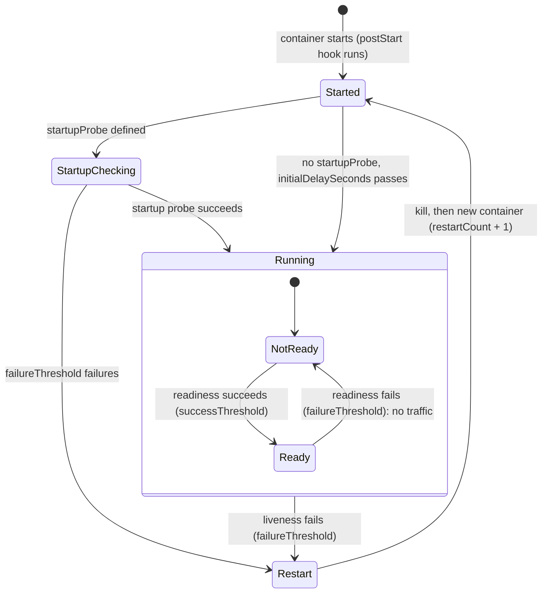

# T3.09 Implement Probes and Health Checks

> Competency: "Implement probes and health checks" (CKAD-3.2) | Domain/weight: CKAD, Application Observability and Maintenance (15%) | Est. time: 2.5 h | Prerequisites: T2.03, T1.08

Shell setup (from [conventions](../00-conventions.md); put it at the top of every session):

```bash
alias k=kubectl
export do="--dry-run=client -o yaml"
export now="--force --grace-period=0"
source <(kubectl completion bash); complete -o default -F __start_kubectl k
```

Lab environment for this lesson: **kind** (cluster `lab`, context `kind-lab`). Namespace: `lab-t309`. Files go in `~/lab/t309/`. Create both once:

```bash
k create ns lab-t309
mkdir -p ~/lab/t309
```

> Output policy. The machine where this lesson was written could not run a kind cluster for this topic (another job held the machine-wide kind lock, see section 11). Every output block below is therefore labelled `EXPECTED OUTPUT (not captured)`. The shape of each output is correct for Kubernetes v1.37, but Pod IPs, hash suffixes and ages will differ on your cluster. Section 11 lists everything to confirm on a live cluster.

---

## 1. Why this matters

Kubernetes only knows that a container **process** is running. It does not know whether the application inside still works. A probe is a small check that the **kubelet** (the agent on each node) runs against a container, so that Kubernetes can restart a stuck container and stop sending traffic to a container that is not ready. If you get a probe wrong, the damage is real: a liveness probe that fires too early restarts a healthy app forever, and a readiness probe that points at a missing path removes every Pod from the Service, which is a full outage that looks like "everything is Running".

In the exam this is a classic quick task: add a probe to a Deployment, or find out why a Pod restarts or never becomes Ready. Reading the probe from `k describe`, reading the event text, and changing one field are all skills that you can do in about two minutes once you have practised. Pods are covered in [T2.03](../part2-basics/T2.03-pods-in-depth.md), and port and socket tools (`ss`, `nc`, `curl`) in [T1.08](../part1-linux/T1.08-linux-networking-ii-dns-ports-sockets.md). The exam averages about 6 minutes per task (15-20 tasks in 2 hours; sources: [E2](https://docs.linuxfoundation.org/tc-docs/certification/tips-cka-and-ckad), [E3](https://docs.linuxfoundation.org/tc-docs/certification/faq-cka-ckad-cks)).

---

## 2. Concepts

### 2.1 The three probe types and what each one decides

A **probe** is a periodic check defined on one container. Each container can have up to three, and each answers a different question:

| Probe | Question it answers | What Kubernetes does when it fails | Runs | Default if you do not define it |
|---|---|---|---|---|
| `startupProbe` | "Has the app finished starting?" | After `failureThreshold` failures the container is killed and restarted (subject to `restartPolicy`) | Only until it succeeds once, then never again for that container run | Treated as success |
| `livenessProbe` | "Is the app still alive, or stuck?" | The container is killed and restarted. `restartCount` goes up by one | For the whole life of the container, but only after the startup probe has passed | Treated as success |
| `readinessProbe` | "Can the app take traffic right now?" | The container is marked **not ready**. The Pod's `Ready` condition becomes False and the Pod is removed from the Service's EndpointSlices. **No restart** | For the whole life of the container, after the startup probe has passed | Container counts as ready as soon as it is running |

Three rules that exam tasks lean on:

- **Liveness restarts, readiness only removes traffic.** They are independent. A Pod can be alive and not ready (the common case for a warming-up or overloaded app), and that is the correct state for it.
- **Startup protects the other two.** While a `startupProbe` is defined and has not yet succeeded, the kubelet does not run the liveness and readiness probes at all.
- **No probe means "healthy".** A container with no readiness probe is ready the moment it runs, even if the app inside needs 60 seconds to open its port. That is why a Service can send traffic to a Pod that is not really serving yet.

Related but different: a probe is **not** a Kubernetes-wide health check of a Service or a Deployment. It is one container's check, run by the kubelet on the node where that Pod lives. Nothing in the control plane polls your app.

### 2.2 Under the hood

Knowing who does what makes every failure easy to read.

1. The kubelet has a **prober manager**. For each container and each probe type it starts one small worker that runs on a timer (`periodSeconds`). The worker waits a random part of one period before its first run, so probes of many Pods do not all fire at the same instant. Do not expect probes at exact multiples of the period.
2. The worker runs the check (an HTTP request, a TCP connect, a command inside the container, or a gRPC call). It counts consecutive successes and failures. A state change happens only when a counter reaches its threshold: `failureThreshold` for failing, `successThreshold` for recovering.
3. **Liveness / startup fail:** the kubelet records an event, then tells the container runtime to stop the container. It sends `SIGTERM`, waits the grace period, then sends `SIGKILL`. The kubelet then follows the Pod's `restartPolicy`. With the default `Always`, it starts a new container in the same Pod (same IP, same volumes, `restartCount` + 1). If restarts keep failing, the kubelet waits longer each time: 10 s, 20 s, 40 s and so on, up to 5 minutes. This is the `CrashLoopBackOff` status.
4. **Readiness fails:** the kubelet sets the container status `ready: false`. The Pod `Ready` condition (all containers ready AND all readiness gates true, see 2.9) becomes False. The **EndpointSlice controller** in kube-controller-manager sees that and flips `conditions.ready` to `false` for that Pod's endpoint. kube-proxy then stops sending new connections to it. DNS for a headless Service also leaves it out. The container keeps running.
5. **A probe request comes from the node**, not from another Pod. So an `httpGet` probe must be answered on the Pod IP, and the app must listen on all interfaces (or the Pod IP), not only on `127.0.0.1`. An app that binds to `127.0.0.1` passes `curl localhost` inside the container and still fails its probe. Network policy implementations normally allow traffic between a Pod and its own node, so probes keep working under a default-deny policy (confirm for your CNI, section 11).
6. A **Deployment** uses Pod readiness to decide whether a new Pod counts as available during a rolling update. A new Pod that never becomes Ready stalls the rollout (`k rollout status` waits), and after `progressDeadlineSeconds` (default 600 s) the Deployment reports `ProgressDeadlineExceeded`. The old Pods keep serving. This is a safety net that exists only because of the readiness probe.

**Probes cannot be edited on a bare Pod.** For a running Pod the API server allows changes only to a few fields (the image, for example). Changing a probe on a Pod fails with `Forbidden: pod updates may not change fields other than ...`. Delete and recreate the Pod (`k replace --force -f pod.yaml`), or put the change in a Deployment, where an edit starts a rollout.

### 2.3 Mechanisms: how a probe checks

Every probe has exactly one **handler**. Pick one of four:

| Handler | What the kubelet does | Success means | Key fields | Watch out for |
|---|---|---|---|---|
| `httpGet` | Sends an HTTP GET to `Pod IP:port/path` | Status code from 200 up to and including 399 | `path` (default `/`), `port` (required, number or name), `host` (default Pod IP), `scheme` (`HTTP` default, or `HTTPS`), `httpHeaders` (list of `name`/`value`) | A 404, 500 or other 4xx/5xx is a failure. `HTTPS` does not verify the certificate. `host` changes the address connected to, `httpHeaders` with `Host` changes only the header |
| `tcpSocket` | Opens a TCP connection to `Pod IP:port` | The connection is accepted | `port` (required, number or name), `host` | Only proves that something listens. A hung app that still accepts connections passes |
| `exec` | Runs a command **inside** the container | Exit code 0 | `command` (list; no shell unless you write `sh -c`) | Needs the binary inside the image (distroless images have no `cat` or `sh`). Starts a new process on every period, so keep it cheap |
| `grpc` | Calls the standard gRPC Health Checking Protocol | The response status is `SERVING` | `port` (number only), `service` (string, default empty) | The app must implement `grpc.health.v1.Health`. No named ports, no custom host, no TLS options |

**Example of each (all runnable).** Save as `~/lab/t309/mechanisms.yaml`. The four Pods use different handlers on purpose:

```yaml
apiVersion: v1
kind: Pod
metadata:
  name: m-http
  namespace: lab-t309
  labels: {demo: mech}
spec:
  containers:
    - name: web
      image: nginx:1.27
      ports:
        - containerPort: 80
      livenessProbe:
        httpGet:
          path: /                  # default is "/" if omitted
          port: 80                 # number, or the name of a containerPort
          scheme: HTTP             # HTTP (default) or HTTPS
          httpHeaders:             # extra request headers
            - name: X-Probe
              value: kubelet
        periodSeconds: 10
---
apiVersion: v1
kind: Pod
metadata:
  name: m-tcp
  namespace: lab-t309
  labels: {demo: mech}
spec:
  containers:
    - name: web
      image: nginx:1.27
      readinessProbe:
        tcpSocket:
          port: 80                 # success = the TCP handshake completes
        periodSeconds: 10
---
apiVersion: v1
kind: Pod
metadata:
  name: m-exec
  namespace: lab-t309
  labels: {demo: mech}
spec:
  containers:
    - name: web
      image: nginx:1.27
      livenessProbe:
        exec:
          command: ["ls", "/usr/share/nginx/html/index.html"]   # exit 0 = healthy
        periodSeconds: 10
---
apiVersion: v1
kind: Pod
metadata:
  name: m-grpc
  namespace: lab-t309
  labels: {demo: mech}
spec:
  containers:
    - name: etcd
      image: registry.k8s.io/etcd:3.5.1-0   # serves the gRPC health service on its client port
      command:
        - /usr/local/bin/etcd
        - --data-dir=/var/lib/etcd
        - --listen-client-urls=http://0.0.0.0:2379
        - --advertise-client-urls=http://127.0.0.1:2379
      ports:
        - containerPort: 2379
      livenessProbe:
        grpc:
          port: 2379               # number only; named ports are not allowed for gRPC
          service: ""              # "" asks for the health of the whole server
        initialDelaySeconds: 10
        periodSeconds: 10
```

```bash
k apply -f ~/lab/t309/mechanisms.yaml
k get pods -n lab-t309 -l demo=mech
k describe pod m-http -n lab-t309 | grep -i -A1 liveness
```

EXPECTED OUTPUT (not captured):

```text
NAME     READY   STATUS    RESTARTS   AGE
m-exec   1/1     Running   0          20s
m-grpc   1/1     Running   0          20s
m-http   1/1     Running   0          20s
m-tcp    1/1     Running   0          20s

    Liveness:       http-get http://:80/ delay=0s timeout=1s period=10s #success=1 #failure=3
    Environment:    <none>
```

**One way to watch each handler fail.**

- `m-http`: `k exec m-http -n lab-t309 -- rm /usr/share/nginx/html/index.html`. The next probe gets a 403 (nginx refuses to list the directory), so the event reads `Liveness probe failed: HTTP probe failed with statuscode: 403`. After three failures the container restarts and the image restores the file.
- `m-exec`: the same `rm` makes `ls` print `ls: /usr/share/nginx/html/index.html: No such file or directory` and exit 2. The event shows that output after `Liveness probe failed:`.
- `m-tcp`: needs the port closed while the container stays up. Section 5 shows the `kill $(pidof httpd)` trick that does exactly this.
- `m-grpc`: shows that the gRPC probe line in `describe` starts with `grpc <pod>:2379 service:`. To break it, change `port` to a closed port in the YAML and re-create the Pod; the event ends with a `connection refused` style message (exact text: section 11).

Clean up: `k delete pod -n lab-t309 -l demo=mech $now`.

**Reading probe results.** Whatever the handler, the failure text goes into a Pod **event** with reason `Unhealthy`. The usual messages (exact wording to confirm in section 11):

| Handler | Typical event message after `Liveness probe failed:` / `Readiness probe failed:` / `Startup probe failed:` |
|---|---|
| httpGet, bad status | `HTTP probe failed with statuscode: 500` (or 404, 403, 503 ...) |
| httpGet or tcpSocket, port closed | `Get "http://10.244.1.7:8080/ready": dial tcp 10.244.1.7:8080: connect: connection refused` (tcpSocket: `dial tcp 10.244.1.7:8080: connect: connection refused`) |
| httpGet, too slow | `Get "http://10.244.1.7:8080/healthz": context deadline exceeded (Client.Timeout exceeded while awaiting headers)` |
| exec | The command's output, for example `cat: can't open '/tmp/healthy': No such file or directory` |
| grpc | A short gRPC status text, for example one that mentions `NOT_SERVING` or `connection refused` |

### 2.4 Timing fields

All five numbers sit directly under the probe, next to the handler. Defaults in v1.37 are listed in the docs and are checked in section 11.

| Field | Default | Minimum | Meaning | Risky value |
|---|---|---|---|---|
| `initialDelaySeconds` | 0 | 0 | Wait this long after the container **starts** before the first check | Too small: probe fires before the app is up. Too large: slow detection and slow readiness |
| `periodSeconds` | 10 | 1 | Time between checks | Very small values (1) add CPU load and noise; very large values (60) detect failures late |
| `timeoutSeconds` | 1 | 1 | How long one check may take before it counts as failed | **1 is too low for a loaded app or a JVM.** The default is the cause of many "random restarts" |
| `successThreshold` | 1 | 1 | Consecutive successes needed to go from failing to passing | For liveness and startup it **must be 1**. Any other value is rejected by the API |
| `failureThreshold` | 3 | 1 | Consecutive failures needed to act (restart, or not-ready) | 1 makes one slow request restart the app |
| `terminationGracePeriodSeconds` (probe-level) | not set (the Pod's value, default 30 s, is used) | greater than 0 | Grace time given to the container when **this probe** causes the kill. Allowed on `livenessProbe` and `startupProbe` only | Too small: no time for a clean shutdown. Setting it on a readiness probe is rejected |

Useful arithmetic (the exam does not ask for it by name, but you use it to choose values):

- Worst-case time to **notice** a hard failure is about `failureThreshold × periodSeconds` (30 s for the defaults 3 and 10), plus up to `timeoutSeconds` per check.
- Worst-case time to **recover** (go back to ready) after the app is fixed is about `successThreshold × periodSeconds`.
- A readiness probe with `successThreshold: 2` and `periodSeconds: 5` takes about 10 s to put a Pod back in the Service. Only readiness can use `successThreshold` above 1.

**Probe-level `terminationGracePeriodSeconds`.** Normally every kill uses the Pod's `spec.terminationGracePeriodSeconds` (default 30 s). Many small test containers (`sleep`, `sh -c`) run as PID 1 and ignore `SIGTERM`, so each liveness restart waits the full 30 s before `SIGKILL`. Setting the field on the **liveness probe** shortens only the probe-triggered kill, and leaves a normal `k delete pod` untouched:

```yaml
livenessProbe:
  exec: {command: ["cat", "/tmp/healthy"]}
  periodSeconds: 5
  failureThreshold: 2
  terminationGracePeriodSeconds: 2   # kill 2 s after a failed liveness probe, not 30 s
```

This field is stable (it needs no feature gate in v1.37). Do not set it to a small value on a real app that needs time to flush data; the default exists for a reason.

### 2.5 Effects you can observe

| Event in the Pod | What you see with `kubectl` |
|---|---|
| Liveness failure | `RESTARTS` goes up (`restartCount` in `.status.containerStatuses[0]`). Events: `Warning Unhealthy ... Liveness probe failed: ...` then `Normal Killing ... Container web failed liveness probe, will be restarted`. `describe` shows `Last State: Terminated` with a non-zero exit code (137 means `SIGKILL`; 143 means the app handled `SIGTERM`) |
| Readiness failure | `READY` shows `0/1`, `RESTARTS` stays the same. Events: `Warning Unhealthy ... Readiness probe failed: ...`. The Pod's endpoint in the EndpointSlice shows `conditions.ready: false` |
| Startup failure | Events `Startup probe failed: ...`; after `failureThreshold` failures: `Container web failed startup probe, will be restarted`. The Pod can end in `CrashLoopBackOff` |
| Everything passes | `READY 1/1`, no `Unhealthy` events |

**EndpointSlice conditions.** Each endpoint in a slice has three booleans:

| Condition | True when |
|---|---|
| `ready` | The Pod is Ready and not terminating. Only these endpoints receive normal traffic |
| `serving` | The Pod passes its readiness probe, even while it is terminating (used for graceful draining) |
| `terminating` | The Pod has a deletion timestamp |

So a readiness failure gives `ready: false`, `serving: false`, `terminating: false`. A Pod being deleted while still healthy gives `ready: false`, `serving: true`, `terminating: true`. A Service with `publishNotReadyAddresses: true` ignores readiness and keeps all Pods (used by some databases for peer discovery). The old `Endpoints` API is deprecated; use EndpointSlices (see [T3.12](../part3-ckad/T3.12-provide-and-troubleshoot-access-to-applications.md) for Services).

### 2.6 Designing a startupProbe for slow apps

**The problem.** An app needs, say, up to 4 minutes to start (it loads a big dataset). Liveness has `periodSeconds: 10` and `failureThreshold: 3`. The kubelet starts the liveness checks right away. After 30 s the probe has failed three times, the container is killed, and the new container starts the same slow boot. The Pod never gets past booting. This is the "endless restarts right after start" failure.

**The two old fixes and why they are weak.**

- A large `initialDelaySeconds` (say 240) on the liveness probe. Startup is covered, but now a crash that happens later is only detected after the same large delay on every restart, and a fast boot still waits 240 s.
- A large `failureThreshold` on the liveness probe. The app takes a long time to be restarted when it really hangs, for the whole life of the Pod.

**The fix: `startupProbe`.** It gives a long budget for start, then steps aside, and lets the liveness probe be strict.

The startup budget is:

```text
max startup time = initialDelaySeconds + failureThreshold × periodSeconds
```

Example with the values from the entry: `failureThreshold: 30`, `periodSeconds: 10`, no initial delay. The app gets `30 × 10 = 300` seconds. The probe checks every 10 s. As soon as one check succeeds (the app starts in 40 s, say), the startup probe is done, and the liveness and readiness probes start. If 30 checks in a row fail (300 s), the container is killed and restarted.

Choosing the numbers: take the slowest start you accept (for example 240 s), choose a check interval that gives fast detection (10 s), and use `failureThreshold = ceil(240 / 10) + margin`. With a margin of 6 that is `24 + 6 = 30`. Then keep liveness tight (`periodSeconds: 5`, `failureThreshold: 3` finds a hang in about 15 s) because it only begins after startup.

```yaml
startupProbe:
  httpGet: {path: /ready, port: 8080}
  periodSeconds: 10
  failureThreshold: 30        # 30 x 10 s = 300 s to start
livenessProbe:
  httpGet: {path: /healthz, port: 8080}
  periodSeconds: 5
  failureThreshold: 3         # tight, because startup already passed
```

A startup probe is an HTTP, TCP, exec or gRPC check like the others. Its `successThreshold` must be 1. It runs once per container start: after a restart, startup begins again.

### 2.7 Named ports in probes

A `containerPort` may carry a **name** (up to 15 characters, lowercase letters, digits and `-`). A probe can use the name instead of the number, and a Service `targetPort` can use the same name. Change the number in one place and nothing else breaks:

```yaml
ports:
  - name: http               # name used by the probe and by the Service
    containerPort: 8080
readinessProbe:
  httpGet: {path: /ready, port: http}   # resolved to 8080 by the kubelet
```

Rules: a name works in `httpGet` and `tcpSocket`. It does not work in `grpc` (number only). If the name does not exist in the container's `ports`, the probe cannot resolve it and fails on every check (the event names the port), so the Pod never becomes Ready. Check with `k get pod web -o jsonpath='{.spec.containers[0].ports}'`.

### 2.8 Readiness gates (awareness)

A **readiness gate** lets something other than the kubelet's probes block Pod readiness. You add extra condition names to the Pod; an outside controller (a cloud load-balancer integration, for example) sets them to `True` through the Pod status. The Pod is Ready only when **all containers are ready AND every gate condition is `True`**.

```yaml
spec:
  readinessGates:
    - conditionType: "example.com/feature-ready"
```

You will meet this in the wild (for example when a cloud load balancer must register a Pod first) and rarely write it. For the exam, know what it is and how to read it: `k get pod -o wide` has a `READINESS GATES` column (`0/1` means one gate is not yet true). The `READY` column still counts containers only, so a Pod can show `1/1` and not be in the Service. Check `k get pod gated -o jsonpath='{.status.conditions}'`. You can try it by hand in section 5.5.

### 2.9 Probes on sidecars and multi-container Pods

- **Each container has its own probes.** In a Pod with two containers, readiness is per container; the Pod is Ready only when all containers are ready. A failing liveness probe restarts only the container that owns it.
- **Native sidecars** (an entry in `initContainers` with `restartPolicy: Always`, GA since v1.33) support `startupProbe`, `livenessProbe` and `readinessProbe`. Regular init containers do not (they run once and must exit). The kubelet starts the main containers only after a sidecar's startup probe passes, so a startup probe on a sidecar is a way to say "do not start my app until the proxy is up". A sidecar whose liveness probe fails is restarted on its own. A sidecar's readiness feeds into the Pod's `Ready` condition (confirm in section 11).
- A sidecar probe is written exactly like a main-container probe:

```yaml
spec:
  initContainers:
    - name: agent
      image: busybox:1.36
      restartPolicy: Always            # makes this init container a sidecar
      command: ["sh", "-c", "touch /tmp/agent-ok; sleep 3600"]
      startupProbe:
        exec: {command: ["cat", "/tmp/agent-ok"]}
        periodSeconds: 2
        failureThreshold: 15
      livenessProbe:
        exec: {command: ["cat", "/tmp/agent-ok"]}
        periodSeconds: 10
  containers:
    - name: app
      image: nginx:1.27
```

### 2.10 Container lifecycle hooks versus probes

Hooks are different from probes. A probe **checks** repeatedly. A hook **does** something once at a fixed moment.

| | Probe | Lifecycle hook |
|---|---|---|
| Purpose | Decide restart / traffic | Run code at start or before stop |
| When | Repeats every `periodSeconds` | Once per container start (`postStart`) or stop (`preStop`) |
| Failure | Restart, or not-ready | `postStart` failure kills the container (event `FailedPostStartHook`); `preStop` failure is logged (event `FailedPreStopHook`) and the stop continues |
| Handlers | httpGet, tcpSocket, exec, grpc | `exec`, `httpGet`, `sleep` (a `tcpSocket` handler exists but is deprecated for hooks) |

- **`postStart`** runs right after the container is created. There is no guarantee that it runs before the container's `ENTRYPOINT`. The container is not reported `Running` until the hook returns, and a hook that never returns blocks the container. Do not use it for things that must wait for the app.
- **`preStop`** runs when the container is about to be stopped by the API (Pod deletion, a rolling update, a failed liveness probe, preemption). It runs **before** `SIGTERM`, it blocks, and its time counts against the Pod's `terminationGracePeriodSeconds`. It is not run when the container exits on its own.
- **The `sleep` action** (stable since v1.34) is built into the kubelet. It needs no `sleep` binary in the image, so it works in distroless images. The common use is `preStop: sleep: seconds: 5`, which keeps the Pod serving a few seconds after it has been taken out of the EndpointSlices, so in-flight requests and slow-to-update proxies do not hit a dead Pod.

```yaml
lifecycle:
  postStart:
    exec:
      command: ["sh", "-c", "echo started > /usr/share/nginx/html/started.txt"]
  preStop:
    sleep:
      seconds: 5          # kubelet waits 5 s, then sends SIGTERM
```

Try it: save the Pod below as `hooks.yaml` and run `k apply -f hooks.yaml`, `k exec hooks -n lab-t309 -- cat /usr/share/nginx/html/started.txt`, then `time k delete pod hooks -n lab-t309`. The delete takes at least 5 seconds.

```yaml
apiVersion: v1
kind: Pod
metadata:
  name: hooks
  namespace: lab-t309
spec:
  containers:
    - name: web
      image: nginx:1.27
      lifecycle:
        postStart:
          exec:
            command: ["sh", "-c", "echo started > /usr/share/nginx/html/started.txt"]
        preStop:
          sleep:
            seconds: 5
```

### 2.11 Testing probes by breaking the app

You prove a probe works by making the app fail on purpose and watching the result. Three ways, each for a different probe:

| You want to see | Break it with | Result |
|---|---|---|
| Liveness restart (exec probe) | `k exec web -- rm /tmp/healthy` | `cat` fails, 3 failures, container restarted |
| Readiness drop (httpGet probe) | `k exec web -- rm /www/ready` | 404, Pod `0/1`, removed from EndpointSlice, no restart |
| Closed port | `k exec web -- sh -c 'kill $(pidof httpd)'` | `connection refused`; readiness fails; the container itself keeps running |

The container-level behaviour behind these three breaks was checked with plain Docker (the same `busybox:1.36` image and start command, run with `docker run` and `docker exec`; this is **not** a kind or Kubernetes result):

REAL OUTPUT (Docker):

```text
$ wget -qO- http://127.0.0.1:8080/ready                  # file present
ok
$ rm /www/ready; wget -S -qO- http://127.0.0.1:8080/ready   # file removed
  HTTP/1.1 404 Not Found
wget: server returned error: HTTP/1.1 404 Not Found
$ kill $(pidof httpd); wget -qO- http://127.0.0.1:8080/ready   # server killed
wget: can't connect to remote host (127.0.0.1): Connection refused
$ cat /tmp/healthy                                       # after rm /tmp/healthy
cat: can't open '/tmp/healthy': No such file or directory
$ docker kill -s TERM <container with sleep as PID 1>    # still "Up" 2 s later; SIGKILL then gives exit code 137
```

Start a watch in one terminal (`k get pod web -w`) and the break command in another. Then read `k describe pod web` (Events at the bottom). Restore with `touch` or by restarting the server, and see the Pod return to `1/1`.

---

## 3. How it works (diagram)



Walkthrough:

1. The container starts. If you defined a `startupProbe`, it is the only probe that runs; liveness and readiness wait. Without one, the others start after their own `initialDelaySeconds`.
2. Once the startup probe succeeds, it never runs again for this container run. Liveness and readiness now run on their timers for the rest of its life.
3. Inside `Running`, the readiness probe flips the container between `NotReady` and `Ready`. `NotReady` means the Pod is out of the EndpointSlices and gets no traffic, but the process is untouched.
4. A liveness failure (after `failureThreshold` checks in a row) leaves `Running` for `Restart`: the kubelet stops the container and starts a new one, and `restartCount` goes up. A startup probe that exhausts `failureThreshold` takes the same path.
5. After a restart the container is `Started` again, so the startup probe runs again, and repeated failures lead to `CrashLoopBackOff` (growing waits between restarts).

---

## 4. Commands and YAML you must produce fast

### 4.1 Imperative shortcuts

There is **no** `kubectl run --liveness` flag, and no `kubectl set probe`. The fast path is: generate the object, add the probe block, apply. Four tools:

```bash
# 1. Generate a Pod or Deployment skeleton, then add the probe by hand
k run web --image=busybox:1.36 -n lab-t309 $do -- sleep 3600 > ~/lab/t309/pod.yaml
k create deploy api --image=nginx:1.27 -n lab-t309 $do > ~/lab/t309/api.yaml
```

Gives you valid YAML in one command. Open the file and add the `readinessProbe:` block under the container.

```bash
# 2. Add a probe to a skeleton in one command (yq is on the exam SSH hosts, not on host base: E9)
yq -i '.spec.containers[0].readinessProbe.httpGet = {"path": "/", "port": 80}' ~/lab/t309/pod.yaml
```

Faster and less error-prone than editing indentation. Verify with `yq '.spec.containers[0]' ~/lab/t309/pod.yaml`.

```bash
# 3. Add a probe to an existing Deployment with a JSON patch (rolls out new Pods)
k patch deploy api -n lab-t309 --type=json -p '[{"op":"add","path":"/spec/template/spec/containers/0/readinessProbe","value":{"httpGet":{"path":"/","port":80},"periodSeconds":5}}]'
```

Use `add` for a new field and `replace` for an existing one. `/containers/0` is the first container.

```bash
# 4. Look up field names and defaults without leaving the terminal
k explain pod.spec.containers.livenessProbe --recursive | head -40
k explain pod.spec.containers.startupProbe.failureThreshold
```

`k explain` is the fastest reference in the exam. For a copy-paste example, open the docs page ([configure probes](https://kubernetes.io/docs/tasks/configure-pod-container/configure-liveness-readiness-startup-probes/)) and search for the handler you need.

**Reading probe state.**

```bash
k describe pod web -n lab-t309 | grep -i -A3 liveness      # probe config + timings
k describe pod web -n lab-t309 | grep -A12 Events          # Unhealthy / Killing events
k get pod web -n lab-t309 -w                               # READY and RESTARTS live
k get pod web -n lab-t309 -o jsonpath='{.status.containerStatuses[0].restartCount}{"\n"}'
k logs web -n lab-t309 --previous                          # logs of the container before the restart
k get endpointslices -n lab-t309 -l kubernetes.io/service-name=web -o yaml | grep -A3 conditions
k get events -n lab-t309 --field-selector reason=Unhealthy
```

### 4.2 The declarative YAML to type from memory

This Pod has all three probes. It is the "entry" block: readiness `httpGet /ready:8080`, liveness `exec cat /tmp/healthy`, and a `startupProbe` with `failureThreshold: 30` and `periodSeconds: 10`. Save it as `~/lab/t309/web.yaml`. The app is BusyBox `httpd` on port 8080; the start command creates the files that the probes look for.

```yaml
apiVersion: v1
kind: Pod
metadata:
  name: web
  namespace: lab-t309
  labels:
    app: web                      # the Service in section 5 selects this label
spec:
  containers:
    - name: web
      image: busybox:1.36         # pinned tag; never :latest
      command:
        - sh
        - -c
        # create the health file and the page /ready, start the server in the
        # background (no -f), then keep the container alive with sleep as PID 1
        - touch /tmp/healthy; mkdir -p /www; echo ok > /www/ready; httpd -p 8080 -h /www; exec sleep 3600
      ports:
        - name: http              # named port, usable by probes and by Service targetPort
          containerPort: 8080
      startupProbe:               # runs first; liveness and readiness wait for it
        httpGet:
          path: /ready            # URL path to GET (default "/")
          port: http              # port name defined above; a number such as 8080 also works
        periodSeconds: 10         # check every 10 s
        failureThreshold: 30      # 30 failures x 10 s = up to 300 s to start, then restart
      readinessProbe:             # controls EndpointSlice membership (traffic)
        httpGet:
          path: /ready
          port: 8080              # by number here, to show both forms
        periodSeconds: 5          # re-check every 5 s for the whole life of the container
        timeoutSeconds: 2         # one check may take 2 s (default 1 s)
        failureThreshold: 3       # 3 failures in a row -> not ready (default 3)
        successThreshold: 1       # 1 success -> ready again (default 1)
      livenessProbe:              # controls restarts
        exec:
          command: ["cat", "/tmp/healthy"]   # exit code 0 = alive
        periodSeconds: 5
        failureThreshold: 3       # about 15 s of failures -> restart
        terminationGracePeriodSeconds: 5   # probe-level: kill within 5 s (sleep ignores SIGTERM)
```

Why `exec sleep 3600`: the shell replaces itself with `sleep`, so `sleep` is PID 1. The container lives as long as `sleep` does, and you can kill `httpd` alone to simulate a closed port. `sleep` as PID 1 ignores `SIGTERM`, which is why the liveness probe carries a short probe-level grace period.

A Service for this Pod (save as `~/lab/t309/svc.yaml`):

```yaml
apiVersion: v1
kind: Service
metadata:
  name: web
  namespace: lab-t309
spec:
  selector:
    app: web
  ports:
    - port: 80
      targetPort: http            # the container port NAME, resolved per Pod
```

Quick checks that the file is valid before you spend time on it:

```bash
k apply -f ~/lab/t309/web.yaml --dry-run=server     # server-side validation: catches wrong field names and values
k explain pod.spec.containers.readinessProbe.httpGet
```

Server-side dry run is the exam-friendly way to catch typos such as `periodSecond:` or a `successThreshold: 2` on a liveness probe.

### 4.3 Speed drill

Each drill states its setup and ends with cleanup. Targets are for exam pace. Namespace: `lab-t309` (create it first if you skipped the top of the lesson). The drills are independent of the worked example and the labs, and the cleanup block at the end returns the namespace to empty.

```bash
# setup for all drills
k create ns lab-t309 2>/dev/null; mkdir -p ~/lab/t309; cd ~/lab/t309
k create deploy dd --image=nginx:1.27 -n lab-t309     # container name is "nginx"
```

**Drill 1 (3 min).** Generate Pod `quick` (image `nginx:1.27`) in `lab-t309` with a readiness `httpGet` on path `/` port 80. Apply it.

<details><summary>Answer</summary>

```bash
k run quick --image=nginx:1.27 -n lab-t309 $do > quick.yaml
yq -i '.spec.containers[0].readinessProbe.httpGet = {"path": "/", "port": 80}' quick.yaml
k apply -f quick.yaml -n lab-t309      # `k run $do` does not write the namespace into the YAML
k get pod quick -n lab-t309            # READY 1/1 after the first successful check
```

Without yq: open the file, add under the container `readinessProbe:` with `httpGet:` `path: /` `port: 80`. The two-line form `readinessProbe: {httpGet: {path: /, port: 80}}` also works.
</details>

**Drill 2 (3 min).** Add a liveness `httpGet` probe (path `/`, port 80, `periodSeconds: 5`) to Deployment `dd` without opening an editor.

<details><summary>Answer</summary>

```bash
k patch deploy dd -n lab-t309 --type=json -p '[{"op":"add","path":"/spec/template/spec/containers/0/livenessProbe","value":{"httpGet":{"path":"/","port":80},"periodSeconds":5}}]'
k rollout status deploy dd -n lab-t309
k describe pod -n lab-t309 -l app=dd | grep -i liveness     # period=5s
```

A change to the Pod template starts a rolling update. That is why a Deployment is easier to fix than a bare Pod.
</details>

**Drill 3 (2 min).** Deployment `dd` must wait up to 4 minutes to start. Add a `startupProbe` (`tcpSocket` on 80) that allows that, with a check every 10 s. Which `failureThreshold` do you need at least?

<details><summary>Answer</summary>

Budget = `failureThreshold × periodSeconds`. For 240 s with a 10 s period, `failureThreshold` must be at least 24.

```bash
k patch deploy dd -n lab-t309 --type=json -p '[{"op":"add","path":"/spec/template/spec/containers/0/startupProbe","value":{"tcpSocket":{"port":80},"periodSeconds":10,"failureThreshold":24}}]'
k get deploy dd -n lab-t309 -o jsonpath='{.spec.template.spec.containers[0].startupProbe}{"\n"}'
```
</details>

**Drill 4 (2 min).** Give Deployment `dd` a readiness probe (`httpGet` `/` on port 80) with `timeoutSeconds: 5`, using one command that works whether or not the probe exists yet.

<details><summary>Answer</summary>

```bash
k patch deploy dd -n lab-t309 --type=json -p '[{"op":"add","path":"/spec/template/spec/containers/0/readinessProbe","value":{"httpGet":{"path":"/","port":80},"timeoutSeconds":5}}]'
k get deploy dd -n lab-t309 -o jsonpath='{.spec.template.spec.containers[0].readinessProbe.timeoutSeconds}{"\n"}'
```

JSON patch `add` on an existing key replaces its value, so the same command works whether or not the probe exists.
</details>

**Drill 5 (2 min).** Show which probe failures happened in the namespace, with one command, then print only the messages.

<details><summary>Answer</summary>

```bash
k get events -n lab-t309 --field-selector reason=Unhealthy
k get events -n lab-t309 --field-selector reason=Unhealthy -o jsonpath='{range .items[*]}{.message}{"\n"}{end}'
```

Probe failures always use `reason=Unhealthy`. If the output is empty, no probe failed (or the events expired after about an hour).
</details>

**Drill 6 (3 min).** Expose `dd` as a Service on port 80, then print the `ready` condition of every endpoint of that Service.

<details><summary>Answer</summary>

```bash
k expose deploy dd -n lab-t309 --port=80
k get endpointslices -n lab-t309 -l kubernetes.io/service-name=dd -o jsonpath='{.items[*].endpoints[*].conditions.ready}{"\n"}'
```

You should see `true` (one per Pod).
</details>

**Drill 7 (2 min).** A Pod's container declares `ports: [{name: web, containerPort: 8080}]`. Write the `tcpSocket` readiness probe that uses the port name.

<details><summary>Answer</summary>

```yaml
readinessProbe:
  tcpSocket:
    port: web
```
</details>

**Drill 8 (3 min).** Prove the API refuses `successThreshold: 2` on a liveness probe, using a server-side dry run.

<details><summary>Answer</summary>

```bash
cat > bad.yaml <<'EOF'
apiVersion: v1
kind: Pod
metadata:
  name: bad
  namespace: lab-t309
spec:
  containers:
    - name: c
      image: nginx:1.27
      livenessProbe:
        httpGet: {path: /, port: 80}
        successThreshold: 2
EOF
k apply -f bad.yaml --dry-run=server
```

Expected error (text to confirm in section 11): `The Pod "bad" is invalid: spec.containers[0].livenessProbe.successThreshold: Invalid value: 2: must be 1`.
</details>

```bash
# cleanup for all drills
k delete deploy dd -n lab-t309 $now
k delete svc dd -n lab-t309
k delete pod quick -n lab-t309 $now --ignore-not-found
rm -f ~/lab/t309/quick.yaml ~/lab/t309/bad.yaml ~/lab/t309/pod.yaml ~/lab/t309/api.yaml
```

---

## 5. Worked example

Goal: build the Pod `web` from section 4.2, put a Service in front of it, break it in three different ways, and read the evidence each time. Use three terminals: **T1** for commands, **T2** for `k get pod web -n lab-t309 -w`, and **T3** for `k get endpointslices ... -w` when you want it.

### 5.1 Create the Pod and the Service

```bash
cd ~/lab/t309
k apply -f web.yaml -f svc.yaml
k get pod web -n lab-t309 -w
```

What happens: the container starts, the shell writes `/tmp/healthy` and `/www/ready`, and BusyBox `httpd` starts. The startup probe (every 10 s) is the only probe running at first. Its first check may come up to 10 s after the start. When it passes, the readiness and liveness probes begin. The Pod becomes `1/1` after the first readiness success.

EXPECTED OUTPUT (not captured):

```text
NAME   READY   STATUS    RESTARTS   AGE
web    0/1     Running   0          3s
web    1/1     Running   0          12s
```

Now check what the probes look like to the API, and what the Service sees:

```bash
k describe pod web -n lab-t309 | grep -i -A3 liveness
k get endpointslices -n lab-t309 -l kubernetes.io/service-name=web -o yaml | grep -A3 conditions
```

EXPECTED OUTPUT (not captured):

```text
    Liveness:   exec [cat /tmp/healthy] delay=0s timeout=1s period=5s #success=1 #failure=3
    Readiness:  http-get http://:8080/ready delay=0s timeout=2s period=5s #success=1 #failure=3
    Startup:    http-get http://:http/ready delay=0s timeout=1s period=10s #success=1 #failure=30
    Environment:  <none>
--
    conditions:
      ready: true
      serving: true
      terminating: false
```

How to read it: each line is `handler target delay timeout period #success #failure`. These are the real values the kubelet uses, with defaults filled in (`delay=0s`, `timeout=1s`). The Startup line shows the named port `http` unresolved. `ready: true` means the Service sends traffic to this Pod.

### 5.2 Readiness fails: the Pod leaves the Service, nothing restarts

Remove the file that the readiness endpoint serves. `httpd` then answers `404 Not Found` for `/ready`.

```bash
k exec web -n lab-t309 -- rm /www/ready
sleep 20
k get pod web -n lab-t309
k get endpointslices -n lab-t309 -l kubernetes.io/service-name=web -o yaml | grep -A3 conditions
k describe pod web -n lab-t309 | grep -A8 Events
```

EXPECTED OUTPUT (not captured):

```text
NAME   READY   STATUS    RESTARTS   AGE
web    0/1     Running   0          3m

    conditions:
      ready: false
      serving: false
      terminating: false

Events:
  Type     Reason     Age                From     Message
  ----     ------     ----               ----     -------
  Warning  Unhealthy  4s (x4 over 19s)   kubelet  Readiness probe failed: HTTP probe failed with statuscode: 404
```

How to read it: `READY 0/1` with `RESTARTS 0` and `STATUS Running` is the signature of a readiness failure. The container is fine; the Pod is simply out of the Service. `ready: false` is the same fact seen from the Service side. The event gives the cause: status code 404, so the server is up and the path is wrong or the page is missing. The Service now has no ready endpoint, so client requests to `web` fail (connection refused or a timeout, depending on the kube-proxy mode; see [T3.12](../part3-ckad/T3.12-provide-and-troubleshoot-access-to-applications.md)).

Restore it and watch the Pod come back (within one period of the next successful check):

```bash
k exec web -n lab-t309 -- sh -c 'echo ok > /www/ready'
k get pod web -n lab-t309 -w        # Ctrl+C when READY is 1/1
```

### 5.3 Close the port: readiness fails with "connection refused", the container keeps running

Kill only the web server. The container's PID 1 is `sleep`, so the container stays up.

```bash
k exec web -n lab-t309 -- sh -c 'kill $(pidof httpd)'
sleep 20
k get pod web -n lab-t309
k describe pod web -n lab-t309 | grep -A8 Events
```

EXPECTED OUTPUT (not captured):

```text
NAME   READY   STATUS    RESTARTS   AGE
web    0/1     Running   0          5m

Events:
  Type     Reason     Age                From     Message
  ----     ------     ----               ----     -------
  Warning  Unhealthy  3s (x4 over 18s)   kubelet  Readiness probe failed: Get "http://10.244.1.9:8080/ready": dial tcp 10.244.1.9:8080: connect: connection refused
```

How to read it: this time the text is not a status code. `connection refused` means nothing listens on the port, so the cause is the app (or the probe port) and not the path. A `tcpSocket` probe would show the same `dial tcp ...: connect: connection refused`. The liveness probe (`cat /tmp/healthy`) still passes, so no restart. Start the server again:

```bash
k exec web -n lab-t309 -- httpd -p 8080 -h /www
k get pod web -n lab-t309 -w        # back to 1/1
```

### 5.4 Liveness fails: the container is restarted

```bash
k exec web -n lab-t309 -- rm /tmp/healthy
sleep 30
k get pod web -n lab-t309
k describe pod web -n lab-t309 | grep -A12 Events
k describe pod web -n lab-t309 | grep -A6 'Last State'
```

EXPECTED OUTPUT (not captured):

```text
NAME   READY   STATUS    RESTARTS      AGE
web    1/1     Running   1 (8s ago)    7m

Events:
  Type     Reason     Age                 From     Message
  ----     ------     ----                ----     -------
  Warning  Unhealthy  22s (x3 over 32s)   kubelet  Liveness probe failed: cat: can't open '/tmp/healthy': No such file or directory
  Normal   Killing    22s                 kubelet  Container web failed liveness probe, will be restarted
  Normal   Pulled     ...                 kubelet  Container image "busybox:1.36" already present on machine
  Normal   Created    ...                 kubelet  Created container: web
  Normal   Started    ...                 kubelet  Started container web

    Last State:     Terminated
      Reason:       Error
      Exit Code:    137
```

How to read it: three `Unhealthy` events (that is `failureThreshold: 3`, five seconds apart), then `Killing` with the words "failed liveness probe, will be restarted", then the usual `Created` and `Started` for the new container. `RESTARTS 1` proves a restart. Exit code 137 means `SIGKILL`: `sleep` as PID 1 ignored `SIGTERM`, and the kubelet killed it after the 5 s probe-level grace period (without that field the restart would have taken 30 s more). The new container has a fresh filesystem, so `/tmp/healthy` exists again and the Pod is healthy. If you want the log of the old container, run `k logs web -n lab-t309 --previous`.

### 5.5 Readiness gate by hand (awareness)

This Pod has a gate that only an outside party can satisfy. You play the outside party.

```bash
cat > ~/lab/t309/gated.yaml <<'EOF'
apiVersion: v1
kind: Pod
metadata:
  name: gated
  namespace: lab-t309
spec:
  readinessGates:
    - conditionType: "example.com/feature-ready"
  containers:
    - name: web
      image: nginx:1.27
EOF
k apply -f ~/lab/t309/gated.yaml
sleep 10
k get pod gated -n lab-t309 -o wide
k get pod gated -n lab-t309 -o jsonpath='{range .status.conditions[*]}{.type}={.status}{"\n"}{end}'
```

EXPECTED OUTPUT (not captured):

```text
NAME    READY   STATUS    RESTARTS   AGE   IP            NODE         NOMINATED NODE   READINESS GATES
gated   1/1     Running   0          10s   10.244.2.4    lab-worker   <none>           0/1

Initialized=True
Ready=False
ContainersReady=True
PodScheduled=True
```

The container is ready (`ContainersReady=True`) but the Pod is not (`Ready=False`), because the gate is false. A Service would not send traffic to it. Now set the gate:

```bash
k patch pod gated -n lab-t309 --subresource=status -p '{"status":{"conditions":[{"type":"example.com/feature-ready","status":"True"}]}}'
sleep 5
k get pod gated -n lab-t309 -o jsonpath='{range .status.conditions[*]}{.type}={.status}{"\n"}{end}' | grep '^Ready'
```

EXPECTED OUTPUT (not captured):

```text
Ready=True
```

Conditions are merged by `type`, so this adds the gate condition and leaves the others alone. (A merge patch of that list would replace it; the default patch type for `k patch` is a strategic merge, which merges by key.)

### 5.6 The HTTP 500 event

The exact event from the entry (`HTTP probe failed with statuscode: 500`) needs an app that answers 500. This nginx config answers 200 on `/healthz` only while `/tmp/healthy` exists, and 500 otherwise:

```bash
cat > ~/lab/t309/flaky.yaml <<'EOF'
apiVersion: v1
kind: ConfigMap
metadata:
  name: flaky-conf
  namespace: lab-t309
data:
  default.conf: |
    server {
      listen 80;
      location = /healthz {
        if (-f /tmp/healthy) { return 200 "ok\n"; }
        return 500 "unhealthy\n";
      }
      location / { return 200 "hello\n"; }
    }
---
apiVersion: v1
kind: Pod
metadata:
  name: flaky
  namespace: lab-t309
spec:
  containers:
    - name: web
      image: nginx:1.27
      command: ["sh", "-c", "touch /tmp/healthy; exec nginx -g 'daemon off;'"]
      volumeMounts:
        - name: conf
          mountPath: /etc/nginx/conf.d
      livenessProbe:
        httpGet: {path: /healthz, port: 80}
        periodSeconds: 5
        failureThreshold: 2
  volumes:
    - name: conf
      configMap:
        name: flaky-conf
EOF
k apply -f ~/lab/t309/flaky.yaml
k wait --for=condition=Ready pod/flaky -n lab-t309 --timeout=60s
k exec flaky -n lab-t309 -- rm /tmp/healthy
sleep 20
k describe pod flaky -n lab-t309 | grep -A6 Events
```

EXPECTED OUTPUT (not captured):

```text
pod/flaky condition met
Events:
  Type     Reason     Age                From     Message
  ----     ------     ----               ----     -------
  Warning  Unhealthy  8s (x2 over 13s)   kubelet  Liveness probe failed: HTTP probe failed with statuscode: 500
  Normal   Killing    8s                 kubelet  Container web failed liveness probe, will be restarted
```

The nginx config was tested in Docker only (same image, same `default.conf`, same start command): `curl localhost/healthz` printed status `200`, and after `rm /tmp/healthy` it printed `500` (REAL OUTPUT (Docker), not a Kubernetes result).

Cleanup for section 5:

```bash
k delete pod web gated flaky -n lab-t309 $now --ignore-not-found
k delete svc web -n lab-t309
k delete cm flaky-conf -n lab-t309
```

---

## 6. Common mistakes and how to fix them

| Symptom | What you will see (exact error/event text) | Cause | Fix (command) |
|---|---|---|---|
| Endless restarts right after start | `RESTARTS` climbs, status `CrashLoopBackOff`. Events: `Liveness probe failed: Get "http://10.244.1.7:8080/healthz": dial tcp 10.244.1.7:8080: connect: connection refused` then `Container web failed liveness probe, will be restarted`. `Last State ... Exit Code: 137` (or 143) | Liveness fires before the app listens (slow start) | Add a `startupProbe` (or a larger `initialDelaySeconds`). See 6.1 |
| Service drops all traffic | `READY 0/1`, `RESTARTS 0`. Event: `Readiness probe failed: HTTP probe failed with statuscode: 404`. EndpointSlice `ready: false` | Readiness path (or port) does not match what the app serves | Fix the path or port with `k patch` or `k edit`. See 6.2 |
| Probe times out under load | Intermittent restarts or `0/1` flapping. Event: `Liveness probe failed: Get "http://10.244.1.7:8080/healthz": context deadline exceeded (Client.Timeout exceeded while awaiting headers)` | `timeoutSeconds` is 1 by default; the app takes longer under load | Raise `timeoutSeconds` (3-5) and `failureThreshold`. See 6.3 |
| Edit of a probe on a bare Pod is refused | `The Pod "web" is invalid: spec: Forbidden: pod updates may not change fields other than ...` | Probes are immutable on a Pod | `k replace --force -f web.yaml`, or use a Deployment |
| API rejects the manifest | `The Pod "x" is invalid: spec.containers[0].livenessProbe.successThreshold: Invalid value: 2: must be 1` | `successThreshold` other than 1 on a liveness or startup probe | Remove the field or set it to 1 (only readiness may use a higher value) |
| Wrong port: always `connection refused` | `Readiness probe failed: Get "http://10.244.1.7:80/ready": dial tcp 10.244.1.7:80: connect: connection refused` while `curl` to the real port works | Probe `port` differs from the port the app listens on (or the app listens only on `127.0.0.1`) | Compare `k get pod -o jsonpath='{.spec.containers[0].ports}'` with the probe, then patch the probe port |
| Plain HTTP probe against a TLS port | `Readiness probe failed: HTTP probe failed with statuscode: 400` | `scheme` is `HTTP` but the app speaks HTTPS | Set `scheme: HTTPS` |
| `exec` probe cannot run | Event shows an OCI "executable file not found" style error instead of a command output (exact text: section 11) | The binary (`cat`, `sh`) is missing in a minimal image | Use an `httpGet`/`tcpSocket` probe, or a binary that exists in the image |
| Pod `1/1` but gets no traffic | `READINESS GATES 0/1` in `-o wide`; `Ready=False` in conditions | A readiness gate is not satisfied | Find the controller that should set the condition (section 5.5) |
| Named port not found | Probe fails on every check; event mentions the port name | `port:` names a port that is not in the container's `ports` | Fix the name or use the number |

### 6.1 Endless restarts right after start

Run these in order:

```bash
k get pod web -n lab-t309                       # 1. RESTARTS rising? STATUS CrashLoopBackOff?
k describe pod web -n lab-t309 | grep -A12 Events   # 2. who killed it: "failed liveness probe, will be restarted"
k describe pod web -n lab-t309 | grep -A6 'Last State'   # 3. exit code 137/143 = killed; 1 = the app crashed itself
k logs web -n lab-t309 --previous               # 4. does the log show a normal start that was cut short?
```

How to read it: if the events say `Liveness probe failed` and `Killing`, the kubelet killed a container that was still starting. If instead the `Last State` reason is `Error` with exit code 1 and there are **no** `Unhealthy` events, the app crashed by itself and this is not a probe problem (see the logs). Compare the app's real start time (from the log timestamps) with `initialDelaySeconds + failureThreshold × periodSeconds` of the liveness probe. If start time is longer, the probe wins and kills the app.

Fix: add a startup probe that covers the slowest start (section 2.6):

```bash
k patch deploy slow -n lab-t309 --type=json -p '[{"op":"add","path":"/spec/template/spec/containers/0/startupProbe","value":{"httpGet":{"path":"/healthz","port":8080},"periodSeconds":10,"failureThreshold":30}}]'
```

### 6.2 Service drops all traffic

```bash
k get pods -n lab-t309 -l app=web                          # 1. all 0/1 with RESTARTS 0 = readiness problem, not liveness
k describe pod web -n lab-t309 | grep -i -A3 readiness     # 2. what path/port is probed
k describe pod web -n lab-t309 | grep -A8 Events           # 3. status code or connection refused
k get endpointslices -n lab-t309 -l kubernetes.io/service-name=web -o yaml | grep -A3 conditions   # 4. confirm ready: false
k exec web -n lab-t309 -- wget -qO- http://localhost:8080/ready    # 5. test the real path from inside (BusyBox wget)
```

How to read it: step 3 decides everything. `statuscode: 404` means the path is wrong. `connection refused` means the port is wrong or the app is not listening. `statuscode: 503` means the app itself says "not ready" (a legitimate answer; wait or fix the app). Step 5 shows what the app really serves. If the path works in step 5 with the same path as the probe, the probe is correct and the app is unhealthy.

Fix: correct the probe. In a Deployment, a patch starts a rollout. In a bare Pod, delete and recreate.

```bash
k patch deploy shop -n lab-t309 --type=json -p '[{"op":"replace","path":"/spec/template/spec/containers/0/readinessProbe/httpGet/path","value":"/ready"}]'
k rollout status deploy shop -n lab-t309
```

### 6.3 Probe times out under load

```bash
k describe pod web -n lab-t309 | grep -A10 Events      # 1. "context deadline exceeded (Client.Timeout exceeded while awaiting headers)"
k top pod web -n lab-t309                              # 2. CPU near the limit? (needs metrics-server)
k get pod web -n lab-t309 -o jsonpath='{.spec.containers[0].resources}{"\n"}'   # 3. a low CPU limit throttles the app
```

How to read it: `context deadline exceeded` means the app did not answer within `timeoutSeconds` (default 1 s). The app is slow, not down. A CPU limit that is too low is a common reason. Fix the probe so that it tolerates slow answers (`timeoutSeconds` 3-5, `failureThreshold` 3-5) and, if the app is truly starved, give it more CPU:

```bash
k patch deploy web -n lab-t309 --type=json -p '[{"op":"replace","path":"/spec/template/spec/containers/0/livenessProbe/timeoutSeconds","value":5}]'
```

Design advice that prevents the opposite mistake: a liveness probe should check only "is this process stuck?". If it also checks a database, a slow database will restart every app Pod at once, which makes the outage bigger. Put dependency checks, if any, in the readiness probe.

---

## 7. Labs

Environment for all three: **kind** (cluster `lab`). Namespace `lab-t309`. Lab order: Easy, Medium, Break-fix. Each lab leaves the cluster at baseline, so any order works. Run `k delete deploy,pod,svc,cm -n lab-t309 --all` first if section 5 or a drill left anything behind.

### Lab A (Easy): the classic liveness exec probe

**Setup**

```bash
k create ns lab-t309 2>/dev/null
mkdir -p ~/lab/t309
```

**Task.** In namespace `lab-t309`, create Pod `probe-demo` with image `busybox:1.36` that runs `sh -c "touch /tmp/healthy; sleep 3600"`. Add a liveness probe that runs `cat /tmp/healthy` (period 5 s, failure threshold 2, and a probe-level grace period of 2 s so a restart is quick). Then delete the file inside the container and let the kubelet restart it. Save the message of the first `Unhealthy` event of that Pod to `~/lab/t309/easy-event.txt`.

<details><summary>Hint 1</summary>

Generate the skeleton: `k run probe-demo --image=busybox:1.36 -n lab-t309 $do -- sh -c "touch /tmp/healthy; sleep 3600" > ~/lab/t309/probe-demo.yaml`. Then add the probe under the container.
</details>

<details><summary>Hint 2</summary>

Field names: `livenessProbe.exec.command`, `periodSeconds`, `failureThreshold`, `terminationGracePeriodSeconds`. Check with `k explain pod.spec.containers.livenessProbe.terminationGracePeriodSeconds`.
</details>

<details><summary>Hint 3</summary>

Events can be filtered: `k get events -n lab-t309 --field-selector involvedObject.name=probe-demo,reason=Unhealthy -o jsonpath='{.items[0].message}'`.
</details>

<details><summary>Solution</summary>

```bash
cat > ~/lab/t309/probe-demo.yaml <<'EOF'
apiVersion: v1
kind: Pod
metadata:
  name: probe-demo
  namespace: lab-t309
spec:
  containers:
    - name: probe-demo
      image: busybox:1.36
      command: ["sh", "-c", "touch /tmp/healthy; sleep 3600"]
      livenessProbe:
        exec:
          command: ["cat", "/tmp/healthy"]
        periodSeconds: 5
        failureThreshold: 2
        terminationGracePeriodSeconds: 2
EOF
k apply -f ~/lab/t309/probe-demo.yaml
k wait --for=condition=Ready pod/probe-demo -n lab-t309 --timeout=60s
k exec probe-demo -n lab-t309 -- rm /tmp/healthy
sleep 25
k get pod probe-demo -n lab-t309
k get events -n lab-t309 --field-selector involvedObject.name=probe-demo,reason=Unhealthy -o jsonpath='{.items[0].message}' > ~/lab/t309/easy-event.txt
cat ~/lab/t309/easy-event.txt
```

Why each step: the shell creates the file first, so the probe passes at the start (a probe that fails from the first second would restart the Pod before you could observe anything). Deleting the file makes `cat` fail; two failures 5 s apart (`failureThreshold: 2`) trigger the kill; the 2 s probe-level grace period replaces the Pod's 30 s because `sleep` ignores `SIGTERM`. The new container recreates the file, so the Pod is healthy again with `RESTARTS 1`. The event message is `Liveness probe failed: cat: can't open '/tmp/healthy': No such file or directory`.
</details>

**Verification** (each line must print `ok`; a failing one prints nothing or an error):

```bash
test "$(k get pod probe-demo -n lab-t309 -o jsonpath='{.spec.containers[0].livenessProbe.exec.command[*]}')" = "cat /tmp/healthy" && echo ok
test "$(k get pod probe-demo -n lab-t309 -o jsonpath='{.spec.containers[0].livenessProbe.failureThreshold}')" = "2" && echo ok
test "$(k get pod probe-demo -n lab-t309 -o jsonpath='{.status.containerStatuses[0].restartCount}')" -ge 1 && echo ok
grep -q 'Liveness probe failed' ~/lab/t309/easy-event.txt && echo ok
```

**Cleanup**

```bash
k delete pod probe-demo -n lab-t309 $now
rm -f ~/lab/t309/probe-demo.yaml ~/lab/t309/easy-event.txt
```

### Lab B (Medium): readiness removes a Pod from the endpoints, liveness leaves it running

**Setup**

```bash
k create ns lab-t309 2>/dev/null
mkdir -p ~/lab/t309
cat > ~/lab/t309/api.yaml <<'EOF'
apiVersion: apps/v1
kind: Deployment
metadata:
  name: api
  namespace: lab-t309
spec:
  replicas: 2
  selector:
    matchLabels: {app: api}
  template:
    metadata:
      labels: {app: api}
    spec:
      containers:
        - name: api
          image: busybox:1.36
          command: ["sh", "-c", "mkdir -p /www; echo ok > /www/ready; httpd -p 8080 -h /www; exec sleep 3600"]
          ports:
            - name: http
              containerPort: 8080
          readinessProbe:
            httpGet: {path: /ready, port: http}
            periodSeconds: 3
          livenessProbe:
            tcpSocket: {port: http}
            periodSeconds: 3
---
apiVersion: v1
kind: Service
metadata:
  name: api
  namespace: lab-t309
spec:
  selector: {app: api}
  ports:
    - port: 80
      targetPort: http
EOF
k apply -f ~/lab/t309/api.yaml
k rollout status deploy api -n lab-t309
```

**Task.** Deployment `api` has two Pods behind Service `api`. Without restarting any container, make **exactly one** Pod not ready by removing its `/www/ready` file. Save that Pod's name to `~/lab/t309/notready.txt`. Save the `conditions` blocks of the Service's EndpointSlice (`grep -A3 conditions`) to `~/lab/t309/conditions.txt`. Show that the Pod still has `restartCount` 0. Then restore the file so that both Pods are ready again.

<details><summary>Hint 1</summary>

Pick a Pod: `POD=$(k get pods -n lab-t309 -l app=api -o jsonpath='{.items[0].metadata.name}')`. Remove the file with `k exec $POD -n lab-t309 -- rm /www/ready`.
</details>

<details><summary>Hint 2</summary>

Readiness has `periodSeconds: 3` and `failureThreshold` 3, so wait about 12 seconds before reading the state.
</details>

<details><summary>Hint 3</summary>

The EndpointSlice carries the label `kubernetes.io/service-name=api`. Use `-o yaml | grep -A3 conditions`, or jsonpath `{.items[*].endpoints[*].conditions.ready}` for a compact view.
</details>

<details><summary>Solution</summary>

```bash
POD=$(k get pods -n lab-t309 -l app=api -o jsonpath='{.items[0].metadata.name}')
echo $POD > ~/lab/t309/notready.txt
k exec $POD -n lab-t309 -- rm /www/ready
sleep 15
k get pods -n lab-t309 -l app=api
k get endpointslices -n lab-t309 -l kubernetes.io/service-name=api -o yaml | grep -A3 conditions > ~/lab/t309/conditions.txt
cat ~/lab/t309/conditions.txt
k get pod $POD -n lab-t309 -o jsonpath='{.status.containerStatuses[0].restartCount}{"\n"}'
```

What you see: one Pod `0/1` and one `1/1`; both `RESTARTS 0`. The conditions file has two `conditions` blocks, one with `ready: true` and one with `ready: false`. The liveness probe (`tcpSocket`) still passes because the server is listening, so the container is never restarted. Readiness (an HTTP GET for a file that no longer exists) fails with 404, so only the Service membership changes. That is the difference between the two probes in one experiment.

Restore:

```bash
k exec $POD -n lab-t309 -- sh -c 'echo ok > /www/ready'
sleep 10
k get pods -n lab-t309 -l app=api
```
</details>

**Verification, while the Pod is still not ready** (run before the restore step):

```bash
NR=$(cat ~/lab/t309/notready.txt)
test "$(k get pod $NR -n lab-t309 -o jsonpath='{.status.containerStatuses[0].ready}')" = "false" && echo ok
test "$(k get pod $NR -n lab-t309 -o jsonpath='{.status.containerStatuses[0].restartCount}')" = "0" && echo ok
test "$(k get endpointslices -n lab-t309 -l kubernetes.io/service-name=api -o jsonpath='{.items[*].endpoints[*].conditions.ready}' | tr ' ' '\n' | grep -c false)" = "1" && echo ok
test "$(grep -c 'ready: false' ~/lab/t309/conditions.txt)" = "1" && echo ok
```

**Verification, after the restore:**

```bash
test "$(k get endpointslices -n lab-t309 -l kubernetes.io/service-name=api -o jsonpath='{.items[*].endpoints[*].conditions.ready}' | tr ' ' '\n' | grep -c true)" = "2" && echo ok
test "$(k get deploy api -n lab-t309 -o jsonpath='{.status.readyReplicas}')" = "2" && echo ok
```

**Cleanup**

```bash
k delete -f ~/lab/t309/api.yaml
rm -f ~/lab/t309/api.yaml ~/lab/t309/notready.txt ~/lab/t309/conditions.txt
```

### Lab C (Break-fix): a Deployment in a restart loop

**Setup** (`break.sh` injects the fault):

```bash
k create ns lab-t309 2>/dev/null
mkdir -p ~/lab/t309
cat > ~/lab/t309/break.sh <<'EOF'
#!/usr/bin/env bash
kubectl create ns lab-t309 2>/dev/null
cat <<'YAML' | kubectl apply -f -
apiVersion: apps/v1
kind: Deployment
metadata:
  name: shop
  namespace: lab-t309
spec:
  replicas: 2
  selector:
    matchLabels: {app: shop}
  template:
    metadata:
      labels: {app: shop}
    spec:
      containers:
        - name: shop
          image: busybox:1.36
          command: ["sh", "-c", "mkdir -p /www; echo ok > /www/healthz; echo ok > /www/ready; httpd -p 8080 -h /www; exec sleep 3600"]
          ports:
            - name: web
              containerPort: 8080
          readinessProbe:
            httpGet: {path: /ready, port: web}
            periodSeconds: 5
          livenessProbe:
            httpGet: {path: /alive, port: 8081}
            periodSeconds: 5
            failureThreshold: 2
            terminationGracePeriodSeconds: 1
YAML
EOF
bash ~/lab/t309/break.sh
sleep 40
k get pods -n lab-t309 -l app=shop
```

**Task.** In namespace `lab-t309`, Deployment `shop` has Pods that keep restarting. The app listens on port 8080 and serves `/healthz` (for liveness) and `/ready` (for readiness). Fix the Deployment so that both replicas are Ready and stop restarting. Do not change the image, the command or the readiness probe. Save the first `Unhealthy` event message you found to `~/lab/t309/bf-reason.txt`.

<details><summary>Hint 1</summary>

Do not guess. Run `k describe pod -n lab-t309 -l app=shop | grep -A10 Events` and read the `Unhealthy` message. It names the exact URL that the kubelet calls.
</details>

<details><summary>Hint 2</summary>

Compare that URL with what the task says the app serves. There may be more than one wrong field in the probe. After the first fix, read the new event: it can change from `connection refused` to a status code.
</details>

<details><summary>Hint 3</summary>

Probe fields live under `spec.template.spec.containers[0].livenessProbe.httpGet`. Use `k edit deploy shop -n lab-t309` or a JSON patch with two `replace` operations.
</details>

<details><summary>Solution</summary>

Diagnose in order:

```bash
k get pods -n lab-t309 -l app=shop                                    # RESTARTS rising, READY flapping
k describe pod -n lab-t309 -l app=shop | grep -A10 Events             # read the Unhealthy message
k get events -n lab-t309 --field-selector reason=Unhealthy -o jsonpath='{.items[0].message}' > ~/lab/t309/bf-reason.txt
cat ~/lab/t309/bf-reason.txt
```

The message is `Liveness probe failed: Get "http://10.244.x.x:8081/alive": dial tcp 10.244.x.x:8081: connect: connection refused`. Two things are visible in the URL: port 8081 (the app listens on 8080) and path `/alive` (the app serves `/healthz`). `connection refused` is the port problem; the path problem would show up as a 404 as soon as the port is right. The readiness probe is fine (it uses the named port `web`, which is 8080), which is why the Pods flap between `1/1` and `0/1`: they are ready until each kill.

Fix both fields in one patch (a Deployment change starts a rollout, which replaces the looping Pods):

```bash
k patch deploy shop -n lab-t309 --type=json -p '[
  {"op":"replace","path":"/spec/template/spec/containers/0/livenessProbe/httpGet/port","value":8080},
  {"op":"replace","path":"/spec/template/spec/containers/0/livenessProbe/httpGet/path","value":"/healthz"}]'
k rollout status deploy shop -n lab-t309
```

Why a rollout is needed: the Pod template changed, so the Deployment creates new Pods with the right probe and removes the old ones. Editing the running Pods is not possible (probes are immutable on a Pod).
</details>

**Verification** (every line must print `ok`):

```bash
k rollout status deploy shop -n lab-t309 --timeout=120s
test "$(k get deploy shop -n lab-t309 -o jsonpath='{.spec.template.spec.containers[0].livenessProbe.httpGet.port}')" = "8080" && echo ok
test "$(k get deploy shop -n lab-t309 -o jsonpath='{.spec.template.spec.containers[0].livenessProbe.httpGet.path}')" = "/healthz" && echo ok
test "$(k get deploy shop -n lab-t309 -o jsonpath='{.status.readyReplicas}')" = "2" && echo ok
sleep 40
test "$(k get pods -n lab-t309 -l app=shop -o jsonpath='{range .items[*]}{.status.containerStatuses[0].restartCount}{"\n"}{end}' | awk '{s+=$1} END{print s}')" = "0" && echo ok
grep -Eq 'connection refused|statuscode: 404' ~/lab/t309/bf-reason.txt && echo ok
```

The `sleep 40` matters: a fixed Deployment shows zero restarts after eight probe periods; the broken one would have restarted by then. Before the fix, the rollout line times out and the readiness and restart checks print nothing.

**Cleanup**

```bash
k delete deploy shop -n lab-t309
rm -f ~/lab/t309/break.sh ~/lab/t309/bf-reason.txt
```

Final cleanup for the whole lesson (returns the cluster to baseline):

```bash
k delete ns lab-t309
rm -rf ~/lab/t309
```

---

## 8. Exam tips

- **Copy, do not type.** Open [Configure Liveness, Readiness and Startup Probes](https://kubernetes.io/docs/tasks/configure-pod-container/configure-liveness-readiness-startup-probes/), find the handler you need and paste it. The concept page is [Liveness, Readiness, and Startup Probes](https://kubernetes.io/docs/concepts/configuration/liveness-readiness-startup-probes/). For hooks, use [Container Lifecycle Hooks](https://kubernetes.io/docs/concepts/containers/container-lifecycle-hooks/). All three are on kubernetes.io/docs, which the exam allows ([E13](https://docs.linuxfoundation.org/tc-docs/certification/certification-resources-allowed)).
- **Fast read of a broken Pod:** `k get pod` (READY and RESTARTS), then `k describe pod X | grep -A10 Events`. `0/1` with `RESTARTS 0` is readiness. Rising `RESTARTS` is liveness (or a crash). The event text names the URL, the port and the status code.
- **Edit the controller, not the Pod.** If a Deployment owns the Pod, patch the Deployment. For a bare Pod, `k replace --force -f` the corrected YAML.
- **Traps before you move on:** (1) `successThreshold` is 1 for liveness and startup. (2) The probe port must be the port the app really listens on (check `containerPort` and the app). (3) A named port in `httpGet.port` must exist in `ports`. (4) After a patch, run `k rollout status` and check `READY` and `RESTARTS` again; do not stop at "applied".
- **Validate YAML cheaply:** `k apply -f x.yaml --dry-run=server` rejects unknown or invalid fields before they cost time. `k explain pod.spec.containers.livenessProbe --recursive` lists the fields offline of the docs.
- **yq is available on the exam SSH hosts, but not on host `base`** ([E9](https://docs.linuxfoundation.org/tc-docs/certification/tips-cka-and-ckad)). `jq` is not listed there; do not rely on it in exam-style tasks.

---

## 9. Quick review

**1. Which probe restarts a container, and which one only removes it from a Service?**
<details><summary>Answer</summary>

The liveness probe restarts the container (and the startup probe does too when it exhausts `failureThreshold`). The readiness probe only marks the container not ready, so the Pod is removed from the EndpointSlices; nothing restarts.
</details>

**2. What command shows the probe settings and recent failures of Pod `web`?**
<details><summary>Answer</summary>

`k describe pod web | grep -i -A3 liveness` for the settings (change `liveness` to `readiness` or `startup`), and `k describe pod web | grep -A10 Events` for the `Unhealthy` events. `k get events --field-selector reason=Unhealthy` lists failures for the whole namespace.
</details>

**3. A Pod shows `0/1 Running` with `RESTARTS 0`. What do you suspect and what do you check first?**
<details><summary>Answer</summary>

A failing readiness probe (the container runs but is not ready). Check the event message: a status code means a path or app-state problem, `connection refused` means a port problem or the app is not listening. Then check the EndpointSlice `ready: false`.
</details>

**4. Why does a startup probe exist, and how do you compute the time it allows?**
<details><summary>Answer</summary>

It blocks liveness and readiness until a slow app has started, so a strict liveness probe does not kill the app while it boots. Budget = `initialDelaySeconds + failureThreshold × periodSeconds`; with `failureThreshold: 30` and `periodSeconds: 10` the app has 300 seconds.
</details>

**5. What are the defaults for `periodSeconds`, `timeoutSeconds`, `failureThreshold`, `successThreshold` and `initialDelaySeconds`?**
<details><summary>Answer</summary>

10, 1, 3, 1 and 0. Confirm on your cluster with `k explain pod.spec.containers.livenessProbe.timeoutSeconds` (section 11).
</details>

**6. Which success criteria do the four handlers use?**
<details><summary>Answer</summary>

`httpGet`: status 200 to 399. `tcpSocket`: the TCP connection opens. `exec`: exit code 0. `grpc`: the health response is `SERVING`.
</details>

**7. You set `successThreshold: 3` on a liveness probe. What happens, and why?**
<details><summary>Answer</summary>

The API server rejects the object (`must be 1`). Liveness and startup probes must have `successThreshold` 1, because a container that passes once is alive, and a startup probe is done at its first success. Only readiness may require several successes.
</details>

**8. How does a probe use a named port, and where is it not allowed?**
<details><summary>Answer</summary>

Give the `containerPort` a `name` and write that name in `httpGet.port` or `tcpSocket.port`. gRPC probes accept only a port number.
</details>

**9. What is the difference between a `preStop` hook and a liveness probe, and what is the `sleep` action for?**
<details><summary>Answer</summary>

A probe checks repeatedly and triggers restarts or traffic changes. `preStop` is a hook that runs once, before the container is stopped, and its time counts against the termination grace period. The `sleep` action (stable in v1.34) waits inside the kubelet without needing a `sleep` binary; the usual use is a short `preStop` sleep so that endpoint removal reaches the proxies before `SIGTERM`.
</details>

**10. Why does a liveness restart take 30 seconds longer than expected for a container running `sleep` as PID 1, and how do you speed it up for testing?**
<details><summary>Answer</summary>

PID 1 in a container ignores `SIGTERM` unless it installs a handler, so the kubelet waits the full Pod grace period (30 s) and then sends `SIGKILL`. Set a probe-level `terminationGracePeriodSeconds` on the liveness probe (for example 2) to shorten only probe-triggered kills.
</details>

---

## 10. References

Kubernetes docs (allowed in the exam):

- https://kubernetes.io/docs/concepts/configuration/liveness-readiness-startup-probes/
- https://kubernetes.io/docs/tasks/configure-pod-container/configure-liveness-readiness-startup-probes/
- https://kubernetes.io/docs/concepts/containers/container-lifecycle-hooks/

Study resources (for coverage; the lesson text is original):

- R6 bmuschko/ckad-study-guide, chapter 14: https://github.com/bmuschko/ckad-study-guide
- R2 dgkanatsios/CKAD-exercises: https://github.com/dgkanatsios/CKAD-exercises
- R17 k8spatterns/examples: https://github.com/k8spatterns/examples
- B3 Kubernetes Patterns, 2nd edition (free PDF, Red Hat registration): https://k8spatterns.com/

Exam facts used: [E2, E3, E9, E13](https://docs.linuxfoundation.org/tc-docs/certification/tips-cka-and-ckad) (task count, duration, tools, allowed docs; see the E-numbers in the research summary for each page).

Related lessons: [T2.03 Pods in depth](../part2-basics/T2.03-pods-in-depth.md), [T1.08 Linux networking II](../part1-linux/T1.08-linux-networking-ii-dns-ports-sockets.md), [T3.12 Services](../part3-ckad/T3.12-provide-and-troubleshoot-access-to-applications.md).

---

## 11. To verify

**Known limitation.** This lesson was written on a machine where the kind cluster for this topic could not be created: the machine-wide kind lock (`/tmp/kind-lab.lock`) was held by another job for the whole 20-minute waiting period, so no cluster was started. No command in this lesson was run on a live Kubernetes v1.37 cluster, and every output block is `EXPECTED OUTPUT (not captured)`. Two criteria of the topic entry cannot be fully met without a cluster: the "real events for a failing liveness and readiness probe" criterion (section 5 has the expected shape instead) and the "Facts the writer must VERIFY on a real cluster" items (defaults, event formats). To meet them, run sections 5 and 7 on a 3-node kind v0.33.0 cluster with `kindest/node:v1.37.0`, and replace each label with the real output.

Confirm on a live v1.37 cluster:

1. **Probe defaults** (entry item): `periodSeconds` 10, `timeoutSeconds` 1, `failureThreshold` 3, `successThreshold` 1, `initialDelaySeconds` 0, and the minimums (`periodSeconds` 1, `timeoutSeconds` 1). Use `k explain pod.spec.containers.livenessProbe.<field>` and the `describe` line `delay=0s timeout=1s period=10s #success=1 #failure=3`.
2. **Event message formats** (entry item): `Liveness probe failed: HTTP probe failed with statuscode: 500`; `Readiness probe failed: HTTP probe failed with statuscode: 404`; `Container <name> failed liveness probe, will be restarted`; the `connection refused` and `context deadline exceeded (Client.Timeout exceeded while awaiting headers)` texts; the exec output text; the startup failure text.
3. All output blocks in sections 2.3, 5.1 to 5.6 and the expected outputs of the labs (`READY`/`RESTARTS` columns, `Last State` with exit code 137 for a `sleep` PID 1, the `describe` Events layout).
4. gRPC: the image tag `registry.k8s.io/etcd:3.5.1-0` and its command line (taken from the probe docs example) still start and serve the health service on 2379; the exact event text of a failing gRPC probe (`NOT_SERVING` or connection error); the `describe` line format for gRPC probes.
5. Exec probe where the binary is missing: the exact event text (the lesson only says it is an "executable file not found" style error).
6. Probe-level `terminationGracePeriodSeconds`: that the minimum is greater than 0, that it is rejected on `readinessProbe` (and the error text), and that no feature gate is needed in v1.37.
7. The validation error text `spec.containers[0].livenessProbe.successThreshold: Invalid value: 2: must be 1` (drill 8) and the Pod update error `pod updates may not change fields other than ...`.
8. Native sidecars: that a sidecar's startup probe delays the start of the main containers, and that a sidecar's readiness counts toward the Pod `Ready` condition.
9. Lifecycle hooks: `sleep` action stable in v1.34 (from the topic entry), the `FailedPostStartHook` / `FailedPreStopHook` event reasons, that `tcpSocket` is deprecated for hooks, and that `time k delete pod hooks` takes at least 5 seconds.
10. Readiness gate demo (5.5): that `k patch --subresource=status` with a strategic merge adds the condition without replacing the list, and that the kubelet recomputes `Ready=True` within a few seconds.
11. BusyBox `busybox:1.36`: the applet behaviour (`httpd` daemonizes without `-f`, 404 for a missing file, `connection refused` after `kill $(pidof httpd)`, `cat` error text, `sleep` as PID 1 ignoring `SIGTERM`, exit code 137 on `SIGKILL`) was confirmed in Docker only (`REAL OUTPUT (Docker)` in section 2.11). Confirm the same inside a kind Pod, including that `ls`, `cat`, `sh` and `test` exist in `nginx:1.27` (they do in Docker).
12. nginx `if (-f ...) { return ... }` in `/healthz` returns 200/500 as described (confirmed in Docker only), and that `nginx:1.27` with the ConfigMap mounted at `/etc/nginx/conf.d` replaces the default site.
13. The first probe may run up to one period late (the kubelet starts each probe worker after a random part of the period). This comes from the kubelet source, not from the docs; observe it.
14. Probes still work under a default-deny NetworkPolicy with Calico (traffic from the Pod's own node is allowed). Not tested.

