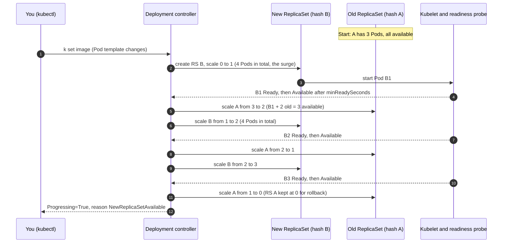

# T3.10 Deployments and Rolling Updates

> Competency: "Understand Deployments and how to perform rolling updates" (CKAD-2.2) | Domain/weight: CKAD, Application Deployment (20%) | Est. time: 2.5 h | Prerequisites: T2.05, T3.09

Shell setup (from [conventions](../00-conventions.md); put it at the top of every session):

```bash
alias k=kubectl
export do="--dry-run=client -o yaml"
export now="--force --grace-period=0"
source <(kubectl completion bash); complete -o default -F __start_kubectl k
```

Lab environment for this lesson: **kind** (cluster `lab`, context `kind-lab`). Namespace: `lab-t310`. Files go in `~/lab/t310/`. Create both once, and make the namespace the default for your current context so you can leave out `-n`:

```bash
k create ns lab-t310
k config set-context --current --namespace=lab-t310
mkdir -p ~/lab/t310
```

> Output policy. The output blocks in this lesson labelled `REAL OUTPUT (kind v0.33.0, node v1.37.0, kubectl v1.37.1)` were captured on a 3-node kind cluster (1 control plane, 2 workers, image `kindest/node:v1.37.0` pinned by digest) with the namespace `lab-t310`. That cluster used kind's default CNI (kindnet), not Calico, because nothing in this lesson needs NetworkPolicy. Pod hash suffixes (such as `6fd847d478`), Pod names and ages will differ on your cluster. Blocks that could not be captured are labelled `EXPECTED OUTPUT (not captured)` and are listed in section 11.

This lesson builds on [T2.05](../part2-basics/T2.05-controllers-replicasets-deployments-basics-and-garbage.md) (what a Deployment and a ReplicaSet are) and on [T3.09](../part3-ckad/T3.09-implement-probes-and-health-checks.md) (readiness probes). Read those first if "ReplicaSet" or "readiness probe" is a new word.

---

## 1. Why this matters

A **Deployment** is the object you use to run a stateless application with several identical Pods. Its main job after "keep N Pods running" is to change the application without taking it down: a **rolling update** replaces old Pods with new ones a few at a time, so users keep getting answers while you ship a new image. If you do not understand how the rollout is paced, you ship a release that takes the site down, or you watch a rollout hang and do not know whether to wait, fix or roll back.

In the exam, "update the image of a Deployment", "roll back to the previous version", "pause the rollout, change it, resume" and "find out why the rollout is stuck" are small, very common tasks. The exam has 15-20 tasks in 2 hours (sources: [E2](https://docs.linuxfoundation.org/tc-docs/certification/tips-cka-and-ckad), [E3](https://docs.linuxfoundation.org/tc-docs/certification/faq-cka-ckad-cks)), so each one must take a couple of minutes. The commands are short. The risk is the small traps: an `undo` that lands on a revision that is also broken, a change that does not start a rollout at all, or an empty change-cause column.

---

## 2. Concepts

### 2.1 What a Deployment really manages (read this first)

A Deployment does not create Pods directly. It creates **ReplicaSets**, and each ReplicaSet creates Pods. A ReplicaSet is a controller that keeps a fixed number of identical Pods running (see [T2.05](../part2-basics/T2.05-controllers-replicasets-deployments-basics-and-garbage.md)).

Each time you change the **Pod template** (`spec.template`, the blueprint for the Pods), the Deployment creates a **new ReplicaSet** for that template and slowly moves replicas from the old ReplicaSet to the new one. The old ReplicaSet is not deleted. It is scaled to 0 and kept, so you can go back. That kept ReplicaSet is what makes rollback possible.

Under the hood, this is what happens:

1. The Deployment controller (runs in `kube-controller-manager`) hashes the Pod template. The hash is added to the ReplicaSet name (`web-6fd847d478`) and to every Pod as the label `pod-template-hash`. The ReplicaSet's selector includes that label, so two ReplicaSets of the same Deployment never fight over the same Pods.
2. The controller stores a number on each ReplicaSet in the annotation `deployment.kubernetes.io/revision`. That number is the **revision** you see in `kubectl rollout history`.
3. If you go back to an older template, the controller finds the existing ReplicaSet with the same hash and re-uses it (you will see this in the break-fix lab: the rolled-back Deployment goes back to the ReplicaSet it had at the start).

What breaks without this design: a plain ReplicaSet cannot be updated safely. If you changed its template, the existing Pods would not change and only new Pods would use the new image. The Deployment adds the "move Pods between two ReplicaSets at a controlled speed" logic on top.

### 2.2 strategy.type: RollingUpdate vs Recreate

`spec.strategy.type` says how the Deployment replaces old Pods.

| Field value | What happens | Downtime | Use it when |
|---|---|---|---|
| `RollingUpdate` (default) | New and old Pods run side by side. The old ReplicaSet shrinks and the new one grows in small steps. | None, if readiness probes are right and capacity allows. | Almost always. Versions must be able to run together for a short time. |
| `Recreate` | All old Pods are deleted first. Only when they are gone, the new Pods start. | Yes: for a short time there are 0 Pods. | Two versions must never run together (for example a schema change), or the Pods use a volume that only one Pod can mount. |

If you leave `strategy` out, the API server fills in `RollingUpdate` with `maxSurge: 25%` and `maxUnavailable: 25%`. I created a Deployment with `k create deploy dflt --image=nginx:1.26` and printed the defaults:

```bash
k get deploy dflt -o jsonpath='{.spec.strategy} {.spec.revisionHistoryLimit} {.spec.progressDeadlineSeconds}{"\n"}'
```

REAL OUTPUT (kind v0.33.0, node v1.37.0, kubectl v1.37.1):

```text
{"rollingUpdate":{"maxSurge":"25%","maxUnavailable":"25%"},"type":"RollingUpdate"} 10 600
```

So the defaults are: strategy `RollingUpdate` 25% / 25%, `revisionHistoryLimit` 10, `progressDeadlineSeconds` 600.

**Recreate in action.** I switched a 3-replica Deployment to `Recreate` and changed the image while watching ReplicaSets with `k get rs -l app=rc -w`. The old ReplicaSet (`rc-6b89c7986`) went to 0 first. Only after that, the new ReplicaSet (`rc-6585cb95fc`) appeared:

REAL OUTPUT (kind v0.33.0, node v1.37.0, kubectl v1.37.1), columns are NAME DESIRED CURRENT READY AGE, trimmed:

```text
rc-6b89c7986   3     3     3     8s
rc-6b89c7986   0     3     3     9s        <- old RS told to go to 0
rc-6b89c7986   0     0     0     9s        <- all old Pods gone: zero Pods now
rc-6585cb95fc   3     0     0     0s       <- only now the new RS is created
rc-6585cb95fc   3     3     0     0s
rc-6585cb95fc   3     3     3     0s
```

**Risky value:** you cannot keep a `rollingUpdate:` block when the type is `Recreate`. The API server refuses it. Switch with a JSON patch that replaces the whole `strategy` object:

```bash
k patch deploy rc --type=json -p '[{"op":"replace","path":"/spec/strategy","value":{"type":"Recreate"}}]'
```

If you instead try a plain merge patch that only sets `"type":"Recreate"`, the old `rollingUpdate` values stay in the object and you get:

```text
The Deployment "rc" is invalid: spec.strategy.rollingUpdate: Forbidden: may not be specified when strategy `type` is 'Recreate'
```

### 2.3 maxSurge and maxUnavailable (numbers vs percentages)

These two fields set the speed and the safety of a `RollingUpdate`. Both can be an **absolute number** (`1`) or a **percentage string** (`"25%"`) of `spec.replicas`.

| Field | Meaning | Default | Percentage is rounded | Effect on the limits |
|---|---|---|---|---|
| `maxSurge` | How many Pods **above** `replicas` may exist during the update. | `25%` | **up** | Max total Pods = `replicas + maxSurge` |
| `maxUnavailable` | How many Pods **below** `replicas` may be unavailable during the update. | `25%` | **down** | Min available Pods = `replicas - maxUnavailable` |

(The rounding rules are from `k explain deploy.spec.strategy.rollingUpdate.maxSurge` and `...maxUnavailable` on v1.37.)

**Available** means: Ready, and Ready for at least `minReadySeconds` (section 2.7).

Examples, so you can calculate quickly:

| replicas | maxSurge | maxUnavailable | Max Pods at once | Min available | Style |
|---|---|---|---|---|---|
| 4 | `25%` = 1 | `0` | 5 | 4 | Safe: never below full capacity, one extra Pod needed |
| 4 | `25%` = 1 | `25%` = 1 | 5 | 3 | Default behaviour |
| 3 | `25%` = 1 (0.75 rounds up) | `25%` = 0 (0.75 rounds down) | 4 | 3 | Default on 3 replicas behaves like the safe style |
| 10 | `25%` = 3 (2.5 rounds up) | `25%` = 2 (2.5 rounds down) | 13 | 8 | Default on 10 replicas |
| 3 | `0` | `1` | 3 | 2 | No extra capacity needed, but runs at reduced capacity |
| 3 | `100%` = 3 | `0` | 6 | 3 | Blue/green-like: whole new set first, then old goes away |

**Invalid and risky values:**

- Both `0` is rejected, because the rollout could never move. I tried it:

```text
The Deployment "shop" is invalid: spec.strategy.rollingUpdate.maxUnavailable: Invalid value: 0: may not be 0 when `maxSurge` is 0
```

- `maxSurge` as a percentage above 100% is accepted by the API (I patched `"150%"` and it was accepted). It only means you may need a lot of spare capacity.
- A high `maxUnavailable` (for example `50%`) lets the rollout be fast, but half of your capacity can disappear at once. If the new Pods are bad, users notice.
- A `maxSurge` that needs more CPU or memory than the cluster has leaves surge Pods `Pending`, and the rollout stalls (see section 6).

A string must end in `%`. A bare integer (`1`) is a number. In YAML, write `maxSurge: 25%` or `maxSurge: "25%"` (both give the string) and `maxUnavailable: 0` (the number).

### 2.4 What triggers a rollout

A rollout starts **only when `spec.template` changes**. That means: image, command, args, env, resources, probes, labels or annotations **inside the template**, volumes and so on.

| Change | New ReplicaSet and new revision? | Why |
|---|---|---|
| `k set image` / `k set env` / `k set resources` | Yes | These edit the Pod template |
| Edit of `spec.template.metadata.labels` | Yes | Template changed |
| `k scale` / edit `spec.replicas` | **No** | Replica count is not part of the template |
| Edit of `spec.strategy`, `minReadySeconds`, `revisionHistoryLimit` | **No** | Settings of the Deployment, not the Pod |
| `k annotate deploy ...` (annotation on the Deployment itself) | **No** | Only `metadata` of the Deployment changes |
| `k rollout restart` | Yes | It adds a `restartedAt` annotation **inside the template** (shown in section 5) |
| `k rollout undo` | Yes (counts as a new revision) | It copies an old template back into `spec.template` |

The imperative way to change the image is:

```bash
k set image deploy/web nginx=nginx:1.27
```

The syntax is `CONTAINER_NAME=IMAGE`. The container name is the name in the Pod template (`k create deploy` names it after the image: `nginx`). Two traps:

- A wrong container name fails fast: `error: unable to find container named "wrong"`. Check the name with `k get deploy web -o jsonpath='{.spec.template.spec.containers[*].name}'`.
- To set the image of every container, use `'*=nginx:1.27'` (quote the star). I ran `k set image deploy/dflt '*=nginx:1.27'` and it worked.

### 2.5 The kubectl rollout subcommands

| Command | What it does | Notes |
|---|---|---|
| `k rollout status deploy/web` | Blocks and prints progress until the rollout finishes or fails. | Exit code `0` on success, `1` on failure (for example after the progress deadline). `--watch=false` prints once and returns. `--timeout=60s` gives up after a time. |
| `k rollout history deploy/web` | Lists revisions and their change-cause. | Needs the old ReplicaSets, so a low `revisionHistoryLimit` shortens it. |
| `k rollout history deploy/web --revision=N` | Prints the full Pod template of revision N. | Use it to see which image a revision has before you roll back. |
| `k rollout undo deploy/web` | Goes back to the **previous** revision (the one just below the current). | The previous revision may be broken too (section 6). |
| `k rollout undo deploy/web --to-revision=N` | Goes back to a specific revision. | Error for a missing number: `error: unable to find specified revision 99 in history`. |
| `k rollout pause deploy/web` | Freezes the Deployment: template changes no longer start a rollout. | A paused Deployment cannot be undone or restarted (errors below). |
| `k rollout resume deploy/web` | Unfreezes it. All the changes made while paused roll out together as **one** revision. | |
| `k rollout restart deploy/web` | Recreates all Pods with a rolling update, without changing the image. | Useful to pick up a changed ConfigMap or Secret that is read at start-up. |

`rollout` also works for DaemonSets and StatefulSets (`k rollout --help` lists `deployments`, `daemonsets`, `statefulsets`), but this lesson is about Deployments.

**Rollback is done by kubectl, not by the server.** `k rollout undo` reads the old ReplicaSet, copies its Pod template into the Deployment (`spec.template`), and updates the Deployment. The Deployment controller then performs an ordinary rolling update. This explains two behaviours you will see:

- The revision you roll back to **gets a new, higher number** and its old number disappears (section 5 shows `1, 3, 4` then `3, 4, 5`).
- If the Deployment was created with `kubectl apply`, kubectl prints a warning, because `undo` does not update the `last-applied-configuration` annotation:

```text
Warning: resource deployments/web was previously managed with 'kubectl apply'. Rolling back will not update the kubectl.kubernetes.io/last-applied-configuration annotation, which may cause unexpected behavior on future 'kubectl apply' operations. Consider using 'kubectl apply' with your previous configuration file instead.
```

The warning is harmless for the task. The undo still works.

### 2.6 Recording why: the change-cause annotation

The `CHANGE-CAUSE` column in `k rollout history` comes from the annotation `kubernetes.io/change-cause`. You set it yourself:

```bash
k annotate deploy/web kubernetes.io/change-cause='nginx 1.27'
```

How it works (observed): the Deployment controller copies the Deployment's `kubernetes.io/change-cause` annotation to the **newest** ReplicaSet. That has three consequences:

1. If you annotate **right after** the change, the newest revision gets that text. It also works if you annotate after the rollout has finished (I did this and the history updated within a second).
2. If you change the image and **do not** annotate, the new revision **inherits the old text**. The history then lies. I saw `3  nginx 1.27` for an update to 1.28.
3. When you set a new text for a second change, use `--overwrite`, because the annotation already exists on the Deployment: `k annotate deploy/web kubernetes.io/change-cause='v3' --overwrite`.

**What about `--record`?** Older guides use `k set image ... --record`. The lesson entry says it is removed. I checked on kubectl v1.37.1: it is **deprecated but still accepted**. It prints `Flag --record has been deprecated, --record will be removed in the future` and writes the command line into the annotation (`kubectl set image deploy/web nginx=nginx:1.28 --record=true`). Do not use it. It is on its way out, and the annotation is the supported way, so write your own text.

### 2.7 minReadySeconds, readiness probes and progressDeadlineSeconds

Three settings decide **whether a rollout moves on** and **whether it is called failed**.

**Readiness probe (gate).** The Deployment controller counts a new Pod as available only when its `Ready` condition is true. `Ready` comes from the readiness probe (see [T3.09](../part3-ckad/T3.09-implement-probes-and-health-checks.md)). Without a readiness probe, "Ready" just means "the container process started". A new Pod with a broken application but no probe is declared healthy, and the rollout continues to replace good Pods with bad ones. With a probe, a bad Pod stays `0/1` and the old Pods are kept (as long as `maxUnavailable` allows). This is the main safety net of a rolling update.

**minReadySeconds.** The number of seconds a new Pod must stay Ready (no container crash) before it counts as available. Default `0` (available as soon as Ready). It slows the rollout on purpose, so a Pod that becomes Ready and crashes 3 seconds later does not let the controller delete another old Pod. In my run of the worked example (`minReadySeconds: 5`, probe period 2 s), the new ReplicaSet showed READY 1 at `13s` and the controller scaled the old one down only after `18s`: that is the 5-second wait.

**progressDeadlineSeconds.** How long the Deployment may make **no progress** before the controller marks it failed. Default `600` seconds. When the time is over, the controller sets the condition:

```text
Progressing=False  reason=ProgressDeadlineExceeded
```

and `k rollout status` prints `error: deployment "shop" exceeded its progress deadline` and exits with code 1. Important:

- **Nothing is rolled back automatically.** The controller keeps trying. The new Pods keep failing, and the old Pods keep serving (if `maxUnavailable` allowed it). The condition is only a signal for you or for a CI pipeline.
- The deadline is paused while the Deployment is paused.
- It must be bigger than `minReadySeconds`. A very small value (like the `30` used in the break-fix lab) is only for practice.
- Any progress (a new Pod becoming available, a new ReplicaSet) resets the timer.

### 2.8 revisionHistoryLimit and the old ReplicaSets

`spec.revisionHistoryLimit` is the number of **old** ReplicaSets that the Deployment keeps (default `10`). Old ReplicaSets stay in the cluster with `DESIRED 0` and no Pods. Each one is a revision you can roll back to.

Observed on v1.37 with a Deployment that had 3 ReplicaSets (one current, two old):

- `revisionHistoryLimit: 2` kept 3 ReplicaSets in total (1 current + 2 old).
- After I patched it to `1`, the controller deleted the oldest one at once. `k rollout history` then listed only revisions 2 and 3.

Risky values: `0` keeps no old ReplicaSets, so **rollback becomes impossible**. A very high value fills the cluster with idle ReplicaSets (small objects, but they add clutter). Lowering the limit **deletes** history immediately.

### 2.9 Scaling vs rolling

`k scale deploy/web --replicas=6` changes only `spec.replicas`. The pod template is the same, so **no new ReplicaSet and no new revision** is created. I scaled a Deployment from 4 to 3 and the history did not change (section 5). If you scale during a rollout, the controller spreads the new replicas across the old and new ReplicaSets in proportion to their sizes (the docs call this *proportional scaling*).

Rule to remember: **template change = new revision; everything else = no new revision.**

### 2.10 Watching a rollout

Three useful views, from coarse to fine:

```bash
k rollout status deploy/web          # one line per step until done
k get rs -l app=web -w               # the two ReplicaSets, old shrinking, new growing
k get pods -l app=web -L pod-template-hash   # which Pod belongs to which ReplicaSet
```

The hash in the Pod name (and in the `pod-template-hash` label) tells you the generation: all Pods with `659d89c447` come from the same template. During a rollout you see two different hashes, after it only one.

`k get deploy web` also shows the surge: during a rollout with `maxSurge` 1 and 4 replicas I saw `READY 5/4` (section 5).

### 2.11 status.terminatingReplicas (beta since v1.35)

When a Pod is deleted, it does not vanish at once. It sits in `Terminating` until its `preStop` hook and its graceful shutdown (`terminationGracePeriodSeconds`) are finished. Older clusters hid these Pods from the Deployment status.

The Deployment `status.terminatingReplicas` field (beta since v1.35, according to the lesson entry) counts them: "total number of terminating pods targeted by this deployment" (text from `k explain deploy.status.terminatingReplicas`). On the v1.37.0 cluster the field was filled with no extra setup. Why you care: during a rollout the Deployment can show 3 healthy replicas **while 3 old Pods are still shutting down**. Capacity (nodes, quota) is still used by the terminating Pods, so a surge Pod can be `Pending` even when `READY` looks fine. Observed output is in section 5.

### Related but different

- **ReplicaSet** keeps N identical Pods but has no update logic. **Deployment** adds ReplicaSets per revision plus the update strategy.
- **Rolling update vs scaling:** a rolling update changes *what* runs, scaling changes *how many*.
- **`rollout restart` vs deleting Pods by hand:** `restart` is a rolling update (paced by `maxSurge` and `maxUnavailable`). Deleting Pods by hand is not paced.
- **`kubectl apply` of an edited YAML vs `k set image`:** both change the template and start a rollout. After `k set image` or `undo`, your YAML file no longer matches the cluster, so keep the file in sync if you will re-apply it (see [T2.07](../part2-basics/T2.07-declarative-object-management-apply-diff-patch.md)).

---

## 3. How it works (diagram)

Scenario: 3 replicas, `maxSurge: 1`, `maxUnavailable: 0`. The controller may run at most 4 Pods and must keep at least 3 available. Real controllers often combine steps (you can see this in the raw ReplicaSet watch in section 5), so this diagram is the simplified logic.



Walkthrough:

1. Changing the template creates RS B. With `maxUnavailable: 0`, nothing may be removed first, so B is scaled up by the surge amount (1) and the total is 4 Pods.
2. A new Pod only counts as available after the readiness probe passes and `minReadySeconds` has elapsed. If it never gets Ready, step 5 never happens and the old Pods keep serving. That is the "hung rollout".
3. Each time one new Pod is available, the controller can remove one old Pod (total available stays at 3 or more).
4. The loop repeats until B has 3 Pods and A has 0.
5. RS A is not deleted. It stays at `0/0/0` as a revision (limited by `revisionHistoryLimit`).
6. If the deadline (`progressDeadlineSeconds`) passes with no progress, the controller sets `Progressing=False, ProgressDeadlineExceeded`. It does not undo anything.

---

## 4. Commands and YAML you must produce fast

### 4.1 Imperative shortcuts

```bash
k create deploy web --image=nginx:1.26 --replicas=4            # create (container is named "nginx")
k create deploy web --image=nginx:1.26 --replicas=4 $do > web.yaml   # only the YAML, then edit strategy
k set image deploy/web nginx=nginx:1.27                        # trigger a rollout
k annotate deploy/web kubernetes.io/change-cause='nginx 1.27' --overwrite   # write the "why"
k rollout status deploy/web                                    # wait for it / see failure
k rollout history deploy/web                                   # list revisions
k rollout history deploy/web --revision=2                      # see the template of revision 2
k rollout undo deploy/web                                      # back to the previous revision
k rollout undo deploy/web --to-revision=1                      # back to a named revision
k rollout pause deploy/web                                     # freeze
k set env deploy/web LOG_LEVEL=debug                           # edit while paused (no rollout yet)
k set resources deploy/web --requests=cpu=50m,memory=32Mi --limits=cpu=100m,memory=64Mi
k rollout resume deploy/web                                    # one rollout for all the changes
k rollout restart deploy/web                                   # rolling restart, same image
k scale deploy/web --replicas=6                                # no new revision
k patch deploy/web -p '{"spec":{"revisionHistoryLimit":5}}'    # change a settings field
```

`k create deploy` has no flag for `strategy`, `minReadySeconds`, `progressDeadlineSeconds` or `revisionHistoryLimit`. Create the YAML with `$do`, add those fields, or use `k patch` after creating.

### 4.2 Declarative YAML

Save as `~/lab/t310/web.yaml`. It is complete and applies cleanly with `k apply -f web.yaml` (the namespace comes from your current context):

```yaml
apiVersion: apps/v1
kind: Deployment
metadata:
  name: web
  annotations:
    kubernetes.io/change-cause: "initial nginx 1.26"   # shown as CHANGE-CAUSE of the first revision
spec:
  replicas: 4                  # desired Pods. NOT part of the template, scaling makes no revision
  revisionHistoryLimit: 5      # keep 5 OLD ReplicaSets for rollback (default 10, 0 = no rollback)
  minReadySeconds: 5           # a Pod must stay Ready 5 s before it counts as available (default 0)
  progressDeadlineSeconds: 600 # no progress for 600 s -> Progressing=False, ProgressDeadlineExceeded (default 600)
  selector:
    matchLabels:
      app: web                 # must match template labels. Cannot be changed after creation
  strategy:
    type: RollingUpdate        # or Recreate (Recreate may NOT have a rollingUpdate block)
    rollingUpdate:
      maxSurge: 25%            # 25% of 4 = 1 extra Pod allowed (rounds up). Number or percent
      maxUnavailable: 0        # never go below 4 available Pods (rounds down if percent). Not 0 if maxSurge is 0
  template:                    # a change anywhere under here starts a rollout
    metadata:
      labels:
        app: web
    spec:
      containers:
      - name: nginx            # this name is what "k set image" uses (nginx=IMAGE)
        image: nginx:1.26      # always a pinned tag
        ports:
        - containerPort: 80
        readinessProbe:        # gates the rollout: no Ready, no progress
          httpGet:
            path: /
            port: 80
          periodSeconds: 2     # probe every 2 s (default 10), makes the lab faster
```

### 4.3 Speed drill

Targets are exam pace. Setup (one line), run the tasks in order, then clean up.

Setup (about 30 s):

```bash
k create deploy drill --image=nginx:1.26 --replicas=4 && k rollout status deploy/drill
```

| # | Task | Target |
|---|---|---|
| 1 | Update `drill` to `nginx:1.27`, set the change-cause to `drill 1.27`, wait until it is done. | 1 min |
| 2 | Print the image of revision 1 from the history (one line). | 1 min |
| 3 | Roll back `drill` to revision 1 and print the image of the live Deployment. | 1 min |
| 4 | Create Deployment `g` (`nginx:1.27`, 3 replicas) with `maxSurge: 1` and `maxUnavailable: 0`, and print its `strategy`. | 1.5 min |
| 5 | Pause `drill`, set the image to `nginx:1.28` and the env `A=1`, resume. Show that the history has exactly one new entry. | 1.5 min |
| 6 | Restart `drill` with a rolling restart and wait. | 1 min |
| 7 | Keep only 2 old ReplicaSets for `drill` and count the ReplicaSets. | 1 min |
| 8 | Switch `drill` to the `Recreate` strategy and print the strategy. | 1.5 min |

<details><summary>Answers</summary>

```bash
# 1
k set image deploy/drill nginx=nginx:1.27
k annotate deploy/drill kubernetes.io/change-cause='drill 1.27'
k rollout status deploy/drill
# 2
k rollout history deploy/drill --revision=1 | grep Image
# 3 (the number of the revision you go back to is renumbered, the image is what matters)
k rollout undo deploy/drill --to-revision=1
k get deploy drill -o jsonpath='{.spec.template.spec.containers[0].image}{"\n"}'
# 4
k create deploy g --image=nginx:1.27 --replicas=3
k patch deploy g -p '{"spec":{"strategy":{"rollingUpdate":{"maxSurge":1,"maxUnavailable":0}}}}'
k get deploy g -o jsonpath='{.spec.strategy}{"\n"}'
# 5
k rollout pause deploy/drill
k set image deploy/drill nginx=nginx:1.28
k set env deploy/drill A=1
k rollout resume deploy/drill
k rollout status deploy/drill
k rollout history deploy/drill        # one new line compared with before step 5
# 6
k rollout restart deploy/drill && k rollout status deploy/drill
# 7
k patch deploy drill -p '{"spec":{"revisionHistoryLimit":2}}'
k get rs -l app=drill --no-headers | grep -c .     # at most 3 (1 current + 2 old)
# 8 (JSON patch replaces the whole strategy; a merge patch would keep rollingUpdate and fail)
k patch deploy drill --type=json -p '[{"op":"replace","path":"/spec/strategy","value":{"type":"Recreate"}}]'
k get deploy drill -o jsonpath='{.spec.strategy}{"\n"}'     # {"type":"Recreate"}
```

</details>

Cleanup (drills must not leave objects behind):

```bash
k delete deploy drill g
```

---

## 5. Worked example

Goal: create a Deployment, roll it out three times, look at the history, see why the change-cause can lie, and roll back. Then try pause, restart, history limits and `terminatingReplicas`. Everything runs in `lab-t310`.

All output below is REAL OUTPUT (kind v0.33.0, node v1.37.0, kubectl v1.37.1) unless the label says otherwise.

### Step 1. Create the Deployment from the YAML

```bash
cd ~/lab/t310
# save the YAML from section 4.2 as web.yaml, then:
k apply -f web.yaml
k rollout status deploy/web
k get deploy,rs,pods
```

What to look for: `rollout status` ends with `successfully rolled out`, one ReplicaSet owns all 4 Pods, all Pods are `1/1`.

```text
deployment.apps/web created
...
Waiting for deployment "web" rollout to finish: 3 of 4 updated replicas are available...
deployment "web" successfully rolled out
NAME                  READY   UP-TO-DATE   AVAILABLE   AGE
deployment.apps/web   4/4     4            4           28s

NAME                             DESIRED   CURRENT   READY   AGE
replicaset.apps/web-6fd847d478   4         4         4       28s

NAME                       READY   STATUS    RESTARTS   AGE
pod/web-6fd847d478-6xzn6   1/1     Running   0          28s
pod/web-6fd847d478-9vnh8   1/1     Running   0          28s
pod/web-6fd847d478-lcbcw   1/1     Running   0          28s
pod/web-6fd847d478-vns4j   1/1     Running   0          28s
```

### Step 2. Read the first history entry

```bash
k rollout history deploy/web
```

```text
deployment.apps/web 
REVISION  CHANGE-CAUSE
1         initial nginx 1.26
```

The format in v1.37: a header line `deployment.apps/web `, then a table with two columns, `REVISION` and `CHANGE-CAUSE`, then an empty line.

### Step 3. Roll out nginx:1.27 and watch the ReplicaSets

Open a second terminal (or run the watch in the background) with `k get rs -w`, then in the first one:

```bash
k get rs -w --no-headers &          # background watch (stop it later with: kill %1)
k set image deploy/web nginx=nginx:1.27
k annotate deploy/web kubernetes.io/change-cause='nginx 1.27'
k rollout status deploy/web
```

The ReplicaSet watch (columns NAME DESIRED CURRENT READY AGE, trimmed; `web-6fd847d478` is the old RS, `web-659d89c447` is the new one):

```text
web-6fd847d478   4     4     4     39s
web-659d89c447   1     0     0     0s        <- new RS appears, surge: 1 new Pod wanted
web-659d89c447   1     1     0     0s
web-659d89c447   1     1     1     13s       <- Pod is Ready, but not yet Available (minReadySeconds)
web-659d89c447   1     1     1     18s       <- 5 s later: Available
web-6fd847d478   3     4     4     58s       <- only now the old RS may shrink
web-659d89c447   2     1     1     18s
web-6fd847d478   3     3     3     58s
...
web-659d89c447   4     4     4     50s
web-6fd847d478   0     1     1     90s
web-6fd847d478   0     0     0     90s       <- old RS kept at 0 (revision 1)
```

Read it like this: the old RS never goes below 3 Ready Pods before a new one is Available (`maxUnavailable: 0`), and the total never exceeds 5 (`4 + maxSurge 1`).

Stop the background watch: `kill %1`.

`k rollout status` printed lines like these and ended with success:

```text
Waiting for deployment "web" rollout to finish: 1 out of 4 new replicas have been updated...
Waiting for deployment "web" rollout to finish: 3 out of 4 new replicas have been updated...
Waiting for deployment "web" rollout to finish: 1 old replicas are pending termination...
deployment "web" successfully rolled out
```

### Step 4. See the Pods of both generations

If you run `k get pods -l app=web -L pod-template-hash` during the next rollout (here: an update to `nginx:1.28`, about 9 seconds after `k set image`), you see both hashes and the surge on the Deployment:

```text
NAME                   READY   STATUS    RESTARTS   AGE   POD-TEMPLATE-HASH
web-659d89c447-lmpzz   1/1     Running   0          29s   659d89c447
web-659d89c447-lnbcs   1/1     Running   0          37s   659d89c447
web-659d89c447-rbwwl   1/1     Running   0          19s   659d89c447
web-77c756c88-sxpc2    1/1     Running   0          9s    77c756c88
web-77c756c88-vnsd8    1/1     Running   0          4s    77c756c88

NAME   READY   UP-TO-DATE   AVAILABLE   AGE
web    5/4     2            4           8m
```

`5/4` is the surge: 5 Pods exist, 4 are wanted. `UP-TO-DATE 2` means 2 Pods use the newest template.

For the next steps I ran the update to 1.28 **without** an annotation first:

```bash
k set image deploy/web nginx=nginx:1.28
k rollout status deploy/web
k rollout history deploy/web
```

```text
deployment.apps/web 
REVISION  CHANGE-CAUSE
1         initial nginx 1.26
2         nginx 1.27
3         nginx 1.27
```

Revision 3 is the 1.28 update, but it shows the old text `nginx 1.27`. This is the "stale change-cause" trap. Fix it by annotating now (it works after the rollout, too):

```bash
k annotate deploy/web kubernetes.io/change-cause='nginx 1.28' --overwrite
k rollout history deploy/web
```

```text
deployment.apps/web 
REVISION  CHANGE-CAUSE
1         initial nginx 1.26
2         nginx 1.27
3         nginx 1.28
```

### Step 5. Look inside a revision

```bash
k rollout history deploy/web --revision=2
```

```text
deployment.apps/web with revision #2
Pod Template:
  Labels:	app=web
	pod-template-hash=659d89c447
  Annotations:	kubernetes.io/change-cause: nginx 1.27
  Containers:
   nginx:
    Image:	nginx:1.27
    Port:	80/TCP
    Host Port:	0/TCP
    Readiness:	http-get http://:80/ delay=0s timeout=1s period=2s successThreshold=1 failureThreshold=3
    Environment:	<none>
    Mounts:	<none>
  Volumes:	<none>
  Node-Selectors:	<none>
  Tolerations:	<none>
```

If you ask for a revision that does not exist: `error: unable to find the specified revision`.

### Step 6. What `--record` does on kubectl v1.37.1

```bash
k set image deploy/web nginx=nginx:1.28 --record
```

```text
Flag --record has been deprecated, --record will be removed in the future
deployment.apps/web image updated
```

The image was already `1.28`, so no new revision was created, but the flag **did** overwrite the change-cause on the newest revision with the command line:

```text
REVISION  CHANGE-CAUSE
1         initial nginx 1.26
2         nginx 1.27
3         kubectl set image deploy/web nginx=nginx:1.28 --record=true
```

Result: the flag still works in v1.37.1 but it is deprecated. Use `k annotate` instead. (Revision 3 keeps this text in the next steps.)

### Step 7. Scaling does not make a revision

```bash
k scale deploy/web --replicas=3
k rollout history deploy/web | tail -4
k get rs -o custom-columns='NAME:.metadata.name,REV:.metadata.annotations.deployment\.kubernetes\.io/revision,DESIRED:.spec.replicas,IMG:.spec.template.spec.containers[0].image'
```

```text
deployment.apps/web scaled
1         initial nginx 1.26
2         nginx 1.27
3         kubectl set image deploy/web nginx=nginx:1.28 --record=true

NAME             REV   DESIRED   IMG
web-659d89c447   2     0         nginx:1.27
web-6fd847d478   1     0         nginx:1.26
web-77c756c88    3     3         nginx:1.28
```

Still three revisions. Each old ReplicaSet is kept with `DESIRED 0`, and only the newest one has Pods. (Set the replicas back with `k scale deploy/web --replicas=4`.)

### Step 8. Undo, and what happens to the numbers

```bash
k rollout undo deploy/web
k rollout status deploy/web
k rollout history deploy/web
```

```text
Warning: resource deployments/web was previously managed with 'kubectl apply'. Rolling back will not update the kubectl.kubernetes.io/last-applied-configuration annotation, which may cause unexpected behavior on future 'kubectl apply' operations. Consider using 'kubectl apply' with your previous configuration file instead.
deployment.apps/web rolled back
deployment "web" successfully rolled out
deployment.apps/web 
REVISION  CHANGE-CAUSE
1         initial nginx 1.26
3         kubectl set image deploy/web nginx=nginx:1.28 --record=true
4         nginx 1.27
```

Plain `undo` went from revision 3 to revision 2, and revision 2 came back as **revision 4** (revision 2 is gone as a number). Now go to revision 1:

```bash
k rollout undo deploy/web --to-revision=1
k rollout history deploy/web
k get deploy web -o jsonpath='{.spec.template.spec.containers[0].image}{"\n"}{.metadata.annotations.kubernetes\.io/change-cause}{"\n"}'
```

```text
deployment.apps/web rolled back
deployment "web" successfully rolled out
deployment.apps/web 
REVISION  CHANGE-CAUSE
3         kubectl set image deploy/web nginx=nginx:1.28 --record=true
4         nginx 1.27
5         initial nginx 1.26

nginx:1.26
initial nginx 1.26
```

Revision 1 is now revision 5, with its change-cause restored on the Deployment.

Errors for a number that does not exist:

```text
error: unable to find specified revision 99 in history
```

### Step 9. Pause, change three things, resume

```bash
k create deploy api --image=nginx:1.26 --replicas=3
k rollout status deploy/api
k annotate deploy/api kubernetes.io/change-cause='initial nginx 1.26'
k rollout pause deploy/api
k set image deploy/api nginx=nginx:1.27
k set env deploy/api LOG_LEVEL=debug
k set resources deploy/api --requests=cpu=50m,memory=32Mi --limits=cpu=100m,memory=64Mi
k get rs
k rollout history deploy/api
```

```text
deployment.apps/api paused
deployment.apps/api image updated
deployment.apps/api env updated
deployment.apps/api resource requirements updated
NAME             DESIRED   CURRENT   READY   AGE
api-6d969b7fc9   3         3         3       5s
...
deployment.apps/api 
REVISION  CHANGE-CAUSE
1         initial nginx 1.26
```

Three template changes, but still one ReplicaSet and one revision. Nothing happened. The paused Deployment says so in its conditions:

```bash
k get deploy api -o jsonpath='{.spec.paused}{"\n"}'
k get deploy api -o jsonpath='{range .status.conditions[*]}{.type}={.status} {.reason}: {.message}{"\n"}{end}'
```

```text
true
Available=True MinimumReplicasAvailable: Deployment has minimum availability.
Progressing=Unknown DeploymentPaused: Deployment is paused
```

`k rollout status deploy/api` on a paused Deployment just waits (`Waiting for deployment "api" rollout to finish: 0 out of 3 new replicas have been updated...`). I stopped it with a 10-second `timeout`. Two commands are refused while paused:

```text
error: you cannot rollback a paused deployment; resume it first with 'kubectl rollout resume' and try again
error: deployments.apps "api" can't restart paused deployment (run rollout resume first)
```

Resume:

```bash
k rollout resume deploy/api
k rollout status deploy/api
k annotate deploy/api kubernetes.io/change-cause='nginx 1.27, LOG_LEVEL=debug, resources'
k rollout history deploy/api
```

```text
deployment.apps/api resumed
deployment "api" successfully rolled out
deployment.apps/api annotated
deployment.apps/api 
REVISION  CHANGE-CAUSE
1         initial nginx 1.26
2         nginx 1.27, LOG_LEVEL=debug, resources
```

One new revision for all three changes.

### Step 10. rollout restart

```bash
k rollout restart deploy/api
k rollout status deploy/api
k rollout history deploy/api
k get deploy api -o jsonpath='{.spec.template.metadata.annotations}{"\n"}'
```

```text
deployment.apps/api restarted
deployment "api" successfully rolled out
deployment.apps/api 
REVISION  CHANGE-CAUSE
1         initial nginx 1.26
2         nginx 1.27, LOG_LEVEL=debug, resources
3         nginx 1.27, LOG_LEVEL=debug, resources

{"kubectl.kubernetes.io/restartedAt":"2026-10-28T11:35:12+08:00"}
```

`restart` works by writing a `restartedAt` timestamp **into the Pod template**. That is a template change, so a new ReplicaSet and revision appear, and the change-cause is copied from the Deployment again (stale, but this time truthfully "same config").

### Step 11. revisionHistoryLimit in action

```bash
k patch deploy/api -p '{"spec":{"revisionHistoryLimit":2}}'
k get rs -l app=api                 # 3 ReplicaSets: 1 current + 2 old
k patch deploy/api -p '{"spec":{"revisionHistoryLimit":1}}'
k get rs -l app=api                 # 2 ReplicaSets: 1 current + 1 old
k rollout history deploy/api
```

```text
NAME             DESIRED   CURRENT   READY   AGE
api-65f7485697   0         0         0       19s
api-6d969b7fc9   0         0         0       35s
api-7476bcb5b7   3         3         3       9s
...
NAME             DESIRED   CURRENT   READY   AGE
api-65f7485697   0         0         0       28s
api-7476bcb5b7   3         3         3       18s
deployment.apps/api 
REVISION  CHANGE-CAUSE
2         nginx 1.27, LOG_LEVEL=debug, resources
3         nginx 1.27, LOG_LEVEL=debug, resources
```

Revision 1 is gone. You can no longer roll back to it.

### Step 12. status.terminatingReplicas

A Pod with a slow shutdown (a `preStop` hook that sleeps 20 s) shows the field. Save as `slow.yaml`:

```yaml
apiVersion: apps/v1
kind: Deployment
metadata:
  name: slow
spec:
  replicas: 3
  selector:
    matchLabels:
      app: slow
  template:
    metadata:
      labels:
        app: slow
    spec:
      terminationGracePeriodSeconds: 30
      containers:
      - name: nginx
        image: nginx:1.27
        lifecycle:
          preStop:                       # runs before the container gets SIGTERM
            exec:
              command: ["sleep", "20"]
```

```bash
k apply -f slow.yaml && k rollout status deploy/slow
k set image deploy/slow nginx=nginx:1.28
sleep 6; k get deploy slow -o jsonpath='replicas={.status.replicas} ready={.status.readyReplicas} updated={.status.updatedReplicas} terminating={.status.terminatingReplicas}{"\n"}'
k get pods -l app=slow
```

I captured these values (with a slightly different format, `3 3 3 term=3`) for each of 6 samples taken every 3 seconds, and the Pods:

```text
3 3 3 term=3
NAME                   READY   STATUS        RESTARTS   AGE
slow-744569c9d-2t4t7   1/1     Terminating   0          20s
slow-744569c9d-gs4fb   1/1     Terminating   0          20s
slow-744569c9d-mbm4h   1/1     Terminating   0          20s
slow-f8f684bf5-72mzh   1/1     Running       0          19s
slow-f8f684bf5-89wv9   1/1     Running       0          18s
slow-f8f684bf5-fqbmg   1/1     Running       0          18s
```

Three new Pods are `Running`, three old ones are `Terminating` for up to 20 s, and `status.terminatingReplicas` is `3`. `status.replicas` stays at 3, so the terminating Pods are not counted there.

### Cleanup of the worked example

```bash
k delete deploy web api slow
rm -f ~/lab/t310/web.yaml ~/lab/t310/slow.yaml
```

---

## 6. Common mistakes and how to fix them

| Symptom | What you will see (exact error/event text) | Cause | Fix (command) |
|---|---|---|---|
| Rollout hangs half-done | `k rollout status` keeps printing `Waiting for deployment "shop" rollout to finish: N out of M new replicas have been updated...`, and after the deadline: `error: deployment "shop" exceeded its progress deadline` (exit code 1). `k get pods`: new Pod `0/1` in `ImagePullBackOff` or `ErrImagePull`, or `Running` but `0/1` | New Pods never become Ready: bad image tag, missing image, readiness probe failing, Pod `Pending` (no CPU or quota) | `k rollout status` then `k describe deploy` (conditions and events), `k get rs,pods`, `k describe pod <new pod>` for the Events. Fix the template, or `k rollout undo` |
| `rollout undo` "goes nowhere" | After `undo`, `k get deploy -o jsonpath` still shows the bad image; the history shows the revision you just left at the end | `undo` goes to the **previous** revision. If two bad updates came in a row, the previous one is bad too. Calling `undo` again just flips between the two | `k rollout history deploy/X`, then `k rollout history deploy/X --revision=N` to find the last good one, then `k rollout undo deploy/X --to-revision=N` |
| CHANGE-CAUSE empty | Column shows `<none>` for the revision (EXPECTED OUTPUT, not captured) | The annotation `kubernetes.io/change-cause` was never set on this Deployment | `k annotate deploy/X kubernetes.io/change-cause='what changed' --overwrite` after every change |
| CHANGE-CAUSE wrong (stale) | Revision 3 shows the text of revision 2 | New revisions copy the Deployment's current annotation. You changed the template and did not write a new text | Annotate with `--overwrite` right after the change; fixes the newest revision, even after the rollout finished |
| Change does nothing | `k scale` or `k annotate` ran, but no rollout and no new revision | Only template changes start a rollout | Edit the template (`k set image`, `k set env`, `k edit`), or `k rollout restart` |
| Pod template edited while paused, nothing happens | `k get rs` shows one ReplicaSet, `Progressing=Unknown DeploymentPaused` | The Deployment is paused | `k rollout resume deploy/X` |
| `undo` or `restart` refused | `error: you cannot rollback a paused deployment; resume it first with 'kubectl rollout resume' and try again` and `error: deployments.apps "api" can't restart paused deployment (run rollout resume first)` | Deployment is paused | `k rollout resume deploy/X`, then repeat |
| Wrong container name | `error: unable to find container named "wrong"` | The part before `=` in `k set image` is not a container of the template | `k get deploy X -o jsonpath='{.spec.template.spec.containers[*].name}'` then redo; or use `'*=IMAGE'` |
| Switch to Recreate fails | `The Deployment "rc" is invalid: spec.strategy.rollingUpdate: Forbidden: may not be specified when strategy `type` is 'Recreate'` | The old `rollingUpdate` block is still in the object | `k patch deploy rc --type=json -p '[{"op":"replace","path":"/spec/strategy","value":{"type":"Recreate"}}]'` |
| Both surge and unavailable zero | `The Deployment "shop" is invalid: spec.strategy.rollingUpdate.maxUnavailable: Invalid value: 0: may not be 0 when `maxSurge` is 0` | The rollout could never take a first step | Set at least one of them above 0 |
| Cannot go back to a revision | `error: unable to find specified revision 99 in history` | The number was never used, or `revisionHistoryLimit` already deleted that ReplicaSet | `k rollout history deploy/X` to see what exists |
| Rollout hung but old Pods are not serving | `k get deploy` shows `AVAILABLE` below the desired count | `maxUnavailable` is too high, so old Pods were removed before new ones were Ready | Set `maxUnavailable: 0` and add a readiness probe; `k rollout undo` |

### A repeatable path for a stuck rollout

Run these in this order. Each step narrows the problem:

1. `k rollout status deploy/X --timeout=30s`. Is it moving, stuck, or already failed (exit code 1)?
2. `k get deploy,rs,pods -l app=X -L pod-template-hash`. Two hashes means the rollout is in progress. Find the Pods of the **new** hash and read their `STATUS`: `ImagePullBackOff`/`ErrImagePull` = image problem, `Pending` = scheduling, `Running` with `0/1` = readiness probe, `CrashLoopBackOff` = the app crashes.
3. `k describe deploy X`. Read `Conditions` (`Progressing`, `Available`), `OldReplicaSets` and `NewReplicaSet`, and the Events at the bottom.
4. `k describe pod <new pod>`. The Events say what the kubelet is doing (`Failed to pull image`, `Readiness probe failed`, `FailedScheduling`).
5. Check `k rollout history deploy/X` **before** you undo. Pick the last good revision with `--revision=N`.
6. Fix forward (correct the tag) or go back (`undo --to-revision=N`). Then `k rollout status` again.

For a readiness-probe failure the Pod event reads like `Readiness probe failed: HTTP probe failed with statuscode: 404` (EXPECTED OUTPUT, not captured). The remedy is the same: check the probe path and port in the template, see [T3.09](../part3-ckad/T3.09-implement-probes-and-health-checks.md).

---

## 7. Labs

Environment for all three labs: **kind** (cluster `lab`, context `kind-lab`), namespace `lab-t310`, files in `~/lab/t310/`. Setup for the namespace is at the top of this lesson.

Lab order: Easy, Medium, Break-fix. Each lab uses its own Deployment names (`blog`, `api2`, `shop`) and its cleanup deletes only its own objects, so any order works.

### Lab A (Easy): update an image three times with change-causes, then roll back

**Setup**

```bash
k create ns lab-t310 2>/dev/null; k config set-context --current --namespace=lab-t310
mkdir -p ~/lab/t310
k create deploy blog --image=nginx:1.26 --replicas=3
k annotate deploy/blog kubernetes.io/change-cause='v1 nginx 1.26'
k rollout status deploy/blog
```

**Task.** In namespace `lab-t310`, Deployment `blog` runs `nginx:1.26`. Update the image of container `nginx` first to `nginx:1.27`, then to `nginx:1.28`. After each update, set the change-cause to `v2 nginx 1.27` and `v3 nginx 1.28`, and wait until the rollout is finished. Then roll `blog` back to revision 1. Save the output of `k rollout history deploy/blog` (taken after the rollback) to `~/lab/t310/blog-history.txt`.

<details><summary>Hint 1</summary>

`k set image deploy/blog nginx=IMAGE`, then `k annotate ... --overwrite`, because the annotation already exists.

</details>

<details><summary>Hint 2</summary>

Run `k rollout status deploy/blog` between the updates. If you start the next change before the last one is finished, the intermediate ReplicaSet is scaled down at once and it still counts as a revision.

</details>

<details><summary>Hint 3</summary>

Rolling back to "revision 1" means `--to-revision=1`. Look at the history first so you know the number is still there.

</details>

<details><summary>Solution</summary>

```bash
k set image deploy/blog nginx=nginx:1.27
k annotate deploy/blog kubernetes.io/change-cause='v2 nginx 1.27' --overwrite
k rollout status deploy/blog
k set image deploy/blog nginx=nginx:1.28
k annotate deploy/blog kubernetes.io/change-cause='v3 nginx 1.28' --overwrite
k rollout status deploy/blog
k rollout history deploy/blog          # check: revisions 1, 2, 3 exist
k rollout undo deploy/blog --to-revision=1
k rollout status deploy/blog
k rollout history deploy/blog > ~/lab/t310/blog-history.txt
```

Why each step: `set image` changes the Pod template, which starts a rollout and creates a ReplicaSet (a revision). `annotate --overwrite` writes the text to the Deployment, and the controller copies it to the newest ReplicaSet. `rollout status` waits so the next change starts from a settled state. `undo --to-revision=1` copies the template of revision 1 back, which is a new rollout.

REAL OUTPUT (kind v0.33.0, node v1.37.0, kubectl v1.37.1), history before and after the undo:

```text
deployment.apps/blog 
REVISION  CHANGE-CAUSE
1         v1 nginx 1.26
2         v2 nginx 1.27
3         v3 nginx 1.28

deployment.apps/blog rolled back
deployment "blog" successfully rolled out
deployment.apps/blog 
REVISION  CHANGE-CAUSE
2         v2 nginx 1.27
3         v3 nginx 1.28
4         v1 nginx 1.26
```

Revision 1 became revision 4. The Deployment's change-cause is restored to `v1 nginx 1.26`. The three ReplicaSets are the reason it is possible: `k get rs -l app=blog` shows the one for `1.26` at 3 replicas and the other two at 0 (the `1.26` ReplicaSet was re-used, not created again).

</details>

**Verification** (each line prints `ok` on success and the shell prints nothing or an error on failure; `test` returns exit code 1 when false):

```bash
test "$(k get deploy blog -o jsonpath='{.spec.template.spec.containers[0].image}')" = nginx:1.26 && echo image-ok
test "$(k get deploy blog -o jsonpath='{.metadata.annotations.kubernetes\.io/change-cause}')" = 'v1 nginx 1.26' && echo cause-ok
test "$(k get deploy blog -o jsonpath='{.status.readyReplicas}')" = 3 && echo ready-ok
test "$(grep -cE 'v[123] nginx' ~/lab/t310/blog-history.txt)" = 3 && echo file-ok
```

All four lines must print.

**Cleanup**

```bash
k delete deploy blog
rm -f ~/lab/t310/blog-history.txt
```

### Lab B (Medium): pause, make three changes, resume, get one revision

**Setup**

```bash
k create ns lab-t310 2>/dev/null; k config set-context --current --namespace=lab-t310
mkdir -p ~/lab/t310
k create deploy api2 --image=nginx:1.26 --replicas=3
k rollout status deploy/api2
k annotate deploy/api2 kubernetes.io/change-cause='v1 nginx 1.26'
```

**Task.** In namespace `lab-t310`, Deployment `api2` runs `nginx:1.26`. Without starting three separate rollouts, change it in three ways: image `nginx:1.27`, environment variable `LOG_LEVEL=debug`, and container resources with requests `cpu=50m,memory=32Mi` and limits `cpu=100m,memory=64Mi`. The Deployment must end with exactly **one** new revision (so 2 revisions in total) and two ReplicaSets. Set the change-cause of the new revision to `v2 combined`. Save the history to `~/lab/t310/api2-history.txt`.

<details><summary>Hint 1</summary>

There is a command that freezes a Deployment so that template edits queue up. There is a matching one that releases them.

</details>

<details><summary>Hint 2</summary>

`k set image`, `k set env` and `k set resources` each edit the template. While paused they do not create ReplicaSets. Check with `k get rs` before you resume.

</details>

<details><summary>Hint 3</summary>

Set the change-cause **after** resume (or right after), so it lands on the new revision and not on revision 1.

</details>

<details><summary>Solution</summary>

```bash
k rollout pause deploy/api2
k set image deploy/api2 nginx=nginx:1.27
k set env deploy/api2 LOG_LEVEL=debug
k set resources deploy/api2 --requests=cpu=50m,memory=32Mi --limits=cpu=100m,memory=64Mi
k get rs -l app=api2                         # still ONE ReplicaSet: nothing rolled out yet
k rollout resume deploy/api2
k rollout status deploy/api2
k annotate deploy/api2 kubernetes.io/change-cause='v2 combined' --overwrite
k rollout history deploy/api2 > ~/lab/t310/api2-history.txt
```

Why: when the Deployment is paused, the controller ignores template changes, so you can batch edits. On `resume` it sees the final template once, creates one ReplicaSet and does one rolling update. Without the pause you would get three revisions and up to three overlapping rollouts.

REAL OUTPUT (kind v0.33.0, node v1.37.0, kubectl v1.37.1):

```text
deployment.apps/api2 paused
deployment.apps/api2 image updated
deployment.apps/api2 env updated
deployment.apps/api2 resource requirements updated
deployment.apps/api2 resumed
deployment "api2" successfully rolled out
deployment.apps/api2 annotated
deployment.apps/api2 
REVISION  CHANGE-CAUSE
1         v1 nginx 1.26
2         v2 nginx 1.27 + env + resources

NAME              DESIRED   CURRENT   READY   AGE
api2-68776c775    3         3         3       2s
api2-7f784b5bcc   0         0         0       6s
```

(In that capture the text of the change-cause was `v2 nginx 1.27 + env + resources`. Your task text is `v2 combined`. The shape is identical.)

</details>

**Verification**

```bash
test "$(k get deploy api2 -o jsonpath='{.spec.template.spec.containers[0].image}')" = nginx:1.27 && echo image-ok
test "$(k get deploy api2 -o jsonpath='{.spec.template.spec.containers[0].env[0].name}={.spec.template.spec.containers[0].env[0].value}')" = LOG_LEVEL=debug && echo env-ok
test "$(k get deploy api2 -o jsonpath='{.spec.template.spec.containers[0].resources.requests.cpu} {.spec.template.spec.containers[0].resources.limits.memory}')" = '50m 64Mi' && echo resources-ok
test "$(k rollout history deploy/api2 | grep -cE '^[0-9]+ ')" = 2 && echo two-revisions-ok
test "$(k get rs -l app=api2 --no-headers | grep -c .)" = 2 && echo two-rs-ok
test "$(k get deploy api2 -o jsonpath='{.spec.paused}')" != true && echo resumed-ok
grep -q 'v2 combined' ~/lab/t310/api2-history.txt && echo cause-ok
```

All seven lines must print.

**Cleanup**

```bash
k delete deploy api2
rm -f ~/lab/t310/api2-history.txt
```

### Lab C (Break-fix): a rollout stuck with ProgressDeadlineExceeded

**Setup** (creates a healthy Deployment `shop`, with a short deadline of 30 s so the lab is quick):

```bash
k create ns lab-t310 2>/dev/null; k config set-context --current --namespace=lab-t310
mkdir -p ~/lab/t310
cat > ~/lab/t310/shop.yaml <<'EOF'
apiVersion: apps/v1
kind: Deployment
metadata:
  name: shop
  annotations:
    kubernetes.io/change-cause: "v1 nginx 1.26"
spec:
  replicas: 3
  progressDeadlineSeconds: 30
  selector:
    matchLabels:
      app: shop
  strategy:
    type: RollingUpdate
    rollingUpdate:
      maxSurge: 1
      maxUnavailable: 0
  template:
    metadata:
      labels:
        app: shop
    spec:
      containers:
      - name: web
        image: nginx:1.26
        readinessProbe:
          httpGet:
            path: /
            port: 80
EOF
k apply -f ~/lab/t310/shop.yaml
k rollout status deploy/shop
```

**break.sh** (run it, then wait about 45 seconds):

```bash
k set image deploy/shop web=nginx:1.77
k annotate deploy/shop kubernetes.io/change-cause='v2 nginx 1.77' --overwrite
k set env deploy/shop BANNER=spring-sale
k annotate deploy/shop kubernetes.io/change-cause='v3 add BANNER' --overwrite
```

**Task.** In namespace `lab-t310`, someone released two changes to Deployment `shop`, and the rollout is stuck. Find the reason, then do the following:

1. Wait until `k rollout status deploy/shop` fails, and save the **reason** of the `Progressing` condition (only the reason word) to `~/lab/t310/reason.txt`.
2. Restore the Deployment to the last version that worked: image `nginx:1.26`, no `BANNER` variable, 3 Pods Ready, and `Progressing=True` again.
3. Do not delete the Deployment and do not edit the YAML file.

<details><summary>Hint 1</summary>

Run the stuck-rollout path from section 6: `k rollout status`, then `k get deploy,rs,pods -l app=shop`, then `k describe deploy shop` (look at Conditions), then `k describe pod` on the Pod that is not Ready.

</details>

<details><summary>Hint 2</summary>

`k get deploy shop -o jsonpath='{range .status.conditions[*]}{.type}={.reason}{"\n"}{end}'` prints the reasons. Pipe the right line through `grep` and `cut -d= -f2`.

</details>

<details><summary>Hint 3</summary>

Plain `k rollout undo` goes back only one revision. Look at `k rollout history deploy/shop` and `--revision=N` to decide which revision is the last good one.

</details>

<details><summary>Solution</summary>

Diagnose:

```bash
k rollout status deploy/shop        # waits, then: error: deployment "shop" exceeded its progress deadline
k get deploy,rs,pods -l app=shop
k get deploy shop -o jsonpath='{range .status.conditions[*]}{.type}={.reason}{"\n"}{end}'
k get deploy shop -o jsonpath='{range .status.conditions[*]}{.type}={.reason}{"\n"}{end}' | grep '^Progressing=' | cut -d= -f2 > ~/lab/t310/reason.txt
```

REAL OUTPUT (kind v0.33.0, node v1.37.0, kubectl v1.37.1):

```text
error: deployment "shop" exceeded its progress deadline
NAME                              DESIRED   CURRENT   READY   AGE
replicaset.apps/shop-55f7f8dfb6   0         0         0       46s
replicaset.apps/shop-6dc749858d   3         3         3       56s
replicaset.apps/shop-7db57b8b9f   1         1         0       45s

NAME                        READY   STATUS             RESTARTS   AGE
pod/shop-6dc749858d-hmw65   1/1     Running            0          56s
pod/shop-6dc749858d-qq25m   1/1     Running            0          56s
pod/shop-6dc749858d-wj9hr   1/1     Running            0          56s
pod/shop-7db57b8b9f-p4pqt   0/1     ImagePullBackOff   0          45s
```

The condition text (this is the condition the task asks about):

```text
Available=True reason=MinimumReplicasAvailable msg=Deployment has minimum availability.
Progressing=False reason=ProgressDeadlineExceeded msg=ReplicaSet "shop-7db57b8b9f" has timed out progressing.
```

How to read it: the new ReplicaSet `shop-7db57b8b9f` has 1 Pod and 0 Ready. The three old Pods are still `1/1` (because `maxUnavailable: 0`), so users are still served. `Available=True` says the same. `Progressing=False / ProgressDeadlineExceeded` says the rollout failed to move for 30 s.

`k describe deploy shop` ends like this (events truncated here):

```text
Replicas:               3 desired | 1 updated | 4 total | 3 available | 1 unavailable
RollingUpdateStrategy:  0 max unavailable, 1 max surge
...
Conditions:
  Type           Status  Reason
  ----           ------  ------
  Available      True    MinimumReplicasAvailable
  Progressing    False   ProgressDeadlineExceeded
OldReplicaSets:  shop-6dc749858d (3/3 replicas created), shop-55f7f8dfb6 (0/0 replicas created)
NewReplicaSet:   shop-7db57b8b9f (1/1 replicas created)
```

The Pod events show why the Pod is not Ready (`k describe pod shop-7db57b8b9f-p4pqt`):

```text
Events:
  Type     Reason     Age                From               Message
  ----     ------     ----               ----               -------
  Normal   Scheduled  50s                default-scheduler  Successfully assigned lab-t310/shop-7db57b8b9f-p4pqt to k-t310-worker
  Normal   BackOff    22s (x2 over 47s)  kubelet            spec.containers{web}: Back-off pulling image "nginx:1.77"
  Warning  Failed     22s (x2 over 47s)  kubelet            spec.containers{web}: Error: ImagePullBackOff
  Normal   Pulling    7s (x3 over 50s)   kubelet            spec.containers{web}: Pulling image "nginx:1.77"
  Warning  Failed     6s (x3 over 48s)   kubelet            spec.containers{web}: Failed to pull image "nginx:1.77": rpc error: code = NotFound desc = failed to pull and unpack image "docker.io/library/nginx:1.77": failed to resolve reference "docker.io/library/nginx:1.77": docker.io/library/nginx:1.77: not found
  Warning  Failed     6s (x3 over 48s)   kubelet            spec.containers{web}: Error: ErrImagePull
```

Cause: the tag `nginx:1.77` does not exist (`not found`). Revision 2 introduced it, and revision 3 added `BANNER` on top without fixing it.

Choose the target: the history is

```text
REVISION  CHANGE-CAUSE
1         v1 nginx 1.26
2         v2 nginx 1.77
3         v3 add BANNER
```

Revision 3 is current (broken), revision 2 is broken too, revision 1 is the last good one. A plain `undo` goes to revision 2 and does not help. I ran it to confirm:

```text
deployment.apps/shop rolled back
REVISION  CHANGE-CAUSE
1         v1 nginx 1.26
3         v3 add BANNER
4         v2 nginx 1.77
```

The Deployment still has `nginx:1.77`, and a new Pod `shop-55f7f8dfb6-pw46z` is in `ErrImagePull`. Now do it correctly:

```bash
k rollout undo deploy/shop --to-revision=1
k rollout status deploy/shop
k rollout history deploy/shop
```

```text
deployment.apps/shop rolled back
deployment "shop" successfully rolled out
deployment.apps/shop 
REVISION  CHANGE-CAUSE
3         v3 add BANNER
4         v2 nginx 1.77
5         v1 nginx 1.26
```

The Deployment is back to `nginx:1.26`, with 3 Ready Pods and no env, and the conditions are healthy again:

```text
nginx:1.26 3 
Available=True MinimumReplicasAvailable
Progressing=True NewReplicaSetAvailable
```

The original ReplicaSet `shop-6dc749858d` was re-used (it is again the one with 3 replicas). Note that the controller never rolled back by itself: it kept the failed state until you acted.

</details>

**Verification** (each line must print):

```bash
test "$(k get deploy shop -o jsonpath='{.spec.template.spec.containers[0].image}')" = nginx:1.26 && echo image-ok
test -z "$(k get deploy shop -o jsonpath='{.spec.template.spec.containers[0].env}')" && echo no-env-ok
test "$(k get deploy shop -o jsonpath='{.status.readyReplicas}')" = 3 && echo ready-ok
k get deploy shop -o jsonpath='{range .status.conditions[*]}{.type}={.reason}{"\n"}{end}' | grep -qx 'Progressing=NewReplicaSetAvailable' && echo progressing-ok
test "$(cat ~/lab/t310/reason.txt)" = ProgressDeadlineExceeded && echo reason-file-ok
```

The last line fails if you saved the reason after the fix or saved extra text.

**Cleanup**

```bash
k delete deploy shop
rm -f ~/lab/t310/shop.yaml ~/lab/t310/reason.txt
```

### Full cleanup after all labs

Returns the cluster and your kubeconfig to the baseline:

```bash
k delete ns lab-t310
k config set-context --current --namespace=default
rm -rf ~/lab/t310
```

---

## 8. Exam tips

- **Speed:** to change an image use `k set image deploy/X CONTAINER=IMAGE`. Do not open an editor for it. Get the container name from `k get deploy X -o jsonpath='{.spec.template.spec.containers[*].name}'` or from `k describe`. `k rollout status` is your "did it work" check.
- **Before every undo, read the history.** `k rollout history deploy/X` shows which revisions exist, and `--revision=N` shows what each contains. Use `--to-revision=N` when the previous revision is not the good one.
- **Write the change-cause if the task asks for it** with `k annotate deploy/X kubernetes.io/change-cause='...' --overwrite` right after the change. Do not rely on `--record`: kubectl v1.37.1 still accepts it with a deprecation warning, but it is going away.
- **Strategy fields are not in `k create deploy`.** Generate the YAML with `k create deploy X --image=IMG:TAG --replicas=N $do > x.yaml`, add the `strategy:` block by hand, and apply. Or create it and then `k patch` the numbers. Fields and defaults are also in `k explain deploy.spec.strategy.rollingUpdate` (works offline in the exam terminal).
- **Docs pages to open:**
  - https://kubernetes.io/docs/concepts/workloads/controllers/deployment/ (rolling update, rollback, pause, strategy and status conditions; the best single page)
  - https://kubernetes.io/docs/tutorials/kubernetes-basics/update/update-intro/ (short walk-through of an image update and rollback)
  - https://kubernetes.io/docs/reference/kubectl/generated/kubectl_rollout/ (every `rollout` subcommand and its examples)
  - The allowed documentation list is in [E13](https://docs.linuxfoundation.org/tc-docs/certification/certification-resources-allowed).
- **Traps to check before moving on:** (1) You are in the right namespace (`-n` or context). (2) `k rollout status` says `successfully rolled out`, not just that `set image` printed `image updated`. (3) If the task says "one revision" or "no downtime", you paused first or set `maxUnavailable: 0`. (4) The Deployment is not left paused.

---

## 9. Quick review

1. Which kinds of change start a rollout, and which do not?
<details><summary>Answer</summary>Only changes to `spec.template` (image, env, resources, probes, template labels and annotations). `k scale`, editing `strategy` or `minReadySeconds` and annotating the Deployment itself do not create a ReplicaSet or a revision.</details>

2. What command updates the image of container `nginx` in Deployment `web` to `nginx:1.27`, and what happens if the container name is wrong?
<details><summary>Answer</summary>`k set image deploy/web nginx=nginx:1.27`. A wrong name gives `error: unable to find container named "..."` and nothing changes.</details>

3. With 10 replicas, `maxSurge: 25%` and `maxUnavailable: 25%`, how many Pods can exist at most and how many must stay available?
<details><summary>Answer</summary>maxSurge rounds up to 3, maxUnavailable rounds down to 2. At most 13 Pods exist and at least 8 must be available.</details>

4. Why does `maxUnavailable: 0` plus a readiness probe make a bad release safe?
<details><summary>Answer</summary>The controller may only remove an old Pod after a new Pod is Ready (and has been for `minReadySeconds`). A bad new Pod never becomes Ready, so the old Pods keep serving. The rollout stalls instead of causing an outage.</details>

5. How do you see why a revision exists, and why can the column be wrong?
<details><summary>Answer</summary>`k rollout history deploy/X` shows `CHANGE-CAUSE`, taken from the annotation `kubernetes.io/change-cause`. New revisions copy the Deployment's current annotation, so if you do not set a new text after a change, the new revision shows the old text (or `<none>` if it was never set). Fix with `k annotate ... --overwrite`.</details>

6. A bad image was released twice in a row. Why does `k rollout undo` not fix it, and what do you run instead?
<details><summary>Answer</summary>`undo` goes only to the previous revision, which is also bad. Check `k rollout history deploy/X` and `--revision=N`, then run `k rollout undo deploy/X --to-revision=N` for the last good revision.</details>

7. You paused a Deployment, changed the image, env and resources, and resumed. How many new ReplicaSets and revisions do you get, and why?
<details><summary>Answer</summary>One new ReplicaSet and one new revision. While paused the controller ignores template changes. On resume it sees the final template once.</details>

8. What does `Progressing=False` with reason `ProgressDeadlineExceeded` mean, and what does Kubernetes do next?
<details><summary>Answer</summary>No progress for `progressDeadlineSeconds` (default 600). Kubernetes only sets the condition. It does not roll back and keeps trying. `k rollout status` exits with code 1 and prints `error: deployment "X" exceeded its progress deadline`.</details>

9. What does `revisionHistoryLimit: 0` do?
<details><summary>Answer</summary>It keeps no old ReplicaSets, so there is nothing to roll back to. The default is 10, and lowering the number deletes older ReplicaSets at once.</details>

10. What is `status.terminatingReplicas` and why does it matter in a rollout?
<details><summary>Answer</summary>It counts Pods of the Deployment that are shutting down (deletion timestamp set, not yet finished). During a rollout, old Pods can stay `Terminating` for their grace period while new Pods already run, so they still use node capacity. The field is beta since v1.35.</details>

---

## 10. References

Kubernetes docs (allowed in the exam):

- https://kubernetes.io/docs/concepts/workloads/controllers/deployment/
- https://kubernetes.io/docs/tutorials/kubernetes-basics/update/update-intro/
- https://kubernetes.io/docs/reference/kubectl/generated/kubectl_rollout/

Resources studied for coverage (not copied):

- R6: bmuschko/ckad-study-guide, chapter 10 - https://github.com/bmuschko/ckad-study-guide
- R2: dgkanatsios/CKAD-exercises - https://github.com/dgkanatsios/CKAD-exercises
- R3: bmuschko/ckad-crash-course - https://github.com/bmuschko/ckad-crash-course

Exam facts used in this lesson: [E2](https://docs.linuxfoundation.org/tc-docs/certification/tips-cka-and-ckad), [E3](https://docs.linuxfoundation.org/tc-docs/certification/faq-cka-ckad-cks), [E13](https://docs.linuxfoundation.org/tc-docs/certification/certification-resources-allowed).

Related lessons: [T2.05](../part2-basics/T2.05-controllers-replicasets-deployments-basics-and-garbage.md), [T3.09](../part3-ckad/T3.09-implement-probes-and-health-checks.md), [T2.07](../part2-basics/T2.07-declarative-object-management-apply-diff-patch.md).

---

## 11. To verify

**Known limitation.** Most output blocks in this lesson are real: they were captured on a 3-node kind v0.33.0 cluster (node `kindest/node:v1.37.0`, client kubectl v1.37.1) created for this lesson and deleted afterwards. Two differences from the standard lab cluster: it used kind's default CNI (kindnet) instead of Calico, and the control plane had no extra port mappings. Neither affects Deployments. The blocks below could not be captured and are labelled `EXPECTED OUTPUT (not captured)` or are marked here. To close them, run the lab on the standard `lab` cluster and confirm each item.

1. `CHANGE-CAUSE` showing `<none>` when the annotation was never set (section 6, row "CHANGE-CAUSE empty", EXPECTED OUTPUT, not captured). Every Deployment captured in this run had the annotation set at some point.
2. The Pod event `Readiness probe failed: HTTP probe failed with statuscode: 404` (section 6, EXPECTED OUTPUT, not captured). Confirm the exact wording by pointing the probe path at a missing URL.
3. The exact `k rollout status` progress line while a rollout is stuck on a bad image but the deadline has not yet passed. The pattern `Waiting for deployment "shop" rollout to finish: N out of M new replicas have been updated...` is from other captured runs (the paused Deployment printed it for `0 out of 3`), and the final `error: deployment "shop" exceeded its progress deadline` is captured. The in-between line for a bad image was not saved.
4. `--record` on kubectl v1.37.1: **checked**. The lesson entry says it is removed. It is deprecated but still accepted and still writes the command into the annotation. Re-check on the exam's kubectl version, which is UNVERIFIED (exam kubectl build not stated in the sources; [E6](https://docs.linuxfoundation.org/tc-docs/certification/faq-cka-ckad-cks) says only that the environment runs v1.37).
5. `rollout history` output format in v1.37: **checked** (header line `deployment.apps/NAME `, two columns `REVISION` and `CHANGE-CAUSE`, trailing empty line; `--revision=N` prints the Pod template).
6. `status.terminatingReplicas` is "beta since v1.35": taken from the lesson entry, not verified from a Kubernetes source. It was populated on v1.37.0 with default settings (3 Terminating Pods gave `terminatingReplicas=3`). The name of the feature gate was not checked, so it is not named here.
7. The proportional-scaling behaviour when scaling during a rollout (section 2.9) is from the Deployment documentation and was not run.
8. Percentage rounding examples in section 2.3 (the 10-replica row): rounding rules were read from `k explain` on v1.37, but the 13-Pod ceiling was not observed with 10 real replicas.
9. The kubectl `undo` warning about `last-applied-configuration` only appears for Deployments created with `k apply`. Deployments created with `k create deploy` (as in Lab A) did not print it in the captured runs.
10. `k rollout restart` timestamp in Step 10 uses the timezone of the capture machine. Yours will differ.

---

Self-check:

- [x] Every subtopic bullet from the entry appears in section 2 or 4
- [x] Every "Common mistake" from the entry appears in section 6
- [x] All 3 labs have setup, task, hints, collapsed solution, verification, cleanup
- [x] All YAML is complete and valid for v1.37; no :latest images
- [x] Every "Done criteria" item from the entry is met: [x] real rollout history output with change-causes (sections 5 and 7); [x] stuck rollout break-fix includes the condition text (Lab C); [x] every lab has setup, task, hints, collapsed solution, verification command and cleanup
- [x] No exam fact without a source URL; unknowns marked UNVERIFIED
- [x] Output blocks are real, or labelled "EXPECTED OUTPUT (not captured)"
