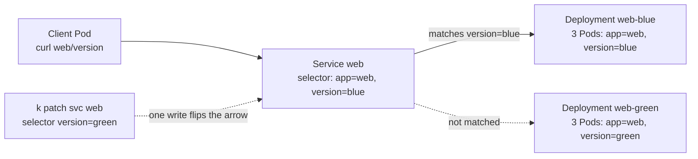
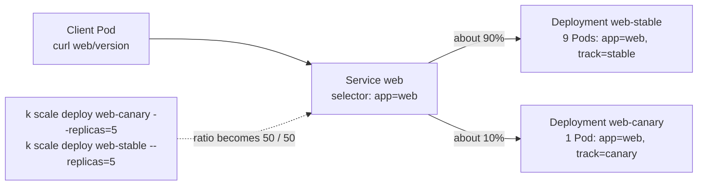

# T3.11 Deployment Strategies with Primitives: Blue/Green and Canary

> Competency: "Use Kubernetes primitives to implement common deployment strategies (e.g. blue/green or canary)" (CKAD-2.1) | Domain/weight: CKAD, Application Deployment (20%) | Est. time: 2 h | Prerequisites: T3.10, T2.06

Shell setup (from [conventions](../00-conventions.md); put it at the top of every session):

```bash
alias k=kubectl
export do="--dry-run=client -o yaml"
export now="--force --grace-period=0"
source <(kubectl completion bash); complete -o default -F __start_kubectl k
```

Lab environment for this lesson: **kind** (3 nodes: 1 control plane + 2 workers, image `kindest/node:v1.37.0`). Namespace: `lab-t311`. Files go in `~/lab/t311/`.

> Output policy. The output blocks labelled `REAL OUTPUT (kind v0.33.0, v1.37.0)` were captured while writing this lesson, on a kind cluster built from `kindest/node:v1.37.0` (1 control plane + 2 workers) with kubectl v1.37.1. One difference from `env/kind.yaml`: that capture cluster used kind's default CNI (kindnet), not Calico, because nothing in this lesson uses NetworkPolicy and Service load balancing is done by kube-proxy, not by the CNI. Pod IPs, hash suffixes and ages will differ on your cluster, and the counts in the curl loops are random, so yours will differ by a few. The one block labelled `EXPECTED OUTPUT (not captured)` is listed in section 11.

---

## 1. Why this matters

Teams do not replace a working version of an application in one risky step. They run the new version next to the old one, send it traffic in a controlled way, and keep a fast way back. The two common patterns are **blue/green** (switch all traffic at once, instant rollback) and **canary** (send a small share of traffic to the new version first). If you do not know how the pieces fit, you get the classic failures: both versions answer at the same time, the "10% canary" gets 50%, the new version gets no traffic at all because of a label typo, or a Deployment edit is rejected as immutable. In the CKAD you are asked to build these strategies with plain Deployments, labels and Services (no service mesh), so the whole skill is label-selector logic done quickly and checked with a curl loop.

For how a single Deployment updates itself see [T3.10](../part3-ckad/T3.10-deployments-and-rolling-updates.md). For how a Service finds its Pods see [T2.06](../part2-basics/T2.06-services-and-endpointslices-fundamentals.md). This lesson combines the two.

---

## 2. Concepts

### 2.1 The three primitives you combine

You need no new object type. You combine three things you already know:

| Primitive | What it does here | Where the "strategy" lives |
|---|---|---|
| **Label** | A `key=value` tag on a Pod. We use `app=web` (which application) plus `version=blue\|green` or `track=stable\|canary` (which release). | On the Pod template of each Deployment |
| **Selector** | A rule such as `app=web,version=blue` that picks every Pod whose labels match. A Deployment uses one to find its Pods. A Service uses one to find its backends. | `spec.selector` on the Deployment and on the Service |
| **Replica count** | How many Pods each Deployment runs. | `spec.replicas`, changed with `k scale` |

The strategy is not a field. It is the combination: which labels exist, which selector the Service has, and how many Pods each Deployment runs.

A **Service** is a stable virtual IP and DNS name in front of a group of Pods. An **EndpointSlice** is the object that lists the Pod IPs currently behind it. **kube-proxy** is the agent on every node that turns that list into packet rules in the kernel.

### 2.2 Under the hood: what happens when you change a Service selector

Understanding this makes every behaviour in this lesson predictable.

1. You change `spec.selector` on the Service (one API write).
2. The EndpointSlice controller (part of kube-controller-manager) sees the change. It lists the Pods that match the new selector and rewrites the Service's EndpointSlice. Only Pods that are **Ready** are marked `ready: true`.
3. kube-proxy on each node watches the EndpointSlice and rewrites the rules for that Service. In `iptables` mode (the default on kind and on most clusters, `nftables` is also supported) the rule says: for a packet to the Service ClusterIP and port, pick one backend and rewrite the destination (DNAT) to the Pod IP.
4. The next **new connection** uses the new backends. A connection that was already open keeps going to the Pod it was already using.

Two consequences matter for deployment strategies:

- **The switch is one write, but it spreads over a short time** (step 3 runs on every node). In the capture in section 5, 300 requests sent during a switch all returned HTTP 200, so no request failed. It is fast, not magic, and the Service does not wait for you: if the new Pods are not Ready, the switch sends traffic to nothing.
- **The traffic split is per connection and random, not exact.** kube-proxy does not count. Each new connection picks a backend by chance, with equal chance per ready Pod. So "10%" really means "about 10% over many connections".

To see this on a real node (captured from the worker of the kind cluster in section 5, with 3 backends):

REAL OUTPUT (kind v0.33.0, v1.37.0), command: `docker exec k-t311-worker iptables-save -t nat | grep 'lab-t311/web'` (trimmed)

```text
-A KUBE-SERVICES -d 10.96.52.187/32 -p tcp -m comment --comment "lab-t311/web cluster IP" -m tcp --dport 80 -j KUBE-SVC-2CYBJQXF2AVZ3KTF
-A KUBE-SVC-2CYBJQXF2AVZ3KTF -m comment --comment "lab-t311/web -> 10.244.1.4:80" -m statistic --mode random --probability 0.33333333349 -j KUBE-SEP-HWRHPUV45ZACMX6Y
-A KUBE-SVC-2CYBJQXF2AVZ3KTF -m comment --comment "lab-t311/web -> 10.244.2.3:80" -m statistic --mode random --probability 0.50000000000 -j KUBE-SEP-G3WIMEJPG5EJ67S5
-A KUBE-SVC-2CYBJQXF2AVZ3KTF -m comment --comment "lab-t311/web -> 10.244.2.5:80" -j KUBE-SEP-PRREBVCKI3TFVUWT
```

Read it like this. The first rule fires with probability 1/3. If it does not fire (2/3 of the time), the second rule fires with probability 1/2, which is 1/3 of the total. If neither fired, the last rule always fires, which is the last 1/3. Every backend gets an equal chance. That is the mechanism behind "traffic split is about the replica ratio": with 9 stable Pods and 1 canary Pod there are 10 rules and each Pod is chosen with chance 1/10, so the canary gets about 10%. The `nftables` proxy mode uses a different kernel mechanism; its random choice was not captured here (see section 11).

(This capture was taken in step 5 of section 5 after the selector was set to green, so the three backends are the green Pods.)

### 2.3 Recap: Recreate vs RollingUpdate, and why they are not enough

A Deployment has two built-in update strategies in `spec.strategy.type`. See [T3.10](../part3-ckad/T3.10-deployments-and-rolling-updates.md) for the full detail.

| Strategy | What it does | Both versions run at once? | Downtime | Rollback |
|---|---|---|---|---|
| `Recreate` | Scales the old ReplicaSet to 0, then starts the new one | No | Yes, from the moment old Pods stop until new Pods are Ready | `k rollout undo` (it Recreates again) |
| `RollingUpdate` (default; defaults `maxSurge: 25%`, `maxUnavailable: 25%`) | Replaces Pods in small steps | Yes, but only for a short time, and you do not choose the traffic share | None if readiness probes are correct | `k rollout undo` (a rolling update backwards) |

Real default read from a Deployment on the capture cluster:

REAL OUTPUT (kind v0.33.0, v1.37.0), command: `k get deploy web-stable -o jsonpath='{.spec.strategy}'`

```text
{"rollingUpdate":{"maxSurge":"25%","maxUnavailable":"25%"},"type":"RollingUpdate"}
```

What a rolling update cannot do:

- It cannot give you a **full second copy** of the new version that you can test before any user sees it (blue/green).
- It cannot hold a fixed **small share** such as 10% for as long as you want while you watch metrics (canary). You can `k rollout pause` mid-rollout to freeze it, but the share you freeze at is whatever the surge math gave you, and a paused rollout is awkward to explain to a teammate.
- Its rollback is another rollout. A blue/green rollback is one selector write.

So we build the two strategies from two Deployments and one Service.

### 2.4 Label design: where each label goes, and why

Getting labels wrong is the cause of almost every failure in this topic, so learn the map. There are four places a label or selector appears:

| Place | Field | What it is for | Can you change it after creation? |
|---|---|---|---|
| Deployment metadata | `metadata.labels` | Tags the Deployment object itself, so you can list it with `k get deploy -l version=blue`. The Service never reads this. | Yes |
| Deployment selector | `spec.selector.matchLabels` | Tells the Deployment (really its ReplicaSets) which Pods it owns. | **No. It is immutable.** |
| Pod template | `spec.template.metadata.labels` | The labels every Pod it creates will carry. This is what the Service sees. | Yes, but it must still match the selector above, and a change makes a new rollout |
| Service selector | `spec.selector` | Which Pods receive traffic. | Yes, any time. This is the lever of the whole lesson. |

Rules you must remember:

1. **The Deployment selector must match the template labels.** If it does not, the API server rejects the Deployment. Exact text from v1.37: `` `selector` does not match template `labels` ``.
2. **The Deployment selector is immutable** (`field is immutable`). To change it you create a new Deployment. This is why you plan the labels first.
3. **Two Deployments must not have overlapping selectors.** If Deployment A selects `app=web` and Deployment B selects `app=web,track=canary`, then B's Pods also match A. The Kubernetes docs say controllers with overlapping selectors fight each other and behave incorrectly. So we put the release label into **each Deployment's own selector** (`app=web,version=blue` and `app=web,version=green`, or `app=web,track=stable` and `app=web,track=canary`). Each Pod then belongs to exactly one Deployment.
4. **The Service decides how many Deployments it spans by how much of the label set it lists.**
   - Service selector `app=web,version=blue` matches only blue Pods. Blue/green uses this.
   - Service selector `app=web` matches the Pods of every Deployment that carries `app=web`. Canary uses this.
5. **Add a label to the Service selector only if every Pod you want has it.** A Service selector with a label that a Pod lacks will skip that Pod.

An empty or missing Service selector is not "match everything". A Service with no selector gets no automatic EndpointSlices at all. Always write the selector.

### 2.5 Blue/green

**Idea.** Blue is the version that serves users now. Green is the new version. You run **both at full size**. The Service selector points at blue. You test green directly (for example by Pod IP, or through a second test Service). When you are happy, you change one line in the Service selector from `version=blue` to `version=green`. All new connections now go to green. Blue keeps running, unused, so you can switch back.

Steps:

1. Run `web-blue` (3 Pods, `version=blue`). Service `web` selects `app=web,version=blue`.
2. Create `web-green` (3 Pods, `version=green`). Wait until all green Pods are **Ready**: `k rollout status deploy/web-green`. The Service ignores them, so users see no change.
3. Switch: `k patch svc web -p '{"spec":{"selector":{"app":"web","version":"green"}}}'`.
4. Check: loop against the Service name and see only green.
5. **Instant rollback**: if something is wrong, switch the selector back: `k patch svc web -p '{"spec":{"selector":{"app":"web","version":"blue"}}}'`. Blue is still running, so this is one write, not a rollout.
6. When green has proven itself, retire blue: `k scale deploy web-blue --replicas=0` (keeps the object for a later quick rollback) or `k delete deploy web-blue`.

Ways to change the selector (pick the one you can type fastest):

| Method | Command | Notes |
|---|---|---|
| `patch` | `k patch svc web -p '{"spec":{"selector":{"app":"web","version":"green"}}}'` | One line. A JSON merge patch on a map **merges keys**, so naming both keys is safest (see the trap below). |
| `set selector` | `k set selector svc web app=web,version=green` | Replaces the whole selector with the one you give. Captured working in section 5. |
| `edit` | `k edit svc web` | Opens `$EDITOR`. Slowest. |

**Trap with `patch` and map merging.** A merge patch merges maps key by key. Patching only `{"spec":{"selector":{"version":"green"}}}` keeps `app: web` and sets `version: green`, which is also fine. The problem is the other direction: you cannot remove a key by omitting it. To remove `version` you must use a JSON patch (`--type=json -p '[{"op":"remove","path":"/spec/selector/version"}]'`). We used exactly that in section 5 to reproduce the "both versions answer" mistake.

**Costs and cautions of blue/green**

- It needs **double the Pods** while both run.
- The Service switch does not check that green is healthy. Always run `k rollout status deploy/web-green` and look at the EndpointSlice before you switch. Readiness probes (see [T3.09](../part3-ckad/T3.09-implement-probes-and-health-checks.md)) are what make a Pod "Ready".
- Open connections stay with the old Pod until they close. Short HTTP requests move at once. Long-lived connections (keep-alive, websockets) may take longer.
- Shared state (a database schema) must work for both versions. Kubernetes cannot solve that for you.

### 2.6 Canary

**Idea.** A canary is a small group of the new version that receives **real** traffic next to the stable version. If the canary misbehaves, only a small share of users saw it. If it is good, you grow it and remove the old one.

How it is built: two Deployments, **one Service whose selector lists only the shared label** (`app=web`). Both sets of Pods match, so the Service load-balances over all of them. The traffic share equals roughly the share of Pods:

```
canary share  ~=  canary Pods / (stable Pods + canary Pods)
```

| Stable Pods | Canary Pods | Canary share (expected) |
|---|---|---|
| 9 | 1 | 10% |
| 8 | 2 | 20% |
| 5 | 5 | 50% |
| 0 | 10 | 100% |
| 9 | 9 | 50% (the mistake in section 6) |

You adjust the percentage by scaling: `k scale deploy web-canary --replicas=1`, `k scale deploy web-stable --replicas=9`. The smallest step you can make is 1 over the total Pods. If you want 1% you need 99 stable Pods and 1 canary, so for fine control Kubernetes primitives are the wrong tool and Gateway API weights (section 2.8) are the right one.

**The `track` label.** The Service selects `app=web` only. Each Deployment adds its own `track` label (`stable` or `canary`) to its selector and template. The Kubernetes docs use a label named `track` in the "Canary deployments" section of the Managing Workloads page; the name is a convention, you could call it `release`.

**Promotion path (10% -> 50% -> 100%).**

1. 10%: stable 9, canary 1.
2. 50%: scale canary to 5 and stable to 5. (Scale the canary up first, then stable down, if you want to keep full capacity at every moment.)
3. 100%: canary 10, stable 0.
4. Cleanup: delete the stable Deployment (or keep it at 0 for a quick rollback until you are sure). Optionally rename the roles: make the canary Deployment the new stable one by updating its labels in a new Deployment (remember: selectors are immutable).

An alternative final step, for the real world, is to update the **stable** Deployment's image to the new version with a normal rolling update (`k set image`, see [T3.10](../part3-ckad/T3.10-deployments-and-rolling-updates.md)) and then scale the canary to 0. Both end in the same place. The scale-up route is the one captured below.

**Rollback of a canary** is even simpler than blue/green: `k scale deploy web-canary --replicas=0`. Stable never stopped, so nothing else has to happen.

**Caveats on the ratio** (all of these are about how the split behaves, and each can surprise you):

- **Randomness.** With 100 requests and a true 10% share, you expect 10 canary hits with a standard deviation near 3. Seeing 7 to 15 is normal (the captures below show 9, 9, 11 and 8 across runs). With 20 requests the swing is large. Use 100 requests to judge a 10% canary.
- **Per connection, not per request.** A client that sends many requests on one keep-alive connection sticks to one backend. Captured: one `curl` invocation that fetched the URL 20 times reused one connection and got `20 v1`. The loop in this lesson starts a new `curl` process per request, so each request is a new connection.
- **`sessionAffinity: ClientIP`** on the Service pins a client IP to one Pod for a while. With affinity on, the replica ratio no longer predicts what one client sees. Captured: 100 requests from one client with affinity on all went to `v1`. Leave affinity off (`None`, the default) in canary tests.
- **Readiness.** A canary Pod that is not Ready gets no traffic (its EndpointSlice entry has `ready: false`), so a failing probe looks like "the canary receives nothing". Check `k get pods` before you check labels.

### 2.7 Verifying traffic with a curl loop

The check that proves a strategy works is a count of which version answered. You need a client **inside the cluster**: a ClusterIP is a virtual address that exists only on the cluster network, and the short DNS name `web` only resolves inside the cluster. (Whether another host can reach a ClusterIP depends on its environment, so test from a Pod.) Run a long-lived client Pod once:

```bash
k run client --image=curlimages/curl:8.11.1 --command -- sleep 3600
```

(`--command` makes everything after `--` the container command, not arguments to the image entrypoint. `sleep 3600` keeps the Pod alive. The tag `8.11.1` is pinned; it was pulled and used in every capture in this lesson.)

Then count answers:

```bash
k exec client -- sh -c 'for i in $(seq 20); do curl -s web/version; done | sort | uniq -c'
```

What each part does: `seq 20` produces 1 to 20, the loop makes 20 separate requests to `web/version` (the Service name `web`, port 80, path `/version`), `sort` groups equal lines, `uniq -c` counts them. Output looks like `19 v1` and `1 v2`.

In this lesson the app returns its version name at `/version` so the loop can tell the versions apart. The Deployments get that behaviour from a one-line container command that writes the file before nginx starts. That command is a lab convenience. In a real task you may have to tell the versions apart by other means (a different response body, the `Server` header, a different image). If you cannot read the version from the response, count backends instead: `k get endpointslice -l kubernetes.io/service-name=web` and `k get pods -l app=web -o wide`.

For a loop that also proves **no request failed** during a switch, print the HTTP status next to the answer and count the pairs:

```bash
k exec client -- sh -c 'for i in $(seq 300); do curl -s --max-time 2 -w "%{http_code}\n" web/version | paste -sd" "; sleep 0.05; done | uniq -c'
```

`-w "%{http_code}\n"` prints the status after the body, `paste -sd" "` joins the two lines into `blue 200`, `--max-time 2` makes a hung request fail fast instead of waiting, and `sleep 0.05` spreads 300 requests over about 20 seconds so you have time to switch the selector halfway. `uniq -c` collapses runs, so a clean switch prints exactly two lines.

### 2.8 Gateway API weighted backends: the precise alternative

Replica ratios have two weaknesses: the step is one Pod, and the split is only approximate. **Gateway API** (the successor to Ingress, see [T4.22](../part4-cka/T4.22-gateway-api.md); that lesson is written later, so the link may not resolve yet) has a field made for this. An `HTTPRoute` lists backends, and each backend has a **weight**. The weight is a relative number: a backend gets `weight / sum of weights` of the traffic. Weight `0` means no traffic. The default weight is `1`.

Here you keep **two Services** (one per version) and the route splits between them, independent of how many Pods each has. This YAML was checked against the API server with the Gateway API v1.6.3 CRDs installed (`k apply --dry-run=server`); it was **not** run against a controller, so no traffic was routed (see section 11):

```yaml
# Needs: Gateway API CRDs installed and a GatewayClass named "traefik" served by a controller.
apiVersion: v1
kind: Service
metadata:
  name: web-stable
spec:
  selector:            # only stable Pods
    app: web
    track: stable
  ports:
  - port: 80
    targetPort: 80
---
apiVersion: v1
kind: Service
metadata:
  name: web-canary
spec:
  selector:            # only canary Pods
    app: web
    track: canary
  ports:
  - port: 80
    targetPort: 80
---
apiVersion: gateway.networking.k8s.io/v1
kind: Gateway
metadata:
  name: web-gw
spec:
  gatewayClassName: traefik     # which controller implements this Gateway
  listeners:
  - name: http
    port: 8000                  # the port the controller listens on
    protocol: HTTP
    allowedRoutes:
      namespaces:
        from: Same              # only routes in this namespace may attach
---
apiVersion: gateway.networking.k8s.io/v1
kind: HTTPRoute
metadata:
  name: web
spec:
  parentRefs:
  - name: web-gw                # attach to the Gateway above
  rules:
  - backendRefs:
    - name: web-stable
      port: 80
      weight: 90                # 90 / (90+10) = 90%
    - name: web-canary
      port: 80
      weight: 10                # 10%
```

Promotion is then `k patch httproute web --type=json -p '[{"op":"replace","path":"/spec/rules/0/backendRefs/1/weight","value":50}]'` (change the canary weight; adjust the stable weight the same way). With weights you can run 1 stable Pod and 1 canary Pod and still send 1% to the canary. Docs: the [Gateway page](https://kubernetes.io/docs/concepts/services-networking/gateway/) is on kubernetes.io. The traffic-splitting guide is on gateway-api.sigs.k8s.io, which the exam rules list for CKA only (source: [E13](https://docs.linuxfoundation.org/tc-docs/certification/certification-resources-allowed)), so for CKAD treat Gateway weights as background.

### 2.9 Ingress canary annotations are controller-specific

The core `Ingress` API (see [T3.12](../part3-ckad/T3.12-provide-and-troubleshoot-access-to-applications.md)) has no weight field: a backend is a Service name and port, nothing more. Controllers added canary behaviour through their own **annotations** (key-value strings on the Ingress object) or their own custom resources. The annotations differ per controller and mean nothing to another controller, so an Ingress written for one controller does not carry its canary rules to another. The well-known annotation set belonged to **ingress-nginx, which is retired** (this guide uses Traefik for Ingress labs, see [conventions](../00-conventions.md)). Do not build new canary setups on those annotations. For a precise split, use Gateway API weights (section 2.8) or the replica-ratio method of this lesson.

### 2.10 Cleanup: retiring the old version

| Goal | Command | Effect |
|---|---|---|
| Stop sending traffic but keep a quick rollback | `k scale deploy web-blue --replicas=0` | The Deployment object stays. Scale it back up and (for blue/green) switch the selector to roll back. |
| Remove the old version for good | `k delete deploy web-blue` | Deployment, its ReplicaSets and Pods are gone. |
| Remove everything of the strategy | `k delete deploy,svc -l app=web` | Removes every object carrying `app=web` (check with `k get deploy,svc -l app=web` first). |

Do the cleanup only after the new version has proved itself and only after you have checked the Service. Never delete the Deployment the Service still points at.

### Related but different

- **`k rollout undo`** reverses a Deployment's own revision history (a rolling update backwards). Blue/green rollback instead flips a Service. They solve different problems; the blue/green flip does not touch revisions.
- **Rolling update with `maxSurge`/`maxUnavailable`** controls how fast Pods are replaced inside one Deployment. A canary controls what **share of traffic** the new version gets across two Deployments.
- **Service mesh** (Istio, Linkerd and others) offers percentage routing by request. That is outside the CKAD scope; this lesson uses only core objects.
- **`Recreate`** is not blue/green. It stops the old version before the new one starts.

---

## 3. How it works (diagram)

Diagram 1: blue/green. The Service selector is the only thing that moves.



Diagram 2: canary. The Service selects only the shared label, so the Pod ratio is the traffic ratio.



Walkthrough:

1. In diagram 1 the Service reads its selector and keeps only the Pods that have **both** `app=web` and `version=blue`. Green Pods exist and are Ready, but the selector skips them, so they get no traffic.
2. The patch changes the selector. The EndpointSlice controller rewrites the endpoint list, kube-proxy rewrites the rules, and new connections go to green. Switching back is the same write in reverse.
3. In diagram 2 the selector has one label, `app=web`, which every Pod of both Deployments carries. So the Service balances over all 10 Pods, each chosen with equal chance.
4. The `track` label is in each Deployment's own selector so the two Deployments never claim each other's Pods. The Service does not use it.
5. Scaling either Deployment changes the number of backend Pods and therefore the share. That is the only dial.

---

## 4. Commands and YAML you must produce fast

### 4.1 Imperative shortcuts

```bash
# Generate a Deployment skeleton fast (replicas, image, no cluster change).
k create deploy web-blue --image=nginx:1.26 --replicas=3 $do > blue.yaml
```
`k create deploy` always labels the Deployment and its Pods `app=<name>` (here `app=web-blue`). That is the wrong label for our strategies, so you edit the file next.

```bash
# Rewrite the three label places at once with yq (yq is on the exam hosts, see E9).
yq -i '.metadata.labels = {"app":"web","version":"blue"}
     | .spec.selector.matchLabels = {"app":"web","version":"blue"}
     | .spec.template.metadata.labels = {"app":"web","version":"blue"}' blue.yaml
```
The three places are the Deployment labels, the Deployment selector, and the Pod template labels. Real result of this command is shown in the drill answers.

```bash
# Make green from blue: new name, new label value, new image.
sed 's/blue/green/g; s/1\.26/1.27/' blue.yaml > green.yaml
```
Real check: this turns `web-blue` into `web-green`, every `version: blue` into `version: green`, and `nginx:1.26` into `nginx:1.27`.

```bash
# Create the Service skeleton. The selector it generates is app=web.
k create svc clusterip web --tcp=80:80 $do > svc.yaml
```
Captured: the generated YAML has `selector: app: web` and a port named `80-80`. That default selector is exactly what the canary Service needs. For blue/green add the version label with `k set selector svc web app=web,version=blue` after creating it.

```bash
# The one-line flip (blue -> green) and the one-line rollback.
k patch svc web -p '{"spec":{"selector":{"app":"web","version":"green"}}}'
k patch svc web -p '{"spec":{"selector":{"app":"web","version":"blue"}}}'
```
Name **both** keys every time. It removes the doubt about what the selector holds after the patch.

```bash
# Equivalent that replaces the whole selector.
k set selector svc web app=web,version=green
```

```bash
# Canary dial: change the number of Pods.
k scale deploy web-canary --replicas=1
k scale deploy web-stable --replicas=9
```

```bash
# Check which version answers (20 requests from the client Pod).
k exec client -- sh -c 'for i in $(seq 20); do curl -s web/version; done | sort | uniq -c'
```

```bash
# Read the selector back without opening an editor, and see what is behind the Service.
k get svc web -o jsonpath='{.spec.selector}{"\n"}'
k get endpointslice -l kubernetes.io/service-name=web
k get pods -L app,version,track
```
`-L` adds a column for each named label, which is the fastest way to spot a label typo.

### 4.2 Declarative YAML

Save each block into the file named in its first comment, inside `~/lab/t311/` (`mkdir -p ~/lab/t311`). The `command` line in the container is a lab convenience: it writes a one-word version file that nginx then serves at `/version`, so the curl loop can tell the versions apart. In the exam your image will already answer in its own way.

**File `bluegreen.yaml`: two Deployments and one Service for blue/green.**

```yaml
# ~/lab/t311/bluegreen.yaml
apiVersion: apps/v1
kind: Deployment
metadata:
  name: web-blue                # object name; any unique name
  labels:                       # tags on the Deployment object only (not used by the Service)
    app: web
    version: blue
spec:
  replicas: 3                   # number of Pods; 0 is allowed (parks the version)
  selector:
    matchLabels:                # immutable after creation; must match the template labels
      app: web
      version: blue             # the release label is in the selector so Deployments never overlap
  template:
    metadata:
      labels:                   # the labels the Service will see on each Pod
        app: web
        version: blue
    spec:
      containers:
      - name: nginx
        image: nginx:1.26       # pinned tag; never :latest
        command: ["sh", "-c", "echo blue > /usr/share/nginx/html/version; exec nginx -g 'daemon off;'"]
        ports:
        - containerPort: 80     # documentation for the port nginx listens on
        readinessProbe:         # a Pod receives traffic only after this passes
          httpGet:
            path: /version
            port: 80
          periodSeconds: 2      # check every 2 s (default 10 s)
---
apiVersion: apps/v1
kind: Deployment
metadata:
  name: web-green
  labels:
    app: web
    version: green
spec:
  replicas: 3
  selector:
    matchLabels:
      app: web
      version: green
  template:
    metadata:
      labels:
        app: web
        version: green
    spec:
      containers:
      - name: nginx
        image: nginx:1.27
        command: ["sh", "-c", "echo green > /usr/share/nginx/html/version; exec nginx -g 'daemon off;'"]
        ports:
        - containerPort: 80
        readinessProbe:
          httpGet:
            path: /version
            port: 80
          periodSeconds: 2
---
apiVersion: v1
kind: Service
metadata:
  name: web
spec:
  selector:                     # blue only. Change "blue" to "green" to switch.
    app: web
    version: blue
  ports:
  - port: 80                    # the port clients use on the Service
    targetPort: 80              # the port nginx listens on in the Pod
```

Field notes. `selector` on the Service: if you leave out `version`, both Deployments match (the mistake in section 6). `periodSeconds` on a probe defaults to 10; a very large value delays when a new Pod becomes Ready. `replicas: 0` is valid and parks a version without deleting it. `targetPort` that does not match the container port gives "connection refused" from the Pod (see [T3.12](../part3-ckad/T3.12-provide-and-troubleshoot-access-to-applications.md)).

**File `canary.yaml`: two Deployments and one Service for a 90/10 canary.**

```yaml
# ~/lab/t311/canary.yaml
apiVersion: apps/v1
kind: Deployment
metadata:
  name: web-stable
  labels:
    app: web
    track: stable
spec:
  replicas: 9                   # 9 of 10 Pods = about 90% of traffic
  selector:
    matchLabels:
      app: web
      track: stable             # own selector: does not overlap with the canary
  template:
    metadata:
      labels:
        app: web                # the label the Service selects on
        track: stable           # the label that keeps the Deployments apart
    spec:
      containers:
      - name: nginx
        image: nginx:1.26
        command: ["sh", "-c", "echo v1 > /usr/share/nginx/html/version; exec nginx -g 'daemon off;'"]
        ports:
        - containerPort: 80
        readinessProbe:
          httpGet:
            path: /version
            port: 80
          periodSeconds: 2
---
apiVersion: apps/v1
kind: Deployment
metadata:
  name: web-canary
  labels:
    app: web
    track: canary
spec:
  replicas: 1                   # 1 of 10 Pods = about 10% of traffic
  selector:
    matchLabels:
      app: web
      track: canary
  template:
    metadata:
      labels:
        app: web
        track: canary
    spec:
      containers:
      - name: nginx
        image: nginx:1.27       # the new version under test
        command: ["sh", "-c", "echo v2 > /usr/share/nginx/html/version; exec nginx -g 'daemon off;'"]
        ports:
        - containerPort: 80
        readinessProbe:
          httpGet:
            path: /version
            port: 80
          periodSeconds: 2
---
apiVersion: v1
kind: Service
metadata:
  name: web
spec:
  selector:                     # only the shared label: stable AND canary Pods match
    app: web
  ports:
  - port: 80
    targetPort: 80
```

Field notes. The Service selector has no `track`; adding `track: stable` would silently turn the canary off. The default `sessionAffinity` is `None`; setting `ClientIP` pins each client to one Pod and breaks the ratio test.

### 4.3 Speed drill

Setup for all drills (one line, then run the tasks in order):

```bash
k create ns lab-t311-drill && k -n lab-t311-drill run client --image=curlimages/curl:8.11.1 --command -- sleep 3600
```

Targets are for the exam pace (about 6 minutes per task on average, sources [E2](https://docs.linuxfoundation.org/tc-docs/certification/tips-cka-and-ckad) and [E3](https://docs.linuxfoundation.org/tc-docs/certification/faq-cka-ckad-cks)); these are small parts of a task, so the targets are short.

**Drill 1 (target 2 min).** In `lab-t311-drill`, create Deployment `web-blue`: `nginx:1.26`, 3 replicas, with `app=web,version=blue` on the Deployment, in the selector and in the Pod template. Use the imperative command plus an edit, not a hand-typed file.

<details><summary>Answer</summary>

```bash
k create deploy web-blue --image=nginx:1.26 --replicas=3 $do > blue.yaml
yq -i '.metadata.labels = {"app":"web","version":"blue"}
     | .spec.selector.matchLabels = {"app":"web","version":"blue"}
     | .spec.template.metadata.labels = {"app":"web","version":"blue"}' blue.yaml
k -n lab-t311-drill apply -f blue.yaml
k -n lab-t311-drill get deploy web-blue --show-labels
```

The generated and edited file looked like this on the capture machine (yq re-indents lists, which is harmless):

REAL OUTPUT (yq on the captured file, kubectl v1.37.1)

```yaml
apiVersion: apps/v1
kind: Deployment
metadata:
  labels:
    app: web
    version: blue
  name: web-blue
spec:
  replicas: 3
  selector:
    matchLabels:
      app: web
      version: blue
  strategy: {}
  template:
    metadata:
      labels:
        app: web
        version: blue
    spec:
      containers:
        - image: nginx:1.26
          name: nginx
          resources: {}
status: {}
```
</details>

**Drill 2 (target 1 min).** Create Service `web` on port 80 whose selector is exactly `app=web,version=blue`.

<details><summary>Answer</summary>

```bash
k -n lab-t311-drill create svc clusterip web --tcp=80:80
k -n lab-t311-drill set selector svc web app=web,version=blue
k -n lab-t311-drill get svc web -o jsonpath='{.spec.selector}{"\n"}'
```

`create svc clusterip` gives selector `app=web`; `set selector` then replaces it with both labels. The last command should print `{"app":"web","version":"blue"}`.
</details>

**Drill 3 (target 1 min).** Make `web-green` (image `nginx:1.27`, label `version=green`) from `blue.yaml` without retyping.

<details><summary>Answer</summary>

```bash
sed 's/blue/green/g; s/1\.26/1.27/' blue.yaml | k -n lab-t311-drill apply -f -
k -n lab-t311-drill get deploy -L version
```

`sed` changes the name, all three label places and the image tag in one pass.
</details>

**Drill 4 (target 30 s).** Switch the Service to green with one command.

<details><summary>Answer</summary>

```bash
k -n lab-t311-drill patch svc web -p '{"spec":{"selector":{"app":"web","version":"green"}}}'
k -n lab-t311-drill get svc web -o wide
```

The `SELECTOR` column must show `app=web,version=green`.
</details>

**Drill 5 (target 30 s).** Roll back to blue, then retire green (keep the object, run no Pods).

<details><summary>Answer</summary>

```bash
k -n lab-t311-drill patch svc web -p '{"spec":{"selector":{"app":"web","version":"blue"}}}'
k -n lab-t311-drill scale deploy web-green --replicas=0
k -n lab-t311-drill get deploy
```

Switch first, scale second. Doing it the other way round leaves the Service pointing at nothing for a moment.
</details>

**Drill 6 (target 2 min).** Start over with a canary. Delete the blue/green objects, apply `canary.yaml` (from section 4.2) in the drill namespace, then change the canary share from 10% to 20%.

<details><summary>Answer</summary>

```bash
k -n lab-t311-drill delete deploy web-blue web-green
k -n lab-t311-drill delete svc web
k -n lab-t311-drill apply -f canary.yaml
k -n lab-t311-drill rollout status deploy/web-stable
k -n lab-t311-drill scale deploy web-stable --replicas=8
k -n lab-t311-drill scale deploy web-canary --replicas=2
k -n lab-t311-drill get deploy
```

Total stays 10 Pods, canary is 2 of 10 = 20%.
</details>

**Drill 7 (target 1 min).** Prove the split with 100 requests.

<details><summary>Answer</summary>

```bash
k -n lab-t311-drill exec client -- sh -c 'for i in $(seq 100); do curl -s web/version; done | sort | uniq -c'
```

Expect about `80 v1` and `20 v2`. Anything from about 10 to 30 `v2` is normal random spread.
</details>

**Drill 8 (target 2 min).** Two parts. (a) Roll the canary back: stable serves all traffic and the canary runs no Pods. (b) Then promote instead: the canary serves all traffic and stable runs no Pods.

<details><summary>Answer</summary>

```bash
# Rollback: stable keeps serving, the canary stops.
k -n lab-t311-drill scale deploy web-stable --replicas=10
k -n lab-t311-drill scale deploy web-canary --replicas=0

# Promotion: canary up first, then stable down.
k -n lab-t311-drill scale deploy web-canary --replicas=10
k -n lab-t311-drill rollout status deploy/web-canary
k -n lab-t311-drill scale deploy web-stable --replicas=0
```
</details>

Cleanup for the drills:

```bash
k delete ns lab-t311-drill
rm -f blue.yaml
```

---

## 5. Worked example

Everything below ran on a kind cluster (nodes `v1.37.0`), in namespace `lab-t311`. The lesson uses `k` for `kubectl` and `-n lab-t311`. The files `bluegreen.yaml` and `canary.yaml` are the two blocks from section 4.2.

### Step 0. Namespace and client

```bash
mkdir -p ~/lab/t311 && cd ~/lab/t311
k create ns lab-t311
k -n lab-t311 run client --image=curlimages/curl:8.11.1 --command -- sleep 3600
```

What this does: creates the namespace and a client Pod you will run every `curl` from.

### Step 1. Start blue and green; the Service points at blue

```bash
k -n lab-t311 apply -f bluegreen.yaml
k -n lab-t311 rollout status deploy/web-blue
k -n lab-t311 rollout status deploy/web-green
k -n lab-t311 wait --for=condition=Ready pod/client --timeout=120s
k -n lab-t311 get deploy,svc -o wide
k -n lab-t311 get endpointslice
```

What to look for: both Deployments `3/3`, the Service `SELECTOR` is `app=web,version=blue`, and the EndpointSlice lists **3** endpoints (the blue ones), not 6.

REAL OUTPUT (kind v0.33.0, v1.37.0)

```text
NAME                        READY   UP-TO-DATE   AVAILABLE   AGE   CONTAINERS   IMAGES       SELECTOR                LABELS
deployment.apps/web-blue    3/3     3            3           34s   nginx        nginx:1.26   app=web,version=blue    app=web,version=blue
deployment.apps/web-green   3/3     3            3           34s   nginx        nginx:1.27   app=web,version=green   app=web,version=green

NAME          TYPE        CLUSTER-IP     EXTERNAL-IP   PORT(S)   AGE   SELECTOR               LABELS
service/web   ClusterIP   10.96.52.187   <none>        80/TCP    34s   app=web,version=blue   <none>
...
NAME        ADDRESSTYPE   PORTS   ENDPOINTS                          AGE
web-ncfv2   IPv4          80      10.244.1.2,10.244.1.3,10.244.2.4   34s
```

Cross-check that those three IPs belong to blue Pods: `k -n lab-t311 get pods -o wide -L version`. The captured Pods `web-blue-...-7wlv5`, `-slc78`, `-xvpnz` had IPs `10.244.1.2`, `10.244.1.3`, `10.244.2.4`.

### Step 2. Count answers: all blue

```bash
k -n lab-t311 exec client -- sh -c 'for i in $(seq 20); do curl -s web/version; done | sort | uniq -c'
```

REAL OUTPUT (kind v0.33.0, v1.37.0)

```text
     20 blue
```

### Step 3. Switch to green while requests are flowing

Terminal 1 starts the status-aware loop (300 requests, about 20 seconds). Terminal 2 switches the selector about 4 seconds in.

```bash
# Terminal 1
k -n lab-t311 exec client -- sh -c 'for i in $(seq 300); do curl -s --max-time 2 -w "%{http_code}\n" web/version | paste -sd" "; sleep 0.05; done | uniq -c'

# Terminal 2, after about 4 seconds
k -n lab-t311 patch svc web -p '{"spec":{"selector":{"app":"web","version":"green"}}}'
```

What to look for: exactly two lines in terminal 1 (a `blue` line then a `green` line), both with `200`. A line with another code, or `000`, would mean a failed request.

REAL OUTPUT (kind v0.33.0, v1.37.0), terminal 2 printed `service/web patched`; terminal 1 printed:

```text
     67 blue 200
    233 green 200
```

All 300 requests answered with 200. The switch happened between request 67 and 68. That is the "zero failed requests" result the Easy lab asks you to reproduce.

### Step 4. Instant rollback

Run the same loop and the reverse patch:

```bash
k -n lab-t311 patch svc web -p '{"spec":{"selector":{"app":"web","version":"blue"}}}'
```

REAL OUTPUT (kind v0.33.0, v1.37.0), loop output with the patch sent about 4 seconds in:

```text
     66 green 200
    234 blue 200
```

Blue Pods had never stopped, so there was nothing to start: one write, no failed request.

### Step 5. The mistake: a selector without the version label

Remove the `version` key to see what "both versions answer" looks like (you need a JSON patch to delete a key):

```bash
k -n lab-t311 patch svc web --type=json -p '[{"op":"remove","path":"/spec/selector/version"}]'
k -n lab-t311 get svc web -o wide
k -n lab-t311 get endpointslice
k -n lab-t311 exec client -- sh -c 'for i in $(seq 20); do curl -s web/version; done | sort | uniq -c'
```

REAL OUTPUT (kind v0.33.0, v1.37.0)

```text
NAME   TYPE        CLUSTER-IP     EXTERNAL-IP   PORT(S)   AGE     SELECTOR
web    ClusterIP   10.96.52.187   <none>        80/TCP    2m27s   app=web
NAME        ADDRESSTYPE   PORTS   ENDPOINTS                                      AGE
web-ncfv2   IPv4          80      10.244.1.2,10.244.2.4,10.244.1.3 + 3 more...   2m27s
     11 blue
      9 green
```

Reading it: the selector shows only `app=web`; the EndpointSlice lists "+ 3 more", so 6 endpoints; the loop shows a mixed answer. There is no error message anywhere. Only the counts reveal it. Fix with `set selector`, which replaces the whole selector:

```bash
k -n lab-t311 set selector svc web app=web,version=green
k -n lab-t311 get svc web -o jsonpath='{.spec.selector}{"\n"}'
k -n lab-t311 exec client -- sh -c 'for i in $(seq 20); do curl -s web/version; done | sort | uniq -c'
```

REAL OUTPUT (kind v0.33.0, v1.37.0)

```text
service/web selector updated
{"app":"web","version":"green"}
     20 green
```

### Step 6. The mistake: changing a Deployment selector

```bash
k -n lab-t311 patch deploy web-blue -p '{"spec":{"selector":{"matchLabels":{"app":"web","version":"blue2"}}}}'
```

REAL OUTPUT (kind v0.33.0, v1.37.0)

```text
The Deployment "web-blue" is invalid: 
* spec.template.metadata.labels: Invalid value: {"app":"web","version":"blue"}: `selector` does not match template `labels`
* spec.selector: Invalid value: {"matchLabels":{"app":"web","version":"blue2"}}: field is immutable
```

Two errors, both caused by the one change: the selector would no longer match the template (rule 1 in section 2.4), and the selector cannot change at all (rule 2). Fixing the template label would clear the first error but never the second: applying a whole edited object with a new selector also prints `spec.selector: Invalid value: ...: field is immutable`. The only fix is a **new Deployment** with the labels you want. Then delete the old one.

### Step 7. Retire blue (green has proved itself)

```bash
k -n lab-t311 scale deploy web-blue --replicas=0
k -n lab-t311 get deploy
```

EXPECTED OUTPUT (not captured)

```text
deployment.apps/web-blue scaled
NAME        READY   UP-TO-DATE   AVAILABLE   AGE
web-blue    0/0     0            0           ...
web-green   3/3     3            3           ...
```

(The shape of `scaled` and `0/0` was captured for the canary Deployments below; this exact block was not.) To roll back later: scale blue up, wait for `k rollout status deploy/web-blue`, then patch the selector back to `blue`. To remove for good: `k delete deploy web-blue`.

### Step 8. Switch to the canary pattern

Delete the blue/green objects and start the canary:

```bash
k -n lab-t311 delete deploy web-blue web-green
k -n lab-t311 delete svc web
k -n lab-t311 apply -f canary.yaml
k -n lab-t311 rollout status deploy/web-stable
k -n lab-t311 rollout status deploy/web-canary
k -n lab-t311 get deploy,svc
k -n lab-t311 get endpointslice
k -n lab-t311 get pods -L track
```

REAL OUTPUT (kind v0.33.0, v1.37.0)

```text
NAME                         READY   UP-TO-DATE   AVAILABLE   AGE
deployment.apps/web-canary   1/1     1            1           2s
deployment.apps/web-stable   9/9     9            9           2s

NAME          TYPE        CLUSTER-IP      EXTERNAL-IP   PORT(S)   AGE
service/web   ClusterIP   10.96.170.133   <none>        80/TCP    2s
NAME        ADDRESSTYPE   PORTS   ENDPOINTS                                      AGE
web-66fqs   IPv4          80      10.244.1.5,10.244.2.6,10.244.2.7 + 7 more...   2s
NAME                          READY   STATUS    RESTARTS   AGE     TRACK
client                        1/1     Running   0          2m40s   
web-canary-588767b6fb-w6527   1/1     Running   0          2s      canary
web-stable-c9c5f94b7-24g4b    1/1     Running   0          2s      stable
...
```

The EndpointSlice shows 3 plus 7 more = 10 endpoints: 9 stable and 1 canary behind one Service. Note the `client` Pod has no `track` label, so its column is empty.

### Step 9. Measure the 90/10 split

Run the 100-request count three times (it is random):

```bash
for r in 1 2 3; do k -n lab-t311 exec client -- sh -c 'for i in $(seq 100); do curl -s web/version; done | sort | uniq -c'; done
```

REAL OUTPUT (kind v0.33.0, v1.37.0)

```text
     91 v1
      9 v2
     91 v1
      9 v2
     89 v1
     11 v2
```

About 10% reach `v2`. With only 20 requests the capture gave `19 v1` and `1 v2`: the sample is too small to judge a 10% share, so use 100.

### Step 10. The mistake: equal replica counts

```bash
k -n lab-t311 scale deploy web-canary --replicas=9
k -n lab-t311 rollout status deploy/web-canary
k -n lab-t311 exec client -- sh -c 'for i in $(seq 100); do curl -s web/version; done | sort | uniq -c'
```

REAL OUTPUT (kind v0.33.0, v1.37.0)

```text
deployment.apps/web-canary scaled
     43 v1
     57 v2
```

9 stable and 9 canary Pods is a 50/50 split (the random draw gave 57 on one side). The fix is to scale back to 1:

```bash
k -n lab-t311 scale deploy web-canary --replicas=1
k -n lab-t311 get deploy
```

REAL OUTPUT (kind v0.33.0, v1.37.0): a follow-up 100-request count printed `92 v1`, `8 v2`.

```text
NAME         READY   UP-TO-DATE   AVAILABLE   AGE
web-canary   1/1     1            1           17s
web-stable   9/9     9            9           17s
```

### Step 11. Promote: 50%, then 100%

```bash
# 50%
k -n lab-t311 scale deploy web-canary --replicas=5
k -n lab-t311 scale deploy web-stable --replicas=5
k -n lab-t311 get deploy
k -n lab-t311 exec client -- sh -c 'for i in $(seq 100); do curl -s web/version; done | sort | uniq -c'

# 100%
k -n lab-t311 scale deploy web-canary --replicas=10
k -n lab-t311 rollout status deploy/web-canary
k -n lab-t311 scale deploy web-stable --replicas=0
k -n lab-t311 exec client -- sh -c 'for i in $(seq 100); do curl -s web/version; done | sort | uniq -c'
```

REAL OUTPUT (kind v0.33.0, v1.37.0)

```text
NAME         READY   UP-TO-DATE   AVAILABLE   AGE
web-canary   5/5     5            5           22s
web-stable   5/5     5            5           22s
     51 v1
     49 v2
...
NAME         READY   UP-TO-DATE   AVAILABLE   AGE
web-canary   10/10   10           10          30s
web-stable   0/0     0            0           30s
    100 v2
```

At 50% the counts were 51 and 49. At 100% every answer is `v2`.

### Step 12. Rollback of a canary

If the canary had been bad, the rollback is: stable up, canary to zero.

```bash
k -n lab-t311 scale deploy web-stable --replicas=10
k -n lab-t311 scale deploy web-canary --replicas=0
k -n lab-t311 exec client -- sh -c 'for i in $(seq 100); do curl -s web/version; done | sort | uniq -c'
```

REAL OUTPUT (kind v0.33.0, v1.37.0)

```text
NAME         READY   UP-TO-DATE   AVAILABLE   AGE
web-canary   0/0     0            0           35s
web-stable   10/10   10           10          35s
    100 v1
```

### Step 13. A canary that fails its readiness check gets no traffic

To see this, the capture changed the canary's readiness probe to a path that does not exist (`k patch deploy web-canary -p '{"spec":{"template":{"spec":{"containers":[{"name":"nginx","readinessProbe":{"httpGet":{"path":"/nope","port":80}}}]}}}}'`), waited about 12 seconds, and looked at the EndpointSlice:

```bash
k -n lab-t311 get endpointslice -l kubernetes.io/service-name=web \
  -o jsonpath='{range .items[*].endpoints[*]}{.targetRef.name}{" ready="}{.conditions.ready}{"\n"}{end}' | grep canary
```

REAL OUTPUT (kind v0.33.0, v1.37.0), taken a few seconds into the rollout of the changed canary template. The old canary Pod was still Ready, the new one was not:

```text
web-canary-6559464dd5-tmnht ready=true
web-canary-6f69b79969-p2b8f ready=false
```

The Pod `...p2b8f` was `0/1` Running. A Pod with `ready=false` is skipped by kube-proxy. (Within the first seconds, the old Ready Pod still received traffic: the next count gave `97 v1`, `3 v2`.) Reading this on a stuck canary is how you tell "wrong labels" (the Pod is missing from the EndpointSlice entirely) from "not Ready" (the Pod is listed with `ready=false`).

### Cleanup of the worked example

```bash
k delete ns lab-t311
rm -rf ~/lab/t311
```

---

## 6. Common mistakes and how to fix them

| Symptom | What you will see (exact error/event text) | Cause | Fix (command) |
|---|---|---|---|
| Blue/green: traffic goes to both versions | No error. The curl loop shows a mix (`11 blue`, `9 green`); `k get endpointslice` lists more endpoints than one Deployment has (`... + 3 more...`) | The Service selector lacks the `version` label, so it matches every Pod with `app=web` | `k set selector svc web app=web,version=blue` |
| Canary gets about 50% | The loop shows `43 v1` / `57 v2`; `k get deploy` shows equal READY counts | Equal replica counts; the share is the Pod ratio | `k scale deploy web-canary --replicas=1` (and stable to 9) |
| Selector change on a Deployment is rejected | `The Deployment "web-blue" is invalid: ... spec.selector: Invalid value: {...}: field is immutable` | `spec.selector` of a Deployment cannot change after creation | Create a new Deployment with the right labels, then delete the old one |
| Canary Pod is Running and Ready but gets no traffic (break-fix lab) | `k get deploy` shows `1/1`; the loop never prints `v2`; the canary Pod is not in the EndpointSlice | The canary's Pod template labels do not carry the label the Service selects (for example `app: web-canary` instead of `app: web`) | `k get pods -L app,track`, then delete the Deployment and recreate it with `app: web` in selector and template |
| Canary Pod is listed but gets no traffic | `k get pods` shows `0/1`; EndpointSlice shows `ready=false` for it | Readiness probe failing | `k describe pod <canary-pod>`, read the `Readiness probe failed:` event, fix the probe or app |
| Blue/green switch sends traffic to nothing | Requests fail (the exact message depends on kube-proxy mode); EndpointSlice has no endpoints for the new selector | Green Pods were not Ready, or the selector value has a typo (`gren`) | `k get pods -L version`, fix the labels or wait for Ready, then switch again |
| Canary ratio looks wrong with one client | One client always sees the same version | `sessionAffinity: ClientIP` on the Service, or one keep-alive connection | `k patch svc web -p '{"spec":{"sessionAffinity":"None"}}'`; use a new `curl` process per request |

### A repeatable path for "the new version gets no traffic" (or too much)

Run these in order. Each one removes a class of causes.

1. **Count who answers.** `k exec client -- sh -c 'for i in $(seq 100); do curl -s web/version; done | sort | uniq -c'`. If the Service itself does not answer, stop and use the Service debugging ladder in [T3.12](../part3-ckad/T3.12-provide-and-troubleshoot-access-to-applications.md).
2. **Read the selector.** `k get svc web -o jsonpath='{.spec.selector}{"\n"}'`. Missing `version`? Extra `track`? Typo?
3. **See the backends.** `k get endpointslice -l kubernetes.io/service-name=web`. Count endpoints. Expected count = (stable Pods) + (canary Pods), or only one Deployment for blue/green.
4. **Compare Pod labels with the selector.** `k get pods -L app,version,track`. A Pod whose label values differ from the selector is skipped.
5. **Check Ready.** `k get pods`. `0/1` means the Pod is skipped even if its labels are right.
6. **Check the counts.** `k get deploy`. The ratio of READY replicas is the traffic ratio.
7. **If the labels are wrong in a Deployment, remember the selector is immutable:** delete and recreate it with the correct labels. If only the template label is wrong and the selector is right, `k patch` the template (a new rollout) is enough.

---

## 7. Labs

Lab order: A, then B, then C. Each lab creates its own namespace `lab-t311` and deletes it at the end, so any order works. All three need the kind cluster and the files `bluegreen.yaml` and `canary.yaml` from section 4.2 saved in `~/lab/t311/` (Lab C injects its own fault from `break.sh`, so it only needs the cluster).

Environment: **kind**. Shell setup at the top of the lesson.

### Lab A (Easy): blue/green switch with zero failed requests

**Setup**

```bash
mkdir -p ~/lab/t311 && cd ~/lab/t311
k create ns lab-t311
k -n lab-t311 apply -f bluegreen.yaml
k -n lab-t311 run client --image=curlimages/curl:8.11.1 --command -- sleep 3600
k -n lab-t311 rollout status deploy/web-blue
k -n lab-t311 rollout status deploy/web-green
k -n lab-t311 wait --for=condition=Ready pod/client --timeout=120s
```

**Task.** In namespace `lab-t311` the Service `web` currently sends traffic to the blue version. Both Deployments are running.

1. Start a background loop that sends 300 requests to `web/version` from the `client` Pod, one new `curl` per request, and saves one line per request (`<answer> <http status>`) to `~/lab/t311/a-loop.txt`.
2. While the loop is running, switch the Service `web` to the green version with one command.
3. Save the Service's final selector (JSON) to `~/lab/t311/a-selector.txt`.
4. When the loop has finished, roll the Service back to blue so that it is again the live version.

<details><summary>Hint 1</summary>

The loop from section 2.7 prints `blue 200`. Use `>` to a file and `&` to run it in the background. Wait about 4 seconds before switching so the file has both versions.
</details>

<details><summary>Hint 2</summary>

The switch is one `k patch svc web -p '...'` that names both `app` and `version`. The selector can be read with `k get svc web -o jsonpath='{.spec.selector}'`.
</details>

<details><summary>Hint 3</summary>

Run `wait` (shell builtin) before reading the file, or the loop may still be writing. The rollback is the same patch with `blue`.
</details>

<details><summary>Solution</summary>

```bash
cd ~/lab/t311
# 1. background loop, output to a file
k -n lab-t311 exec client -- sh -c 'for i in $(seq 300); do curl -s --max-time 2 -w "%{http_code}\n" web/version | paste -sd" "; sleep 0.05; done' > a-loop.txt &

# 2. switch after a few seconds (both labels named)
sleep 5
k -n lab-t311 patch svc web -p '{"spec":{"selector":{"app":"web","version":"green"}}}'

# wait for the loop to end (about 20 s in total)
wait

# 3. save the selector
k -n lab-t311 get svc web -o jsonpath='{.spec.selector}' > a-selector.txt

# 4. rollback
k -n lab-t311 patch svc web -p '{"spec":{"selector":{"app":"web","version":"blue"}}}'
```

Why each step. The loop uses `-w` and `paste` so the file holds the answer and the HTTP status on one line, which lets you count failures. `--max-time 2` stops a hung request from freezing the loop. The `sleep 5` makes sure blue answers are in the file before the switch. Naming both keys in the patch avoids doubt about the merged result. `wait` stops the shell from reading the file before the background job exits. The rollback proves that blue is still running: it is one write.
</details>

**Verification** (each line prints `ok`; any other output or a non-zero exit means a step is wrong):

```bash
cd ~/lab/t311
test "$(wc -l < a-loop.txt | tr -d ' ')" = 300 && echo ok-300-lines
test "$(grep -vc ' 200$' a-loop.txt)" = 0 && echo ok-no-failures
grep -q '^blue 200$' a-loop.txt && grep -q '^green 200$' a-loop.txt && echo ok-both-versions
test "$(cat a-selector.txt)" = '{"app":"web","version":"green"}' && echo ok-selector
test "$(k -n lab-t311 get svc web -o jsonpath='{.spec.selector.version}')" = blue && echo ok-rolled-back
test "$(k -n lab-t311 exec client -- sh -c 'for i in $(seq 20); do curl -s web/version; done | sort | uniq -c' | tr -s ' ')" = " 20 blue" && echo ok-all-blue
```

**Cleanup**

```bash
k delete ns lab-t311
rm -f ~/lab/t311/a-loop.txt ~/lab/t311/a-selector.txt
```

### Lab B (Medium): canary promotion 10% -> 50% -> 100%

**Setup**

```bash
mkdir -p ~/lab/t311 && cd ~/lab/t311
k create ns lab-t311
k -n lab-t311 apply -f canary.yaml
k -n lab-t311 run client --image=curlimages/curl:8.11.1 --command -- sleep 3600
k -n lab-t311 rollout status deploy/web-stable
k -n lab-t311 rollout status deploy/web-canary
k -n lab-t311 wait --for=condition=Ready pod/client --timeout=120s
```

**Task.** In namespace `lab-t311`, Deployment `web-stable` (9 replicas, old version) and Deployment `web-canary` (1 replica, new version) both sit behind Service `web`. Promote the canary in three stages. At each stage send 100 requests to `web/version` from the `client` Pod and save the counted result (`sort | uniq -c`) to a file:

1. 10% (the current state): `~/lab/t311/b-10.txt`
2. 50%: `~/lab/t311/b-50.txt`
3. 100% (the canary has 10 replicas, `web-stable` has 0): `~/lab/t311/b-100.txt`

Keep full capacity: when you move to 100%, the canary must be at 10 Ready replicas before `web-stable` is scaled down. Do not delete any Deployment.

<details><summary>Hint 1</summary>

The share is the Pod ratio: 5 and 5 gives 50%. `k scale deploy <name> --replicas=N` is the only dial you need.
</details>

<details><summary>Hint 2</summary>

After scaling up, wait with `k rollout status deploy/web-canary` before measuring, or the new Pods may not be Ready and will not receive traffic yet.
</details>

<details><summary>Hint 3</summary>

The counting command is in section 2.7. Redirect it with `> b-50.txt`.
</details>

<details><summary>Solution</summary>

```bash
cd ~/lab/t311
D='for i in $(seq 100); do curl -s web/version; done | sort | uniq -c'

# stage 1: 10%
k -n lab-t311 exec client -- sh -c "$D" > b-10.txt

# stage 2: 50%
k -n lab-t311 scale deploy web-canary --replicas=5
k -n lab-t311 scale deploy web-stable --replicas=5
k -n lab-t311 rollout status deploy/web-canary
k -n lab-t311 rollout status deploy/web-stable
sleep 3
k -n lab-t311 exec client -- sh -c "$D" > b-50.txt

# stage 3: 100%
k -n lab-t311 scale deploy web-canary --replicas=10
k -n lab-t311 rollout status deploy/web-canary
k -n lab-t311 scale deploy web-stable --replicas=0
sleep 3
k -n lab-t311 exec client -- sh -c "$D" > b-100.txt
```

Why. The Service selects only `app=web`, so the share is Pods-per-Deployment over the total. The `rollout status` calls make sure the new Pods are Ready before you measure, since a Pod that is not Ready is not in the endpoint list. Scaling the canary up before stable down at stage 3 keeps 10 Ready Pods behind the Service all the time. The `sleep 3` gives kube-proxy time to apply the final endpoint list.
</details>

**Verification** (each prints `ok-...`; the first two are statistical with wide bounds):

```bash
cd ~/lab/t311
awk '$2=="v2" && $1>=1 && $1<=25 {f=1} END{exit !f}' b-10.txt && echo ok-10
awk '$2=="v2" && $1>=30 && $1<=70 {f=1} END{exit !f}' b-50.txt && echo ok-50
test "$(sed 's/^ *//' b-100.txt)" = "100 v2" && echo ok-100
test "$(k -n lab-t311 get deploy web-canary -o jsonpath='{.status.readyReplicas}')" = 10 && echo ok-canary-10
test "$(k -n lab-t311 get deploy web-stable -o jsonpath='{.spec.replicas}')" = 0 && echo ok-stable-0
```

The two statistical checks accept 1 to 25 `v2` answers at 10% and 30 to 70 at 50%. Those ranges are many standard deviations wide, so a correct run fails them only by freak chance; if one fails, rerun that stage once.

**Cleanup**

```bash
k delete ns lab-t311
rm -f ~/lab/t311/b-10.txt ~/lab/t311/b-50.txt ~/lab/t311/b-100.txt
```

### Lab C (Break-fix): a canary that receives no traffic

**Setup.** Save the fault injector as `~/lab/t311/break.sh` and run it. Everything is applied in `lab-t311`.

```bash
mkdir -p ~/lab/t311 && cd ~/lab/t311
k create ns lab-t311
k -n lab-t311 run client --image=curlimages/curl:8.11.1 --command -- sleep 3600
cat > break.sh <<'EOF'
#!/usr/bin/env bash
set -euo pipefail
kubectl -n lab-t311 apply -f - <<'YAML'
apiVersion: v1
kind: Service
metadata:
  name: web
spec:
  selector:
    app: web
  ports:
  - port: 80
    targetPort: 80
---
apiVersion: apps/v1
kind: Deployment
metadata:
  name: web-stable
spec:
  replicas: 9
  selector:
    matchLabels:
      app: web
      track: stable
  template:
    metadata:
      labels:
        app: web
        track: stable
    spec:
      containers:
      - name: nginx
        image: nginx:1.26
        command: ["sh", "-c", "echo v1 > /usr/share/nginx/html/version; exec nginx -g 'daemon off;'"]
        readinessProbe:
          httpGet: {path: /version, port: 80}
          periodSeconds: 2
---
apiVersion: apps/v1
kind: Deployment
metadata:
  name: web-canary
spec:
  replicas: 1
  selector:
    matchLabels:
      app: web-canary
      track: canary
  template:
    metadata:
      labels:
        app: web-canary
        track: canary
    spec:
      containers:
      - name: nginx
        image: nginx:1.27
        command: ["sh", "-c", "echo v2 > /usr/share/nginx/html/version; exec nginx -g 'daemon off;'"]
        readinessProbe:
          httpGet: {path: /version, port: 80}
          periodSeconds: 2
YAML
kubectl -n lab-t311 rollout status deploy/web-stable
kubectl -n lab-t311 rollout status deploy/web-canary
EOF
bash break.sh
k -n lab-t311 wait --for=condition=Ready pod/client --timeout=120s
```

**Task.** In namespace `lab-t311`, a 90/10 canary is supposed to run: Deployment `web-stable` (9 replicas) and Deployment `web-canary` (1 replica) behind Service `web`. Both Deployments report `READY` with no errors, yet no request ever reaches the canary version. Find the cause and fix it so that:

- the canary Deployment `web-canary` has 1 replica and receives about 10% of traffic,
- `web-stable` and the Service `web` are not changed (the Service selector stays `app=web`),
- you do not edit the Service to make the canary match.

<details><summary>Hint 1</summary>

Follow the path in section 6. Count the endpoints behind the Service and compare with the Pods you expect.
</details>

<details><summary>Hint 2</summary>

`k get pods -L app,track` puts the label values next to each Pod. Compare them with `k get svc web -o jsonpath='{.spec.selector}'`.
</details>

<details><summary>Hint 3</summary>

A Deployment's `spec.selector` cannot be changed, and it must match the template labels. So you cannot patch your way out. Delete the Deployment and create it again with the right labels.
</details>

<details><summary>Solution</summary>

Diagnosis, in order:

```bash
k -n lab-t311 get deploy                     # both READY, so Pods are healthy
k -n lab-t311 get endpointslice              # 9 endpoints, not 10
k -n lab-t311 get svc web -o jsonpath='{.spec.selector}{"\n"}'   # {"app":"web"}
k -n lab-t311 get pods -L app,track          # canary Pod has app=web-canary
```

What it showed on the capture cluster: the EndpointSlice had 9 endpoints, the Service selector was `app=web`, and the canary Pod carried `app=web-canary` instead of `app=web`. The Service selects `app=web`, so the canary Pod is not a backend. The Pod is healthy, so nothing logs an error. A patch of the template alone is rejected:

```text
The Deployment "web-canary" is invalid: spec.template.metadata.labels: Invalid value: {"app":"web","track":"canary"}: `selector` does not match template `labels`
```

(The selector says `app=web-canary`, so the template must keep that value.) The selector is immutable, so delete and recreate with `app: web` in both:

```bash
cd ~/lab/t311
k -n lab-t311 get deploy web-canary -o yaml \
 | yq 'del(.metadata.resourceVersion,.metadata.uid,.metadata.creationTimestamp,.metadata.generation,.status,.metadata.annotations)
       | .spec.selector.matchLabels.app="web" | .spec.template.metadata.labels.app="web"' > fixed.yaml
k -n lab-t311 delete deploy web-canary
k -n lab-t311 apply -f fixed.yaml
k -n lab-t311 rollout status deploy/web-canary
```

Why delete first: `apply` of the changed selector on the existing object fails with `field is immutable`. Why `del(...)`: the live object carries server-filled fields that you must not send back. The `yq` edit changes only the two label values. The Service is untouched, as the task requires.
</details>

**Verification** (each line prints `ok-...`; a wrong fix fails at least one):

```bash
test "$(k -n lab-t311 get endpointslice -l kubernetes.io/service-name=web -o jsonpath='{.items[*].endpoints[*].targetRef.name}' | wc -w | tr -d ' ')" = 10 && echo ok-10-endpoints
test "$(k -n lab-t311 get deploy web-canary -o jsonpath='{.spec.selector.matchLabels.app}')" = web && echo ok-canary-selector
test "$(k -n lab-t311 get deploy web-canary -o jsonpath='{.spec.replicas}')" = 1 && echo ok-canary-1
test "$(k -n lab-t311 get svc web -o jsonpath='{.spec.selector}')" = '{"app":"web"}' && echo ok-service-unchanged
n=$(k -n lab-t311 exec client -- sh -c 'for i in $(seq 200); do curl -s web/version; done' | grep -c v2); echo "v2 answers: $n"; test "$n" -ge 5 -a "$n" -le 45 && echo ok-traffic
```

At 10% of 200 requests you expect about 20 `v2` answers. The accepted range 5 to 45 fails for the broken state (0) and passes for a correct fix.

**Cleanup**

```bash
k delete ns lab-t311
rm -f ~/lab/t311/break.sh ~/lab/t311/fixed.yaml
```

---

## 8. Exam tips

- **Type the flip, do not edit.** `k patch svc web -p '{"spec":{"selector":{"app":"web","version":"green"}}}'` or `k set selector svc web app=web,version=green`. Both are faster and less error-prone than `k edit`. Then read it back with `k get svc web -o wide`.
- **Plan labels before you create anything.** The Deployment selector cannot change later, and the Service and both Deployments must agree. Write the three label places (Deployment, selector, template) the same way, using `yq -i` on the generated file as in section 4.1.
- **Always verify with counts, not with `k get`.** `k get deploy` showing `READY` proves the Pods run, not that the right ones get traffic. Run a loop from a Pod (or check `k get endpointslice` and `k get pods -L ...`) before you leave the task. Task time budget is about 6 minutes per task on average ([E2](https://docs.linuxfoundation.org/tc-docs/certification/tips-cka-and-ckad), [E3](https://docs.linuxfoundation.org/tc-docs/certification/faq-cka-ckad-cks)), so a 15-second check is cheap.
- **Docs pages to open (allowed, [E13](https://docs.linuxfoundation.org/tc-docs/certification/certification-resources-allowed)):** [Deployments](https://kubernetes.io/docs/concepts/workloads/controllers/deployment/) (selector, `strategy`, canary pointer), [Service](https://kubernetes.io/docs/concepts/services-networking/service/) (selector, `sessionAffinity`), [Labels](https://kubernetes.io/docs/concepts/overview/working-with-objects/labels/) (selectors). The "Canary deployments" part of the Managing Workloads page also shows the `track` label idea.
- **Traps to check before moving on:** (1) the version label is in the Service selector for blue/green and **not** in it for canary; (2) green or canary Pods are Ready before you switch or count; (3) replica ratio matches the requested percentage (9:1, not 1:1); (4) you did not leave `sessionAffinity: ClientIP` on; (5) you scaled, not deleted, if the task says to keep the old version available.
- **Mind what the task wants left behind.** "Retire" and "clean up" may mean scale to 0 or delete; read the wording. Do not delete a Deployment the Service still selects.

---

## 9. Quick review

**Q1.** What single command moves all traffic from blue to green, and what does it change?

<details><summary>Answer</summary>

`k patch svc web -p '{"spec":{"selector":{"app":"web","version":"green"}}}'`. It changes the Service's `spec.selector`. The EndpointSlice controller then rewrites the endpoint list to the green Pods and kube-proxy updates its rules.
</details>

**Q2.** Why is rolling back blue/green instant, while rolling back a Deployment with `k rollout undo` is not?

<details><summary>Answer</summary>

Blue Pods keep running, so the rollback is one selector write and no Pod has to start. `k rollout undo` runs another rolling update, which has to create Pods.
</details>

**Q3.** Your blue/green Service returns both `blue` and `green`. What is the cause and the one-line fix?

<details><summary>Answer</summary>

The selector is missing the `version` label (it is `app=web` only). Fix: `k set selector svc web app=web,version=blue`.
</details>

**Q4.** In a canary, why does the Service select only `app=web`?

<details><summary>Answer</summary>

Both the stable and the canary Pods carry `app=web`, so both are backends. The `track` label only separates the two Deployments. If the Service selected `track=stable`, the canary would get nothing.
</details>

**Q5.** What command gives a 20% canary with 10 Pods in total?

<details><summary>Answer</summary>

`k scale deploy web-stable --replicas=8` and `k scale deploy web-canary --replicas=2`. Share = 2 / 10 = 20%.
</details>

**Q6.** Why does the split in a canary test never come out exactly 90/10?

<details><summary>Answer</summary>

kube-proxy picks a backend at random for each new connection (in `iptables` mode with `statistic --mode random` rules, as captured). Random choices vary around the expected share. Over 100 requests a 10% share can give about 7 to 15.
</details>

**Q7.** `k patch deploy web-blue -p '{"spec":{"selector":{"matchLabels":{"app":"web","version":"blue2"}}}}'` fails. What is the error and the fix?

<details><summary>Answer</summary>

`spec.selector: Invalid value: ...: field is immutable` (and `selector does not match template labels`). A Deployment selector cannot change. Create a new Deployment with the right labels and delete the old one.
</details>

**Q8.** How would you give a canary exactly 1% of traffic with only 3 Pods in total, and which docs site explains it?

<details><summary>Answer</summary>

Use Gateway API: two Services (stable and canary) and an `HTTPRoute` with `backendRefs` weights such as 99 and 1. Weight is relative, so it is independent of Pod counts. The traffic splitting details are on gateway-api.sigs.k8s.io, which the exam allows for CKA only; the Gateway concept page is on kubernetes.io.
</details>

**Q9.** Why should you not build a new canary with `nginx.ingress.kubernetes.io/canary` annotations?

<details><summary>Answer</summary>

Ingress canary annotations are specific to one controller and mean nothing to others, and ingress-nginx is retired. Use Gateway API weights or a replica-ratio canary.
</details>

**Q10.** The canary Deployment shows `1/1` but gets no traffic, and the EndpointSlice has 9 endpoints. What do you check first, and what is different from a canary whose probe fails?

<details><summary>Answer</summary>

Compare Pod labels with the Service selector: `k get pods -L app,track` and `k get svc web -o jsonpath='{.spec.selector}'`. With wrong labels the canary Pod is **missing** from the EndpointSlice. With a failing readiness probe, the Pod is `0/1` and listed with `ready=false`.
</details>

---

## 10. References

Official docs (allowed in the exam, [E13](https://docs.linuxfoundation.org/tc-docs/certification/certification-resources-allowed)):

- https://kubernetes.io/docs/concepts/workloads/controllers/deployment/
- https://kubernetes.io/docs/concepts/services-networking/service/
- https://kubernetes.io/docs/concepts/overview/working-with-objects/labels/
- https://kubernetes.io/docs/concepts/cluster-administration/manage-deployment/ (Managing Workloads; the "Canary deployments" section describes the `track` label)
- https://kubernetes.io/docs/concepts/services-networking/gateway/ (Gateway API concepts)

Study resources used for coverage only (their text is not copied here):

- R6 bmuschko/ckad-study-guide: https://github.com/bmuschko/ckad-study-guide (chapter 11)
- R3 bmuschko/ckad-crash-course: https://github.com/bmuschko/ckad-crash-course
- R2 dgkanatsios/CKAD-exercises: https://github.com/dgkanatsios/CKAD-exercises

Cross-links: [T3.10](../part3-ckad/T3.10-deployments-and-rolling-updates.md), [T2.06](../part2-basics/T2.06-services-and-endpointslices-fundamentals.md), [T3.09](../part3-ckad/T3.09-implement-probes-and-health-checks.md), [T3.12](../part3-ckad/T3.12-provide-and-troubleshoot-access-to-applications.md), [T4.22](../part4-cka/T4.22-gateway-api.md) (written later; the link may not resolve yet).

---

## 11. To verify

**Known limitation.** The captured blocks come from a 3-node kind cluster (v0.33.0, `kindest/node:v1.37.0`, default CNI kindnet). The criteria "uses Calico exactly as in `env/kind.yaml`" and "tested on the exam-style environment" are not met: the capture used kindnet instead of Calico, and no kubeadm VM was used. To close it, rerun sections 5 and 7 on the `lab` cluster built by `env/kind-up.sh` (Calico v3.33.0) and compare the counts.

Items not confirmed on a live v1.37 cluster:

1. EXPECTED OUTPUT (not captured): section 5 step 7, `k scale deploy web-blue --replicas=0` followed by `k get deploy` (the same output shape was captured for the canary Deployments in steps 10 to 12).
2. kube-proxy `nftables` mode: the random-selection behaviour is not captured here. The iptables-mode rules (`statistic --mode random`, probabilities 1/3, 1/2, then the rest) were captured. Expected: nftables mode also picks a backend at random with equal chance, so the replica-ratio rule holds. Confirm on a cluster with `mode: nftables` in the kube-proxy ConfigMap.
3. The Gateway API `HTTPRoute` weighted split: the YAML was accepted by the API server with the Gateway API v1.6.3 standard CRDs (`k apply --dry-run=server` printed `created (server dry run)` for the Services, Gateway and HTTPRoute), but it was not run against a controller, so the actual 90/10 split is not measured. Also confirm that the `traefik` GatewayClass installed by `env/kind-addons.sh traefik` honours the weights, and that a Gateway listener on port `8000` is accepted by that Traefik install (the listener port must match a Traefik entry point).
4. The sentence that ingress-nginx is retired comes from the conventions file (section 6), not from a fetched kubernetes.io page. The statement that other controllers use their own annotations or resources, and that the core Ingress backend has no weight field, was not re-checked against the v1.37 Ingress reference here.
5. The `sessionAffinity: ClientIP` result (`100 v1` from one client) is a single sample. With a 10% canary share, 100 requests with no `v2` at all is very unlikely by chance, so it fits the pinning explanation, but it is not a proof. Confirm by repeating with the canary at 50%.
6. The promotion alternative "update the stable Deployment's image with `k set image`, then scale the canary to 0" was not run in this lesson.
7. `curlimages/curl:8.11.1` was pulled and used in every capture here. Newer tags were not tested.
8. The statement "controllers with overlapping selectors fight each other" paraphrases the Deployment docs page. It was not reproduced on the cluster.
9. The no-ready-endpoints failure message when the Service is switched to Pods that are not Ready depends on the kube-proxy mode and was not captured; the lesson deliberately names no exact text.
10. The docs URL `https://kubernetes.io/docs/concepts/cluster-administration/manage-deployment/` returned HTTP 200 with the "Canary deployments" section when fetched; the T4.22 link is a forward link to a lesson that may not exist yet.
