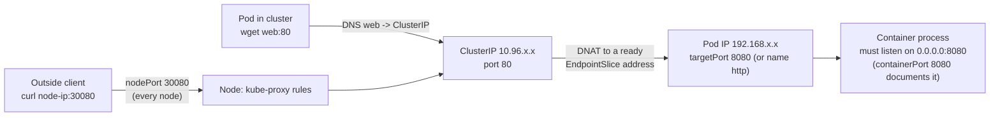
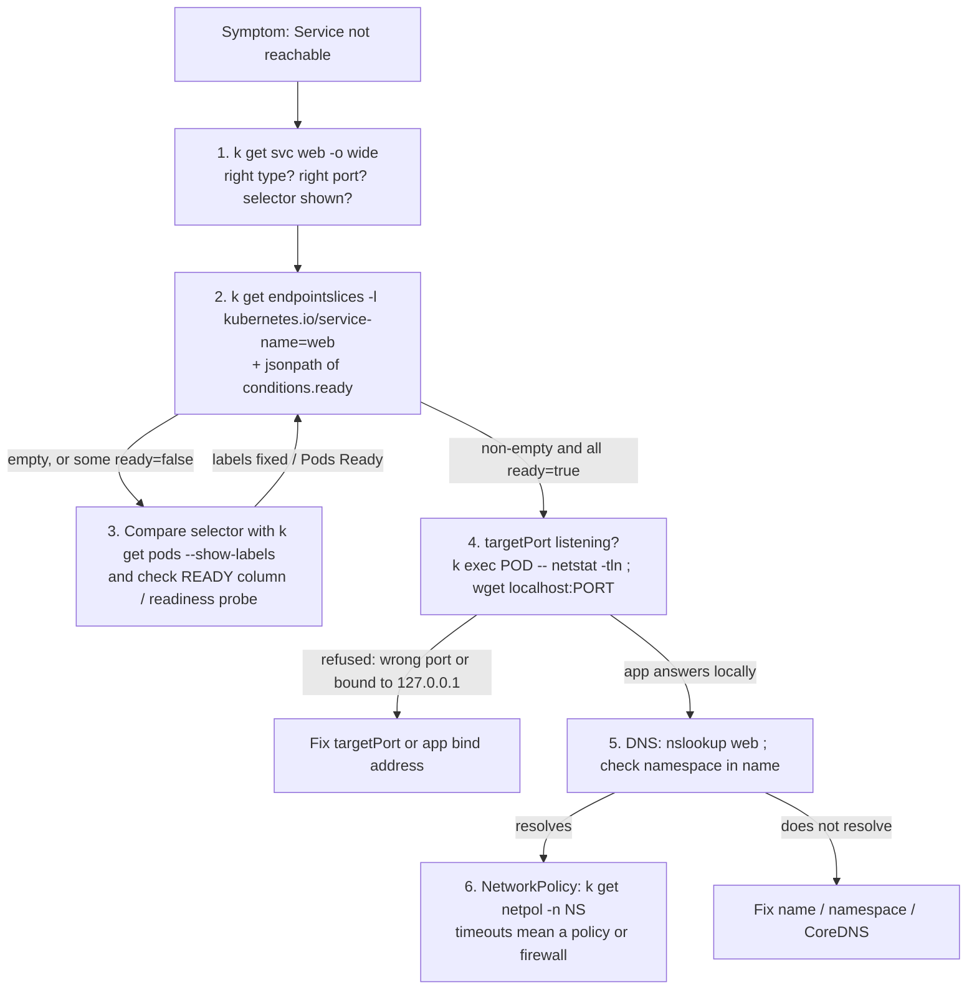

# T3.12 Provide and Troubleshoot Access to Applications via Services

> Competency: "Provide and troubleshoot access to applications via services" (CKAD-5.2) | Domain/weight: CKAD, Services and Networking (20%) | Est. time: 3 h | Prerequisites: T2.06, T3.09

Shell setup (from [conventions](../00-conventions.md); put it at the top of every session):

```bash
alias k=kubectl
export do="--dry-run=client -o yaml"
export now="--force --grace-period=0"
source <(kubectl completion bash); complete -o default -F __start_kubectl k
```

Lab environment for this lesson: **kind** (cluster `lab`, context `kind-lab`, Calico, port 30080 mapped). Namespace: `lab-t312`. Files go in `~/lab/t312/`.

> Output policy. kind is not installed on the machine where this lesson was written. Every output block below is labelled `EXPECTED OUTPUT (not captured)`. The shape of the output is correct for Kubernetes v1.37, but IP addresses, hash suffixes and ages will differ on your cluster. Section 11 lists everything to confirm on a live cluster.

---

## 1. Why this matters

A Pod IP changes every time the Pod is replaced. A **Service** gives a group of Pods one stable name and one stable virtual IP, and spreads traffic across them. In real life, "the app is unreachable" is almost always a Service problem: a label typo, a wrong target port, or a Pod that never becomes Ready. In the exam, a broken Service is a realistic break-fix task: you get a Deployment that works and a Service that does not, and you have to find which of a handful of small faults is the cause, quickly. This lesson gives you the types, the four different "port" fields, and a fixed debugging ladder you can run in under two minutes. The exam averages about 6 minutes per task (15-20 tasks in 2 hours; sources: [E2](https://docs.linuxfoundation.org/tc-docs/certification/tips-cka-and-ckad), [E3](https://docs.linuxfoundation.org/tc-docs/certification/faq-cka-ckad-cks)), so a repeatable ladder beats guessing.

For the basics (what a Service object is, what an EndpointSlice is, how kube-proxy uses them) see [T2.06](../part2-basics/T2.06-services-and-endpointslices-fundamentals.md). For how readiness probes decide whether a Pod is Ready, see [T3.09](../part3-ckad/T3.09-implement-probes-and-health-checks.md). This lesson builds on both and focuses on producing Services fast and fixing broken ones.

---

## 2. Concepts

### 2.1 What a Service is, and what problem it solves

Pods are disposable. A Deployment may replace a Pod at any time, and the new Pod gets a new IP. A client that hard-coded the old IP breaks. A Service solves this with three pieces:

1. **A stable identity**: a virtual IP (the **ClusterIP**) and a DNS name that never change while the Service exists.
2. **A selector**: a set of labels. Every Pod whose labels match is a backend.
3. **A port mapping**: which Service port clients use, and which Pod port receives the traffic.

Without a Service, every client would have to watch Pods itself. With a Service, clients just use `web:80`.

### 2.2 Under the hood

Knowing the mechanism makes debugging obvious. Here is what happens when you create a Service:

1. The API server stores the Service and picks a free ClusterIP from the service CIDR. (It also allocates a `nodePort` for NodePort and LoadBalancer types.)
2. The **EndpointSlice controller** (in kube-controller-manager) watches the Service and the Pods. It finds Pods whose labels match `spec.selector` and writes **EndpointSlice** objects (API group `discovery.k8s.io/v1`). Each slice lists Pod IPs, the target port numbers, and per-endpoint conditions: `ready`, `serving`, `terminating`. One slice holds up to 100 endpoints by default; bigger Services get several slices. Each slice carries the label `kubernetes.io/service-name=<service>`, which is how you find them.
3. **kube-proxy** runs on every node. It watches Services and EndpointSlices and writes packet rules in the kernel (iptables by default; nftables is also supported). The rule says: "a packet to ClusterIP:port gets its destination rewritten (DNAT) to one of the ready endpoint Pod IPs and the target port".
4. **CoreDNS** answers DNS names for Services by reading the same objects.

Three consequences you will use all the time:

- The ClusterIP is **virtual**. No interface holds it and no process listens on it. `ping <ClusterIP>` fails even when the Service works. Test with `wget`/`curl` to the port.
- The Service does not check that your container is listening. It only forwards. If `targetPort` is wrong, the connection is refused by the Pod, not by the Service.
- A Pod that is **not Ready** is marked `ready: false` in the EndpointSlice, and kube-proxy and DNS skip it. That is how a failing readiness probe makes a Service "go empty".

The old `Endpoints` API is **deprecated** (since v1.33). `k get endpoints` still works but prints a deprecation warning: `Warning: v1 Endpoints is deprecated in v1.33+; use discovery.k8s.io/v1 EndpointSlice`. Use EndpointSlices.

### 2.3 Service types

| Type | Reachable from | How it works | Key fields | Typical use | Risk / limit |
|---|---|---|---|---|---|
| `ClusterIP` (default) | Inside the cluster only | Virtual IP + kube-proxy DNAT | `port`, `targetPort` | Pod to Pod traffic, backends behind an Ingress | Not reachable from outside |
| `NodePort` | Outside, via `<any node IP>:<nodePort>`; also inside | A ClusterIP **plus** the same port opened on every node | `nodePort` (default range 30000-32767) | Quick external access, kind labs, behind an external LB | Port range is limited; nodePort values are cluster-wide unique; firewalls may block them |
| `LoadBalancer` | Outside, via an external IP | A NodePort **plus** a request to a cloud/MetalLB controller for an external LB | `loadBalancerClass`, `allocateLoadBalancerNodePorts` | Production on cloud | Needs a controller; otherwise `EXTERNAL-IP` stays `<pending>` |
| `ExternalName` | Inside the cluster | DNS only: returns a CNAME to another DNS name. No proxying, no ClusterIP | `externalName` | Give a stable in-cluster name to an outside service | Target must be a DNS name, not an IP; no ports or selector; HTTP `Host` header and TLS names may not match |
| Headless (`clusterIP: None`) | Inside the cluster | No virtual IP. DNS returns the Pod IPs directly | `clusterIP: None` | StatefulSets, clients that do their own load balancing | No load balancing by kube-proxy; clients must handle multiple IPs |

Details per type:

**ClusterIP.** The default. You rarely write `type: ClusterIP` because omitting `type` gives it. `clusterIP` itself is normally left empty so the API server assigns one. Setting it by hand to an address outside the service CIDR or already in use is rejected. The only special value is `None` (headless).

**NodePort.** If you omit `nodePort`, the API server picks a free one from the range. The range is set by the kube-apiserver flag `--service-node-port-range` and defaults to **30000-32767**. A value outside the range fails with:

EXPECTED OUTPUT (not captured):

```text
The Service "web" is invalid: spec.ports[0].nodePort: Invalid value: 40000: provided port is not in the valid range. The range of valid ports is 30000-32767
```

A value that another Service already holds fails with `provided port is already allocated`. A NodePort Service listens on **every** node, even nodes that run none of its Pods. kube-proxy forwards the packet to a ready endpoint, possibly on another node.

**LoadBalancer.** It is a superset of NodePort. A controller outside Kubernetes (a cloud provider's, or MetalLB on bare metal and kind) sees the Service, provisions a load balancer and writes its address into `status.loadBalancer.ingress`. Until that happens, `k get svc` shows `EXTERNAL-IP` as `<pending>`. If you do not need the node ports, set `allocateLoadBalancerNodePorts: false` (only if your LB can send traffic straight to Pods). `loadBalancerClass` picks which controller handles the Service when several are installed. `externalIPs` is *not* the same thing; see 2.12.

Runnable example:

```yaml
apiVersion: v1
kind: Service
metadata:
  name: web-lb
  namespace: lab-t312
spec:
  type: LoadBalancer             # a NodePort and ClusterIP are created as well
  # loadBalancerClass: metallb.io/metallb   # optional; only if several LB controllers exist (value depends on the controller: UNVERIFIED)
  selector:
    app: web
  ports:
  - name: http
    port: 80
    targetPort: http
```

On kind, MetalLB gives this Service an address. MetalLB needs two objects: an **IPAddressPool** (the range of addresses it may hand out, taken from the Docker network on kind) and an **L2Advertisement** (tells it to announce those addresses on the local network via ARP). Once both exist, the controller notices the Service, assigns the next free address and writes it into `status.loadBalancer.ingress`; `k get svc web-lb` then moves from `EXTERNAL-IP <pending>` to an address such as `172.18.255.200`. Whether `env/kind-addons.sh metallb` creates the pool and advertisement is listed in section 11. Without a pool the Service stays `<pending>` even with MetalLB installed.

EXPECTED OUTPUT (not captured):

```text
NAME     TYPE           CLUSTER-IP     EXTERNAL-IP      PORT(S)        AGE
web-lb   LoadBalancer   10.96.55.120   172.18.255.200   80:31522/TCP   10s
```

**ExternalName.** Example: a Service named `db` with `externalName: db.example.com`. A Pod that looks up `db` gets `CNAME db.example.com`, and then resolves that. No traffic passes through kube-proxy. Because there is no proxy, the client connects straight to the outside host, so if you point it at an HTTPS site, the certificate name will not match `db`. Giving an IP address in `externalName` is not a supported way to reach an IP (it is treated as a DNS-like string and does not work as expected); use a Service without a selector plus an EndpointSlice for IP targets.

**Headless.** `clusterIP: None`. The Service has no virtual IP. DNS for `name.ns.svc.cluster.local` returns one **A record per ready Pod**. kube-proxy ignores headless Services. A headless Service with a selector still gets EndpointSlices; the DNS server uses them. A headless Service **without** a selector gets no automatic EndpointSlices and no automatic DNS records for backends.

### 2.4 Four "port" fields (the most common confusion)

| Field | Where it lives | Meaning | Default | Invalid / risky values |
|---|---|---|---|---|
| `containerPort` | Pod spec `containers[].ports[]` | The port the container *says* it uses. **Documentation only**: it does not open or close anything. The app must still bind that port. | none | Declaring `containerPort: 80` while the app binds 8080 does not break anything, but it misleads and breaks *named* `targetPort` lookups |
| `port` | Service `spec.ports[]` | The port **clients use** on the Service (on the ClusterIP and, for NodePort, on the ClusterIP side) | required | 1-65535. Must be unique per protocol within the Service |
| `targetPort` | Service `spec.ports[]` | The port **on the Pod** that receives the traffic. A number, or the *name* of a container port | equal to `port` | Wrong number: `connection refused`. Name that no Pod defines: Service has empty endpoints for that port |
| `nodePort` | Service `spec.ports[]` (NodePort/LoadBalancer) | The port opened **on every node** | auto-allocated from 30000-32767 | Outside range: rejected. Already used: rejected |

Memorise the chain for NodePort. Traffic enters at `<node IP>:nodePort`, is mapped to `ClusterIP:port`, and ends up at `<Pod IP>:targetPort`, where the container process must be listening (the `containerPort` is where you document that).

If you write `port: 80` only, `targetPort` defaults to 80. That is why `k expose ... --port=80` against an app on 8080 gives "connection refused": you forgot `--target-port=8080`.

**Named ports.** A container can name its port, and a Service can point at the name:

```yaml
# in the Pod template
ports:
- name: http          # at most 15 characters, lower-case letters, digits, hyphen
  containerPort: 8080
# in the Service
targetPort: http      # a string means "look up the port with this name in each Pod"
```

Why bother: the Service no longer cares about the number. Two versions of the app may listen on different numbers (8080 and 9090) as long as both name the port `http`. The lookup is done per Pod. If a Pod has no container port with that name, it is not a backend for that Service port.

### 2.5 Multi-port Services

A Service may expose several ports. When there is more than one entry in `spec.ports`, **every entry must have a `name`**. Names must be unique within the Service, lower-case, DNS-label style. Without names the API server rejects the object:

EXPECTED OUTPUT (not captured):

```text
The Service "multi" is invalid: spec.ports[0].name: Required value
```

(The same applies for `spec.ports[1].name`.) A single-port Service may leave `name` out. The names also create SRV records (`_http._tcp.multi.ns.svc.cluster.local`) and are what Ingress/Gateway backends refer to.

### 2.6 Selectors, EndpointSlices and readiness

`spec.selector` is a map of labels. It is an **equality-only AND**: a Pod matches when it has *all* listed key=value pairs. There are no `matchExpressions` in a Service selector. Rules to remember:

- The selector is matched against **Pod labels** (`metadata.labels` in the Pod template), not against the Deployment's own labels and not against the Deployment's `spec.selector`. They are often equal, but they do not have to be.
- Selector typo = zero matching Pods = empty EndpointSlice. No error is raised anywhere.
- A Service **without** a selector is legal. Kubernetes then creates no EndpointSlices, and you manage them yourself (for IP targets outside the cluster).
- The Pod must be **Ready** to receive traffic. A Pod that fails its readiness probe is `Running` but `0/1` Ready, and its endpoint condition is `ready: false`. See [T3.09](../part3-ckad/T3.09-implement-probes-and-health-checks.md). A Pod is Ready only after its startup probe (if any) has succeeded **and** its readiness probe passes, so a Pod still starting up is also outside the endpoints. A liveness probe restarts the container but does not set Ready.
- Terminating Pods are marked `terminating: true`; new connections stop going to them while existing ones may drain.

Find the slices of a Service with its label:

```bash
k get endpointslices -l kubernetes.io/service-name=web
k get endpointslices -l kubernetes.io/service-name=web -o jsonpath='{range .items[*].endpoints[*]}{.addresses[0]}{"\t"}ready={.conditions.ready}{"\n"}{end}'
```

### 2.7 DNS names

CoreDNS gives every Service a name. The full form is `<service>.<namespace>.svc.<cluster-domain>`, and the cluster domain is `cluster.local` by default.

| Name used | Works from | Why |
|---|---|---|
| `web` | Pods in the **same** namespace | The Pod's `/etc/resolv.conf` has a search list that starts with its own namespace |
| `web.prod` | Any namespace | Search list adds `svc.cluster.local` |
| `web.prod.svc` | Any namespace | Search list adds `cluster.local` |
| `web.prod.svc.cluster.local` | Anywhere in the cluster | Fully qualified; most reliable |

Inside a Pod, `/etc/resolv.conf` looks like this (EXPECTED OUTPUT (not captured); the nameserver IP differs per cluster):

```text
search lab-t312.svc.cluster.local svc.cluster.local cluster.local
nameserver 10.96.0.10
options ndots:5
```

`ndots:5` means: a name with fewer than 5 dots is tried with each search suffix first. That is why `web` and `web.prod` work. The nameserver is the CoreDNS Service (`kube-dns`) ClusterIP.

**Headless per-Pod records.** For a normal Service, the name resolves to one ClusterIP. For a headless Service, `web-hl.ns.svc.cluster.local` returns **all** ready Pod IPs. In addition, when Pods have a `hostname` and a `subdomain` equal to the headless Service name, each gets its own record: `<pod-hostname>.<service>.<ns>.svc.cluster.local`. A StatefulSet sets both automatically if `spec.serviceName` names the headless Service, so Pods become `db-0.db-hl.ns.svc.cluster.local`, `db-1.db-hl...` with stable names across restarts. A Deployment's Pods do not get these per-Pod names unless you set `hostname` and `subdomain` yourself.

**Environment variables.** Pods started **after** a Service exists also get variables like `WEB_SERVICE_HOST` and `WEB_SERVICE_PORT`. Order-dependent and clutter-prone; prefer DNS.

### 2.8 sessionAffinity

By default kube-proxy picks a backend independently for each new connection (effectively random). `sessionAffinity: ClientIP` makes it pin each client source IP to one Pod.

```yaml
spec:
  sessionAffinity: ClientIP          # default: None
  sessionAffinityConfig:
    clientIP:
      timeoutSeconds: 3600           # default 10800 (3 h); valid 1-86400
```

Risks: it is keyed on the *source IP seen by kube-proxy*. If traffic arrives through a NodePort with `externalTrafficPolicy: Cluster`, the source is often rewritten to a node IP (see 2.9), so many clients look like one and all stick to the same Pod. It is IP-based only; it does not use cookies. Use Ingress-level affinity for cookie stickiness.

Demo (uses Service `web` and Deployment `web` from section 5; the page body contains the Pod name):

```bash
k -n lab-t312 patch svc web -p '{"spec":{"sessionAffinity":"ClientIP"}}'
k run t --rm -i --image=busybox:1.36 --restart=Never -n lab-t312 -- sh -c 'sleep 2; for i in 1 2 3 4 5 6; do wget -qO- -T2 web:80; done'
```

EXPECTED OUTPUT (not captured): all six lines name the same Pod, because every request comes from one source IP.

```text
hello from web-6d8f9c7b5d-4kq2z
hello from web-6d8f9c7b5d-4kq2z
hello from web-6d8f9c7b5d-4kq2z
hello from web-6d8f9c7b5d-4kq2z
hello from web-6d8f9c7b5d-4kq2z
hello from web-6d8f9c7b5d-4kq2z
```

Undo with `k -n lab-t312 patch svc web -p '{"spec":{"sessionAffinity":"None"}}'`; the same loop then usually shows both Pod names mixed (6 requests across 2 Pods can, by chance, hit one Pod only; re-run if so).

### 2.9 externalTrafficPolicy and internalTrafficPolicy

These apply to traffic that enters through a NodePort or LoadBalancer (external) or from Pods (internal).

| `externalTrafficPolicy` | Where traffic may go | Client source IP | Downside |
|---|---|---|---|
| `Cluster` (default) | Any ready endpoint in the cluster; kube-proxy may forward to another node | Often **lost** (SNAT to the node IP) | Extra hop; source IP not visible to the app |
| `Local` | Only endpoints on the node that received the packet | **Preserved** (no SNAT) | A node with no local endpoint drops the traffic; uneven load unless the LB health-checks nodes |

For `type: LoadBalancer` with `Local`, Kubernetes allocates a `healthCheckNodePort`; the load balancer probes it so that it only sends traffic to nodes that have an endpoint. `externalTrafficPolicy` is rejected on a plain ClusterIP Service.

Demo: set the policy on a NodePort Service and read the client address in the app's access log. The busybox `httpd` image used in the labs does not log client IPs, so this demo uses `nginx:1.27` (its access log starts each line with the client address). Run it after the namespace exists (`k create ns lab-t312`).

```bash
k -n lab-t312 create deploy src --image=nginx:1.27
k -n lab-t312 rollout status deploy/src
k -n lab-t312 expose deploy src --port=80 --type=NodePort --name=src
NP=$(k -n lab-t312 get svc src -o jsonpath='{.spec.ports[0].nodePort}'); echo "nodePort=$NP"

# which node runs the Pod, and what is that node's IP?
NODE=$(k -n lab-t312 get pod -l app=src -o jsonpath='{.items[0].spec.nodeName}'); echo "pod node=$NODE"
NODEIP=$(k get node $NODE -o jsonpath='{.status.addresses[?(@.type=="InternalIP")].address}'); echo "node ip=$NODEIP"
# a node that does NOT run the Pod
OTHER=$(k get nodes -o name | sed 's|node/||' | grep -v "$NODE" | head -1)
OTHERIP=$(k get node $OTHER -o jsonpath='{.status.addresses[?(@.type=="InternalIP")].address}'); echo "other ip=$OTHERIP"

# 1) Cluster (default): call a node that has no Pod
k run t --rm -i --image=busybox:1.36 --restart=Never -n lab-t312 -- sh -c "sleep 2; wget -qO- -T2 $OTHERIP:$NP >/dev/null"
k -n lab-t312 logs deploy/src --tail=1

# 2) Local: call the node that runs the Pod, then the other node
k -n lab-t312 patch svc src -p '{"spec":{"externalTrafficPolicy":"Local"}}'
k run t --rm -i --image=busybox:1.36 --restart=Never -n lab-t312 -- sh -c "sleep 2; wget -qO- -T2 $NODEIP:$NP >/dev/null"
k -n lab-t312 logs deploy/src --tail=1
k run t --rm -i --image=busybox:1.36 --restart=Never -n lab-t312 -- sh -c "sleep 2; wget -qO- -T2 $OTHERIP:$NP >/dev/null"
```

What you should see (EXPECTED OUTPUT, not captured):

- Step 1 (`Cluster`): the call works. The first field of the log line is **not** the test Pod's IP. It is the IP of the node that forwarded the packet (or a tunnel address), because the packet was SNATed on the hop to the Pod's node.
- Step 2, call to the node with the Pod (`Local`): the call works and the log line starts with the **test Pod's own IP** (the Pod IP of `t`, for example `192.168.110.9`). The source IP is preserved.
- Step 2, call to the other node (`Local`): `wget: download timed out` (or `can't connect`), because that node has no local endpoint and drops the traffic.

The exact address in step 1 depends on the CNI (Calico) and the kube-proxy mode; this is listed in section 11. The key difference to remember is the three outcomes above. Clean up with `k -n lab-t312 delete deploy,svc src`.

`internalTrafficPolicy: Local` (default `Cluster`) does the same for traffic from Pods: only endpoints on the *same node* are used, and if there are none, the traffic is dropped.

Related but different: **sessionAffinity** is about *which Pod* one client sticks to; **externalTrafficPolicy** is about *which nodes* are allowed to forward and whether the *source IP* survives.

### 2.10 trafficDistribution (awareness)

`spec.trafficDistribution` is a **hint** to kube-proxy to prefer topologically close endpoints. It does not guarantee anything and falls back to all endpoints when no close one is available.

| Value | Meaning |
|---|---|
| `PreferClose` | Prefer endpoints in the same zone as the client (the original value; now equivalent to `PreferSameZone`) |
| `PreferSameZone` | Same meaning as `PreferClose`, clearer name |
| `PreferSameNode` | Prefer an endpoint on the same node as the client, then fall back to the zone, then anywhere |

```yaml
spec:
  trafficDistribution: PreferSameNode
```

On kind there are no zone labels on nodes, so `PreferClose` has no visible effect. Treat this as awareness material for the exam: know the field exists and what the values mean. The stable/beta status of each value in v1.37 is UNVERIFIED here; see section 11.

### 2.11 port-forward to a Service

`k port-forward svc/web 8080:80` opens a tunnel from your terminal (local port 8080) through the API server to **one** Pod behind the Service (port 80 here is the Service `port`, and kubectl resolves it to that Pod's `targetPort`). It is for quick local testing and for checking an app that has no external access. It does **not** load balance (one Pod is chosen at start) and it dies when that Pod is deleted. It runs in the foreground; use a second terminal or `&`, then `curl localhost:8080`.

### 2.12 externalIPs is deprecated: do not use it

`spec.externalIPs` tells kube-proxy to accept traffic for an address you list, on any node that receives it. It was deprecated in v1.36. It is risky (it lets a user who can create a Service hijack traffic to an arbitrary IP, which is why it is a known security concern), and Kubernetes does not manage the IP. **Never use it as the solution to "make my app reachable from outside".** Use `NodePort`, `LoadBalancer` (with MetalLB where needed) or an Ingress/Gateway. This lesson uses `externalIPs` in no lab. The exact warning text printed by v1.37 is listed in section 11 as UNVERIFIED.

### 2.13 Related but different

- **Service vs Ingress/Gateway:** a Service gives L4 (TCP/UDP) access by IP and port. Ingress and Gateway add L7 (host and path routing) and sit in front of Services. See the Ingress lesson in Part 3.
- **Service vs NetworkPolicy:** a Service routes; a NetworkPolicy *allows or denies*. A correct Service can still time out because a policy drops the packets. A timeout is a policy-style symptom; "connection refused" is not.
- **`containerPort` vs `hostPort`:** `hostPort` binds a port on the node itself and is a different mechanism. Do not use it for Service access.

---

## 3. How it works (diagram)

### 3.1 The port chain



Walkthrough:

1. An outside client sends a packet to any node's IP on `nodePort` (30080). A Pod inside the cluster instead resolves `web` to the ClusterIP and uses `port` (80).
2. kube-proxy rules on that node treat both entry points the same way: the destination is the Service `ClusterIP:port`.
3. The rules choose one **ready** address from the Service's EndpointSlice and rewrite the destination to `PodIP:targetPort`.
4. The Pod's network namespace delivers the packet to whatever process listens on that port. If nothing listens there, or it listens on `127.0.0.1` only, the kernel answers with "connection refused".
5. Replies go back along the same path (with source rewriting as needed).

### 3.2 The debug ladder



Walkthrough:

1. Start at the Service object: type, ports, selector. Cheap and catches typos in `--port`.
2. The EndpointSlice is the truth about what the Service routes to. **Empty means no Pod matches the selector** (or, for a named `targetPort`, no Pod defines that port name). **Non-empty means the selector matches, but the Pods may still be not Ready**: the slice also lists not-ready Pods, with `ready: false`. So after a non-empty slice, always check the condition (rung 2b below).
3. When empty, compare the Service selector with `k get pods --show-labels`, then check `READY`. Rung 2b (when non-empty): `k get endpointslices -l kubernetes.io/service-name=web -o jsonpath='{range .items[*].endpoints[*]}{.addresses[0]} ready={.conditions.ready}{"\n"}{end}'`. Any `ready=false` means the Pod is listed but gets no traffic; go to `READY` and the readiness probe.
4. When the slice has ready endpoints but you still get "connection refused", the Service is fine; the Pod is not listening where `targetPort` says. Test from inside the Pod.
5. Only then look at DNS (wrong name, wrong namespace) and last at NetworkPolicy. A **timeout** points at policy or firewall. "Connection refused" is not conclusive on its own: it also appears when the Service has no endpoints, which is why rung 2 always comes before rung 4.
6. The lab app image is busybox, so the exec checks use `netstat -tln` (busybox has no `ss`). Use `ss -tln` when the image has it.

---

## 4. Commands and YAML you must produce fast

### 4.1 Imperative shortcuts

```bash
# Expose a Deployment. --port = Service port, --target-port = Pod port. Selector is copied from the Deployment's selector labels.
k expose deploy web --port=80 --target-port=8080 --type=NodePort

# Expose and name the Service differently from the Deployment.
k expose deploy web --name=web-svc --port=80 --target-port=8080

# Expose a Pod (uses the Pod's labels; the Pod must have labels. `k run` adds run=<name>).
k expose pod mypod --port=80 --target-port=8080 --name=mypod-svc

# Choose the nodePort: expose cannot. Generate YAML, add nodePort, apply.
k expose deploy web --port=80 --target-port=8080 --type=NodePort $do > svc.yaml

# Create a NodePort Service with a fixed nodePort directly. --tcp=<port>:<targetPort>
k create service nodeport web --tcp=80:8080 --node-port=30080

# Headless: expose with --cluster-ip=None, or create clusterip with None.
k expose deploy web --port=80 --target-port=8080 --cluster-ip=None --name=web-hl
k create service clusterip web-hl --clusterip=None --tcp=80:8080

# ExternalName and LoadBalancer
k create service externalname db --external-name=db.example.com
k create service loadbalancer web-lb --tcp=80:8080

# Inspect
k get svc web -o wide
k get endpointslices -l kubernetes.io/service-name=web
k describe svc web

# Local test through the API server tunnel
k port-forward svc/web 8080:80

# Test from inside the cluster (throw-away Pod, removed when finished)
k run t --rm -it --image=busybox:1.36 --restart=Never -- wget -qO- -T2 web.prod:80
```

What each important command does:

- `k expose deploy web --port=80 --target-port=8080 --type=NodePort` : creates Service `web` with `port: 80`, `targetPort: 8080`, `type: NodePort`, and a selector copied from the Deployment's selector labels. The nodePort is auto-allocated.
- `k create service nodeport web --tcp=80:8080 --node-port=30080` : same idea but with a fixed nodePort. **Trap:** this command always sets the selector to `app=web` (the Service name). If your Pods carry a different label (for example `run=web`), the endpoints stay empty. Check with `k get svc web -o wide` (column `SELECTOR`).
- `k get svc web -o wide` : adds the `SELECTOR` column. First thing to read when debugging.
- `k get endpointslices -l kubernetes.io/service-name=web` : the endpoint list.
- `k port-forward svc/web 8080:80` : local port 8080 to Service port 80 (one Pod).
- `k run t --rm -it --image=busybox:1.36 --restart=Never -- wget -qO- -T2 web.prod:80` : runs a one-off Pod that fetches `web.prod:80` and prints the body. `-q` quiet, `-O-` write to stdout, `-T2` 2-second timeout so a broken Service fails fast instead of hanging. `--rm` deletes the Pod on exit, `--restart=Never` makes it a bare Pod instead of a Deployment. Note: `web.prod` means Service `web` in namespace `prod`.

EXPECTED OUTPUT (not captured): `k expose` on success.

```text
service/web exposed
```

`k expose` flags worth knowing: `--selector` (override the selector), `--protocol` (`TCP`, `UDP`, `SCTP`), `--session-affinity` (`None` or `ClientIP`), `--labels`, `--cluster-ip=None`. Do not use `--external-ip`: it sets `externalIPs`, which is deprecated (see 2.12).

### 4.2 NodePort Service with a named targetPort (YAML)

The Pod template names its port `http`. The Service uses that name as `targetPort` and fixes the nodePort at 30080. This Deployment works on kind (busybox `httpd` listens on 8080).

```yaml
apiVersion: apps/v1
kind: Deployment
metadata:
  name: web
  namespace: lab-t312
spec:
  replicas: 2
  selector:
    matchLabels:
      app: web                    # must equal the Pod template labels below
  template:
    metadata:
      labels:
        app: web                  # THIS is what the Service selector matches
    spec:
      containers:
      - name: web
        image: busybox:1.36
        command: ["sh", "-c"]
        args:
        - mkdir -p /www && echo "hello from $(hostname)" > /www/index.html && exec httpd -f -p 8080 -h /www
        ports:
        - name: http              # port name, <= 15 chars; a Service targetPort can refer to it
          containerPort: 8080     # documentation: the port the process binds
        readinessProbe:
          httpGet:
            path: /               # httpd serves /www/index.html at "/"
            port: http            # probes can use the port name too
          periodSeconds: 3
---
apiVersion: v1
kind: Service
metadata:
  name: web
  namespace: lab-t312
spec:
  type: NodePort                  # default is ClusterIP
  selector:
    app: web                      # equality AND against Pod labels
  ports:
  - name: http                    # optional for one port, mandatory for several
    protocol: TCP                 # default TCP; UDP and SCTP also valid
    port: 80                      # what clients use on the ClusterIP
    targetPort: http              # container port NAME (or a number such as 8080); default = port
    nodePort: 30080               # 30000-32767; omit to auto-allocate; unique cluster-wide
```

Risky values: `nodePort: 80` (outside the range, rejected), `targetPort: http` while the Pod names the port `web` (Service has no endpoints for the port), `selector.app: wbe` (empty endpoints, no error).

### 4.3 Headless Service for a StatefulSet (YAML)

```yaml
apiVersion: v1
kind: Service
metadata:
  name: db-hl
  namespace: lab-t312
spec:
  clusterIP: None                 # headless: no virtual IP, DNS returns Pod IPs
  selector:
    app: db                       # matches the StatefulSet Pod template labels
  ports:
  - name: http
    port: 80
    targetPort: http
---
apiVersion: apps/v1
kind: StatefulSet
metadata:
  name: db
  namespace: lab-t312
spec:
  serviceName: db-hl              # makes Pods db-0.db-hl..., db-1.db-hl...  (must name the headless Service)
  replicas: 2
  selector:
    matchLabels:
      app: db
  template:
    metadata:
      labels:
        app: db
    spec:
      containers:
      - name: db
        image: busybox:1.36
        command: ["sh", "-c"]
        args:
        - mkdir -p /www && echo "I am $(hostname)" > /www/index.html && exec httpd -f -p 8080 -h /www
        ports:
        - name: http
          containerPort: 8080
        readinessProbe:
          httpGet:
            path: /
            port: http
          periodSeconds: 3
```

Per-Pod DNS names created: `db-0.db-hl.lab-t312.svc.cluster.local` and `db-1.db-hl.lab-t312.svc.cluster.local`. A StatefulSet does not create the Service for you; you must create the headless Service yourself. `publishNotReadyAddresses: true` (a Service field, default `false`) would publish records for Pods that are not Ready; leave it off unless you need peers to find each other before readiness.

### 4.4 More YAML: multi-port, session affinity, ExternalName

```yaml
apiVersion: v1
kind: Service
metadata:
  name: multi
  namespace: lab-t312
spec:
  selector:
    app: api
  sessionAffinity: ClientIP         # optional; pins a client IP to one Pod
  sessionAffinityConfig:
    clientIP:
      timeoutSeconds: 3600
  ports:
  - name: http                      # names are required because there are two ports
    port: 80
    targetPort: http
  - name: admin
    port: 9090
    targetPort: admin
---
apiVersion: v1
kind: Service
metadata:
  name: ext-db
  namespace: lab-t312
spec:
  type: ExternalName
  externalName: db.example.com      # a DNS name, not an IP; no selector, no ports needed
```

### 4.5 Speed drill

Targets assume the lab cluster from section 7 and namespace `lab-t312`. Setup for drills 1-7: `k create ns lab-t312; k create deploy web --image=nginx:1.27 --replicas=2 -n lab-t312` (nginx listens on 80; for drills 2-3 and 6 pretend the app is on 8080, since only the Service object is checked). Do each without looking. Answers are collapsed.

1. (1 min) Deployment `web` (image `nginx:1.27`, 2 replicas) exists. Create a ClusterIP Service `web` on port 80 that forwards to container port 80.
<details><summary>Answer</summary>

```bash
k expose deploy web --port=80 -n lab-t312
```
`targetPort` defaults to `port`.
</details>

2. (1.5 min) Same Deployment, but the app listens on 8080. Expose it as a NodePort Service `web-np` on Service port 80.
<details><summary>Answer</summary>

```bash
k expose deploy web --name=web-np --port=80 --target-port=8080 --type=NodePort -n lab-t312
```
</details>

3. (2 min) Make that NodePort exactly 30080 without deleting the Service.
<details><summary>Answer</summary>

```bash
k patch svc web-np -n lab-t312 --type=json -p '[{"op":"replace","path":"/spec/ports/0/nodePort","value":30080}]'
```
The nodePort field is mutable; the port just has to be free and in range. (Alternative: `k edit svc web-np`.)
</details>

4. (2 min) Create a NodePort Service `api` with Service port 80, target port 8080, nodePort 30081 using one command. Which selector will it have?
<details><summary>Answer</summary>

```bash
k create service nodeport api --tcp=80:8080 --node-port=30081 -n lab-t312
```
The selector is `app=api`. Pods must carry that label or you must edit the selector.
</details>

5. (1.5 min) Print only the ready endpoint IPs of Service `web`.
<details><summary>Answer</summary>

```bash
k get endpointslices -n lab-t312 -l kubernetes.io/service-name=web \
  -o jsonpath='{range .items[*].endpoints[?(@.conditions.ready==true)]}{.addresses[0]}{"\n"}{end}'
```
Plain `jsonpath` has filter support, no `jq` needed (`jq` is not guaranteed on exam hosts; E9 lists kubectl, yq, curl, wget, man).
</details>

6. (1.5 min) From a throw-away Pod, fetch Service `web` in namespace `lab-t312` with a 2-second timeout, from the `default` namespace.
<details><summary>Answer</summary>

```bash
k run t --rm -it --image=busybox:1.36 --restart=Never -- wget -qO- -T2 web.lab-t312:80
```
</details>

7. (2 min) Create a headless Service `web-hl` for the Pods of Deployment `web` on port 80 and write its YAML to `~/lab/t312/hl.yaml` without applying it.
<details><summary>Answer</summary>

```bash
k expose deploy web --name=web-hl --cluster-ip=None --port=80 -n lab-t312 $do > ~/lab/t312/hl.yaml
```
`expose` copies the Deployment's selector (`app=web`) into the YAML. (`k create service clusterip web-hl --clusterip=None --tcp=80:80` also works but sets the selector to `app=web-hl`, which you would then have to edit.)
</details>

8. (2 min) Create an ExternalName Service `legacy` pointing at `legacy.example.org`.
<details><summary>Answer</summary>

```bash
k create service externalname legacy --external-name=legacy.example.org -n lab-t312
```
</details>

**Cleanup (required before section 5):** the drills leave Deployment `web`, several Services and nodePorts 30080 and 30081 allocated. Remove everything so the next section starts clean:

```bash
k delete ns lab-t312
rm -f ~/lab/t312/hl.yaml ~/lab/t312/svc.yaml
```

---

## 5. Worked example

Goal: deploy an app that listens on 8080, reach it three ways (ClusterIP from inside, NodePort from the host, port-forward), then break it and walk the debug ladder. Environment: kind cluster `lab`.

### Step 0. Prepare

```bash
k config use-context kind-lab
k create ns lab-t312
mkdir -p ~/lab/t312 && cd ~/lab/t312
```

### Step 1. Create the Deployment

Save the full YAML of 4.2 (Deployment and Service, with the port name and readiness probe) as `~/lab/t312/web.yaml`, then apply it:

```bash
k apply -f web.yaml
k -n lab-t312 rollout status deploy/web
k -n lab-t312 get pods -o wide --show-labels
```

EXPECTED OUTPUT (not captured):

```text
deployment "web" successfully rolled out
NAME                   READY   STATUS    RESTARTS   AGE   IP               NODE          LABELS
web-6d8f9c7b5d-4kq2z   1/1     Running   0          20s   192.168.171.65   lab-worker    app=web,pod-template-hash=6d8f9c7b5d
web-6d8f9c7b5d-x9m7p   1/1     Running   0          20s   192.168.110.2    lab-worker2   app=web,pod-template-hash=6d8f9c7b5d
```

Read it: both Pods are `1/1` Ready and have the label `app=web`. That label is what the Service must select.

### Step 2. The Service and the port chain

```bash
k -n lab-t312 get svc web -o wide
k -n lab-t312 get endpointslices -l kubernetes.io/service-name=web
```

EXPECTED OUTPUT (not captured):

```text
NAME   TYPE       CLUSTER-IP     EXTERNAL-IP   PORT(S)        AGE   SELECTOR
web    NodePort   10.96.141.23   <none>        80:30080/TCP   30s   app=web

NAME        ADDRESSTYPE   PORTS   ENDPOINTS                       AGE
web-7xk2p   IPv4          8080    192.168.171.65,192.168.110.2    30s
```

Read it: `80:30080/TCP` is `port:nodePort`. The EndpointSlice shows `PORTS 8080` (the resolved `targetPort`) and two Pod IPs. The named `targetPort: http` was resolved to 8080 per Pod.

### Step 3. Test from inside (ClusterIP path)

```bash
k run t --rm -it --image=busybox:1.36 --restart=Never -n lab-t312 -- wget -qO- -T2 web:80
k run t --rm -it --image=busybox:1.36 --restart=Never -- wget -qO- -T2 web.lab-t312:80
```

EXPECTED OUTPUT (not captured):

```text
hello from web-6d8f9c7b5d-4kq2z
pod "t" deleted
hello from web-6d8f9c7b5d-x9m7p
pod "t" deleted
```

Read it: the first call (same namespace) uses the short name `web`. The second runs in `default` and needs `web.lab-t312`. Different Pods may answer on different calls: that is the load balancing.

### Step 4. Test from the host (NodePort path)

```bash
curl -s localhost:30080
k get nodes -o wide
```

EXPECTED OUTPUT (not captured):

```text
hello from web-6d8f9c7b5d-x9m7p
NAME                STATUS   ROLES           AGE   VERSION   INTERNAL-IP   ...
lab-control-plane   Ready    control-plane   1h    v1.37.0   172.18.0.4    ...
lab-worker          Ready    <none>          1h    v1.37.0   172.18.0.3    ...
lab-worker2         Ready    <none>          1h    v1.37.0   172.18.0.2    ...
```

Why `localhost:30080` works: `env/kind.yaml` has `extraPortMappings` that publishes the control-plane node container's port 30080 on the host's port 30080. The control-plane node's kube-proxy then forwards to a Pod on any node (the NodePort is open on every node). The node `INTERNAL-IP`s are Docker network addresses; on Linux you can often curl them directly, but on macOS/Windows Docker Desktop you cannot, which is why the port mapping exists. Only 30080 is mapped; another NodePort such as 30081 would not be reachable from the host.

### Step 5. port-forward

```bash
k -n lab-t312 port-forward svc/web 8080:80 &
sleep 1; curl -s localhost:8080; kill %1
```

EXPECTED OUTPUT (not captured):

```text
Forwarding from 127.0.0.1:8080 -> 8080
Forwarding from [::1]:8080 -> 8080
hello from web-6d8f9c7b5d-4kq2z
```

Read it: you asked for Service port 80, kubectl chose one Pod and forwarded to that Pod's `targetPort` 8080.

### Step 6. Break it and run the ladder

Inject a typo into the Service selector:

```bash
k -n lab-t312 patch svc web -p '{"spec":{"selector":{"app":"wbe"}}}'
k run t --rm -it --image=busybox:1.36 --restart=Never -- wget -qO- -T2 web.lab-t312:80
```

EXPECTED OUTPUT (not captured):

```text
wget: can't connect to remote host (10.96.141.23): Connection refused
pod "t" deleted
```

Note: with no endpoints, kube-proxy in iptables mode (the kind default) installs a REJECT rule for the Service, so the client normally sees `Connection refused`, the same text as a wrong `targetPort`. In other proxy modes you may see a timeout instead (listed in section 11). The lesson: "refused" does not prove the Service has endpoints. Always run rung 2 (EndpointSlice) before you conclude "wrong port". Run the ladder.

**Rung 1: the Service.**

```bash
k -n lab-t312 get svc web -o wide
```

EXPECTED OUTPUT (not captured):

```text
NAME   TYPE       CLUSTER-IP     EXTERNAL-IP   PORT(S)        AGE   SELECTOR
web    NodePort   10.96.141.23   <none>        80:30080/TCP   5m    app=wbe
```

Type and ports are right. The selector `app=wbe` looks suspicious.

**Rung 2: the EndpointSlice.**

```bash
k -n lab-t312 get endpointslices -l kubernetes.io/service-name=web
```

EXPECTED OUTPUT (not captured):

```text
NAME        ADDRESSTYPE   PORTS     ENDPOINTS   AGE
web-7xk2p   IPv4          <unset>   <unset>     5m
```

No endpoints: the problem is on the Pod side. Skip rungs 4-6.

**Rung 3: labels and readiness.**

```bash
k -n lab-t312 get pods --show-labels
k -n lab-t312 get pods -l app=wbe
```

EXPECTED OUTPUT (not captured):

```text
NAME                   READY   STATUS    RESTARTS   AGE   LABELS
web-6d8f9c7b5d-4kq2z   1/1     Running   0          6m    app=web,pod-template-hash=6d8f9c7b5d
web-6d8f9c7b5d-x9m7p   1/1     Running   0          6m    app=web,pod-template-hash=6d8f9c7b5d
No resources found in lab-t312 namespace.
```

Pods are Ready and labelled `app=web`. The Service wants `app=wbe`. Fix:

```bash
k -n lab-t312 patch svc web -p '{"spec":{"selector":{"app":"web"}}}'
k -n lab-t312 get endpointslices -l kubernetes.io/service-name=web
```

EXPECTED OUTPUT (not captured):

```text
NAME        ADDRESSTYPE   PORTS   ENDPOINTS                       AGE
web-7xk2p   IPv4          8080    192.168.171.65,192.168.110.2    6m
```

**Rung 4: is the target port listening? (when endpoints exist but the connection fails)**

Make a second fault: wrong target port.

```bash
k -n lab-t312 patch svc web --type=json -p '[{"op":"replace","path":"/spec/ports/0/targetPort","value":80}]'
k run t --rm -it --image=busybox:1.36 --restart=Never -- wget -qO- -T2 web.lab-t312:80
k -n lab-t312 exec deploy/web -- netstat -tln
k -n lab-t312 exec deploy/web -- wget -qO- -T2 localhost:8080
```

EXPECTED OUTPUT (not captured):

```text
wget: can't connect to remote host (10.96.141.23): Connection refused
pod "t" deleted
Active Internet connections (only servers)
Proto Recv-Q Send-Q Local Address           Foreign Address         State
tcp        0      0 0.0.0.0:8080            0.0.0.0:*               LISTEN
hello from web-6d8f9c7b5d-4kq2z
```

Read it: the Service has endpoints (rung 2 is clean) but the connection is refused. The process listens on `0.0.0.0:8080` and answers locally, so the Service's `targetPort: 80` is wrong. If `netstat` had shown `127.0.0.1:8080`, the app would be bound to loopback only and unreachable from other Pods even with the right port; the fix is the app's bind address, not the Service. (`netstat` is a busybox applet here, used instead of `ss` because the busybox image has no `ss`. Many production images have neither; then try `k debug`, or use `wget`/`curl` against `localhost`.) Restore the Service:

```bash
k -n lab-t312 patch svc web --type=json -p '[{"op":"replace","path":"/spec/ports/0/targetPort","value":"http"}]'
```

**Rung 5: DNS.**

```bash
k run t --rm -it --image=busybox:1.36 --restart=Never -- nslookup web.lab-t312
```

EXPECTED OUTPUT (not captured):

```text
Server:		10.96.0.10
Address:	10.96.0.10:53

Name:	web.lab-t312.svc.cluster.local
Address: 10.96.141.23
```

If the name does not resolve, check the namespace in the name (`web` from another namespace fails) and `k -n kube-system get pods -l k8s-app=kube-dns`.

**Rung 6: NetworkPolicy.**

```bash
k -n lab-t312 get netpol
```

EXPECTED OUTPUT (not captured):

```text
No resources found in lab-t312 namespace.
```

No policy, so policy is not the cause. If a policy selected the Pods, traffic from your test Pod would be dropped silently and `wget` would time out.

Clean up the worked example before starting the labs: `k delete ns lab-t312; rm -f ~/lab/t312/web.yaml`.

---

## 6. Common mistakes and how to fix them

| Symptom | What you will see (exact text) | Cause | Fix (command) |
|---|---|---|---|
| Endpoints empty: Service gets no traffic | `k get endpointslices -l kubernetes.io/service-name=web` shows `ENDPOINTS <unset>`; `wget: download timed out` (or `Connection refused`) | Selector does not match any Pod label, or Pods are not Ready | `k get svc web -o wide` then `k get pods --show-labels`; fix with `k patch svc web -p '{"spec":{"selector":{"app":"web"}}}'` or fix the readiness probe |
| Connection refused | `wget: can't connect to remote host (10.96.x.x): Connection refused` / `curl: (7) Failed to connect ... Couldn't connect to server` | `targetPort` is wrong, or the app listens on `127.0.0.1` only | `k exec POD -- netstat -tln`; fix `targetPort` with `k patch svc ...` or change the app to bind `0.0.0.0` |
| NodePort unreachable from outside | `curl: (7) Failed to connect to localhost port 30081`, `Connection refused` or timeout, while `k get svc` shows `80:30081/TCP` | Cloud/host firewall blocks it, or on kind the port is not in `extraPortMappings` (only 30080 is), or you used a wrong node IP | Use mapped port 30080 (`nodePort: 30080`), or `curl <node-internal-IP>:<nodePort>` from where the Docker network is reachable; add the port to `extraPortMappings` and recreate the cluster; open the firewall |
| LoadBalancer stays pending | `k get svc` shows `EXTERNAL-IP   <pending>` forever | No LoadBalancer implementation in the cluster | Install MetalLB (`env/kind-addons.sh metallb`), or switch to `NodePort` |
| Pod Running but listed with `ready=false` | Pod shows `0/1 Running`; `k describe pod` Events: `Readiness probe failed: HTTP probe failed with statuscode: 404` | Readiness probe failing; the Pod is listed in the EndpointSlice with `ready=false` and gets no traffic | Fix probe path/port; see [T3.09](../part3-ckad/T3.09-implement-probes-and-health-checks.md) |
| Multi-port Service rejected | `The Service "multi" is invalid: spec.ports[0].name: Required value` | More than one port and no names | Add `name:` to every port |
| NodePort rejected | `provided port is not in the valid range. The range of valid ports is 30000-32767` or `provided port is already allocated` | Value outside the range, or taken by another Service | Pick a free value in the range; `k get svc -A \| grep 30080` |
| Name does not resolve from another namespace | `nslookup: can't resolve 'web'` / `bad address 'web'` | Short name only works in the Service's own namespace | Use `web.<ns>` or the FQDN |
| `k create service nodeport` gives empty endpoints | `SELECTOR app=web` but Pods have `run=web` | The command hard-codes `app=<name>` | `k patch svc web -p '{"spec":{"selector":{"run":"web"}}}'` |
| Source IP lost | App logs show a node IP instead of the client IP | `externalTrafficPolicy: Cluster` (default) SNATs | `k patch svc web -p '{"spec":{"externalTrafficPolicy":"Local"}}'` |
| Deprecation noise | `Warning: v1 Endpoints is deprecated in v1.33+; use discovery.k8s.io/v1 EndpointSlice` | You ran `k get endpoints` | Use `k get endpointslices -l kubernetes.io/service-name=...` |

### Reasoning on the four failures from the entry

**1. Empty endpoints (selector mismatch or Pods not Ready).**
Order: `k get svc web -o wide` (read `SELECTOR`), then `k get endpointslices -l kubernetes.io/service-name=web` (empty), then `k get pods --show-labels` and `k get pods -l <selector>` (does the Service selector match any Pod at all?). If the selector matches Pods, look at the `READY` column: `0/1` means readiness is failing; `k describe pod <p>` Events show `Readiness probe failed: ...`. How to read: *no Pods match* => fix the selector (or the Pod labels in the Deployment template); *Pods match but are 0/1* => fix the probe or the app. Remember that the EndpointSlice may still list a not-ready Pod's IP with `ready=false`; check the condition, not just the address: `k get endpointslices -l kubernetes.io/service-name=web -o jsonpath='{range .items[*].endpoints[*]}{.addresses[0]} ready={.conditions.ready}{"\n"}{end}'`. Fix, then re-run the endpoint check and confirm the slice lists the Pods as ready.

**2. Connection refused (wrong targetPort, or bind address).**
"Refused" means a TCP reset. It has two common sources: (a) the packet reached a Pod and nothing listened on that port, or (b) the Service has **no endpoints** and kube-proxy rejected the connection itself. So "refused" alone does not prove the selector is fine: run rung 2 (EndpointSlice) first. If the slice has ready endpoints, source (a) is the cause. Check: `k get svc web -o yaml | grep -A4 ports` (what is `targetPort`?), `k get endpointslices ...` (the `PORTS` column shows the resolved target port), then inside the Pod `k exec POD -- netstat -tln` (or `ss -tln` when available). Read the `Local Address` column: `0.0.0.0:8080` or `:::8080` is reachable from other Pods; `127.0.0.1:8080` is **loopback only**, so a local `wget localhost:8080` works but the Service does not. Fix the Service `targetPort` if the numbers differ; fix the app's bind address or its config (for example `--bind 0.0.0.0`) if it listens on loopback.

**3. NodePort unreachable from outside (firewall / kind port mapping).**
First prove the Service works inside the cluster (`wget web.<ns>:80` from a test Pod). Then prove the NodePort works from inside the cluster network: `k get nodes -o wide` for a node `INTERNAL-IP`, then `k run t --rm -it --image=busybox:1.36 --restart=Never -- wget -qO- -T2 <node-ip>:30080`. If both work, the cluster is fine and the block is between you and the node: a host/cloud firewall, a security group, or (kind) a missing `extraPortMappings` entry. In kind, the only host-visible NodePort is 30080 in our `env/kind.yaml`. Fix: use `nodePort: 30080`, or add a mapping to the kind config and recreate the cluster (mappings cannot be added to a running cluster), or `k port-forward` instead. The mapping, in the `control-plane` node entry of `env/kind.yaml`, looks like this (add a line per extra port, then `kind delete cluster --name lab && env/kind-up.sh`):

```yaml
    extraPortMappings:
      - { containerPort: 30080, hostPort: 30080, protocol: TCP }
      - { containerPort: 30081, hostPort: 30081, protocol: TCP }   # example extra port
```

**4. LoadBalancer `EXTERNAL-IP <pending>`.**
Check `k get svc web-lb` and `k describe svc web-lb`: no Events from a controller and no `status.loadBalancer.ingress`. Check whether any LB controller exists: `k get pods -A | grep -i -E 'metallb|cloud-controller'`. Without one, `<pending>` never changes. Fix by installing MetalLB (`env/kind-addons.sh metallb`, which also needs an address pool) or by using `type: NodePort`. Note the NodePort part of a LoadBalancer Service still works while it is pending, so you can reach the app through `<node-ip>:<nodePort>`.

---

## 7. Labs

Environment for all labs: **kind**, cluster `lab`, context `kind-lab`, 1 control plane + 2 workers, Calico, created with `env/kind-up.sh` (port 30080 mapped). Run `k config use-context kind-lab` first. All outputs below are EXPECTED OUTPUT (not captured).

### 7.1 Lab Easy: ClusterIP and NodePort for one app

**Setup**

```bash
k config use-context kind-lab
k create ns lab-t312
mkdir -p ~/lab/t312 && cd ~/lab/t312
cat > easy-deploy.yaml <<'EOF'
apiVersion: apps/v1
kind: Deployment
metadata:
  name: web
  namespace: lab-t312
spec:
  replicas: 2
  selector:
    matchLabels:
      app: web
  template:
    metadata:
      labels:
        app: web
    spec:
      containers:
      - name: web
        image: busybox:1.36
        command: ["sh", "-c"]
        args:
        - mkdir -p /www && echo "hello from $(hostname)" > /www/index.html && exec httpd -f -p 8080 -h /www
        ports:
        - name: http
          containerPort: 8080
        readinessProbe:
          httpGet:
            path: /
            port: http
          periodSeconds: 3
EOF
k apply -f easy-deploy.yaml
k -n lab-t312 rollout status deploy/web
```

**Task**

In namespace `lab-t312` Deployment `web` listens on port 8080. Create:

1. A ClusterIP Service `web` that serves port 80 and forwards to the container port 8080.
2. A NodePort Service `web-np` that serves port 80, forwards to 8080, and uses node port 30080.
3. Test both. From a throw-away Pod fetch `web:80` and save the output to `~/lab/t312/easy-clusterip.txt`. From the host fetch `localhost:30080` and save the output to `~/lab/t312/easy-nodeport.txt`.

**Hints**

<details><summary>Hint 1</summary>

`k expose deploy web --port=80 --target-port=8080 -n lab-t312` makes the ClusterIP. Give the second one a different name with `--name`.
</details>
<details><summary>Hint 2</summary>

`expose` cannot choose `nodePort`. Use `k create service nodeport web-np --tcp=80:8080 --node-port=30080 -n lab-t312`, then check the selector: it will be `app=web-np`, which does not match your Pods.
</details>
<details><summary>Hint 3</summary>

Use `$do` to generate YAML, edit `selector` and `nodePort`, apply. Or patch the selector after `create service`.
</details>

<details><summary>Solution</summary>

```bash
# 1. ClusterIP (type omitted = ClusterIP). --target-port is needed because the app is on 8080, not 80.
k expose deploy web --port=80 --target-port=8080 -n lab-t312

# 2. NodePort with a fixed nodePort. create service sets selector app=web-np, so fix it to app=web.
k create service nodeport web-np --tcp=80:8080 --node-port=30080 -n lab-t312
k patch svc web-np -n lab-t312 -p '{"spec":{"selector":{"app":"web"}}}'

# 3. Test
k run t --rm -i --image=busybox:1.36 --restart=Never -n lab-t312 -- sh -c 'sleep 2; wget -qO- -T2 web:80' > ~/lab/t312/easy-clusterip.txt
curl -s localhost:30080 > ~/lab/t312/easy-nodeport.txt
```

Why each step: `--target-port=8080` fixes the Service-to-Pod hop. `--node-port=30080` is needed so the Docker port mapping on the control-plane node (30080) lines up with the Service. The selector patch is needed because `create service` hard-codes `app=<service name>`; without it `web-np` has no endpoints. The `-i` (no `-t`) is used so that stdout can be redirected. The `sleep 2` gives `kubectl run` time to attach before the output is produced; without it the first bytes can be lost. If a verification `grep` fails because a line is missing or `pod "t" deleted` is mixed in, re-run the command.
</details>

**Verification**

```bash
k -n lab-t312 get svc web web-np -o wide
k -n lab-t312 get endpointslices -l kubernetes.io/service-name=web-np
test "$(k -n lab-t312 get svc web-np -o jsonpath='{.spec.ports[0].nodePort}')" = "30080" && echo nodeport-ok
grep -q "hello from web-" ~/lab/t312/easy-clusterip.txt && echo clusterip-ok
grep -q "hello from web-" ~/lab/t312/easy-nodeport.txt && echo nodeport-reach-ok
```

EXPECTED OUTPUT (not captured):

```text
NAME     TYPE        CLUSTER-IP      EXTERNAL-IP   PORT(S)        AGE   SELECTOR
web      ClusterIP   10.96.88.10     <none>        80/TCP         1m    app=web
web-np   NodePort    10.96.201.77    <none>        80:30080/TCP   1m    app=web
NAME           ADDRESSTYPE   PORTS   ENDPOINTS                      AGE
web-np-k4t2q   IPv4          8080    192.168.171.66,192.168.110.3   1m
nodeport-ok
clusterip-ok
nodeport-reach-ok
```

**Cleanup**

```bash
k delete ns lab-t312
rm -f ~/lab/t312/easy-*
```

### 7.2 Lab Medium: multi-port Service with named ports and a headless Service with per-Pod DNS

**Setup**

```bash
k config use-context kind-lab
k create ns lab-t312
mkdir -p ~/lab/t312 && cd ~/lab/t312
cat > medium-base.yaml <<'EOF'
apiVersion: apps/v1
kind: Deployment
metadata:
  name: api
  namespace: lab-t312
spec:
  replicas: 2
  selector:
    matchLabels:
      app: api
  template:
    metadata:
      labels:
        app: api
    spec:
      containers:
      - name: api
        image: busybox:1.36
        command: ["sh", "-c"]
        args:
        - mkdir -p /www /adm && echo "api $(hostname)" > /www/index.html && echo "admin $(hostname)" > /adm/index.html && httpd -p 8080 -h /www && exec httpd -f -p 9090 -h /adm
        ports:
        - name: http
          containerPort: 8080
        - name: admin
          containerPort: 9090
        readinessProbe:
          httpGet:
            path: /
            port: http
          periodSeconds: 3
---
apiVersion: apps/v1
kind: StatefulSet
metadata:
  name: db
  namespace: lab-t312
spec:
  serviceName: db-hl
  replicas: 2
  selector:
    matchLabels:
      app: db
  template:
    metadata:
      labels:
        app: db
    spec:
      containers:
      - name: db
        image: busybox:1.36
        command: ["sh", "-c"]
        args:
        - mkdir -p /www && echo "I am $(hostname)" > /www/index.html && exec httpd -f -p 8080 -h /www
        ports:
        - name: http
          containerPort: 8080
        readinessProbe:
          httpGet:
            path: /
            port: http
          periodSeconds: 3
EOF
k apply -f medium-base.yaml
k -n lab-t312 rollout status deploy/api
k -n lab-t312 rollout status sts/db
```

**Task**

In namespace `lab-t312`:

1. Create a ClusterIP Service `api` that exposes two ports: `http` (Service port 80 to the container port named `http`) and `admin` (Service port 9090 to the container port named `admin`). Use port names for the targets, not numbers.
2. Create a headless Service `db-hl` for the StatefulSet `db` (selector `app=db`, port 80 to the named port `http`).
3. From a throw-away Pod, record in `~/lab/t312/medium-answer.txt`, one per line: the response of `api:80`, the response of `api:9090`, the response of `db-0.db-hl:80`, and the output of `nslookup db-hl` (the A records).

**Hints**

<details><summary>Hint 1</summary>

With two ports, both entries need `name`. `k create service clusterip` only sets numbers; generate with `$do` and edit `targetPort` to the names, or write the YAML (see 4.4).
</details>
<details><summary>Hint 2</summary>

A headless Service is `clusterIP: None`. For per-Pod DNS the StatefulSet's `serviceName` must equal the Service name (it is already `db-hl`). The record is `db-0.db-hl.lab-t312.svc.cluster.local`, short form `db-0.db-hl`.
</details>
<details><summary>Hint 3</summary>

Run one test Pod with `k run t --rm -i ... -- sh -c '...'` and put several commands inside it, then redirect once.
</details>

<details><summary>Solution</summary>

```bash
cat > medium-svc.yaml <<'EOF'
apiVersion: v1
kind: Service
metadata:
  name: api
  namespace: lab-t312
spec:
  selector:
    app: api
  ports:
  - name: http
    port: 80
    targetPort: http
  - name: admin
    port: 9090
    targetPort: admin
---
apiVersion: v1
kind: Service
metadata:
  name: db-hl
  namespace: lab-t312
spec:
  clusterIP: None
  selector:
    app: db
  ports:
  - name: http
    port: 80
    targetPort: http
EOF
k apply -f medium-svc.yaml

k run t --rm -i --image=busybox:1.36 --restart=Never -n lab-t312 -- sh -c '
sleep 2
wget -qO- -T2 api:80
wget -qO- -T2 api:9090
wget -qO- -T2 db-0.db-hl:80
nslookup db-hl | grep Address' > ~/lab/t312/medium-answer.txt
```

Why: a Service with two ports needs both named, otherwise the API server rejects it. `targetPort: http` and `targetPort: admin` are resolved to 8080 and 9090 by looking up each Pod's container port names. `clusterIP: None` makes DNS return Pod IPs; `db-0.db-hl` works because the StatefulSet Pod `db-0` has hostname `db-0` and subdomain `db-hl`. All requests run in the `lab-t312` namespace (`-n lab-t312`), so short names resolve. The `-i` without `-t` allows output redirection.
</details>

**Verification**

```bash
k -n lab-t312 get svc api db-hl
k -n lab-t312 get endpointslices -l kubernetes.io/service-name=api
grep -q "^api api-" ~/lab/t312/medium-answer.txt && echo http-ok
grep -q "^admin api-" ~/lab/t312/medium-answer.txt && echo admin-ok
grep -q "^I am db-0" ~/lab/t312/medium-answer.txt && echo perpod-dns-ok
test "$(grep -c '^Address' ~/lab/t312/medium-answer.txt)" -ge 3 && echo headless-two-ips-ok
test "$(k -n lab-t312 get svc db-hl -o jsonpath='{.spec.clusterIP}')" = "None" && echo headless-ok
```

EXPECTED OUTPUT (not captured):

```text
NAME    TYPE        CLUSTER-IP     EXTERNAL-IP   PORT(S)           AGE
api     ClusterIP   10.96.30.5     <none>        80/TCP,9090/TCP   20s
db-hl   ClusterIP   None           <none>        80/TCP            20s
NAME        ADDRESSTYPE   PORTS       ENDPOINTS                      AGE
api-b7m2x   IPv4          8080,9090   192.168.171.70,192.168.110.8   20s
http-ok
admin-ok
perpod-dns-ok
headless-two-ips-ok
headless-ok
```

(The `Address` count test: the DNS server line plus two Pod IP lines gives at least 3 `Address` lines.)

**Cleanup**

```bash
k delete ns lab-t312
rm -f ~/lab/t312/medium-*
```

### 7.3 Lab Break-fix: three faults, restore access

**Setup (fault injection script)**

Save as `break.sh` and run it. It creates Deployment `shop` and Service `shop` with three faults. It also prepares a verification command.

```bash
mkdir -p ~/lab/t312 && cd ~/lab/t312
cat > break.sh <<'EOF'
#!/usr/bin/env bash
set -e
k() { kubectl "$@"; }
k config use-context kind-lab
k get ns lab-t312 >/dev/null 2>&1 || k create ns lab-t312
cat <<'YAML' | kubectl apply -f -
apiVersion: apps/v1
kind: Deployment
metadata:
  name: shop
  namespace: lab-t312
spec:
  replicas: 2
  selector:
    matchLabels:
      app: shop
  template:
    metadata:
      labels:
        app: shop
    spec:
      containers:
      - name: shop
        image: busybox:1.36
        command: ["sh", "-c"]
        args:
        - mkdir -p /www && echo "shop is open ($(hostname))" > /www/index.html && exec httpd -f -p 8080 -h /www
        ports:
        - name: http
          containerPort: 8080
        readinessProbe:
          httpGet:
            path: /ready
            port: 8080
          periodSeconds: 3
---
apiVersion: v1
kind: Service
metadata:
  name: shop
  namespace: lab-t312
spec:
  selector:
    app: shopp
  ports:
  - name: http
    port: 80
    targetPort: 80
YAML
echo "Faults injected. Do not read this script until you have finished."
EOF
chmod +x break.sh && ./break.sh
```

**Task**

In namespace `lab-t312`, users report that Service `shop` is not reachable. Do not change the Deployment image or the container command. Fix the objects so that `wget -qO- -T2 shop.lab-t312:80` from a Pod in the `default` namespace returns the shop page, and both `shop` Pods are Ready and are the endpoints of the Service. Save the final output of the wget in `~/lab/t312/bf-out.txt`.

**Hints**

<details><summary>Hint 1</summary>

Run the ladder in order. `k get svc shop -o wide`, then `k get endpointslices -l kubernetes.io/service-name=shop`. What does the second command tell you about where the problem is?
</details>
<details><summary>Hint 2</summary>

There is more than one fault, and fixing one reveals the next. Do not guess: after each fix re-run the ladder from rung 1. Once endpoints exist, check `k get pods` for `READY` and `k describe pod` Events.
</details>
<details><summary>Hint 3</summary>

Look inside a Pod: `k -n lab-t312 exec deploy/shop -- netstat -tln` shows what port the app really listens on. `k -n lab-t312 describe pod -l app=shop | grep -i -A3 readiness` shows the probe.
</details>

<details><summary>Solution</summary>

Run the ladder, noting which rung each fault appears on.

Rung 1 and 2 (find fault 1, selector):

```bash
k -n lab-t312 get svc shop -o wide
k -n lab-t312 get endpointslices -l kubernetes.io/service-name=shop
k -n lab-t312 get pods --show-labels
```
The Service `SELECTOR` is `app=shopp`, the endpoint list is empty, and the Pods have `app=shop`. Fix:

```bash
k -n lab-t312 patch svc shop -p '{"spec":{"selector":{"app":"shop"}}}'
```

Rung 3 (find fault 3, readiness): the selector now matches, but the Pods show `0/1` Ready.

```bash
k -n lab-t312 get pods
k -n lab-t312 describe pod -l app=shop | grep -i readiness
k -n lab-t312 get endpointslices -l kubernetes.io/service-name=shop \
  -o jsonpath='{range .items[*].endpoints[*]}{.addresses[0]} ready={.conditions.ready}{"\n"}{end}'
```
Events say `Readiness probe failed: HTTP probe failed with statuscode: 404`, and the endpoints show `ready=false`. The probe path `/ready` does not exist. (Do not touch the container command; the page is served at `/`.) Fix the probe in the Deployment, which triggers a rollout:

```bash
k -n lab-t312 patch deploy shop --type=json -p '[{"op":"replace","path":"/spec/template/spec/containers/0/readinessProbe/httpGet/path","value":"/"}]'
k -n lab-t312 rollout status deploy/shop
```

Rung 4 (find fault 2, targetPort): the Pods are Ready and the endpoint list is full, but the request still fails with `Connection refused`.

```bash
k run t --rm -it --image=busybox:1.36 --restart=Never -- wget -qO- -T2 shop.lab-t312:80
k -n lab-t312 get endpointslices -l kubernetes.io/service-name=shop
k -n lab-t312 exec deploy/shop -- netstat -tln
```
The EndpointSlice `PORTS` column says `80`, but `netstat` shows the app on `0.0.0.0:8080`. Fix the Service to use the named port (or 8080):

```bash
k -n lab-t312 patch svc shop --type=json -p '[{"op":"replace","path":"/spec/ports/0/targetPort","value":"http"}]'
```

Final check and output file:

```bash
k run t --rm -i --image=busybox:1.36 --restart=Never -- sh -c 'sleep 2; wget -qO- -T2 shop.lab-t312:80' > ~/lab/t312/bf-out.txt
```
If `bf-out.txt` lacks the page text, re-run the command (the attach can drop early output).

Why the order matters: while the selector is wrong there are no endpoints, so you cannot see the port or readiness problems. While the Pods are not Ready, the Service routes nowhere even with the right port. Each fix reveals the next fault. NetworkPolicy (rung 6) was not involved; `k -n lab-t312 get netpol` returns nothing.
</details>

**Verification**

```bash
test "$(k -n lab-t312 get svc shop -o jsonpath='{.spec.selector.app}')" = "shop" && echo selector-ok
test "$(k -n lab-t312 get deploy shop -o jsonpath='{.status.readyReplicas}')" = "2" && echo ready-ok
k -n lab-t312 get endpointslices -l kubernetes.io/service-name=shop -o jsonpath='{range .items[*].endpoints[*]}{.conditions.ready}{"\n"}{end}' | sort | uniq -c
k -n lab-t312 get endpointslices -l kubernetes.io/service-name=shop -o jsonpath='{.items[0].ports[0].port}{"\n"}'
grep -q "shop is open" ~/lab/t312/bf-out.txt && echo reach-ok
```

EXPECTED OUTPUT (not captured):

```text
selector-ok
ready-ok
      2 true
8080
reach-ok
```

**Cleanup**

```bash
k delete ns lab-t312
rm -f ~/lab/t312/bf-out.txt ~/lab/t312/break.sh
```

---

## 8. Exam tips

- **Use the ladder, in order.** `k get svc -o wide` (selector, ports), `k get endpointslices -l kubernetes.io/service-name=X` (empty or not), Pod labels and `READY`, `exec` into the Pod to check the port, then DNS, then NetworkPolicy. An empty slice never needs rungs 4-6. A **timeout** points to a drop (NetworkPolicy, firewall, wrong node IP). "Refused" is ambiguous: it can be a wrong port or bind address, or a Service with no endpoints (kube-proxy rejects), so always look at the EndpointSlice before concluding "wrong port".
- **Imperative first, YAML only for `nodePort`.** `k expose deploy NAME --port=P --target-port=T --type=NodePort` is the fastest path. If a fixed `nodePort` is required, use `k create service nodeport NAME --tcp=P:T --node-port=N` and then **check the selector** (it is hard-coded to `app=NAME`), or generate with `$do` and add `nodePort:`.
- **Test from a throw-away Pod, with a timeout.** `k run t --rm -it --image=busybox:1.36 --restart=Never -- wget -qO- -T2 svc.ns:port`. The exam hosts provide kubectl, curl, wget, yq and man (E9: [tips page](https://docs.linuxfoundation.org/tc-docs/certification/tips-cka-and-ckad)), but not necessarily `jq`, `ss`, or tools inside your app's image. Use `jsonpath` instead of `jq`.
- **Do not reach for `externalIPs` to make an app reachable.** It is deprecated; use NodePort, or Ingress/Gateway. A LoadBalancer Service only gets an address if the cluster has a controller; if a task asks for `type: LoadBalancer`, create the Service object correctly, and know that `EXTERNAL-IP <pending>` means no controller is installed, not that your YAML is wrong.
- **Docs pages to open** (allowed, E13: [allowed resources](https://docs.linuxfoundation.org/tc-docs/certification/certification-resources-allowed)): the Service concept page `https://kubernetes.io/docs/concepts/services-networking/service/` (field examples, NodePort, headless, ExternalName), the debug page `https://kubernetes.io/docs/tasks/debug/debug-application/debug-service/` (the official ladder), `https://kubernetes.io/docs/concepts/services-networking/dns-pod-service/` (DNS names), `https://kubernetes.io/docs/tutorials/services/connect-applications-service/` (worked tutorial).
- **Traps to check before moving on:** namespace flag on every command (`-n`); the name used in the test (`web` only works in the same namespace); `targetPort` vs the port the app binds; labels on the *Pod template*, not just the Deployment; `READY 1/1` before blaming the Service; a second port added to a Service needs names on all ports.

---

## 9. Quick review

1. What command creates a NodePort Service `web` on port 80 to container port 8080 for Deployment `web`?
<details><summary>Answer</summary>

`k expose deploy web --port=80 --target-port=8080 --type=NodePort`
</details>

2. What is the difference between `port`, `targetPort`, `nodePort` and `containerPort`?
<details><summary>Answer</summary>

`port`: the Service's port (what clients use on the ClusterIP). `targetPort`: the Pod port the Service forwards to (number or container port name; defaults to `port`). `nodePort`: the port opened on every node (30000-32767 by default). `containerPort`: documentation in the Pod spec about the port the process uses; it does not open or block anything.
</details>

3. Why does `k expose deploy web --port=80` give "connection refused" when the app listens on 8080?
<details><summary>Answer</summary>

`targetPort` defaults to `port` (80). The Service forwards to Pod port 80, where nothing listens. Add `--target-port=8080`.
</details>

4. Which command lists the backing endpoints of Service `web`, and why not `k get endpoints`?
<details><summary>Answer</summary>

`k get endpointslices -l kubernetes.io/service-name=web`. The Endpoints API is deprecated (v1.33+); EndpointSlices are the current API, and kube-proxy uses them.
</details>

5. The EndpointSlice is empty. What are the two likely causes and how do you tell them apart?
<details><summary>Answer</summary>

(1) The Service selector does not match any Pod label: `k get pods -l <selector>` returns nothing. (2) The Pods match but are not Ready: they show `0/1` and `k describe pod` Events show readiness failures. Compare `k get svc -o wide` with `k get pods --show-labels`, then look at `READY`.
</details>

6. Why must every port in a multi-port Service have a name?
<details><summary>Answer</summary>

When there is more than one port, names are the only way to tell entries apart (and for SRV records and references from Ingress/Gateway). The API server rejects the Service with `spec.ports[0].name: Required value`.
</details>

7. What are the DNS names for Service `web` in namespace `prod`, and what is a headless Service's per-Pod name for StatefulSet Pod `db-0` with headless Service `db-hl` in `prod`?
<details><summary>Answer</summary>

`web` (only inside `prod`), `web.prod`, `web.prod.svc`, `web.prod.svc.cluster.local`. Per-Pod: `db-0.db-hl.prod.svc.cluster.local`.
</details>

8. What does `externalTrafficPolicy: Local` change, and what is the downside?
<details><summary>Answer</summary>

Only endpoints on the receiving node get the traffic, and the client source IP is preserved (no SNAT). A node with no local endpoint drops the traffic, so load can be uneven.
</details>

9. The Service has ready endpoints and `wget` from another Pod says `Connection refused`. What do you check next and what could be the cause besides the wrong `targetPort`?
<details><summary>Answer</summary>

Check inside the Pod with `k exec POD -- netstat -tln` (or `ss -tln`) and `wget localhost:PORT`. The app may be bound to `127.0.0.1` only, which is reachable locally but not from other Pods. Fix the app's bind address.
</details>

10. `k get svc` shows `EXTERNAL-IP <pending>` for a LoadBalancer Service. Why, and what are two ways forward?
<details><summary>Answer</summary>

No LoadBalancer controller is installed. Install MetalLB (or run on a cloud with a cloud controller), or use `type: NodePort` and reach the app at `<node-ip>:<nodePort>`.
</details>

11. Why should you not use `spec.externalIPs`?
<details><summary>Answer</summary>

It was deprecated in v1.36. Kubernetes does not manage the address, and it lets someone with Service-create rights attract traffic for arbitrary IPs. Use NodePort, LoadBalancer or Ingress/Gateway.
</details>

12. What does `trafficDistribution: PreferClose` do?
<details><summary>Answer</summary>

It is a hint: prefer endpoints in the same zone as the client, fall back to all endpoints. `PreferSameNode` prefers an endpoint on the same node. Not a guarantee.
</details>

---

## 10. References

Kubernetes docs (allowed in the exam):

- https://kubernetes.io/docs/concepts/services-networking/service/
- https://kubernetes.io/docs/tasks/debug/debug-application/debug-service/
- https://kubernetes.io/docs/concepts/services-networking/dns-pod-service/
- https://kubernetes.io/docs/tutorials/services/connect-applications-service/

Exam facts used in this lesson:

- https://docs.linuxfoundation.org/tc-docs/certification/tips-cka-and-ckad (E2, E9)
- https://docs.linuxfoundation.org/tc-docs/certification/faq-cka-ckad-cks (E3)
- https://docs.linuxfoundation.org/tc-docs/certification/certification-resources-allowed (E13)

Coverage references (study only, not copied):

- R6 bmuschko/ckad-study-guide: https://github.com/bmuschko/ckad-study-guide (chapter 21)
- R2 dgkanatsios/CKAD-exercises: https://github.com/dgkanatsios/CKAD-exercises
- R3 bmuschko/ckad-crash-course: https://github.com/bmuschko/ckad-crash-course
- R14 The Kubernetes Networking Guide: https://www.tkng.io/

Prerequisite lessons:

- [T2.06 Services and EndpointSlices fundamentals](../part2-basics/T2.06-services-and-endpointslices-fundamentals.md)
- [T3.09 Implement probes and health checks](../part3-ckad/T3.09-implement-probes-and-health-checks.md)

---

## 11. To verify

None of the commands in this lesson was run on a live cluster (kind and multipass are not installed on the machine where it was written). Every output block is `EXPECTED OUTPUT (not captured)`. Confirm on kind v0.33.0 with `kindest/node:v1.37.0`:

1. All output blocks in sections 4.1, 5, and 7 (the shapes of `get svc -o wide`, `get endpointslices`, `wget` errors, `netstat` output, `nslookup` output, IP addresses and names).
2. NodePort default range 30000-32767 on the v1.37 kube-apiserver, and the exact validation error text for an out-of-range and an already-allocated nodePort.
3. The `externalIPs` deprecation: confirm it is deprecated in v1.36 as the topic entry states, and capture the exact warning text v1.37 prints when a Service sets `externalIPs`. Marked UNVERIFIED here.
4. kind `extraPortMappings` for 30080: `curl localhost:30080` reaches the app via the control-plane node, and other NodePorts (for example 30081) are not reachable from the host.
5. Whether `k get endpointslices` prints the addresses of not-ready Pods in the `ENDPOINTS` column (the lesson assumes it may, and tells the learner to check `.conditions.ready` with jsonpath).
6. Whether the empty-endpoints failure shows `wget: download timed out` or `Connection refused` on this kube-proxy mode (iptables on kind); text is mode-dependent.
7. `trafficDistribution`: the values `PreferClose`, `PreferSameZone` and `PreferSameNode` and their stable/beta status in v1.37.
8. Exact error text for a multi-port Service without names (`spec.ports[N].name: Required value`) and the Deployment-bound `externalTrafficPolicy` validation on a ClusterIP Service.
9. busybox:1.36 applets used: `httpd -f -p 8080 -h /www`, `netstat -tln`, `nslookup`, `wget -T`. In particular check `nslookup db-hl` output lines for the `Address` count in the medium lab verification.
10. `k create service clusterip web-hl --clusterip=None --tcp=80:80` flag spelling (`--clusterip`) and `k create service nodeport` selector default `app=<name>`.
11. `env/kind-addons.sh metallb` installs an address pool that makes `EXTERNAL-IP` leave `<pending>` (not shown in a lab here).
12. The default `sessionAffinityConfig.clientIP.timeoutSeconds` (10800) and valid range (1-86400), and `PreferClose` being an alias of `PreferSameZone`.
13. The Endpoints deprecation warning text: `Warning: v1 Endpoints is deprecated in v1.33+; use discovery.k8s.io/v1 EndpointSlice`.
14. The busybox `ndots:5` resolv.conf lines in section 2.7 (cluster-domain and nameserver IP differ per cluster).
15. Section 2.8/2.9 demos: six-request loop pinned to one Pod with `sessionAffinity: ClientIP`; the client address seen in the nginx log with `externalTrafficPolicy: Local` versus `Cluster` (CNI and kube-proxy dependent).
16. The LoadBalancer example: whether `env/kind-addons.sh metallb` creates the IPAddressPool and L2Advertisement, the pool range, and the correct `loadBalancerClass` value for MetalLB (shown commented out and UNVERIFIED).
17. Empty-endpoints symptom: iptables mode gives `Connection refused` (kube-proxy REJECT); confirm, and note the symptom in nftables mode.
