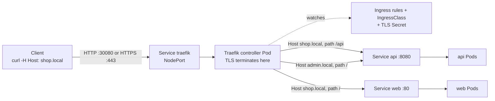

# T3.13 Use Ingress Rules to Expose Applications

> Competency: "Use Ingress rules to expose applications" (CKAD-5.3) | Domain/weight: CKAD, Services and Networking (20%) | Est. time: 2.5 h | Prerequisites: T3.12, T3.04

Shell setup (from [conventions](../00-conventions.md); put it at the top of every session):

```bash
alias k=kubectl
export do="--dry-run=client -o yaml"
export now="--force --grace-period=0"
source <(kubectl completion bash); complete -o default -F __start_kubectl k
```

Lab environment for this lesson: **kind** (3 nodes, host port 30080 mapped) plus **Traefik v3.7.16** installed with Helm. Namespace: `lab-t313`. Files go in `~/lab/t313/`.

> Output policy. Output blocks marked `REAL OUTPUT (kind v0.33.0, v1.37.0)` were captured on a real kind cluster running `kindest/node:v1.37.0` (1 control plane, 2 workers), kubectl client v1.37.1, Traefik chart 42.1.3 (Traefik v3.7.16). That cluster used kind's default CNI (kindnet), not Calico, because Ingress does not depend on the CNI. Pod IPs (`10.244.x.x`), ages and hash suffixes will differ on your cluster. Blocks marked `EXPECTED OUTPUT (not captured)` were not run. Section 11 lists everything that is still open.

---

## 1. Why this matters

A Service gives you a stable address inside the cluster. It does not give you host names, URL paths or HTTPS. If you expose ten web apps with ten NodePort or LoadBalancer Services, you get ten ports or ten cloud load balancers. An **Ingress** is one entry point that reads the HTTP `Host` header and the URL path and sends each request to the right Service, and it can end TLS (HTTPS) in one place.

In real life the usual failures are quiet ones: a wrong class name so that no controller picks up the Ingress, a wrong Service port so that you get `404`, a certificate in the wrong namespace so that browsers see the wrong certificate. In the CKAD, "Use Ingress rules to expose applications" is a named competency (CKAD-5.3, Services and Networking, 20%). The exam averages about 6 minutes per task (15-20 tasks in 2 hours; sources: [E2](https://docs.linuxfoundation.org/tc-docs/certification/tips-cka-and-ckad), [E3](https://docs.linuxfoundation.org/tc-docs/certification/faq-cka-ckad-cks)), so you need the imperative command and a fixed debugging path, not trial and error.

One more fact shapes this lesson. The Ingress API is **frozen**: it is GA and will stay, but it gets no new features, and the Kubernetes project points new work to the Gateway API. The community controller **ingress-nginx is retired** (see section 2.12). So the lab uses Traefik, a maintained controller. Which controller the exam cluster uses is **UNVERIFIED** ([E23](https://docs.linuxfoundation.org/tc-docs/certification/tips-cka-and-ckad) lists it as unknown), which is why this lesson teaches the controller-independent parts first and shows you how to find the class name on any cluster.

This lesson builds on [T3.12](../part3-ckad/T3.12-provide-and-troubleshoot-access-to-applications.md) (Services, ports, EndpointSlices; an Ingress backend is always a Service) and [T3.04](../part3-ckad/T3.04-create-consume-secrets.md) (Secrets, including `kubernetes.io/tls`). It does not re-teach them.

---

## 2. Concepts

### 2.1 What an Ingress is, and what problem it solves

An **Ingress** (`networking.k8s.io/v1`, short name `ing`) is a set of HTTP/HTTPS routing rules stored in the API. A rule says: "requests for host H and path P go to Service S on port N." It also can say "serve TLS for these hosts using this certificate."

The problem it solves: Services work at layer 4 (IP and port). A NodePort or LoadBalancer Service cannot look inside an HTTP request. Without Ingress you need one external port or load balancer per app, and each app must handle its own TLS. With Ingress you run one shared entry point and many routing rules.

What breaks without it: you cannot say "`shop.example.com/api` goes to the API and `shop.example.com/` goes to the web app" on one IP and one port.

### 2.2 An Ingress needs a controller (Under the hood)

An Ingress object is only data in etcd. **Nothing happens when you create it** unless an **Ingress controller** is running in the cluster. The controller is a normal Pod (here, Traefik) with a reverse proxy inside. It does this loop:

1. It **watches** the API server for Ingress, IngressClass, Service, EndpointSlice and Secret objects.
2. It **translates** the rules into its own proxy configuration (routers, certificates, backend server lists).
3. It **receives traffic** on ports 80 and 443 (through a NodePort or LoadBalancer Service in front of it) and forwards each request to a Pod of the backend Service, using the Pod addresses it learns from the EndpointSlices (I did not inspect Traefik's internal config; `k describe ingress` shows the same Pod IPs next to each backend, and that is your diagnostic).

Kubernetes does not ship a controller. The API server only validates the Ingress object (see the errors in section 2.5). That is why "I created the Ingress and nothing works" is the most common Ingress problem.

| Piece | What it is | Who owns it |
|---|---|---|
| Ingress | Routing rules (data) | You |
| IngressClass | Names a controller and says "Ingresses of this class belong to it" | Cluster admin / controller install |
| Ingress controller | Pod that reads the rules and proxies the traffic | Cluster admin |
| Service in front of the controller | How traffic from outside reaches the controller Pod (NodePort or LoadBalancer) | Cluster admin |
| Backend Service + Pods | The apps | You |

### 2.3 IngressClass and `spec.ingressClassName`

A cluster can run more than one controller (for example one public, one internal). **IngressClass** is how an Ingress says which controller should handle it. It is a cluster-scoped object whose key field is `spec.controller`, a string that the controller recognizes.

REAL OUTPUT (kind v0.33.0, v1.37.0):

```
$ k get ingressclass traefik -o yaml        # trimmed
apiVersion: networking.k8s.io/v1
kind: IngressClass
metadata:
  annotations:
    ingressclass.kubernetes.io/is-default-class: "true"
  name: traefik
spec:
  controller: traefik.io/ingress-controller
```

The Ingress selects its class with `spec.ingressClassName: traefik`. The Traefik Helm chart creates an IngressClass named `traefik` (checked with `helm template` and on the live cluster).

**Default class.** The annotation `ingressclass.kubernetes.io/is-default-class: "true"` on an IngressClass marks it as the default. When you create an Ingress **without** `ingressClassName`, the API server fills in the default class at creation time. `k get ingressclass` shows `(default)` next to the name.

REAL OUTPUT (kind v0.33.0, v1.37.0):

```
$ k get ingressclass
NAME                CONTROLLER                      PARAMETERS   AGE
traefik (default)   traefik.io/ingress-controller   <none>       6m45s
```

I created an Ingress without a class while the annotation was present. It was stored with `CLASS traefik`. With the annotation removed, a new Ingress without a class was stored with `CLASS <none>`:

```
NAME       CLASS    HOSTS          ADDRESS   PORTS   AGE
noclass2   <none>   nocls2.local             80      0s
```

Traefik still served that class-less Ingress (`curl` returned `web`, `200`). That is Traefik behaviour. Other controllers ignore Ingresses that have no class, so never rely on this. The Kubernetes docs also say that if two IngressClasses are marked default, the API server rejects new Ingresses that omit `ingressClassName` (this was not tested here).

| `ingressClassName` value | What happens |
|---|---|
| Matches an IngressClass whose controller is running | That controller serves the Ingress |
| Omitted, a default class exists | API server sets the default class, then it works as above |
| Omitted, no default class | Controller-specific. Traefik serves it; many others ignore it |
| Names a class that no controller owns (for example `nginx` on a Traefik cluster) | **Ignored silently.** No error, no event. Traefik answers `404` |

The old `kubernetes.io/ingress.class` annotation is the pre-1.18 way of choosing a class. It is deprecated. Use `spec.ingressClassName`.

**Related but different.** `IngressClass.spec.parameters` lets a class point to a controller-specific config object. You do not need it for the CKAD.

### 2.4 The Ingress structure: rules, hosts, paths, backends

```yaml
spec:
  ingressClassName: traefik
  rules:
  - host: shop.local            # optional; omit = match every host
    http:
      paths:
      - path: /api
        pathType: Prefix        # required
        backend:
          service:
            name: api
            port:
              number: 8080      # or "name: http", never both
```

| Field | Meaning | Default / required | Invalid or risky values |
|---|---|---|---|
| `spec.ingressClassName` | Which controller owns this Ingress | Default class if one exists | A name no controller owns: silently ignored |
| `rules[].host` | Host the rule applies to, compared with the `Host` header. Wildcards like `*.example.com` are allowed by the API. | Omitted = all hosts | The docs say the host must be a DNS name, not an IP (not tested here) |
| `rules[].http.paths[].path` | URL path to match | Must start with `/` for `Exact` and `Prefix` | `x` fails: see below |
| `rules[].http.paths[].pathType` | How to compare the path | **Required** | Missing fails: see below |
| `backend.service.name` | Service in the **same namespace** as the Ingress | Required | Typo: controller drops the route |
| `backend.service.port.number` or `.name` | Service port (not the container port) | Exactly one of them | Both set: API rejects |

An Ingress can only reference Services in its own namespace. This is why a single Ingress cannot route to a Service in another namespace.

**Port name vs number.** `port.name` refers to the **name of the port in the Service** (`spec.ports[].name`), not a container port name. In the worked example the `api` Service has `ports: [{name: http, port: 8080}]`, so `port: {name: http}` resolves to `8080`. See [T3.12](../part3-ckad/T3.12-provide-and-troubleshoot-access-to-applications.md) for named ports.

The API server validates the shape. REAL OUTPUT (kind v0.33.0, v1.37.0) for three bad manifests:

```
$ k apply -f bad1.yaml        # no pathType
The Ingress "bad1" is invalid: spec.rules[0].http.paths[0].pathType: Required value: pathType must be specified
$ k apply -f bad2.yaml        # path: x
The Ingress "bad2" is invalid: spec.rules[0].http.paths[0].path: Invalid value: "x": must be an absolute path
$ k apply -f bad3.yaml        # port number and port name both set
The Ingress "bad3" is invalid: spec.rules[0].http.paths[0].backend: Invalid value: "": cannot set both port name & port number
```

A backend can also be a `resource` (a reference to another object such as a storage bucket) instead of a `service`. The two are mutually exclusive. The CKAD works with `service`.

### 2.5 `pathType`: Prefix, Exact, ImplementationSpecific

`pathType` is required since `networking.k8s.io/v1`. This is a summary of `k explain ingress.spec.rules.http.paths.pathType` in v1.37 (run it yourself for the full text):

- **Exact**: matches the URL path exactly, case-sensitive.
- **Prefix**: matches by path **elements** split on `/`. `/foo/bar` matches `/foo/bar` and `/foo/bar/baz`, but **not** `/foo/barbaz`. `/foo` and `/foo/` both match requests to `/foo` and `/foo/`.
- **ImplementationSpecific**: up to the IngressClass. The controller may treat it like Prefix, like Exact, or as its own type.

Here is what Traefik v3.7.16 did on the live cluster, using this Ingress (full YAML in section 4):

| Request path | Matching rule | Result (REAL OUTPUT) |
|---|---|---|
| `/` | `/` Prefix | `web [200]` |
| `/anything` | `/` Prefix | `web [200]` |
| `/api` | `/api` Prefix | `api [200]` |
| `/api/` | `/api` Prefix | `api [200]` |
| `/api/v1/items` | `/api` Prefix | `api [200]` |
| `/api/health` | `/api/health` Exact | `web [200]` (Exact and longer wins) |
| `/api/health/` | no Exact match (trailing slash), falls back to `/api` Prefix | `api [200]` |
| `/api/health/x` | `/api` Prefix | `api [200]` |
| `/apix` | **`/api` Prefix** | `api [200]` |

The last row is a trap. The Kubernetes definition says `/api` must not match `/apix`. Traefik (with its default settings) matched it anyway, so its Prefix is closer to "string starts with". Do not write a task answer that relies on the difference, and be aware that controllers differ. (Whether Traefik has a setting for strict element matching was not checked: see section 11.)

ImplementationSpecific on Traefik, REAL OUTPUT: path `/spec` answered for `/spec`, `/spec/a` and `/specx` (all `api [200]`), and `/` gave `404 page not found`. So Traefik treated it like a Prefix. Avoid `ImplementationSpecific` in answers: use `Prefix` or `Exact`.

### 2.6 Path matching precedence

When several paths in one Ingress match a request, the Kubernetes docs say: the **longest matching path wins**, and if two paths match equally, **Exact wins over Prefix**. Two more rules:

- Host matching comes first. A rule with `host: shop.local` is only considered for requests whose `Host` header is `shop.local`. A rule without `host` matches all hosts.
- If nothing matches, the controller answers with its own 404 (see 2.8).

The table in 2.5 proves it: `/api/health` is longer than `/api` and Exact, so it goes to `web`; `/api/health/x` is not matched by the Exact rule, so the `/api` Prefix wins.

### 2.7 `kubectl create ingress` and its rule syntax

```
--rule="host/path=service:port[,tls=secretname]"
```

I checked this against `k create ingress -h` of kubectl v1.37.1 and against the v1.37.0 API server (with `--dry-run=client`, and real creates). The rules for the syntax are:

| Part | Meaning | Result in YAML |
|---|---|---|
| `shop.local/` (no `*`) | Path without star | `path: /`, **`pathType: Exact`** |
| `shop.local/api*` (trailing `*`) | Star at the end | `path: /api`, `pathType: Prefix` (the star is removed) |
| `shop.local/*` | Prefix on root | `path: /`, `pathType: Prefix` |
| `/hello*` (no host) | No host | rule without `host` (shows `*` under HOSTS) |
| `svc:80` / `svc:http` | Number or port name | `port.number: 80` / `port.name: http` |
| `,tls=web-tls` | TLS with that Secret | adds `spec.tls` with the host and `secretName: web-tls` |
| `,tls` (no name) | TLS with the controller's default cert | adds `spec.tls` with the host but no `secretName` |

**The trap:** the example from the topic entry, `--rule='shop.local/=web:80'`, creates `path: /` with `pathType: Exact`. That matches only the URL `/` and nothing else. If you want "everything on this host", write `shop.local/*=web:80`. I show the effect in the worked example (`/other` gives 404).

The command cannot set `pathType: ImplementationSpecific`. Other flags: `--class`, `--default-backend=svc:port`, `--annotation key=value` (repeatable).

### 2.8 `defaultBackend`

`spec.defaultBackend` is a backend for requests that no rule matches. It is a backend like the others (`service.name` + `service.port`), without host or path. Kubernetes docs: an Ingress with no rules sends all traffic to the default backend, and if the controller has no default backend of its own, unmatched requests are handled by the controller (usually a 404).

Imperative: `k create ingress d3 --class=traefik --default-backend=web:80`.

REAL OUTPUT (kind v0.33.0, v1.37.0), Traefik behaviour:

| Test | Result |
|---|---|
| Ingress with `defaultBackend: web:80` **and** a rule for `dflt.local/x`. Request `dflt.local/y` | `404 page not found` |
| Same Ingress. Request with unknown host `nohost.local` | `404 page not found` |
| Ingress with **only** `defaultBackend: web:80` (no rules). `k get ingress` shows `HOSTS *`. Request to any host and path | `web [200]` |

So in Traefik, `defaultBackend` is a catch-all only when the Ingress has no rules. With rules present, unmatched requests still got `404`. If you need a catch-all next to other rules, use a rule with `path: /` and `pathType: Prefix` (without a host), as `nohost` did in my test (`--rule='/hello*=web:80'` answered for `Host: anything.local`).

The 404 you see when nothing matches comes from the **controller**, not from your app. Traefik's body is `404 page not found`.

### 2.9 TLS: `spec.tls[].hosts` and `secretName`

```yaml
spec:
  tls:
  - hosts: [shop.local]
    secretName: shop-tls
```

- `secretName` points to a Secret of type `kubernetes.io/tls` (keys `tls.crt` and `tls.key`) **in the same namespace as the Ingress**. Create it with `k create secret tls shop-tls --cert=tls.crt --key=tls.key` (see [T3.04](../part3-ckad/T3.04-create-consume-secrets.md)).
- `hosts` lists the host names the certificate is for. The certificate itself must contain those names (SAN).
- The controller **terminates TLS**: the client talks HTTPS to the controller, and the controller talks plain HTTP to the Pods (see the diagram). The Pods never see the certificate.
- Having a `tls` block does **not** redirect HTTP to HTTPS. In my test `http://shop.local/` still answered `200`. Redirects are controller-specific (annotations or middleware).

What happens when the certificate cannot be used: the controller does not fail the request. It **falls back to its default certificate**, and the client sees a certificate error or a wrong subject. REAL OUTPUT of the subject line from `curl -skv`:

```
shop.local  (secret exists, same namespace, cert has the SAN):   subject: CN=shop.local
admin.local (host not covered by any TLS secret):                subject: CN=TRAEFIK DEFAULT CERT
```

More captured cases are in section 6.

### 2.10 Testing without DNS: the `Host` header and `--resolve`

`shop.local` does not exist in DNS. You do not need it to. The controller routes on the `Host` header, so you send the request to the controller's address and set the header yourself:

```bash
curl -s -w ' [%{http_code}]\n' -H 'Host: shop.local' http://localhost:30080/api
```

`localhost:30080` is the controller's NodePort, mapped from the kind node to your machine (conventions, section 2.2). For HTTPS the TLS handshake needs the right name too (SNI), and `-H` alone does not set it. Use `--resolve host:port:address`, which makes curl treat the name as that address:

```bash
curl -s --resolve shop.local:30080:127.0.0.1 http://shop.local:30080/api
```

On the exam hosts `curl` is available ([E9](https://docs.linuxfoundation.org/tc-docs/certification/tips-cka-and-ckad)); the exam cluster's real entry address is **UNVERIFIED**, so find it from the controller's Service (`k get svc -A | grep -i -E 'ingress|traefik'`).

### 2.11 Status: the ADDRESS column, and when it stays empty

`k get ingress` shows ADDRESS. The controller fills `status.loadBalancer.ingress` of the Ingress. Traefik copies it from the status of its own Service (the argument `--providers.kubernetesingress.ingressendpoint.publishedservice=traefik/traefik` in the Traefik Deployment).

On the lab cluster ADDRESS is **empty, and the routes still work**, because the controller Service is a `NodePort` (it has no LoadBalancer IP to copy):

```
NAME     CLASS     HOSTS        ADDRESS   PORTS   AGE
web      traefik   shop.local             80      3s
```

An empty ADDRESS has several causes. It does not tell you by itself that something is broken:

| Cause | How to tell |
|---|---|
| Controller Service is NodePort, or a LoadBalancer with `<pending>` EXTERNAL-IP (no cloud, no MetalLB) | `k -n traefik get svc` shows `<none>` or `<pending>`. Routes work if you reach the NodePort |
| No controller installed | `k get pods -A` shows no controller Pod; curl gets connection refused |
| Wrong or unknown `ingressClassName` | `k get ingressclass` does not list your class. Routes do **not** work |
| Controller is not allowed to publish status | Controller-specific setting |

On a real LoadBalancer Service (a cloud, or MetalLB) ADDRESS shows the IP or host name of that load balancer. I could not show a filled ADDRESS: patching a NodePort Service to fake an address is rejected (`status.loadBalancer.ingress: Forbidden: may only be used when spec.type is 'LoadBalancer'`). A filled ADDRESS looks like this, labelled as expected:

```
EXPECTED OUTPUT (not captured)
NAME   CLASS     HOSTS        ADDRESS        PORTS   AGE
web    traefik   shop.local   172.18.255.200 80      2m
```

### 2.12 Annotations are controller-specific; the Ingress API is frozen

Annotations are free-form strings. The API server stores any annotation and never checks it. Each controller defines its own, for example ingress-nginx used `nginx.ingress.kubernetes.io/rewrite-target`, and Traefik uses `traefik.ingress.kubernetes.io/router.entrypoints`. They do not work on another controller.

REAL OUTPUT (kind v0.33.0, v1.37.0), a Traefik annotation restricting the Ingress to the `websecure` entry point, checked 10 seconds after creation:

```
$ k -n lab-t313 create ingress ann --class=traefik --rule='ann.local/*=web:80' \
    --annotation traefik.ingress.kubernetes.io/router.entrypoints=websecure
$ curl -s -m5 -w ' [%{http_code}]\n' -H 'Host: ann.local' http://localhost:30080/
404 page not found
 [404]
$ curl -sk -m5 -w ' [%{http_code}]\n' --resolve ann.local:8443:127.0.0.1 https://ann.local:8443/
web
 [200]
```

Also, adding `nginx.ingress.kubernetes.io/rewrite-target=/` to an Ingress on this Traefik cluster was accepted without any error (`k get ingress -o jsonpath='{.metadata.annotations}'` printed it back). The API does not care. Whether a controller acts on it is its own business. **Avoid relying on annotations** in answers unless the task names one; prefer the standard fields (`rules`, `pathType`, `tls`).

Status of the ecosystem, all dated:

- The Ingress API is **frozen** (kubernetes.io Ingress page): GA, stable, no new features. New work goes to the **Gateway API** (taught in T4.22, later in Part 4; not required to read this lesson).
- **ingress-nginx is retired.** The Kubernetes blog post "Ingress NGINX Retirement: What You Need to Know" (https://kubernetes.io/blog/2025/11/11/ingress-nginx-retirement/) says best-effort maintenance continues until **March 2026**, and after that there are no releases, no bug fixes and no security updates. Existing installs keep running. The post recommends migrating to Gateway API or another controller from the list on https://kubernetes.io/docs/concepts/services-networking/ingress-controllers/. That the repository is now archived is as stated in the topic entry; I did not check the repository itself (section 11).
- This lab uses **Traefik v3.7.16**, which serves both Ingress and Gateway API. The exam controller is **UNVERIFIED**.

### 2.13 Related but different

| Thing | Difference |
|---|---|
| Service type `LoadBalancer` / `NodePort` | Layer 4, one external address per Service. Ingress is layer 7 (HTTP), many apps behind one address. |
| NetworkPolicy | Controls Pod-to-Pod traffic. An Ingress does not open or close ports on Pods. |
| Gateway API (`Gateway`, `HTTPRoute`) | The successor. Separates infrastructure (Gateway) from routes (HTTPRoute). Covered in T4.22. |
| Traefik `IngressRoute` (CRD) | Traefik's own resource. It is not an Ingress. Do not use it for Ingress tasks. |

---

## 3. How it works (diagram)



Walkthrough:

1. The client sends an HTTP or HTTPS request to the controller's Service address. The request carries the `Host` header (and, for HTTPS, the SNI name).
2. The Service forwards it to the Traefik Pod. For HTTPS, Traefik picks the certificate for that name from the TLS Secret and decrypts the request here.
3. Traefik keeps its routing table up to date by watching Ingress, IngressClass, Service, EndpointSlice and Secret objects (dotted line). It only reads Ingresses whose class it owns.
4. For each request it first matches the host, then the longest matching path (Exact beats Prefix at equal length), and picks the backend Service.
5. It sends the request, as plain HTTP, to a ready Pod of that Service. No matching rule: Traefik answers `404`. Matching rule but no ready Pod: `503`.

---

## 4. Commands and YAML you must produce fast

### 4.1 Imperative shortcuts

```bash
# Class name on this cluster (do this first on any cluster)
k get ingressclass

# Two rules on one host. "/" is Exact here, "/api*" is Prefix.
k create ingress web --class=traefik --rule='shop.local/=web:80' --rule='shop.local/api*=api:8080'

# Everything on a host to one Service (Prefix on "/")
k create ingress web --class=traefik --rule='shop.local/*=web:80'

# TLS: the Secret goes after the rule, with ",tls="
k create ingress web --class=traefik --rule='shop.local/*=web:80,tls=shop-tls'

# Two hosts, a named port, a default backend, an annotation
k create ingress multi --class=traefik --rule='a.local/*=web:80' --rule='b.local/*=api:http' \
  --default-backend=web:80 --annotation key=value

# Generate YAML instead of creating, then edit it
k create ingress web --class=traefik --rule='shop.local/*=web:80,tls=shop-tls' $do > ing.yaml

# Inspect
k get ingress,ingressclass
k describe ingress web
```

Why `$do > file` and then `k apply -f`: if you `k create ingress` first and `k apply -f` later, kubectl prints a warning about the missing `last-applied-configuration` annotation (seen in my run; harmless, it patches the annotation). You can also fix an existing Ingress with `k edit ingress web`.

### 4.2 Declarative YAML: two hosts, Prefix and Exact, TLS, class

This file was applied unchanged on the lab cluster (`k apply -f ing.yaml`):

```yaml
apiVersion: networking.k8s.io/v1
kind: Ingress
metadata:
  name: web
  namespace: lab-t313
spec:
  ingressClassName: traefik          # which controller owns this Ingress
  tls:
  - hosts: [shop.local]              # hosts this certificate serves (must match rule hosts)
    secretName: shop-tls             # kubernetes.io/tls Secret in the SAME namespace
  rules:
  - host: shop.local
    http:
      paths:
      - path: /
        pathType: Prefix             # "/" Prefix = catch-all for this host
        backend:
          service:
            name: web
            port:
              number: 80
      - path: /api
        pathType: Prefix             # /api, /api/, /api/v1 ...
        backend:
          service:
            name: api
            port:
              number: 8080
      - path: /api/health
        pathType: Exact              # only this exact path; wins over the /api prefix
        backend:
          service:
            name: web
            port:
              number: 80
  - host: admin.local
    http:
      paths:
      - path: /
        pathType: Prefix
        backend:
          service:
            name: api
            port:
              name: http             # port NAME of the Service (not the container port name)
```

Field notes, in the order they matter:

- `ingressClassName`: if wrong, nothing happens (section 6). Copy the name from `k get ingressclass`.
- `tls[].hosts` and `secretName`: the Secret must be in `lab-t313`. Without the Secret the Ingress is still accepted; the controller serves its default cert.
- `pathType`: required. `Prefix` for "this and everything below", `Exact` for "only this".
- `backend.service.port`: `number` or `name`, never both.
- No `host` on a rule would match all hosts.

### 4.3 Speed drill

Setup (once, assumes `~/lab/t313/apps.yaml` from section 5 step 1 and Traefik from step 0): `k create ns lab-t313; k apply -f ~/lab/t313/apps.yaml`. The apps are Deployments `web` and `api`; Services `web:80` and `api:8080` (port name `http`). Run each drill in `lab-t313`. Targets are exam pace.

1. **(60 s)** Create Ingress `d1`, class from the cluster, host `d1.local`, everything to `web:80`.
2. **(90 s)** Create Ingress `d2`: host `d2.local`, `/api` and below to `api:8080`, `/` and below to `web:80`.
3. **(90 s)** Create TLS Secret `d3-tls` for `d3.local`, then Ingress `d3` for `d3.local` (everything to `web:80`) that uses it.
4. **(60 s)** Create Ingress `d4` with only a default backend `web:80`.
5. **(60 s)** Print only the name of the default IngressClass.
6. **(90 s)** Ingress `d6` below has an Exact path `/api` that must also serve `/api/v1`. Fix it with one command.
7. **(60 s)** Show that `d2.local/api/x` reaches `api` and `d2.local/` reaches `web`, using `curl` and no DNS.

Setup for drill 6 (run it first): `k -n lab-t313 create ingress d6 --class=traefik --rule='d6.local/api=api:8080'`.

<details><summary>Answers</summary>

```bash
# 1
k -n lab-t313 create ingress d1 --class=traefik --rule='d1.local/*=web:80'

# 2
k -n lab-t313 create ingress d2 --class=traefik --rule='d2.local/api*=api:8080' --rule='d2.local/*=web:80'

# 3  (openssl is not in the exam tool list [E9]; real tasks give you the files)
openssl req -x509 -newkey rsa:2048 -nodes -keyout /tmp/d3.key -out /tmp/d3.crt -days 30 \
  -subj '/CN=d3.local' -addext 'subjectAltName=DNS:d3.local'
k -n lab-t313 create secret tls d3-tls --cert=/tmp/d3.crt --key=/tmp/d3.key
k -n lab-t313 create ingress d3 --class=traefik --rule='d3.local/*=web:80,tls=d3-tls'

# 4
k -n lab-t313 create ingress d4 --class=traefik --default-backend=web:80

# 5
k get ingressclass -o jsonpath='{.items[?(@.metadata.annotations.ingressclass\.kubernetes\.io/is-default-class=="true")].metadata.name}{"\n"}'
# prints: traefik        (without jsonpath: k get ingressclass shows "(default)")

# 6  (the path /api has no star, so pathType is Exact)
k -n lab-t313 patch ingress d6 --type=json -p='[{"op":"replace","path":"/spec/rules/0/http/paths/0/pathType","value":"Prefix"}]'

# 7  (wait 3-5 s after creating the Ingress)
curl -s -H 'Host: d2.local' http://localhost:30080/api/x
curl -s -H 'Host: d2.local' http://localhost:30080/
```

Cleanup: `k -n lab-t313 delete ingress --all; k -n lab-t313 delete secret d3-tls; rm -f /tmp/d3.key /tmp/d3.crt`

</details>

---

## 5. Worked example

Goal: install the controller, route `shop.local` to two apps by path, add a second host and TLS, and watch what each request does. Everything below was run on the lab cluster. Wait 3-5 seconds after each change before you curl: Traefik needs a moment to reload (a 4-second wait was not always enough for an annotation change, 10 seconds was).

**Step 0: cluster and controller.** Create the cluster with `env/kind-up.sh` (it maps host port 30080 to the node). Do **not** use `env/kind-addons.sh traefik` for this lesson as it stands: it turns on the Gateway provider without installing the Gateway API CRDs first (the Helm install failed with `no matches for kind "Gateway" ... ensure CRDs are installed first`), and it creates a `LoadBalancer` Service whose NodePort is random and whose address stays `<pending>` on kind. Use these commands (CRDs first, then Traefik as a NodePort on 30080/30443):

```bash
env/kind-addons.sh gateway-api-crds
helm repo add traefik https://traefik.github.io/charts
helm upgrade --install traefik traefik/traefik -n traefik --create-namespace --version 42.1.3 \
  --set providers.kubernetesGateway.enabled=true \
  --set service.spec.type=NodePort \
  --set ports.web.nodePort=30080 --set ports.websecure.nodePort=30443 \
  --wait --timeout 300s
```

The chart value for the Service type is `service.spec.type` (my first try, `service.type`, was ignored and Helm waited for a LoadBalancer address until it timed out). REAL OUTPUT (kind v0.33.0, v1.37.0):

```
$ k -n traefik get pods,svc
NAME                          READY   STATUS    RESTARTS   AGE
pod/traefik-8f558765d-lm7vl   1/1     Running   0          12s

NAME              TYPE       CLUSTER-IP     EXTERNAL-IP   PORT(S)                      AGE
service/traefik   NodePort   10.96.205.71   <none>        80:30080/TCP,443:30443/TCP   12s
$ k get ingressclass
NAME                CONTROLLER                      PARAMETERS   AGE
traefik (default)   traefik.io/ingress-controller   <none>       12s
```

The IngressClass is named `traefik` (this answers the "IngressClass name from the Helm chart" item to verify). HTTP reaches it at `localhost:30080`. HTTPS port 30443 is not mapped by `env/kind.yaml`, so for HTTPS we use `k -n traefik port-forward svc/traefik 8443:443`.

**Step 1: two apps.** Save as `~/lab/t313/apps.yaml` and apply. The image `hashicorp/http-echo:1.0` answers every request with the text you give it, so the response tells you which backend you reached.

```yaml
apiVersion: apps/v1
kind: Deployment
metadata:
  name: web
  namespace: lab-t313
spec:
  replicas: 1
  selector:
    matchLabels: {app: web}
  template:
    metadata:
      labels: {app: web}
    spec:
      containers:
      - name: echo
        image: hashicorp/http-echo:1.0
        args: ["-listen=:8080", "-text=web"]
        ports:
        - containerPort: 8080
---
apiVersion: v1
kind: Service
metadata:
  name: web
  namespace: lab-t313
spec:
  selector: {app: web}
  ports:
  - name: http
    port: 80
    targetPort: 8080
---
apiVersion: apps/v1
kind: Deployment
metadata:
  name: api
  namespace: lab-t313
spec:
  replicas: 1
  selector:
    matchLabels: {app: api}
  template:
    metadata:
      labels: {app: api}
    spec:
      containers:
      - name: echo
        image: hashicorp/http-echo:1.0
        args: ["-listen=:8080", "-text=api"]
        ports:
        - containerPort: 8080
---
apiVersion: v1
kind: Service
metadata:
  name: api
  namespace: lab-t313
spec:
  selector: {app: api}
  ports:
  - name: http
    port: 8080
    targetPort: 8080
```

```bash
mkdir -p ~/lab/t313 && cd ~/lab/t313
k create ns lab-t313
k apply -f apps.yaml
k -n lab-t313 rollout status deploy/web; k -n lab-t313 rollout status deploy/api
k -n lab-t313 get deploy,svc,endpointslices
```

REAL OUTPUT (kind v0.33.0, v1.37.0):

```
NAME                  READY   UP-TO-DATE   AVAILABLE   AGE
deployment.apps/api   1/1     1            1           9s
deployment.apps/web   1/1     1            1           9s

NAME          TYPE        CLUSTER-IP     EXTERNAL-IP   PORT(S)    AGE
service/api   ClusterIP   10.96.75.100   <none>        8080/TCP   9s
service/web   ClusterIP   10.96.245.0    <none>        80/TCP     9s

NAME                                       ADDRESSTYPE   PORTS   ENDPOINTS    AGE
endpointslice.discovery.k8s.io/api-fvdp5   IPv4          8080    10.244.2.4   9s
endpointslice.discovery.k8s.io/web-94n5n   IPv4          8080    10.244.2.3   9s
```

Check each Service has an endpoint before you build the Ingress. If ENDPOINTS were empty here, the Ingress could never work (see [T3.12](../part3-ckad/T3.12-provide-and-troubleshoot-access-to-applications.md)).

**Step 2: the imperative Ingress.** First look at the YAML the command generates (`$do`), then create it.

```bash
k create ingress web --class=traefik --rule='shop.local/=web:80' --rule='shop.local/api*=api:8080' -n lab-t313 $do
k create ingress web --class=traefik --rule='shop.local/=web:80' --rule='shop.local/api*=api:8080' -n lab-t313
k -n lab-t313 get ingress,ingressclass
k -n lab-t313 describe ingress web
```

REAL OUTPUT (kind v0.33.0, v1.37.0), the generated YAML (note `pathType: Exact` on `/`):

```
spec:
  ingressClassName: traefik
  rules:
  - host: shop.local
    http:
      paths:
      - backend:
          service:
            name: web
            port:
              number: 80
        path: /
        pathType: Exact
      - backend:
          service:
            name: api
            port:
              number: 8080
        path: /api
        pathType: Prefix
```

```
$ k -n lab-t313 get ingress,ingressclass
NAME                            CLASS     HOSTS        ADDRESS   PORTS   AGE
ingress.networking.k8s.io/web   traefik   shop.local             80      3s

NAME                                               CONTROLLER                      PARAMETERS   AGE
ingressclass.networking.k8s.io/traefik (default)   traefik.io/ingress-controller   <none>       49s
$ k -n lab-t313 describe ingress web
Name:             web
Namespace:        lab-t313
Address:          
Ingress Class:    traefik
Default backend:  <default>
Rules:
  Host        Path  Backends
  ----        ----  --------
  shop.local  
              /      web:80 (10.244.2.3:8080)
              /api   api:8080 (10.244.2.4:8080)
Annotations:  <none>
Events:       <none>
```

Read it like this. `CLASS traefik` is your class. ADDRESS is empty (NodePort, section 2.11). In `describe`, each backend shows `service:port` followed by the Pod IP and the **target port** it resolved to (`10.244.2.3:8080`). If the part in brackets is empty or shows an error, the backend is broken. This is your main diagnostic. Under `Events` there is nothing: Ingress rarely produces events.

**Step 3: test each routing rule.**

```bash
curl -s -w ' [%{http_code}]\n' -H 'Host: shop.local' http://localhost:30080/
curl -s -w ' [%{http_code}]\n' -H 'Host: shop.local' http://localhost:30080/api
curl -s -w ' [%{http_code}]\n' -H 'Host: shop.local' http://localhost:30080/api/v1/items
curl -s -w ' [%{http_code}]\n' -H 'Host: shop.local' http://localhost:30080/other
curl -s -w ' [%{http_code}]\n' -H 'Host: unknown.local' http://localhost:30080/
curl -s -w ' [%{http_code}]\n' http://localhost:30080/
curl -s -w ' [%{http_code}]\n' --resolve shop.local:30080:127.0.0.1 http://shop.local:30080/api
```

REAL OUTPUT (kind v0.33.0, v1.37.0), one block per request, in that order:

```
web
 [200]
api
 [200]
api
 [200]
404 page not found
 [404]
404 page not found
 [404]
404 page not found
 [404]
api
 [200]
```

What each line proves:

- `/` returns `web`: the Exact rule for `/`.
- `/api` and `/api/v1/items` return `api`: the Prefix rule.
- `/other` returns `404`: because `/` is **Exact** (the imperative trap from 2.7), nothing matches `/other`.
- A different `Host`, or no `Host` header at all (curl then sends `localhost:30080`), returns `404`: no rule matches that host.
- The last request used `--resolve` instead of `-H` and returned the same as `-H`.

To see the headers: `curl -si -H 'Host: shop.local' http://localhost:30080/api | head -8` printed `HTTP/1.1 200 OK`, `Content-Type: text/plain; charset=utf-8` and the app's own headers.

**Step 4: switch to the declarative file.** Save the YAML from section 4.2 as `ing.yaml` and apply it. `/` is now Prefix, there is an Exact `/api/health` rule, a second host, and a TLS block.

```bash
k apply -f ing.yaml
k -n lab-t313 get ingress web
k -n lab-t313 describe ingress web
```

REAL OUTPUT (kind v0.33.0, v1.37.0):

```
Warning: resource ingresses/web is missing the kubectl.kubernetes.io/last-applied-configuration annotation which is required by kubectl apply. ...
ingress.networking.k8s.io/web configured
NAME   CLASS     HOSTS                    ADDRESS   PORTS     AGE
web    traefik   shop.local,admin.local             80, 443   19s
Name:             web
...
TLS:
  shop-tls terminates shop.local
Rules:
  Host         Path  Backends
  ----         ----  --------
  shop.local   
               /             web:80 (10.244.2.3:8080)
               /api          api:8080 (10.244.2.4:8080)
               /api/health   web:80 (10.244.2.3:8080)
  admin.local  
               /   api:http (10.244.2.4:8080)
```

The Secret `shop-tls` does not exist yet, and the Ingress is still accepted: nothing checks the Secret at admission time. PORTS now says `80, 443` because of the TLS block. `api:http` resolved to `10.244.2.4:8080`, so the named port works. Now test precedence with these requests (one `curl -s -w ' [%{http_code}]\n' -H 'Host: shop.local' http://localhost:30080PATH` per path; for `admin.local` change the header):

```bash
for p in / /anything /api /api/ /api/health /api/health/ /api/health/x /apix; do
  echo -n "shop.local$p -> "; curl -s -H 'Host: shop.local' http://localhost:30080$p | tr -d '\n'; echo
done
curl -s -H 'Host: admin.local' http://localhost:30080/whatever
```

The responses I captured for these paths (one request each, with `-w`) are the table in section 2.5: `/` and `/anything` gave `web`; `/api`, `/api/`, `/api/v1/items`, `/api/health/`, `/api/health/x` and `/apix` gave `api`; `/api/health` gave `web` (the Exact rule); `admin.local/whatever` gave `api`. The loop above only changes how the output is laid out.

**Step 5: TLS.** Create a self-signed certificate that names `shop.local`, make the Secret, and test HTTPS through a port-forward.

```bash
mkdir -p tlsdir && cd tlsdir
openssl req -x509 -newkey rsa:2048 -nodes -keyout tls.key -out tls.crt -days 365 \
  -subj '/CN=shop.local' -addext 'subjectAltName=DNS:shop.local'
k -n lab-t313 create secret tls shop-tls --cert=tls.crt --key=tls.key
k -n lab-t313 get secret shop-tls
cd ..
k -n traefik port-forward svc/traefik 8443:443 >/dev/null 2>&1 &
sleep 3
curl -sk --resolve shop.local:8443:127.0.0.1 https://shop.local:8443/api -w ' [%{http_code}]\n'
curl -skv --resolve shop.local:8443:127.0.0.1 https://shop.local:8443/ 2>&1 | grep -E '^\*  subject:|^< HTTP'
curl -skv --resolve admin.local:8443:127.0.0.1 https://admin.local:8443/ 2>&1 | grep -E '^\*  subject:|^< HTTP'
curl -s --cacert tlsdir/tls.crt --resolve shop.local:8443:127.0.0.1 https://shop.local:8443/ -w ' [%{http_code}]\n'
```

REAL OUTPUT (kind v0.33.0, v1.37.0):

```
secret/shop-tls created
NAME       TYPE                DATA   AGE
shop-tls   kubernetes.io/tls   2      0s
api
 [200]
*  subject: CN=shop.local
< HTTP/2 200 
*  subject: CN=TRAEFIK DEFAULT CERT
< HTTP/2 200 
web
 [200]
```

Explanation. `-k` skips certificate verification (self-signed), so the first call proves routing works over HTTPS. The second shows the certificate Traefik presented for `shop.local`: your Secret's cert. The third asks for `admin.local`, which is not in the TLS block, and gets Traefik's built-in `TRAEFIK DEFAULT CERT` (routing still works, the certificate does not match). The fourth verifies the certificate properly with `--cacert`: it succeeds because the cert's SAN contains `shop.local`. The HTTP request in Step 3 still works too: no redirect.

**Step 6: clean up.** `pkill -f 'port-forward svc/traefik'; k delete ns lab-t313`. Keep the cluster and Traefik for the labs.

---

## 6. Common mistakes and how to fix them

**Troubleshooting path** (run in this order, stop at the first thing that is wrong):

1. `k get ingress,ingressclass`: does `CLASS` of your Ingress match a name in the IngressClass list?
2. `k describe ingress NAME`: does every backend show a Pod IP in brackets? An error or `()` means a Service, port or endpoint problem.
3. `k -n NS get svc,endpointslices`: does the Service exist, with the port you named, and do the EndpointSlices have addresses?
4. `curl -s -w ' [%{http_code}]\n' -H 'Host: HOST' http://ENTRY/PATH`: which status and body? `404 page not found` = controller, no route. `503 no available server` = route exists, no ready Pod.
5. `k -n traefik logs deploy/traefik --tail=50`: the controller says why it dropped a route (exact lines below).

| Symptom | What you will see (exact text) | Cause | Fix (command) |
|---|---|---|---|
| 404 from the controller | `404 page not found`, HTTP 404. `k describe ingress` looks fine | Host or path does not match the rule, or the rule is `Exact` where you need `Prefix`. Example: `--rule='shop.local/=web:80'` made `/` Exact so `/other` is 404 | Send the right header: `curl -H 'Host: shop.local' ...`. Fix the rule: `k edit ingress web` (set `pathType: Prefix`), or recreate with `shop.local/*=web:80` |
| 404 when the Service name or port is wrong | `404 page not found`. `describe`: `webb:80 (<error: services "webb" not found>)`, or for a wrong port `web:81 ()` and `web:https ()`. Traefik log: `Cannot create service ... error="service not found"` or `"service port not found"` | Backend Service name or port does not exist, so the controller drops the route | `k -n NS get svc`; then `k edit ingress NAME` and use a real Service name, and a port number or **name** listed under `PORT(S)`/`k get svc -o yaml` |
| 503 | `no available server`, HTTP 503 (Service exists but has no ready Pod). `k get endpointslices`: `web-94n5n  IPv4  <unset>  <unset>` | Zero ready endpoints: Deployment scaled to 0, selector mismatch, or Pods not Ready | `k -n NS get pods -o wide`, `k -n NS describe svc NAME`; fix selector or the Pods (see [T3.12](../part3-ckad/T3.12-provide-and-troubleshoot-access-to-applications.md)) |
| Ingress is ignored | `k get ingress`: `CLASS nginx`, ADDRESS empty. `describe`: `Ingress Class: nginx`, `Events: <none>`. curl: `404 page not found`. `k get ingressclass` lists only `traefik (default)` | `ingressClassName` names a class no controller owns, or no controller is installed | `k get ingressclass`; then `k patch ingress NAME --type=json -p='[{"op":"replace","path":"/spec/ingressClassName","value":"traefik"}]'` |
| TLS serves the default certificate | `curl -skv`: `subject: CN=TRAEFIK DEFAULT CERT`. Traefik log: `Error configuring TLS ... error="secret lab-t313/no-such-secret does not exist"` | Secret missing, misspelled or in **another namespace**; or the certificate does not name the host (SAN); or the host is not covered by a `tls` entry | `k -n NS get secret NAME`; create it in the Ingress's namespace: `k -n NS create secret tls NAME --cert=... --key=...`; make sure the cert's SAN contains the host |
| API rejects the manifest | `pathType must be specified`; `must be an absolute path`; `cannot set both port name & port number` | Missing `pathType`; `path: x` without leading `/`; both `number` and `name` | Add `pathType: Prefix`; write `path: /x`; keep only one of `number` / `name` |
| Wrong host for curl | `404 page not found` although the rule exists | Request has `Host: localhost:30080` (no `-H` / `--resolve`) | Always set the host: `-H 'Host: shop.local'` |
| Changes not visible yet | Old behaviour for a few seconds after `k apply` | The controller reloads asynchronously | Wait 3-5 s; with an annotation change I needed 10 s |

**Walk through each failure (what to run, how to read it).**

**404 and the rules.** Run `k describe ingress web`. Compare the `Host` and `Path` columns with your curl. Then check `PathType` with `k get ingress web -o jsonpath='{.spec.rules[*].http.paths[*].pathType}'`. In my run, `/other` against an Exact `/` returned `404 page not found` while `/` returned `web`. That pattern (the exact URL works, nothing below it works) points to `Exact`.

**Wrong backend.** `describe` is decisive. REAL OUTPUT (kind v0.33.0, v1.37.0), three broken Ingresses:

```
bsvc.local  /   webb:80 (<error: services "webb" not found>)
bport.local /   web:81 ()
bname.local /   web:https ()
```

Traefik log lines (the colour codes removed), REAL:

```
ERR Cannot create service error="service not found" ingress=badsvc namespace=lab-t313 ... serviceName=webb
ERR Cannot create service error="service port not found" ingress=badport namespace=lab-t313 ... serviceName=web
```

All three returned `404` for the request, not `503`: the route does not exist when the Service or port is missing. A `503` appears only after you fix the name and the Service has no ready Pod:

```
$ k -n lab-t313 scale deploy/web --replicas=0
$ curl -s -w ' [%{http_code}]\n' -H 'Host: shop.local' http://localhost:30080/
no available server
 [503]
$ curl -s -w ' [%{http_code}]\n' -H 'Host: shop.local' http://localhost:30080/api
api
 [200]
```

The other backend kept working. This split (`404` vs `503`) is Traefik's behaviour; other controllers may answer `503` for missing Services. Rule: `404` or `503` both mean "check `describe` and the Service first".

**Ignored Ingress.** The tell is `describe`: it shows `Ingress Class: nginx` and no events at all. Compare with `k get ingressclass`. REAL OUTPUT for the class list: only `traefik (default)`.

**TLS default certificate: three causes, all captured.** REAL OUTPUT of `curl -skv ... | grep subject` against host `tlsmiss.local`:

```
Secret does not exist (no-such-secret):                          subject: CN=TRAEFIK DEFAULT CERT
Secret exists only in namespace lab-t313-other:                  subject: CN=TRAEFIK DEFAULT CERT
Secret copied into lab-t313 (cert has SAN tlsmiss.local):        subject: CN=tlsmiss.local
```

I also tried a Secret in the right namespace whose certificate only named `shop.local` while the host was `tlsmiss.local`: the result was the default certificate again. So check both namespace and SAN (`openssl x509 -in tls.crt -noout -ext subjectAltName`).

One surprise: changing `tls[].hosts` to `other.example` (not the rule host) did **not** break Traefik: it still served the right cert, because Traefik chooses the certificate by the name inside the cert. Do not rely on that. Keep `hosts` equal to the rule hosts, as the Kubernetes docs say.

---

## 7. Labs

Order: Easy, Medium, Break-fix is the suggested order, but any order works. Each lab creates `lab-t313` and its cleanup deletes it, so the cluster returns to the baseline (cluster + Traefik). Prerequisite for all three: the cluster and Traefik from section 5 step 0 are running, and `curl http://localhost:30080/` gives `404 page not found` (that means Traefik answers on the mapped port).

### Lab 1 (Easy): host-based routing for two apps

Environment: **kind** (Traefik from section 5 step 0). Files: `~/lab/t313/easy/`.

Setup:

```bash
mkdir -p ~/lab/t313/easy && cd ~/lab/t313/easy
k create ns lab-t313
k -n lab-t313 create deployment red  --image=hashicorp/http-echo:1.0 --port=8080 -- /http-echo -listen=:8080 -text=red
k -n lab-t313 create deployment blue --image=hashicorp/http-echo:1.0 --port=8080 -- /http-echo -listen=:8080 -text=blue
k -n lab-t313 expose deployment red  --port=80 --target-port=8080
k -n lab-t313 expose deployment blue --port=80 --target-port=8080
k -n lab-t313 rollout status deploy/red; k -n lab-t313 rollout status deploy/blue
```

Task: In namespace `lab-t313`, create an Ingress named `colors` that uses the `traefik` IngressClass. Requests for host `red.local` (any path) must go to Service `red` port 80. Requests for host `blue.local` (any path) must go to Service `blue` port 80. Do not change the Deployments or Services.

<details><summary>Hint 1</summary>

One `--rule` per host. The path needs a trailing `*` so that it becomes a Prefix.

</details>

<details><summary>Hint 2</summary>

The format is `host/path=service:port`. For "all paths on red.local" the rule is `red.local/*=red:80`.

</details>

<details><summary>Hint 3</summary>

Test with `curl -H 'Host: red.local' http://localhost:30080/`. Wait 3-5 seconds after creating the Ingress.

</details>

<details><summary>Solution</summary>

```bash
k -n lab-t313 create ingress colors --class=traefik \
  --rule='red.local/*=red:80' --rule='blue.local/*=blue:80'
```

Why: each `--rule` becomes one entry under `spec.rules` with its own `host`. The trailing `*` makes `pathType: Prefix` on `/` so every path matches; without the star the path would be Exact and `red.local/anything` would give 404 (section 2.7). The Services already exist with the port you name (`80`), so no other change is needed. If you want to see the YAML first, add `$do`.

</details>

Verification (each prints PASS or FAIL):

```bash
sleep 4
test "$(curl -s -m5 -H 'Host: red.local' http://localhost:30080/)" = "red" && echo "PASS red" || echo "FAIL red"
test "$(curl -s -m5 -H 'Host: blue.local' http://localhost:30080/anything)" = "blue" && echo "PASS blue" || echo "FAIL blue"
test "$(curl -s -m5 -o /dev/null -w '%{http_code}' -H 'Host: green.local' http://localhost:30080/)" = "404" && echo "PASS green-404" || echo "FAIL green-404"
test "$(k -n lab-t313 get ingress colors -o jsonpath='{.spec.ingressClassName}')" = "traefik" && echo "PASS class" || echo "FAIL class"
```

REAL OUTPUT (kind v0.33.0, v1.37.0) of the first three checks:

```
PASS red
PASS blue
PASS green-404
```

Cleanup:

```bash
k delete ns lab-t313
rm -rf ~/lab/t313/easy
```

### Lab 2 (Medium): path-based routing with TLS from a self-signed certificate

Environment: **kind** (Traefik from section 5 step 0). Files: `~/lab/t313/medium/`.

Setup:

```bash
mkdir -p ~/lab/t313/medium && cd ~/lab/t313/medium
k create ns lab-t313
for app in front cart status; do
  k -n lab-t313 create deployment $app --image=hashicorp/http-echo:1.0 --port=8080 -- /http-echo -listen=:8080 -text=$app
  k -n lab-t313 expose deployment $app --port=8080 --target-port=8080
done
for app in front cart status; do k -n lab-t313 rollout status deploy/$app; done
```

Task: In namespace `lab-t313`:

1. Create a self-signed certificate for `store.local` (files `tls.crt` and `tls.key` in `~/lab/t313/medium/`) and a TLS Secret named `store-tls` from it.
2. Create an Ingress `store` (class `traefik`) for host `store.local` that uses `store-tls` and routes: `/` and everything below to Service `front` (port 8080); `/cart` and everything below to Service `cart` (port 8080); the single path `/healthz` (and nothing below it) to Service `status` (port 8080).
3. Write the Ingress manifest you applied to `~/lab/t313/medium/store.yaml`.

<details><summary>Hint 1</summary>

`openssl req -x509 -newkey rsa:2048 -nodes -keyout tls.key -out tls.crt -days 365 -subj '/CN=store.local' -addext 'subjectAltName=DNS:store.local'`. The SAN matters: without it the host name does not match the certificate.

</details>

<details><summary>Hint 2</summary>

`--rule='store.local/*=front:8080,tls=store-tls'` attaches TLS to the host. `/healthz` has no star, so it becomes Exact, which is what you want. Add `$do > store.yaml` to get the file, then `k apply -f store.yaml`.

</details>

<details><summary>Hint 3</summary>

HTTPS test: `k -n traefik port-forward svc/traefik 8443:443 &` and then `curl --cacert tls.crt --resolve store.local:8443:127.0.0.1 https://store.local:8443/`.

</details>

<details><summary>Solution</summary>

```bash
cd ~/lab/t313/medium
openssl req -x509 -newkey rsa:2048 -nodes -keyout tls.key -out tls.crt -days 365 \
  -subj '/CN=store.local' -addext 'subjectAltName=DNS:store.local'
k -n lab-t313 create secret tls store-tls --cert=tls.crt --key=tls.key
k -n lab-t313 create ingress store --class=traefik \
  --rule='store.local/*=front:8080,tls=store-tls' \
  --rule='store.local/cart*=cart:8080' \
  --rule='store.local/healthz=status:8080' $do > store.yaml
k apply -f store.yaml
```

Why each step: the Secret must exist in `lab-t313` (the Ingress's namespace) with type `kubernetes.io/tls`; `k create secret tls` sets that type and the two keys. `tls=store-tls` on the first rule produces `spec.tls: [{hosts: [store.local], secretName: store-tls}]`. `store.local/cart*` becomes `/cart` Prefix; `store.local/healthz` (no star) becomes `/healthz` Exact. The generated YAML (REAL OUTPUT) contains these three paths with `pathType` `Prefix`, `Prefix`, `Exact` and the `tls` block. Writing it to `store.yaml` with `$do` and then applying it satisfies the "write the manifest" part.

</details>

Verification:

```bash
cd ~/lab/t313/medium
k -n traefik port-forward svc/traefik 8443:443 >/dev/null 2>&1 &
PF=$!; sleep 5
H="--resolve store.local:8443:127.0.0.1"
test "$(curl -s -m5 --cacert tls.crt $H https://store.local:8443/)" = "front" && echo "PASS front" || echo "FAIL front"
test "$(curl -s -m5 --cacert tls.crt $H https://store.local:8443/cart/items)" = "cart" && echo "PASS cart" || echo "FAIL cart"
test "$(curl -s -m5 --cacert tls.crt $H https://store.local:8443/healthz)" = "status" && echo "PASS healthz" || echo "FAIL healthz"
test "$(curl -s -m5 --cacert tls.crt $H https://store.local:8443/healthz/x)" = "front" && echo "PASS healthz/x->front" || echo "FAIL healthz/x->front"
curl -skv -m5 $H https://store.local:8443/ 2>&1 | grep -q 'subject: CN=store.local' && echo "PASS cert" || echo "FAIL cert"
test "$(k -n lab-t313 get ingress store -o jsonpath='{.spec.tls[0].secretName}')" = "store-tls" && echo "PASS secretName" || echo "FAIL secretName"
test -s store.yaml && grep -q 'secretName: store-tls' store.yaml && echo "PASS file" || echo "FAIL file"
kill $PF
```

REAL OUTPUT (kind v0.33.0, v1.37.0) of the first four checks and the subject line (the subject was printed with `grep subject` in the capture; the `PASS cert` line is that same check as a test):

```
PASS front
PASS cart
PASS healthz
PASS healthz/x->front
*  subject: CN=store.local
```

(The port-forward in that run was one already started during the worked example, so the lab's own port-forward could not bind and the final `kill` found no process. That does not affect the result; see section 11.)

Cleanup:

```bash
pkill -f 'port-forward svc/traefik'
k delete ns lab-t313
rm -rf ~/lab/t313/medium
```

### Lab 3 (Break-fix): an Ingress that does not work

Environment: **kind** (Traefik from section 5 step 0). Files: `~/lab/t313/break-fix/`.

Setup. Save as `~/lab/t313/break-fix/break.sh` and run it with `source` (it uses the `k` alias):

```bash
mkdir -p ~/lab/t313/break-fix && cd ~/lab/t313/break-fix
cat > break.sh <<'XEOF'
k create ns lab-t313
for app in site docs; do
  k -n lab-t313 create deployment $app --image=hashicorp/http-echo:1.0 --port=8080 -- /http-echo -listen=:8080 -text=$app
done
k -n lab-t313 apply -f - <<'EOF'
apiVersion: v1
kind: Service
metadata: {name: site}
spec:
  selector: {app: site}
  ports: [{name: web, port: 80, targetPort: 8080}]
---
apiVersion: v1
kind: Service
metadata: {name: docs}
spec:
  selector: {app: docs}
  ports: [{name: web, port: 8080, targetPort: 8080}]
---
apiVersion: networking.k8s.io/v1
kind: Ingress
metadata: {name: portal}
spec:
  ingressClassName: nginx
  rules:
  - host: portal.local
    http:
      paths:
      - path: /
        pathType: Prefix
        backend: {service: {name: site, port: {name: http}}}
      - path: /docs
        pathType: Exact
        backend: {service: {name: docs, port: {number: 8080}}}
EOF
for app in site docs; do k -n lab-t313 rollout status deploy/$app; done
XEOF
source ./break.sh
```

Task: In namespace `lab-t313`, the Ingress `portal` should publish Service `site` at `http://portal.local/` and Service `docs` at `http://portal.local/docs` and everything below it (for example `/docs/guide/intro`). It does not work. Find and fix every problem by changing **only** the Ingress `portal`. Do not touch the Deployments or Services. Save the output of `k -n lab-t313 describe ingress portal` (after the fix) to `~/lab/t313/break-fix/portal-after.txt`.

<details><summary>Hint 1</summary>

Start with `k get ingress,ingressclass -n lab-t313` and compare the Ingress's `CLASS` with the list of classes. Then `k describe ingress portal` and look at the brackets after each backend.

</details>

<details><summary>Hint 2</summary>

Run `k -n lab-t313 get svc site docs -o yaml` and read the `name:` under each `ports:` entry. A named port in the Ingress must be the **Service** port name.

</details>

<details><summary>Hint 3</summary>

There are three faults: one in `spec`, one in a backend, one in a `pathType`. Re-test after each fix; curl needs 3-5 seconds to see a change.

</details>

<details><summary>Solution</summary>

Diagnosis (REAL OUTPUT, kind v0.33.0, v1.37.0):

```
$ k -n lab-t313 get ingress portal
NAME     CLASS   HOSTS          ADDRESS   PORTS   AGE
portal   nginx   portal.local             80      0s
$ k get ingressclass
NAME                CONTROLLER                      PARAMETERS   AGE
traefik (default)   traefik.io/ingress-controller   <none>       4m56s
$ k -n lab-t313 describe ingress portal       # trimmed
Rules:
  Host          Path  Backends
  ----          ----  --------
  portal.local  
                /       site:http ()
                /docs   docs:8080 (10.244.1.4:8080)
$ k -n lab-t313 get svc site docs -o jsonpath='{range .items[*]}{.metadata.name}{" "}{.spec.ports[*].name}{"\n"}{end}'
site web
docs web
```

1. The class is `nginx`, but the only IngressClass is `traefik`. No controller owns `nginx`, so the Ingress is ignored.
2. The `/` backend is `site:http ()`: it has no Pod IP. The Service `site` has a port named `web`, not `http`.
3. `/docs` is `Exact`. It only matches `/docs`, so `/docs/guide/intro` falls through (and with the class and port fixed, `/` Prefix would catch it and send it to `site`).

Fix with one patch, so there is one reload:

```bash
k -n lab-t313 patch ingress portal --type=json -p='[
 {"op":"replace","path":"/spec/ingressClassName","value":"traefik"},
 {"op":"replace","path":"/spec/rules/0/http/paths/0/backend/service/port/name","value":"web"},
 {"op":"replace","path":"/spec/rules/0/http/paths/1/pathType","value":"Prefix"}]'
sleep 4
k -n lab-t313 describe ingress portal > ~/lab/t313/break-fix/portal-after.txt
```

After the patch `describe` shows `Ingress Class: traefik`, `/       site:web (10.244.2.10:8080)` and `/docs   docs:8080 (10.244.1.4:8080)`. You can also fix it with `k -n lab-t313 edit ingress portal`. The order matters for learning, not for the result: you fix the class first because without a controller nothing else can be tested.

</details>

Verification (the first four lines fail before the fix and pass after it):

```bash
sleep 4
check() { test "$(curl -s -m5 -H 'Host: portal.local' http://localhost:30080$1)" = "$2" && echo "PASS $1 -> $2" || echo "FAIL $1 (want $2)"; }
check / site
check /docs docs
check /docs/guide/intro docs
test "$(k -n lab-t313 get ingress portal -o jsonpath='{.spec.ingressClassName}')" = "traefik" && echo "PASS class" || echo "FAIL class"
grep -q 'Ingress Class:    traefik' ~/lab/t313/break-fix/portal-after.txt && echo "PASS file" || echo "FAIL file"
```

REAL OUTPUT (kind v0.33.0, v1.37.0), before the fix, then after:

```
FAIL / (want site)
FAIL /docs (want docs)
FAIL /docs/guide/intro (want docs)
FAIL class
-----
PASS / -> site
PASS /docs -> docs
PASS /docs/guide/intro -> docs
PASS class
```

Cleanup:

```bash
k delete ns lab-t313
rm -rf ~/lab/t313/break-fix
```

Final cleanup of the lesson (only when you are done with all labs): `kind delete cluster --name lab && env/kind-up.sh` rebuilds the standard cluster, or `helm -n traefik uninstall traefik` removes Traefik only.

---

## 8. Exam tips

- First command on any Ingress task: `k get ingressclass` (and `k get pods -A | grep -i -E 'ingress|traefik|nginx'`). Use the class name you see. Which controller the exam cluster runs is **UNVERIFIED** ([E23](https://docs.linuxfoundation.org/tc-docs/certification/tips-cka-and-ckad)), so do not assume `traefik` or `nginx`.
- Generate, do not type: `k create ingress NAME --class=CLASS --rule='host/path*=svc:port,tls=secret' $do > ing.yaml`. Remember the star: **no `*` means Exact**. Open the pages below only for the YAML you cannot remember: https://kubernetes.io/docs/concepts/services-networking/ingress/ (examples for each path type, TLS), https://kubernetes.io/docs/reference/kubectl/generated/kubectl_create/kubectl_create_ingress/ (rule syntax), https://kubernetes.io/docs/concepts/services-networking/ingress-controllers/ (controller list).
- Before you move on, run `k describe ingress NAME`. If any backend shows an error or `()`, fix it now. It is the fastest way to catch a typo in the Service name or port.
- Test with `curl -H 'Host: HOST' http://ENTRY/PATH` (curl is on the exam hosts, [E9](https://docs.linuxfoundation.org/tc-docs/certification/tips-cka-and-ckad)). Wrong `Host` is the most common reason a correct Ingress "does not work". For HTTPS use `curl --resolve host:443:IP` or `-k`.
- The Ingress, the Secret and the backend Services must all be in the **same namespace**. Always pass `-n`.
- Do not use annotations unless the task names one; they only work on one controller.

---

## 9. Quick review

1. Which command shows the IngressClass names and which one is the default? Why check it first?
2. Why is nothing happening after `k apply -f ing.yaml` on a cluster with no controller, and what does the API server check?
3. What `pathType` does `--rule='shop.local/=web:80'` create, and what is the rule for `*`?
4. Two paths match a request: `/api` Prefix and `/api/health` Exact. Which wins and why?
5. What command do you run to see which Pod IPs an Ingress backend resolved to, and what does `web:81 ()` tell you?
6. A request for a host/path with no rule gets `404 page not found`. A request to a rule whose Service has zero ready Pods gets `503`. Who generates each answer?
7. Which Secret type does `spec.tls[].secretName` need, in which namespace, and what happens if it is missing?
8. How do you test `shop.local` without DNS over HTTP and over HTTPS?
9. Why is ADDRESS empty on the lab cluster even though the routes work?
10. Why should you avoid `nginx.ingress.kubernetes.io/...` annotations, and what is the status of ingress-nginx and of the Ingress API?

<details><summary>Answers</summary>

1. `k get ingressclass`; the default is marked `(default)` (annotation `ingressclass.kubernetes.io/is-default-class: "true"`). The class name must go in `--class` / `spec.ingressClassName`; a wrong one is silently ignored.
2. An Ingress is only data. A controller must watch it and configure a proxy. The API server only validates the object (for example `pathType` is required, the path must start with `/`, port name and number cannot both be set).
3. `Exact` with `path: /`. A trailing `*` makes the path `Prefix` and removes the star (`api*` gives `/api` Prefix; `/*` gives `/` Prefix).
4. `/api/health` Exact: the longest matching path wins, and Exact beats Prefix when they match equally. So `/api/health` goes to the Exact rule's backend and `/api/health/x` goes to `/api`.
5. `k describe ingress NAME`. `web:81 ()` means the Service has no port 81 (or no endpoints for it); the controller drops the route and the request gets `404` on Traefik.
6. Both come from the controller (Traefik): `404` when no route matches, `503 no available server` when the route exists but the backend has no ready Pod. The app never sees these requests.
7. `kubernetes.io/tls` (keys `tls.crt`, `tls.key`), in the Ingress's namespace. If it is missing the Ingress is still accepted and the controller serves its default certificate (`CN=TRAEFIK DEFAULT CERT` on Traefik).
8. HTTP: `curl -H 'Host: shop.local' http://ENTRY/...`. HTTPS: `curl --resolve shop.local:PORT:IP https://shop.local:PORT/...` (with `-k` or `--cacert`), so that the SNI name is right.
9. Traefik copies the address from its own Service's `status.loadBalancer`. The Service is a NodePort, which has none, so the field stays empty. With a LoadBalancer Service that has an IP (cloud, MetalLB), ADDRESS shows it.
10. Annotations are controller-specific and the API never validates them: the nginx ones do nothing on Traefik. ingress-nginx is retired (best-effort maintenance only until March 2026, blog URL in section 2.12). The Ingress API is GA but frozen; Gateway API is the recommended replacement (T4.22).

</details>

---

## 10. References

Kubernetes docs (allowed in the exam, [E13](https://docs.linuxfoundation.org/tc-docs/certification/certification-resources-allowed)):

- https://kubernetes.io/docs/concepts/services-networking/ingress/
- https://kubernetes.io/docs/concepts/services-networking/ingress-controllers/
- https://kubernetes.io/docs/reference/kubectl/generated/kubectl_create/kubectl_create_ingress/
- https://kubernetes.io/blog/2025/11/11/ingress-nginx-retirement/ (Ingress NGINX Retirement: What You Need to Know)

Study resources (for coverage; content here is original):

- R6 bmuschko/ckad-study-guide: https://github.com/bmuschko/ckad-study-guide (chapter 22)
- R2 dgkanatsios/CKAD-exercises: https://github.com/dgkanatsios/CKAD-exercises
- R3 bmuschko/ckad-crash-course: https://github.com/bmuschko/ckad-crash-course

Lab components: Traefik Helm chart `traefik/traefik` 42.1.3 (app v3.7.16) from https://traefik.github.io/charts; test image `hashicorp/http-echo:1.0` (not one of the three images listed in the conventions; pinned, arm64 and amd64 verified with `docker manifest inspect`).

Exam facts used (all from the research summary): [E2, E3](https://docs.linuxfoundation.org/tc-docs/certification/faq-cka-ckad-cks), [E9](https://docs.linuxfoundation.org/tc-docs/certification/tips-cka-and-ckad), [E13](https://docs.linuxfoundation.org/tc-docs/certification/certification-resources-allowed), E23 (UNVERIFIED).

---

## 11. To verify

Known limitation. This lesson now has real output for almost everything because a 3-node kind cluster could be created on the writing machine. Items that remain open:

1. **Cluster used kindnet, not Calico.** The cluster was created from `env/kind.yaml` with `disableDefaultCNI` and `podSubnet` removed (Ingress does not depend on the CNI). Re-run section 5 on the standard Calico cluster to confirm nothing changes. Meeting this needs the standard `lab` cluster from `env/kind-up.sh`.
2. **Filled ADDRESS column** (section 2.11) is `EXPECTED OUTPUT (not captured)`. It needs a LoadBalancer Service with an IP (MetalLB chart 0.16.1 on kind, or a cloud).
3. **`env/kind-addons.sh traefik` as written does not work for this lesson**: it enables `providers.kubernetesGateway` without installing the Gateway API CRDs (Helm failed), and the Service stays `LoadBalancer` with `<pending>` and random NodePorts. The lesson uses its own `helm upgrade --install` with `service.spec.type=NodePort`. The env owner should change the script (call `gateway-api-crds` first, set `service.spec.type=NodePort`, `ports.web.nodePort=30080`, `ports.websecure.nodePort=30443`) or the lesson should keep the explicit commands.
4. **Helm version.** Captures used Helm v3.19.2; the conventions pin Helm v4.3.1. Confirm that the same `helm upgrade --install ... --wait` command works unchanged on v4.3.1.
5. **Exam controller: UNVERIFIED** ([E23](https://docs.linuxfoundation.org/tc-docs/certification/tips-cka-and-ckad)). The lesson only teaches finding the class with `k get ingressclass`.
6. **HTTPS port 30443 is not mapped** in `env/kind.yaml`; the lesson uses `kubectl port-forward svc/traefik 8443:443`. If you add `30443` to the `extraPortMappings`, the port-forward is no longer needed.
7. **Traefik Prefix matching** treated `/apix` as a match for `/api` (section 2.5). Whether Traefik has an option for strict element-wise matching, and its exact name, was not checked.
8. **Class-less Ingress with no default class** is served by Traefik (observed). Other controllers' behaviour, and the API server's rejection when two IngressClasses are both default, come from the Kubernetes docs and were not tested.
9. **ingress-nginx archive status.** The blog post says best-effort maintenance until March 2026. The statement that the repository was archived in March 2026 comes from the topic entry; I did not open the repository.
10. **`defaultBackend` with rules.** On Traefik it did not catch unmatched requests when rules were present (section 2.8). Check other controllers or the docs wording before relying on it in a task.
11. **Medium lab port-forward.** In the captured run an earlier port-forward on 8443 was still running, so the lab's own port-forward did not bind and the final `kill` found no process. The command sequence in the lesson is the intended one; run it once from a clean shell to confirm.
12. **`openssl`** is not in the exam tool list ([E9](https://docs.linuxfoundation.org/tc-docs/certification/tips-cka-and-ckad)); whether it exists on exam hosts is UNVERIFIED. Drill 3 and Lab 2 use it only to make a lab certificate.

---

Changelog: none yet (first version).

Self-check:

- [x] Every subtopic bullet from the entry appears in section 2 or 4
- [x] Every "Common mistake" from the entry appears in section 6
- [x] All 3 labs have setup, task, hints, collapsed solution, verification, cleanup
- [x] All YAML is complete and valid for v1.37; no :latest images
- [x] Every "Done criteria" item from the entry is met
  - [x] Real curl outputs for each routing rule (section 5 step 3 and 4, labs)
  - [x] Notes the ingress-nginx retirement with the official blog URL (section 2.12, section 10)
  - [x] Every lab has setup, task, hints, collapsed solution, verification command and cleanup
- [x] No exam fact without a source URL; unknowns marked UNVERIFIED
- [x] Output blocks are real, or labelled "EXPECTED OUTPUT (not captured)"
