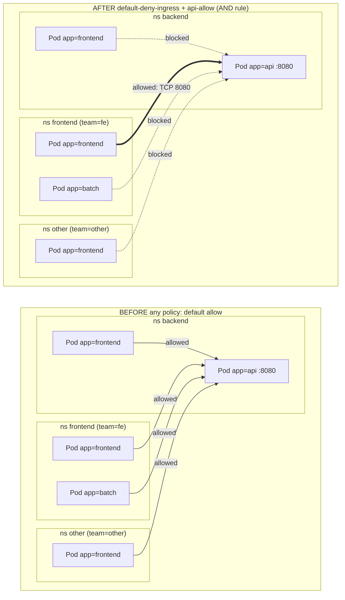

# T3.14 Demonstrate Basic Understanding of NetworkPolicies

> Competency: "Demonstrate basic understanding of NetworkPolicies" (CKAD-5.1) | Domain/weight: CKAD, Services and Networking (20%) | Est. time: 3 h | Prerequisites: T3.12, T2.04

Shell setup (from [conventions](../00-conventions.md); put it at the top of every session):

```bash
alias k=kubectl
export do="--dry-run=client -o yaml"
export now="--force --grace-period=0"
source <(kubectl completion bash); complete -o default -F __start_kubectl k
```

Lab environment for this lesson: **kind** (cluster `lab`, 1 control plane + 2 workers, `disableDefaultCNI: true`, Calico v3.33.0, created by `env/kind-up.sh`). A NetworkPolicy lab only makes sense on a cluster whose network plugin enforces policy. Namespaces: `lab-t314-*` (one set per lab, listed in each lab). Files go in `~/lab/t314/`.

> Pod network pitfall (seen while writing this lesson). `env/kind.yaml` uses the Pod network `192.168.0.0/16`, which is also Calico's default pool. If your Docker `kind` network happens to use a subnet inside `192.168.0.0/16`, Pods cannot reach the API server Service and the cluster half-works: `calico-kube-controllers` crash-loops (`dial tcp 10.96.0.1:443: i/o timeout`) and CoreDNS stays `0/1` (`plugin/ready: Plugins not ready: "kubernetes"`). Check first with `docker network inspect kind -f '{{range .IPAM.Config}}{{.Subnet}} {{end}}'`. If it prints a `192.168.x.0/24` subnet, create the cluster with `podSubnet: 10.244.0.0/16` and, before applying the Calico manifest, uncomment `CALICO_IPV4POOL_CIDR` in it and set it to `10.244.0.0/16`. All captured output below came from such a cluster (Pod IPs are `10.244.x.x`).

> Output policy. The output blocks in sections 2, 5, 6 and 7 were captured from a real cluster and are labelled with the environment they came from. Pod IPs, ages and hash suffixes will differ on your cluster. Section 11 lists what was and was not confirmed.

---

## 1. Why this matters

By default every Pod in a cluster can open a connection to every other Pod, in every namespace. That is fine on day one and dangerous on day 100: one compromised front-end Pod can talk to your database. A **NetworkPolicy** is the Kubernetes object that says which Pods may talk to which, and on which ports. In real life, the failures are quiet: a policy that "does nothing" because the network plugin ignores it, a default-deny that silently breaks DNS, or a rule that allows far more than you meant because of one dash in the YAML. In the exam, you must read a short policy and predict its effect, or write one fast. This lesson gives you the model, the exact YAML shapes, and a test routine you can run in under a minute.

This lesson builds on [T3.12](../part3-ckad/T3.12-provide-and-troubleshoot-access-to-applications.md) (Services, ports and `targetPort`) and [T2.04](../part2-basics/T2.04-labels-selectors-annotations-and-namespaces.md) (labels, selectors and namespaces). Everything in a NetworkPolicy is a label selector, so if `matchLabels` is still new to you, read T2.04 first.

---

## 2. Concepts

### 2.1 What a NetworkPolicy is, and who enforces it

A **NetworkPolicy** is an API object in the group `networking.k8s.io/v1`. It is namespaced. Its job is to describe an allow-list: "these Pods may receive traffic from these sources" and "these Pods may send traffic to these destinations".

The API server only **stores** the object. It does not block a single packet. The blocking is done by the **network plugin** (CNI plugin) that your cluster uses. Each node runs an agent from that plugin (for Calico it is `calico-node`, which contains a component called Felix). The agent watches NetworkPolicy, Pod and Namespace objects and turns them into packet filter rules on the node (iptables, nftables or eBPF programs, depending on the plugin).

This has one big consequence:

| Network plugin | Enforces NetworkPolicy? |
|---|---|
| Calico | Yes |
| Cilium | Yes |
| Flannel (plain) | No. The object is accepted and nothing happens |
| A cluster with no policy-aware plugin | No. Same: accepted, ignored |
| kind's default plugin (kindnet, image `kindnetd:v20260820-69b56db7` in kind v0.33.0) | **Yes, in the version tested.** Default-deny ingress and egress were both enforced (section 5, step 1). Older kind releases did not enforce policy, which is why older guides say "install Calico". Only default-deny was tested on kindnet; the other features were tested on Calico |

This is the first thing to remember when "a policy has no effect": **the API server will happily accept a policy that nobody enforces.** There is no warning. Identify the plugin with `k -n kube-system get ds` (`calico-node` means Calico, `cilium` means Cilium, `kindnet` is kind's default, `kube-flannel-ds` means Flannel).

The labs use Calico v3.33.0 on kind, as fixed in the [conventions](../00-conventions.md), because it enforces the full standard API and is a common production choice.

In the exam, you cannot change the network plugin. Which plugin the exam clusters use is UNVERIFIED (the exam pages do not say). Write the policy that matches the task and do not spend time asking whether it is enforced.

### 2.2 Default allow, and when a Pod becomes isolated

With no NetworkPolicy at all, everything is allowed in both directions. That is the **default allow** state.

The rule that governs everything else:

> A Pod is **isolated for a direction** (ingress or egress) as soon as at least one NetworkPolicy selects it and lists that direction in its `policyTypes`. An isolated direction allows only what the selecting policies explicitly allow.

Read it twice. Three things follow:

1. Isolation is **per direction**. A Pod can be isolated for ingress and wide open for egress.
2. Isolation starts when a policy **selects** the Pod. A policy that selects nothing changes nothing.
3. A policy with an empty rule list still isolates. An "empty allow-list" is "deny all".

Allowed traffic is **stateful**. If the policy allows A to connect to B, the reply packets from B to A are allowed automatically. You do not write a rule for replies.

For a connection from A to B to work, **both ends must agree**:

- If A is egress-isolated, some egress policy on A must allow B.
- If B is ingress-isolated, some ingress policy on B must allow A.
- If a side is not isolated in that direction, it allows everything in that direction.

### 2.3 Anatomy of the object

```yaml
apiVersion: networking.k8s.io/v1
kind: NetworkPolicy
metadata:
  name: api-allow            # namespaced object: lives in one namespace
spec:
  podSelector: {}            # Which Pods this policy protects (same namespace). Always write it
  policyTypes: []            # Ingress, Egress, or both
  ingress: []                # list of allow rules for incoming traffic
  egress: []                 # list of allow rules for outgoing traffic
```

| Field | Meaning | Default | Risky or invalid value |
|---|---|---|---|
| `spec.podSelector` | Which Pods the policy applies to. Only Pods **in the policy's own namespace** can be selected. | The docs call it required. A real v1.37 API server also accepted a policy without it and treated it like `{}` (section 5, step 11 note). Always write it | `{}` selects **every** Pod in the namespace. A label typo selects nothing, and then the policy silently protects nothing |
| `spec.policyTypes` | Which directions this policy isolates: `Ingress`, `Egress` | If you leave it out: `Ingress` is always set, and `Egress` is added when the policy has an `egress` section | Leaving it out on an egress-only policy also isolates ingress (see the capture in section 5, step 12) |
| `spec.ingress[]` | Allow rules for incoming traffic. Each rule has `from` and `ports` | none | An `ingress` list that is empty or missing, with `Ingress` in `policyTypes`, means **deny all ingress** |
| `spec.egress[]` | Allow rules for outgoing traffic. Each rule has `to` and `ports` | none | Same: empty means deny all egress |

Inside one rule, `from` (or `to`) says **who**, and `ports` says **which ports**. A rule allows a connection when the peer matches **and** the port matches. If you leave `ports` out, all ports are allowed for the listed peers. If you leave `from`/`to` out, all peers are allowed on the listed ports.

### 2.4 `spec.podSelector` and `policyTypes`

`spec.podSelector` is a standard label selector (T2.04): `matchLabels`, `matchExpressions`, or both.

| Value | Selects |
|---|---|
| `podSelector: {}` | All Pods in the policy's namespace |
| `podSelector: {matchLabels: {app: api}}` | Pods with `app=api` in the policy's namespace |
| `podSelector: {matchExpressions: [{key: tier, operator: In, values: [web, api]}]}` | Pods whose `tier` is `web` or `api` |

`policyTypes` decides which side of the Pod the policy locks.

| `policyTypes` | Effect on the selected Pods |
|---|---|
| `[Ingress]` | Incoming isolated. Outgoing untouched |
| `[Egress]` | Outgoing isolated. Incoming untouched |
| `[Ingress, Egress]` | Both isolated |
| (omitted, policy has only `ingress:`) | `[Ingress]` |
| (omitted, policy has `egress:`) | `[Ingress, Egress]` — a common surprise |

Always write `policyTypes` explicitly. It makes your intent obvious to the reader and to the grader.

### 2.5 Peers: `from` and `to`

Each entry in `ingress[].from` or `egress[].to` is a **peer**. A peer has one of three shapes:

| Peer type | Matches | Notes |
|---|---|---|
| `podSelector` | Pods, in the **policy's own namespace** (when used alone) | `{}` means all Pods in that namespace |
| `namespaceSelector` | **All Pods** in every namespace whose labels match | `{}` means every namespace |
| `ipBlock` | A CIDR range of IP addresses | Meant for addresses **outside** the cluster. Pod IPs are short-lived, so do not use them for Pod traffic |

An `ipBlock` has `cidr` (required) and `except` (optional list of CIDRs carved out of it). Every `except` entry must be inside the `cidr`; the API server rejects it otherwise (section 5, step 10 shows the exact message).

**The AND versus OR trap.** This is the most tested and most misread part of NetworkPolicy. It is decided by YAML indentation and the dash `-`:

- `namespaceSelector` and `podSelector` **in the same list item** (one dash) mean **AND**: Pods that match the `podSelector` **and** live in a namespace that matches the `namespaceSelector`.
- `namespaceSelector` and `podSelector` **in separate list items** (two dashes) mean **OR**: all Pods in the matching namespaces, **plus** Pods that match the `podSelector` in the policy's own namespace.

Side by side. Both are meant to read "allow `app=frontend` Pods that live in namespaces labelled `team=fe`":

```yaml
# AND  (one dash, one list item): the correct, narrow rule
apiVersion: networking.k8s.io/v1
kind: NetworkPolicy
metadata:
  name: api-allow
spec:
  podSelector:
    matchLabels:
      app: api
  policyTypes:
  - Ingress
  ingress:
  - from:
    - namespaceSelector:
        matchLabels:
          team: fe
      podSelector:            # no dash here: same item as namespaceSelector
        matchLabels:
          app: frontend
    ports:
    - protocol: TCP
      port: 8080
```

```yaml
# OR  (two dashes, two list items): allows MUCH more
apiVersion: networking.k8s.io/v1
kind: NetworkPolicy
metadata:
  name: api-allow
spec:
  podSelector:
    matchLabels:
      app: api
  policyTypes:
  - Ingress
  ingress:
  - from:
    - namespaceSelector:      # item 1: every Pod in namespaces labelled team=fe
        matchLabels:
          team: fe
    - podSelector:            # item 2: app=frontend Pods in the policy's OWN namespace
        matchLabels:
          app: frontend
    ports:
    - protocol: TCP
      port: 8080
```

The OR version lets in two groups you did not intend: every Pod in the `team=fe` namespaces (even a batch job), and any `app=frontend` Pod that lives next to the API. Section 5, steps 5 and 6 prove this with a truth table.

Remember also: multiple entries under `from:` are always OR. Multiple items under `ingress:` are also OR. Everything inside one item is AND.

### 2.6 Ports: `protocol`, `port`, `endPort`

```yaml
ports:
- protocol: TCP     # TCP (default), UDP or SCTP
  port: 8000        # a number, or the name of a container port
  endPort: 8100     # optional: with a numeric port, allows the range 8000-8100
```

| Field | Default | Rules and risks |
|---|---|---|
| `protocol` | `TCP` | Allowed: `TCP`, `UDP`, `SCTP` (SCTP needs a plugin that supports it). The docs say behaviour for other protocols, such as ICMP, varies by plugin |
| `port` | none (all ports) | Number 1-65535, or a named container port string. **Policies see the Pod's port, not the Service port**: use `8080` (the `targetPort`), not `80`. Section 5, step 8 proves it |
| `endPort` | none | Must be greater than or equal to `port`. Only valid when `port` is a number. The API server rejects `endPort` without `port` or below `port` (exact messages in section 5, step 11). The plugin must support `endPort`; one that does not applies only `port` |

### 2.7 Default-deny and allow-all patterns

Four small policies you must be able to write from memory. All four use `podSelector: {}`, so they cover the whole namespace.

| Pattern | `policyTypes` | Rule list | Effect |
|---|---|---|---|
| Default-deny ingress | `[Ingress]` | none | No Pod in the namespace accepts incoming connections |
| Default-deny egress | `[Egress]` | none | No Pod in the namespace can start outgoing connections (DNS too) |
| Default-deny all | `[Ingress, Egress]` | none | Both of the above |
| Allow-all ingress | `[Ingress]` | `ingress: [{}]` | One rule with no restriction: everything is allowed in (used to undo a deny from another policy) |
| Allow-all egress | `[Egress]` | `egress: [{}]` | Same for outgoing traffic |

`ingress: [{}]` and "no `ingress` key" are opposites. The first is one rule that matches everything. The second is an empty allow-list. The only difference is `[{}]`.

YAML for the first, third and fifth:

```yaml
apiVersion: networking.k8s.io/v1
kind: NetworkPolicy
metadata:
  name: default-deny-ingress
spec:
  podSelector: {}
  policyTypes:
  - Ingress
```

```yaml
apiVersion: networking.k8s.io/v1
kind: NetworkPolicy
metadata:
  name: default-deny-all
spec:
  podSelector: {}
  policyTypes:
  - Ingress
  - Egress
```

```yaml
apiVersion: networking.k8s.io/v1
kind: NetworkPolicy
metadata:
  name: allow-all-ingress
spec:
  podSelector: {}
  policyTypes:
  - Ingress
  ingress:
  - {}
```

The default-deny-egress and allow-all-egress policies are the same shapes with `Egress` and `egress`. They are in section 4.

### 2.8 Policies are additive: there are no deny rules

NetworkPolicy has **allow rules only**. You cannot write "deny this Pod". Isolation is the only way to deny, and the allow rules of **all** policies that select a Pod are **united** (set union):

- Policy A allows port 8080 from `app=web`. Policy B allows port 8080 from `app=batch`. A Pod selected by both accepts both.
- Order does not matter. There is no priority.
- You can never make a policy narrower by adding another policy. To narrow, edit or delete the one that is too wide.

That is also why "default-deny plus a few allow policies" is the standard pattern: the deny policy isolates, and every other policy adds one hole.

Other things you cannot do with the standard API (from the docs page listed in section 10): force traffic through a gateway, anything about TLS, log or audit allowed and denied traffic, target nodes, or select a Service by name. Pods also cannot block traffic from their own node, which is why kubelet health probes keep working under a default-deny.

### 2.9 DNS: the egress trap

When you deny egress, you also deny the DNS lookup. A Pod resolves `api.backend` by sending a query on port 53, UDP first (TCP when the answer is large) to the cluster DNS Pods (CoreDNS) in the `kube-system` namespace. Those Pods carry the label `k8s-app=kube-dns`. With egress denied, the lookup times out. The Pod shows "bad address" even though the target is reachable by IP.

The DNS allow rule, which you will paste into almost every egress policy. As a complete policy that lets every Pod in the namespace send DNS queries and nothing else:

```yaml
apiVersion: networking.k8s.io/v1
kind: NetworkPolicy
metadata:
  name: dns-egress
spec:
  podSelector: {}
  policyTypes:
  - Egress
  egress:
  - to:
    - namespaceSelector:
        matchLabels:
          kubernetes.io/metadata.name: kube-system   # AND ...
      podSelector:
        matchLabels:
          k8s-app: kube-dns                          # ... only the DNS Pods
    ports:
    - protocol: UDP
      port: 53
    - protocol: TCP
      port: 53
```

Both protocols are listed on purpose. DNS falls back to TCP for large replies.

### 2.10 Selecting a namespace by name: `kubernetes.io/metadata.name`

A `namespaceSelector` matches **labels on the Namespace object**, not names. Namespaces have no labels except those you add. To spare you from hand-labelling, Kubernetes puts one label on every namespace automatically: `kubernetes.io/metadata.name=<namespace name>`. It is set by the control plane and cannot be changed.

| Selecting a namespace by | Works if | Fails when |
|---|---|---|
| A label you added (`team=fe`) | Someone labelled the namespace | The label is missing, mistyped, or later changed |
| `kubernetes.io/metadata.name: <name>` | Always (the label is automatic) | You mistype the namespace name |

Check labels with `k get ns --show-labels`. If a task says "from the namespace `frontend`" and does not say the namespace has a label, use `kubernetes.io/metadata.name`.

### 2.11 Under the hood

What happens when you apply a policy, and when a packet is checked:

1. `kubectl apply` sends the object to the API server. It validates the schema and stores it in etcd. The API server does nothing else. Nothing is "applied" to a Pod.
2. The CNI agent on **each node** watches NetworkPolicy, Pod and Namespace objects. For each local Pod, it works out which policies select it, and which peers those policies allow. A `namespaceSelector` or `podSelector` is expanded into a set of Pod IPs, kept up to date as Pods come and go.
3. The agent writes filter rules for each local Pod's network interface. Calico uses iptables chains and IP sets (or eBPF); Cilium uses eBPF.
4. When a Pod starts a connection, the first packet is matched against the rules. If allowed, the connection is tracked, and later packets (including replies) pass.
5. **Service traffic is translated before the check.** A request to a Service's ClusterIP is rewritten to a backend Pod IP and the Pod's port (`targetPort`) by kube-proxy. NetworkPolicy rules match the Pod's address and port. That is why the policy port is the `targetPort` (T3.12 explains the four port fields).

Because the rules are expanded into IPs by the node agents, there is a short delay between `kubectl apply` and enforcement. Labs here use `sleep 4` after applying a policy before testing.

### 2.12 Related but different

| Often confused with | Difference |
|---|---|
| Service | A Service gives a stable name and load-balances. It does not restrict who may connect. A NetworkPolicy restricts who may connect and does not give names |
| Ingress / Gateway | Those route **external** HTTP traffic into the cluster. A NetworkPolicy filters Pod-to-Pod and Pod-to-IP traffic. An Ingress controller Pod is itself a Pod and can be blocked by a default-deny |
| RBAC | RBAC controls who may call the Kubernetes **API**. A NetworkPolicy controls **network** packets between Pods |
| `AdminNetworkPolicy` and plugin-specific objects (for example Calico `GlobalNetworkPolicy`, Cilium `CiliumNetworkPolicy`) | Separate APIs with extras such as explicit deny rules and cluster-wide scope. They are not part of the standard `NetworkPolicy` object and not part of this lesson. (The Calico v3.33.0 manifest also installs a `clusternetworkpolicies.policy.networking.k8s.io` CRD; you can ignore it here.) |

---

## 3. How it works (diagram)

Left: the default state, where every Pod reaches the API. Right: after a default-deny plus one AND rule, only the `app=frontend` Pod from the `team=fe` namespace gets through.



Walkthrough:

1. On the left no policy exists. All four client Pods reach the API Pod on port 8080. This is default allow.
2. `default-deny-ingress` selects every Pod in `backend` for Ingress. The API Pod is now ingress-isolated and nothing is allowed in. That is the dotted lines on the right.
3. `api-allow` adds one hole. Its rule has the `namespaceSelector team=fe` and the `podSelector app=frontend` in one list item (AND). Only a Pod that matches both gets through (the thick arrow).
4. The `app=batch` Pod is in the right namespace but has the wrong label. The `app=frontend` Pod in `other` has the right label but the wrong namespace. The `app=frontend` Pod next to the API has the right label but is not in a `team=fe` namespace. All three stay blocked.
5. Replace the one item with two items (OR) and the picture changes: the batch Pod and the same-namespace frontend Pod are let in too. The captures in section 5 show exactly that.

---

## 4. Commands and YAML you must produce fast

### 4.1 There is no imperative command for a NetworkPolicy

`kubectl create networkpolicy` does **not** exist. Your options in the exam, fastest first:

1. **Open the docs page and copy** (section 10 lists the URL). The page has a full example YAML. Edit names and labels. This is the intended speed path.
2. **Type the YAML from memory.** The default-deny shapes are 8 lines. Practice them (speed drill 1 and 2).
3. **Discover field names with `k explain`** if you forget one:

```bash
k explain networkpolicy.spec.ingress.from          # peer fields: ipBlock, namespaceSelector, podSelector
k explain networkpolicy.spec.egress.ports          # protocol, port, endPort
k explain netpol.spec --recursive | less           # whole tree; "netpol" is the short name
```

`$do` helps with the Pods around a policy, not with the policy itself. For example, to generate a client Pod with the labels a rule expects: `k run c --image=busybox:1.36 -l app=frontend $do -- sleep 3600 > c.yaml`.

The commands you will use every day around a policy:

| Command | What it does |
|---|---|
| `k get netpol -A` | List NetworkPolicies in all namespaces. `netpol` is the short name |
| `k describe netpol api-allow -n backend` | Print the policy in plain words (how to read it: section 5, step 5) |
| `k get netpol api-allow -n backend -o yaml` | The stored YAML, including the defaulted `policyTypes` |
| `k get ns --show-labels` | See the namespace labels that `namespaceSelector` matches |
| `k label ns frontend team=fe` | Add (or fix) a namespace label. Add `--overwrite` to change an existing value |
| `k get pods -n backend --show-labels` | See the Pod labels that `podSelector` matches |
| `k run c --rm -it --image=busybox:1.36 -l app=frontend --restart=Never -- wget -qO- -T2 api.backend` | One-shot test client with the labels you choose. See below |

Reading the test command: `k run c` makes a Pod named `c`. `--rm -it` attaches your terminal and deletes the Pod on exit. `-l app=frontend` gives the Pod the label, so a policy that selects `app=frontend` applies to it. `--restart=Never` makes it a bare Pod, not a Deployment. After `--` comes the command: `wget -qO- -T2 api.backend` fetches the URL quietly (`-q`), prints to the terminal (`-O-`), and gives up after 2 seconds (`-T2`). Without `-T2`, a blocked connection hangs for a long time.

Other ways to test a connection, from a Pod that already exists:

```bash
k exec fe-frontend -n frontend -- wget -qO- -T2 api.backend      # HTTP check; prints the body
k exec fe-frontend -n frontend -- nc -zv -w2 api.backend 80      # TCP check only; -z scan, -v verbose, -w2 timeout
```

How to read results:

| Result | Meaning |
|---|---|
| The HTTP body is printed | Connection allowed |
| `wget: download timed out` | Packets dropped. A NetworkPolicy block looks like this, but a wrong IP or an unready backend can too |
| `wget: bad address 'api.backend'` | The **name** did not resolve. Suspect DNS (an egress policy without a DNS rule), or a mistyped name/namespace |
| `wget: can't connect to remote host (...): Connection refused` | The packet reached something that has no listener on that port, or the port is wrong. It is not what a silent policy drop looks like |

A policy drop is silent, which is why you get a timeout rather than an error. Use `-T2` so that your tests finish quickly.

### 4.2 The three policies to produce fast

**(1) Default-deny ingress.** Every Pod in the namespace stops accepting connections.

```yaml
apiVersion: networking.k8s.io/v1      # the only stable version of this kind
kind: NetworkPolicy
metadata:
  name: default-deny-ingress          # any name; say what it does
  # namespace: comes from -n on the command line, or add it here
spec:
  podSelector: {}                     # {} = every Pod in this namespace
  policyTypes:
  - Ingress                           # isolate incoming traffic; no 'ingress:' list = allow nothing
```

Apply it: `k apply -n backend -f default-deny-ingress.yaml`

**(2) Allow `app=frontend` Pods from namespaces labelled `team=fe` to `app=api` on TCP 8080.**

```yaml
apiVersion: networking.k8s.io/v1
kind: NetworkPolicy
metadata:
  name: api-allow
spec:
  podSelector:                        # WHO IS PROTECTED: the API Pods
    matchLabels:
      app: api
  policyTypes:
  - Ingress                           # only the incoming side is restricted
  ingress:
  - from:                             # list of allowed sources (OR between entries)
    - namespaceSelector:              # entry 1, part A: namespace must have team=fe
        matchLabels:
          team: fe
      podSelector:                    # entry 1, part B (no dash!): Pod must have app=frontend
        matchLabels:
          app: frontend
    ports:                            # and the connection must go to ...
    - protocol: TCP                   # ... TCP (the default; shown for clarity)
      port: 8080                      # ... the Pod's own port, not the Service port
```

Apply it in the namespace of the API Pods: `k apply -n backend -f api-allow.yaml`. A policy lives in the namespace of the Pods it protects, not in the namespace of the clients.

**(3) Egress policy: DNS and the database only.** For Pods `app=api`: they may resolve names, and they may connect to `app=db` Pods in the same namespace on TCP 5432. Everything else outbound is blocked.

```yaml
apiVersion: networking.k8s.io/v1
kind: NetworkPolicy
metadata:
  name: api-egress
spec:
  podSelector:
    matchLabels:
      app: api                        # the Pods whose outgoing traffic is restricted
  policyTypes:
  - Egress                            # isolate outgoing traffic only; incoming is untouched
  egress:
  - to:                               # rule 1: DNS
    - namespaceSelector:
        matchLabels:
          kubernetes.io/metadata.name: kube-system   # automatic namespace label
      podSelector:
        matchLabels:
          k8s-app: kube-dns                          # CoreDNS Pods (AND, one list item)
    ports:
    - protocol: UDP
      port: 53
    - protocol: TCP                   # DNS uses TCP for large answers
      port: 53
  - to:                               # rule 2: the database
    - podSelector:                    # no namespaceSelector: same namespace as the policy
        matchLabels:
          app: db
    ports:
    - protocol: TCP
      port: 5432                      # the Pod's port
```

The other two patterns that complete the toolbox:

```yaml
apiVersion: networking.k8s.io/v1
kind: NetworkPolicy
metadata:
  name: default-deny-egress
spec:
  podSelector: {}
  policyTypes:
  - Egress                            # blocks all outgoing traffic, DNS included
```

```yaml
apiVersion: networking.k8s.io/v1
kind: NetworkPolicy
metadata:
  name: allow-all-egress
spec:
  podSelector: {}
  policyTypes:
  - Egress
  egress:
  - {}                                # one rule without restrictions: everything allowed out
```

An `ipBlock` peer, for traffic to or from addresses outside the cluster (the same shape works under `egress[].to`):

```yaml
apiVersion: networking.k8s.io/v1
kind: NetworkPolicy
metadata:
  name: ext-ipblock
spec:
  podSelector:
    matchLabels:
      app: api
  policyTypes:
  - Ingress
  ingress:
  - from:
    - ipBlock:
        cidr: 172.17.0.0/16           # allow this range ...
        except:
        - 172.17.1.0/24               # ... except this sub-range (must lie strictly inside cidr)
```

### 4.3 Speed drill

Setup (one line): `k create ns lab-t314-drill && k config set-context --current --namespace=lab-t314-drill`. Work in files under `~/lab/t314/`. Target times are exam pace (about 6 minutes per task on average: 15-20 tasks in 2 hours, sources [E2](https://docs.linuxfoundation.org/tc-docs/certification/tips-cka-and-ckad) and [E3](https://docs.linuxfoundation.org/tc-docs/certification/faq-cka-ckad-cks)); NetworkPolicy tasks should be at the fast end.

| # | Task | Target |
|---|---|---|
| 1 | Create `default-deny-ingress` for the whole namespace | 45 s |
| 2 | Create `default-deny-egress` for the whole namespace | 45 s |
| 3 | Create `web-allow` so `app=web` Pods accept TCP 80 only from `app=lb` Pods in the same namespace | 90 s |
| 4 | Create `api-allow` (the AND policy of 4.2): `app=api` accepts TCP 8080 from `app=frontend` Pods in namespaces labelled `team=fe` | 2 min |
| 5 | Create `dns-egress` so every Pod can send DNS (UDP and TCP 53) to the cluster DNS Pods and nothing else | 90 s |
| 6 | Create `open-ingress` so `app=public` Pods accept everything, even with a default-deny present | 60 s |
| 7 | Create `ext-allow` so `app=api` Pods accept TCP 443 from `10.0.0.0/8` except `10.1.0.0/16` | 2 min |
| 8 | Read-only: for `api-allow`, say which clients can reach `app=api` without testing | 60 s |

<details><summary>Answers</summary>

All of these validate with `k apply --dry-run=server -f file.yaml` (no side effects). Run it before you apply.

```bash
# 1
cat > ~/lab/t314/d1.yaml <<'EOF'
apiVersion: networking.k8s.io/v1
kind: NetworkPolicy
metadata:
  name: default-deny-ingress
spec:
  podSelector: {}
  policyTypes:
  - Ingress
EOF
k apply -f ~/lab/t314/d1.yaml

# 2
cat > ~/lab/t314/d2.yaml <<'EOF'
apiVersion: networking.k8s.io/v1
kind: NetworkPolicy
metadata:
  name: default-deny-egress
spec:
  podSelector: {}
  policyTypes:
  - Egress
EOF
k apply -f ~/lab/t314/d2.yaml

# 3
cat > ~/lab/t314/d3.yaml <<'EOF'
apiVersion: networking.k8s.io/v1
kind: NetworkPolicy
metadata:
  name: web-allow
spec:
  podSelector:
    matchLabels:
      app: web
  policyTypes:
  - Ingress
  ingress:
  - from:
    - podSelector:
        matchLabels:
          app: lb
    ports:
    - protocol: TCP
      port: 80
EOF
k apply -f ~/lab/t314/d3.yaml

# 4: the YAML of section 4.2 (2), name api-allow
# 5
cat > ~/lab/t314/d5.yaml <<'EOF'
apiVersion: networking.k8s.io/v1
kind: NetworkPolicy
metadata:
  name: dns-egress
spec:
  podSelector: {}
  policyTypes:
  - Egress
  egress:
  - to:
    - namespaceSelector:
        matchLabels:
          kubernetes.io/metadata.name: kube-system
      podSelector:
        matchLabels:
          k8s-app: kube-dns
    ports:
    - protocol: UDP
      port: 53
    - protocol: TCP
      port: 53
EOF
k apply -f ~/lab/t314/d5.yaml

# 6
cat > ~/lab/t314/d6.yaml <<'EOF'
apiVersion: networking.k8s.io/v1
kind: NetworkPolicy
metadata:
  name: open-ingress
spec:
  podSelector:
    matchLabels:
      app: public
  policyTypes:
  - Ingress
  ingress:
  - {}
EOF
k apply -f ~/lab/t314/d6.yaml

# 7
cat > ~/lab/t314/d7.yaml <<'EOF'
apiVersion: networking.k8s.io/v1
kind: NetworkPolicy
metadata:
  name: ext-allow
spec:
  podSelector:
    matchLabels:
      app: api
  policyTypes:
  - Ingress
  ingress:
  - from:
    - ipBlock:
        cidr: 10.0.0.0/8
        except:
        - 10.1.0.0/16
    ports:
    - protocol: TCP
      port: 443
EOF
k apply -f ~/lab/t314/d7.yaml
```

Task 8: only a Pod that is labelled `app=frontend` **and** lives in a namespace labelled `team=fe` can reach `app=api`, and only on TCP 8080. This holds only if some policy selects the API Pods for ingress (the AND policy does that by itself, since it lists `Ingress`). Confirm with `k describe netpol api-allow` (section 5, step 5).

Cleanup: `k config set-context --current --namespace=default && k delete ns lab-t314-drill && rm -f ~/lab/t314/d?.yaml`

</details>

---

## 5. Worked example

Goal: build a truth table of "who can reach whom" for one API Pod, change the policy step by step, and watch each row change. All output below is `REAL OUTPUT (kind v0.33.0, v1.37.0, Calico v3.33.0)` unless a block says otherwise. The captures ran on a 3-node cluster with Calico. Names, ages and Pod IPs on your cluster will differ.

**The cast:**

| Namespace (labels) | Pod (labels) | Role |
|---|---|---|
| `lab-t314-be` | `api` (`app=api`), port 8080, behind Service `api` (80 to 8080) | the protected server |
| `lab-t314-be` | `be-frontend` (`app=frontend`) | client in the **same** namespace as the API |
| `lab-t314-fe` (`team=fe`) | `fe-frontend` (`app=frontend`) | the client we want to allow |
| `lab-t314-fe` (`team=fe`) | `fe-batch` (`app=batch`) | right namespace, wrong Pod label |
| `lab-t314-other` (`team=other`) | `other-frontend` (`app=frontend`) | right Pod label, wrong namespace |

### Step 1: is the plugin enforcing policy?

Always answer this first. On kind's default plugin (cluster without `disableDefaultCNI`), the plugin pods were:

```bash
k -n kube-system get pods
k -n kube-system get ds kindnet -o jsonpath='{.spec.template.spec.containers[0].image}{"\n"}'
```

```text
REAL OUTPUT (kind v0.33.0, v1.37.0, default kindnet; trimmed)
kindnet-8tx7j                                  1/1     Running   ...
kube-proxy-pxsrq                               1/1     Running   ...
docker.io/kindest/kindnetd:v20260820-69b56db7
```

A quick test on that cluster: an `api` Pod and a `client` Pod in one namespace. Before any policy, `wget -qO- -T2 api` printed `api-ok`. After applying `default-deny-ingress`, the same command printed `wget: download timed out`. After applying `default-deny-egress`, it printed `wget: bad address 'api'`. So kindnet in this release enforced both directions. (On the node, `nft list tables` showed a table named `inet kindnet-network-policies`.) This contradicts older advice that kind cannot enforce policy. The labs still use Calico, which is the plugin the conventions fix for every lesson, so results match what the lessons print.

On the Calico cluster, `calico-node` runs on every node:

```bash
k -n kube-system get ds
k -n kube-system get ds calico-node -o jsonpath='{.spec.template.spec.containers[0].image}{"\n"}'
```

```text
REAL OUTPUT (kind v0.33.0, v1.37.0, Calico v3.33.0; trimmed)
quay.io/calico/node:v3.33.0
```

### Step 2: build the cast

Create `~/lab/t314/base.sh` with this content and run it (`bash` does not know your alias, so the script starts by defining it):

```bash
shopt -s expand_aliases
alias k=kubectl
k create ns lab-t314-be
k create ns lab-t314-fe
k create ns lab-t314-other
k label ns lab-t314-fe team=fe
k label ns lab-t314-other team=other
k -n lab-t314-be run api --image=busybox:1.36 -l app=api -- \
  sh -c 'mkdir -p /www && echo api-ok > /www/index.html && exec httpd -f -p 8080 -h /www'
k -n lab-t314-be expose pod api --port=80 --target-port=8080
k -n lab-t314-be run be-frontend --image=busybox:1.36 -l app=frontend -- sleep 3600
k -n lab-t314-fe run fe-frontend --image=busybox:1.36 -l app=frontend -- sleep 3600
k -n lab-t314-fe run fe-batch --image=busybox:1.36 -l app=batch -- sleep 3600
k -n lab-t314-other run other-frontend --image=busybox:1.36 -l app=frontend -- sleep 3600
for ns in lab-t314-be lab-t314-fe lab-t314-other; do
  k -n $ns wait --for=condition=Ready pod --all --timeout=120s
done
```

The first two lines let the script use your `k` alias. Run it with `bash ~/lab/t314/base.sh`, then look at what you built:

```bash
k get pods -A -l 'app in (api,frontend,batch)' -o wide --sort-by=.metadata.namespace
k get ns lab-t314-be lab-t314-fe lab-t314-other --show-labels
k -n lab-t314-be get svc,endpointslice
```

```text
REAL OUTPUT (kind v0.33.0, v1.37.0, Calico v3.33.0; trimmed)
NAMESPACE        NAME             READY   STATUS    RESTARTS   AGE   IP
lab-t314-be      api              1/1     Running   0          11s   10.244.189.3
lab-t314-be      be-frontend      1/1     Running   0          11s   10.244.65.1
lab-t314-fe      fe-batch         1/1     Running   0          11s   10.244.65.2
lab-t314-fe      fe-frontend      1/1     Running   0          11s   10.244.189.2
lab-t314-other   other-frontend   1/1     Running   0          11s   10.244.189.1
NAME             STATUS   AGE   LABELS
lab-t314-be      Active   11s   kubernetes.io/metadata.name=lab-t314-be
lab-t314-fe      Active   11s   kubernetes.io/metadata.name=lab-t314-fe,team=fe
lab-t314-other   Active   11s   kubernetes.io/metadata.name=lab-t314-other,team=other
NAME          TYPE        CLUSTER-IP      EXTERNAL-IP   PORT(S)   AGE
service/api   ClusterIP   10.96.255.209   <none>        80/TCP    11s

NAME                                       ADDRESSTYPE   PORTS   ENDPOINTS      AGE
endpointslice.discovery.k8s.io/api-bsk2d   IPv4          8080    10.244.189.3   11s
```

Read the output: the namespace labels `team=fe` and `team=other` are the ones you added; `kubernetes.io/metadata.name` is automatic. The Service has port 80, but the EndpointSlice says the Pod listens on **8080**. That second number is what a policy sees.

### Step 3: the truth function and the baseline

Define a helper that tests all four clients against `api.lab-t314-be` (Service port 80) and prints the first line of each result:

```bash
truth() {
  for c in lab-t314-be/be-frontend lab-t314-fe/fe-frontend lab-t314-fe/fe-batch lab-t314-other/other-frontend; do
    ns=${c%/*}; p=${c#*/}
    r=$(k -n "$ns" exec "$p" -- wget -qO- -T2 api.lab-t314-be 2>&1 | head -1)
    printf '%-16s %-15s %s\n' "$ns" "$p" "${r:-<empty>}"
  done
}
```

Paste it into your shell, then run it with no policy in place:

```bash
k get netpol -A
truth
```

```text
REAL OUTPUT (kind v0.33.0, v1.37.0, Calico v3.33.0)
No resources found
lab-t314-be      be-frontend     api-ok
lab-t314-fe      fe-frontend     api-ok
lab-t314-fe      fe-batch        api-ok
lab-t314-other   other-frontend  api-ok
```

This is default allow. `k exec ... -- wget -qO- -T2 <url>` runs the test inside the client Pod, so the client's labels and namespace decide which policies apply.

The same test as a one-shot Pod, the form from the competency notes (shown with `-i` because the capture ran without a terminal; with `-it` you see the same lines):

```bash
k -n lab-t314-fe run c --rm -i --image=busybox:1.36 -l app=frontend --restart=Never -- wget -qO- -T2 api.lab-t314-be
```

You will see the result of that command in step 14 (after policies exist).

### Step 4: default-deny ingress

Save the two policies from section 4.2 as files first (the `sed` in step 8 and later steps reuse them):

```bash
mkdir -p ~/lab/t314
cat > ~/lab/t314/default-deny-ingress.yaml <<'EOF'
apiVersion: networking.k8s.io/v1
kind: NetworkPolicy
metadata:
  name: default-deny-ingress
spec:
  podSelector: {}
  policyTypes:
  - Ingress
EOF
cat > ~/lab/t314/api-allow.yaml <<'EOF'
apiVersion: networking.k8s.io/v1
kind: NetworkPolicy
metadata:
  name: api-allow
spec:
  podSelector:
    matchLabels:
      app: api
  policyTypes:
  - Ingress
  ingress:
  - from:
    - namespaceSelector:
        matchLabels:
          team: fe
      podSelector:
        matchLabels:
          app: frontend
    ports:
    - protocol: TCP
      port: 8080
EOF
```

Now apply the deny and test:

```bash
k -n lab-t314-be apply -f ~/lab/t314/default-deny-ingress.yaml
sleep 4; truth
k -n lab-t314-be describe netpol default-deny-ingress
```

```text
REAL OUTPUT (kind v0.33.0, v1.37.0, Calico v3.33.0)
lab-t314-be      be-frontend     wget: download timed out
lab-t314-fe      fe-frontend     wget: download timed out
lab-t314-fe      fe-batch        wget: download timed out
lab-t314-other   other-frontend  wget: download timed out
Name:         default-deny-ingress
Namespace:    lab-t314-be
Spec:
  PodSelector:     <none> (Allowing the specific traffic to all pods in this namespace)
  Allowing ingress traffic:
    <none> (Selected pods are isolated for ingress connectivity)
  Not affecting egress traffic
  Policy Types: Ingress
```

How to read `describe`: `PodSelector: <none> (...to all pods in this namespace)` is the printout for `podSelector: {}`. `Allowing ingress traffic: <none> (Selected pods are isolated for ingress connectivity)` means the allow-list is empty. `Not affecting egress traffic` means Egress is not in `policyTypes`. All four rows now time out, even `be-frontend`, which lives in the same namespace as the API: **there is no implicit "same namespace is fine"**.

### Step 5: the AND rule

```bash
k -n lab-t314-be apply -f ~/lab/t314/api-allow.yaml   # the YAML from section 4.2 (2)
sleep 4; truth
k -n lab-t314-be describe netpol api-allow
```

```text
REAL OUTPUT (kind v0.33.0, v1.37.0, Calico v3.33.0)
lab-t314-be      be-frontend     wget: download timed out
lab-t314-fe      fe-frontend     api-ok
lab-t314-fe      fe-batch        wget: download timed out
lab-t314-other   other-frontend  wget: download timed out
Name:         api-allow
Namespace:    lab-t314-be
Spec:
  PodSelector:     app=api
  Allowing ingress traffic:
    To Port: 8080/TCP
    From:
      NamespaceSelector: team=fe
      PodSelector: app=frontend
  Not affecting egress traffic
  Policy Types: Ingress
```

Only `fe-frontend` gets through. In `describe`, **one `From:` block that lists both a `NamespaceSelector` and a `PodSelector` under it is AND.** Memorise that shape; you will use it to check your own work.

### Step 6: the same rule written as OR

Replace `api-allow` (same name, so `apply` updates it) with the OR version of section 2.5:

```bash
k -n lab-t314-be apply -f - <<'EOF'
apiVersion: networking.k8s.io/v1
kind: NetworkPolicy
metadata:
  name: api-allow
spec:
  podSelector:
    matchLabels:
      app: api
  policyTypes:
  - Ingress
  ingress:
  - from:
    - namespaceSelector:
        matchLabels:
          team: fe
    - podSelector:
        matchLabels:
          app: frontend
    ports:
    - protocol: TCP
      port: 8080
EOF
sleep 4; truth
k -n lab-t314-be describe netpol api-allow
```

```text
REAL OUTPUT (kind v0.33.0, v1.37.0, Calico v3.33.0)
networkpolicy.networking.k8s.io/api-allow configured
lab-t314-be      be-frontend     api-ok
lab-t314-fe      fe-frontend     api-ok
lab-t314-fe      fe-batch        api-ok
lab-t314-other   other-frontend  wget: download timed out
Name:         api-allow
Namespace:    lab-t314-be
Spec:
  PodSelector:     app=api
  Allowing ingress traffic:
    To Port: 8080/TCP
    From:
      NamespaceSelector: team=fe
    From:
      PodSelector: app=frontend
  Not affecting egress traffic
  Policy Types: Ingress
```

One dash moved, and two more clients got in: `fe-batch` (the whole `team=fe` namespace) and `be-frontend` (an `app=frontend` Pod in the API's own namespace). In `describe`, **two separate `From:` blocks is OR.** Only `other-frontend`, which matches neither item, stays out.

### Step 7: policies are additive

Remove the single policy and add two narrower ones that select the same Pods:

```bash
k -n lab-t314-be delete netpol api-allow
k -n lab-t314-be apply -f - <<'EOF'
apiVersion: networking.k8s.io/v1
kind: NetworkPolicy
metadata:
  name: api-allow-fe
spec:
  podSelector:
    matchLabels:
      app: api
  policyTypes:
  - Ingress
  ingress:
  - from:
    - namespaceSelector:
        matchLabels:
          kubernetes.io/metadata.name: lab-t314-fe
      podSelector:
        matchLabels:
          app: frontend
    ports:
    - protocol: TCP
      port: 8080
---
apiVersion: networking.k8s.io/v1
kind: NetworkPolicy
metadata:
  name: api-allow-local
spec:
  podSelector:
    matchLabels:
      app: api
  policyTypes:
  - Ingress
  ingress:
  - from:
    - podSelector:
        matchLabels:
          app: frontend
    ports:
    - protocol: TCP
      port: 8080
EOF
sleep 4; truth
```

`api-allow-fe` allows `app=frontend` Pods from the namespace named `lab-t314-fe`, using the automatic name label. `api-allow-local` allows `app=frontend` Pods from the API's own namespace. Neither lists the other's client.

```text
REAL OUTPUT (kind v0.33.0, v1.37.0, Calico v3.33.0)
lab-t314-be      be-frontend     api-ok
lab-t314-fe      fe-frontend     api-ok
lab-t314-fe      fe-batch        wget: download timed out
lab-t314-other   other-frontend  wget: download timed out
```

The Pod is selected by three policies (`default-deny-ingress` and both allow policies), and the result is the **union** of their allow rules. Clean up: `k -n lab-t314-be delete netpol api-allow-fe api-allow-local`.

### Step 8: the Service port is not the policy port

Apply the AND policy with `port: 80` (what you get if you copy the Service port):

```bash
sed 's/port: 8080/port: 80/' ~/lab/t314/api-allow.yaml | k -n lab-t314-be apply -f -
sleep 4; truth
```

```text
REAL OUTPUT (kind v0.33.0, v1.37.0, Calico v3.33.0)
lab-t314-be      be-frontend     wget: download timed out
lab-t314-fe      fe-frontend     wget: download timed out
lab-t314-fe      fe-batch        wget: download timed out
lab-t314-other   other-frontend  wget: download timed out
```

Nobody gets through, even `fe-frontend`, whose labels and namespace are right. The client dialled Service port 80, kube-proxy rewrote it to Pod port 8080, and the policy (which says 80) did not match 8080. Fix: `port: 8080`. When a policy "should" work and does not, check the port first.

### Step 9: a wrong namespace label

Restore the correct policy, then break the namespace label the policy relies on:

```bash
k -n lab-t314-be apply -f ~/lab/t314/api-allow.yaml
k label ns lab-t314-fe team=ef --overwrite
sleep 4; truth
k get ns lab-t314-fe --show-labels
```

```text
REAL OUTPUT (kind v0.33.0, v1.37.0, Calico v3.33.0)
lab-t314-be      be-frontend     wget: download timed out
lab-t314-fe      fe-frontend     wget: download timed out
lab-t314-fe      fe-batch        wget: download timed out
lab-t314-other   other-frontend  wget: download timed out
NAME          STATUS   AGE   LABELS
lab-t314-fe   Active   74s   kubernetes.io/metadata.name=lab-t314-fe,team=ef
```

The policy asks for `team=fe`; the namespace now says `team=ef`. The label changed, so the policy matches nothing, and the running clients were cut off as soon as the label changed. Now use the automatic label instead (`api-allow-fe` from step 7) while the typo is still in place:

```bash
k -n lab-t314-be delete netpol api-allow
k -n lab-t314-be apply -f - <<'EOF'
apiVersion: networking.k8s.io/v1
kind: NetworkPolicy
metadata:
  name: api-allow-fe
spec:
  podSelector:
    matchLabels:
      app: api
  policyTypes:
  - Ingress
  ingress:
  - from:
    - namespaceSelector:
        matchLabels:
          kubernetes.io/metadata.name: lab-t314-fe
      podSelector:
        matchLabels:
          app: frontend
    ports:
    - protocol: TCP
      port: 8080
EOF
sleep 4; truth
k label ns lab-t314-fe team=fe --overwrite     # restore
k -n lab-t314-be delete netpol api-allow-fe
```

```text
REAL OUTPUT (kind v0.33.0, v1.37.0, Calico v3.33.0)
lab-t314-be      be-frontend     wget: download timed out
lab-t314-fe      fe-frontend     api-ok
lab-t314-fe      fe-batch        wget: download timed out
lab-t314-other   other-frontend  wget: download timed out
```

`fe-frontend` is back, even with `team=ef`, because `kubernetes.io/metadata.name` cannot be mistyped by a human: it is set by the control plane.

### Step 10: `ipBlock` with `except`

Allow every address in the Pod network except one Pod. The `be-frontend` address in the capture was `10.244.65.1`; look yours up with `k -n lab-t314-be get pod be-frontend -o wide`. First, a mistake worth seeing: an `except` entry **outside** its `cidr` is rejected by the API server:

```bash
k -n lab-t314-be apply -f - <<'EOF'
apiVersion: networking.k8s.io/v1
kind: NetworkPolicy
metadata:
  name: api-allow-ipblock
spec:
  podSelector:
    matchLabels:
      app: api
  policyTypes:
  - Ingress
  ingress:
  - from:
    - ipBlock:
        cidr: 192.168.0.0/16
        except:
        - 10.244.65.1/32
    ports:
    - protocol: TCP
      port: 8080
EOF
```

If your cluster's Pods use `192.168.x.x` addresses, that `except` would lie inside the `cidr` and be accepted. Pick an `except` outside whatever `cidr` you write to see the error.

```text
REAL OUTPUT (kind v0.33.0, v1.37.0, Calico v3.33.0)
The NetworkPolicy "api-allow-ipblock" is invalid: spec.ingress[0].from[0].ipBlock.except[0]: Invalid value: "10.244.65.1/32": must be a strict subset of `cidr`
```

Now the correct policy (`cidr` is the Pod network `10.244.0.0/16`; use your own Pod IP in `except`). The default-deny from step 4 must still be in place (check with `k -n lab-t314-be get netpol`; re-apply the file if it is missing):

```bash
k -n lab-t314-be apply -f - <<'EOF'
apiVersion: networking.k8s.io/v1
kind: NetworkPolicy
metadata:
  name: api-allow-ipblock
spec:
  podSelector:
    matchLabels:
      app: api
  policyTypes:
  - Ingress
  ingress:
  - from:
    - ipBlock:
        cidr: 10.244.0.0/16
        except:
        - 10.244.65.1/32
    ports:
    - protocol: TCP
      port: 8080
EOF
sleep 4; truth
k -n lab-t314-be describe netpol api-allow-ipblock
```

```text
REAL OUTPUT (kind v0.33.0, v1.37.0, Calico v3.33.0)
lab-t314-be      be-frontend     wget: download timed out
lab-t314-fe      fe-frontend     api-ok
lab-t314-fe      fe-batch        api-ok
lab-t314-other   other-frontend  api-ok
...
    From:
      IPBlock:
        CIDR: 10.244.0.0/16
        Except: 10.244.65.1/32
```

Only the excluded Pod is blocked. This works, but it is the wrong tool for Pod-to-Pod traffic: Pod IPs change when Pods are replaced. Use `ipBlock` for addresses outside the cluster. Clean up: `k -n lab-t314-be delete netpol api-allow-ipblock`.

### Step 11: port ranges with `endPort`, and what the API rejects

The default-deny from step 4 must still be in place (re-apply it if not). To test ports without a Service, connect to the Pod IP directly. Look up the API Pod IP: `APIIP=$(k -n lab-t314-be get pod api -o jsonpath='{.status.podIP}')`.

```bash
k -n lab-t314-be apply -f - <<'EOF'
apiVersion: networking.k8s.io/v1
kind: NetworkPolicy
metadata:
  name: api-allow-range
spec:
  podSelector:
    matchLabels:
      app: api
  policyTypes:
  - Ingress
  ingress:
  - ports:
    - protocol: TCP
      port: 9000
      endPort: 9100
EOF
sleep 4
k -n lab-t314-fe exec fe-frontend -- wget -qO- -T2 $APIIP:8080     # range 9000-9100: expect a timeout
k -n lab-t314-be apply -f - <<'EOF'
apiVersion: networking.k8s.io/v1
kind: NetworkPolicy
metadata:
  name: api-allow-range
spec:
  podSelector:
    matchLabels:
      app: api
  policyTypes:
  - Ingress
  ingress:
  - ports:
    - protocol: TCP
      port: 8000
      endPort: 8100
EOF
sleep 4
k -n lab-t314-fe exec fe-frontend -- wget -qO- -T2 $APIIP:8080     # range 8000-8100: expect api-ok
k -n lab-t314-be describe netpol api-allow-range
```

```text
REAL OUTPUT (kind v0.33.0, v1.37.0, Calico v3.33.0)
range 9000-9100:
wget: download timed out
range 8000-8100:
api-ok
...
Spec:
  PodSelector:     app=api
  Allowing ingress traffic:
    To Port Range: 8000-8100/TCP
    From: <any> (traffic not restricted by source)
  Not affecting egress traffic
  Policy Types: Ingress
```

This policy has no `from`, so it allows **any** source on the range, and `describe` says so: `From: <any> (traffic not restricted by source)`.

The API server also checks the range fields. A rule with `endPort` and no `port`, and a rule with `endPort` lower than `port`:

```text
REAL OUTPUT (kind v0.33.0, v1.37.0, Calico v3.33.0)
The NetworkPolicy "bad-endport" is invalid: spec.ingress[0].ports[0].endPort: Invalid value: 8100: may not be specified when `port` is not specified
The NetworkPolicy "bad-endport" is invalid: spec.ingress[0].ports[0].endPort: Invalid value: 8000: must be greater than or equal to `port`
```

Note on a policy without `podSelector`: the same API server accepted a policy with only `policyTypes: [Ingress]`, and the policy then behaved like `podSelector: {}` (every Pod in the namespace lost its ingress). The docs describe the field as required; do not rely on the default. Clean up: `k -n lab-t314-be delete netpol --all`.

### Step 12: `policyTypes` defaulting

A policy that has only an `egress` section and no `policyTypes`:

```bash
k -n lab-t314-fe apply -f - <<'EOF'
apiVersion: networking.k8s.io/v1
kind: NetworkPolicy
metadata:
  name: egress-no-types
spec:
  podSelector:
    matchLabels:
      app: frontend
  egress:
  - to:
    - ipBlock:
        cidr: 10.96.0.0/12
EOF
k -n lab-t314-fe get netpol egress-no-types -o jsonpath='{.spec.policyTypes}{"\n"}'
k -n lab-t314-fe describe netpol egress-no-types
```

```text
REAL OUTPUT (kind v0.33.0, v1.37.0, Calico v3.33.0)
["Ingress","Egress"]
Name:         egress-no-types
Namespace:    lab-t314-fe
Spec:
  PodSelector:     app=frontend
  Allowing ingress traffic:
    <none> (Selected pods are isolated for ingress connectivity)
  Allowing egress traffic:
    To Port: <any> (traffic allowed to all ports)
    To:
      IPBlock:
        CIDR: 10.96.0.0/12
        Except: 
  Policy Types: Ingress, Egress
```

The API server filled in `["Ingress","Egress"]`. The author only wrote egress rules, but the `app=frontend` Pods in this namespace are now **also isolated for ingress**. The fix is to write `policyTypes: [Egress]`. Clean up: `k -n lab-t314-fe delete netpol egress-no-types`.

### Step 13: egress and DNS

First put the API's protection back (`default-deny-ingress` and `api-allow`, as in steps 4 and 5). Then restrict the `app=frontend` Pods in `lab-t314-fe` to the API only, **without** a DNS rule:

```bash
k -n lab-t314-fe apply -f - <<'EOF'
apiVersion: networking.k8s.io/v1
kind: NetworkPolicy
metadata:
  name: frontend-egress
spec:
  podSelector:
    matchLabels:
      app: frontend
  policyTypes:
  - Egress
  egress:
  - to:
    - namespaceSelector:
        matchLabels:
          kubernetes.io/metadata.name: lab-t314-be
      podSelector:
        matchLabels:
          app: api
    ports:
    - protocol: TCP
      port: 8080
EOF
sleep 4
k -n lab-t314-fe exec fe-frontend -- wget -qO- -T2 api.lab-t314-be           # by name
k -n lab-t314-fe exec fe-frontend -- wget -qO- -T2 $APIIP:8080              # by Pod IP
k -n lab-t314-fe exec fe-frontend -- wget -qO- -T2 10.96.255.209:80         # by Service IP (use yours)
k -n lab-t314-fe exec fe-batch -- wget -qO- -T2 api.lab-t314-be             # not selected by the policy
k -n lab-t314-fe exec fe-frontend -- nslookup api.lab-t314-be.svc.cluster.local
```

```text
REAL OUTPUT (kind v0.33.0, v1.37.0, Calico v3.33.0)
wget: bad address 'api.lab-t314-be'
command terminated with exit code 1
api-ok
api-ok
wget: download timed out
command terminated with exit code 1
;; connection timed out; no servers could be reached

command terminated with exit code 1
```

(The `fe-batch` line timed out because the API still has `default-deny-ingress` plus the AND policy, which only admits `app=frontend`; `fe-batch` is not blocked by the egress policy. That is a useful reminder that a connection needs both ends to agree.)

Read it as a diagnosis: the **name** fails with `bad address` while the **IP** works. The path to the API is open; only name resolution is closed. `nslookup` confirms: it cannot reach any DNS server (`no servers could be reached`). Now add the DNS rule (`frontend-egress` from the YAML below):

```bash
k -n lab-t314-fe apply -f - <<'EOF'
apiVersion: networking.k8s.io/v1
kind: NetworkPolicy
metadata:
  name: frontend-egress
spec:
  podSelector:
    matchLabels:
      app: frontend
  policyTypes:
  - Egress
  egress:
  - to:
    - namespaceSelector:
        matchLabels:
          kubernetes.io/metadata.name: kube-system
      podSelector:
        matchLabels:
          k8s-app: kube-dns
    ports:
    - protocol: UDP
      port: 53
    - protocol: TCP
      port: 53
  - to:
    - namespaceSelector:
        matchLabels:
          kubernetes.io/metadata.name: lab-t314-be
      podSelector:
        matchLabels:
          app: api
    ports:
    - protocol: TCP
      port: 8080
EOF
sleep 4
k -n lab-t314-fe exec fe-frontend -- wget -qO- -T2 api.lab-t314-be
k -n lab-t314-fe describe netpol frontend-egress
k -n lab-t314-fe exec fe-frontend -- wget -qO- -T2 kubernetes.default
```

```text
REAL OUTPUT (kind v0.33.0, v1.37.0, Calico v3.33.0)
api-ok
Name:         frontend-egress
Namespace:    lab-t314-fe
Spec:
  PodSelector:     app=frontend
  Not affecting ingress traffic
  Allowing egress traffic:
    To Port: 53/UDP
    To Port: 53/TCP
    To:
      NamespaceSelector: kubernetes.io/metadata.name=kube-system
      PodSelector: k8s-app=kube-dns
    ----------
    To Port: 8080/TCP
    To:
      NamespaceSelector: kubernetes.io/metadata.name=lab-t314-be
      PodSelector: app=api
  Policy Types: Egress
wget: download timed out
command terminated with exit code 1
```

`describe` separates the two egress rules with a dashed line. The last command shows the restriction still works: `kubernetes.default` resolves (DNS is open) but the connection to the API server Service is blocked (egress is only open to `app=api`).

Two more facts from the same session. With a full `default-deny-egress` (the section 4.2 YAML) in this namespace, `wget -qO- -T2 api.lab-t314-be` printed `wget: bad address 'api.lab-t314-be'` and `wget -qO- -T2 <api pod IP>:8080` printed `wget: download timed out`: both name and IP are blocked until you allow them. And on the BusyBox image, `nslookup` does **not** use the search list, so `nslookup api.lab-t314-be` returned `** server can't find api.lab-t314-be: NXDOMAIN` even with DNS allowed. Use the full name (`api.lab-t314-be.svc.cluster.local`) with `nslookup`, or use `wget`, which does use the search list.

### Step 14: allow-all, `nc`, and the one-shot client

Remove the egress policy from step 13 first: `k -n lab-t314-fe delete netpol frontend-egress`. Then:

```bash
k -n lab-t314-be apply -f - <<'EOF'
apiVersion: networking.k8s.io/v1
kind: NetworkPolicy
metadata:
  name: allow-all-ingress
spec:
  podSelector: {}
  policyTypes:
  - Ingress
  ingress:
  - {}
EOF
sleep 4; truth
k -n lab-t314-be describe netpol allow-all-ingress
```

```text
REAL OUTPUT (kind v0.33.0, v1.37.0, Calico v3.33.0)
lab-t314-be      be-frontend     api-ok
lab-t314-fe      fe-frontend     api-ok
lab-t314-fe      fe-batch        api-ok
lab-t314-other   other-frontend  api-ok
...
Spec:
  PodSelector:     <none> (Allowing the specific traffic to all pods in this namespace)
  Allowing ingress traffic:
    To Port: <any> (traffic allowed to all ports)
    From: <any> (traffic not restricted by source)
  Not affecting egress traffic
  Policy Types: Ingress
```

Even with `default-deny-ingress` and `api-allow` still present, the allow-all policy opens everything (the union rule). `describe` for `allow-all-egress` prints the matching `To: <any> (traffic not restricted by destination)`. Delete the three: `k -n lab-t314-be delete netpol allow-all-ingress default-deny-ingress api-allow`, then restore `default-deny-ingress` and `api-allow` to test the two client styles:

```bash
k -n lab-t314-fe exec fe-frontend -- nc -zv -w2 api.lab-t314-be 80
k -n lab-t314-fe exec fe-batch -- nc -zv -w2 api.lab-t314-be 80
k -n lab-t314-fe run c --rm -i --image=busybox:1.36 -l app=frontend --restart=Never -- wget -qO- -T2 api.lab-t314-be
k -n lab-t314-fe run c --rm -i --image=busybox:1.36 -l app=other --restart=Never -- wget -qO- -T2 api.lab-t314-be
```

```text
REAL OUTPUT (kind v0.33.0, v1.37.0, Calico v3.33.0)
api.lab-t314-be (10.96.255.209:80) open
nc: api.lab-t314-be (10.96.255.209:80): Connection timed out
command terminated with exit code 1
api-ok
All commands and output from this session will be recorded in container logs, including credentials and sensitive information passed through the command prompt.
If you don't see a command prompt, try pressing enter.
pod "c" deleted from lab-t314-fe namespace
...
wget: download timed out
pod "c" deleted from lab-t314-fe namespace
pod lab-t314-fe/c terminated (Error)
```

(The two `All commands and output...` lines are a message from `kubectl run -i`, not part of the answer; the first run printed `api-ok`, the second printed `wget: download timed out`. The pods got the labels `app=frontend` and `app=other`.) The `nc -zv -w2` form only tests that a TCP connection opens: `open` for an allowed client, `Connection timed out` for a blocked one.

### Step 15: cleanup

```bash
k delete ns lab-t314-be lab-t314-fe lab-t314-other
k get netpol -A
```

The second command prints `No resources found`.

### The truth table

This table comes from the captures above. "ok" means the client printed `api-ok`; "x" means `wget: download timed out`. All rows apply to `api` in `lab-t314-be`, port 8080.

| Policies on the API Pod | `be-frontend` (same ns, `app=frontend`) | `fe-frontend` (`team=fe`, `app=frontend`) | `fe-batch` (`team=fe`, `app=batch`) | `other-frontend` (`team=other`, `app=frontend`) |
|---|---|---|---|---|
| none (default allow) | ok | ok | ok | ok |
| `default-deny-ingress` | x | x | x | x |
| + `api-allow` AND (step 5) | x | **ok** | x | x |
| `api-allow` OR instead (step 6) | ok | ok | ok | x |
| + `api-allow-fe` + `api-allow-local` (step 7, additive) | ok | ok | x | x |
| `api-allow` with `port: 80` (step 8) | x | x | x | x |
| AND, but namespace label typo `team=ef` (step 9) | x | x | x | x |
| `api-allow-fe` by `kubernetes.io/metadata.name`, same typo (step 9) | x | ok | x | x |
| `ipBlock` `10.244.0.0/16` except `be-frontend` (step 10) | x | ok | ok | ok |
| + `allow-all-ingress` (step 14) | ok | ok | ok | ok |

---

## 6. Common mistakes and how to fix them

| Symptom | What you will see | Cause | Fix (command) |
|---|---|---|---|
| Policy has no effect | `k apply` prints `created`; blocked traffic still prints `api-ok` | The network plugin does not enforce NetworkPolicy (for example plain Flannel), or the policy selects no Pod | `k -n kube-system get ds` to identify the plugin; install a plugin that enforces policy (Calico: `k apply -f https://raw.githubusercontent.com/projectcalico/calico/v3.33.0/manifests/calico.yaml`). If the plugin is fine, `k get pods --show-labels` and compare with `spec.podSelector` |
| Everything broke after an egress deny | `wget: bad address 'api.lab-t314-be'`; `nslookup` prints `;; connection timed out; no servers could be reached`; by IP it works | The DNS query (port 53 to CoreDNS in `kube-system`) is blocked by egress isolation | Add an egress rule to `k8s-app=kube-dns` in `kube-system` for UDP 53 and TCP 53: `k apply -f dns-egress.yaml` |
| Too much allowed | `k describe netpol` shows two separate `From:` blocks; clients you did not intend (`fe-batch`) print `api-ok` | `namespaceSelector` and `podSelector` are in two list items (OR) | Join them in one item (remove the dash before `podSelector`) and re-apply: `k apply -f api-allow.yaml` |
| Nothing allowed (label typo) | Every client prints `wget: download timed out`; `k get ns lab-t314-fe --show-labels` shows `team=ef` | The `namespaceSelector` label does not match the namespace | Use `kubernetes.io/metadata.name: <ns>`, or fix the label: `k label ns lab-t314-fe team=fe --overwrite` |
| Nothing allowed (wrong port) | Right client, right namespace, still `download timed out` | The policy lists the Service port (80) instead of the Pod port (8080) | `k get endpointslice -n lab-t314-be` shows the Pod port; set `port: 8080` |
| An egress-only policy also blocked incoming traffic | `k get netpol <name> -o jsonpath='{.spec.policyTypes}'` prints `["Ingress","Egress"]` | `policyTypes` was omitted, so Ingress was added | Write `policyTypes: [Egress]` explicitly |
| `apply` is rejected | `Invalid value: "10.244.65.1/32": must be a strict subset of `cidr``; or `endPort ... may not be specified when `port` is not specified`; or `must be greater than or equal to `port`` | `except` outside `cidr`; `endPort` without `port`; `endPort` smaller than `port` | Fix the numbers and re-apply |

The troubleshooting path is the same every time. Run these in this order and stop at the first line that explains the symptom:

1. `k get netpol -n <ns>` and `k describe netpol <name> -n <ns>`: does a policy exist in the **namespace of the target Pod**, and does `PodSelector:` match the target's labels?
2. `k get pods -n <ns> --show-labels` and `k get ns --show-labels`: do the labels in the policy exist, spelled the same?
3. `k describe` again, looking at `From:` / `To:` blocks (one block with two selectors is AND, two blocks is OR) and at `To Port:`.
4. Run the test from a Pod that has the client's labels, with `-T2`. Read the message: `bad address` is DNS, `download timed out` is a drop or an unready backend, `Connection refused` is a listening-port problem.
5. If nothing explains it, check the plugin: `k -n kube-system get ds`.

**Case 1: policy has no effect.** The object exists and is correct, but nothing is blocked. Step 1 above shows the policy and its `PodSelector`. If those match the Pods, look at the plugin (step 5). A plugin that does not enforce policy gives no error and no warning. Fix by installing an enforcing plugin. On kind, create the cluster with `disableDefaultCNI: true` and apply the Calico manifest. The other cause of "no effect" is a selector that matches no Pod: the policy is accepted but protects nothing, and every client still gets through. `k get pods --show-labels` against `spec.podSelector` finds it.

**Case 2: everything broke after an egress deny.** Look at the error text. `wget: bad address 'api.lab-t314-be'` means the name did not resolve. Test the same target by IP: `wget -qO- -T2 <PodIP>:8080`. If the IP works (as in step 13), the path is open and only DNS is blocked. Fix: the DNS egress rule from section 2.9, with both UDP and TCP 53 and with the namespace and Pod selector in **one** list item. A common half-fix is to allow the `kube-system` namespace on only one protocol, or to forget TCP; large answers then fail.

**Case 3: too much is allowed.** Run `k describe netpol <name>`. In the capture of step 6 the output has two `From:` blocks. Compare with step 5, one `From:` with both selectors. The fix is to delete one dash in the YAML. Also verify by testing the client you did not mean to allow (`fe-batch`): it should time out.

**Case 4: nothing is allowed, and the YAML looks right.** Two usual reasons, which look identical (`download timed out`). Tell them apart: `k get ns <ns> --show-labels` (label typo, step 9) and `k get endpointslice -n <ns>` (port mismatch, step 8). The more robust fix for namespaces is `kubernetes.io/metadata.name`, which cannot be mistyped by a human.

---

---

## 7. Labs

Environment for all three: **kind**, cluster `lab`, context `kind-lab`, Calico v3.33.0 (created by `env/kind-up.sh`, see the [conventions](../00-conventions.md)). Check once before you start: `k config current-context` prints `kind-lab`, and `k -n kube-system get ds calico-node` shows all pods ready. Without a policy-enforcing plugin none of these labs can pass.

Lab order: any order. Each lab creates its own namespaces, and its cleanup deletes them, so the cluster is back at baseline at the end. Do `mkdir -p ~/lab/t314` once. Pods in these labs are `busybox:1.36`; the "servers" run `httpd` (BusyBox web server) and answer with a short word such as `web-ok`, so a test either prints the word or fails.

Test the clients with `k -n <ns> exec <pod> -- wget -qO- -T2 <target>`. A passing test prints the word. A blocked one prints `wget: download timed out` after 2 seconds. Run each lab's check function **before** you solve the lab, to see it fail.

### Lab 1 (easy): default-deny, then allow one client

**Environment:** kind. **Namespace:** `lab-t314-easy`.

Setup:

```bash
k create ns lab-t314-easy
k -n lab-t314-easy run web --image=busybox:1.36 -l app=web -- \
  sh -c 'mkdir -p /www && echo web-ok > /www/index.html && exec httpd -f -p 8080 -h /www'
k -n lab-t314-easy expose pod web --port=80 --target-port=8080
k -n lab-t314-easy run good --image=busybox:1.36 -l role=good -- sleep 3600
k -n lab-t314-easy run bad --image=busybox:1.36 -l role=bad -- sleep 3600
k -n lab-t314-easy wait --for=condition=Ready pod --all --timeout=120s
```

**Task.** In namespace `lab-t314-easy`:

1. Create a NetworkPolicy `default-deny-ingress` that blocks all incoming traffic to every Pod in the namespace.
2. Create a NetworkPolicy `web-allow-good` that lets only Pods labelled `role=good` (same namespace) connect to the Pods labelled `app=web`, on TCP port 8080 and nothing else.
3. Write the names of the two policies in the namespace, sorted, one per line and without a type prefix, to `~/lab/t314/easy-policies.txt`.

<details><summary>Hints</summary>

1. There is no `kubectl create networkpolicy`. Write the YAML (section 4.2) or copy it from the docs page. Remember `-n lab-t314-easy`.
2. The Service `web` maps port 80 to Pod port 8080. A policy talks about the **Pod** port.
3. `k get netpol -o name` prints `networkpolicy.networking.k8s.io/<name>`. Cut off everything up to the slash with `sed 's#.*/##'`.

</details>

<details><summary>Solution</summary>

Two policies are needed because they do different jobs. The first isolates every Pod for ingress. The second adds a single allowed path to the `web` Pod. The `role=good` selector has no `namespaceSelector`, so it means "in the policy's own namespace", which is what the task says.

```bash
k -n lab-t314-easy apply -f - <<'YAML'
apiVersion: networking.k8s.io/v1
kind: NetworkPolicy
metadata:
  name: default-deny-ingress
spec:
  podSelector: {}
  policyTypes:
  - Ingress
---
apiVersion: networking.k8s.io/v1
kind: NetworkPolicy
metadata:
  name: web-allow-good
spec:
  podSelector:
    matchLabels:
      app: web
  policyTypes:
  - Ingress
  ingress:
  - from:
    - podSelector:
        matchLabels:
          role: good
    ports:
    - protocol: TCP
      port: 8080
YAML
mkdir -p ~/lab/t314
k -n lab-t314-easy get netpol -o name | sed 's#.*/##' | sort > ~/lab/t314/easy-policies.txt
```

</details>

Verification (paste the function, then call it; it prints `ALL CHECKS PASSED` and returns 0 on success):

```bash
verify_easy() {
  local fail=0 ns=lab-t314-easy
  k -n $ns exec good -- wget -qO- -T2 web | grep -qx web-ok || { echo "FAIL: good cannot reach web"; fail=1; }
  if k -n $ns exec bad -- wget -qO- -T2 web >/dev/null 2>&1; then echo "FAIL: bad can reach web"; fail=1; fi
  test "$(k -n $ns get netpol -o name | sort | tr '\n' ' ')" = "networkpolicy.networking.k8s.io/default-deny-ingress networkpolicy.networking.k8s.io/web-allow-good " || { echo "FAIL: expected exactly the two named policies"; fail=1; }
  test "$(k -n $ns get netpol web-allow-good -o jsonpath='{.spec.ingress[0].ports[0].port}')" = 8080 || { echo "FAIL: web-allow-good must allow port 8080"; fail=1; }
  test "$(cat ~/lab/t314/easy-policies.txt 2>/dev/null)" = "$(printf 'default-deny-ingress\nweb-allow-good')" || { echo "FAIL: ~/lab/t314/easy-policies.txt is missing or wrong"; fail=1; }
  [ $fail = 0 ] && echo "ALL CHECKS PASSED" || echo "SOME CHECKS FAILED"
  return $fail
}
verify_easy; echo "rc=$?"
```

Cleanup:

```bash
k delete ns lab-t314-easy
rm -f ~/lab/t314/easy-policies.txt
```

### Lab 2 (medium): three-tier app with exact rules, DNS included

**Environment:** kind. **Namespaces:** `lab-t314-three` (the app) and `lab-t314-three-ext` (an outside client).

Setup. It creates Pods `web` and `api` (both listen on 8080), `db` (listens on 5432), a Service for each (`web:80`, `api:80`, `db:5432`) and an outside Pod `probe`:

```bash
k create ns lab-t314-three
k create ns lab-t314-three-ext
for t in "web 8080 web-ok" "api 8080 api-ok" "db 5432 db-ok"; do
  set -- $t
  k -n lab-t314-three run $1 --image=busybox:1.36 -l app=$1 -- \
    sh -c "mkdir -p /www && echo $3 > /www/index.html && exec httpd -f -p $2 -h /www"
done
k -n lab-t314-three expose pod web --port=80   --target-port=8080
k -n lab-t314-three expose pod api --port=80   --target-port=8080
k -n lab-t314-three expose pod db  --port=5432 --target-port=5432
k -n lab-t314-three-ext run probe --image=busybox:1.36 -- sleep 3600
k -n lab-t314-three wait --for=condition=Ready pod --all --timeout=120s
k -n lab-t314-three-ext wait --for=condition=Ready pod --all --timeout=120s
```

**Task.** In namespace `lab-t314-three`, create these NetworkPolicies and nothing else. Every Pod starts with no policy.

1. `default-deny-all`: all Pods are isolated for both ingress and egress.
2. `web-policy` for `app=web`: accepts TCP 8080 from **any** source, including other namespaces. It may send traffic only to `app=api` Pods on TCP 8080, and it may resolve DNS names (UDP and TCP 53 to the cluster DNS Pods).
3. `api-policy` for `app=api`: accepts TCP 8080 only from `app=web`. It may send traffic only to `app=db` Pods on TCP 5432, plus DNS.
4. `db-policy` for `app=db`: accepts TCP 5432 only from `app=api`. It sends nothing at all (the default-deny already covers egress, so `db-policy` has an ingress rule only).

<details><summary>Hints</summary>

1. With `default-deny-all` in place, every connection needs **two** green lights: an egress rule on the sender (if the sender is egress-isolated) and an ingress rule on the receiver. `db` needs no egress rule, but `web` and `api` do.
2. The DNS rule is the same block in `web-policy` and `api-policy`: `namespaceSelector` on `kubernetes.io/metadata.name: kube-system` plus `podSelector` on `k8s-app: kube-dns`, in **one** list item, with UDP 53 and TCP 53.
3. "Any source" in an ingress rule means a rule with `ports` and **no** `from`.

</details>

<details><summary>Solution</summary>

`default-deny-all` isolates the whole namespace in both directions. Each other policy then opens exactly one path. The web policy lists `Ingress` and `Egress` in `policyTypes` because it has both kinds of rules. The `db` policy lists only `Ingress`, because its egress stays fully closed by the deny policy. The peers `app=api` and `app=db` have no `namespaceSelector`, so they mean "in this namespace", which is where the Pods are.

```bash
k -n lab-t314-three apply -f - <<'YAML'
apiVersion: networking.k8s.io/v1
kind: NetworkPolicy
metadata:
  name: default-deny-all
spec:
  podSelector: {}
  policyTypes:
  - Ingress
  - Egress
---
apiVersion: networking.k8s.io/v1
kind: NetworkPolicy
metadata:
  name: web-policy
spec:
  podSelector:
    matchLabels:
      app: web
  policyTypes:
  - Ingress
  - Egress
  ingress:
  - ports:
    - protocol: TCP
      port: 8080
  egress:
  - to:
    - namespaceSelector:
        matchLabels:
          kubernetes.io/metadata.name: kube-system
      podSelector:
        matchLabels:
          k8s-app: kube-dns
    ports:
    - protocol: UDP
      port: 53
    - protocol: TCP
      port: 53
  - to:
    - podSelector:
        matchLabels:
          app: api
    ports:
    - protocol: TCP
      port: 8080
---
apiVersion: networking.k8s.io/v1
kind: NetworkPolicy
metadata:
  name: api-policy
spec:
  podSelector:
    matchLabels:
      app: api
  policyTypes:
  - Ingress
  - Egress
  ingress:
  - from:
    - podSelector:
        matchLabels:
          app: web
    ports:
    - protocol: TCP
      port: 8080
  egress:
  - to:
    - namespaceSelector:
        matchLabels:
          kubernetes.io/metadata.name: kube-system
      podSelector:
        matchLabels:
          k8s-app: kube-dns
    ports:
    - protocol: UDP
      port: 53
    - protocol: TCP
      port: 53
  - to:
    - podSelector:
        matchLabels:
          app: db
    ports:
    - protocol: TCP
      port: 5432
---
apiVersion: networking.k8s.io/v1
kind: NetworkPolicy
metadata:
  name: db-policy
spec:
  podSelector:
    matchLabels:
      app: db
  policyTypes:
  - Ingress
  ingress:
  - from:
    - podSelector:
        matchLabels:
          app: api
    ports:
    - protocol: TCP
      port: 5432
YAML
```

</details>

Verification. `want` prints one line per test. It checks that allowed paths return the expected word and denied paths fail:

```bash
# want <namespace> <pod> <target> <expected body | DENY>
want() {
  local out rc
  out=$(k -n "$1" exec "$2" -- wget -qO- -T2 "$3" 2>/dev/null); rc=$?
  if [ "$4" = DENY ]; then
    if [ $rc -ne 0 ]; then echo "ok    $2 -> $3 denied"; else echo "FAIL  $2 -> $3 should be denied"; return 1; fi
  else
    if [ "$out" = "$4" ]; then echo "ok    $2 -> $3 allowed"; else echo "FAIL  $2 -> $3 should return $4 (got: ${out:-nothing})"; return 1; fi
  fi
}
verify_three() {
  local fail=0 N=lab-t314-three
  want lab-t314-three-ext probe web.$N      web-ok || fail=1
  want lab-t314-three-ext probe api.$N      DENY   || fail=1
  want lab-t314-three-ext probe db.$N:5432  DENY   || fail=1
  want $N web api                           api-ok || fail=1
  want $N web db:5432                       DENY   || fail=1
  want $N api db:5432                       db-ok  || fail=1
  want $N api web                           DENY   || fail=1
  want $N db  api                           DENY   || fail=1
  [ $fail = 0 ] && echo "ALL CHECKS PASSED" || echo "SOME CHECKS FAILED"
  return $fail
}
verify_three; echo "rc=$?"
```

Cleanup:

```bash
k delete ns lab-t314-three lab-t314-three-ext
```

### Lab 3 (break-fix): fix the policy set to match the spec

**Environment:** kind. **Namespaces:** `lab-t314-bf` (the API), `lab-t314-bf-fe` (label `team=fe`), `lab-t314-bf-other` (label `team=other`).

Setup (a working cluster with no policies), then the fault injection script `break.sh`:

```bash
k create ns lab-t314-bf
k create ns lab-t314-bf-fe
k create ns lab-t314-bf-other
k label ns lab-t314-bf-fe team=fe
k label ns lab-t314-bf-other team=other
k -n lab-t314-bf run api --image=busybox:1.36 -l app=api -- \
  sh -c 'mkdir -p /www && echo api-ok > /www/index.html && exec httpd -f -p 8080 -h /www'
k -n lab-t314-bf expose pod api --port=80 --target-port=8080
k -n lab-t314-bf run local-frontend --image=busybox:1.36 -l app=frontend -- sleep 3600
k -n lab-t314-bf-fe run fe --image=busybox:1.36 -l app=frontend -- sleep 3600
k -n lab-t314-bf-fe run batch --image=busybox:1.36 -l app=batch -- sleep 3600
k -n lab-t314-bf-other run intruder --image=busybox:1.36 -l app=frontend -- sleep 3600
for ns in lab-t314-bf lab-t314-bf-fe lab-t314-bf-other; do
  k -n $ns wait --for=condition=Ready pod --all --timeout=120s
done
```

```bash
# break.sh
k -n lab-t314-bf apply -f - <<'YAML'
apiVersion: networking.k8s.io/v1
kind: NetworkPolicy
metadata:
  name: default-deny-ingress
spec:
  podSelector: {}
  policyTypes:
  - Ingress
---
apiVersion: networking.k8s.io/v1
kind: NetworkPolicy
metadata:
  name: api-allow
spec:
  podSelector:
    matchLabels:
      app: api
  policyTypes:
  - Ingress
  ingress:
  - from:
    - namespaceSelector:
        matchLabels:
          team: fe
    - podSelector:
        matchLabels:
          app: frontend
    ports:
    - protocol: TCP
      port: 8080
YAML
k -n lab-t314-bf-fe apply -f - <<'YAML'
apiVersion: networking.k8s.io/v1
kind: NetworkPolicy
metadata:
  name: frontend-egress
spec:
  podSelector:
    matchLabels:
      app: frontend
  policyTypes:
  - Egress
  egress:
  - to:
    - namespaceSelector:
        matchLabels:
          kubernetes.io/metadata.name: lab-t314-bf
      podSelector:
        matchLabels:
          app: api
    ports:
    - protocol: TCP
      port: 8080
YAML
```

**Task.** The set of policies you just applied does not match this specification. Fix it by editing the two existing policies (same names, same namespaces). Do not add or delete policies.

- In `lab-t314-bf`, Pods `app=api` accept TCP 8080 **only** from Pods labelled `app=frontend` that live in namespaces labelled `team=fe`. Nobody else may connect (not other Pods in `lab-t314-bf-fe`, not `app=frontend` Pods in other namespaces, not `app=frontend` Pods in `lab-t314-bf` itself).
- In `lab-t314-bf-fe`, Pods `app=frontend` may send traffic only to `app=api` Pods in `lab-t314-bf` on TCP 8080, and they may resolve DNS names. Pod `fe` must be able to run `wget -qO- -T2 api.lab-t314-bf` and get `api-ok`.

<details><summary>Hints</summary>

1. Start with the symptoms. From Pod `fe`, run `wget -qO- -T2 api.lab-t314-bf` and also `nslookup api.lab-t314-bf.svc.cluster.local` (BusyBox `nslookup` needs the full name). A failing lookup and a failing connection are two different problems.
2. Compare the `from:` part of `api-allow` with the spec. Run `k -n lab-t314-bf describe netpol api-allow` and count the entries under "From". The spec talks about Pods **in** namespaces, one thing; the policy might be describing two things.
3. Read `k -n lab-t314-bf-fe describe netpol frontend-egress`. List what the Pod is allowed to reach, and check that the cluster DNS Pods are on the list.

</details>

<details><summary>Solution</summary>

There are two faults, found by two different symptoms.

1. **AND/OR mistake in `api-allow`.** The `namespaceSelector` and the `podSelector` are in two list items (OR). That lets in every Pod of the `team=fe` namespace (including `batch`) and every `app=frontend` Pod next to the API (`local-frontend`). The fix is one list item (AND): remove the dash in front of `podSelector`.
2. **Missing DNS rule in `frontend-egress`.** The egress policy isolates the `fe` Pod and allows only the API. DNS goes to the `kube-system` CoreDNS Pods on port 53, which is not allowed, so `api.lab-t314-bf` never resolves (`wget: bad address`). Add the DNS rule (one list item with namespace and Pod selectors, UDP and TCP 53).

```bash
k -n lab-t314-bf apply -f - <<'YAML'
apiVersion: networking.k8s.io/v1
kind: NetworkPolicy
metadata:
  name: api-allow
spec:
  podSelector:
    matchLabels:
      app: api
  policyTypes:
  - Ingress
  ingress:
  - from:
    - namespaceSelector:
        matchLabels:
          team: fe
      podSelector:
        matchLabels:
          app: frontend
    ports:
    - protocol: TCP
      port: 8080
YAML
k -n lab-t314-bf-fe apply -f - <<'YAML'
apiVersion: networking.k8s.io/v1
kind: NetworkPolicy
metadata:
  name: frontend-egress
spec:
  podSelector:
    matchLabels:
      app: frontend
  policyTypes:
  - Egress
  egress:
  - to:
    - namespaceSelector:
        matchLabels:
          kubernetes.io/metadata.name: kube-system
      podSelector:
        matchLabels:
          k8s-app: kube-dns
    ports:
    - protocol: UDP
      port: 53
    - protocol: TCP
      port: 53
  - to:
    - namespaceSelector:
        matchLabels:
          kubernetes.io/metadata.name: lab-t314-bf
      podSelector:
        matchLabels:
          app: api
    ports:
    - protocol: TCP
      port: 8080
YAML
```

</details>

Verification. Run it once before the fix (expect failures) and again after:

```bash
# want <namespace> <pod> <target> <expected body | DENY>
want() {
  local out rc
  out=$(k -n "$1" exec "$2" -- wget -qO- -T2 "$3" 2>/dev/null); rc=$?
  if [ "$4" = DENY ]; then
    if [ $rc -ne 0 ]; then echo "ok    $2 -> $3 denied"; else echo "FAIL  $2 -> $3 should be denied"; return 1; fi
  else
    if [ "$out" = "$4" ]; then echo "ok    $2 -> $3 allowed"; else echo "FAIL  $2 -> $3 should return $4 (got: ${out:-nothing})"; return 1; fi
  fi
}
verify_bf() {
  local fail=0
  want lab-t314-bf-fe    fe             api.lab-t314-bf api-ok || fail=1
  want lab-t314-bf-fe    batch          api.lab-t314-bf DENY   || fail=1
  want lab-t314-bf       local-frontend api.lab-t314-bf DENY   || fail=1
  want lab-t314-bf-other intruder       api.lab-t314-bf DENY   || fail=1
  test "$(k -n lab-t314-bf-fe get netpol frontend-egress -o jsonpath='{.spec.policyTypes[*]}')" = Egress || { echo "FAIL  frontend-egress must stay an Egress policy"; fail=1; }
  test "$(k -n lab-t314-bf get netpol -o name | wc -l | tr -d ' ')" = 2 || { echo "FAIL  expected exactly 2 policies in lab-t314-bf"; fail=1; }
  [ $fail = 0 ] && echo "ALL CHECKS PASSED" || echo "SOME CHECKS FAILED"
  return $fail
}
verify_bf; echo "rc=$?"
```

Cleanup:

```bash
k delete ns lab-t314-bf lab-t314-bf-fe lab-t314-bf-other
```

---

## 8. Exam tips

- **Open the NetworkPolicy docs page first and copy.** [network-policies](https://kubernetes.io/docs/concepts/services-networking/network-policies/) has complete YAML for default-deny, allow-all and a multi-peer example. Copy, then edit names, labels and ports. Typing from memory is slower and riskier than editing a known-good block. The walkthrough at [declare-network-policy](https://kubernetes.io/docs/tasks/administer-cluster/declare-network-policy/) is the other page to know.
- **Before you write anything, run three read commands:** `k get pods -n <ns> --show-labels` (the exact Pod labels), `k get ns --show-labels` (the namespace labels), and `k get svc -n <ns>` (so you know which `targetPort` the policy port must be). Most wrong policies come from a label or port you assumed.
- **Check the dashes in `from:` and `to:`.** One dash with both selectors under it is AND. Two dashes is OR. After you apply, `k describe netpol <name>` prints the result in words. If you see two separate "From" blocks where you meant one, you wrote OR.
- **Egress deny means DNS deny.** Whenever a task says "block egress" or "allow egress only to X" and the Pod uses names, add the DNS rule (UDP and TCP 53 to `k8s-app=kube-dns` in `kube-system`) unless the task says otherwise.
- **Put the policy in the right namespace.** It lives in the namespace of the Pods it protects. A policy in the wrong namespace selects nothing and the checker finds your target Pods unprotected.
- **Test from a Pod with the right labels and use a 2-second timeout:** `k run c --rm -it --image=busybox:1.36 -l app=frontend --restart=Never -- wget -qO- -T2 <svc>.<ns>`. Do not rely on the shell of the exam host to test Pod-to-Pod traffic: the host is not a Pod, so it is not subject to the policy. (The exam hosts have `wget` and `curl`; see [E9](https://docs.linuxfoundation.org/tc-docs/certification/tips-cka-and-ckad).) If a test looks wrong, do not spend minutes on the network plugin: re-read the policy with `k describe` first.
- **Do not "fix" by deleting another policy** unless the task says so. Policies are additive, so adding an allow rule is almost always the right change, and deleting could remove a restriction the task wants to keep.

---

## 9. Quick review

1. What happens when you apply a NetworkPolicy on a cluster whose network plugin does not enforce policies?

<details><summary>Answer</summary>

The API server accepts and stores it, with no error and no warning, and nothing is blocked. Enforcement is done by the network plugin's agents on the nodes (Calico, Cilium), not by the API server. Fix: use a plugin that enforces policy.

</details>

2. When does a Pod become isolated for ingress?

<details><summary>Answer</summary>

As soon as at least one NetworkPolicy in its namespace selects it with `Ingress` in `policyTypes`. After that only what the selecting policies allow gets in. Egress is a separate decision.

</details>

3. Write the command (or file) that creates a default-deny for all incoming traffic in namespace `shop`.

<details><summary>Answer</summary>

There is no imperative command. Apply the YAML: `apiVersion: networking.k8s.io/v1`, `kind: NetworkPolicy`, name of your choice, `spec.podSelector: {}`, `policyTypes: [Ingress]`, no `ingress` list. `k apply -n shop -f default-deny-ingress.yaml`.

</details>

4. What is the difference between `ingress: [{}]` and omitting `ingress` while `policyTypes` contains `Ingress`?

<details><summary>Answer</summary>

`ingress: [{}]` is one rule with no restriction: everything is allowed. Omitting the list leaves an empty allow-list: everything is denied.

</details>

5. Why does this select too much, and how do you fix it? `from: [{namespaceSelector: {matchLabels: {team: fe}}}, {podSelector: {matchLabels: {app: frontend}}}]`

<details><summary>Answer</summary>

Two list items are OR. It allows every Pod in `team=fe` namespaces, plus `app=frontend` Pods in the policy's own namespace. For "frontend Pods that are in `team=fe` namespaces" put both selectors in one item (one dash).

</details>

6. A Service maps port 80 to `targetPort` 8080. Which port goes in the policy?

<details><summary>Answer</summary>

8080. The Service address is translated to the Pod address and port before the policy rules are matched, so the policy sees the Pod's port.

</details>

7. After you deny egress, `wget api.backend` prints `bad address`, but `wget <pod-ip>:8080` works. Why, and what do you add?

<details><summary>Answer</summary>

The DNS query to CoreDNS is blocked. Add an egress rule to the `kube-system` Pods with `k8s-app=kube-dns` on UDP 53 and TCP 53 (namespace and Pod selector in one list item).

</details>

8. How do you select a namespace named `backend` in a `namespaceSelector` if nobody labelled it?

<details><summary>Answer</summary>

Use the automatic label: `matchLabels: {kubernetes.io/metadata.name: backend}`. Check with `k get ns --show-labels`.

</details>

9. Two policies select the same Pod. One allows port 80 from `app=a`, the other allows port 80 from `app=b`. Who can connect?

<details><summary>Answer</summary>

Both `app=a` and `app=b`. Rules from all selecting policies are added together. There is no deny rule and no priority.

</details>

10. A policy has `policyTypes` omitted and only an `egress:` section. Which directions does it isolate?

<details><summary>Answer</summary>

Both. When `policyTypes` is omitted, `Ingress` is always set and `Egress` is added if the policy has egress rules. Write `policyTypes: [Egress]` to isolate egress only.

</details>

---

## 10. References

Kubernetes docs (allowed in the exam):

- https://kubernetes.io/docs/concepts/services-networking/network-policies/
- https://kubernetes.io/docs/tasks/administer-cluster/declare-network-policy/

Study resources (coverage only, not allowed in the exam):

- R13 ahmetb/kubernetes-network-policy-recipes: https://github.com/ahmetb/kubernetes-network-policy-recipes
- R6 bmuschko/ckad-study-guide, chapter 23: https://github.com/bmuschko/ckad-study-guide
- R2 dgkanatsios/CKAD-exercises: https://github.com/dgkanatsios/CKAD-exercises

Exam facts cited in this lesson (Linux Foundation): https://docs.linuxfoundation.org/tc-docs/certification/tips-cka-and-ckad (E2, E9) and https://docs.linuxfoundation.org/tc-docs/certification/faq-cka-ckad-cks (E3).

Calico v3.33.0 manifest used in the labs: https://raw.githubusercontent.com/projectcalico/calico/v3.33.0/manifests/calico.yaml

Prerequisites: [T3.12](../part3-ckad/T3.12-provide-and-troubleshoot-access-to-applications.md), [T2.04](../part2-basics/T2.04-labels-selectors-annotations-and-namespaces.md).

---

## 11. To verify

**Known limitation.** Every kubectl output in sections 2, 5 and 6 and every lab check was run on one real cluster: kind v0.33.0, `kindest/node:v1.37.0` (digest pinned as in the conventions), 1 control plane + 2 workers, Calico v3.33.0, kubectl v1.37.1, on Docker Desktop (arm64 macOS). The "default kindnet" checks in step 1 used a second, temporary cluster of the same shape. Three things differ from `env/kind-up.sh` or from an exam cluster, and are therefore not confirmed as written:

- The captures used `podSubnet: 10.244.0.0/16` with `CALICO_IPV4POOL_CIDR` set to the same value, not the `192.168.0.0/16` in `env/kind.yaml`, because the Docker `kind` network on the capture machine was `192.168.147.0/24` and the default made Pods unable to reach the API server (symptoms in the Lab environment note). `env/kind-up.sh` as written was **not** run to completion on a healthy network. To confirm: run `env/kind-up.sh` on a machine whose Docker `kind` network is `172.18.0.0/16` and check that `calico-node` and CoreDNS become Ready.
- No exam cluster was available, so which network plugin the exam uses stays **UNVERIFIED** ([E23 in the research summary](https://docs.linuxfoundation.org/tc-docs/certification/tips-cka-and-ckad) names no plugin).
- No VM-based (kubeadm) cluster was used. Nothing in this lesson depends on one.

Items not confirmed on a live v1.37 cluster, or only partly:

1. **Plain Flannel and other non-enforcing plugins.** Section 2.1 and case 1 of section 6 say plain Flannel does not enforce NetworkPolicy. That comes from the Kubernetes docs and the research summary (§5 says Flannel "has no NetworkPolicy support of its own"), not from a test here. The "no effect" symptom (`api-ok` after a deny) was therefore not captured; the kindnet cluster enforced policy. To confirm: create a kind cluster with `disableDefaultCNI: true`, install Flannel, apply `default-deny-ingress`, and check that the client still prints `api-ok`.
2. **kindnet coverage.** Only default-deny ingress and default-deny egress were tested on kindnet. `ipBlock`, `endPort`, AND/OR and namespace selectors were tested on Calico only. The tested kindnet image was `docker.io/kindest/kindnetd:v20260820-69b56db7`.
3. **Calico data plane.** Section 2.11 says Calico uses iptables, IP sets or eBPF. Which mode the capture cluster used (the manifest default) was not checked. On kindnet, an `nft` table named `inet kindnet-network-policies` was seen.
4. **Named ports** (`port: http`) are described from the API reference (`k explain` prints "numerical or named port on a pod"); not tested.
5. **ICMP, SCTP, `hostNetwork` Pods, existing connections after a policy change:** described from the docs page, not tested. The docs call these plugin-defined.
6. **Timing.** All labs wait 4 seconds after applying a policy before testing. The real propagation time was not measured. If a check fails right after `apply`, wait a few seconds and run it again.
7. **Missing `spec.podSelector`.** The API server accepted such a policy on this cluster and the policy blocked all ingress in the namespace, as if `podSelector: {}`. The docs describe the field as required; behaviour in other versions or with `--validate` settings was not checked.
8. **BusyBox 1.36 `nc -zv -w2`** worked as shown (`open` / `Connection timed out`). Messages in other BusyBox builds can differ.
9. **Speed-drill answers (4.3) and the YAML in sections 2 and 4** were checked with `kubectl apply --dry-run=server` against the v1.37.0 API server (accepted), and the YAML used in sections 5 and 7 was applied for real. The drill answers were not applied one by one with traffic tests.
10. **Doc pages.** Both kubernetes.io pages in section 10 returned HTTP 200 on 2026-10-28, and the NetworkPolicy concept page text was read for the statements about `policyTypes` defaulting, `endPort` rules, the node-traffic exception and the automatic namespace label. The page layout and example YAML may change.
11. **Calico manifest.** `manifests/calico.yaml` at tag v3.33.0 applied cleanly on v1.37.0 and installs images `quay.io/calico/node:v3.33.0` (checked). It also creates a `clusternetworkpolicies.policy.networking.k8s.io` CRD (seen in the apply output); its purpose was not investigated.
