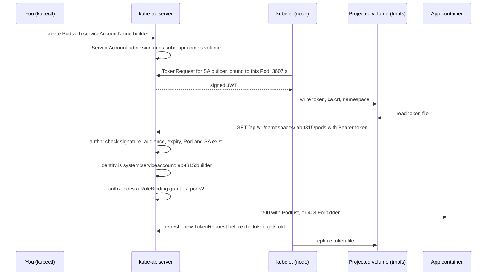

# T3.15 Understand ServiceAccounts

> Competency: "Understand ServiceAccounts" (CKAD-4.7) | Domain/weight: CKAD, Application Environment, Configuration and Security (25%) | Est. time: 2 h | Prerequisites: T2.03, T3.04

Shell setup (from [conventions](../00-conventions.md); put it at the top of every session):

```bash
alias k=kubectl
export do="--dry-run=client -o yaml"
export now="--force --grace-period=0"
source <(kubectl completion bash); complete -o default -F __start_kubectl k
```

One extra helper for this lesson. A **JWT** (JSON Web Token, the format of a ServiceAccount token) has three parts separated by dots. The middle part is the payload, written in base64url (base64 with `-` and `_` instead of `+` and `/`, and no `=` padding). This function turns it back into JSON. It uses only `cut`, `tr` and `base64`, so it also works on the exam hosts, which do not promise `jq` (see [E9](https://docs.linuxfoundation.org/tc-docs/certification/tips-cka-and-ckad)):

```bash
jwt() { local p; p=$(echo "$1" | cut -d. -f2 | tr '_-' '/+'); while [ $(( ${#p} % 4 )) -ne 0 ]; do p="$p="; done; echo "$p" | base64 -d; echo; }
```

Lab environment for this lesson: **kind** (cluster `lab`, context `kind-lab`). Namespace: `lab-t315`. Files go in `~/lab/t315/`. The task entry uses the namespace name `dev` in some example commands; this lesson uses `lab-t315` in its place.

Prerequisites you should have read: [T2.03 Pods in depth](../part2-basics/T2.03-pods-in-depth.md) (Pod spec, volumes, `kubectl exec`) and [T3.04 Create & consume Secrets](../part3-ckad/T3.04-create-consume-secrets.md) (Secret types, `docker-registry` Secrets, how a Secret volume works). Two later lessons go deeper on the permission side: [T3.16 Understand authentication, authorization and admission control](../part3-ckad/T3.16-understand-authentication-authorization-and-admission-control.md) and [T4.06 Manage role based access control (RBAC)](../part4-cka/T4.06-manage-role-based-access-control-rbac.md). This lesson teaches only the small slice of RBAC needed to give a ServiceAccount some rights.

> Output policy. Output blocks carry one of these labels:
> - `REAL OUTPUT (kind v0.33.0, v1.37.0)`: captured for this lesson on a kind cluster named `k-t315` (1 control plane + 2 workers, node image `kindest/node:v1.37.0`, kubectl v1.37.1, default kindnet CNI instead of Calico because nothing in this lesson needs NetworkPolicy). Your node names will be `lab-worker` and so on, and all UIDs, timestamps, hashes and Pod name suffixes will differ.
> - `REAL OUTPUT (kubectl v1.37.1 client, no cluster)`: captured from a client-side command (`--dry-run=client`, `--help`) with no cluster involved.
> - `REAL OUTPUT (Docker)`: captured from a plain Linux container. Not a Pod or kind result.
> - `EXPECTED OUTPUT (not captured)`: the shape you should see. Every such block is listed in section 11.
> Where a real block was shortened, the cut is marked with `...`.

---

## 1. Why this matters

Every process that talks to the Kubernetes API needs an identity. For a person that is a user in your kubeconfig. For a Pod it is a **ServiceAccount**. Controllers, CI agents, operators and monitoring tools all run as Pods, so they all run as some ServiceAccount, and what they may do is decided by the permissions given to that identity. In real life, two things go wrong: Pods run as the shared `default` ServiceAccount and later someone grants it too much, or an app silently gets a token it never needed. In the CKAD domain "Application Environment, Configuration and Security" (25%) you are expected to create a ServiceAccount, run a Pod or Deployment as it, switch the token mount on or off, and explain why a call to the API returns 403. The exam averages about 6 minutes per task (15-20 tasks in 2 hours; sources: [E2](https://docs.linuxfoundation.org/tc-docs/certification/tips-cka-and-ckad), [E3](https://docs.linuxfoundation.org/tc-docs/certification/faq-cka-ckad-cks)), so the commands in section 4 must be automatic.

---

## 2. Concepts

### 2.1 What a ServiceAccount is, and the problem it solves

A **ServiceAccount** (SA) is a namespaced API object (`apiVersion: v1`, `kind: ServiceAccount`) that represents a non-human identity inside the cluster. A Pod "is" a ServiceAccount the way a logged-in user "is" a user name. The API server looks at the credential on each request, works out which identity sent it, and then asks the authorizer (RBAC) whether that identity may do the thing.

Without ServiceAccounts every Pod would need either no identity (it could not call the API at all) or a copy of a human's kubeconfig (a shared, powerful, hard-to-rotate credential). A ServiceAccount fixes this: each workload gets its own identity, and you grant that identity only what the workload needs.

| | ServiceAccount | "User" |
|---|---|---|
| Is it an API object? | Yes. `k get sa`. | No. Kubernetes has no User object. A user is whatever name the authenticator reads from a certificate, token or OIDC claim. |
| Scope | One namespace | Cluster wide |
| Meant for | Processes in Pods (and automation outside the cluster) | People |
| Credential | A signed JWT token | Client certificate, OIDC token, etc. |
| Created with | `k create sa` | Outside Kubernetes |

**Related but different.** A ServiceAccount answers "who is calling?". It grants nothing by itself. What the caller may do comes from **RBAC** objects (Role and RoleBinding), covered in 2.9. A new ServiceAccount can do almost nothing.

### 2.2 The `default` ServiceAccount

When you create a namespace, the control plane creates a ServiceAccount called `default` in it. If you delete it, the control plane creates a new one.

REAL OUTPUT (kind v0.33.0, v1.37.0):

```text
$ k create ns lab-t315
namespace/lab-t315 created
$ k get sa -n lab-t315
NAME      AGE
default   0s
$ k get sa default -n lab-t315 -o yaml
apiVersion: v1
kind: ServiceAccount
metadata:
  creationTimestamp: "2026-10-28T04:25:20Z"
  name: default
  namespace: lab-t315
  resourceVersion: "597"
  uid: d91666ca-75f8-4dcb-b613-d5529625ca43
```

Notice there is no `secrets` list and no token Secret. Since v1.24 Kubernetes does not create token Secrets for ServiceAccounts (see 2.7). I also deleted the `default` SA in a test namespace and the control plane made a new one with a different `uid` within two seconds.

If a Pod does not name a ServiceAccount, the **ServiceAccount admission controller** (a check that runs inside the API server when a Pod is created) fills in `default`. The `default` SA is a trap: every Pod that forgot to choose shares it, so any right you give to `default` is given to all of them. Create one SA per application and bind rights to that.

The `default` SA is not powerless. Every authenticated identity gets a small set of read-only rights (discovery, `/version`, and the ability to ask "who am I" and "what can I do"). Real output for a brand-new SA with no bindings:

REAL OUTPUT (kind v0.33.0, v1.37.0), shortened:

```text
$ k auth can-i --list --as=system:serviceaccount:lab-t315:builder -n lab-t315
Resources                                       Non-Resource URLs                      Resource Names   Verbs
selfsubjectreviews.authentication.k8s.io        []                                     []               [create]
selfsubjectaccessreviews.authorization.k8s.io   []                                     []               [create]
selfsubjectrulesreviews.authorization.k8s.io    []                                     []               [create]
clustertrustbundles.certificates.k8s.io         []                                     []               [get list watch]
                                                [/api/*]                               []               [get]
                                                [/apis/*]                              []               [get]
                                                [/healthz]                             []               [get]
...
                                                [/version]                             []               [get]
```

No row mentions `pods`, `secrets` or `configmaps`. That is the baseline.

### 2.3 `spec.serviceAccountName`

The Pod field that chooses the identity is **`spec.serviceAccountName`**.

| Item | Detail |
|---|---|
| Type | string, the name of a ServiceAccount |
| Default | `default` (set by the ServiceAccount admission controller if you leave it empty) |
| Namespace | The SA must be in the **same namespace as the Pod**. You cannot name `other-ns/sa`. |
| If the SA does not exist | The API server rejects the Pod at creation (section 6) |
| Changeable on a running Pod? | **No.** It is immutable (2.12) |
| Deprecated alias | `spec.serviceAccount`. The API server copies the value into it. You will see both in `k get pod -o yaml`. Write `serviceAccountName`. |

REAL OUTPUT (kind v0.33.0, v1.37.0): `k explain pod.spec.serviceAccount` says:

```text
FIELD: serviceAccount <string>
DESCRIPTION:
    DeprecatedServiceAccount is a deprecated alias for ServiceAccountName.
```

To see which SA a Pod runs as: `k get pod probe -o jsonpath='{.spec.serviceAccountName}{"\n"}'`.

### 2.4 `automountServiceAccountToken`

By default every Pod gets a token whether it needs one or not. The field **`automountServiceAccountToken`** (a boolean) switches that off. It exists in two places:

| Where | Field path | Meaning |
|---|---|---|
| ServiceAccount | `automountServiceAccountToken` (top level of the SA object) | Default for every Pod that uses this SA |
| Pod | `spec.automountServiceAccountToken` | For this Pod only. **Wins over the SA setting.** |

If neither is set, the value is effectively `true`. The decision table (each row was run on the lab cluster in section 5):

| SA setting | Pod setting | Token mounted? |
|---|---|---|
| unset | unset | Yes |
| `false` | unset | **No** |
| `false` | `true` | **Yes** (Pod overrides) |
| unset or `true` | `false` | **No** (Pod overrides) |

Why switch it off: a Pod that never calls the API (a web server, a batch job) does not need an API credential. If an attacker gets code execution inside the container, a mounted token is the first thing they will try. No token, no foothold. The field text from the API:

REAL OUTPUT (kind v0.33.0, v1.37.0):

```text
$ k explain serviceaccount.automountServiceAccountToken
DESCRIPTION:
    AutomountServiceAccountToken indicates whether pods running as this service
    account should have an API token automatically mounted. Can be overridden at
    the pod level.
```

Risky value: `automountServiceAccountToken: "false"` (a quoted string) is rejected, because the field is a boolean. Another trap is the reverse of the break-fix lab: you switch it off on the SA, then forget that one Deployment of yours really calls the API. The app then has no token file at all (section 7, Lab 3).

This setting only controls the **automatic** mount. A projected volume that you write yourself in `spec.volumes` (2.5) is not affected.

### 2.5 The projected token volume

When automount is on, the ServiceAccount admission controller adds a volume to the Pod and mounts it in every container at a fixed path:

```text
/var/run/secrets/kubernetes.io/serviceaccount
```

The volume is called `kube-api-access-<random>` and is of type **projected** (a volume that merges several sources into one directory). Real Pod YAML from the lab cluster (the Pod was created from a manifest that said nothing about volumes):

REAL OUTPUT (kind v0.33.0, v1.37.0), shortened:

```text
    volumeMounts:
    - mountPath: /var/run/secrets/kubernetes.io/serviceaccount
      name: kube-api-access-tsgrp
      readOnly: true
...
  serviceAccount: builder
  serviceAccountName: builder
...
  volumes:
  - name: kube-api-access-tsgrp
    projected:
      defaultMode: 420
      sources:
      - serviceAccountToken:
          expirationSeconds: 3607
          path: token
      - configMap:
          items:
          - key: ca.crt
            path: ca.crt
          name: kube-root-ca.crt
      - downwardAPI:
          items:
          - fieldRef:
              apiVersion: v1
              fieldPath: metadata.namespace
            path: namespace
```

Three sources, three files:

| File | Source | What it holds | Why the Pod needs it |
|---|---|---|---|
| `token` | `serviceAccountToken` (the kubelet asks the API server for it) | A signed JWT for this SA | The bearer credential for API calls |
| `ca.crt` | ConfigMap `kube-root-ca.crt` (one per namespace, published by the control plane) | The cluster CA certificate | To verify that the server you talk to is the real API server |
| `namespace` | `downwardAPI` (`metadata.namespace`) | The Pod's own namespace name | So a program can build URLs like `/api/v1/namespaces/<ns>/pods` |

`defaultMode: 420` is decimal for octal `0644`. Inside a container:

REAL OUTPUT (kind v0.33.0, v1.37.0):

```text
$ k exec probe -- ls -l /var/run/secrets/kubernetes.io/serviceaccount/
total 0
lrwxrwxrwx    1 root     root            13 Oct 28 04:25 ca.crt -> ..data/ca.crt
lrwxrwxrwx    1 root     root            16 Oct 28 04:25 namespace -> ..data/namespace
lrwxrwxrwx    1 root     root            12 Oct 28 04:25 token -> ..data/token
$ k exec probe -- cat /var/run/secrets/kubernetes.io/serviceaccount/namespace
lab-t315
$ k exec probe -- sh -c 'mount | grep serviceaccount'
tmpfs on /run/secrets/kubernetes.io/serviceaccount type tmpfs (ro,relatime,size=16424480k,noswap)
```

Three facts to read from that output. (1) The files are symlinks to `..data/`, which is how the kubelet swaps in a new token atomically. (2) The volume is **tmpfs** (memory), so the token is not written to the node disk. (3) The mount is read-only. `/var/run` is a link to `/run` on most images, which is why `mount` prints `/run/secrets/...`.

The `namespace` file has **no trailing newline** (the shell prompt ran on after the output when I used `cat` without `echo`). Remember that when you compare it with `test`.

Two environment variables are also set in every container: `KUBERNETES_SERVICE_HOST` and `KUBERNETES_SERVICE_PORT` (here `10.96.0.1` and `443`). Together with the DNS name `kubernetes.default.svc` they are how a Pod finds the API server.

**Bound, expiring tokens.** The token in this file is not the old kind of permanent token. It is a **bound** token: tied to one Pod, so it stops working when that Pod is deleted. It also expires and the kubelet replaces it.

REAL OUTPUT (kind v0.33.0, v1.37.0): the decoded payload of the token read from the Pod (`jwt "$(k exec probe -- cat $SA/token)"`):

```json
{"aud":["https://kubernetes.default.svc.cluster.local"],"exp":1824697520,"iat":1793161520,"iss":"https://kubernetes.default.svc.cluster.local","jti":"005e2e62-27cf-4d7d-9976-cd4b31114de2","kubernetes.io":{"namespace":"lab-t315","node":{"name":"k-t315-worker2","uid":"bbf8f401-1440-4aa3-affd-a26caebc45a1"},"pod":{"name":"probe","uid":"22aa6ff2-ecc6-407b-992e-99636c66ed22"},"serviceaccount":{"name":"builder","uid":"07a1797b-df57-4502-b9b2-62a254f30749"},"warnafter":1793165127},"nbf":1793161520,"sub":"system:serviceaccount:lab-t315:builder"}
```

The claims (fields of the JWT):

| Claim | Value above | Meaning |
|---|---|---|
| `iss` | `https://kubernetes.default.svc.cluster.local` | Issuer. The API server checks it against its `--service-account-issuer` setting. |
| `aud` | the same URL | Audience: who the token is meant for. The API server only accepts tokens whose audience it recognizes. |
| `sub` | `system:serviceaccount:lab-t315:builder` | Subject: the identity string (2.8) |
| `iat`, `nbf` | `1793161520` | Issued at / not valid before (Unix seconds) |
| `exp` | `1824697520` | Expiry. `exp - iat = 31536000`, which is one year (see the next paragraph). |
| `jti` | a UUID | Unique token id. It shows up in the audit log as the credential id. |
| `kubernetes.io.namespace` | `lab-t315` | Namespace of the SA |
| `kubernetes.io.serviceaccount` | name and `uid` | The SA. The `uid` matters: if you delete and recreate the SA, the uid changes and old tokens die. |
| `kubernetes.io.pod` | name and `uid` | The Pod the token is bound to |
| `kubernetes.io.node` | name and `uid` | The node the Pod runs on |
| `kubernetes.io.warnafter` | `1793165127` | `iat + 3607`. See below. |

**Default expiry and refresh.** The volume asks for `expirationSeconds: 3607` (see the YAML above). That is the real default of the injected volume on v1.37: one hour plus 7 seconds. The documentation says the kubelet refreshes a projected token "if it is older than 80% of its total time-to-live (TTL), or if the token is older than 24 hours" ([configure-service-account task](https://kubernetes.io/docs/tasks/configure-pod-container/configure-service-account/), section "Launch a Pod using service account token projection").

Now the odd part. The `exp` claim above is **one year** after `iat`, not one hour. The API server has a compatibility setting (`--service-account-extend-token-expiration`, on by default). For the token it injects into Pods it lengthens `exp` up to one year, so that old client programs that never reload the file do not suddenly break. The `warnafter` claim holds the "real" one-hour mark (`iat + 3607` seconds). After `warnafter` the API server still accepts the token; as far as I know it only records the token as "stale" in audit data and metrics (UNVERIFIED here, section 11). Your app should still **re-read the file regularly** (the Kubernetes docs say the application is responsible for reloading the token). The kubelet's rotation of this default token: my reading of the docs rule (80% of a one-year TTL is far more than 24 hours) is that the 24-hour limit applies, so it rotates about daily. I did not observe this directly; see section 11.

I did observe the refresh rule on a short token. I mounted a token with `expirationSeconds: 600` and watched its `iat` change; the result is in section 5, step 14 (the new token was in place by 542 seconds, so the rotation happened between 480 and 542 seconds).

If you want a different lifetime or audience, write the projected volume yourself. Complete, valid YAML (the minimum is 600 seconds):

```yaml
apiVersion: v1
kind: Pod
metadata:
  name: vault-client
  namespace: lab-t315
spec:
  serviceAccountName: default
  containers:
  - name: app
    image: busybox:1.36
    command: ["sleep", "3600"]
    volumeMounts:
    - name: vault-token
      mountPath: /var/run/secrets/tokens
      readOnly: true
  volumes:
  - name: vault-token
    projected:
      sources:
      - serviceAccountToken:
          path: vault-token        # file name inside the mount
          audience: vault          # token is meant for "vault", NOT for the API server
          expirationSeconds: 600   # must be >= 600; the extension above does not apply to custom values
```

REAL OUTPUT (kind v0.33.0, v1.37.0): decoding `/var/run/secrets/tokens/vault-token` in that Pod:

```json
{"aud":["vault"],"ttl":600,"warnafter":null,"iat":1793162066}
```

(`ttl` is `exp - iat`, `warnafter` was empty. I printed only these fields with `jq`.) A token with `aud: vault` is **not** accepted by the API server, because the audience does not match. This is how you give a Pod a credential for some other system (Vault, a cloud IAM service) without exposing its Kubernetes identity. The same Pod still has the automatic `kube-api-access` volume too, because automount stayed on.

**Under the hood: the full path of a token.**

1. You create a Pod. The ServiceAccount admission controller adds the `kube-api-access-*` volume.
2. The scheduler places the Pod. The **kubelet** on that node sees the `serviceAccountToken` source and calls the **TokenRequest API** on the API server: "give me a token for SA `builder`, audience API server, bound to this Pod, 3607 seconds."
3. The API server signs a JWT with its private service-account key and returns it. The kubelet writes it into the tmpfs volume together with `ca.crt` and `namespace`.
4. The app reads the file and sends the JWT as `Authorization: Bearer <token>`.
5. The API server **authenticates**: it checks the signature with the matching public key, `iss`, `aud`, `exp`/`nbf`, and then that the bound Pod and the ServiceAccount still exist with the same UIDs. If all pass, the request is "from" `system:serviceaccount:lab-t315:builder`.
6. The API server **authorizes**: RBAC looks for a binding that grants this identity the verb on the resource. No binding means 403.
7. About every refresh interval the kubelet repeats step 2 and swaps the file.

### 2.6 `kubectl create token` and the TokenRequest API

The **TokenRequest API** is the API call "give me a time-limited token for this ServiceAccount". It is a subresource: `POST /api/v1/namespaces/<ns>/serviceaccounts/<name>/token`. The kubelet uses it (2.5). You use it from the command line with `kubectl create token`. Nothing is stored: the token exists only in the output, and the cluster keeps no list of tokens it issued.

REAL OUTPUT (kubectl v1.37.1 client, no cluster), from `k create token --help`, shortened:

```text
Examples:
  # Request a token to authenticate to the kube-apiserver as the service account "myapp" in the current namespace
  kubectl create token myapp
  # Request a token with a custom expiration
  kubectl create token myapp --duration 10m
  # Request a token with a custom audience
  kubectl create token myapp --audience https://example.com
  # Request a token bound to an instance of a Secret object
  kubectl create token myapp --bound-object-kind Secret --bound-object-name mysecret

    --audience=[]:
	Audience of the requested token. If unset, defaults to requesting a token for use with the Kubernetes API server. May be repeated to request a token valid for multiple audiences.
    --bound-object-kind='':
	Kind of an object to bind the token to. Supported kinds are Node, Pod, Secret. If set, --bound-object-name must be provided.
    --duration=0s:
	Requested lifetime of the issued token. If not set or if set to 0, the lifetime will be determined by the server automatically. The server may return a token with a longer or shorter lifetime.
```

| Flag | Default | What it does | Risky / invalid value |
|---|---|---|---|
| `--duration` | `0s`, which means "server decides" (3600 s here) | Requested lifetime | Below 10 minutes is rejected. Above `2^32` seconds is rejected. |
| `--audience` | the API server | Who the token is for | A token with another audience will not log you in to the API server |
| `--bound-object-kind` / `--bound-object-name` / `--bound-object-uid` | none (bound to the SA only) | Tie the token to a Pod, Secret or Node. When that object is deleted, the token dies. | Name that does not exist |
| `-n` | current namespace | Namespace of the SA | Wrong namespace: the SA is not found there (error text not captured) |

There is no `--dry-run` for `create token` (it is not an object you create): `unknown flag: --dry-run` (real, from my attempt).

**Lifetime behaviour on the lab cluster.** I asked for several durations and decoded `exp - iat` from each token:

REAL OUTPUT (kind v0.33.0, v1.37.0):

```text
$ k create token builder          # no --duration
  ttl = 3600
10m     -> 600
1h      -> 3600
24h     -> 86400
8760h   -> 31536000
100000h -> 360000000
1193046h -> 4294965600
$ k create token builder --duration=1s
error: failed to create token: TokenRequest.authentication.k8s.io "" is invalid: spec.expirationSeconds: Invalid value: 1: may not specify a duration less than 10 minutes
$ k create token builder --duration=9m
error: failed to create token: TokenRequest.authentication.k8s.io "" is invalid: spec.expirationSeconds: Invalid value: 540: may not specify a duration less than 10 minutes
$ k create token builder --duration=1193047h
error: failed to create token: TokenRequest.authentication.k8s.io "" is invalid: spec.expirationSeconds: Invalid value: 4294969200: may not specify a duration larger than 2^32 seconds
```

So on a kind cluster, with no cap configured: default 1 hour, minimum 10 minutes, and the server gave me exactly what I asked up to `2^32` seconds. The documentation adds that an administrator **can** cap the maximum with the API server flag `--service-account-max-token-expiration` ([projected volumes page](https://kubernetes.io/docs/concepts/storage/projected-volumes/#serviceaccounttoken)). On such a cluster the token you get may be shorter than you asked for, and the help text above warns that "the server may return a token with a longer or shorter lifetime". **Always decode `exp - iat`** if the lifetime matters. I could not test a capped cluster (section 11).

The same call without kubectl, as raw API:

```bash
cat > tr.json <<'EOF'
{"apiVersion":"authentication.k8s.io/v1","kind":"TokenRequest","spec":{"expirationSeconds":900}}
EOF
k create --raw /api/v1/namespaces/lab-t315/serviceaccounts/builder/token -f tr.json
```

REAL OUTPUT (kind v0.33.0, v1.37.0), with the token field removed by `jq`:

```json
{"kind":"TokenRequest","apiVersion":"authentication.k8s.io/v1","spec":{"audiences":["https://kubernetes.default.svc.cluster.local"],"expirationSeconds":900,"boundObjectRef":null},"status":{"expirationTimestamp":"2026-10-28T04:40:46Z"}}
```

Notice `boundObjectRef: null`: a token from `create token` without `--bound-object-*` is bound only to the ServiceAccount, and its decoded `kubernetes.io` claim has no `pod` entry. With `--bound-object-kind=Pod --bound-object-name=probe` the decoded claims gained `pod` and `node` entries (real output):

```json
{"namespace":"lab-t315","node":{"name":"k-t315-worker2","uid":"bbf8f401-1440-4aa3-affd-a26caebc45a1"},"pod":{"name":"probe","uid":"22aa6ff2-ecc6-407b-992e-99636c66ed22"},"serviceaccount":{"name":"builder","uid":"07a1797b-df57-4502-b9b2-62a254f30749"}}
```

**Revoking a token.** There is no "revoke this one token" call. The docs say deleting the bound Pod expires its bound tokens, and deleting and recreating the ServiceAccount (new UID) invalidates every token issued for it ([service accounts admin guide](https://kubernetes.io/docs/reference/access-authn-authz/service-accounts-admin/)). I tested both:

REAL OUTPUT (kind v0.33.0, v1.37.0), shortened (the +30 s lines were identical to +15 s): HTTP status of `GET /api/v1/namespaces/lab-t315/pods` with the token, measured from my laptop:

```text
before: pod-bound=200 sa-only=200
after pod delete +5s: pod-bound=200 sa-only=200
after pod delete +15s: pod-bound=401 sa-only=200
after SA recreate +5s: sa-only=200
after SA recreate +15s: sa-only=401
```

Both revocations work, but **not instantly**: at +5 seconds the old token was still accepted, at +15 seconds it got `401`. I did not look for the cause; a short cache of successful token checks is the likely one (UNVERIFIED). Do not rely on instant revocation.

### 2.7 Legacy long-lived token Secrets

Before v1.22, Kubernetes created a Secret of type `kubernetes.io/service-account-token` for every ServiceAccount and mounted it into Pods. That token never expired and was not tied to a Pod. From v1.24 the control plane no longer creates these automatically ([service accounts concept page](https://kubernetes.io/docs/concepts/security/service-accounts/)). You can still make one **by hand** when something outside the cluster needs a permanent credential:

```yaml
apiVersion: v1
kind: Secret
metadata:
  name: builder-legacy
  namespace: lab-t315
  annotations:
    kubernetes.io/service-account.name: builder   # which SA this token is for. Required.
type: kubernetes.io/service-account-token        # the special type. The type cannot be changed later.
```

You apply it with the empty `data`. A controller notices the type and annotation and fills the Secret with `token`, `ca.crt` and `namespace`:

REAL OUTPUT (kind v0.33.0, v1.37.0):

```text
$ k apply -f legacy.yaml
secret/builder-legacy created
$ k get secret builder-legacy
NAME             TYPE                                  DATA   AGE
builder-legacy   kubernetes.io/service-account-token   3      3s
$ k describe secret builder-legacy
Name:         builder-legacy
Namespace:    lab-t315
Labels:       <none>
Annotations:  kubernetes.io/service-account.name: builder
              kubernetes.io/service-account.uid: 07a1797b-df57-4502-b9b2-62a254f30749

Type:  kubernetes.io/service-account-token

Data
====
ca.crt:     1107 bytes
namespace:  8 bytes
token:      <hidden>
```

And the decoded payload of that token (fields printed with `jq`):

```json
{"exp":null,"iss":"kubernetes/serviceaccount","sub":"system:serviceaccount:lab-t315:builder","secret":null}
```

There is **no `exp`** (never expires), the issuer is the old `kubernetes/serviceaccount`, and `kubernetes.io` has no Pod binding. It is valid until you delete the Secret, or until you delete and recreate the SA (the Secret's token then returned `401` in my test). Compare the three ways to get a token:

| | Projected volume (automatic) | `k create token` | Token Secret (legacy) |
|---|---|---|---|
| Created by | kubelet, for the Pod | You, on demand | You, with a Secret manifest |
| Lifetime | Short; kubelet refreshes it | 1 h default, you choose | Never expires |
| Bound to | The Pod | The SA (or an object you name) | The SA only |
| Stored in the cluster? | No (tmpfs on the node) | No | Yes, as a Secret anyone with `get secrets` can read |
| Use it for | Pods calling the API | Quick tests, CI jobs, scripts | Only when an outside system truly cannot get a short token |

Rule of thumb: never create the Secret unless the task says so explicitly.

### 2.8 The identity string and groups

When the API server accepts a ServiceAccount token it builds the caller's identity:

| Part | Value |
|---|---|
| Username | `system:serviceaccount:<namespace>:<name>` |
| Groups | `system:serviceaccounts`, `system:serviceaccounts:<namespace>`, `system:authenticated` |

REAL OUTPUT (kind v0.33.0, v1.37.0):

```text
$ k auth whoami --as=system:serviceaccount:lab-t315:builder
ATTRIBUTE   VALUE
Username    system:serviceaccount:lab-t315:builder
Groups      [system:serviceaccounts system:serviceaccounts:lab-t315 system:authenticated]
```

When the call is made with a real token the answer also carries extra attributes (taken from the token claims). This is the output of a `SelfSubjectReview` request sent **from inside the Pod** with its own token:

```json
"userInfo": {
  "username": "system:serviceaccount:lab-t315:builder",
  "uid": "07a1797b-df57-4502-b9b2-62a254f30749",
  "groups": ["system:serviceaccounts", "system:serviceaccounts:lab-t315", "system:authenticated"],
  "extra": {
    "authentication.kubernetes.io/credential-id": ["JTI=005e2e62-27cf-4d7d-9976-cd4b31114de2"],
    "authentication.kubernetes.io/node-name": ["k-t315-worker2"],
    "authentication.kubernetes.io/pod-name": ["probe"],
    "authentication.kubernetes.io/pod-uid": ["22aa6ff2-ecc6-407b-992e-99636c66ed22"],
    ...
  }
}
```

(Shortened: the node-uid entry is cut.) The identity string is what appears in 403 messages and what you type after `--as=`. The groups let you bind a right to many SAs at once: a RoleBinding whose subject is `kind: Group, name: system:serviceaccounts:lab-t315` covers every SA in that namespace. In a RoleBinding the subject for one SA is `kind: ServiceAccount, name: builder, namespace: lab-t315`; RBAC builds the long string for you.

**Gotcha.** `k auth whoami` as a plain command shows **you** (`kubernetes-admin`). Passing `--token` did not change that on my kind cluster, because the kubeconfig's client certificate was used first. Use `--as=...` to test an SA identity from your own kubeconfig, or call the API with `curl` and the token.

### 2.9 Granting permissions to a ServiceAccount

A **Role** lists allowed verbs on resources in one namespace. A **RoleBinding** attaches a Role to subjects (here a ServiceAccount). Imperative:

```bash
k create role pod-reader --verb=get,list --resource=pods
k create rolebinding builder-pods --role=pod-reader --serviceaccount=lab-t315:builder
```

The `--serviceaccount` value is `<namespace>:<name>`. Leaving out the namespace gives `error: serviceaccount must be <namespace>:<name>` (real). REAL OUTPUT (kubectl v1.37.1 client, no cluster) of the same commands with `$do`:

```yaml
apiVersion: rbac.authorization.k8s.io/v1
kind: Role
metadata:
  name: pod-reader
  namespace: lab-t315
rules:
- apiGroups:
  - ""
  resources:
  - pods
  verbs:
  - get
  - list
---
apiVersion: rbac.authorization.k8s.io/v1
kind: RoleBinding
metadata:
  name: builder-pods
  namespace: lab-t315
roleRef:
  apiGroup: rbac.authorization.k8s.io
  kind: Role
  name: pod-reader
subjects:
- kind: ServiceAccount
  name: builder
  namespace: lab-t315
```

(Two commands, printed one after the other; I joined them with `---`.) `apiGroups: [""]` is the core API group, where `pods` lives. Use `--verb=get,list,watch` for a program that watches Pods. A Role only works in its own namespace. For cluster-wide rights you need a ClusterRole and ClusterRoleBinding, which are RBAC topics for [T4.06](../part4-cka/T4.06-manage-role-based-access-control-rbac.md). The least-privilege habit: list the exact verbs and resources the app uses, nothing more.

**Checking rights.** `kubectl auth can-i` asks the authorizer. `--as` makes it answer for another identity (you need the right to impersonate, which an admin has):

REAL OUTPUT (kind v0.33.0, v1.37.0):

```text
$ k auth can-i list pods -n lab-t315 --as=system:serviceaccount:lab-t315:builder
no                      # before the binding
$ k auth can-i list pods -n lab-t315 --as=system:serviceaccount:lab-t315:builder
yes                     # after the binding
$ k auth can-i delete pods -n lab-t315 --as=system:serviceaccount:lab-t315:builder
no
$ k auth can-i list pods -n kube-system --as=system:serviceaccount:lab-t315:builder
no
```

The command prints `yes` or `no` and exits with status 0 or 1, so it works in `test`. `k auth can-i --list --as=... -n <ns>` shows every rule that applies.

### 2.10 Calling the API from a Pod with curl, token and CA

Inside a Pod the pieces are: URL `https://kubernetes.default.svc` (DNS name of the API server Service), CA file `ca.crt`, token file `token`, namespace file `namespace`. The recipe, as a single command run through `k exec` (the single quotes make the **Pod's** shell expand the variables):

```bash
k exec probe -- sh -c 'SA=/var/run/secrets/kubernetes.io/serviceaccount
curl -s --cacert $SA/ca.crt -H "Authorization: Bearer $(cat $SA/token)" \
  https://kubernetes.default.svc/api/v1/namespaces/$(cat $SA/namespace)/pods'
```

Each part: `--cacert` makes curl trust the cluster CA (without it curl fails with exit code 60, shown below); the `Authorization: Bearer` header carries the JWT; the path is the REST path of the list of Pods in the namespace (`/api/v1` is the core group; named groups use `/apis/<group>/<version>/`). The image needs `curl`. This lesson uses `curlimages/curl:8.23.0`; its entrypoint is `curl`, so the Pod YAML must set `command: ["sleep", "3600"]` to keep the container alive.

What the API server answers in each situation (all real, from the lab cluster):

| Call | Result |
|---|---|
| Token + CA, SA has no Role | HTTP 403, `pods is forbidden: User "system:serviceaccount:lab-t315:builder" cannot list resource "pods" in API group "" in the namespace "lab-t315"` |
| Token + CA, after the RoleBinding | HTTP 200 and a `PodList` |
| No `--cacert` | curl exits with code 60 (certificate not trusted) |
| `-k` (skip verification) and no token | HTTP 403 for user `system:anonymous` (the API server treats a request with no credential as anonymous) |
| Token, other namespace (`kube-system`), Role only in `lab-t315` | HTTP 403 |

Do not use `-k` in real work; it turns off the check that you are talking to the real server.

### 2.11 `imagePullSecrets` on a ServiceAccount

A private registry needs credentials. The Pod field `spec.imagePullSecrets` lists Secrets of type `kubernetes.io/dockerconfigjson` that the kubelet uses to pull the image. Writing it into every Pod is tedious, so you can put it on the **ServiceAccount** instead. The ServiceAccount admission controller copies the list into each new Pod that uses that SA.

```bash
k create secret docker-registry regcred --docker-server=registry.example.com --docker-username=ci --docker-password=pw
k patch sa builder -p '{"imagePullSecrets":[{"name":"regcred"}]}'
```

Create Pod after the patch, then compare:

REAL OUTPUT (kind v0.33.0, v1.37.0):

```text
$ k get sa builder -o yaml
apiVersion: v1
automountServiceAccountToken: false
imagePullSecrets:
- name: regcred
kind: ServiceAccount
...
$ k get pod pulltest -o jsonpath='{.spec.imagePullSecrets}{"\n"}'     # created after the patch
[{"name":"regcred"}]
$ k get pod forcemount -o jsonpath='{.spec.imagePullSecrets}{"\n"}'   # same SA, created BEFORE the patch

```

The second Pod has an empty list: the copy happens **at Pod creation**, so Pods that already exist do not change. Recreate them (or roll the Deployment). The Secret must be in the same namespace as the SA and the Pod. The Secret is used only by the kubelet, never mounted into containers (`k explain serviceaccount.imagePullSecrets` says "ImagePullSecrets are distinct from Secrets because Secrets can be mounted in the pod, but ImagePullSecrets are only accessed by the kubelet"). There is no `k create sa` flag for it, so use `k patch sa` or edit the YAML.

**Awareness: ServiceAccount token for image pulls.** A newer, separate feature lets the kubelet send a token **bound to the Pod's ServiceAccount** to an image credential provider plugin, so a registry can recognise the workload instead of using a stored password. Its feature gate `KubeletServiceAccountTokenForCredentialProviders` is Alpha in v1.33 and **Beta since v1.34, enabled by default** ([feature gates page](https://kubernetes.io/docs/reference/command-line-tools-reference/feature-gates/), checked on 2026-10-28; I saw no later stage in the table). It is configured on the node by the cluster administrator in the kubelet credential provider config. It is not something you set in a Pod manifest and it is not a CKAD task. Know that it exists and that `imagePullSecrets` is still the everyday way.

### 2.12 `serviceAccountName` is immutable on a running Pod

You cannot change the identity of a Pod that already exists. The API server only allows a few Pod fields to change after creation (container images, `activeDeadlineSeconds`, added tolerations, and similar). The Pod object is a record of "what is running", and a different identity would also need a different token, so the design is: replace the Pod.

REAL OUTPUT (kind v0.33.0, v1.37.0):

```text
$ k patch pod probe -p '{"spec":{"serviceAccountName":"default"}}'
The Pod "probe" is invalid: spec: Forbidden: pod updates may not change fields other than `spec.containers[*].image`,`spec.initContainers[*].image`,`spec.activeDeadlineSeconds`,`spec.tolerations` (only additions to existing tolerations),`spec.terminationGracePeriodSeconds` (allow it to be set to 1 if it was previously negative)
```

After the error line, `k patch` printed a short diff of the rejected change (`ServiceAccountName` from `builder` to `default`, and the deprecated `DeprecatedServiceAccount` alias next to it). `k edit pod probe` is rejected by the same check (its final error text was not captured, see section 11). What to do:

- A bare Pod: `k delete pod probe $now`, fix the YAML, `k apply -f`, or `k replace --force -f pod.yaml` (delete and create in one step).
- A Pod made by a controller (Deployment, StatefulSet, Job): **change the Pod template of the controller**. The controller then rolls out new Pods. Imperatively:

```bash
k set serviceaccount deploy/app builder
```

REAL OUTPUT (kind v0.33.0, v1.37.0):

```text
$ k create deploy app --image=curlimages/curl:8.23.0 --replicas=2 -- sleep 3600
$ k get pod -l app=app -o custom-columns=NAME:.metadata.name,SA:.spec.serviceAccountName
NAME                   SA
app-77c5986f54-qmvkq   default
app-77c5986f54-rr29n   default
$ k set serviceaccount deploy/app builder
deployment.apps/app serviceaccount updated
$ k rollout status deploy/app
...
deployment "app" successfully rolled out
$ k get pod -l app=app -o custom-columns=NAME:.metadata.name,SA:.spec.serviceAccountName
NAME                   SA
app-77c5986f54-qmvkq   default      # old Pods, still shutting down
app-77c5986f54-rr29n   default
app-7bc4486d54-gxhft   builder      # new Pods from the new ReplicaSet
app-7bc4486d54-qptmd   builder
```

`k set serviceaccount` changes `spec.template.spec.serviceAccountName`, which creates a new ReplicaSet and a rolling update (see [T3.10](../part3-ckad/T3.10-deployments-and-rolling-updates.md)). It works on Deployment, ReplicaSet, DaemonSet, StatefulSet, Job and ReplicationController; **not on a bare Pod**. The short alias is `k set sa`.

**`k run` has no flag for it.** `k run --help` has no `--serviceaccount`. Either generate YAML with `$do` and add one line, or use `--overrides` (section 4). In my test `k run --overrides` with `--dry-run=client` tried to contact the API server, so use it for real creation, not for offline YAML generation.

---

## 3. How it works (diagram)



Walkthrough:

1. At Pod creation the API server (admission step) adds the projected volume. You wrote nothing for it.
2. The kubelet on the node calls the TokenRequest API for the Pod's ServiceAccount and writes the answer into the tmpfs volume, next to the cluster CA and the namespace name.
3. The app reads the token file and sends it in the `Authorization` header.
4. **Authentication** turns the token into the identity `system:serviceaccount:<ns>:<name>`. A bad signature, a wrong audience, an expired token or a deleted Pod gives `401`.
5. **Authorization** (RBAC) then decides. No matching Role and RoleBinding gives `403`. So 401 means "I do not know who you are", 403 means "I know who you are and the answer is no".
6. The kubelet keeps replacing the token file, so the app must re-read the file instead of caching the token forever.

---

## 4. Commands and YAML you must produce fast

### 4.1 Imperative shortcuts

```bash
k create sa builder                                   # new ServiceAccount in the current namespace
k get sa                                              # list them (default is always there)
k set serviceaccount deploy/app builder               # change the SA of a Deployment (rolls out new Pods)
k create token builder --duration=1h                  # print a short-lived token (min 10m)
k create role pod-reader --verb=get,list --resource=pods
k create rolebinding builder-pods --role=pod-reader --serviceaccount=lab-t315:builder
k auth can-i list pods --as=system:serviceaccount:lab-t315:builder -n lab-t315   # yes / no
k exec app -- cat /var/run/secrets/kubernetes.io/serviceaccount/namespace        # which ns does the Pod think it is in
k patch sa builder -p '{"automountServiceAccountToken":false}'                   # SA-level: no token by default
k patch sa builder -p '{"imagePullSecrets":[{"name":"regcred"}]}'                # attach a pull secret
k run web --image=nginx:1.27 --overrides='{"spec":{"serviceAccountName":"builder"}}'   # Pod as an SA in one line
```

Explanations: `create sa` makes the identity only. `set serviceaccount` is the only imperative way to change a running workload (you cannot change a bare Pod). `create token` prints one token and keeps no record. `create role` / `create rolebinding` give rights; the `--serviceaccount` flag takes `<ns>:<name>`. `auth can-i --as=` answers for another identity. The `--overrides` form is the fastest way to start one Pod as an SA, but it needs a live API server (2.12); for several fields, generate YAML with `$do` and edit it.

### 4.2 Declarative YAML

A complete Pod that runs as `builder` and has **no** API token:

```yaml
apiVersion: v1
kind: Pod
metadata:
  name: nomount
  namespace: lab-t315
spec:
  serviceAccountName: builder           # which SA this Pod runs as. Must exist in lab-t315. Default: "default". Immutable.
  automountServiceAccountToken: false   # boolean. true or false. Pod-level value wins over the SA's. false = no kube-api-access volume.
  containers:
  - name: app
    image: busybox:1.36                 # pinned tag, never :latest
    command: ["sleep", "3600"]          # keeps the container running
```

Apply it only after `k create sa builder` (otherwise `serviceaccount "builder" not found`). To prove there is no token: `k exec nomount -- ls /var/run/secrets/kubernetes.io/serviceaccount` fails with `No such file or directory` (real output in section 5, step 11).

A Pod that calls the API (the curl image; this is the Pod used throughout the lesson):

```yaml
apiVersion: v1
kind: Pod
metadata:
  name: probe
  namespace: lab-t315
spec:
  serviceAccountName: builder           # identity used by the token in the mounted volume
  containers:
  - name: app
    image: curlimages/curl:8.23.0       # pinned; the image's entrypoint is curl, so give it a command
    command: ["sleep", "3600"]
```

And the call from inside it, saved as a one-liner you can type:

```bash
k exec probe -- sh -c 'SA=/var/run/secrets/kubernetes.io/serviceaccount; curl -s --cacert $SA/ca.crt -H "Authorization: Bearer $(cat $SA/token)" https://kubernetes.default.svc/api/v1/namespaces/lab-t315/pods'
```

Add `-o /dev/null -w "%{http_code}\n"` to print only the status code. The ServiceAccount itself, with both optional fields:

```yaml
apiVersion: v1
kind: ServiceAccount
metadata:
  name: builder
  namespace: lab-t315
automountServiceAccountToken: false     # default for Pods using this SA. A Pod can override it with true.
imagePullSecrets:
- name: regcred                         # Secret of type kubernetes.io/dockerconfigjson in the same namespace. Applied to Pods created later.
```

(`regcred` must exist before Pods that use this SA start pulling private images; the SA object itself can be created first.)

### 4.3 Speed drill

Setup (one line): `k create ns lab-t315 && k config set-context --current --namespace=lab-t315`. Then do the eight tasks in order. Target times are for exam pace.

1. (2 min) Create ServiceAccount `ci` and a Pod `p1` (`busybox:1.36`, command `sleep 3600`) that runs as it.
2. (2 min) Create Deployment `web` (`nginx:1.27`, 2 replicas) and make its Pods run as `ci`.
3. (1 min) Print a token for `ci` that is valid for 20 minutes.
4. (3 min) Let `ci` get and list Pods in `lab-t315` only. Prove it with `can-i`.
5. (2 min) Create Pod `p2` (`busybox:1.36`, `sleep 3600`) as `ci` with no API token.
6. (1 min) Print the namespace that Pod `p1` sees in its mounted files.
7. (3 min) Create a registry Secret `regcred` (server `registry.example.com`, user `u`, password `p`) and make Pods of `ci` use it.
8. (2 min) Print the groups of the identity of `ci`.

<details><summary>Answers</summary>

```bash
# 1
k create sa ci
k run p1 --image=busybox:1.36 --overrides='{"spec":{"serviceAccountName":"ci"}}' -- sleep 3600
# 2
k create deploy web --image=nginx:1.27 --replicas=2
k set serviceaccount deploy/web ci
# 3
k create token ci --duration=20m
# 4
k create role pod-reader --verb=get,list --resource=pods
k create rolebinding ci-pods --role=pod-reader --serviceaccount=lab-t315:ci
k auth can-i list pods -n lab-t315 --as=system:serviceaccount:lab-t315:ci        # yes
k auth can-i list pods -n kube-system --as=system:serviceaccount:lab-t315:ci     # no
# 5
k run p2 --image=busybox:1.36 $do -- sleep 3600 > p2.yaml
# edit p2.yaml: under spec add
#   serviceAccountName: ci
#   automountServiceAccountToken: false
k apply -f p2.yaml
# (or: k run p2 --image=busybox:1.36 --overrides='{"spec":{"serviceAccountName":"ci","automountServiceAccountToken":false}}' -- sleep 3600)
# 6
k exec p1 -- cat /var/run/secrets/kubernetes.io/serviceaccount/namespace
# 7
k create secret docker-registry regcred --docker-server=registry.example.com --docker-username=u --docker-password=p
k patch sa ci -p '{"imagePullSecrets":[{"name":"regcred"}]}'
# Pods created after this get the secret. Existing Pods do not.
# 8
k auth whoami --as=system:serviceaccount:lab-t315:ci
```

Check: `k get pod p2 -o jsonpath='{.spec.volumes}'` prints nothing, and `k get deploy web -o jsonpath='{.spec.template.spec.serviceAccountName}'` prints `ci`.

</details>

Cleanup: `k delete ns lab-t315 && k config set-context --current --namespace=default`.

---

## 5. Worked example

Goal: follow one ServiceAccount from creation to a working, least-privilege API call, and meet every behaviour in section 2 on a real cluster. Environment: kind. All blocks are REAL OUTPUT (kind v0.33.0, v1.37.0) unless marked otherwise. Cluster `k-t315`, so node names are `k-t315-*`.

**Step 1. Namespace, default SA, new SA.**

```bash
k create ns lab-t315
k config set-context --current --namespace=lab-t315
k get sa                      # only "default"
k create sa builder
k get sa builder -o yaml
```

```text
apiVersion: v1
kind: ServiceAccount
metadata:
  creationTimestamp: "2026-10-28T04:25:20Z"
  name: builder
  namespace: lab-t315
  resourceVersion: "599"
  uid: 07a1797b-df57-4502-b9b2-62a254f30749
```

What to look for: no `secrets`, no `automountServiceAccountToken`, a `uid` (it ends up inside every token).

**Step 2. Run a Pod as `builder` and inspect the mount.** Apply `probe.yaml` from section 4.2, then:

```bash
k apply -f probe.yaml
k wait --for=condition=Ready pod/probe --timeout=120s
k get pod probe -o jsonpath='{.spec.serviceAccountName}{"\n"}'
k exec probe -- ls -l /var/run/secrets/kubernetes.io/serviceaccount/
k exec probe -- cat /var/run/secrets/kubernetes.io/serviceaccount/namespace
```

```text
pod/probe created
pod/probe condition met
builder
total 0
lrwxrwxrwx    1 root     root            13 Oct 28 04:25 ca.crt -> ..data/ca.crt
lrwxrwxrwx    1 root     root            16 Oct 28 04:25 namespace -> ..data/namespace
lrwxrwxrwx    1 root     root            12 Oct 28 04:25 token -> ..data/token
lab-t315
```

The three files from 2.5 are present. (The volume YAML is in 2.5.)

**Step 3. Decode the token.**

```bash
SA=/var/run/secrets/kubernetes.io/serviceaccount
TOKEN=$(k exec probe -- cat $SA/token)
jwt "$TOKEN"
```

The output is the JSON shown in 2.5. Read it like this: `sub` is the identity, `kubernetes.io.pod.name` is `probe`, `kubernetes.io.serviceaccount.uid` equals the `uid` from step 1, and `exp - iat = 31536000`. With `jq` installed on your laptop (not promised on exam hosts) you can compute it: `jwt "$TOKEN" | jq '.exp - .iat'`.

**Step 4. Call the API. It fails with 403.**

```bash
k exec probe -- sh -c 'SA=/var/run/secrets/kubernetes.io/serviceaccount; curl -s --cacert $SA/ca.crt -H "Authorization: Bearer $(cat $SA/token)" https://kubernetes.default.svc/api/v1/namespaces/lab-t315/pods'
```

```text
{
  "kind": "Status",
  "apiVersion": "v1",
  "metadata": {},
  "status": "Failure",
  "message": "pods is forbidden: User \"system:serviceaccount:lab-t315:builder\" cannot list resource \"pods\" in API group \"\" in the namespace \"lab-t315\"",
  "reason": "Forbidden",
  "details": {
    "kind": "pods"
  },
  "code": 403
}
```

Read the message: it names the identity (`system:serviceaccount:lab-t315:builder`), the verb (`list`), the resource (`pods`), the API group (`""`) and the namespace. That is everything a Role needs. Two more calls to see the other failure types:

```bash
k exec probe -- sh -c 'curl -s https://kubernetes.default.svc/api/v1/namespaces/lab-t315/pods; echo rc=$?'   # no --cacert
k exec probe -- sh -c 'curl -s -k https://kubernetes.default.svc/api/v1/namespaces/lab-t315/pods | head -12' # no token
```

```text
rc=60
...
  "message": "pods is forbidden: User \"system:anonymous\" cannot list resource \"pods\" in API group \"\" in the namespace \"lab-t315\"",
...
```

Exit code 60 means curl does not trust the server certificate. `system:anonymous` means no token was sent at all.

**Step 5. Ask the authorizer, grant the Role, retest.**

```bash
k auth can-i list pods -n lab-t315 --as=system:serviceaccount:lab-t315:builder      # no
k create role pod-reader --verb=get,list --resource=pods
k create rolebinding builder-pods --role=pod-reader --serviceaccount=lab-t315:builder
k auth can-i list pods -n lab-t315 --as=system:serviceaccount:lab-t315:builder      # yes
k auth can-i delete pods -n lab-t315 --as=system:serviceaccount:lab-t315:builder    # no
k auth can-i list pods -n kube-system --as=system:serviceaccount:lab-t315:builder   # no
k describe rolebinding builder-pods
```

```text
no
role.rbac.authorization.k8s.io/pod-reader created
rolebinding.rbac.authorization.k8s.io/builder-pods created
yes
no
no
Name:         builder-pods
Labels:       <none>
Annotations:  <none>
Role:
  Kind:  Role
  Name:  pod-reader
Subjects:
  Kind            Name     Namespace
  ----            ----     ---------
  ServiceAccount  builder  lab-t315
```

Now the same call from the Pod, once for the status code and once for the names:

```bash
k exec probe -- sh -c 'SA=/var/run/secrets/kubernetes.io/serviceaccount; curl -s -o /dev/null -w "%{http_code}\n" --cacert $SA/ca.crt -H "Authorization: Bearer $(cat $SA/token)" https://kubernetes.default.svc/api/v1/namespaces/lab-t315/pods'
k exec probe -- sh -c 'SA=/var/run/secrets/kubernetes.io/serviceaccount; curl -s --cacert $SA/ca.crt -H "Authorization: Bearer $(cat $SA/token)" https://kubernetes.default.svc/api/v1/namespaces/lab-t315/pods | grep "^        \"name\""'
k exec probe -- sh -c 'SA=/var/run/secrets/kubernetes.io/serviceaccount; curl -s -o /dev/null -w "%{http_code}\n" --cacert $SA/ca.crt -H "Authorization: Bearer $(cat $SA/token)" https://kubernetes.default.svc/api/v1/namespaces/kube-system/pods'
```

```text
200
        "name": "probe",
403
```

The grep pattern is eight spaces then `"name"`, which matches the Pod names in the API server's indented JSON (other `name` fields sit deeper). The Role works only in `lab-t315`: `kube-system` still returns 403. Nothing was restarted: RBAC changes apply to the next request.

**Step 6. Ask the cluster who it thinks you are.**

```bash
k auth whoami --as=system:serviceaccount:lab-t315:builder
```

Output is in 2.8 (username and the three groups).

**Step 7. Create tokens yourself.**

```bash
T=$(k create token builder)
jwt "$T"
```

The decoded `kubernetes.io` claim holds only `namespace` and `serviceaccount` (no `pod`), and `exp - iat` is `3600`. Try the durations from 2.6: `10m`, `1h`, `24h` are granted exactly; `1s` and `9m` fail with `may not specify a duration less than 10 minutes`. A bound token:

```bash
k create token builder --bound-object-kind=Pod --bound-object-name=probe
```

carries the Pod and node in its claims (2.6).

**Step 8. Revoke by deleting the bound object.** Create a Pod `pulltest`, a Pod-bound token and a plain token, call the API with each, delete the Pod, and call again. Result is the table in 2.6: the Pod-bound token gave `401` about 15 seconds after the Pod was deleted, the plain SA token kept working until the SA was deleted and recreated.

**Step 9. Change the SA of a Deployment.** See 2.12 for the output of `k set serviceaccount deploy/app builder`. The new ReplicaSet makes new Pods with `serviceAccountName: builder`; the first call from the new Pod returned `200`:

```text
$ k exec deploy/app -- sh -c '<curl as above, status only>'
200
```

**Step 10. Try to change a running Pod.** See 2.12: the `Forbidden: pod updates may not change fields other than ...` error.

**Step 11. Switch the token mount off.** Patch the SA, then start three Pods:

```bash
k patch sa builder -p '{"automountServiceAccountToken":false}'
# nomount:    serviceAccountName builder, no Pod-level setting          (YAML: section 4.2)
# forcemount: serviceAccountName builder, automountServiceAccountToken: true
# podoff:     serviceAccountName default, automountServiceAccountToken: false
for p in nomount forcemount podoff; do echo "== $p"; k get pod $p -o jsonpath='{.spec.volumes}{"\n"}'; k exec $p -- ls /var/run/secrets/kubernetes.io/serviceaccount 2>&1; done
```

```text
== nomount

ls: /var/run/secrets/kubernetes.io/serviceaccount: No such file or directory
command terminated with exit code 1
== forcemount
[{"name":"kube-api-access-b7zkt","projected":{"defaultMode":420,"sources":[{"serviceAccountToken":{"expirationSeconds":3607,"path":"token"}},{"configMap":{"items":[{"key":"ca.crt","path":"ca.crt"}],"name":"kube-root-ca.crt"}},{"downwardAPI":{"items":[{"fieldRef":{"apiVersion":"v1","fieldPath":"metadata.namespace"},"path":"namespace"}]}}]}}]
ca.crt
namespace
token
== podoff

ls: /var/run/secrets/kubernetes.io/serviceaccount: No such file or directory
command terminated with exit code 1
```

An empty `volumes` line means the admission controller added nothing. `forcemount` shows the Pod-level `true` beating the SA-level `false`.

**Step 12. Attach a pull secret to the SA.** Output in 2.11: Pods created after the patch carry `imagePullSecrets`, older ones do not.

**Step 13. Legacy token Secret.** Output in 2.7. Decoding it shows no `exp`. Reading it back as a Pod would see it is the same as reading the `token` key: `k get secret builder-legacy -o jsonpath='{.data.token}' | base64 -d`.

**Step 14. Watch a refresh (short-lived token).** Apply the `vault-client` Pod from 2.5 (600-second token) and print `iat` and `exp` every 30 seconds for about 13 minutes:

```bash
while true; do T=$(k exec vault-client -- cat /var/run/secrets/tokens/vault-token); echo "$(date +%T) $(jwt "$T" | grep -o '"iat":[0-9]*,\|"exp":[0-9]*,')"; sleep 30; done
```

REAL OUTPUT (kind v0.33.0, v1.37.0): only the lines where the token changed (the loop above prints every line; I printed a line only when `iat` or `exp` differed from the previous one):

```text
t+0s   iat/exp=[1793162112,1793162712]
t+542s iat/exp=[1793162645,1793163245]
```

The first token lived 600 seconds (`exp - iat`). By my poll at t+542 s the file already held a new token, issued 533 seconds after the first one. The docs rule says the kubelet asks for a new token when the old one is older than 80% of its TTL, which is 480 seconds here. A refresh at 480 s or later, noticed by a poll every 30 s, fits that. I did not poll often enough to pin the exact second, and I did not wait for the default 3607-second token (80% would be about 48 minutes, but see 2.5 about the one-year `exp`). Lesson for your own apps: the file changes under you, so re-read it instead of caching the token in a variable at start-up.

**Step 15. Cleanup.**

```bash
k delete ns lab-t315
k config set-context --current --namespace=default
```

---

## 6. Common mistakes and how to fix them

| Symptom | What you will see (exact text) | Cause | Fix (command) |
|---|---|---|---|
| API call from a Pod returns 403 | `pods is forbidden: User "system:serviceaccount:lab-t315:builder" cannot list resource "pods" in API group "" in the namespace "lab-t315"` | The SA has no Role granting that verb on that resource in that namespace | `k create role pod-reader --verb=get,list --resource=pods` then `k create rolebinding builder-pods --role=pod-reader --serviceaccount=lab-t315:builder` |
| Pod rejected: SA not found (bare Pod) | `Error from server (Forbidden): error when creating "nosuch.yaml": pods "ghost" is forbidden: error looking up service account lab-t315/nosuch: serviceaccount "nosuch" not found` | The SA name is wrong, or the SA lives in **another namespace** (an SA is not visible across namespaces) | `k get sa -n lab-t315`; `k create sa nosuch -n lab-t315`; then re-apply |
| Deployment shows `0/1` and no Pods | ReplicaSet condition `ReplicaFailure True FailedCreate`; event `Error creating: pods "ghostd-8dcc8db-" is forbidden: error looking up service account lab-t315/nosuch: serviceaccount "nosuch" not found` | Same cause. The Deployment object itself is accepted, so no error appears at `apply` time. | `k create sa nosuch`; the ReplicaSet controller retries by itself (with a back-off, so allow some time). Not captured: how long it took. |
| Editing the SA of a running Pod is rejected | `The Pod "probe" is invalid: spec: Forbidden: pod updates may not change fields other than ...` | `serviceAccountName` is immutable on an existing Pod | Bare Pod: `k replace --force -f pod.yaml`. Controller: `k set serviceaccount deploy/app builder` (edits the template) |
| No token file in the Pod | `ls: /var/run/secrets/kubernetes.io/serviceaccount: No such file or directory` and `k get pod -o jsonpath='{.spec.volumes}'` is empty | `automountServiceAccountToken: false` on the SA or on the Pod | Only for the Pod that needs it: set `automountServiceAccountToken: true` in its template. Do not flip the SA. |
| curl fails to connect securely | `curl` exit code 60 (without `-s`: `curl: (60) SSL certificate problem ...`) | `--cacert` missing | add `--cacert $SA/ca.crt` |
| Request is "anonymous" | `User "system:anonymous" cannot list resource ...` | No `Authorization` header (typo in the header, empty `$TOKEN`) | `echo ${#TOKEN}` must not print 0; read the token inside the Pod, not on your laptop |
| 401 after it worked | HTTP status `401` (body is a Status object with reason `Unauthorized`; body text not captured) | Token is expired, or the bound Pod or the SA was deleted/recreated | New Pod; or `k create token`; check the SA `uid` against the token's `kubernetes.io.serviceaccount.uid` |
| `rolebinding` created but still 403 | `k describe rolebinding` shows a different namespace or name in Subjects | Wrong namespace in `--serviceaccount=<ns>:<name>` or wrong SA name | `k delete rolebinding ...` and recreate with the right value |
| `--serviceaccount` flag rejected | `error: serviceaccount must be <namespace>:<name>` | Gave only `builder` | `--serviceaccount=lab-t315:builder` |
| Private image does not pull after patching the SA | Pod stays in `ErrImagePull` / `ImagePullBackOff` (event text depends on the registry) | Pod was created **before** `imagePullSecrets` was added to the SA, or the Secret is in another namespace | `k delete pod ...` (or roll the Deployment); `k get pod -o jsonpath='{.spec.imagePullSecrets}'` must not be empty |

**Troubleshooting path for a 403 or a missing identity, in the order to run it:**

1. Read the error. The message already names the user, verb, resource and namespace. If the user is `system:anonymous`, the token was not sent: fix the header first. If it is an SA name, continue.
2. Check which SA the Pod really uses: `k get pod <pod> -o jsonpath='{.spec.serviceAccountName}{"\n"}'`. A Pod that forgot to set it runs as `default`, so the 403 names `default`.
3. Ask the authorizer: `k auth can-i <verb> <resource> -n <ns> --as=system:serviceaccount:<ns>:<sa>`. `no` confirms an RBAC gap. `yes` means RBAC is fine and the problem is elsewhere (wrong URL, wrong namespace in the path).
4. Look for bindings that name the SA: `k get rolebinding,clusterrolebinding -A -o wide | grep <sa>` and `k describe rolebinding <name>`. Check the Role's `verbs`, `resources` and `apiGroups` (`""` for core). A Role for `get` does not allow `list`.
5. Fix with the smallest Role that works, then re-run step 3 and the original call.

**Troubleshooting path for "serviceaccount not found" on a Deployment:** `k get deploy,rs,pod` (Deployment `0/1`, ReplicaSet `DESIRED 1 CURRENT 0` or similar) → `k describe rs <rs>` (`ReplicaFailure`) → `k get events --field-selector reason=FailedCreate` (real text in the table above) → `k get sa` in that namespace → create the SA.

---

## 7. Labs

Environment: **kind**, context `kind-lab`. Lab order: Easy, then Medium, then Break-fix (each one deletes its own namespace at the end, so any order works). The `jwt` function from the top of the lesson must be defined in your shell.

Each lab below was run end to end on the `k-t315` kind cluster and its verification commands printed `OK` lines as shown.

### 7.1 Lab 1 (Easy): create an SA, run a Pod with it, read its token claims

**Setup**

```bash
k create ns lab-t315
mkdir -p ~/lab/t315
k config set-context --current --namespace=lab-t315
```

**Task.** In namespace `lab-t315`:

1. Create ServiceAccount `builder`.
2. Create Pod `reader` (image `busybox:1.36`, command `sleep 3600`) that runs as `builder`. Save the manifest as `~/lab/t315/reader.yaml`.
3. Write the namespace that the Pod sees in its mounted files to `~/lab/t315/ns.txt`.
4. Decode the payload of the Pod's token into `~/lab/t315/claims.json`.
5. Write the `sub` claim to `~/lab/t315/sub.txt` and the name of the Pod from the `kubernetes.io` claim to `~/lab/t315/podclaim.txt` (one value per file, nothing else).

<details><summary>Hint 1</summary>

`k create sa builder`. There is no flag on `k run` for the SA, so write a short YAML (section 4.2).

</details>
<details><summary>Hint 2</summary>

The files are in `/var/run/secrets/kubernetes.io/serviceaccount/`. Read them with `k exec reader -- cat ...`. The token is a JWT: use `jwt "$TOKEN"`.

</details>
<details><summary>Hint 3</summary>

`grep -o '"sub":"[^"]*"' claims.json | cut -d'"' -f4` extracts the value without `jq`. For the Pod name use `grep -o '"pod":{"name":"[^"]*"'` and `cut -d'"' -f6`.

</details>

<details><summary>Solution</summary>

```bash
k create sa builder
cat > ~/lab/t315/reader.yaml <<'EOF'
apiVersion: v1
kind: Pod
metadata:
  name: reader
  namespace: lab-t315
spec:
  serviceAccountName: builder
  containers:
  - name: app
    image: busybox:1.36
    command: ["sleep", "3600"]
EOF
k apply -f ~/lab/t315/reader.yaml
k wait --for=condition=Ready pod/reader --timeout=120s     # wait, otherwise exec fails while the container starts

SA=/var/run/secrets/kubernetes.io/serviceaccount
k exec reader -- cat $SA/namespace > ~/lab/t315/ns.txt
TOKEN=$(k exec reader -- cat $SA/token)
jwt "$TOKEN" > ~/lab/t315/claims.json
grep -o '"sub":"[^"]*"' ~/lab/t315/claims.json | cut -d'"' -f4 > ~/lab/t315/sub.txt
grep -o '"pod":{"name":"[^"]*"' ~/lab/t315/claims.json | cut -d'"' -f6 > ~/lab/t315/podclaim.txt
```

Why each step: the Pod must exist before there is a token (the kubelet creates it at start). The `namespace` file is written by the downward API, so it is the Pod's own namespace. The token payload is plain base64url JSON, so decoding it needs no key; **anyone who can read the token can read these claims**, which is why the token itself is a secret. The `sub` claim is the identity string, and the `kubernetes.io.pod.name` claim shows the token is bound to this Pod.

</details>

**Verification** (each line must print its `OK`):

```bash
L=~/lab/t315
test "$(cat $L/ns.txt)" = lab-t315 && echo OK1
test "$(cat $L/sub.txt)" = system:serviceaccount:lab-t315:builder && echo OK2
test "$(cat $L/podclaim.txt)" = reader && echo OK3
test "$(k get pod reader -o jsonpath='{.spec.serviceAccountName}')" = builder && echo OK4
```

REAL OUTPUT (kind v0.33.0, v1.37.0): `OK1 OK2 OK3 OK4`, and `cat sub.txt podclaim.txt` printed `system:serviceaccount:lab-t315:builder` and `reader`.

**Cleanup**

```bash
k delete ns lab-t315
k config set-context --current --namespace=default
rm -rf ~/lab/t315
```

### 7.2 Lab 2 (Medium): a Pod lists Pods with curl after you grant a Role

**Setup**

```bash
k create ns lab-t315
mkdir -p ~/lab/t315
k config set-context --current --namespace=lab-t315
k create sa lister
k run web1 --image=nginx:1.27
k run web2 --image=nginx:1.27
cat > ~/lab/t315/lister.yaml <<'EOF'
apiVersion: v1
kind: Pod
metadata:
  name: lister
  namespace: lab-t315
spec:
  serviceAccountName: lister
  containers:
  - name: app
    image: curlimages/curl:8.23.0
    command: ["sleep", "3600"]
EOF
k apply -f ~/lab/t315/lister.yaml
k wait --for=condition=Ready pod/lister pod/web1 pod/web2 --timeout=120s
```

**Task.** Pod `lister` (namespace `lab-t315`) runs as ServiceAccount `lister` and has curl. Right now its API calls fail.

1. Give ServiceAccount `lister` the right to `get` and `list` Pods in `lab-t315` and nothing else (Role `pod-reader`, RoleBinding `lister-pods`).
2. From inside Pod `lister`, call `https://kubernetes.default.svc/api/v1/namespaces/lab-t315/pods` with the mounted token and CA. Save the HTTP status code to `~/lab/t315/code.txt` and the names of the listed Pods (one per line) to `~/lab/t315/names.txt`.

<details><summary>Hint 1</summary>

First run the call and read the 403 message. It tells you the verb, resource and namespace you must grant.

</details>
<details><summary>Hint 2</summary>

`k create role ... --verb=get,list --resource=pods`, then `k create rolebinding ... --serviceaccount=lab-t315:lister`. Check with `k auth can-i ... --as=system:serviceaccount:lab-t315:lister`.

</details>
<details><summary>Hint 3</summary>

Keep the Pod's variables inside single quotes (or a variable that holds the command string) so the **Pod's** shell expands `$SA`, not yours. For the names, the Pod entries are the `"name"` lines indented by eight spaces.

</details>

<details><summary>Solution</summary>

```bash
# 1. see the failure first (403) so you know what is missing
k exec lister -- sh -c 'SA=/var/run/secrets/kubernetes.io/serviceaccount; curl -s --cacert $SA/ca.crt -H "Authorization: Bearer $(cat $SA/token)" https://kubernetes.default.svc/api/v1/namespaces/lab-t315/pods'

# 2. grant exactly get+list on pods in this namespace
k create role pod-reader --verb=get,list --resource=pods
k create rolebinding lister-pods --role=pod-reader --serviceaccount=lab-t315:lister

# 3. call again from inside the Pod and save the results
CURL='SA=/var/run/secrets/kubernetes.io/serviceaccount; curl -s --cacert $SA/ca.crt -H "Authorization: Bearer $(cat $SA/token)" https://kubernetes.default.svc/api/v1/namespaces/lab-t315/pods'
k exec lister -- sh -c "$CURL -o /dev/null -w '%{http_code}'" > ~/lab/t315/code.txt
k exec lister -- sh -c "$CURL" | grep '^        "name"' | cut -d'"' -f4 > ~/lab/t315/names.txt
```

Why: the ServiceAccount is the "who", the Role is the "what", and the RoleBinding joins them. The Role has only `get` and `list` on `pods`, so the SA cannot delete anything and cannot see Pods in other namespaces (a Role is namespaced). `$CURL` is in single quotes on the laptop, then expanded by the **Pod's** `sh` because `sh -c "$CURL ..."` hands the text over unchanged. If `code.txt` or `names.txt` is empty on the first try, re-run that line once; the output goes through `kubectl exec`, and the first bytes can be lost when stdout is redirected.

</details>

**Verification**

```bash
L=~/lab/t315
test "$(cat $L/code.txt)" = 200 && echo OK1
grep -qx web1 $L/names.txt && grep -qx web2 $L/names.txt && echo OK2
test "$(k auth can-i list pods -n lab-t315 --as=system:serviceaccount:lab-t315:lister)" = yes && echo OK3
test "$(k auth can-i delete pods -n lab-t315 --as=system:serviceaccount:lab-t315:lister)" = no && echo OK4
test "$(k auth can-i list pods -n kube-system --as=system:serviceaccount:lab-t315:lister)" = no && echo OK5
```

REAL OUTPUT (kind v0.33.0, v1.37.0): `OK1` to `OK5` all printed; `code.txt` held `200`; `names.txt` held `lister`, `web1`, `web2` (the `lister` Pod lists itself). If you skip step 2 of the solution, `code.txt` holds `403` and `OK1` does not print.

**Cleanup**

```bash
k delete ns lab-t315
k config set-context --current --namespace=default
rm -rf ~/lab/t315
```

### 7.3 Lab 3 (Break-fix): automount was disabled, but the app needs the API

**Setup** (`break.sh`):

```bash
# break.sh
k create ns lab-t315
k config set-context --current --namespace=lab-t315
k create sa reporter
k patch sa reporter -p '{"automountServiceAccountToken":false}'
k create role pod-lister --verb=list --resource=pods
k create rolebinding reporter-pods --role=pod-lister --serviceaccount=lab-t315:reporter
cat <<'EOF' | k apply -f -
apiVersion: apps/v1
kind: Deployment
metadata:
  name: reporter
  namespace: lab-t315
spec:
  replicas: 1
  selector:
    matchLabels:
      app: reporter
  template:
    metadata:
      labels:
        app: reporter
    spec:
      terminationGracePeriodSeconds: 1
      serviceAccountName: reporter
      containers:
      - name: app
        image: curlimages/curl:8.23.0
        command: ["sh", "-c"]
        args:
        - |
          SA=/var/run/secrets/kubernetes.io/serviceaccount
          while true; do
            if [ -r $SA/token ]; then
              code=$(curl -s -o /dev/null -w '%{http_code}' --cacert $SA/ca.crt -H "Authorization: Bearer $(cat $SA/token)" https://kubernetes.default.svc/api/v1/namespaces/lab-t315/pods)
              echo "api status $code"
            else
              echo "no token file"
            fi
            sleep 5
          done
EOF
k rollout status deploy/reporter
```

**Task.** Deployment `reporter` in `lab-t315` should print `api status 200` in its logs, but it prints something else. Make it work. Rules: do **not** change the ServiceAccount `reporter` (other workloads that use it must keep getting no token), and do **not** change the Role or RoleBinding.

<details><summary>Hint 1</summary>

Start with `k logs deploy/reporter --tail=3`, then look inside: `k exec deploy/reporter -- ls /var/run/secrets/kubernetes.io/serviceaccount`.

</details>
<details><summary>Hint 2</summary>

Check `k get pod -l app=reporter -o jsonpath='{.items[0].spec.volumes}'` and `k get sa reporter -o yaml`. Which field removes the token volume?

</details>
<details><summary>Hint 3</summary>

A Pod-level `automountServiceAccountToken` overrides the SA-level one. Pods are replaced by changing the Deployment's Pod template.

</details>

<details><summary>Solution</summary>

Diagnose in this order (output seen on the lab cluster):

```bash
k logs deploy/reporter --tail=3
# no token file
# no token file
k exec deploy/reporter -- ls /var/run/secrets/kubernetes.io/serviceaccount
# ls: /var/run/secrets/kubernetes.io/serviceaccount: No such file or directory
k get pod -l app=reporter -o jsonpath='{.items[0].spec.volumes}{"\n"}'
# (empty line: no kube-api-access volume was injected)
k get sa reporter -o jsonpath='{.automountServiceAccountToken}{"\n"}'
# false
```

The app logs "no token file", so the problem is the mount, not RBAC (an RBAC problem would log `api status 403`). The Pod has no projected volume, and the SA says `automountServiceAccountToken: false`. That is the cause. The rule says leave the SA alone, so override it for this workload only, in the Pod template:

```bash
k patch deploy reporter -p '{"spec":{"template":{"spec":{"automountServiceAccountToken":true}}}}'
k rollout status deploy/reporter
sleep 10
k logs deploy/reporter --tail=2
# api status 200
# api status 200
```

Why this works: Pod `true` beats SA `false` (2.4). Why patch the Deployment and not the Pod: `automountServiceAccountToken` is part of the Pod spec, which cannot be changed on a running Pod; the Deployment creates new Pods from the changed template. Why the RBAC objects were fine: the Role grants `list` on `pods` and the binding names `reporter` in `lab-t315`.

</details>

**Verification**

```bash
test "$(k logs deploy/reporter --tail=1)" = "api status 200" && echo OK1
test "$(k get sa reporter -o jsonpath='{.automountServiceAccountToken}')" = false && echo OK2
test "$(k get deploy reporter -o jsonpath='{.spec.template.spec.automountServiceAccountToken}')" = true && echo OK3
test "$(k get rolebinding reporter-pods -o jsonpath='{.subjects[0].name}')" = reporter && echo OK4
```

REAL OUTPUT (kind v0.33.0, v1.37.0): all four `OK` lines printed after the fix. Before the fix `OK1` does not print (the last log line is `no token file`). If `k logs` shows `Found 2 pods, using ...` the old Pod is still terminating; wait a few seconds and run it again.

**Cleanup**

```bash
k delete ns lab-t315
k config set-context --current --namespace=default
```

---

## 8. Exam tips

- **Imperative first.** `k create sa x`, `k set serviceaccount deploy/app x`, `k create role` / `k create rolebinding --serviceaccount=<ns>:<name>`, `k create token x`. Only the "no token" Pod needs a YAML edit (two lines). Check afterwards with `k get pod <p> -o jsonpath='{.spec.serviceAccountName}'`.
- **Change a Deployment, not a Pod.** If a task says "make the Pods of Deployment X use SA Y", run `k set serviceaccount`. If the Pod is bare, delete and recreate it (`k replace --force -f`). Editing it in place always fails.
- **Test rights without a Pod:** `k auth can-i <verb> <resource> -n <ns> --as=system:serviceaccount:<ns>:<sa>`. It takes seconds and tells you `yes`/`no`. Read the 403 text: it contains the exact verb, resource and namespace to put into the Role.
- **Do not rely on `jq` or `base64url` luck on the exam host.** The tools promised on SSH hosts are kubectl, yq, curl, wget and man ([E9](https://docs.linuxfoundation.org/tc-docs/certification/tips-cka-and-ckad)); `jq` and `tmux` are not promised. The `jwt` function in this lesson uses only coreutils, but if a task asks for a decoded claim, write the decode steps out yourself (`cut`, `tr`, `base64 -d`).
- **Docs to open (allowed per [E13](https://docs.linuxfoundation.org/tc-docs/certification/certification-resources-allowed)):** [Service Accounts concepts](https://kubernetes.io/docs/concepts/security/service-accounts/), [Configure Service Accounts for Pods](https://kubernetes.io/docs/tasks/configure-pod-container/configure-service-account/) (has the `automountServiceAccountToken`, `imagePullSecrets` and projected-token YAML), [Managing Service Accounts](https://kubernetes.io/docs/reference/access-authn-authz/service-accounts-admin/).
- **Traps to check before moving on:** SA in the same namespace as the Pod? `--serviceaccount=<ns>:<name>` has the namespace? Did you set `automountServiceAccountToken` as a boolean under `spec` (Pod) and not inside a container? Did `k get pod -o yaml` show the volume you expected (or no volume when you wanted none)? Never create a `kubernetes.io/service-account-token` Secret unless the task asks for it.

---

## 9. Quick review

1. What command creates a ServiceAccount named `builder`, and which ServiceAccount does a Pod use if you write nothing?

<details><summary>Answer</summary>

`k create sa builder`. It uses `default`, the SA that exists in every namespace. The ServiceAccount admission controller fills it in at Pod creation.

</details>

2. A Pod has `serviceAccountName: builder`, the SA has `automountServiceAccountToken: false`, and the Pod has `automountServiceAccountToken: true`. Is a token mounted? Why?

<details><summary>Answer</summary>

Yes. The Pod-level setting overrides the SA-level one (real test: Pod `forcemount`).

</details>

3. Which three files are in `/var/run/secrets/kubernetes.io/serviceaccount`, and where does each come from?

<details><summary>Answer</summary>

`token` (from the TokenRequest API via the kubelet), `ca.crt` (from ConfigMap `kube-root-ca.crt`), `namespace` (from the downward API field `metadata.namespace`). They form one projected volume.

</details>

4. What does "bound token" mean, and what happens to it when the Pod is deleted?

<details><summary>Answer</summary>

The JWT carries the Pod's name and UID (claim `kubernetes.io.pod`). The API server checks that the Pod still exists with that UID, so once the Pod is deleted the token is rejected (`401`; in my test after about 15 seconds, not instantly).

</details>

5. What command prints a 1-hour token for `builder`, and what is the shortest duration it accepts?

<details><summary>Answer</summary>

`k create token builder --duration=1h`. The minimum is 10 minutes; `1s` and `9m` fail with `may not specify a duration less than 10 minutes`. Without `--duration` the lifetime was 3600 s here.

</details>

6. What is the username of the ServiceAccount `builder` in namespace `dev`, and which groups does it belong to?

<details><summary>Answer</summary>

`system:serviceaccount:dev:builder`; groups `system:serviceaccounts`, `system:serviceaccounts:dev`, `system:authenticated`.

</details>

7. A Pod gets `403` from the API with `User "system:serviceaccount:dev:builder" cannot list resource "pods"`. Give the two commands that fix it, and the command that proves it.

<details><summary>Answer</summary>

`k create role pod-reader --verb=get,list --resource=pods -n dev` and `k create rolebinding builder-pods --role=pod-reader --serviceaccount=dev:builder -n dev`. Proof: `k auth can-i list pods -n dev --as=system:serviceaccount:dev:builder` prints `yes`.

</details>

8. You try `k edit pod web` to change `serviceAccountName` and get `pod updates may not change fields other than ...`. Why, and what do you do?

<details><summary>Answer</summary>

`serviceAccountName` is immutable on an existing Pod. Recreate the Pod (`k replace --force -f`), or if a Deployment owns it, run `k set serviceaccount deploy/web <sa>` so the Pod template changes and new Pods roll out.

</details>

9. Why would you attach `imagePullSecrets` to a ServiceAccount, and which Pods get it?

<details><summary>Answer</summary>

So every Pod that uses the SA can pull from a private registry without repeating the field. The admission controller copies it into Pods **created after** the change; existing Pods do not change.

</details>

10. Why is a `kubernetes.io/service-account-token` Secret discouraged, and when does Kubernetes still create the token for it?

<details><summary>Answer</summary>

The token never expires, is not bound to a Pod, and is stored as a readable Secret. Since v1.24 it is not created automatically; the control plane fills one only when you create the Secret yourself with the annotation `kubernetes.io/service-account.name`.

</details>

11. A new Pod prints `ls: /var/run/secrets/kubernetes.io/serviceaccount: No such file or directory`. Name two places to look.

<details><summary>Answer</summary>

`spec.automountServiceAccountToken: false` in the Pod, or `automountServiceAccountToken: false` on the ServiceAccount it uses (`k get sa <sa> -o yaml`).

</details>

---

## 10. References

Kubernetes docs (allowed in the exam):

- https://kubernetes.io/docs/concepts/security/service-accounts/
- https://kubernetes.io/docs/tasks/configure-pod-container/configure-service-account/
- https://kubernetes.io/docs/reference/access-authn-authz/service-accounts-admin/
- https://kubernetes.io/docs/concepts/storage/projected-volumes/ (the `serviceAccountToken` projected source, expiry rules)
- https://kubernetes.io/docs/reference/command-line-tools-reference/feature-gates/ (`KubeletServiceAccountTokenForCredentialProviders`)

Resources used to check coverage (not copied from; they are not available in the exam):

- R6: https://github.com/bmuschko/ckad-study-guide (chapter 17)
- R2: https://github.com/dgkanatsios/CKAD-exercises
- R3: https://github.com/bmuschko/ckad-crash-course

Exam facts cited above: [E2](https://docs.linuxfoundation.org/tc-docs/certification/tips-cka-and-ckad), [E3](https://docs.linuxfoundation.org/tc-docs/certification/faq-cka-ckad-cks), [E9](https://docs.linuxfoundation.org/tc-docs/certification/tips-cka-and-ckad), [E13](https://docs.linuxfoundation.org/tc-docs/certification/certification-resources-allowed).

---

## 11. To verify

**Capture notes.** The "real output captured" and "working in-Pod API call" criteria are met: the lesson was run on a kind v0.33.0 cluster named `k-t315` with node image `kindest/node:v1.37.0` (1 control plane, 2 workers) and kubectl v1.37.1. Two differences from the standard lab cluster: it used the default kindnet CNI instead of Calico (nothing here depends on the CNI), and the cluster name and node names differ (`k-t315-*` instead of `lab-*`). The cluster was deleted afterwards. All labs were run end to end with the verification commands shown. The revoke table in 2.6 was measured with `curl` from the laptop against the API server address in the kubeconfig, not from inside a Pod.

**Not run or not confirmed (every item below is stated in the lesson with a hedge or a label):**

1. **Default token rotation.** The injected token asks for `expirationSeconds: 3607` (real) and its `exp` is one year after `iat` (real, `31536000`). The rule "refresh at 80% of TTL or after 24 hours" is quoted from the docs ([configure-service-account](https://kubernetes.io/docs/tasks/configure-pod-container/configure-service-account/)). I confirmed rotation only on a 600-second custom token (step 14). That the default token rotates about every 24 hours (because of the one-year `exp`) is my inference. To check: run a Pod for more than 24 hours and compare `iat`.
2. **Why `exp` is one year.** I attribute it to `--service-account-extend-token-expiration` (default true), per the flag's description in the docs. I did not read the kube-apiserver flags on the kind control plane (`k -n kube-system get pod kube-apiserver-<node> -o yaml`). Also unverified: what the API server does with the `warnafter` claim (stale-token audit annotation and metric).
3. **Maximum `--duration` on a capped cluster.** On kind there was no cap (up to `2^32` seconds was granted). The cap flag `--service-account-max-token-expiration` is documented, but I did not set it and so did not see whether the server shortens or rejects a longer request. The kubectl help says "The server may return a token with a longer or shorter lifetime."
4. **Revocation delay.** 200 at +5 s, 401 at +15 s after deleting the bound Pod or recreating the SA (real). The cause (a cache of successful checks) is a guess.
5. **Binding a token to a Node or a Secret.** The help text lists `Node`, `Pod` and `Secret`; only `Pod` was run.
6. **Image-pull failure text.** I did not run a pull from a registry that needs credentials, so the `ErrImagePull` / `ImagePullBackOff` row in section 6 has no event text. Also not captured: how long a Deployment takes to recover after you create the missing SA.
7. **ServiceAccount token for image pulls.** The stage (Beta since v1.34, default on) comes from the feature gates page fetched on 2026-10-28; I did not run a credential provider, so how it is configured on a node (field names in the kubelet credential provider config) is UNVERIFIED and deliberately not described.
8. **`k edit pod` flow.** The immutability error text was captured with `k patch`. My `k edit` attempt failed because of the scripted editor I used, so I did not see the final error text from `k edit`. The API server applies the same validation to both.
9. **`k run --overrides` with `--dry-run=client`.** It tried to contact the API server in my offline attempt (real). It worked with a live cluster (`pulltest`, `p1`-style Pods).
10. **Image tag.** `curlimages/curl:8.23.0` was pulled and used in every run here, but whether it is the best tag to pin is not checked. `busybox:1.36` and `nginx:1.27` are the pins from the conventions.
11. **Exam facts.** Only E2, E3, E9 and E13 are used, with the URLs given. Whether `jq` exists on exam hosts is not promised in E9 (the page lists kubectl, yq, curl, wget and man), so the lesson avoids relying on it.
12. **`REAL OUTPUT (Docker)`.** The `jwt` helper was tested on `busybox:1.36` and `ubuntu:24.04` with a hand-made sample JWT (not a cluster token). Both printed the full JSON with return code 0. The simpler variant without padding printed an error (`base64: truncated input` on busybox, `invalid input` on Ubuntu), which is why the helper pads. On the cluster the helper was used with real tokens (output above).

There are no `EXPECTED OUTPUT (not captured)` blocks in this lesson. Every output block in sections 2 to 7 is real and labelled, apart from the items above that are marked in the text as not captured.
