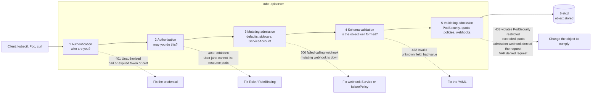

# T3.16 Understand authentication, authorization and admission control

> Competency: "Understand authentication, authorization and admission control" (CKAD-4.2) | Domain/weight: CKAD, Application Environment, Configuration and Security (25%) | Est. time: 3 h | Prerequisites: T3.15, T1.12

Shell setup (from [conventions](../00-conventions.md); put it at the top of every session):

```bash
alias k=kubectl
export do="--dry-run=client -o yaml"
export now="--force --grace-period=0"
source <(kubectl completion bash); complete -o default -F __start_kubectl k
```

Lab environment for this lesson: **kind** (cluster `lab`, context `kind-lab`). Namespace: `lab-t316`. Files go in `~/lab/t316/`. The entry uses the namespace name `dev` in some example commands; this lesson uses `lab-t316` in its place.

Prerequisites you should have read: [T3.15 Understand ServiceAccounts](../part3-ckad/T3.15-understand-serviceaccounts.md) (what a ServiceAccount is, its token, the identity string `system:serviceaccount:<ns>:<name>`, a first Role and RoleBinding) and [T1.12 TLS, PKI and openssl for Kubernetes](../part1-linux/T1.12-tls-pki-and-openssl-for-kubernetes.md) (what a certificate, a CA and a CN/O field are). This lesson does not re-teach them. Background on the API server itself is in [T2.01 Kubernetes architecture and the API model](../part2-basics/T2.01-kubernetes-architecture-and-the-api-model.md). The RBAC depth that the CKA adds is in T4.06 (Manage role based access control, RBAC), a later topic that is not linked yet.

> Output policy. Output blocks carry one of these labels:
> - `REAL OUTPUT (kind v0.33.0, v1.37.0)`: captured for this lesson on a kind cluster named `k-t316` (1 control plane + 2 workers, node image `kindest/node:v1.37.0`, kubectl v1.37.1, default kindnet CNI instead of Calico because nothing in this lesson needs NetworkPolicy). All timestamps, UIDs, hashes, Pod name suffixes and the port in the API server URL will differ on your cluster. The cluster name in the kubeconfig is `kind-k-t316` here and `kind-lab` on yours.
> - `REAL OUTPUT (kubectl v1.37.1 client, no cluster)`: captured from a client-side command with no cluster.
> - `EXPECTED OUTPUT (not captured)`: the shape you should see. Every such block is listed in section 11.
> Where a real block was shortened, the cut is marked with `...`.

---

## 1. Why this matters

Every request to the Kubernetes API goes through the same gate, in the same order: the API server first asks "who are you?" (authentication), then "may you do this?" (authorization), then "is this object acceptable and should it be changed?" (admission). A failure at any stage gives a different error, and the fix for each one is different. If you cannot tell a `401 Unauthorized` from a `403 Forbidden` from `violates PodSecurity`, you will edit the wrong object and lose minutes. In real clusters this is the daily "my Pod will not start" and "my pipeline gets Forbidden" work. In the CKAD domain "Application Environment, Configuration and Security" (25%) you are expected to know the concepts, write a basic Role and RoleBinding, check rights with `kubectl auth can-i`, and make a workload pass Pod Security Admission. The exam averages about 6 minutes per task (15-20 tasks in 2 hours; sources: [E2](https://docs.linuxfoundation.org/tc-docs/certification/tips-cka-and-ckad), [E3](https://docs.linuxfoundation.org/tc-docs/certification/faq-cka-ckad-cks)), so the commands in section 4 must be automatic.

---

## 2. Concepts

### 2.1 The request pipeline

**The problem.** The API server is the only door to the cluster's data (etcd). It must stop strangers, stop people from doing what they are not allowed to do, and stop bad or unsafe objects, all before anything is stored. One check cannot do all three jobs, so Kubernetes uses three separate stages, each with its own configuration and its own failure message.

Every request (from `kubectl`, from a Pod, from a controller, from `curl`) passes these steps in this order:

| # | Stage | Question it answers | Failure looks like |
|---|---|---|---|
| 1 | **Authentication** (authn) | Who is calling? | HTTP 401, `error: You must be logged in to the server (Unauthorized)` |
| 2 | **Authorization** (authz) | Is that caller allowed to do this verb on this resource? | HTTP 403, `Forbidden: User "jane" cannot list resource "pods" ...` |
| 3 | **Mutating admission** | Should the object be changed or defaulted? (a ServiceAccount is added, a default StorageClass is set, a sidecar is injected) | Rarely fails. A webhook that is down gives `failed calling webhook` |
| 4 | **Object schema validation** | Is the object well formed for its API version? | HTTP 422 for a bad value (`Invalid value`), HTTP 400 for an unknown field (`strict decoding error: unknown field`) |
| 5 | **Validating admission** | Is the final object allowed by the rules of the cluster? | `violates PodSecurity`, `exceeded quota`, `denied the request` |
| 6 | **Persist to etcd** | (no question: the object is stored) | none |

Two rules follow from this order:

- Authorization runs before admission. A caller who may not create Pods never reaches the Pod Security check. So a `violates PodSecurity` message proves that authn and authz already said yes. That is useful when you debug.
- Admission only applies to requests that change data (create, update, delete, connect). A plain `get` or `list` is never mutated or rejected by admission.

**Under the hood.** The API server is one Go process (`kube-apiserver`). Its HTTP handler chain runs authentication, then audit logging, then impersonation (`--as`), then authorization, then the request handler. (Other filters, such as request limits, sit in the chain too; they are not needed here.) Audit comes before impersonation so that the log records the real caller. The handler decodes the body, runs the mutating admission plugins, validates the schema, runs the validating admission plugins, and only then writes to etcd. Each stage is a list of plugins. Within authentication and authorization the first plugin that gives a final answer wins. Within admission, any single rejection stops the request.

**Related but different.** *Admission* is not the same as *scheduling*. A Pod that is admitted but cannot be scheduled sits in `Pending`. A Pod that is rejected by admission never exists, so there is no Pod to describe. Read the message from the command that sent the request, or the events of the controller (ReplicaSet, Job) that tried to create it.

### 2.2 Authentication: who is calling?

**What it is.** Authentication turns the credential on a request into an identity: a **username**, a list of **groups**, and optional extra attributes. Kubernetes has no User object and no user database. Whatever the authenticator decides the name and groups are, that is the identity.

**The problem it solves.** Without it, any process that can reach the API port would be trusted. Authentication gives every later stage (RBAC, audit logs, admission rules) a name to work with.

The API server can enable many authenticators at once. It tries them one by one. The first one that accepts the credential wins and the others are skipped. If every authenticator rejects the credential, the answer is 401. If there is no credential at all, the request is **anonymous** (username `system:anonymous`, group `system:unauthenticated`) unless anonymous access is switched off. An anonymous request is not a 401. It continues to authorization and is then denied with a 403, because anonymous users have almost no rights.

| Method | The credential | How the identity is read | Typical use |
|---|---|---|---|
| **X.509 client certificate** | A certificate signed by the CA given with `--client-ca-file` | **CN** (common name) becomes the username. Each **O** (organization) field becomes a group. | `kubectl` users, kubelets, control plane components, your `admin.conf` |
| **Bearer token: ServiceAccount token** | A signed JWT (JSON Web Token) in the header `Authorization: Bearer <token>` | Username `system:serviceaccount:<ns>:<name>`, groups `system:serviceaccounts` and `system:serviceaccounts:<ns>` | Pods and automation (see [T3.15](../part3-ckad/T3.15-understand-serviceaccounts.md)) |
| **Bearer token: OIDC / JWT** | A token issued by an external identity provider (for example your company login) | From token claims, mapped by API server configuration | People in real companies (awareness for CKAD) |
| **Bootstrap token** | A short secret stored as a Secret in `kube-system` | `system:bootstrap:<id>` | `kubeadm join` only |
| **Static token file** | A CSV file on the control plane, read at API server start | From the file | Lab or emergency use only. Not recommended. (Basic auth with a password file was removed in v1.19 and no longer exists.) |
| **Webhook token authentication** | A call to an external service | From the answer | Custom identity systems (awareness) |
| **Authenticating proxy** | Trusted headers from a front proxy | From headers | Aggregated API servers (awareness) |

Source: the method list is on [Authenticating](https://kubernetes.io/docs/reference/access-authn-authz/authentication/).

**X.509 client certificates in detail.** This is the one you can try yourself in the labs. The API server checks that the certificate was signed by its client CA, is not expired, and has the usage `client auth`. If so, the **subject** of the certificate is the identity. A certificate created with the subject `/CN=jane/O=devs` means: username `jane`, group `devs`. Add more `O=` fields for more groups. You can see how to make such a certificate with `openssl` in [T1.12](../part1-linux/T1.12-tls-pki-and-openssl-for-kubernetes.md). In a cluster you normally send the CSR (certificate signing request) to the API (`CertificateSigningRequest` object, signer `kubernetes.io/kube-apiserver-client`), approve it, and get the signed certificate back. The lab setup does exactly that.

A certificate cannot be revoked in Kubernetes (there is no CRL check). A leaked client certificate stays valid until it expires. That is why short lifetimes and group-based RBAC matter. Deleting the user's RoleBinding is the quick way to remove its rights.

**ServiceAccount tokens.** A ServiceAccount token is a JWT signed by the API server itself. It is validated by signature, audience, expiry, and (for bound tokens) by checking that the Pod and ServiceAccount it names still exist. All of that is in [T3.15](../part3-ckad/T3.15-understand-serviceaccounts.md); do not re-learn it here.

**OIDC and structured authentication configuration (awareness).** OIDC (OpenID Connect) lets people log in to a company identity provider, which hands them a signed ID token. The API server is told which issuer URL to trust, which audience the token must have, and which token claims become the username and groups. The old way was a set of `--oidc-*` flags on `kube-apiserver`. The newer way is a file given with `--authentication-config`, holding an `AuthenticationConfiguration` object. That structured configuration is **stable since Kubernetes v1.34**, and you may not combine it with `--oidc-*` flags (the API server would exit). The file can hold up to 64 JWT issuers, maps claims to username and groups (with optional CEL expressions), and can validate claims and the final user. It also controls anonymous access per path. Source: [Authenticating, "Using Authentication Configuration"](https://kubernetes.io/docs/reference/access-authn-authz/authentication/).

```yaml
# Shape only. A real file needs a reachable issuer. Do not copy this into a cluster as it is.
apiVersion: apiserver.config.k8s.io/v1
kind: AuthenticationConfiguration
jwt:
- issuer:
    url: https://idp.example.com      # who issued the token; must be unique
    audiences: [kubernetes]           # the token's "aud" claim must match one of these
  claimMappings:
    username:
      claim: email                    # which token claim becomes the Kubernetes username
      prefix: "oidc:"                 # required when "claim" is set; "" means no prefix
    groups:
      claim: groups                   # which claim holds the group list
      prefix: "oidc:"
# Anonymous access can also be restricted here, for example:
# anonymous:
#   enabled: true
#   conditions:
#   - path: /healthz
```

The prefix matters: it keeps an external group named `system:masters` from becoming the real built-in group. CKAD only needs you to know that this file exists and what it maps.

### 2.3 Users versus ServiceAccounts, and kubeconfig users

| | User (normal user) | ServiceAccount |
|---|---|---|
| API object? | No | Yes (`k get sa`) |
| Scope | Cluster wide name | One namespace |
| Created by | Whatever issues the certificate or token | `k create sa` |
| Used by | People | Pods and automation |
| Identity string in RBAC and errors | `jane` | `system:serviceaccount:lab-t316:ci` |
| Group membership | From certificate O fields or token claims | Automatic: `system:serviceaccounts`, `system:serviceaccounts:<ns>` |

A **kubeconfig** file (default `~/.kube/config`) has three lists: `clusters` (server URL and CA), `users` (credentials: a certificate and key, a token, or an exec plugin) and `contexts` (a cluster + user + default namespace triple). The `users` entry in a kubeconfig is only a *label for the credential* on your laptop. It is not an object in the cluster, and its name need not match the identity. The identity is what the API server reads from the certificate (CN and O) or token. Your kind admin entry is called `kind-k-t316` but the identity behind it is the certificate subject, as the worked example shows with `k auth whoami`.

Useful kubeconfig commands (all work offline):

```bash
k config get-contexts                 # list contexts; * marks the current one
k config use-context jane             # switch the default context
k config set-credentials jane --client-certificate=jane.crt --client-key=jane.key --embed-certs=true
k config set-context jane --cluster=kind-lab --user=jane --namespace=lab-t316
k --context jane get pods             # use a context for one command only
```

### 2.4 Authorization: may this caller do this?

**What it is.** After authentication, the API server builds a small record of the request: the user, the groups, the **verb** (get, list, create, ...), the **resource** (and sub-resource, API group, name, namespace), or for non-resource paths like `/healthz`, the URL. It sends that record to the list of **authorizers**. Each authorizer answers *allow*, *deny*, or *no opinion*. The first allow or deny ends the process. If all say no opinion, the request is **denied by default** and the caller gets 403. Source: [Authorization overview](https://kubernetes.io/docs/reference/access-authn-authz/authorization/).

**The modes (authorizers):**

| Mode | What it does | Where you meet it |
|---|---|---|
| `Node` | A special-purpose authorizer for kubelets. A kubelet (user `system:node:<name>`, group `system:nodes`) may read the Secrets, ConfigMaps and so on of Pods that are scheduled to its own node, and write its own node status. Nothing more. | Always listed first on kubeadm and kind clusters |
| `RBAC` | Role-based access control. Rights come from Role and ClusterRole objects, attached by RoleBinding and ClusterRoleBinding objects. All rights are additive. | The mode used for people and Pods |
| `Webhook` | The API server posts a `SubjectAccessReview` to an external HTTPS service and acts on its answer. | Company policy engines (awareness) |
| `ABAC` | Attribute-based, from a static policy file on the control plane. Legacy. | Almost never |
| `AlwaysAllow` | Allows everything. | Tests only. The API server flag default |
| `AlwaysDeny` | Denies everything. | Tests only |

The flag is `--authorization-mode`, for example `--authorization-mode=Node,RBAC` (kubeadm and kind set this). The order of the list is the order of evaluation. A newer way is a configuration file with `--authorization-config`. It holds an `AuthorizationConfiguration` object and is **stable since v1.32**. It is the only way to use more than one webhook authorizer, to set a webhook `failurePolicy`, or to use CEL `matchConditions` to decide when a webhook is called. You cannot use `--authorization-config` together with `--authorization-mode` or the `--authorization-webhook-*` flags (the API server would refuse to start). Source: [Authorization, "Configuring the API Server using an Authorization Config File"](https://kubernetes.io/docs/reference/access-authn-authz/authorization/).

```yaml
# Equivalent of --authorization-mode=Node,RBAC, written as a config file (shape only).
apiVersion: apiserver.config.k8s.io/v1
kind: AuthorizationConfiguration
authorizers:
- type: Node
  name: node
- type: RBAC
  name: rbac
# A webhook authorizer entry would look like this:
# - type: Webhook
#   name: company-policy
#   webhook:
#     timeout: 3s                              # required, at most 30s
#     subjectAccessReviewVersion: v1           # required
#     matchConditionSubjectAccessReviewVersion: v1
#     failurePolicy: NoOpinion                 # required: NoOpinion (try next) or Deny
#     connectionInfo:
#       type: KubeConfigFile
#       kubeConfigFile: /etc/kubernetes/authz-webhook.kubeconfig
```

You will edit the kube-apiserver manifest in the CKA (static Pods and admission plugins, topic T4.13). For the CKAD you need to know the names of the modes and where to look. On a kubeadm or kind control plane the flags are in `/etc/kubernetes/manifests/kube-apiserver.yaml`. The worked example reads them from the live API server Pod.

**Request attributes that RBAC matches on.** For a resource request, the authorizer sees:

| Attribute | Example | Where it comes from |
|---|---|---|
| user, groups | `jane`, `[devs system:authenticated]` | Authentication |
| verb | `list` | HTTP method and path (`GET /api/v1/namespaces/x/pods` is `list`; `GET .../pods/web` is `get`; `?watch=true` is `watch`) |
| API group | `""` (core) or `apps` | The URL: `/api/v1` is the core group, `/apis/apps/v1` is `apps` |
| resource, sub-resource | `pods`, `pods/log`, `pods/exec` | The URL |
| resource name | `web` | The URL, when the request names one object |
| namespace | `lab-t316` | The URL, empty for cluster-scoped resources |

### 2.5 RBAC objects

**What RBAC is for.** Without RBAC, every authenticated user and every Pod would have the same rights, or the cluster would use one all-powerful admin credential. RBAC lets you write "this person or this app may do exactly these verbs on exactly these resources in exactly this namespace".

There are four objects (all `apiVersion: rbac.authorization.k8s.io/v1`):

| Object | Scope | What it holds |
|---|---|---|
| `Role` | One namespace | A list of rules: what is allowed in that namespace |
| `ClusterRole` | Whole cluster | The same rules, but it can also cover cluster-scoped resources (nodes, namespaces, PersistentVolumes), non-resource URLs (`/healthz`), and it can be reused in many namespaces |
| `RoleBinding` | One namespace | Attaches a Role **or a ClusterRole** to subjects, **inside that namespace only** |
| `ClusterRoleBinding` | Whole cluster | Attaches a ClusterRole to subjects in **every** namespace |

A rule is a set of allowed things. There is no "deny" rule in RBAC: rights only add up. If nothing allows it, it is denied.

| Rule field | Meaning | Default / empty | Risky value |
|---|---|---|---|
| `apiGroups` | API groups. `""` is the core group (Pods, Services, ConfigMaps, Secrets, ServiceAccounts, Namespaces, Nodes, PVCs). `apps` has Deployments, ReplicaSets, StatefulSets, DaemonSets. `batch` has Jobs and CronJobs. `networking.k8s.io` has Ingresses and NetworkPolicies. `rbac.authorization.k8s.io` has the RBAC objects. | required | `"*"` (all groups) |
| `resources` | Resource types, plural lowercase: `pods`, `deployments`. Sub-resources use a slash: `pods/log`, `pods/exec`, `deployments/scale`. | required | `"*"` (all) |
| `resourceNames` | Limit the rule to objects with these exact names | empty = any name | none, it narrows. Note: you cannot limit `create` this way, because the name does not exist yet. |
| `verbs` | `get`, `list`, `watch`, `create`, `update`, `patch`, `delete`, `deletecollection`. Special: `impersonate`, `bind`, `escalate`, `use`, `approve`, `sign`. | required | `"*"` (all verbs) |
| `nonResourceURLs` | URL paths such as `/healthz` (ClusterRole only) | empty | `"*"` |

Notes you need:

- `get` reads one object by name. `list` reads the whole collection (this also gives the content of every object in it). `watch` is a stream of changes. `kubectl get pods` uses `list`; `kubectl get pod web` uses `get`. A program that watches needs `list` *and* `watch`.
- **`list` and `get` on Secrets reveal the content.** Granting `list secrets` is the same as granting read of every Secret in scope.
- The subresource is part of the resource name: reading logs needs `pods/log` with `get`; `kubectl exec` needs `pods/exec` with `create`.
- **A binding is built from `roleRef` and `subjects`.** `roleRef` (`kind`, `name`, `apiGroup`) is **immutable**: to point a binding at another Role you delete and recreate it. `subjects` is a list; each has a `kind` of `User`, `Group` or `ServiceAccount`. A `ServiceAccount` subject needs `namespace`. A `User` or `Group` subject has `apiGroup: rbac.authorization.k8s.io`.
- A **RoleBinding can point to a ClusterRole**. The rules then apply only inside the binding's namespace. This is how you reuse the built-in `view`, `edit` and `admin` ClusterRoles one namespace at a time.
- The RBAC API stops you from creating or changing a Role with permissions you do not hold yourself (the "escalate" and "bind" rules). That is why a developer who can create Roles cannot make themselves cluster-admin by that route.

**Built-in ClusterRoles worth knowing:**

| ClusterRole | What it gives |
|---|---|
| `cluster-admin` | Everything, everywhere. Bound to the group `system:masters` and used by admin kubeconfigs. |
| `admin` | Full access inside one namespace (including creating Roles and RoleBindings), when used in a RoleBinding |
| `edit` | Read/write most namespaced objects, but no Roles/RoleBindings. Can read Secrets. |
| `view` | Read-only on most namespaced objects, but **not Secrets** and not Roles |

**Least privilege.** Give the exact verbs on the exact resources in the exact namespace. Avoid `*`, avoid ClusterRoleBinding when a RoleBinding is enough, avoid binding to `cluster-admin`, and avoid broad groups such as `system:authenticated` or `system:serviceaccounts` as subjects.

### 2.6 Checking rights: `kubectl auth can-i`

`k auth can-i VERB RESOURCE` asks the authorizer "would this request be allowed?" and prints `yes` or `no`. The exit code is 0 for yes and 1 for no, so you can use it in `test`. It does not change anything.

| Form | What it does |
|---|---|
| `k auth can-i create deploy -n lab-t316` | Can **I** (my kubeconfig identity) create Deployments in the namespace? |
| `k auth can-i create deploy -n lab-t316 --as=jane` | Ask as if I were `jane`. Needs the right to impersonate (an admin has it). |
| `k auth can-i get pods --as=jane --as-group=devs` | Impersonate user `jane` **and** group `devs`. Needed when the right was given to the group. |
| `k auth can-i --list -n lab-t316 --as=system:serviceaccount:lab-t316:ci` | List every rule that applies to that identity in that namespace |
| `k auth can-i get pods/log -n lab-t316` | Sub-resource written as `resource/sub` |
| `k auth can-i get pods --subresource=log` | Same thing with the flag |
| `k auth can-i get pods --as=jane -A` | Check across all namespaces (needs a ClusterRoleBinding to say yes) |
| `k auth whoami` | Show which identity the API server sees for your credential (user, groups) |

The identity of a ServiceAccount is the long string `system:serviceaccount:<namespace>:<name>`. **`--as=jane` does not carry jane's groups.** If the RoleBinding names the *group* `devs`, `--as=jane` says `no` and `--as=jane --as-group=devs` says `yes`. The real user jane, whose certificate has `O=devs`, can do it. The real worked example shows this trap.

### 2.7 Admission control

**What it is.** Admission control is a list of plugins (called **admission controllers**) inside the API server. After authentication and authorization have said yes, and before the object is stored, each plugin may **change** the object (a *mutating* plugin) or **reject** it (a *validating* plugin). Some plugins do both. They see the full object, which RBAC never does.

**The problem it solves.** RBAC can say "jane may create Pods". It cannot say "but not Pods that run as root", "not more than 10 Pods in this namespace", or "always add a default memory limit". Admission can.

**Order.** All mutating plugins run first, then the schema is validated, then all validating plugins run. Validation therefore sees the final object, after every mutation. If the mutating phase changed the object, some webhooks are called again (`reinvocationPolicy`). Any single rejection ends the request.

The built-in plugins you must be able to name:

| Plugin | Type | What it does | Error you may see |
|---|---|---|---|
| `NamespaceLifecycle` | validating | Refuses new objects in a namespace that is being deleted or does not exist; protects `default`, `kube-system`, `kube-public` from deletion | `namespaces "x" not found`, or `... because it is being terminated` |
| `LimitRanger` | mutating + validating | Applies the defaults of a `LimitRange` (default requests/limits) and rejects values outside min/max | `maximum memory usage per Container is 512Mi, but limit is 1Gi` |
| `ResourceQuota` | validating | Refuses objects that would push the namespace above a `ResourceQuota` | `exceeded quota: q, requested: pods=1, used: pods=1, limited: pods=1` |
| `ServiceAccount` | mutating + validating | Sets `spec.serviceAccountName` to `default` if empty, adds the projected token volume, refuses a Pod that names a ServiceAccount that does not exist | `error looking up service account lab-t316/nosuch: serviceaccount "nosuch" not found` |
| `PodSecurity` | validating | Pod Security Admission (2.9): checks Pods against the namespace's level | `violates PodSecurity "restricted:v1.37"` |
| `DefaultStorageClass` | mutating | Fills `storageClassName` on a PVC that has none, from the default StorageClass | no error; the PVC just gets a class |
| `MutatingAdmissionWebhook` | mutating | Calls your HTTPS webhooks registered with `MutatingWebhookConfiguration` | `failed calling webhook "x": ...` |
| `ValidatingAdmissionWebhook` | validating | Calls your HTTPS webhooks registered with `ValidatingWebhookConfiguration` | `admission webhook "x" denied the request: <message>` |
| `ValidatingAdmissionPolicy` | validating | Runs CEL rules stored in the cluster (2.8) | `ValidatingAdmissionPolicy 'x' with binding 'y' denied request: <message>` |
| `MutatingAdmissionPolicy` | mutating | Runs CEL mutations stored in the cluster (2.8) | no visible error unless the CEL fails |

Which plugins are on by default depends on the version. On the v1.37.0 API server of the lab cluster, `kube-apiserver -h` lists these as enabled by default: `NamespaceLifecycle, LimitRanger, ServiceAccount, TaintNodesByCondition, PodSecurity, Priority, DefaultTolerationSeconds, DefaultStorageClass, StorageObjectInUseProtection, PodGroupProtection, PersistentVolumeClaimResize, RuntimeClass, CertificateApproval, CertificateSigning, ClusterTrustBundleAttest, CertificateSubjectRestriction, DefaultIngressClass, PodTopologyLabels, NodeDeclaredFeatureValidator, PodResizeValidator, MutatingAdmissionPolicy, MutatingAdmissionWebhook, ValidatingAdmissionPolicy, ValidatingAdmissionWebhook, ResourceQuota` (the raw output is in section 5.1). Every plugin in the table above is in that list. `NodeRestriction` is not: kubeadm and kind add it with `--enable-admission-plugins=NodeRestriction`. Source: [Admission controllers](https://kubernetes.io/docs/reference/access-authn-authz/admission-controllers/). You add plugins with `--enable-admission-plugins=A,B` and remove default ones with `--disable-admission-plugins=A`. On a kubeadm cluster the flag is in `/etc/kubernetes/manifests/kube-apiserver.yaml`; the kubelet restarts the API server Pod when you save that file. This is CKA territory (T4.13).

**Webhooks.** A **webhook** is an HTTPS server that you run. You register it with a `ValidatingWebhookConfiguration` or `MutatingWebhookConfiguration` object, which says which operations and resources to send and where the server is (a Service or a URL, plus `caBundle` to trust its certificate). The API server POSTs an `AdmissionReview` JSON document with the object. The server answers `allowed: true` or `false` (with a message), and a mutating one also returns a JSON patch. Important fields:

| Field | Meaning | Default | Risky value |
|---|---|---|---|
| `rules` | Which operations, API groups, versions and resources to send | required | `*` on everything can lock the cluster |
| `failurePolicy` | What to do if the webhook cannot be reached | `Fail` in `v1` (reject the request) | `Fail` on `Pod` or `Namespace` objects when the webhook itself runs as a Pod: a deadlock |
| `timeoutSeconds` | How long to wait | 10, max 30 | high values slow every matching request |
| `namespaceSelector`, `objectSelector` | Narrow which requests are sent | all namespaces | none |
| `sideEffects` | Whether a dry-run call is safe | required (`None` or `NoneOnDryRun` in `v1`) | |
| `admissionReviewVersions` | Review versions the server speaks | required (`["v1"]`) | |

**Related but different.** A *webhook admission controller* is code you run and keep alive. A *ValidatingAdmissionPolicy* is a rule written in the API object itself (CEL), with no server to run. For CKAD, treat webhook denials as messages from a policy owner: you read the message and make your object comply. You do not fix the webhook.

### 2.8 ValidatingAdmissionPolicy and MutatingAdmissionPolicy (awareness)

**CEL** (Common Expression Language) is a small expression language. A `ValidatingAdmissionPolicy` (VAP) holds the rule; a `ValidatingAdmissionPolicyBinding` says where it applies and what to do on a violation. Both are `admissionregistration.k8s.io/v1` objects (GA since 1.30).

```yaml
apiVersion: admissionregistration.k8s.io/v1
kind: ValidatingAdmissionPolicy
metadata:
  name: max-replicas.lab-t316        # cluster-scoped object, so pick a name that is unlikely to clash
spec:
  failurePolicy: Fail                # if the CEL cannot be evaluated, reject (the other value is Ignore)
  matchConstraints:                  # which requests the policy looks at
    resourceRules:
    - apiGroups: ["apps"]
      apiVersions: ["v1"]
      operations: ["CREATE", "UPDATE"]
      resources: ["deployments"]
  validations:
  - expression: "object.spec.replicas <= 3"   # CEL: true means the request is fine
    message: "replicas must be 3 or fewer"    # text the user sees on denial
---
apiVersion: admissionregistration.k8s.io/v1
kind: ValidatingAdmissionPolicyBinding
metadata:
  name: max-replicas.lab-t316
spec:
  policyName: max-replicas.lab-t316  # the policy does nothing until a binding names it
  validationActions: ["Deny"]        # Deny rejects; Warn only warns; Audit only records. You can combine Warn and Audit.
  matchResources:
    namespaceSelector:               # limit to our lab namespace through its automatic name label
      matchLabels:
        kubernetes.io/metadata.name: lab-t316
```

`MutatingAdmissionPolicy` (MAP) is the same idea for changes: a policy lists `mutations` (a JSON patch or a server-side-apply style `ApplyConfiguration`, both written in CEL), and a `MutatingAdmissionPolicyBinding` turns it on. It is **stable (GA) since Kubernetes v1.36**, with `apiVersion: admissionregistration.k8s.io/v1`. Source: [Mutating admission policy](https://kubernetes.io/docs/reference/access-authn-authz/mutating-admission-policy/). The live check of the API version is in section 5. If a task shows one of these errors from a rule you did not write, read the `message` and change your object.

### 2.9 Pod Security Admission (PSA)

**What it is.** PSA is the built-in `PodSecurity` admission plugin. It checks every Pod (and warns on workload objects that contain a Pod template) against one of three **Pod Security Standards**, chosen **per namespace through labels**.

**The problem it solves.** A Pod can ask for dangerous things: run as root, be `privileged`, use the node's network or `hostPath` volumes. One careless Deployment can give an attacker control of the node. PSA is the cluster's default guard rail (it replaced the old PodSecurityPolicy, which was removed in v1.25).

**The three levels:**

| Level | Meaning | Main rules |
|---|---|---|
| `privileged` | No restrictions | Anything is allowed. |
| `baseline` | Blocks the known ways to escalate to the node | No `privileged: true`, no `hostNetwork`/`hostPID`/`hostIPC`, no `hostPath` volumes, no `hostPort`, only a short list of added capabilities, no `Unconfined` seccomp. A plain `nginx` or `busybox` Pod passes. |
| `restricted` | Current hardening best practice | Everything in baseline, plus: `allowPrivilegeEscalation: false`, run as non-root (`runAsNonRoot: true`, `runAsUser` not 0), `capabilities.drop: ["ALL"]` (only `NET_BIND_SERVICE` may be added back), a seccomp profile of `RuntimeDefault` or `Localhost`, and only these volume types: `configMap`, `csi`, `downwardAPI`, `emptyDir`, `ephemeral`, `persistentVolumeClaim`, `projected`, `secret`. |

Source: [Pod Security Standards](https://kubernetes.io/docs/concepts/security/pod-security-standards/).

**The three modes** (what PSA does on a violation):

| Mode | On a violation | Where you see it |
|---|---|---|
| `enforce` | The Pod is **rejected** | An error from the request, or a ReplicaSet/Job event |
| `warn` | The Pod is allowed; the **client gets a warning** | A `Warning:` line printed by `kubectl` |
| `audit` | The Pod is allowed; an **annotation** is added to the audit log event | The API server audit log (if auditing is on) |

**The labels.** Set them on the Namespace:

```text
pod-security.kubernetes.io/enforce: restricted
pod-security.kubernetes.io/enforce-version: v1.37     # optional: use the rules of that Kubernetes minor, or "latest"
pod-security.kubernetes.io/warn: restricted
pod-security.kubernetes.io/warn-version: v1.37
pod-security.kubernetes.io/audit: restricted
pod-security.kubernetes.io/audit-version: v1.37
```

Each mode has its own level and its own `-version`. The `-version` label pins the rule set to the one that shipped with a Kubernetes minor version, so a cluster upgrade does not suddenly reject old Pods. Without it, the default is `latest`. A level that is not one of the three names is refused when you set the label (`Invalid value: "strict": must be one of privileged, baseline, restricted`). A `-version` newer than the cluster, such as `v1.99`, was accepted on the lab cluster and the error text then said `restricted:v1.99`. A namespace with no PSA labels is allowed everything (the default configuration is `privileged`).

**Behaviour to remember** (source: [Pod Security Admission](https://kubernetes.io/docs/concepts/security/pod-security-admission/)):

- `warn` and `audit` are also applied to workload objects (Deployment, StatefulSet, Job, CronJob...), so you get early feedback when you apply them. `enforce` is applied only to the **Pod**. So a Deployment that violates an enforced level is **created without error**, and its ReplicaSet then fails to create the Pods. Symptom: `READY 0/1`, and the cause is in the ReplicaSet's events.
- Changing a namespace label does not touch Pods that are already running. Running Pods are not evicted. The new level applies when a Pod is created or updated.
- Before you enforce a level, preview the effect with a server-side dry run: `k label --dry-run=server --overwrite ns lab-t316 pod-security.kubernetes.io/enforce=restricted`. The API server prints a `Warning:` line naming the existing Pods that would violate it.
- The cluster admin can exempt user names, RuntimeClasses or namespaces in the admission configuration. You cannot do that from a label.

**What a restricted-compliant container looks like** (this is the block to memorise):

```yaml
spec:
  securityContext:                  # Pod level: applies to all containers
    runAsNonRoot: true              # kubelet refuses to start a container that would run as UID 0
    runAsUser: 1000                 # needed when the image's own user is root (name-only users cannot be verified)
    seccompProfile:
      type: RuntimeDefault          # the container runtime's default syscall filter
  containers:
  - name: app
    image: busybox:1.36
    securityContext:                # Container level
      allowPrivilegeEscalation: false   # must be explicitly false (unset fails restricted)
      capabilities:
        drop: ["ALL"]               # drop every Linux capability
```

### 2.10 Reading the error: which stage rejected me?

The text of the error tells you the stage. Use this table before you touch anything.

| You see | HTTP | Stage | Meaning | Where to look |
|---|---|---|---|---|
| `error: You must be logged in to the server (Unauthorized)` | 401 | Authentication | The credential is missing, expired, wrong or from an unknown CA | kubeconfig user, token expiry, certificate dates |
| `... is forbidden: User "x" cannot <verb> resource "<r>" in API group "<g>" in the namespace "<ns>"` | 403 | Authorization | The caller is known but no Role grants this | Roles and bindings (`k auth can-i`) |
| `... is forbidden: User "system:anonymous" cannot ...` | 403 | Authorization | No credential was sent, so the call is anonymous | kubeconfig/token not sent |
| `... is forbidden: violates PodSecurity "restricted:v1.37": ...` | 403 | Admission (PodSecurity) | The Pod spec fails the namespace level | Pod `securityContext`, namespace labels |
| `... is forbidden: exceeded quota: ...` | 403 | Admission (ResourceQuota) | The namespace quota is used up | `k describe quota` |
| `admission webhook "x" denied the request: <msg>` | 400 | Admission (webhook) | A custom policy server refused | Read `<msg>`; the policy owner's rules |
| `... is forbidden: ValidatingAdmissionPolicy 'p' with binding 'b' denied request: <msg>` | 422 | Admission (VAP) | A CEL rule refused | Read `<msg>` |
| `Internal error occurred: failed calling webhook "x": ...` | 500 | Admission (webhook broken) | The webhook server cannot be reached | Webhook Service/Endpoints/certificate; `failurePolicy` |
| `The Deployment "x" is invalid: spec.replicas: Invalid value: -1 ...` (422) / `strict decoding error: unknown field "dat"` (400) | 422 or 400 | Schema validation | Bad YAML for this API version | `k explain`, `--dry-run=server` |

Two details that save time. First, **401 and 403 are not the same fix**. 401 means fix the credential. 403 means the identity is fine and you fix the Role/RoleBinding (or the object, if the message says admission). Second, **the word "forbidden" is used by both authorization and admission**. Read the rest of the line: `cannot list resource` is authorization; `violates PodSecurity`, `exceeded quota` are admission.

### 2.11 Where the CKAD stops and the CKA continues

For the CKAD, you need: the pipeline and the error table above; the names and roles of the authn methods, authz modes and admission plugins; a Role and RoleBinding (or ClusterRole/ClusterRoleBinding) for a user, group or ServiceAccount, created imperatively; `k auth can-i`; and the PSA labels with a compliant `securityContext`. The CKA continues in T4.06 (a later topic, not linked yet) with deeper RBAC (aggregated ClusterRoles, auditing who has what, `system:` roles, impersonation rules), in the CSR and kubeconfig lifecycle (issuing and rotating user certificates), and with editing the kube-apiserver manifest on a control plane node (changing `--authorization-mode` or `--enable-admission-plugins`). Do not spend CKAD time on those.

---

## 3. How it works (diagram)



Walkthrough:

1. A request enters at step 1. **Authentication** reads the client certificate or the bearer token. No valid credential gives **401**. No credential at all is treated as the anonymous user and moves on.
2. **Authorization** asks the authorizers (Node, then RBAC) about the user, groups, verb and resource. No "allow" gives **403 Forbidden** with `User "..." cannot <verb> resource "..."`. Nothing later runs.
3. **Mutating admission** may change the object: add the ServiceAccount token volume, set the default StorageClass, apply LimitRange defaults, call mutating webhooks and policies. Then the API server checks the **schema** (step 4). A wrong field gives **422**.
4. **Validating admission** (step 5) sees the final object and runs `PodSecurity`, `ResourceQuota`, validating webhooks and ValidatingAdmissionPolicies. Its rejections also read "Forbidden" or "denied". The text after the colon tells the plugin: `violates PodSecurity`, `exceeded quota`, `admission webhook "x" denied the request`.
5. Only if every step passes is the object written to etcd (step 6).
6. Quick rule: the error text is a label for the stage. `cannot list resource` = step 2. `violates PodSecurity` = step 5. `Unauthorized` = step 1.

---

## 4. Commands and YAML you must produce fast

### 4.1 Imperative shortcuts

```bash
# Role: verbs and resources in ONE namespace (apiGroup is worked out for you)
k create role pod-reader --verb=get,list,watch --resource=pods -n lab-t316
k create role deploy-mgr --verb=get,list,create,update,delete --resource=deployments.apps -n lab-t316  # name.group for non-core
k create role log-reader --verb=get --resource=pods/log -n lab-t316                                    # sub-resource with a slash
k create role one-cm --verb=get --resource=configmaps --resource-name=app-config -n lab-t316           # resourceNames: that one object only

# RoleBinding: Role (or ClusterRole) -> subject, in ONE namespace
k create rolebinding rb --role=pod-reader --serviceaccount=lab-t316:ci -n lab-t316   # ServiceAccount is <namespace>:<name>
k create rolebinding rb-user --role=pod-reader --user=jane -n lab-t316               # a User (name from the certificate CN)
k create rolebinding rb-group --role=pod-reader --group=devs -n lab-t316             # a Group (from certificate O)
k create rolebinding rb-view --clusterrole=view --group=devs -n lab-t316             # reuse a ClusterRole in one namespace

# Cluster scope
k create clusterrole node-reader --verb=get,list --resource=nodes
k create clusterrolebinding crb --clusterrole=node-reader --serviceaccount=lab-t316:ci

# Check
k auth can-i create deploy -n lab-t316 --as=jane
k auth can-i get pods --as=jane --as-group=devs -n lab-t316
k auth can-i --list -n lab-t316 --as=system:serviceaccount:lab-t316:ci
k auth whoami

# Pod Security Admission
k label ns lab-t316 pod-security.kubernetes.io/enforce=restricted
k label ns lab-t316 pod-security.kubernetes.io/enforce=restricted pod-security.kubernetes.io/warn=restricted --overwrite
k label --dry-run=server --overwrite ns lab-t316 pod-security.kubernetes.io/enforce=restricted   # preview violations
k get ns lab-t316 --show-labels
```

What each does, in one line:

- `k create role` builds a Role. `--verb` and `--resource` take comma lists. Write `resource.group` (for example `deployments.apps`) for non-core resources; the generated YAML then has `apiGroups: [apps]`. A rule whose `apiGroups` does not match the resource's real group never matches.
- `k create rolebinding` attaches a Role/ClusterRole to a `--user`, `--group` or `--serviceaccount` (`ns:name`). The flags can be repeated.
- `k label ns ... --overwrite` is needed to change a label that already has a value.
- `k auth can-i` is your test after every RBAC change. It is faster than starting a Pod to see if a call works.
- Add `$do` to any `create` to see the YAML: `k create role pod-reader --verb=get,list --resource=pods $do`.

### 4.2 Declarative YAML

The Role and RoleBinding for a ServiceAccount (what the imperative commands above generate), plus the Namespace that enforces and warns on `restricted`. Every field is explained in the comments.

```yaml
apiVersion: v1
kind: Namespace
metadata:
  name: lab-t316
  labels:
    pod-security.kubernetes.io/enforce: restricted          # reject Pods that fail the restricted level
    pod-security.kubernetes.io/enforce-version: v1.37       # use the v1.37 rule set (or "latest")
    pod-security.kubernetes.io/warn: restricted             # also print a warning to the client
    pod-security.kubernetes.io/warn-version: v1.37
    pod-security.kubernetes.io/audit: restricted            # also add an audit-log annotation
    pod-security.kubernetes.io/audit-version: v1.37
---
apiVersion: v1
kind: ServiceAccount
metadata:
  name: ci                           # the identity the app runs as
  namespace: lab-t316
---
apiVersion: rbac.authorization.k8s.io/v1
kind: Role
metadata:
  name: pod-reader
  namespace: lab-t316                # a Role exists in exactly one namespace
rules:
- apiGroups: [""]                    # "" is the core group (Pods, ConfigMaps, Secrets, Services)
  resources: ["pods"]                # plural lowercase; "pods/log" for sub-resources
  verbs: ["get", "list", "watch"]    # read-only; no create/update/delete
  # resourceNames: ["web"]           # optional: limit the rule to objects with these names
---
apiVersion: rbac.authorization.k8s.io/v1
kind: RoleBinding
metadata:
  name: rb
  namespace: lab-t316                # the binding grants the rights in THIS namespace only
roleRef:                             # immutable once created
  apiGroup: rbac.authorization.k8s.io
  kind: Role                         # Role or ClusterRole
  name: pod-reader
subjects:                            # who gets the rights; a list
- kind: ServiceAccount               # User, Group or ServiceAccount
  name: ci
  namespace: lab-t316                # REQUIRED for ServiceAccount; a wrong namespace here means the binding does nothing
```

Fields and risky values:

| Field | What it does | Default | Risky value |
|---|---|---|---|
| `rules[].verbs` | Allowed actions | none (required) | `["*"]` |
| `rules[].resources` | Resource types | none (required) | `["*"]`, and `secrets` with `get/list` (reads secret data) |
| `rules[].apiGroups` | Groups of those resources | none (required) | `""` for a resource that is not in the core group: no match, so Forbidden |
| `roleRef.kind` | `Role` or `ClusterRole` | required | `Role` with a name that does not exist: the binding is accepted but grants nothing |
| `subjects[].namespace` | Namespace of the ServiceAccount | required for `ServiceAccount` | A different namespace than the real SA |
| `subjects[].kind` | `User`, `Group`, `ServiceAccount` | required | `User` for a ServiceAccount name |
| PSA `enforce` level | What is rejected | label absent: `privileged` (nothing rejected) | `restricted` on a namespace that has Pods which run as root: new Pods are rejected |

The Pod/Deployment that passes `restricted` is the `securityContext` block at the end of 2.9. Generate the base with `$do` and add the block:

```bash
k create deploy web -n lab-t316 --image=busybox:1.36 --replicas=2 $do -- sleep 3600 > web.yaml
```

### 4.3 Speed drill

Setup (once): `k create ns lab-t316; k create sa ci -n lab-t316`. Run the tasks in order. Cleanup is the last block.

| # | Task (all in namespace `lab-t316`) | Target |
|---|---|---|
| 1 | ServiceAccount `ci` must `get,list,watch` Pods. Use a Role `pod-reader` and a RoleBinding `ci-pods`. | 1 min |
| 2 | Prove `ci` can list Pods but cannot delete them, using one command each. | 1 min |
| 3 | Role `deploy-mgr` allows `get,list,create,update,delete` on Deployments. Bind it to user `jane`. | 1 min |
| 4 | Give the group `devs` read-only access to the namespace with the built-in `view` ClusterRole. | 1 min |
| 5 | Role `one-cm` that can only `get` the ConfigMap `app-config`. Check that it cannot get `other`. | 2 min |
| 6 | ClusterRole `node-reader` (`get,list` on nodes) bound to `ci` with a ClusterRoleBinding named `ci-nodes`. Check it. | 1 min |
| 7 | Show every right that `ci` has in the namespace. | 30 s |
| 8 | Namespace `lab-t316`: enforce and warn `restricted`. Then create the Pod `ok` (`busybox:1.36`, `sleep 3600`) so that it is accepted. | 3 min |

<details><summary>Answers</summary>

```bash
# 1
k create role pod-reader --verb=get,list,watch --resource=pods -n lab-t316
k create rolebinding ci-pods --role=pod-reader --serviceaccount=lab-t316:ci -n lab-t316
# 2
k auth can-i list pods -n lab-t316 --as=system:serviceaccount:lab-t316:ci     # yes
k auth can-i delete pods -n lab-t316 --as=system:serviceaccount:lab-t316:ci   # no
# 3
k create role deploy-mgr --verb=get,list,create,update,delete --resource=deployments.apps -n lab-t316
k create rolebinding jane-deploy --role=deploy-mgr --user=jane -n lab-t316
k auth can-i create deploy -n lab-t316 --as=jane                              # yes
# 4
k create rolebinding devs-view --clusterrole=view --group=devs -n lab-t316
k auth can-i list pods -n lab-t316 --as=x --as-group=devs                     # yes
# 5
k create cm app-config -n lab-t316 --from-literal=a=b
k create role one-cm --verb=get --resource=configmaps --resource-name=app-config -n lab-t316
k create rolebinding one-cm-ci --role=one-cm --serviceaccount=lab-t316:ci -n lab-t316
k auth can-i get configmap/app-config -n lab-t316 --as=system:serviceaccount:lab-t316:ci   # yes
k auth can-i get configmap/other -n lab-t316 --as=system:serviceaccount:lab-t316:ci        # no
# 6
k create clusterrole node-reader --verb=get,list --resource=nodes
k create clusterrolebinding ci-nodes --clusterrole=node-reader --serviceaccount=lab-t316:ci
k auth can-i list nodes --as=system:serviceaccount:lab-t316:ci                # yes
# 7
k auth can-i --list -n lab-t316 --as=system:serviceaccount:lab-t316:ci
# 8
k label ns lab-t316 pod-security.kubernetes.io/enforce=restricted pod-security.kubernetes.io/warn=restricted
k run ok -n lab-t316 --image=busybox:1.36 $do -- sleep 3600 > ok.yaml
# edit ok.yaml: add under spec: securityContext {runAsNonRoot: true, runAsUser: 1000, seccompProfile: {type: RuntimeDefault}}
#               and under the container: securityContext {allowPrivilegeEscalation: false, capabilities: {drop: ["ALL"]}}
k apply -f ok.yaml
```

</details>

Cleanup (also removes the two cluster-scoped objects the drill created): `k delete ns lab-t316; k delete clusterrole node-reader; k delete clusterrolebinding ci-nodes; rm -f web.yaml ok.yaml`

---

## 5. Worked example

One namespace, one failure for each stage of the pipeline. Every output below is `REAL OUTPUT (kind v0.33.0, v1.37.0)` from cluster `k-t316`, unless a block says otherwise. The commands run as the cluster admin; where the example needs another identity it uses `--as` (impersonation) or `curl`. The steps use `kubectl`, `curl` and ordinary shell tools, and not `jq` (the exam hosts list `kubectl`, `yq`, `curl`, `wget` and `man`; see [E9](https://docs.linuxfoundation.org/tc-docs/certification/tips-cka-and-ckad)). The example uses namespace `lab-t316` and ends with a cleanup step. Do it before the labs, or after; it leaves nothing behind.

### 5.1 Read how this API server is configured

Authentication, authorization and admission are all API server flags. On a kubeadm or kind cluster the API server runs as a static Pod, so the flags are in its Pod spec.

```text
$ k -n kube-system get pod kube-apiserver-k-t316-control-plane -o jsonpath='{.spec.containers[0].command}' | tr '"' '\n' | grep -E '^--(authorization|enable-admission|client-ca|anonymous)'
--authorization-mode=Node,RBAC
--client-ca-file=/etc/kubernetes/pki/ca.crt
--enable-admission-plugins=NodeRestriction
```

What to read: authorization is `Node,RBAC` (tried in that order). Client certificates are accepted if the CA is `ca.crt`. `--enable-admission-plugins` only *adds* `NodeRestriction` (an admission plugin that stops a kubelet from changing other nodes' objects). The default plugins are not listed here because they are on by default. To see which, ask the binary (`kube-apiserver -h` runs inside the Pod; the output is long, so only the relevant part is shown):

```text
$ k -n kube-system exec kube-apiserver-k-t316-control-plane -- kube-apiserver -h | grep -A1 -E '^\s+--enable-admission-plugins'
      --enable-admission-plugins strings   admission plugins that should be enabled in addition to default enabled ones (NamespaceLifecycle, LimitRanger, ServiceAccount, TaintNodesByCondition, PodSecurity, Priority, DefaultTolerationSeconds, DefaultStorageClass, StorageObjectInUseProtection, PodGroupProtection, PersistentVolumeClaimResize, RuntimeClass, CertificateApproval, CertificateSigning, ClusterTrustBundleAttest, CertificateSubjectRestriction, DefaultIngressClass, PodTopologyLabels, NodeDeclaredFeatureValidator, PodResizeValidator, MutatingAdmissionPolicy, MutatingAdmissionWebhook, ValidatingAdmissionPolicy, ValidatingAdmissionWebhook, ResourceQuota). Comma-delimited list of admission plugins: AlwaysAdmit, AlwaysDeny, ...
```

This is the answer to "which plugins are on by default in 1.37": the parenthesised list. It contains every plugin from the checklist: `NamespaceLifecycle`, `LimitRanger`, `ServiceAccount`, `PodSecurity`, `DefaultStorageClass`, `MutatingAdmissionWebhook`, `ValidatingAdmissionWebhook`, `ResourceQuota`, and also `ValidatingAdmissionPolicy` and `MutatingAdmissionPolicy`. `NodeRestriction` is not on the default list, which is why kind adds it. The same flags exist for the other two topics:

```text
$ k -n kube-system exec kube-apiserver-k-t316-control-plane -- kube-apiserver -h | grep -E '^\s+--(authorization-mode|authorization-config|authentication-config)'
      --authentication-config string      File with Authentication Configuration to configure the JWT Token authenticator or the anonymous authenticator. This flag is mutually exclusive with the --oidc-* flags if the file configures the JWT Token authenticator. ...
      --authorization-config string       File with Authorization Configuration to configure the authorizer chain. This flag is mutually exclusive with the other --authorization-mode and --authorization-webhook-* flags.
      --authorization-mode strings        Ordered list of plug-ins to do authorization on secure port. Defaults to AlwaysAllow if --authorization-config is not used. Comma-delimited list of: AlwaysAllow,AlwaysDeny,ABAC,Webhook,RBAC,Node.
```

The default of `--authorization-mode` is `AlwaysAllow`. kubeadm and kind change it to `Node,RBAC`. Your own identity:

```text
$ k auth whoami
ATTRIBUTE                                           VALUE
Username                                            kubernetes-admin
Groups                                              [kubeadm:cluster-admins system:authenticated]
Extra: authentication.kubernetes.io/credential-id   [X509SHA256=5aff5b2f...]
```

The kubeconfig user is named after the cluster, but the identity is the certificate subject: `kubernetes-admin`, in group `kubeadm:cluster-admins`. That group is bound to `cluster-admin`, which is why everything is allowed. (The older group `system:masters` is bound too: `k get clusterrolebinding cluster-admin -o wide` shows `system:masters` in the GROUPS column.) Check the three API versions this lesson names:

```text
$ k api-resources --api-group=admissionregistration.k8s.io
NAME                                SHORTNAMES   APIVERSION                        NAMESPACED   KIND
mutatingadmissionpolicies                        admissionregistration.k8s.io/v1   false        MutatingAdmissionPolicy
mutatingadmissionpolicybindings                  admissionregistration.k8s.io/v1   false        MutatingAdmissionPolicyBinding
mutatingwebhookconfigurations                    admissionregistration.k8s.io/v1   false        MutatingWebhookConfiguration
validatingadmissionpolicies                      admissionregistration.k8s.io/v1   false        ValidatingAdmissionPolicy
validatingadmissionpolicybindings                admissionregistration.k8s.io/v1   false        ValidatingAdmissionPolicyBinding
validatingwebhookconfigurations                  admissionregistration.k8s.io/v1   false        ValidatingWebhookConfiguration
```

`MutatingAdmissionPolicy` is served as `admissionregistration.k8s.io/v1`, the only version in this group on 1.37. All of these objects are cluster scoped (`NAMESPACED false`).

### 5.2 Stage 1, authentication: a 401, and a call with no credential

`curl` makes it easy to see the HTTP code. `ca.crt` is the cluster CA from the kubeconfig (`k config view --raw --minify -o jsonpath='{.clusters[0].cluster.certificate-authority-data}' | base64 -d > ca.crt`) and `$SERVER` is the API URL (`k config view --minify -o jsonpath='{.clusters[0].cluster.server}'`).

```text
$ curl -s --cacert ca.crt -H 'Authorization: Bearer not-a-real-token' -w 'HTTP %{http_code}\n' $SERVER/api/v1/namespaces/lab-t316/pods
{
  "kind": "Status",
  "apiVersion": "v1",
  "metadata": {},
  "status": "Failure",
  "message": "Unauthorized",
  "reason": "Unauthorized",
  "code": 401
}HTTP 401

$ curl -s --cacert ca.crt -w 'HTTP %{http_code}\n' $SERVER/api/v1/namespaces/lab-t316/pods
{
  "kind": "Status",
  ...
  "message": "pods is forbidden: User \"system:anonymous\" cannot list resource \"pods\" in API group \"\" in the namespace \"lab-t316\"",
  "reason": "Forbidden",
  ...
  "code": 403
}HTTP 403

$ k --kubeconfig=/dev/null --server=$SERVER --certificate-authority=ca.crt --token=not-a-real-token get pods -n lab-t316
error: You must be logged in to the server (Unauthorized)
```

Read this carefully. A **bad** token is rejected by every authenticator, so the answer is 401. **No** token is not an error at the authentication stage: the request becomes `system:anonymous`, passes to authorization, and RBAC says no, so the answer is 403 with the user `system:anonymous`. `kubectl` shows the 401 as `You must be logged in to the server (Unauthorized)`. (The command above passes `--kubeconfig=/dev/null` so that no kubeconfig credential is used and the bad `--token` is the only one. `kubectl` with no credential at all can ask `Please enter Username:` in a terminal; use `curl` for the anonymous test instead.)

### 5.3 Stage 2, authorization: a 403 for a ServiceAccount, and the bindings that do not work

```text
$ k create ns lab-t316
$ k create sa ci -n lab-t316
serviceaccount/ci created
$ k auth can-i list pods -n lab-t316 --as=system:serviceaccount:lab-t316:ci
no
$ k get pods -n lab-t316 --as=system:serviceaccount:lab-t316:ci
Error from server (Forbidden): pods is forbidden: User "system:serviceaccount:lab-t316:ci" cannot list resource "pods" in API group "" in the namespace "lab-t316"
$ k get pods -n lab-t316 --as=system:serviceaccount:lab-t316:ci -v=6 2>&1 | grep Response
... "Response" verb="GET" url="https://127.0.0.1:54949/api/v1/namespaces/lab-t316/pods?limit=500" status="403 Forbidden" milliseconds=4
$ k auth whoami --as=system:serviceaccount:lab-t316:ci
ATTRIBUTE   VALUE
Username    system:serviceaccount:lab-t316:ci
Groups      [system:serviceaccounts system:serviceaccounts:lab-t316 system:authenticated]
```

The error text has four facts: the *user* (`system:serviceaccount:lab-t316:ci`), the *verb* (`list`), the *resource and group* (`pods`, `""`), and the *namespace*. That is exactly the data of one RBAC rule. Now the common mistake, a binding that names the wrong namespace for the ServiceAccount:

```text
$ k create role pod-reader --verb=get,list,watch --resource=pods -n lab-t316
role.rbac.authorization.k8s.io/pod-reader created
$ k create rolebinding rb --role=pod-reader --serviceaccount=default:ci -n lab-t316
rolebinding.rbac.authorization.k8s.io/rb created
$ k get pods -n lab-t316 --as=system:serviceaccount:lab-t316:ci
Error from server (Forbidden): pods is forbidden: User "system:serviceaccount:lab-t316:ci" cannot list resource "pods" in API group "" in the namespace "lab-t316"
```

The API accepted the binding and the error did not change. The binding grants the rights to `system:serviceaccount:default:ci`, a different (and non-existent) identity. Bindings are not checked against real subjects. Fix: recreate it with the right `namespace:name` (`roleRef` cannot be edited):

```text
$ k delete rolebinding rb -n lab-t316
$ k create rolebinding rb --role=pod-reader --serviceaccount=lab-t316:ci -n lab-t316
rolebinding.rbac.authorization.k8s.io/rb created
$ k get pods -n lab-t316 --as=system:serviceaccount:lab-t316:ci
No resources found in lab-t316 namespace.
$ k auth can-i list pods -n lab-t316 --as=system:serviceaccount:lab-t316:ci
yes
$ k auth can-i delete pods -n lab-t316 --as=system:serviceaccount:lab-t316:ci
no
$ k auth can-i --list -n lab-t316 --as=system:serviceaccount:lab-t316:ci
Resources                                       Non-Resource URLs                      Resource Names   Verbs
selfsubjectreviews.authentication.k8s.io        []                                     []               [create]
selfsubjectaccessreviews.authorization.k8s.io   []                                     []               [create]
selfsubjectrulesreviews.authorization.k8s.io    []                                     []               [create]
pods                                            []                                     []               [get list watch]
clustertrustbundles.certificates.k8s.io         []                                     []               [get list watch]
                                                [/.well-known/openid-configuration/]   []               [get]
...
                                                [/version]                             []               [get]
```

The `--list` output has three kinds of rows: rights from your bindings (`pods ... [get list watch]`), rights every authenticated identity gets from built-in ClusterRoles (the `selfsubject...` reviews, `/healthz`, `/version`, and so on), and rows for non-resource URLs. Look for your own rule first. The generated YAML of the imperative commands (`$do`) is exactly the YAML in section 4.2; for example, `deployments.apps` gives `apiGroups: [apps]` and `--resource-name=app-config` gives `resourceNames: [app-config]`.

```text
$ k create role deploy-mgr --verb=get,list,create,update,delete --resource=deployments.apps -n lab-t316 $do
apiVersion: rbac.authorization.k8s.io/v1
kind: Role
metadata:
  name: deploy-mgr
  namespace: lab-t316
rules:
- apiGroups:
  - apps
  resources:
  - deployments
  verbs:
  - get
  - list
  - create
  - update
  - delete
$ k create rolebinding rb-view --clusterrole=view --group=devs -n lab-t316 $do
apiVersion: rbac.authorization.k8s.io/v1
kind: RoleBinding
metadata:
  name: rb-view
  namespace: lab-t316
roleRef:
  apiGroup: rbac.authorization.k8s.io
  kind: ClusterRole
  name: view
subjects:
- apiGroup: rbac.authorization.k8s.io
  kind: Group
  name: devs
```

A group right and a certificate user. This block needs the `jane` context and the `devs-pods` binding from Lab 1 (section 7.1), and Lab 1 creates its own namespace, so it cannot share a namespace with the steps above. Do not run it in the middle of this worked example. To try it, run these commands during Lab 1, after its solution and before its cleanup; otherwise just read the output. (REAL OUTPUT, Lab 1 run on the same cluster; `jane` has `CN=jane, O=devs`, binding `devs-pods` for the group `devs`):

```text
$ k auth can-i get pods --as=jane -n lab-t316
no
$ k auth can-i get pods --as=jane --as-group=devs -n lab-t316
yes
$ k --context jane auth can-i get pods -n lab-t316
yes
$ k --context jane auth whoami
ATTRIBUTE                                           VALUE
Username                                            jane
Groups                                              [devs system:authenticated]
Extra: authentication.kubernetes.io/credential-id   [X509SHA256=074caee6...]
```

`--as=jane` alone said `no` because impersonation does not read the certificate; it sends only the name you gave. The real jane is in `devs` because of the `O=devs` field, as `whoami` proves.

### 5.4 Stage 3 and 5, built-in admission plugins, one error each

The identity `kubernetes-admin` is allowed to do all of this, so every error below is **admission**, not RBAC.

```text
$ k run nosa -n lab-t316 --image=busybox:1.36 --overrides='{"spec":{"serviceAccountName":"nosuch"}}' -- sleep 5
Error from server (Forbidden): pods "nosa" is forbidden: error looking up service account lab-t316/nosuch: serviceaccount "nosuch" not found

$ k create cm x -n nope --from-literal=a=b
error: failed to create configmap: namespaces "nope" not found
```

First error: the `ServiceAccount` plugin refuses a Pod that names a ServiceAccount that does not exist. Second: `NamespaceLifecycle` refuses an object in a namespace that does not exist (and one that is being deleted).

```text
$ k get sc
NAME                 PROVISIONER             RECLAIMPOLICY   VOLUMEBINDINGMODE      ALLOWVOLUMEEXPANSION   AGE
standard (default)   rancher.io/local-path   Delete          WaitForFirstConsumer   false                  4m5s
$ k apply -f pvc.yaml          # a PVC with NO storageClassName
persistentvolumeclaim/data created
$ k get pvc data -n lab-t316 -o jsonpath='{.spec.storageClassName}{"\n"}'
standard
```

`DefaultStorageClass` mutated the PVC: it filled in `storageClassName: standard`, the class marked default. `pvc.yaml` is any PVC without that field (here: `accessModes: [ReadWriteOnce]`, `storage: 1Gi`, name `data`).

```text
$ k apply -f lr.yaml           # LimitRange "mem": Container default memory 128Mi, defaultRequest 64Mi, max 256Mi
limitrange/mem created
$ k run lr1 -n lab-t316 --image=busybox:1.36 -- sleep 3600
pod/lr1 created
$ k get pod lr1 -n lab-t316 -o jsonpath='{.spec.containers[0].resources}{"\n"}'
{"limits":{"memory":"128Mi"},"requests":{"memory":"64Mi"}}
$ k apply -f bigmem.yaml       # a Pod whose container has limits.memory: 1Gi
Error from server (Forbidden): error when creating "bigmem.yaml": pods "bigmem" is forbidden: maximum memory usage per Container is 256Mi, but limit is 1Gi
```

`LimitRanger` did both jobs: it *mutated* `lr1` (we wrote no resources; the defaults appeared) and it *rejected* `bigmem` (over the max).

Before the quota, remove the Pod `lr1`, so that the namespace holds no Pods and the quota of one Pod starts empty:

```bash
k delete pod lr1 -n lab-t316 $now
```

```text
$ k create quota q --hard=pods=1 -n lab-t316
resourcequota/q created
$ k run q1 -n lab-t316 --image=busybox:1.36 -- sleep 3600
pod/q1 created
$ k run q2 -n lab-t316 --image=busybox:1.36 -- sleep 3600
Error from server (Forbidden): pods "q2" is forbidden: exceeded quota: q, requested: pods=1, used: pods=1, limited: pods=1
```

`ResourceQuota` refuses the second Pod. All three say "forbidden", and none of them is RBAC. (Quota topics: [T3.06](../part3-ckad/T3.06-requests-limits-and-quotas-resourcequota-and.md).)

**Clean up 5.4 before you go on.** The quota would block the Deployment in 5.5 (`exceeded quota`), and `q1` and the PVC are not needed again:

```bash
k delete pod q1 -n lab-t316 $now
k delete quota q -n lab-t316
k delete limitrange mem -n lab-t316
k delete pvc data -n lab-t316
```

After this the namespace holds only the ServiceAccount `ci`, the Role `pod-reader` with its binding `rb`, and the objects 5.5 creates. The Pod `old` in 5.5 is then the only Pod that violates `restricted`, so the `Warning:` lines there name `old` only.

### 5.5 Stage 5, Pod Security Admission: preview, enforce, reject

An old root Pod `old` runs in the namespace. First preview the label with a server-side dry run, then apply the labels for real.

```text
$ k run old -n lab-t316 --image=busybox:1.36 -- sleep 3600
pod/old created
$ k label --dry-run=server --overwrite ns lab-t316 pod-security.kubernetes.io/enforce=restricted
Warning: existing pods in namespace "lab-t316" violate the new PodSecurity enforce level "restricted:latest"
Warning: old: allowPrivilegeEscalation != false, unrestricted capabilities, runAsNonRoot != true, seccompProfile
namespace/lab-t316 labeled (server dry run)
$ k label ns lab-t316 pod-security.kubernetes.io/enforce=restricted pod-security.kubernetes.io/enforce-version=v1.37 pod-security.kubernetes.io/warn=restricted pod-security.kubernetes.io/audit=restricted
Warning: existing pods in namespace "lab-t316" violate the new PodSecurity enforce level "restricted:v1.37"
Warning: old: allowPrivilegeEscalation != false, unrestricted capabilities, runAsNonRoot != true, seccompProfile
namespace/lab-t316 labeled
$ k get ns lab-t316 --show-labels
NAME       STATUS   AGE     LABELS
lab-t316   Active   3m41s   kubernetes.io/metadata.name=lab-t316,pod-security.kubernetes.io/audit=restricted,pod-security.kubernetes.io/enforce-version=v1.37,pod-security.kubernetes.io/enforce=restricted,pod-security.kubernetes.io/warn=restricted
```

The label is accepted, the warning lists the Pod that would break, and `old` keeps running. Now try to create a root Pod. This is the `violates PodSecurity` error for 1.37:

```text
$ k run web -n lab-t316 --image=busybox:1.36 -- sleep 3600
Error from server (Forbidden): pods "web" is forbidden: violates PodSecurity "restricted:v1.37": allowPrivilegeEscalation != false (container "web" must set securityContext.allowPrivilegeEscalation=false), unrestricted capabilities (container "web" must set securityContext.capabilities.drop=["ALL"]), runAsNonRoot != true (pod or container "web" must set securityContext.runAsNonRoot=true), seccompProfile (pod or container "web" must set securityContext.seccompProfile.type to "RuntimeDefault" or "Localhost")
```

The message is a checklist. Each item names the failing rule, the container, and the exact field to set. Four items here, so four settings to add. Now the same image as a Deployment, which shows how `enforce` differs from `warn`:

```text
$ k create deploy web -n lab-t316 --image=busybox:1.36 --replicas=2 -- sleep 3600
Warning: would violate PodSecurity "restricted:latest": allowPrivilegeEscalation != false (container "busybox" must set ...), unrestricted capabilities (...), runAsNonRoot != true (...), seccompProfile (...)
deployment.apps/web created
$ k get deploy,rs -n lab-t316
NAME                  READY   UP-TO-DATE   AVAILABLE   AGE
deployment.apps/web   0/2     0            0           4s

NAME                             DESIRED   CURRENT   READY   AGE
replicaset.apps/web-85557dd64f   2         0         0       4s
$ k describe rs -n lab-t316 | sed -n '/Events/,$p'
Events:
  Type     Reason        Age   From                   Message
  ----     ------        ----  ----                   -------
  Warning  FailedCreate  4s    replicaset-controller  Error creating: pods "web-85557dd64f-rgchx" is forbidden: violates PodSecurity "restricted:v1.37": allowPrivilegeEscalation != false (container "busybox" must set securityContext.allowPrivilegeEscalation=false), unrestricted capabilities (...), runAsNonRoot != true (...), seccompProfile (...)
  ... (the same event repeats as the ReplicaSet retries)
```

Three things to notice. (1) The `warn` mode printed a warning for the **Deployment** at apply time ("would violate ... restricted:latest"; it says `latest` because we pinned only `enforce-version`, not `warn-version`). (2) The Deployment was **created**, because `enforce` applies only to Pods. (3) Its symptom is `0/2` with no error on screen; the reason is in the **ReplicaSet** events, with the `restricted:v1.37` level from `enforce-version`. Now the fix (strategic merge patch; the container is named `busybox`, which `k create deploy` took from the image):

```text
$ k patch deploy web -n lab-t316 --type=strategic -p '{"spec":{"template":{"spec":{
  "securityContext":{"runAsNonRoot":true,"runAsUser":1000,"seccompProfile":{"type":"RuntimeDefault"}},
  "containers":[{"name":"busybox","securityContext":{"allowPrivilegeEscalation":false,"capabilities":{"drop":["ALL"]}}}]}}}}'
deployment.apps/web patched
$ k rollout status deploy/web -n lab-t316
...
deployment "web" successfully rolled out
$ k get deploy web -n lab-t316
NAME   READY   UP-TO-DATE   AVAILABLE   AGE
web    2/2     2            2           17s
$ k exec -n lab-t316 deploy/web -- id -u
1000
```

The same container with a non-root user passes. Two more real facts about the labels:

```text
$ k label ns lab-t316 pod-security.kubernetes.io/enforce=strict
The Namespace "lab-t316" is invalid: metadata.labels[pod-security.kubernetes.io/enforce]: Invalid value: "strict": must be one of privileged, baseline, restricted
$ k label ns lab-t316 pod-security.kubernetes.io/enforce=restricted pod-security.kubernetes.io/enforce-version=v1.99 --overwrite
...
$ k run p2 -n lab-t316 --image=busybox:1.36 -- sleep 5
Error from server (Forbidden): pods "p2" is forbidden: violates PodSecurity "restricted:v1.99": ...
$ k label ns lab-t316 pod-security.kubernetes.io/enforce=baseline pod-security.kubernetes.io/enforce-version- --overwrite
$ k run p3 -n lab-t316 --image=busybox:1.36 --overrides='{"spec":{"hostNetwork":true}}' -- sleep 5
Error from server (Forbidden): pods "p3" is forbidden: violates PodSecurity "baseline:latest": host namespaces (hostNetwork=true)
```

An invalid level name is refused when you set the label. A `-version` newer than the cluster is accepted and used as given. A `baseline` namespace allows a plain root Pod but rejects `hostNetwork`. The trailing `-` in `enforce-version-` removes a label.

### 5.6 Stage 5, policies in the API: ValidatingAdmissionPolicy and MutatingAdmissionPolicy

Apply the policy and binding from 2.8 (file `vap.yaml`), then try a Deployment with 5 replicas:

```text
$ k apply -f vap.yaml
validatingadmissionpolicy.admissionregistration.k8s.io/max-replicas.lab-t316 created
validatingadmissionpolicybinding.admissionregistration.k8s.io/max-replicas.lab-t316 created
$ k create deploy big -n lab-t316 --image=busybox:1.36 --replicas=5 -- sleep 3600
Warning: would violate PodSecurity "restricted:latest": ...
error: failed to create deployment: deployments.apps "big" is forbidden: ValidatingAdmissionPolicy 'max-replicas.lab-t316' with binding 'max-replicas.lab-t316' denied request: replicas must be 3 or fewer
$ k delete -f vap.yaml
```

The message names the policy, the binding and your `message:` text. Note the order of the two lines: `warn` mode produced its warning, then the policy denied the request. A MutatingAdmissionPolicy that adds a label to new ConfigMaps in the namespace (it uses `patchType: ApplyConfiguration`):

```yaml
apiVersion: admissionregistration.k8s.io/v1
kind: MutatingAdmissionPolicy
metadata:
  name: add-label.lab-t316
spec:
  failurePolicy: Fail
  reinvocationPolicy: Never           # do not call the policy again if other plugins change the object later
  matchConstraints:
    resourceRules:
    - apiGroups: [""]
      apiVersions: ["v1"]
      operations: ["CREATE"]
      resources: ["configmaps"]
  mutations:
  - patchType: ApplyConfiguration     # the other type is JSONPatch
    applyConfiguration:
      expression: >                   # CEL: build an object to merge into the request
        Object{
          metadata: Object.metadata{
            labels: {"admitted-by": "map"}
          }
        }
---
apiVersion: admissionregistration.k8s.io/v1
kind: MutatingAdmissionPolicyBinding
metadata:
  name: add-label.lab-t316
spec:
  policyName: add-label.lab-t316      # no binding, no effect
  matchResources:
    namespaceSelector:
      matchLabels:
        kubernetes.io/metadata.name: lab-t316
```

```text
$ k apply -f map.yaml
mutatingadmissionpolicy.admissionregistration.k8s.io/add-label.lab-t316 created
mutatingadmissionpolicybinding.admissionregistration.k8s.io/add-label.lab-t316 created
$ k create cm mapped -n lab-t316 --from-literal=a=b
configmap/mapped created
$ k get cm mapped -n lab-t316 --show-labels
NAME     DATA   AGE   LABELS
mapped   1      0s    admitted-by=map
$ k delete -f map.yaml
```

We created the ConfigMap with no labels, and it has `admitted-by=map`. The object was changed *after* authorization and *before* it was stored. (Note: a mutation hides itself, so when "my object has fields I never wrote", look for mutating policies and webhooks: `k get mutatingadmissionpolicies,mutatingwebhookconfigurations`.)

### 5.7 Stage 3 and 5, webhooks: a broken one, then a working one that denies

A webhook needs a server. First register a `ValidatingWebhookConfiguration` whose Service does not exist yet (`failurePolicy: Fail`, so it blocks matching requests; `namespaceSelector` limits it to our namespace so the rest of the cluster is not affected):

```yaml
apiVersion: admissionregistration.k8s.io/v1
kind: ValidatingWebhookConfiguration
metadata:
  name: demo-hook.lab-t316
webhooks:
- name: demo.lab-t316.example.com
  admissionReviewVersions: ["v1"]     # AdmissionReview versions the server understands
  sideEffects: None                   # a dry run is safe
  failurePolicy: Fail                 # if the server cannot be reached, reject the request
  timeoutSeconds: 5
  clientConfig:
    service:
      name: wh                        # Service the API server will call
      namespace: lab-t316
      path: /validate
    # caBundle: <base64 CA that signed the server certificate>   # added later
  rules:                              # what to send to the webhook
  - apiGroups: [""]
    apiVersions: ["v1"]
    operations: ["CREATE"]
    resources: ["configmaps"]
  namespaceSelector:
    matchLabels:
      kubernetes.io/metadata.name: lab-t316
```

```text
$ k apply -f hook-bad.yaml
validatingwebhookconfiguration.admissionregistration.k8s.io/demo-hook.lab-t316 created
$ k create cm c1 -n lab-t316 --from-literal=a=b
error: failed to create configmap: Internal error occurred: failed calling webhook "demo.lab-t316.example.com": failed to call webhook: Post "https://wh.lab-t316.svc:443/validate?timeout=5s": service "wh" not found
$ k delete -f hook-bad.yaml
```

This is the "webhook is down" error: the request is HTTP 500, and the text names the webhook, the URL, and why the call failed (`service "wh" not found`; other causes are a certificate error, a timeout, or a Service with no ready Pods). It is not a policy decision; fix the webhook's Service, or the webhook configuration's `failurePolicy`, or delete the configuration if it is yours.

Now a working server. It is a few lines of Python, deployed as a normal Deployment with a TLS Secret (a self-signed certificate for `wh.lab-t316.svc`) and a Service named `wh`. It denies any ConfigMap without the label `owner`. The Pod is written to pass `restricted` (the namespace still enforces it from 5.5). The server code and the manifest are in the box below, so you can reproduce the example; the point of the lesson is the denial message that comes out.

<details><summary>Webhook server and manifests (reproduction)</summary>

```python
# server.py
import json, ssl
from http.server import BaseHTTPRequestHandler, HTTPServer

class H(BaseHTTPRequestHandler):
    def do_POST(self):
        n = int(self.headers["Content-Length"])
        req = json.loads(self.rfile.read(n))["request"]
        labels = (req["object"].get("metadata") or {}).get("labels") or {}
        ok = "owner" in labels
        body = json.dumps({
            "apiVersion": "admission.k8s.io/v1", "kind": "AdmissionReview",
            "response": {"uid": req["uid"], "allowed": ok,
                         "status": {"message": "label owner is required"}}}).encode()
        self.send_response(200)
        self.send_header("Content-Type", "application/json")
        self.send_header("Content-Length", str(len(body)))
        self.end_headers()
        self.wfile.write(body)

ctx = ssl.SSLContext(ssl.PROTOCOL_TLS_SERVER)
ctx.load_cert_chain("/tls/tls.crt", "/tls/tls.key")
srv = HTTPServer(("", 8443), H)
srv.socket = ctx.wrap_socket(srv.socket, server_side=True)
srv.serve_forever()
```

```bash
openssl req -x509 -newkey rsa:2048 -nodes -keyout tls.key -out tls.crt -days 2 \
  -subj "/CN=wh.lab-t316.svc" -addext "subjectAltName=DNS:wh.lab-t316.svc"
k create secret tls wh-tls -n lab-t316 --cert=tls.crt --key=tls.key
k create cm wh-code -n lab-t316 --from-file=server.py
k apply -f wh.yaml       # the Deployment and Service below
CAB=$(base64 < tls.crt | tr -d '\n')
# insert the caBundle line after the "path: /validate" line (POSIX sed; works on Linux and macOS)
{ sed '/path: \/validate/q' hook-bad.yaml; echo "    caBundle: $CAB"; sed '1,/path: \/validate/d' hook-bad.yaml; } > hook.yaml
k apply -f hook.yaml
```

```yaml
# wh.yaml
apiVersion: apps/v1
kind: Deployment
metadata:
  name: wh
  namespace: lab-t316
spec:
  replicas: 1
  selector:
    matchLabels: {app: wh}
  template:
    metadata:
      labels: {app: wh}
    spec:
      securityContext:
        runAsNonRoot: true
        runAsUser: 1000
        seccompProfile: {type: RuntimeDefault}
      containers:
      - name: server
        image: python:3.12-slim
        command: ["python", "/code/server.py"]
        ports: [{containerPort: 8443}]
        securityContext:
          allowPrivilegeEscalation: false
          capabilities: {drop: ["ALL"]}
        volumeMounts:
        - {name: code, mountPath: /code}
        - {name: tls, mountPath: /tls}
      volumes:
      - name: code
        configMap: {name: wh-code}
      - name: tls
        secret: {secretName: wh-tls}
---
apiVersion: v1
kind: Service
metadata:
  name: wh
  namespace: lab-t316
spec:
  selector: {app: wh}
  ports:
  - port: 443
    targetPort: 8443
```

</details>

```text
$ k apply -f hook.yaml            # same webhook, now with caBundle
validatingwebhookconfiguration.admissionregistration.k8s.io/demo-hook.lab-t316 created
$ k create cm c2 -n lab-t316 --from-literal=a=b
error: failed to create configmap: admission webhook "demo.lab-t316.example.com" denied the request: label owner is required
$ k apply -f - <<'Y'
apiVersion: v1
kind: ConfigMap
metadata:
  name: c4
  namespace: lab-t316
  labels:
    owner: zain
Y
configmap/c4 created
```

This is the "denied by admission" message. The format is `admission webhook "<name>" denied the request: <message from the server>`. You cannot change the webhook as a CKAD candidate; you read the message (`label owner is required`) and change your object (add the label). The call that worked proves the webhook ran for every ConfigMap and let the compliant one through.

### 5.8 Which HTTP code was each one?

From `-v=6` on the same cluster:

| Case | HTTP status |
|---|---|
| Bad token | 401 Unauthorized |
| RBAC denial, anonymous or not | 403 Forbidden |
| `violates PodSecurity` | 403 Forbidden |
| ValidatingAdmissionPolicy denial | 422 Unprocessable Entity (the message still says "is forbidden") |
| Webhook `denied the request` | 400 Bad Request |
| Webhook cannot be called | 500 Internal Server Error |
| `replicas: -1` (schema validation) | 422 Unprocessable Entity (`Invalid value: -1: must be greater than or equal to 0`) |
| Unknown field `dat:` in a ConfigMap | 400 Bad Request (`strict decoding error: unknown field "dat"`) |

So the HTTP code alone does not tell you the stage. Read the message text.

### 5.9 Cleanup

```bash
k delete ns lab-t316
k delete validatingwebhookconfiguration demo-hook.lab-t316 --ignore-not-found
k delete validatingadmissionpolicy,validatingadmissionpolicybinding max-replicas.lab-t316 --ignore-not-found
k delete mutatingadmissionpolicy,mutatingadmissionpolicybinding add-label.lab-t316 --ignore-not-found
rm -f ca.crt tls.crt tls.key server.py wh.yaml hook.yaml hook-bad.yaml vap.yaml map.yaml pvc.yaml lr.yaml bigmem.yaml
```

---

## 6. Common mistakes and how to fix them

Summary table. The "What you will see" column is real text from the kind cluster (v1.37.0).

| Symptom | What you will see (exact error/event text) | Cause | Fix (command) |
|---|---|---|---|
| A user or ServiceAccount cannot read objects | `Error from server (Forbidden): pods is forbidden: User "jane" cannot list resource "pods" in API group "" in the namespace "lab-t316"` | No Role/RoleBinding grants `list` on `pods` to that identity | `k create role pod-reader --verb=get,list,watch --resource=pods -n lab-t316` then `k create rolebinding rb --role=pod-reader --user=jane -n lab-t316`; test with `k auth can-i list pods -n lab-t316 --as=jane` |
| Pod rejected on create | `Error from server (Forbidden): pods "web" is forbidden: violates PodSecurity "restricted:v1.37": allowPrivilegeEscalation != false (container "web" must set securityContext.allowPrivilegeEscalation=false), unrestricted capabilities (container "web" must set securityContext.capabilities.drop=["ALL"]), runAsNonRoot != true (pod or container "web" must set securityContext.runAsNonRoot=true), seccompProfile (pod or container "web" must set securityContext.seccompProfile.type to "RuntimeDefault" or "Localhost")` | The namespace enforces `restricted` and the Pod spec lacks the four settings | Add `allowPrivilegeEscalation: false`, `capabilities.drop: ["ALL"]`, `runAsNonRoot: true` (with a non-zero `runAsUser` if the image runs as root), `seccompProfile.type: RuntimeDefault`. Or label the namespace with a lower level only if the task allows. |
| Deployment shows `0/N`, no error on apply | Event on the ReplicaSet: `Error creating: pods "web-85557dd64f-rgchx" is forbidden: violates PodSecurity "restricted:v1.37": ...` | `enforce` applies to Pods, not to the Deployment; the ReplicaSet cannot create Pods | `k describe rs -n lab-t316`, then patch the Pod template as above |
| RoleBinding exists but the right is still missing | Same `Forbidden` text as before, nothing changed | `subjects[].namespace` or `kind` is wrong (for example a ServiceAccount from `default`, or `kind: User` for a ServiceAccount name) | `k get rolebinding rb -n lab-t316 -o yaml`, compare `subjects` with the identity, `k delete rolebinding rb` and recreate with `--serviceaccount=lab-t316:ci` |
| `can-i` says `no` for a user who has the right through a group | `no` | `--as=jane` does not carry the group from the certificate | `k auth can-i get pods --as=jane --as-group=devs -n lab-t316` |
| Request refused by a custom policy | `error: failed to create configmap: admission webhook "demo.lab-t316.example.com" denied the request: label owner is required` | A ValidatingWebhookConfiguration policy server said no | Read the message after `denied the request:` and change your object (add the label `owner`) |
| Policy in the API refuses a change | `deployments.apps "big" is forbidden: ValidatingAdmissionPolicy 'max-replicas.lab-t316' with binding 'max-replicas.lab-t316' denied request: replicas must be 3 or fewer` | A ValidatingAdmissionPolicy rule | Read the `message`; `k get validatingadmissionpolicy max-replicas.lab-t316 -o yaml` to read the CEL rule; make the object comply |
| Everything matching a webhook fails | `Internal error occurred: failed calling webhook "demo.lab-t316.example.com": failed to call webhook: Post "https://wh.lab-t316.svc:443/validate?timeout=5s": service "wh" not found` | The webhook's server is missing or unreachable and `failurePolicy` is `Fail` | `k get validatingwebhookconfiguration -o yaml`, check the `service` and `caBundle`; `k get svc,endpointslices -n <ns>`; restore the server, or delete the webhook configuration if it is yours |
| Any `kubectl` call fails with no detail | `error: You must be logged in to the server (Unauthorized)` | Bad, expired or unknown credential (HTTP 401). Not an RBAC problem. | `k config get-contexts`, `k config use-context <right one>`; check certificate dates with `openssl x509 -noout -dates -in <crt>`; renew the token or certificate |
| Pod refused because of quota | `pods "q2" is forbidden: exceeded quota: q, requested: pods=1, used: pods=1, limited: pods=1` | A ResourceQuota in the namespace is full | `k describe quota -n lab-t316`; delete unused objects or raise the quota if allowed |
| Pod refused for ServiceAccount | `pods "nosa" is forbidden: error looking up service account lab-t316/nosuch: serviceaccount "nosuch" not found` | `spec.serviceAccountName` names a ServiceAccount that does not exist | `k create sa nosuch -n lab-t316` or correct the name |
| Too much access | `k auth can-i --list --as=system:serviceaccount:lab-t316:deployer` shows `*.* [*]` | A ClusterRoleBinding (often to `cluster-admin`) | `k get clusterrolebinding -o wide \| grep <name>`, delete it, bind a narrow Role with a RoleBinding |

### 6.1 Walk-through: `Forbidden: User "jane" cannot list resource "pods"`

1. **Read the message.** It tells you the user (`jane`), the verb (`list`), the resource (`pods`), the API group (`""`) and the namespace. The word `forbidden` plus `cannot <verb> resource` means authorization. Authentication already succeeded, or you would see `Unauthorized`.
2. **Confirm the identity** the API server sees: `k --context jane auth whoami` shows the username and groups (here `jane`, `[devs system:authenticated]`). The rights can come from the user or from any listed group.
3. **Ask the authorizer** from an admin context: `k auth can-i list pods -n lab-t316 --as=jane --as-group=devs`. `no` confirms no rule matches.
4. **Look for bindings** that mention the user or the group: `k get rolebinding,clusterrolebinding -A -o wide | grep -E 'jane|devs'`. The `USERS` and `GROUPS` columns show the subjects.
5. **Fix** with the smallest rule that works (verb, resource, namespace): `k create role ...` and `k create rolebinding ...`.
6. **Re-test** with the real identity, not only `--as`: `k --context jane get pods -n lab-t316`.

### 6.2 Walk-through: `violates PodSecurity "restricted:latest"` (or `restricted:v1.37`)

1. **Read the message.** The quoted text after `violates PodSecurity` names the level and version (`restricted:v1.37` comes from the namespace label `enforce-version`; `restricted:latest` appears when that label is absent). The items after it are the failing checks, each with the container name and the exact field to set.
2. **Find where it came from.** For a bare Pod it is the `kubectl` output. For a Deployment, Job or CronJob it is the controller's event: `k get events -n lab-t316 --field-selector reason=FailedCreate` or `k describe rs <name> -n lab-t316`.
3. **See the namespace policy:** `k get ns lab-t316 --show-labels | tr ',' '\n' | grep pod-security`.
4. **Fix the object**, not the label (unless the task asks for a different level). The four settings are in 2.9. Generate the base YAML with `$do`, add the block, apply.
5. **Re-test** with a server-side dry run, which runs admission without creating anything: `k apply -f pod.yaml --dry-run=server`.

If the Pod still fails after the four settings, read the message again: other checks include `runAsNonRoot` when the image's user is a name instead of a number (set `runAsUser`), `volumes` of a forbidden type (for example `hostPath`), and `hostNetwork` or `privileged` (fail at `baseline` too).

### 6.3 Walk-through: a RoleBinding that does not work

1. `k auth can-i <verb> <resource> -n <ns> --as=<exact identity>` prints `no`.
2. `k get rolebinding <name> -n <ns> -o yaml`. Check, in order: `roleRef.name` and `roleRef.kind` (does that Role exist in **this** namespace? `k get role -n <ns>`), then each `subjects[]`: `kind` (`ServiceAccount`, `User`, `Group`), `name`, and for a ServiceAccount the `namespace`.
3. Compare the subject with the identity string: for a ServiceAccount `system:serviceaccount:<subject namespace>:<subject name>`. In 5.3 the subject said `namespace: default`, so the binding matched `system:serviceaccount:default:ci`, not `system:serviceaccount:lab-t316:ci`.
4. A Role is namespaced: a binding in namespace A cannot use a Role in namespace B. To share rules, use a ClusterRole.
5. Fix: delete and recreate (`roleRef` is immutable). Re-test with `can-i`.

### 6.4 Walk-through: a webhook denial or failure

1. **Which kind of message?** `admission webhook "<name>" denied the request: <text>` is a decision by a policy server. `failed calling webhook` is a broken server. They need different action.
2. **For a denial,** the text after the colon is written for you. Fix your object. If it is unclear, find the rule: `k get validatingwebhookconfiguration <name> -o yaml` shows which resources and namespaces it covers (`rules`, `namespaceSelector`) and who runs it (`clientConfig.service`).
3. **For a failure,** check the server: `k get svc,pods -n <service namespace>` (is there a ready Pod behind the Service?), the `caBundle` (does it match the server certificate?), and `failurePolicy`. A webhook that covers Pods in the namespace where its own server runs can lock itself out; the fix is a `namespaceSelector` or `objectSelector` that excludes the server's namespace.
4. **Never fix a policy you do not own** to get past a denial in a task. Comply with it.

<details><summary>Optional: the three small files used in 5.4 (pvc.yaml, lr.yaml, bigmem.yaml)</summary>

```yaml
apiVersion: v1
kind: PersistentVolumeClaim
metadata:
  name: data
  namespace: lab-t316
spec:
  accessModes: ["ReadWriteOnce"]
  resources:
    requests:
      storage: 1Gi           # no storageClassName on purpose: DefaultStorageClass fills it in
---
apiVersion: v1
kind: LimitRange
metadata:
  name: mem
  namespace: lab-t316
spec:
  limits:
  - type: Container
    default:                 # limit given to containers that set none
      memory: 128Mi
    defaultRequest:          # request given to containers that set none
      memory: 64Mi
    max:                     # a container limit above this is rejected
      memory: 256Mi
---
apiVersion: v1
kind: Pod
metadata:
  name: bigmem
  namespace: lab-t316
spec:
  containers:
  - name: app
    image: busybox:1.36
    command: ["sleep", "3600"]
    resources:
      limits:
        memory: 1Gi          # above the LimitRange max of 256Mi
```

Save the three documents in one file and `k apply -f` it: the PVC and the LimitRange are created, and the Pod is refused with the LimitRanger message from 5.4. Do this before step 5.5 (once the namespace enforces `restricted`, the Pod would also be refused by PodSecurity). Delete the LimitRange afterwards (`k delete limitrange mem -n lab-t316`), together with the other 5.4 objects as shown in "Clean up 5.4", so that nothing affects later steps.

</details>

---

## 7. Labs

Environment for all three labs: **kind**, cluster `lab`, context `kind-lab` (see [conventions](../00-conventions.md) section 2.2). Every lab creates and removes its own namespace `lab-t316`, and the cleanup returns the cluster to the baseline, so you can do them in any order (Easy, Medium, Break-fix is the suggested one). Do not run two labs at the same time. All lab files go in `~/lab/t316/`. The verification blocks print `PASS` or `FAIL` for each check. A correct solution prints only `PASS`.

A helper used by the verification blocks (paste it once per shell):

```bash
chk() { if eval "$1" >/dev/null 2>&1; then echo "PASS  $2"; else echo "FAIL  $2"; fi; }
SA=system:serviceaccount:lab-t316
```

### 7.1 Lab 1 (Easy): trace a 403 for a certificate user and for a ServiceAccount (and a 401), then fix it with RBAC

**Setup** (creates the namespace, a ServiceAccount, a ConfigMap, a Pod, and a certificate user `jane` in group `devs`; this uses the CSR flow, which the CKA teaches in depth):

```bash
mkdir -p ~/lab/t316 && cd ~/lab/t316
k create ns lab-t316
k create sa ci -n lab-t316
k create cm app-config -n lab-t316 --from-literal=mode=prod
k run web -n lab-t316 --image=busybox:1.36 -- sleep 3600

# a client certificate for jane: CN=jane is the user name, O=devs is the group
openssl genrsa -out jane.key 2048
openssl req -new -key jane.key -subj "/CN=jane/O=devs" -out jane.csr
cat > jane-csr.yaml <<EOF
apiVersion: certificates.k8s.io/v1
kind: CertificateSigningRequest
metadata:
  name: jane
spec:
  request: $(base64 < jane.csr | tr -d '\n')
  signerName: kubernetes.io/kube-apiserver-client
  expirationSeconds: 86400
  usages:
  - client auth
EOF
k apply -f jane-csr.yaml
k certificate approve jane
until [ -n "$(k get csr jane -o jsonpath='{.status.certificate}')" ]; do sleep 1; done
k get csr jane -o jsonpath='{.status.certificate}' | base64 -d > jane.crt

# a kubeconfig user and context for jane
CLUSTER=$(k config view --minify -o jsonpath='{.clusters[0].name}')
k config set-credentials jane --client-certificate=jane.crt --client-key=jane.key --embed-certs=true
k config set-context jane --cluster=$CLUSTER --user=jane --namespace=lab-t316
```

**Task.** Work in namespace `lab-t316`. The kubeconfig context `jane` uses a client certificate with `CN=jane` and `O=devs`.

1. Trace three failures before you fix anything.
   - Certificate user: run `k --context jane get pods -n lab-t316` and save its error text (standard error) in `~/lab/t316/jane-error.txt`. Run `k --context jane auth whoami` and save its output in `~/lab/t316/jane-who.txt`.
   - ServiceAccount: run `k get pods -n lab-t316 --as=system:serviceaccount:lab-t316:ci` and save its error text in `~/lab/t316/ci-error.txt`.
   - A 401 for comparison: call the API with a token it does not know, using no kubeconfig credential (`--kubeconfig=/dev/null`, with `--server`, `--certificate-authority` and `--token=bad`), and save the error text in `~/lab/t316/bad-token.txt`. The first two are 403 and the last is 401.
2. Let the **group** `devs` (not the user `jane`) `get`, `list` and `watch` Pods in `lab-t316`. Use a Role named `pod-reader` and a RoleBinding named `devs-pods`.
3. Let the ServiceAccount `ci` `get` and `list` ConfigMaps in `lab-t316` only. Use a Role named `cm-reader` and a RoleBinding named `ci-cm`.
4. Save the output of `k auth can-i --list` for `ci` in `lab-t316` in `~/lab/t316/ci-rights.txt`.

Grant nothing else. `jane` must not be able to delete Pods or read Secrets, and `ci` must not read Secrets or ConfigMaps in other namespaces.

<details><summary>Hint 1</summary>

For the 401 you need the API URL and the cluster CA: `SERVER=$(k config view --minify -o jsonpath='{.clusters[0].cluster.server}')` and `k config view --raw --minify -o jsonpath='{.clusters[0].cluster.certificate-authority-data}' | base64 -d > ca.crt`. Section 5.2 shows the full command.

The error message of a 403 names the user, the verb, the resource and the namespace. That is all RBAC needs: a Role with that verb and resource, and a binding to that user or group. `k auth whoami` shows which groups the API server read from the certificate.

</details>

<details><summary>Hint 2</summary>

`k create rolebinding NAME --role=ROLE --group=GROUP` binds a group. Use `--serviceaccount=lab-t316:ci` for the ServiceAccount (namespace, colon, name).

</details>

<details><summary>Hint 3</summary>

`--as=jane` does not bring the group `devs` with it. To test the group right as an admin use `--as=jane --as-group=devs`, or better, test with the real context: `k --context jane auth can-i ...`.

</details>

<details><summary>Solution</summary>

```bash
cd ~/lab/t316
# 1. Record the failures. The commands that fail do so on purpose; 2> sends the error to the file.
k --context jane get pods -n lab-t316 2> jane-error.txt
cat jane-error.txt
k --context jane auth whoami > jane-who.txt
cat jane-who.txt
k get pods -n lab-t316 --as=system:serviceaccount:lab-t316:ci 2> ci-error.txt
cat ci-error.txt
# 401: a token nobody issued, and no kubeconfig credential (so the admin certificate is not sent)
SERVER=$(k config view --minify -o jsonpath='{.clusters[0].cluster.server}')
k config view --raw --minify -o jsonpath='{.clusters[0].cluster.certificate-authority-data}' | base64 -d > ca.crt
k --kubeconfig=/dev/null --server=$SERVER --certificate-authority=ca.crt --token=bad get pods -n lab-t316 2> bad-token.txt
cat bad-token.txt

# 2. Read-only on Pods for the GROUP devs. The certificate's O=devs field is what puts jane in this group.
k create role pod-reader --verb=get,list,watch --resource=pods -n lab-t316
k create rolebinding devs-pods --role=pod-reader --group=devs -n lab-t316

# 3. ConfigMap read for the ServiceAccount
k create role cm-reader --verb=get,list --resource=configmaps -n lab-t316
k create rolebinding ci-cm --role=cm-reader --serviceaccount=lab-t316:ci -n lab-t316

# 4. Save the rights list for ci
k auth can-i --list -n lab-t316 --as=system:serviceaccount:lab-t316:ci > ci-rights.txt
cat ci-rights.txt
```

Why each step: step 1 shows two 403s from authorization (the identities `jane` and the ServiceAccount `ci` were accepted, otherwise they would be 401) and one 401 from authentication (the bad token is rejected before RBAC is asked; `--kubeconfig=/dev/null` keeps the admin certificate out of the request, because a valid certificate would be accepted first). The `whoami` output proves the certificate gave the groups `devs` and `system:authenticated`. Step 2 uses `--group=devs` because the task asks for the group; a binding to `--user=jane` would also work for jane but not for her colleagues. Step 3 binds in the same namespace as the Role, with the right `namespace:name` form for the ServiceAccount. Step 4 saves the rights after the bindings exist, so the file shows the new `configmaps` rule.

</details>

**Verification:**

```bash
cd ~/lab/t316
chk "grep -q 'User \"jane\" cannot list resource \"pods\"' jane-error.txt"                  "recorded the 403 for jane"
chk "grep -q 'devs' jane-who.txt"                                                           "whoami shows group devs"
chk "grep -q 'User \"system:serviceaccount:lab-t316:ci\" cannot list resource \"pods\"' ci-error.txt" "recorded the 403 for ci"
chk "grep -q 'Unauthorized' bad-token.txt"                                                  "recorded the 401 for a bad token"
chk "k --context jane get pods -n lab-t316"                                                 "jane can list pods now"
chk "test \"\$(k --context jane auth can-i delete pods -n lab-t316)\" = no"                 "jane cannot delete pods"
chk "test \"\$(k --context jane auth can-i get secrets -n lab-t316)\" = no"                 "jane cannot read secrets"
chk "test \"\$(k get rolebinding devs-pods -n lab-t316 -o jsonpath='{.subjects[0].kind}')\" = Group" "devs-pods binds a Group"
chk "test \"\$(k auth can-i list configmaps -n lab-t316 --as=\$SA:ci)\" = yes"            "ci can list configmaps"
chk "test \"\$(k auth can-i list configmaps -n kube-system --as=\$SA:ci)\" = no"           "ci cannot list configmaps elsewhere"
chk "test \"\$(k auth can-i list secrets -n lab-t316 --as=\$SA:ci)\" = no"                 "ci cannot read secrets"
chk "grep -q configmaps ci-rights.txt"                                                      "ci-rights.txt lists configmaps"
```

**Cleanup:**

```bash
k delete ns lab-t316
k delete csr jane --ignore-not-found
k config delete-context jane
k config delete-user jane
rm -rf ~/lab/t316
```

### 7.2 Lab 2 (Medium): enforce `restricted` on a namespace and make a Deployment compliant

**Setup:**

```bash
mkdir -p ~/lab/t316 && cd ~/lab/t316
k create ns lab-t316
k create deploy web -n lab-t316 --image=busybox:1.36 --replicas=2 -- sleep 3600
k rollout status deploy/web -n lab-t316
```

**Task.** Work in namespace `lab-t316`, where the Deployment `web` runs 2 replicas.

1. Before you change anything, use a server-side dry run to preview what labelling the namespace `pod-security.kubernetes.io/enforce=restricted` would do. Save everything it prints (standard output and standard error) in `~/lab/t316/preview.txt`.
2. Label the namespace: `enforce=restricted`, `warn=restricted`, `audit=restricted`, and pin `enforce-version=v1.37`.
3. Run `k rollout restart deploy/web -n lab-t316`. The new Pods will not appear. Save the message of the failing ReplicaSet event (the text that contains `violates PodSecurity`) in `~/lab/t316/rs-event.txt`.
4. Change the Deployment `web` so that both replicas run again, as user ID 1000, and pass `restricted`. Keep the image `busybox:1.36` and the command `sleep 3600`.

<details><summary>Hint 1</summary>

The Deployment object is accepted (enforce only applies to the Pod), so look at the ReplicaSet: `k get rs -n lab-t316`, then `k describe rs <new-rs> -n lab-t316` and read the Events at the bottom.

</details>

<details><summary>Hint 2</summary>

The message lists every missing field in one line. You need four settings: `allowPrivilegeEscalation: false`, `capabilities.drop: ["ALL"]`, `runAsNonRoot: true`, `seccompProfile.type: RuntimeDefault`. Add `runAsUser: 1000` because the busybox image runs as root.

</details>

<details><summary>Hint 3</summary>

Pod-level fields (`runAsNonRoot`, `runAsUser`, `seccompProfile`) go in `spec.template.spec.securityContext`. Container-level fields (`allowPrivilegeEscalation`, `capabilities`) go in the container's own `securityContext`. A `k patch` with a strategic merge patch does both in one command, or use `k edit deploy web -n lab-t316`.

</details>

<details><summary>Solution</summary>

```bash
cd ~/lab/t316
# 1. Preview. --dry-run=server asks the real API server, so PodSecurity checks the existing Pods. Nothing is changed.
k label --dry-run=server --overwrite ns lab-t316 pod-security.kubernetes.io/enforce=restricted > preview.txt 2>&1
cat preview.txt

# 2. Apply the four labels
k label ns lab-t316 \
  pod-security.kubernetes.io/enforce=restricted \
  pod-security.kubernetes.io/enforce-version=v1.37 \
  pod-security.kubernetes.io/warn=restricted \
  pod-security.kubernetes.io/audit=restricted
k get ns lab-t316 --show-labels

# 3. The old Pods keep running (labels never evict). A restart needs new Pods, and those are refused.
k rollout restart deploy/web -n lab-t316
sleep 5
k get rs -n lab-t316
k get events -n lab-t316 --field-selector reason=FailedCreate -o jsonpath='{.items[0].message}' > rs-event.txt
cat rs-event.txt

# 4. Fix the Pod template. Pod-level and container-level securityContext in one patch.
k patch deploy web -n lab-t316 --type=strategic -p '{"spec":{"template":{"spec":{
  "securityContext":{"runAsNonRoot":true,"runAsUser":1000,"seccompProfile":{"type":"RuntimeDefault"}},
  "containers":[{"name":"busybox","securityContext":{"allowPrivilegeEscalation":false,"capabilities":{"drop":["ALL"]}}}]}}}}'
k rollout status deploy/web -n lab-t316
```

The container is named `busybox` because `k create deploy` names the container after the image. Check with `k get deploy web -n lab-t316 -o jsonpath='{.spec.template.spec.containers[0].name}'` if yours differs; a patch with a wrong container name would *add* a second container.

Why each step: the dry run (step 1) shows the risk before you enforce it, which is what you do in real life. Step 3 proves that `enforce` is applied to the Pod, not to the Deployment: the Deployment and ReplicaSet exist, the ReplicaSet cannot create Pods, and the reason is in the ReplicaSet's events. In step 4 the patch changes the Pod template, so the Deployment rolls out a new ReplicaSet whose Pods pass the check.

</details>

**Verification:**

```bash
cd ~/lab/t316
chk "test \"\$(k get ns lab-t316 -o jsonpath='{.metadata.labels.pod-security\.kubernetes\.io/enforce}')\" = restricted"       "enforce=restricted"
chk "test \"\$(k get ns lab-t316 -o jsonpath='{.metadata.labels.pod-security\.kubernetes\.io/enforce-version}')\" = v1.37"    "enforce-version=v1.37"
chk "test \"\$(k get ns lab-t316 -o jsonpath='{.metadata.labels.pod-security\.kubernetes\.io/warn}')\" = restricted"          "warn=restricted"
chk "test \"\$(k get ns lab-t316 -o jsonpath='{.metadata.labels.pod-security\.kubernetes\.io/audit}')\" = restricted"         "audit=restricted"
chk "grep -q 'violate' preview.txt"                                                         "preview.txt mentions the violation warning"
chk "grep -q 'violates PodSecurity' rs-event.txt"                                           "rs-event.txt has the PodSecurity message"
chk "test \"\$(k get deploy web -n lab-t316 -o jsonpath='{.status.readyReplicas}')\" = 2"  "2 replicas ready"
chk "test \"\$(k exec -n lab-t316 deploy/web -- id -u)\" = 1000"                            "container runs as UID 1000"
chk "k run bad -n lab-t316 --image=busybox:1.36 --dry-run=server -- sleep 5 2>&1 | grep -q 'violates PodSecurity'" "a root Pod is still rejected"
```

**Cleanup:**

```bash
k delete ns lab-t316
rm -rf ~/lab/t316
```

### 7.3 Lab 3 (Break-fix): a ClusterRoleBinding that grants too much and a RoleBinding that grants nothing

**Setup.** Run the fault-injection script `break.sh`. It creates the namespace and the objects, and leaves two things wrong.

```bash
mkdir -p ~/lab/t316 && cd ~/lab/t316
cat > break.sh <<'EOF'
kubectl create ns lab-t316
kubectl create sa reporter -n lab-t316
kubectl create sa deployer -n lab-t316
kubectl run web -n lab-t316 --image=busybox:1.36 -- sleep 3600
kubectl create role pod-reader --verb=get,list,watch --resource=pods -n lab-t316
kubectl create rolebinding reporter-pods --role=pod-reader --serviceaccount=default:reporter -n lab-t316
kubectl create role deploy-mgr --verb=get,list,create,update,patch,delete --resource=deployments.apps -n lab-t316
kubectl create clusterrolebinding lab-t316-deployer --clusterrole=cluster-admin --serviceaccount=lab-t316:deployer
EOF
bash break.sh
```

(The script calls `kubectl` directly because a script run with `bash` does not see your `k` alias.)

**Task.** Work in namespace `lab-t316`.

1. A reporting tool runs as the ServiceAccount `reporter`. It must `get`, `list` and `watch` Pods in `lab-t316`, but it gets Forbidden. Fix it **without changing the Role** `pod-reader`.
2. A deployment tool runs as the ServiceAccount `deployer`. It must manage Deployments **in `lab-t316` only**, through the existing Role `deploy-mgr`. Right now it has far more rights than that. Apply least privilege.

Do not delete the ServiceAccounts or the Roles. Do not give `reporter` more than reading Pods.

<details><summary>Hint 1</summary>

Compare the real identity with what the binding says: `k get rolebinding reporter-pods -n lab-t316 -o yaml`, then `k auth can-i list pods -n lab-t316 --as=system:serviceaccount:lab-t316:reporter`. Look at `subjects[0].namespace`.

</details>

<details><summary>Hint 2</summary>

`k auth can-i --list -n lab-t316 --as=system:serviceaccount:lab-t316:deployer` shows a rule with `*` everywhere. Rights that apply to every namespace come from a *cluster* binding: `k get clusterrolebinding -o wide | grep lab-t316`.

</details>

<details><summary>Hint 3</summary>

You cannot change `roleRef` on a binding, but you can change `subjects`, or delete and recreate the binding. After you remove the over-broad grant, `deployer` has nothing: give it back exactly the Role `deploy-mgr`, with a RoleBinding.

</details>

<details><summary>Solution</summary>

```bash
# 1. The subject names the ServiceAccount "reporter" in namespace "default", which is a different identity
#    (system:serviceaccount:default:reporter). Recreate the binding with the right namespace.
k delete rolebinding reporter-pods -n lab-t316
k create rolebinding reporter-pods --role=pod-reader --serviceaccount=lab-t316:reporter -n lab-t316

# 2. Remove the cluster-wide cluster-admin grant, then bind the existing Role in this namespace only.
k delete clusterrolebinding lab-t316-deployer
k create rolebinding deployer-deploy --role=deploy-mgr --serviceaccount=lab-t316:deployer -n lab-t316
```

Why: a RoleBinding matches the full identity string `system:serviceaccount:<namespace>:<name>`. The broken binding named a ServiceAccount that does not exist in `default`, so it matched nobody, and the API accepted it without complaint (a binding is not checked against real subjects). A ClusterRoleBinding to `cluster-admin` gives every right in every namespace, which is far beyond the task. The least-privilege fix removes it and uses a RoleBinding (namespace scoped) to the Role that already lists the exact verbs and resource.

</details>

**Verification:**

```bash
chk "test \"\$(k auth can-i list pods -n lab-t316 --as=\$SA:reporter)\" = yes"            "reporter can list pods"
chk "test \"\$(k auth can-i watch pods -n lab-t316 --as=\$SA:reporter)\" = yes"           "reporter can watch pods"
chk "test \"\$(k auth can-i delete pods -n lab-t316 --as=\$SA:reporter)\" = no"           "reporter cannot delete pods"
chk "test \"\$(k auth can-i list secrets -n lab-t316 --as=\$SA:reporter)\" = no"          "reporter cannot read secrets"
chk "test \"\$(k get role pod-reader -n lab-t316 -o jsonpath='{.rules[0].verbs}')\" = '[\"get\",\"list\",\"watch\"]'" "Role pod-reader unchanged"
chk "test \"\$(k auth can-i create deployments.apps -n lab-t316 --as=\$SA:deployer)\" = yes"   "deployer can create deployments here"
chk "test \"\$(k auth can-i create deployments.apps -n kube-system --as=\$SA:deployer)\" = no"  "deployer cannot create deployments elsewhere"
chk "test \"\$(k auth can-i list secrets -n lab-t316 --as=\$SA:deployer)\" = no"          "deployer cannot read secrets"
chk "test \"\$(k auth can-i list nodes --as=\$SA:deployer)\" = no"                         "deployer has no cluster rights"
chk "! k get clusterrolebinding lab-t316-deployer"                                        "over-broad ClusterRoleBinding is gone"
```

**Cleanup:**

```bash
k delete ns lab-t316
k delete clusterrolebinding lab-t316-deployer --ignore-not-found
rm -rf ~/lab/t316
```

---

## 8. Exam tips

- **Use the imperative commands, then test with `can-i`.** `k create role` + `k create rolebinding` take under a minute, and `k auth can-i ... --as=...` proves it. Do not hand-write RBAC YAML. If a task says "ServiceAccount", the `--serviceaccount` value is `namespace:name`.
- **Read which stage failed before you change anything.** `cannot list resource` means RBAC. `violates PodSecurity` means fix the Pod's `securityContext` or the namespace label. `exceeded quota` means the quota. A 401 means a credential problem, not RBAC; in a task the first thing to check is that you use the right kubeconfig context. Run `k config get-contexts` and use the context the task names.
- **Docs pages to open** (all allowed in the exam, [E13](https://docs.linuxfoundation.org/tc-docs/certification/certification-resources-allowed)): [RBAC](https://kubernetes.io/docs/reference/access-authn-authz/rbac/) (the "Command-line utilities" section has the `kubectl create role/rolebinding` examples), [Pod Security Admission](https://kubernetes.io/docs/concepts/security/pod-security-admission/), [Pod Security Standards](https://kubernetes.io/docs/concepts/security/pod-security-standards/) (the restricted table), [Admission controllers](https://kubernetes.io/docs/reference/access-authn-authz/admission-controllers/), [Authentication](https://kubernetes.io/docs/reference/access-authn-authz/authentication/), [Authorization](https://kubernetes.io/docs/reference/access-authn-authz/authorization/), and the task page [Enforce Pod Security Standards with Namespace Labels](https://kubernetes.io/docs/tasks/configure-pod-container/enforce-standards-namespace-labels/).
- **Memorise the four restricted settings** (`allowPrivilegeEscalation: false`, `capabilities.drop: ["ALL"]`, `runAsNonRoot: true`, `seccompProfile.type: RuntimeDefault`). With them you can fix a rejected Pod in one edit. If the image runs as root, also set `runAsUser` to a non-zero number.
- **Traps to check before you move on.** (1) A Deployment shows `0/1` but no error on `apply`: look at its ReplicaSet events (PSA enforce applies to Pods, not Deployments). (2) A binding that "does nothing": compare `subjects[].kind` and `subjects[].namespace` with the real identity. (3) A group right tested with `--as=user` only: add `--as-group`. (4) Existing Pods keep running after you add an enforce label; only new Pods are checked. (5) You edited a cluster-scoped object (ClusterRoleBinding) when a namespaced one was asked for: least privilege means the smallest scope that works.
- **Time.** Budget 3 to 5 minutes for any RBAC or PSA task. If a webhook or policy denial message is the problem, the fix is in your object, not in the webhook.

---

## 9. Quick review

**Q1. In which order does the API server process a request, and which stage comes before which?**

<details><summary>Answer</summary>

Authentication, authorization, mutating admission, schema validation, validating admission, then the write to etcd. Authorization runs before admission, so a `violates PodSecurity` message proves you were already authenticated and authorized.

</details>

**Q2. What is the difference between HTTP 401 and 403 from the API server? Give one example message for each.**

<details><summary>Answer</summary>

401 means authentication failed: the API server does not know who you are (`error: You must be logged in to the server (Unauthorized)`; expired or wrong token or certificate). 403 means you are known but not allowed (`pods is forbidden: User "jane" cannot list resource "pods" ...`). The fix for 401 is the credential; the fix for 403 is a Role and RoleBinding (or, if the text says `violates PodSecurity`, the object).

</details>

**Q3. A client certificate has the subject `/CN=jane/O=devs/O=qa`. What identity does the API server build?**

<details><summary>Answer</summary>

Username `jane`, groups `devs` and `qa` (plus `system:authenticated`). The CN is the user name and each O is a group. A RoleBinding to the group `devs` therefore gives jane its rights.

</details>

**Q4. What command creates a Role that lets Pods be read, and a binding for the ServiceAccount `ci` in namespace `dev`? Then what command proves it works?**

<details><summary>Answer</summary>

`k create role pod-reader --verb=get,list,watch --resource=pods -n dev` and `k create rolebinding rb --role=pod-reader --serviceaccount=dev:ci -n dev`. Prove it: `k auth can-i list pods -n dev --as=system:serviceaccount:dev:ci` prints `yes`.

</details>

**Q5. `k auth can-i get pods --as=jane -n dev` says `no`, but the RoleBinding gives the group `devs` access and jane's certificate has `O=devs`. Why, and what is the right test?**

<details><summary>Answer</summary>

`--as=jane` impersonates only the user name; it does not carry the groups from the certificate. Add `--as-group=devs`, or test with jane's own context: `k --context jane auth can-i get pods -n dev`.

</details>

**Q6. Why can a RoleBinding reference a ClusterRole, and what does that do?**

<details><summary>Answer</summary>

A ClusterRole is a reusable set of rules. In a RoleBinding the rules apply only in the binding's namespace. This lets you grant the built-in `view` or `edit` role in one namespace without creating a Role in each. In a ClusterRoleBinding the same ClusterRole applies in every namespace.

</details>

**Q7. A namespace has `pod-security.kubernetes.io/enforce=restricted`. You apply a Deployment that runs as root. What happens, and where do you read the reason?**

<details><summary>Answer</summary>

The Deployment is created, because enforce is applied to Pods and not to workload objects (the `warn` label prints a warning at apply time). The ReplicaSet cannot create Pods, so the Deployment stays at `0/N`. The reason (`violates PodSecurity "restricted:..."` plus the list of missing fields) is in `k describe rs` events or `k get events`.

</details>

**Q8. You add `enforce=restricted` to a namespace that already has running root Pods. Are they stopped? How could you have previewed the effect?**

<details><summary>Answer</summary>

No. Labels do not evict Pods; only new or updated Pods are checked. Preview with `k label --dry-run=server --overwrite ns NAME pod-security.kubernetes.io/enforce=restricted`, which prints a warning that names the existing Pods that violate the level.

</details>

**Q9. Name three built-in admission plugins and say what each does. Which of them mutate?**

<details><summary>Answer</summary>

For example `LimitRanger` (applies LimitRange defaults and rejects values outside min/max; mutating and validating), `ResourceQuota` (rejects objects that exceed the quota; validating), `ServiceAccount` (sets `default` and adds the token volume; mutating), `DefaultStorageClass` (fills the PVC's class; mutating), `PodSecurity` (checks Pods against the level; validating).

</details>

**Q10. Why does authorization run before admission, and why can RBAC not say "no root Pods"?**

<details><summary>Answer</summary>

Authorization is cheap and only looks at who/verb/resource, so the API server refuses unauthorized callers before it decodes and checks the body. RBAC never sees the object's content (fields like `runAsUser`), so rules about the content belong to admission (PodSecurity, ValidatingAdmissionPolicy, webhooks).

</details>

**Q11. What are the API version and status of MutatingAdmissionPolicy in v1.37, and what do you need besides the policy itself for it to take effect?**

<details><summary>Answer</summary>

`admissionregistration.k8s.io/v1`, GA since v1.36. You also need a `MutatingAdmissionPolicyBinding` that names the policy with `policyName`; a policy without a binding does nothing. ValidatingAdmissionPolicy works the same way.

</details>

**Q12. Where do you set the authorization modes and the admission plugins of the cluster, and what is the newer file-based alternative for each of authentication and authorization?**

<details><summary>Answer</summary>

As flags (`--authorization-mode`, `--enable-admission-plugins`) in the kube-apiserver manifest on the control plane. The file-based forms are `--authentication-config` (an `AuthenticationConfiguration`, stable since v1.34) and `--authorization-config` (an `AuthorizationConfiguration`, stable since v1.32). You cannot mix the file with the old flags.

</details>

---

## 10. References

Kubernetes documentation (all allowed in the exam, [E13](https://docs.linuxfoundation.org/tc-docs/certification/certification-resources-allowed)):

- Authentication: https://kubernetes.io/docs/reference/access-authn-authz/authentication/
- Authorization: https://kubernetes.io/docs/reference/access-authn-authz/authorization/
- Using RBAC authorization: https://kubernetes.io/docs/reference/access-authn-authz/rbac/
- Admission controllers reference: https://kubernetes.io/docs/reference/access-authn-authz/admission-controllers/
- Pod Security Admission: https://kubernetes.io/docs/concepts/security/pod-security-admission/
- Pod Security Standards: https://kubernetes.io/docs/concepts/security/pod-security-standards/
- Also used in this lesson: Validating admission policy https://kubernetes.io/docs/reference/access-authn-authz/validating-admission-policy/ and Mutating admission policy https://kubernetes.io/docs/reference/access-authn-authz/mutating-admission-policy/

Resources used for coverage only (no text copied):

- R6 bmuschko/ckad-study-guide (chapter 17): https://github.com/bmuschko/ckad-study-guide
- R5 bmuschko/cka-study-guide (chapter 6): https://github.com/bmuschko/cka-study-guide
- R2 dgkanatsios/CKAD-exercises: https://github.com/dgkanatsios/CKAD-exercises

Exam facts used: E2, E3, E13 from the research summary (URLs in the text above).

---

## 11. To verify

**Known limitation.** All kubectl output in this lesson is `REAL OUTPUT (kind v0.33.0, v1.37.0)`, captured on a 3-node kind cluster named `k-t316` (node image `kindest/node:v1.37.0` pinned by digest, kubectl v1.37.1, default kindnet CNI rather than the Calico of `env/kind.yaml`, and no `extraPortMappings`, because nothing here needs NetworkPolicy or NodePort traffic). There are no `EXPECTED OUTPUT (not captured)` blocks. The three labs were run end to end on that cluster: their setup, solution and verification blocks all produced the shown results (before the fix the checks printed FAIL, after it only PASS). Exception: the review round changed a few commands after that run (items 10 to 12 below), and those changes were checked by reading only. What the cluster could not prove is listed below. To close the rest you need a kubeadm cluster (kubeadm 1.37 VMs, as in the CKA lessons) where you can edit `/etc/kubernetes/manifests/kube-apiserver.yaml`.

Unconfirmed on a live cluster:

1. **`AuthenticationConfiguration` and `AuthorizationConfiguration` files** (2.2 and 2.4). The YAML shapes, the "stable since v1.34" and "stable since v1.32" statements, and "cannot be mixed with the old flags" come from the Kubernetes docs ([authentication](https://kubernetes.io/docs/reference/access-authn-authz/authentication/), [authorization](https://kubernetes.io/docs/reference/access-authn-authz/authorization/)) and from the `kube-apiserver -h` help text of the lab cluster (which shows both flags and the mutual-exclusion text). The files themselves were not loaded into an API server; the example is marked "shape only".
2. **OIDC login** (2.2) and a **webhook authorizer** were not run (they need an external identity provider or authorization server).
3. **The audit mode of PSA** (2.9). The `audit` label was set, but the cluster has no audit log, so the audit annotation was not observed. `enforce` and `warn` were observed.
4. **Facts taken from the docs, not exercised:** a client certificate cannot be revoked; the Node authorizer's exact scope; default `timeoutSeconds` (10) and maximum (30) of webhooks and that `failurePolicy` defaults to `Fail` in `admissionregistration.k8s.io/v1`; the exempt dimensions of PSA (users, runtime classes, namespaces); the full restricted-profile list in 2.9 (a few lines come from the Pod Security Standards page as read on 2026-10-28, which the docs fetch only partly covered; the live error text above confirms the four checks that matter: `allowPrivilegeEscalation`, `capabilities`, `runAsNonRoot`, `seccompProfile`).
5. **`k create role --resource=deployments`** without `.apps`: not tested. The lesson always writes `deployments.apps`, which was tested and produced `apiGroups: [apps]`.
6. **Images.** `busybox:1.36` was used and pulled on the lab cluster. The webhook demo uses `python:3.12-slim`, a tag that was pulled in the run but is not pinned by digest.
7. **HTTP codes** in 5.8 were taken from `-v=6` output for each case on this cluster; the cases were not repeated on another version.
8. **Exam statements.** Only E2, E3, E9 and E13 are cited. Whether the exam hosts include `openssl` (used in the Lab 1 setup) is UNVERIFIED; the lab's CSR flow is also taught in the CKA, not the CKAD.
9. **Version-dependent facts that were confirmed** (for reference): default admission plugins in 1.37 (list in 5.1); PSA error text in 1.37 (5.5); `MutatingAdmissionPolicy` is `admissionregistration.k8s.io/v1` (5.1 and 5.6, applied and working); `--authorization-mode` default `AlwaysAllow`, kind sets `Node,RBAC` (5.1).
10. **Section 5.4 order (changed after the capture).** The Pod `lr1` is now deleted before the quota `q` is created, and a "Clean up 5.4" block was added. The quota output shown (`q1` created, `q2` refused with `used: pods=1`) is the text from the original run and is consistent with the new order, but the new order was not re-run. Re-run 5.4 and 5.5 once on a kind cluster to confirm, and confirm that the `Warning:` lines in 5.5 name only `old`.
11. **Lab 1 additions (changed after the capture).** The new steps that save `ci-error.txt` and `bad-token.txt`, and the two matching checks, were traced by reading (the 401 command is the one shown in 5.2) but not run.
12. **Section 5.7 `caBundle` insertion.** The GNU-only `sed` line was replaced by a POSIX `sed` plus `echo` group. It was traced against `hook-bad.yaml` by reading and not run.
