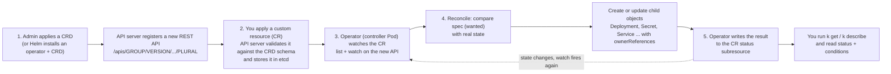

# T3.18 Discover and use resources that extend Kubernetes: CRDs and Operators

> Competency: "Discover and use resources that extend Kubernetes (CRD, Operators)" (CKAD-4.1) | Domain/weight: CKAD — Application Environment, Configuration and Security (25%) | Est. time: 2.5 h | Prerequisites: T2.01, T2.07

Prerequisite lessons: [T2.01](../part2-basics/T2.01-kubernetes-architecture-and-the-api-model.md) (API server, API groups, `kubectl api-resources`) and [T2.07](../part2-basics/T2.07-declarative-object-management-apply-diff-patch.md) (`apply`, `patch`, `edit`). This lesson does not re-teach them.

Shell setup used in every command block below (the same block as in the conventions file):

```bash
alias k=kubectl
export do="--dry-run=client -o yaml"
export now="--force --grace-period=0"
source <(kubectl completion bash); complete -o default -F __start_kubectl k
```

`$do` and `$now` are not needed for custom resources (there is no `k create crontab`), but the shell setup stays the same in every lesson.

Lab files live in `~/lab/T3.18/`. The namespace for this lesson is `lab-t318`.

## 1. Why this matters

Real clusters rarely run only Pods and Deployments. Teams install operators (cert-manager, database operators, Gateway API controllers) and then ask developers to create objects such as `Certificate`, `Gateway` or `Backup`. If you do not know that these objects are custom resources, you cannot find them (`k get pods` will never show them), you cannot read their fields, and you will not understand why deleting one hangs. In the CKAD you must be able to find a CRD, read its schema with `kubectl explain`, and create, change and delete custom resources quickly.

## 2. Concepts

### 2.1 The four words: CRD, custom resource, controller, operator

People mix these up. Learn the difference once.

| Term | What it is | Where it lives | Does it "do" anything? |
|---|---|---|---|
| CustomResourceDefinition (CRD) | A normal API object that **declares a new resource type**: its group, kind, names, scope, versions and schema. | Cluster-scoped, stored in etcd. Kind `CustomResourceDefinition`, `apiextensions.k8s.io/v1`. | No. It only teaches the API server a new noun. |
| Custom resource (CR) | One **instance** of that type, like a Pod is one instance of the Pod type. Example: a `CronTab` named `my-ct`. | Stored in etcd, namespaced or cluster-scoped depending on the CRD. | No. It is data: the wanted state. |
| Controller | A program that **watches** objects and makes the real world match their `spec`. The kube-controller-manager runs the built-in ones (Deployment, Job ...). | Usually a Pod. | Yes. |
| Operator | A controller **plus** its CRDs, written to run one application the way a human operator would (install, back up, upgrade, fail over). | A Deployment (the controller) plus CRDs. | Yes. |

Why this design exists: without CRDs, every new feature (certificates, databases, gateways) would need a change inside Kubernetes itself. With CRDs, anyone can add a type and a controller, and users manage it with the same `kubectl`, RBAC, `apply` and labels they already know.

What breaks without each piece:

- CRD missing: the API server answers `no matches for kind`. The CR cannot even be stored.
- CR missing: the CRD exists but there is nothing to act on.
- Controller missing: CRs are accepted and stored, but nothing happens. `status` stays empty and child objects never appear. This is the single most common "it does not work" case.

**Related but different**

- A **ConfigMap** also holds custom data, but no schema validation and no custom `kubectl get` columns. A CRD gives a typed, validated API.
- A **Helm chart** is a package of YAML. An **operator** is a running program. A Helm chart is often how you *install* an operator.
- The **API aggregation layer** (APIService) is the heavier way to add an API: you run your own API server. CRDs need no extra server. The CKAD only asks you to use CRDs.

### 2.2 Under the hood

You read [T2.01](../part2-basics/T2.01-kubernetes-architecture-and-the-api-model.md) already, so here is only what is new for CRDs.

- The kube-apiserver contains a delegate server called **apiextensions-apiserver**. When you create a CRD, it validates the CRD, sets the status conditions `NamesAccepted` and `Established`, and then starts serving `/apis/<group>/<version>/...` for the new type. You can see this in discovery: `k get --raw /apis/stable.example.com/v1` (shown in section 5).
- The schema is published in the **OpenAPI** document. This is why `k explain crontabs.spec` works: kubectl downloads the schema and prints it. No special support is needed in kubectl.
- Custom resources are stored in **etcd** like any other object, under the CRD's group and plural. Deleting the CRD deletes that data.
- A CR goes through the normal chain: authentication, RBAC (`resources: ["crontabs"]` in a Role), admission, **schema validation and pruning**, then storage.
- An operator is a client of this API. It uses the same list and watch calls you would use with `k get -w`. It needs RBAC permission on its own CR type and on the child types it creates.

### 2.3 Discovering custom resources

You land on a cluster you do not know. The task says "use the `Backup` objects". Work in this order.

1. **List the CRDs.** CRDs are cluster-scoped, so there is no `-n`.
   `k get crd` prints every custom type and when it was created. Add `| grep <word>` to narrow it.
2. **Find the short names, scope and kind.** `k api-resources --api-group=<group>` prints one row per type: `NAME`, `SHORTNAMES`, `APIVERSION`, `NAMESPACED`, `KIND`. The `NAMESPACED` column tells you whether to use `-n`. The `APIVERSION` column is what you write in `apiVersion:`. `-o wide` adds the verbs and categories.
3. **Read the schema.** `k explain <plural>` prints the top-level fields. Add dots to go deeper: `k explain crontabs.spec`, `k explain crontab.spec.replicas`. `--recursive` prints the whole tree in one go.
4. **Read the CRD itself if you need more.** `k describe crd <plural>.<group>` shows names, scope, versions and the printer columns. `k get crd <name> -o yaml` shows the complete schema, including `enum` and `required`.
5. **Find the objects.** `k get <plural> -A` lists them in every namespace. Use the short name if there is one.

EXPECTED OUTPUT (not captured)
```text
$ k get crd
NAME                          CREATED AT
...                           (Calico CRDs of the lab cluster come first)
crontabs.stable.example.com   <timestamp>
```

EXPECTED OUTPUT (not captured)
```text
$ k api-resources --api-group=stable.example.com
NAME       SHORTNAMES   APIVERSION              NAMESPACED   KIND
crontabs   ct           stable.example.com/v1   true         CronTab
```

EXPECTED OUTPUT (not captured)
```text
$ k api-resources --api-group=stable.example.com -o wide
NAME       SHORTNAMES   APIVERSION              NAMESPACED   KIND      VERBS                                                          CATEGORIES
crontabs   ct           stable.example.com/v1   true         CronTab   delete,deletecollection,get,list,patch,create,update,watch
```

Commands to find a type when you only know a word:

```bash
k api-resources | grep -i cron              # searches names, groups and kinds
k get crd | grep -i backup                  # searches CRD names
k api-resources --namespaced=false          # only cluster-scoped types (includes custom ones)
k api-resources --api-group=''              # the core group only, for comparison
```

`kubectl explain` accepts the plural and the singular name: `k explain crontabs` and `k explain crontab`. If you are not sure which group a kind belongs to, write it as `kind.group`, for example `k explain certificate.cert-manager.io`.

### 2.4 CRD anatomy

A minimal CRD (full YAML with comments is in section 4):

| Field | What it does | Default / rule | Risky or invalid value |
|---|---|---|---|
| `apiVersion: apiextensions.k8s.io/v1` | The CRD API. | `v1beta1` was removed in Kubernetes 1.22. | Writing `apiextensions.k8s.io/v1beta1` fails with `no matches for kind`. |
| `metadata.name` | Must be exactly `<spec.names.plural>.<spec.group>`. | No default. | Any other name is rejected. Real error in section 5. |
| `spec.group` | The API group. CRs use `apiVersion: <group>/<version>`. Cannot change later. | Must be a DNS name with at least one dot. | A bare word like `example` is rejected. Groups that end in `.k8s.io` or `.kubernetes.io` are reserved and need an approval annotation. Use your own domain. |
| `spec.names.kind` | CamelCase kind used in the `kind:` line of CRs. | Required. | A kind that clashes with another type in the same group. |
| `spec.names.plural` | Lowercase plural used in URLs and `k get`. | Required. Cannot change later. | Upper case letters. |
| `spec.names.singular` | Singular name for CLI use. | Lowercased `kind`. | None. |
| `spec.names.shortNames` | Short aliases such as `ct`. | Empty list. | A short name that clashes with an existing one; kubectl may then pick the other type. |
| `spec.names.categories` | Groups the type into a category such as `all`, so `k get all` includes it. | Empty list. | Adding to `all` makes `k get all` noisier. |
| `spec.scope` | `Namespaced` or `Cluster`. | Required. Cannot change later. | `Cluster` for something a team owns: then no namespace isolation and RBAC needs a ClusterRole. |
| `spec.versions[].name` | The version part of `apiVersion`, such as `v1` or `v1beta1`. | Required. | Must be a valid DNS label. |
| `spec.versions[].served` | If `true`, the API server answers requests for this version. | Required. | Setting the only version to `false` makes the type unreachable. |
| `spec.versions[].storage` | If `true`, objects are written to etcd in this version. | Exactly one version must be `true`. | Zero or two storage versions are rejected. |
| `spec.versions[].schema.openAPIV3Schema` | The validation schema. | Required in `v1`. | A schema that is not "structural" (missing `type`) is rejected. |
| `spec.versions[].subresources.status` | Turns on the `/status` endpoint. | Off. | Without it, `status` is an ordinary field that any update can change. |
| `spec.versions[].subresources.scale` | Makes `k scale` work for this type. | Off. | Wrong JSON paths: `k scale` fails. |
| `spec.versions[].additionalPrinterColumns` | Extra columns for `k get`. | Only `NAME` and `AGE`. Once you list any column, your list replaces the default `AGE`, so add an `Age` column yourself (`type: date`, `jsonPath: .metadata.creationTimestamp`). | A wrong `jsonPath` prints an empty column, no error. |
| `spec.conversion.strategy` | How to convert between versions. | `None`: only `apiVersion` is rewritten; fields are not changed. | `Webhook` needs a running conversion service. |

**Versions.** One CRD can serve several versions of the same type (`v1alpha1`, `v1beta1`, `v1`). Only one is stored in etcd (`storage: true`). The API server converts on the way in and out. With the default strategy `None` it only changes the `apiVersion` string, so both versions must have compatible fields. Mark an old version `served: false` to stop it being used, or `deprecated: true` to make kubectl print a warning. Operators use this to migrate users from `v1beta1` to `v1`. A real example is in the Gateway API v1.6.3 release file (section 5, Step 11): `gateways` serves `v1` (stored) and `v1beta1` (served, not stored), while `referencegrants` serves `v1` but still stores `v1beta1`.

**Reading a CRD you did not write.** Order: `names` (what do I type), `scope` (do I need a namespace), `versions` (which `apiVersion`, which is served), then the schema (`required`, `enum`, types). That is the same order as the checks the API server runs when you apply a CR.

### 2.5 The schema: `openAPIV3Schema`

The schema decides what the API server accepts. These are the keywords you will meet most often.

| Keyword | Example | Effect |
|---|---|---|
| `type` | `type: integer` | `string`, `integer`, `number`, `boolean`, `array`, `object`. A wrong type is rejected. |
| `required` | `required: ["cronSpec"]` (on the object that owns the field) | The field must be present. |
| `enum` | `enum: ["Allow", "Forbid", "Replace"]` | Only these values (case sensitive). |
| `minimum`, `maximum` | `minimum: 1` | Range for numbers. |
| `pattern`, `minLength`, `maxLength` | `pattern: '^[a-z]+$'` | Rules for strings. |
| `default` | `default: Allow` | The API server fills a missing field. |
| `items` | `items: {type: string}` | Element type of an `array`. |
| `x-kubernetes-preserve-unknown-fields` | `true` on an object | Keep fields that are not in the schema. |
| `x-kubernetes-validations` | CEL rules such as `self.replicas <= 10` | Cross-field rules. Mentioned for completeness; you do not need to write them for the CKAD. |

Two behaviours surprise people:

- **Pruning.** In `apiextensions.k8s.io/v1`, fields that the schema does not list are *dropped* when the object is stored (unless `x-kubernetes-preserve-unknown-fields: true`). A typo in a field name therefore can look like it worked. Since kubectl asks the server to validate strictly by default, you normally get an `unknown field` error instead (section 5 shows it). With `--validate=false` the typo is silently pruned.
- **Defaults on read.** A `default` is applied when the object is created or updated *and* when it is read from etcd. So adding a default to an existing CRD makes old objects show the default too.

### 2.6 Creating, editing and deleting custom resources

A custom resource is used exactly like a built-in. The differences:

- There is **no imperative generator**: `k create crontab` does not exist. You write YAML. Fastest way: copy an example from the docs or from the operator's docs, or build the YAML from `k explain`.
- `apiVersion` is `<group>/<version>`, `kind` is the CRD's `names.kind`.
- `k apply -f`, `k get`, `k describe`, `k edit`, `k patch`, `k delete`, `-o yaml`, `-l`, `-A`, `--watch` all work.
- RBAC applies per type. A ServiceAccount that has rights on `pods` has none on `crontabs`.

```bash
k apply -f my-ct.yaml                        # create or update
k get ct -n lab-t318                         # short name
k get ct my-ct -n lab-t318 -o yaml           # full object including status
k edit ct my-ct -n lab-t318                  # opens $EDITOR, validated on save
k patch ct my-ct -n lab-t318 --type=merge -p '{"spec":{"replicas":3}}'
k delete ct my-ct -n lab-t318
```

**The status subresource.** If the CRD sets `subresources.status: {}`, the object has two write paths:

| Path | Who uses it | What it can change |
|---|---|---|
| Main resource (`apply`, `edit`, `patch`) | You | `spec` and `metadata`. Changes to `status` are **ignored**. |
| `/status` (`k patch --subresource=status`) | The operator | Only `status`. Changes to `spec` are ignored. |

Also, with the subresource on, `metadata.generation` increases only when `spec` changes. Operators store `status.observedGeneration` to say "I have seen generation N". This is why a normal user cannot fake a "Ready" status by editing the object, and why the operator cannot overwrite your `spec` by accident.

**The scale subresource.** If the CRD declares `subresources.scale` with `specReplicasPath`, `k scale ct my-ct --replicas=4` works, and HorizontalPodAutoscaler can target the type.

### 2.7 `additionalPrinterColumns`: why `k get` shows extra columns

By default `k get crontabs` prints `NAME` and `AGE` only. **As soon as the CRD lists its own columns, they replace the default `AGE`**: `AGE` is shown only if the CRD lists it too (`name: Age`, `type: date`, `jsonPath: .metadata.creationTimestamp`, as the docs CronTab example does). The full CRD in section 5 includes such an `Age` column. The API server can return a **Table** (rows and column headers) for any resource. For built-ins the columns are hard-coded (`READY`, `STATUS` for Pods). For a CRD, the author lists the columns in `additionalPrinterColumns`: a `name`, a `type` (`string`, `integer`, `number`, `boolean`, `date`), a `jsonPath` into the object, and an optional `priority` and `description`. Columns with `priority: 0` (the default) show in normal output. Columns with `priority > 0` show only with `-o wide`.

So the columns you see after installing an operator (`READY`, `ISSUER`, `SECRET` for a cert-manager Certificate) are not magic. They are JSON paths. If a column is empty, the path points at something that is not set yet, usually a `status` field the operator has not written.

EXPECTED OUTPUT (not captured)
```text
$ k get ct -n lab-t318 -o wide
NAME    SCHEDULE      REPLICAS   PHASE   AGE   CONCURRENCY
my-ct   */5 * * * *   2                  1m    Allow
```

### 2.8 Validation errors from the schema

The API server rejects a CR that breaks the schema, and the message names the field path and the rule. Read the message from right to left: the field path (`spec.replicas`), the bad value, then the rule (`must be of type integer`, `Unsupported value`, `Required value`).

| What you wrote | Rule broken | Expected text (not captured; full messages in section 5, Step 6) |
|---|---|---|
| `replicas: "three"` | `type: integer` | `spec.replicas: Invalid value: "string": spec.replicas in body must be of type integer: "string"` |
| `concurrency: Sometimes` | `enum` | `spec.concurrency: Unsupported value: "Sometimes": supported values: "Allow", "Forbid", "Replace"` |
| no `cronSpec` | `required` | `spec.cronSpec: Required value` |
| `replicas: 50` | `maximum: 10` | `spec.replicas: Invalid value: 50: spec.replicas in body should be less than or equal to 10` |
| `replica: 2` (typo) | unknown field | `strict decoding error: unknown field "spec.replica"` |

Debug order when an apply fails: (1) read the field path in the message, (2) `k explain <kind>.<path>` to see the expected type, (3) look for `enum` or `required` in `k get crd <name> -o yaml`, (4) fix the YAML, not the CRD.

### 2.9 Operators: install and use

An operator is installed with ordinary tools:

| Method | Command | Notes |
|---|---|---|
| Manifest | `k apply --server-side -f <URL of install.yaml>` | Creates CRDs, a namespace, RBAC and the controller Deployment in one file. Use `--server-side` for large CRD files: client-side apply stores the whole manifest in the `last-applied-configuration` annotation, which has a size limit. Runnable example: the Gateway API install in section 5, Step 11 (CRDs only, no controller; it runs checks 2 to 4 below). |
| Helm | `helm repo add ...`, `helm install ... --set crds.enabled=true` | You pick the chart version and values. Many charts have a flag that decides whether the chart installs the CRDs. |

After the install, always do the same four checks:

1. `k get pods -n <operator-namespace>`: the controller is `Running` and `READY`.
2. `k get crd | grep <group>`: the new types exist.
3. `k api-resources --api-group=<group>`: scope, kinds and short names.
4. `k explain <kind>.spec`: the fields you may set.

Then you create a CR and read what the operator wrote back: `status`, `conditions`, events (`k describe`). Operators follow a convention: `status.conditions` is a list of `{type, status, reason, message}`; the main one is usually `Ready`. `k wait --for=condition=Ready <kind>/<name>` blocks until it is `True`, and works on any CR that follows the convention.

### 2.10 Finalizers and stuck deletion

A **finalizer** is a string in `metadata.finalizers`. It means "someone must do cleanup before this object may disappear". What `k delete` really does on an object with finalizers:

1. The API server does **not** remove the object. It sets `metadata.deletionTimestamp` (to now).
2. The object stays visible and read-only for new finalizers. Controllers see the timestamp and start cleanup (delete the cloud disk, close a database ...).
3. As each controller finishes, it **removes its own string** from the list.
4. When the list is empty the API server deletes the object for good.

Operators use finalizers to make sure external resources are cleaned up. The problem: if the operator is gone (uninstalled, crashed, wrong RBAC) nobody removes the string, and `k delete` waits forever. Symptom: `k delete` hangs, or the object shows up with a `deletionTimestamp` and never leaves.

Troubleshooting order:

1. `k get <kind> <name> -o yaml` and look at `metadata.deletionTimestamp` and `metadata.finalizers`. The finalizer name usually says whose it is (`something.example.com/cleanup`).
2. Find that controller: `k get pods -A | grep <name>`, `k get deploy -A`. Is it running? Does `k logs` show errors?
3. **Restore the operator** (reinstall, fix RBAC, scale up). It finishes the cleanup and removes the string itself.
4. **Last resort**: remove the string by hand with a patch. This skips the cleanup. External resources can stay behind.

```bash
k patch ct fin-ct -n lab-t318 --type=merge -p '{"metadata":{"finalizers":null}}'
```

### 2.11 Deleting a CRD deletes every custom resource of that type

`k delete crd crontabs.stable.example.com` removes the type **and every CR of that type in every namespace**, including the data in etcd. There is no recycle bin. Operators' children are removed through ownerReferences when the CRs are garbage collected. Two more facts:

- The CRD enters a `Terminating` state while the CRs are removed. If one CR has a stuck finalizer, the CRD stays in `Terminating` until you solve that CR (section 2.10).
- For the same reason, `k delete crd` is not the way to "clean up a namespace". `k delete ns` removes the CRs in that namespace and leaves the type alone.

### 2.12 A real-world CRD example: Gateway API

Gateway API is the successor of Ingress ([T3.12](../part3-ckad/T3.12-provide-and-troubleshoot-access-to-applications.md) teaches Ingress). It is not built into Kubernetes. It is a set of CRDs (group `gateway.networking.k8s.io`) that you install, plus a **controller** (Traefik, NGINX Gateway Fabric, Envoy Gateway ...) that makes them work. That is exactly the CRD + operator pattern.

| Kind | Scope | Who writes it | Purpose |
|---|---|---|---|
| `GatewayClass` | Cluster | Platform admin | Names a controller that implements gateways. |
| `Gateway` | Namespaced | Platform admin | A listener (port, protocol) that the controller opens. |
| `HTTPRoute` | Namespaced | Developer | Rules that route requests to Services. |

Everything from this lesson applies: `k api-resources --api-group=gateway.networking.k8s.io`, `k explain gateway.spec.listeners`, `k get gatewayclass`. If you create a `Gateway` and no controller is installed, it is stored but its `status` stays empty. Section 5 shows that with the CRDs installed and no controller.

## 3. How it works (diagram)



Walkthrough:

1. A CRD is an ordinary object (kind `CustomResourceDefinition`). Applying it makes the API server serve a brand-new REST endpoint. No restart and no code are needed.
2. A custom resource is just data. The API server checks it against the CRD's `openAPIV3Schema` and stores it in etcd. At this point nothing else happens: a CR with no operator is only a stored record.
3. The operator is an ordinary Deployment. Its code does a `list` and a `watch` on the CR type, so it learns about every create, update and delete.
4. For each event it runs the reconcile loop: read `spec`, look at the real world, make the real world match.
5. The operator reports back through `status` and conditions. You read them with `k get`, `k describe` and `-o yaml`. The dotted arrow shows the loop: every change to the children or to the CR triggers another reconcile.

## 4. Commands and YAML you must produce fast

### 4.1 Imperative commands

There is no `k create` for custom resources. These are the commands you type instead. Every one is shown with real output in section 5.

```bash
k get crd                                          # every custom type in the cluster
k api-resources --api-group=stable.example.com     # kind, short name, scope, apiVersion for one group
k explain crontabs.spec                            # schema: fields and types under spec
k explain crontab.spec.replicas                    # one field; shows type and description
k explain crontab --recursive                      # whole field tree, one screen
k describe crd crontabs.stable.example.com         # names, scope, versions, printer columns
k wait --for=condition=Established crd/crontabs.stable.example.com --timeout=30s   # CRD is ready to use
k get crontabs -A                                  # all CRs of the type, every namespace
k get ct my-ct -n lab-t318 -o yaml                 # one CR with its status
k delete crontab my-ct -n lab-t318                 # delete one CR (ct is the same type; may hang on a finalizer)
```

Write a CR fast with a here-document (no file needed):

```bash
cat <<'EOT' | k apply -f -
apiVersion: stable.example.com/v1
kind: CronTab
metadata:
  name: my-ct
  namespace: lab-t318
spec:
  cronSpec: "*/5 * * * *"
  replicas: 2
EOT
```

### 4.2 The minimal CRD and a matching CR

Save as `~/lab/T3.18/crontab-minimal.yaml`. This is the shape the Kubernetes docs use for their CronTab example (docs page in section 8); you should be able to type it from memory.

```yaml
apiVersion: apiextensions.k8s.io/v1
kind: CustomResourceDefinition
metadata:
  name: crontabs.stable.example.com   # must be exactly <plural>.<group>
spec:
  group: stable.example.com           # API group; CRs use apiVersion stable.example.com/v1
  scope: Namespaced                   # Namespaced or Cluster
  names:
    kind: CronTab                     # CamelCase; the "kind:" in CR YAML
    plural: crontabs                  # used in URLs and in "k get crontabs"
    singular: crontab                 # optional; defaults to the lowercased kind
    shortNames:
    - ct                              # lets you type "k get ct"
  versions:
  - name: v1                          # the version part of apiVersion
    served: true                      # the API server answers requests for this version
    storage: true                     # exactly one version must be the storage version
    schema:
      openAPIV3Schema:                # required in apiextensions.k8s.io/v1
        type: object
        properties:
          spec:
            type: object
            properties:
              cronSpec:
                type: string
              replicas:
                type: integer
```

Save as `~/lab/T3.18/my-ct.yaml`:

```yaml
apiVersion: stable.example.com/v1     # <group>/<version> from the CRD
kind: CronTab                         # names.kind from the CRD
metadata:
  name: my-ct
  namespace: lab-t318                 # the CRD is Namespaced, so a namespace applies
spec:
  cronSpec: "*/5 * * * *"             # string: quote it, "*" starts a YAML alias otherwise
  replicas: 2                         # integer: no quotes
```

Field notes for the CR: `apiVersion` and `kind` must match the CRD exactly (kind is case sensitive). `cronSpec` must be quoted because a bare `*` is a YAML alias marker and a value like `*/5 * * * *` does not parse.

The full CRD used in the worked example and labs adds `required`, `enum`, `minimum` and `maximum`, `default`, the status and scale subresources and five printer columns (`Schedule`, `Replicas`, `Phase`, `Age` and the wide-only `Concurrency`). It is printed in section 5.

### 4.3 Speed drill

Setup (one line): `mkdir -p ~/lab/T3.18 && cd ~/lab/T3.18 && k create ns lab-t318` and have `crontab-minimal.yaml` from 4.2 in that folder. Cleanup is the last task. Targets are exam pace.

| # | Task | Target |
|---|---|---|
| 1 | Apply `crontab-minimal.yaml` and wait until the CRD is `Established`. | 1 min |
| 2 | Print only the resource name of every type in group `stable.example.com`. | 1 min |
| 3 | Show the type and description of `spec.replicas` of the `crontab` kind. | 1 min |
| 4 | Create a CronTab `nightly` in `lab-t318`: schedule `0 2 * * *`, replicas 3. | 2 min |
| 5 | Change `nightly` to 5 replicas without opening an editor, and print the new value. | 1 min |
| 6 | Add a printer column `Schedule` (from `.spec.cronSpec`) to the CRD with one patch and show it in `k get`. | 3 min |
| 7 | Delete the CR, delete the CRD, prove that `k get crontabs -A` no longer works, then remove the namespace. | 2 min |

<details><summary>Answers</summary>

```bash
# 1
k apply -f crontab-minimal.yaml
k wait --for=condition=Established crd/crontabs.stable.example.com --timeout=30s
# 2
k api-resources --api-group=stable.example.com -o name
# 3
k explain crontab.spec.replicas
# 4
cat <<'EOT' | k apply -f -
apiVersion: stable.example.com/v1
kind: CronTab
metadata:
  name: nightly
  namespace: lab-t318
spec:
  cronSpec: "0 2 * * *"
  replicas: 3
EOT
# 5
k patch ct nightly -n lab-t318 --type=merge -p '{"spec":{"replicas":5}}'
k get ct nightly -n lab-t318 -o jsonpath='{.spec.replicas}{"\n"}'
# 6  (a JSON patch with op "add" creates the missing list)
k patch crd crontabs.stable.example.com --type=json -p '[{"op":"add","path":"/spec/versions/0/additionalPrinterColumns","value":[{"name":"Schedule","type":"string","jsonPath":".spec.cronSpec"}]}]'
k get ct -n lab-t318      # NAME and SCHEDULE only: a custom column replaces the default AGE
# 7 (cleanup)
k delete ct nightly -n lab-t318
k delete crd crontabs.stable.example.com
k get crontabs -A          # error: the server doesn't have a resource type "crontabs" (a stale discovery cache can print a NotFound error instead; run it again)
k delete ns lab-t318
```

</details>

## 5. Worked example

Goal: take a cluster that has never heard of `CronTab`, add the type, use it, break it on purpose, and read every message. Environment: kind (context `kind-lab`). Every output block below is labelled `EXPECTED OUTPUT (not captured)`: no kind cluster could be started when this lesson was written (see section 11). Timestamps and ages are placeholders. Run the commands and compare; where your text differs, trust your cluster.

**Setup**

```bash
mkdir -p ~/lab/T3.18 && cd ~/lab/T3.18
k create ns lab-t318
```

Create `my-ct.yaml` (the CR from section 4.2) and `crontab-minimal.yaml` (the minimal CRD from section 4.2) in this folder.

### Step 1: a CR without its CRD

```bash
k apply -f my-ct.yaml
k get crontabs -n lab-t318
k api-resources --api-group=stable.example.com
```

EXPECTED OUTPUT (not captured)
```text
$ k apply -f my-ct.yaml
error: resource mapping not found for name: "my-ct" namespace: "lab-t318" from "my-ct.yaml": no matches for kind "CronTab" in version "stable.example.com/v1"
ensure CRDs are installed first

$ k get crontabs -n lab-t318
error: the server doesn't have a resource type "crontabs"

$ k api-resources --api-group=stable.example.com
NAME   SHORTNAMES   APIVERSION   NAMESPACED   KIND
```

How to read it: kubectl asks the API server for the list of known types (discovery) and looks for kind `CronTab` in group `stable.example.com`. It is not there, so kubectl stops before it sends anything. The empty `api-resources` table confirms that the group does not exist yet.

### Step 2: add the type

```bash
k apply -f crontab-minimal.yaml
k wait --for=condition=Established crd/crontabs.stable.example.com --timeout=30s
k get crd | grep stable
k api-resources --api-group=stable.example.com
```

EXPECTED OUTPUT (not captured)
```text
$ k apply -f crontab-minimal.yaml
customresourcedefinition.apiextensions.k8s.io/crontabs.stable.example.com created

$ k wait --for=condition=Established crd/crontabs.stable.example.com --timeout=30s
customresourcedefinition.apiextensions.k8s.io/crontabs.stable.example.com condition met

$ k get crd | grep stable
crontabs.stable.example.com   <timestamp>

$ k api-resources --api-group=stable.example.com
NAME       SHORTNAMES   APIVERSION              NAMESPACED   KIND
crontabs   ct           stable.example.com/v1   true         CronTab
```

`Established` is a condition in `status.conditions` of the CRD. It becomes `True` when the API server has started serving the new endpoint. Applying a CR in the same second as the CRD can fail with the Step 1 error, so scripts wait first.

### Step 3: read the schema with `explain`

```bash
k explain crontabs.spec
k explain crontab.spec.replicas
```

EXPECTED OUTPUT (not captured)
```text
$ k explain crontabs.spec
GROUP:      stable.example.com
KIND:       CronTab
VERSION:    v1

FIELD: spec <Object>

DESCRIPTION:
    <empty>

FIELDS:
  cronSpec	<string>
    <no description>

  replicas	<integer>
    <no description>

$ k explain crontab.spec.replicas
GROUP:      stable.example.com
KIND:       CronTab
VERSION:    v1

FIELD: replicas <integer>

DESCRIPTION:
    <empty>
```

The exact layout of `explain` depends on the kubectl version; what matters is the field names and the type in angle brackets. The CRD has no `description` entries, so kubectl prints `<empty>` or similar. Real operators fill in descriptions, which is why `explain` is so useful on them. `-required-` appears next to mandatory fields.

### Step 4: create, list and read a CR

```bash
k apply -f my-ct.yaml
k get ct -n lab-t318
k get crontabs -A
k get ct my-ct -n lab-t318 -o yaml
```

EXPECTED OUTPUT (not captured)
```text
$ k apply -f my-ct.yaml
crontab.stable.example.com/my-ct created

$ k get ct -n lab-t318
NAME    AGE
my-ct   5s

$ k get crontabs -A
NAMESPACE   NAME    AGE
lab-t318    my-ct   6s

$ k get ct my-ct -n lab-t318 -o yaml
apiVersion: stable.example.com/v1
kind: CronTab
metadata:
  annotations:
    kubectl.kubernetes.io/last-applied-configuration: |
      ...
  creationTimestamp: "<timestamp>"
  generation: 1
  name: my-ct
  namespace: lab-t318
  resourceVersion: "<number>"
  uid: <uuid>
spec:
  cronSpec: '*/5 * * * *'
  replicas: 2
```

Only `NAME` and `AGE` show, because the minimal CRD defines no printer columns. The object has the normal `metadata` (uid, generation, resourceVersion, last-applied annotation from `apply`). The `status` is missing: no operator exists, and the minimal CRD has no status schema.

You can also see the REST endpoint the CRD created:

```bash
k get --raw /apis/stable.example.com/v1
```

EXPECTED OUTPUT (not captured)
```text
{"kind":"APIResourceList","apiVersion":"v1","groupVersion":"stable.example.com/v1","resources":[{"name":"crontabs","singularName":"crontab","namespaced":true,"kind":"CronTab","verbs":["delete","deletecollection","get","list","patch","create","update","watch"],"shortNames":["ct"],"storageVersionHash":"..."}]}
```

This is the discovery document kubectl reads in Step 1. It is the "new REST API" from the diagram in section 3.

### Step 5: tighten the CRD (validation, printer columns, status, scale)

Save the full CRD as `crontab-crd.yaml` and apply it over the minimal one. Because `apply` updates the same object, existing CRs stay.

```yaml
apiVersion: apiextensions.k8s.io/v1
kind: CustomResourceDefinition
metadata:
  name: crontabs.stable.example.com
spec:
  group: stable.example.com
  scope: Namespaced
  names:
    kind: CronTab
    plural: crontabs
    singular: crontab
    shortNames:
    - ct
  versions:
  - name: v1
    served: true
    storage: true
    subresources:
      status: {}                      # /status endpoint: spec and status are written separately
      scale:                          # makes "k scale crontab" work
        specReplicasPath: .spec.replicas
        statusReplicasPath: .status.replicas
    schema:
      openAPIV3Schema:
        type: object
        properties:
          spec:
            type: object
            required: ["cronSpec"]    # a CR without spec.cronSpec is rejected
            properties:
              cronSpec:
                type: string
              replicas:
                type: integer
                minimum: 1
                maximum: 10
              concurrency:
                type: string
                enum: ["Allow", "Forbid", "Replace"]
                default: Allow        # filled in by the API server when the field is missing
          status:
            type: object
            properties:
              phase:
                type: string
              replicas:
                type: integer
    additionalPrinterColumns:         # extra columns for "k get"
    - name: Schedule
      type: string
      jsonPath: .spec.cronSpec
    - name: Replicas
      type: integer
      jsonPath: .spec.replicas
    - name: Phase
      type: string
      jsonPath: .status.phase
    - name: Age                       # a custom column list replaces the default AGE, so add it back
      type: date
      jsonPath: .metadata.creationTimestamp
    - name: Concurrency
      type: string
      jsonPath: .spec.concurrency
      priority: 1                     # priority > 0 shows only with -o wide
      description: How overlapping runs are handled
```

```bash
k apply -f crontab-crd.yaml
k get ct -n lab-t318
k get ct -n lab-t318 -o wide
k describe crd crontabs.stable.example.com
```

EXPECTED OUTPUT (not captured)
```text
$ k apply -f crontab-crd.yaml
customresourcedefinition.apiextensions.k8s.io/crontabs.stable.example.com configured

$ k get ct -n lab-t318
NAME    SCHEDULE      REPLICAS   PHASE   AGE
my-ct   */5 * * * *   2                  1m

$ k get ct -n lab-t318 -o wide
NAME    SCHEDULE      REPLICAS   PHASE   AGE   CONCURRENCY
my-ct   */5 * * * *   2                  1m    Allow

$ k describe crd crontabs.stable.example.com
Name:         crontabs.stable.example.com
...
Spec:
  Group:  stable.example.com
  Names:
    Kind:       CronTab
    List Kind:  CronTabList
    Plural:     crontabs
    Short Names:
      ct
    Singular:   crontab
  Scope:        Namespaced
  Versions:
    Additional Printer Columns:
      Json Path:    .spec.cronSpec
      Name:         Schedule
      ...
    Name:           v1
    Served:         true
    Storage:        true
...
Status:
  Accepted Names:
    ...
  Conditions:
    ...  Type:    NamesAccepted
    ...  Type:    Established
```

What to look at: the `AGE` column is there only because the CRD lists it (without that entry, the custom columns would replace it and `AGE` would vanish). The `PHASE` column is empty because `.status.phase` does not exist yet (the path is valid, the value is not set). `CONCURRENCY` shows `Allow` for an object that never had that field: the schema `default` is applied when the object is read. In `describe`, `Scope`, `Short Names`, and the version table tell you everything you need to write a CR; the `Conditions` list tells you whether the type is usable.

### Step 6: schema violations

Create six small CR files and apply them one by one. The helper `mk` writes a complete CR file from a name, an `apiVersion` and the lines under `spec`:

```bash
mk() { printf 'apiVersion: %s\nkind: CronTab\nmetadata:\n  name: %s\n  namespace: lab-t318\nspec:\n%b\n' "$2" "$1" "$3" > "$1.yaml"; }
mk bad-type     stable.example.com/v1 '  cronSpec: "0 * * * *"\n  replicas: "three"'
mk bad-enum     stable.example.com/v1 '  cronSpec: "0 * * * *"\n  concurrency: Sometimes'
mk bad-required stable.example.com/v1 '  replicas: 2'
mk bad-range    stable.example.com/v1 '  cronSpec: "0 * * * *"\n  replicas: 50'
mk bad-unknown  stable.example.com/v1 '  cronSpec: "0 * * * *"\n  replica: 2'
mk bad-version  stable.example.com/v2 '  cronSpec: "0 * * * *"'
cat bad-type.yaml                 # check one file to see what mk wrote
```

The files differ from `my-ct.yaml` in one place each: a string where an integer is wanted, a value outside the `enum`, a missing `cronSpec`, a number above `maximum`, a misspelled field, and an `apiVersion` the CRD does not serve.

```bash
for f in bad-type bad-enum bad-required bad-range bad-unknown bad-version; do k apply -f $f.yaml; done
```

EXPECTED OUTPUT (not captured)
```text
The CronTab "bad-type" is invalid: spec.replicas: Invalid value: "string": spec.replicas in body must be of type integer: "string"
The CronTab "bad-enum" is invalid: spec.concurrency: Unsupported value: "Sometimes": supported values: "Allow", "Forbid", "Replace"
The CronTab "bad-required" is invalid: spec.cronSpec: Required value
The CronTab "bad-range" is invalid: spec.replicas: Invalid value: 50: spec.replicas in body should be less than or equal to 10
Error from server (BadRequest): error when creating "bad-unknown.yaml": CronTab in version "v1" cannot be handled as a CronTab: strict decoding error: unknown field "spec.replica"
error: resource mapping not found for name: "bad-version" namespace: "lab-t318" from "bad-version.yaml": no matches for kind "CronTab" in version "stable.example.com/v2"
ensure CRDs are installed first
```

Each message starts with the field path. Rejected objects are not stored: `k get ct -n lab-t318` still lists only `my-ct`. The last one shows that a wrong version gives the same `no matches` error as a missing CRD, so the fix for that message depends on what `api-resources` shows (see section 6).

Two more checks on the CRD itself. Both are rejected by the API server:

```bash
cat > bad-crd-name.yaml <<'EOT'
apiVersion: apiextensions.k8s.io/v1
kind: CustomResourceDefinition
metadata:
  name: widget.stable.example.com      # should be widgets.stable.example.com
spec:
  group: stable.example.com
  scope: Namespaced
  names: {kind: Widget, plural: widgets}
  versions:
  - name: v1
    served: true
    storage: true
    schema:
      openAPIV3Schema: {type: object}
EOT
cat > bad-crd-group.yaml <<'EOT'
apiVersion: apiextensions.k8s.io/v1
kind: CustomResourceDefinition
metadata:
  name: widgets.example
spec:
  group: example                       # no dot in the group
  scope: Namespaced
  names: {kind: Widget, plural: widgets}
  versions:
  - name: v1
    served: true
    storage: true
    schema:
      openAPIV3Schema: {type: object}
EOT
k apply -f bad-crd-name.yaml
k apply -f bad-crd-group.yaml
```

EXPECTED OUTPUT (not captured)
```text
The CustomResourceDefinition "widget.stable.example.com" is invalid: metadata.name: Invalid value: "widget.stable.example.com": must be spec.names.plural+"."+spec.group
The CustomResourceDefinition "widgets.example" is invalid: spec.group: Invalid value: "example": should be a domain with at least one dot
```

(The second message may list more errors; the part about the dot is the one that matters.)

### Step 7: unknown fields and pruning

```bash
k apply --validate=false -f bad-unknown.yaml
k get ct bad-unknown -n lab-t318 -o jsonpath='{.spec}{"\n"}'
k delete ct bad-unknown -n lab-t318
```

EXPECTED OUTPUT (not captured)
```text
crontab.stable.example.com/bad-unknown created
{"cronSpec":"0 * * * *"}
crontab.stable.example.com "bad-unknown" deleted
```

With client-side validation off, the typo is accepted but the API server **prunes** `replica` because it is not in the schema. The object exists without the field you meant to set. This is why a schema is strict by default and why you should not use `--validate=false` to "make an error go away".

### Step 8: status and scale subresources

```bash
cat > status-in-manifest.yaml <<'EOT'
apiVersion: stable.example.com/v1
kind: CronTab
metadata:
  name: my-ct
  namespace: lab-t318
spec:
  cronSpec: "*/5 * * * *"
  replicas: 2
status:
  phase: Done
EOT
k apply -f status-in-manifest.yaml
k get ct my-ct -n lab-t318 -o jsonpath='{.status}{"\n"}'
k patch ct my-ct -n lab-t318 --type=merge -p '{"status":{"phase":"Running"}}'
k patch ct my-ct -n lab-t318 --subresource=status --type=merge -p '{"status":{"phase":"Running","replicas":2}}'
k get ct -n lab-t318
k get ct my-ct -n lab-t318 -o jsonpath='gen={.metadata.generation}{"\n"}'
k patch ct my-ct -n lab-t318 --type=merge -p '{"spec":{"replicas":3}}'
k get ct my-ct -n lab-t318 -o jsonpath='gen={.metadata.generation}{"\n"}'
k scale ct my-ct -n lab-t318 --replicas=4
k get ct -n lab-t318
```

EXPECTED OUTPUT (not captured)
```text
$ k apply -f status-in-manifest.yaml
crontab.stable.example.com/my-ct unchanged     (could also say "configured"; the status block is dropped either way)

$ k get ct my-ct -n lab-t318 -o jsonpath='{.status}{"\n"}'
                                                  (empty line: status was ignored)

$ k patch ct my-ct -n lab-t318 --type=merge -p '{"status":{"phase":"Running"}}'
crontab.stable.example.com/my-ct patched (no change)

$ k patch ct my-ct -n lab-t318 --subresource=status --type=merge -p '{"status":{"phase":"Running","replicas":2}}'
crontab.stable.example.com/my-ct patched

$ k get ct -n lab-t318
NAME    SCHEDULE      REPLICAS   PHASE     AGE
my-ct   */5 * * * *   2          Running   3m

$ k get ct my-ct -n lab-t318 -o jsonpath='gen={.metadata.generation}{"\n"}'
gen=<n>

$ k patch ct my-ct -n lab-t318 --type=merge -p '{"spec":{"replicas":3}}'
crontab.stable.example.com/my-ct patched

$ k get ct my-ct -n lab-t318 -o jsonpath='gen={.metadata.generation}{"\n"}'
gen=<n+1>

$ k scale ct my-ct -n lab-t318 --replicas=4
crontab.stable.example.com/my-ct scaled

$ k get ct -n lab-t318
NAME    SCHEDULE      REPLICAS   PHASE     AGE
my-ct   */5 * * * *   4          Running   3m
```

Reading it: the main endpoint ignores `status` (no change), the `/status` endpoint accepts it, only a `spec` change raises `generation`, and `k scale` works because the CRD declared the scale subresource.

### Step 9: delete a CR, then delete the CRD

```bash
k create ns lab-t318-b
sed 's/lab-t318/lab-t318-b/' my-ct.yaml | k apply -f -
k get crontabs -A
k delete ct my-ct -n lab-t318
k delete crd crontabs.stable.example.com
k get crontabs -A
k apply -f crontab-crd.yaml
k wait --for=condition=Established crd/crontabs.stable.example.com --timeout=30s
k get crontabs -A
```

EXPECTED OUTPUT (not captured)
```text
$ k get crontabs -A
NAMESPACE    NAME    SCHEDULE      REPLICAS   PHASE     AGE
lab-t318     my-ct   */5 * * * *   4          Running   5m
lab-t318-b   my-ct   */5 * * * *   2                    5s

$ k delete ct my-ct -n lab-t318
crontab.stable.example.com "my-ct" deleted

$ k delete crd crontabs.stable.example.com
customresourcedefinition.apiextensions.k8s.io "crontabs.stable.example.com" deleted

$ k get crontabs -A
error: the server doesn't have a resource type "crontabs"

$ k get crontabs -A          (after re-applying the same CRD)
No resources found
```

If the first `k get crontabs -A` after the CRD delete prints a `NotFound` error instead of "doesn't have a resource type", kubectl's discovery cache still knew the name; run it again. The CR in `lab-t318-b` was never deleted by hand. It disappeared with the CRD, and re-creating the CRD did not bring it back: the data is gone.

### Step 10: a finalizer

```bash
cat > fin.yaml <<'EOT'
apiVersion: stable.example.com/v1
kind: CronTab
metadata:
  name: fin-ct
  namespace: lab-t318
  finalizers:
  - stable.example.com/cleanup         # nobody will ever remove this string
spec:
  cronSpec: "0 * * * *"
EOT
k apply -f fin.yaml
k delete ct fin-ct -n lab-t318 --timeout=8s
k get ct fin-ct -n lab-t318 -o yaml | yq '.metadata | {"finalizers": .finalizers, "deletionTimestamp": .deletionTimestamp}'
k patch ct fin-ct -n lab-t318 --type=merge -p '{"metadata":{"finalizers":null}}'
k get ct -n lab-t318
```

EXPECTED OUTPUT (not captured)
```text
$ k apply -f fin.yaml
crontab.stable.example.com/fin-ct created

$ k delete ct fin-ct -n lab-t318 --timeout=8s
crontab.stable.example.com "fin-ct" deleted          (printed as soon as the request is accepted)
error: timed out waiting for the condition on crontabs/fin-ct

$ k get ct fin-ct -n lab-t318 -o yaml | yq '.metadata | ...'
finalizers:
  - stable.example.com/cleanup
deletionTimestamp: "<timestamp>"

$ k patch ct fin-ct -n lab-t318 --type=merge -p '{"metadata":{"finalizers":null}}'
crontab.stable.example.com/fin-ct patched

$ k get ct -n lab-t318
No resources found in lab-t318 namespace.
```

`yq` is on the exam hosts (summary E9, source https://docs.linuxfoundation.org/tc-docs/certification/tips-cka-and-ckad); `jq` is not guaranteed, so use `yq` or `-o jsonpath`.

The same finalizer also blocks the CRD. Try it, then clean up:

```bash
k apply -f fin.yaml
k delete crd crontabs.stable.example.com --wait=false
k get crd crontabs.stable.example.com -o jsonpath='{range .status.conditions[*]}{.type}={.status} {.reason}{"\n"}{end}'
k patch ct fin-ct -n lab-t318 --type=merge -p '{"metadata":{"finalizers":null}}'
k get crd crontabs.stable.example.com
```

EXPECTED OUTPUT (not captured)
```text
NamesAccepted=True NoConflicts
Established=True InitialNamesAccepted
Terminating=True InstanceDeletionInProgress        (the exact conditions and reasons may differ)
...
Error from server (NotFound): customresourcedefinitions.apiextensions.k8s.io "crontabs.stable.example.com" not found
```

The CRD was waiting for one CR, and the CR was waiting for a finalizer. Removing the finalizer let both go.

### Step 11: Gateway API as a real CRD set

First check whether these CRDs are already installed (the `gateway-api-crds` add-on of the lab cluster installs them):

```bash
k get crd gateways.gateway.networking.k8s.io
```

If that prints a CRD, skip the install line below and skip the CRD removal at the end of this step, otherwise you would delete the add-on's CRDs. If it prints `NotFound`, install them server-side (the files are large; client-side apply would copy the whole manifest into an annotation):

```bash
k apply --server-side -f https://github.com/kubernetes-sigs/gateway-api/releases/download/v1.6.3/standard-install.yaml
k api-resources --api-group=gateway.networking.k8s.io
k explain gateway.spec.listeners.protocol
cat > gw.yaml <<'EOT'
apiVersion: gateway.networking.k8s.io/v1
kind: GatewayClass
metadata:
  name: lab-no-controller
spec:
  controllerName: example.com/no-such-controller   # no controller with this name is running
---
apiVersion: gateway.networking.k8s.io/v1
kind: Gateway
metadata:
  name: lab-gw
  namespace: lab-t318
spec:
  gatewayClassName: lab-no-controller
  listeners:
  - name: http
    port: 80
    protocol: HTTP
EOT
k apply -f gw.yaml
k get gatewayclass
k get gateway -n lab-t318
k delete -f gw.yaml
```

Facts read from the downloaded release file `standard-install.yaml` of Gateway API v1.6.3 (REAL OUTPUT of `yq`, no cluster involved): it contains ten CRDs: `backendtlspolicies` (short name `btlspolicy`), `gatewayclasses` (`gc`, cluster-scoped), `gateways` (`gtw`), `grpcroutes`, `httproutes`, `listenersets` (`lset`), `referencegrants` (`refgrant`), `tcproutes`, `tlsroutes` and `udproutes` (all but `gatewayclasses` are namespaced), plus one ValidatingAdmissionPolicy and its binding. Every CRD there carries the annotation `gateway.networking.k8s.io/bundle-version: v1.6.3`. `GatewayClass` has the printer columns `Controller`, `Accepted`, `Age` and (wide) `Description`; `Gateway` has `Class`, `Address`, `Programmed`, `Age`. `GatewayClass.spec.controllerName` is required; `Gateway.spec` requires `gatewayClassName` and `listeners`, and each listener requires `name`, `port` and `protocol`.

The file also shows multi-version CRDs in practice: `gateways` and `gatewayclasses` serve `v1` (the storage version) and `v1beta1` (served, not stored); `referencegrants` serve `v1` but store `v1beta1`; `tlsroutes` store `v1` and keep `v1alpha2` and `v1alpha3` as not served.

EXPECTED OUTPUT (not captured)
```text
$ k api-resources --api-group=gateway.networking.k8s.io
NAME                SHORTNAMES   APIVERSION                         NAMESPACED   KIND
backendtlspolicies  btlspolicy   gateway.networking.k8s.io/v1       true         BackendTLSPolicy
gatewayclasses      gc           gateway.networking.k8s.io/v1       false        GatewayClass
gateways            gtw          gateway.networking.k8s.io/v1       true         Gateway
grpcroutes                       gateway.networking.k8s.io/v1       true         GRPCRoute
httproutes                       gateway.networking.k8s.io/v1       true         HTTPRoute
...

$ k get gatewayclass
NAME                CONTROLLER                        ACCEPTED   AGE
lab-no-controller   example.com/no-such-controller               5s

$ k get gateway -n lab-t318
NAME     CLASS               ADDRESS   PROGRAMMED   AGE
lab-gw   lab-no-controller                          5s
```

`ACCEPTED` and `PROGRAMMED` are empty because only a controller writes them, and none runs. This is the same picture as a custom resource without an operator.

If you installed the Gateway API CRDs here, remove them again so the cluster returns to baseline: `k delete -f https://github.com/kubernetes-sigs/gateway-api/releases/download/v1.6.3/standard-install.yaml`. Skip this if they were already installed before the step.

### Step 12: an operator in action (preview of Lab 7.2)

With cert-manager installed (Lab 7.2), the same discovery commands work on its CRDs. These facts were read from the chart `jetstack/cert-manager` `v1.21.3` with `helm template --set crds.enabled=true` (REAL OUTPUT, Helm v3.19.2, no cluster):

- It renders six CRDs: `challenges.acme.cert-manager.io`, `orders.acme.cert-manager.io`, `certificaterequests.cert-manager.io`, `certificates.cert-manager.io`, `clusterissuers.cert-manager.io`, `issuers.cert-manager.io`.
- It renders three Deployments: `cert-manager-cainjector`, `cert-manager` (the controller) and `cert-manager-webhook`.
- The `Certificate` CRD is namespaced, has short names `cert` and `certs`, requires `spec.issuerRef` and `spec.secretName`, and inside `issuerRef` only `name` is required. Its printer columns are `Ready`, `Secret`, `Issuer` (wide) and `Status` (wide), plus `Age`.
- `helm search repo jetstack/cert-manager --versions` listed `v1.21.3` as the newest chart on 2026-10-28.

Lab 7.2 shows the `READY` column of a Certificate change from `False` to `True` while the controller works.

**Cleanup**

```bash
k delete crd crontabs.stable.example.com --ignore-not-found
k delete ns lab-t318 lab-t318-b --ignore-not-found
rm -f ~/lab/T3.18/bad-*.yaml ~/lab/T3.18/fin.yaml ~/lab/T3.18/gw.yaml ~/lab/T3.18/status-in-manifest.yaml
```

## 6. Common mistakes and how to fix them

All texts in the table come from the expected output in section 5 (not captured on a live cluster, see section 11). Names in quotes change with your objects.

| # | Symptom | What you will see (exact error text) | Cause | Fix (command) |
|---|---|---|---|---|
| 1 | CR cannot be created | `error: resource mapping not found for name: "my-ct" namespace: "lab-t318" from "my-ct.yaml": no matches for kind "CronTab" in version "stable.example.com/v1"` then `ensure CRDs are installed first` | The CRD is not installed yet, or is not `Established` yet, or `apiVersion` names a version the CRD does not serve, or `kind` is misspelled. | `k api-resources --api-group=stable.example.com` (is the kind there? which `APIVERSION`?). Install the CRD or operator, then `k wait --for=condition=Established crd/<name>`. Copy the group/version from `api-resources` into `apiVersion:`. |
| 2 | Schema type violation | `The CronTab "bad-type" is invalid: spec.replicas: Invalid value: "string": spec.replicas in body must be of type integer: "string"` | The schema says `integer`, the YAML has a quoted string. | `k explain crontab.spec.replicas` (confirm the type), remove the quotes, `k apply -f` again. |
| 3 | Value not allowed | `spec.concurrency: Unsupported value: "Sometimes": supported values: "Allow", "Forbid", "Replace"` | The `enum` list is case sensitive and closed. | Use one of the listed values. |
| 4 | Required field missing | `spec.cronSpec: Required value` | The schema marks the field `required`. A misspelled name (`cronspec`) is the usual reason. | `k explain crontab.spec` (look for `-required-`), fix the name. |
| 5 | Typo in a field name | `Error from server (BadRequest): ... strict decoding error: unknown field "spec.replica"` | The field is not in the schema. With `--validate=false` it would be silently pruned. | Fix the spelling. Never turn validation off to get past this error. |
| 6 | CR deletion hangs | `k delete ct fin-ct` prints `deleted` (or waits) and then does not return; `k get ct fin-ct -o yaml` shows `deletionTimestamp:` and a non-empty `finalizers:` list. | A finalizer waits for a controller that is not running (uninstalled, crashed, wrong RBAC). | Restore the operator first (see below). Last resort: `k patch ct fin-ct -n lab-t318 --type=merge -p '{"metadata":{"finalizers":null}}'`. |
| 7 | CRD stuck in `Terminating` | `k get crd` still lists it after `k delete crd`; its `status.conditions` has `Terminating`. | One or more CRs of the type have finalizers that are not being processed. | `k get <plural> -A`, find the CRs with a `deletionTimestamp`, fix them as in row 6. |
| 8 | CR accepted but nothing happens | `status` empty, no child objects, `READY` column blank. | The operator (controller) is not installed or not running. | `k get pods -A` and find the operator by name, `k logs` it, reinstall it or scale its Deployment up. |
| 9 | CRD itself rejected | `metadata.name: Invalid value: "widget.stable.example.com": must be spec.names.plural+"."+spec.group` or `spec.group: Invalid value: "example": should be a domain with at least one dot` | CRD name is not `<plural>.<group>`, or the group has no dot. | Rename the object; use a group such as `stable.example.com`. |

### How to work through the three most common mistakes

**Row 1: `no matches for kind`.** The message names a kind and a version, and kubectl failed *before* contacting any object, so the problem is discovery, not your YAML values.

1. `k api-resources --api-group=<group from your apiVersion>`. If the table is empty, the CRD is missing: `k get crd | grep -i <word>`; if it is really absent, install it (manifest or Helm). If the CRD was applied a moment ago, `k wait --for=condition=Established crd/<name> --timeout=30s` and retry.
2. If the table has a row, compare `KIND` and `APIVERSION` with your file letter by letter. `CronTab` is not `Crontab`. `stable.example.com/v1` is not `stable.example.com/v1beta1`.
3. If the group exists but your version does not, `k get crd <name> -o jsonpath='{.spec.versions[*].name}'` lists the versions, and `served` says whether you may use them.

**Row 2: `spec.replicas: Invalid value: "string"`.** Read the message from left to right: path `spec.replicas`, offending value, rule. Run `k explain <kind>.spec.replicas` to see the declared type, then fix the YAML (`replicas: 3`, no quotes). Do not edit the CRD: the schema is the contract that the operator relies on. If the message mentions `enum`, `minimum` or `required`, `k get crd <name> -o yaml` shows the exact rule.

**Row 6: deletion hangs.**

1. `k get ct fin-ct -n lab-t318 -o yaml | yq '.metadata | {"finalizers": .finalizers, "deletionTimestamp": .deletionTimestamp}'`. A set `deletionTimestamp` plus finalizers confirms the diagnosis (the delete *was* accepted).
2. Identify the owner: the finalizer name usually carries a domain. `k get deploy,pods -A | grep -i <word>` and `k get crd | grep -i <word>`.
3. If the owner exists but is unhealthy: `k describe pod`, `k logs`, fix, and the finalizer is removed within seconds.
4. If the owner is gone for good: strip the finalizer with the merge patch above. State in your notes that external cleanup was skipped.

## 7. Labs

Order: Easy, then Medium, then Break-fix. Each lab setup removes leftovers (the CRD where one exists, and the namespace `lab-t318`) and each lab ends at baseline, so any order works. Environment for all three: **kind** (the 3-node `lab` cluster from `env/kind-up.sh`, context `kind-lab`). The Medium lab also needs Helm (pinned v4.3.1, see the conventions) and internet access from the cluster nodes to pull images.

### 7.1 Easy: write a CRD, create, list, explain, delete

**Environment and setup**

```bash
mkdir -p ~/lab/T3.18 && cd ~/lab/T3.18
k delete crd crontabs.stable.example.com --ignore-not-found
k delete ns lab-t318 --ignore-not-found
k create ns lab-t318
```

**Task**

In namespace `lab-t318`:

1. Write a CRD to `~/lab/T3.18/crd.yaml` and apply it. Group `stable.example.com`, kind `CronTab`, plural `crontabs`, singular `crontab`, short name `ct`, namespaced, one version `v1` (served and stored). Schema: `spec.cronSpec` (string, required) and `spec.replicas` (integer).
2. Save the output of `k api-resources --api-group=stable.example.com -o name` to `~/lab/T3.18/api.txt`.
3. Create two CronTabs: `nightly` (`cronSpec: "0 2 * * *"`, `replicas: 3`) and `weekly` (`cronSpec: "0 3 * * 0"`, `replicas: 1`).
4. Save the output of `k explain crontab.spec` to `~/lab/T3.18/explain.txt`.
5. Delete `weekly`.
6. Save the names of all CronTabs in all namespaces (`-o name` format) to `~/lab/T3.18/remaining.txt`.

<details><summary>Hint 1</summary>Open the docs page https://kubernetes.io/docs/tasks/extend-kubernetes/custom-resources/custom-resource-definitions/ and copy the CRD. Change the group, names and fields. The CRD name must be <code>&lt;plural&gt;.&lt;group&gt;</code>.</details>
<details><summary>Hint 2</summary>The <code>required</code> list goes on the object that owns the field, here <code>spec</code>, not at the top of the schema.</details>
<details><summary>Hint 3</summary>Run <code>k wait --for=condition=Established crd/crontabs.stable.example.com</code> before you create the CRs. Quote the cron strings.</details>

<details><summary>Solution</summary>

```bash
cd ~/lab/T3.18
cat > crd.yaml <<'EOT'
apiVersion: apiextensions.k8s.io/v1
kind: CustomResourceDefinition
metadata:
  name: crontabs.stable.example.com
spec:
  group: stable.example.com
  scope: Namespaced
  names:
    kind: CronTab
    plural: crontabs
    singular: crontab
    shortNames: [ct]
  versions:
  - name: v1
    served: true
    storage: true
    schema:
      openAPIV3Schema:
        type: object
        properties:
          spec:
            type: object
            required: [cronSpec]
            properties:
              cronSpec: {type: string}
              replicas: {type: integer}
EOT
k apply -f crd.yaml
k wait --for=condition=Established crd/crontabs.stable.example.com --timeout=30s   # the type must be served before a CR can be created
k api-resources --api-group=stable.example.com -o name > api.txt
cat <<'EOT' | k apply -f -
apiVersion: stable.example.com/v1
kind: CronTab
metadata:
  name: nightly
  namespace: lab-t318
spec:
  cronSpec: "0 2 * * *"
  replicas: 3
---
apiVersion: stable.example.com/v1
kind: CronTab
metadata:
  name: weekly
  namespace: lab-t318
spec:
  cronSpec: "0 3 * * 0"
  replicas: 1
EOT
k explain crontab.spec > explain.txt
k delete ct weekly -n lab-t318
k get crontabs -A -o name > remaining.txt
```

Why each step: the `Established` wait avoids a race where the CR is applied before the API server serves the new type. `required` sits under `spec` because it constrains the fields of `spec`. `-A` with `-o name` prints `crontab.stable.example.com/nightly` for every namespace.

</details>

**Verification** (each line prints `ok` or the shell stops at a failing `test`)

```bash
cd ~/lab/T3.18
test "$(cat api.txt)" = "crontabs.stable.example.com" && echo ok-api
test "$(k get crd crontabs.stable.example.com -o jsonpath='{.spec.names.shortNames[0]} {.spec.scope} {.spec.versions[0].schema.openAPIV3Schema.properties.spec.required[0]}')" = "ct Namespaced cronSpec" && echo ok-crd
grep -q cronSpec explain.txt && echo ok-explain
test "$(k get ct nightly -n lab-t318 -o jsonpath='{.spec.replicas}')" = 3 && echo ok-nightly
! k get ct weekly -n lab-t318 2>/dev/null && echo ok-weekly-gone
test "$(cat remaining.txt)" = "crontab.stable.example.com/nightly" && echo ok-remaining
```

**Cleanup**

```bash
k delete crd crontabs.stable.example.com      # also deletes the remaining CronTab
k delete ns lab-t318
rm -f ~/lab/T3.18/{crd.yaml,api.txt,explain.txt,remaining.txt}
```

### 7.2 Medium: install an operator with Helm and watch its CR change

**Environment and setup.** kind cluster, Helm, internet access. The operator is cert-manager (it issues TLS certificates). Its CRDs add `Certificate`, `Issuer` and `ClusterIssuer`; its controller Pods reconcile them and write `status`.

```bash
mkdir -p ~/lab/T3.18 && cd ~/lab/T3.18
k delete ns lab-t318 --ignore-not-found     # removes leftover Certificates of an earlier run
k create ns lab-t318
helm repo add jetstack https://charts.jetstack.io
helm repo update
```

**Task**

1. Install the Helm chart `jetstack/cert-manager`, version `v1.21.3`, as release `cert-manager` in namespace `cert-manager` (create the namespace), with the value `crds.enabled=true`. Wait until the release is deployed and its Pods are ready.
2. Save the names of all CRDs whose name ends in `cert-manager.io` (six; two of them belong to the sub-group `acme.cert-manager.io`) to `~/lab/T3.18/cm-crds.txt`, in the format `customresourcedefinition.apiextensions.k8s.io/<name>`, sorted.
3. With `k explain`, find the one **required** field of `certificate.spec.issuerRef` and write its name to `~/lab/T3.18/required.txt`.
4. Create a `ClusterIssuer` named `selfsigned` that signs with a self-signed key (`spec.selfSigned: {}`).
5. In `lab-t318`, create a `Certificate` named `web-cert` for the DNS name `web.lab.local`, stored in Secret `web-tls`, issued by the ClusterIssuer `selfsigned`.
6. Watch the Certificate until its `Ready` condition is `True`. Write the value of that condition (`True` or `False`) to `~/lab/T3.18/ready.txt` and the `type` of Secret `web-tls` to `~/lab/T3.18/secret-type.txt`.

<details><summary>Hint 1</summary><code>helm install cert-manager jetstack/cert-manager -n cert-manager --create-namespace --version ... --set crds.enabled=true --wait</code>. Without <code>crds.enabled=true</code> the chart does not install the CRDs and the later steps fail with <code>no matches for kind</code>.</details>
<details><summary>Hint 2</summary><code>k explain certificate.spec.issuerRef</code> marks required fields with <code>-required-</code>. For the Certificate use <code>group: cert-manager.io</code> and <code>kind: ClusterIssuer</code> in <code>issuerRef</code> because the default kind is <code>Issuer</code> (namespaced).</details>
<details><summary>Hint 3</summary><code>k get certificate -n lab-t318 -w</code> shows the READY column change. A JSONPath filter reads one condition: <code>-o jsonpath='{.status.conditions[?(@.type=="Ready")].status}'</code>.</details>

<details><summary>Solution</summary>

```bash
cd ~/lab/T3.18
helm install cert-manager jetstack/cert-manager --namespace cert-manager --create-namespace \
  --version v1.21.3 --set crds.enabled=true --wait --timeout 5m
k get pods -n cert-manager                                   # three Deployments' Pods, all Running 1/1
k get crd -o name | grep cert-manager.io | sort > cm-crds.txt
k explain certificate.spec.issuerRef                         # name is -required-
echo name > required.txt
cat <<'EOT' | k apply -f -
apiVersion: cert-manager.io/v1
kind: ClusterIssuer
metadata:
  name: selfsigned
spec:
  selfSigned: {}
EOT
# If the ClusterIssuer apply above fails with "failed calling webhook ... x509", the cainjector has not
# injected the CA bundle yet: wait 10-20 s and run the same apply again.
k get certificate -n lab-t318 -w &                           # open a watch in the background, then create
cat <<'EOT' | k apply -f -
apiVersion: cert-manager.io/v1
kind: Certificate
metadata:
  name: web-cert
  namespace: lab-t318
spec:
  secretName: web-tls
  dnsNames:
  - web.lab.local
  issuerRef:
    name: selfsigned
    kind: ClusterIssuer
    group: cert-manager.io
EOT
k wait --for=condition=Ready certificate/web-cert -n lab-t318 --timeout=90s
kill %1                                                      # stop the background watch
k get certificate web-cert -n lab-t318 -o jsonpath='{.status.conditions[?(@.type=="Ready")].status}' > ready.txt
k get secret web-tls -n lab-t318 -o jsonpath='{.type}' > secret-type.txt
```

EXPECTED OUTPUT (not captured)
```text
$ k get pods -n cert-manager
NAME                                       READY   STATUS    RESTARTS   AGE
cert-manager-<hash>-<id>                   1/1     Running   0          1m
cert-manager-cainjector-<hash>-<id>        1/1     Running   0          1m
cert-manager-webhook-<hash>-<id>           1/1     Running   0          1m

$ k get certificate -n lab-t318 -w
NAME       READY   SECRET    AGE
web-cert   False   web-tls   0s
web-cert   True    web-tls   2s

$ k get secret web-tls -n lab-t318
NAME      TYPE                DATA   AGE
web-tls   kubernetes.io/tls   3      5s
```

The three Deployment names come from the chart (`helm template` of `jetstack/cert-manager` `v1.21.3` renders `cert-manager`, `cert-manager-cainjector` and `cert-manager-webhook`; REAL OUTPUT, Helm v3.19.2, no cluster). The Pod name suffixes, ages and the `DATA` count are expected values. The `READY` column flipping from `False` to `True` is the operator writing `status.conditions` back to the CR.

Why: the chart installs the controller Pods (that is the operator) and, because of `crds.enabled=true`, the CRDs. Only after the CRDs exist does the API server accept a `ClusterIssuer` or a `Certificate`. When you create the Certificate, cert-manager notices it, creates a `CertificateRequest`, signs it with the issuer, writes the key pair to the Secret and sets the `Ready` condition. That is the reconcile loop from section 3.

</details>

**Extension (optional, to feel the operator).** Stop the controller and create a second Certificate. It is accepted but never becomes ready, because nobody reconciles it. Start the controller again and it catches up.

```bash
k scale deploy cert-manager -n cert-manager --replicas=0
cat <<'EOT' | k apply -f -
apiVersion: cert-manager.io/v1
kind: Certificate
metadata:
  name: web-cert2
  namespace: lab-t318
spec:
  secretName: web-tls2
  dnsNames:
  - web2.lab.local
  issuerRef:
    name: selfsigned
    kind: ClusterIssuer
    group: cert-manager.io
EOT
k get certificate -n lab-t318              # web-cert2: READY empty, no CertificateRequest created
k scale deploy cert-manager -n cert-manager --replicas=1
k wait --for=condition=Ready certificate/web-cert2 -n lab-t318 --timeout=90s
k delete certificate web-cert2 -n lab-t318
k delete secret web-tls2 -n lab-t318 --ignore-not-found
```

**Verification**

```bash
cd ~/lab/T3.18
test "$(wc -l < cm-crds.txt | tr -d ' ')" = 6 && grep -q 'certificates.cert-manager.io' cm-crds.txt && echo ok-crds
test "$(cat required.txt)" = name && echo ok-required
test "$(k get clusterissuer selfsigned -o jsonpath='{.status.conditions[?(@.type=="Ready")].status}')" = True && echo ok-issuer
test "$(k get certificate web-cert -n lab-t318 -o jsonpath='{.status.conditions[?(@.type=="Ready")].status}')" = True && echo ok-cert
test "$(cat ready.txt)" = True && test "$(cat secret-type.txt)" = kubernetes.io/tls && echo ok-files
helm list -n cert-manager -o json | grep -q '"status":"deployed"' && echo ok-release
```

**Cleanup**

```bash
k delete certificate web-cert -n lab-t318
k delete secret web-tls -n lab-t318 --ignore-not-found     # cert-manager keeps the Secret by default
k delete clusterissuer selfsigned
helm uninstall cert-manager -n cert-manager
k get crd -o name | grep cert-manager.io | xargs kubectl delete  # the chart keeps CRDs on uninstall (xargs cannot run the alias k)
! k get crd -o name | grep -q cert-manager.io && echo ok-crds-removed
k delete ns cert-manager lab-t318
helm repo remove jetstack
rm -f ~/lab/T3.18/{cm-crds.txt,required.txt,ready.txt,secret-type.txt}
```

### 7.3 Break-fix: schema errors and a CR that will not go away

**Environment and setup.** Save the script below as `~/lab/T3.18/break.sh` and run `bash ~/lab/T3.18/break.sh`. It installs a CRD, writes `crontabs.yaml`, and leaves one CronTab in a state you must diagnose.

```bash
# break.sh
mkdir -p ~/lab/T3.18 && cd ~/lab/T3.18
kubectl delete crd crontabs.stable.example.com --ignore-not-found
kubectl delete ns lab-t318 --ignore-not-found
kubectl create ns lab-t318
cat > crontab-crd.yaml <<'EOT'
apiVersion: apiextensions.k8s.io/v1
kind: CustomResourceDefinition
metadata:
  name: crontabs.stable.example.com
spec:
  group: stable.example.com
  scope: Namespaced
  names:
    kind: CronTab
    plural: crontabs
    singular: crontab
    shortNames: [ct]
  versions:
  - name: v1
    served: true
    storage: true
    schema:
      openAPIV3Schema:
        type: object
        properties:
          spec:
            type: object
            required: [cronSpec]
            properties:
              cronSpec: {type: string}
              replicas: {type: integer, minimum: 1, maximum: 10}
              concurrency: {type: string, enum: [Allow, Forbid, Replace]}
    additionalPrinterColumns:
    - {name: Schedule, type: string, jsonPath: .spec.cronSpec}
    - {name: Replicas, type: integer, jsonPath: .spec.replicas}
EOT
cat > crontabs.yaml <<'EOT'
apiVersion: stable.example.com/v1
kind: CronTab
metadata:
  name: nightly
  namespace: lab-t318
spec:
  cronSpec: "0 2 * * *"
  replicas: "3"
---
apiVersion: stable.example.com/v1
kind: CronTab
metadata:
  name: hourly
  namespace: lab-t318
spec:
  cronSpec: "0 * * * *"
  concurrency: forbid
---
apiVersion: stable.example.com/v1
kind: CronTab
metadata:
  name: weekly
  namespace: lab-t318
spec:
  cronspec: "0 3 * * 0"
  replicas: 1
  concurrency: Replace
EOT
cat > old-ct.yaml <<'EOT'
apiVersion: stable.example.com/v1
kind: CronTab
metadata:
  name: old-ct
  namespace: lab-t318
  finalizers:
  - backup.stable.example.com/protect
spec:
  cronSpec: "0 4 * * *"
EOT
kubectl apply -f crontab-crd.yaml
kubectl wait --for=condition=Established crd/crontabs.stable.example.com --timeout=30s
kubectl apply -f old-ct.yaml
kubectl delete ct old-ct -n lab-t318 --wait=false
```

**Task**

The file `~/lab/T3.18/crontabs.yaml` should create three CronTabs in `lab-t318`: `nightly` (schedule `0 2 * * *`, 3 replicas), `hourly` (schedule `0 * * * *`, concurrency `Forbid`) and `weekly` (schedule `0 3 * * 0`, 1 replica, concurrency `Replace`). Today `k apply -f crontabs.yaml` does not create them all. Fix the **file** (do not change the CRD) so that all three exist.

A fourth CronTab, `old-ct`, was deleted by a teammate a while ago and still shows up in the namespace. Make it go away. No operator for this type is installed in the cluster and none will be installed.

<details><summary>Hint 1</summary>Read each error from right to left: the field path, the bad value, then the rule. Compare with <code>k explain crontab.spec</code> and <code>k get crd crontabs.stable.example.com -o yaml</code>. There is one mistake per document.</details>
<details><summary>Hint 2</summary>For <code>old-ct</code>, run <code>k get ct old-ct -n lab-t318 -o yaml</code> and look at <code>metadata.deletionTimestamp</code> and <code>metadata.finalizers</code>. Then check whether any controller with that name runs in the cluster.</details>
<details><summary>Hint 3</summary>A merge patch with <code>null</code> removes a whole field: <code>-p '{"metadata":{"finalizers":null}}'</code>. Use it only after you proved that no controller will ever remove the finalizer.</details>

<details><summary>Solution</summary>

Step 1: apply and read the errors.

```bash
cd ~/lab/T3.18
k apply -f crontabs.yaml
```

`k apply` handles each document on its own, so valid parts are not blocked by the others. You see three errors:

- `nightly`: `spec.replicas` is the string `"3"`. The schema says `integer`. Fix: write `replicas: 3` without quotes.
- `hourly`: `spec.concurrency` is `forbid`. The `enum` is case sensitive: `Allow`, `Forbid`, `Replace`. Fix: `concurrency: Forbid`.
- `weekly`: `cronspec` has a lower-case `s`. The field is `cronSpec`, so the strict check reports an unknown field (and `cronSpec` is also missing). Fix: `cronSpec: "0 3 * * 0"`.

```bash
sed -i -e 's/replicas: "3"/replicas: 3/' -e 's/concurrency: forbid/concurrency: Forbid/' -e 's/cronspec:/cronSpec:/' crontabs.yaml
k apply -f crontabs.yaml
```

Step 2: diagnose `old-ct`.

```bash
k get ct -n lab-t318                                   # old-ct is still listed
k get ct old-ct -n lab-t318 -o yaml | grep -A2 -E 'deletionTimestamp|finalizers'
k get deploy,pods -A | grep -i backup                  # nothing: no controller owns this finalizer
```

`deletionTimestamp` is set, so the delete request was accepted. `finalizers` still has `backup.stable.example.com/protect`, so the API server waits for the owner of that string to remove it. No Deployment or Pod runs for it and the task says none will, so waiting is pointless.

Step 3: last resort, strip the finalizer.

```bash
k patch ct old-ct -n lab-t318 --type=merge -p '{"metadata":{"finalizers":null}}'
```

As soon as the list is empty the API server finishes the delete. This skips whatever cleanup the finalizer stood for (that is why it is the last resort).

</details>

**Verification**

```bash
cd ~/lab/T3.18
test "$(k get ct -n lab-t318 -o name | sort | tr '\n' ' ')" = "crontab.stable.example.com/hourly crontab.stable.example.com/nightly crontab.stable.example.com/weekly " && echo ok-three-only
test "$(k get ct nightly -n lab-t318 -o jsonpath='{.spec.replicas}')" = 3 && echo ok-nightly
test "$(k get ct hourly -n lab-t318 -o jsonpath='{.spec.concurrency}')" = Forbid && echo ok-hourly
test "$(k get ct weekly -n lab-t318 -o jsonpath='{.spec.cronSpec} {.spec.replicas} {.spec.concurrency}')" = "0 3 * * 0 1 Replace" && echo ok-weekly
! k get ct old-ct -n lab-t318 2>/dev/null && echo ok-old-ct-gone
test "$(k get crd crontabs.stable.example.com -o jsonpath='{.spec.versions[0].schema.openAPIV3Schema.properties.spec.required[0]}')" = cronSpec && echo ok-crd-unchanged
```

**Cleanup**

```bash
k delete crd crontabs.stable.example.com
k delete ns lab-t318
rm -f ~/lab/T3.18/{break.sh,crontab-crd.yaml,crontabs.yaml,old-ct.yaml}
```

## 8. Exam tips

- **Docs to open (allowed list: kubernetes.io/docs, kubernetes.io/blog, helm.sh/docs, per [source E13](https://docs.linuxfoundation.org/tc-docs/certification/certification-resources-allowed)):**
  - https://kubernetes.io/docs/tasks/extend-kubernetes/custom-resources/custom-resource-definitions/ has the CronTab CRD and CR to copy.
  - https://kubernetes.io/docs/concepts/extend-kubernetes/api-extension/custom-resources/ explains the concept and the two ways to add APIs.
  - https://kubernetes.io/docs/concepts/extend-kubernetes/operator/ explains the operator pattern.
  - Helm documentation at https://helm.sh/docs if a task installs a chart.
- **Find first, write second.** `k api-resources | grep -i <word>` and `k get crd | grep -i <word>` take seconds and tell you the group, version, kind, short name and scope. Look at the `NAMESPACED` column before you decide on `-n`.
- **`k explain` is your schema reader.** It works for any CRD, needs no web page, and shows `-required-` next to mandatory fields. Use it before you write a CR from scratch.
- **Quote strings that look like something else** (`"*/5 * * * *"`, `"3"` only when the schema says string) and leave integers unquoted.
- **Traps to check before moving on:** (1) did the apply print `created` or `configured`, not an error; (2) did you create the CR in the namespace the task names; (3) did you wait for the CRD to be `Established` before applying a CR; (4) never `k delete crd` to "reset" something, it deletes every CR of that type; (5) a delete that hangs usually means a finalizer, so read `metadata.finalizers` before you reach for a patch.
- Whether a particular exam task asks you to install an operator or a chart is UNVERIFIED. The competency text (CKAD-4.1) names CRDs and operators, so be able to do both.

## 9. Quick review

1. What is the difference between a CRD and a custom resource? <details><summary>Answer</summary>A CRD declares a new type (group, kind, names, scope, versions, schema). A custom resource is one object of that type. Pods stand to the Pod type as a CronTab stands to the CronTab CRD.</details>
2. You apply a CR and the cluster answers `no matches for kind "CronTab" in version "stable.example.com/v1"`. Which two things do you check, and with which commands? <details><summary>Answer</summary>Is the CRD installed (`k get crd | grep crontab`), and does the `apiVersion` match a served version (`k api-resources --api-group=stable.example.com` shows APIVERSION). Install the CRD or fix the `apiVersion`.</details>
3. Which command prints the fields under `spec` of a custom kind, and why does it work for a type kubectl has never heard of? <details><summary>Answer</summary>`k explain <kind>.spec`. The API server publishes the CRD's `openAPIV3Schema` in its OpenAPI document and kubectl reads it from there.</details>
4. Why does `k get crontabs` show columns like `Schedule` and `Replicas`? <details><summary>Answer</summary>The CRD lists them in `additionalPrinterColumns` as JSON paths. The API server returns a table with those columns. Columns with `priority > 0` only appear with `-o wide`.</details>
5. A CR is rejected with `Unsupported value: "Sometimes": supported values: ...`. Which schema keyword caused it and how do you see the allowed values? <details><summary>Answer</summary>`enum`. Read the message (it lists the values), or `k get crd <name> -o yaml` and search for `enum`.</details>
6. You patch `status.phase` with `k patch ct my-ct --type=merge -p '{"status":{"phase":"Running"}}'` and nothing changes. Why, and what is the command? <details><summary>Answer</summary>The CRD has the status subresource, so the main endpoint ignores status. Use `--subresource=status`. In real life only the operator writes status.</details>
7. A CR deletion hangs. What do you look at, in what order? <details><summary>Answer</summary>`k get <kind> <name> -o yaml`: `deletionTimestamp` set and `finalizers` not empty means a controller has not finished cleanup. Find that controller (`k get pods -A`), restore it so that it removes the finalizer. Only if the operator is gone for good, patch `finalizers` to `null`.</details>
8. What happens to custom resources when you delete their CRD? <details><summary>Answer</summary>They are all deleted, in every namespace, with their stored data. The CRD stays `Terminating` until CRs with finalizers are resolved.</details>
9. What is the difference between a controller and an operator? <details><summary>Answer</summary>A controller is any loop that reconciles objects. An operator is a controller packaged with its own CRDs to run one application's life cycle (install, upgrade, backup, repair) for you.</details>
10. You created a Gateway API `Gateway` and its `status` stays empty. Is the CRD broken? <details><summary>Answer</summary>No. The object is stored, but no controller implements the `GatewayClass` named in `gatewayClassName`. Install or fix the controller (the operator side), and check `k get gatewayclass` for the `ACCEPTED` column.</details>

## 10. References

- https://kubernetes.io/docs/concepts/extend-kubernetes/api-extension/custom-resources/
- https://kubernetes.io/docs/tasks/extend-kubernetes/custom-resources/custom-resource-definitions/
- https://kubernetes.io/docs/concepts/extend-kubernetes/operator/
- R6 bmuschko/ckad-study-guide (ch 16): https://github.com/bmuschko/ckad-study-guide
- R5 bmuschko/cka-study-guide (ch 7): https://github.com/bmuschko/cka-study-guide
- R2 dgkanatsios/CKAD-exercises: https://github.com/dgkanatsios/CKAD-exercises
- Exam documentation rules (E13): https://docs.linuxfoundation.org/tc-docs/certification/certification-resources-allowed

(The three reference repositories were used only to check coverage. All text and exercises here are original.)

## 11. To verify

**Known limitation.** No kind cluster could be created while this lesson was written. The machine-wide lock `/tmp/kind-lab.lock` (conventions section 11) was already held by an earlier run and was not released during the 20-minute wait, so the writer gave up as the rules say. All `kubectl` output in this lesson is therefore labelled `EXPECTED OUTPUT (not captured)`. Two done criteria are only met with expected output instead of captured output: "Real api-resources/explain output for a CRD" and "Operator lab shows the CR status changing". To meet them, run sections 5 and 7 on a 3-node kind cluster (`kindest/node:v1.37.0`, kubectl 1.37.x, Helm v4.3.1) and paste the output. Docker was available but cannot stand in for a cluster.

What *was* checked for real, without a cluster (labelled in the text): the cert-manager chart version and the CRDs and Deployments it renders (`helm search repo`, `helm template`, Helm v3.19.2, on 2026-10-28); the Gateway API v1.6.3 `standard-install.yaml` contents (`yq`); the syntax of every YAML block (parsed with `yq`); the `mk` helper and its output.

Items to confirm on a live v1.37 cluster:

1. **CRD validation error texts in 1.37** (entry requirement). The messages in sections 2.8, 5 (Step 6) and 6 are written from knowledge of the apiextensions validation code, not captured. Confirm: type error (`spec.replicas in body must be of type integer: "string"`), `enum` (`Unsupported value ... supported values:`), `required` (`Required value`), `maximum` (`should be less than or equal to 10`), strict decoding (`unknown field "spec.replica"`), the CRD-name error (`must be spec.names.plural+"."+spec.group`) and the group error (`should be a domain with at least one dot`).
2. Every `EXPECTED OUTPUT (not captured)` block: sections 2.3 (`get crd`, `api-resources`, `-o wide`), 2.7 (`-o wide`), 5 (Steps 1-11), 7.2 (Pods, watch, Secret). Check column order and widths, `kubectl explain` layout in kubectl 1.37 (`GROUP/KIND/VERSION/FIELD` header, `<empty>` wording), and the `describe crd` layout.
3. **Helm version.** The conventions pin Helm v4.3.1. Chart discovery and rendering were run with Helm v3.19.2. Confirm that `helm install ... --version v1.21.3 --set crds.enabled=true --wait --timeout 5m` behaves the same with v4.3.1, and that `jetstack/cert-manager` v1.21.3 is still current (it was the newest chart on 2026-10-28).
4. The cert-manager install on kind pulls images from the internet. Confirm the node image pulls succeed and how long `--wait` takes; adjust `--timeout` if needed. Confirm the `Ready` condition of the self-signed Certificate turns `True` within the 90 s used by `k wait` in Lab 7.2, and that Secret `web-tls` has type `kubernetes.io/tls`.
5. `k delete ct fin-ct --timeout=8s` (Step 10, drills): confirm what is printed and the exit code. Confirm the CRD `Terminating` condition and reason text in Step 10.
6. **Gateway API on kind**: confirm `k apply --server-side -f .../standard-install.yaml` works, that the "already installed" check (`k get crd gateways.gateway.networking.k8s.io`) behaves as described when the `gateway-api-crds` add-on is present, and that `k delete -f` of the same URL removes everything, including the ValidatingAdmissionPolicy and its binding. Confirm the `ACCEPTED` and `PROGRAMMED` columns stay empty without a controller.
7. Behaviours described from documentation or API knowledge and not run here: `group`, `plural` and `scope` are immutable on update; defaults are applied when reading from etcd (section 2.5); unknown fields are pruned with `--validate=false` (Step 7); `status` writes through the main endpoint are ignored and `--subresource=status` is accepted by `kubectl patch` in 1.37 (Step 8); `generation` only increases on `spec` changes with the status subresource enabled.
8. The baseline `lab` cluster has Calico, so `k get crd` also lists Calico CRDs. The `k get crd` block abbreviates them with `...`; confirm the count so the `grep` examples are right.
9. `break.sh`, the drills and the lab verification scripts were traced command by command but not run. Run each lab once; the break-fix `k apply -f crontabs.yaml` should create no object that fails and report exactly three errors before the fix.
10. UNVERIFIED (not stated by any exam source in the research summary): whether an exam task asks the candidate to install an operator or Helm chart, the exam's Helm version (summary E23), and whether Gateway API CRDs are pre-installed on exam clusters. `gateway-api.sigs.k8s.io` is allowed for the CKA only (summary E13), so this CKAD lesson links Gateway API only through kubernetes.io pages and the CRD tooling.
11. Printer columns (sections 2.4, 2.7, 5 Step 5, drill 6): that a CRD with `additionalPrinterColumns` shows no `AGE` unless it lists an `Age` column itself is taken from the apiextensions table convertor and the docs CronTab example, not run here. Also not run: the cert-manager webhook retry note in Lab 7.2, and a stale-discovery-cache `NotFound` after `k delete crd` (Step 9, drill 7).
