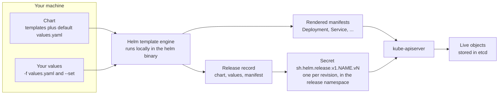

# T3.19 Use Helm to Deploy Existing Packages

> Competency: "Use the Helm package manager to deploy existing packages" (CKAD-2.3) | Domain/weight: CKAD, Application Deployment (20%) | Est. time: 2.5 h | Prerequisites: T2.07

Shell setup (from [conventions](../00-conventions.md); put it at the top of every session):

```bash
alias k=kubectl
export do="--dry-run=client -o yaml"
export now="--force --grace-period=0"
source <(kubectl completion bash); complete -o default -F __start_kubectl k
```

Lab environment for this lesson: **kind** (cluster `lab`, context `kind-lab`). Namespaces: `web` (worked example) and `lab-t319` (labs and drills). Files go in `~/lab/t319/`. Helm is installed with `env/kind-addons.sh helm` (pin: **Helm v4.3.1**). For the Helm 3 comparison notes you also want a Helm 3 binary (this lesson used v3.19.2). The lab chart is `podinfo` from `https://stefanprodan.github.io/podinfo` (a small Go web app). Your kind nodes must be able to pull images from `ghcr.io`.

You should already know how `kubectl apply` and `kubectl diff` treat a desired state, see [T2.07](../part2-basics/T2.07-declarative-object-management-apply-diff-patch.md). Helm is another way to produce that desired state.

> Output policy. Output blocks carry one of two labels (no cluster was available when this lesson was written, see section 11):
> - `REAL OUTPUT (Helm v4.3.1 client, no cluster)` and `REAL OUTPUT (Helm v3.19.2 client, no cluster)`: captured on 2026-10-28 with Helm commands that do not need a cluster (repo, search, show, pull, template, `--dry-run=client`, and the errors you get without a cluster).
> - `EXPECTED OUTPUT (not captured)`: the shape you should see on a live v1.37 cluster. Timestamps, hash suffixes and exact descriptions can differ. Every such block is listed in section 11.
>
> Chart versions change. On 2026-10-28 the newest `podinfo` chart was **6.17.0** (app 6.17.0). Your output will show the newest version when you run it. The labs pin versions so they stay repeatable.

---

## 1. Why this matters

Most third-party software for Kubernetes (ingress controllers, databases, monitoring) is shipped as a **Helm chart**. A chart is a bundle of templated manifests. You rarely write one. You install it, change a few values, upgrade it, and roll it back when the upgrade breaks something. If you do not know the difference between `helm upgrade` with and without `--reuse-values`, you silently lose settings in production. If you forget `-n`, you install into `default` and then cannot find your release. The competency says "deploy existing packages", so the skill is to find the chart, find the value you must change, install, and prove it worked, fast. `helm.sh/docs` is an allowed exam reference ([E13](https://docs.linuxfoundation.org/tc-docs/certification/certification-resources-allowed)), and with about 6 minutes per task on average (15-20 tasks in 2 hours: [E2](https://docs.linuxfoundation.org/tc-docs/certification/tips-cka-and-ckad), [E3](https://docs.linuxfoundation.org/tc-docs/certification/faq-cka-ckad-cks)) you cannot afford to rediscover the flags.

Two exam-environment facts to keep in mind. The Helm version on the exam hosts is **UNVERIFIED** (research summary row E23: no official page states it). The tools list for the exam hosts ([E9](https://docs.linuxfoundation.org/tc-docs/certification/tips-cka-and-ckad)) names kubectl, `yq`, `curl`, `wget` and `man` and does not name `helm`, so whether a `helm` binary is on the host you work from is also **UNVERIFIED**. The competency asks you to use it, so run `helm version` first on a new host. This lesson teaches commands that behave the same in Helm 3 and Helm 4, and flags the differences.

---

## 2. Concepts

### 2.1 What Helm is, and the problem it solves

Say you want to run Redis, Prometheus or an ingress controller. Each one is 5 to 30 Kubernetes objects (Deployments, Services, ConfigMaps, ServiceAccounts, Roles). You could download the YAML and edit it by hand. The pain starts when you need two copies with different settings, or a new version, or an undo.

**Helm** is a command-line tool (a *package manager* for Kubernetes) that solves this. It has five words you must know:

| Term | What it is | Where it lives |
|---|---|---|
| **Chart** | A package: a folder (or a `.tgz`) holding `Chart.yaml` (name, version), `values.yaml` (default settings) and `templates/` (manifests with `{{ ... }}` placeholders). | A repository, an OCI registry, or a local folder. |
| **Repository** | A web server that hosts an `index.yaml` listing charts and versions, plus the chart files. | URL such as `https://stefanprodan.github.io/podinfo`. You give it a local nickname. |
| **Values** | The settings you can change, such as `replicaCount` or `image.tag`. The chart's `values.yaml` has the defaults. You override them. | `values.yaml` inside the chart, your `-f` file, your `--set` flags. |
| **Release** | One installed copy of a chart in a cluster, with a name you choose. You can install the same chart many times under different names. | Recorded as Secrets in the release namespace (section 2.12). |
| **Revision** | A numbered snapshot of a release. Revision 1 is the install. Each upgrade or rollback adds one more. | Same Secrets, one Secret per revision. |

Do not mix up two version numbers. The **chart version** (`version:` in `Chart.yaml`, for example `6.17.0`) is the version of the package. The **app version** (`appVersion:`, also `6.17.0` for this chart but often different) is the version of the software inside. You select a chart with `--version`. The image tag is a separate value.

**What breaks without Helm?** Nothing breaks; you just do the bookkeeping yourself. Helm adds three things `kubectl apply` does not: templating (one chart, many settings), a release name that groups all the objects, and a history you can roll back.

### 2.2 Helm 4 and Helm 3: what changed for the commands in this lesson

Helm 4 is the current major version (the helm.sh docs overview page is titled "Helm 4 Overview" and the docs show version 4.3.1: https://helm.sh/docs/overview/). The version on the exam is **UNVERIFIED**, so you may meet either. Charts written for Helm 3 (`apiVersion: v2`) work unchanged in Helm 4. The day-to-day commands (`repo`, `search`, `show`, `install`, `upgrade`, `list`, `status`, `get`, `history`, `rollback`, `uninstall`, `template`) are the same. These are the differences that touch the commands used here:

**Differences you will use** (atomic rollback, dry-run, wait):

| Topic | Helm 3 (checked with v3.19.2) | Helm 4 (checked with v4.3.1) | What to do |
|---|---|---|---|
| Roll back automatically on a failed upgrade | `--atomic` | `--rollback-on-failure`. `--atomic` still works but prints `Flag --atomic has been deprecated, use --rollback-on-failure instead` (seen). | Use `--rollback-on-failure` on Helm 4. On Helm 3 use `--atomic`. |
| `--dry-run` | Value `client` (default when you give the bare flag) or `server`. | Value `none` (default), `client` or `server`. A bare `--dry-run` prints `--dry-run is deprecated and should be replaced with '--dry-run=client'` (seen). | Always write `--dry-run=client` or `--dry-run=server`. Works in both. |
| `--dry-run=client` with no reachable cluster | With no cluster (`KUBECONFIG=/dev/null`) `helm install ... --dry-run=client` failed with `Kubernetes cluster unreachable` (seen). | Rendered and printed the release (seen). | Use `helm template` when you need output with no cluster. It works in both. |
| `--wait` | A switch: wait until Pods, PVCs, Services and the Deployments' minimum Pods are ready. | Takes an optional strategy: `watcher` (bare `--wait`; uses kstatus), `hookOnly` (the default when the flag is omitted), `legacy`. | `--wait --timeout 120s` works in both. |

**Awareness only** (not needed for the labs):

| Topic | Helm 3 (checked with v3.19.2) | Helm 4 (checked with v4.3.1) |
|---|---|---|
| Force replacement of changed objects | `--force` | `--force-replace`. `--force` prints `Flag --force has been deprecated, use --force-replace instead` (seen). |
| How Helm applies objects | Client-side three-way merge patch. | Server-side apply by default for a **new** release. An upgrade or rollback follows the method the release used before. Releases made by Helm 3 stay on client-side apply. Flags: `--server-side`, `--force-conflicts`. |
| Post-renderer | Any executable. | Must be a plugin name. |
| Install by digest | Not supported. | `helm install myapp oci://registry/charts/app@sha256:...` (section 2.11). |
| Release storage | Secrets of type `helm.sh/release.v1` (default). | Same (section 2.12). |
| `helm list` default filter | The help text says it lists only deployed or failed releases; `-a/--all` shows every status. | The v4.3.1 help text read for this lesson describes any status by default and no `--all` flag. Not run: check `helm list --help` on your version. |

For `helm list`, the flags `--uninstalled`, `--failed` and `--deployed` narrow the list in both versions.

Also new in Helm 4: Wasm plugins, multi-document values files and a v3 chart format that is experimental. None of them is needed to deploy an existing chart. Source for the list of changes: https://helm.sh/docs/overview/.

**Tip.** Everything in this lesson works with the flag spellings that are valid in **both** versions, except where the table says otherwise.

### 2.3 Under the hood: where Helm runs and what it does

Helm has **no server component** (Helm 2 had one called Tiller; it is gone). Everything happens in the `helm` binary on your machine, using your kubeconfig, the same way `kubectl` does. That has consequences:

1. **It uses your current context and namespace.** Helm reads `~/.kube/config` (or `$KUBECONFIG`). If you are on the wrong context, you install into the wrong cluster. Helm's own `-n/--namespace` flag selects the release namespace. The environment variable `HELM_NAMESPACE` sets the default; `helm env` prints it (seen: `HELM_NAMESPACE="default"`).
2. **It renders locally.** Helm merges the chart's `values.yaml` with your overrides, then runs the chart's templates (Go templates) to produce plain YAML manifests. No cluster is needed for this step. `helm template` stops here.
3. **It sends the objects to the API server** as ordinary create/patch requests. The API server, scheduler and kubelet then behave exactly as if you had run `kubectl apply`. Helm adds the label `app.kubernetes.io/managed-by: Helm` to objects (seen in the rendered output below) and the annotations `meta.helm.sh/release-name` and `meta.helm.sh/release-namespace` (these two are added when applying; they are not in the `helm template` output).
4. **It saves a release record**: one Secret per revision that contains the chart, the values you used and the rendered manifest (section 2.12). `helm list`, `helm status`, `helm get` and `helm rollback` read these Secrets.

That is why a release is "owned" by Helm: Helm remembers what it applied. If you then change an object by hand with `kubectl edit`, Helm does not notice until the next upgrade, which may overwrite your edit (or, on Helm 4 with server-side apply, may report a conflict).

### 2.4 Repositories: add, update, list, remove, search

A repository is just `index.yaml` plus chart archives on a web server. Helm keeps a **local copy of each index**. Searching and installing use that local copy, not the network. This is the root of the `chart not found` failure (section 6).

| Command | What it does |
|---|---|
| `helm repo add NAME URL` | Saves the nickname and URL in your local `repositories.yaml` and downloads the index. `--force-update` overwrites an existing nickname. |
| `helm repo update` | Re-downloads the index of every repo you added. Run it before searching or installing so you see new chart versions. |
| `helm repo list` | Shows your nicknames and URLs. With none added, Helm 3.19.2 prints `Error: no repositories to show` (seen; Helm 4 not checked). |
| `helm repo remove NAME` | Deletes the nickname (and its cached index). Installed releases are not touched. |
| `helm search repo KEYWORD` | Searches the **local** indexes of repos you added. Shows only the newest version of each chart. |
| `helm search repo KEYWORD --versions` (`-l`) | One line per chart version. |
| `helm search repo KEYWORD --version '^6.0.0'` | Filters by a version constraint. |
| `helm search hub KEYWORD` | Searches Artifact Hub (a public catalog on the internet). It lists charts and their URLs. It does **not** add a repo. |

REAL OUTPUT (Helm v4.3.1 client, no cluster):

```text
$ helm repo add podinfo https://stefanprodan.github.io/podinfo
"podinfo" has been added to your repositories
$ helm repo update
Hang tight while we grab the latest from your chart repositories...
...Successfully got an update from the "podinfo" chart repository
Update Complete. ⎈Happy Helming!⎈
$ helm repo list
NAME   	URL
podinfo	https://stefanprodan.github.io/podinfo
$ helm search repo podinfo
NAME           	CHART VERSION	APP VERSION	DESCRIPTION
podinfo/podinfo	6.17.0       	6.17.0     	Podinfo Helm chart for Kubernetes
$ helm search repo podinfo --versions | head -4
NAME           	CHART VERSION	APP VERSION	DESCRIPTION
podinfo/podinfo	6.17.0       	6.17.0     	Podinfo Helm chart for Kubernetes
podinfo/podinfo	6.16.0       	6.16.0     	Podinfo Helm chart for Kubernetes
podinfo/podinfo	6.15.0       	6.15.0     	Podinfo Helm chart for Kubernetes
```

Reading it: the chart name is always `REPO/CHART`, so `podinfo/podinfo` means "chart `podinfo` in the repo I nicknamed `podinfo`". The nickname is local to your machine. If a task says "add the repo as `bitnami`", the nickname you type is the first half of every chart reference afterwards.

Two more search and repo variants, each with what to look for:

- `helm search repo podinfo --version '^6.0.0'` keeps only chart versions that match the constraint (`^6.0.0` means 6.x.x). Look for: the first line below is the newest 6.x. A constraint with no match prints `No results found`. An exact version such as `--version 5.2.1` lists just that one.
- `helm repo remove podinfo` deletes the nickname. Look for the confirmation line, and that `helm repo list` no longer shows it. Releases already installed from it keep running.

REAL OUTPUT (Helm v3.19.2 client, no cluster):

```text
$ helm search repo podinfo --version '^6.0.0'
NAME           	CHART VERSION	APP VERSION	DESCRIPTION
podinfo/podinfo	6.17.0       	6.17.0     	Podinfo Helm chart for Kubernetes
$ helm repo remove podinfo
"podinfo" has been removed from your repositories
```

Add the repo again (`helm repo add ...`) before you continue.

`helm search hub` (Artifact Hub, needs internet, output trimmed to the first rows; the URL column is cut by default, `--max-col-width 80` shows it):

REAL OUTPUT (Helm v4.3.1 client, no cluster):

```text
$ helm search hub podinfo --max-col-width 80
URL                                                 	CHART VERSION	APP VERSION	DESCRIPTION
https://artifacthub.io/packages/helm/podinfo/podinfo	6.17.0       	6.17.0     	Podinfo Helm chart for Kubernetes
https://artifacthub.io/packages/helm/flagger/podinfo	6.1.4        	6.1.3      	Flagger canary deployment demo application
```

A search with no match prints `No results found` and exits 0. Add `--fail-on-no-result` to make it exit 1 (seen: `Error: no results found`), which is useful in scripts.

### 2.5 Look inside a chart before you install it: `show` and `pull`

Never install blind. The values file is the chart's "menu of switches". Read it first.

| Command | Prints |
|---|---|
| `helm show chart REPO/CHART` | The `Chart.yaml` (name, version, appVersion, kubeVersion constraint). |
| `helm show values REPO/CHART` | The default `values.yaml`, with the author's comments. This is the one you use most. |
| `helm show readme REPO/CHART` | The chart's README (install notes, a table of values). |
| `helm show crds REPO/CHART` | CustomResourceDefinitions shipped in the chart's `crds/` folder. |
| `helm show all REPO/CHART` | Chart, values, README and CRDs together. |
| `helm pull REPO/CHART --untar` | Downloads the chart `.tgz` and unpacks it into a folder in the current directory. `--version V` picks a version, `--untardir DIR` picks where it unpacks, `-d DIR` picks where the `.tgz` goes. |

All of `show` accept `--version`. Without it you get the newest version.

REAL OUTPUT (Helm v4.3.1 client, no cluster):

```text
$ helm show chart podinfo/podinfo
apiVersion: v1
appVersion: 6.17.0
description: Podinfo Helm chart for Kubernetes
home: https://github.com/stefanprodan/podinfo
kubeVersion: '>=1.23.0-0'
maintainers:
- email: stefanprodan@users.noreply.github.com
  name: stefanprodan
name: podinfo
sources:
- https://github.com/stefanprodan/podinfo
version: 6.17.0
$ helm pull podinfo/podinfo --version 6.16.0 --untar --untardir pulled
$ ls pulled/podinfo
Chart.yaml  LICENSE  README.md  templates  values-prod.yaml  values.yaml
```

Two more `show` commands, with what to look for:

- `helm show readme podinfo/podinfo | head -5` prints the chart's README. Look for the install notes and the table of values at the top and below.
- `helm show crds podinfo/podinfo` prints nothing and exits 0 when the chart has no `crds/` folder (seen for podinfo). Charts that ship CRDs print them here, and you can check them before installing.

REAL OUTPUT (Helm v3.19.2 client, no cluster):

```text
$ helm show readme podinfo/podinfo | head -5
# Podinfo

Podinfo is a tiny web application made with Go
that showcases best practices of running microservices in Kubernetes.
```

`kubeVersion: '>=1.23.0-0'` is the range of Kubernetes versions the chart supports. Helm refuses to install if your cluster is outside it.

**Finding the values that matter.** A real chart's `values.yaml` can be 300 lines. You need only the few keys the task names. Use this routine:

1. `helm show values REPO/CHART | less` (or `> values.yaml` and open it in an editor). In `less`, `/` searches, `n` jumps to the next match, `q` quits.
2. Search for the key. Typical names: `replicaCount` (Pod count), `image.repository` and `image.tag` (what runs), `service.type` and `service.port` (how it is exposed), `resources`, `ingress.enabled`, `persistence.enabled`.
3. Note the **nesting**. In YAML `image:` then `  tag: 6.17.0` is the key `image.tag` for `--set`.
4. Confirm the effect without touching the cluster: `helm template ... | grep -n replicas` (section 2.10).

REAL OUTPUT (Helm v4.3.1 client, no cluster), the lines of the podinfo defaults that this lesson uses, in file order (`helm show values podinfo/podinfo`, trimmed):

```yaml
replicaCount: 1
image:
  repository: ghcr.io/stefanprodan/podinfo
  tag: 6.17.0
  pullPolicy: IfNotPresent
ui:
  color: "#34577c"
  message: ""
service:
  enabled: true
  type: ClusterIP
  httpPort: 9898
  externalPort: 9898
  nodePort: 31198
```

So: `replicaCount=2` sets 2 Pods, `image.tag=6.16.0` picks the image, `service.type=NodePort` exposes the Service on a node port (default `31198` from the chart).

**A typo in a key is silent.** Helm does not check that a `--set` key exists. Running `helm template web podinfo/podinfo --set replicas=5` (the real key is `replicaCount`) still renders `replicas: 1` in the Deployment (seen). When a value "does not work", first check the exact key name in `helm show values`.

### 2.6 Install: `helm install RELEASE CHART`

Syntax: `helm install RELEASE_NAME CHART [flags]`. `RELEASE_NAME` is yours. `CHART` is `REPO/CHART`, a path, a `.tgz`, or an `oci://` URL.

| Flag | What it does | Default | Risky or invalid use |
|---|---|---|---|
| `-n, --namespace NS` | Namespace of the release and its objects. | Current context namespace (usually `default`). | Forgetting it installs into `default`. |
| `--create-namespace` | Creates the namespace if it is missing. | Off. | Without it, a missing namespace gives an error. |
| `--set key=value` | Override one value. Repeat the flag or separate with commas. Dots mean nesting (`image.tag=6.16.0`). | none | `--set` turns `true`, `false`, `null` and whole numbers into booleans, null and numbers. Use `--set-string` to force text. A comma in a value needs a backslash (`a=b\,c`). |
| `-f, --values FILE` | Override values from a YAML file. Repeat to layer files; later files win. | none | The file is **Helm values**, not Kubernetes YAML. |
| `--version V` | Chart version or constraint (`6.16.0`, `^6.0.0`). | newest stable | Giving a version that is not in the local index fails (section 6). |
| `--wait` | Block until the release is ready, up to `--timeout`; on timeout the release is marked `failed` (details below this table). | Helm 3: off. Helm 4: waits only for hooks (`hookOnly`). | Without `--wait`, `helm install` returns while Pods are still starting, even if they will never start. |
| `--timeout D` | How long Helm waits for each operation. | `5m0s` | `--wait --timeout 30s` fails quickly in a broken lab. |
| `--dry-run=client\|server` | `client`: render only (Helm 4: no cluster needed). `server`: also send the objects to the API server for validation without saving. Nothing is installed. | off | Bare `--dry-run` is deprecated in Helm 4. |
| `-g, --generate-name` | Let Helm name the release (`CHARTNAME-<number>`). Omit the name argument. | off | Hard to remember the name later. |
| `-o, --output table\|json\|yaml` | Format of the install result. | `table` | none |
| `--set-string`, `--set-file`, `--set-json` | Text-only value; value from a file; JSON value. | none | Awareness only. |

**How values combine (precedence, lowest to highest):** the chart's own `values.yaml`, then each `-f` file in the order given, then `--set` flags. In a test, `-f a.yaml` (`replicaCount: 3`) together with `--set replicaCount=5` rendered `replicas: 5` (seen). Use `-f` for many values, `--set` for one or two.

**Release name and object names.** Many charts name their objects `RELEASE-CHART`. With release `web` and chart `podinfo` the rendered objects are named `web-podinfo` (seen below). If the release name already contains the chart name, the chart often does not repeat it. This is a chart convention, not a Helm rule. Always run `k get all -n NS` to see the real names.

REAL OUTPUT (Helm v4.3.1 client, no cluster), `helm install web podinfo/podinfo -n web --create-namespace --set replicaCount=2 --dry-run=client` (the HOOKS and MANIFEST bodies are cut):

```text
NAME: web
LAST DEPLOYED: Wed Oct 28 11:04:30 2026
NAMESPACE: web
STATUS: pending-install
REVISION: 1
DESCRIPTION: Dry run complete
HOOKS:
---
# Source: podinfo/templates/tests/grpc.yaml
...
MANIFEST:
---
...
NOTES:
1. Get the application URL by running these commands:
  echo "Visit http://127.0.0.1:8080 to use your application"
  kubectl -n web port-forward deploy/web-podinfo 8080:9898
```

A real install prints the same header with `STATUS: deployed` and `DESCRIPTION: Install complete`. The `NOTES:` text comes from the chart's `templates/NOTES.txt`. Read it: it often tells you how to reach the app. The chart's three `tests/` Pods are *hooks* that run only when you run `helm test`; they are not created by `install`.

**Generated names.** `helm install podinfo/podinfo -g --dry-run=client` produced the name `podinfo-1793156519` (seen).

**Under the hood of `--wait`.** Without it Helm succeeds as soon as the API server accepted the objects. A Deployment with an image that does not exist is "accepted". The release is `deployed`, the Pods are `ImagePullBackOff`. This is exactly the break-fix lab. `--wait` makes Helm watch readiness and mark the release `failed` on timeout.

### 2.7 Inspect releases: `list`, `status`, `get`

| Command | What it shows |
|---|---|
| `helm list` | Releases in the **current namespace** only. |
| `helm list -A` | Releases in all namespaces (`--all-namespaces`). |
| `helm list -n NS` | Releases in one namespace. |
| `helm list --uninstalled` / `--failed` / `--pending` | Filter by state. Add `-q` for names only. `-f REGEX` filters by name. (Helm 3 hides uninstalled and superseded releases unless you add `-a`; for Helm 4 check `helm list --help`, see section 2.2.) |
| `helm status RELEASE -n NS` | Current state, revision, the chart's NOTES. `--revision N` for an older revision. |
| `helm get values RELEASE -n NS` | **Only the values you supplied** (your `--set` and `-f`), as YAML. Add `-o yaml\|json`, `--revision N`. |
| `helm get values RELEASE -n NS -a` | All values after merging (`--all`): chart defaults plus yours. |
| `helm get manifest RELEASE -n NS` | The rendered manifests Helm applied for that revision. |
| `helm get hooks`, `helm get notes`, `helm get metadata` | Hook manifests, NOTES text, release metadata. |
| `helm get all RELEASE -n NS` | Values, manifest, hooks, notes and metadata together. |

`helm get values` is the command that answers "what did we install this with?". It prints `null` if you supplied no values.

The `STATUS` column uses these words: `deployed` (the current good revision), `superseded` (an older revision), `failed`, `pending-install` / `pending-upgrade` / `pending-rollback` (an operation is running or was interrupted), `uninstalling`, and `uninstalled` (only visible when you kept history).

### 2.8 Upgrade, history, rollback

`helm upgrade RELEASE CHART [flags]` computes a new set of manifests and applies the difference as **revision N+1**. It takes the same `--set`, `-f`, `--version`, `--wait`, `--timeout` and `--dry-run` flags as install. Two upgrade-only flags matter:

- `-i, --install`: if the release does not exist, install it. This makes one command that works the first and the tenth time. It is the safe form for scripts and the fix for `cannot re-use a name that is still in use`.
- `--create-namespace` works together with `--install`.

**The big trap: which values does an upgrade use?** As soon as you give `--set` or `-f` in an upgrade, Helm does **not** remember your earlier `--set` flags. It starts from the new chart's defaults and applies only the values you give in this command. In the worked example, `helm upgrade web ... --set service.type=NodePort` brings `replicaCount` back to its default `1`.

There is one exception, and it surprises people who only bump the version. If the upgrade supplies **no values at all** (no `--set`, no `-f`) and the previous release had user-supplied values, Helm copies the previous release's values. So `helm upgrade web podinfo/podinfo --version 6.16.0` keeps your old values, while `--reset-values` drops them. The rule to remember: with no value flags, old values are kept; with any value flag, everything else resets.

| Flag | New values are built from | Use when | Risk |
|---|---|---|---|
| *(none)*, with `--set` or `-f` | chart defaults + this command's `-f` / `--set` | You pass the complete set every time (best with one `-f values.yaml`). | Anything you forget reverts to the default. |
| *(none)*, with no value flags | the previous release's user-supplied values (copied) | You only change the chart version or re-run an upgrade. | You may think values were reset when they were not. Check `helm get values`. |
| `--reuse-values` | the **previous release's merged values** + this command's `-f` / `--set` | You want to change one thing and keep everything else. | The previous release's merged values include the old chart's defaults, so when you move to a **newer chart version** new defaults in that chart are ignored. This is one reason many teams keep a values file instead. |
| `--reset-values` | chart defaults + this command's overrides. With no value flags it drops all earlier overrides. | You want to be sure you start clean. | Loses earlier overrides. |
| `--reset-then-reuse-values` | the **new chart defaults**, then the previous release's user-supplied values, then this command's overrides | Upgrading the chart version and keeping your own earlier overrides. | Both Helm 3.19.2 and Helm 4.3.1 list this flag in `helm upgrade --help`. |

Each row is demonstrated in section 5, step 5b: a bare upgrade, `--reset-values`, and `--reset-then-reuse-values`. The observation is always `helm get values RELEASE -n NS` after the upgrade.

The best practice for real work, and the easiest for the exam: **keep your settings in a values file** and always pass `-f values.yaml`. Then every upgrade is complete and repeatable. If the task says "change only X, keep the rest", use `--reuse-values`.

`helm history RELEASE -n NS` lists the revisions: revision number, time, status, chart, app version and a description (`Install complete`, `Upgrade complete`, `Rollback to 1`). By default Helm keeps the last **10** revisions (`--history-max`, default 10; the environment variable is `HELM_MAX_HISTORY`, seen as `10`). Older Secrets are deleted, so you cannot roll back past them.

`helm rollback RELEASE [REVISION] -n NS` redeploys an older revision. Two facts matter:

1. A rollback does **not** rewind history. It creates a **new** revision whose content equals the old one. After revisions 1, 2, 3, `helm rollback web 1` produces revision 4.
2. With no revision number (or `0`), it rolls back to the previous revision.

`helm get values RELEASE --revision N` and `helm get manifest RELEASE --revision N` show what an old revision contained. Use them to pick the revision to return to.

### 2.9 Uninstall

`helm uninstall RELEASE -n NS` deletes the objects of the release and its release Secrets. The history is gone, so you cannot roll back. With `--keep-history` Helm deletes the objects but keeps the Secrets, marks the release `uninstalled`, and the history stays visible with `helm list --uninstalled -n NS` and `helm history`. Why would you want that? For an audit trail, or to later roll back "into" the removed state. Side effects: the release name stays reserved, so installing a release with the same name fails with `cannot re-use a name that is still in use` until you uninstall again without `--keep-history` (which purges the stored history) or install with `--replace`. Uninstall does not delete the namespace or PersistentVolumeClaims that the chart's StatefulSets created (the PVCs are not owned by the release).

### 2.10 `helm template`: render the manifests locally

`helm template RELEASE CHART [flags]` runs the template engine and prints the manifests to standard output. It takes the same `--set`, `-f`, `--version`, `-n` flags as install. It does **not** need a cluster and it saves nothing. Uses:

- Check what a value does before installing (`| grep -n replicas`).
- Keep a copy of the YAML: `helm template ... > all.yaml`, then `k apply -f all.yaml`. (That makes a normal kubectl-managed set of objects, not a Helm release.)
- `-s templates/deployment.yaml` (`--show-only`) prints only one template. A wrong path gives `Error: could not find template templates/nothere.yaml in chart` (seen).
- `--output-dir DIR` writes one file per template.

REAL OUTPUT (Helm v4.3.1 client, no cluster), `helm template web podinfo/podinfo -n web -s templates/service.yaml --set service.type=NodePort`. This is a complete Service manifest. It would apply with `kubectl apply -f` (the namespace must exist):

```yaml
---
# Source: podinfo/templates/service.yaml
apiVersion: v1
kind: Service
metadata:
  name: web-podinfo
  namespace: web
  labels:
    helm.sh/chart: podinfo-6.17.0
    app.kubernetes.io/name: web-podinfo
    app.kubernetes.io/version: "6.17.0"
    app.kubernetes.io/managed-by: Helm
spec:
  type: NodePort
  ports:
    - port: 9898
      targetPort: http
      protocol: TCP
      name: http
      nodePort: 31198
    - port: 9999
      targetPort: grpc
      protocol: TCP
      name: grpc
  selector:
    app.kubernetes.io/name: web-podinfo
```

The default render lists these objects (seen with `grep -E "^# Source|^kind:"`): `service.yaml` (Service), `deployment.yaml` (Deployment), and three test Pods under `tests/` (hooks).

**`template` versus `install --dry-run`.**

| Command | Needs cluster? | What it adds |
|---|---|---|
| `helm template` | No | Plain rendering. |
| `helm install --dry-run=client` | Helm 4: no (seen). Helm 3.19.2: it failed with `Kubernetes cluster unreachable` in the no-cluster test. | Also shows the release header (NAME, REVISION), hooks and NOTES. |
| `helm install --dry-run=server` | Yes | The API server validates the objects (admission, schema, quota), but nothing is saved. Catches errors `template` cannot, such as a namespace quota or a missing CRD. |

### 2.11 OCI registries (awareness)

Charts can also be stored in container registries (OCI). There is no `helm repo add`. You use an `oci://` URL directly, with the chart name in it and the version in `--version`:

```bash
helm show chart oci://ghcr.io/stefanprodan/charts/podinfo --version 6.16.0
helm install web oci://ghcr.io/stefanprodan/charts/podinfo --version 6.16.0 -n web --create-namespace
helm pull oci://ghcr.io/stefanprodan/charts/podinfo --version 6.16.0 --untar
```

REAL OUTPUT (Helm v4.3.1 client, no cluster), first command, trimmed:

```text
Pulled: ghcr.io/stefanprodan/charts/podinfo:6.16.0
Digest: sha256:0b04bf01034a91328a7906dd9dcdcbe426d030b6d097e69d774f235e9391f678
apiVersion: v1
appVersion: 6.16.0
description: Podinfo Helm chart for Kubernetes
...
```

`helm search repo` does not search OCI registries (there is no index). Private registries need `helm registry login DOMAIN` (in Helm 4 you pass the domain only, not a full URL). Helm 4 can also install by digest: `oci://...@sha256:...`. See https://helm.sh/docs/topics/registries/.

### 2.12 Where release state lives: Secrets of type `helm.sh/release.v1`

Helm stores one Secret **per revision**, in the **release's namespace**. Their names look like `sh.helm.release.v1.<release>.v<revision>`, their type is `helm.sh/release.v1`, and they carry labels such as `owner=helm`, `name=<release>`, `status=<deployed|superseded|...>` and `version=<revision>`. The Secret's `release` key holds the whole record: gzip-compressed JSON of the chart, values, manifest and metadata, base64-encoded by Helm. Because Kubernetes base64-encodes Secret data once more, decoding takes two `base64 -d` steps.

The listing below is what you see after step 5 of the worked example in section 5, before step 5b. Names and ages differ, and the namespace is the release namespace.

EXPECTED OUTPUT (not captured):

```text
$ k get secret -n web -l owner=helm
NAME                           TYPE                 DATA   AGE
sh.helm.release.v1.web.v1      helm.sh/release.v1   1      6m
sh.helm.release.v1.web.v2      helm.sh/release.v1   1      5m
sh.helm.release.v1.web.v3      helm.sh/release.v1   1      4m
sh.helm.release.v1.web.v4      helm.sh/release.v1   1      2m
$ k get secret sh.helm.release.v1.web.v1 -n web -o jsonpath='{.data.release}' | base64 -d | base64 -d | gzip -d | head -c 120
{"name":"web","info":{"first_deployed":"2026-10-28T...
```

Consequences you can use:

- A release exists only where its Secrets exist. `k delete ns web` removes the Secrets too, so the release vanishes from `helm list -A` (the objects went with the namespace anyway).
- If someone deletes the Secrets by hand, Helm forgets the release but the Deployments keep running. A new `helm install` then fails with `... exists and cannot be imported into the current release: invalid ownership metadata` because the objects carry the old Helm annotations (message text from Helm's behaviour, **not captured**).
- Secrets are readable by anyone who can `get secrets` in that namespace. Passwords you passed with `--set` end up in the release record.
- Helm can store records elsewhere with `HELM_DRIVER=configmap|memory|sql`. The default is `secret`. When a task seems to hide a release, look in its namespace for `sh.helm.release.v1.*` Secrets.

### 2.13 Related but different

- **`kubectl apply -f` vs Helm.** `apply` records one object's last-applied state. Helm records a whole *release* (many objects, with values and history). Objects created by Helm and then edited by hand drift from the release.
- **Kustomize** (a separate tool, built into `kubectl -k`) patches plain YAML and has no release or rollback concept. Helm templates; Kustomize overlays.
- **`helm test RELEASE`** runs the chart's test hook Pods (`templates/tests/` in podinfo). It is not part of the competency text, but it appears in `helm get hooks`.
- **A stuck release.** If an install or upgrade is interrupted the release can be left in `pending-install` or `pending-upgrade`, and the next command can fail with `another operation (install/upgrade/rollback) is in progress`. Check `helm history` and use `helm rollback` to the last good revision, or `helm uninstall` and start again. (Message text **not captured**.)

---

## 3. How it works (diagram)



How to read it:

1. You give Helm a **chart** and **values**. The chart's `values.yaml` supplies defaults; your `-f` file and `--set` flags override them.
2. The template engine, inside the `helm` binary on your machine, merges them and renders plain manifests. `helm template` stops here.
3. Helm sends the manifests to the API server. From there on it is normal Kubernetes: Deployment controller, ReplicaSet, scheduler, kubelet.
4. Helm also writes a release record into a Secret named `sh.helm.release.v1.NAME.vN`. Each upgrade or rollback writes a new Secret with the next number. Older ones stay (up to 10 by default), which is what `helm history` reads and what `helm rollback` replays.
5. `helm list`, `status`, `get` read the Secrets only. They do not look at the live objects, so they can say `deployed` while Pods are failing.

---

## 4. Commands and YAML you must produce fast

**Imperative commands** (the whole competency is command-line; there is no `k create` equivalent):

```bash
# Find and inspect
helm repo add podinfo https://stefanprodan.github.io/podinfo    # nickname + URL
helm repo update                                                # refresh the local indexes
helm search repo podinfo --versions                             # every chart version
helm show values podinfo/podinfo | less                         # the default settings (q quits)
helm show values podinfo/podinfo > ~/lab/t319/values.yaml       # start a values file from the defaults

# Install (--set form, three values)
helm install web podinfo/podinfo -n web --create-namespace \
  --set replicaCount=2 --set image.tag=6.16.0 --set service.type=NodePort
# Install (same, from a values file)
helm install web podinfo/podinfo -n web --create-namespace -f ~/lab/t319/web-values.yaml
# Install, other useful flags
helm install web podinfo/podinfo -n web --version 6.16.0 --wait --timeout 120s
helm install podinfo/podinfo -n web -g --dry-run=client         # generated name, nothing installed

# Look at it
helm list -A                                                    # all namespaces
helm status web -n web                                          # state + NOTES
helm get values web -n web -o yaml                              # what I supplied
helm get values web -n web -a                                   # supplied + defaults
helm get manifest web -n web                                    # what was applied

# Change it
helm upgrade web podinfo/podinfo -n web --set service.type=NodePort          # resets other values!
helm upgrade web podinfo/podinfo -n web --reuse-values --set replicaCount=3  # keeps earlier values
helm upgrade --install web podinfo/podinfo -n web -f ~/lab/t319/web-values.yaml  # install or upgrade
helm history web -n web                                         # revisions
helm rollback web 1 -n web                                      # back to revision 1 (as a new revision)

# Remove it
helm uninstall web -n web                                       # objects and history gone
helm uninstall web -n web --keep-history                        # keep the Secrets

# Render only
helm template web podinfo/podinfo -n web -f ~/lab/t319/web-values.yaml
```

**Declarative form: a values file.** Helm's declarative input is a values file, not a Kubernetes object. It is **not** applied with `kubectl apply`; you pass it with `-f`. This file does the same as the three `--set` flags above:

```yaml
# ~/lab/t319/web-values.yaml  (a Helm values file; keys come from `helm show values`)
replicaCount: 2        # number of Pods in the chart's Deployment (chart default: 1). 0 scales to zero; a negative number is rejected by the API server
image:                 # a map: the dotted names image.repository / image.tag
  tag: 6.16.0          # image tag to run (chart default: 6.17.0, set in the chart's values.yaml). A tag that does not exist gives ImagePullBackOff
service:
  type: NodePort       # ClusterIP (chart default) | NodePort | LoadBalancer; LoadBalancer stays <pending> on kind without MetalLB
  nodePort: 31198      # only used when type is NodePort; chart default 31198; must be inside 30000-32767 and unused by another Service
```

To see what Helm recorded, use `helm get values web -n web -o yaml`. Helm prints the keys sorted alphabetically, so the order differs from your file:

EXPECTED OUTPUT (not captured):

```text
$ helm get values web -n web -o yaml
image:
  tag: 6.16.0
replicaCount: 2
service:
  type: NodePort
```

The `nodePort` line appears only if you set it. The chart default 31198 is not in "user-supplied values".

**Speed drill** (about 6 min per exam task; the targets below are for a warm start). Setup once: `mkdir -p ~/lab/t319 && k create ns lab-t319`. Every drill uses namespace `lab-t319`. Answers are collapsed. Run the cleanup at the end.

| # | Task | Target |
|---|---|---|
| 1 | Add the repo `podinfo` (`https://stefanprodan.github.io/podinfo`), refresh it, and list all chart versions of `podinfo/podinfo`. | 1 min |
| 2 | Install release `d1` of `podinfo/podinfo` in `lab-t319` with 2 replicas and image tag `6.16.0`, using `--set`. | 1.5 min |
| 3 | Install release `d2` in `lab-t319` from a values file `~/lab/t319/d2.yaml` that sets `replicaCount: 1`, `service.type: NodePort` and `service.nodePort: 31202`. | 2.5 min |
| 4 | Save the user-supplied values of `d1` as YAML in `~/lab/t319/d1-values.yaml`. | 1 min |
| 5 | Upgrade `d1` so its Service is NodePort `31201` **without losing** its 2 replicas and image tag. | 2 min |
| 6 | Roll `d1` back to revision 1 and confirm the Service type is ClusterIP again. | 1.5 min |
| 7 | Without touching the cluster, render only the Deployment of chart `podinfo/podinfo` for a release named `d3` with 3 replicas into `~/lab/t319/deploy.yaml`. | 2 min |
| 8 | A release named `ghost` exists in some namespace. Find the namespace and print its status. (Setup: `helm install ghost podinfo/podinfo -n lab-t319-ghost --create-namespace --version 6.16.0`) | 1.5 min |

<details><summary>Answers</summary>

```bash
# 1
helm repo add podinfo https://stefanprodan.github.io/podinfo && helm repo update
helm search repo podinfo --versions

# 2
helm install d1 podinfo/podinfo -n lab-t319 --set replicaCount=2 --set image.tag=6.16.0

# 3
cat > ~/lab/t319/d2.yaml <<'EOF'
replicaCount: 1
service:
  type: NodePort
  nodePort: 31202
EOF
helm install d2 podinfo/podinfo -n lab-t319 -f ~/lab/t319/d2.yaml

# 4
helm get values d1 -n lab-t319 -o yaml > ~/lab/t319/d1-values.yaml

# 5  (--reuse-values keeps replicaCount and image.tag; plain upgrade would reset them)
helm upgrade d1 podinfo/podinfo -n lab-t319 --reuse-values --set service.type=NodePort --set service.nodePort=31201

# 6
helm rollback d1 1 -n lab-t319
k get svc d1-podinfo -n lab-t319 -o jsonpath='{.spec.type}{"\n"}'     # ClusterIP

# 7
helm template d3 podinfo/podinfo -n lab-t319 --set replicaCount=3 -s templates/deployment.yaml > ~/lab/t319/deploy.yaml

# 8
helm list -A | grep ghost                  # shows NAMESPACE = lab-t319-ghost
helm status ghost -n lab-t319-ghost
```

</details>

Drill cleanup (returns the cluster to baseline):

```bash
helm uninstall d1 d2 -n lab-t319
helm uninstall ghost -n lab-t319-ghost
k delete ns lab-t319 lab-t319-ghost
rm -rf ~/lab/t319
```

---

## 5. Worked example

Goal: install `podinfo` as release `web` in namespace `web`, upgrade it, see the lost-values trap, fix it, roll back, and remove it. You run every command; the notes say what to look at. All cluster output below is **EXPECTED OUTPUT (not captured)**. Release `web` uses the default NodePort `31198`, so do not run this at the same time as anything else that uses it.

**Step 1. Prepare and install (revision 1).**

```bash
k get nodes                                    # cluster is up: 3 nodes Ready
helm version --short                           # v4.3.1 expected (the exam's version is UNVERIFIED)
helm repo add podinfo https://stefanprodan.github.io/podinfo
helm repo update
helm search repo podinfo --versions | head -3
helm install web podinfo/podinfo -n web --create-namespace --set replicaCount=2
k -n web rollout status deploy/web-podinfo     # wait until both Pods are ready
```

What each command does: `--create-namespace` makes namespace `web` (without it, a missing namespace is an error). `--set replicaCount=2` overrides the default of 1. The install returns quickly, because without `--wait` Helm does not wait for readiness; `rollout status` is what waits.

EXPECTED OUTPUT (not captured):

```text
NAME: web
LAST DEPLOYED: Wed Oct 28 11:20:00 2026
NAMESPACE: web
STATUS: deployed
REVISION: 1
DESCRIPTION: Install complete
NOTES:
1. Get the application URL by running these commands:
  echo "Visit http://127.0.0.1:8080 to use your application"
  kubectl -n web port-forward deploy/web-podinfo 8080:9898
$ k -n web rollout status deploy/web-podinfo
deployment "web-podinfo" successfully rolled out
```

**Step 2. Inspect what Helm made.**

```bash
k get deploy,po,svc -n web
helm list -A
helm status web -n web
helm get values web -n web
helm get values web -n web -a | head -15
helm get manifest web -n web | grep -E "^kind:|replicas:"
```

Look for: two Pods named `web-podinfo-<hash>-<hash>`, a Service `web-podinfo` of type ClusterIP, one row in `helm list -A` with `REVISION 1` and `STATUS deployed`. `helm get values` shows only `replicaCount: 2`. With `-a` you also see all the chart defaults.

EXPECTED OUTPUT (not captured):

```text
$ k get deploy,po,svc -n web
NAME                          READY   UP-TO-DATE   AVAILABLE   AGE
deployment.apps/web-podinfo   2/2     2            2           40s

NAME                              READY   STATUS    RESTARTS   AGE
pod/web-podinfo-6c7d9b5d8-4kqzm   1/1     Running   0          40s
pod/web-podinfo-6c7d9b5d8-xv2lp   1/1     Running   0          40s

NAME                  TYPE        CLUSTER-IP     EXTERNAL-IP   PORT(S)             AGE
service/web-podinfo   ClusterIP   10.96.120.45   <none>        9898/TCP,9999/TCP   40s
$ helm list -A
NAME	NAMESPACE	REVISION	UPDATED                                	STATUS  	CHART         	APP VERSION
web 	web      	1       	2026-10-28 11:20:00.12345 -0800 PST    	deployed	podinfo-6.17.0	6.17.0
$ helm get values web -n web
USER-SUPPLIED VALUES:
replicaCount: 2
```

**Step 3. Upgrade the way the entry shows, and see the trap (revision 2).**

```bash
helm upgrade web podinfo/podinfo --set service.type=NodePort -n web
k get deploy,svc -n web
helm get values web -n web
```

Look for: Deployment `1/1` and Service `NodePort`. The replicas fell back from 2 to 1 because this upgrade supplied a value flag (`--set service.type`): with any value flag, Helm builds the values from the chart defaults plus the flags in that command only, and earlier `--set` flags are not reused. `helm get values` now lists only `service.type`.

EXPECTED OUTPUT (not captured):

```text
Release "web" has been upgraded. Happy Helming!
NAME: web
LAST DEPLOYED: Wed Oct 28 11:22:00 2026
NAMESPACE: web
STATUS: deployed
REVISION: 2
...
$ k get deploy,svc -n web
NAME                          READY   UP-TO-DATE   AVAILABLE   AGE
deployment.apps/web-podinfo   1/1     1            1           2m

NAME                  TYPE       CLUSTER-IP     EXTERNAL-IP   PORT(S)                         AGE
service/web-podinfo   NodePort   10.96.120.45   <none>        9898:31198/TCP,9999:31020/TCP   2m
$ helm get values web -n web
USER-SUPPLIED VALUES:
service:
  type: NodePort
```

(The second NodePort, for the gRPC port, is chosen by Kubernetes, so its number differs.)

**Step 4. Fix it with `--reuse-values` (revision 3), then look at history.**

```bash
helm upgrade web podinfo/podinfo -n web --reuse-values --set replicaCount=2
helm get values web -n web -o yaml
helm history web -n web
```

`--reuse-values` takes the previous revision's values (`service.type: NodePort`) and adds `replicaCount=2`.

EXPECTED OUTPUT (not captured):

```text
$ helm get values web -n web -o yaml
replicaCount: 2
service:
  type: NodePort
$ helm history web -n web
REVISION	UPDATED                 	STATUS    	CHART         	APP VERSION	DESCRIPTION
1       	Wed Oct 28 11:20:00 2026	superseded	podinfo-6.17.0	6.17.0     	Install complete
2       	Wed Oct 28 11:22:00 2026	superseded	podinfo-6.17.0	6.17.0     	Upgrade complete
3       	Wed Oct 28 11:24:00 2026	deployed  	podinfo-6.17.0	6.17.0     	Upgrade complete
```

**Step 5. Roll back to revision 1 (this creates revision 4).**

```bash
helm get values web -n web --revision 1      # confirm revision 1 is the one you want
helm rollback web 1 -n web
helm history web -n web
k get deploy,svc -n web
k get secret -n web -l owner=helm
```

Look for: the message `Rollback was a success! Happy Helming!`, a **fourth** history row with description `Rollback to 1`, Deployment `2/2` and Service back to ClusterIP, because revision 1 had `replicaCount=2` and no NodePort.

EXPECTED OUTPUT (not captured):

```text
Rollback was a success! Happy Helming!
$ helm history web -n web
REVISION	UPDATED                 	STATUS    	CHART         	APP VERSION	DESCRIPTION
1       	Wed Oct 28 11:20:00 2026	superseded	podinfo-6.17.0	6.17.0     	Install complete
2       	Wed Oct 28 11:22:00 2026	superseded	podinfo-6.17.0	6.17.0     	Upgrade complete
3       	Wed Oct 28 11:24:00 2026	superseded	podinfo-6.17.0	6.17.0     	Upgrade complete
4       	Wed Oct 28 11:26:00 2026	deployed  	podinfo-6.17.0	6.17.0     	Rollback to 1
$ k get deploy,svc -n web
NAME                          READY   UP-TO-DATE   AVAILABLE   AGE
deployment.apps/web-podinfo   2/2     2            2           6m

NAME                  TYPE        CLUSTER-IP     EXTERNAL-IP   PORT(S)             AGE
service/web-podinfo   ClusterIP   10.96.120.45   <none>        9898/TCP,9999/TCP   6m
```

**Step 5b. The other upgrade flags (revisions 5, 6 and 7).** Revision 4 is current and its user-supplied values are `replicaCount: 2` (copied from revision 1). Now try the three variants from the table in section 2.8, and look at `helm get values` and the Deployment after each one.

```bash
helm upgrade web podinfo/podinfo -n web                                    # revision 5: no value flags at all
helm get values web -n web
helm upgrade web podinfo/podinfo -n web --version 6.16.0 --reset-then-reuse-values --set service.type=NodePort   # revision 6
helm get values web -n web
k get deploy,svc -n web
helm upgrade web podinfo/podinfo -n web --reset-values                     # revision 7: bare, drops every override
helm get values web -n web
k get deploy -n web
```

What to look for: after revision 5 the values are still `replicaCount: 2`, because with no value flags Helm copies the previous values. Revision 6 changes the chart to `podinfo-6.16.0` (new chart defaults) but keeps `replicaCount: 2` and adds `service.type: NodePort`. Revision 7 prints `null` for user-supplied values, the Deployment goes back to `1/1`, and the chart is the newest again (`--reset-values` without `--version` selects the newest chart).

EXPECTED OUTPUT (not captured):

```text
$ helm get values web -n web          # after revision 5
USER-SUPPLIED VALUES:
replicaCount: 2
$ helm get values web -n web          # after revision 6
USER-SUPPLIED VALUES:
replicaCount: 2
service:
  type: NodePort
$ k get deploy,svc -n web             # after revision 6
NAME                          READY   UP-TO-DATE   AVAILABLE   AGE
deployment.apps/web-podinfo   2/2     2            2           9m

NAME                  TYPE       CLUSTER-IP     EXTERNAL-IP   PORT(S)                         AGE
service/web-podinfo   NodePort   10.96.120.45   <none>        9898:31198/TCP,9999:31044/TCP   9m
$ helm get values web -n web          # after revision 7
USER-SUPPLIED VALUES:
null
$ k get deploy -n web                 # after revision 7
NAME          READY   UP-TO-DATE   AVAILABLE   AGE
web-podinfo   1/1     1            1           10m
```

**Step 6. Render, validate, and look at the stored record.**

```bash
helm template web podinfo/podinfo -n web --set replicaCount=3 | grep -n "replicas:"     # no cluster needed
helm install web-check podinfo/podinfo -n web --dry-run=server | head -8                  # API server validates, nothing is saved
k get secret sh.helm.release.v1.web.v1 -n web -o jsonpath='{.data.release}' | base64 -d | base64 -d | gzip -d | head -c 120; echo
```

The first command prints `replicas: 3` and needs no cluster. The second proves the objects would be accepted by the live API server; the release `web-check` does not exist afterwards.

**Step 7. Uninstall, keeping the history, and see the name stay reserved.**

```bash
helm uninstall web -n web --keep-history
helm list -n web --uninstalled
helm history web -n web
helm install web podinfo/podinfo -n web            # fails: the name is still reserved
helm uninstall web -n web                          # second uninstall purges the kept history
helm list -A
```

EXPECTED OUTPUT (not captured):

```text
release "web" uninstalled
$ helm list -n web --uninstalled
NAME	NAMESPACE	REVISION	UPDATED                                	STATUS     	CHART         	APP VERSION
web 	web      	7       	2026-10-28 11:36:00.12345 -0800 PST    	uninstalled	podinfo-6.17.0	6.17.0
$ helm install web podinfo/podinfo -n web
Error: INSTALLATION FAILED: cannot re-use a name that is still in use
```

**Step 8. Clean up.**

```bash
helm list -A                       # nothing named web should be left
k delete ns web
rm -f ~/lab/t319/values.yaml
```

---

## 6. Common mistakes and how to fix them

| Symptom | What you will see (exact text) | Cause | Fix (command) |
|---|---|---|---|
| Install refused because the name exists | `Error: INSTALLATION FAILED: cannot re-use a name that is still in use` (**not captured**) | A release (even a `failed` one, or one uninstalled with `--keep-history`) already uses that name in the namespace. | `helm upgrade --install NAME CHART -n NS ...`, or `helm uninstall NAME -n NS` and install again. |
| Upgrade lost earlier `--set` values | No error. `k get deploy` shows replicas back at 1; `helm get values` lists only the newest flags. | An upgrade that has any `--set` or `-f` rebuilds values from chart defaults plus only the flags in that command. (An upgrade with no value flags at all keeps the previous values, section 2.8.) | `helm upgrade NAME CHART -n NS --reuse-values --set ...`, or keep a values file and pass `-f` every time. To recover: `helm rollback NAME N -n NS`. |
| Release in the wrong namespace | `helm list` shows nothing for your namespace; `k get pods -n web` says `No resources found in web namespace.` The objects are in `default`. | `-n` was not given, so Helm used the context namespace. | `helm list -A` to find it, `helm uninstall NAME -n default`, reinstall with `-n web --create-namespace`. |
| Chart not found | From `helm install`: `Error: INSTALLATION FAILED: repo podinfo not found` (repo never added) or `Error: INSTALLATION FAILED: chart "nothere" matching  not found in podinfo index. (try 'helm repo update'): no chart name found`. From `helm show chart podinfo/podinfo --version 99.0.0`: `Error: chart "podinfo" matching 99.0.0 not found in podinfo index. (try 'helm repo update'): no chart version found for podinfo-99.0.0` | Nickname not added, wrong chart name, or the local index is stale or does not contain that version. | `helm repo list`, `helm repo add ...`, `helm repo update`, then `helm search repo NAME --versions`. |

The three `chart not found` texts above are real: **REAL OUTPUT (Helm v4.3.1 client, no cluster)**; the last one was produced by `helm show chart`, which does not add a prefix. `helm install` adds the prefix `INSTALLATION FAILED:` and `helm upgrade` adds `UPGRADE FAILED:` (the upgrade prefix was not captured). The other texts are marked as not captured.

### 6.1 `cannot re-use a name that is still in use`

1. Run `helm list -n NS --failed` and `helm list -n NS --uninstalled` (on Helm 3, `helm list -n NS -a` shows every status at once; on Helm 4 check `helm list --help`). Look for the name. Check `STATUS`: `failed` means an earlier install broke; `uninstalled` means someone used `--keep-history`.
2. `helm history NAME -n NS` shows how many revisions exist and their descriptions.
3. Decide: if you want to keep what is there, `helm upgrade NAME CHART -n NS ...`. If it is broken and you want a clean slate, `helm uninstall NAME -n NS` (without `--keep-history`) and install again.
4. If the name was used in a **different** namespace, there is no conflict: Helm names are unique per namespace, so installing `web` in `web` while another `web` exists in `default` works and you end up with two releases. That is how the wrong-namespace mistake below leaves a duplicate behind.

The one-command habit that avoids all of this: `helm upgrade --install NAME CHART -n NS --create-namespace -f values.yaml`.

### 6.2 Upgrade lost the earlier values

1. Symptom first: something reverted (replicas, image tag, a feature flag).
2. `helm get values NAME -n NS` shows what the **current** revision was given. If it lists only your last flag, an upgrade with value flags ran.
3. `helm get values NAME -n NS --revision 1` shows what revision 1 had. Compare.
4. Fix forward: `helm upgrade NAME CHART -n NS --reuse-values --set LOST=VALUE`, or write the full set into `values.yaml`. Or go back: `helm rollback NAME 1 -n NS`.

Why it happens: Helm treats each upgrade as "render this chart with these values". When you pass any `--set` or `-f`, it does not merge with the last set unless you ask. This is by design, so that an upgrade is repeatable from a values file alone. The one exception is an upgrade with no value flags at all, which keeps the previous values (section 2.8). So an upgrade that only bumps `--version` does not lose settings, and `--reset-values` is what clears them.

### 6.3 Wrong namespace

1. `helm list` (no `-A`) shows only the namespace in your context. Run `helm list -A`; find the `NAMESPACE` column of your release.
2. Confirm with `k get all -n default`.
3. Remove it where it is: `helm uninstall NAME -n default` (use the namespace from step 1).
4. Reinstall: `helm install NAME CHART -n web --create-namespace ...`.
5. Prevention: set `export HELM_NAMESPACE=web` for the session, or switch the context namespace once: `k config set-context --current --namespace=web`. Then `-n` is optional. Always check the `NAMESPACE:` line in the install output.

### 6.4 Chart not found

Three different causes give three different messages. Read the text:

1. `repo podinfo not found`: the nickname before the `/` is not in `helm repo list`. Run `helm repo add`.
2. `chart "nothere" matching  not found in podinfo index. (try 'helm repo update')`: the repo exists, but no chart has that name. Check with `helm search repo podinfo` or `helm search repo KEYWORD`. A spelling slip is the usual reason. The odd double space after `matching` is in Helm's message because no version was given.
3. `chart "podinfo" matching 99.0.0 not found ... no chart version found for podinfo-99.0.0` (with `helm install` the line starts with `INSTALLATION FAILED:`): the chart exists, that version does not. List versions with `helm search repo podinfo --versions`.

If the chart and version should exist (the task says they were just published), the local index is old. Run `helm repo update` and search again.

---

## 7. Labs

Environment for all three: **kind** cluster `lab` (context `kind-lab`), Helm v4.3.1 (a Helm 3 client also works for every command below; the one Helm 4 spelling to swap is `--rollback-on-failure` for `--atomic`, and it is not used). Internet access from the nodes to `ghcr.io` is required. Namespace `lab-t319`; files in `~/lab/t319/`.

Order: Easy, then Medium, then Break-fix. Each lab ends with a cleanup that returns the cluster to baseline, so any order works. Common setup (run once per session):

```bash
mkdir -p ~/lab/t319
helm repo add podinfo https://stefanprodan.github.io/podinfo
helm repo update
```

### 7.1 Easy: install with custom values and verify the objects

**Setup.** Run the common setup above. Nothing else exists yet.

**Task.** In namespace `lab-t319` (create it with Helm), install the chart `podinfo/podinfo` at chart version `6.16.0` as release `shop`. Use a values file `~/lab/t319/shop-values.yaml` that runs **2 replicas**, image tag **6.15.0**, and a **NodePort** Service on node port `31203`. Wait until the Deployment is ready. Then save the values Helm recorded for the release, as YAML, in `~/lab/t319/shop-recorded.yaml`.

<details><summary>Hints</summary>

1. Start from `helm show values podinfo/podinfo --version 6.16.0 | less` and find the key names: `replicaCount`, `image.tag`, `service.type`, `service.nodePort`.
2. The values file only needs the keys you change. Pass it with `-f`. Add `--create-namespace`.
3. Resource names are `RELEASE-CHART`. Use `k get all -n lab-t319` if unsure. The recorded values come from `helm get values ... -o yaml`.

</details>

<details><summary>Solution</summary>

```bash
cat > ~/lab/t319/shop-values.yaml <<'EOF'
replicaCount: 2
image:
  tag: 6.15.0
service:
  type: NodePort
  nodePort: 31203
EOF
helm install shop podinfo/podinfo -n lab-t319 --create-namespace --version 6.16.0 -f ~/lab/t319/shop-values.yaml
k -n lab-t319 rollout status deploy/shop-podinfo --timeout=120s
helm get values shop -n lab-t319 -o yaml > ~/lab/t319/shop-recorded.yaml
```

Why each step: the values file overrides only what the task asks, and everything else stays at the chart's defaults. `--version 6.16.0` pins the chart so the lab repeats. `image.tag` is separate from the chart version, so the Pods run 6.15.0 even though the chart is 6.16.0. `--create-namespace` is needed because the namespace does not exist. `rollout status` waits, because plain `helm install` returns before the Pods are ready. `helm get values -o yaml` records exactly what you supplied.

</details>

**Verification** (each line prints `ok` or the shell shows a failing exit code):

```bash
helm list -n lab-t319 -q | grep -qx shop && echo ok-release
test "$(k get deploy shop-podinfo -n lab-t319 -o jsonpath='{.spec.replicas}')" = 2 && echo ok-replicas
test "$(k get deploy shop-podinfo -n lab-t319 -o jsonpath='{.spec.template.spec.containers[0].image}')" = ghcr.io/stefanprodan/podinfo:6.15.0 && echo ok-image
test "$(k get svc shop-podinfo -n lab-t319 -o jsonpath='{.spec.type}/{.spec.ports[0].nodePort}')" = NodePort/31203 && echo ok-service
test "$(k get deploy shop-podinfo -n lab-t319 -o jsonpath='{.status.readyReplicas}')" = 2 && echo ok-ready
test "$(helm list -n lab-t319 -o json | grep -o '"chart":"[^"]*"')" = '"chart":"podinfo-6.16.0"' && echo ok-chart
grep -qx 'replicaCount: 2' ~/lab/t319/shop-recorded.yaml && grep -q 'nodePort: 31203' ~/lab/t319/shop-recorded.yaml && echo ok-recorded
```

Seven `ok-` lines mean success. If the chart check fails, you probably omitted `--version`. (Helm output is JSON on one line, so `grep -o` is used instead of `jq`, which may not exist on exam hosts.)

**Cleanup.**

```bash
helm uninstall shop -n lab-t319
k delete ns lab-t319
rm -f ~/lab/t319/shop-values.yaml ~/lab/t319/shop-recorded.yaml
```

### 7.2 Medium: upgrade, inspect history, roll back

**Setup.** Run the common setup. Then create the namespace:

```bash
k create ns lab-t319
```

**Task.** In namespace `lab-t319`, perform these steps on a release named `api` (chart `podinfo/podinfo`, chart version `6.16.0` in every step):

1. Install `api` with `replicaCount=1` and `ui.message=first`.
2. Upgrade it to `replicaCount=3`, keeping the message.
3. Upgrade it again to `ui.message=second`, keeping the 3 replicas.
4. The team decides the second upgrade was wrong. Roll back to the revision that had 3 replicas **and** the message `first`. Find that revision from the history, do not guess.
5. Save the history table in `~/lab/t319/api-history.txt`.

<details><summary>Hints</summary>

1. An upgrade with `--set` or `-f` forgets earlier `--set` flags. Use `--reuse-values`, or put all values in a file.
2. `helm get values api -n lab-t319 --revision N` shows what each revision was given.
3. A rollback adds a **new** revision at the end of the history; the target revision is the old number.

</details>

<details><summary>Solution</summary>

```bash
helm install api podinfo/podinfo -n lab-t319 --version 6.16.0 --set replicaCount=1 --set ui.message=first        # revision 1
helm upgrade api podinfo/podinfo -n lab-t319 --version 6.16.0 --reuse-values --set replicaCount=3                  # revision 2
helm upgrade api podinfo/podinfo -n lab-t319 --version 6.16.0 --reuse-values --set ui.message=second               # revision 3
helm history api -n lab-t319
helm get values api -n lab-t319 --revision 2        # replicaCount: 3 and message: first  -> target is revision 2
helm rollback api 2 -n lab-t319                       # creates revision 4
k -n lab-t319 rollout status deploy/api-podinfo --timeout=120s
helm history api -n lab-t319 > ~/lab/t319/api-history.txt
```

Why: `--reuse-values` is what keeps the earlier settings between steps. Using the same `--version` in every step avoids the stale-defaults problem of `--reuse-values` when the chart version changes. The history shows four revisions after the rollback; `helm get values --revision` proves revision 2 has the wanted settings. The rollback target is the **old** revision number (2), and the new revision is number 4 with description `Rollback to 2`.

</details>

**Verification:**

```bash
test "$(helm history api -n lab-t319 | awk 'END{print NR-1}')" = 4 && echo ok-four-revisions
test "$(helm list -n lab-t319 -f '^api$' | awk 'NR==2{print $3}')" = 4 && echo ok-revision-4
test "$(k get deploy api-podinfo -n lab-t319 -o jsonpath='{.spec.replicas}')" = 3 && echo ok-replicas
helm get values api -n lab-t319 -o yaml | grep -qx '  message: first' && echo ok-message
grep -q 'Rollback to 2' ~/lab/t319/api-history.txt && echo ok-file
```

Five `ok-` lines mean success. A rollback to the wrong revision fails `ok-replicas` or `ok-message`.

**Cleanup.**

```bash
helm uninstall api -n lab-t319
k delete ns lab-t319
rm -f ~/lab/t319/api-history.txt
```

### 7.3 Break-fix: a release that is `deployed` but not working

**Setup.** Run the common setup, then inject the fault with `break.sh`:

```bash
cat > ~/lab/t319/break.sh <<'EOF'
#!/usr/bin/env bash
set -e
helm install catalog podinfo/podinfo -n lab-t319 --create-namespace --version 6.16.0 \
  --set replicaCount=2 --set ui.message=hello --set image.tag=6.160
EOF
bash ~/lab/t319/break.sh
```

**Task.** Release `catalog` in namespace `lab-t319` is reported by Helm as installed, but the application never becomes ready. Find the cause and repair the release with **one** `helm upgrade` so that the release is at revision 2, runs 2 ready replicas of image `ghcr.io/stefanprodan/podinfo:6.16.0`, and still has `ui.message=hello`. Do not uninstall the release and do not change the Deployment with `kubectl`.

<details><summary>Hints</summary>

1. `helm list -n lab-t319` says what Helm thinks. `k get pods -n lab-t319` says what the cluster thinks. Compare them, then `k describe pod` for the events.
2. `helm get values catalog -n lab-t319` prints what was supplied. Look for a value that is almost right.
3. A rollback to revision 1 does not help here, because revision 1 is the broken one. Fix forward with an upgrade, and keep the other values.

</details>

<details><summary>Solution</summary>

Diagnose in this order:

```bash
helm list -n lab-t319                          # STATUS deployed: Helm only knows the API server accepted the objects
k get pods -n lab-t319                         # STATUS ErrImagePull / ImagePullBackOff
k describe pod -n lab-t319 -l app.kubernetes.io/name=catalog-podinfo | tail -8   # Events: failed to pull ... ghcr.io/stefanprodan/podinfo:6.160 ... not found
helm get values catalog -n lab-t319            # image.tag: "6.160" is the wrong value
```

Fix with one upgrade that keeps the other values:

```bash
helm upgrade catalog podinfo/podinfo -n lab-t319 --version 6.16.0 --reuse-values --set image.tag=6.16.0
k -n lab-t319 rollout status deploy/catalog-podinfo --timeout=120s
```

Why: `helm list` can say `deployed` because the release record is written when the API server accepts the objects; it does not watch the Pods (no `--wait` was used). The Pod events name the image that could not be pulled, and `helm get values` tells you which value produced that image. `--reuse-values` keeps `replicaCount=2` and `ui.message=hello`, and `--version 6.16.0` keeps the chart the same so the old defaults are still correct. Without `--reuse-values`, the upgrade would reset the replicas to 1 and drop the message, and the verification would fail.

</details>

**Verification:**

```bash
test "$(helm list -n lab-t319 -f '^catalog$' | awk 'NR==2{print $3}')" = 2 && echo ok-revision-2
test "$(k get deploy catalog-podinfo -n lab-t319 -o jsonpath='{.spec.template.spec.containers[0].image}')" = ghcr.io/stefanprodan/podinfo:6.16.0 && echo ok-image
test "$(k get deploy catalog-podinfo -n lab-t319 -o jsonpath='{.status.readyReplicas}')" = 2 && echo ok-ready
helm get values catalog -n lab-t319 -o yaml | grep -qx '  message: hello' && echo ok-message
```

Four `ok-` lines mean success. Before the fix, `ok-image` and `ok-ready` fail.

**Cleanup.**

```bash
helm uninstall catalog -n lab-t319
k delete ns lab-t319
rm -f ~/lab/t319/break.sh
```

---

## 8. Exam tips

- **Docs to open:** https://helm.sh/docs/ (allowed: [E13](https://docs.linuxfoundation.org/tc-docs/certification/certification-resources-allowed)) for command syntax (`helm.sh/docs/helm/helm_install/`, `.../helm_upgrade/`, `.../helm_rollback/` show every flag), and https://kubernetes.io/docs/concepts/cluster-administration/manage-deployment/ for the general object-management background. Use `helm COMMAND --help` too: it is faster than a browser and it is always the version you have.
- **Check `helm version` first** on a new host. The exam's Helm version is UNVERIFIED, and a `helm` binary on every host is also UNVERIFIED (the tool list in E9 does not name it). If the version is 3, use `--atomic` instead of `--rollback-on-failure` and write `--dry-run=client`.
- **Always pass `-n`** and read the `NAMESPACE:` line of the output. When a task names a namespace that does not exist, add `--create-namespace`. Before moving on, `helm list -n NS` and `k get all -n NS` must show your release.
- **Read the task's value names literally.** Run `helm show values REPO/CHART > v.yaml` and search it; do not guess key names (a wrong key is silently ignored). Then prove the effect with `helm get values RELEASE -n NS` and a `k get` with `-o jsonpath`.
- **Upgrading: say what stays.** If the task says "change only X", use `--reuse-values`. If it gives a full set of values, use `-f`. Never run a bare `helm upgrade --set X` on a release that has other custom values.
- **A `deployed` release is not proof.** Without `--wait` Helm does not check Pods. After install or upgrade, run `k -n NS rollout status deploy/NAME` or `k get pods -n NS`.

---

## 9. Quick review

1. Which command adds the repo `podinfo` and which command makes sure you see its newest chart versions? <details><summary>Answer</summary>`helm repo add podinfo https://stefanprodan.github.io/podinfo`, then `helm repo update`. The second refreshes the local copy of the repository index; search and install read that local copy.</details>
2. What is the difference between a chart, a release and a revision? <details><summary>Answer</summary>A chart is the package (templates and default values). A release is one named installation of a chart in a cluster. A revision is a numbered snapshot of a release; each install, upgrade and rollback adds one.</details>
3. How do you see the default values of a chart, and how do you see what you supplied for a release? <details><summary>Answer</summary>`helm show values REPO/CHART` for the chart defaults. `helm get values RELEASE -n NS` for your overrides (add `-a` for the merged result, `-o yaml` for YAML).</details>
4. Write the command that installs `podinfo/podinfo` as `web` in a new namespace `web` with 2 replicas. <details><summary>Answer</summary>`helm install web podinfo/podinfo -n web --create-namespace --set replicaCount=2`.</details>
5. Why did `helm upgrade web podinfo/podinfo --set service.type=NodePort -n web` bring the replicas back to 1, and how do you avoid it? <details><summary>Answer</summary>An upgrade that has `--set` or `-f` builds values from the chart defaults plus only the flags in that command, so the earlier `replicaCount=2` was dropped. Use `--reuse-values`, or pass a full values file with `-f` every time. (An upgrade with no value flags at all keeps the previous values; `--reset-values` clears them.)</details>
6. After revisions 1, 2 and 3, you run `helm rollback web 1 -n web`. Which revision is current and what is its description? <details><summary>Answer</summary>Revision 4, with description `Rollback to 1`. A rollback adds a new revision whose content equals the old one. It does not delete revisions 2 and 3.</details>
7. Where does Helm keep the state of a release, and what is the Secret type? <details><summary>Answer</summary>In Secrets in the release namespace named `sh.helm.release.v1.<release>.v<revision>` with type `helm.sh/release.v1`, one per revision. By default only the last 10 revisions are kept.</details>
8. How do you see the manifests a chart would produce without installing and without a cluster? <details><summary>Answer</summary>`helm template RELEASE CHART -n NS --set ...` (add `-s templates/deployment.yaml` for one file). `helm install --dry-run=server` also validates against a live API server.</details>
9. `helm list` shows nothing but you just installed a release. What do you check? <details><summary>Answer</summary>The namespace: `helm list` only shows the current namespace. Run `helm list -A`. If the release is in the wrong namespace, uninstall it there and reinstall with `-n`.</details>
10. Why can a release be `deployed` while its Pods are in `ImagePullBackOff`, and what command change makes Helm report this? <details><summary>Answer</summary>Without `--wait`, Helm marks the release deployed as soon as the API server accepts the objects. Add `--wait --timeout 120s` so the install or upgrade is marked `failed` if the Pods do not become ready in time.</details>
11. What is the difference between `helm uninstall web` and `helm uninstall web --keep-history`? <details><summary>Answer</summary>The first deletes the objects and all release Secrets (no rollback, the name is free). The second deletes the objects but keeps the Secrets: status `uninstalled`, visible with `helm list --uninstalled`, name still reserved.</details>
12. Two Helm 4 changes that affect commands you used in this lesson? <details><summary>Answer</summary>`--atomic` is renamed `--rollback-on-failure` (the old name still works with a warning); `--dry-run` takes `client` or `server` (a bare `--dry-run` is deprecated). Also `--wait` takes a strategy and Helm 4 uses server-side apply for new releases.</details>

---

## 10. References

- https://helm.sh/docs/ (allowed in the exam)
- https://helm.sh/docs/overview/ (Helm 4 overview and changes from Helm 3)
- https://helm.sh/docs/intro/using_helm/ and https://helm.sh/docs/intro/cheatsheet/
- https://helm.sh/docs/helm/helm_install/, https://helm.sh/docs/helm/helm_upgrade/, https://helm.sh/docs/helm/helm_rollback/, https://helm.sh/docs/helm/helm_template/, https://helm.sh/docs/helm/helm_get_values/, https://helm.sh/docs/helm/helm_search_repo/, https://helm.sh/docs/helm/helm_repo_add/
- https://helm.sh/docs/topics/registries/ (OCI registries)
- https://kubernetes.io/docs/concepts/cluster-administration/manage-deployment/
- Exam facts: https://docs.linuxfoundation.org/tc-docs/certification/tips-cka-and-ckad (E2, E9, E23), https://docs.linuxfoundation.org/tc-docs/certification/faq-cka-ckad-cks (E3), https://docs.linuxfoundation.org/tc-docs/certification/certification-resources-allowed (E13)
- Coverage references used for topic coverage only (no text copied): https://github.com/bmuschko/ckad-study-guide, https://github.com/dgkanatsios/CKAD-exercises, https://github.com/bmuschko/ckad-crash-course
- Lab chart: https://github.com/stefanprodan/podinfo (repo URL `https://stefanprodan.github.io/podinfo`)
- Prerequisite: [T2.07](../part2-basics/T2.07-declarative-object-management-apply-diff-patch.md)

---

## 11. To verify

**Known limitation.** The "real helm history and rollback output" criterion of the entry is **not met**. No kind cluster could be created while writing this lesson: the machine-wide kind lock (`/tmp/kind-lab.lock`, conventions section 11) was held by another run for the whole 20-minute wait. Everything that needs a cluster is labelled `EXPECTED OUTPUT (not captured)`: installs, upgrades, `helm list`, `helm status`, `helm get`, `helm history`, `helm rollback`, `helm uninstall`, `--dry-run=server`, the release Secrets, and all kubectl output in sections 2.12, 4, 5 (including step 5b), 6 and 7. To meet the criterion, run section 5 on a 3-node kind cluster (v0.33.0, `kindest/node:v1.37.0`) with Helm v4.3.1 and replace the blocks. What was captured (REAL, Helm client only, 2026-10-28): the repo and search commands (including `--version '^6.0.0'` and `repo remove`, Helm 3.19.2), `show chart/values/readme/crds`, `pull --untar`, `template` (including `-s`), `install --dry-run=client` (Helm 4), the three `chart not found` messages, the `--atomic`, `--force` and bare `--dry-run` deprecation messages, the Helm 3 `cluster unreachable` message for `--dry-run=client`, `search hub`, an OCI `show chart`, and the `--help` flag lists of both versions.

Items not confirmed on a live v1.37 cluster:

1. Helm version used by the exam: **UNVERIFIED** (E23). Whether a `helm` binary is on the exam host: **UNVERIFIED** (E9 lists kubectl, yq, curl, wget, man).
2. Helm 4.3.1 against a v1.37 cluster: all install, upgrade, rollback and uninstall output, and the column layout of `helm list` and `helm history`.
3. The text `Rollback was a success! Happy Helming!`, `Release "web" has been upgraded. Happy Helming!`, `release "web" uninstalled`, and the descriptions `Install complete`, `Upgrade complete`, `Rollback to N` in Helm 4.3.1.
4. The text `Error: INSTALLATION FAILED: cannot re-use a name that is still in use`, and that the same error appears for a release uninstalled with `--keep-history`; that a second `helm uninstall` purges kept history (section 2.9, step 7).
5. The upgrade values rules in section 2.8 and the step 5b demo: that an upgrade with no value flags copies the previous user-supplied values, that `--reset-values` clears them (`null`), and that `--reset-then-reuse-values` combines new chart defaults with the old user values. They come from Helm's upgrade behaviour (reviewer-reported special case) and were not run here. Also that `--reuse-values` keeps the old chart's defaults and ignores new ones when the chart version changes (section 2.8), taken from Helm's documented behaviour and the `--reset-then-reuse-values` help text; not run here. The labs avoid depending on it by keeping the chart version fixed.
6. Release Secret names, labels (`owner`, `name`, `status`, `version`) and the double base64 decode step (section 2.12); the Helm 4 default of server-side apply for new releases and the "follows the previous method" rule (taken from https://helm.sh/docs/overview/, not triggered here); the apply conflict behaviour after a manual `kubectl edit`.
7. The text `another operation (install/upgrade/rollback) is in progress` and `invalid ownership metadata` (section 2.12 and 2.13).
8. The second NodePort number (gRPC) in section 5, step 3, and the Pod names and ages.
9. Image availability: `ghcr.io/stefanprodan/podinfo:6.15.0`, `:6.16.0` and `:6.17.0` exist (checked with `docker manifest inspect`). Chart versions 6.15.0 and 6.16.0 exist in the repository index (seen). Whether the chart repository stays available and unchanged is outside this lesson's control.
10. The `helm list -o json` key `"chart"` used in the Easy lab verification, and the `helm list` default-status difference between Helm 3 and Helm 4 (taken from the two help texts, behaviour not run; the lesson tells the learner to check `helm list --help`). Also the text of `helm repo list` with no repositories on Helm 4 (seen only on Helm 3.19.2: `Error: no repositories to show`), and the `UPGRADE FAILED:` prefix.
11. The Helm 3 comparison used v3.19.2, not a v3 build from the same day as Helm 4.3.1; the `--dry-run=client` failure was seen with `KUBECONFIG=/dev/null`, so it reflects "no reachable cluster" only.

