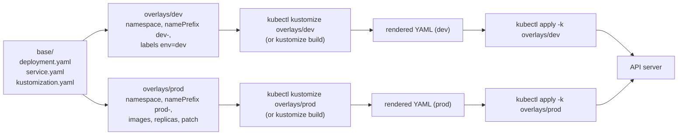

# T3.20 Kustomize

> Competency: "Kustomize" (CKAD-2.4) | Domain/weight: CKAD, Application Deployment (20%) | Est. time: 2.5 h | Prerequisites: T2.07

Shell setup (from [conventions](../00-conventions.md); put it at the top of every session):

```bash
alias k=kubectl
export do="--dry-run=client -o yaml"
export now="--force --grace-period=0"
source <(kubectl completion bash); complete -o default -F __start_kubectl k
```

Lab environment for this lesson: **kind** (cluster `lab`, context `kind-lab`). Namespace: `lab-t320`. Files go in `~/lab/t320/`. Create the namespace once (safe to repeat):

```bash
k create ns lab-t320 $do | k apply -f -
```

> Output policy. The machine-wide kind lock was held by another job for the whole 20-minute wait (section 11), so no cluster was created for this lesson. Output blocks carry one of these labels:
> - `REAL OUTPUT (kubectl v1.37.1 client, embedded kustomize v5.8.1, no cluster)`: captured on the author's machine with `kubectl kustomize`, which renders YAML locally and never contacts a cluster.
> - `REAL OUTPUT (standalone kustomize v5.8.3, no cluster)`: captured the same way with the standalone `kustomize` binary.
> - `EXPECTED OUTPUT (not captured)`: the shape you should see on a v1.37 cluster. Every such block is listed in section 11.

---

## 1. Why this matters

A real application runs in several places: dev, staging, prod. The YAML is 95% the same, but each place needs a different namespace, name, image tag, replica count or setting. Copying the files and editing each copy means every later fix must be made N times, and the copies drift apart. **Kustomize** solves this without templates: you keep one plain-YAML **base** and write small **overlays** that say "same as the base, except for these changes". It is built into `kubectl` (`kubectl kustomize`, `kubectl apply -k`), so there is nothing to install. In the exam the task is to write or fix a `kustomization.yaml` and apply it, so you need the field names and the render/apply/delete commands from memory. Each task averages about 6 minutes (15-20 tasks in 2 hours; sources: [E2](https://docs.linuxfoundation.org/tc-docs/certification/tips-cka-and-ckad), [E3](https://docs.linuxfoundation.org/tc-docs/certification/faq-cka-ckad-cks)). If you do not know the traps (patches match the original name, deprecated fields, immutable selectors), you lose that time on one error message.

You should already know how `kubectl apply` and `kubectl diff` work. If not, read [T2.07](../part2-basics/T2.07-declarative-object-management-apply-diff-patch.md) first. Section 2.9 uses ConfigMaps; [T3.03](../part3-ckad/T3.03-configmaps.md) explains how Pods consume them.

---

## 2. Concepts

### 2.1 What Kustomize is, and the problem it solves

**Kustomize** is a tool that reads a file named `kustomization.yaml` and prints ("renders") a final set of Kubernetes YAML. It never edits your source files. It only reads them, applies the changes you listed, and writes the result to standard output.

Two other ways to get dev and prod variants, and why Kustomize exists:

| Approach | Problem |
|---|---|
| Copy the YAML per environment | Copies drift. A bug fix must be repeated everywhere. |
| Templates (for example Helm) | The YAML contains `{{ ... }}` and is no longer valid Kubernetes YAML on its own. You must learn a template language. |
| Kustomize | The base is plain, valid YAML. Overlays hold only the differences. No template language. |

Key words, defined once:

| Term | Meaning |
|---|---|
| **Kustomization** | A directory that contains a `kustomization.yaml` file. Everything Kustomize does starts from one. |
| **Base** | A kustomization that is complete on its own. For example: a Deployment, a Service and their `kustomization.yaml`. |
| **Overlay** | A kustomization that lists a base under `resources:` and adds changes on top. |
| **Transformer** | A built-in step that changes every resource: add a prefix, set a namespace, add labels, change images. |
| **Generator** | A built-in step that creates a new resource (a ConfigMap or Secret) from files or literals. |
| **Patch** | A small piece of YAML (or a list of operations) that changes one existing resource. |
| **Render** | Build the final YAML and print it. |

**Versions.** `kubectl` has Kustomize built in as a library. In kubectl 1.37.1, `kubectl version --client` prints the embedded version (verified, see section 5). The standalone `kustomize` binary is a separate download and can be newer.

| Where | Version | How verified |
|---|---|---|
| Embedded in kubectl 1.37.1 (`kubectl kustomize`, `-k`) | v5.8.1 (from kubectl's `go.mod`) | `kubectl version --client` printed `Kustomize Version: v5.8.1` |
| Standalone `kustomize` (pinned in this guide) | v5.8.3 | `kustomize version` printed `v5.8.3` |

The two renderers gave identical output for the overlays in this lesson (checked with `diff`). Features that only exist in a newer standalone release may not work with `kubectl -k`, so test with `kubectl kustomize` when the task says kubectl.

### 2.2 Under the hood: what happens when you build

1. **Find and parse.** Kustomize looks in the directory for `kustomization.yaml`, `kustomization.yml` or `Kustomization` (in that order of preference). If none is found you get `unable to find one of 'kustomization.yaml', 'kustomization.yml' or 'Kustomization' in directory ...`. Unknown fields are an error: `invalid Kustomization: json: unknown field "image"`.
2. **Accumulate resources.** It reads every entry under `resources:`. A file entry is parsed as YAML. A directory entry must contain its own `kustomization.yaml`, and Kustomize builds that one first, completely, before the parent sees the result. This is how a base is "inside" an overlay.
3. **Run generators.** `configMapGenerator` and `secretGenerator` create new objects and add a content hash to their names.
4. **Run transformers.** Namespace, name prefix and suffix, labels, annotations, images, replicas and patches run over every resource. Your patches are matched against the resource names as they exist in the files you wrote, not the final names (section 2.8).
5. **Print.** The result goes to standard output as YAML, Services before Deployments (Kustomize sorts by kind), separated by `---`.

What the kubectl commands do with that result:

| Command | What it does |
|---|---|
| `k kustomize DIR` | Steps 1-5 only. Prints. Never contacts the API server (it works with no cluster). |
| `k apply -k DIR` | Steps 1-5, then sends the objects through the normal `apply` path, the same as `k apply -f` (see [T2.07](../part2-basics/T2.07-declarative-object-management-apply-diff-patch.md)). |
| `k diff -k DIR` | Steps 1-5, then shows the difference between the rendered objects and the live ones. Exit code 0 = no difference, 1 = differences, above 1 = error. |
| `k get -k DIR` | Steps 1-5, then gets the live objects with the rendered names. |
| `k delete -k DIR` | Steps 1-5, then deletes every object in the render, by kind, name and namespace. |

So `-k` is just another source of objects, like `-f`. It is not a separate "Kustomize mode" in the cluster: the cluster never knows Kustomize was involved. You cannot combine them: `k apply -k dir -f file.yaml` fails with `error: only one of -f or -k can be specified` (verified).

### 2.3 The `kustomization.yaml` file

```yaml
apiVersion: kustomize.config.k8s.io/v1beta1
kind: Kustomization
resources:
- deployment.yaml
```

`apiVersion` and `kind` are optional (Kustomize builds without them, verified), but write them: the docs do, and some tools need them. The fields this lesson covers:

| Field | What it does | Default |
|---|---|---|
| `resources` | List of files or directories to include | none (a kustomization with no resources, generators or components fails with `error: kustomization.yaml is empty`, verified) |
| `namespace` | Sets `metadata.namespace` on every namespaced resource | not set |
| `namePrefix` / `nameSuffix` | Adds text before / after the `metadata.name` of every resource | not set |
| `labels` | Adds labels (new, preferred form) | no selector changes |
| `commonLabels` | Adds labels and changes selectors (**deprecated**) | not set |
| `commonAnnotations` | Adds annotations to every resource and Pod template | not set |
| `images` | Changes image name, tag or digest | not set |
| `replicas` | Sets the replica count of named workloads | not set |
| `configMapGenerator` / `secretGenerator` | Creates ConfigMaps / Secrets | not set |
| `generatorOptions` | Settings for the generators | hash suffix on |
| `patches` | Strategic merge or JSON6902 patches, with optional target selectors | not set |
| `components` | Reusable optional pieces (awareness only) | not set |

### 2.4 `resources`: files and directories

```yaml
resources:
- deployment.yaml        # a file next to this kustomization.yaml
- service.yaml
- ../../base             # a directory: it must contain its own kustomization.yaml
```

Rules that cause real errors:

- **Paths are relative to the directory of the `kustomization.yaml` that contains them**, not to where you run the command. Overlays that live in `overlays/prod/` reach the base with `../../base`.
- A directory entry must itself be a kustomization. A directory that only holds loose YAML files is not valid as an entry. List the files instead.
- **A kustomization may only load files from its own directory or below.** An entry that points at a loose file in another directory fails with `security; file '...' is not in or below '...'` (verified). Point at the other directory (a kustomization) instead. The kubectl flag `--load-restrictor=LoadRestrictionsNone` turns this check off, but it breaks the idea that a directory can be moved by itself. Avoid it.
- A wrong path gives `accumulating resources: ... no such file or directory` (section 6).
- An entry can also be a remote URL (a Git repository). The exam has no reason to need that, and it needs network access. Not covered further.

### 2.5 `namespace`, `namePrefix` and `nameSuffix`

```yaml
namespace: lab-t320
namePrefix: prod-
nameSuffix: -v2
```

A Deployment named `web` becomes `prod-web-v2` in namespace `lab-t320`. Details that matter:

- `namespace` does **not create** the Namespace object. Create it yourself (`k create ns`) or `apply` fails with `namespaces "lab-t320" not found`.
- Kustomize also fixes **references** to renamed objects. When a generated ConfigMap is renamed (by prefix or hash), the Pod's `configMapKeyRef` and `volumes[].configMap.name` that point at it are rewritten. That is why generators and prefixes work together. (Verified: section 2.9.)
- A prefix is the usual way to run two variants side by side in one namespace, as this lesson does. Without a prefix, two overlays that render the same name and namespace would fight over one object.
- Risky value: a prefix or suffix that makes the final name longer than allowed (for example above 63 characters for a Service). The API server rejects it at apply time, not Kustomize.

### 2.6 `labels` vs `commonLabels`, and `commonAnnotations`

A **label** is a key-value tag. A **selector** (in a Service, a Deployment's `spec.selector`) picks objects by label. The danger: **`spec.selector` of a Deployment is immutable** (it cannot be changed after the Deployment is created). If a transformer adds a label to the selector of an object that already exists, the next `apply` fails.

| Field | Adds to `metadata.labels` | Adds to Pod template labels | Adds to selectors | Status |
|---|---|---|---|---|
| `commonLabels` | yes | yes | **yes, always** | **Deprecated.** `kubectl kustomize` prints a warning (verified in section 6). |
| `labels` with no flags | yes | no | no | Current |
| `labels` + `includeSelectors: true` | yes | yes | yes (Service `spec.selector`, Deployment `spec.selector.matchLabels`) | Current |
| `labels` + `includeTemplates: true` only | yes | yes | no | Current |

```yaml
labels:
- pairs:                    # the labels to add (a map)
    env: prod
  includeSelectors: false   # default false: selectors are not touched
  includeTemplates: false   # default false: Pod template labels are not touched
```

(There is also a `fields:` list to add the labels to custom paths. It is rarely needed. The table was verified by rendering each variant.)

Choose by one question: "Is this resource new, or already in the cluster with a different selector?"

- New objects, and you want the Service of one overlay to select only that overlay's Pods: `includeSelectors: true`. This lesson does it, because `dev-web` and `prod-web` live in the same namespace and must not share Pods.
- Existing objects, and you only want labels for filtering (`k get -l env=prod`): `labels` without `includeSelectors`. This is the fix for the "immutable selector" failure in section 6.

`commonAnnotations` adds annotations to every resource's `metadata` and to Pod templates. It is not deprecated in v5.8.1 (no warning, verified). An annotation is metadata that nothing selects on, so it is safe on existing objects.

### 2.7 `images` and `replicas`

`images` rewrites the `image:` field of every container and init container in every Pod template, without a patch:

```yaml
images:
- name: nginx          # which image to match: the image name as written in the base (without tag)
  newName: nginx       # optional: a different image name or registry path
  newTag: "1.27.5"     # optional: a different tag. QUOTE it.
  digest: sha256:...   # optional: pin to a digest; use instead of newTag
```

| Field | Effect | Risky value |
|---|---|---|
| `name` | Matches containers whose image name equals this (the part before `:` or `@`). | A name that matches nothing silently changes nothing. |
| `newName` | Replaces the name. Use it to move to a mirror: `registry.example.com/mirror/nginx`. | A typo gives `ImagePullBackOff`. |
| `newTag` | Replaces the tag. | Unquoted numbers: `newTag: 1.20` is read as a number and fails with `cannot unmarshal number into Go struct field ... newTag of type string` (verified). Always quote. |
| `digest` | Replaces the tag with `@sha256:...`. | A wrong digest gives `ImagePullBackOff`. Use it instead of `newTag`, not together. |

A common pattern is a **placeholder name** in the base: write `image: app` in the base Deployment and let each overlay say what `app` means. The `name` field then matches that placeholder (verified in section 4: `kustomize edit set image app=nginx:1.27` creates `name: app, newName: nginx, newTag: "1.27"`).

`replicas` sets the replica count of a named Deployment, StatefulSet, ReplicaSet or ReplicationController, without a patch:

```yaml
replicas:
- name: web     # the NAME FROM THE BASE (before any namePrefix); matches the Deployment called "web"
  count: 3      # integer
```

`name` must be the original name. With `namePrefix: prod-` the rendered Deployment is `prod-web`, but the `replicas` entry still says `web` (verified).

### 2.8 Patches: strategic merge and JSON6902

Use `images`, `replicas`, `namespace` and the prefix fields first. When you need to change something else (resources, probes, env, Service type), use a **patch**. The one field for both kinds is `patches`.

**Strategic merge patch** = a partial copy of the object. You write the parts you want to change, plus enough to identify the object (`apiVersion`, `kind`, `metadata.name`). Kustomize merges it into the base object. Lists such as `containers` are merged **by `name`**, so you name the container you want to change and the others stay.

```yaml
# overlays/prod/patch-resources.yaml
apiVersion: apps/v1
kind: Deployment
metadata:
  name: web          # must be the NAME FROM THE BASE
spec:
  template:
    spec:
      containers:
      - name: web    # merge key: matches the container called "web"
        resources:
          limits:
            memory: 128Mi
```

To remove an object or a field with a strategic merge patch, use `$patch: delete` in the patch (verified: a patch with `metadata.name: web` and `$patch: delete` for a Service removes the Service from the output).

**JSON6902 patch** = an explicit list of operations (RFC 6902). Each operation has `op` (`add`, `replace`, `remove`, `copy`, `move`, `test`), `path` (a JSON pointer) and usually `value`. Use it for precise changes, for example one element of a list by index.

```yaml
patches:
- target:                 # which resource(s) to patch (required for JSON6902)
    kind: Deployment
    name: web
  patch: |-
    - op: replace
      path: /spec/replicas
      value: 3
```

JSON pointer rules: segments are separated by `/`; a `/` inside a key is written `~1` and a `~` is written `~0` (so the annotation `prometheus.io/scrape` is `prometheus.io~1scrape`); list items are addressed by index (`/spec/template/spec/containers/0/image`) or `-` to append with `add`. **`add` does not create missing parents**: adding `/spec/template/metadata/annotations/x` when the Pod template has no `annotations` map fails with `add operation does not apply: doc is missing path: ...` (verified). Use a strategic merge patch for that case, or add the whole map in one operation.

Comparison:

| | Strategic merge | JSON6902 |
|---|---|---|
| You write | A partial object | A list of `op`/`path`/`value` |
| Identifies the object by | `apiVersion`, `kind`, `metadata.name` inside the patch | `target:` selector next to the patch |
| Lists | Merged by key (`containers` by `name`) | By index |
| Best for | Adding resources, env, probes, Service type | One exact field, removing a list item, array index |
| Can run on many objects | Yes, with `target:` | Yes, with `target:` |

The `patches` entry has two ways to hold the patch and one optional selector:

```yaml
patches:
- path: patch-resources.yaml     # patch in a separate file (either kind; Kustomize detects the format)
- patch: |-                      # or inline text
    ...
  target:                        # optional for strategic merge, required for JSON6902
    group: apps                  # API group ("apps"; empty for core objects such as Service)
    version: v1
    kind: Deployment             # kind
    name: "w.*"                  # a regular expression, matched against the base name
    namespace: lab-t320          # optional
    labelSelector: app=web       # optional, same syntax as kubectl -l
    annotationSelector: x=y      # optional
```

Every `target` field is optional. A selector with only `kind: Deployment` patches **every** Deployment (verified, with a component, section 2.10). A patch with a `target` applies to everything the target matches, and the patch's own `metadata.name` is ignored in that case (verified with an inline patch: a Service patch with `name: ignored` and `target: {kind: Service, labelSelector: app=web}` set `type: NodePort`).

**Deprecated forms.** `patchesStrategicMerge` and `patchesJson6902` still work in v5.8.1 but print a warning. Use `patches` for both.

**Which name does a patch match?** The name in the base files, not the name after your own `namePrefix`. Verified with a base `web` and `namePrefix: prod-`:

| Patch says | Result |
|---|---|
| `name: web` | Applied. |
| `name: prod-web` in a strategic merge file | `error: no matches for Id Deployment.v1.apps/prod-web.[noNs]; failed to find unique target for patch ...` |
| `target: {name: prod-web}` with a JSON6902 patch | **Silently not applied.** The build succeeds and the replicas stay 1. |

The second and third rows are the same mistake, but the target form gives no error. Always check the rendered output after writing a patch. Also tested: in a two-level layout where the **base** has `namePrefix: b-` and the overlay patches, both `web` and `b-web` matched in the overlay. The safe rule that always worked: use the name exactly as it is in the YAML file of the resource.

### 2.9 `configMapGenerator`, `secretGenerator` and the hash suffix

A **generator** builds a ConfigMap or Secret from files and literals, so you do not write the YAML object by hand.

```yaml
configMapGenerator:
- name: site-config        # base name of the ConfigMap
  literals:                # key=value pairs written on the command line
  - COLOR=blue
  envs:                    # a .env-style file: each KEY=VALUE line becomes a key
  - app.env
- name: site-html
  files:                   # each file becomes a key named after the file (or key=path)
  - index.html
secretGenerator:
- name: site-secret
  literals:
  - password=s3cr3t
  type: Opaque             # default
```

| Source | Becomes | Example |
|---|---|---|
| `literals` | one key per `KEY=value` | `COLOR=blue` gives key `COLOR` |
| `files` | one key per file, key = file name, value = the whole file | `index.html` gives key `index.html` |
| `files` with a key | `mykey=path/to/file` | `page=index.html` gives key `page` |
| `envs` | one key per line of a `KEY=VALUE` file | `app.env` with `LOG_LEVEL=info` gives key `LOG_LEVEL` |

`secretGenerator` takes the same three sources. The values are stored base64-encoded. Base64 is an encoding, not encryption: anyone who can read the Secret can decode it, and the literal is in your `kustomization.yaml` in plain text. Do not commit real passwords.

**The hash suffix.** By default Kustomize appends a hash of the content to the name: `site-config` becomes `site-config-gdkh4k77cd`, and every reference in the Deployment is rewritten to that name. Why: Kubernetes only restarts Pods when the Pod template changes. A ConfigMap used through an environment variable is read when the container starts, so a changed ConfigMap alone does nothing to running Pods. With a hash, changed content gives a **new name**, so the Deployment's Pod template changes, so the Deployment rolls out new Pods that read the new content. This is a built-in "restart on config change" (details of consumption: [T3.03](../part3-ckad/T3.03-configmaps.md)).

`generatorOptions` changes this:

```yaml
generatorOptions:
  disableNameSuffixHash: true   # default false. true = stable name, NO automatic rollout
  labels:                       # optional: labels added to all generated objects
    gen: kustomize
  annotations: {}               # optional
```

When `disableNameSuffixHash: true`, editing the content updates the object in place and the Deployment does not change, so **no rollout happens** (shown in section 6). Use it only for objects that nothing in a Pod template references, or when you restart Pods yourself.

`behavior` in an overlay's generator controls what happens when the base already has a generator of the same name: `create` (default, a duplicate name is an error), `replace` (replace the whole object) or `merge` (keep the base keys and add or override the listed ones). Verified: an overlay with `behavior: merge` and `MODE=prod` kept `COLOR` and `LOG_LEVEL` from the base and changed `MODE`.

Old generated objects are **not** deleted when the hash changes: after an edit, both `site-config-<old>` and `site-config-<new>` exist. `k apply` does not delete things it no longer renders (unless you use `--prune`). They are small, but delete them in labs.

### 2.10 Bases and overlays layout, and components

The standard layout:

```
web/
  base/
    deployment.yaml
    service.yaml
    kustomization.yaml          # resources: [deployment.yaml, service.yaml]
  overlays/
    dev/
      kustomization.yaml        # resources: [../../base] + dev changes
    prod/
      kustomization.yaml        # resources: [../../base] + prod changes
      patch-resources.yaml
```

You apply an **overlay**, not the base (`k apply -k overlays/prod`). The base can be applied on its own too, which is useful for tests. Overlays can stack: an overlay can use another overlay as its resource. Keep it to two levels in the exam.

**Components** (awareness only). A `Component` is a reusable piece of configuration (for example "add metrics annotations") that you can switch on in any overlay. Its file has `kind: Component` and `apiVersion: kustomize.config.k8s.io/v1alpha1`. An overlay lists it under `components:` (not `resources:`):

```yaml
# components/metrics/kustomization.yaml
apiVersion: kustomize.config.k8s.io/v1alpha1
kind: Component
patches:
- target:
    kind: Deployment
  patch: |-
    apiVersion: apps/v1
    kind: Deployment
    metadata:
      name: ignored
    spec:
      template:
        metadata:
          annotations:
            prometheus.io/scrape: "true"
```

```yaml
# overlays/dev/kustomization.yaml (extra lines)
components:
- ../../components/metrics
```

Verified: with this component the dev overlay's Pod template gained `prometheus.io/scrape: "true"`. Use components when two or more overlays need the same optional feature. Do not use them when one overlay needs it.

### 2.11 Render, apply, diff, delete, and the standalone CLI

| Task | Command | Notes |
|---|---|---|
| Render to the screen | `k kustomize overlays/prod` | Same as `kustomize build overlays/prod`. No cluster needed. |
| Render to a file | `k kustomize overlays/prod -o out.yaml` | |
| Apply | `k apply -k overlays/prod` | Output lines look like `deployment.apps/prod-web created`. |
| Preview changes | `k diff -k overlays/prod` | Run before `apply` to see what will change. |
| Read live objects | `k get -k overlays/prod` | |
| Delete everything the overlay creates | `k delete -k overlays/prod` | Does not remove old generated ConfigMaps with a different hash. |
| Standalone render | `kustomize build overlays/prod` | Needs the `kustomize` binary. |

`-k` takes a directory. Pass `-n` to set a namespace for objects the kustomization does not put in one. Exam hosts: the tool list in [E9](https://docs.linuxfoundation.org/tc-docs/certification/tips-cka-and-ckad) names kubectl, `yq`, `curl`, `wget` and `man`. Whether a standalone `kustomize` binary exists there is UNVERIFIED ([E23](https://docs.linuxfoundation.org/tc-docs/certification/tips-cka-and-ckad)). **Plan to write `kustomization.yaml` by hand and render with `kubectl kustomize`**; use the `kustomize edit` commands below only as a convenience on your own machine.

The standalone `kustomize edit` commands change `kustomization.yaml` for you:

| Command | Effect |
|---|---|
| `kustomize create --autodetect` | Writes a `kustomization.yaml` listing the YAML files in the directory. |
| `kustomize edit add resource a.yaml b.yaml` | Adds entries to `resources`. |
| `kustomize edit set image app=nginx:1.27` | Adds or updates an `images` entry for the image named `app`. |
| `kustomize edit set namespace lab-t320` | Sets `namespace`. |
| `kustomize edit set nameprefix prod-` | Sets `namePrefix`. |
| `kustomize edit set replicas web=4` | Adds a `replicas` entry. |
| `kustomize edit add configmap cfg --from-literal=k=v` | Adds a `configMapGenerator` entry. |
| `kustomize edit add label env:prod` | Adds labels, but writes the **deprecated** `commonLabels` field (verified). Prefer writing `labels:` by hand. |
| `kustomize edit fix` | Rewrites deprecated fields (`commonLabels`, `patchesStrategicMerge`, `patchesJson6902`) into `labels` and `patches`. |

`kubectl` has no `edit` subcommand for Kustomize. The `edit` commands rewrite the whole file (they reorder fields and drop comments), which is fine for generated files.

### 2.12 Related but different

- **Helm** is a template-based package manager ([helm.sh/docs](https://helm.sh/docs/) is allowed in the exam). Helm installs a *release* it tracks; Kustomize only renders YAML and `kubectl` applies it. Kustomize has no release history and no `uninstall`: you remove with `delete -k`.
- **`k patch` and `k edit`** change a live object once. Kustomize patches change the *rendered* YAML every time you build, and the source stays declarative.
- **`k create configmap`** makes an object right now. `configMapGenerator` makes it as part of a build, with a hash.
- **Server-side apply and `k apply`:** `-k` works with both; see [T2.07](../part2-basics/T2.07-declarative-object-management-apply-diff-patch.md).

---

## 3. How it works (diagram)



1. The base holds the plain YAML shared by every variant. It is valid on its own.
2. Each overlay lists the base under `resources:` and adds only its differences (prefix, labels, image tag, replicas, patches).
3. A build (`kubectl kustomize` or `kustomize build`) reads the base first, then runs the overlay's generators and transformers, then prints the final YAML. Nothing is written to disk and no cluster is contacted.
4. `kubectl apply -k` does the same build in memory and sends the objects to the API server. The API server only ever sees ordinary objects.
5. Because dev and prod are separate builds of the same base, a fix to the base reaches both on the next apply.

---

## 4. Commands and YAML you must produce fast

### 4.1 Imperative shortcuts

There is no `kubectl create kustomization`. These commands get you the base files and the checks fast.

```bash
# Generate the base YAML instead of typing it (container name = image name, here "nginx")
k create deployment web --image=nginx:1.27 $do > base/deployment.yaml
k create service clusterip web --tcp=80:80 $do > base/service.yaml

# Render (always do this before apply; it is free and shows errors)
k kustomize overlays/prod

# Preview, apply, delete
k diff -k overlays/prod
k apply -k overlays/prod
k delete -k overlays/prod

# Compare two overlays quickly
diff <(k kustomize overlays/dev) <(k kustomize overlays/prod)
```

| Command | Why |
|---|---|
| `k create deployment ... $do > file` | Gets a valid Deployment in 5 seconds. It contains empty-field noise (`strategy: {}`, `resources: {}`, `status: {}`), which Kustomize accepts. The container is named after the image (`nginx`), so a patch must use `name: nginx`. |
| `k kustomize DIR` | Renders without touching the cluster. First thing to run after any edit. |
| `k diff -k DIR` | Shows what `apply` would change (exit 1 means there are changes). |
| `diff <(k kustomize a) <(k kustomize b)` | Shows exactly how two variants differ. |

Standalone helpers (your own machine only, not guaranteed in the exam):

```bash
kustomize edit set image app=nginx:1.27      # image 'app' becomes nginx:1.27
kustomize edit add resource service.yaml
```

REAL OUTPUT (standalone kustomize v5.8.3, no cluster): a base whose Deployment says `image: app`, then `kustomize edit set image app=nginx:1.27`, then `cat kustomization.yaml`:

```yaml
apiVersion: kustomize.config.k8s.io/v1beta1
kind: Kustomization
resources:
- deployment.yaml
images:
- name: app
  newName: nginx
  newTag: "1.27"
```

`kubectl kustomize .` then prints `- image: nginx:1.27` for that Deployment.

### 4.2 The declarative YAML to write from memory

The files below are the ones used in the worked example (section 5). Write them yourself; do not paste. Memorize the shape of the overlay.

**base/kustomization.yaml**

```yaml
apiVersion: kustomize.config.k8s.io/v1beta1   # fixed value
kind: Kustomization                            # fixed value
resources:                                     # files in THIS directory
- deployment.yaml
- service.yaml
```

**base/deployment.yaml** and **base/service.yaml**

```yaml
apiVersion: apps/v1
kind: Deployment
metadata:
  name: web                 # the "base name": patches and replicas use THIS name
  labels:
    app: web
spec:
  replicas: 1
  selector:
    matchLabels:
      app: web
  template:
    metadata:
      labels:
        app: web
    spec:
      containers:
      - name: web
        image: nginx:1.27   # pinned tag; the images: field in an overlay rewrites it
        ports:
        - containerPort: 80
```

```yaml
apiVersion: v1
kind: Service
metadata:
  name: web
  labels:
    app: web
spec:
  selector:
    app: web
  ports:
  - port: 80
    targetPort: 80
```

**overlays/prod/kustomization.yaml**

```yaml
apiVersion: kustomize.config.k8s.io/v1beta1
kind: Kustomization
resources:
- ../../base              # path from THIS file to the base directory
namespace: lab-t320       # every namespaced object goes here (namespace must already exist)
namePrefix: prod-         # web -> prod-web (Deployment and Service)
labels:                   # replaces the deprecated commonLabels
- pairs:
    env: prod             # label added to every object
  includeSelectors: true  # also to Service selector, Deployment selector and Pod labels
commonAnnotations:        # annotations on every object and Pod template
  owner: team-prod
images:
- name: nginx             # match the image named nginx
  newTag: "1.27.5"        # quote the tag
replicas:
- name: web               # the BASE name, not prod-web
  count: 3
patches:
- path: patch-resources.yaml   # strategic merge patch in a file next to this one
```

**overlays/prod/patch-resources.yaml**

```yaml
apiVersion: apps/v1
kind: Deployment
metadata:
  name: web                 # the BASE name, not prod-web
spec:
  template:
    spec:
      containers:
      - name: web           # merge key; must equal the container name in the base
        resources:
          requests:
            cpu: 100m
            memory: 64Mi
          limits:
            memory: 128Mi
```

**overlays/dev/kustomization.yaml** (smaller: no images, replicas or patch)

```yaml
apiVersion: kustomize.config.k8s.io/v1beta1
kind: Kustomization
resources:
- ../../base
namespace: lab-t320
namePrefix: dev-
labels:
- pairs:
    env: dev
  includeSelectors: true
commonAnnotations:
  owner: team-dev
```

The shortest overlay you can write under time pressure (everything in the entry, no labels):

```yaml
resources:
- ../../base
namespace: lab-t320
namePrefix: prod-
images:
- name: nginx
  newTag: "1.27.5"
replicas:
- name: web
  count: 3
patches:
- path: patch-resources.yaml
```

It builds, but dev and prod Services would then both select `app: web` Pods in the same namespace. With separate namespaces per overlay, or one overlay per cluster, that is fine. Add the `labels` block when two variants share a namespace.

### 4.3 Speed drill

Targets are exam pace. Setup first (creates a render-only scratch area; it uses no cluster objects except drill 9):

```bash
mkdir -p ~/lab/t320/drill/base ~/lab/t320/drill/d8 && cd ~/lab/t320/drill
k create deployment web --image=nginx:1.27 $do > base/deployment.yaml
k create service clusterip web --tcp=80:80 $do > base/service.yaml
printf 'resources:\n- deployment.yaml\n- service.yaml\n' > base/kustomization.yaml
cat > d8/limits.yaml <<'EOF'
apiVersion: apps/v1
kind: Deployment
metadata:
  name: web
spec:
  template:
    spec:
      containers:
      - name: nginx
        resources:
          limits:
            cpu: 200m
            memory: 128Mi
EOF
cat > d8/kustomization.yaml <<'EOF'
resources:
- ../base
commonLabels:
  team: blue
patchesStrategicMerge:
- limits.yaml
EOF
```

All drills run in `~/lab/t320/drill`. The container in the generated Deployment is named `nginx`.

1. (1 min) Render the base and check that you can read both objects.
2. (3 min) Create `d2/kustomization.yaml` that uses `../base`, puts everything in namespace `lab-t320` and prefixes names with `qa-`. Prove it with one `k kustomize` + `grep`.
3. (2 min) Create `d3` that changes the image to tag `1.28.0` of the same image.
4. (2 min) Create `d4` that sets the Deployment to 5 replicas without a patch.
5. (4 min) Create `d5` with a strategic merge patch that sets CPU limit `200m` and memory limit `128Mi` on the container.
6. (3 min) Create `d6` with an inline JSON6902 patch with a `target` that sets replicas to 3.
7. (3 min) Create `d7` with a ConfigMap `web-env` (`LOG_LEVEL=debug`) whose name has no hash.
8. (3 min) `d8` is broken in a way that prints two warnings. Fix it so `k kustomize d8` prints no warning and still builds.
9. (3 min) Apply `d2` to the cluster, check the Deployment, then delete it with the same directory.

<details><summary>Answers</summary>

```bash
# 1
k kustomize base                    # Service first, then Deployment (Kustomize sorts by kind)

# 2
mkdir d2 && cat > d2/kustomization.yaml <<'EOF'
resources:
- ../base
namespace: lab-t320
namePrefix: qa-
EOF
k kustomize d2 | grep -E '^  (name|namespace):'    # qa-web and lab-t320, twice each

# 3
mkdir d3 && cat > d3/kustomization.yaml <<'EOF'
resources:
- ../base
images:
- name: nginx
  newTag: "1.28.0"
EOF
k kustomize d3 | grep image:        # image: nginx:1.28.0

# 4
mkdir d4 && cat > d4/kustomization.yaml <<'EOF'
resources:
- ../base
replicas:
- name: web
  count: 5
EOF
k kustomize d4 | grep replicas      # replicas: 5

# 5
mkdir d5 && cat > d5/limits.yaml <<'EOF'
apiVersion: apps/v1
kind: Deployment
metadata:
  name: web
spec:
  template:
    spec:
      containers:
      - name: nginx
        resources:
          limits:
            cpu: 200m
            memory: 128Mi
EOF
cat > d5/kustomization.yaml <<'EOF'
resources:
- ../base
patches:
- path: limits.yaml
EOF
k kustomize d5 | grep -A4 'resources:'

# 6
mkdir d6 && cat > d6/kustomization.yaml <<'EOF'
resources:
- ../base
patches:
- target:
    kind: Deployment
    name: web
  patch: |-
    - op: replace
      path: /spec/replicas
      value: 3
EOF
k kustomize d6 | grep replicas      # replicas: 3

# 7
mkdir d7 && cat > d7/kustomization.yaml <<'EOF'
resources:
- ../base
generatorOptions:
  disableNameSuffixHash: true
configMapGenerator:
- name: web-env
  literals:
  - LOG_LEVEL=debug
EOF
k kustomize d7 | head -8            # ConfigMap named web-env, no hash

# 8: commonLabels -> labels, patchesStrategicMerge -> patches
cat > d8/kustomization.yaml <<'EOF'
resources:
- ../base
labels:
- pairs:
    team: blue
  includeSelectors: true
patches:
- path: limits.yaml
EOF
k kustomize d8 >/dev/null          # prints nothing on stderr now

# 9
k apply -k d2
k -n lab-t320 get deploy qa-web
k delete -k d2
```

Why 8 uses `includeSelectors: true`: `commonLabels` always changed selectors, so `includeSelectors: true` keeps the output the same. Drop it if the object already exists in the cluster.

</details>

Cleanup (the drills leave nothing in the cluster if you ran step 9's delete):

```bash
k -n lab-t320 get all        # expected: No resources found in lab-t320 namespace.
rm -rf ~/lab/t320/drill
```

---

## 5. Worked example

Goal: one base, two overlays (dev and prod), rendered, compared, diffed, applied, updated, and deleted. Environment: kind cluster `lab`, namespace `lab-t320`.

**Step 0. Version check and files.**

```bash
k version --client
```

REAL OUTPUT (kubectl v1.37.1 client, embedded kustomize v5.8.1, no cluster):

```
Client Version: v1.37.1
Kustomize Version: v5.8.1
```

This is the check the topic asks for: the embedded Kustomize is v5.8.1. Now create the files from section 4.2 (a copy-paste block):

```bash
mkdir -p ~/lab/t320/web/base ~/lab/t320/web/overlays/dev ~/lab/t320/web/overlays/prod
cd ~/lab/t320/web

cat > base/deployment.yaml <<'EOF'
apiVersion: apps/v1
kind: Deployment
metadata:
  name: web
  labels:
    app: web
spec:
  replicas: 1
  selector:
    matchLabels:
      app: web
  template:
    metadata:
      labels:
        app: web
    spec:
      containers:
      - name: web
        image: nginx:1.27
        ports:
        - containerPort: 80
EOF

cat > base/service.yaml <<'EOF'
apiVersion: v1
kind: Service
metadata:
  name: web
  labels:
    app: web
spec:
  selector:
    app: web
  ports:
  - port: 80
    targetPort: 80
EOF

cat > base/kustomization.yaml <<'EOF'
apiVersion: kustomize.config.k8s.io/v1beta1
kind: Kustomization
resources:
- deployment.yaml
- service.yaml
EOF

cat > overlays/dev/kustomization.yaml <<'EOF'
apiVersion: kustomize.config.k8s.io/v1beta1
kind: Kustomization
resources:
- ../../base
namespace: lab-t320
namePrefix: dev-
labels:
- pairs:
    env: dev
  includeSelectors: true
commonAnnotations:
  owner: team-dev
EOF

cat > overlays/prod/patch-resources.yaml <<'EOF'
apiVersion: apps/v1
kind: Deployment
metadata:
  name: web
spec:
  template:
    spec:
      containers:
      - name: web
        resources:
          requests:
            cpu: 100m
            memory: 64Mi
          limits:
            memory: 128Mi
EOF

cat > overlays/prod/kustomization.yaml <<'EOF'
apiVersion: kustomize.config.k8s.io/v1beta1
kind: Kustomization
resources:
- ../../base
namespace: lab-t320
namePrefix: prod-
labels:
- pairs:
    env: prod
  includeSelectors: true
commonAnnotations:
  owner: team-prod
images:
- name: nginx
  newTag: "1.27.5"
replicas:
- name: web
  count: 3
patches:
- path: patch-resources.yaml
EOF
```

**Step 1. Render the base.** Always render before you apply.

```bash
k kustomize base
```

REAL OUTPUT (kubectl v1.37.1 client, embedded kustomize v5.8.1, no cluster):

```yaml
apiVersion: v1
kind: Service
metadata:
  labels:
    app: web
  name: web
spec:
  ports:
  - port: 80
    targetPort: 80
  selector:
    app: web
---
apiVersion: apps/v1
kind: Deployment
metadata:
  labels:
    app: web
  name: web
spec:
  replicas: 1
  selector:
    matchLabels:
      app: web
  template:
    metadata:
      labels:
        app: web
    spec:
      containers:
      - image: nginx:1.27
        name: web
        ports:
        - containerPort: 80
```

What to look for: the Service comes first (Kustomize sorts by kind), keys are sorted alphabetically, and the output is the same content as your files. The base has no namespace, so it would go to your current namespace.

**Step 2. Render both overlays.**

```bash
k kustomize overlays/dev
k kustomize overlays/prod
```

REAL OUTPUT (kubectl v1.37.1 client, embedded kustomize v5.8.1, no cluster), `k kustomize overlays/dev`:

```yaml
apiVersion: v1
kind: Service
metadata:
  annotations:
    owner: team-dev
  labels:
    app: web
    env: dev
  name: dev-web
  namespace: lab-t320
spec:
  ports:
  - port: 80
    targetPort: 80
  selector:
    app: web
    env: dev
---
apiVersion: apps/v1
kind: Deployment
metadata:
  annotations:
    owner: team-dev
  labels:
    app: web
    env: dev
  name: dev-web
  namespace: lab-t320
spec:
  replicas: 1
  selector:
    matchLabels:
      app: web
      env: dev
  template:
    metadata:
      annotations:
        owner: team-dev
      labels:
        app: web
        env: dev
    spec:
      containers:
      - image: nginx:1.27
        name: web
        ports:
        - containerPort: 80
```

REAL OUTPUT (kubectl v1.37.1 client, embedded kustomize v5.8.1, no cluster), `k kustomize overlays/prod`:

```yaml
apiVersion: v1
kind: Service
metadata:
  annotations:
    owner: team-prod
  labels:
    app: web
    env: prod
  name: prod-web
  namespace: lab-t320
spec:
  ports:
  - port: 80
    targetPort: 80
  selector:
    app: web
    env: prod
---
apiVersion: apps/v1
kind: Deployment
metadata:
  annotations:
    owner: team-prod
  labels:
    app: web
    env: prod
  name: prod-web
  namespace: lab-t320
spec:
  replicas: 3
  selector:
    matchLabels:
      app: web
      env: prod
  template:
    metadata:
      annotations:
        owner: team-prod
      labels:
        app: web
        env: prod
    spec:
      containers:
      - image: nginx:1.27.5
        name: web
        ports:
        - containerPort: 80
        resources:
          limits:
            memory: 128Mi
          requests:
            cpu: 100m
            memory: 64Mi
```

Read it against the overlay: `namePrefix` renamed both objects, `namespace` was added, `labels` with `includeSelectors` reached the Service selector, the Deployment selector and the Pod labels, `commonAnnotations` reached the objects and the Pod template, `images` changed the tag, `replicas` set 3, and the patch merged `resources` into the container named `web`.

**Step 3. Compare the two variants.**

```bash
diff <(k kustomize overlays/dev) <(k kustomize overlays/prod)
```

REAL OUTPUT (kubectl v1.37.1 client, embedded kustomize v5.8.1, no cluster):

```
5c5
<     owner: team-dev
---
>     owner: team-prod
8,9c8,9
<     env: dev
<   name: dev-web
---
>     env: prod
>   name: prod-web
17c17
<     env: dev
---
>     env: prod
23c23
<     owner: team-dev
---
>     owner: team-prod
26,27c26,27
<     env: dev
<   name: dev-web
---
>     env: prod
>   name: prod-web
30c30
<   replicas: 1
---
>   replicas: 3
34c34
<       env: dev
---
>       env: prod
38c38
<         owner: team-dev
---
>         owner: team-prod
41c41
<         env: dev
---
>         env: prod
44c44
<       - image: nginx:1.27
---
>       - image: nginx:1.27.5
47a48,53
>         resources:
>           limits:
>             memory: 128Mi
>           requests:
>             cpu: 100m
>             memory: 64Mi
```

**Step 4. Preview against the cluster, then apply.** The namespace must exist (`k create ns lab-t320` from the top of the lesson).

```bash
k diff -k overlays/prod | head -40
```

EXPECTED OUTPUT (not captured): ages, temp directory names and timestamps differ; `...` marks lines trimmed here.

```
diff -u -N /tmp/LIVE-.../apps.v1.Deployment.lab-t320.prod-web /tmp/MERGED-.../apps.v1.Deployment.lab-t320.prod-web
--- /tmp/LIVE-.../apps.v1.Deployment.lab-t320.prod-web   <timestamp>
+++ /tmp/MERGED-.../apps.v1.Deployment.lab-t320.prod-web   <timestamp>
@@ -0,0 +1,... @@
+apiVersion: apps/v1
+kind: Deployment
+metadata:
+  annotations:
+    owner: team-prod
...
+  name: prod-web
+  namespace: lab-t320
...
```

On a new deployment every line is an addition, because nothing exists yet. Now apply both overlays and wait for them:

```bash
k apply -k overlays/dev
k apply -k overlays/prod
k -n lab-t320 rollout status deploy/dev-web
k -n lab-t320 rollout status deploy/prod-web
```

EXPECTED OUTPUT (not captured):

```
service/dev-web created
deployment.apps/dev-web created
service/prod-web created
deployment.apps/prod-web created
...
deployment "dev-web" successfully rolled out
...
deployment "prod-web" successfully rolled out
```

**Step 5. Check what exists, and that the variants are isolated.**

```bash
k -n lab-t320 get deploy,svc,pods -L env
k -n lab-t320 get svc -o custom-columns=NAME:.metadata.name,SELECTOR:.spec.selector
k -n lab-t320 get endpointslices
```

EXPECTED OUTPUT (not captured): names carry random suffixes, ages and IPs differ.

```
NAME                       READY   UP-TO-DATE   AVAILABLE   AGE   ENV
deployment.apps/dev-web    1/1     1            1           ...   dev
deployment.apps/prod-web   3/3     3            3           ...   prod

NAME               TYPE        CLUSTER-IP   EXTERNAL-IP   PORT(S)   AGE   ENV
service/dev-web    ClusterIP   10.96...     <none>        80/TCP    ...   dev
service/prod-web   ClusterIP   10.96...     <none>        80/TCP    ...   prod

NAME                            READY   STATUS    RESTARTS   AGE   ENV
pod/dev-web-...                 1/1     Running   0          ...   dev
pod/prod-web-... (3 lines)      1/1     Running   0          ...   prod

NAME       SELECTOR
dev-web    map[app:web env:dev]
prod-web   map[app:web env:prod]

NAME             ADDRESSTYPE   PORTS   ENDPOINTS   AGE
dev-web-...      IPv4          80      <1 IP>      ...
prod-web-...     IPv4          80      <3 IPs>     ...
```

What to look for: each Service selects `app=web` **and** its own `env`, so the `dev-web` Service lists only the dev Pod IP and the `prod-web` Service lists only prod IPs. Without `includeSelectors: true`, both Services would select all four Pods.

**Step 6. Change the image tag with `kustomize edit`, preview, apply.** (Standalone `kustomize` binary; on an exam host edit the file by hand.)

```bash
cd overlays/prod
kustomize edit set image nginx=nginx:1.28.0
cat kustomization.yaml
cd ../..
k diff -k overlays/prod | grep -E '^[+-].*image:'
k apply -k overlays/prod
k -n lab-t320 rollout status deploy/prod-web
```

REAL OUTPUT (standalone kustomize v5.8.3, no cluster) for `kustomize edit set image` and `cat kustomization.yaml` (checked: `kubectl kustomize overlays/prod` then printed `- image: nginx:1.28.0`):

```yaml
apiVersion: kustomize.config.k8s.io/v1beta1
kind: Kustomization
resources:
- ../../base
namespace: lab-t320
namePrefix: prod-
labels:
- includeSelectors: true
  pairs:
    env: prod
commonAnnotations:
  owner: team-prod
images:
- name: nginx
  newName: nginx
  newTag: 1.28.0
replicas:
- count: 3
  name: web
patches:
- path: patch-resources.yaml
```

EXPECTED OUTPUT (not captured) for the cluster commands that follow (the diff lines are the ones that contain `image:`):

```
-      - image: nginx:1.27.5
+      - image: nginx:1.28.0
deployment.apps/prod-web configured
service/prod-web unchanged
...
deployment "prod-web" successfully rolled out
```

`kustomize edit` rewrote the whole file: it updated the existing `images` entry, added `newName: nginx` (the same name, harmless), moved the fields into its own order and dropped the quotes around the tag (fine, `1.28.0` is not a number). The diff shows the image line, and the apply rolled the Deployment.

**Step 7. The immutable-selector trap (live).** Apply the base alone, then apply a kustomization that adds a label **to selectors** of those same objects.

```bash
k apply -k base -n lab-t320
mkdir nopfx
cat > nopfx/kustomization.yaml <<'EOF'
apiVersion: kustomize.config.k8s.io/v1beta1
kind: Kustomization
resources:
- ../base
namespace: lab-t320
commonLabels:
  env: shared
EOF
k apply -k nopfx
```

EXPECTED OUTPUT (not captured): the first two lines come from `k apply -k base -n lab-t320`; the last part is the error. Exact wording of the `Invalid value` text is shortened to `...`.

```
service/web created
deployment.apps/web created
# Warning: 'commonLabels' is deprecated. Please use 'labels' instead. Run 'kustomize edit fix' to update your Kustomization automatically.
The Deployment "web" is invalid: spec.selector: Invalid value: ...: field is immutable
```

How to read this: the Deployment `web` already exists with selector `app=web`. `commonLabels` made the new desired selector `app=web,env=shared`. The API server refuses to change a Deployment selector, so the update is rejected. The fix is `labels` **without** `includeSelectors`, which only adds labels:

```bash
cat > nopfx/kustomization.yaml <<'EOF'
apiVersion: kustomize.config.k8s.io/v1beta1
kind: Kustomization
resources:
- ../base
namespace: lab-t320
labels:
- pairs:
    env: shared
EOF
k apply -k nopfx
k -n lab-t320 get deploy web --show-labels
```

EXPECTED OUTPUT (not captured):

```
service/web configured
deployment.apps/web configured
NAME   READY   UP-TO-DATE   AVAILABLE   AGE   LABELS
web    1/1     1            1           ...   app=web,env=shared
```

**Step 8. Delete everything with `-k`.**

```bash
k delete -k nopfx
k delete -k overlays/dev
k delete -k overlays/prod
k -n lab-t320 get all
```

EXPECTED OUTPUT (not captured): the last words of each `deleted` line (for example `from lab-t320 namespace`) depend on the kubectl version.

```
service "web" deleted ...
deployment.apps "web" deleted ...
service "dev-web" deleted ...
deployment.apps "dev-web" deleted ...
service "prod-web" deleted ...
deployment.apps "prod-web" deleted ...
No resources found in lab-t320 namespace.
```

`delete -k` re-renders the directory and deletes the objects it finds, so keep the kustomization files until you have deleted. The second overlay's `delete` uses the *current* contents of the file; if you had changed `namePrefix` since you applied, it would look for the wrong names.

---

## 6. Common mistakes and how to fix them

| Symptom | What you will see (exact text) | Cause | Fix (command) |
|---|---|---|---|
| Build fails on a path | `error: accumulating resources: accumulation err='accumulating resources from '../base': evalsymlink failure on '/.../overlays/base' : lstat /.../overlays/base: no such file or directory': must build at directory: not a valid directory: ...` | Wrong relative path in `resources`. Paths start from the directory of the file that contains them | Fix the path (`../../base` from `overlays/prod/`), then `k kustomize overlays/prod` |
| Pods do not pick up the new ConfigMap | `k apply -k .` prints `configmap/site-config configured` but Pods are unchanged, `k get rs` shows no new ReplicaSet | `generatorOptions.disableNameSuffixHash: true`: the name never changes, so the Pod template never changes | Remove the option (keep the hash suffix), apply again; or `k rollout restart deploy/site` as a stop-gap |
| Patch does nothing, or errors | Strategic merge file: `error: no matches for Id Deployment.v1.apps/prod-web.[noNs]; failed to find unique target for patch Deployment.v1.apps/prod-web.[noNs]`. `target` form: no error, but the rendered value is unchanged | The patch used the name **after** `namePrefix` | Use the name from the base YAML (`web`), then render and grep the field |
| `apply` fails after adding labels | `The Deployment "web" is invalid: spec.selector: Invalid value: ... field is immutable` | `commonLabels` (or `labels` + `includeSelectors: true`) changed the selector of a Deployment that already exists | Use `labels` without `includeSelectors`, or delete the Deployment first (`k delete -k`) and apply again |
| Warnings on stderr | `# Warning: 'commonLabels' is deprecated. Please use 'labels' instead. Run 'kustomize edit fix' to update your Kustomization automatically.` (also for `patchesStrategicMerge` and `patchesJson6902`: `Please use 'patches' instead.`) | Deprecated field names | Rename to `labels` / `patches`, or run `kustomize edit fix` |
| Unknown field | `error: invalid Kustomization: json: unknown field "image"` | Typo in a field name (`image` instead of `images`) | Fix the name; field names are case sensitive |
| Number as tag | `error: invalid Kustomization: json: cannot unmarshal number into Go struct field Kustomization.images.0.newTag of type string` | `newTag: 1.20` is a number in YAML | Quote it: `newTag: "1.20"` |
| `-k` rejected | `error: only one of -f or -k can be specified` | Mixed `-k` and `-f` in one command | Use one source. Add the extra file to `resources:` |
| No kustomization | `error: unable to find one of 'kustomization.yaml', 'kustomization.yml' or 'Kustomization' in directory '...'` | Wrong directory, or the file has another name | `ls`, then point `-k` at the directory that has the file |
| File outside the directory | `security; file '/.../b/deployment.yaml' is not in or below '/.../a'` | `resources` points at a loose file in a sibling directory | Make that directory a kustomization and list the directory |
| JSON6902 `add` fails | `add operation does not apply: doc is missing path: "/spec/template/metadata/annotations/prometheus.io~1scrape": missing value` | The parent map does not exist | Use a strategic merge patch, or add the whole map |

**Troubleshooting path for every kustomize problem.** Run these in order and stop at the first one that explains it:

1. `k kustomize DIR > /dev/null`. If it fails, the problem is in the files, not the cluster. Read the error from the left: `accumulating resources` = a path or a base; `trouble configuring builtin PatchTransformer` = a patch file path or a bad patch; `invalid Kustomization` = a field name or type.
2. `k kustomize DIR | grep -n -E 'the-field-you-expect'`. If the value is not there, a patch or a transformer did not match.
3. `k diff -k DIR`. This shows what the cluster would change. An unexpected difference in `spec.selector` means a selector change.
4. `k get -k DIR` and `k describe` on the object, then `k get events -n lab-t320 --sort-by=.lastTimestamp` for cluster-side errors.

**Mistake 1: bad path.** Run `k kustomize overlays/prod`. The error ends with the absolute path Kustomize tried: `.../overlays/base`. Read it backwards: the entry was `../base`, written in `overlays/prod/kustomization.yaml`, and `..` from `overlays/prod` is `overlays`, so Kustomize looked for `overlays/base`, which does not exist. Run `ls` on the directory you meant and count the levels from the file that contains the line: two levels up reaches the directory that holds `base/`. Fix: `../../base`. The same reading works for a missing patch file: the error `failed to get the patch file from path(patch-res.yaml): ... no such file or directory` names the file and the directory it looked in.

**Mistake 2: Pods do not pick up the new ConfigMap.** Reproduce it with Lab B part 3. The signature is (EXPECTED OUTPUT, not captured, for the apply after editing `app.env`):

```
configmap/site-config configured
secret/site-secret unchanged
configmap/site-html unchanged
deployment.apps/site unchanged
```

Then the reading steps:

1. `k apply -k .` says `configmap/site-config configured` (changed in place) and `deployment.apps/site unchanged`. `unchanged` is the clue: the Pod template did not change.
2. `k get rs` shows the same ReplicaSets, no new one. `k rollout history deploy/site` shows no new revision.
3. `k exec deploy/site -- printenv LOG_LEVEL` still prints the old value, because environment variables are fixed when the container starts.
4. Fix: remove `disableNameSuffixHash` and apply. The name changes (`site-config-<new hash>`), the Deployment's Pod template changes, a new ReplicaSet is created, and the Pods restart with the new values.

If you keep the option on purpose, a mounted ConfigMap volume is refreshed by the kubelet after a delay, but environment variables never are; see [T3.03](../part3-ckad/T3.03-configmaps.md).

**Mistake 3: patch not applied.** Run the render and look at the field you patched. For the strategic merge file form you get the `no matches for Id` error, which tells you the exact name it searched for (`prod-web`): that is the name you wrote. For the `target` form there is no error, so the only symptom is a wrong value. Fix: use `web` and render again.

**Mistake 4: `commonLabels` changed selectors.** Run `k diff -k DIR` before `apply`. In the diff, look for changes under `spec.selector.matchLabels`. If you see them, do not apply. Fix by switching to `labels` without `includeSelectors`.

**Deprecation warnings: real output.** A kustomization that uses `commonLabels`, `patchesStrategicMerge` and `patchesJson6902`, built with `k kustomize . > /dev/null`:

REAL OUTPUT (kubectl v1.37.1 client, embedded kustomize v5.8.1, no cluster):

```
# Warning: 'commonLabels' is deprecated. Please use 'labels' instead. Run 'kustomize edit fix' to update your Kustomization automatically.
# Warning: 'patchesJson6902' is deprecated. Please use 'patches' instead. Run 'kustomize edit fix' to update your Kustomization automatically.
# Warning: 'patchesStrategicMerge' is deprecated. Please use 'patches' instead. Run 'kustomize edit fix' to update your Kustomization automatically.
```

The standalone v5.8.3 printed the same three lines. The exit code was 0 in both. Running `kustomize edit fix` on that file printed `Fixed fields: patchesJson6902 -> patches, patchesStrategicMerge -> patches, commonLabels -> labels` and rewrote the file with `labels` (with `includeSelectors: true`) and two `patches` entries.

**Deprecation warnings go to stderr.** They do not break the build (exit code 0) and are not in the YAML that goes to `kubectl apply`. A task that says "no warnings" can be checked with `k kustomize DIR 2>&1 >/dev/null | wc -l`; it must print 0 (in Bash).

---

## 7. Labs

Environment for all three: **kind** (cluster `lab`), namespace `lab-t320`, files in `~/lab/t320/`. Order: A, then B, then C, but every lab ends at baseline (only the empty namespace `lab-t320` is left), so any order works. Lab A uses the names `stg-api` and `prd-api`, B uses `site`, and C uses `prod-orders`. The drills from section 4.3 and the worked example use other names.

Common setup (run once, safe to repeat):

```bash
k create ns lab-t320 $do | k apply -f -
```

### Lab A (easy): a base and two overlays, render and diff them

**Setup**

```bash
mkdir -p ~/lab/t320/easy/base ~/lab/t320/easy/overlays/staging ~/lab/t320/easy/overlays/prod ~/lab/t320/easy/out
cd ~/lab/t320/easy

cat > base/deployment.yaml <<'EOF'
apiVersion: apps/v1
kind: Deployment
metadata:
  name: api
  labels:
    app: api
spec:
  replicas: 1
  selector:
    matchLabels:
      app: api
  template:
    metadata:
      labels:
        app: api
    spec:
      containers:
      - name: api
        image: nginx:1.27
        ports:
        - containerPort: 80
EOF

cat > base/service.yaml <<'EOF'
apiVersion: v1
kind: Service
metadata:
  name: api
  labels:
    app: api
spec:
  selector:
    app: api
  ports:
  - port: 80
    targetPort: 80
EOF

cat > base/kustomization.yaml <<'EOF'
apiVersion: kustomize.config.k8s.io/v1beta1
kind: Kustomization
resources:
- deployment.yaml
- service.yaml
EOF
```

**Task**

In `~/lab/t320/easy/` the directory `base/` is complete. Create two overlays, `overlays/staging/kustomization.yaml` and `overlays/prod/kustomization.yaml`, that both use the base and put all objects in namespace `lab-t320`. Staging: name prefix `stg-`, 2 replicas, image `nginx` at tag `1.27.4`, label `tier=staging` that also reaches the selectors. Prod: name prefix `prd-`, 4 replicas, image `nginx` at tag `1.27.5`, label `tier=prod` that also reaches the selectors. Then:

1. Write the rendered YAML of the two overlays to `~/lab/t320/easy/out/staging.yaml` and `~/lab/t320/easy/out/prod.yaml`.
2. **Before** the first apply, save the output of `k diff -k overlays/prod` to `~/lab/t320/easy/prod-diff.txt`.
3. Apply both overlays.

<details><summary>Hint 1</summary>
The overlay file has the same shape as the prod example in section 4.2. Only the values change. You do not need a patch.
</details>

<details><summary>Hint 2</summary>
The `replicas` entry takes the name from the base (<code>api</code>), not <code>stg-api</code>. The image entry matches <code>nginx</code> (no tag).
</details>

<details><summary>Hint 3</summary>
<code>k diff</code> exits with 1 when it finds differences. That is normal, not an error. Redirect with <code>&gt; prod-diff.txt</code> and ignore the exit code.
</details>

<details><summary>Solution</summary>

```bash
cd ~/lab/t320/easy

cat > overlays/staging/kustomization.yaml <<'EOF'
apiVersion: kustomize.config.k8s.io/v1beta1
kind: Kustomization
resources:
- ../../base
namespace: lab-t320
namePrefix: stg-
labels:
- pairs:
    tier: staging
  includeSelectors: true
images:
- name: nginx
  newTag: "1.27.4"
replicas:
- name: api
  count: 2
EOF

cat > overlays/prod/kustomization.yaml <<'EOF'
apiVersion: kustomize.config.k8s.io/v1beta1
kind: Kustomization
resources:
- ../../base
namespace: lab-t320
namePrefix: prd-
labels:
- pairs:
    tier: prod
  includeSelectors: true
images:
- name: nginx
  newTag: "1.27.5"
replicas:
- name: api
  count: 4
EOF

k kustomize overlays/staging > out/staging.yaml     # step 1: render to files
k kustomize overlays/prod    > out/prod.yaml
k diff -k overlays/prod > prod-diff.txt             # step 2: BEFORE the first apply; exit code 1 is expected
k apply -k overlays/staging                         # step 3
k apply -k overlays/prod
```

Why each step: the prefix, namespace and labels are transformers, so no patch is needed; `images` and `replicas` change the tag and count. Rendering before `apply` proves the files are valid without touching the cluster. The diff must run before the first apply, because afterwards there is nothing to compare and the file would be empty.

</details>

**Verification** (each line must print its marker; a line that does not print means that check failed):

```bash
cd ~/lab/t320/easy
k -n lab-t320 rollout status deploy/stg-api
k -n lab-t320 rollout status deploy/prd-api
test "$(k -n lab-t320 get deploy stg-api -o jsonpath='{.spec.replicas}')" = 2 && echo OK-stg-replicas
test "$(k -n lab-t320 get deploy prd-api -o jsonpath='{.spec.replicas}')" = 4 && echo OK-prd-replicas
test "$(k -n lab-t320 get deploy stg-api -o jsonpath='{.spec.template.spec.containers[0].image}')" = nginx:1.27.4 && echo OK-stg-image
test "$(k -n lab-t320 get deploy prd-api -o jsonpath='{.spec.template.spec.containers[0].image}')" = nginx:1.27.5 && echo OK-prd-image
test "$(k -n lab-t320 get svc prd-api -o jsonpath='{.spec.selector.tier}')" = prod && echo OK-prd-selector
grep -q 'name: prd-api' prod-diff.txt && echo OK-diff-file
grep -q 'replicas: 4' out/prod.yaml && grep -q 'replicas: 2' out/staging.yaml && echo OK-out-files
diff out/staging.yaml out/prod.yaml | head -20
```

Seven `OK-` lines are expected, then the diff output.

**Cleanup**

```bash
cd ~/lab/t320/easy
k delete -k overlays/staging
k delete -k overlays/prod
k -n lab-t320 get all        # No resources found in lab-t320 namespace.
rm -rf ~/lab/t320/easy
```

### Lab B (medium): `configMapGenerator`, and the rollout a content change triggers

**Setup**

```bash
mkdir -p ~/lab/t320/medium
cd ~/lab/t320/medium

cat > deployment.yaml <<'EOF'
apiVersion: apps/v1
kind: Deployment
metadata:
  name: site
  labels:
    app: site
spec:
  replicas: 2
  selector:
    matchLabels:
      app: site
  template:
    metadata:
      labels:
        app: site
    spec:
      containers:
      - name: site
        image: nginx:1.27
        ports:
        - containerPort: 80
        envFrom:
        - configMapRef:
            name: site-config
        env:
        - name: DB_PASSWORD
          valueFrom:
            secretKeyRef:
              name: site-secret
              key: password
        volumeMounts:
        - name: html
          mountPath: /usr/share/nginx/html
      volumes:
      - name: html
        configMap:
          name: site-html
EOF

echo '<h1>hello v1</h1>' > index.html
printf 'LOG_LEVEL=info\nMODE=dev\n' > app.env
```

The Deployment refers to a ConfigMap `site-config`, a ConfigMap `site-html` and a Secret `site-secret` by their plain names. Nothing creates them yet.

**Task**

Write `~/lab/t320/medium/kustomization.yaml` (namespace `lab-t320`) that includes `deployment.yaml` and generates:

- ConfigMap `site-config` from the literal `COLOR=blue` and the env file `app.env`;
- ConfigMap `site-html` from the file `index.html`;
- Secret `site-secret` from the literal `password=s3cr3t`.

Apply it with `-k`. Then change the content of `index.html` to `<h1>hello v2</h1>` and the `LOG_LEVEL` in `app.env` to `debug`, and apply again. Show that the second apply created a new ReplicaSet and that the Pods serve the new page. Finally, switch on `generatorOptions: disableNameSuffixHash: true`, apply, change `LOG_LEVEL` to `error`, apply again, and observe that no new ReplicaSet appears and the Pods still show `debug`.

<details><summary>Hint 1</summary>
Render first: <code>k kustomize .</code> prints the generated names with a hash, and the Deployment refers to those hashed names, not <code>site-config</code>.
</details>

<details><summary>Hint 2</summary>
<code>k get rs</code> and <code>k rollout history deploy/site</code> show whether a rollout happened. <code>k exec deploy/site -- printenv LOG_LEVEL</code> shows what the container sees.
</details>

<details><summary>Hint 3</summary>
Old ConfigMaps with the previous hash stay in the namespace after an apply. That is expected. Use <code>k get cm</code> to see them.
</details>

<details><summary>Solution</summary>

```bash
cd ~/lab/t320/medium
cat > kustomization.yaml <<'EOF'
apiVersion: kustomize.config.k8s.io/v1beta1
kind: Kustomization
namespace: lab-t320
resources:
- deployment.yaml
configMapGenerator:
- name: site-config
  literals:
  - COLOR=blue
  envs:
  - app.env
- name: site-html
  files:
  - index.html
secretGenerator:
- name: site-secret
  literals:
  - password=s3cr3t
EOF

k kustomize . | grep -E '^  name: |^kind'           # names have hashes; the Deployment refers to them
k apply -k .
k -n lab-t320 rollout status deploy/site
k -n lab-t320 get cm,secret
k -n lab-t320 get rs

# part 2: change the content
echo '<h1>hello v2</h1>' > index.html
printf 'LOG_LEVEL=debug\nMODE=dev\n' > app.env
k diff -k . | grep -E '^[+-] '                      # new ConfigMap names, changed references
k apply -k .
k -n lab-t320 rollout status deploy/site
k -n lab-t320 get cm
k -n lab-t320 get rs                                 # a second ReplicaSet exists
k -n lab-t320 rollout history deploy/site
k -n lab-t320 exec deploy/site -- cat /usr/share/nginx/html/index.html
k -n lab-t320 exec deploy/site -- printenv LOG_LEVEL

# part 3: switch the hash off
cat > kustomization.yaml <<'EOF'
apiVersion: kustomize.config.k8s.io/v1beta1
kind: Kustomization
namespace: lab-t320
generatorOptions:
  disableNameSuffixHash: true
resources:
- deployment.yaml
configMapGenerator:
- name: site-config
  literals:
  - COLOR=blue
  envs:
  - app.env
- name: site-html
  files:
  - index.html
secretGenerator:
- name: site-secret
  literals:
  - password=s3cr3t
EOF
k apply -k .                                         # names change once, so this rolls out once
k -n lab-t320 rollout status deploy/site
k -n lab-t320 get rs                                 # remember the count
printf 'LOG_LEVEL=error\nMODE=dev\n' > app.env
k apply -k .
k -n lab-t320 get rs                                 # same count: no new rollout
k -n lab-t320 get cm site-config -o jsonpath='{.data.LOG_LEVEL}{"\n"}'     # error (object updated)
k -n lab-t320 exec deploy/site -- printenv LOG_LEVEL                       # debug (Pods did not restart)
```

Why: with the hash, content changes the name, so the Pod template changes and Kubernetes rolls out new Pods that read the new values. Without it, the ConfigMap is edited in place, the Deployment is identical, and running containers keep the environment they started with (see [T3.03](../part3-ckad/T3.03-configmaps.md)). The mounted `index.html` would be refreshed by the kubelet after a delay, but the environment variable never is.

</details>

**Verification** (run after the solution; the markers must print):

```bash
cd ~/lab/t320/medium
test "$(k -n lab-t320 get rs -l app=site -o name | wc -l)" -ge 3 && echo OK-three-replicasets
k -n lab-t320 get cm site-config -o jsonpath='{.data.LOG_LEVEL}' | grep -qx error && echo OK-cm-updated
k -n lab-t320 exec deploy/site -- printenv LOG_LEVEL | grep -qx debug && echo OK-env-still-debug
k -n lab-t320 exec deploy/site -- cat /usr/share/nginx/html/index.html | grep -q 'hello v2' && echo OK-page-v2
test "$(k -n lab-t320 get secret site-secret -o jsonpath='{.data.password}' | base64 -d)" = s3cr3t && echo OK-secret
```

The count of ReplicaSets is at least 3: one from the first apply, one from the content change, one from switching the hash off. The Pods created by that last rollout started when `LOG_LEVEL` was `debug`, so the container still shows `debug` after the `error` edit.

**Cleanup**

```bash
cd ~/lab/t320/medium
k delete -k .
k -n lab-t320 delete cm,secret --all        # also removes old hashed ConfigMaps and Secrets; kube-root-ca.crt is recreated by the cluster
k -n lab-t320 get all,cm,secret
rm -rf ~/lab/t320/medium
```

### Lab C (break-fix): a broken overlay

**Setup** (run `break.sh`; it creates the files and does not touch the cluster):

```bash
cat > ~/break.sh <<'XEOF'
mkdir -p ~/lab/t320/fix/base ~/lab/t320/fix/overlays/prod
cd ~/lab/t320/fix

cat > base/deployment.yaml <<'EOF'
apiVersion: apps/v1
kind: Deployment
metadata:
  name: orders
  labels:
    app: orders
spec:
  replicas: 1
  selector:
    matchLabels:
      app: orders
  template:
    metadata:
      labels:
        app: orders
    spec:
      containers:
      - name: orders
        image: nginx:1.27
        ports:
        - containerPort: 80
EOF

cat > base/service.yaml <<'EOF'
apiVersion: v1
kind: Service
metadata:
  name: orders
  labels:
    app: orders
spec:
  selector:
    app: orders
  ports:
  - port: 80
    targetPort: 80
EOF

cat > base/kustomization.yaml <<'EOF'
apiVersion: kustomize.config.k8s.io/v1beta1
kind: Kustomization
resources:
- deployment.yaml
- service.yaml
EOF

cat > overlays/prod/scale.yaml <<'EOF'
apiVersion: apps/v1
kind: Deployment
metadata:
  name: prod-orders
spec:
  replicas: 3
EOF

cat > overlays/prod/kustomization.yaml <<'EOF'
apiVersion: kustomize.config.k8s.io/v1beta1
kind: Kustomization
resources:
- ../base
namespace: lab-t320
namePrefix: prod-
commonLabels:
  env: prod
images:
- name: nginx
  newTag: "1.27.5"
patchesStrategicMerge:
- scale.yaml
EOF
XEOF
bash ~/break.sh
```

**Task**

The overlay `~/lab/t320/fix/overlays/prod` should deploy the `orders` app into namespace `lab-t320` with name prefix `prod-`, label `env=prod`, image `nginx:1.27.5` and **3 replicas**, and then be applied. Currently the build fails or warns. Fix the overlay files (do not edit anything under `base/`) until `k kustomize overlays/prod` succeeds with **no warnings on stderr**, then apply it with `k apply -k`. Keep the field names current (no deprecated fields).

<details><summary>Hint 1</summary>
Run <code>k kustomize overlays/prod</code> and read only the first line that starts with <code>error:</code>. Fix that one, run it again. There is more than one problem, and they appear one after another.
</details>

<details><summary>Hint 2</summary>
After the path is right, the next error names the object it could not find. Compare that name with <code>metadata.name</code> in <code>base/deployment.yaml</code>.
</details>

<details><summary>Hint 3</summary>
When the build succeeds but stderr still prints lines that start with <code># Warning:</code>, the message tells you the replacement field name for each deprecated field.
</details>

<details><summary>Solution</summary>

Error 1: `k kustomize overlays/prod` prints two warnings and then `error: accumulating resources: ... overlays/base ... no such file or directory`. The overlay is in `overlays/prod/`, so the base is two levels up. In `overlays/prod/kustomization.yaml` change `- ../base` to `- ../../base`.

Error 2: the next run prints `error: no matches for Id Deployment.v1.apps/prod-orders.[noNs]; failed to find unique target for patch Deployment.v1.apps/prod-orders.[noNs]`. The patch names the Deployment as it will look after `namePrefix`. Patches match the name in the base. In `overlays/prod/scale.yaml` change `name: prod-orders` to `name: orders`.

Error 3: the build now works but prints `# Warning: 'commonLabels' is deprecated...` and `# Warning: 'patchesStrategicMerge' is deprecated...`. Replace `commonLabels` with `labels` and `patchesStrategicMerge` with `patches`:

```bash
cat > ~/lab/t320/fix/overlays/prod/kustomization.yaml <<'EOF'
apiVersion: kustomize.config.k8s.io/v1beta1
kind: Kustomization
resources:
- ../../base
namespace: lab-t320
namePrefix: prod-
labels:
- pairs:
    env: prod
  includeSelectors: true
images:
- name: nginx
  newTag: "1.27.5"
patches:
- path: scale.yaml
EOF
sd 'name: prod-orders' 'name: orders' ~/lab/t320/fix/overlays/prod/scale.yaml   # or edit the file by hand
cd ~/lab/t320/fix
k kustomize overlays/prod
k apply -k overlays/prod
k -n lab-t320 rollout status deploy/prod-orders
```

Why `includeSelectors: true` is correct here: the objects are new (with a prefix, `prod-orders` does not exist yet) and the Service should select only Pods that carry `env=prod`. It reproduces what `commonLabels` did, without the warning. (If `sd` is not installed, edit `scale.yaml` by hand: only the `name:` line changes.)

Standalone alternative for error 3: `kustomize edit fix` rewrites the deprecated fields for you.

</details>

**Verification** (each check can fail; the last line prints `PASS` only when all pass):

```bash
cd ~/lab/t320/fix
k kustomize overlays/prod > /tmp/t320-fix.yaml 2> /tmp/t320-fix.err \
 && test ! -s /tmp/t320-fix.err \
 && grep -q '^  replicas: 3' /tmp/t320-fix.yaml \
 && grep -q 'image: nginx:1.27.5' /tmp/t320-fix.yaml \
 && grep -q 'name: prod-orders' /tmp/t320-fix.yaml \
 && grep -q 'env: prod' /tmp/t320-fix.yaml \
 && ! grep -qE 'commonLabels|patchesStrategicMerge' overlays/prod/kustomization.yaml \
 && test "$(k -n lab-t320 get deploy prod-orders -o jsonpath='{.status.readyReplicas}')" = 3 \
 && echo PASS
```

If the line prints nothing, run each `&&` part on its own to find the one that fails.

**Cleanup**

```bash
cd ~/lab/t320/fix
k delete -k overlays/prod
k -n lab-t320 get all
rm -rf ~/lab/t320/fix ~/break.sh /tmp/t320-fix.yaml /tmp/t320-fix.err
```

When all labs are done, return to the baseline with `k delete ns lab-t320` and `rm -rf ~/lab/t320`.

---

## 8. Exam tips

- **Render before you apply, every time.** `k kustomize DIR` is free, needs no cluster, and prints the error text. After a patch, `grep` the field you changed (a `target:` patch with a wrong name is silent).
- **Write `kustomization.yaml` by hand and render with `kubectl`.** Do not count on a standalone `kustomize` binary on the exam host: the documented tool list is kubectl, `yq`, `curl`, `wget`, `man` ([E9](https://docs.linuxfoundation.org/tc-docs/certification/tips-cka-and-ckad)) and the Kustomize version used is UNVERIFIED ([E23](https://docs.linuxfoundation.org/tc-docs/certification/tips-cka-and-ckad)). `k kustomize` always matches the kubectl in front of you.
- **Docs pages to open** (both are on the allowed kubernetes.io/docs site, [E13](https://docs.linuxfoundation.org/tc-docs/certification/certification-resources-allowed)): https://kubernetes.io/docs/tasks/manage-kubernetes-objects/kustomization/ (field examples for `images`, `patches`, generators) and https://kubernetes.io/docs/reference/kubectl/generated/kubectl_kustomize/ (command reference).
- **Traps to check before moving on:** (1) patch and `replicas` names use the **base** name; (2) the namespace exists; (3) tags are quoted strings; (4) no deprecated fields (`commonLabels`, `patchesStrategicMerge`, `patchesJson6902`) if the task says to fix warnings; (5) `-k` and `-f` are not mixed; (6) you applied the **overlay** directory, not the base.
- **Check the result in the cluster, not only in the render:** `k -n NS get deploy,svc` and one `jsonpath` for the field the task asked for.
- **Keep the hash suffix on generators** unless the task explicitly says the name must be fixed.

---

## 9. Quick review

1. What is the difference between `k kustomize DIR`, `k apply -k DIR` and `kustomize build DIR`?
2. A task says "change the image tag for prod without editing the base". Which field, and why quote the tag?
3. Your overlay has `namePrefix: prod-`. What name do you use in `replicas:` and in a patch, and why?
4. Why does `commonLabels` break `apply` on an existing Deployment, and what do you use instead?
5. What does the hash suffix on a generated ConfigMap give you, and what happens when you turn it off?
6. When would you choose a JSON6902 patch over a strategic merge patch?
7. What command previews the changes `apply -k` would make, and what does exit code 1 mean?
8. `k apply -k overlays/prod -f x.yaml` fails. Why, and how do you include `x.yaml` anyway?
9. After you edit `index.html`, `k apply -k .` creates a new ConfigMap but the old one is still in the cluster. Why, and is it a problem?
10. Which embedded Kustomize version does kubectl 1.37.1 report, and which command shows it?

<details><summary>Answers</summary>

1. `k kustomize` renders only (no cluster). `k apply -k` renders in memory and applies the objects through the normal apply path. `kustomize build` is the standalone binary doing the same render as `k kustomize` (it may be a newer version).
2. `images:` with `name` and `newTag`. Quote it because an unquoted `1.20` is a YAML number and fails with `cannot unmarshal number into Go struct field ... of type string`.
3. The base name (`web`). Patches and `replicas` match the name in the base files, and the prefix is added afterwards. A strategic merge file with `prod-web` errors; a `target:` with `prod-web` is silently ignored.
4. It adds the label to the selectors, and `spec.selector` of a Deployment cannot change after creation, so the update is rejected (`field is immutable`). Use `labels:` without `includeSelectors`.
5. Content change gives a new name, which changes the Pod template, which makes the Deployment roll out new Pods that read the new values. With `disableNameSuffixHash: true` the object is edited in place, no rollout happens, and env vars in running Pods stay old.
6. When you need an exact path or a list index (change `containers/0/image`, remove one list item, use `copy`/`move`/`test`), or when one patch must apply by `target` to many objects without naming them inside the patch.
7. `k diff -k DIR`. Exit code 1 means differences were found (not an error); 0 means no difference; above 1 means kubectl or diff failed.
8. `-k` and `-f` cannot be combined: `error: only one of -f or -k can be specified`. Add the file to `resources:` in the kustomization instead.
9. `apply` does not delete objects it no longer renders. It is only clutter (each hash is a separate small object); delete old ones by name, or use `--prune` with a label selector.
10. v5.8.1, shown by `k version --client` (line `Kustomize Version: v5.8.1`).

</details>

---

## 10. References

- https://kubernetes.io/docs/tasks/manage-kubernetes-objects/kustomization/
- https://kubernetes.io/docs/reference/kubectl/generated/kubectl_kustomize/
- https://docs.linuxfoundation.org/tc-docs/certification/tips-cka-and-ckad (exam host tools, E9)
- https://docs.linuxfoundation.org/tc-docs/certification/certification-resources-allowed (allowed documentation, E13)
- Coverage references (study aids, not exam documentation): R6 https://github.com/bmuschko/ckad-study-guide, R5 https://github.com/bmuschko/cka-study-guide (ch 8), R2 https://github.com/dgkanatsios/CKAD-exercises
- Prerequisite: [T2.07](../part2-basics/T2.07-declarative-object-management-apply-diff-patch.md). Related: [T3.03](../part3-ckad/T3.03-configmaps.md)

---

## 11. To verify

**Known limitation.** The machine-wide kind lock (`/tmp/kind-lab.lock`, created the previous day) was still held after the full 20-minute wait, so no kind cluster could be created for this lesson. Everything that only needs `kubectl kustomize` or the standalone `kustomize` binary was run for real: both overlays' rendered output (the "real rendered output of both overlays" criterion is met), the version check, every error message in section 6 that comes from a build, the deprecation warnings, the generator hashes, the patch and target behaviour, the labels table, the `kustomize edit` results, the drill answers 1-8, and the Lab A, B and C file sets (set up in a scratch directory and rendered). What is **not** met is real output from a live cluster: `apply`, `diff -k`, `get`, `delete -k`, rollout behaviour and the immutable-selector error. To meet it, run section 5 and the three labs on a 3-node kind cluster (`kindest/node:v1.37.0`) and replace each block below.

Blocks labelled `EXPECTED OUTPUT (not captured)`, to replace with real output:

1. Section 5 step 4: `k diff -k overlays/prod` (unified diff format and header text depend on the diff tool).
2. Section 5 step 4: `k apply -k` lines and `rollout status` lines.
3. Section 5 step 5: `get deploy,svc,pods -L env`, the Service selector columns, and `get endpointslices`.
4. Section 5 step 6: the `image:` lines of `k diff -k`, the `configured` / `unchanged` lines, and the rollout message.
5. Section 5 step 7: the exact text of the immutable-selector error (only `field is immutable` and the `spec.selector: Invalid value` prefix are claimed; the middle is shortened with `...`), and whether `kubectl` prints anything else around it.
6. Section 5 step 7 fix and step 8 `delete -k` lines, including the wording after `deleted` (for example `from lab-t320 namespace`), which depends on the kubectl version.
7. Section 6, mistake 2: the four apply lines (`configmap/site-config configured`, `deployment.apps/site unchanged`, ...).

Claims not run against a cluster (the commands are written, but only their render-only parts were run):

8. Lab A verification (replica counts, images, Service selector, `prod-diff.txt` contains `name: prd-api`). Locally verified: the overlays render with the expected values and `out/staging.yaml` and `out/prod.yaml` differ.
9. Lab B: that the second apply creates a new ReplicaSet, that at least 3 ReplicaSets exist at the end, that `printenv LOG_LEVEL` still prints `debug` after the hash is disabled and `LOG_LEVEL` is changed to `error`, and that `k delete -k .` leaves the old hashed ConfigMaps behind (so the cleanup deletes `cm,secret --all`). Locally verified: the hashed names change when `index.html` or `app.env` changes (`site-html-g4hfg89mtf` to `site-html-k6df5gh6k7`, `site-config-gdkh4k77cd` to `site-config-52chbk6fhd`), and the Deployment's references follow.
10. Lab C: `readyReplicas` equals 3 after apply. Locally verified: the exact error sequence (bad path, then `no matches for Id Deployment.v1.apps/prod-orders.[noNs]`, then two warnings) and that the corrected overlay builds with an empty stderr.
11. Drill 9 (`k apply -k d2`, `k delete -k d2`).
12. `k diff` exit codes (0 / 1 / above 1) come from kubectl's own help text, not from a run in this session.
13. The message `namespaces "lab-t320" not found` (section 2.5) when the namespace is missing: standard API wording, not captured.

Version-dependent and exam facts:

14. Embedded Kustomize in kubectl 1.37.1 is v5.8.1 (confirmed with `kubectl version --client`). The standalone binary used here is v5.8.3 (confirmed with `kustomize version`). The kind node image is not involved.
15. Deprecation warnings for `commonLabels`, `patchesStrategicMerge` and `patchesJson6902` were confirmed on both embedded v5.8.1 and standalone v5.8.3. `commonAnnotations` printed no warning on v5.8.1.
16. Whether the exam hosts have a standalone `kustomize` binary, and which Kustomize version the exam uses: UNVERIFIED ([E23](https://docs.linuxfoundation.org/tc-docs/certification/tips-cka-and-ckad), [E9](https://docs.linuxfoundation.org/tc-docs/certification/tips-cka-and-ckad)).
17. Image tags `nginx:1.27.4`, `nginx:1.27.5` and `nginx:1.28.0` were confirmed to exist with `docker manifest inspect`. `nginx:1.27` (used by the base files) is a standard moving tag, but the check for it timed out, so it was not confirmed here.
18. The lookup order `kustomization.yaml`, `kustomization.yml`, `Kustomization` is taken from the error message text. The behaviour of `kustomize edit add label` writing `commonLabels` and of `edit set image` adding `newName` was observed on the standalone v5.8.3 binary only.

