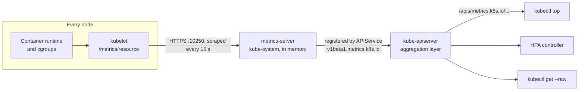

# T3.23 Use built-in CLI tools to monitor Kubernetes applications

> Competency: "Use built-in CLI tools to monitor Kubernetes applications" (CKAD-3.3) | Domain/weight: CKAD, Application Observability and Maintenance (15%) | Est. time: 1.5 h | Prerequisites: T3.05, T2.08

Shell setup (from [conventions](../00-conventions.md); put it at the top of every session):

```bash
alias k=kubectl
export do="--dry-run=client -o yaml"
export now="--force --grace-period=0"
source <(kubectl completion bash); complete -o default -F __start_kubectl k
```

Lab environment for this lesson: **kind** (cluster `lab`, context `kind-lab`, 1 control plane + 2 workers) plus the add-on `env/kind-addons.sh metrics-server` (metrics-server v0.9.0 with `--kubelet-insecure-tls`). Namespace: `lab-t323` (the worked example also uses `prod`). Files go in `~/lab/t323/`.

> Output labels. Every output block marked `REAL OUTPUT (kind v0.33.0, v1.37.0)` was captured on this machine on a kind cluster with the pinned node image `kindest/node:v1.37.0` (1 control plane + 2 workers), kubectl v1.37.1, metrics-server v0.9.0. That cluster used kind's default CNI (kindnet) instead of Calico, because this topic does not need NetworkPolicy. Its nodes were named `k-t323-control-plane`, `k-t323-worker`, `k-t323-worker2`; on your `lab` cluster they are `lab-control-plane`, `lab-worker`, `lab-worker2`. Pod name suffixes, ages and exact numbers will differ on your machine. Blocks marked `REAL OUTPUT (Docker busybox)` are plain Linux text tools run in a container. Nothing is invented; what could not be run is listed in section 11.

Prerequisites, not re-taught here: requests, limits and the `m` / `Mi` units, [T3.05 Define resource requirements](../part3-ckad/T3.05-define-resource-requirements.md); `describe`, events and reading object status, [T2.08 Events, describe and reading object status](../part2-basics/T2.08-events-describe-and-reading-object-status.md). This lesson uses both, and shows the commands again in monitoring context.

---

## 1. Why this matters

An app can be "Running" and still be broken: it can burn a whole CPU, leak memory until the kernel kills it, or restart every ten seconds. In real life you answer "which Pod is the problem?" with a few kubectl commands, long before any dashboard exists. In the exam, tasks like "write the name of the Pod that uses the most CPU in namespace `prod` to a file" must take about a minute: the whole exam is 15-20 tasks in 2 hours, about 6 minutes per task ([E2](https://docs.linuxfoundation.org/tc-docs/certification/tips-cka-and-ckad), [E3](https://docs.linuxfoundation.org/tc-docs/certification/faq-cka-ckad-cks)). The classic traps are small: a missing `--no-headers` puts the word `NAME` in your answer file, and `kubectl top` fails with `error: Metrics API not available` when the metrics add-on is missing or broken.

---

## 2. Concepts

### 2.1 Two kinds of "monitoring" with built-in tools

Kubernetes ships no dashboard. With only `kubectl` you answer two different questions, and they use different data:

| Question | Data source | Commands |
|---|---|---|
| **How much** CPU and memory is it using right now? | The metrics pipeline (kubelet, then metrics-server) | `k top pods`, `k top nodes`, `k get --raw /apis/metrics.k8s.io/...` |
| **Is it healthy?** Is it ready, restarting, stuck, failing a rollout? | The API objects themselves (`status` fields and Events) | `k get pods`, `k get -w`, `k describe`, `k get events`, `k rollout status` |

The first group needs an extra add-on (metrics-server). The second group works on every cluster, because the status lives in the API server's own database (etcd).

### 2.2 The metrics pipeline: kubelet, metrics-server, the metrics.k8s.io API

**What it is.** The **Metrics API** is a Kubernetes API group named `metrics.k8s.io`. It gives the current CPU and memory usage of nodes (`NodeMetrics`) and of Pods (`PodMetrics`, with a per-container list). The API server does not compute or store these numbers. A cluster add-on called **metrics-server** does, and it registers itself with the API server using an **APIService** object (the "aggregation layer"). From then on, any request for `/apis/metrics.k8s.io/...` is forwarded by the API server to the metrics-server Service.

**The problem it solves.** The autoscaler (HPA) needs to know how busy Pods are, and people need a quick "who is eating the CPU" view. Every node already measures this (the kubelet reads the container runtime and cgroup statistics, using cAdvisor code). Someone must collect it from all nodes in one place. That is metrics-server's only job.

**How it works inside** (source: [Resource metrics pipeline](https://kubernetes.io/docs/tasks/debug/debug-cluster/resource-metrics-pipeline/)):

1. Each node's **kubelet** exposes summarized usage at its `/metrics/resource` endpoint (HTTPS port 10250). Older metrics-server versions used `/stats/summary`; v0.6.0 and later use `/metrics/resource`.
2. **metrics-server** lists nodes through the API server and scrapes every kubelet. In the v0.9.0 manifest the interval is `--metric-resolution=15s`.
3. It keeps only the latest values, **in memory**. There is no database, no history.
4. The API server's aggregation layer proxies `metrics.k8s.io` requests to the `metrics-server` Service in `kube-system`.
5. Clients read it: `kubectl top` and the HPA controller.

**What breaks without it.** `k top` prints `error: Metrics API not available`, and an HPA shows `<unknown>` in its TARGETS column and never scales. Everything in the second group of the table above keeps working.

**Fields in a metrics object.** A `PodMetrics` item has `timestamp` (when it was measured), `window` (the time span used to compute the CPU rate, 10-20 s in the captures below) and `containers[].usage` with `cpu` and `memory`. CPU is the **average core usage over the window**, derived from a cumulative kernel counter, written in `n` (nanocores, for example `99933848n`) in the raw API and shown as `m` (millicores) by `kubectl top`. Memory is the **working set** in bytes (`Ki` in the raw API, `Mi` in `top`). The working set is the memory in use that the kernel cannot easily free; it is not the same as total virtual memory.

**API version: stable in v1.37, but check what your server serves.** Kubernetes v1.37 promoted the Metrics API to stable as `metrics.k8s.io/v1`. The v1 API has the same resource types and fields as `v1beta1`; only the version changed. `kubectl top` supports both: it prefers v1 when available and falls back to v1beta1. The HPA controller still supports only v1beta1 in v1.37. v1beta1 stays available. Sources: the blog post [Kubernetes v1.37: Metrics API graduates to stable](https://kubernetes.io/blog/2026/08/27/kubernetes-v1-37-metrics-api-ga/) and the pipeline page above ("Stable since Kubernetes v1.37").

The catch is that **the API server only serves a version if the add-on registers it**. On the lab cluster, metrics-server v0.9.0 registered only `v1beta1.metrics.k8s.io`. The `v1` URL from the docs returned NotFound there (shown in section 5). So in this lab you use the `v1beta1` path. If a task gives you a `v1` path and it fails, run `k get --raw /apis/metrics.k8s.io/` to see which versions exist.

### 2.3 Installing metrics-server in the labs

On kind, the node kubelets use self-signed serving certificates, so metrics-server cannot verify them. The lab fix is the flag `--kubelet-insecure-tls`. `env/kind-addons.sh metrics-server` does exactly these two steps, which you should be able to type yourself:

```bash
k apply -f https://github.com/kubernetes-sigs/metrics-server/releases/download/v0.9.0/components.yaml
k -n kube-system patch deploy metrics-server --type=json \
  -p '[{"op":"add","path":"/spec/template/spec/containers/0/args/-","value":"--kubelet-insecure-tls"}]'
k -n kube-system rollout status deploy/metrics-server
```

The manifest creates a ServiceAccount, RBAC, a Service, a Deployment (container args: `--cert-dir=/tmp`, `--secure-port=10250`, `--kubelet-preferred-address-types=InternalIP,ExternalIP,Hostname`, `--kubelet-use-node-status-port`, `--metric-resolution=15s`) and the APIService `v1beta1.metrics.k8s.io`. `--kubelet-insecure-tls` skips kubelet certificate checks. That is acceptable on a throw-away lab cluster and wrong for production, where the kubelets should have properly signed serving certificates.

Key args and what they do:

| Arg | What it does | Wrong or risky value |
|---|---|---|
| `--secure-port` | Port metrics-server listens on. The Pod's named port `https` and its probes use **10250** | Any other value (for example `4443` from older manifests): probes get `connection refused`, the Pod never becomes Ready |
| `--kubelet-preferred-address-types` | Which node address to scrape, in order | A type your nodes do not have, or `Hostname` where node names do not resolve |
| `--kubelet-insecure-tls` | Do not verify the kubelet's certificate | Missing on kind: scrape fails with `x509` errors. Do not use on production |
| `--metric-resolution` | Scrape interval (default 15 s in this manifest) | Very small values load every kubelet |
| `--kubelet-use-node-status-port` | Take the kubelet port from each Node object's status instead of a fixed flag value | Leave as in the manifest |

### 2.4 `kubectl top`: pods and nodes

`k top` reads the Metrics API and prints a table. Its flags (verified from `k top pod --help` and `k top node --help` in kubectl v1.37.1):

| Flag | Applies to | Meaning |
|---|---|---|
| `-n NS` | pod | One namespace (default: the context's namespace) |
| `-A`, `--all-namespaces` | pod | All namespaces. Adds a `NAMESPACE` column |
| `-l key=value` | pod, node | Label selector (supports `=`, `==`, `!=`, `in`, `notin`) |
| `--containers` | pod | One row per container, with a `POD` column |
| `--sort-by=cpu` or `memory` | pod, node | Only these two values. Highest first |
| `--no-headers` | pod, node | Drop the header line |
| `--sum` | pod | Add a total row |
| `--field-selector` | pod | Filter by a field query (the server supports only a limited set) |
| `--show-capacity` | node | Compute percentages from node capacity instead of allocatable (default) |
| `--show-swap` | pod, node | Add swap columns (needs swap enabled on the node) |
| `--use-protocol-buffers` | pod, node | Default true; use the compact wire format |

Look at real output. The first command lists every Pod in a namespace, then sorts, then shows containers, then a label filter and a sum.

```bash
k -n lab-t323 top pod
k -n lab-t323 top pod --sort-by=memory
k -n lab-t323 top pod duo --containers
k -n lab-t323 top pod -l team=data
k -n lab-t323 top pod --sum
```

REAL OUTPUT (kind v0.33.0, v1.37.0), from the worked example in section 5:

```text
$ k -n lab-t323 top pod
NAME                  CPU(cores)   MEMORY(bytes)
burn                  400m         0Mi
duo                   100m         8Mi
fresh                 0m           8Mi
hog                   0m           48Mi
web-bd6b85cd7-g5nc7   0m           8Mi
web-bd6b85cd7-qkd2w   0m           8Mi

$ k -n lab-t323 top pod --sort-by=memory
NAME                  CPU(cores)   MEMORY(bytes)
hog                   0m           48Mi
duo                   100m         8Mi
...

$ k -n lab-t323 top pod duo --containers
POD   NAME   CPU(cores)   MEMORY(bytes)
duo   app    0m           8Mi
duo   spin   100m         0Mi

$ k -n lab-t323 top pod -l team=data
NAME   CPU(cores)   MEMORY(bytes)
duo    100m         8Mi
hog    0m           48Mi

$ k -n lab-t323 top pod --sum
NAME                  CPU(cores)   MEMORY(bytes)
burn                  400m         0Mi
...
                      ________     ________
                      500m         81Mi
```

How to read it:

- `400m` means 400 millicores = 0.4 of one CPU core. `100m` is a tenth of a core. See the units in [T3.05](../part3-ckad/T3.05-define-resource-requirements.md).
- `0Mi` does not mean zero bytes. `Mi` rounds down. The raw API showed `"memory":"148Ki"` for the `spin` container, which `top` prints as `0Mi`.
- `burn` shows exactly `400m`, which is its CPU **limit**. A busy loop wants a full core, but the cgroup quota caps it at the limit. When a Pod sits right at its limit, it is being throttled.
- `top pod` shows **usage**, not requests or limits. For those, use `k describe pod` or `k get pod -o yaml`.
- The Pod `flaky` (crash-looping, see 2.8) is not in the list at all. Pods whose containers are not running have no usage to report.

All namespaces, sorted, first lines only. `head` keeps the header line, so the first data row is line 2:

```bash
k top pods -A --sort-by=memory | head
```

REAL OUTPUT (kind v0.33.0, v1.37.0):

```text
NAMESPACE     NAME                                           CPU(cores)   MEMORY(bytes)
kube-system   kube-apiserver-k-t323-control-plane            12m          270Mi
kube-system   kube-controller-manager-k-t323-control-plane   4m           64Mi
lab-t323      hog                                            0m           48Mi
kube-system   etcd-k-t323-control-plane                      8m           36Mi
...
```

Nodes:

```bash
k top nodes
k top nodes --sort-by=cpu
```

REAL OUTPUT (kind v0.33.0, v1.37.0), taken while the Pod `burn` ran on `worker2`:

```text
NAME                   CPU(cores)   CPU(%)   MEMORY(bytes)   MEMORY(%)
k-t323-control-plane   44m          0%       610Mi           3%
k-t323-worker          9m           0%       192Mi           1%
k-t323-worker2         509m         4%       235Mi           1%
```

The `%` columns are relative to the node's **allocatable** resources (what is left for Pods after system reservations). `--show-capacity` divides by the full **capacity** instead. On these kind nodes the two gave the same rounded percentages.

### 2.5 The raw API: `k get --raw`

`k get --raw PATH` sends a GET to a path on the API server and prints the body. It is how you look at the Metrics API without `kubectl top`. First find which versions exist (discovery):

```bash
k get --raw /apis/metrics.k8s.io/
k api-versions | grep metrics
```

REAL OUTPUT (kind v0.33.0, v1.37.0), metrics-server v0.9.0:

```text
{"kind":"APIGroup","apiVersion":"v1","name":"metrics.k8s.io","versions":[{"groupVersion":"metrics.k8s.io/v1beta1","version":"v1beta1"}],"preferredVersion":{"groupVersion":"metrics.k8s.io/v1beta1","version":"v1beta1"}}
metrics.k8s.io/v1beta1
```

Only `v1beta1` is served. Now one Pod, and the v1 path from the docs:

```bash
k get --raw /apis/metrics.k8s.io/v1beta1/namespaces/lab-t323/pods/duo
k get --raw /apis/metrics.k8s.io/v1/nodes
```

REAL OUTPUT (kind v0.33.0, v1.37.0):

```text
{"kind":"PodMetrics","apiVersion":"metrics.k8s.io/v1beta1","metadata":{"name":"duo","namespace":"lab-t323","creationTimestamp":"2026-10-28T03:57:27Z","labels":{"app":"duo","team":"data"}},"timestamp":"2026-10-28T03:57:12Z","window":"18.004s","containers":[{"name":"app","usage":{"cpu":"0","memory":"8284Ki"}},{"name":"spin","usage":{"cpu":"99933848n","memory":"148Ki"}}]}

Error from server (NotFound): the server could not find the requested resource
```

The entry's path `/apis/metrics.k8s.io/v1beta1/namespaces/default/pods` lists all Pods in `default` (a `PodMetricsList`). The same path ending in a Pod name, as above, returns one. Which version your `kubectl top` used is visible with `-v=6`: `k top nodes -v=6 2>&1 | grep GET` showed `GET .../apis/metrics.k8s.io/v1beta1/nodes`. The docs' sample responses pipe the output to `jq`; do not count on `jq` being installed on an exam host (the hosts list kubectl, yq, curl, wget and man, [E9](https://docs.linuxfoundation.org/tc-docs/certification/tips-cka-and-ckad)). `yq` can read JSON too.

### 2.6 Limits of `top`

| Property | What it means for you |
|---|---|
| **Point in time** | One reading, averaged over `window` (10-20 s). A spike that ended 30 seconds ago is invisible |
| **About 15 s resolution** | metrics-server scrapes every 15 s (`--metric-resolution=15s`). Run `top` twice, a few seconds apart, and you may get the same numbers |
| **No history** | Values live in memory and are replaced. For trends you need a real monitoring system (not built in) |
| **Delay for new Pods** | A new Pod has no metrics until the first scrape that includes it (see section 6) |
| **Running containers only** | Crashed, Pending or Completed Pods are missing |
| **CPU and memory only** | No disk, no network, no custom app metrics. Those need the Custom Metrics API or other tools |
| **Usage, not allocation** | Requests and limits are in the Pod spec, not in `top` |

**Related but different.** `k describe node` has an "Allocated resources" table. That is the sum of **requests and limits** already promised to Pods, which is what the scheduler uses. `k top node` is real **usage**. A node can be 90% allocated and 3% used. Use `describe` to understand why a Pod is Pending, and `top` to understand who is busy.

### 2.7 Watching state change: `get -w`, `--watch-only`, `-o wide`, status columns

`k get pods -w` lists the Pods, then keeps the connection open and prints one new line every time a Pod changes. It stays running until you press Ctrl+C. Under the hood it is an HTTP watch: the API server streams change events (ADDED, MODIFIED, DELETED) for the objects.

`--watch-only` skips the first listing and prints only changes that happen after you start. `--output-watch-events` adds a first column with the event type.

REAL OUTPUT (kind v0.33.0, v1.37.0). In a second terminal I deleted the Pod `calm` and created the Pod `late` while `-w` ran:

```text
$ k -n lab-t323 get pods -w
NAME                        READY   STATUS    RESTARTS   AGE
calm                        1/1     Running   0          2m56s
cpu-demo-657979775f-c7r8p   1/1     Running   0          2m10s
...
...
calm                        1/1     Terminating   0          3m1s
late                        0/1     Pending       0          0s
late                        0/1     ContainerCreating   0          0s
calm                        0/1     Completed           0          3m1s
late                        1/1     Running             0          0s

$ k -n lab-t323 get pods --watch-only
NAME   READY   STATUS        RESTARTS   AGE
late   1/1     Terminating   0          27s
late   0/1     Completed     0          27s
```

`--watch-only` printed nothing of the existing Pods. `-w` output is a stream of changes, not a table you can rely on, so do not parse it in a script.

**Reading the default columns** (from the real output above and below):

| Column | Meaning | How to read a problem |
|---|---|---|
| `READY` | `ready containers / total containers` in the Pod | `0/1` or `1/2` means a container is not passing its readiness check or is not running |
| `STATUS` | A summary string the client builds from the Pod phase and container states. It is not one field | `Pending` (not placed or image pulling), `ContainerCreating`, `Running`, `Completed`, `Error`, `CrashLoopBackOff`, `ImagePullBackOff`, `Terminating` |
| `RESTARTS` | How many times the kubelet restarted a container of this Pod. Shown as `5 (81s ago)`: count and time of the last restart | A number that keeps growing is a crash loop |
| `AGE` | Time since the Pod object was created | A Pod much younger than its Deployment means it was replaced |

`-o wide` adds more columns:

```bash
k -n lab-t323 get pods -o wide
```

REAL OUTPUT (kind v0.33.0, v1.37.0):

```text
NAME                  READY   STATUS    RESTARTS      AGE    IP           NODE             NOMINATED NODE   READINESS GATES
burn                  1/1     Running   0             2m2s   10.244.2.4   k-t323-worker2   <none>           <none>
duo                   2/2     Running   0             2m2s   10.244.2.3   k-t323-worker2   <none>           <none>
flaky                 0/1     Error     3 (65s ago)   2m2s   10.244.2.7   k-t323-worker2   <none>           <none>
...
```

`IP` and `NODE` answer "where is it running?" at a glance. The Pod `duo` has two containers (`2/2`).

### 2.8 `describe`, conditions, restarts, last state, events

`k describe pod NAME` collects the Pod's status and the recent Events into one page (details in [T2.08](../part2-basics/T2.08-events-describe-and-reading-object-status.md)). Four places matter for monitoring.

1. **Container block**: `State`, `Last State`, `Restart Count`, plus `Limits` and `Requests`.
2. **Conditions**: `PodScheduled`, `Initialized`, `ContainersReady`, `Ready`, and `PodReadyToStartContainers`. `Ready: False` while the others are True means the Pod is placed and started but not passing readiness.
3. **QoS Class**: `Guaranteed`, `Burstable` or `BestEffort`, computed from requests and limits ([T3.05](../part3-ckad/T3.05-define-resource-requirements.md)).
4. **Events** at the bottom: what the scheduler and kubelet did.

REAL OUTPUT (kind v0.33.0, v1.37.0), trimmed, for the crash-looping Pod `flaky` (its command prints, sleeps 8 s, then exits with code 3):

```text
$ k -n lab-t323 describe pod flaky
...
Containers:
  flaky:
    Image:          busybox:1.36
    Command:
      sh
      -c
      echo starting; sleep 8; echo boom; exit 3
    State:          Terminated
      Reason:       Error
      Exit Code:    3
      Started:      Wed, 28 Oct 2026 11:56:50 +0800
      Finished:     Wed, 28 Oct 2026 11:56:58 +0800
    Last State:     Terminated
      Reason:       Error
      Exit Code:    3
      Started:      Wed, 28 Oct 2026 11:56:14 +0800
      Finished:     Wed, 28 Oct 2026 11:56:22 +0800
    Ready:          False
    Restart Count:  3
...
Conditions:
  Type                        Status
  PodReadyToStartContainers   True
  Initialized                 True
  Ready                       False
  ContainersReady             False
  PodScheduled                True
...
QoS Class:                   BestEffort
...
Events:
  Type     Reason     Age                 From               Message
  ----     ------     ----                ----               -------
  Normal   Scheduled  2m3s                default-scheduler  Successfully assigned lab-t323/flaky to k-t323-worker2
  Normal   Pulling    2m2s                kubelet            spec.containers{flaky}: Pulling image "busybox:1.36"
  Normal   Created    38s (x4 over 103s)  kubelet            spec.containers{flaky}: Container created
  Normal   Started    38s (x4 over 103s)  kubelet            spec.containers{flaky}: Container started
  Warning  BackOff    29s (x3 over 84s)   kubelet            spec.containers{flaky}: Back-off restarting failed container flaky in pod flaky_lab-t323(...)
```

How to read it: `State` is what the container is doing now. `Last State` is why the **previous** run ended, and it is the key line of a crash investigation: `Reason` (`Error`, or `OOMKilled` when the memory limit was hit) and `Exit Code` (a normal failure is a small number you chose; 137 means killed by SIGKILL, often the OOM killer). `Restart Count` is the number of restarts. The `(x4 over 103s)` in Events means the same event happened four times.

The same facts as plain fields, for scripts:

```bash
k -n lab-t323 get pod flaky -o jsonpath='{.status.containerStatuses[0].lastState.terminated.reason}{" "}{.status.containerStatuses[0].lastState.terminated.exitCode}{"\n"}'
```

REAL OUTPUT (kind v0.33.0, v1.37.0):

```text
Error 3
```

**Events as a command.** `k get events` lists events in the current namespace. Add sorting and filters:

```bash
k -n lab-t323 get events --sort-by=.lastTimestamp
k -n lab-t323 get events --field-selector involvedObject.name=flaky
k -n lab-t323 get events --field-selector type=Warning
```

REAL OUTPUT (kind v0.33.0, v1.37.0) of the last one:

```text
LAST SEEN   TYPE      REASON    OBJECT      MESSAGE
29s         Warning   BackOff   pod/flaky   Back-off restarting failed container flaky in pod flaky_lab-t323(6e24b945-b782-438c-8db9-4f553b956281)
```

Without `--sort-by`, events come in no useful order; with `.lastTimestamp` the newest are at the bottom. Events are short-lived records (the API server keeps them for one hour by default, a setting called the event TTL), so look soon after the problem. `type=Warning` removes the routine `Normal` noise.

### 2.9 `rollout status` as a health check

A Deployment update is a gradual replacement of Pods (a rolling update, [T2.05](../part2-basics/T2.05-controllers-replicasets-deployments-basics-and-garbage.md)). `k rollout status deploy/NAME` blocks and prints progress until all new Pods are available, then exits with code 0. If it cannot finish, it waits; with `--timeout` it gives up with a non-zero exit code. That makes it a yes/no health check you can use in a script (`&&`) or by eye.

Success and failure, both real. First a good image, then a tag that does not exist:

```bash
k -n lab-t323 set image deploy/web nginx=nginx:1.27.1
k -n lab-t323 rollout status deploy/web
k -n lab-t323 set image deploy/web nginx=nginx:1.27.999
k -n lab-t323 rollout status deploy/web --timeout=25s; echo exit=$?
k -n lab-t323 get pods -l app=web
```

REAL OUTPUT (kind v0.33.0, v1.37.0):

```text
Waiting for deployment "web" rollout to finish: 1 out of 2 new replicas have been updated...
Waiting for deployment "web" rollout to finish: 1 old replicas are pending termination...
deployment "web" successfully rolled out

Waiting for deployment "web" rollout to finish: 1 out of 2 new replicas have been updated...
error: timed out waiting for the condition
exit=1

NAME                   READY   STATUS             RESTARTS   AGE
web-5ff8f64866-gz2qk   0/1     ImagePullBackOff   0          25s
web-67998d54fb-czd6g   1/1     Running            0          27s
web-67998d54fb-tcs6f   1/1     Running            0          26s
```

The old Pods keep serving while the new one is stuck, so users are not down, but the rollout is not healthy. `k rollout undo deploy/web` goes back to the last good ReplicaSet (kubectl warns that the object was created with `apply`; that warning is harmless here).

### 2.10 Restart counts as a signal, and sorting with `--sort-by`

A container that exits is restarted by the kubelet (default `restartPolicy: Always`). Each restart adds one to `restartCount` and the wait between restarts grows (10 s, 20 s, 40 s, up to 5 minutes), which is what `CrashLoopBackOff` means. A rising count, or a count that is high on a young Pod, is the earliest sign of a bad app, a bad probe or a memory limit that is too low.

`k get --sort-by=JSONPATH` sorts the list by any integer or string field. The Pod's restart count is `.status.containerStatuses[0].restartCount` (the first container; Pods with several containers need a different index or a sum).

```bash
k -n lab-t323 get pods --sort-by='.status.containerStatuses[0].restartCount'
```

REAL OUTPUT (kind v0.33.0, v1.37.0):

```text
NAME                  READY   STATUS    RESTARTS      AGE
burn                  1/1     Running   0             2m3s
duo                   2/2     Running   0             2m3s
fresh                 1/1     Running   0             2m3s
hog                   1/1     Running   0             2m3s
web-bd6b85cd7-g5nc7   1/1     Running   0             2m3s
web-bd6b85cd7-qkd2w   1/1     Running   0             2m3s
flaky                 0/1     Error     3 (66s ago)   2m3s
```

**Trap: the direction is opposite to `top`.** `k get --sort-by` sorts **ascending**, so the worst Pod is the **last** line. `k top --sort-by` sorts **descending**, so the biggest consumer is the **first** line. To get the highest restart count: `... --no-headers | tac | head -1` or `... | tail -1`.

### 2.11 Saving an answer to a file

Exam-style tasks say "write the name of ... to `/opt/top.txt`". The shape is always: command that sorts, `--no-headers`, take one line, take one column, redirect with `>`.

```bash
k top pod -n prod --sort-by=cpu --no-headers | head -1 | awk '{print $1}' > /opt/top.txt
```

Each part:

- `k top pod -n prod --sort-by=cpu` lists Pods in `prod`, highest CPU first.
- `--no-headers` removes the `NAME CPU(cores) MEMORY(bytes)` line. Without it, `head -1` returns the header.
- `head -1` keeps the first line (the top consumer).
- `awk '{print $1}'` prints column 1 (the Pod name). `cut -d' ' -f1` does the same and is the fallback if you do not trust `awk`.
- `> /opt/top.txt` writes (and overwrites) the file. The redirect is done by **your** shell, so your user needs write permission on `/opt`. Whether it does on an exam host is UNVERIFIED; if you get `Permission denied`, pipe to `sudo tee /opt/top.txt` instead (`sudo -i` is available on the hosts, [E8](https://docs.linuxfoundation.org/tc-docs/certification/tips-cka-and-ckad)).

Test it, then always read the file back (`cat`, `wc -l`). REAL OUTPUT (kind v0.33.0, v1.37.0), with `p1` (a busy loop) and `p2` (idle nginx) in namespace `prod`:

```text
$ k -n prod top pod
NAME   CPU(cores)   MEMORY(bytes)
p1     1000m        0Mi
p2     0m           8Mi

$ k -n prod top pod --sort-by=cpu --no-headers | head -1 | awk '{print $1}' > /tmp/top-t323.txt; cat /tmp/top-t323.txt; wc -l < /tmp/top-t323.txt
p1
       1

$ k -n prod top pod --sort-by=cpu | head -1 | awk '{print $1}'
NAME
```

The last command is the mistake: no `--no-headers`, so the answer is `NAME`.

REAL OUTPUT (Docker busybox) of the text-tool part alone, to show `cut` and `tac` behave the same:

```text
$ printf "p1    1000m   0Mi   \np2    0m     8Mi   \n" | head -1 | cut -d" " -f1
p1
$ printf "a 0\nb 1\nc 5\n" | tac | head -1 | cut -d" " -f1
c
```

### 2.12 Under the hood: why a new Pod has no metrics

`kubectl top` does not measure anything. It asks the API server, which asks metrics-server, which answers from its last scrape. A Pod created after the last scrape is not in that data yet, So for a short time (about a minute in the captures here) there is nothing to show. That is the reason for the errors in section 6, and the reason that an HPA created right after its Deployment shows `<unknown>` for a short time.

---

## 3. How it works (diagram)



Walkthrough:

1. On each node the kubelet reads CPU and memory statistics for every container from the container runtime and cgroups, and serves them at `/metrics/resource`.
2. metrics-server, a normal Deployment in `kube-system`, scrapes every kubelet over HTTPS port 10250 about every 15 seconds and keeps only the latest values in memory.
3. An APIService object tells the API server: "requests for `metrics.k8s.io` go to the `metrics-server` Service." That is the aggregation layer.
4. Clients never talk to metrics-server directly. `kubectl top`, `kubectl get --raw` and the HPA controller all call the API server, which proxies the request.
5. If any link is broken, the symptom is the same at the top: `Metrics API not available`. Debug from the right side to the left: APIService, then the metrics-server Pod, then its logs (the scrape errors are there).

---

## 4. Commands and YAML you must produce fast

### 4.1 Imperative commands

```bash
# Who uses the most memory / CPU, cluster-wide (header + 9 rows)
k top pods -A --sort-by=memory | head
k top pods -A --sort-by=cpu | head

# One Pod, per container
k top pod web --containers

# Nodes
k top nodes

# Answer file: name of the highest-CPU Pod in namespace prod
k top pod -n prod --sort-by=cpu --no-headers | head -1 | awk '{print $1}' > /opt/top.txt

# Health: Pods sorted by restart count (worst last), watch changes, rollout, events
k get pods --sort-by='.status.containerStatuses[0].restartCount'
k get pods -w
k rollout status deploy/web --timeout=60s
k get events --sort-by=.lastTimestamp
k get events --field-selector type=Warning

# Is the metrics API itself healthy?
k get apiservice v1beta1.metrics.k8s.io
k get --raw /apis/metrics.k8s.io/v1beta1/nodes
```

| Command | One-line explanation |
|---|---|
| `k top pods -A --sort-by=memory \| head` | Biggest memory users first, across all namespaces. `head` shows 10 lines including the header |
| `k top pod web --containers` | Usage of each container of Pod `web` |
| `k top nodes` | Node usage, with percent of allocatable |
| `k get pods --sort-by='...restartCount'` | Restart counts ascending: the crash-looper is the last row |
| `k get pods -w` | Stream status changes; Ctrl+C to stop |
| `k rollout status deploy/web` | Block until the rollout is done; non-zero exit on failure or timeout |
| `k get apiservice v1beta1.metrics.k8s.io` | `AVAILABLE True` means the API server can reach metrics-server |

### 4.2 Declarative YAML

The monitoring tools above have no YAML of their own. What you apply is the workload being watched, and the HPA that reads the Metrics API. The Deployment below is the CPU burner used in the medium lab. It applies cleanly with `k apply -f` (it was applied for the lab run in section 7). Generate a first version with `k create deploy cpu-demo --image=busybox:1.36 $do -- sh -c 'while true; do :; done' > cpu-demo.yaml` (this writes `name: busybox` for the container; the file below renames it to `burn`), then add `resources`.

```yaml
apiVersion: apps/v1               # Deployments live in the apps/v1 API group
kind: Deployment
metadata:
  name: cpu-demo                  # name of the Deployment; Pod names get a hash suffix
  namespace: lab-t323             # create the namespace first: k create ns lab-t323
spec:
  replicas: 1                     # default is 1; the HPA in the lab changes this number
  selector:
    matchLabels:
      app: cpu-demo               # must match the Pod template labels below, or the API rejects it
  template:
    metadata:
      labels:
        app: cpu-demo             # the label the selector and "top -l" use
    spec:
      containers:
      - name: burn               # container name; shows in "top --containers"
        image: busybox:1.36       # pinned tag, never :latest
        command: ["sh", "-c", "while true; do :; done"]   # busy loop = one core of CPU demand
        resources:
          requests:
            cpu: 100m             # scheduler reserves 0.1 core; HPA percentages are relative to THIS
            memory: 8Mi           # scheduler reserves 8 MiB
          limits:
            cpu: 200m             # hard ceiling: usage in "top" can never exceed about 200m (throttled)
            memory: 32Mi          # above this the container is OOM-killed; "memory: 32m" would be 0.032 bytes
```

The HPA that goes with it. The imperative form is `k autoscale deploy cpu-demo --cpu=50% --min=1 --max=3` (verified in section 7). The same object as YAML:

```yaml
apiVersion: autoscaling/v2        # the current stable HPA API
kind: HorizontalPodAutoscaler
metadata:
  name: cpu-demo
  namespace: lab-t323
spec:
  scaleTargetRef:                 # what to scale
    apiVersion: apps/v1
    kind: Deployment
    name: cpu-demo
  minReplicas: 1                  # never fewer than this
  maxReplicas: 3                  # never more than this (a hard cap even when load asks for more)
  metrics:
  - type: Resource
    resource:
      name: cpu
      target:
        type: Utilization         # percent of the Pod's CPU *request*; needs requests.cpu to be set
        averageUtilization: 50    # keep average usage near 50% of the request (50m per Pod here)
```

If the Pod has no `requests.cpu`, the HPA cannot compute a percentage and shows `<unknown>` for ever.

### 4.3 Speed drill

Setup (one block; idempotent namespace; the `d-` objects are used only here):

```bash
k create ns lab-t323 $do | k apply -f -
mkdir -p ~/lab/t323
k -n lab-t323 run d-busy --image=busybox:1.36 -- sh -c 'while true; do :; done'
k -n lab-t323 run d-mem --image=busybox:1.36 -- sh -c 'dd if=/dev/zero of=/dev/shm/b bs=1M count=40; sleep 3600'
k -n lab-t323 run d-crash --image=busybox:1.36 -- sh -c 'sleep 3; exit 1'
k -n lab-t323 create deploy d-web --image=nginx:1.27 --replicas=2
k -n lab-t323 wait --for=condition=Ready pod/d-busy pod/d-mem --timeout=120s
sleep 45     # first metrics need up to about a minute
```

Targets are exam pace. Try each before opening the answer.

| # | Task | Target |
|---|---|---|
| 1 | Show the 3 Pods with the most memory in the whole cluster (rows only, no header) | 1 min |
| 2 | Write the name of the node with the highest CPU usage to `~/lab/t323/node.txt` | 1 min |
| 3 | Show CPU and memory per container for Pod `d-busy` | 30 s |
| 4 | Write the name of the Pod with the highest memory in `lab-t323` to `~/lab/t323/mem.txt` | 1 min |
| 5 | Write the name of the Pod with the highest restart count in `lab-t323` to `~/lab/t323/restart.txt` | 1.5 min |
| 6 | Print only the Warning events of `lab-t323` | 30 s |
| 7 | Update `d-web` to `nginx:1.27.1` and print a pass/fail exit code for the rollout | 1.5 min |
| 8 | Is the metrics API healthy? Show the APIService and the raw node metrics | 1 min |

<details><summary>Answers</summary>

```bash
# 1  (--no-headers first, then head -3)
k top pods -A --sort-by=memory --no-headers | head -3

# 2  (nodes are sorted highest first; take column 1)
k top nodes --sort-by=cpu --no-headers | head -1 | awk '{print $1}' > ~/lab/t323/node.txt

# 3
k -n lab-t323 top pod d-busy --containers

# 4  (d-mem holds 40 MiB in /dev/shm, so it wins)
k -n lab-t323 top pod --sort-by=memory --no-headers | head -1 | awk '{print $1}' > ~/lab/t323/mem.txt

# 5  (get --sort-by is ascending, so reverse with tac, or take the last line)
k -n lab-t323 get pods --no-headers --sort-by='.status.containerStatuses[0].restartCount' | tac | head -1 | awk '{print $1}' > ~/lab/t323/restart.txt

# 6
k -n lab-t323 get events --field-selector type=Warning

# 7  (the container of "create deploy --image=nginx:1.27" is named nginx)
k -n lab-t323 set image deploy/d-web nginx=nginx:1.27.1
k -n lab-t323 rollout status deploy/d-web --timeout=60s; echo exit=$?

# 8
k get apiservice v1beta1.metrics.k8s.io
k get --raw /apis/metrics.k8s.io/v1beta1/nodes
```

Check the files: `cat ~/lab/t323/{node,mem,restart}.txt`. Expected: a node name, `d-mem`, `d-crash`.

</details>

Cleanup (returns the namespace to its previous state):

```bash
k -n lab-t323 delete pod d-busy d-mem d-crash $now
k -n lab-t323 delete deploy d-web
rm -f ~/lab/t323/{node,mem,restart}.txt
```

---

## 5. Worked example

REAL OUTPUT (kind v0.33.0, v1.37.0) throughout this section. Goal: install the metrics API, deploy a small mixed workload, and find the CPU hog, the memory hog and the crash-looper using only kubectl.

**Step 1: see what a cluster without metrics-server does.**

```bash
k top nodes
k api-versions | grep metrics
```

```text
$ k top nodes
error: Metrics API not available

$ k api-versions | grep metrics
(no output)
```

`k api-versions` lists every API group/version the server serves. There is no `metrics.k8s.io`, so `top` has nothing to call.

**Step 2: install metrics-server.** (`env/kind-addons.sh metrics-server` runs the first two commands; they are shown so you know what happens.)

```bash
k apply -f https://github.com/kubernetes-sigs/metrics-server/releases/download/v0.9.0/components.yaml
k -n kube-system patch deploy metrics-server --type=json -p '[{"op":"add","path":"/spec/template/spec/containers/0/args/-","value":"--kubelet-insecure-tls"}]'
k -n kube-system rollout status deploy/metrics-server --timeout=180s
k top nodes
k get apiservice v1beta1.metrics.k8s.io
```

```text
serviceaccount/metrics-server created
...
apiservice.apiregistration.k8s.io/v1beta1.metrics.k8s.io created
deployment.apps/metrics-server patched
deployment "metrics-server" successfully rolled out

$ k top nodes
error: Metrics API not available

$ k get apiservice v1beta1.metrics.k8s.io
NAME                     SERVICE                      AVAILABLE                      AGE
v1beta1.metrics.k8s.io   kube-system/metrics-server   False (FailedDiscoveryCheck)   40s
```

The Deployment is rolled out, yet `top` still fails and the APIService says `False (FailedDiscoveryCheck)`: the API server has not yet successfully reached the new Service. This is normal for a few seconds after the install. Retry until it works (in the capture it took well under a minute):

```bash
until k top nodes >/dev/null 2>&1; do sleep 5; done; k top nodes
```

```text
NAME                   CPU(cores)   CPU(%)   MEMORY(bytes)   MEMORY(%)
k-t323-control-plane   121m         1%       551Mi           3%
k-t323-worker          34m          0%       135Mi           0%
k-t323-worker2         15m          0%       104Mi           0%
```

**Step 3: discover the API version, then read raw.**

```bash
k get --raw /apis/metrics.k8s.io/
k get --raw /apis/metrics.k8s.io/v1/nodes
k get --raw /apis/metrics.k8s.io/v1beta1/nodes | head -c 600
k top nodes -v=6 2>&1 | grep GET
```

```text
{"kind":"APIGroup","apiVersion":"v1","name":"metrics.k8s.io","versions":[{"groupVersion":"metrics.k8s.io/v1beta1","version":"v1beta1"}],"preferredVersion":{"groupVersion":"metrics.k8s.io/v1beta1","version":"v1beta1"}}
Error from server (NotFound): the server could not find the requested resource
{"kind":"NodeMetricsList","apiVersion":"metrics.k8s.io/v1beta1","metadata":{},"items":[{"metadata":{"name":"k-t323-control-plane",...},"timestamp":"2026-10-28T03:55:22Z","window":"20.036s","usage":{"cpu":"120583649n","memory":"565232Ki"}},{"metadata":{"name":"k-t323-worker",...
I1028 11:55:25.380307   38682 round_trippers.go:632] "Response" verb="GET" url="https://127.0.0.1:52307/apis/metrics.k8s.io/v1beta1/nodes" status="200 OK" milliseconds=1
```

Only `v1beta1` exists with metrics-server v0.9.0, even though the API is stable in v1.37 (section 2.2). `kubectl top` used v1beta1 as its fallback.

**Step 4: deploy a mixed workload.** Save this as `~/lab/t323/workloads.yaml` (every object applies cleanly):

```yaml
apiVersion: apps/v1
kind: Deployment
metadata:
  name: web                   # two idle nginx replicas, with requests and limits
  namespace: lab-t323
  labels:
    app: web
spec:
  replicas: 2
  selector:
    matchLabels:
      app: web
  template:
    metadata:
      labels:
        app: web
        team: shop
    spec:
      containers:
      - name: nginx
        image: nginx:1.27
        resources:
          requests:
            cpu: 50m
            memory: 32Mi
          limits:
            cpu: 200m
            memory: 128Mi
---
apiVersion: v1
kind: Pod
metadata:
  name: burn                  # CPU hog: busy loop, capped at 400m
  namespace: lab-t323
  labels:
    app: burn
    team: shop
spec:
  containers:
  - name: burn
    image: busybox:1.36
    command: ["sh", "-c", "while true; do :; done"]
    resources:
      requests:
        cpu: 100m
        memory: 16Mi
      limits:
        cpu: 400m
        memory: 64Mi
---
apiVersion: v1
kind: Pod
metadata:
  name: hog                   # memory hog: writes 48 MiB into /dev/shm (a tmpfs counted as container memory)
  namespace: lab-t323
  labels:
    app: hog
    team: data
spec:
  containers:
  - name: hog
    image: busybox:1.36
    command: ["sh", "-c", "dd if=/dev/zero of=/dev/shm/blob bs=1M count=48; sleep 3600"]
    resources:
      requests:
        cpu: 10m
        memory: 64Mi
      limits:
        memory: 128Mi
---
apiVersion: v1
kind: Pod
metadata:
  name: duo                   # two containers: idle nginx plus a throttled busy loop
  namespace: lab-t323
  labels:
    app: duo
    team: data
spec:
  containers:
  - name: app
    image: nginx:1.27
    resources:
      requests:
        cpu: 10m
        memory: 16Mi
  - name: spin
    image: busybox:1.36
    command: ["sh", "-c", "while true; do :; done"]
    resources:
      requests:
        cpu: 10m
        memory: 8Mi
      limits:
        cpu: 100m
        memory: 32Mi
---
apiVersion: v1
kind: Pod
metadata:
  name: flaky                 # crash loop: runs 8 seconds, exits with code 3, restarts
  namespace: lab-t323
  labels:
    app: flaky
spec:
  containers:
  - name: flaky
    image: busybox:1.36
    command: ["sh", "-c", "echo starting; sleep 8; echo boom; exit 3"]
```

```bash
k create ns lab-t323
k create ns prod
k apply -f ~/lab/t323/workloads.yaml
k -n prod run p1 --image=busybox:1.36 -- sh -c 'while true; do :; done'
k -n prod run p2 --image=nginx:1.27
k -n lab-t323 run fresh --image=nginx:1.27
k -n lab-t323 top pod fresh
```

```text
deployment.apps/web created
pod/burn created
pod/hog created
pod/duo created
pod/flaky created
...
pod/fresh created
Error from server (NotFound): pods "fresh" not found
```

The last line is the "no metrics yet for a new Pod" symptom (section 6). Wait until the Pods are Ready, then about a minute for the first scrape:

```bash
k -n lab-t323 wait --for=condition=Ready pod/burn pod/hog pod/duo pod/fresh --timeout=120s
k -n lab-t323 rollout status deploy/web
sleep 60
```

**Step 5: who is the hog?** (Outputs of `top pod`, `--sort-by`, `--containers`, `-l` and `--sum` are in section 2.4.) Across all namespaces:

```bash
k top pods -A --sort-by=cpu | head -5
k top pods -A --sort-by=memory | head -4
```

```text
NAMESPACE     NAME                                  CPU(cores)   MEMORY(bytes)
lab-t323      burn                                  400m         0Mi
lab-t323      duo                                   100m         8Mi
kube-system   kube-apiserver-k-t323-control-plane   12m          270Mi
kube-system   etcd-k-t323-control-plane             8m           36Mi
```

(second command: `kube-apiserver` 270Mi, `kube-controller-manager` 64Mi, `hog` 48Mi.) `burn` is the CPU hog and `duo` shows 100m, entirely from its `spin` container (`--containers` in 2.4). The memory top two are control-plane components, which is normal on kind. `hog` is the biggest user-workload Pod.

**Step 6: who is unhealthy?** `top` does not list `flaky` at all, but the status tools do:

```bash
k -n lab-t323 get pods --sort-by='.status.containerStatuses[0].restartCount'
k -n lab-t323 describe pod flaky
k -n lab-t323 get events --field-selector type=Warning
```

The outputs are in sections 2.10 and 2.8: `flaky` is last in the sort with `RESTARTS 3 (66s ago)`, `Last State: Terminated, Reason: Error, Exit Code: 3`, and the event `Back-off restarting failed container`. Reading order that works every time: `get` (which Pod, what STATUS and RESTARTS?), `describe` (State, Last State, Conditions, Events at the bottom), then `logs` (what the app said, for example `k logs flaky --previous`).

**Step 7: save answers.** In namespace `prod`, `p1` burns a core:

```bash
k -n prod top pod --sort-by=cpu --no-headers | head -1 | awk '{print $1}' > /tmp/top-t323.txt
cat /tmp/top-t323.txt; wc -l < /tmp/top-t323.txt
```

```text
p1
       1
```

The file holds exactly one line with the right name. (When I ran it before `p1` existed, the answer was `p2`: the only Pod. Always check that your workload is really running first.)

**Step 8: watch a rollout, and break one.** Outputs are in section 2.9.

```bash
k -n lab-t323 set image deploy/web nginx=nginx:1.27.1
k -n lab-t323 rollout status deploy/web
k -n lab-t323 set image deploy/web nginx=nginx:1.27.999
k -n lab-t323 rollout status deploy/web --timeout=25s; echo exit=$?
k -n lab-t323 rollout undo deploy/web
```

Cleanup (leaves metrics-server installed):

```bash
k delete ns lab-t323 prod
rm -f /tmp/top-t323.txt ~/lab/t323/workloads.yaml
```

---

## 6. Common mistakes and how to fix them

| Symptom | What you will see (exact text) | Cause | Fix (command) |
|---|---|---|---|
| `top` fails everywhere | `error: Metrics API not available` | metrics-server not installed, or its APIService is not `Available` | Troubleshooting path below. Install: `env/kind-addons.sh metrics-server` |
| `top` fails right after install | `error: Metrics API not available`, and `k get apiservice v1beta1.metrics.k8s.io` shows `False (FailedDiscoveryCheck)` | The API server has not reached the new Service yet (seen about 40 s after install) | Wait and retry: `until k top nodes >/dev/null 2>&1; do sleep 5; done` |
| New Pod has no numbers | `error: metrics not available yet` (for `k top pod` of a namespace); `Error from server (NotFound): pods "fresh" not found` (for a named Pod); HPA TARGETS `cpu: <unknown>/50%` | The Pod was created after the last scrape. No data point yet | Wait about a minute, then run again. If it never appears: is the Pod `Running`? Does an HPA target have `requests.cpu`? |
| Answer file has a header | First line of the file is `NAME` | `--no-headers` was left out | `k top pod -n prod --sort-by=cpu --no-headers \| head -1 \| awk '{print $1}' > /opt/top.txt`, then `cat /opt/top.txt` |
| Wrong Pod at the top of the restart list | The crash-looper is on the **last** line | `k get --sort-by` is ascending, `k top --sort-by` is descending | `... --no-headers \| tail -1` or `\| tac \| head -1` |
| Docs path returns NotFound | `Error from server (NotFound): the server could not find the requested resource` for `/apis/metrics.k8s.io/v1/...` | The installed metrics-server serves only `v1beta1` | `k get --raw /apis/metrics.k8s.io/` to list versions, then use `/apis/metrics.k8s.io/v1beta1/...` |
| `top` shows nothing for a Pod that exists | The Pod is missing from the list | It is not running (crash loop, Pending, Completed) | `k get pod -o wide`, `k describe pod`, `k logs --previous` |
| metrics-server Pod `0/1` after a change | In `k -n kube-system logs deploy/metrics-server`: `Failed to scrape node ... x509: cannot validate certificate for 192.168.147.7 because it doesn't contain any IP SANs` (or `x509: certificate signed by unknown authority`) | Kubelet certificates are self-signed (kind), and `--kubelet-insecure-tls` is missing | Add `--kubelet-insecure-tls` to the Deployment args (lab only) |
| metrics-server restarts, probes fail | Events: `Readiness probe failed: Get "https://10.244.1.13:10250/readyz": dial tcp 10.244.1.13:10250: connect: connection refused`, then `Container metrics-server failed liveness probe, will be restarted`; APIService `False (MissingEndpoints)` | `--secure-port` is not 10250 (for example `4443`), so nothing listens where the probes look | Set `--secure-port=10250` |

**Troubleshooting path for `Metrics API not available`** (run in this order, stop when you find the cause):

1. `k get apiservice v1beta1.metrics.k8s.io`. Read the `AVAILABLE` column:
   - `NotFound` error: metrics-server was never installed. Install it.
   - `True`: the API is up. `top` failing now means a transient error; retry, and check `k get --raw /apis/metrics.k8s.io/v1beta1/nodes`.
   - `False (FailedDiscoveryCheck)` or `False (MissingEndpoints)`: the API server cannot reach a ready metrics-server. Continue.
2. `k -n kube-system get deploy,pods -l k8s-app=metrics-server`. `0/1` Ready or a rising RESTARTS column means the Pod is unhealthy.
3. `k -n kube-system describe pod -l k8s-app=metrics-server`. Read the Events: probe failures with `connection refused` point at the port, `Readiness probe failed ... statuscode: 500` points at "no metrics yet" (scraping fails).
4. `k -n kube-system logs deploy/metrics-server --tail=20`. Scrape errors name the node and the reason (`x509`, `no such host`, `i/o timeout`).
5. Fix the Deployment (`k -n kube-system edit deploy metrics-server`), then `k -n kube-system rollout status deploy/metrics-server` and retry `k top nodes`.

A rolling update replaces the Pod only after the new one is Ready (the manifest sets `maxUnavailable: 0`). If you break the args on a working install, the old Pod keeps serving and `top` keeps working while the new Pod sits at `0/1`. So after any change, run `rollout status`; do not trust `top` alone.

---

## 7. Labs

Lab order: **Easy, then Medium, then Break-fix.** Medium and Break-fix need metrics-server, and each starts with a line that installs it if it is missing, so any order works. Each lab removes its own objects. metrics-server stays installed after the labs (it is a cluster add-on, healthy at the end). Run all commands from the `guide/` directory so that `env/kind-addons.sh` resolves.

### Lab A (Easy): install metrics-server and find the top memory consumers

**Environment:** kind (`lab`), kubectl context `kind-lab`.

**Setup:**

```bash
k create ns lab-t323
mkdir -p ~/lab/t323
for p in "mem-a 50" "mem-b 30" "mem-c 10"; do set -- $p; k -n lab-t323 run $1 --image=busybox:1.36 --labels=tier=batch -- sh -c "dd if=/dev/zero of=/dev/shm/blob bs=1M count=$2; sleep 3600"; done
k -n lab-t323 run idle --image=nginx:1.27
k -n lab-t323 wait --for=condition=Ready pod --all --timeout=120s
```

**Task:**

1. Make sure the Metrics API works on the cluster (install metrics-server v0.9.0 if `k top nodes` fails).
2. In namespace `lab-t323`, write the name of the Pod that uses the most memory to `~/lab/t323/top-mem.txt`. The file must contain only the name.
3. Write the three Pods that use the most memory in the **whole cluster** to `~/lab/t323/top3.txt`: one line per Pod, columns `NAMESPACE NAME CPU MEMORY`, no header line.

<details><summary>Hint 1</summary>

If `k top nodes` says `Metrics API not available`, run `env/kind-addons.sh metrics-server`, then loop until `k top nodes` works. New Pods need up to a minute before `top` knows them.

</details>
<details><summary>Hint 2</summary>

`k top pod -n lab-t323 --sort-by=memory` puts the biggest first. Add `--no-headers`, keep one line with `head -1`, keep one column with `awk '{print $1}'`.

</details>
<details><summary>Hint 3</summary>

For part 3 add `-A`. With `-A` the output has four columns and you keep the whole line: `head -3`.

</details>

<details><summary>Solution</summary>

```bash
# 1. Install only if the API is missing; wait until top works (each step is needed:
#    the Deployment must be Ready, then the APIService must become Available).
k top nodes >/dev/null 2>&1 || env/kind-addons.sh metrics-server
until k top nodes >/dev/null 2>&1; do sleep 5; done

# New Pods have no metrics for up to a minute: wait until the target Pods show up.
until k -n lab-t323 top pod mem-a >/dev/null 2>&1; do sleep 5; done

# 2. Sorted descending by memory, no header, first row, first column.
k -n lab-t323 top pod --sort-by=memory --no-headers | head -1 | awk '{print $1}' > ~/lab/t323/top-mem.txt

# 3. -A adds the namespace column. Keep whole lines, three of them.
k top pod -A --sort-by=memory --no-headers | head -3 > ~/lab/t323/top3.txt
```

Why: `--sort-by=memory` orders the Pods biggest first, so `head -1` is the top consumer. `--no-headers` is what keeps the header text out of your answer. Without `-A`, `top` only sees one namespace, so part 3 needs `-A`. If `env/kind-addons.sh` is not available, the two commands in section 2.3 do the same.

</details>

**Verification** (each line must print its `OK`; a wrong answer prints nothing for that line):

```bash
test "$(cat ~/lab/t323/top-mem.txt)" = mem-a && echo OK1
test "$(wc -l < ~/lab/t323/top3.txt)" -eq 3 && echo OK2
! grep -q NAMESPACE ~/lab/t323/top3.txt && echo OK3
test "$(awk 'NF!=4' ~/lab/t323/top3.txt | wc -l)" -eq 0 && echo OK4
```

REAL OUTPUT (kind v0.33.0, v1.37.0): `OK1` to `OK4` all printed, with `top-mem.txt` = `mem-a` and `top3.txt` = `kube-apiserver`, `kube-controller-manager`, `mem-a`. Which control-plane Pods appear depends on your cluster; the checks do not depend on that.

**Cleanup:**

```bash
k delete ns lab-t323
rm -rf ~/lab/t323
```

### Lab B (Medium): generate CPU load, watch `top`, preview the HPA

**Environment:** kind (`lab`) with metrics-server. Setup:

```bash
k -n kube-system get deploy metrics-server >/dev/null 2>&1 || env/kind-addons.sh metrics-server
until k top nodes >/dev/null 2>&1; do sleep 5; done
k create ns lab-t323
mkdir -p ~/lab/t323
cat > ~/lab/t323/cpu-demo.yaml <<'EOF'
apiVersion: apps/v1
kind: Deployment
metadata:
  name: cpu-demo
  namespace: lab-t323
spec:
  replicas: 1
  selector:
    matchLabels:
      app: cpu-demo
  template:
    metadata:
      labels:
        app: cpu-demo
    spec:
      containers:
      - name: burn
        image: busybox:1.36
        command: ["sh", "-c", "while true; do :; done"]
        resources:
          requests:
            cpu: 100m
            memory: 8Mi
          limits:
            cpu: 200m
            memory: 32Mi
EOF
k apply -f ~/lab/t323/cpu-demo.yaml
k -n lab-t323 run calm --image=nginx:1.27
k -n lab-t323 rollout status deploy/cpu-demo
k -n lab-t323 wait --for=condition=Ready pod/calm --timeout=120s
```

**Task:**

1. Show per-container usage for the busy Pod and confirm that its CPU is at its limit (about `200m`). Wait until `top` has numbers (right after creation it prints `error: metrics not available yet`).
2. Write the name of the Pod with the highest CPU in `lab-t323` to `~/lab/t323/hot.txt` (name only).
3. Create a HorizontalPodAutoscaler for Deployment `cpu-demo`: target 50% CPU, minimum 1 replica, maximum 3. Watch its TARGETS column go from `<unknown>` to a real value, and wait until the Deployment has 3 ready replicas.

<details><summary>Hint 1</summary>

`until k -n lab-t323 top pod >/dev/null 2>&1; do sleep 5; done` waits for the first metrics. Then `k -n lab-t323 top pod --containers`.

</details>
<details><summary>Hint 2</summary>

Do step 2 before step 3: with three equally busy replicas, "the highest CPU Pod" would be a tie.

</details>
<details><summary>Hint 3</summary>

`k autoscale deploy cpu-demo --cpu=50% --min=1 --max=3 -n lab-t323`, then `k -n lab-t323 get hpa cpu-demo -w`. Utilization is relative to the Pod's CPU **request** (100m), and the Pod uses 200m.

</details>

<details><summary>Solution</summary>

```bash
# 1. Wait for first metrics, then show containers.
until k -n lab-t323 top pod >/dev/null 2>&1; do sleep 5; done
k -n lab-t323 top pod --containers

# 2. Highest CPU, name only (before the HPA adds more busy replicas).
k -n lab-t323 top pod --sort-by=cpu --no-headers | head -1 | awk '{print $1}' > ~/lab/t323/hot.txt

# 3. HPA: 50% of the CPU request, 1 to 3 replicas.
k -n lab-t323 autoscale deploy cpu-demo --cpu=50% --min=1 --max=3
k -n lab-t323 get hpa cpu-demo -w          # Ctrl+C when REPLICAS is 3
k -n lab-t323 rollout status deploy/cpu-demo
```

Why: the busy loop wants a full core but the 200m limit throttles it, so `top` shows about `200m`. The request is `100m`, so utilization is 200% against a 50% target. The HPA's formula is roughly `ceil(current replicas * 200 / 50) = 4`, capped by `--max=3`. The first reading is `cpu: <unknown>/50%` because the HPA has no metrics yet (same reason as the `top` error). REAL OUTPUT (kind v0.33.0, v1.37.0):

```text
$ k -n lab-t323 top pod
error: metrics not available yet

$ k -n lab-t323 top pod --containers
POD                         NAME   CPU(cores)   MEMORY(bytes)
calm                        calm   0m           8Mi
cpu-demo-657979775f-gh6n4   burn   200m         0Mi

$ k -n lab-t323 get hpa cpu-demo
NAME       REFERENCE             TARGETS              MINPODS   MAXPODS   REPLICAS   AGE
cpu-demo   Deployment/cpu-demo   cpu: <unknown>/50%   1         3         0          0s
(20 s later)
cpu-demo   Deployment/cpu-demo   cpu: 200%/50%        1         3         3          20s
```

`describe hpa` ended with `ScalingLimited True TooManyReplicas: the desired replica count is more than the maximum replica count`, which is the cap at work. The HPA reads `v1beta1` of the Metrics API in v1.37 (blog above), which is why the lab cluster works with a v1beta1-only metrics-server.

</details>

**Verification:**

```bash
case "$(cat ~/lab/t323/hot.txt)" in cpu-demo-*) echo OK1;; esac
test "$(wc -l < ~/lab/t323/hot.txt)" -eq 1 && echo OK2
test "$(k -n lab-t323 get hpa cpu-demo -o jsonpath='{.spec.maxReplicas}')" = 3 && echo OK3
test "$(k -n lab-t323 get hpa cpu-demo -o jsonpath='{.status.desiredReplicas}')" = 3 && echo OK4
test "$(k -n lab-t323 get deploy cpu-demo -o jsonpath='{.status.readyReplicas}')" = 3 && echo OK5
```

REAL OUTPUT (kind v0.33.0, v1.37.0): `hot.txt` held `cpu-demo-657979775f-gh6n4`; `desiredReplicas` printed `3` and `readyReplicas` printed `3`. A learner who writes the file after the HPA has scaled will get a tie between three Pods and may still pass OK1; the point of the order is to learn why ties make the "highest" answer meaningless.

**Cleanup:**

```bash
k delete ns lab-t323
rm -rf ~/lab/t323
```

### Lab C (Break-fix): `top` is broken

**Environment:** kind (`lab`) with a healthy metrics-server. Setup, then inject the fault with `break.sh`:

```bash
k -n kube-system get deploy metrics-server >/dev/null 2>&1 || env/kind-addons.sh metrics-server
until k top nodes >/dev/null 2>&1; do sleep 5; done
mkdir -p ~/lab/t323
cat > ~/lab/t323/break.sh <<'EOF'
#!/bin/bash
kubectl -n kube-system scale deploy/metrics-server --replicas=0
kubectl -n kube-system patch deploy/metrics-server --type=json -p '[{"op":"replace","path":"/spec/template/spec/containers/0/args","value":["--cert-dir=/tmp","--secure-port=4443","--kubelet-preferred-address-types=InternalIP,ExternalIP,Hostname","--kubelet-use-node-status-port","--metric-resolution=15s"]}]'
kubectl -n kube-system scale deploy/metrics-server --replicas=1
EOF
chmod +x ~/lab/t323/break.sh && ~/lab/t323/break.sh
sleep 40
```

**Task:** Since a few minutes `k top nodes` and `k top pods -A` fail. Find out why and fix it so that `k top nodes` lists all three nodes and `k top pods -A` works again. Do not delete the metrics-server Deployment, and do not change anything outside the `kube-system` Deployment `metrics-server`.

<details><summary>Hint 1</summary>

Start from the right side of the pipeline: `k get apiservice v1beta1.metrics.k8s.io` and `k -n kube-system get pods -l k8s-app=metrics-server`. Is the Pod Ready? Does the RESTARTS count grow?

</details>
<details><summary>Hint 2</summary>

`k -n kube-system describe pod -l k8s-app=metrics-server` and read the Events. The probe messages tell you which address and port are tried.

</details>
<details><summary>Hint 3</summary>

After you fix the first problem, read `k -n kube-system logs deploy/metrics-server --tail=10` again. There is a second problem, and it only shows up in the logs as scrape errors.

</details>

<details><summary>Solution</summary>

**Diagnose** (this is the path from section 6):

```bash
k top nodes                                  # error: Metrics API not available
k get apiservice v1beta1.metrics.k8s.io      # AVAILABLE False (MissingEndpoints)
k -n kube-system get pods -l k8s-app=metrics-server   # 0/1, RESTARTS 1 and growing
k -n kube-system describe pod -l k8s-app=metrics-server | grep -A12 '^Events'
k -n kube-system logs deploy/metrics-server --tail=6
k -n kube-system get deploy metrics-server -o jsonpath='{.spec.template.spec.containers[0].args}{"\n"}'
```

REAL OUTPUT (kind v0.33.0, v1.37.0) of the evidence:

```text
v1beta1.metrics.k8s.io   kube-system/metrics-server   False (MissingEndpoints)   9m27s
...
Warning  Unhealthy  20s (x2 over 30s)  kubelet  spec.containers{metrics-server}: Readiness probe failed: Get "https://10.244.1.13:10250/readyz": dial tcp 10.244.1.13:10250: connect: connection refused
Normal   Killing    20s                kubelet  spec.containers{metrics-server}: Container metrics-server failed liveness probe, will be restarted
...
E1028 04:03:57.747209  1 scraper.go:149] "Failed to scrape node" err="Get \"https://192.168.147.7:10250/metrics/resource\": tls: failed to verify certificate: x509: cannot validate certificate for 192.168.147.7 because it doesn't contain any IP SANs" node="k-t323-worker"
["--cert-dir=/tmp","--secure-port=4443","--kubelet-preferred-address-types=InternalIP,ExternalIP,Hostname","--kubelet-use-node-status-port","--metric-resolution=15s"]
```

Reading it: the probes (the Pod's named port `https` = 10250) are refused, because the process listens on 4443 (`--secure-port=4443`). That is fault 1, and it is why the Pod is not Ready and the Service has no endpoint (`MissingEndpoints`). The scrape error in the logs is fault 2: the kubelets' certificates are self-signed and `--kubelet-insecure-tls` is missing. Fix both in one change:

```bash
k -n kube-system patch deploy/metrics-server --type=json -p '[{"op":"replace","path":"/spec/template/spec/containers/0/args","value":["--cert-dir=/tmp","--secure-port=10250","--kubelet-preferred-address-types=InternalIP,ExternalIP,Hostname","--kubelet-use-node-status-port","--metric-resolution=15s","--kubelet-insecure-tls"]}]'
k -n kube-system rollout status deploy/metrics-server --timeout=120s
until k top nodes >/dev/null 2>&1; do sleep 3; done
k top nodes
```

Why a full replacement and not `kubectl edit`: both work; `edit` is fine in the exam, the patch is copy-paste safe in a lab. Why `rollout status`: it proves the new Pod became Ready (so the port is right). Why `top` last: it proves the scrape works (so the TLS flag is right). Use `--kubelet-insecure-tls` only on a lab cluster; on a real cluster the right fix is to give the kubelets serving certificates that the cluster CA signs.

REAL OUTPUT (kind v0.33.0, v1.37.0) after the fix:

```text
deployment "metrics-server" successfully rolled out
NAME                   CPU(cores)   CPU(%)   MEMORY(bytes)   MEMORY(%)
k-t323-control-plane   60m          0%       665Mi           4%
k-t323-worker          1054m        8%       247Mi           1%
k-t323-worker2         512m         4%       249Mi           1%
```

(`worker` showed 1054m because another Pod was busy at the time.)

</details>

**Verification:**

```bash
test "$(k top nodes --no-headers | wc -l)" -eq 3 && echo OK1
test "$(k get apiservice v1beta1.metrics.k8s.io -o jsonpath='{.status.conditions[?(@.type=="Available")].status}')" = True && echo OK2
k -n kube-system get deploy metrics-server -o jsonpath='{.spec.template.spec.containers[0].args}' | grep -q -- '--secure-port=10250' && echo OK3
k -n kube-system get deploy metrics-server -o jsonpath='{.spec.template.spec.containers[0].args}' | grep -q -- '--kubelet-insecure-tls' && echo OK4
k top pods -A --no-headers | grep -q metrics-server && echo OK5
```

REAL OUTPUT (kind v0.33.0, v1.37.0): the first two checks were run on the fixed cluster (`3` lines and `True`). OK3 to OK5 were not run as written; see section 11. Before the fix, OK1 fails because `k top nodes` prints an error and `wc -l` counts 0 lines, and OK2 fails because the status is `False`.

**Cleanup** (metrics-server stays installed and healthy):

```bash
rm -rf ~/lab/t323
k -n kube-system rollout status deploy/metrics-server
```

To remove metrics-server completely: `k delete -f https://github.com/kubernetes-sigs/metrics-server/releases/download/v0.9.0/components.yaml`.

---

## 8. Exam tips

- Learn the one-liner by heart: `k top pod -n NS --sort-by=cpu --no-headers | head -1 | awk '{print $1}' > FILE`. Replace `cpu` with `memory` as needed. Then run `cat FILE` and `wc -l FILE`. Two seconds, and it catches the header mistake. Check the namespace in the task text twice; the default namespace is not the one you want.
- Directions: `k top --sort-by` is highest first; `k get --sort-by` is lowest first (use `tail -1` or `tac`).
- `top` shows CPU in `m` and memory in `Mi`. Compare like with like; do not guess from one reading. A 15 s resolution means two reads a few seconds apart can be equal.
- If `top` says `Metrics API not available`, spend one minute on the troubleshooting path in section 6 (APIService, then Pod, then logs). Do not burn a task on it if the task did not ask you to fix it.
- Docs to open (all allowed, [E13](https://docs.linuxfoundation.org/tc-docs/certification/certification-resources-allowed)): [Resource metrics pipeline](https://kubernetes.io/docs/tasks/debug/debug-cluster/resource-metrics-pipeline/), [kubectl top reference](https://kubernetes.io/docs/reference/kubectl/generated/kubectl_top/), [Tools for monitoring resources](https://kubernetes.io/docs/tasks/debug/debug-cluster/resource-usage-monitoring/). The first shows sample raw paths; if a `v1` raw path fails, use `v1beta1`.
- Traps before you move on: `awk`, `cut`, `tac` and `head` are ordinary Linux tools, but the exam documentation lists only kubectl, yq, curl, wget and man for the hosts ([E9](https://docs.linuxfoundation.org/tc-docs/certification/tips-cka-and-ckad)), so whether they are present is UNVERIFIED; know the `cut -d' ' -f1` alternative and, if both are missing, copy the name by hand with `cat`. Do not use `jq`. Also check that the file path is exactly as written in the task.

---

## 9. Quick review

1. Which component provides the data for `kubectl top`, and where does it get it? <details><summary>Answer</summary>metrics-server, which scrapes each node's kubelet at `/metrics/resource` about every 15 s and serves the data through the `metrics.k8s.io` API via an APIService.</details>
2. `k top nodes` prints `error: Metrics API not available`. What do you run first, and why? <details><summary>Answer</summary>`k get apiservice v1beta1.metrics.k8s.io`. It shows whether the API is registered and Available; a NotFound error means not installed, `False (...)` means metrics-server is unreachable or unhealthy. Then check its Pod, events and logs.</details>
3. What command writes the name of the Pod with the highest memory in namespace `prod` to `/opt/mem.txt`? <details><summary>Answer</summary>`k top pod -n prod --sort-by=memory --no-headers | head -1 | awk '{print $1}' > /opt/mem.txt`.</details>
4. Why does the answer file contain `NAME` in line 1? <details><summary>Answer</summary>`--no-headers` was left out, so the header is the first line and `head -1` kept it.</details>
5. Which sort direction does `k top --sort-by` use, and `k get --sort-by`? <details><summary>Answer</summary>`top`: descending (largest first), only `cpu` or `memory`. `get`: ascending, any JSONPath field; the largest is last.</details>
6. How do you list Pods by restart count and find the worst one? <details><summary>Answer</summary>`k get pods --sort-by='.status.containerStatuses[0].restartCount'`, the last row; or add `--no-headers | tac | head -1`.</details>
7. Why is a crash-looping Pod missing from `k top pod`? <details><summary>Answer</summary>`top` reports usage of running containers. A Pod that is between crashes, or Pending or Completed, has nothing to report. Use `get`, `describe` and `logs --previous` instead.</details>
8. A raw call to `/apis/metrics.k8s.io/v1/nodes` returns NotFound on a v1.37 cluster. Why, and what do you do? <details><summary>Answer</summary>The Metrics API is stable as v1 in Kubernetes v1.37, but the API server serves only versions the installed add-on registers; metrics-server v0.9.0 registered `v1beta1` only. Check `k get --raw /apis/metrics.k8s.io/` and use `/apis/metrics.k8s.io/v1beta1/...`.</details>
9. Where do you see why a container last ended, and with which exit code? <details><summary>Answer</summary>`k describe pod NAME`, section `Last State` (Reason and Exit Code), or `jsonpath='{.status.containerStatuses[0].lastState.terminated}'`.</details>
10. A rollout seems stuck. What command gives a pass/fail, and what does the failure look like? <details><summary>Answer</summary>`k rollout status deploy/NAME --timeout=60s`. On failure: `error: timed out waiting for the condition` and a non-zero exit code. Then look at `k get pods` (for example `ImagePullBackOff`) and `k describe pod`.</details>
11. Name three limits of `kubectl top`. <details><summary>Answer</summary>Point-in-time reading averaged over a 10-20 s window; about 15 s resolution; no history (in-memory); CPU and memory only; no data for new or not-running Pods.</details>

---

## 10. References

Kubernetes docs (allowed in the exam):

- https://kubernetes.io/docs/tasks/debug/debug-cluster/resource-metrics-pipeline/
- https://kubernetes.io/docs/reference/kubectl/generated/kubectl_top/
- https://kubernetes.io/docs/tasks/debug/debug-cluster/resource-usage-monitoring/
- https://kubernetes.io/blog/2026/08/27/kubernetes-v1-37-metrics-api-ga/ (Metrics API graduates to stable)

Prerequisite lessons: [T3.05](../part3-ckad/T3.05-define-resource-requirements.md), [T2.08](../part2-basics/T2.08-events-describe-and-reading-object-status.md).

Coverage references (study only, not copied):

- R2 dgkanatsios/CKAD-exercises: https://github.com/dgkanatsios/CKAD-exercises
- R6 bmuschko/ckad-study-guide (chapter 15): https://github.com/bmuschko/ckad-study-guide
- R3 bmuschko/ckad-crash-course: https://github.com/bmuschko/ckad-crash-course

Exam facts cited: [E2/E7/E8/E9 tips page](https://docs.linuxfoundation.org/tc-docs/certification/tips-cka-and-ckad), [E3 FAQ](https://docs.linuxfoundation.org/tc-docs/certification/faq-cka-ckad-cks), [E13 allowed resources](https://docs.linuxfoundation.org/tc-docs/certification/certification-resources-allowed).

---

## 11. To verify

**Known limitation.** The criteria "real top output for Pods and nodes" and "answer-file one-liners verified" are met on a real kind cluster (kind v0.33.0, `kindest/node:v1.37.0`, 1 control plane + 2 workers, kubectl v1.37.1, metrics-server v0.9.0). Parts that were not met or were run in a different form, and what is needed to meet them (a `lab` cluster created by `env/kind-up.sh`, i.e. Calico instead of kindnet, and a Linux shell):

- The capture cluster used kind's default CNI (kindnet) and a cluster named `k-t323`, not `env/kind-up.sh` with Calico. Not expected to change anything for this topic. Re-run section 5 on `lab` to confirm.
- The labs were run with a scratch `HOME` (so `~/lab/t323` was a temporary folder) on a macOS host with Docker; the shell and `awk`/`head` were the macOS ones. The text tools `cut`, `tac`, `head`, `awk` were additionally run in a `busybox:1.36` container (REAL OUTPUT (Docker busybox)); GNU versions on an Ubuntu host were not run.
- Lab C verification lines OK3, OK4 and OK5 were not run as written. The underlying data (args JSON, APIService status, node count) was captured, but not these exact `grep` pipelines.
- The speed-drill commands in section 4.3 (tasks 1-8) were not run as a block. Each command is either captured elsewhere in this lesson or is a small variation (`top nodes --sort-by=cpu`, `set image` on `d-web`). `k top nodes --sort-by=memory` was run; `--sort-by=cpu` for nodes was not.
- The HPA YAML in section 4.2 was not applied. Its imperative equivalent (`k autoscale deploy cpu-demo --cpu=50% --min=1 --max=3`) was run and produced the HPA shown in lab B. Field names are from the `autoscaling/v2` API.
- `--show-swap` and `--field-selector` of `k top` are from `k top pod --help` (kubectl v1.37.1) and were not run. `--show-capacity` was run; percentages were identical to the default on these nodes.
- Time to first metrics for a new Pod ("up to about a minute") is an observation from three runs (an immediate `top` failed, `top` after 45-60 s worked). The exact scrape timing was not measured.
- Whether `/opt` is writable by the exam user, and whether `awk`, `cut`, `tac` and `head` exist on exam hosts: UNVERIFIED (the tips page lists kubectl, yq, curl, wget and man, [E9](https://docs.linuxfoundation.org/tc-docs/certification/tips-cka-and-ckad)).
- The default event TTL of one hour (section 2.8) is stated from general Kubernetes knowledge and was not checked on the cluster or against a docs page in this session.
- An `OOMKilled` / exit code 137 example (section 2.8) is described in text only; it was not reproduced in this lesson (see T3.05 for the memory-limit behavior).
- Later metrics-server releases may register `v1.metrics.k8s.io`. Only v0.9.0 was tested. The blog states implementations "should serve both v1 and v1beta1" during the transition; the HPA support statement ("only v1beta1 in v1.37") comes from the same blog post and was not tested beyond the lab B HPA working on a v1beta1-only server.
- Kubernetes docs claims (metrics-server fetches `/metrics/resource` since v0.6.0; CPU is an average over `window`; memory is the working set) were read from the pipeline page and not independently measured.

---

Self-check:

- [x] Every subtopic bullet from the entry appears in section 2 or 4 (metrics-server role and API: 2.2, 2.3; `top pods` flags and `top nodes`: 2.4; raw API: 2.5; `get -w`, `--watch-only`, `-o wide`, status columns: 2.7; `describe`: 2.8; events: 2.8; `rollout status`: 2.9; restart counts and `--sort-by`: 2.10; answer file: 2.11, 4.1; limits of `top`: 2.6)
- [x] Every "Common mistake" from the entry appears in section 6 (`Metrics API not available`; `<unknown>` / not available yet for new Pods; header in answer file), plus extra rows
- [x] All 3 labs have setup, task, hints, collapsed solution, verification, cleanup
- [x] All YAML is complete and valid for v1.37; no `:latest` images (HPA YAML flagged as not applied in section 11)
- [x] Every "Done criteria" item from the entry is met: [x] Real top output for Pods and nodes (sections 2.4, 5); [x] Answer-file one-liners verified (2.11, 5, Lab A, Lab B); [x] Every lab has setup, task, hints, collapsed solution, verification command and cleanup (section 7)
- [x] No exam fact without a source URL; unknowns marked UNVERIFIED
- [x] Output blocks are real (labelled with their environment), or listed in section 11
