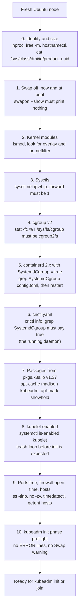

# T4.01 Prepare underlying infrastructure for a Kubernetes cluster

> Competency: "Prepare underlying infrastructure for installing a Kubernetes cluster" (CKA-4.2) | Domain/weight: CKA - Cluster Architecture, Installation and Configuration (25%) | Est. time: 3 h | Prerequisites: T1.06, T1.07, T1.11, T1.15

Prerequisite lessons (read them first if a term is new):

- [T1.06 systemd and journalctl](../part1-linux/T1.06-systemd-and-journalctl.md) - `systemctl enable --now`, `status`, `journalctl -u`. You need these to read a crash-looping kubelet.
- [T1.07 Linux networking I: interfaces, IPs, routes](../part1-linux/T1.07-linux-networking-i-interfaces-ips-routes.md) - interfaces, MAC addresses, bridges, why a node forwards packets.
- [T1.11 Containers: images, registries and runtimes (OCI)](../part1-linux/T1.11-containers-images-registries-and-runtimes-oci.md) - OCI, containerd, runc, `crictl`.
- [T1.15 Packages, kernel modules, sysctl, swap and disks](../part1-linux/T1.15-packages-kernel-modules-sysctl-swap-and.md) - `apt`, `apt-mark hold`, `modprobe`, `sysctl`, `swapoff`. This lesson uses those tools to prepare a node. They are not re-taught here.
- Also useful: [T1.10 Linux namespaces and cgroups v2](../part1-linux/T1.10-linux-namespaces-and-cgroups-v2.md) for the cgroup part.

Next lessons: `kubeadm init` and `join` (covered in a later lesson) are what you do with the prepared nodes; [T4.05 Implement and configure a highly-available control plane](../part4-cka/T4.05-implement-and-configure-a-highly-available.md) (the load balancer part of section 2.14).

Shell setup (put this at the top of every terminal; from `00-conventions.md`). This lesson is mostly node commands (run on the node, not through `kubectl`), but define the aliases anyway, because they are the habit for every later lesson:

```bash
alias k=kubectl
export do="--dry-run=client -o yaml"
export now="--force --grace-period=0"
source <(kubectl completion bash); complete -o default -F __start_kubectl k
```

Environment for this whole lesson: **vms** (three Ubuntu LTS VMs `cp1`, `w1`, `w2`, **not yet prepared**: this lesson is where you prepare them). You reach nodes with `ssh <node>` and become root with `sudo -i`, like the exam ([E7, E8](https://docs.linuxfoundation.org/tc-docs/certification/tips-cka-and-ckad)).

> **Important note about outputs in this lesson.** The machine used to write this lesson had no kind and no Multipass, so nothing could be run on a VM. Output comes in two kinds:
>
> - `REAL OUTPUT (Docker, ...)`: captured in an Ubuntu 24.04 (arm64) **container** on the writing machine, with the real `kubeadm`, `kubelet` and `crictl` v1.37.x packages from `pkgs.k8s.io`, and containerd v2.4.2 and v2.2.1. This is real for the programs, but it is **not** a VM: there was no systemd, no `modprobe`, and no real swap control. Never read it as a VM result.
> - `EXPECTED OUTPUT (not captured)`: the shape a VM prints. Digits (IPs, UUIDs, times) will differ. Compare shape, not digits. Each one is listed in section 11.

---

## 1. Why this matters

`kubeadm` does not install a container runtime, set kernel parameters, turn off swap, or open firewall ports. It assumes the node is already ready, and it refuses to continue (or the kubelet dies right after) when it is not. On a real cluster, a node that skipped one of these steps joins and then misbehaves in confusing ways: Pods that cannot reach other nodes, a kubelet that exits, or a runtime that the kubelet cannot talk to.

The CKA competency list includes preparing the infrastructure for a kubeadm install, so be ready to take a bare Ubuntu node and make it join-ready: runtime, kernel settings, packages, ports, and a clean `kubeadm init phase preflight`. One forgotten line (a sysctl that is not persisted, a runtime set to the wrong cgroup driver, a package that is not held) costs you the whole task, and the error shows up two steps later, not where you made the mistake. This lesson gives you the full checklist, the reason behind every item, and the way to prove each one with a command.

---

## 2. Concepts

### 2.1 What "a prepared node" means

A Kubernetes node is an ordinary Linux machine that runs three layers. Each layer has its own prerequisites.

| Layer | Program | What it needs from the machine |
|---|---|---|
| Node agent | `kubelet` (a systemd service) | Swap off (or a deliberate setting), cgroup v2, a CRI socket to talk to, a hostname that is unique and resolvable, the right ports |
| Container runtime | `containerd` + `runc` (the default in this guide) | A config file that enables the CRI plugin and uses the systemd cgroup driver, the `overlay` filesystem module |
| Kernel networking | the Linux kernel | IPv4 forwarding on, (usually) `br_netfilter` loaded so bridged traffic is seen by iptables/nftables |

**What kubeadm does and does not do.**

| kubeadm does | You must do before kubeadm |
|---|---|
| Run preflight checks | Install and configure the container runtime |
| Create certificates, kubeconfigs, static Pod manifests | Set `net.ipv4.ip_forward=1` (and the bridge sysctls) |
| Write `/var/lib/kubelet/config.yaml` and start the kubelet with it | Disable swap (or accept it deliberately in the kubelet config) |
| Pull the control plane images | Install `kubelet`, `kubeadm`, `kubectl` at matching versions |
| | Open the ports, fix hostnames/DNS and time |

**Under the hood: the dependency chain.** On a control plane node the API server, scheduler, controller manager and etcd are *static Pods*: the kubelet reads their YAML from `/etc/kubernetes/manifests` and asks the runtime, through the CRI socket, to start them. So the chain is: kernel settings -> runtime running -> kubelet running -> control plane Pods. If the runtime is not ready, `kubeadm init` times out waiting for the control plane, and the only clue is a runtime error in `journalctl -u kubelet`. This is why every step below has a command that proves it, and why you run `kubeadm init phase preflight` before the real `init`.

### 2.2 Hardware, OS and identity minimums

From the kubeadm install page ([install-kubeadm](https://kubernetes.io/docs/setup/production-environment/tools/kubeadm/install-kubeadm/)):

| Requirement | Minimum | Command to check |
|---|---|---|
| CPU | 2 CPUs or more on **control plane** machines | `nproc` |
| RAM | 2 GB or more per machine (less leaves little room for apps) | `free -m` |
| Network | Full connectivity between all machines (public or private is fine) | `ping -c1 <other-node>` (after section 2.13) |
| Hostname | Unique per node | `hostnamectl` or `hostname` |
| MAC address | Unique per node | `ip link` |
| `product_uuid` | Unique per node | `sudo cat /sys/class/dmi/id/product_uuid` |
| OS | A Linux with glibc, on an LTS kernel (kubeadm supports LTS kernels) | `uname -r`, `cat /etc/os-release` |

Why uniqueness matters. By default the Node object name is the machine hostname (the kubelet page says `.metadata.name` is set to the hostname unless you override it). Two machines with the same hostname fight over one Node object. The docs say that if the MAC address or `product_uuid` is not unique, "the installation process may fail" because Kubernetes uses these values to identify nodes. The risky case is a VM cloned from a template: it can carry the same hostname, the same `/etc/machine-id` and (on some hypervisors) the same `product_uuid`. Check all of them after cloning. If a file such as `/sys/class/dmi/id/product_uuid` does not exist on your hypervisor, that check does not apply there.

**CPU is enforced by kubeadm, memory is advice.** The 2-CPU rule is a hard preflight check. Forcing one CPU with `taskset` in a container gives:

```text
REAL OUTPUT (Docker, ubuntu:24.04 arm64, kubeadm v1.37.1)
$ taskset -c 0 kubeadm init phase preflight
	[ERROR NumCPU]: the number of available CPUs 1 is less than the required 2
```

The 2 GB figure is documented. Whether kubeadm 1.37 also has a hard memory check, and at what number, is not confirmed (section 11). Plan for 2 GB anyway; a 1 GB control plane node runs out of memory as soon as you add workloads.

**More than one network adapter.** kubeadm picks the node IP from the interface of the default route. The `--v=5` log shows this: "Looking for default routes with IP addresses" then "Found active IP". If the cluster must use a second interface (a private network), the docs advise adding routes so Kubernetes addresses go through the right adapter. If you cannot, you pass the address explicitly at `init` time (`--apiserver-advertise-address`, taught with `kubeadm init` in a later lesson).

**The command set for the check:**

```bash
nproc                                          # CPUs. Control plane needs 2 or more
free -m                                        # RAM in MB, "Mem:" row. Want 2000 or more
hostnamectl --static                           # the hostname. Must be unique, lowercase, no underscores
ip -br link                                    # one line per interface with its MAC address
sudo cat /sys/class/dmi/id/product_uuid        # must differ on every node
cat /etc/machine-id                            # must differ on every node (cloned VMs)
uname -r                                       # kernel version
```

### 2.3 Required ports

Kubernetes components talk to each other over fixed TCP ports. If a firewall between the nodes blocks one, that component looks "down" even though it runs. This table is copied in shape from the official page ([ports-and-protocols](https://kubernetes.io/docs/reference/networking/ports-and-protocols/)). It was checked against the page on the day of writing.

**Control plane node(s)**

| Protocol | Direction | Port range | Purpose | Used by |
|---|---|---|---|---|
| TCP | Inbound | 6443 | Kubernetes API server | All |
| TCP | Inbound | 2379-2380 | etcd server client API | kube-apiserver, etcd |
| TCP | Inbound | 10250 | Kubelet API | Self, control plane |
| TCP | Inbound | 10259 | kube-scheduler | Self |
| TCP | Inbound | 10257 | kube-controller-manager | Self |

**Worker node(s)**

| Protocol | Direction | Port range | Purpose | Used by |
|---|---|---|---|---|
| TCP | Inbound | 10250 | Kubelet API | Self, control plane |
| TCP | Inbound | 10256 | kube-proxy | Self, load balancers |
| TCP | Inbound | 30000-32767 | NodePort Services | All |
| UDP | Inbound | 30000-32767 | NodePort Services | All |

The page notes that etcd can also run outside the cluster on custom ports, that all default ports can be overridden (then you open the custom ones instead), and that the API server port is sometimes changed to 443 or kept at 6443 behind a load balancer listening on 443.

What each port is for, in plain words:

- **6443** is the front door. `kubectl`, every kubelet, every controller and the scheduler talk to the API server here. It is the one port you must always be able to reach from every node and from your admin machine.
- **2379** is where the API server talks to etcd (the key-value database holding all cluster state). **2380** is etcd talking to its own peers (matters in an HA cluster with several control planes).
- **10250** is the kubelet's own API on every node. The API server calls it for `kubectl logs`, `exec`, `port-forward` and metrics. If it is blocked, `kubectl get nodes` works but `kubectl logs` times out.
- **10259** and **10257** are the secure ports of the scheduler and the controller manager. Only the node itself (and monitoring) needs them.
- **10256** is the kube-proxy health port (cloud load balancers use it to check a node).
- **30000-32767** is the default NodePort range, TCP and UDP. If you never use NodePort Services you can keep it closed, but a NodePort that is not reachable is a common "my Service does not work" report.
- Your CNI (the Pod network plugin) needs **its own ports** on top. They differ for every plugin, so read the plugin docs; the install page says the same.

**Two different questions, two different tools.**

| Question | Meaning | Tool |
|---|---|---|
| "Is this port **free** on this node?" | Nothing already listens, so the component can bind | kubeadm preflight, `ss -tlnp` |
| "Is this port **reachable** from another node?" | The firewall and security group allow it | `nc -zv <ip> <port>` from the other node |

kubeadm preflight only answers the first question, for the ports it will bind. In the real log of `kubeadm init phase preflight --v=5` the ports checked on a control plane node were 6443, 10259, 10257, 10250, 2379 and 2380. It did **not** check 10256 or the NodePort range, and it cannot tell you whether a firewall on the way blocks anything. With a listener started on 6443, the captured failure is:

```text
REAL OUTPUT (Docker, ubuntu:24.04 arm64, kubeadm v1.37.1)
$ ss -tlnp | grep 6443
LISTEN 0      1            0.0.0.0:6443       0.0.0.0:*    users:(("nc",pid=3952,fd=3))
$ kubeadm init phase preflight 2>&1 | grep ERROR
	[ERROR Port-6443]: Port 6443 is in use
```

And the check the install page suggests, with both outcomes:

```text
REAL OUTPUT (Docker, ubuntu:24.04 arm64, netcat-openbsd)
$ nc 127.0.0.1 6443 -zv -w 2     # something is listening
Connection to 127.0.0.1 6443 port [tcp/*] succeeded!
$ nc 127.0.0.1 6444 -zv -w 2     # nothing is listening
nc: connect to 127.0.0.1 port 6444 (tcp) failed: Connection refused
```

How to read results from another node: "succeeded" means reachable. "Connection refused" usually means the packet arrived and nothing listens there (or a firewall sent a reject). A silent wait ending in a timeout (`-w 2` makes it 2 seconds) usually means something dropped the packet. Both causes exist for both symptoms, so confirm on the target node with `ss -tlnp` whether anything listens.

**Firewalls on the node.** Ubuntu's `ufw` is inactive by default. Check it with `sudo ufw status`. kubeadm also looks for an active `firewalld` (it printed `[WARNING Firewalld]: no supported init system detected, skipping checking for services` in the container, where there is no init system). If `ufw` is active, allow the ports above (`sudo ufw allow 6443/tcp`, and so on) or disable it on lab machines. In a cloud, the equivalent is the security group.

### 2.4 Kernel modules: overlay and br_netfilter

A **kernel module** is code the kernel loads on demand. Two matter here (T1.15 teaches `modprobe`, `lsmod` and `modules-load.d`).

| Module | What it is | Why Kubernetes nodes want it |
|---|---|---|
| `overlay` | The OverlayFS file system | containerd stores image layers with its `overlayfs` snapshotter (the default config contains `snapshotter = 'overlayfs'`). Without the module, containers cannot be created from layered images. The official `containerd.service` unit even runs `ExecStartPre=-/sbin/modprobe overlay`. |
| `br_netfilter` | Lets traffic that crosses a Linux **bridge** pass through iptables/nftables | Pod traffic on one node often goes over a bridge. kube-proxy implements Services with iptables/nftables rules. If bridged packets skip those rules, a Pod talking to a Service IP can miss the translation. |

An honest note about `br_netfilter`. The 1.37 container-runtimes page lists only `net.ipv4.ip_forward` and says that CNIs set what they need or tell you what to set. In the captured `kubeadm init phase preflight --v=5` list, only `ip_forward` is read from `/proc/sys`; with `bridge-nf-call-iptables` set to 0, preflight did not complain. So in 1.37 nothing forces you to load `br_netfilter`. This guide, the exam-prep literature and most CNI install guides still load it, because bridge-based CNIs depend on it, and it costs nothing. Do it. Keep in mind it is a belt-and-braces step and not a preflight check.

Commands:

```bash
sudo modprobe overlay                       # load now
sudo modprobe br_netfilter                  # load now
lsmod | grep -E '^(overlay|br_netfilter)'   # proof: two lines
printf 'overlay\nbr_netfilter\n' | sudo tee /etc/modules-load.d/k8s.conf   # load at every boot
```

`modprobe` only loads for the current boot. `/etc/modules-load.d/*.conf` is read by `systemd-modules-load` at boot, one module name per line. You need both.

```text
EXPECTED OUTPUT (not captured)
$ lsmod | grep -E '^(overlay|br_netfilter)'
br_netfilter           32768  0
overlay               212992  0
```

**Order matters.** The `net.bridge.*` sysctl keys exist only after `br_netfilter` is loaded. If you run `sysctl --system` before `modprobe br_netfilter`, sysctl cannot find those keys (it prints that it cannot stat `/proc/sys/net/bridge/...`; exact text in section 11). That is why every script puts modules first.

### 2.5 Kernel parameters (sysctl)

`sysctl` reads and writes kernel settings under `/proc/sys`. `sysctl --system` applies every file in `/etc/sysctl.d/`, `/run/sysctl.d/`, `/usr/lib/sysctl.d/` and `/etc/sysctl.conf` in order (later files win).

| Key | Default | Set to | What breaks if left default |
|---|---|---|---|
| `net.ipv4.ip_forward` | `0` | `1` | The node will not route packets between interfaces. A Pod on this node cannot reach a Pod on another node, because the packet has to be forwarded from the Pod interface out of the physical one. kubeadm refuses to run. |
| `net.bridge.bridge-nf-call-iptables` | `0` or `1` depending on kernel/module version; set it explicitly | `1` | Bridged IPv4 traffic skips iptables, so Service translation and iptables-based NetworkPolicy can be bypassed. Needs `br_netfilter` loaded. |
| `net.bridge.bridge-nf-call-ip6tables` | same | `1` | The same, for IPv6 |

(For a dual-stack or IPv6 cluster you also need IPv6 forwarding, `net.ipv6.conf.all.forwarding=1`. This was not verified against the 1.37 docs; section 11.)

Persist in a drop-in file, then apply:

```bash
cat <<'EOF' | sudo tee /etc/sysctl.d/k8s.conf
net.bridge.bridge-nf-call-iptables  = 1
net.bridge.bridge-nf-call-ip6tables = 1
net.ipv4.ip_forward                 = 1
EOF
sudo sysctl --system                         # apply all files now, printing each file it reads
sysctl net.ipv4.ip_forward                   # proof: net.ipv4.ip_forward = 1
```

`sysctl -w net.ipv4.ip_forward=1` sets it only until reboot. The file makes it survive reboots. A different file that sorts later (for example `/etc/sysctl.d/99-hardening.conf` or `/etc/sysctl.conf`) can set the key back to 0, so the proof is always the **live value** after `sysctl --system`, not the contents of your file.

This is the one kernel setting kubeadm 1.37 checks. Setting it to 0 in a container gives:

```text
REAL OUTPUT (Docker, ubuntu:24.04 arm64, kubeadm v1.37.1)
$ sysctl -w net.ipv4.ip_forward=0
net.ipv4.ip_forward = 0
$ kubeadm init phase preflight 2>&1 | grep ip_forward
	[ERROR FileContent--proc-sys-net-ipv4-ip_forward]: /proc/sys/net/ipv4/ip_forward contents are not set to 1
```

The check name is `FileContent--proc-sys-net-ipv4-ip_forward`: the file path `/proc/sys/net/ipv4/ip_forward` with `/` replaced by `-`. This pattern is how kubeadm names every file-based check, and it is the string you pass to `--ignore-preflight-errors`.

### 2.6 Swap

**Swap** is disk space the kernel uses as overflow for memory. Kubernetes scheduling and OOM handling assume memory is a hard limit; with swap, a container over its limit may slow down instead of being killed, and the node's accounting is unpredictable. So by default the kubelet refuses to start on a node that has swap. The install page says so: "The default behavior of a kubelet is to fail to start if swap memory is detected on a node. This means that swap should either be disabled or tolerated by kubelet."

T1.15 section 2.8 explains the mechanics in depth. The essentials for this lesson:

| Option | How | Pods use swap? |
|---|---|---|
| **A. Turn swap off** (the simplest, safest choice, and the one the install page lists first; if a task states how to treat swap, the task text decides) | `sudo swapoff -a` and comment out the swap line in `/etc/fstab` | No |
| **B. Tolerate swap** | `failSwapOn: false` in the KubeletConfiguration | Not unless you also set `memorySwap.swapBehavior` to something other than the default `NoSwap` (for example `LimitedSwap`) |

```bash
swapon --show                                                       # empty output = no swap active
sudo swapoff -a                                                     # off now (lost at reboot)
sudo sed -i -E '/^[^#].*[[:space:]]swap[[:space:]]/ s/^/#/' /etc/fstab   # off at boot: comment out swap lines
free -h | grep -i swap                                              # Swap: 0B 0B 0B
```

The docs also say swap can be activated by `systemd.swap` units, not only by `/etc/fstab`. Check `systemctl list-units --type=swap`. If a unit turns swap back on after reboot, `systemctl mask` it ([T1.06](../part1-linux/T1.06-systemd-and-journalctl.md)).

**Observing option B (after a `kubeadm init` with the config of section 4.3).** kubeadm writes the kubelet configuration to `/var/lib/kubelet/config.yaml`. Read the swap fields from there:

```bash
sudo grep failSwapOn /var/lib/kubelet/config.yaml
sudo grep -A1 memorySwap /var/lib/kubelet/config.yaml
free -h | grep -i swap                     # swap is on and the kubelet still runs
```

```text
EXPECTED OUTPUT (not captured)
failSwapOn: false
memorySwap:
  swapBehavior: LimitedSwap
```

With `NoSwap` (the documented default) the kubelet starts with swap on but Pods get no swap. `LimitedSwap` lets Pods use a limited amount; the rules are on the swap-memory-management page in the references. The `swapBehavior` default and the exact `LimitedSwap` behaviour are listed in section 11 as unconfirmed. This check needs a node that has run `kubeadm init`, so it is not part of this lesson's labs.

**Preflight only warns; the kubelet is what fails.** This is the most common false comfort. In kubeadm 1.37.1, swap is a warning:

```text
REAL OUTPUT (Docker, ubuntu:24.04 arm64, kubeadm v1.37.1). The container saw the Docker VM's swap.
$ kubeadm init phase preflight 2>&1 | grep Swap
	[WARNING Swap]: swap is supported for cgroup v2 only. The kubelet must be properly configured to use swap. Please refer to https://kubernetes.io/docs/concepts/architecture/nodes/#swap-memory, or disable swap on the node
```

So `kubeadm init phase preflight` can pass with swap on. The kubelet then refuses to start. The kubelet binary contains this message (found with `grep -a`):

```text
REAL OUTPUT (Docker, kubelet v1.37.1 binary)
running with swap on is not supported, please disable swap or set --fail-swap-on flag to false
```

And the defaults, from `kubelet --help`:

```text
REAL OUTPUT (Docker, kubelet v1.37.1)
      --fail-swap-on        Makes the Kubelet fail to start if swap is enabled on the node.  (default true) (DEPRECATED: ...set via the config file)
```

Treat "no `Swap` warning in the preflight output" as part of "prepared". The warning being absent means the node really has no active swap.

### 2.7 cgroup v2

A **cgroup** (control group) is the kernel feature that limits and counts the CPU, memory and process count of a group of processes. Pod `requests` and `limits` end up as cgroup settings. There are two kernel designs, **v1** (one tree per resource) and **v2** (one unified tree). See [T1.10](../part1-linux/T1.10-linux-namespaces-and-cgroups-v2.md).

Kubernetes dropped practical support for v1. The kubelet has a setting `failCgroupV1` (flag `--fail-cgroupv1`) whose default is `true` since 1.35 (confirmed in the captured `kubelet --help` below): the kubelet refuses to start on a cgroup v1 host.

```text
REAL OUTPUT (Docker, kubelet v1.37.1)
$ kubelet --help | grep fail-cgroupv1
      --fail-cgroupv1    Prevent the kubelet from starting on the host using cgroup v1. (default true)
```

The kubelet binary also contains the text `kubelet is configured to not run on a host using cgroup v1. cgroup v1 support is unsupported and will be removed in a future release`. kubeadm has its own check for this inside the `SystemVerification` preflight check (the binary contains a `CgroupsValidator` with an `isCgroupsV1DisabledInKubelet` function and the message "cgroups v1 support is deprecated and will be removed in a future release. Please migrate to cgroups v2. To explicitly enable cgroups v1 support for kubelet v1.35 or newer, you must set the kubelet configuration option ..."). The test host was cgroup v2 only, so the full error line is not captured (section 11).

**How to check your node:**

```bash
stat -fc %T /sys/fs/cgroup/        # cgroup2fs = v2.   tmpfs = v1 (or hybrid)
cat /sys/fs/cgroup/cgroup.controllers   # exists only on v2: cpuset cpu io memory pids
```

```text
REAL OUTPUT (Docker, ubuntu:24.04 arm64; Docker Desktop VM, cgroup v2)
$ stat -fc %T /sys/fs/cgroup/
cgroup2fs
$ cat /sys/fs/cgroup/cgroup.controllers
cpuset cpu io memory pids
```

Ubuntu 22.04 and later boot with v2 by default, so on current Ubuntu LTS you only verify. On an old image or a custom kernel command line that forces v1, switch to the **unified hierarchy** (v2): add `systemd.unified_cgroup_hierarchy=1` to `GRUB_CMDLINE_LINUX` in `/etc/default/grub`, run `sudo update-grub`, reboot, and re-check with `stat`. Newer systemd releases (reported as v256 and later, unconfirmed here) treat cgroup v1 as unsupported and ignore that parameter; there, v2 is the only mode, and the job is to read `cat /proc/cmdline` and remove any option that forces v1 (for example `systemd.unified_cgroup_hierarchy=0`). Do not "fix" the preflight by setting `failCgroupV1: false`; that is the unsupported route and only postpones the problem.

### 2.8 The container runtime: containerd 2.x

**CRI** (Container Runtime Interface) is the gRPC API the kubelet uses to ask a runtime to create Pod sandboxes and containers. **containerd** is the runtime this guide uses. It runs containers through **runc** (the OCI runtime that calls the kernel). Dockershim was removed in 1.24, so Docker Engine needs the extra `cri-dockerd` adapter. Kubernetes 1.37 requires a CRI-conformant runtime and only the CRI **v1** API.

| Runtime | CRI socket (from the install page / runtimes page) | Notes |
|---|---|---|
| containerd | `unix:///var/run/containerd/containerd.sock` (`/run/containerd/containerd.sock` is the same file, because `/var/run` is a symlink to `/run`) | Used in this guide |
| CRI-O | `unix:///var/run/crio/crio.sock` | systemd cgroup driver by default |
| Docker Engine via cri-dockerd | `unix:///var/run/cri-dockerd.sock` | extra adapter needed |

If you do not tell kubeadm which socket to use, it scans these known endpoints. If it finds none or more than one it stops and asks you to choose with `--cri-socket`. (Both the failure and the autodetect were captured: "detected and using CRI socket: unix:///var/run/containerd/containerd.sock".)

**Why containerd 2.x.** The 1.37 runtimes page says: with the `KubeletCgroupDriverFromCRI` feature gate and a runtime that supports the `RuntimeConfig` CRI call, the kubelet detects the cgroup driver from the runtime. containerd 1.x does not support that call, so the kubelet falls back to its own setting; **"In Kubernetes 1.38, this fallback behavior will be dropped, and older versions of containerd will fail with newer kubelets."** So install containerd 2.x. This guide's pin is containerd v2.4.2 with runc v1.5.2.

**Two ways to install on Ubuntu 24.04.**

| | A. Release tarball (pinned, what `env/vm-prereqs.sh` does) | B. Ubuntu package |
|---|---|---|
| Version seen | v2.4.2 (config `version = 4`) | 2.2.1-0ubuntu1~24.04.4 (config `version = 3`) |
| Install | download the tarball, unpack to `/usr/local`, add the `containerd.service` unit, install `runc` | `sudo apt-get install -y containerd` (pulls `runc` too) |
| systemd unit | you add it (`containerd.service`) | installed by the package |
| `/etc/containerd/config.toml` after install | you create it | does not exist; containerd uses built-in defaults |
| Use when | you need an exact version | quickest, no network beyond apt |

The second row is not a typo: the Ubuntu 24.04 archive carries a 2.x containerd. This was confirmed in a fresh container (`containerd github.com/containerd/containerd/v2 2.2.1`). Whatever you install, check `containerd --version` shows 2.x (or higher).

**Which path this lesson uses.** `node-prep.sh` and the labs use path B (the apt package, 2.2.1 on the Ubuntu 24.04 archive seen here). `env/vm-prereqs.sh` uses path A (v2.4.2). The config `version` line differs (3 versus 4), but you never edit it, and the `SystemdCgroup` edit is identical on both.

Install A (pinned, binaries), for reference:

```bash
ARCH=$(dpkg --print-architecture)                      # amd64 or arm64; the release assets use the same words
curl -fsSL -o /tmp/containerd.tgz https://github.com/containerd/containerd/releases/download/v2.4.2/containerd-2.4.2-linux-${ARCH}.tar.gz
sudo tar -C /usr/local -xzf /tmp/containerd.tgz         # installs /usr/local/bin/containerd, ctr, containerd-shim-runc-v2
sudo curl -fsSL -o /usr/local/lib/systemd/system/containerd.service --create-dirs \
  https://raw.githubusercontent.com/containerd/containerd/v2.4.2/containerd.service
sudo curl -fsSL -o /usr/local/sbin/runc https://github.com/opencontainers/runc/releases/download/v1.5.2/runc.${ARCH}
sudo chmod +x /usr/local/sbin/runc
sudo systemctl daemon-reload && sudo systemctl enable --now containerd
```

The download and unpack part was run for arm64 in a container (it gave `containerd v2.4.2`, and `runc version 1.5.2`), and the unit file was fetched (its `ExecStart=/usr/local/bin/containerd` matches this path). The `systemctl` and unit-directory lines need a real VM (section 11). Check the release `.sha256sum` file before you trust a download in real life.

**Create the config file, then set the systemd cgroup driver.**

```bash
sudo mkdir -p /etc/containerd
containerd config default | sudo tee /etc/containerd/config.toml > /dev/null
sudo sed -i 's/SystemdCgroup = false/SystemdCgroup = true/' /etc/containerd/config.toml
sudo systemctl restart containerd
```

`containerd config default` prints the full default configuration to stdout. It does not write anything by itself; you capture it. The `sed` flips the single line that selects the cgroup driver for runc. Here are the parts that matter, **captured from containerd v2.4.2**:

```text
REAL OUTPUT (Docker, containerd v2.4.2): sed -n '1,5p;14,18p;26,29p;62,66p;78,90p' /etc/containerd/config.toml
version = 4
root = '/var/lib/containerd'
state = '/run/containerd'
temp = ''
disabled_plugins = []

[plugins]
  [plugins.'io.containerd.cri.v1.images']
    snapshotter = 'overlayfs'
    disable_snapshot_annotations = true

    [plugins.'io.containerd.cri.v1.images'.pinned_images]
      sandbox = 'registry.k8s.io/pause:3.10.2'

      [plugins.'io.containerd.cri.v1.runtime'.containerd.runtimes]
        [plugins.'io.containerd.cri.v1.runtime'.containerd.runtimes.runc]
          runtime_type = 'io.containerd.runc.v2'
          ...
          [plugins.'io.containerd.cri.v1.runtime'.containerd.runtimes.runc.options]
            BinaryName = ''
            ...
            SystemdCgroup = false
```

**What changed from containerd 1.x (this is where old tutorials break).** The key paths below were checked on real default configs:

| Setting | containerd 1.x (config `version = 2`) | containerd 2.x (config `version = 3` in 2.2.1, `version = 4` in 2.4.2) |
|---|---|---|
| systemd cgroup for runc | `[plugins."io.containerd.grpc.v1.cri".containerd.runtimes.runc.options]` `SystemdCgroup = true` | `[plugins.'io.containerd.cri.v1.runtime'.containerd.runtimes.runc.options]` `SystemdCgroup = true` |
| sandbox (pause) image | `[plugins."io.containerd.grpc.v1.cri"]` `sandbox_image = "registry.k8s.io/pause:3.10"` | `[plugins.'io.containerd.cri.v1.images'.pinned_images]` `sandbox = 'registry.k8s.io/pause:3.10.2'` |
| image snapshotter | under `...grpc.v1.cri".containerd` | `[plugins.'io.containerd.cri.v1.images']` `snapshotter = 'overlayfs'` |

Some guides say "config version 3". That is true for containerd 2.2.1 (the Ubuntu package), and it is `version = 4` in 2.4.2. The key paths for the CRI plugin are the same in both. Do not edit the `version` line; just look at the table paths. The runtimes page in the docs still shows the old `sandbox_image` path next to the new `SystemdCgroup` path. If you put `sandbox_image` into a 2.x file it is simply not where 2.x looks.

Why `SystemdCgroup = true`: when systemd is the init system, systemd owns the cgroup tree. If runc created cgroups by itself (the `cgroupfs` driver) there would be two managers with two views of resource use, and the docs say such nodes "become unstable under resource pressure". The docs recommend the systemd driver with cgroup v2.

The `sed` pattern replaces every `SystemdCgroup = false`. The default file has exactly one, so one line changes. Prove it in two places, and know what each one proves:

```bash
grep -n SystemdCgroup /etc/containerd/config.toml     # 89:            SystemdCgroup = true      (what the FILE says)
sudo crictl info | grep SystemdCgroup                 # "SystemdCgroup": true                   (what the RUNNING daemon uses)
```

The second command asks the running containerd over the CRI socket (it needs `/etc/crictl.yaml`, section 2.10). So it does not say `true` if you edited the file but never restarted containerd, or restarted it before the edit. `containerd config dump` looks like a third proof but is not: it is a client-side command that parses `/etc/containerd/config.toml` (and its imports) and prints the merged result with defaults. It shows what a restart *would* load, not what the daemon loaded. Use it to read the merged file, never as proof of the live value.

**Risky values in this file.**

- `disabled_plugins` must not contain the CRI plugin. The docs warn that a distro package may disable it by default. In containerd 2.x the value must be a full plugin URI. With the old 1.x short form, containerd refuses to start:

```text
REAL OUTPUT (Docker, containerd v2.4.2), disabled_plugins = ["cri"]
containerd: failed to load TOML from /etc/containerd/config.toml: invalid disabled plugin URI "cri" expect io.containerd.x.vx
```

  With the full URI `["io.containerd.grpc.v1.cri"]` containerd starts but serves no CRI, and kubeadm reports `unknown service runtime.v1.RuntimeService` (section 6).
- `SystemdCgroup = false` on a systemd host: the driver the runtime reports then does not match what a kubelet configured for systemd expects (section 2.9).
- Replacing the sandbox image with a tag that is not available on the node (air-gapped nodes): every Pod fails at sandbox creation, because every Pod needs it first.

**Sandbox image.** The *sandbox* (or *pause*) container is the tiny first container that holds a Pod's network namespace; app containers join it. containerd pulls it from the registry named in `pinned_images.sandbox`. kubeadm 1.37.1 lists its own pause image as `registry.k8s.io/pause:3.10.2`:

```text
REAL OUTPUT (Docker, kubeadm v1.37.1)
$ kubeadm config images list
registry.k8s.io/kube-apiserver:v1.37.1
registry.k8s.io/kube-controller-manager:v1.37.1
registry.k8s.io/kube-scheduler:v1.37.1
registry.k8s.io/kube-proxy:v1.37.1
registry.k8s.io/coredns/coredns:v1.14.6
registry.k8s.io/pause:3.10.2
registry.k8s.io/etcd:3.7.0-0
```

containerd 2.4.2's default is the same tag (3.10.2). The Ubuntu 2.2.1 package defaults to `pause:3.10.1`. With the sandbox image set to `pause:3.9` on purpose, preflight in kubeadm 1.37.1 printed **no** warning about the mismatch. The consequence is only that the node pulls whichever tag containerd names. You normally keep the default; change it only for a private mirror (and then every node needs the same value).

**Restart and prove it:**

```bash
sudo systemctl restart containerd
systemctl is-active containerd                 # active
ls -l /run/containerd/containerd.sock          # the CRI socket exists
sudo crictl info | grep -E '"SystemdCgroup"'   # "SystemdCgroup": true   (needs /etc/crictl.yaml, section 2.10)
```

```text
REAL OUTPUT (Docker, containerd v2.4.2, started by hand: there was no systemd in the container)
$ crictl info | grep SystemdCgroup
            "SystemdCgroup": true
$ ls -l /run/containerd/containerd.sock
srw-rw---- 1 root root 0 Oct 27 08:16 /run/containerd/containerd.sock
```

### 2.9 The cgroup driver: kubelet autodetect and the old setting

The kubelet and the runtime must use the **same cgroup driver** (`cgroupfs` or `systemd`). The official statement: "It's critical that the kubelet and the container runtime use the same cgroup driver and are configured the same."

| Era | How the kubelet learns the driver | What you must do |
|---|---|---|
| Before autodetect | From `cgroupDriver` in its own config (kubeadm writes `cgroupDriver: systemd`) | Make containerd match: `SystemdCgroup = true`. A mismatch gave unstable or restarting Pods |
| Kubernetes 1.37 (autodetect reported GA since 1.34, UNVERIFIED here; the 1.37 docs name the `KubeletCgroupDriverFromCRI` gate) | The kubelet asks the runtime (CRI `RuntimeConfig`) and **ignores** `cgroupDriver` in its config, if the runtime supports the call | Install containerd 2.x. Still set `SystemdCgroup = true`, because that is what the runtime will then report |
| containerd 1.x with a 1.37 kubelet | The runtime cannot answer, so the kubelet falls back to its own `cgroupDriver` | Works today; dropped in 1.38 |

kubeadm still writes `cgroupDriver: systemd` into the kubelet config when it is empty. The `--v=5` log shows it:

```text
REAL OUTPUT (Docker, kubeadm v1.37.1)
kubelet.go:195] the value of KubeletConfiguration.cgroupDriver is empty; setting it to "systemd"
```

and in `kubeadm config print init-defaults --component-configs KubeletConfiguration`, which includes `cgroupDriver: systemd`. Some sources call the KubeletConfiguration field deprecated (UNVERIFIED here); the 1.37 docs say it is ignored when autodetect works (the exact deprecation wording is in section 11). Practical rule: **do not hand-edit `cgroupDriver`**; make containerd use systemd and let the kubelet follow.

A note on doc conflicts. The kubelet-integration page still says "the kubelet cannot automatically detect the cgroup driver"; the container-runtimes page (updated July 2026) says it can. Trust the runtimes page, but the rule above is safe either way.

**Changing the driver later is dangerous.** The runtimes page warns that changing the driver of a node that already joined can break the recreation of existing Pod sandboxes, and restarting the kubelet may not fix it. It recommends replacing or reinstalling the node. So set the driver correctly *before* `kubeadm join`.

**Under the hood: what "same driver" means.** With `systemd`, a Pod's cgroup is a systemd *slice* (for example `kubepods-burstable.slice`) that systemd itself creates through its D-Bus API. With `cgroupfs`, the kubelet and runtime write directly under `/sys/fs/cgroup`. If the kubelet asks for `kubepods.slice/...` (systemd naming) and runc tries to create `/kubepods/...` (cgroupfs naming), the two disagree about where the Pod's cgroup lives. The symptoms are sandbox creation errors or Pods that are killed and restarted, and they appear **after** install, not at preflight.

### 2.10 crictl and /etc/crictl.yaml

`crictl` is a debugging client that speaks CRI directly to the runtime. It is the right tool when the API server is down and `kubectl` cannot help, because it needs only the runtime socket. Package `cri-tools` installs `/usr/bin/crictl` (the kubelet-integration page lists the package contents). The version installed in the test container: `crictl version v1.37.0`.

| Command | Use |
|---|---|
| `crictl ps -a` | all containers, including stopped |
| `crictl pods` | Pod sandboxes |
| `crictl images` | images on this node |
| `crictl logs <container-id>` | container logs |
| `crictl info` | runtime status and the effective config as JSON |
| `crictl inspect <id>` / `crictl inspectp <id>` | container / Pod details |

`crictl` needs to know which socket to use. It reads `/etc/crictl.yaml`. Without the file, current crictl falls back to a list of default sockets and prints warnings that this is deprecated:

```text
REAL OUTPUT (Docker, crictl v1.37.0), /etc/crictl.yaml removed
$ crictl ps
time="2026-10-27T08:17:49Z" level=warning msg="Config \"/etc/crictl.yaml\" does not exist, trying next: \"/usr/bin/crictl.yaml\""
time="2026-10-27T08:17:49Z" level=warning msg="runtime connect using default endpoints: [unix:///run/containerd/containerd.sock unix:///run/crio/crio.sock unix:///var/run/cri-dockerd.sock]. As the default settings are now deprecated, you should set the endpoint instead."
...
```

and with a wrong endpoint:

```text
REAL OUTPUT (Docker, crictl v1.37.0), runtime-endpoint: unix:///run/nothere.sock
level=error msg="validate service connection: validate CRI v1 runtime API for endpoint \"unix:///run/nothere.sock\": rpc error: code = Unavailable desc = connection error: desc = \"transport: Error while dialing: dial unix /run/nothere.sock: connect: no such file or directory\""
```

The file (every field explained in section 4.3):

```yaml
runtime-endpoint: unix:///run/containerd/containerd.sock
image-endpoint: unix:///run/containerd/containerd.sock
timeout: 10
debug: false
```

You can also write it with `sudo crictl config --set runtime-endpoint=unix:///run/containerd/containerd.sock`. crictl is run as root on a node (the socket is `root:root` mode `660`, as in the listing above).

**Related but different.** `ctr` ships with containerd and talks to containerd's own API (with its own namespaces), not CRI; it will not show Kubernetes containers unless you pass `-n k8s.io`. `nerdctl` is a separate Docker-like CLI. For Kubernetes debugging use `crictl`.

### 2.11 The Kubernetes package repository, install and hold

Packages live at `https://pkgs.k8s.io/core:/stable:/v1.37/deb/`, one repository **per minor version**. The path holds the minor, so `apt upgrade` cannot move you from 1.37 to 1.38 by accident. T1.15 section 2.3 explains each piece (key, `signed-by`, flat repo). The install page sequence for v1.37:

```bash
sudo apt-get update
sudo apt-get install -y apt-transport-https ca-certificates curl gpg
sudo mkdir -p -m 755 /etc/apt/keyrings          # needed on releases older than Ubuntu 22.04
curl -fsSL https://pkgs.k8s.io/core:/stable:/v1.37/deb/Release.key | sudo gpg --dearmor --yes -o /etc/apt/keyrings/kubernetes-apt-keyring.gpg
echo 'deb [signed-by=/etc/apt/keyrings/kubernetes-apt-keyring.gpg] https://pkgs.k8s.io/core:/stable:/v1.37/deb/ /' | sudo tee /etc/apt/sources.list.d/kubernetes.list
sudo apt-get update
sudo apt-get install -y kubelet kubeadm kubectl
sudo apt-mark hold kubelet kubeadm kubectl
```

(`--yes` was added to `gpg --dearmor` so a second run does not stop to ask about overwriting the key file.) This sequence was run in a container. The packages installed were:

```text
REAL OUTPUT (Docker, ubuntu:24.04 arm64)
$ dpkg -l | grep -E "kube|cri-tools" | awk '{print $2, $3}'
cri-tools 1.37.0-1.1
kubeadm 1.37.1-1.1
kubectl 1.37.1-1.1
kubelet 1.37.1-1.1
kubernetes-cni 1.9.1-1.1
```

What each package gives you (kubelet-integration page, confirmed in the container):

| Package | Installs |
|---|---|
| `kubeadm` | `/usr/bin/kubeadm` and the kubelet systemd drop-in `10-kubeadm.conf` |
| `kubelet` | `/usr/bin/kubelet` and the `kubelet.service` unit. Depends on `kubernetes-cni` |
| `kubectl` | `/usr/bin/kubectl` |
| `cri-tools` | `/usr/bin/crictl`. **Not** pulled in by the three above, so install it by name |
| `kubernetes-cni` | the base CNI plugin binaries in `/opt/cni/bin` (pulled in by `kubelet`) |

`apt-cache show kubeadm` listed no dependencies in the captured output, which is why `cri-tools` is a separate install.

**Why `apt-mark hold`.** Kubernetes upgrades follow a fixed order (control plane first, one minor at a time; the upgrade procedure is covered in a later lesson). `apt-mark hold` stops a plain `apt-get upgrade` from replacing these packages. The install page's warning: "These instructions exclude all Kubernetes packages from any system upgrades." Proof:

```text
REAL OUTPUT (Docker, ubuntu:24.04 arm64)
$ apt-mark hold kubelet kubeadm kubectl; apt-mark showhold
kubelet set on hold.
kubeadm set on hold.
kubectl set on hold.
kubeadm
kubectl
kubelet
```

`apt-mark showhold` prints in alphabetical order. That is why the verification script later compares against `kubeadm kubectl kubelet`.

**Matching versions.** kubeadm does not install or manage `kubelet` and `kubectl` for you. Install the same version on all nodes. The kubelet must never be newer than the API server (see the version skew policy at https://kubernetes.io/releases/version-skew-policy/). To pin an exact version: `apt-cache madison kubeadm` lists candidates such as `1.37.1-1.1`; then `apt-get install -y kubeadm=1.37.1-1.1`.

The `deb ...` repo line is also a mistake magnet: a typo in the minor (`v1.36` in the URL) silently installs the wrong minor. After `apt-get update`, `apt-cache madison kubeadm | head -3` must show the minor you want.

### 2.12 Enabling the kubelet, and why it crash-loops

```bash
sudo systemctl enable --now kubelet
```

`enable` makes it start at boot, `--now` also starts it right away. The install page marks this step as optional ("before running kubeadm"), and `kubeadm init` starts the kubelet itself, but do it so the service is ready and enabled after a reboot. Then comes the line to remember: "The kubelet is now restarting every few seconds, as it waits in a crashloop for kubeadm to tell it what to do."

Why. The package's kubelet unit starts `/usr/bin/kubelet` with the drop-in's arguments, including `--config=/var/lib/kubelet/config.yaml`. That file does not exist until `kubeadm init` or `join` writes it. The unit has `Restart=always` and `RestartSec=10`, so systemd restarts it every 10 seconds. The unit file shipped in the package:

```text
REAL OUTPUT (Docker; contents of the package files)
$ cat /usr/lib/systemd/system/kubelet.service
[Service]
ExecStart=/usr/bin/kubelet
Restart=always
StartLimitInterval=0
RestartSec=10
...
$ cat /usr/lib/systemd/system/kubelet.service.d/10-kubeadm.conf
Environment="KUBELET_KUBECONFIG_ARGS=--bootstrap-kubeconfig=/etc/kubernetes/bootstrap-kubelet.conf --kubeconfig=/etc/kubernetes/kubelet.conf"
Environment="KUBELET_CONFIG_ARGS=--config=/var/lib/kubelet/config.yaml"
EnvironmentFile=-/var/lib/kubelet/kubeadm-flags.env
EnvironmentFile=-/etc/default/kubelet
ExecStart=
ExecStart=/usr/bin/kubelet $KUBELET_KUBECONFIG_ARGS $KUBELET_CONFIG_ARGS $KUBELET_KUBEADM_ARGS $KUBELET_EXTRA_ARGS
```

And the error the kubelet logs each time (captured by running the kubelet by hand in a container, since there was no systemd):

```text
REAL OUTPUT (Docker, kubelet v1.37.1), trimmed
E1027 08:17:42.540912    3647 run.go:72] "command failed" err="failed to load kubelet config file, path: /var/lib/kubelet/config.yaml, error: failed to load Kubelet config file /var/lib/kubelet/config.yaml, error failed to read kubelet config file \"/var/lib/kubelet/config.yaml\", error: open /var/l...
```

On a VM it looks like this:

```text
EXPECTED OUTPUT (not captured)
$ systemctl status kubelet --no-pager | head -6
● kubelet.service - kubelet: The Kubernetes Node Agent
     Loaded: loaded (/usr/lib/systemd/system/kubelet.service; enabled; preset: enabled)
    Drop-In: /usr/lib/systemd/system/kubelet.service.d
             └─10-kubeadm.conf
     Active: activating (auto-restart) (Result: exit-code) since ...
```

`activating (auto-restart)` before init is **normal**. Do not chase it. It becomes a real problem only if it is still failing **after** `kubeadm init`/`join` succeeded; then `journalctl -u kubelet -n 50 --no-pager` is the next step ([T1.06](../part1-linux/T1.06-systemd-and-journalctl.md)).

### 2.13 kubeadm preflight checks

**Preflight** is the first phase of `kubeadm init` and `kubeadm join`. It runs a list of checks and classifies each result as **ERROR** (stops kubeadm) or **WARNING** (printed, continues). You can run it alone:

```bash
sudo kubeadm init phase preflight
```

Useful flags (from `kubeadm init phase preflight --help` in v1.37.1):

| Flag | Meaning | Default |
|---|---|---|
| `--config <file>` | Use a kubeadm config file (checks then match that config) | none |
| `--cri-socket <path>` | Which CRI socket to test | auto-detect |
| `--ignore-preflight-errors=A,B` | Turn the named checks' errors into warnings. `all` ignores everything | none |
| `--image-repository <repo>` | Registry the control plane images are pulled from | `registry.k8s.io` |
| `--dry-run` | Do not change anything | off |

**Important side effect.** In the test runs, `kubeadm init phase preflight` also pulled the control plane images (`[preflight] Pulling images required for setting up a Kubernetes cluster ... You can also perform this action beforehand using 'kubeadm config images pull'`). On the first run this takes a minute or more and needs outbound internet. After it, `crictl images` listed the seven images above.

**The checks in kubeadm v1.37.1**, from the `--v=5` log of a control plane `init` preflight. The first column is the log line; the last column is the check name where it appeared in a captured error or warning.

| Check (log wording, shortened) | Likely fails when (inferred from the wording, unconfirmed, except where a real message is quoted in this lesson) | Name you see in the message |
|---|---|---|
| validating Kubernetes and kubeadm version | version cannot be determined | not seen |
| firewall enabled and active | `firewalld` is active | `Firewalld` (warning) |
| port 6443, 10259, 10257, 10250, 2379, 2380 free | something already listens | `Port-6443` etc. |
| `/etc/kubernetes/manifests/{kube-apiserver,kube-controller-manager,kube-scheduler,etcd}.yaml` do not exist | a previous init left files | not seen |
| directory `/var/lib/etcd` exists and is empty | old etcd data | not seen |
| connectivity (proxy or direct) and HTTP to first IP of the service CIDR | proxy settings in the way | not seen |
| container runtime reachable and CRI v1 | runtime missing, stopped, CRI disabled | `CRI`, `ContainerRuntimeVersion` |
| swap enabled | swap active | `Swap` (warning) |
| executables `losetup`, `mount`, `cp` present | missing tool | not seen |
| system verification (kernel, cgroups) | unsupported kernel or cgroup setup | `SystemVerification` |
| node name valid and reachable (`net.LookupHost`) | hostname does not resolve | `Hostname` (warning) |
| kubelet version | kubelet newer than kubeadm | not seen |
| `kubelet` service enabled and active | service not enabled | `Service-kubelet` (warning in a container) |
| `/proc/sys/net/ipv4/ip_forward` contains 1 | value is 0 | `FileContent--proc-sys-net-ipv4-ip_forward` |
| number of CPUs at least 2 | 1 CPU | `NumCPU` |
| running as root | not root | `IsPrivilegedUser` |

What is **not** in the list: `/proc/sys/net/bridge/bridge-nf-call-iptables`, the module `br_netfilter`, `socat`, `conntrack`, port 10256, and the NodePort range. (Older kubeadm versions checked some of these; in 1.37.1 none appeared.) A memory check is also absent from the log: the CPU check printed its failure, but a memory failure could not be provoked (section 11).

**ERROR versus WARNING, and `--ignore-preflight-errors`.** Use ignore only for a check you understand and accept. Real examples produced in the test container:

```text
REAL OUTPUT (Docker, kubeadm v1.37.1)
$ sysctl -w net.ipv4.ip_forward=0
$ kubeadm init phase preflight --ignore-preflight-errors=FileContent--proc-sys-net-ipv4-ip_forward
	[WARNING FileContent--proc-sys-net-ipv4-ip_forward]: /proc/sys/net/ipv4/ip_forward contents are not set to 1
	... (other warnings) ...
$ echo $?
0
```

The error became a warning and the exit code 0. The cluster would then fail later, which is the point: **never ignore a check just to make the output green.** On the exam, ignoring is for a task that says so.

```text
REAL OUTPUT (Docker, kubeadm v1.37.1), run as the unprivileged user "nobody"
$ kubeadm init phase preflight
[preflight] Running pre-flight checks
[preflight] Some fatal errors occurred:
	[ERROR IsPrivilegedUser]: user is not running as root
[preflight] If you know what you are doing, you can make a check non-fatal with `--ignore-preflight-errors=...`
error: error execution phase preflight: preflight checks failed
```

```text
REAL OUTPUT (Docker, kubeadm v1.37.1), hostname set to a name nobody resolves
	[WARNING Hostname]: hostname "bogus-node" could not be reached
	[WARNING Hostname]: hostname "bogus-node": lookup bogus-node on 0.250.250.200:53: no such host
```

`kubeadm join` runs its own preflight (`kubeadm join phase preflight`). Only the `init` list was captured; the join list is shorter (no control plane ports) but was not captured (section 11).

### 2.14 Time sync, DNS and /etc/hosts, load balancer planning

**Time sync.** Kubernetes uses TLS certificates with `notBefore` and `notAfter` dates, bootstrap tokens that expire, leases and etcd heartbeats with time limits. A node whose clock is minutes or hours off will reject valid certificates ("certificate has expired or is not yet valid") and can lose etcd leader elections. Ubuntu runs `systemd-timesyncd` by default; some images use `chrony`. T1.15 section 2.11 covers the tools. The check:

```bash
timedatectl                    # System clock synchronized: yes   NTP service: active
chronyc tracking               # only if chrony is installed
timedatectl show -p NTPSynchronized --value   # yes
```

```text
EXPECTED OUTPUT (not captured)
$ timedatectl | grep -E 'synchronized|NTP service'
System clock synchronized: yes
              NTP service: active
$ timedatectl show -p NTPSynchronized --value
yes
```

If it says `System clock synchronized: no`, fix it before anything else:

```bash
sudo timedatectl set-ntp true                 # turn on the NTP client (systemd-timesyncd on images that ship it)
sudo apt-get install -y chrony                # only if no time service exists at all
timedatectl show -p NTPSynchronized --value   # yes once the clock is synchronised (can take a minute after boot)
```

Run only one time service. Whether installing `chrony` replaces `systemd-timesyncd` on your image is not confirmed (section 11).

**DNS and hosts.** Every node must resolve every other node's name, and must resolve its own hostname (preflight's `Hostname` warning above). In a lab with no DNS server, put all three nodes in `/etc/hosts` on every node:

```text
192.168.64.10 cp1
192.168.64.11 w1
192.168.64.12 w2
```

Check with `getent hosts cp1` (it follows the same lookup order as programs; `host` and `dig` ask DNS only and will not see `/etc/hosts`). On Ubuntu, the file often maps the node's own hostname to `127.0.1.1`; that is fine for preflight, but do not rely on it for other nodes to find this one. If you use a name for the API endpoint (`k8s-api.example.test`) make sure all nodes and your admin machine resolve it, because that name is baked into certificates and kubeconfigs (next part).

**Load balancer or VIP planning for HA.** A single control plane has one API server address. A highly available cluster (three control planes is the usual minimum, because etcd needs a majority: 2 of 3) needs one **stable address** in front of all API servers, either a load balancer (HAProxy, a cloud LB) or a virtual IP (kube-vip, keepalived). The reason to decide this **now**: you pass it to `kubeadm init --control-plane-endpoint`, kubeadm puts it in the API server certificate and in every kubeconfig, and changing it afterwards is painful. As the ports page says, the LB may listen on 443 and forward to API server port 6443. What to prepare in this lesson: reserve the IP or DNS name, make it resolvable from all nodes, and allow 6443 from nodes and admins to the LB. The how-to is in [T4.05](../part4-cka/T4.05-implement-and-configure-a-highly-available.md). For a single control plane lab you can skip it.

### 2.15 Related but different

- **Preflight passing is not "the kubelet will run".** Swap is only a warning in preflight; the kubelet is what refuses.
- **"Port is free" is not "port is reachable".** Preflight checks the first, `nc` from another node checks the second.
- **`crictl` is not `kubectl`.** `crictl` talks to the node's runtime; it shows containers and Pods **on that node only**, with runtime IDs, not Kubernetes objects.
- **`containerd config default` is not your running config.** The config containerd reads is `/etc/containerd/config.toml`. `containerd config dump` prints that file merged with defaults (client side). The proof of what the running daemon uses is `sudo crictl info`.
- **KubeletConfiguration is not a Kubernetes API object.** It is a config file for one kubelet; you edit the file and restart the service. You do not `kubectl apply` it.
- **`apt-mark hold` is not a version pin.** It freezes whatever is installed. To choose a version you install `kubeadm=1.37.1-1.1`.

---

## 3. How it works (diagram)

The prep checklist, with the command that proves each step:



Port map per node role (inbound; arrows say who connects):

```text
                      admin laptop / kubectl
                                |
                                | 6443/tcp
                                v
+----------------------- CONTROL PLANE NODE (cp1) ------------------------+
|  6443/tcp         kube-apiserver          <- everyone (all nodes, admins)|
|  2379-2380/tcp    etcd client / peers     <- kube-apiserver, other etcds |
|  10250/tcp        kubelet API             <- control plane, self         |
|  10259/tcp        kube-scheduler          <- self                        |
|  10257/tcp        kube-controller-manager <- self                        |
+--------------------------------------------------------------------------+
        ^  every kubelet calls 6443               |  API server calls 10250
        |                                         v
+---------------------------- WORKER NODE (w1, w2) -----------------------+
|  10250/tcp        kubelet API             <- control plane, self         |
|  10256/tcp        kube-proxy health       <- self, load balancers        |
|  30000-32767/tcp+udp  NodePort Services   <- all (clients, other nodes)  |
+--------------------------------------------------------------------------+
   (plus the ports your CNI plugin needs between all nodes: see its docs)
```

Walkthrough:

1. Steps 1 to 4 prepare the **kernel**: swap off, the two modules, the sysctls and a cgroup v2 host. Each step has a proof command, and the order matters (modules before the bridge sysctls).
2. Steps 5 and 6 prepare the **runtime**: containerd 2.x, the systemd cgroup driver, and `crictl` pointed at the same socket. Step 6 is also where you prove the live value, because `crictl info` asks the running daemon.
3. Steps 7 and 8 install the **Kubernetes tools** at the right minor, freeze them, and enable the kubelet. A kubelet crash loop here is normal.
4. Step 9 covers what lives **between** machines: ports, time and name resolution. Preflight cannot check the firewall for you.
5. Step 10 is the gate. If preflight prints an ERROR, return to the step that owns that check; if it prints a Swap warning, step 1 is not finished.
6. In the port map the control plane is the busiest node. The workers only expose the kubelet, kube-proxy's health port and the NodePort range.

---

## 4. Commands and YAML you must produce fast

### 4.1 Imperative shortcuts

| Command | What it does |
|---|---|
| `sudo modprobe br_netfilter` | Load the module now. (Same for `overlay`.) Persist it with a line in `/etc/modules-load.d/k8s.conf` |
| `sudo sysctl --system` | Apply every sysctl file now. Run `sysctl net.ipv4.ip_forward` after it to prove the value |
| `sudo swapoff -a` | Turn all swap off now. Not persistent: also comment the swap line in `/etc/fstab` |
| `containerd config default \| sudo tee /etc/containerd/config.toml` | Create the containerd config from the built-in defaults. `tee` (not `>`) because the redirect would run as your user and be denied |
| `sudo sed -i 's/SystemdCgroup = false/SystemdCgroup = true/' /etc/containerd/config.toml` | Select the systemd cgroup driver for runc. Then `sudo systemctl restart containerd` |
| `sudo apt-get install -y kubelet kubeadm kubectl && sudo apt-mark hold kubelet kubeadm kubectl` | Install and freeze the three packages. Add `cri-tools` to the install for `crictl` |
| `sudo kubeadm init phase preflight` | Run the same checks `kubeadm init` would, and pull images. Read ERROR and WARNING lines |
| `sudo systemctl enable --now kubelet` | Enable and start the kubelet (it crash-loops until init, which is expected) |
| `containerd config dump \| grep SystemdCgroup` | Show the file merged with defaults (client side; NOT proof of what the daemon loaded) |
| `sudo crictl info \| grep SystemdCgroup` | Ask the running containerd over CRI: the proof of the live value. Needs `/etc/crictl.yaml` |
| `stat -fc %T /sys/fs/cgroup/` | `cgroup2fs` means cgroup v2 |
| `nc -zv <ip> 6443 -w 2` | Is this port reachable from here |

### 4.2 The complete node-prep script (write this from memory)

This is the whole sequence in about 25 command lines (about 40 lines with comments). Save it as `~/lab/t401/node-prep.sh` and run it with `sudo bash`. It is **idempotent while the repo has no newer 1.37 patch**: a second run changes nothing (the swap `sed` only touches uncommented swap lines, `containerd config default` rewrites the same file, and `apt-mark hold` on held packages is a no-op). Once a newer patch exists, `apt-get install` of the held packages stops with "Held packages were changed"; run `sudo apt-mark unhold kubelet kubeadm kubectl` first if you re-run it that late.

```bash
#!/usr/bin/env bash
# node-prep.sh - make a fresh Ubuntu 24.04 node ready for kubeadm. Run as root.
set -euo pipefail
export DEBIAN_FRONTEND=noninteractive
MINOR=v1.37                                              # Kubernetes minor to install
aptg() { apt-get -o DPkg::Lock::Timeout=120 "$@"; }      # wait up to 2 min if cloud-init or unattended-upgrades holds the dpkg lock

# 1. swap off now and after reboot
swapoff -a
sed -i -E '/^[^#].*[[:space:]]swap[[:space:]]/ s/^/#/' /etc/fstab

# 2. kernel modules now and at boot, then sysctls (bridge keys need br_netfilter first)
printf 'overlay\nbr_netfilter\n' > /etc/modules-load.d/k8s.conf
modprobe overlay; modprobe br_netfilter
printf '%s\n' 'net.bridge.bridge-nf-call-iptables = 1' 'net.bridge.bridge-nf-call-ip6tables = 1' \
  'net.ipv4.ip_forward = 1' > /etc/sysctl.d/k8s.conf
sysctl --system > /dev/null

# 3. containerd 2.x with the systemd cgroup driver
aptg update -qq && aptg install -y containerd
mkdir -p /etc/containerd
containerd config default > /etc/containerd/config.toml
sed -i 's/SystemdCgroup = false/SystemdCgroup = true/' /etc/containerd/config.toml
systemctl enable containerd && systemctl restart containerd

# 4. Kubernetes packages from pkgs.k8s.io, held
aptg install -y apt-transport-https ca-certificates curl gpg
mkdir -p -m 755 /etc/apt/keyrings
curl -fsSL "https://pkgs.k8s.io/core:/stable:/${MINOR}/deb/Release.key" \
  | gpg --dearmor --yes -o /etc/apt/keyrings/kubernetes-apt-keyring.gpg
echo "deb [signed-by=/etc/apt/keyrings/kubernetes-apt-keyring.gpg] https://pkgs.k8s.io/core:/stable:/${MINOR}/deb/ /" \
  > /etc/apt/sources.list.d/kubernetes.list
aptg update -qq && aptg install -y kubelet kubeadm kubectl cri-tools
apt-mark hold kubelet kubeadm kubectl
systemctl enable --now kubelet                           # crash-loops until kubeadm init/join: expected

# 5. crictl talks to containerd without warnings
printf '%s\n' 'runtime-endpoint: unix:///run/containerd/containerd.sock' \
  'image-endpoint: unix:///run/containerd/containerd.sock' 'timeout: 10' > /etc/crictl.yaml
```

What was tested. `bash -n` (syntax check) passed, and the whole sequence was run **twice** in a fresh Ubuntu 24.04 arm64 container with stub commands for `modprobe`, `systemctl` and `swapoff` (a container has no systemd and no module control). Both runs exited 0. (Those runs used plain `apt-get`; the `aptg` wrapper and `DEBIAN_FRONTEND` were added afterwards and not re-run.) The results were:

```text
REAL OUTPUT (Docker, ubuntu:24.04 arm64; modprobe/systemctl/swapoff replaced by stubs, so those lines did NOT run for real)
$ cat /etc/modules-load.d/k8s.conf /etc/sysctl.d/k8s.conf /etc/crictl.yaml
overlay
br_netfilter
net.bridge.bridge-nf-call-iptables = 1
net.bridge.bridge-nf-call-ip6tables = 1
net.ipv4.ip_forward = 1
runtime-endpoint: unix:///run/containerd/containerd.sock
image-endpoint: unix:///run/containerd/containerd.sock
timeout: 10
$ grep -c "SystemdCgroup = true" /etc/containerd/config.toml
1
$ apt-mark showhold
kubeadm
kubectl
kubelet
$ containerd --version; kubeadm version -o short; crictl --version
containerd github.com/containerd/containerd/v2 2.2.1
v1.37.1
crictl version v1.37.0
```

Then containerd was started by hand in that container and preflight was run. It exited 0:

```text
REAL OUTPUT (Docker, ubuntu:24.04 arm64, kubeadm v1.37.1, containerd 2.2.1): this is NOT a VM result
$ kubeadm init phase preflight; echo "rc=$?"
[preflight] Running pre-flight checks
	[WARNING Firewalld]: no supported init system detected, skipping checking for services
	[WARNING Swap]: swap is supported for cgroup v2 only. The kubelet must be properly configured to use swap. Please refer to https://kubernetes.io/docs/concepts/architecture/nodes/#swap-memory, or disable swap on the node
	[WARNING SystemVerification]: missing optional cgroups: hugetlb
	[WARNING Service-kubelet]: no supported init system detected, skipping checking for services
[preflight] Pulling images required for setting up a Kubernetes cluster
[preflight] This might take a minute or two, depending on the speed of your internet connection
[preflight] You can also perform this action beforehand using 'kubeadm config images pull'
rc=0
```

Those four warnings come from the container environment (no init system, the Docker VM's swap, no `hugetlb` cgroup). On a prepared VM expect only warnings you can explain. The same script on a real VM (so that `modprobe`, `swapoff` and `systemctl` really run) is the lab in section 7.

**Variant: pinned containerd v2.4.2 and runc v1.5.2** (what `env/vm-prereqs.sh` uses). Replace the `apt-get install -y containerd` line with the install-A block from section 2.8. Everything after it is identical (the config step creates `version = 4`).

### 4.3 The declarative files, every field explained

`/etc/crictl.yaml` (read by `crictl`; YAML, but **not** a Kubernetes object, so no `kubectl apply`):

```yaml
runtime-endpoint: unix:///run/containerd/containerd.sock   # CRI runtime socket. Required in practice; without it crictl guesses and warns
image-endpoint: unix:///run/containerd/containerd.sock     # image service socket. For containerd it is the same socket
timeout: 10                                                # seconds before a crictl call gives up. 0 means no timeout. Too small: slow pulls fail
debug: false                                               # true prints every gRPC call. Noisy; turn on only to debug
```

`/etc/modules-load.d/k8s.conf` and `/etc/sysctl.d/k8s.conf`:

```text
overlay            # one module name per line. Loads OverlayFS at boot
br_netfilter       # makes bridged traffic visible to iptables/nftables
# lines starting with # or ; are comments
```

```text
net.bridge.bridge-nf-call-iptables  = 1   # needs br_netfilter loaded first, else the key does not exist
net.bridge.bridge-nf-call-ip6tables = 1   # same for IPv6
net.ipv4.ip_forward                 = 1   # default 0. kubeadm 1.37 refuses to run with 0
```

The containerd settings you change (the rest of the file stays as generated):

```toml
# /etc/containerd/config.toml  (containerd 2.x; "version" is 3 in 2.2.x and 4 in 2.4.x: do not edit it)
disabled_plugins = []                       # must not list the CRI plugin. In 2.x an entry must be a full URI, "cri" alone is rejected

[plugins.'io.containerd.cri.v1.images'.pinned_images]
  sandbox = 'registry.k8s.io/pause:3.10.2'  # the Pod sandbox image. Keep the default. Wrong value: every Pod fails to start

[plugins.'io.containerd.cri.v1.runtime'.containerd.runtimes.runc.options]
  SystemdCgroup = true                      # default false. false on a systemd host = cgroupfs driver = unstable under pressure
```

The kubelet and kubeadm config (a kubeadm config file; you pass it with `kubeadm init --config`, it is not a Kubernetes object). This is the **swap-tolerant variant**, which `kubeadm config validate` accepted in my container (output `ok`). Disabling swap (section 2.6, option A) is simpler; if a task states how to treat swap, the task text decides:

```yaml
apiVersion: kubeadm.k8s.io/v1beta4          # kubeadm config API version for v1.37 (init-defaults printed v1beta4)
kind: InitConfiguration
nodeRegistration:
  criSocket: unix:///run/containerd/containerd.sock   # which CRI socket kubeadm and the kubelet use. Default: auto-detect
---
apiVersion: kubeadm.k8s.io/v1beta4
kind: ClusterConfiguration
kubernetesVersion: v1.37.1                  # control plane version to install: same minor as kubeadm, or one minor older; never newer than kubeadm
networking:
  podSubnet: 192.168.0.0/16                 # Pod CIDR for this guide's Calico install
---
apiVersion: kubelet.config.k8s.io/v1beta1   # kubelet config API group/version
kind: KubeletConfiguration
failSwapOn: false                           # default true. false lets the kubelet start with swap on. Risky: hides memory pressure
memorySwap:
  swapBehavior: LimitedSwap                 # default NoSwap. Only matters with failSwapOn: false and cgroup v2
# cgroupDriver is left out on purpose: containerd 2.x tells the kubelet which driver to use
```

### 4.4 Speed drill

Setup (one line): the drills run on `cp1` after the Easy lab (section 7), as your normal user with `sudo` where needed. They only write under `~/lab/t401/drill/` and never change the real config of the node. `mkdir -p ~/lab/t401/drill && cd ~/lab/t401/drill`.

Targets use the exam pace of about 6 minutes per task on average: the exam is 15-20 tasks ([E2](https://docs.linuxfoundation.org/tc-docs/certification/tips-cka-and-ckad)) in 2 hours ([E3](https://docs.linuxfoundation.org/tc-docs/certification/faq-cka-ckad-cks)).

1. **(2 min)** Write the node's CPU count, memory in MB, product_uuid and hostname into `ids.txt`, one per line.
2. **(1 min)** Show the live values of the three network sysctls with one command.
3. **(3 min)** Generate a containerd config into `./config.toml` with the systemd cgroup driver on, and prove it with `grep`.
4. **(2 min)** Count how many of the control plane ports (6443, 2379, 2380, 10250, 10257, 10259) have a listener on this node, and print only the number.
5. **(3 min)** Write a `crictl.yaml` into `./crictl.yaml` and use it, through `--config`, to show the effective `SystemdCgroup` value from the runtime.
6. **(2 min)** Print the Kubernetes apt repo line that is configured, and the first three candidate versions of `kubeadm`.
7. **(2 min)** Print whether this node is on cgroup v2, and the default of the kubelet's `--fail-cgroupv1` and `--fail-swap-on`.
8. **(5 min)** Run preflight and save only the ERROR and WARNING lines in `pf.txt`. (The first run pulls images; later runs are fast.)

<details><summary>Answers</summary>

```bash
# 1
{ nproc; free -m | awk '/^Mem:/{print $2}'; sudo cat /sys/class/dmi/id/product_uuid; hostname; } > ids.txt; cat ids.txt
# 2
sysctl net.ipv4.ip_forward net.bridge.bridge-nf-call-iptables net.bridge.bridge-nf-call-ip6tables
# 3
containerd config default > config.toml
sed -i 's/SystemdCgroup = false/SystemdCgroup = true/' config.toml
grep -n SystemdCgroup config.toml                  # one line, "= true"
# 4  (a prepared node that has not run init prints 0)
ss -tln | grep -cE ':(6443|2379|2380|10250|10257|10259)[[:space:]]'
# 5
printf 'runtime-endpoint: unix:///run/containerd/containerd.sock\nimage-endpoint: unix:///run/containerd/containerd.sock\n' > crictl.yaml
sudo crictl --config ./crictl.yaml info | grep SystemdCgroup
# 6
cat /etc/apt/sources.list.d/kubernetes.list; apt-cache madison kubeadm | head -3
# 7
stat -fc %T /sys/fs/cgroup/; kubelet --help 2>&1 | grep -E 'fail-(cgroupv1|swap-on)'
# 8
sudo kubeadm init phase preflight 2>&1 | grep -E '\[(ERROR|WARNING)' | tee pf.txt
```

Notes: in drill 5 the `--config` flag makes crictl ignore `/etc/crictl.yaml`. In drill 4, a number above 0 on a node that has not run `kubeadm init` means a port is occupied (a preflight failure waiting to happen).

</details>

Cleanup: `cd ~ && rm -rf ~/lab/t401/drill`

---

## 5. Worked example

Goal: take the fresh VM `cp1` to a clean `kubeadm init phase preflight`, checking each step, then show what preflight says when a step is skipped. The node-prep script from section 4.2 is the same sequence; here we do it by hand so you see each proof.

Environment: **vms**. All VM output below is `EXPECTED OUTPUT (not captured)`; lines marked `REAL OUTPUT (Docker...)` were captured in a container and are included so you can see the exact kubeadm wording.

**Step 0. Look at the machine.** Why: the hardware and identity rules are the only ones you cannot fix with a command.

```bash
ssh cp1
nproc; free -m | awk '/^Mem:/{print $2}'; hostnamectl --static
sudo cat /sys/class/dmi/id/product_uuid; cat /etc/machine-id; uname -r; cat /etc/os-release | head -2
stat -fc %T /sys/fs/cgroup/
```

```text
EXPECTED OUTPUT (not captured)
2
3912
cp1
<a UUID>
<32 hex characters>
6.8.0-xx-generic
PRETTY_NAME="Ubuntu 24.04.x LTS"
NAME="Ubuntu"
cgroup2fs
```

Read it: 2 CPUs and about 3.9 GB, a hostname that is not `ubuntu`, `cgroup2fs`. The UUID and machine-id must differ from `w1` and `w2` (you compare them in the Medium lab).

**Step 1. Swap.**

```bash
swapon --show                                  # no output = no swap
sudo swapoff -a
sudo sed -i -E '/^[^#].*[[:space:]]swap[[:space:]]/ s/^/#/' /etc/fstab
swapon --show; grep -nE 'swap' /etc/fstab
```

If a swap file was active, `swapon --show` first lists it with `NAME TYPE SIZE USED PRIO`, and after the commands prints nothing; the `fstab` line is now prefixed with `#`.

**Step 2. Modules.**

```bash
printf 'overlay\nbr_netfilter\n' | sudo tee /etc/modules-load.d/k8s.conf
sudo modprobe overlay; sudo modprobe br_netfilter
lsmod | grep -E '^(overlay|br_netfilter)'
```

Expected: two lines, `br_netfilter` and `overlay` (as in section 2.4).

**Step 3. Sysctls.**

```bash
sudo tee /etc/sysctl.d/k8s.conf >/dev/null <<'EOF'
net.bridge.bridge-nf-call-iptables  = 1
net.bridge.bridge-nf-call-ip6tables = 1
net.ipv4.ip_forward                 = 1
EOF
sudo sysctl --system | grep -E 'k8s.conf|ip_forward'
sysctl net.ipv4.ip_forward net.bridge.bridge-nf-call-iptables
```

```text
EXPECTED OUTPUT (not captured)
* Applying /etc/sysctl.d/k8s.conf ...
net.bridge.bridge-nf-call-iptables = 1
net.bridge.bridge-nf-call-ip6tables = 1
net.ipv4.ip_forward = 1
net.ipv4.ip_forward = 1
net.bridge.bridge-nf-call-iptables = 1
```

Look for `Applying /etc/sysctl.d/k8s.conf` (your file was read), then the live values. If a later file overrode a value you would see the other file's name applied after yours.

**Step 4. containerd.**

```bash
sudo apt-get update && sudo apt-get install -y containerd
containerd --version                                           # must say 2.x
sudo mkdir -p /etc/containerd
containerd config default | sudo tee /etc/containerd/config.toml >/dev/null
sudo sed -i 's/SystemdCgroup = false/SystemdCgroup = true/' /etc/containerd/config.toml
grep -n SystemdCgroup /etc/containerd/config.toml
sudo systemctl enable containerd; sudo systemctl restart containerd
systemctl is-active containerd
```

The version line was seen on Ubuntu 24.04 in Docker (2.2.1); the rest is shape only.

```text
EXPECTED OUTPUT (not captured)
containerd github.com/containerd/containerd/v2 2.2.1
89:            SystemdCgroup = true
active
```

The line number can differ with the containerd version. What matters: `= true` in the file, and `active`. The live proof (what the running daemon uses) comes in Step 5 with `crictl info`, once crictl is configured.

**Step 5. Kubernetes packages, crictl, kubelet.**

```bash
sudo apt-get install -y apt-transport-https ca-certificates curl gpg
sudo mkdir -p -m 755 /etc/apt/keyrings
curl -fsSL https://pkgs.k8s.io/core:/stable:/v1.37/deb/Release.key | sudo gpg --dearmor --yes -o /etc/apt/keyrings/kubernetes-apt-keyring.gpg
echo 'deb [signed-by=/etc/apt/keyrings/kubernetes-apt-keyring.gpg] https://pkgs.k8s.io/core:/stable:/v1.37/deb/ /' | sudo tee /etc/apt/sources.list.d/kubernetes.list
sudo apt-get update && sudo apt-get install -y kubelet kubeadm kubectl cri-tools
sudo apt-mark hold kubelet kubeadm kubectl
sudo systemctl enable --now kubelet
kubeadm version -o short; apt-mark showhold
printf 'runtime-endpoint: unix:///run/containerd/containerd.sock\nimage-endpoint: unix:///run/containerd/containerd.sock\ntimeout: 10\n' | sudo tee /etc/crictl.yaml
sudo crictl info | grep SystemdCgroup
```

Versions seen in Docker: kubeadm 1.37.1, cri-tools 1.37.0.

```text
EXPECTED OUTPUT (not captured)
v1.37.1
kubeadm
kubectl
kubelet
runtime-endpoint: unix:///run/containerd/containerd.sock
image-endpoint: unix:///run/containerd/containerd.sock
timeout: 10
            "SystemdCgroup": true
```

The last line is the live proof of the cgroup driver: `crictl` asks the running containerd. It would not say `true` if containerd had been restarted before the `sed`.

**Step 6. Observe the expected kubelet crash loop.**

```bash
systemctl status kubelet --no-pager | grep Active
sudo journalctl -u kubelet -n 3 --no-pager | cut -c1-200
```

```text
EXPECTED OUTPUT (not captured)
     Active: activating (auto-restart) (Result: exit-code) since ...
... "command failed" err="failed to load kubelet config file, path: /var/lib/kubelet/config.yaml, ..."
```

This is the "no config yet" message captured in section 2.12. Move on.

**Step 7. Preflight, and what a skipped step looks like.** First, the pass:

```bash
sudo kubeadm init phase preflight; echo "rc=$?"
```

```text
EXPECTED OUTPUT (not captured)
[preflight] Running pre-flight checks
[preflight] Pulling images required for setting up a Kubernetes cluster
[preflight] This might take a minute or two, depending on the speed of your internet connection
[preflight] You can also perform this action beforehand using 'kubeadm config images pull'
rc=0
```

No ERROR, no `Swap` warning. That is the "prepared" state. Now the reverse: each of these was provoked in the Docker container and the exact text is real:

```text
REAL OUTPUT (Docker, kubeadm v1.37.1): containerd not running at all (second line trimmed)
	[ERROR CRI]: could not connect to the container runtime: failed to create new CRI runtime service: validate service connection: validate CRI v1 runtime API for endpoint "unix:///var/run/containerd/containerd.sock": rpc error: code = Unavailable desc = connection error: desc = "transport: Error while dialing: dial unix /var/run/containerd/containerd.sock: connect: no such file or directory"
	[ERROR ContainerRuntimeVersion]: could not connect to the container runtime: ... (same text as the line above)

REAL OUTPUT (Docker, kubeadm v1.37.1): ip_forward = 0
	[ERROR FileContent--proc-sys-net-ipv4-ip_forward]: /proc/sys/net/ipv4/ip_forward contents are not set to 1

REAL OUTPUT (Docker, kubeadm v1.37.1): something already on 6443
	[ERROR Port-6443]: Port 6443 is in use

REAL OUTPUT (Docker, kubeadm v1.37.1): one CPU
	[ERROR NumCPU]: the number of available CPUs 1 is less than the required 2
```

**What to learn from the example.** (1) Preflight names the check, and the name tells you which step owns it. (2) A step you skipped may still pass preflight (swap, bridge sysctls, cgroup driver value) and fail later, so the proof commands in steps 1 to 5 are not optional. (3) Preflight is cheap to repeat; run it after each fix.

---

## 6. Common mistakes and how to fix them

| Symptom | What you will see | Cause | Fix (command) |
|---|---|---|---|
| Preflight stops on ip_forward | `[ERROR FileContent--proc-sys-net-ipv4-ip_forward]: /proc/sys/net/ipv4/ip_forward contents are not set to 1` | sysctl not set, or set only with `sysctl -w`, or overridden by a later file | `printf 'net.ipv4.ip_forward = 1\n' \| sudo tee /etc/sysctl.d/k8s.conf && sudo sysctl --system && sysctl net.ipv4.ip_forward` |
| kubelet "fails" right after the package install | `systemctl status kubelet` shows `activating (auto-restart)`, journal says `failed to load kubelet config file, path: /var/lib/kubelet/config.yaml` | Expected. No config exists until `kubeadm init/join` | Nothing. Do not chase it. Run `kubeadm init` or `join` |
| Pods restart or sandboxes fail after install | `k get pods -A` shows rising `RESTARTS`; events mention failing to create the Pod sandbox (exact text: placeholder, see below). The sure part: kubelet or containerd log lines containing `cgroup` or `sandbox`, and `crictl pods` showing a rising `ATTEMPT` number for the same Pod. A healthy node prints no such log lines and `ATTEMPT` stays `0` | containerd uses `SystemdCgroup = false` while the kubelet expects systemd (mostly with containerd 1.x or an old config) | `sudo sed -i 's/SystemdCgroup = false/SystemdCgroup = true/' /etc/containerd/config.toml && sudo systemctl restart containerd && sudo systemctl restart kubelet` |
| Preflight fails on cgroup v1 (1.35+) | a `SystemVerification` message mentioning cgroups v1 (ERROR or WARNING is unconfirmed, full text not captured, see below); `stat -fc %T /sys/fs/cgroup` prints `tmpfs` | Old kernel or boot parameters keep v1 | Boot with `systemd.unified_cgroup_hierarchy=1` (`/etc/default/grub`, `update-grub`, reboot), re-check `cgroup2fs`. On newer systemd that parameter is ignored: remove any v1-forcing option found in `/proc/cmdline` instead |
| Preflight cannot reach the runtime | `[ERROR CRI]: could not connect to the container runtime: ... dial unix /var/run/containerd/containerd.sock: connect: no such file or directory` | containerd not installed/running, or crashed on a bad `config.toml` | `systemctl status containerd`, `journalctl -u containerd -n 30 --no-pager`, fix config, `sudo systemctl restart containerd` |
| Runtime answers but not for CRI | `[ERROR CRI]: ... rpc error: code = Unimplemented desc = unknown service runtime.v1.RuntimeService` | CRI plugin disabled in `disabled_plugins` | Set `disabled_plugins = []`, restart containerd |
| Port conflict | `[ERROR Port-6443]: Port 6443 is in use` | A leftover process or an earlier `init` | `sudo ss -tlnp \| grep 6443`, stop that process; if it is a failed init, `sudo kubeadm reset` |
| Too few CPUs | `[ERROR NumCPU]: the number of available CPUs 1 is less than the required 2` | VM sized with 1 vCPU | Give the VM 2 vCPUs (or do not use it as a control plane) |
| Not root | `[ERROR IsPrivilegedUser]: user is not running as root` | Ran without `sudo` | Prefix `sudo`, or `sudo -i` |
| Swap still on | `[WARNING Swap]: swap is supported for cgroup v2 only ...`, then the kubelet exits with `running with swap on is not supported` | Swap not turned off, or back after reboot | `swapoff -a`, comment the `fstab` line, check `systemctl list-units --type=swap` |
| Hostname warning | `[WARNING Hostname]: hostname "x" could not be reached` | Name not in DNS or `/etc/hosts` | Add it to `/etc/hosts`; `getent hosts $(hostname)` |
| Wrong Kubernetes minor installed | `kubeadm version -o short` shows an unexpected minor | Typo in `/etc/apt/sources.list.d/kubernetes.list`, or `apt-get update` forgotten | Fix the URL, `apt-get update`, `apt-cache madison kubeadm` |
| `sysctl --system` complains about bridge keys | `sysctl: cannot stat /proc/sys/net/bridge/...` (typical wording, not captured) | `br_netfilter` not loaded yet | `sudo modprobe br_netfilter`, re-run `sysctl --system` |

**How to diagnose each one (the repeatable path).** Always the same four questions: what exact line did the tool print, which step owns that check, what command shows the live state, what fixes and proves it.

**1. ip_forward error.** Read the check name: it is the file path, so `/proc/sys/net/ipv4/ip_forward`. Check the live value: `sysctl net.ipv4.ip_forward`. If it is 0, check what you persisted: `cat /etc/sysctl.d/k8s.conf`. Apply with `sudo sysctl --system` and read its output: it prints each file it applies in order. If your value is still 0 afterwards, a file that sorts later overrides it: `grep -r ip_forward /etc/sysctl.conf /etc/sysctl.d /usr/lib/sysctl.d /run/sysctl.d 2>/dev/null`. Fix that file or give yours a higher number (`99-k8s.conf`). Prove it with `sysctl net.ipv4.ip_forward` and rerun preflight. Why it is an ERROR and not a warning: without forwarding the cluster network cannot work, so kubeadm stops early.

**2. kubelet crash loop before init.** `systemctl status kubelet` shows `activating (auto-restart)`, not `failed`: systemd is restarting it every 10 seconds (`RestartSec=10`). `journalctl -u kubelet -n 5 --no-pager` shows the config file is missing. That is the entire explanation, and you have not done `init` yet, so it is correct. What would **not** be expected: the same loop after a successful `kubeadm init`. Then the journal error is a new one (swap, cgroup, runtime socket), and it is a real task.

**3. "Pods restart randomly" (cgroup driver mismatch).** This could not be reproduced on a live kubelet, so the output below is a placeholder, not captured text. Order of commands:

```bash
k get pods -A                                          # which Pods restart? kube-system ones first
k describe pod <pod> -n kube-system | tail -15         # events: sandbox or cgroup errors (exact wording varies by version)
sudo crictl pods; sudo crictl ps -a | head             # does the runtime see Pod sandboxes being recreated?
sudo journalctl -u kubelet -n 50 --no-pager | grep -i -E 'cgroup|sandbox'
sudo journalctl -u containerd -n 50 --no-pager | grep -i -E 'cgroup|runc'
sudo crictl info | grep SystemdCgroup                 # what the running runtime uses
grep cgroupDriver /var/lib/kubelet/config.yaml        # what the kubelet config says
```

Compare with a healthy node: the two `grep` log commands print no `cgroup` or `sandbox` error lines (they may print nothing at all), and `crictl pods` shows each Pod with a stable `ATTEMPT` (0 for a Pod that was never recreated); an `ATTEMPT` that keeps rising means the sandbox is being recreated.

Read: if the kubelet side says `systemd` and containerd says `SystemdCgroup = false` (or the reverse), you have the mismatch. Fix: set `SystemdCgroup = true`, `sudo systemctl restart containerd`, then `sudo systemctl restart kubelet`. In 1.37 with containerd 2.x the kubelet follows the runtime, so a plain mismatch is less likely; what you get instead is both sides on `cgroupfs` under systemd, which the docs describe as unstable under resource pressure. The fix is the same. If the node already runs Pods, the runtimes page warns that restarting the kubelet may not repair existing sandboxes; the safe recovery is to drain and rebuild the node.

**4. Preflight fails on cgroup v1.** `stat -fc %T /sys/fs/cgroup/` is the proof (`tmpfs` = v1 or hybrid; `cgroup2fs` = v2). On v1, read the kernel command line: `cat /proc/cmdline` (look for `systemd.unified_cgroup_hierarchy=0`). Add `systemd.unified_cgroup_hierarchy=1` to `GRUB_CMDLINE_LINUX` in `/etc/default/grub`, run `sudo update-grub`, reboot, and run the `stat` again. On newer systemd that parameter is ignored (section 2.7): remove any option in `/proc/cmdline` that forces v1. The kubelet half of this is `failCgroupV1` (default true). Setting it to false is the unsupported route. The full kubeadm error line is not captured (section 11): you will recognise it by the words "cgroups v1" in a `SystemVerification` message (whether it is printed as ERROR or WARNING is unconfirmed).

**5. CRI errors.** Two different messages, two different causes. `connect: no such file or directory` means nothing created the socket: `systemctl status containerd` (is it running?), `ls -l /run/containerd/containerd.sock`, `journalctl -u containerd -n 30 --no-pager` (a TOML parse error shows here). `Unimplemented ... unknown service runtime.v1.RuntimeService` means containerd runs but does not serve CRI: `grep disabled_plugins /etc/containerd/config.toml`. Both were captured in the container.

**6. Swap.** `swapon --show` (any output means swap is on), `free -h`, `grep swap /etc/fstab`, and `systemctl list-units --type=swap` for units. Turn off, comment the line, check again. Then confirm preflight has **no** `Swap` warning.

---

## 7. Labs

Environment for all labs: **vms**, three Ubuntu LTS VMs `cp1`, `w1`, `w2` (2 vCPU, 4 GB for `cp1`; 2 vCPU, 2-4 GB for `w1`/`w2`) launched with Multipass v1.17.0 or KVM, **fresh and not prepared**. Do **not** run `env/vm-prereqs.sh` on them first (it does what this lesson teaches). `kubeadm`, `kubelet`, `kubectl` come from `pkgs.k8s.io` v1.37 and containerd must be 2.x.

**Lab order: Easy, then Medium, then Break-fix.** Easy prepares `cp1`. Medium prepares `w1` and `w2` (and re-runs `cp1` to prove idempotence). Break-fix breaks `w2` and you repair it. All three end with the nodes **prepared and without a cluster**, which is the baseline for the later `kubeadm init` lesson. To redo a lab from the start, run `unprep.sh` below on the node (or delete and relaunch the VM).

Shared helper files, create them once on your machine and on `cp1` (labs use `~/lab/t401/`):

```bash
mkdir -p ~/lab/t401
cat > ~/lab/t401/verify.sh <<'EOF'
#!/usr/bin/env bash
# usage on a node: sudo bash ~/lab/t401/verify.sh      (exit code 0 only if every check passes)
fail=0
chk() { if eval "$2" >/dev/null 2>&1; then echo "PASS  $1"; else echo "FAIL  $1"; fail=1; fi; }
chk "swap is off now"               '[ -z "$(swapon --show --noheadings)" ]'
chk "no active swap line in fstab"  '! grep -qE "^[^#].*[[:space:]]swap[[:space:]]" /etc/fstab'
chk "overlay loaded"                'lsmod | grep -q "^overlay"'
chk "br_netfilter loaded"           'lsmod | grep -q "^br_netfilter"'
chk "modules persist"               'grep -qx overlay /etc/modules-load.d/*.conf && grep -qx br_netfilter /etc/modules-load.d/*.conf'
chk "ip_forward is 1"               '[ "$(sysctl -n net.ipv4.ip_forward)" = 1 ]'
chk "bridge-nf-call-iptables is 1"  '[ "$(sysctl -n net.bridge.bridge-nf-call-iptables)" = 1 ]'
chk "bridge-nf-call-ip6tables is 1" '[ "$(sysctl -n net.bridge.bridge-nf-call-ip6tables)" = 1 ]'
chk "ip_forward persists"           'grep -rqE "^net.ipv4.ip_forward *= *1" /etc/sysctl.d /etc/sysctl.conf'
chk "bridge-nf-call-iptables persists"  'grep -rqE "^net.bridge.bridge-nf-call-iptables *= *1" /etc/sysctl.d /etc/sysctl.conf'
chk "bridge-nf-call-ip6tables persists" 'grep -rqE "^net.bridge.bridge-nf-call-ip6tables *= *1" /etc/sysctl.d /etc/sysctl.conf'
chk "cgroup v2"                     '[ "$(stat -fc %T /sys/fs/cgroup)" = cgroup2fs ]'
chk "containerd is 2.x or newer"    'containerd --version | grep -qE " v?[2-9]\."'
chk "SystemdCgroup true in the file"      '[ "$(grep -c "SystemdCgroup = true" /etc/containerd/config.toml)" = 1 ]'
chk "SystemdCgroup true (running daemon)" '[ "$(crictl info | grep -c "SystemdCgroup.: true")" = 1 ]'
chk "containerd active"             'systemctl is-active --quiet containerd'
chk "crictl reaches the runtime"    'crictl info'
chk "packages held"                 '[ "$(apt-mark showhold | sort | tr "\n" " ")" = "kubeadm kubectl kubelet " ]'
chk "kubelet enabled"               'systemctl is-enabled --quiet kubelet'
chk "clock synchronised"            '[ "$(timedatectl show -p NTPSynchronized --value)" = yes ]'
chk "preflight: no ERROR, no Swap"  'kubeadm init phase preflight > /tmp/t401-preflight.txt 2>&1 && ! grep -qE "\[ERROR|WARNING Swap" /tmp/t401-preflight.txt'
exit $fail
EOF
```

An earlier version of `verify.sh` was run in the Docker container: it printed PASS for the checks that can pass there and FAIL for the ones that cannot (no `lsmod`, no systemd, the Docker VM has swap), so it discriminates. The checks added later (ip6tables live and persistence, bridge persistence, the `crictl info` live check, time sync) were not run (section 11). The `crictl info` check can fail for the exact trap in section 8: edit the file, then never restart containerd. `unprep.sh` (only to redo a lab; run on the node as root; this script was not run, section 11):

```bash
cat > ~/lab/t401/unprep.sh <<'EOF'
#!/usr/bin/env bash
# unprep.sh - put a node back to "not prepared". Run as root.
systemctl disable --now kubelet containerd 2>/dev/null
apt-mark unhold kubelet kubeadm kubectl
apt-get purge -y kubelet kubeadm kubectl cri-tools kubernetes-cni containerd runc
apt-get autoremove -y
rm -f /etc/apt/sources.list.d/kubernetes.list /etc/apt/keyrings/kubernetes-apt-keyring.gpg
rm -f /etc/modules-load.d/k8s.conf /etc/sysctl.d/k8s.conf /etc/crictl.yaml
rm -rf /etc/containerd /var/lib/containerd /var/lib/kubelet
sysctl -w net.ipv4.ip_forward=0 >/dev/null
EOF
```

### Lab A (Easy): prepare one VM until preflight passes

**Environment:** `cp1` only, fresh.

**Setup** (adds a swap file, so the swap step is real; run on `cp1`):

```bash
ssh cp1
sudo fallocate -l 256M /swapfile && sudo chmod 600 /swapfile && sudo mkswap /swapfile >/dev/null && sudo swapon /swapfile
echo '/swapfile none swap sw 0 0' | sudo tee -a /etc/fstab
swapon --show        # lists /swapfile
mkdir -p ~/lab/t401  # then create verify.sh here (see "Shared helper files") and node-prep.sh (section 4.2)
```

**Task.** On node `cp1`, prepare the node for `kubeadm` v1.37 without running `kubeadm init`:

- swap is off now and stays off after a reboot;
- modules `overlay` and `br_netfilter` are loaded now and at boot;
- `net.ipv4.ip_forward` and the two bridge sysctls are 1 now and after a reboot;
- containerd 2.x is installed, running, and uses the systemd cgroup driver;
- `cri-tools` (it provides `crictl`; the kubeadm install page does not install it) is installed, and `/etc/crictl.yaml` points `crictl` at containerd;
- `kubelet`, `kubeadm`, `kubectl` v1.37 are installed from `pkgs.k8s.io`, held, and the kubelet service is enabled;
- `sudo kubeadm init phase preflight` prints no `[ERROR` line and no `Swap` warning. Save its output to `~/lab/t401/cp1-preflight.txt`.

Do not use `--ignore-preflight-errors`.

<details><summary>Hints</summary>

1. Work in the order of section 3: swap, modules, sysctls, containerd, packages, crictl, preflight. Check each with its proof command before moving on.
2. `containerd config default` only prints. Create the file with `tee` (or redirect from a root shell) and edit the one line afterwards.
3. Preflight reports names. If it complains, the check name tells you which step is wrong: `CRI` is the runtime, `FileContent--proc-sys-net-ipv4-ip_forward` is the sysctl, `Swap` is step 1.

</details>

<details><summary>Solution</summary>

On the exam you would `ssh cp1` and `sudo -i`. Both styles work here. The commands below use per-command `sudo` so that `~` stays your own home, where the lab files live; in a `sudo -i` root shell `~` is `/root`, so name the lab files by their full path under your login user's home.

Simplest: save the script from section 4.2 as `~/lab/t401/node-prep.sh` and run it. Each part and the reason:

```bash
# on cp1
sudo bash ~/lab/t401/node-prep.sh
```

Or by hand (what the worked example in section 5 does). Each step has a reason:

```bash
# 1 swap: the kubelet refuses to start with swap on. Now, and after reboot (fstab):
sudo swapoff -a
sudo sed -i -E '/^[^#].*[[:space:]]swap[[:space:]]/ s/^/#/' /etc/fstab
# 2 modules, then sysctls (bridge keys exist only after br_netfilter):
printf 'overlay\nbr_netfilter\n' | sudo tee /etc/modules-load.d/k8s.conf
sudo modprobe overlay; sudo modprobe br_netfilter
printf '%s\n' 'net.bridge.bridge-nf-call-iptables = 1' 'net.bridge.bridge-nf-call-ip6tables = 1' 'net.ipv4.ip_forward = 1' | sudo tee /etc/sysctl.d/k8s.conf
sudo sysctl --system
# 3 runtime: containerd 2.x, default config, systemd cgroup driver
sudo apt-get update && sudo apt-get install -y containerd
sudo mkdir -p /etc/containerd
containerd config default | sudo tee /etc/containerd/config.toml >/dev/null
sudo sed -i 's/SystemdCgroup = false/SystemdCgroup = true/' /etc/containerd/config.toml
sudo systemctl enable containerd; sudo systemctl restart containerd
# 4 packages from the v1.37 repo, held
sudo apt-get install -y apt-transport-https ca-certificates curl gpg
sudo mkdir -p -m 755 /etc/apt/keyrings
curl -fsSL https://pkgs.k8s.io/core:/stable:/v1.37/deb/Release.key | sudo gpg --dearmor --yes -o /etc/apt/keyrings/kubernetes-apt-keyring.gpg
echo 'deb [signed-by=/etc/apt/keyrings/kubernetes-apt-keyring.gpg] https://pkgs.k8s.io/core:/stable:/v1.37/deb/ /' | sudo tee /etc/apt/sources.list.d/kubernetes.list
sudo apt-get update && sudo apt-get install -y kubelet kubeadm kubectl cri-tools
sudo apt-mark hold kubelet kubeadm kubectl
sudo systemctl enable --now kubelet
# 5 crictl
printf 'runtime-endpoint: unix:///run/containerd/containerd.sock\nimage-endpoint: unix:///run/containerd/containerd.sock\ntimeout: 10\n' | sudo tee /etc/crictl.yaml
# 6 the gate
sudo kubeadm init phase preflight 2>&1 | tee ~/lab/t401/cp1-preflight.txt
```

Why swap comes first: it is the only step whose failure preflight does not report as an error. Why `tee` for the files: `sudo cmd > file` runs the redirect as your user.

</details>

**Verification** (every check can fail; exit code 0 only if all pass):

```bash
sudo bash ~/lab/t401/verify.sh; echo "exit=$?"            # all PASS, exit=0
test -s ~/lab/t401/cp1-preflight.txt && ! grep -qE '\[ERROR|WARNING Swap' ~/lab/t401/cp1-preflight.txt && echo OUTPUT-FILE-OK
sudo reboot        # then, after the VM is back:  ssh cp1 'sudo bash ~/lab/t401/verify.sh; echo exit=$?'
```

The reboot proves persistence: swap stays off, modules and sysctls come back, containerd starts by itself. The `kubelet` check passes after reboot too, because it is enabled.

```text
EXPECTED OUTPUT (not captured)
PASS  swap is off now
PASS  no active swap line in fstab
...
PASS  preflight: no ERROR, no Swap
exit=0
OUTPUT-FILE-OK
```

**Cleanup:** the node stays prepared (baseline for the later `kubeadm init` lesson). Remove the lab swap file: `sudo rm -f /swapfile`.

### Lab B (Medium): script the prep and run it on 3 VMs in parallel over ssh

**Environment:** `cp1` (already prepared in Lab A), `w1`, `w2` (fresh). You run the commands **from your own machine (the one that runs Multipass)**, not from inside a node; exam hosts do not support nested ssh, and this lab does not use it. Passwordless `ssh cp1`, `ssh w1`, `ssh w2` must work (see [T1.14](../part1-linux/T1.14-ssh-and-remote-work-across-nodes.md) if not).

**Setup:** save the script from section 4.2 as `~/lab/t401/node-prep.sh` on your machine, and `verify.sh` there too. Then fill `/etc/hosts` on every node (replace the three IPs with the ones from `multipass list`) and copy both files to every node:

```bash
cd ~/lab/t401
CP1=192.168.64.10; W1=192.168.64.11; W2=192.168.64.12
for n in cp1 w1 w2; do
  printf '%s cp1\n%s w1\n%s w2\n' $CP1 $W1 $W2 | ssh $n 'sudo tee -a /etc/hosts >/dev/null'
done
for n in cp1 w1 w2; do
  ssh -n $n 'mkdir -p ~/lab/t401'
  scp node-prep.sh verify.sh $n:lab/t401/
done
```

**Task.** Write the prep as one script and apply it to all three nodes at the same time:

- run `node-prep.sh` on `cp1`, `w1` and `w2` in parallel (background jobs, one `ssh` per node);
- keep one log file per node (`~/lab/t401/<node>.log`) and one exit-status file (`<node>.rc`);
- all three exit codes must be 0, `verify.sh` must pass on each node, and the nodes must be distinguishable: three different hostnames, product_uuids and machine-ids;
- every node must resolve the other two by name;
- from `w1` and `w2`, port 22 of `cp1` is reachable with `nc` and port 6443 is not (nothing listens there before `kubeadm init`): the reachable-versus-free difference of section 2.3.

<details><summary>Hints</summary>

1. `ssh -n node 'sudo bash ~/lab/t401/node-prep.sh'` runs the copy from Setup on the node as root. Put each in a `( ... ) &` group and finish with `wait`. Do not pipe the script into `bash -s`: any command in it that reads stdin could eat the rest of the script.
2. Record the exit code inside the group: `echo $? > node.rc`. A bare `wait` does not tell you which job failed.
3. For uniqueness, collect one value from each node and count the distinct ones: `... | sort -u | wc -l` must print 3.
4. `ssh -n w1 'nc -zv -w 2 cp1 22'` succeeds. Run the same for 6443 and read the message (section 2.3).

</details>

<details><summary>Solution</summary>

```bash
cd ~/lab/t401
for n in cp1 w1 w2; do
  ( ssh -n -o BatchMode=yes $n 'sudo bash ~/lab/t401/node-prep.sh' > $n.log 2>&1; echo $? > $n.rc ) &
done
wait                                   # blocks until all three background jobs end
cat cp1.rc w1.rc w2.rc                 # 0 0 0
```

Why parallel works: each VM has its own apt lock and disk, so there is no contention between nodes. Why the script is safe on `cp1` again: it is idempotent while the repo has no newer patch (section 4.2). If a node fails, `tail -20 <node>.log` shows which command stopped it (`set -e` stops at the first error). Then run verify and the uniqueness checks:

```bash
for n in cp1 w1 w2; do echo "== $n"; ssh -n $n 'sudo bash ~/lab/t401/verify.sh' | grep -c FAIL; done
for n in cp1 w1 w2; do ssh $n 'hostname'; done | sort -u | wc -l
for n in cp1 w1 w2; do ssh $n 'sudo cat /sys/class/dmi/id/product_uuid'; done | sort -u | wc -l
for n in cp1 w1 w2; do ssh $n 'cat /etc/machine-id'; done | sort -u | wc -l
for n in cp1 w1 w2; do ssh $n 'getent hosts cp1 w1 w2 | wc -l'; done
for n in w1 w2; do ssh -n $n 'nc -zv -w 2 cp1 22'; ssh -n $n 'nc -zv -w 2 cp1 6443'; done   # first succeeds, second is refused before init
```

</details>

**Verification** (each line prints a value you compare; the last command exits non-zero on any failure):

```bash
cd ~/lab/t401
test "$(cat cp1.rc w1.rc w2.rc | sort -u | tr -d '\n')" = 0 && echo EXIT-CODES-OK
for n in cp1 w1 w2; do ssh -n $n 'sudo bash ~/lab/t401/verify.sh' >/dev/null || echo "VERIFY FAILED on $n"; done
for n in w1 w2; do ssh -n $n 'command -v nc >/dev/null && nc -z -w 2 cp1 22 && ! nc -z -w 2 cp1 6443' || echo "PORT CHECK FAILED on $n"; done
test "$(for n in cp1 w1 w2; do ssh $n hostname; done | sort -u | wc -l)" = 3 && echo HOSTNAMES-UNIQUE
test "$(for n in cp1 w1 w2; do ssh $n 'sudo cat /sys/class/dmi/id/product_uuid'; done | sort -u | wc -l)" = 3 && echo UUIDS-UNIQUE
test "$(for n in cp1 w1 w2; do ssh $n 'getent hosts cp1 w1 w2 | wc -l'; done | sort -u)" = 3 && echo NAMES-RESOLVE
```

The output lines you want: `EXIT-CODES-OK`, no `VERIFY FAILED`, no `PORT CHECK FAILED`, `HOSTNAMES-UNIQUE`, `UUIDS-UNIQUE`, `NAMES-RESOLVE`. If `product_uuid` does not exist on your hypervisor the third check fails for a reason that does not apply; skip it and compare `machine-id` instead.

**Cleanup:** keep the nodes prepared. To remove the lab files from your machine: `rm -f ~/lab/t401/*.log ~/lab/t401/*.rc`. To undo the host entries on a node: `sudo sed -i '/ cp1$/d;/ w1$/d;/ w2$/d' /etc/hosts`.

### Lab C (Break-fix): a node that will not pass preflight

**Environment:** `w2`, prepared in Lab B. The script below injects the fault; you repair the node.

**Setup:**

```bash
cat > ~/lab/t401/break.sh <<'EOF'
#!/usr/bin/env bash
set -e
sed -i -e 's/^disabled_plugins = \[\]/disabled_plugins = ["io.containerd.grpc.v1.cri"]/' \
       -e 's/SystemdCgroup = true/SystemdCgroup = false/' /etc/containerd/config.toml
systemctl restart containerd
rm -f /etc/sysctl.d/k8s.conf
sysctl -w net.ipv4.ip_forward=0 net.bridge.bridge-nf-call-iptables=0 net.bridge.bridge-nf-call-ip6tables=0 >/dev/null
fallocate -l 256M /swap2.img && chmod 600 /swap2.img && mkswap /swap2.img >/dev/null
swapon /swap2.img
echo '/swap2.img none swap sw 0 0' >> /etc/fstab
EOF
ssh w2 'sudo bash -s' < ~/lab/t401/break.sh
ssh w2 'mkdir -p ~/lab/t401' && scp ~/lab/t401/verify.sh w2:lab/t401/    # the helper must exist on w2 for the hints and the verification
```

**Task.** Node `w2` no longer passes `sudo kubeadm init phase preflight`. Repair it so that:

- preflight prints no `[ERROR` line and no `Swap` warning, and you did not use `--ignore-preflight-errors`;
- containerd serves CRI and uses the systemd cgroup driver, as reported by the running service (`sudo crictl info`, not only the file);
- the three network sysctls are 1 now and persist across a reboot;
- swap is off now and stays off after a reboot, and `/swap2.img` is deleted.

Write the final preflight output to `~/lab/t401/w2-preflight.txt` on `w2`.

<details><summary>Hints</summary>

1. Run `sudo kubeadm init phase preflight` first and read **every** ERROR and WARNING line. There is more than one fault; the output names some of them, and not all.
2. Compare the file with the running daemon: `grep -E 'disabled_plugins|SystemdCgroup' /etc/containerd/config.toml`, then `sudo crictl info | head -3` (while the CRI plugin is disabled it errors instead of answering; after your fix, `sudo crictl info | grep SystemdCgroup` must say true).
3. Preflight cannot see the cgroup driver and only warns about swap. Run `sudo bash ~/lab/t401/verify.sh` to find the faults preflight does not show.

</details>

<details><summary>Solution</summary>

Per-command `sudo` is used so `~` stays your home (see the note in Lab A about `sudo -i`). Diagnose first (what you would do under time pressure):

```bash
ssh w2
sudo kubeadm init phase preflight 2>&1 | grep -E '\[(ERROR|WARNING)'
# ERROR CRI / ContainerRuntimeVersion : "unknown service runtime.v1.RuntimeService" => runtime up, CRI not served
# ERROR FileContent--proc-sys-net-ipv4-ip_forward => sysctl
# WARNING Swap => swap is on (kubelet would refuse to start)
grep -E 'disabled_plugins|SystemdCgroup' /etc/containerd/config.toml    # disabled_plugins lists the CRI plugin, SystemdCgroup = false
sudo crictl info 2>&1 | head -3                                        # errors: the CRI service is not served
sudo bash ~/lab/t401/verify.sh | grep FAIL                           # finds what preflight does not
```

Fix, with the reason for each step:

```bash
# Containerd: two faults in one file. Regenerating the default fixes the first, but resets the second, so redo the sed.
containerd config default | sudo tee /etc/containerd/config.toml >/dev/null
sudo sed -i 's/SystemdCgroup = false/SystemdCgroup = true/' /etc/containerd/config.toml
sudo systemctl restart containerd
grep -E 'disabled_plugins|SystemdCgroup' /etc/containerd/config.toml     # disabled_plugins = [] and SystemdCgroup = true (the file)
sudo crictl info | grep SystemdCgroup                                   # "SystemdCgroup": true (the running daemon, after the restart)
# Sysctls: runtime value was zeroed and the persistent file was removed
printf '%s\n' 'net.bridge.bridge-nf-call-iptables = 1' 'net.bridge.bridge-nf-call-ip6tables = 1' 'net.ipv4.ip_forward = 1' | sudo tee /etc/sysctl.d/k8s.conf
sudo sysctl --system
# Swap: off now, off at boot, and remove the file
sudo swapoff -a
sudo sed -i -E '/^[^#].*[[:space:]]swap[[:space:]]/ s/^/#/' /etc/fstab
sudo rm -f /swap2.img
sudo kubeadm init phase preflight 2>&1 | tee ~/lab/t401/w2-preflight.txt
```

The trap: `sed` on the existing file only fixes the cgroup line, not `disabled_plugins`; regenerating the file fixes `disabled_plugins` but resets `SystemdCgroup` to false. Either way, prove both: the file with `grep`, and the live value with `sudo crictl info`, which only says true if containerd was restarted after the edit.

</details>

**Verification** (on `w2`; fails while any fault remains):

```bash
sudo bash ~/lab/t401/verify.sh; echo "exit=$?"                  # all PASS, exit=0
test ! -e /swap2.img && echo SWAPFILE-GONE
! grep -qE '\[ERROR|WARNING Swap' ~/lab/t401/w2-preflight.txt && test -s ~/lab/t401/w2-preflight.txt && echo PREFLIGHT-FILE-OK
sudo reboot       # then: ssh w2 'sudo bash ~/lab/t401/verify.sh; echo exit=$?'     (persistence)
```

(`verify.sh` was copied to `w2` in the Setup.)

**Cleanup:** the repair above returns `w2` to the baseline (prepared, no cluster). Confirm with the verification. Remove the lab files: `rm -f ~/lab/t401/break.sh ~/lab/t401/w2-preflight.txt` (the fault-injection script is not needed after the lab).

---

## 8. Exam tips

- **Order is the safety net.** Swap, modules, sysctls, runtime, packages, preflight. Run `sudo kubeadm init phase preflight` early and often: it is cheap, and it names the step that owns each failure. Do not read a green preflight as proof that swap is off or that `SystemdCgroup` is true; check those yourself.
- **Prove, do not assume.** Every step has a one-line check: `swapon --show`, `lsmod`, `sysctl net.ipv4.ip_forward`, `sudo crictl info | grep SystemdCgroup` (the running daemon; `containerd config dump` only shows the file), `apt-mark showhold`. These are the commands to type before you move on.
- **Work like the exam host.** You get each task on a node via `ssh <node>` and become root with `sudo -i` ([E7, E8](https://docs.linuxfoundation.org/tc-docs/certification/tips-cka-and-ckad)). The tools listed there for every SSH host are kubectl, `yq`, `curl`, `wget` and `man` (E9); do not count on `jq` or `tmux`, and use `man` or `--help` for flags. Tools used for checks here (`ss`, `nc`) are standard on Ubuntu server images but are not in that list; if `nc` is missing, `timeout 2 bash -c '</dev/tcp/<ip>/6443' && echo open` does the same test.
- **Docs pages to open** (allowed docs: kubernetes.io/docs, per [E13](https://docs.linuxfoundation.org/tc-docs/certification/certification-resources-allowed)); copy the commands from them:
  - Installing kubeadm (repo, key, install, hold): https://kubernetes.io/docs/setup/production-environment/tools/kubeadm/install-kubeadm/
  - Container runtimes (sysctl, cgroup driver, containerd `SystemdCgroup` path for 1.x and 2.x): https://kubernetes.io/docs/setup/production-environment/container-runtimes/
  - Ports and protocols: https://kubernetes.io/docs/reference/networking/ports-and-protocols/
  - Kubelet integration (the drop-in, `config.yaml`, packages): https://kubernetes.io/docs/setup/production-environment/tools/kubeadm/kubelet-integration/
- **Use the right config key for the containerd version.** The runtimes page shows both the 1.x and 2.x paths. Check `containerd --version` first, then the matching block. A 1.x path in a 2.x file is silently ignored.
- **Traps to check before moving on:** (1) a sysctl set with `-w` only; (2) `swapoff -a` without the `/etc/fstab` edit; (3) containerd restarted **before** the `sed` ran (`crictl info` catches this); (4) the apt repo line pointing at a different minor; (5) forgetting `apt-mark hold`; (6) chasing the pre-init kubelet crash loop.

---

## 9. Quick review

1. Which command loads `br_netfilter` now, and where do you write it so it loads at boot?
   <details><summary>Answer</summary>`sudo modprobe br_netfilter` loads it for this boot. A line `br_netfilter` in a file under `/etc/modules-load.d/` (for example `k8s.conf`) loads it at every boot, via `systemd-modules-load`.</details>
2. Why must `net.ipv4.ip_forward` be 1 on a node, and how do you make it persist?
   <details><summary>Answer</summary>The node has to route packets between its Pod interfaces and its physical interface; with 0 the kernel does not forward, so cross-node Pod traffic fails, and kubeadm refuses to start. Put `net.ipv4.ip_forward = 1` in `/etc/sysctl.d/k8s.conf`, run `sudo sysctl --system`, and prove it with `sysctl net.ipv4.ip_forward`.</details>
3. Name the control plane ports and say which one is also open on workers.
   <details><summary>Answer</summary>6443 (API server), 2379-2380 (etcd), 10250 (kubelet API), 10259 (scheduler), 10257 (controller manager). 10250 is on workers too, along with 10256 (kube-proxy) and 30000-32767 (NodePort).</details>
4. Which sysctl does kubeadm 1.37.1 preflight check, and what is the exact check name?
   <details><summary>Answer</summary>`net.ipv4.ip_forward`. The name is `FileContent--proc-sys-net-ipv4-ip_forward`. In the captured list it did not check the bridge sysctls or the `br_netfilter` module.</details>
5. Which line in `config.toml` selects the systemd cgroup driver, and what do you run afterwards?
   <details><summary>Answer</summary>`SystemdCgroup = true` under `[plugins.'io.containerd.cri.v1.runtime'.containerd.runtimes.runc.options]` for containerd 2.x (under `io.containerd.grpc.v1.cri` for 1.x). Then `sudo systemctl restart containerd`. The `sed` is `sed -i 's/SystemdCgroup = false/SystemdCgroup = true/' /etc/containerd/config.toml`.</details>
6. Why is a crash-looping kubelet right after `apt-get install` normal?
   <details><summary>Answer</summary>The kubelet unit starts with `--config=/var/lib/kubelet/config.yaml`, which `kubeadm init` or `join` creates. Until then the kubelet exits, and systemd restarts it every 10 seconds.</details>
7. Why `apt-mark hold kubelet kubeadm kubectl`?
   <details><summary>Answer</summary>So routine upgrades cannot move the packages. Kubernetes upgrades must go one minor at a time with the control plane first, using the documented procedure.</details>
8. Swap is on. Does `kubeadm init phase preflight` fail? What does?
   <details><summary>Answer</summary>In kubeadm 1.37.1 it only prints `[WARNING Swap]`. The kubelet is what refuses to start (`running with swap on is not supported`), because `failSwapOn` defaults to true.</details>
9. How do you check that a node is on cgroup v2, and what is the kubelet's behaviour on v1 in 1.35 and later?
   <details><summary>Answer</summary>`stat -fc %T /sys/fs/cgroup/` prints `cgroup2fs` for v2. On v1 the kubelet refuses to start, because `failCgroupV1` (flag `--fail-cgroupv1`) defaults to true. The fix is booting with the unified hierarchy.</details>
10. When do you decide the load balancer or VIP for an HA control plane, and why?
    <details><summary>Answer</summary>Before `kubeadm init`, because `--control-plane-endpoint` is written into the API server certificate and all kubeconfigs, and changing it later is painful. See T4.05.</details>
11. When is `--ignore-preflight-errors` acceptable?
    <details><summary>Answer</summary>When you understand the check and accept the consequence (for example a task that says to ignore a named check). Never to make output green: the problem it hides will fail the cluster later.</details>
12. What is the difference between "port free" and "port reachable"?
    <details><summary>Answer</summary>Preflight checks that a port is free so a component can bind it. Reachability across nodes (firewall or security group) is checked with `nc -zv <ip> <port>` from another node.</details>

---

## 10. References

Kubernetes docs (allowed in the exam):

- https://kubernetes.io/docs/setup/production-environment/tools/kubeadm/install-kubeadm/
- https://kubernetes.io/docs/setup/production-environment/container-runtimes/
- https://kubernetes.io/docs/reference/networking/ports-and-protocols/
- https://kubernetes.io/docs/setup/production-environment/tools/kubeadm/kubelet-integration/
- https://kubernetes.io/docs/concepts/cluster-administration/swap-memory-management/ (swap behaviours)

Resources used for coverage (not copied):

- R5 bmuschko/cka-study-guide (chapter 4): https://github.com/bmuschko/cka-study-guide
- R9 walidshaari/Kubernetes-Certified-Administrator: https://github.com/walidshaari/Kubernetes-Certified-Administrator
- R12 kodekloudhub/certified-kubernetes-administrator-course: https://github.com/kodekloudhub/certified-kubernetes-administrator-course
- R7 kelseyhightower/kubernetes-the-hard-way: https://github.com/kelseyhightower/kubernetes-the-hard-way

Exam facts cited in this lesson: https://docs.linuxfoundation.org/tc-docs/certification/tips-cka-and-ckad (E2, E7, E8, E9) and https://docs.linuxfoundation.org/tc-docs/certification/certification-resources-allowed (E13).

---

## 11. To verify

**Known limitation.** This machine has no kind and no Multipass, so the criteria "script runs clean on fresh VMs and preflight passes (real output)" and "every VM output block is real" are **not fully met**. What was captured is real but comes from an Ubuntu 24.04 arm64 **container** (kubeadm, kubelet and crictl v1.37.x from `pkgs.k8s.io`; containerd v2.4.2 and v2.2.1; runc v1.5.2) with stubs for `modprobe`, `systemctl` and `swapoff`. To meet the criteria you need three Ubuntu LTS VMs (or one VM for Lab A), then run Lab A and Lab B and paste the real `verify.sh` and preflight output. The port table was checked against https://kubernetes.io/docs/reference/networking/ports-and-protocols/ (met).

Things that were verified in the container (real, but a container, not a VM):

- `kubeadm init phase preflight` check list and names for v1.37.1: `NumCPU`, `Port-6443`, `FileContent--proc-sys-net-ipv4-ip_forward`, `CRI`, `ContainerRuntimeVersion`, `IsPrivilegedUser`, `Hostname`, `Swap` (warning), `SystemVerification`.
- containerd 2.x key paths and `version = 4` (v2.4.2) / `version = 3` (v2.2.1), `disabled_plugins = ["cri"]` rejected in 2.x, `unknown service runtime.v1.RuntimeService` with the CRI plugin disabled.
- kubelet defaults: `--fail-swap-on` true, `--fail-cgroupv1` true; kubeadm writes `cgroupDriver: systemd`.
- Package list and versions, `apt-mark hold`, the unit files, `kubeadm config validate` of the swap-tolerant config (`ok`).

Items to confirm on a live v1.37 VM or cluster:

1. Every block labelled `EXPECTED OUTPUT (not captured)`: `lsmod` output (2.4), `systemctl status kubelet` before init (2.12), `timedatectl` and `timedatectl show -p NTPSynchronized` (2.14), the swap fields in `/var/lib/kubelet/config.yaml` (2.6), all outputs in the worked example steps 0-7 (section 5), and the `verify.sh` outputs in the labs (section 7).
2. The `sysctl --system` wording when `br_netfilter` is not loaded (`sysctl: cannot stat /proc/sys/net/bridge/...`): typical wording, not captured.
3. The exact kubeadm error line for cgroup v1 (`[ERROR SystemVerification]: ...`). Only the message start ("cgroups v1 support is deprecated and will be removed in a future release. Please migrate to cgroups v2. To explicitly enable cgroups v1 support for kubelet v1.35 or newer, you must set the kubelet configuration option ...") was read from the binary; the container host was cgroup v2. The kubeadm severity (ERROR versus WARNING) for it is unconfirmed.
4. The exact text of events and kubelet/containerd logs for a cgroup driver mismatch on a running node (section 6). Also: with containerd 2.x and a 1.37 kubelet, does a `SystemdCgroup = false` containerd make the kubelet run on `cgroupfs`, or fail? Not tested with a live kubelet.
5. Whether `KubeletCgroupDriverFromCRI` is GA in v1.37: GA in v1.34 is reported but not confirmed here, the 1.37 docs still name the gate "enabled", and the gate does not appear in `kubelet --help`. The wording "`cgroupDriver` in KubeletConfiguration is deprecated" is reported elsewhere but not confirmed; the docs say the field is ignored when autodetect works. The kubelet-integration page still says the kubelet cannot detect the driver (a docs inconsistency).
6. kubeadm memory check: it was not provoked, so the threshold (if any) is UNVERIFIED. The 2 GB figure is from the install page.
7. `kubeadm join phase preflight` check list (only `init` was captured).
8. Whether `kubeadm` 1.37 prints a warning on a sandbox-image mismatch: it printed none when containerd was set to `pause:3.9` (container test). Older versions had such a warning.
9. IPv6 forwarding for dual-stack (`net.ipv6.conf.all.forwarding=1`): not verified against the 1.37 docs.
10. Ubuntu 24.04's `containerd` package (2.2.1) and its default config: seen in a container at the time of writing; the archive can change. The release tarball install (A), the `containerd.service` unit path `/usr/local/lib/systemd/system`, and `systemctl daemon-reload` were not run on a VM.
11. `unprep.sh` was never run.
12. `/sys/class/dmi/id/product_uuid` on Multipass/KVM guests: availability depends on the hypervisor.
13. That `systemd-timesyncd` is the time service on your VM image (and whether installing `chrony` replaces it) (`apt-cache madison kubeadm` was captured: `kubeadm | 1.37.1-1.1 | https://pkgs.k8s.io/core:/stable:/v1.37/deb  Packages`).
14. `memorySwap.swapBehavior` default `NoSwap`, the `LimitedSwap` behaviour, and the content of `/var/lib/kubelet/config.yaml` after `kubeadm init` with the config of section 4.3 (2.6, 4.3).
15. The changed `verify.sh` (ip6tables live and persistence, bridge persistence, time sync, the file check and the `crictl info` live check) and the `aptg` wrapper and `DEBIAN_FRONTEND` in `node-prep.sh` were not run. That `crictl info` prints `"SystemdCgroup"` exactly once is from the Docker capture only.
16. `crictl info` while the CRI plugin is disabled (Lab C) is expected to error; not captured.
17. Lab B: the `scp` and `ssh -n` flow, and the `nc` results for port 22 (succeeds) and 6443 (refused before init), were not run. `nc` is assumed present on the Ubuntu image.
18. The time-sync fix commands in 2.14 (`timedatectl set-ntp true`, `chrony`) were not run.
19. That systemd v256 and later ignore `systemd.unified_cgroup_hierarchy=1` is reported, not tested (2.7, section 6).

Checklist of the Done criteria:

- Script runs clean on fresh VMs and preflight passes (real output): **partly**. Syntax check and two idempotent runs with stubs, plus a clean preflight, were real in a container (labelled). VM run: not possible here (see Known limitation).
- Port table verified against the docs page: met.
- Every lab has setup, task, hints, collapsed solution, verification command and cleanup: met.

---

Self-check:

- [x] Every subtopic bullet from the entry appears in section 2 or 4 (hardware/OS and identity 2.2; ports 2.3; modules 2.4 and sysctls 2.5; swap 2.6; cgroup v2 2.7; containerd 2.x install, config default, SystemdCgroup, sandbox image, restart 2.8; cgroup driver autodetect and the deprecated setting 2.9; crictl 2.10; repo, key, install, hold 2.11; `systemctl enable --now kubelet` 2.12; preflight 2.13; time sync and DNS/hosts 2.14; load balancer/VIP and T4.05 2.14)
- [x] Every "Common mistake" from the entry appears in section 6 (ip_forward, kubelet crash loop, SystemdCgroup mismatch, cgroup v1 preflight)
- [x] All 3 labs have setup, task, hints, collapsed solution, verification, cleanup
- [x] All YAML is complete and valid for v1.37; no :latest images (the kubeadm config passed `kubeadm config validate`; no container images are used in the labs)
- [x] Every "Done criteria" item from the entry is met or its gap is stated in section 11 (VM-real output is the stated known limitation; port table verified; labs complete)
- [x] No exam fact without a source URL; unknowns marked UNVERIFIED
- [x] Output blocks are real (labelled with the Docker environment) or labelled "EXPECTED OUTPUT (not captured)"
