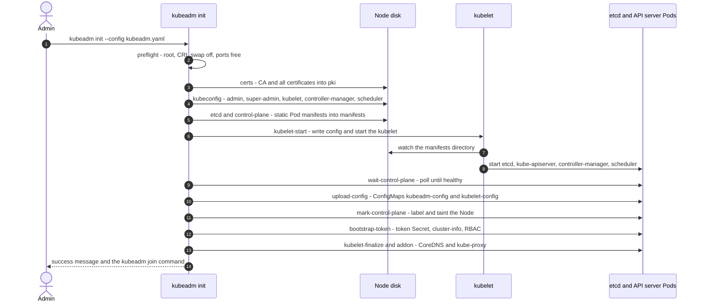
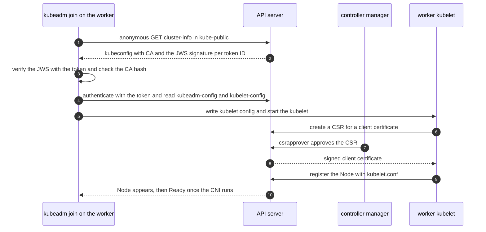

# T4.02 Create and manage Kubernetes clusters using kubeadm

> Competency: "Create and manage Kubernetes clusters using kubeadm" (CKA-4.3) | Domain/weight: CKA - Cluster Architecture, Installation and Configuration (25%) | Est. time: 4 h | Prerequisites: T4.01, T1.12

Prerequisite lessons (read them first if a term is new):

- [T4.01 Prepare underlying infrastructure for a Kubernetes cluster](../part4-cka/T4.01-prepare-underlying-infrastructure-for-a-kubernetes.md) - the three VMs `cp1`, `w1`, `w2` with swap off, kernel modules, sysctl, containerd 2.x and the kubeadm/kubelet/kubectl packages. This lesson starts from nodes that already pass kubeadm preflight.
- [T1.12 TLS, PKI and openssl for Kubernetes](../part1-linux/T1.12-tls-pki-and-openssl-for-kubernetes.md) - what a CA, a leaf certificate, a SAN and a public-key hash are. This lesson uses `openssl x509` all the time.

Also useful: [T1.04 Users, groups, permissions and sudo](../part1-linux/T1.04-users-groups-permissions-and-sudo.md) (file ownership for `~/.kube/config`), [T1.06 systemd and journalctl](../part1-linux/T1.06-systemd-and-journalctl.md) (kubelet logs), [T2.01 Kubernetes architecture and the API model](../part2-basics/T2.01-kubernetes-architecture-and-the-api-model.md) (what the control plane components are).

Next lessons: [T4.04 Manage the lifecycle of Kubernetes clusters](../part4-cka/T4.04-manage-the-lifecycle-of-kubernetes-clusters.md) (upgrades, etcd backup, certificate renewal on the cluster you build here) and [T4.05 Implement and configure a highly-available control plane](../part4-cka/T4.05-implement-and-configure-a-highly-available.md) (more than one control plane node).

Shell setup (put this at the top of every terminal; from `00-conventions.md`):

```bash
alias k=kubectl
export do="--dry-run=client -o yaml"
export now="--force --grace-period=0"
source <(kubectl completion bash); complete -o default -F __start_kubectl k
```

Environment for this whole lesson: **vms**. Three Ubuntu LTS VMs (`cp1` with 2 vCPU / 4 GB, `w1` and `w2` with 2 vCPU / 2-4 GB), prepared with `env/vm-prereqs.sh` (T4.01). Pod CIDR `192.168.0.0/16`, CNI Calico v3.33.0, kubeadm/kubelet/kubectl 1.37.x from `pkgs.k8s.io`, containerd 2.x. Reach a node with `ssh <node>` and become root with `sudo -i`, like the exam ([E7, E8](https://docs.linuxfoundation.org/tc-docs/certification/tips-cka-and-ckad)). Nested ssh is not supported: after each node, `exit` back to your base shell before the next `ssh`. Lab files go in `~/lab/t402/`. Namespace for Pod tests: `lab-t402`.

> **Important note about outputs in this lesson.** The machine used to write this lesson had no kind and no Multipass, so no cluster or VM could be built. Output blocks come in two kinds:
>
> - `REAL OUTPUT (Docker, kubeadm v1.37.1 ...)`: captured on 2026-10-27 by running the real `kubeadm` v1.37.1 (linux/arm64, downloaded from `dl.k8s.io`) inside an `ubuntu:24.04` container. That is real for kubeadm's own logic: config defaults, config validation, the list of phases, the certificates and kubeconfig files it generates, the static Pod manifests, the ConfigMaps and RBAC objects it would create, and the join command it prints. It was run with `--dry-run` (nothing is started) and `--skip-phases=preflight`, with a made-up advertise address `10.0.0.10`. It is **not** a VM and **not** a running cluster. Never read it as one.
> - `EXPECTED OUTPUT (not captured)`: the shape a real cluster prints. IP addresses, Pod name suffixes, token values and times will differ. Compare the shape, not the digits. Every one is listed in section 11.
>
> Two other kinds of statement appear: error messages marked "fragment confirmed in the kubeadm v1.37.1 binary" (the quoted words exist in the binary, the exact full line was not captured) and commands in `EXPECTED OUTPUT` blocks you must run yourself to get the real values.

---

## 1. Why this matters

`kubeadm` is the official tool that turns a prepared Linux machine into a Kubernetes control plane, and turns other machines into nodes of that cluster. In real life you meet it every time you build, repair or grow a self-managed cluster. In the CKA the competency "Create and manage Kubernetes clusters using kubeadm" (CKA-4.3) is in the curriculum, so you must be able to run `kubeadm init`, join workers, mint a new join token, remove a node cleanly, and know which files kubeadm writes where.

If you do not know this, a single wrong flag (a pod CIDR that does not match the CNI), an expired 24-hour token, or a node you removed without `kubeadm reset` leaves you with NotReady nodes, a `join` that refuses to run, or a cluster you cannot rebuild. Knowing what kubeadm writes (certificates, kubeconfigs, static Pod manifests) is also what makes the later troubleshooting tasks fast: when the API server is down you read `/etc/kubernetes/manifests/kube-apiserver.yaml`, not guess.

---

## 2. Concepts

### 2.1 What kubeadm is, and what it is not

kubeadm is a command line tool that does the **bootstrap** of a cluster: it creates the certificate authority and certificates, the kubeconfig files, the static Pod manifests for etcd and the control plane, the bootstrap token that lets workers join, and the two add-ons every cluster needs (CoreDNS and kube-proxy). It then stops. It does not install the container runtime, the kubelet, kubectl, a CNI plugin, a load balancer, a storage class or an ingress controller. You do those.

| Thing | Who installs it | Where it comes from |
|---|---|---|
| Container runtime (containerd) | you, before kubeadm (T4.01) | OS package or release tarball |
| kubelet, kubeadm, kubectl | you, before kubeadm (T4.01) | `pkgs.k8s.io` apt repository |
| etcd, kube-apiserver, kube-controller-manager, kube-scheduler | kubeadm, as **static Pods** | images from `registry.k8s.io` |
| CoreDNS, kube-proxy | kubeadm, as add-ons (a Deployment and a DaemonSet) | images from `registry.k8s.io` |
| CNI plugin (Calico) | you, after `kubeadm init` | a manifest from the CNI project |
| CA, certificates, kubeconfigs | kubeadm | written to `/etc/kubernetes` |

**Why static Pods?** The kubelet is the only component that already runs before the cluster exists, because it is a systemd service. kubeadm writes Pod manifests into a directory the kubelet watches, and the kubelet starts the control plane from them. That solves the chicken-and-egg problem: the control plane does not need a control plane to start. See section 2.12.

**Related but different.** `kubeadm` bootstraps, `kubelet` runs Pods on a node, `kubectl` talks to the API server. `kind` and `minikube` also create clusters, but they are local learning tools that hide the steps (kind runs nodes as containers). Managed services (EKS, GKE, AKS) hide the control plane. kubeadm is the "do it yourself on real machines" path, and the one the exam uses.

### 2.2 `kubeadm init` and its flags

`kubeadm init` runs once on the first control-plane node. Each flag below was checked against `kubeadm init --help` of v1.37.1.

| Flag | What it does | Default | Risky or invalid value |
|---|---|---|---|
| `--pod-network-cidr` | The IP range for all Pod IPs. kubeadm passes it to the controller manager as `--cluster-cidr` and sets `--allocate-node-cidrs=true`, so each node gets a slice (`/24` by default). | none | A range that overlaps your node network or the Service CIDR. A range that differs from what the CNI uses: Pods get IPs from the CNI pool, the node slices from the controller manager, and routing breaks. |
| `--apiserver-advertise-address` | The IP the API server announces to the rest of the cluster (stored in endpoints, `admin.conf`, the static Pod flag `--advertise-address`). | the IP of the default network interface | An IP that is not on the node, or the wrong NIC on a multi-NIC VM (for example the Multipass NAT address that workers cannot reach). |
| `--control-plane-endpoint` | A stable `host` or `host:port` that **all** clients use to reach the control plane: workers, kubelets, kubectl. Put a DNS name or a load balancer here when you plan more than one control plane node. kubeadm adds the host to the API server certificate SANs and writes it into every kubeconfig. | the advertise address | Setting it **after** init is hard; if you may ever want HA, set it at init. See T4.05. |
| `--kubernetes-version` | The control plane version to install. | `stable-1`, which means the latest stable release label (this is the real default text of `kubeadm init --help`) | A version newer than the kubeadm binary, or more than one minor older. Always write the full `v1.37.1` form. |
| `--cri-socket` | Which container runtime socket to talk to. | auto-detect | Needed only if more than one runtime is installed. Wrong path gives a preflight error. Table below. |
| `--upload-certs` | Encrypts the control-plane certificates and stores them in the Secret `kubeadm-certs` (namespace `kube-system`) so extra control-plane nodes can download them with `--certificate-key`. The key is printed once. The Secret is deleted after two hours. | off | Forgetting it and then having no way to copy the certs. Leaking the key: it decrypts the CA private key. |
| `--service-cidr` | Range for Service ClusterIPs. | `10.96.0.0/12` | Overlap with Pod or node network. Cannot be changed later. |
| `--apiserver-cert-extra-sans` | Extra DNS names and IPs in the API server certificate. | none | Forgetting a public IP or a DNS name you will use from outside: kubectl then fails with a certificate error. |
| `--token`, `--token-ttl` | Choose the first bootstrap token, and how long it lives. | random token, `24h` | `--token-ttl 0` makes a token that never expires (a standing credential). |
| `--node-name` | The Node object name. | the hostname | Two nodes with the same hostname. |
| `--config` | Read a kubeadm config file (section 2.3). | none | **Cannot be mixed** with most other flags (below). |
| `--dry-run` | Print what would happen, change nothing. | off | Not a risk, a habit. |
| `--skip-phases`, `--ignore-preflight-errors` | Skip phases or turn named preflight errors into warnings. | none | `all` hides real problems. Use it only after you understand the error. |
| `--image-repository`, `--patches`, `--feature-gates` | Pull images from a mirror, patch generated manifests, set kubeadm feature gates. | `registry.k8s.io` | Mirrors must have every image of `kubeadm config images list`. |

**CRI socket paths** (the same flag is used by `join` and `reset`):

| Runtime | Socket |
|---|---|
| containerd | `unix:///run/containerd/containerd.sock` (kubeadm's own default shown by `print init-defaults` is the older alias `unix:///var/run/containerd/containerd.sock`; `/var/run` is a symlink to `/run`) |
| CRI-O | `unix:///var/run/crio/crio.sock` |
| cri-dockerd | `unix:///var/run/cri-dockerd.sock` |

(CRI-O and cri-dockerd paths are from the kubeadm install documentation; this lesson uses containerd only.)

**Flags and `--config` do not mix.** The first thing to know before you write a config file:

```text
REAL OUTPUT (Docker, kubeadm v1.37.1)
$ kubeadm init --config cfg.yaml --pod-network-cidr=10.1.0.0/16 --dry-run
error: can not mix '--config' with arguments [pod-network-cidr]
To see the stack trace of this error execute with --v=5 or higher
```

Everything you can set with a flag can be set in the file (section 2.3). Flags that do not set cluster values can be combined with `--config`. I ran `--config` together with `--dry-run`, `--skip-phases` and `--upload-certs` and all three worked; the kubeadm-init reference page lists the full set of allowed combinations.

**Under the hood: what init is really doing.** It runs a fixed list of phases (section 2.4). The result is a single-node cluster whose Node is `NotReady` because there is no CNI yet. You then add workers with `kubeadm join` (section 2.8).

### 2.3 The kubeadm config file

A kubeadm config file is a multi-document YAML file. Each document has `apiVersion` and `kind`. It is **not** a Kubernetes API object: you never `kubectl apply` it. kubeadm reads it from disk.

| `kind` | `apiVersion` (v1.37.1) | What it configures | Used by |
|---|---|---|---|
| `InitConfiguration` | `kubeadm.k8s.io/v1beta4` | Things about **this node** and this `init` run: advertise address, node name, CRI socket, taints, the bootstrap token | `init` only |
| `ClusterConfiguration` | `kubeadm.k8s.io/v1beta4` | Things about the **whole cluster**: version, subnets, endpoint, cert SANs, extra component flags, etcd, image repository | `init`; stored in the cluster for `join` and `upgrade` |
| `KubeletConfiguration` | `kubelet.config.k8s.io/v1beta1` | The kubelet's config file, written to `/var/lib/kubelet/config.yaml` on every node | `init`, `join` |
| `KubeProxyConfiguration` | `kubeproxy.config.k8s.io/v1alpha1` | kube-proxy's config (mode, conntrack and so on) | `init` |
| `JoinConfiguration` | `kubeadm.k8s.io/v1beta4` | The join side: where the API server is, token, CA hash, node name | `join` only |

**API version: verified v1beta4.** `kubeadm config print init-defaults` of v1.37.1 prints `apiVersion: kubeadm.k8s.io/v1beta4`. The older `v1beta3` is **rejected** by this kubeadm:

```text
REAL OUTPUT (Docker, kubeadm v1.37.1)
$ kubeadm config validate --config cfg4.yaml      # apiVersion: kubeadm.k8s.io/v1beta3
error: your configuration file uses an old API spec: "kubeadm.k8s.io/v1beta3" (kind: "ClusterConfiguration"). Please use kubeadm v1.36 instead and run 'kubeadm config migrate --old-config old-config-file --new-config new-config-file', which will write the new, similar spec using a newer API version.
```

So an old tutorial's `v1beta3` file fails, and `kubeadm config migrate` of 1.37 cannot convert it either (it tells you to use kubeadm 1.36 for that step). Always start from the printed defaults, never from a blog.

**The defaults, printed by the tool.** This is the fastest way to get a valid skeleton and the only reference you need in the exam. The page for the field reference is also allowed (section 10).

```text
REAL OUTPUT (Docker, kubeadm v1.37.1)
$ kubeadm config print init-defaults
apiVersion: kubeadm.k8s.io/v1beta4
bootstrapTokens:
- groups:
  - system:bootstrappers:kubeadm:default-node-token
  token: abcdef.0123456789abcdef
  ttl: 24h0m0s
  usages:
  - signing
  - authentication
kind: InitConfiguration
localAPIEndpoint:
  advertiseAddress: 1.2.3.4
  bindPort: 6443
nodeRegistration:
  criSocket: unix:///var/run/containerd/containerd.sock
  imagePullPolicy: IfNotPresent
  imagePullSerial: true
  name: node
  taints: null
timeouts:
  controlPlaneComponentHealthCheck: 4m0s
  discovery: 5m0s
  etcdAPICall: 2m0s
  kubeletHealthCheck: 4m0s
  kubernetesAPICall: 1m0s
  tlsBootstrap: 5m0s
  upgradeManifests: 5m0s
---
apiServer: {}
apiVersion: kubeadm.k8s.io/v1beta4
caCertificateValidityPeriod: 87600h0m0s
certificateValidityPeriod: 8760h0m0s
certificatesDir: /etc/kubernetes/pki
clusterName: kubernetes
controllerManager: {}
dns: {}
encryptionAlgorithm: RSA-2048
etcd:
  local:
    dataDir: /var/lib/etcd
imageRepository: registry.k8s.io
kind: ClusterConfiguration
kubernetesVersion: 1.37.0
networking:
  dnsDomain: cluster.local
  serviceSubnet: 10.96.0.0/12
proxy: {}
scheduler: {}
```

Read it like a table of defaults: the token lives 24 hours (`ttl: 24h0m0s`), CA certificate 10 years (`87600h`), leaf certificates 1 year (`8760h`), keys RSA-2048, Service subnet `10.96.0.0/12`, API server port 6443, etcd data in `/var/lib/etcd`. The values `1.2.3.4`, `node` and `abcdef.0123456789abcdef` are placeholders you must replace. Note `kubernetesVersion: 1.37.0` is what the tool prints as default, but you pin the exact patch you installed (`v1.37.1`).

To also see the kubelet and kube-proxy documents: `kubeadm config print init-defaults --component-configs KubeletConfiguration,KubeProxyConfiguration`. In v1.37.1 this adds a `KubeletConfiguration` whose defaults include `cgroupDriver: systemd`, `clusterDNS: [10.96.0.10]`, `clusterDomain: cluster.local`, and a `KubeProxyConfiguration` with `mode: iptables`. The join-side skeleton is `kubeadm config print join-defaults`.

**The fields that matter, one by one.**

*InitConfiguration*

| Field | Meaning | Default | Risky value |
|---|---|---|---|
| `bootstrapTokens[].token` | The first join token. Format `[a-z0-9]{6}.[a-z0-9]{16}` (real, from `kubeadm token --help`). | random | A token that does not match the format fails validation. A hard-coded well-known token in a real cluster is a credential leak. |
| `bootstrapTokens[].ttl` | Lifetime. | `24h0m0s` | `0s` never expires. |
| `bootstrapTokens[].usages` | `signing` (lets a joiner verify the cluster-info data) and `authentication` (lets the joiner authenticate to get a certificate). | both | Dropping one makes `join` fail. |
| `bootstrapTokens[].groups` | Groups the token authenticates as. Must start with `system:bootstrappers:`. | `system:bootstrappers:kubeadm:default-node-token` | A different group gets none of the join RBAC rules. |
| `localAPIEndpoint.advertiseAddress` / `bindPort` | Same as `--apiserver-advertise-address` / `--apiserver-bind-port`. | NIC IP / `6443` | Wrong NIC. |
| `nodeRegistration.name` | Node name. | hostname | A name that is not DNS-1123 (uppercase, underscore). |
| `nodeRegistration.criSocket` | Same as `--cri-socket`. | auto-detect | Wrong path. |
| `nodeRegistration.taints` | The taints kubeadm puts on the node. `null` (unset) means "use the default control-plane taint". An empty list `[]` means "no taint" (single node cluster). | default control-plane taint | `[]` on a real control plane lets any Pod land on it. |
| `nodeRegistration.kubeletExtraArgs` | Extra kubelet command line flags. In v1beta4 this is a **list** of `name`/`value` pairs, not a map. | none | Using the v1beta3 map form (see below). |
| `nodeRegistration.ignorePreflightErrors` | Preflight checks to turn into warnings. | none | `all`. |
| `timeouts.*` | New in v1beta4. How long kubeadm waits for each step (for example `controlPlaneComponentHealthCheck: 4m0s`, `tlsBootstrap: 5m0s`). | as printed above | Too small on slow disks makes init time out. |
| `certificateKey`, `skipPhases`, `patches` | Same as `--certificate-key`, `--skip-phases`, `--patches`. | unset | - |

*ClusterConfiguration*

| Field | Meaning | Default | Risky value |
|---|---|---|---|
| `kubernetesVersion` | Control plane version. | printed default | A different minor than your kubeadm allows. |
| `clusterName` | Name in kubeconfig contexts, the controller manager `--cluster-name`. | `kubernetes` | - |
| `controlPlaneEndpoint` | Same as `--control-plane-endpoint`. | unset (advertise address) | Changing it later. |
| `networking.podSubnet` | Same as `--pod-network-cidr`. | unset | Mismatch with the CNI pool. |
| `networking.serviceSubnet` | Same as `--service-cidr`. | `10.96.0.0/12` | Overlap with node or Pod networks. |
| `networking.dnsDomain` | Cluster DNS suffix. | `cluster.local` | Changing it breaks add-ons that hard-code `cluster.local`. |
| `apiServer.certSANs` | Extra names and IPs for the API server certificate. | none | Forgetting an external name or IP. |
| `apiServer.extraArgs`, `controllerManager.extraArgs`, `scheduler.extraArgs`, `etcd.local.extraArgs` | Extra command line flags for that component. In v1beta4 a **list** of `name`/`value`. | none | Wrong shape, below. |
| `apiServer.extraVolumes` | Extra hostPath mounts into the API server static Pod (for example an audit policy file). | none | Forgetting the mount, so the flag points to a file the container cannot see. |
| `etcd.local.dataDir` / `etcd.external` | Local stacked etcd (default) or an external etcd cluster. | local, `/var/lib/etcd` | - |
| `imageRepository` | Registry for control-plane images. | `registry.k8s.io` | A mirror missing images. |
| `certificatesDir` | Where certificates are written. | `/etc/kubernetes/pki` | - |
| `certificateValidityPeriod`, `caCertificateValidityPeriod`, `encryptionAlgorithm` | Lifetimes and key type (`RSA-2048`, also `RSA-3072`, `RSA-4096`, `ECDSA-P256`). | `8760h`, `87600h`, `RSA-2048` | Values the CNI or tools do not support (rare). |

**The shape change from v1beta3.** In v1beta4 `extraArgs` is a list. The old map form is rejected with a clear error (real):

```text
REAL OUTPUT (Docker, kubeadm v1.37.1)
$ kubeadm config validate --config cfg3.yaml      # extraArgs: { audit-log-path: /var/log/kube-audit.log }
error: error unmarshaling configuration schema.GroupVersionKind{Group:"kubeadm.k8s.io", Version:"v1beta4", Kind:"ClusterConfiguration"}: json: cannot unmarshal object into Go struct field APIServer.apiServer.ControlPlaneComponent.extraArgs of type []v1beta4.Arg

$ kubeadm config validate --config cfg2.yaml      # extraArgs: [ {name: audit-log-path, value: /var/log/kube-audit.log} ]
ok
```

`kubeadm config validate --config <file>` is your safety net: it checks the file without touching the machine. Use it before every `init` that uses a file.

**Where the config ends up.** kubeadm stores the `ClusterConfiguration` in the ConfigMap `kubeadm-config` in `kube-system` (needed by `join` and by `kubeadm upgrade`). Only that document is stored there. The `InitConfiguration` is not stored: its node part is recorded on the Node (the CRI socket becomes an annotation). The `KubeletConfiguration` is stored in the ConfigMap `kubelet-config`, and the kube-proxy config in the ConfigMap `kube-proxy`. The content of `kubeadm-config`, as kubeadm would create it from the config in section 4 (real):

```text
REAL OUTPUT (Docker, kubeadm v1.37.1 --dry-run, object attached by the dry run)
apiVersion: v1
data:
  ClusterConfiguration: |
    apiServer:
      certSANs:
      - cp1.lab.local
      - 203.0.113.10
    apiVersion: kubeadm.k8s.io/v1beta4
    caCertificateValidityPeriod: 87600h0m0s
    certificateValidityPeriod: 8760h0m0s
    certificatesDir: /etc/kubernetes/pki
    clusterName: lab
    controlPlaneEndpoint: 10.0.0.10:6443
    controllerManager: {}
    dns: {}
    encryptionAlgorithm: RSA-2048
    etcd:
      local:
        dataDir: /var/lib/etcd
    imageRepository: registry.k8s.io
    kind: ClusterConfiguration
    kubernetesVersion: v1.37.1
    networking:
      dnsDomain: cluster.local
      podSubnet: 192.168.0.0/16
      serviceSubnet: 10.100.0.0/16
    proxy: {}
    scheduler: {}
kind: ConfigMap
metadata:
  name: kubeadm-config
  namespace: kube-system
```

On a live cluster you read it with `k -n kube-system get cm kubeadm-config -o yaml`. This is also how you **recover what a cluster was built with**: the pod subnet, service subnet, endpoint and cert SANs are all here.

**Convert flags to a file.** There is no `--print-config` for init flags, but the printed defaults show every field. Start from `kubeadm config print init-defaults > kubeadm.yaml` and edit.

### 2.4 The init phases

`kubeadm init` is a list of **phases**. `kubeadm init --help` lists them and `kubeadm init phase --help` lets you run one alone. Here is the real list for v1.37.1:

```text
REAL OUTPUT (Docker, kubeadm v1.37.1)
$ kubeadm init --help        # the "phases" part
preflight                     Run pre-flight checks
certs                         Certificate generation
  /ca                           Generate the self-signed Kubernetes CA to provision identities for other Kubernetes components
  /apiserver                    Generate the certificate for serving the Kubernetes API
  /apiserver-kubelet-client     Generate the certificate for the API server to connect to kubelet
  /front-proxy-ca               Generate the self-signed CA to provision identities for front proxy
  /front-proxy-client           Generate the certificate for the front proxy client
  /etcd-ca                      Generate the self-signed CA to provision identities for etcd
  /etcd-server                  Generate the certificate for serving etcd
  /etcd-peer                    Generate the certificate for etcd nodes to communicate with each other
  /etcd-healthcheck-client      Generate the certificate for liveness probes to healthcheck etcd
  /apiserver-etcd-client        Generate the certificate the apiserver uses to access etcd
  /sa                           Generate a private key for signing service account tokens along with its public key
kubeconfig                    Generate all kubeconfig files necessary to establish the control plane and the admin kubeconfig file
  /admin  /super-admin  /kubelet  /controller-manager  /scheduler
etcd                          Generate static Pod manifest file for local etcd
  /local
control-plane                 Generate all static Pod manifest files necessary to establish the control plane
  /apiserver  /controller-manager  /scheduler
kubelet-start                 Write kubelet settings and (re)start the kubelet
wait-control-plane            Wait for the control plane to start
upload-config                 Upload the kubeadm and kubelet configuration to a ConfigMap
  /kubeadm  /kubelet
upload-certs                  Upload certificates to kubeadm-certs
mark-control-plane            Mark a node as a control-plane
bootstrap-token               Generates bootstrap tokens used to join a node to a cluster
kubelet-finalize              Updates settings relevant to the kubelet after TLS bootstrap
  /enable-client-cert-rotation  Enable kubelet client certificate rotation
addon                         Install required addons for passing conformance tests
  /coredns  /kube-proxy
show-join-command             Show the join command for control-plane and worker node
```

(The `/admin /super-admin ...` rows are shortened onto one line here; the real output prints one line per sub-phase, each with its description.)

What each phase does and what it leaves behind:

| Order | Phase | What it does | Leaves behind |
|---|---|---|---|
| 1 | `preflight` | Checks the machine: root user, CRI reachable, swap off, ports 6443/10250/2379/2380 free, `/etc/kubernetes/manifests` empty, kernel settings, and `ip_forward`. It also pulls the control-plane images (which is why a pre-pull, section 2.13, speeds it up). | nothing |
| 2 | `certs` | Creates the cluster CA, then every certificate the control plane needs: API server serving cert (with SANs), API-to-kubelet client cert, front-proxy CA and client cert, a **separate etcd CA** with server, peer, health-check and API-to-etcd client certs, and the service-account signing key pair. | `/etc/kubernetes/pki/` |
| 3 | `kubeconfig` | Writes one kubeconfig per client, each with a client certificate signed by the CA: admin, super-admin, kubelet, controller-manager, scheduler. | `/etc/kubernetes/*.conf` |
| 4 | `etcd` | Writes the etcd static Pod manifest (stacked etcd on the same node). | `/etc/kubernetes/manifests/etcd.yaml` |
| 5 | `control-plane` | Writes the three control-plane static Pod manifests. | `kube-apiserver.yaml`, `kube-controller-manager.yaml`, `kube-scheduler.yaml` |
| 6 | `kubelet-start` | Writes the kubelet config and the extra-args file, then (re)starts the kubelet. The kubelet sees the manifests and starts the Pods. | `/var/lib/kubelet/config.yaml`, `/var/lib/kubelet/kubeadm-flags.env` |
| 7 | `wait-control-plane` | Waits until the kubelet is healthy and the API server answers. | - |
| 8 | `upload-config` | Stores the `ClusterConfiguration` and the `KubeletConfiguration` in ConfigMaps. | ConfigMaps `kubeadm-config`, `kubelet-config` in `kube-system` |
| 9 | `upload-certs` | Only with `--upload-certs`: encrypts the control-plane certs into a Secret. | Secret `kubeadm-certs` |
| 10 | `mark-control-plane` | Labels and taints the node as a control plane (section 2.14). | labels and a taint on the Node |
| 11 | `bootstrap-token` | Creates the first bootstrap token Secret, the `cluster-info` ConfigMap in `kube-public`, and the RBAC rules that let joining nodes get a certificate. | Secret `bootstrap-token-<id>`, ConfigMap `cluster-info`, Roles and ClusterRoleBindings |
| 12 | `kubelet-finalize` | Turns on kubelet client-certificate rotation. | - |
| 13 | `addon` | Installs CoreDNS (Deployment and Service) and kube-proxy (DaemonSet). | CoreDNS, kube-proxy |
| 14 | `show-join-command` | Prints the success message and the `kubeadm join` commands. | - |

> **Note about the order.** A simplified list says "kubelet-start, control-plane, etcd". The real order above (from `kubeadm init --help`, and confirmed by the log of a dry run) is `etcd`, `control-plane`, then `kubelet-start`: kubeadm writes the manifests first, and *then* starts the kubelet that will read them.

**Run one phase on its own.** Useful for repair, for example if a manifest was deleted: `kubeadm init phase control-plane apiserver`, `kubeadm init phase certs all`, `kubeadm init phase kubeconfig admin`, `kubeadm init phase upload-config kubeadm`. To skip a phase during init: `kubeadm init --skip-phases=addon/kube-proxy` (for a CNI that replaces kube-proxy). `kubeadm init phase show-join-command` reprints the join command on a control plane node.

**Real log of the first phases** (dry run; it shows exactly which names and IPs went into the API server certificate):

```text
REAL OUTPUT (Docker, kubeadm v1.37.1 --dry-run, trimmed)
$ kubeadm init --dry-run --skip-phases=preflight --config kubeadm.yaml
[init] Using Kubernetes version: v1.37.1
[certs] Using certificateDir folder "/etc/kubernetes/tmp/kubeadm-init-dryrun4283645846"
[certs] Generating "ca" certificate and key
[certs] Generating "apiserver" certificate and key
[certs] apiserver serving cert is signed for DNS names [cp1 cp1.lab.local kubernetes kubernetes.default kubernetes.default.svc kubernetes.default.svc.cluster.local] and IPs [10.100.0.1 10.0.0.10 203.0.113.10]
[certs] Generating "apiserver-kubelet-client" certificate and key
[certs] Generating "front-proxy-ca" certificate and key
[certs] Generating "front-proxy-client" certificate and key
[certs] Generating "etcd/ca" certificate and key
[certs] Generating "etcd/server" certificate and key
[certs] etcd/server serving cert is signed for DNS names [cp1 localhost] and IPs [10.0.0.10 127.0.0.1 ::1]
[certs] Generating "etcd/peer" certificate and key
[certs] Generating "etcd/healthcheck-client" certificate and key
[certs] Generating "apiserver-etcd-client" certificate and key
[certs] Generating "sa" key and public key
[kubeconfig] Writing "admin.conf" kubeconfig file
[kubeconfig] Writing "super-admin.conf" kubeconfig file
[kubeconfig] Writing "kubelet.conf" kubeconfig file
[kubeconfig] Writing "controller-manager.conf" kubeconfig file
[kubeconfig] Writing "scheduler.conf" kubeconfig file
[etcd] Creating static Pod manifest for local etcd in "/etc/kubernetes/tmp/kubeadm-init-dryrun4283645846"
[control-plane] Creating static Pod manifest for "kube-apiserver"
[control-plane] Creating static Pod manifest for "kube-controller-manager"
[control-plane] Creating static Pod manifest for "kube-scheduler"
[kubelet-start] Writing kubelet environment file with flags to file ".../kubeadm-flags.env"
[kubelet-start] Writing kubelet configuration to file ".../config.yaml"
[upload-config] Storing the configuration used in ConfigMap "kubeadm-config" in the "kube-system" Namespace
[kubelet] Creating a ConfigMap "kubelet-config" in namespace kube-system with the configuration for the kubelets in the cluster
[mark-control-plane] Marking the node cp1 as control-plane by adding the labels: [node-role.kubernetes.io/control-plane node.kubernetes.io/exclude-from-external-load-balancers]
[mark-control-plane] Marking the node cp1 as control-plane by adding the taints [node-role.kubernetes.io/control-plane:NoSchedule]
[bootstrap-token] Using token: 14h2we.eiowy603s7qr94vh
[bootstrap-token] Configuring bootstrap tokens, cluster-info ConfigMap, RBAC Roles
[bootstrap-token] Configured RBAC rules to allow Node Bootstrap tokens to get nodes
[bootstrap-token] Configured RBAC rules to allow Node Bootstrap tokens to post CSRs in order for nodes to get long term certificate credentials
[bootstrap-token] Configured RBAC rules to allow the csrapprover controller automatically approve CSRs from a Node Bootstrap Token
[bootstrap-token] Configured RBAC rules to allow certificate rotation for all node client certificates in the cluster
[bootstrap-token] Creating the "cluster-info" ConfigMap in the "kube-public" namespace
[addons] Applied essential addon: CoreDNS
[addons] Applied essential addon: kube-proxy
```

Read three things in it. (1) The first IP in the API server SANs is `10.100.0.1`: the **first address of the Service subnet**. That is the ClusterIP of the `kubernetes` Service, and pods reach the API at that address; if it is not in the SANs, in-cluster clients fail the TLS check. (2) The etcd certificates are signed for `localhost`/`127.0.0.1` and the node IP only, because etcd listens on those. (3) `cp1.lab.local` and `203.0.113.10` are in the list only because the config file set `apiServer.certSANs`.

### 2.5 What kubeadm writes: `/etc/kubernetes`, `/var/lib/kubelet`, `/var/lib/etcd`

Memorize this map. In every troubleshooting task, one of these files is the answer.

| Path | What it is | Who uses it |
|---|---|---|
| `/etc/kubernetes/admin.conf` | kubeconfig for the cluster administrator. Client certificate subject `CN=kubernetes-admin, O=kubeadm:cluster-admins`. | you, kubeadm itself |
| `/etc/kubernetes/super-admin.conf` | "break-glass" kubeconfig. Client certificate subject `CN=kubernetes-super-admin, O=system:masters`. | you, only in an emergency |
| `/etc/kubernetes/kubelet.conf` | the kubelet's identity for talking to the API server (`system:node:<name>`). On the control plane it is written by `init`; on a worker it is written after `join`. | kubelet |
| `/etc/kubernetes/controller-manager.conf` | kubeconfig of kube-controller-manager | controller manager |
| `/etc/kubernetes/scheduler.conf` | kubeconfig of kube-scheduler | scheduler |
| `/etc/kubernetes/manifests/` | static Pod manifests: `etcd.yaml`, `kube-apiserver.yaml`, `kube-controller-manager.yaml`, `kube-scheduler.yaml` | kubelet (`staticPodPath`) |
| `/etc/kubernetes/pki/` | `ca.crt/.key`, `apiserver.crt/.key`, `apiserver-kubelet-client.*`, `apiserver-etcd-client.*`, `front-proxy-ca.*`, `front-proxy-client.*`, `sa.key`, `sa.pub`, and `etcd/` (its own `ca`, `server`, `peer`, `healthcheck-client`) | control plane Pods |
| `/var/lib/kubelet/config.yaml` | the KubeletConfiguration, including `staticPodPath: /etc/kubernetes/manifests` | kubelet |
| `/var/lib/kubelet/kubeadm-flags.env` | extra kubelet flags kubeadm decided on (for example `--hostname-override=cp1`) | kubelet systemd unit |
| `/var/lib/kubelet/pki/` | kubelet's own client and serving certificates (rotated) | kubelet |
| `/var/lib/etcd/` | the etcd database. **This is the cluster state.** | etcd |

**admin.conf versus super-admin.conf: verified.** Real output of the certificates embedded in the two files generated in the dry run:

```text
REAL OUTPUT (Docker, kubeadm v1.37.1 --dry-run)
$ grep client-certificate-data admin.conf       | awk '{print $2}' | base64 -d | openssl x509 -noout -subject
subject=O=kubeadm:cluster-admins, CN=kubernetes-admin
$ grep client-certificate-data super-admin.conf | awk '{print $2}' | base64 -d | openssl x509 -noout -subject
subject=O=system:masters, CN=kubernetes-super-admin
```

Why two files? The group `system:masters` is **hard-wired** in the API server to "allow everything" and bypasses RBAC and admission checks, so an admin credential in that group can never be restricted or revoked by RBAC. kubeadm therefore gives the day-to-day `admin.conf` the group `kubeadm:cluster-admins`, bound to the ClusterRole `cluster-admin` by a normal ClusterRoleBinding. If someone deletes that binding, you are locked out of your own cluster; `super-admin.conf` (group `system:masters`) is the way back in (`KUBECONFIG=/etc/kubernetes/super-admin.conf kubectl create clusterrolebinding kubeadm:cluster-admins --clusterrole=cluster-admin --group=kubeadm:cluster-admins`). Use it for that and nothing else, and keep it readable by root only. The same two files, and the same two subjects, are what `kubeadm init` v1.37.1 produces on the control plane node where you run `init`. Whether `kubeadm join --control-plane` also writes `super-admin.conf` on additional control plane nodes is listed in section 11.

**The key manifests and flags.** What the static Pod manifest of the API server contains, from the same dry run (shortened). These are the flags you will grep for in troubleshooting:

```text
REAL OUTPUT (Docker, kubeadm v1.37.1 --dry-run, trimmed)
# /etc/kubernetes/manifests/kube-apiserver.yaml  (command part)
    - kube-apiserver
    - --advertise-address=10.0.0.10
    - --authorization-mode=Node,RBAC
    - --client-ca-file=/etc/kubernetes/pki/ca.crt
    - --enable-admission-plugins=NodeRestriction
    - --enable-bootstrap-token-auth=true
    - --etcd-servers=https://127.0.0.1:2379
    - --kubelet-client-certificate=/etc/kubernetes/pki/apiserver-kubelet-client.crt
    - --secure-port=6443
    - --service-account-issuer=https://kubernetes.default.svc.cluster.local
    - --service-account-signing-key-file=/etc/kubernetes/pki/sa.key
    - --service-cluster-ip-range=10.100.0.0/16
    - --tls-cert-file=/etc/kubernetes/pki/apiserver.crt
    image: registry.k8s.io/kube-apiserver:v1.37.1
# kube-controller-manager.yaml (the networking flags)
    - --allocate-node-cidrs=true
    - --cluster-cidr=192.168.0.0/16
    - --service-cluster-ip-range=10.100.0.0/16
# etcd.yaml
    - --listen-client-urls=https://127.0.0.1:2379,https://10.0.0.10:2379
    - --data-dir=/var/lib/etcd
    image: registry.k8s.io/etcd:3.7.0-0
```

Notice how each config-file value became a flag: `networking.podSubnet` became `--cluster-cidr`, `networking.serviceSubnet` became `--service-cluster-ip-range` (on both the API server and the controller manager), `localAPIEndpoint.advertiseAddress` became `--advertise-address`. `--enable-bootstrap-token-auth=true` is what makes bootstrap tokens work as credentials for `join`. `--authorization-mode=Node,RBAC` is the default authorization chain.

### 2.6 Setting up kubectl for a user

`kubeadm init` ends by telling you to copy `admin.conf`. It is a plain kubeconfig; kubectl just needs to find it. For a normal (non-root) user, as printed by `init`:

```bash
mkdir -p $HOME/.kube
sudo cp -i /etc/kubernetes/admin.conf $HOME/.kube/config
sudo chown $(id -u):$(id -g) $HOME/.kube/config
```

Why each line. `mkdir` creates the default place kubectl looks (`~/.kube/config`). `/etc/kubernetes/admin.conf` is mode `0600` owned by root, so the user needs `sudo` to read it. The `chown` hands the copy to the user, otherwise kubectl says `permission denied`. See [T1.04](../part1-linux/T1.04-users-groups-permissions-and-sudo.md) for modes and ownership. As root you can skip the copy and set `export KUBECONFIG=/etc/kubernetes/admin.conf`. In the exam, you are usually root on the host after `sudo -i` ([E8](https://docs.linuxfoundation.org/tc-docs/certification/tips-cka-and-ckad)), and the kubeconfig is usually already in place; do not overwrite it.

Do **not** give the `admin.conf` file to other people: it is a cluster-admin credential for one year (the leaf certificate lifetime). Give other users their own certificate and RBAC rules (T4.06). Check that it works: `k get nodes` and `k cluster-info`.

### 2.7 Installing a CNI (Calico v3.33.0) and verifying the cluster

**The problem.** A Pod needs a network interface and an IP. The kubelet does not create those; it asks the container runtime, which calls a **CNI plugin** (Container Network Interface: a binary in `/opt/cni/bin`, configured by a file in `/etc/cni/net.d`). kubeadm installs none. Until the config file exists, containerd reports its network as not ready, the kubelet reports the Node as `NotReady`, and the scheduler will not place normal Pods on it.

**What breaks without it.** `k get nodes` shows `NotReady`, CoreDNS stays `Pending`, nothing that needs a Pod IP works. This is the first common mistake in section 6.

**The Calico choices.** Calico v3.33.0 has two install methods. Both files exist at the pinned tag (I fetched them on 2026-10-27):

| Method | Files | How | Pod CIDR setting |
|---|---|---|---|
| Plain manifest (simplest, what `env/kind-up.sh` uses) | `calico.yaml` (about 730 KB, 23 CRDs, `calico-node` DaemonSet, `calico-kube-controllers`) | `k create -f calico.yaml` | The env var `CALICO_IPV4POOL_CIDR` in the `calico-node` container is **commented out** in the manifest, with an example value `192.168.0.0/16` and the comment "This should fall within `--cluster-cidr`". |
| Operator | `tigera-operator.yaml` (operator `quay.io/tigera/operator:v1.44.0` in namespace `tigera-operator`) then `custom-resources.yaml` | `k create -f tigera-operator.yaml` then `k create -f custom-resources.yaml` | `custom-resources.yaml` has `spec.calicoNetwork.ipPools[0].cidr: 192.168.0.0/16`, `blockSize: 26`, `encapsulation: VXLANCrossSubnet`. |

URLs (the pinned tag `v3.33.0`):

```text
https://raw.githubusercontent.com/projectcalico/calico/v3.33.0/manifests/calico.yaml
https://raw.githubusercontent.com/projectcalico/calico/v3.33.0/manifests/tigera-operator.yaml
https://raw.githubusercontent.com/projectcalico/calico/v3.33.0/manifests/custom-resources.yaml
```

**The rule that matters: the CIDRs must match.** `podSubnet` (kubeadm) = the CIDR Calico uses for its IP pool. Both default to `192.168.0.0/16` in this lesson, so with `--pod-network-cidr=192.168.0.0/16` you change nothing. If you choose a different pod subnet, you must also edit the Calico manifest (uncomment `CALICO_IPV4POOL_CIDR` and set it, or change `cidr:` in `custom-resources.yaml`) *before* you apply it. Changing the pool after creation has no effect on an existing pool (the manifest comment says so for the env var).

**Why `create` and not `apply`?** `kubectl apply` stores the whole object in an annotation that is limited to 256 KiB; a large CRD can exceed that and fail. `create` does not store the annotation. If you must re-run, use `k apply --server-side -f calico.yaml`.

**In the exam.** The Calico manifests live on `docs.tigera.io` and GitHub, which are not in the list of allowed documentation ([E13](https://docs.linuxfoundation.org/tc-docs/certification/certification-resources-allowed): kubernetes.io/docs, kubernetes.io/blog, helm.sh/docs, gateway-api.sigs.k8s.io for CKA). The Kubernetes page "Installing Addons" (https://kubernetes.io/docs/concepts/cluster-administration/addons/) is allowed and links to the networking add-ons; the exact manifest an exam task would supply is UNVERIFIED. Practice by knowing the pattern (CIDR must match, `create -f`, wait for `calico-node`), not by memorizing a URL.

**Verify the cluster is healthy: three checks.**

```bash
k -n kube-system rollout status ds/calico-node --timeout=180s   # CNI Pods Ready on every node
k get nodes                                                      # all Ready
k -n kube-system get pods -l k8s-app=kube-dns                    # CoreDNS Running
```

The first check waits until each `calico-node` Pod is Ready (it is a DaemonSet: one per node, including the control plane because Calico tolerates the `NoSchedule` and `NoExecute` taints (the tolerations in `calico.yaml` are `operator: Exists` for both)). After that, the kubelet finds a CNI config in `/etc/cni/net.d`, the runtime says the network is ready, the Node becomes `Ready`, and the CoreDNS Pods that were `Pending` get scheduled.

### 2.8 Joining a worker: `kubeadm join`, token and CA hash

**The problem.** A new machine must (1) find the right API server, (2) be sure it is really your API server and not a man in the middle, (3) prove to the API server that it is allowed to join, and (4) get its own long-term identity. kubeadm solves this with two small secrets and a protocol called **TLS bootstrap**.

| Secret | What it proves | Lifetime | Where to get it |
|---|---|---|---|
| **Bootstrap token** `abcdef.0123456789abcdef` | to the API server: "I am allowed to join". To the node: "this API server knows the token", via a signature over the `cluster-info` data. | 24 h by default | `kubeadm token create --print-join-command` |
| **CA cert hash** `sha256:...` | to the node: "the CA I am about to trust is the right one". Pins the public key of the cluster CA. | as long as the CA (10 years) | computed from `/etc/kubernetes/pki/ca.crt` |
| **Certificate key** (control-plane join only) | decrypts the shared control plane certificates in the Secret `kubeadm-certs` | 2 h | `kubeadm init phase upload-certs --upload-certs` |

**The command:**

```bash
kubeadm join 10.0.0.10:6443 --token abcdef.0123456789abcdef \
    --discovery-token-ca-cert-hash sha256:<64 hex characters>
```

**Under the hood, step by step.**

1. **Discovery.** The joining node sends an anonymous HTTPS request to `https://10.0.0.10:6443` and reads the ConfigMap `cluster-info` in the namespace `kube-public`. Anonymous access to exactly that one ConfigMap is allowed by the Role `kubeadm:bootstrap-signer-clusterinfo` bound to `system:anonymous` (visible in the dry-run log above). The ConfigMap contains a minimal kubeconfig with the cluster CA certificate and the server address. The node cannot trust that TLS yet (it has no CA), so it uses the next two checks.
2. **Token check.** For every active token, a controller in kube-controller-manager adds a key `jws-kubeconfig-<token-id>` to `cluster-info`: a signature (JWS, JSON Web Signature) of the kubeconfig, made with the token secret. The node verifies the signature with its own token. If the signature for your token ID is missing (token expired or deleted) the join fails, with the fragment `could not find a JWS signature in the cluster-info ConfigMap for token ID` (fragment confirmed in the kubeadm v1.37.1 binary).
3. **CA pinning.** The node computes the SHA-256 hash of the public key of the CA found in `cluster-info` and compares it with `--discovery-token-ca-cert-hash`. If none match: `none of the public keys ... are pinned` (fragment confirmed in the binary), preceded by `couldn't validate the identity of the API Server`.
4. **TLS bootstrap.** Now the node trusts the CA. It connects with the token as a bearer credential. The token authenticates as user `system:bootstrap:<token-id>` in the group `system:bootstrappers:kubeadm:default-node-token`. That group may read the `kubeadm-config` and `kubelet-config` ConfigMaps and create a **CertificateSigningRequest** (CSR). kubeadm writes the kubelet config, and the kubelet sends a CSR for a client certificate.
5. **Approval.** The CSR is approved automatically (kubeadm created a ClusterRoleBinding that lets the controller manager's csrapprover approve CSRs from bootstrap tokens: log line "allow the csrapprover controller automatically approve CSRs from a Node Bootstrap Token"). The kubelet receives its certificate and writes `/etc/kubernetes/kubelet.conf`. It registers its Node and the CNI starts on it. Later renewal is automatic (`rotateCertificates: true` in the kubelet config, and kubeadm's log line "allow certificate rotation for all node client certificates").

Hold the key point: the token is a **short-lived password**, the hash is a **pin**. You can skip the pin with `--discovery-token-unsafe-skip-ca-verification`, but then you trust whoever answers on that IP; do not do that outside a throwaway lab.

**Real shape of the token Secret.** The bootstrap token created by `init` is stored as this Secret (real, from the dry run, values shown base64-decoded):

```text
REAL OUTPUT (Docker, kubeadm v1.37.1 --dry-run)
type: bootstrap.kubernetes.io/token
metadata.name:   bootstrap-token-14h2we          # "bootstrap-token-" + the 6-character token ID
namespace:       kube-system
data (decoded):
  token-id:                       14h2we
  token-secret:                   eiowy603s7qr94vh       # the private 16 characters
  expiration:                     2026-10-28T12:21:40Z   # creation time + 24h
  usage-bootstrap-authentication: true
  usage-bootstrap-signing:        true
  auth-extra-groups:              system:bootstrappers:kubeadm:default-node-token
```

That Secret is why `kubeadm token list` works and why a token can be killed by deleting this Secret. `kube-controller-manager`'s token cleaner deletes the Secret after `expiration`.

**Token commands** (run on a control plane node, as root, because they use `/etc/kubernetes/admin.conf`):

| Command | What it does |
|---|---|
| `kubeadm token create` | Creates a token (default TTL 24h, usages `signing,authentication`) and prints it. |
| `kubeadm token create --print-join-command` | Same, and prints the complete `kubeadm join ...` line including the CA hash. **Use this.** |
| `kubeadm token create --ttl 2h --description "w3 join"` | Choose lifetime and a note. `--ttl 0` = never expires (avoid). |
| `kubeadm token create --print-join-command --certificate-key <key>` | Adds `--control-plane --certificate-key <key>` for joining another control plane (needs a valid key, section 2.9). |
| `kubeadm token list` | Shows ID, TTL left, expiry, usages, description, extra groups. |
| `kubeadm token delete <id-or-full-token>` | Deletes a token (the Secret) at once. |
| `kubeadm token generate` | Prints a random well-formed token without creating it on the server (to use with `init --token`). |

The flags are from `kubeadm token create --help` (v1.37.1): `--ttl duration` (default 24h0m0s), `--usages strings` (valid: `signing`, `authentication`), `--groups strings` (must match `system:bootstrappers:...`), `--description`, `--print-join-command`, `--certificate-key`.

**Compute the CA hash yourself.** When someone hands you only a token, or when a join fails with a pin error:

```bash
openssl x509 -pubkey -in /etc/kubernetes/pki/ca.crt \
  | openssl rsa -pubin -outform der 2>/dev/null \
  | openssl dgst -sha256 -hex | sed 's/^.* //'
```

Read it as: take the CA certificate, extract its public key, convert it to DER (binary), SHA-256 it, print hex. Put `sha256:` in front. I ran it on the CA that the dry run generated and compared it with the hash that kubeadm printed in its join command. They are equal:

```text
REAL OUTPUT (Docker, kubeadm v1.37.1 --dry-run with KUBEADM_INIT_DRYRUN_DIR; openssl on the host)
kubeadm printed:   --discovery-token-ca-cert-hash sha256:6317eaf7617a2f8243bacc16cc9e02514fc904b61d4b5541cd4ed98e78a49875
openssl computed:  6317eaf7617a2f8243bacc16cc9e02514fc904b61d4b5541cd4ed98e78a49875
```

(That cluster was never started; the CA is a throwaway.) Without a running cluster this is also the quickest way to understand what the hash is: a fingerprint of the CA's public key, not of the whole certificate file. If the CA is re-issued with the same key, the hash stays the same.

**All `join` flags you need** (from `kubeadm join --help`, v1.37.1):

| Flag | Meaning |
|---|---|
| `--token` | Used for both discovery and TLS bootstrap unless the two are given separately (`--discovery-token`, `--tls-bootstrap-token`). |
| `--discovery-token-ca-cert-hash sha256:<hex>` | The pin. Can be given more than once. |
| `--discovery-token-unsafe-skip-ca-verification` | Skip the pin. Insecure. |
| `--discovery-file` | Use a kubeconfig file or URL instead of a token for discovery. |
| `--control-plane` | Join as a **control plane** node (section 2.9). |
| `--certificate-key` | Decrypt the uploaded control plane certs. |
| `--apiserver-advertise-address` | For a joining control plane: the IP its API server advertises. |
| `--node-name`, `--cri-socket` | Same as for init. |
| `--config` | Read a `JoinConfiguration`. |
| `--ignore-preflight-errors`, `--skip-phases`, `--dry-run`, `--patches` | As for init. |

**A join config file** is the declarative way (validated with `kubeadm config validate`, result `ok`):

```yaml
apiVersion: kubeadm.k8s.io/v1beta4
kind: JoinConfiguration
discovery:
  bootstrapToken:
    apiServerEndpoint: 10.0.0.10:6443
    token: abcdef.0123456789abcdef
    caCertHashes:
      - sha256:6317eaf7617a2f8243bacc16cc9e02514fc904b61d4b5541cd4ed98e78a49875
nodeRegistration:
  name: w1
  criSocket: unix:///run/containerd/containerd.sock
```

Run with `kubeadm join --config join.yaml`. As for init, a config file replaces most flags.

**Join phases** (real, `kubeadm join --help`): `preflight`, `control-plane-prepare` (sub-phases `download-certs`, `certs`, `kubeconfig`, `control-plane`), `kubelet-start`, `etcd-join`, `kubelet-wait-bootstrap`, `control-plane-join` (sub-phase `mark-control-plane`), `wait-control-plane`. A plain worker join uses `preflight`, `kubelet-start` and `kubelet-wait-bootstrap`; the others apply to control-plane joins.

### 2.9 Joining additional control planes

A second (third...) control-plane node needs the cluster's CA keys, the service-account key pair and the etcd CA, because it has to issue and verify the same certificates. Copying files by hand works but is error-prone. kubeadm does it for you:

1. At init, use `--control-plane-endpoint <stable-name>:6443` (or `controlPlaneEndpoint:` in the file). All nodes and kubeconfigs must use this name, so it must not be one node's IP. Without a stable endpoint, `kubeadm join --control-plane` refuses to run. Its error message contains (fragment confirmed in the binary): `One or more conditions for hosting a new control plane instance is not satisfied.` and `The cluster has a stable controlPlaneEndpoint address.`
2. Add `--upload-certs` at init, or later run `kubeadm init phase upload-certs --upload-certs` on a control plane node. kubeadm encrypts the shared certificates with a random 32-byte AES key and stores them in the Secret `kubeadm-certs`. It prints the key once.
3. On the new node: `kubeadm join <endpoint>:6443 --token <t> --discovery-token-ca-cert-hash sha256:<h> --control-plane --certificate-key <key>`.

What the real `init --upload-certs` printed in the dry run (key is a throwaway):

```text
REAL OUTPUT (Docker, kubeadm v1.37.1 --dry-run, trimmed; controlPlaneEndpoint was cp.lab.local:6443)
[upload-certs] Storing the certificates in Secret "kubeadm-certs" in the "kube-system" Namespace
[upload-certs] Using certificate key:
6c281c620649f17e8b9f89e7cfb332e475362a8d7989e1148ad3076db22344a7
...
You can now join any number of control-plane nodes running the following command on each as root:

  kubeadm join cp.lab.local:6443 --token 10ib7o.hrbd44eo7xlengqj \
	--discovery-token-ca-cert-hash sha256:375ca063a697883fdd6d1df764bb5eff56953eb4b23a383b78d3d4d2cfaa637f \
	--control-plane --certificate-key 6c281c620649f17e8b9f89e7cfb332e475362a8d7989e1148ad3076db22344a7

Please note that the certificate-key gives access to cluster sensitive data, keep it secret!
As a safeguard, uploaded-certs will be deleted in two hours; If necessary, you can use
"kubeadm init phase upload-certs --upload-certs" to reload certs afterward.
```

Also real: setting `controlPlaneEndpoint: cp.lab.local:6443` added `cp.lab.local` to the API server certificate SANs automatically (`apiserver serving cert is signed for DNS names [cp.lab.local cp1 cp1.lab.local ...]`). A new key is needed after two hours: re-run `kubeadm init phase upload-certs --upload-certs` and use the printed key in `kubeadm token create --print-join-command --certificate-key <key>`. The full high-availability design (load balancer, etcd quorum, testing failover) is in [T4.05](../part4-cka/T4.05-implement-and-configure-a-highly-available.md). Treat the certificate key like a root password.

### 2.10 Removing a node

Remove a node in this order. Each step has a reason; skipping one is the cause of Lab C.

| Step | Where | Command | Why |
|---|---|---|---|
| 1. Drain | control plane | `k drain w2 --ignore-daemonsets --delete-emptydir-data` | Marks the node unschedulable (cordon) and evicts the Pods so their controllers recreate them elsewhere. `--ignore-daemonsets` is needed because DaemonSet Pods (calico-node, kube-proxy) cannot be evicted; `--delete-emptydir-data` allows evicting Pods that use `emptyDir` volumes (their data is lost). A Pod without a controller (a bare Pod) blocks the drain; add `--force` only if you accept losing it. |
| 2. Reset the node | the node, as root | `kubeadm reset -f` | Undoes what `join` did on the machine (section 2.11). |
| 3. Clean what reset leaves | the node | CNI config, iptables, `$HOME/.kube` (section 2.11) | Otherwise stale networking rules and config remain. |
| 4. Delete the Node object | control plane | `k delete node w2` | The API still lists the Node until you delete it. The node controller would mark it `NotReady` and later evict its Pods; deleting makes the cluster forget it at once. |

Why this order? Drain first so workloads move gracefully. Reset second because it stops the kubelet; if the kubelet is still running when you run `k delete node`, the kubelet notices the Node is gone and **registers it again** (its client certificate is still valid), so the "deleted" node returns. Delete the Node object last.

For a **control plane** node the same steps apply, but `kubeadm reset` also removes the node's member from the etcd cluster (reset phase `remove-etcd-member`, real). If you delete a control plane Node object without it, etcd keeps a dead member and quorum is at risk (T4.05).

### 2.11 `kubeadm reset`, and what it does not clean

`kubeadm reset` is "a best effort revert of changes made to this host by `kubeadm init` or `kubeadm join`" (real description). Its three phases (real, `kubeadm reset --help`): `preflight`, `remove-etcd-member`, `cleanup-node`. In `cleanup-node` it stops the kubelet, removes the Kubernetes-managed containers through the CRI, unmounts kubelet mounts, and deletes the contents of `/etc/kubernetes/manifests`, `/etc/kubernetes/pki`, `/var/lib/kubelet` and (on a control plane) `/var/lib/etcd`, plus the kubeconfig files `admin.conf`, `super-admin.conf`, `kubelet.conf`, `bootstrap-kubelet.conf`, `controller-manager.conf`, `scheduler.conf`.

```text
EXPECTED OUTPUT (not captured)
$ kubeadm reset -f
[reset] Reading configuration from the "kubeadm-config" ConfigMap in namespace "kube-system"...
[preflight] Running pre-flight checks
[reset] Deleted contents of the etcd data directory: /var/lib/etcd       # control plane only
[reset] Stopping the kubelet service
[reset] Unmounting mounted directories in "/var/lib/kubelet"
[reset] Deleting contents of directories: [/etc/kubernetes/manifests /var/lib/kubelet /etc/kubernetes/pki]
[reset] Deleting files: [/etc/kubernetes/admin.conf /etc/kubernetes/super-admin.conf /etc/kubernetes/kubelet.conf ...]

The reset process does not perform cleanup of CNI plugin configuration,
network filtering rules and kubeconfig files.

For information on how to perform this cleanup manually, please see:
    https://k8s.io/docs/reference/setup-tools/kubeadm/kubeadm-reset/
```

The last paragraph is real text, confirmed in the v1.37.1 binary. On a worker the first lines differ (it cannot read the ConfigMap, and prints a warning that it will continue).

The flag `-f` (`--force`) skips the "Are you sure?" prompt. `--cri-socket` picks the runtime; `--cert-dir` changes the certificate directory it cleans; `--cleanup-tmp-dir` also removes `/etc/kubernetes/tmp`.

**What `reset` does not clean, and how to clean it yourself** (run as root on the node):

| Left behind | Why it matters | Command |
|---|---|---|
| CNI config in `/etc/cni/net.d` | A stale config makes the runtime think the network is ready, or makes the next CNI conflict with the old one. | `rm -rf /etc/cni/net.d` |
| iptables / nftables rules (kube-proxy and Calico rules) | Stale NAT and filter rules can black-hole traffic after a rebuild. | `iptables -F && iptables -t nat -F && iptables -t mangle -F && iptables -X` (and `nft flush ruleset` on nftables systems) |
| IPVS tables, only if kube-proxy ran in `ipvs` mode (deprecated) | Same. | `ipvsadm --clear` |
| Network interfaces created by the CNI | Old bridges or tunnels keep old routes. | `ip link delete cni0`, `ip link delete vxlan.calico` (ignore "Cannot find device") |
| Calico state on disk | A stale node name file can confuse a rebuilt node. | `rm -rf /var/lib/calico /var/run/calico` |
| The user's `~/.kube/config` | Points at a cluster that no longer exists (and its old CA). | `rm -rf $HOME/.kube` |
| Container images in containerd | Harmless; they save pulling time next time. | `crictl rmi --prune` if you want them gone |
| Packages, hold marks, sysctl, containerd config | Not touched. kubeadm only undoes its own changes. | - |

Why does reset not clean the CNI and iptables itself? kubeadm does not know which CNI you installed or what it wrote, so it only reminds you, as the printed text says.

**Is it safe to run `reset -f` on a control plane?** It deletes `/var/lib/etcd`. If that was your only etcd member, the cluster state is gone. Back up first (T4.04). In a lab that is the point.

### 2.12 Static Pod manifests and editing them

**What a static Pod is.** The kubelet has a setting `staticPodPath` (real value written by kubeadm: `/etc/kubernetes/manifests`). The kubelet watches that directory. For every manifest it finds, it starts that Pod itself, without asking the API server. It then creates a read-only **mirror Pod** in the API server so you can see it with `k get pods -n kube-system` (the Pod name gets the node name as suffix: `kube-apiserver-cp1`). If the kubelet notices that the file changed, it stops the old Pod and starts a new one. If the file is deleted, the Pod stops. Deleting the mirror Pod with `kubectl delete` does nothing useful: the kubelet re-creates it.

**Editing a control plane component.** To change a flag of the API server, edit `/etc/kubernetes/manifests/kube-apiserver.yaml` and save. The kubelet sees the change within seconds and restarts the Pod. During that time `kubectl` fails (connection refused or timeout), because the API server *is* the thing restarting. Wait 20-60 seconds.

```bash
sudo -i                                   # on cp1
cp /etc/kubernetes/manifests/kube-scheduler.yaml /root/lab/t402/kube-scheduler.yaml.bak   # backup OUTSIDE the manifests directory
vim /etc/kubernetes/manifests/kube-scheduler.yaml                                          # add "- --v=4" under command:
crictl ps --name kube-scheduler           # a new container, created a few seconds ago
k -n kube-system get pod kube-scheduler-cp1
```

Rules that save you:

- Keep backups **outside** `/etc/kubernetes/manifests`. A copy of a manifest inside it can be read as a second Pod definition.
- YAML indentation is strict. A syntax error means the kubelet cannot parse the file and does not start that component. If the API server manifest is broken, `kubectl` stops working and you cannot use `kubectl` to find out why. Use `crictl ps -a`, `crictl logs <id>`, and `journalctl -u kubelet -n 50 --no-pager` on the node ([T1.06](../part1-linux/T1.06-systemd-and-journalctl.md)). Restore your backup file.
- Flags in the file are the real flags of the binary. A flag that does not exist makes the container exit at once (visible with `crictl ps -a` and `crictl logs`).
- Manual edits are **overwritten** by `kubeadm upgrade`, which regenerates the manifests from the `kubeadm-config` ConfigMap. For permanent changes, put them in `ClusterConfiguration` (`apiServer.extraArgs`) or in `--patches` files, then regenerate (T4.04).
- A static Pod can only run on its own node and cannot use ConfigMaps or Secrets from the API server (it can use hostPath volumes, which is how it gets the certificates).

You can use the same mechanism for your own Pods (copy a Pod manifest into the directory), which is another exam topic (T4.13).

### 2.13 `kubeadm config images list` and `pull`

`kubeadm config images list` prints the container images needed for a given version. `kubeadm config images pull` pulls them through the CRI. Both accept `--kubernetes-version`, `--image-repository`, `--cri-socket` and `--config`.

```text
REAL OUTPUT (Docker, kubeadm v1.37.1)
$ kubeadm config images list --kubernetes-version v1.37.1
registry.k8s.io/kube-apiserver:v1.37.1
registry.k8s.io/kube-controller-manager:v1.37.1
registry.k8s.io/kube-scheduler:v1.37.1
registry.k8s.io/kube-proxy:v1.37.1
registry.k8s.io/coredns/coredns:v1.14.6
registry.k8s.io/pause:3.10.2
registry.k8s.io/etcd:3.7.0-0
```

Why pre-pull? `kubeadm init` pulls these images in its preflight phase; on a slow link it can run into the timeouts. Pulling first with `kubeadm config images pull --kubernetes-version v1.37.1` makes `init` fast and shows registry problems early. In an air-gapped or mirrored environment, use `--image-repository my-registry.example/k8s`. `pause` is the Pod "sandbox" image; its version in containerd's config may differ and that is harmless in this lab (the sandbox image setting is part of T4.01).

### 2.14 Labelling and tainting the control plane

The `mark-control-plane` phase adds two labels and one taint to the control plane Node (real log lines above):

| Added | Value | Effect |
|---|---|---|
| Label | `node-role.kubernetes.io/control-plane` (empty value) | Shows `control-plane` in the `ROLES` column of `k get nodes`. |
| Label | `node.kubernetes.io/exclude-from-external-load-balancers` | Tells cloud load balancers not to send traffic to this node. |
| Taint | `node-role.kubernetes.io/control-plane:NoSchedule` | The scheduler will not place a Pod on the node unless the Pod **tolerates** this taint. Control plane Pods and add-ons (CoreDNS, kube-proxy, Calico) have the toleration. |

Commands (all real kubectl syntax):

```bash
k describe node cp1 | grep -E 'Taints|Roles'                       # show them
k taint node cp1 node-role.kubernetes.io/control-plane:NoSchedule- # trailing "-" removes the taint
k taint node cp1 node-role.kubernetes.io/control-plane:NoSchedule  # puts it back
k label node w1 node-role.kubernetes.io/worker=                    # cosmetic: ROLES column shows "worker"
```

`ROLES` is only a display of labels that begin with `node-role.kubernetes.io/`. Workers show `<none>` by default. Setting a `worker` label changes nothing in scheduling. To make a single-node cluster usable, either remove the taint or set `nodeRegistration.taints: []` in the init config.

### 2.15 Under the hood: the whole story in one paragraph

You run `init`. kubeadm builds a PKI under `/etc/kubernetes/pki`, writes kubeconfigs for each client, and writes four static Pod manifests. It starts the kubelet; the kubelet reads the manifests, asks containerd to pull the images and start the containers. etcd starts first, then the API server connects to etcd. kubeadm waits for the API server, then uses `admin.conf` to create ConfigMaps, the bootstrap token Secret, RBAC rules, CoreDNS and kube-proxy. The Node object for `cp1` is created by the kubelet when it registers; kubeadm labels and taints it. Because no CNI exists, the Node stays `NotReady`. You install the CNI; `calico-node` writes `/etc/cni/net.d/10-calico.conflist` on each node; the runtime reports the network ready; Nodes become `Ready`. You join workers with a token and a CA hash; the TLS bootstrap gives each kubelet its own certificate. From then on, everything is ordinary Kubernetes.

### 2.16 Related but different

| Pair | Difference |
|---|---|
| `kubeadm init` vs `kubeadm join` | `init` creates a brand-new cluster (CA, etcd, API server). `join` adds a machine to an existing one and trusts what it finds. |
| `admin.conf` vs `kubelet.conf` | `admin.conf` is the human administrator's identity. `kubelet.conf` is a node's identity (`system:node:<name>`) with limited rights through the Node authorizer. |
| bootstrap token vs ServiceAccount token | A bootstrap token is a Secret used once to join a node. A ServiceAccount token identifies a Pod to the API. They are different objects with different jobs. |
| `kubectl drain` vs `kubectl cordon` | `cordon` only marks unschedulable. `drain` cordons *and* evicts Pods. |
| `kubectl delete node` vs `kubeadm reset` | `delete node` removes the API object only. `reset` cleans the machine. You need both, in the right order. |
| CNI vs kube-proxy | The CNI gives Pods their IPs and the Pod-to-Pod path. kube-proxy implements Services (ClusterIP, NodePort) with iptables or nftables rules. Both are required. |
| `kubeadm upgrade` vs `kubeadm init` | `upgrade` changes the version of an existing cluster (T4.04). `init` on a machine that already has a cluster fails at preflight. |

---

## 3. How it works (diagram)

**Init.** The phases in their real order, and what is happening on the node:



**Join.** What `kubeadm join` does with the token and the CA hash:



**Walkthrough.**

1. In init, steps 2-4 are pure file generation: certificates in `pki`, kubeconfigs in `/etc/kubernetes`, manifests in `manifests`. The API server does not exist yet.
2. Step 5 is the hand-over: the kubelet is started last, finds the manifests and brings up etcd and the control plane. kubeadm only waits and then talks to the new API server with `admin.conf`.
3. The last steps fill the new API server with what joiners need: ConfigMaps, the token Secret, `cluster-info`, RBAC, CoreDNS and kube-proxy. The Node stays `NotReady` until you install a CNI.
4. In join, the node gets only two things from you: the token and the CA hash. Steps 1-3 establish trust in both directions without a pre-shared CA file.
5. Steps 5-7 are TLS bootstrap: the token is exchanged for the kubelet's own long-term certificate. After that the token is no longer needed by that node.
6. If a join fails, find which of the first three arrows failed: unreachable server (1), missing JWS for your token ID, which means expired or deleted token (2-3), or the CA hash does not match (3).

---

## 4. Commands and YAML you must produce fast

### 4.1 Imperative shortcuts

```bash
# Fast first cluster: flags only. Run as root on cp1.
kubeadm init --pod-network-cidr=192.168.0.0/16 --kubernetes-version=v1.37.1 \
  --apiserver-advertise-address=$(hostname -I | awk '{print $1}') | tee ~/lab/t402/init.out
```
Creates the control plane. `tee` keeps the output, because the join command and its token are printed only here.

```bash
kubeadm init --config kubeadm.yaml --upload-certs
```
The same thing from a file (cannot add most other flags). `--upload-certs` is one of the few that can be combined.

```bash
kubeadm init --dry-run --config kubeadm.yaml
```
Shows what would happen. A good habit before the real run.

```bash
kubeadm config print init-defaults > kubeadm.yaml
kubeadm config validate --config kubeadm.yaml
```
Get a valid skeleton, and check your edits.

```bash
mkdir -p $HOME/.kube && cp -i /etc/kubernetes/admin.conf $HOME/.kube/config   # as root: or export KUBECONFIG=/etc/kubernetes/admin.conf
```
Make kubectl work for you (as a regular user add `sudo` and the `chown` line, section 2.6).

```bash
curl -LO https://raw.githubusercontent.com/projectcalico/calico/v3.33.0/manifests/calico.yaml && k create -f calico.yaml
k -n kube-system rollout status ds/calico-node
```
CNI install, then wait for `calico-node`.

```bash
kubeadm token create --print-join-command
```
Print a fresh, complete worker join command (new token, CA hash included). Run on a control plane node.

```bash
kubeadm token list ; kubeadm token delete <token-id>
```
See and remove tokens.

```bash
kubeadm join 10.0.0.10:6443 --token <t> --discovery-token-ca-cert-hash sha256:<h>
```
On the worker, as root.

```bash
openssl x509 -pubkey -in /etc/kubernetes/pki/ca.crt | openssl rsa -pubin -outform der 2>/dev/null | openssl dgst -sha256 -hex | sed 's/^.* //'
```
The CA hash for the join command.

```bash
k drain w2 --ignore-daemonsets --delete-emptydir-data   # control plane
kubeadm reset -f                                        # on w2
k delete node w2                                        # control plane
```
Remove a worker in the correct order (add the cleanup from section 2.11 on w2).

```bash
kubeadm config images list --kubernetes-version v1.37.1 ; kubeadm config images pull --kubernetes-version v1.37.1
k -n kube-system get cm kubeadm-config -o yaml
k describe node cp1 | grep Taints
openssl x509 -in /etc/kubernetes/pki/apiserver.crt -noout -ext subjectAltName
```
Images, cluster config, taints, API server SANs.

### 4.2 The declarative file: `kubeadm.yaml`

This is the file the entry asks for: `InitConfiguration`, `ClusterConfiguration`, `KubeletConfiguration` (and a `KubeProxyConfiguration`). I ran `kubeadm config validate --config` on exactly this content (with the same field values) with kubeadm v1.37.1 and it printed `ok`. This is a kubeadm file, not an API object, so you run `kubeadm init --config kubeadm.yaml`, not `kubectl apply`. Replace `10.0.0.10` with the IP of your `cp1`.

```yaml
apiVersion: kubeadm.k8s.io/v1beta4            # the only config API version kubeadm 1.37 accepts (v1beta3 is rejected)
kind: InitConfiguration                       # settings of THIS node and this init run
localAPIEndpoint:
  advertiseAddress: 10.0.0.10                 # = --apiserver-advertise-address. The IP of cp1 that workers can reach
  bindPort: 6443                              # = --apiserver-bind-port. Default 6443
nodeRegistration:
  name: cp1                                   # Node name. Defaults to the hostname
  criSocket: unix:///run/containerd/containerd.sock   # = --cri-socket. containerd 2.x socket
  # taints: []                                # uncomment ONLY for a single-node cluster: no control-plane taint
---
apiVersion: kubeadm.k8s.io/v1beta4
kind: ClusterConfiguration                    # settings of the WHOLE cluster, stored in the kubeadm-config ConfigMap
kubernetesVersion: v1.37.1                    # = --kubernetes-version. Pin the exact version you installed
clusterName: lab                              # name used in kubeconfig contexts. Default "kubernetes"
controlPlaneEndpoint: "10.0.0.10:6443"        # = --control-plane-endpoint. Stable address for all clients (use a DNS name or load balancer for HA)
networking:
  podSubnet: 192.168.0.0/16                   # = --pod-network-cidr. MUST match the Calico IP pool
  serviceSubnet: 10.100.0.0/16                # = --service-cidr. Default 10.96.0.0/12. Must not overlap node or pod networks
  dnsDomain: cluster.local                    # cluster DNS suffix (default)
apiServer:
  certSANs:                                   # extra names and IPs in the API server certificate
    - cp1.lab.local
    - 203.0.113.10
---
apiVersion: kubelet.config.k8s.io/v1beta1
kind: KubeletConfiguration                    # becomes /var/lib/kubelet/config.yaml on every node
cgroupDriver: systemd                         # must match containerd's SystemdCgroup = true (T4.01). Default in v1.37 anyway
---
apiVersion: kubeproxy.config.k8s.io/v1alpha1
kind: KubeProxyConfiguration                  # kube-proxy settings
mode: iptables                                # default. "ipvs" is deprecated. Use nftables only if you know why
```

Check it and do a dry run before the real one:

```bash
kubeadm config validate --config kubeadm.yaml
kubeadm init --config kubeadm.yaml --dry-run
kubeadm init --config kubeadm.yaml --upload-certs | tee ~/lab/t402/init.out
```

Proof the file means what it says (real, from the dry run with this file):

- `--service-cluster-ip-range=10.100.0.0/16` on the API server and controller manager.
- `--cluster-cidr=192.168.0.0/16` and `--allocate-node-cidrs=true` on the controller manager.
- API server certificate SANs `cp1 cp1.lab.local kubernetes kubernetes.default kubernetes.default.svc kubernetes.default.svc.cluster.local` and IPs `10.100.0.1 10.0.0.10 203.0.113.10`.
- kubelet `clusterDNS: [10.100.0.10]` (the 10th address of the Service subnet; CoreDNS gets the same ClusterIP).

Sometimes you want a smaller file. This is the smallest useful file (only `ClusterConfiguration`; `InitConfiguration` can be left out):

```yaml
apiVersion: kubeadm.k8s.io/v1beta4
kind: ClusterConfiguration
kubernetesVersion: v1.37.1
networking:
  podSubnet: 192.168.0.0/16
```

And the shape of a v1beta4 `extraArgs` (list, not map) for when a task says "add flag X to the API server":

```yaml
apiVersion: kubeadm.k8s.io/v1beta4
kind: ClusterConfiguration
kubernetesVersion: v1.37.1
apiServer:
  extraArgs:
    - name: audit-log-path
      value: /var/log/kube-audit.log
```

### 4.3 Speed drill

**Setup (one line):** the cluster from section 5 is running (cp1 + w1 + w2 Ready). Work on `cp1` as root with `export KUBECONFIG=/etc/kubernetes/admin.conf`. Target total: about 15 minutes.

1. (1 min) Print a join command for a new worker.
2. (1 min) Create a token that lives 2 hours with the description `drill`, then list tokens.
3. (1 min) Delete the token you just made.
4. (2 min) Compute the CA hash with openssl and check it equals the hash in the join command from task 1.
5. (2 min) From the live cluster, show the pod subnet and service subnet it was built with.
6. (2 min) Show the Subject Alternative Names of the API server certificate.
7. (2 min) Remove the control-plane taint from `cp1`, prove it, and put it back.
8. (3 min) Make kube-scheduler run with `--v=4` by editing its static Pod manifest, prove the Pod restarted, then revert.

<details><summary>Answers</summary>

```bash
# 1
kubeadm token create --print-join-command
# 2
kubeadm token create --ttl 2h --description drill ; kubeadm token list
# 3  (use the ID = the 6 characters before the dot)
kubeadm token delete <id>
# 4
openssl x509 -pubkey -in /etc/kubernetes/pki/ca.crt | openssl rsa -pubin -outform der 2>/dev/null | openssl dgst -sha256 -hex | sed 's/^.* //'
#   compare with the value after "sha256:" in task 1
# 5
k -n kube-system get cm kubeadm-config -o jsonpath='{.data.ClusterConfiguration}' | grep -A3 '^networking'
#   prints dnsDomain, podSubnet, serviceSubnet (alphabetical)
# 6
openssl x509 -in /etc/kubernetes/pki/apiserver.crt -noout -ext subjectAltName
# 7
k taint node cp1 node-role.kubernetes.io/control-plane:NoSchedule-
k describe node cp1 | grep Taints          # Taints: <none>
k taint node cp1 node-role.kubernetes.io/control-plane:NoSchedule
k describe node cp1 | grep Taints          # back
# 8
cp /etc/kubernetes/manifests/kube-scheduler.yaml /root/lab/t402/kube-scheduler.yaml.bak
sed -i '/^    - kube-scheduler$/a\    - --v=4' /etc/kubernetes/manifests/kube-scheduler.yaml
sleep 20 ; crictl ps --name kube-scheduler                      # a container with a very recent CREATED time
crictl inspect $(crictl ps -q --name kube-scheduler) | grep -c -- '--v=4'   # 1 or more
#   revert:
cp /root/lab/t402/kube-scheduler.yaml.bak /etc/kubernetes/manifests/kube-scheduler.yaml
```

Why task 7 reads the taint with `describe`: `describe` prints `Taints:` on one line. `grep Taints` is quick. Why task 8 copies the backup to `/root/lab/t402`: files in the manifests directory are read by the kubelet.

</details>

**Cleanup for the drill:**

```bash
kubeadm token list | grep drill | awk '{print $1}' | xargs -r kubeadm token delete     # token from task 2 if still present
k describe node cp1 | grep Taints                                                     # must show control-plane:NoSchedule
diff /root/lab/t402/kube-scheduler.yaml.bak /etc/kubernetes/manifests/kube-scheduler.yaml && echo manifest-restored
```

---

## 5. Worked example

Goal: build `cp1 + w1 + w2` from prepared nodes, prove it with nginx, watch the token lifecycle, and remove and re-add `w2`. Environment: **vms**. Every `EXPECTED OUTPUT` is the shape a real cluster prints (section 11).

**Step 0. Check the nodes (on each of cp1, w1, w2, as root).** What you are looking for: containerd active, no swap, kubeadm at 1.37.x.

```bash
sudo -i
systemctl is-active containerd ; swapon --show ; kubeadm version -o short ; mkdir -p ~/lab/t402
```

```text
EXPECTED OUTPUT (not captured)
active
                                       # swapon prints nothing = no swap
v1.37.1
```

`exit` back to base after each node (nested ssh is not supported).

**Step 1. Pre-pull the images on cp1.** This also proves that the node can reach `registry.k8s.io`.

```bash
ssh cp1 ; sudo -i
kubeadm config images pull --kubernetes-version v1.37.1
```

```text
EXPECTED OUTPUT (not captured)
[config/images] Pulled registry.k8s.io/kube-apiserver:v1.37.1
[config/images] Pulled registry.k8s.io/kube-controller-manager:v1.37.1
[config/images] Pulled registry.k8s.io/kube-scheduler:v1.37.1
[config/images] Pulled registry.k8s.io/kube-proxy:v1.37.1
[config/images] Pulled registry.k8s.io/coredns/coredns:v1.14.6
[config/images] Pulled registry.k8s.io/pause:3.10.2
[config/images] Pulled registry.k8s.io/etcd:3.7.0-0
```

**Step 2. Initialize the control plane.** The flag form, as in the entry. `CP_IP` is the address workers will use.

```bash
CP_IP=$(hostname -I | awk '{print $1}') ; echo $CP_IP
kubeadm init --pod-network-cidr=192.168.0.0/16 --kubernetes-version=v1.37.1 \
  --apiserver-advertise-address=$CP_IP | tee ~/lab/t402/init.out
```

What to look for: it must end with "Your Kubernetes control-plane has initialized successfully!" and print two `kubeadm join` commands. The log lines above (section 2.4) are what scrolls by. The tail, shape and wording are real (taken from the dry run; in a real run the `[preflight]` lines also appear and the token, hash and IP are yours):

```text
REAL OUTPUT (Docker, kubeadm v1.37.1 --dry-run, tail, trimmed: the dry run printed a temporary directory in the cp command, replaced here by /etc/kubernetes/admin.conf; the block for joining control-plane nodes was left out)
Your Kubernetes control-plane has initialized successfully!

To start using your cluster, you need to run the following as a regular user:

  mkdir -p $HOME/.kube
  sudo cp -i /etc/kubernetes/admin.conf $HOME/.kube/config
  sudo chown $(id -u):$(id -g) $HOME/.kube/config

Alternatively, if you are the root user, you can run:

  export KUBECONFIG=/etc/kubernetes/admin.conf

You should now deploy a pod network to the cluster.
Run "kubectl apply -f [podnetwork].yaml" with one of the options listed at:
  https://kubernetes.io/docs/concepts/cluster-administration/addons/

Then you can join any number of worker nodes by running the following on each as root:

kubeadm join 10.0.0.10:6443 --token 14h2we.eiowy603s7qr94vh \
	--discovery-token-ca-cert-hash sha256:99eb230d3da7aa735708cc1bf989325d23c3d1f772d8bfe3ec0eed922c058944
```

Important: the join command and token appear **only here**. They are in `~/lab/t402/init.out` because of `tee`. If you lost it, step 7 shows how to mint a new one.

If init fails, read the last `error execution phase <name>` line: the phase name tells you where (section 6).

**Step 3. Set up kubectl.**

```bash
export KUBECONFIG=/etc/kubernetes/admin.conf       # root on cp1
alias k=kubectl
k get nodes ; k cluster-info
```

**Step 4. See the problem: no CNI.**

```bash
k get nodes
k get pods -A
k describe node cp1 | grep -A6 'Conditions:' | head -3 ; ls /etc/cni/net.d
```

```text
EXPECTED OUTPUT (not captured)
NAME   STATUS     ROLES           AGE   VERSION
cp1    NotReady   control-plane   45s   v1.37.1

NAMESPACE     NAME                          READY   STATUS    RESTARTS   AGE
kube-system   coredns-xxxxxxxxxx-aaaaa      0/1     Pending   0          40s
kube-system   coredns-xxxxxxxxxx-bbbbb      0/1     Pending   0          40s
kube-system   etcd-cp1                      1/1     Running   0          50s
kube-system   kube-apiserver-cp1            1/1     Running   0          50s
kube-system   kube-controller-manager-cp1   1/1     Running   0          50s
kube-system   kube-proxy-xxxxx              1/1     Running   0          40s
kube-system   kube-scheduler-cp1            1/1     Running   0          50s
                                            # /etc/cni/net.d is empty
```

How to read it. The four control plane Pods are `Running` because they are static Pods with `hostNetwork: true`: they do not need a CNI. `kube-proxy` is `Running` too (a hostNetwork DaemonSet that tolerates every taint). Only Pods that need a Pod IP, CoreDNS, are stuck. `k describe pod -n kube-system -l k8s-app=kube-dns` shows a `FailedScheduling` event: the Node carries `node.kubernetes.io/not-ready` and the control-plane taint, so the scheduler finds no usable node. The Node condition message mentions the network plugin not being initialized. Nothing is wrong with kubeadm. You must install the CNI.

**Step 5. Install Calico v3.33.0.** The CIDR default (192.168.0.0/16) matches `--pod-network-cidr`, so no edit is needed.

```bash
curl -LO https://raw.githubusercontent.com/projectcalico/calico/v3.33.0/manifests/calico.yaml
grep -n 'CALICO_IPV4POOL_CIDR' calico.yaml          # commented out; nothing to edit for 192.168.0.0/16
k create -f calico.yaml
k -n kube-system rollout status ds/calico-node --timeout=180s
k get nodes ; k -n kube-system get pods -l k8s-app=kube-dns
```

```text
EXPECTED OUTPUT (not captured)
daemon set "calico-node" successfully rolled out

NAME   STATUS   ROLES           AGE     VERSION
cp1    Ready    control-plane   3m10s   v1.37.1

NAME                      READY   STATUS    RESTARTS   AGE
coredns-xxxxxxxxxx-aaaaa  1/1     Running   0          3m
coredns-xxxxxxxxxx-bbbbb  1/1     Running   0          3m
```

If `rollout status` times out, check `k -n kube-system get pods -o wide` and the image pull of `quay.io/calico/...` (the node needs internet access) and `k -n kube-system logs ds/calico-node`.

**Step 6. Join the workers.** Take the command from `init.out` (or step 7). On **w1** (`ssh w1`, `sudo -i`; then `exit` before the next node):

```bash
kubeadm join 10.0.0.10:6443 --token 14h2we.eiowy603s7qr94vh \
    --discovery-token-ca-cert-hash sha256:99eb230d3da7aa735708cc1bf989325d23c3d1f772d8bfe3ec0eed922c058944
```

```text
EXPECTED OUTPUT (not captured)
[preflight] Running pre-flight checks
[preflight] Reading configuration from the "kubeadm-config" ConfigMap in namespace "kube-system"...
...
[kubelet-start] Starting the kubelet
[kubelet-check] Waiting for a healthy kubelet at http://127.0.0.1:10248/healthz. This can take up to 4m0s
[kubelet-check] The kubelet is healthy after 1.5s
[kubelet-start] Waiting for the kubelet to perform the TLS Bootstrap

This node has joined the cluster:
* Certificate signing request was sent to apiserver and a response was received.
* The Kubelet was informed of the new secure connection details.

Run 'kubectl get nodes' on the control-plane to see this node join the cluster.
```

Repeat on **w2**. Then, on cp1:

```bash
k get nodes -o wide
```

```text
EXPECTED OUTPUT (not captured)
NAME   STATUS   ROLES           AGE   VERSION   INTERNAL-IP   OS-IMAGE             KERNEL-VERSION   CONTAINER-RUNTIME
cp1    Ready    control-plane   6m    v1.37.1   10.0.0.10     Ubuntu 24.04 LTS     6.8.0-xx-generic containerd://2.x.x
w1     Ready    <none>          1m    v1.37.1   10.0.0.11     Ubuntu 24.04 LTS     6.8.0-xx-generic containerd://2.x.x
w2     Ready    <none>          50s   v1.37.1   10.0.0.12     Ubuntu 24.04 LTS     6.8.0-xx-generic containerd://2.x.x
```

A worker can show `NotReady` for the first 30-60 seconds while `calico-node` starts on it. Wait and re-run.

**Step 7. The token lifecycle.** On cp1: look at the token, the Secret behind it, and mint another one.

```bash
kubeadm token list
k -n kube-system get secrets --field-selector type=bootstrap.kubernetes.io/token
kubeadm token create --print-join-command
kubeadm token create --ttl 30s --description "short-lived"
kubeadm token list
```

```text
EXPECTED OUTPUT (not captured)
TOKEN                     TTL   EXPIRES                USAGES                   DESCRIPTION                                                EXTRA GROUPS
14h2we.eiowy603s7qr94vh   23h   2026-10-28T12:21:40Z   authentication,signing   The default bootstrap token generated by 'kubeadm init'.   system:bootstrappers:kubeadm:default-node-token

NAME                     TYPE                            DATA   AGE
bootstrap-token-14h2we   bootstrap.kubernetes.io/token   6      5m

kubeadm join 10.0.0.10:6443 --token 7yqjvp.g4m0c1u8z2k3x5b9 --discovery-token-ca-cert-hash sha256:99eb...a2c4
```

Now let the 30-second token die and look again after a minute: it is gone (the token cleaner deleted the Secret).

```bash
sleep 70 ; kubeadm token list | grep -c short-lived ; k -n kube-public get cm cluster-info -o yaml | grep -o 'jws-kubeconfig-[a-z0-9]*'
```

```text
EXPECTED OUTPUT (not captured)
0
jws-kubeconfig-14h2we
jws-kubeconfig-7yqjvp
```

The `0` means no token with that description remains. The `jws-` keys are the per-token signatures from section 2.8: one per live token. Their disappearance for an expired token is the cause of the "could not find a JWS signature" join error. Compare the CA hash with openssl (drill task 4) so you know both halves of a join command.

**Step 8. Prove the cluster runs workloads.**

```bash
k create ns lab-t402
k create deploy web -n lab-t402 --image=nginx:1.27 --replicas=3 $do > ~/lab/t402/web.yaml
k apply -f ~/lab/t402/web.yaml
k -n lab-t402 expose deploy web --port=80 --type=NodePort
k -n lab-t402 rollout status deploy/web
k -n lab-t402 get pods -o wide
NP=$(k -n lab-t402 get svc web -o jsonpath='{.spec.ports[0].nodePort}')
W1IP=$(k get node w1 -o jsonpath='{.status.addresses[?(@.type=="InternalIP")].address}')
curl -s -o /dev/null -w '%{http_code}\n' http://$W1IP:$NP
```

```text
EXPECTED OUTPUT (not captured)
deployment "web" successfully rolled out
NAME                   READY   STATUS    RESTARTS   AGE   IP               NODE
web-xxxxxxxxxx-aaaaa   1/1     Running   0          15s   192.168.x.x      w1
web-xxxxxxxxxx-bbbbb   1/1     Running   0          15s   192.168.y.y      w2
web-xxxxxxxxxx-ccccc   1/1     Running   0          15s   192.168.y.z      w2
200
```

What to check. (1) No Pod is on `cp1`: that is the taint working. (2) Pod IPs fall in `192.168.0.0/16`: the CNI pool matches `podSubnet`. (3) The NodePort answers on a node's own IP: kube-proxy and the CNI work. `curl` returns `200` or you have a problem to fix (kube-proxy Pod logs, `calico-node`).

**Step 9. Look at what kubeadm created on the control plane.**

```bash
ls /etc/kubernetes /etc/kubernetes/manifests /etc/kubernetes/pki
cat /var/lib/kubelet/kubeadm-flags.env
grep staticPodPath /var/lib/kubelet/config.yaml
crictl ps --name 'kube-apiserver|etcd' -o table 2>/dev/null | head -4
```

```text
EXPECTED OUTPUT (not captured)
/etc/kubernetes:
admin.conf  controller-manager.conf  kubelet.conf  manifests  pki  scheduler.conf  super-admin.conf

/etc/kubernetes/manifests:
etcd.yaml  kube-apiserver.yaml  kube-controller-manager.yaml  kube-scheduler.yaml

/etc/kubernetes/pki:
apiserver-etcd-client.crt  apiserver-etcd-client.key  apiserver-kubelet-client.crt  ...  ca.crt  ca.key  etcd  front-proxy-ca.crt  ...  sa.key  sa.pub

KUBELET_KUBEADM_ARGS="--hostname-override=cp1"      # shape of the real line from the dry run (the node name will be yours)
staticPodPath: /etc/kubernetes/manifests
```

**Step 10. Remove `w2` correctly, then add it back.**

```bash
# cp1
k drain w2 --ignore-daemonsets --delete-emptydir-data
```
```text
EXPECTED OUTPUT (not captured)
node/w2 cordoned
Warning: ignoring DaemonSet-managed Pods: kube-system/calico-node-xxxxx, kube-system/kube-proxy-xxxxx
evicting pod lab-t402/web-xxxxxxxxxx-bbbbb
evicting pod lab-t402/web-xxxxxxxxxx-ccccc
...
node/w2 drained
```
```bash
# w2 (ssh w2 ; sudo -i)
kubeadm reset -f
rm -rf /etc/cni/net.d /var/lib/calico /var/run/calico
iptables -F && iptables -t nat -F && iptables -t mangle -F && iptables -X
ip link delete vxlan.calico 2>/dev/null ; ip link delete cni0 2>/dev/null ; true
exit
# cp1
k delete node w2
k get nodes
kubeadm token create --print-join-command        # copy the output
# w2 (ssh w2 ; sudo -i) paste the join command
```

The 3 `web` replicas end up on `w1` while `w2` is away, and spread again only if you restart the rollout (`k -n lab-t402 rollout restart deploy/web`): the scheduler does not move running Pods. After the rejoin, `k get nodes` shows three `Ready` nodes.

**Cleanup (worked example).** Keep the cluster for the speed drills; remove the test objects now:

```bash
k delete ns lab-t402
rm -f ~/lab/t402/web.yaml
```

The labs (section 7) each start from "prepared nodes, no cluster" with the reset script given there.

---

## 6. Common mistakes and how to fix them

| Symptom | What you will see | Cause | Fix |
|---|---|---|---|
| Nodes `NotReady` after init | `k get nodes` -> `NotReady`. `k describe node cp1` -> condition `Ready` False, message mentions `NetworkReady=false` / `cni plugin not initialized`. `/etc/cni/net.d` is empty. | No CNI plugin installed (kubeadm never installs one). Or the CNI was installed with a pool that does not match `podSubnet`. | `k create -f calico.yaml` (pool must be inside `podSubnet`, default `192.168.0.0/16`). `k -n kube-system rollout status ds/calico-node`. |
| `kubeadm join` fails: token expired | `error execution phase preflight: couldn't validate the identity of the API Server: could not find a JWS signature in the cluster-info ConfigMap for token ID "..."` (key fragments confirmed in the binary) | Bootstrap tokens live 24 h by default. The Secret was deleted by the token cleaner, so no `jws-kubeconfig-<id>` entry remains. | On cp1: `kubeadm token create --print-join-command`, run the new command on the node. |
| CoreDNS `Pending` | `k get pods -n kube-system` -> `coredns-...  0/1  Pending`. `k describe pod` -> event `FailedScheduling ... 0/1 nodes are available: 1 node(s) had untolerated taint(s) ...` | The only Node is `NotReady` (no CNI) and carries the `not-ready` taint on top of the control-plane taint. Or CNI is installed but there are no workers and the Pods cannot go anywhere else. | Install the CNI first. With a working CNI the control-plane Node becomes `Ready`, and CoreDNS (which tolerates the control-plane taint) runs even with no workers. |
| Join fails: cert hash mismatch | `couldn't validate the identity of the API Server` and `none of the public keys "sha256:..." are pinned` (fragments confirmed in the binary) | The `--discovery-token-ca-cert-hash` value is wrong (typo, an old cluster's hash, hashed the wrong file, forgot the `sha256:` prefix). | On cp1 recompute: `openssl x509 -pubkey -in /etc/kubernetes/pki/ca.crt \| openssl rsa -pubin -outform der 2>/dev/null \| openssl dgst -sha256 -hex \| sed 's/^.* //'`, or simply run `kubeadm token create --print-join-command` and copy it. |
| Old (v1beta3) config rejected | `error: your configuration file uses an old API spec: "kubeadm.k8s.io/v1beta3" ...` (real) | Config copied from an old guide. | Change to `kubeadm.k8s.io/v1beta4`, then `kubeadm config validate --config f.yaml`. |
| `extraArgs` as a map | `json: cannot unmarshal object into Go struct field ... extraArgs of type []v1beta4.Arg` (real) | v1beta4 uses a list of `name`/`value`. | Use `- name: flag` / `value: x` pairs. |
| Mixed `--config` and flags | `error: can not mix '--config' with arguments [pod-network-cidr]` (real) | Flags and a config file cannot both set the cluster. | Put the value in the file, drop the flag. |
| Rejoin of a removed node fails | `[ERROR FileAvailable--etc-kubernetes-kubelet.conf]: /etc/kubernetes/kubelet.conf already exists`, `[ERROR FileAvailable--etc-kubernetes-pki-ca.crt]: ... already exists`, or `[ERROR Port-10250]: Port 10250 is in use` | The node was never reset: old kubelet config, CA and maybe a running kubelet remain. Lab C. | `kubeadm reset -f`, clean CNI/iptables (section 2.11), then `join` again with a fresh command. |
| After editing a manifest, `kubectl` says connection refused | `The connection to the server 10.0.0.10:6443 was refused` | The API server static Pod does not run: YAML syntax error, unknown flag, wrong path. | `crictl ps -a \| grep kube-apiserver`, `crictl logs <id>`, `journalctl -u kubelet -n 50 --no-pager`; restore your backup. |

**Order of diagnostics, written out. Learn the method, not only the rows.**

*Nodes NotReady / CoreDNS Pending.* (1) `k get nodes` and `k get pods -A -o wide`: which components are down? (2) `k describe node <n>`: read the `Ready` condition message and `Taints`. (3) On the node, `ls /etc/cni/net.d`: empty means no CNI config. (4) `k -n kube-system get pods -l k8s-app=calico-node -o wide`: no Pod on that node, or `Init:` states, means the CNI is failing; `k -n kube-system logs <pod> -c calico-node` (or `describe`) tells why. (5) If a CNI Pod is `Running` but the node is still `NotReady`, check `journalctl -u kubelet -n 50 --no-pager` and `crictl info` (the `NetworkReady` field of the runtime status). Fix, wait 30-60 s, re-check.

*Join fails.* (1) Read the last line: `error execution phase preflight: ...` names the phase and the real cause. (2) Add `-v=5` to the command for detail (the `-v` flag is global in v1.37.1). (3) Can the node reach the API at all? `curl -ks https://10.0.0.10:6443/livez` should print `ok`. (4) Does the cluster-info signature for your token exist? `curl -ks https://10.0.0.10:6443/api/v1/namespaces/kube-public/configmaps/cluster-info \| grep -o 'jws-kubeconfig-[a-z0-9]*'` and compare the ID with the part of your token before the dot. If it is absent: expired/deleted token. (5) If the signature is there but the join says "not pinned", the hash is wrong. (6) A time gap of minutes between nodes can also make certificates look not yet valid; check `date` on both (T4.01).

*Cert hash mismatch vs expired token: how to tell them apart.* The messages differ. "could not find a JWS signature" is about the token. "none of the public keys ... are pinned" is about the hash. Do not guess: read the words.

*Rejoin errors.* The preflight message names the file or port. Each name is `FileAvailable-` plus the path with `/` replaced by `-`. That tells you what is left from the old membership. Do not use `--ignore-preflight-errors=all` to push through: you would join with stale config and certificates.

---

## 7. Labs

Order: **A, then B, then C**, or any order. Each lab starts from the baseline "three prepared nodes, **no** cluster" and ends back at that baseline, so the order does not matter. Environment for all three labs: **vms** (`cp1`, `w1`, `w2`, prepared as in T4.01, kubeadm/kubelet/kubectl 1.37.x, containerd 2.x).

**Baseline script: `reset-node.sh`.** Run it on each of the three nodes (as root) to get back to "prepared, no cluster". It is the cleanup of section 2.11 in one file. Save it on each node (for example with `scp` from your laptop; the nodes do not ssh to each other):

```bash
#!/usr/bin/env bash
# reset-node.sh - return a node to "prepared, no cluster". Run as root.
kubeadm reset -f
rm -rf /etc/cni/net.d /var/lib/cni /var/lib/calico /var/run/calico "$HOME/.kube"
iptables -F ; iptables -t nat -F ; iptables -t mangle -F ; iptables -X
ip link delete vxlan.calico 2>/dev/null
ip link delete cni0 2>/dev/null
true
```

If the nodes are already at the baseline, `kubeadm reset -f` is harmless: it just reports that nothing needs doing (and may warn).

### Lab A (Easy): initialize the control plane and join two workers

**Environment + setup.** On each of the three nodes: `sudo -i`, run `reset-node.sh`, `mkdir -p ~/lab/t402`.

**Task.** Using the hosts `cp1`, `w1`, `w2`:

1. On `cp1` initialize a control plane for Kubernetes `v1.37.1` with the pod network `192.168.0.0/16`, advertising the address of `cp1`. Save the full output of the command to `~/lab/t402/init.out`.
2. Make `kubectl` work for root on `cp1`.
3. Install Calico `v3.33.0` from the manifest.
4. Join `w1` and `w2` as workers.
5. In namespace `lab-t402` create a Deployment `web` (image `nginx:1.27`, 2 replicas) and a NodePort Service `web` on port 80.
6. Save the output of `kubectl get nodes` to `~/lab/t402/nodes.txt`.

<details><summary>Hint 1</summary>

`kubeadm init` prints the join command only once. Pipe the output through `tee ~/lab/t402/init.out` so you do not lose it.
</details>

<details><summary>Hint 2</summary>

`kubectl` has no kubeconfig yet. As root on cp1, `export KUBECONFIG=/etc/kubernetes/admin.conf`. Nodes stay `NotReady` until the CNI is installed: install it before you judge the cluster.
</details>

<details><summary>Hint 3</summary>

Get the join command from `~/lab/t402/init.out` with `grep -A1 'kubeadm join' ~/lab/t402/init.out | head -2`, or mint a new one with `kubeadm token create --print-join-command`. Run it as root on each worker, not on cp1.
</details>

<details><summary>Solution</summary>

```bash
# --- on cp1, as root ---
CP_IP=$(hostname -I | awk '{print $1}')
kubeadm init --pod-network-cidr=192.168.0.0/16 --kubernetes-version=v1.37.1 \
  --apiserver-advertise-address=$CP_IP | tee ~/lab/t402/init.out
# why: --pod-network-cidr must equal the Calico pool; --kubernetes-version pins the version; tee keeps the join command

export KUBECONFIG=/etc/kubernetes/admin.conf ; alias k=kubectl
# why: root can use admin.conf directly. (Persist: echo 'export KUBECONFIG=/etc/kubernetes/admin.conf' >> ~/.bashrc)

curl -LO https://raw.githubusercontent.com/projectcalico/calico/v3.33.0/manifests/calico.yaml
k create -f calico.yaml
k -n kube-system rollout status ds/calico-node --timeout=180s
# why: without the CNI the node stays NotReady and CoreDNS stays Pending. "create" because the CRDs are large

kubeadm token create --print-join-command        # copy the full output
exit                                             # back to base

# --- on w1, then (after exit) on w2, as root ---
# ssh w1 ; sudo -i
kubeadm join <CP_IP>:6443 --token <token> --discovery-token-ca-cert-hash sha256:<hash>
exit
# ssh w2 ; sudo -i
kubeadm join <CP_IP>:6443 --token <token> --discovery-token-ca-cert-hash sha256:<hash>
exit

# --- back on cp1, as root ---
export KUBECONFIG=/etc/kubernetes/admin.conf ; alias k=kubectl
k get nodes                                      # wait until all three are Ready
k create ns lab-t402
k create deploy web -n lab-t402 --image=nginx:1.27 --replicas=2
k -n lab-t402 expose deploy web --port=80 --type=NodePort
k -n lab-t402 rollout status deploy/web
k get nodes > ~/lab/t402/nodes.txt
```

Why each step: `init` builds the control plane; the CNI makes Nodes `Ready`; `join` with token and hash makes each worker trust the cluster and get a kubelet certificate; the Deployment and Service prove that scheduling, networking and kube-proxy work.
</details>

**Verification** (run on cp1 as root with `KUBECONFIG` set; each command prints `ok` or fails):

```bash
test "$(k get nodes -o jsonpath='{range .items[*]}{.status.conditions[?(@.type=="Ready")].status}{"\n"}{end}' | grep -c True)" -eq 3 && echo nodes-ok
test "$(k -n kube-system get pods -l k8s-app=kube-dns --no-headers | grep -c Running)" -eq 2 && echo coredns-ok
test "$(k -n lab-t402 get deploy web -o jsonpath='{.status.readyReplicas}')" = 2 && echo web-ok
NP=$(k -n lab-t402 get svc web -o jsonpath='{.spec.ports[0].nodePort}')
W1IP=$(k get node w1 -o jsonpath='{.status.addresses[?(@.type=="InternalIP")].address}')
test "$(curl -s -o /dev/null -w '%{http_code}' http://$W1IP:$NP)" = 200 && echo http-ok
grep -q 'kubeadm join' ~/lab/t402/init.out && echo initout-ok
test "$(grep -c ' Ready ' ~/lab/t402/nodes.txt)" -eq 3 && echo nodesfile-ok
```

**Cleanup.** On each of the three nodes run `reset-node.sh`, and delete the lab files:

```bash
# cp1, w1, w2 (one at a time, as root)
bash ~/reset-node.sh
rm -rf ~/lab/t402
```

### Lab B (Medium): rebuild the cluster from a config file with a custom serviceSubnet and certSANs

**Environment + setup.** Baseline: run `reset-node.sh` on all three nodes. On `cp1`: `mkdir -p ~/lab/t402`. Check that your VMs' own network does not use `10.100.0.0/16` (`ip -4 route` on cp1). If it does, pick another /16 and adjust the task.

**Task.** On `cp1` write `~/lab/t402/kubeadm.yaml` (kubeadm API `v1beta4`) so that the cluster:

- is named `lab`, runs `v1.37.1`, advertises the IP of `cp1`, and uses `cp1` as the node name;
- has pod subnet `192.168.0.0/16` and service subnet `10.100.0.0/16`;
- has the extra names `cp1.lab.local` and the extra IP `203.0.113.10` in the API server certificate;
- sets the kubelet `cgroupDriver` to `systemd`.

Validate the file, run a dry run, then initialize with it, install Calico `v3.33.0`, and join `w1` and `w2`. Save the output of the real `kubeadm init` to `~/lab/t402/init.out`. Show that the certificate contains the extra names.

<details><summary>Hint 1</summary>

Start from `kubeadm config print init-defaults`, or copy the file in section 4.2. Do not use `v1beta3`. Put `InitConfiguration`, `ClusterConfiguration` and `KubeletConfiguration` into one file separated by `---`. Do not mix the file with the other `init` flags.
</details>

<details><summary>Hint 2</summary>

`kubeadm config validate --config ~/lab/t402/kubeadm.yaml` must print `ok`. Then `kubeadm init --config ... --dry-run` shows the certificate SANs in the log line `apiserver serving cert is signed for DNS names ... and IPs ...` before you commit.
</details>

<details><summary>Hint 3</summary>

The first IP in the SAN list is the first address of the service subnet (`10.100.0.1`). After the build, the `kubernetes` Service must have that ClusterIP, and the `kube-dns` Service `10.100.0.10`.
</details>

<details><summary>Solution</summary>

```bash
# --- on cp1, as root ---
CP_IP=$(hostname -I | awk '{print $1}')
cat > ~/lab/t402/kubeadm.yaml <<EOF
apiVersion: kubeadm.k8s.io/v1beta4
kind: InitConfiguration
localAPIEndpoint:
  advertiseAddress: ${CP_IP}
  bindPort: 6443
nodeRegistration:
  name: cp1
  criSocket: unix:///run/containerd/containerd.sock
---
apiVersion: kubeadm.k8s.io/v1beta4
kind: ClusterConfiguration
kubernetesVersion: v1.37.1
clusterName: lab
controlPlaneEndpoint: "${CP_IP}:6443"
networking:
  podSubnet: 192.168.0.0/16
  serviceSubnet: 10.100.0.0/16
  dnsDomain: cluster.local
apiServer:
  certSANs:
    - cp1.lab.local
    - 203.0.113.10
---
apiVersion: kubelet.config.k8s.io/v1beta1
kind: KubeletConfiguration
cgroupDriver: systemd
EOF
# why an unquoted EOF: the shell fills in ${CP_IP}

kubeadm config validate --config ~/lab/t402/kubeadm.yaml        # must print ok
kubeadm init --config ~/lab/t402/kubeadm.yaml --dry-run 2>&1 | grep 'apiserver serving cert'
# why: check the SANs before the real run

kubeadm init --config ~/lab/t402/kubeadm.yaml | tee ~/lab/t402/init.out
export KUBECONFIG=/etc/kubernetes/admin.conf ; alias k=kubectl
curl -LO https://raw.githubusercontent.com/projectcalico/calico/v3.33.0/manifests/calico.yaml
k create -f calico.yaml
k -n kube-system rollout status ds/calico-node --timeout=180s
kubeadm token create --print-join-command
exit
# --- w1 then w2: paste the join command as root; exit after each ---
# --- back on cp1: k get nodes until all three are Ready ---
```

Why the pieces: `controlPlaneEndpoint` is set to `CP_IP:6443` so the endpoint host is the advertised IP (no DNS exists in the lab); `certSANs` adds the extra names; `serviceSubnet` changes the ClusterIP range, the API server SAN `10.100.0.1`, and the kubelet `clusterDNS` to `10.100.0.10`; the podSubnet stays at the Calico default so the CNI needs no edit.
</details>

**Verification** (on cp1, as root with `KUBECONFIG` set; each can fail):

```bash
test "$(k get svc kubernetes -o jsonpath='{.spec.clusterIP}')" = 10.100.0.1 && echo svc-ok
test "$(k -n kube-system get svc kube-dns -o jsonpath='{.spec.clusterIP}')" = 10.100.0.10 && echo dns-ok
openssl x509 -in /etc/kubernetes/pki/apiserver.crt -noout -ext subjectAltName | grep -q 'DNS:cp1.lab.local' && echo san-dns-ok
openssl x509 -in /etc/kubernetes/pki/apiserver.crt -noout -ext subjectAltName | grep -q 'IP Address:203.0.113.10' && echo san-ip-ok
k -n kube-system get cm kubeadm-config -o jsonpath='{.data.ClusterConfiguration}' | grep -q 'serviceSubnet: 10.100.0.0/16' && echo cfg-ok
k -n kube-system get cm kubeadm-config -o jsonpath='{.data.ClusterConfiguration}' | grep -q 'clusterName: lab' && echo name-ok
test "$(k get nodes -o jsonpath='{range .items[*]}{.status.conditions[?(@.type=="Ready")].status}{"\n"}{end}' | grep -c True)" -eq 3 && echo nodes-ok
```

**Cleanup.** Run `reset-node.sh` on cp1, w1 and w2 (one at a time), then `rm -rf ~/lab/t402`.

### Lab C (Break-fix): a worker removed incorrectly will not rejoin

**Environment + setup.** Build a working cluster first: do Lab A steps 1-4 (init, kubectl, Calico, join `w1` and `w2`), or use your Lab A solution. All three nodes must be `Ready`. Then run the fault injection. Run it in this order: first on `w2`, then on `cp1`.

`break.sh` (part 1: run as root on **w2**; part 2: run as root on **cp1**):

```bash
# --- break.sh part 1 (w2, as root) ---
systemctl stop kubelet
```

```bash
# --- break.sh part 2 (cp1, as root) ---
export KUBECONFIG=/etc/kubernetes/admin.conf
kubectl delete node w2
for t in $(kubeadm token list | awk 'NR>1{print $1}'); do kubeadm token delete "$t"; done
```

**Task.** Node `w2` is no longer part of the cluster and the join command that was used for it no longer works. Make `w2` a `Ready` worker of this cluster again. Do not use `--ignore-preflight-errors`. Do not rebuild `cp1` or `w1`.

<details><summary>Hint 1</summary>

Run `kubeadm join` on w2 with a fresh command from cp1 and read the preflight errors. They name files and ports that already exist on w2.
</details>

<details><summary>Hint 2</summary>

Something has to undo the old join on w2 before a new join can succeed. What command does exactly that? What does it leave behind (section 2.11)?
</details>

<details><summary>Hint 3</summary>

Old tokens were deleted. A new join command comes from the control plane: `kubeadm token create --print-join-command`.
</details>

<details><summary>Solution</summary>

```bash
# --- cp1, as root: a new join command (old tokens are gone) ---
export KUBECONFIG=/etc/kubernetes/admin.conf
kubeadm token create --print-join-command
exit

# --- w2, as root: first try (to see the errors) ---
kubeadm join ... 
# expect: [ERROR FileAvailable--etc-kubernetes-kubelet.conf]: /etc/kubernetes/kubelet.conf already exists
#         [ERROR FileAvailable--etc-kubernetes-pki-ca.crt]: /etc/kubernetes/pki/ca.crt already exists
# why: the node still has the files of its old membership. "kubectl delete node" removed only the API object.

kubeadm reset -f
rm -rf /etc/cni/net.d /var/lib/calico /var/run/calico
iptables -F ; iptables -t nat -F ; iptables -t mangle -F ; iptables -X
ip link delete vxlan.calico 2>/dev/null ; ip link delete cni0 2>/dev/null ; true
# why: reset removes kubelet config, certificates, containers and the kubelet state; the rest (CNI config, rules, interfaces) is cleaned by hand

kubeadm join <CP_IP>:6443 --token <new-token> --discovery-token-ca-cert-hash sha256:<hash>
exit
# --- cp1: k get nodes until w2 is Ready ---
```

Root cause: the node was removed from the API only (and its tokens deleted). The machine was never reset, so a second `join` collides with the old `kubelet.conf` and CA file. The fix is the full removal sequence for the node (reset and clean), then a join with a new token.
</details>

**Verification** (on cp1 as root with `KUBECONFIG` set; each can fail):

```bash
test "$(k get node w2 -o jsonpath='{.status.conditions[?(@.type=="Ready")].status}')" = True && echo w2-ready
test "$(k get nodes --no-headers | wc -l)" -eq 3 && echo three-nodes
test "$(k -n kube-system get pod -l k8s-app=calico-node --field-selector spec.nodeName=w2 -o jsonpath='{.items[0].status.phase}')" = Running && echo calico-on-w2
test "$(k get node w1 -o jsonpath='{.status.conditions[?(@.type=="Ready")].status}')" = True && echo w1-still-ready
```

**Cleanup.** Run `reset-node.sh` on cp1, w1 and w2 (one at a time). `rm -rf ~/lab/t402` on each.

---

## 8. Exam tips

- **Order for a "build a cluster" task:** `kubeadm init` (flags or file) -> copy/point `KUBECONFIG` -> install the CNI the task gives you -> `kubeadm token create --print-join-command` -> run it on the nodes named in the task. Hosts are reached with `ssh <node>`, then `sudo -i`; exit back to `base` between nodes, because nested ssh is not supported ([E7, E8](https://docs.linuxfoundation.org/tc-docs/certification/tips-cka-and-ckad)).
- **Save the init output** (`| tee file`) the moment you run it. The join command is printed once, but `kubeadm token create --print-join-command` rebuilds it any time.
- **Pod CIDR must match the CNI.** Read the task for the CIDR and apply it to both. A mismatch looks like success (all `Running`) and fails later (no connectivity).
- **Use `kubeadm config validate` and `--dry-run`** before a config-file `init`; and `kubeadm config print init-defaults` as your template. Only `v1beta4` works in 1.37.
- **Docs to open** (all allowed, [E13](https://docs.linuxfoundation.org/tc-docs/certification/certification-resources-allowed)): https://kubernetes.io/docs/setup/production-environment/tools/kubeadm/create-cluster-kubeadm/ (full walk-through), https://kubernetes.io/docs/reference/setup-tools/kubeadm/kubeadm-init/ (flags and phases), https://kubernetes.io/docs/reference/setup-tools/kubeadm/kubeadm-join/ (hash and token details), https://kubernetes.io/docs/reference/config-api/kubeadm-config.v1beta4/ (field reference), https://kubernetes.io/docs/reference/setup-tools/kubeadm/kubeadm-reset/ (what is not cleaned).
- **Traps to check before moving on:** `k get nodes` all `Ready`; CoreDNS `Running`; you are on the right host (check the prompt); you did not leave a `.bak` file in `/etc/kubernetes/manifests`; you did not delete `admin.conf`; no tokens with `--ttl 0` were left behind.
- **If `kubectl` suddenly stops answering after an edit**, the static Pod you touched is broken: go to `crictl` and the kubelet journal on that node, not to more `kubectl` attempts.

---

## 9. Quick review

1. Which command prints a ready-to-run worker join command, and why does the token in it not work after a day? <details><summary>Answer</summary>`kubeadm token create --print-join-command`. Default token TTL is 24 h (`ttl: 24h0m0s`); the token Secret is then deleted and the `cluster-info` signature for it disappears, so `join` fails with "could not find a JWS signature". Run the command again for a fresh token.</details>
2. What is `--discovery-token-ca-cert-hash` and how do you compute it? <details><summary>Answer</summary>The SHA-256 hash of the cluster CA's public key, prefixed by `sha256:`. It pins which CA the joining node trusts. `openssl x509 -pubkey -in /etc/kubernetes/pki/ca.crt \| openssl rsa -pubin -outform der 2>/dev/null \| openssl dgst -sha256 -hex \| sed 's/^.* //'`.</details>
3. After `kubeadm init`, the Node is `NotReady` and CoreDNS `Pending`. What is missing and what must match? <details><summary>Answer</summary>A CNI plugin. Install Calico with `k create -f calico.yaml`. Its IP pool CIDR must be inside `networking.podSubnet` / `--pod-network-cidr` (both `192.168.0.0/16` here).</details>
4. Which API version do you write at the top of a kubeadm config file in 1.37, and what happens with `v1beta3`? <details><summary>Answer</summary>`kubeadm.k8s.io/v1beta4`. `v1beta3` is rejected with "your configuration file uses an old API spec".</details>
5. Why can you not combine `--config` with `--pod-network-cidr`? What do you do instead? <details><summary>Answer</summary>kubeadm errors with "can not mix '--config' with arguments [...]". Set `networking.podSubnet` in the `ClusterConfiguration` of the file.</details>
6. What is the difference between `admin.conf` and `super-admin.conf`? <details><summary>Answer</summary>`admin.conf` has group `kubeadm:cluster-admins`, which RBAC grants `cluster-admin` through a ClusterRoleBinding, so it can be revoked. `super-admin.conf` has group `system:masters`, which bypasses RBAC. It is the break-glass credential if the binding is deleted.</details>
7. In which order do you remove a worker, and why is "delete node" last? <details><summary>Answer</summary>`k drain <node> --ignore-daemonsets --delete-emptydir-data`, `kubeadm reset -f` on the node (plus manual CNI/iptables cleanup), then `k delete node <node>`. If the kubelet is still running when you delete the Node object, it registers itself again.</details>
8. Name three things `kubeadm reset` does not clean. <details><summary>Answer</summary>CNI configuration in `/etc/cni/net.d`, iptables/nftables rules (and IPVS tables), and kubeconfig files such as `$HOME/.kube/config`. The tool says this itself.</details>
9. You edit `/etc/kubernetes/manifests/kube-apiserver.yaml` and `kubectl` stops responding. What do you do? <details><summary>Answer</summary>The kubelet restarts the static Pod; if the new file is invalid, the API server does not start. On the control plane node use `crictl ps -a`, `crictl logs <id>`, `journalctl -u kubelet -n 50 --no-pager`; fix or restore the backup (kept outside the manifests directory). `kubectl` returns when the Pod runs.</details>
10. Which flags are needed to add a third control plane node, and what must have been set at `init`? <details><summary>Answer</summary>`kubeadm join <endpoint>:6443 --token ... --discovery-token-ca-cert-hash ... --control-plane --certificate-key <key>`. At `init`: a stable `--control-plane-endpoint`, and the certs uploaded with `--upload-certs` (or later `kubeadm init phase upload-certs --upload-certs`, key valid two hours).</details>
11. Why does the API server certificate list `10.100.0.1` among the SANs when `serviceSubnet` is `10.100.0.0/16`? <details><summary>Answer</summary>It is the first address of the Service subnet, the ClusterIP of the `kubernetes` Service. Pods use it to reach the API server and must be able to verify the certificate.</details>
12. Why does a freshly joined worker sometimes show `NotReady` for a minute? <details><summary>Answer</summary>The CNI Pod (`calico-node`) must start on it and write its CNI config before the runtime reports the network as ready.</details>

---

## 10. References

kubernetes.io (allowed in the exam):

- https://kubernetes.io/docs/setup/production-environment/tools/kubeadm/create-cluster-kubeadm/
- https://kubernetes.io/docs/reference/setup-tools/kubeadm/kubeadm-init/
- https://kubernetes.io/docs/reference/setup-tools/kubeadm/kubeadm-join/
- https://kubernetes.io/docs/reference/config-api/kubeadm-config.v1beta4/
- https://kubernetes.io/docs/reference/setup-tools/kubeadm/kubeadm-reset/
- https://kubernetes.io/docs/concepts/cluster-administration/addons/ (networking add-ons list, printed by `kubeadm init`)

Study resources for coverage (not exam-allowed; for practice only):

- R5 bmuschko/cka-study-guide - https://github.com/bmuschko/cka-study-guide (ch 4)
- R9 walidshaari/Kubernetes-Certified-Administrator - https://github.com/walidshaari/Kubernetes-Certified-Administrator
- R12 kodekloudhub/certified-kubernetes-administrator-course - https://github.com/kodekloudhub/certified-kubernetes-administrator-course
- R4 bmuschko/cka-crash-course - https://github.com/bmuschko/cka-crash-course
- Calico manifests at the pinned tag v3.33.0 - https://github.com/projectcalico/calico/tree/v3.33.0/manifests

Exam facts used: E7, E8 (ssh and sudo) from https://docs.linuxfoundation.org/tc-docs/certification/tips-cka-and-ckad; E13 (allowed documentation) from https://docs.linuxfoundation.org/tc-docs/certification/certification-resources-allowed.

---

## 11. To verify

**Known limitation.** This lesson was written on a machine with no kind and no Multipass, so no real 3-VM cluster was built. The done criteria "real kubeadm init output and node/Pod listings" and "join token lifecycle demonstrated on a live cluster" are therefore met only in part: the `kubeadm init` log, the certificates, the manifests, the ConfigMap, the token Secret and the join command are real output of kubeadm v1.37.1 from a `--dry-run` in a Docker container, but the node and Pod listings, the join output, the token expiry and the lab results are `EXPECTED OUTPUT (not captured)`. To meet the criteria fully, run the worked example (section 5) and the labs on three Ubuntu LTS VMs prepared with `env/vm-prereqs.sh` (or a 3-node kind cluster for the parts that do not need kubeadm itself), replace each expected block with the real one, and tick the items below.

Verified in this lesson (real, on 2026-10-27, Docker, kubeadm v1.37.1 linux/arm64, `--dry-run`, not a VM):

- Config API version is `kubeadm.k8s.io/v1beta4`; `v1beta3` is rejected; `extraArgs` is a list; `--config` cannot be mixed with `--pod-network-cidr`; the config in section 4.2 passes `kubeadm config validate`.
- Phase list and order, `kubeadm config images list` (including `coredns v1.14.6`, `pause 3.10.2`, `etcd 3.7.0-0`), flags of `init`, `join`, `reset`, `token create`.
- `super-admin.conf` is generated next to `admin.conf` on the `init` node; subjects `O=system:masters, CN=kubernetes-super-admin` and `O=kubeadm:cluster-admins, CN=kubernetes-admin`.
- The CA hash computed with openssl equals the one kubeadm prints. `controlPlaneEndpoint` host is added to the API server SANs. `--upload-certs` prints a key and the "deleted in two hours" notice.
- Calico v3.33.0: both `calico.yaml` and `tigera-operator.yaml` plus `custom-resources.yaml` exist at the tag; the manifest's `CALICO_IPV4POOL_CIDR` is commented out; the operator's default pool is `192.168.0.0/16`, `VXLANCrossSubnet`.

Still to verify on a live cluster (each is an `EXPECTED OUTPUT (not captured)` block or an unconfirmed statement):

1. Section 5 step 0: output of `systemctl is-active containerd`, `swapon --show`, `kubeadm version -o short` on the VMs.
2. Section 5 step 1: `kubeadm config images pull` output lines (`[config/images] Pulled ...`).
3. Section 5 step 2: the real `kubeadm init` run with flags only (the shown tail is from a dry run with a config file; the preflight lines and the exact join block of a flag-only run were not captured).
4. Section 5 step 4: `k get nodes` (`NotReady`), `k get pods -A` listing, the exact node condition message and the exact CoreDNS `FailedScheduling` event text (`0/1 nodes are available: 1 node(s) had untolerated taint(s)...`; the exact taint names in the text vary by version).
5. Section 5 step 5: Calico install with `k create -f calico.yaml`; `rollout status` message; nodes `Ready`; CoreDNS `Running`. Also confirm with the manifest that `CALICO_IPV4POOL_CIDR` unset still produces a pool equal to `192.168.0.0/16` for this cluster (the default value when unset is not confirmed here).
6. Section 5 step 6: `kubeadm join` output for a worker and `k get nodes -o wide`.
7. Section 5 step 7: `kubeadm token list` format, `k get secrets --field-selector type=bootstrap.kubernetes.io/token` (field selector on `type` for Secrets), the 30-second token disappearing, and the `jws-kubeconfig-<id>` keys in `cluster-info`.
8. Section 5 step 8: nginx Deployment placement and the NodePort `200`.
9. Section 5 step 9: file listings under `/etc/kubernetes`.
10. Section 5 step 10: `k drain` output and the whole remove-and-rejoin sequence, including that `k delete node` before reset lets the kubelet register the node again.
11. Section 2.11: the `kubeadm reset -f` output of a real run (only the closing paragraph and the existence of phases are confirmed), and the exact list of files and directories it deletes.
12. Section 6: exact error text of `FileAvailable--etc-kubernetes-kubelet.conf ... already exists`, `FileAvailable--etc-kubernetes-pki-ca.crt`, `Port-10250 is in use`; and the full lines of the join errors with the fragments "could not find a JWS signature in the cluster-info ConfigMap for token ID" and "none of the public keys ... are pinned" (the words are confirmed in the binary; the surrounding sentence is expected).
13. Section 2.5: whether `kubeadm join --control-plane` writes `super-admin.conf` on the additional control plane nodes.
14. Section 2.12: that a backup copy left inside `/etc/kubernetes/manifests` is read by the kubelet as an additional manifest (stated as a precaution, not tested), and the effect of `sed` edit and crictl output in drill 8.
15. Section 2.2: the CRI socket paths for CRI-O and cri-dockerd (taken from the kubeadm documentation, not tested), and that `--kubernetes-version` accepts the forms mentioned.
16. Section 7: Lab A/B/C commands and verification one-liners (all written to be able to fail; none was run), including the interface names `vxlan.calico` / `cni0`, the label `k8s-app=calico-node`, and Lab C's break order (stop kubelet on w2 first, then delete the Node and tokens).
17. Section 2.3: that the CRI socket is recorded as a Node annotation (expected: `kubeadm.alpha.kubernetes.io/cri-socket`), not captured.
18. Whether a CKA task would supply the CNI manifest: UNVERIFIED (docs.tigera.io is not in the allowed-documentation list per E13).
19. Whether the exam cluster hosts use Ubuntu, containerd or Calico: UNVERIFIED (E22, E23).
