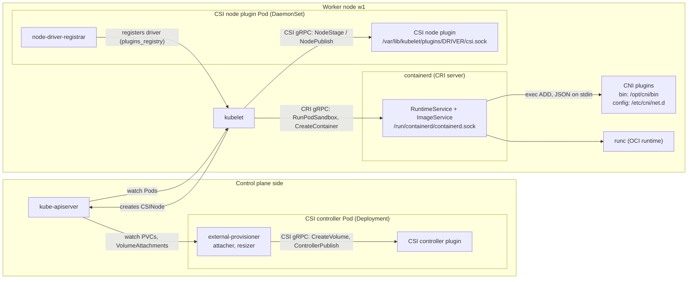

# T4.03 Understand extension interfaces: CNI, CSI, CRI

> Competency: "Understand extension interfaces (CNI, CSI, CRI, etc.)" (CKA-4.7) | Domain/weight: CKA — Cluster Architecture, Installation and Configuration (25%) | Est. time: 2.5 h | Prerequisites: T4.02, T1.11, T1.07

Prerequisite lessons (read them first if a term below is new):

- [T4.02](../part4-cka/T4.02-create-and-manage-kubernetes-clusters-using.md): how kubeadm builds the cluster, including `--pod-network-cidr`.
- [T1.11](../part1-linux/T1.11-containers-images-registries-and-runtimes-oci.md): containers, OCI, containerd, runc, `crictl`.
- [T1.07](../part1-linux/T1.07-linux-networking-i-interfaces-ips-routes.md): interfaces, IPs, routes, bridges, veth pairs.

**Shell setup** (define once per terminal; used everywhere below):

```bash
alias k=kubectl
export do="--dry-run=client -o yaml"
export now="--force --grace-period=0"
source <(kubectl completion bash); complete -o default -F __start_kubectl k
```

**Where commands run.** Cluster commands (`k ...`) run on `cp1`. Node-level commands (`ls /etc/cni/net.d`, `crictl`, `systemctl`) run on the node itself: `ssh w1`, then `sudo -i`, and `exit` when you are done. This is how exam tasks work: each task is done on a designated host, you get an `ssh <nodename>` command, `sudo -i` gives root, and nested ssh is not supported ([LF tips page](https://docs.linuxfoundation.org/tc-docs/certification/tips-cka-and-ckad)). So never ssh from one node to another; exit back first.

**About the outputs in this lesson.** The machine this lesson was written on has no kind and no Multipass, so no cluster commands could be run. Every output block is labelled `EXPECTED OUTPUT (not captured)` and is listed in section 11. Commands, file paths and field names are written from the Kubernetes, containerd and CNI/CSI specifications. Treat the exact wording of messages as a guide, not as a byte-for-byte promise.

---

## 1. Why this matters

Kubernetes does not run containers, wire networks or create disks itself. It calls plugins through three standard interfaces: CRI (run containers), CNI (give Pods network) and CSI (give Pods storage). When a node is `NotReady` with a CNI error, when a Pod is stuck in `ContainerCreating`, or when a PVC stays `Pending`, the cause is almost always in one of these plugins, not in Kubernetes core.

The CKA competency list includes "Understand extension interfaces (CNI, CSI, CRI, etc.)", so be ready to read or repair these paths on a node. You will only succeed if you know where each plugin keeps its config, its binaries and its socket, and which component calls which. This lesson gives you that map.

---

## 2. Concepts

### 2.1 The pattern: Kubernetes core + a plugin interface

**What it is.** An "extension interface" is a contract: Kubernetes defines the calls it will make, and any vendor can implement them. The kubelet (the agent on each node) speaks to plugins over a local channel: a gRPC call over a Unix socket (CRI, CSI) or a binary that it (or the runtime) executes with JSON on stdin (CNI).

**The problem it solves.** Before these interfaces, the Docker engine, the networking code and every storage driver lived inside the Kubernetes source tree. Adding a storage vendor meant changing Kubernetes and waiting for a release. Now the vendor ships a plugin on its own schedule.

**What breaks without the contract.** Nothing is "built in" any more: a node with no CNI plugin has no Pod networking, a node with no CSI driver cannot mount that vendor's disks, and a node whose kubelet cannot reach the runtime socket cannot start anything.

| Interface | Full name | Who calls it | What it does | Transport | Where it lives on a node |
|---|---|---|---|---|---|
| CRI | Container Runtime Interface | kubelet | Create/stop Pod sandboxes and containers, pull images | gRPC over Unix socket | `/run/containerd/containerd.sock` |
| CNI | Container Network Interface | the container runtime (containerd) | Add/remove a Pod to the network, assign an IP | Executes a binary, JSON on stdin | config `/etc/cni/net.d`, binaries `/opt/cni/bin` |
| CSI | Container Storage Interface | kubelet (node side) and sidecar containers (controller side) | Create/attach/mount/resize volumes | gRPC over Unix socket | `/var/lib/kubelet/plugins/<driver>/csi.sock` |

Remember this one line: **kubelet talks CRI; containerd talks CNI; kubelet and the CSI sidecars talk CSI.** Most beginners think the kubelet calls CNI. It does not (see 2.4).

### 2.2 CRI: the container runtime interface

**What it is.** CRI is a gRPC API that the kubelet uses to control the container runtime. It has two services:

| Service | Purpose | Example calls |
|---|---|---|
| `RuntimeService` | Pod sandboxes and containers | `RunPodSandbox`, `StopPodSandbox`, `CreateContainer`, `StartContainer`, `ListContainers`, `ExecSync`, `Status`, `UpdateRuntimeConfig` |
| `ImageService` | Images | `PullImage`, `ListImages`, `RemoveImage`, `ImageFsInfo` |

A **Pod sandbox** is the "pause" container plus the Linux namespaces (network, IPC) that all containers of the Pod share. `RunPodSandbox` creates it first; then each container is created inside it.

Both services can be served on the same socket (the usual case) or on two sockets (the kubelet has `--image-service-endpoint` for the second).

**The kubelet flag.** The kubelet finds the runtime with `--container-runtime-endpoint` (the KubeletConfiguration field is `containerRuntimeEndpoint`). The value must be a URL with the `unix://` scheme:

| Runtime | Typical endpoint |
|---|---|
| containerd (default in this guide) | `unix:///run/containerd/containerd.sock` |
| CRI-O | `unix:///var/run/crio/crio.sock` |
| cri-dockerd (Docker Engine through an adapter) | `unix:///run/cri-dockerd.sock` |

Risky values: a path without `unix://` (the kubelet refuses it), a socket that does not exist (the kubelet logs a connection error and the node never becomes Ready), or the Docker socket `/var/run/docker.sock` (Docker does not speak CRI; the built-in "dockershim" was removed in Kubernetes 1.24).

On a kubeadm node the endpoint can be in any of these places (check all of them, do not assume one; the node annotation on the last line is the quickest from `cp1`):

```bash
cat /var/lib/kubelet/kubeadm-flags.env          # often: KUBELET_KUBEADM_ARGS="--container-runtime-endpoint=unix:///..."
systemctl cat kubelet | grep -i endpoint        # systemd drop-ins
grep -i endpoint /var/lib/kubelet/config.yaml   # KubeletConfiguration field containerRuntimeEndpoint
grep -i endpoint /var/lib/kubelet/instance-config.yaml   # node-local kubelet config; newer kubeadm may put containerRuntimeEndpoint here (verify, may not exist)
ps -o args= -C kubelet | tr ' ' '\n' | grep -i endpoint  # the flags the running kubelet really got
k get node w1 -o jsonpath='{.metadata.annotations.kubeadm\.alpha\.kubernetes\.io/cri-socket}{"\n"}'
```

**`crictl`: a CRI client for humans.** `crictl` speaks the same CRI API as the kubelet, so it shows what the runtime sees. It needs the endpoint, either per command or in `/etc/crictl.yaml`:

```yaml
# /etc/crictl.yaml
runtime-endpoint: unix:///run/containerd/containerd.sock
image-endpoint: unix:///run/containerd/containerd.sock
timeout: 10
```

| Command | Meaning |
|---|---|
| `crictl pods` | Pod sandboxes (a Kubernetes view) |
| `crictl ps -a` | Containers (including exited) |
| `crictl images` | Images |
| `crictl logs <id>` | Container logs |
| `crictl inspectp <pod-id>` | JSON for one sandbox (includes the Pod IP) |
| `crictl info` | Runtime status and the runtime's effective config (JSON) |

`crictl` needs root (`sudo crictl ...` or `sudo -i` first). It does not replace `kubectl`: it knows nothing about Deployments, only sandboxes and containers. Do not confuse it with `ctr` or `nerdctl`, which talk to containerd's own API and use namespaces (Kubernetes uses the containerd namespace `k8s.io`).

**RuntimeClass.** A RuntimeClass lets a Pod choose *which configured runtime handler* runs it (for example `runc` for normal containers, `runsc` for gVisor sandboxes, or a Kata Containers handler). It is a cluster-scoped object in `node.k8s.io/v1`.

| Field | Meaning | Default | Risky / invalid |
|---|---|---|---|
| `metadata.name` | The name Pods use in `runtimeClassName` | none | must be a valid DNS subdomain |
| `handler` | Name of the runtime configuration inside containerd/CRI-O. **Required.** Immutable after creation. | none | A handler that is not configured on the node: the Pod fails at sandbox creation, not at API time |
| `overhead.podFixed` | CPU/memory the runtime itself costs per Pod; the admission plugin copies it into `pod.spec.overhead`, and the scheduler and quota count it | none | Large overhead can make a Pod unschedulable |
| `scheduling.nodeSelector` | Merged into the Pod's `nodeSelector` so the Pod lands only on nodes that support this handler | none | Conflicts with the Pod's own nodeSelector make it unschedulable |
| `scheduling.tolerations` | Merged into the Pod's tolerations | none | n/a |

The handler is defined in the *runtime's* config, not in Kubernetes. In containerd 2.x (`/etc/containerd/config.toml`, `version = 3`) it looks like this (verify the section name on your node):

```toml
[plugins.'io.containerd.cri.v1.runtime'.containerd.runtimes.runc]
  runtime_type = 'io.containerd.runc.v2'
```

`runtime_type` names the containerd shim that runs the containers. There is no useful default to rely on: `io.containerd.runc.v2` is the runc shim, and gVisor uses `io.containerd.runsc.v1`. A wrong value makes sandbox creation fail with a shim error, not an API error.

The part after `.runtimes.` (`runc`) is the handler name. A Pod without `runtimeClassName` uses the runtime's default (usually also `runc`). If a Pod names a RuntimeClass that does not exist, the API server rejects it. If the RuntimeClass exists but its handler is not configured on the node, the kubelet reports a sandbox error (see section 6).

There is **no** `kubectl create runtimeclass`. You write the YAML (section 4). Use `k explain runtimeclass` to see fields offline.

### 2.3 CNI: the container network interface

**What it is.** CNI is a small specification for plugins that connect a Linux network namespace to a network. The runtime creates the Pod's network namespace, then calls a CNI plugin to build the plumbing: usually a veth pair (one end in the Pod, one on the node), an IP address, and routes.

**How a plugin is invoked.** A CNI plugin is just an executable file. The caller sets environment variables and writes the JSON network config on stdin; the plugin writes a JSON result on stdout.

| Environment variable | Meaning |
|---|---|
| `CNI_COMMAND` | `ADD` (connect), `DEL` (disconnect), `CHECK` (verify), `VERSION` (list supported spec versions); the 1.1 spec adds `GC` (clean up stale state) |
| `CNI_CONTAINERID` | Sandbox ID |
| `CNI_NETNS` | Path of the Pod's network namespace, e.g. `/var/run/netns/cni-...` |
| `CNI_IFNAME` | Interface name inside the Pod, usually `eth0` |
| `CNI_ARGS` | Extra key=value pairs (Kubernetes passes Pod name and namespace) |
| `CNI_PATH` | Directories where plugin binaries are searched |

The result of `ADD` lists `interfaces`, `ips`, `routes` and `dns`. The runtime gives the IP back to the kubelet, which publishes it in `pod.status.podIP`.

**Where the files are.**

| What | Path | Notes |
|---|---|---|
| Plugin binaries | `/opt/cni/bin` | `bridge`, `host-local`, `loopback`, `portmap`, `bandwidth`, `firewall`, `tuning`, ... come from the reference plugins package (installed as a dependency of the `kubelet` package as `kubernetes-cni`); your CNI add-on adds its own (`calico`, `calico-ipam`, `flannel`, `cilium-cni`) |
| Network config | `/etc/cni/net.d` | `*.conflist` (a list of chained plugins), `*.conf` or `*.json` (one plugin) |

Both paths are runtime settings. In containerd they are `bin_dir`/`bin_dirs` and `conf_dir` under the CRI plugin's `cni` section, and containerd also limits how many config files it loads (`max_conf_num`, default 1). The kubelet *used to* have `--cni-bin-dir` and `--cni-conf-dir` and `--network-plugin`. They were removed with dockershim in 1.24. If you see them in an old tutorial, ignore them.

**Which file wins.** The runtime reads the files in `conf_dir`, sorts them by file name (plain string order) and uses the first one that loads, because `max_conf_num` is 1. Hence the habit of numeric prefixes: `05-cilium.conflist` sorts before `10-calico.conflist`, which sorts before `10-flannel.conflist`. A stale file with a lower name silently beats the file you just installed. A file that does not parse may be skipped, or it may leave `NetworkReady` false; which one happens depends on the containerd version, so check the containerd log (`journalctl -u containerd`) instead of guessing.

**A config file you should be able to read** (teaching example, not what a real add-on installs):

```json
{
  "cniVersion": "1.0.0",
  "name": "demo-net",
  "plugins": [
    {
      "type": "bridge",
      "bridge": "cni-demo0",
      "isGateway": true,
      "ipMasq": true,
      "ipam": {
        "type": "host-local",
        "ranges": [[{ "subnet": "10.99.1.0/24" }]],
        "routes": [{ "dst": "0.0.0.0/0" }]
      }
    },
    { "type": "portmap", "capabilities": { "portMappings": true } }
  ]
}
```

| Field | Meaning | Risk |
|---|---|---|
| `cniVersion` | Spec version the config is written for; every plugin must support it | A plugin that does not support it fails on `ADD` |
| `name` | Network name (unique) | Two files with the same name confuse state |
| `plugins` | The **chain**: plugins run in order for `ADD` (reverse order for `DEL`), each receiving the previous result as `prevResult` | Missing binary for one `type` fails the whole chain |
| `type` | File name of the binary in `/opt/cni/bin` | `failed to find plugin "x" in path [/opt/cni/bin]` |
| `ipam` | A nested plugin that decides the IP | A used-up range gives "no IP addresses available" |
| `bridge` (in the `bridge` plugin) | Name of the Linux bridge the plugin creates on the node. Default in the plugin: `cni0` | Two add-ons using the same bridge name fight over it |
| `isGateway` | Give the bridge an IP (the first address of the subnet) so Pods can use it as their gateway. Default `false` | `false`: the bridge has no IP, so Pods cannot route off the node through it |
| `ipMasq` | Source-NAT traffic leaving the Pod subnet. Default `false` | `false` on a network that cannot route the Pod subnet: Pods cannot reach the outside; `true` hides the Pod IP from the destination |
| `ranges` (in `host-local`) | List of lists of `{ "subnet": ... }`: the address pools to hand out. Required, no default | A subnet that overlaps the node network or another node's Pod range breaks routing |
| `routes` (in `host-local`) | Routes added inside the Pod. Default: none | No `0.0.0.0/0` route means the Pod has no default route and cannot leave its subnet |
| `capabilities.portMappings` (in `portmap`) | Asks the runtime to pass the Pod's `hostPort` mappings to this plugin. Default: not requested | Left out: `hostPort` is silently ignored |

**Chained plugins.** A *main* plugin builds the interface (`bridge`, `calico`, `cilium-cni`, `flannel`). *Meta* plugins then add features on the same Pod: `portmap` (hostPort), `bandwidth` (traffic shaping annotations), `tuning` (sysctls), `firewall`. This is why the Calico file ends with `portmap` and `bandwidth` entries.

**IPAM (IP address management).** IPAM is a plugin called by the main plugin to pick an IP:

| IPAM plugin | How it allocates | Used by |
|---|---|---|
| `host-local` | A range in config, state kept as files on the node (`/var/lib/cni/networks/<name>/`) | Flannel (range from `/run/flannel/subnet.env`), simple bridge setups |
| `calico-ipam` | Blocks (default /26) carved from a cluster-wide IP pool stored in the Kubernetes API | Calico |
| `dhcp` | Asks a DHCP server | Macvlan setups |
| `static` | A fixed address from config | Special cases |
| Cilium's own IPAM | Cluster pool or the node's `spec.podCIDR` | Cilium |

### 2.4 Who calls CNI: the runtime, not the kubelet

**Sequence for a new Pod on a node:**

1. The scheduler binds the Pod to `w1`; the kubelet on `w1` sees it.
2. The kubelet calls CRI `RunPodSandbox`.
3. containerd creates the sandbox and a new network namespace.
4. **containerd** loads the CNI config from `/etc/cni/net.d` and runs the plugin chain with `CNI_COMMAND=ADD`.
5. The plugin returns an IP; containerd answers `RunPodSandbox` with success.
6. The kubelet creates the app containers (`CreateContainer` and `StartContainer`) inside the sandbox and sets `pod.status.podIP`.

If step 4 fails, the sandbox creation fails and the kubelet records the event `FailedCreatePodSandBox`. That is why CNI errors appear in Pod events with the text "failed to create pod sandbox".

**NetworkReady.** The kubelet polls the runtime with the CRI `Status` call. The reply has two conditions: `RuntimeReady` (the runtime works) and `NetworkReady` (a usable CNI config was found). If `NetworkReady` is false:

- the node `Ready` condition becomes `False` with reason `KubeletNotReady`,
- the kubelet will not start ordinary Pods, but **hostNetwork Pods still start** (they do not need CNI). That is why the CNI add-on's own DaemonSet (`hostNetwork: true`) can start and fix the problem it is waiting on.

Two wordings you will meet for the same symptom:

| Runtime | Message fragment |
|---|---|
| containerd | `NetworkReady=false reason:NetworkPluginNotReady message:Network plugin returns error: cni plugin not initialized` |
| CRI-O / cri-dockerd | `network plugin not ready: cni config uninitialized` |

Both mean "no usable CNI config in the conf dir". You can see the containerd form as a node condition: `k describe node w1 | grep -i ready`.

### 2.5 Installing or replacing a CNI; podCIDR alignment

**Install.** On a new kubeadm cluster the nodes stay `NotReady` and CoreDNS stays `Pending`/`ContainerCreating` until you install a CNI add-on (`kubeadm init` does not choose one; see [T4.02](../part4-cka/T4.02-create-and-manage-kubernetes-clusters-using.md)). Installing means `k apply -f <manifest>` (or Helm / the Cilium CLI). The manifest creates a DaemonSet whose init container copies the binaries into `/opt/cni/bin` and writes the config into `/etc/cni/net.d` on every node (the directories are `hostPath` mounts).

| Add-on | Config file it writes | Pod CIDR it expects | Network policy | Notes |
|---|---|---|---|---|
| Calico (v3.33.0 in this guide) | `10-calico.conflist` and `calico-kubeconfig` (verify) | IP pool default `192.168.0.0/16`, set by `CALICO_IPV4POOL_CIDR` or the `IPPool` object | Yes | `calico-ipam` hands out /26 blocks; node `spec.podCIDR` is not used by default |
| Flannel (v0.28.10) | `10-flannel.conflist` | `net-conf.json` in the `kube-flannel-cfg` ConfigMap, default `10.244.0.0/16` | No | Needs `node.spec.podCIDR` (reads `/run/flannel/subnet.env` it generates); VXLAN device `flannel.1` |
| Cilium (v1.20.4) | `05-cilium.conflist` | Its IPAM mode: cluster-pool (own list) or `kubernetes` (node `spec.podCIDR`) | Yes | Can also replace kube-proxy |

**podCIDR alignment.** Three numbers must agree:

1. `kubeadm init --pod-network-cidr=192.168.0.0/16` (config: `networking.podSubnet`). kubeadm passes it to kube-controller-manager as `--cluster-cidr`, and sets `--allocate-node-cidrs=true`.
2. The controller manager cuts one range per node and writes it in `node.spec.podCIDR` (default mask /24: `192.168.0.0/24`, `192.168.1.0/24`, ...).
3. The CNI add-on's own pool/network setting. Flannel's `Network` and Calico's IPPool CIDR must be the same range (or inside it).

How to check each number:

```bash
grep cluster-cidr /etc/kubernetes/manifests/kube-controller-manager.yaml    # on cp1, as root
k get nodes -o jsonpath='{range .items[*]}{.metadata.name}{"\t"}{.spec.podCIDR}{"\n"}{end}'
k -n kube-flannel get cm kube-flannel-cfg -o jsonpath='{.data.net-conf\.json}'   # Flannel
k get ippools.crd.projectcalico.org -o jsonpath='{.items[*].spec.cidr}{"\n"}'     # Calico
```

What goes wrong when they disagree: symptoms vary. Flannel with its default `10.244.0.0/16` on a `192.168.0.0/16` cluster reads `node.spec.podCIDR` (`192.168.x.0/24`), which is not inside its `Network`. A likely outcome is that the Flannel Pod cannot acquire its subnet lease and goes into `CrashLoopBackOff`, so the node stays `NotReady` (not confirmed, see section 11). A CNI that ignores `podCIDR` (Calico with its own pool) can instead hand out addresses outside the cluster CIDR, and cross-node traffic may time out. Check first: `k -n kube-flannel logs ds/kube-flannel-ds` (Flannel) or `k -n kube-system logs ds/calico-node` (Calico). The rule is simply: align them. You cannot change the cluster CIDR cheaply after `kubeadm init`; changing the add-on's pool to match is the easier direction.

**Which Calico is installed here.** The labs assume the baseline Calico was installed from the plain `calico.yaml` manifest (the same file Lab B downloads), not from the Tigera operator, so its DaemonSet is `calico-node` in `kube-system`. If your cluster uses the operator, the DaemonSet lives in `calico-system` instead (UNVERIFIED how your baseline was installed; check with `k get ds -A | grep calico`).

**Cilium in a bit more detail.** Cilium is installed with its CLI or Helm, not by `k apply` of one file. With the CLI: `cilium install --version 1.20.4 --set ipam.mode=kubernetes` then `cilium status --wait`. The IPAM setting decides where Pod ranges come from:

| `ipam.mode` | Pod range comes from | Where you set the CIDR |
|---|---|---|
| `kubernetes` | `node.spec.podCIDR`, so it follows `--pod-network-cidr` automatically | nowhere extra; alignment is automatic |
| `cluster-pool` (Cilium's default) | Cilium's own pool | `--set ipam.operator.clusterPoolIPv4PodCIDRList=192.168.0.0/16` (and `clusterPoolIPv4MaskSize` for the per-node size) |

These commands were not run for this lesson (UNVERIFIED, section 11). Cilium writes `05-cilium.conflist`, which sorts before `10-calico.conflist`: that is the "two configs" trap when you switch from Calico to Cilium without cleaning the node.

**Replace.** There is no live "switch". Replacing a CNI means: delete the old add-on's objects, remove its leftover **files on every node** (`/etc/cni/net.d/*`, `/opt/cni/bin/<old plugin>` if you want, interfaces such as `flannel.1`, `cni0`, firewall rules named by the old add-on), then install the new add-on, then recreate Pods so their sandboxes are rebuilt by the new plugin. A reboot of each node clears interfaces, firewall rules and network namespaces in one step. The lab in section 7 does exactly this.

### 2.6 CSI: the container storage interface

**What it is.** CSI is a gRPC specification for storage drivers. A driver implements three services:

| CSI service | Purpose | Key calls |
|---|---|---|
| Identity | Name and capabilities of the driver | `GetPluginInfo`, `GetPluginCapabilities`, `Probe` |
| Controller | Cluster-level operations that need no access to a node | `CreateVolume`, `DeleteVolume`, `ControllerPublishVolume` (attach), `ControllerUnpublishVolume`, `ControllerExpandVolume`, `CreateSnapshot` |
| Node | Operations on the node that uses the volume | `NodeStageVolume`, `NodePublishVolume` (mount into the Pod), `NodeUnpublishVolume`, `NodeExpandVolume`, `NodeGetInfo` |

So a CSI driver is deployed as **two parts**:

| Part | Kind of workload | Containers | Runs where |
|---|---|---|---|
| **Controller plugin** | Deployment or StatefulSet (1-3 replicas) | The vendor's driver container + **sidecars**: `external-provisioner`, `external-attacher`, `external-resizer`, `csi-snapshotter`, `livenessprobe` | Anywhere (needs access to the storage API) |
| **Node plugin** | DaemonSet | The vendor's driver container + `node-driver-registrar` + `livenessprobe` | Every node that can use the storage; privileged; mounts `/var/lib/kubelet` with bidirectional mount propagation |

Two terms from the table. **Leader election:** when a controller runs several replicas, only one (the leader, chosen by holding a `Lease` object in the API) acts; the others wait. If the leader cannot get or renew the lease (for example a permissions error), nobody provisions and PVCs stay `Pending`. **Bidirectional mount propagation:** a mount made by the driver container inside `/var/lib/kubelet` must also appear on the node (and in the Pods that use it); without this setting the volume is mounted only inside the driver container and the Pod sees an empty directory.

**Sidecars are Kubernetes-maintained helper containers that translate API objects into CSI calls:**

| Sidecar | Watches | Calls | Result |
|---|---|---|---|
| `external-provisioner` | PVCs whose StorageClass `provisioner` equals the driver name | `CreateVolume` / `DeleteVolume` | Creates the PV and binds it |
| `external-attacher` | `VolumeAttachment` objects | `ControllerPublishVolume` / `Unpublish` | Attaches the disk to the node (only if the driver needs attach) |
| `external-resizer` | PVC size increases | `ControllerExpandVolume` | Grows the disk (needs `allowVolumeExpansion: true` on the StorageClass) |
| `snapshot-controller` (one per cluster, from the external-snapshotter project) | `VolumeSnapshot` objects | none (it only creates the matching `VolumeSnapshotContent`) | Turns the user's `VolumeSnapshot` into a `VolumeSnapshotContent` |
| `csi-snapshotter` (sidecar, from the external-snapshotter project) | `VolumeSnapshotContent` objects | `CreateSnapshot` / `DeleteSnapshot` | Takes the snapshot on the storage backend |
| `node-driver-registrar` | nothing; it registers the driver with the local kubelet | `GetPluginInfo` | Creates the registration socket; the kubelet then updates the `CSINode` object |

**The two socket locations (memorise):**

| Socket | Path | Who uses it |
|---|---|---|
| The driver's own socket | `/var/lib/kubelet/plugins/<driver-name>/csi.sock` | kubelet (for mount calls) and the registrar |
| Registration socket | `/var/lib/kubelet/plugins_registry/<driver-name>-reg.sock` | kubelet's plugin watcher discovers drivers here |

The controller sidecars talk to the controller plugin over a socket in a shared `emptyDir` inside the same Pod (usually `/csi/csi.sock`), not through the kubelet directory.

**The two cluster objects:**

| Object | API | Scope | Created by | Meaning |
|---|---|---|---|---|
| `CSIDriver` | `storage.k8s.io/v1` | cluster | The driver installer (a manifest) | Declares how Kubernetes must treat this driver |
| `CSINode` | `storage.k8s.io/v1` | cluster, one per node | The kubelet, after the registrar registers the driver | Lists which drivers work on this node, the driver's node ID, topology keys, and volume limit (`allocatable.count`) |

`CSIDriver.spec` fields:

| Field | Default | Meaning | Risk |
|---|---|---|---|
| `attachRequired` | `true` | Does the driver need an attach step (a `VolumeAttachment`)? NFS-like drivers set `false` | `true` for a driver without a controller attach: Pods wait for an attach that never happens |
| `podInfoOnMount` | `false` | Kubelet passes Pod name/namespace/UID to `NodePublishVolume` as volume context | Needed by ephemeral drivers; leaving it off breaks such drivers |
| `volumeLifecycleModes` | `[Persistent]` | `Persistent` (PV/PVC) and/or `Ephemeral` (inline `csi:` volume in the Pod spec) | Using an inline volume with a driver that lacks `Ephemeral` is rejected |
| `fsGroupPolicy` | `ReadWriteOnceWithFSType` | Whether the kubelet applies `fsGroup` ownership: `None`, `File`, `ReadWriteOnceWithFSType` | `None` leaves files owned by root; Pods with `fsGroup` cannot write |
| `storageCapacity` | `false` | The scheduler uses `CSIStorageCapacity` objects to pick nodes with room | `true` without the driver publishing capacity blocks scheduling |
| `requiresRepublish` | `false` | Kubelet calls `NodePublishVolume` periodically (e.g. to refresh credentials) | n/a |
| `tokenRequests` | none | Ask the kubelet for service-account tokens for the driver | Security-sensitive |

Use `k explain csidriver.spec` for the full list and `k get csidrivers` for the columns above.

**Observe a driver on a cluster:**

```bash
k get csidrivers,csinodes
k get pods -A | grep -i csi
k get volumeattachments
```

A node with no driver shows `0` in the `DRIVERS` column of `k get csinodes`. Note: **`local-path-provisioner` (used in this guide's VM cluster) is not a CSI driver.** It is an external provisioner with the name `rancher.io/local-path`, so `k get csidrivers` shows nothing on that cluster.

### 2.7 In-tree to CSI migration (awareness)

"In-tree" volume plugins are the ones compiled into Kubernetes (`awsElasticBlockStore`, `gcePersistentDisk`, `azureDisk`, `azureFile`, `vsphereVolume`, `cinder`, ...). Kubernetes moved them to CSI drivers and then removed the in-tree code for the cloud-provider plugins. For you this means: new clusters use the vendor's CSI driver; the StorageClass `provisioner` is the CSI driver name (for example `ebs.csi.aws.com`), not `kubernetes.io/aws-ebs`. Older manifests that use the in-tree names may fail on a current cluster. While the migration was in progress, the kubelet and controllers routed requests for an in-tree volume type to the matching CSI driver when it was installed; this was controlled by the `CSIMigration*` feature gates, which are now enabled by default or locked on, so you do not set them (UNVERIFIED for 1.37, section 11). On a cluster you can see it on the node's CSINode object: `k get csinode <node> -o yaml` may carry the annotation `storage.alpha.kubernetes.io/migrated-plugins`, which lists the in-tree plugin names that this node handles through CSI. It is empty or absent on the guide's VM cluster because no CSI driver is installed there. The plugins that are still built in do not need a driver: `emptyDir`, `hostPath`, `configMap`, `secret`, `projected`, `downwardAPI`, `persistentVolumeClaim`, `local`, `nfs` and `iscsi` (the exact current list is on the volumes page, bookmarked in section 8). The `gitRepo` volume is removed and is not used in this guide.

### 2.8 Other extension points (awareness)

| Extension | What it is | How you see it |
|---|---|---|
| Device plugins | A gRPC server that registers with the kubelet via `/var/lib/kubelet/device-plugins/kubelet.sock` and advertises hardware (GPU, FPGA) as extended resources such as `vendor.com/gpu` | `k describe node` shows them under `Capacity`/`Allocatable`; Pods request them under `resources.limits` |
| DRA (Dynamic Resource Allocation, GA in v1.34) | A richer model for devices: `DeviceClass`, `ResourceClaim`, `ResourceClaimTemplate`, `ResourceSlice` in `resource.k8s.io/v1`; Pods reference claims in `spec.resourceClaims` and `containers[].resources.claims` | `k get deviceclasses,resourceslices` |
| Admission webhooks | The API server calls your HTTPS service on create/update. `MutatingWebhookConfiguration` can change the object, `ValidatingWebhookConfiguration` can reject it (`admissionregistration.k8s.io/v1`) | `k get mutatingwebhookconfigurations,validatingwebhookconfigurations` |
| Aggregated API | An extra API server behind the main one, registered by an `APIService` (`apiregistration.k8s.io/v1`). `metrics-server` serves `v1beta1.metrics.k8s.io` this way | `k get apiservices` |
| CRDs | New resource types stored in etcd, served by the main API server; a controller gives them behaviour (see T4.08) | `k get crds` |
| cloud-controller-manager | Runs the cloud-specific control loops (node lifecycle, routes, `LoadBalancer` Services) outside kube-controller-manager | A `cloud-controller-manager` Deployment or static Pod; kubelet runs with `--cloud-provider=external` |

How to read each row on a cluster:

- **Device plugins:** `k describe node w1 | grep -A8 Allocatable`. A line such as `vendor.com/gpu: 1` means a plugin registered; no line means no plugin (or it crashed).
- **DRA:** `k get deviceclasses,resourceslices`. A `ResourceSlice` per driver and node lists the devices it offers; empty output means no DRA driver is installed.
- **Admission webhooks:** `k get validatingwebhookconfigurations -o yaml | grep -E 'failurePolicy|name:'`. `failurePolicy: Fail` plus a dead webhook Service blocks every matching create/update.
- **Aggregated API:** `k get apiservices | grep -v Local`. `AVAILABLE` of `False` means the extra API server is down (for `metrics-server`, `k top nodes` then fails).
- **CRDs:** `k get crds`, then `k api-resources | grep <group>` to see the kinds they add.
- **cloud-controller-manager:** `k get pods -n kube-system | grep cloud-controller`. On the guide's kubeadm VMs there is none, so `LoadBalancer` Services stay `<pending>` until a controller such as MetalLB is installed.

Also exist (one line each): kubelet image credential provider plugins, KMS providers for encryption at rest, scheduler plugins, and `kubectl` plugins (an executable named `kubectl-<name>` on `PATH`).

### 2.9 Diagnosing and inspecting a node

Learn this order. Stop at the first step that shows the problem.

1. `k get nodes` then `k describe node w1 | grep -i ready`: is the node `NotReady`? What is the message (CNI, or runtime)?
2. On the node: `systemctl status containerd kubelet`: are both running?
3. `ls /etc/cni/net.d /opt/cni/bin`: is there a config? Is there more than one? Is the plugin binary named in it present?
4. `crictl info | jq '.status.conditions'`: `RuntimeReady` and `NetworkReady`. Without `jq` (not among the listed exam tools, see section 8): `crictl info | grep -A3 NetworkReady`.
5. `crictl info | jq .config.cni`: the paths containerd actually uses (`binDir`, `confDir`, `maxConfNum`). Some containerd 2.x builds name the binary setting `binDirs` (verify on your node).
6. `journalctl -u containerd --no-pager | grep -i cni | tail`: the runtime's own error text.
7. `k get pods -n kube-system -o wide`, then `k logs`/`k describe` for the CNI DaemonSet Pod on that node.
8. Pod events (`k describe pod`): `FailedCreatePodSandBox` plus the plugin name in the text.

### 2.10 Under the hood

- **kubelet to containerd.** The kubelet opens a gRPC connection to the endpoint once, checks the CRI API version (v1), and calls `Status` every few seconds. `UpdateRuntimeConfig` passes the node's `podCIDR` to the runtime. containerd uses that value only if a CNI template is configured (`conf_template`), which kubeadm clusters do not use. So the CNI add-on has to find its Pod range by itself: Calico reads its IP pool, Cilium reads its IPAM setting, and Flannel reads `node.spec.podCIDR` from the API server.
- **containerd and CNI config.** containerd watches `conf_dir` with inotify. When a file appears, disappears or changes it reloads, so replacing a config takes effect without restarting containerd (restarting is still the safe move). Pods already running keep their old network until their sandbox is recreated.
- **A CNI plugin on the node.** After `ADD` you can see a veth pair on the node (`ip link` shows `cali...@if3` or `veth...@if3`), a route to the Pod IP, and inside the Pod `eth0`. See [T1.07](../part1-linux/T1.07-linux-networking-i-interfaces-ips-routes.md).
- **kubelet and CSI mounts.** When a Pod needs a PV, the kubelet's volume manager waits for the `VolumeAttachment` (if the driver needs it), calls `NodeStageVolume` (once per node: format and mount to a staging directory), then `NodePublishVolume` (bind mount into `/var/lib/kubelet/pods/<pod-uid>/volumes/kubernetes.io~csi/<pv-name>/mount`). The driver is found by name through the registration done by `node-driver-registrar`.
- **Provisioning flow.** PVC created, then `external-provisioner` sees `storageClassName` whose `provisioner` equals its driver name, calls `CreateVolume`, creates the PV with a `claimRef`, the PV controller binds. If no sidecar is running for that provisioner name, nothing happens and the PVC stays `Pending` forever.

### 2.11 Related but different

- **CNI vs kube-proxy.** CNI gives Pods IPs and Pod-to-Pod connectivity. kube-proxy implements Service virtual IPs on top. A broken CNI breaks both; a broken kube-proxy leaves Pod-to-Pod working.
- **CNI vs NetworkPolicy.** NetworkPolicy objects are only enforced if the CNI implements them (Calico, Cilium yes; plain Flannel no). The object is accepted either way.
- **StorageClass vs CSIDriver vs PV.** StorageClass = how to provision (names a provisioner). CSIDriver = what the driver is like. PV = one actual volume.
- **CSI vs external provisioner without CSI.** `local-path-provisioner` and the NFS subdir provisioner are not CSI drivers, but they behave like one from the PVC side.
- **CRI vs OCI.** CRI is the kubelet-to-runtime API. OCI is the image/runtime format standard that containerd and runc follow (see [T1.11](../part1-linux/T1.11-containers-images-registries-and-runtimes-oci.md)).
- **Device plugin vs CSI.** Device plugins expose hardware to containers; CSI exposes storage volumes.

---

## 3. How it works (diagram)



**Walkthrough**

1. **CRI/CNI path:** the kubelet watches the API server for Pods bound to its node and calls containerd over the CRI socket (`RunPodSandbox`, then `CreateContainer`). The kubelet never talks to the CNI plugins.
2. containerd, as part of creating the sandbox, reads `/etc/cni/net.d`, executes the plugin binary from `/opt/cni/bin` with `ADD`, and gets the Pod IP back. containerd uses `runc` to start the containers.
3. **CSI node path:** the `node-driver-registrar` registers the driver with the kubelet. After that the kubelet calls the CSI node plugin on its Unix socket to stage and mount volumes. The kubelet also creates the `CSINode` object.
4. **CSI controller path:** sidecars in the controller Pod watch the API server (PVCs, VolumeAttachments) and translate them into CSI calls to the controller plugin, which talks to the storage backend.
5. If a box in this picture is missing, the matching symptom appears: no CNI config means node NotReady; no registrar means "driver not found in the list of registered CSI drivers"; no provisioner sidecar means a Pending PVC.

---

## 4. Commands and YAML you must produce fast

### 4.1 Imperative shortcuts

| Command | One-line explanation |
|---|---|
| `k describe node w1 \| grep -i ready` | Shows the `Ready` condition line and the kubelet message (CNI errors appear here) |
| `ls /etc/cni/net.d /opt/cni/bin` (on the node) | Config file(s) and plugin binaries |
| `sudo crictl info \| jq '.status.conditions'` | Runtime and network readiness as the kubelet sees it |
| `sudo crictl info \| jq .config.cni` | The CNI directories containerd actually uses |
| `sudo crictl pods` / `sudo crictl ps -a` | Sandboxes / containers on this node |
| `k get csidrivers,csinodes` | Installed CSI drivers and which nodes registered them |
| `k get runtimeclass` | RuntimeClasses. There is no short name: `rc` means ReplicationController, so `k get rc` shows the wrong resource |
| `k get sc,pvc -A` | StorageClasses (the `PROVISIONER` column is the driver name) and PVCs |
| `k explain runtimeclass.handler` / `k explain csidriver.spec` | Field help, works offline in the exam |
| `k run rc-demo --image=busybox:1.36 --overrides='{"spec":{"runtimeClassName":"runc-default"}}' $do -- sleep 3600` | Generate a Pod manifest that already has `runtimeClassName` (there is no dedicated flag) |

### 4.2 RuntimeClass and a Pod that uses it

Create a working directory first: `mkdir -p ~/lab/t403 && cd ~/lab/t403`.

```yaml
# ~/lab/t403/rc.yaml
apiVersion: node.k8s.io/v1        # API group for RuntimeClass
kind: RuntimeClass                # cluster-scoped: no namespace
metadata:
  name: runc-default              # the name Pods reference in runtimeClassName
handler: runc                     # REQUIRED, immutable. Must exist in containerd's runtimes config
                                  # (the default install has "runc"). A name that is not configured
                                  # on the node makes sandbox creation fail.
overhead:
  podFixed:                       # optional: per-Pod cost of the runtime, added to scheduling and quota
    cpu: 50m                      # copied into pod.spec.overhead by the RuntimeClass admission plugin
    memory: 32Mi
scheduling:
  nodeSelector:                   # optional: merged into the Pod's nodeSelector
    kubernetes.io/os: linux       # every node has this label, so every node qualifies
---
apiVersion: v1
kind: Pod
metadata:
  name: rc-demo
  namespace: lab-t403
spec:
  runtimeClassName: runc-default  # name of the RuntimeClass above; the Pod is rejected at creation if it does not exist
  containers:
  - name: app
    image: busybox:1.36
    command: ["sleep", "3600"]
```

Apply: `k create ns lab-t403 && k apply -f ~/lab/t403/rc.yaml`.

### 4.3 A CSIDriver object (declared by a driver installer)

You normally do not write a CSIDriver; the driver's install manifest contains it, and you *read* it from the running cluster to learn the driver's behaviour:

```bash
k get csidriver <driver-name> -o yaml
```

For practice (and for the lab) this complete object applies cleanly. The driver does not need to exist for the API server to accept it:

```yaml
# ~/lab/t403/csidriver.yaml
apiVersion: storage.k8s.io/v1
kind: CSIDriver
metadata:
  name: demo.csi.example.com      # must equal the name the driver reports in GetPluginInfo
                                  # and the StorageClass "provisioner" value
spec:
  attachRequired: false           # default true. false = no VolumeAttachment / external-attacher needed
  podInfoOnMount: false           # default false. true = kubelet passes Pod name/namespace to the driver
  storageCapacity: false          # default false. true = scheduler consults CSIStorageCapacity objects
  fsGroupPolicy: ReadWriteOnceWithFSType   # default. Other values: None, File
  requiresRepublish: false        # default false. true = kubelet re-calls NodePublishVolume periodically
  volumeLifecycleModes:           # default [Persistent]
  - Persistent                    # PV/PVC volumes. "Ephemeral" would allow inline csi: volumes in a Pod
```

**Output O1.** What a real driver's object looks like when you read it (hostpath driver; values illustrative):

```text
# EXPECTED OUTPUT (not captured)
$ k get csidriver hostpath.csi.k8s.io -o yaml
apiVersion: storage.k8s.io/v1
kind: CSIDriver
metadata:
  name: hostpath.csi.k8s.io
spec:
  attachRequired: true
  fsGroupPolicy: File
  podInfoOnMount: true
  storageCapacity: true
  volumeLifecycleModes:
  - Persistent
  - Ephemeral
```

### 4.4 Speed drill

**Setup (once):** `k create ns lab-t403`; you need `~/lab/t403/rc.yaml` from 4.2. Every task is on the cluster from section 7's baseline (3 VMs). Targets are exam pace: about 6 minutes per task on average, since the exam has 15-20 tasks in 2 hours ([LF tips page](https://docs.linuxfoundation.org/tc-docs/certification/tips-cka-and-ckad)); these drills are smaller, so the targets are shorter.

| # | Task | Target |
|---|---|---|
| 1 | On `w1`, find the CRI socket the kubelet uses. | 1 min |
| 2 | On `w1`, list the CNI config files and count the plugin binaries. | 1 min |
| 3 | On `w1`, print only the `NetworkReady` condition from `crictl`, without `jq`. | 1 min |
| 4 | Create the RuntimeClass `drill-rc` (handler `runc`) and a Pod `rc-pod` in `lab-t403` that uses it. | 3 min |
| 5 | List CSI drivers and the CSINodes. Say whether this cluster has any driver. | 1 min |
| 6 | Print each node's `podCIDR` and the `--cluster-cidr` of the controller manager. | 2 min |
| 7 | Find the node that runs `rc-pod`, find its sandbox there with `crictl`, and read its IP from the runtime. | 3 min |

<details><summary>Answers</summary>

1. Fastest, from `cp1`: `k get node w1 -o jsonpath='{.metadata.annotations.kubeadm\.alpha\.kubernetes\.io/cri-socket}'`. On `w1` (`ssh w1`, `sudo -i`) check all of these, because the endpoint can be in any of them: `cat /var/lib/kubelet/kubeadm-flags.env`, `grep -i endpoint /var/lib/kubelet/config.yaml /var/lib/kubelet/instance-config.yaml`, and `ps -o args= -C kubelet | tr ' ' '\n' | grep endpoint`.
2. `ls /etc/cni/net.d` and `ls /opt/cni/bin | wc -l`.
3. `crictl info | grep -B1 -A3 NetworkReady` (the JSON has `"type": "NetworkReady"` followed by `"status": true`).
4. ```bash
   cd ~/lab/t403 && sed 's/runc-default/drill-rc/' rc.yaml | sed 's/rc-demo/rc-pod/' | k apply -f -
   k get pod rc-pod -n lab-t403 -o jsonpath='{.spec.runtimeClassName}{"\n"}'
   ```
   (The `sed` just renames the objects from 4.2. In the exam you would type the RuntimeClass YAML from the docs page.)
5. `k get csidrivers,csinodes`. On the guide's VM cluster there is no CSI driver (local-path-provisioner is not CSI), so `csidrivers` is empty and each CSINode shows `0` drivers.
6. `k get nodes -o jsonpath='{range .items[*]}{.metadata.name}{"\t"}{.spec.podCIDR}{"\n"}{end}'` and, as root on `cp1`, `grep cluster-cidr /etc/kubernetes/manifests/kube-controller-manager.yaml`.
7. On `cp1`: `k get pod rc-pod -n lab-t403 -o wide` (note the IP and the `NODE` column; the Pod is not pinned, so it may be `w1` or `w2`). On that node as root: `crictl pods --name rc-pod`, then `crictl inspectp <POD_ID> | grep -i '"ip"'`. The IP must match.

**Cleanup:** `k delete ns lab-t403; k delete runtimeclass drill-rc` (deleting the namespace removes `rc-pod`, and the baseline has no `lab-t403`)

</details>

---

## 5. Worked example

**Goal:** on `w1`, prove each of the three interfaces is in place, then start a Pod and follow it through CRI and CNI. Environment: **vms** baseline (cp1, w1, w2; containerd 2.x; Calico v3.33.0; pod CIDR `192.168.0.0/16`). Work from section 4.2 onward with namespace `lab-t403`.

**Step 1 (cp1): is the node healthy, and what does the kubelet say?**

```bash
k get nodes
k describe node w1 | grep -i ready
```

**Output O2.**

```text
# EXPECTED OUTPUT (not captured)
NAME   STATUS   ROLES           AGE   VERSION
cp1    Ready    control-plane   2d    v1.37.1
w1     Ready    <none>          2d    v1.37.1
w2     Ready    <none>          2d    v1.37.1

  Ready            True    ...   KubeletReady                 kubelet is posting ready status
```

Read it: `Ready True` with reason `KubeletReady`. In the broken case (lab 3) the reason is `KubeletNotReady` and the message names `NetworkReady=false`.

**Step 2 (w1): CRI endpoint.** `ssh w1`, `sudo -i`, then check every place the endpoint can be set (section 2.2):

```bash
cat /var/lib/kubelet/kubeadm-flags.env
grep -i endpoint /var/lib/kubelet/config.yaml /var/lib/kubelet/instance-config.yaml
ls -l /run/containerd/containerd.sock
cat /etc/crictl.yaml
```

**Output O3.**

```text
# EXPECTED OUTPUT (not captured)
KUBELET_KUBEADM_ARGS="--container-runtime-endpoint=unix:///var/run/containerd/containerd.sock ..."
srw-rw---- 1 root root 0 ... /run/containerd/containerd.sock
runtime-endpoint: unix:///run/containerd/containerd.sock
```

(If `kubeadm-flags.env` has no `--container-runtime-endpoint`, the `grep` of `config.yaml` / `instance-config.yaml` shows a `containerRuntimeEndpoint:` line instead; `grep` prints an error for a file that does not exist, which is fine.) `/var/run` is a symlink to `/run`, so both spellings reach the same socket. The `s` at the start of the `ls -l` line means "socket".

**Step 3 (w1): CNI config and binaries.**

```bash
ls /etc/cni/net.d /opt/cni/bin
```

**Output O4.** Calico v3.33.0 file names are not yet confirmed (listed in section 11):

```text
# EXPECTED OUTPUT (not captured)
/etc/cni/net.d:
10-calico.conflist  calico-kubeconfig

/opt/cni/bin:
bandwidth  bridge  calico  calico-ipam  dhcp  dummy  firewall  flannel  host-device  host-local  install
ipvlan  loopback  macvlan  portmap  ptp  sbr  static  tap  tuning  vlan  vrf
```

Read it: one config file (good, nothing competes). The binaries are the reference set plus `calico` and `calico-ipam` from the add-on. The exact list depends on the `kubernetes-cni` package version and add-on.

**Step 4 (w1): readiness and the CNI settings as the runtime sees them.** This step uses `jq`. It is not in the listed exam tools (section 8), and the lab VMs only have it if `vm-prereqs.sh` installed it; if `jq` is missing run `apt-get install -y jq` (as root) first, or use the `grep` form shown below the output.

```bash
crictl info | jq '.status.conditions'
crictl info | jq .config.cni
```

**Output O5.** The JSON paths for containerd 2.x are unconfirmed (section 11):

```text
# EXPECTED OUTPUT (not captured)
[
  { "type": "RuntimeReady", "status": true, "reason": "", "message": "" },
  { "type": "NetworkReady", "status": true, "reason": "", "message": "" }
]
{
  "binDir": "/opt/cni/bin",
  "confDir": "/etc/cni/net.d",
  "maxConfNum": 1,
  "setupSerially": false,
  "confTemplate": "",
  "ipPref": ""
}
```

Read it: both conditions `true`. `confDir` and `binDir` are the same paths you listed in step 3. `maxConfNum: 1` is why only one config file is used (see 2.3). Without `jq`: `crictl info | grep -A3 NetworkReady`.

**Step 5 (cp1): create the Pod and read its IP.**

```bash
k create ns lab-t403
k apply -f ~/lab/t403/rc.yaml
k get pod rc-demo -n lab-t403 -o wide
k get pod rc-demo -n lab-t403 -o jsonpath='{.spec.overhead}{"\n"}'
```

**Output O6.**

```text
# EXPECTED OUTPUT (not captured)
NAME      READY   STATUS    RESTARTS   AGE   IP               NODE   ...
rc-demo   1/1     Running   0          20s   192.168.xxx.xx   w1     ...
{"cpu":"50m","memory":"32Mi"}
```

The Pod IP is inside `192.168.0.0/16`. The second line proves the RuntimeClass admission plugin copied `overhead` into the Pod. If the Pod landed on `w2`, run step 6 on `w2`.

**Step 6 (the node the Pod runs on): follow the Pod down to the runtime.**

```bash
crictl pods --name rc-demo
crictl inspectp <POD_ID> | grep -i '"ip"'
ip route | grep 192.168
```

**Output O7.**

```text
# EXPECTED OUTPUT (not captured)
POD ID         CREATED          STATE   NAME      NAMESPACE   ATTEMPT   RUNTIME
3f1c...        30 seconds ago   Ready   rc-demo   lab-t403    0         (default)
      "ip": "192.168.xxx.xx",
192.168.xxx.xx dev cali1a2b3c4d5e6 scope link
```

Read it: the IP from `crictl inspectp` is the same as the one in `kubectl get pod -o wide`. That IP was given by the CNI plugin at sandbox creation. The route points at a `cali...` veth device, the node end of the Pod's veth pair. The `RUNTIME` column shows `(default)` or the handler name depending on the `crictl` version.

**Step 7 (cp1): CSI view.**

```bash
k get csidrivers
k get csinodes
k get sc
```

**Output O8.**

```text
# EXPECTED OUTPUT (not captured)
No resources found

NAME   DRIVERS   AGE
cp1    0         2d
w1     0         2d
w2     0         2d

NAME                   PROVISIONER             RECLAIMPOLICY   VOLUMEBINDINGMODE      ALLOWVOLUMEEXPANSION   AGE
local-path (default)   rancher.io/local-path   Delete          WaitForFirstConsumer   false                  2d
```

Read it: no CSI drivers, but dynamic provisioning still works through the external provisioner `rancher.io/local-path`. A real CSI provisioner would show a name like `ebs.csi.aws.com` or `hostpath.csi.k8s.io` and a matching CSIDriver.

(The exact column list depends on the kubectl version. The three commands are run separately on purpose. If you query both types in one command, as in 4.1, kubectl prefixes the names, for example `csinode.storage.k8s.io/cp1`, and prints no "No resources found" line for the empty type when the other type has rows.)

**Step 8 (cp1): a RuntimeClass with a bad handler (optional, shows the failure).**

```bash
cat <<'EOF' | k apply -f -
apiVersion: node.k8s.io/v1
kind: RuntimeClass
metadata:
  name: gvisor-missing
handler: gvisor
---
apiVersion: v1
kind: Pod
metadata:
  name: rc-bad
  namespace: lab-t403
spec:
  runtimeClassName: gvisor-missing
  containers:
  - name: app
    image: busybox:1.36
    command: ["sleep", "3600"]
EOF
k get pod rc-bad -n lab-t403
k describe pod rc-bad -n lab-t403 | tail -5
```

**Output O9.**

```text
# EXPECTED OUTPUT (not captured)
NAME     READY   STATUS              RESTARTS   AGE
rc-bad   0/1     ContainerCreating   0          10s
...
  Warning  FailedCreatePodSandBox  ...  Failed to create pod sandbox: rpc error: code = Unknown desc = failed to get sandbox runtime: no runtime for "gvisor" is configured
```

The API server accepted the RuntimeClass because it cannot know which handlers each node has. The error appears only when the runtime on the node is asked to run the sandbox.

**Cleanup:** `k delete ns lab-t403; k delete runtimeclass runc-default gvisor-missing`

---

## 6. Common mistakes and how to fix them

| Symptom | What you will see (exact error/event text) | Cause | Fix (command) |
|---|---|---|---|
| Node `NotReady` right after kubeadm, or after a CNI file went missing | Node condition: `container runtime network not ready: NetworkReady=false reason:NetworkPluginNotReady message:Network plugin returns error: cni plugin not initialized` (CRI-O / cri-dockerd say `cni config uninitialized`). CoreDNS Pods `Pending` | No usable file in `/etc/cni/net.d` | Install the CNI add-on: `k apply -f <cni-manifest>`; or restore the file (lab 3) |
| Pods get IPs from two ranges | `k get pods -A -o wide` shows e.g. `10.244.x.x` and `192.168.x.x` | Two CNI configs in `net.d`, or old Pods created before the switch | `ls /etc/cni/net.d`, move the stale file away, restart containerd, recreate Pods |
| PVC stays `Pending` | `Normal ExternalProvisioning ... Waiting for a volume to be created either by the external provisioner '<driver>' or manually by the system administrator. If volume creation is delayed, please verify that the provisioner is running and correctly registered.` (capitalisation, quotes and wording differ between versions; look for `external provisioner` and the driver name) | CSI controller (the `external-provisioner`) not running, wrong name, or no leader (the replicas are waiting for the leader lease, see 2.6) | `k get pods -A \| grep -i csi`; `k logs <ctrl-pod> -c csi-provisioner` |
| Pod stuck `ContainerCreating` with plugin text | `Failed to create pod sandbox: rpc error: code = Unknown desc = failed to setup network for sandbox "<id>": plugin type="calico" failed (add): ...` | The CNI plugin cannot do `ADD` (binary missing, its agent not running, no free IP) | Read the text after `failed (add):`; `ls /opt/cni/bin`; check the CNI DaemonSet Pod on that node |
| Pod stuck, plugin binary missing | `... failed to find plugin "calico" in path [/opt/cni/bin]` | Config lists a `type` that has no file in `bin_dir` | Re-run the add-on's installer (restart its Pod) or copy the binary |
| `crictl` cannot connect | `... connect: no such file or directory` or `unable to determine runtime API version` (exact text varies) | No endpoint configured, or the wrong socket path | `crictl --runtime-endpoint unix:///run/containerd/containerd.sock ps`; write `/etc/crictl.yaml` |
| Pod rejected | `pods "x" is forbidden: pod rejected: RuntimeClass "foo" not found` (exact wording may differ) | `runtimeClassName` names a RuntimeClass that does not exist | `k get runtimeclass`; create it or fix the name |
| Pod `ContainerCreating` on RuntimeClass | `Failed to create pod sandbox: ... no runtime for "<handler>" is configured` | RuntimeClass `handler` is not defined in containerd on that node | Add the runtime to `/etc/containerd/config.toml`, restart containerd; or fix `handler` (immutable: recreate the object) |
| Pod mount fails | `MountVolume.MountDevice failed ... driver name <driver> not found in the list of registered CSI drivers` | The CSI node plugin / registrar is not running on this node | `k get csinodes`; `k get pods -A -o wide \| grep -i csi`; check the registrar logs |

### 6.1 Node NotReady with `cni plugin not initialized`

**Reasoning path.**

1. `k get nodes`: which node? (One node = a node problem; all nodes after kubeadm = CNI never installed.)
2. `k describe node w1 | grep -i ready`: the message contains `NetworkReady=false`. That tells you the runtime is up (it answered `Status`) and only the network is missing.
3. On the node: `ls /etc/cni/net.d`. Empty or missing directory is the answer. A file that exists but is corrupt gives the same symptom, so run `journalctl -u containerd --no-pager | grep -i cni | tail` to see a parse error.
4. `k get pods -n kube-system -o wide | grep -E 'calico|flannel|cilium'`: is the CNI Pod on this node running? If the DaemonSet Pod is crashing, its logs tell why. If it does not exist at all, the add-on is not installed.

**Fix.** On a new cluster: `k apply -f <manifest>`. On a node that lost its file: delete that node's CNI Pod so its init container writes the file again (`k -n kube-system delete pod <calico-node-pod-on-w1>`). Then confirm `crictl info | grep -A3 NetworkReady` shows `true`.

### 6.2 Pods get IPs from two ranges

**Reasoning path.**

1. `k get pods -A -o wide`: note which Pods have the odd range. Are they new or old?
2. `ls /etc/cni/net.d` on the node: two `*.conflist` files (for example `10-calico.conflist` and `10-flannel.conflist`) means a previous add-on was never removed.
3. `ls /etc/cni/net.d | sort | head -1` names the file that wins if it loads (lowest sorted name, 2.3). `crictl info | jq .config.cni` confirms the directory the runtime reads (`confDir`) and `maxConfNum`.
4. Old Pods keep their old IPs until their sandbox is rebuilt. New Pods get the range of the *winning* file. Both are normal consequences; the mix is the symptom.

**Fix.** Move the stale file out of the directory (`mv /etc/cni/net.d/10-flannel.conflist /root/`), delete leftover devices (`ip link del flannel.1`, `ip link del cni0`), `systemctl restart containerd`, then recreate the Pods (`k rollout restart` for workloads; delete bare Pods). Some add-on installers rename or remove older files themselves. Check; do not assume.

### 6.3 PVC Pending: `Waiting for a volume to be created`

**Reasoning path.**

1. `k describe pvc <name> -n <ns>`: read the events. An `ExternalProvisioning` event whose text starts `Waiting for a volume to be created either by the external provisioner 'X'` (quotes and capitalisation vary by version) means the PV controller is waiting for something else to create the volume. (`waiting for first consumer to be created before binding` is different: the StorageClass uses `WaitForFirstConsumer` and no Pod uses the PVC yet. That is normal.)
2. `k get sc`: does the PVC's `storageClassName` exist, and what is its `PROVISIONER`? That string must equal the name of a CSIDriver.
3. `k get csidrivers`: is there one with that name?
4. `k get pods -A | grep -i csi`: is the controller Pod (the one with `external-provisioner`) running? Is it `Running` with all containers `READY`?
5. `k logs <controller-pod> -n <ns> -c csi-provisioner --tail=30`: errors about leader election, credentials, or the storage backend show up here.
6. `k get csinodes`: if the PVC is bound but Pods fail to mount, the node side is broken instead.

**Fix.** Scale or restart the controller (`k -n <ns> rollout restart deploy/<csi-controller>`); fix the StorageClass `provisioner` name; fix backend credentials found in the logs.

---

## 7. Labs

**Order:** A (Easy) then C (Break-fix) then B (Medium). Any order works if you finish each cleanup, but B changes the CNI on all nodes and takes longest, so do it last. Each lab leaves the cluster at the baseline: 3 VMs, Calico v3.33.0, pod CIDR `192.168.0.0/16`, no `lab-t403` namespace.

Reminders (exam style): cluster commands on `cp1`; node commands after `ssh <node>` + `sudo -i`; leave with `exit`; do not ssh from a node.

### Lab A (Easy): map CRI, CNI and CSI on a node and draw them

**Environment:** vms (cp1, w1, w2). Kind users: replace `ssh w1` with `docker exec -it <cluster>-worker bash`; the paths are the same inside the node container, but the CSI part needs only kubectl.

**Setup (cp1):**

```bash
mkdir -p ~/lab/t403 && cd ~/lab/t403
k create ns lab-t403
```

**Task.** On node `w1` write a file `/tmp/t403-map.txt` that contains, one per line, in this order:

1. `cri-endpoint:` followed by the `unix://...` URL the kubelet uses.
2. `cni-conf:` followed by the names of the files in `/etc/cni/net.d`, separated by spaces.
3. `cni-bin-count:` followed by the number of files in `/opt/cni/bin`.
4. `network-ready:` followed by `true` or `false` as reported by `crictl info`.

Then, on `cp1`, create the CSIDriver `demo.csi.example.com` from section 4.3, a StorageClass `demo-csi` that uses it as provisioner (`volumeBindingMode: Immediate`), and a PVC `claim` (100Mi, `ReadWriteOnce`, StorageClass `demo-csi`) in namespace `lab-t403`. Find out why the PVC stays `Pending` and write the reason from the event into `~/lab/t403/why.txt` on `cp1`. Finally, draw (paper is fine) the three interfaces as in section 3 with the real socket and directory paths you found.

<details><summary>Hints</summary>

1. Hint 1: The endpoint can be in `kubeadm-flags.env`, `config.yaml`, `instance-config.yaml` (all under `/var/lib/kubelet`) or only on the kubelet command line; the node annotation on `cp1` also shows it. `grep -o 'unix://[^ "]*'` extracts the URL from a file.
2. Hint 2: For `network-ready`, run `crictl info | grep -A3 NetworkReady` and read the `status` line.
3. Hint 3: The reason is in `k describe pvc claim -n lab-t403` under Events. The PVC is Pending because no CSI controller exists for `demo.csi.example.com`.

</details>

<details><summary>Solution</summary>

On `w1` (`ssh w1`, `sudo -i`):

```bash
ep=$(grep -sho "unix://[^ \"']*" /var/lib/kubelet/kubeadm-flags.env /var/lib/kubelet/instance-config.yaml /var/lib/kubelet/config.yaml | head -1)
[ -n "$ep" ] || ep=$(ps -o args= -C kubelet | grep -o 'unix://[^ ]*' | head -1)
{
  echo "cri-endpoint: $ep"
  echo "cni-conf: $(ls /etc/cni/net.d | tr '\n' ' ')"
  echo "cni-bin-count: $(ls /opt/cni/bin | wc -l)"
  echo "network-ready: $(crictl info | grep -A2 '"NetworkReady"' | grep -o 'true\|false' | head -1)"
} > /tmp/t403-map.txt
cat /tmp/t403-map.txt
exit
```

Why: the endpoint can be set in any of three kubelet files or on its command line (section 2.2), so the script tries the files first (`-s` hides errors for files that do not exist) and falls back to the running kubelet's arguments; the listings are plain `ls`; `crictl info` is the same data the kubelet reads from the CRI `Status` call. As a cross-check from `cp1`: `k get node w1 -o jsonpath='{.metadata.annotations.kubeadm\.alpha\.kubernetes\.io/cri-socket}'`.

On `cp1`:

```bash
cd ~/lab/t403
k apply -f csidriver.yaml        # the YAML from section 4.3
cat <<'EOF' | k apply -f -
apiVersion: storage.k8s.io/v1
kind: StorageClass
metadata:
  name: demo-csi
provisioner: demo.csi.example.com
volumeBindingMode: Immediate
reclaimPolicy: Delete
---
apiVersion: v1
kind: PersistentVolumeClaim
metadata:
  name: claim
  namespace: lab-t403
spec:
  accessModes: ["ReadWriteOnce"]
  storageClassName: demo-csi
  resources:
    requests:
      storage: 100Mi
EOF
sleep 3
k get pvc claim -n lab-t403
k describe pvc claim -n lab-t403 | tail -5
k get events -n lab-t403 --field-selector involvedObject.name=claim -o jsonpath='{.items[*].message}' > ~/lab/t403/why.txt
cat ~/lab/t403/why.txt
```

Why: `Immediate` binding makes the PV controller act at once, so the event appears without a Pod. The StorageClass names a provisioner that no running Pod serves, so nothing creates the volume. `k get csinodes` shows `0` drivers for every node because the CSIDriver object is only a declaration; a CSINode entry would appear only after a node plugin registers.

</details>

**Verification (must fail if wrong).**

On `w1`:

```bash
grep -q '^cri-endpoint: unix:///.*containerd.sock' /tmp/t403-map.txt && echo OK-1 || echo FAIL-1
grep -q '^network-ready: true' /tmp/t403-map.txt && echo OK-2 || echo FAIL-2
grep -q '^cni-conf: .*10-calico.conflist' /tmp/t403-map.txt && echo OK-3 || echo FAIL-3
test "$(grep -c . /tmp/t403-map.txt)" = 4 && echo OK-4 || echo FAIL-4
```

On `cp1`:

```bash
test "$(k get pvc claim -n lab-t403 -o jsonpath='{.status.phase}')" = Pending && echo OK-5 || echo FAIL-5
grep -qiE "external provisioner.{1,3}demo\.csi\.example\.com" ~/lab/t403/why.txt && echo OK-6 || echo FAIL-6
test -z "$(k get csinodes -o jsonpath='{.items[*].spec.drivers[*].name}')" && echo OK-7 || echo FAIL-7
```

**Cleanup (cp1, then w1):**

```bash
k delete ns lab-t403
k delete sc demo-csi
k delete csidriver demo.csi.example.com
rm -f ~/lab/t403/why.txt
# on w1: rm -f /tmp/t403-map.txt
```

### Lab B (Medium): replace Flannel with Calico (pod CIDR aligned)

**Environment:** vms (cp1, w1, w2). This lab reaches its start state by first replacing Calico with Flannel (Part 1), so you also practise the node cleanup twice. Time: about 40 minutes with reboots. Use one terminal on `cp1` and one on the node you are cleaning; do not ssh node to node.

**Setup, Part 1 (cp1): download the manifests and make Flannel match the cluster CIDR**

```bash
mkdir -p ~/lab/t403 && cd ~/lab/t403
curl -fsSLO https://raw.githubusercontent.com/projectcalico/calico/v3.33.0/manifests/calico.yaml
curl -fsSL https://github.com/flannel-io/flannel/releases/download/v0.28.10/kube-flannel.yml -o kube-flannel.yml
sed -i 's#"Network": "10.244.0.0/16"#"Network": "192.168.0.0/16"#' kube-flannel.yml
grep -n '"Network"' kube-flannel.yml
k create ns lab-t403
```

Note: the exam may not allow downloading from the internet; in a real task the manifest is given to you or comes from the docs (UNVERIFIED which). The `grep` must print the line with `192.168.0.0/16`.

**Setup, Part 2: remove Calico and install Flannel.**

On `cp1`:

```bash
k delete -f ~/lab/t403/calico.yaml
```

On **each** node in turn (`cp1`, `w1`, `w2`; `ssh <node>`, `sudo -i`), then reboot it and wait until you can ssh back in:

```bash
rm -f /etc/cni/net.d/10-calico.conflist /etc/cni/net.d/calico-kubeconfig
rm -rf /var/lib/calico
reboot
```

When all nodes are back, on `cp1`:

```bash
k apply -f ~/lab/t403/kube-flannel.yml
k -n kube-flannel rollout status ds/kube-flannel-ds
k get nodes
```

The nodes become `Ready` again with `10-flannel.conflist` in `/etc/cni/net.d`. Create a test workload: `k create deploy web -n lab-t403 --image=nginx:1.27 --replicas=3`.

**Task.** Replace Flannel with Calico v3.33.0 without rebuilding the cluster. Requirements:

1. The pod CIDR stays `192.168.0.0/16`. Calico must use the same range.
2. No Flannel object or file remains: namespace `kube-flannel` is gone, and on `w1` `/etc/cni/net.d` has no file with `flannel` in its name.
3. All nodes are `Ready`; the `calico-node` DaemonSet is fully ready.
4. The Deployment `web` in `lab-t403` has 3 `Running` Pods whose IPs are inside `192.168.0.0/16`, and each of them was created after the new `calico-node` DaemonSet (the Pods from the Flannel phase must be gone).
5. On `w1` write the sorted listing of `/etc/cni/net.d` into `/tmp/t403-w1-netd.txt`.

<details><summary>Hints</summary>

1. Hint 1: Remove the old add-on's objects first (`k delete -f kube-flannel.yml`), then clean each node, then install the new add-on. Two configs at once is the failure you learned in section 6.2.
2. Hint 2: Leftover node state to remove: `/etc/cni/net.d/10-flannel.conflist`, the devices `flannel.1` and `cni0`, and `/run/flannel`. A reboot clears the devices and old network namespaces.
3. Hint 3: Calico's default IP pool is already `192.168.0.0/16`. Check with `k get ippools.crd.projectcalico.org -o jsonpath='{.items[*].spec.cidr}'` after install. Existing Pods keep their old network until recreated, so `k rollout restart deploy/web -n lab-t403`.

</details>

<details><summary>Solution</summary>

On `cp1`:

```bash
k delete -f ~/lab/t403/kube-flannel.yml
```

Why: removes the Flannel DaemonSet, ConfigMap and RBAC (namespace `kube-flannel`) so no Flannel Pod rewrites its config.

On **each** node (`ssh <node>`, `sudo -i`):

```bash
rm -f /etc/cni/net.d/10-flannel.conflist
rm -rf /run/flannel
ip link del flannel.1 2>/dev/null; ip link del cni0 2>/dev/null
reboot
```

Why: the add-on's objects are gone but the file in `net.d` is still there and would still be loaded. The `flannel.1` VXLAN device and the `cni0` bridge are leftovers that would conflict with new routes. Rebooting also drops Pods' old network namespaces so sandboxes are rebuilt by the new CNI. While the nodes have no CNI config they show `NotReady`; that is expected.

When the nodes are back, on `cp1`:

```bash
k apply -f ~/lab/t403/calico.yaml
k -n kube-system rollout status ds/calico-node
k get nodes
k rollout restart deploy/web -n lab-t403
k rollout status deploy/web -n lab-t403
k get pods -n lab-t403 -o wide
```

Why: the Calico manifest creates its CRDs, the `calico-node` DaemonSet (whose init container installs `10-calico.conflist` and the binaries) and `calico-kube-controllers`. The default IP pool is `192.168.0.0/16`, which equals `--pod-network-cidr` so the three numbers from 2.5 agree. The rollout restart builds new Pod sandboxes through Calico.

Then on `w1`:

```bash
ls /etc/cni/net.d | sort > /tmp/t403-w1-netd.txt
cat /tmp/t403-w1-netd.txt
exit
```

</details>

**Verification (must fail if wrong).**

On `cp1`:

```bash
test "$(k get ns kube-flannel --ignore-not-found -o name)" = "" && echo OK-1 || echo FAIL-1
test "$(k get nodes --no-headers | grep -c ' Ready')" = 3 && echo OK-2 || echo FAIL-2
test "$(k -n kube-system get ds calico-node -o jsonpath='{.status.numberReady}')" = 3 && echo OK-3 || echo FAIL-3
test "$(k get deploy web -n lab-t403 -o jsonpath='{.status.readyReplicas}')" = 3 && echo OK-4 || echo FAIL-4
k get pods -n lab-t403 -l app=web -o jsonpath='{.items[*].status.podIP}' | tr ' ' '\n' | grep -vc '^192\.168\.' | grep -qx 0 && echo OK-5 || echo FAIL-5
k get ippools.crd.projectcalico.org -o jsonpath='{.items[*].spec.cidr}' | grep -q '^192.168.0.0/16' && echo OK-6 || echo FAIL-6
k get ipamblocks.crd.projectcalico.org -o jsonpath='{.items[*].spec.cidr}' | grep -q '192.168.' && echo OK-7 || echo FAIL-7
ds=$(k -n kube-system get ds calico-node -o jsonpath='{.metadata.creationTimestamp}')
k get pods -n lab-t403 -l app=web -o jsonpath='{range .items[*]}{.metadata.creationTimestamp}{"\n"}{end}' | awk -v d="$ds" '$0 < d {bad++} END {exit (bad > 0 || NR != 3)}' && echo OK-9 || echo FAIL-9
```

On `w1`:

```bash
grep -q '10-calico.conflist' /tmp/t403-w1-netd.txt && ! grep -qi flannel /tmp/t403-w1-netd.txt && echo OK-8 || echo FAIL-8
```

(OK-7 proves Calico's own IPAM handed out blocks, which Flannel never does; Pod IPs alone cannot tell the two apart because both use ranges inside `192.168.0.0/16`. OK-9 compares each `web` Pod's `creationTimestamp` with the creation time of the freshly applied `calico-node` DaemonSet; the timestamps are ISO strings, so a plain string comparison orders them. If you skipped `k rollout restart deploy/web`, the Pods are older than the DaemonSet and OK-9 prints FAIL-9. It also fails unless exactly 3 `web` Pods are listed, so wait until the old Pods have finished terminating (`k get pods -n lab-t403` shows only the 3 new ones) before you run it.)

**Cleanup (cp1)** (the cluster is already on the baseline CNI, Calico):

```bash
k delete ns lab-t403
rm -f ~/lab/t403/kube-flannel.yml
# on w1: rm -f /tmp/t403-w1-netd.txt
```

### Lab C (Break-fix): the CNI config on a worker is corrupted

**Environment:** vms, baseline (Calico). Run `break.sh` as root on `w1` (`ssh w1`, `sudo -i`). Then work only from `cp1` and `w1`.

**Setup (cp1):** `k create ns lab-t403; k create deploy web -n lab-t403 --image=nginx:1.27 --replicas=2`. Wait for both Pods `Running`.

**`break.sh` (on w1, as root):**

```bash
#!/bin/bash
set -e
f=/etc/cni/net.d/10-calico.conflist
cp "$f" /root/.t403-orig.conflist
head -c 40 /root/.t403-orig.conflist > "$f"
sleep 20
echo done
```

**Task.** About a minute after running `break.sh`, node `w1` is `NotReady`. Without reinstalling the cluster, make `w1` `Ready` again. Then prove that new Pods on `w1` get an IP from `192.168.0.0/16`: create a Pod `pin` in `lab-t403` (image `busybox:1.36`, command `sleep 3600`) that is pinned to `w1` with `nodeName`, and wait for it to be `Running`. Write the exact reason shown in the node's `Ready` condition message (the full sentence) to `/tmp/t403-reason.txt` on `cp1` **before** you fix it.

<details><summary>Hints</summary>

1. Hint 1: `k describe node w1 | grep -i ready` gives the message. Then compare `ls -l /etc/cni/net.d` on `w1` with the file size you would expect (a few hundred bytes).
2. Hint 2: `journalctl -u containerd --no-pager | grep -i cni | tail` on `w1` shows a parse error for the file.
3. Hint 3: Who writes `10-calico.conflist`? The init container of the `calico-node` Pod on that node. How do you make it run again?

</details>

<details><summary>Solution</summary>

1. On `cp1`: `k describe node w1 | grep -i ready`. The Ready line says `False` with `KubeletNotReady` and a message that includes `NetworkReady=false ... cni plugin not initialized`. Save it:
   ```bash
   k get node w1 -o jsonpath='{.status.conditions[?(@.type=="Ready")].message}' > /tmp/t403-reason.txt
   cat /tmp/t403-reason.txt
   ```
2. On `w1` (root): `ls -l /etc/cni/net.d` shows a file of 40 bytes. `journalctl -u containerd --no-pager | grep -i cni | tail -3` shows an error parsing the config. `crictl info | grep -A3 NetworkReady` shows `"status": false`. This tells you: the runtime is fine, the kubelet is fine, only the CNI config is bad.
3. Remove the corrupt file so nothing half-valid is left, then let the add-on rewrite it:
   ```bash
   rm /etc/cni/net.d/10-calico.conflist
   exit
   ```
   On `cp1`:
   ```bash
   k -n kube-system get pods -o wide | grep calico-node
   k -n kube-system delete pod <calico-node-pod-on-w1>
   k -n kube-system rollout status ds/calico-node
   ```
   Why this works: `calico-node` is `hostNetwork: true`, so the kubelet can recreate it even while the network is not ready. Its init container (`install-cni`) writes `10-calico.conflist` again. containerd notices the new file (inotify) and `NetworkReady` becomes true; the kubelet then marks the node `Ready`. (Copying the file back from `/root/.t403-orig.conflist` also works; the point is you know where the file comes from.)
4. Prove it with a Pod that must run on `w1`, because `nodeName` skips the scheduler:
   ```bash
   k run pin -n lab-t403 --image=busybox:1.36 --overrides='{"spec":{"nodeName":"w1"}}' -- sleep 3600
   k wait --for=condition=Ready pod/pin -n lab-t403 --timeout=90s
   k get pod pin -n lab-t403 -o wide
   k rollout restart deploy/web -n lab-t403
   ```
   The `pin` Pod can only be `Running` with an IP if the sandbox on `w1` was built by a working CNI. (The restart of `web` is an extra check on both workers.)

</details>

**Verification (must fail if wrong).**

On `cp1`:

```bash
test "$(k get node w1 -o jsonpath='{.status.conditions[?(@.type=="Ready")].status}')" = True && echo OK-1 || echo FAIL-1
grep -q 'NetworkReady=false' /tmp/t403-reason.txt && echo OK-2 || echo FAIL-2
k rollout status deploy/web -n lab-t403 --timeout=90s && echo OK-3 || echo FAIL-3
k get pods -n lab-t403 -o jsonpath='{.items[*].status.podIP}' | tr ' ' '\n' | grep -vc '^192\.168\.' | grep -qx 0 && echo OK-4 || echo FAIL-4
test "$(k get pod pin -n lab-t403 -o jsonpath='{.spec.nodeName}/{.status.phase}')" = w1/Running && echo OK-5 || echo FAIL-5
k get pod pin -n lab-t403 -o jsonpath='{.status.podIP}' | grep -q '^192\.168\.' && echo OK-6 || echo FAIL-6
```

On `w1`:

```bash
test "$(wc -c < /etc/cni/net.d/10-calico.conflist)" -gt 200 && echo OK-7 || echo FAIL-7
python3 -c 'import json;json.load(open("/etc/cni/net.d/10-calico.conflist"))' && echo OK-8 || echo FAIL-8
```

(`wc -c` greater than 200 is a rough size check: the real file is several hundred bytes; the corrupt one is exactly 40. The `python3` line proves the file parses as JSON. Ubuntu images normally include `python3`; if not, use `grep -c '"plugins"' /etc/cni/net.d/10-calico.conflist`.)

**Cleanup:**

```bash
# cp1
k delete ns lab-t403
rm -f /tmp/t403-reason.txt
# w1 (root)
rm -f /root/.t403-orig.conflist
```

---

## 8. Exam tips

- **Find the config fast.** The paths to remember on a typical kubeadm + containerd node: `/etc/cni/net.d` (CNI config), `/opt/cni/bin` (CNI binaries), `/run/containerd/containerd.sock` (CRI). The CSI node socket is `/var/lib/kubelet/plugins/<driver>/csi.sock`. The runtime and these paths on the exam hosts are UNVERIFIED, so verify them on the host (`k get node <n> -o jsonpath=...cri-socket`, `ls /etc/cni/net.d`) before you rely on them.
- **`jq` is not in the listed exam tools.** The tools listed for the SSH hosts are kubectl (with alias and autocompletion), `yq`, `curl`, `wget` and `man` ([LF tips page](https://docs.linuxfoundation.org/tc-docs/certification/tips-cka-and-ckad)); the list does not say `jq` is absent, but do not count on it. Use `crictl info | grep -A3 NetworkReady` or `yq` instead of `jq`.
- **Work on the right host.** A node problem is fixed on the node: `ssh <node>`, `sudo -i`, fix, `exit`. Do not forget to leave the node and go back before you run the next task.
- **Read the kubelet message first.** `k describe node <n> | grep -i ready` tells you whether the problem is the network (`NetworkReady=false`), the runtime (`RuntimeReady` / cannot connect), or something else. That saves minutes of guessing.
- **RuntimeClass and CSIDriver YAML come from the docs.** Open https://kubernetes.io/docs/concepts/containers/runtime-class/ and copy the example; for CSI open https://kubernetes.io/docs/concepts/storage/volumes/#csi. `k explain runtimeclass` and `k explain csidriver.spec` work offline.
- **Traps to check before moving on.** (1) More than one file in `net.d`. (2) A `handler` name that containerd does not know. (3) A StorageClass `provisioner` that no CSIDriver or provisioner Pod matches. (4) After changing the CNI, old Pods keep old networking until recreated. (5) The pod CIDR in the add-on matches `--pod-network-cidr`.

Docs to bookmark (exact URLs from the topic entry):

- https://kubernetes.io/docs/concepts/extend-kubernetes/
- https://kubernetes.io/docs/concepts/extend-kubernetes/compute-storage-net/network-plugins/
- https://kubernetes.io/docs/concepts/storage/volumes/#csi
- https://kubernetes.io/docs/concepts/architecture/cri/
- https://kubernetes.io/docs/concepts/containers/runtime-class/

Allowed documentation in the exam is limited to kubernetes.io/docs, kubernetes.io/blog, helm.sh/docs and (CKA only) gateway-api.sigs.k8s.io ([source](https://docs.linuxfoundation.org/tc-docs/certification/certification-resources-allowed)).

---

## 9. Quick review

1. **Which component calls the CNI plugin when a Pod starts: kubelet or containerd?**
   <details><summary>Answer</summary>containerd (the CRI runtime), while handling `RunPodSandbox`. The kubelet only calls CRI.</details>
2. **Which command shows whether the runtime considers the network ready, and which two condition types does it list?**
   <details><summary>Answer</summary>`crictl info` (as root), `.status.conditions`: `RuntimeReady` and `NetworkReady`.</details>
3. **Two files exist in `/etc/cni/net.d`: `05-cilium.conflist` and `10-calico.conflist`. Which one does containerd use, and why?**
   <details><summary>Answer</summary>`05-cilium.conflist`. Files are sorted by name and the first one that loads is used (`max_conf_num` defaults to 1).</details>
4. **A fresh kubeadm cluster has `NotReady` nodes and Pending CoreDNS Pods. What is missing and what is the command?**
   <details><summary>Answer</summary>A CNI add-on. `k apply -f <cni manifest>` (for example Calico). The DaemonSet writes the config and binaries on each node.</details>
5. **Why can the CNI DaemonSet start while the node is NotReady because of the network?**
   <details><summary>Answer</summary>It uses `hostNetwork: true`. The kubelet blocks ordinary Pods when `NetworkReady` is false, but host-network Pods do not need CNI.</details>
6. **How do you create a RuntimeClass imperatively?**
   <details><summary>Answer</summary>You cannot; there is no `kubectl create runtimeclass`. Write the YAML (`apiVersion: node.k8s.io/v1`, `kind: RuntimeClass`, `handler: <name>`). The Pod then uses `spec.runtimeClassName`.</details>
7. **A Pod with `runtimeClassName: gvisor` is stuck in `ContainerCreating` with `no runtime for "gvisor" is configured`. Why, and where do you fix it?**
   <details><summary>Answer</summary>The RuntimeClass `handler` is not defined in containerd on that node. Add the runtime in `/etc/containerd/config.toml` and restart containerd, or use a handler that exists.</details>
8. **Name the two parts of a CSI driver and one sidecar for each.**
   <details><summary>Answer</summary>Controller plugin (Deployment): `external-provisioner`, `external-attacher`, `external-resizer`. Node plugin (DaemonSet): `node-driver-registrar`.</details>
9. **Which command lists installed CSI drivers and which nodes have registered them?**
   <details><summary>Answer</summary>`k get csidrivers,csinodes`.</details>
10. **A PVC is `Pending` and its `ExternalProvisioning` event says it is waiting for a volume to be created by the external provisioner `X`. List your first three checks.**
    <details><summary>Answer</summary>`k get sc` (provisioner name equals X?), `k get csidrivers` (does X exist?), `k get pods -A | grep -i csi` then `k logs` of the `csi-provisioner` container in the controller Pod.</details>
11. **You installed Flannel with its default manifest on a cluster created with `--pod-network-cidr=192.168.0.0/16`. What do you have to change, and where?**
    <details><summary>Answer</summary>The `Network` value (`10.244.0.0/16` by default) in `net-conf.json` of the `kube-flannel-cfg` ConfigMap (or in the manifest before applying), then restart the Flannel Pods and recreate workload Pods.</details>

---

## 10. References

Kubernetes documentation (allowed in the exam):

- https://kubernetes.io/docs/concepts/extend-kubernetes/
- https://kubernetes.io/docs/concepts/extend-kubernetes/compute-storage-net/network-plugins/
- https://kubernetes.io/docs/concepts/storage/volumes/#csi
- https://kubernetes.io/docs/concepts/architecture/cri/
- https://kubernetes.io/docs/concepts/containers/runtime-class/

Study resources (coverage reference only; not allowed in the exam):

- R5 bmuschko/cka-study-guide: https://github.com/bmuschko/cka-study-guide
- R14 The Kubernetes Networking Guide: https://www.tkng.io/
- R9 walidshaari/Kubernetes-Certified-Administrator: https://github.com/walidshaari/Kubernetes-Certified-Administrator

Exam facts used (all from the research summary): tips page https://docs.linuxfoundation.org/tc-docs/certification/tips-cka-and-ckad and allowed resources https://docs.linuxfoundation.org/tc-docs/certification/certification-resources-allowed

---

## 11. To verify

**Known limitation.** The machine this lesson was written on has no kind and no Multipass, so no cluster or VM command could be run. The Done criterion "Real node listings of net.d and opt/cni/bin" is therefore **not met with real output**: outputs O1-O9 below are labelled `EXPECTED OUTPUT (not captured)`. To meet it, run the worked example (section 5) on a 3-node kind cluster (`docker exec <node> ls /etc/cni/net.d /opt/cni/bin`) or on the 3 VMs, paste the real output, and delete the label.

| Item | What to confirm on a live v1.37 cluster |
|---|---|
| O1 | `k get csidriver hostpath.csi.k8s.io -o yaml` field values of a real driver |
| O2 | Node version string and `Ready` message wording (`KubeletReady`) |
| O3 | Where the endpoint is stored for kubeadm 1.37: `kubeadm-flags.env`, `config.yaml`, or `/var/lib/kubelet/instance-config.yaml` (node-local CRI socket handling); socket path spelling |
| O4 | **Calico v3.33.0 file names in `/etc/cni/net.d`** (`10-calico.conflist`, `calico-kubeconfig`?) and the exact content of `/opt/cni/bin` (kubernetes-cni package version) |
| O5 | **`crictl info` JSON paths for containerd 2.x**: `.status.conditions`, `.config.cni` keys (`binDir` vs `binDirs`, `confDir`, `maxConfNum`, `confTemplate`, `ipPref`), and where the loaded network list appears (`.cniconfig`?) |
| O6 | Pod IP range and `spec.overhead` copy |
| O7 | `crictl pods` columns and `crictl inspectp` IP key; `cali...` device name |
| O8 | Column set of `k get csinodes` and the `No resources found` message for kubectl 1.37; the name prefix (`csinode.storage.k8s.io/cp1`) and absence of a "No resources found" line when both types are queried in one command |
| O9 | Exact sandbox error text for an unknown handler (`no runtime for "gvisor" is configured`) |

Version-dependent statements in the text that were written from the specs and not confirmed:

- containerd 2.x config section name `plugins.'io.containerd.cri.v1.runtime'.containerd.runtimes.<handler>` and `version = 3`.
- containerd `bin_dir` vs `bin_dirs`, `conf_dir`, `max_conf_num` default 1, and whether an unparsable file is skipped or leaves `NetworkReady` false (the text says either may happen).
- The PVC event text `Waiting for a volume to be created either by the external provisioner '<driver>' or manually by the system administrator. If volume creation is delayed, ...` (capitalisation, quotes, the trailing sentence); Lab A OK-6 matches it case-insensitively with a regex, so confirm the regex still matches.
- Whether `kubeadm` 1.37 writes `containerRuntimeEndpoint` to `/var/lib/kubelet/instance-config.yaml`, and whether the node annotation `kubeadm.alpha.kubernetes.io/cri-socket` is still set.
- Section 2.5: that a Flannel `Network` that does not contain the node's `podCIDR` makes the Flannel Pod fail (CrashLoop) rather than start; the Cilium commands (`cilium install --version 1.20.4 --set ipam.mode=kubernetes`, `ipam.operator.clusterPoolIPv4PodCIDRList`) were not run; whether the baseline Calico is installed from `calico.yaml` (`calico-node` in `kube-system`) or the operator.
- Section 2.7: that the `CSIMigration*` gates are default-on or locked in 1.37, and the `storage.alpha.kubernetes.io/migrated-plugins` annotation on `CSINode`.
- Section 2.8 reading guidance (`Allocatable` lines, `failurePolicy`, `AVAILABLE` column) and the `snapshot-controller` / `csi-snapshotter` split in 2.6.
- Lab B OK-9: that `calico.yaml` creates `calico-node` with a fresh `creationTimestamp` after `kubectl delete -f` + `apply` (it should, the DaemonSet is deleted and recreated).
- Lab C: `k run pin ... --overrides='{"spec":{"nodeName":"w1"}}'` keeps the generated container and adds `nodeName`.
- `cni plugin not initialized` (containerd) vs `cni config uninitialized` (CRI-O / cri-dockerd) wording.
- The error texts in section 6: `failed to find plugin ... in path`, `no runtime for ... is configured`, `driver name ... not found in the list of registered CSI drivers`, the RuntimeClass-not-found admission message, `crictl` connection errors.
- That the Calico and Flannel installers do not rename or remove other files in `net.d`.
- That `kubeadm-flags.env` on kubeadm 1.37 contains `--container-runtime-endpoint`.
- Flannel v0.28.10 manifest URL and that its `net-conf.json` contains the string `"Network": "10.244.0.0/16"`; Calico v3.33.0 manifest URL and its default IPPool `192.168.0.0/16`; `ippools.crd.projectcalico.org` and `ipamblocks.crd.projectcalico.org` resource names.
- The list of in-tree volume plugins that still exist (section 2.7); check the volumes page.
- That DRA is `resource.k8s.io/v1` (GA v1.34 per the topic entry) and the resource names `deviceclasses`, `resourceslices`.
- Lab C: that a truncated `10-calico.conflist` makes `w1` `NotReady` within about a minute, and that deleting the `calico-node` Pod rewrites the file.
- Lab B: that `k delete -f calico.yaml` completes without stuck finalizers, and that rebooting is enough to clear Calico's devices and rules.
- Whether the exam allows downloading manifests with `curl` from outside the docs: UNVERIFIED.

---

**Self-check**

- [x] Every subtopic bullet from the entry appears in section 2 or 4 (CRI endpoint/services/crictl/RuntimeClass; CNI spec/paths/sorting/IPAM/chained; who calls CNI and NetworkReady; install/replace and podCIDR; CSI parts/sidecars/CSIDriver/CSINode; socket path and commands; migration; other extension points; diagnostics strings; node inspection commands)
- [x] Every "Common mistake" from the entry appears in section 6 (NotReady, two ranges, PVC Pending), each with a reasoning path
- [x] All 3 labs have setup, task, hints, collapsed solution, verification, cleanup
- [x] All YAML is complete and valid for v1.37; no `:latest` images (busybox:1.36, nginx:1.27)
- [x] Done criteria, each listed:
  - [ ] Real node listings of net.d and opt/cni/bin: NOT met with real output (accepted limitation; labelled expected, see section 11)
  - [x] One diagram covering all 3 interfaces (section 3)
  - [x] Every lab has setup, task, hints, collapsed solution, verification command and cleanup
- [x] No exam fact without a source URL; unknowns marked UNVERIFIED
- [x] Output blocks are labelled `EXPECTED OUTPUT (not captured)` and listed in section 11
