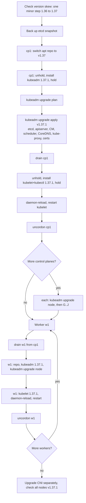
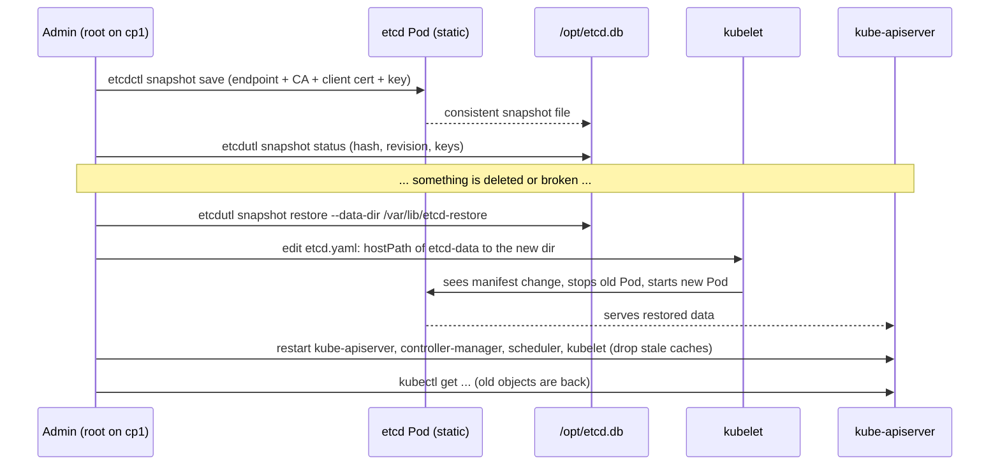

# T4.04 Manage the lifecycle of Kubernetes clusters: upgrades, etcd backup/restore, certificates, node maintenance

> Competency: "Manage the lifecycle of Kubernetes clusters" (CKA-4.4) | Domain/weight: CKA - Cluster Architecture, Installation and Configuration (25%) | Est. time: 5 h | Prerequisites: T4.02, T1.12, T1.15

Prerequisite lessons (read them first if a term is new):

- [T4.02 Create and manage Kubernetes clusters using kubeadm](../part4-cka/T4.02-create-and-manage-kubernetes-clusters-using.md) - how the cluster in this lesson was built, where the static Pod manifests live.
- [T1.12 TLS, PKI and openssl for Kubernetes](../part1-linux/T1.12-tls-pki-and-openssl-for-kubernetes.md) - what a CA, a leaf certificate and `notAfter` are.
- [T1.15 Packages, kernel modules, sysctl, swap and disks](../part1-linux/T1.15-packages-kernel-modules-sysctl-swap-and.md) - `apt`, `apt-mark hold`, repositories.

Shell setup (put this at the top of every terminal; from `00-conventions.md`):

```bash
alias k=kubectl
export do="--dry-run=client -o yaml"
export now="--force --grace-period=0"
source <(kubectl completion bash); complete -o default -F __start_kubectl k
```

Environment for this whole lesson: **vms** (3 Ubuntu LTS VMs `cp1`, `w1`, `w2`, prepared with `env/vm-prereqs.sh`). You reach nodes with `ssh <node>` and become root with `sudo -i`, like the exam ([E7, E8](https://docs.linuxfoundation.org/tc-docs/certification/tips-cka-and-ckad)).

> **Important note about outputs in this lesson.** No kind or Multipass was available when this lesson was written, so no cluster command was run. Every output block below is labelled `EXPECTED OUTPUT (not captured)` and is listed in section 11. The shapes (columns, wording) are what kubeadm and etcd print; the exact numbers (dates, hashes, sizes, pod name suffixes) will differ on your VMs. Compare shape, not digits.

---

## 1. Why this matters

A cluster is not a one-time install. Kubernetes ships a new minor version about every four months, and each minor version is supported for a limited time. You must move up one minor at a time, keep a backup of etcd (the database that holds every object in the cluster), and renew certificates before they expire. If you skip any of these, real clusters end up unpatched, unrecoverable after a bad change, or suddenly dead on the day a one-year certificate expires.

In the CKA exam, upgrade and etcd restore are high-value tasks with exact, unforgiving steps. One missed `apt-mark unhold`, one wrong `hostPath`, or one forgotten `daemon-reload` and the task fails. This lesson gives you the full runbook, why every step exists, and how to diagnose each failure.

---

## 2. Concepts

### 2.1 The version skew policy

**Version skew** means "how far apart the versions of two components may be". Kubernetes components talk to the API server, so the API server is the reference point. The rules (source: [version skew policy](https://kubernetes.io/releases/version-skew-policy/)):

| Component | Allowed versus kube-apiserver | Why |
|---|---|---|
| kube-apiserver (several in an HA setup) | Instances may differ by at most 1 minor | During a rolling control-plane upgrade two versions run side by side |
| kubelet | Must not be newer than the apiserver. May be up to 3 minors older | The apiserver must understand everything the kubelet asks. Old kubelets keep working while you upgrade the control plane first |
| kube-proxy | Same rule as kubelet. Also within 3 minors of the kubelet on the same node | Same reason |
| kube-controller-manager, kube-scheduler, cloud-controller-manager | Must not be newer than the apiserver. May be 1 minor older | They are clients of the apiserver |
| kubectl | 1 minor newer or older than the apiserver | It is a client, tested against neighbours only |

Concrete example: the apiserver is v1.37.1.

- kubelet v1.37.x, v1.36.x, v1.35.x, v1.34.x is allowed. kubelet v1.33.x is not (4 minors old). kubelet v1.38.x is not (newer).
- kubectl v1.36.x, v1.37.x, v1.38.x is allowed.

**Upgrade one minor at a time.** kubeadm supports going from 1.36.x to 1.37.y. It does not support 1.35.x directly to 1.37.y. Skipping patch versions inside a minor (1.36.2 to 1.36.5) is fine. The reason is that each minor release only tests and supports migrations from the previous minor (API removals, default changes, etcd data format).

**Upgrade order is always:** control plane first (apiserver and friends), then kubelets. The skew rule above is what makes that order safe: for a while the kubelets are older than the apiserver, which is allowed.

**Under the hood.** Upgrading is not "install new binaries". Four separate things have to change:

1. The **tools** on the node: `kubeadm`, `kubelet`, `kubectl` (OS packages).
2. The **control plane Pods** (`kube-apiserver`, `kube-controller-manager`, `kube-scheduler`, `etcd`): these are *static Pods*, defined by YAML files in `/etc/kubernetes/manifests`. kubeadm rewrites those files, and the kubelet restarts the Pods.
3. The **add-ons** that kubeadm manages: CoreDNS and kube-proxy.
4. The **node configuration**: the kubelet's config file `/var/lib/kubelet/config.yaml`, which `kubeadm upgrade node` refreshes.

The CNI plugin (Calico, Cilium, Flannel) is **not** managed by kubeadm. You upgrade it separately, following its own docs (see 2.12).

### 2.2 The upgrade plan: first control plane node

All commands run on `cp1` as root (`ssh cp1`, then `sudo -i`). Starting state: cluster at 1.36.5. Target: 1.37.1.

**Step 1: switch the apt repository to the new minor.** Kubernetes packages live in one repository per minor version (`pkgs.k8s.io/core:/stable:/v1.36/deb`, `.../v1.37/deb`). A repo for v1.36 will never offer 1.37 packages. That is a deliberate choice: you cannot upgrade by accident.

```bash
cat /etc/apt/sources.list.d/kubernetes.list
# deb [signed-by=/etc/apt/keyrings/kubernetes-apt-keyring.gpg] https://pkgs.k8s.io/core:/stable:/v1.36/deb/ /
sed -i 's/v1\.36/v1.37/' /etc/apt/sources.list.d/kubernetes.list
cat /etc/apt/sources.list.d/kubernetes.list
```

**Step 2: unhold, install the new `kubeadm`, hold again.** During installation the packages were marked `hold`. A held package is skipped by `apt upgrade` and cannot be changed by `apt install` unless you allow it. This protects a running cluster from a surprise `apt upgrade`. For an upgrade you release the hold on purpose:

```bash
apt-mark unhold kubeadm
apt-get update
apt-cache madison kubeadm | grep 1.37          # lists the exact version strings
apt-get install -y kubeadm='1.37.1-*'
apt-mark hold kubeadm
kubeadm version -o short                       # must print v1.37.1
```

The `-*` suffix is a wildcard for the package revision (for example `1.37.1-1.1`). Use whatever `apt-cache madison` shows. The exact revision string is on the "To verify" list.

**Step 3: read the plan.** `kubeadm upgrade plan` connects to the cluster, reads its current versions, and lists which versions you can upgrade to. It changes nothing.

**Step 4: apply.** `kubeadm upgrade apply v1.37.1` does the real work (see "Under the hood" below). Use `-y` to skip the confirmation prompt.

**Step 5: drain the node, upgrade `kubelet` and `kubectl`, restart the kubelet, uncordon.** `kubeadm upgrade apply` upgrades the control plane *Pods* but not the kubelet *package* on the node. The kubelet is a systemd service installed from the `kubelet` package, so it is upgraded with `apt`:

```bash
k drain cp1 --ignore-daemonsets                     # run from anywhere with kubectl
apt-mark unhold kubelet kubectl
apt-get install -y kubelet='1.37.1-*' kubectl='1.37.1-*'
apt-mark hold kubelet kubectl
systemctl daemon-reload
systemctl restart kubelet
k uncordon cp1
```

Why `daemon-reload`: the package may ship a changed systemd unit or drop-in file. `systemctl daemon-reload` tells systemd to re-read unit files. Without it, systemd may restart the old definition. Why `restart kubelet`: the package install replaces the binary on disk, but the running process is still the old binary until restarted.

**Under the hood: what `kubeadm upgrade apply` does.** In order (stage names are printed in its output):

1. **Preflight**: checks the cluster is healthy, that the target version is exactly one minor above, that kubeadm itself is not older than the target.
2. **Fetches the `kubeadm-config` ConfigMap** in `kube-system` (the stored ClusterConfiguration) and the kubelet config.
3. **Backs up** the current manifests and etcd data dir to `/etc/kubernetes/tmp/` (so it can roll back if a component fails to become healthy).
4. **Upgrades etcd** (static Pod image changes to the etcd version this kubeadm defaults to, see 2.11), then the other control-plane manifests, one at a time, waiting for each Pod to become healthy.
5. **Renews certificates** that kubeadm manages (unless `--certificate-renewal=false`), see 2.9.
6. **Upgrades the add-ons**: CoreDNS and kube-proxy (their Deployment/DaemonSet images).
7. **Updates the `kubeadm-config` ConfigMap** and the cluster-wide kubelet config ConfigMap.

### 2.3 The other control plane nodes (HA clusters)

On each additional control plane node you do **not** run `plan` and `apply`. `apply` upgrades cluster-wide objects (ConfigMaps, add-ons) and runs once per cluster. Other control plane nodes run:

```bash
# from the node where kubectl works (cp1): drain the node you are about to upgrade
k drain cp2 --ignore-daemonsets --delete-emptydir-data
# on cp2 (ssh cp2; sudo -i). Repo switch and kubeadm package, as in 4.2 lines 1-4
sed -i 's/v1\.36/v1.37/' /etc/apt/sources.list.d/kubernetes.list
apt-mark unhold kubeadm && apt-get update && apt-get install -y kubeadm='1.37.1-*' && apt-mark hold kubeadm
kubeadm upgrade node                      # NOT "apply": apply ran once, on cp1
apt-mark unhold kubelet kubectl && apt-get install -y kubelet='1.37.1-*' kubectl='1.37.1-*' && apt-mark hold kubelet kubectl
systemctl daemon-reload && systemctl restart kubelet
# exit back, then from the kubectl node:
k uncordon cp2
# the kubelet and kubectl packages, daemon-reload and uncordon follow 4.2 lines 9-13
# repeat the whole block for cp3, one node at a time
```

`kubeadm upgrade node` reads the new configuration that `apply` already stored in the cluster, rewrites the local static Pod manifests, and refreshes the local kubelet config. Our lab has one control plane node, so `cp1` uses `apply`; the HA variant is shown for completeness.

| Command | Where | What it changes | Cluster-wide? |
|---|---|---|---|
| `kubeadm upgrade plan` | first control plane | Nothing. Prints available versions | No |
| `kubeadm upgrade apply vX` | first control plane only | Control plane manifests, etcd, CoreDNS, kube-proxy, ConfigMaps, certs | Yes |
| `kubeadm upgrade node` | every other control plane node and every worker | Local manifests (control plane nodes) and local kubelet config | No |
| `kubeadm upgrade diff vX` | first control plane | Nothing. Prints the diff of manifests that `apply` would write | No |

### 2.4 Workers

Per worker (`w1` shown):

```bash
# on cp1 (or anywhere with kubectl): empty the node
k drain w1 --ignore-daemonsets --delete-emptydir-data
# on w1 as root
sed -i 's/v1\.36/v1.37/' /etc/apt/sources.list.d/kubernetes.list
apt-mark unhold kubeadm && apt-get update && apt-get install -y kubeadm='1.37.1-*' && apt-mark hold kubeadm
kubeadm upgrade node
apt-mark unhold kubelet kubectl && apt-get install -y kubelet='1.37.1-*' kubectl='1.37.1-*' && apt-mark hold kubelet kubectl
systemctl daemon-reload && systemctl restart kubelet
# on cp1: put the node back in service
k uncordon w1
```

The upstream page runs `kubeadm upgrade node` before the drain; the order of those two does not matter for correctness, because `upgrade node` only updates the local kubelet configuration. What matters is: **drain before you restart the kubelet, uncordon after the node is Ready on the new version.** Do workers one at a time so the app always has capacity elsewhere.

### 2.5 cordon, uncordon and drain

These three commands are how you do **node maintenance** (upgrade, reboot, hardware swap).

| Command | What it does | Running Pods | New Pods |
|---|---|---|---|
| `k cordon w1` | Sets `spec.unschedulable: true` on the Node. The node shows `Ready,SchedulingDisabled`. Internally the node lifecycle controller adds the taint `node.kubernetes.io/unschedulable:NoSchedule` | Stay | Not placed on w1 |
| `k drain w1 ...` | Cordon, then **evict** every evictable Pod | Evicted (deleted gracefully) | Not placed on w1 |
| `k uncordon w1` | Clears `unschedulable` | Nothing moves back by itself | Can be placed on w1 again |

An **eviction** is an API call (`POST .../pods/<name>/eviction`) that asks "may I delete this Pod now?". Unlike a plain `delete`, the apiserver checks PodDisruptionBudgets (2.6) first and refuses if deleting would break the budget. The Pod's controller (Deployment, ReplicaSet, StatefulSet, Job) then creates a replacement on another node. A drain needs a controller; a Pod with no controller is just gone.

Drain flags and what each refusal looks like:

| Pod type on the node | Default drain behaviour | Flag to allow it |
|---|---|---|
| DaemonSet Pod (`calico-node`, `kube-proxy`) | Refuses: `cannot delete DaemonSet-managed Pods (use --ignore-daemonsets to ignore)` | `--ignore-daemonsets` (the Pod is **left running**, not deleted: a DaemonSet would just recreate it) |
| Pod using `emptyDir` | Refuses: `cannot delete Pods with local storage (use --delete-emptydir-data to override)` | `--delete-emptydir-data` (the emptyDir contents are lost) |
| Pod with no controller ("bare Pod") | Refuses: `cannot delete Pods that declare no controller (use --force to override)` | `--force` (the Pod is deleted and **never comes back**) |
| Static (mirror) Pod | Ignored always. The kubelet owns it | none needed |
| Pod covered by a PDB that would be violated | Retries forever | Fix the budget or the replica count, or `--disable-eviction` (uses plain delete, skips PDB, dangerous) |

Other useful flags: `--grace-period=N` (override terminationGracePeriodSeconds), `--timeout=2m` (give up instead of hanging), `--pod-selector`, `--dry-run=client` (show what would happen), `--chunk-size`, `--skip-wait-for-delete-timeout`.

**Related but different.** `cordon` only stops *new* placement. A **taint with effect NoExecute** (`k taint node w1 k=v:NoExecute`) also kicks out running Pods that do not tolerate it, but it has no budget check. `drain` is the polite one: it respects PDBs and graceful shutdown.

### 2.6 PodDisruptionBudgets (PDB)

A **PodDisruptionBudget** says "at least N Pods of this app must stay up during *voluntary* disruptions". Voluntary disruptions are the ones an administrator causes through the eviction API: `kubectl drain`, cluster autoscaler scale-down, node upgrades. Crashes and node power loss are *involuntary* and ignore PDBs.

Fields (API `policy/v1`):

| Field | Meaning | Rule |
|---|---|---|
| `spec.selector` | Which Pods the budget covers (label selector) | Required in practice. An empty selector matches all Pods in the namespace |
| `spec.minAvailable` | Pods that must remain Ready. Integer or `"50%"` | Use this **or** `maxUnavailable`, not both |
| `spec.maxUnavailable` | Pods that may be down. Integer or percent | Same |
| `spec.unhealthyPodEvictionPolicy` | `IfHealthyBudget` (default) or `AlwaysAllow`. Whether Pods that are not Ready may be evicted regardless of the budget | `AlwaysAllow` lets you drain a node whose Pods are crash-looping and would otherwise block you |

Risky values: `minAvailable` equal to the number of replicas (nothing can ever be evicted: drain hangs forever), or `maxUnavailable: 0`. Both are legal and both block every drain. That is the classic "drain hangs" cause (section 6).

Imperative form: `k create pdb web --selector=app=web --min-available=2 -n lab-t404`.

### 2.7 etcd backup

**etcd** is the key-value database where the API server stores every object (Pods, Secrets, ConfigMaps, RBAC...). kubeadm runs it as a static Pod on the control plane node with its data in `/var/lib/etcd`. If etcd data is lost, the cluster has no memory: the running containers keep running (the kubelet does not need etcd), but nothing can be changed or managed, and a restart of anything loses the desired state.

A **snapshot** is a consistent point-in-time copy of the etcd database in one file. A snapshot contains all API objects. It does **not** contain: the contents of PersistentVolumes (your application data), certificates under `/etc/kubernetes/pki`, or kubeadm config files. Back those up separately.

Two tools exist:

| Tool | Talks to | Used for |
|---|---|---|
| `etcdctl` | A **running** etcd over the network (needs endpoint + TLS flags) | `snapshot save`, `endpoint health`, `member list`, `get` |
| `etcdutl` | A **file or data directory** on disk, no network | `snapshot status`, `snapshot restore`, `defrag` (offline) |

The `snapshot status` and `snapshot restore` subcommands of `etcdctl` have been **deprecated since etcd 3.5** in favour of `etcdutl`, and they were removed in etcd 3.6, so they do not exist in the 3.7 used here: use `etcdutl`. Only `etcdctl snapshot save` (it needs a running etcd) remains. This is stated from the etcd 3.6 release notes and is on the "To verify" list (run `etcdctl snapshot --help` on your binary).

The save command:

```bash
ETCDCTL_API=3 etcdctl --endpoints=https://127.0.0.1:2379 \
  --cacert=/etc/kubernetes/pki/etcd/ca.crt \
  --cert=/etc/kubernetes/pki/etcd/server.crt \
  --key=/etc/kubernetes/pki/etcd/server.key \
  snapshot save /opt/etcd.db
```

Why every flag is needed:

- `ETCDCTL_API=3`: selects the v3 API. Modern etcdctl (3.4+) defaults to v3, so this is harmless, and the exam-era habit is to keep it. It is not an etcdctl flag, it is an environment variable.
- `--endpoints`: where etcd listens for **clients**. The default is `127.0.0.1:2379` over plain HTTP, but kubeadm's etcd serves **HTTPS**, so you must say `https://`.
- `--cacert`: the CA that signed etcd's server certificate. etcdctl checks that etcd is who it says it is.
- `--cert` and `--key`: etcd runs with `--client-cert-auth=true`, which means etcd demands a **client certificate** too (mutual TLS). `server.crt/server.key` also carry the client-auth usage in kubeadm clusters. `healthcheck-client.crt/.key` in the same directory is an equally valid pair.
- `snapshot save <file>`: writes the snapshot, and an integrity hash, to a file on the machine where you run the command.

**Finding the flags from `etcd.yaml`.** Do not memorise paths; read them. The etcd Pod manifest contains all of them:

```bash
grep -E 'cert|key|trusted|listen-client|data-dir' /etc/kubernetes/manifests/etcd.yaml
```

What to read in the result:

| Line in etcd.yaml | Use it as |
|---|---|
| `--listen-client-urls=https://127.0.0.1:2379,https://<node-ip>:2379` | `--endpoints` (use the 127.0.0.1 one) |
| `--trusted-ca-file=/etc/kubernetes/pki/etcd/ca.crt` | `--cacert` |
| `--cert-file=/etc/kubernetes/pki/etcd/server.crt` | `--cert` |
| `--key-file=/etc/kubernetes/pki/etcd/server.key` | `--key` |
| `--data-dir=/var/lib/etcd` | The data dir (also the `hostPath` of the `etcd-data` volume) |

Ignore the `--peer-*` flags; those are for etcd-to-etcd traffic.

**Getting the binaries on a lab VM.** kubeadm runs etcd in a container, so the VM has no `etcdctl` or `etcdutl` unless you install them. `env/vm-prereqs.sh` is not known to install them, so install them yourself, pinned to the same version as the server (3.7.0). The exact commands, with the version checks, are in 7.0. In short: download `etcd-v3.7.0-linux-<arch>.tar.gz` from the etcd GitHub release, copy `etcdctl` and `etcdutl` to `/usr/local/bin`, and confirm with `etcdctl version`, `etcdutl version` and the etcd image tag (`3.7.0-0`). Use the `etcdctl` from a release close to the server version: a client far newer or older than the server can behave differently.

**Fallback.** If you cannot install anything (no internet), run it inside the etcd container with `k exec -n kube-system etcd-cp1 -- etcdctl ...` and write the snapshot to a directory that is a host volume (for example `/var/lib/etcd/snap.db`), then copy it. Whether an exam host has `etcdctl` or `etcdutl` already installed is UNVERIFIED (exam host details are not published; see E22 in the research summary). E13 only limits which sites the exam browser may open; whether a host tool such as `wget` can reach GitHub is UNVERIFIED, so do not rely on downloading binaries in the exam. Rely on what the host has or on the container fallback.

### 2.8 Verify a snapshot and restore it

A backup you never checked is a hope, not a backup. `etcdutl snapshot status` reads the file offline and prints its hash, revision, number of keys and size:

```bash
etcdutl snapshot status /opt/etcd.db -w table
```

A snapshot with 0 keys or a tiny size is a failed backup.

**Check a running etcd: `endpoint health` and `member list`**

Before a backup, and again after a restore, ask etcd itself whether it is healthy. These two commands use the same four TLS flags as `snapshot save`, so put them in a shell variable once:

```bash
E="ETCDCTL_API=3 etcdctl --endpoints=https://127.0.0.1:2379 --cacert=/etc/kubernetes/pki/etcd/ca.crt --cert=/etc/kubernetes/pki/etcd/server.crt --key=/etc/kubernetes/pki/etcd/server.key"
env $E endpoint health -w table      # is this member answering, and how fast
env $E member list -w table          # who is in the cluster (one row in our lab)
env $E endpoint status -w table      # leader, DB size, raft index
```

EXPECTED OUTPUT (not captured)

Placeholders: IDs, ports and times.

```text
+-----------------------+--------+-------------+-------+
|       ENDPOINT        | HEALTH |    TOOK     | ERROR |
+-----------------------+--------+-------------+-------+
| https://127.0.0.1:2379 |   true | 9.1ms       |       |
+-----------------------+--------+-------------+-------+
+------------------+---------+------+---------------------------+---------------------------+------------+
|        ID        | STATUS  | NAME |        PEER ADDRS         |       CLIENT ADDRS        | IS LEARNER |
+------------------+---------+------+---------------------------+---------------------------+------------+
| <member-id-hex>  | started | cp1  | https://<cp1-ip>:2380     | https://<cp1-ip>:2379     |      false |
+------------------+---------+------+---------------------------+---------------------------+------------+
```

`HEALTH true` means etcd is up and has a quorum. `member list` showing one `started` member is the expected single-member lab. After a restore, the member ID in this table is **different** from before the restore (the restore creates a new identity); that is normal. A default `etcdutl snapshot restore` (without `--name`, `--initial-cluster`, `--initial-advertise-peer-urls`) is expected to store the member name `default` and the peer address `http://localhost:2380`, so `NAME` and `PEER ADDRS` will probably not match the pre-restore table either. A single member still starts and serves clients. This is on the "To verify" list.

**Restoring: the steps**

**Restore** creates a **new data directory** from the snapshot. It does not touch the running etcd. Restoring is therefore a three-part job: make the directory, make etcd use it, then make everything that talks to etcd start fresh.

```bash
etcdutl snapshot restore /opt/etcd.db --data-dir=/var/lib/etcd-restore
```

`etcdutl` needs no endpoint and no certificates: it only reads a file and writes a directory. (`--data-dir` must not already exist.) The restore also gives the data a **new cluster identity and member ID**, so a restored member can never accidentally rejoin the old cluster.

Then point etcd at the new directory. kubeadm's `etcd.yaml` has this volume:

```yaml
  volumes:
  - hostPath:
      path: /etc/kubernetes/pki/etcd
      type: DirectoryOrCreate
    name: etcd-certs
  - hostPath:
      path: /var/lib/etcd          # <-- change ONLY this line to /var/lib/etcd-restore
      type: DirectoryOrCreate
    name: etcd-data
```

(This is an excerpt of a root-owned static Pod file that you edit in place; it is not something you `kubectl apply`.)

Rules that trip people:

- Change only the **`hostPath.path`** of the `etcd-data` volume. Leave the `volumeMounts` entry (`mountPath: /var/lib/etcd`) and the `--data-dir=/var/lib/etcd` flag alone. Inside the container the path stays `/var/lib/etcd`; only the host directory behind it changes. Changing the flag too would be consistent only if you also changed the mount path.
- **Type the new path exactly.** `type: DirectoryOrCreate` tells the kubelet "create the directory if it is missing". A typo such as `/var/lib/etcd-restor` therefore does not fail: the kubelet quietly creates an **empty** directory, etcd starts with an empty database, and the cluster looks wiped. Check with `ls -ld /var/lib/etcd-restore/member` after the edit.
- Edit the file **in place**. Never leave a backup copy of `etcd.yaml` inside `/etc/kubernetes/manifests`: the kubelet runs every YAML file in that directory, so you would start a second etcd. Copy backups to `/root/` instead.
- The kubelet watches the directory (default re-check every 20 s). When the file changes, it kills the old etcd Pod and starts a new one with the new volume. The apiserver loses its database for roughly 30 to 90 seconds, so `kubectl` errors during that time are normal. Wait with `crictl ps | grep etcd` on the node, then `k get nodes` until it answers.

**After the restore: restart everything that caches etcd state**

The official etcd restore procedure's order is: **stop all API server instances, restore, then start them again** (and restart kube-scheduler, kube-controller-manager and the kubelet). The order used in this lesson (swap etcd first while the apiserver keeps running, then restart the consumers afterwards) is a shortcut for a single-node lab and reaches the same end state; on a multi-node control plane follow the official stop-first order. Why a restart is needed at all: the restored database holds an **older revision** than the one the running apiserver last saw. The apiserver keeps a watch cache and the controllers keep informer caches keyed to revisions. If they keep running, they may hold objects that no longer exist, or fail with "too large resource version" style errors, until they resync. Starting them fresh makes them re-list everything from the restored etcd.

```bash
# restart the control-plane static Pods (method A from 2.9: move manifests out, wait, move back)
mkdir -p /root/manifests-hold
mv /etc/kubernetes/manifests/kube-apiserver.yaml \
   /etc/kubernetes/manifests/kube-controller-manager.yaml \
   /etc/kubernetes/manifests/kube-scheduler.yaml /root/manifests-hold/
# the kubelet re-checks the directory every 20 s: wait until the three containers are really gone
until ! crictl ps | grep -qE 'kube-(apiserver|controller-manager|scheduler)'; do sleep 2; done
mv /root/manifests-hold/*.yaml /etc/kubernetes/manifests/
systemctl restart kubelet            # on every node: workers too in a real DR; here at least cp1
```

(Leave `etcd.yaml` in place; you just changed it.) Signs that you skipped this: `kubectl get` shows objects you deleted before the snapshot was taken, controllers recreate things that should be gone, or `kubectl` returns odd resourceVersion errors. Restarting the components clears them.

**Alternative: restore into the original path**

Stop etcd by moving the manifest out, move the old directory aside, restore into `/var/lib/etcd`, then move the manifest back. No manifest edit needed. It avoids the trap below.

**Trap: kubeadm regenerates `etcd.yaml`**

`kubeadm upgrade apply` and `kubeadm upgrade node` **regenerate** `etcd.yaml` from the stored ClusterConfiguration (`etcd.local.dataDir`, default `/var/lib/etcd`). If you restored into a *new* directory and only edited the manifest, the next kubeadm upgrade silently writes the old path back and etcd starts from the stale old data. After a restore into a new directory, either move it into place later (the lab cleanup does this) or set `dataDir` in the `kubeadm-config` ConfigMap to match. This is reasoning from kubeadm's design and is on the "To verify" list.

**HA clusters**

Multi-member (HA) etcd: restore must be done on **every** member from the same snapshot with `--name`, `--initial-cluster`, `--initial-advertise-peer-urls`, and a shared `--initial-cluster-token`. The CKA tasks use a single member; know that HA is different.

### 2.9 Certificates

kubeadm creates a PKI under `/etc/kubernetes/pki` (CAs and leaf certificates) and a few kubeconfig files that embed client certificates. See [T1.12](../part1-linux/T1.12-tls-pki-and-openssl-for-kubernetes.md) for how X.509 works.

Facts from the [kubeadm certs page](https://kubernetes.io/docs/tasks/administer-cluster/kubeadm/kubeadm-certs/):

- **Leaf (client and serving) certificates expire after 1 year.** **CA certificates are valid for 10 years.**
- **`kubeadm upgrade` renews the certificates it manages** unless you pass `--certificate-renewal=false`. A cluster upgraded at least once a year therefore never hits expiry. A cluster that is never upgraded stops working after a year.
- Certificates that kubeadm renews: `apiserver`, `apiserver-kubelet-client`, `apiserver-etcd-client`, `front-proxy-client`, `etcd-server`, `etcd-peer`, `etcd-healthcheck-client`, and the certificates **embedded in** the kubeconfig files `admin.conf`, `super-admin.conf`, `controller-manager.conf`, `scheduler.conf`.
- Not touched by `kubeadm certs renew`: the kubelet's own client certificate (in `/var/lib/kubelet/pki/`, see 2.10) and the CAs.

Commands:

```bash
kubeadm certs check-expiration            # table of every cert, expiry date, days left
kubeadm certs renew all                   # renew all of the above using the local CA
kubeadm certs renew apiserver             # renew just one (names as shown by check-expiration)
```

Sample output (shape only; dates are placeholders, one row is shown as healthy and one as expired):

EXPECTED OUTPUT (not captured)

```text
CERTIFICATE                EXPIRES                  RESIDUAL TIME   CERTIFICATE AUTHORITY   EXTERNALLY MANAGED
admin.conf                 <date one year ahead>    364d            ca                      no
apiserver                  <date in the past>       <invalid>       ca                      no
...
CERTIFICATE AUTHORITY      EXPIRES                  RESIDUAL TIME   EXTERNALLY MANAGED
ca                         <date ten years ahead>   9y              no
etcd-ca                    <date ten years ahead>   9y              no
front-proxy-ca             <date ten years ahead>   9y              no
```

Read it as: the first table is leaf certificates and the certificates embedded in kubeconfig files; `364d` is a healthy certificate; `<invalid>` is an expired certificate; the second table is the CAs (years, not days). A line with `RESIDUAL TIME` under about 30d is the one to renew first.

`check-expiration` reads the files on disk; it works even when the apiserver is down. The columns: `CERTIFICATE`, `EXPIRES`, `RESIDUAL TIME`, `CERTIFICATE AUTHORITY`, `EXTERNALLY MANAGED`. An expired certificate shows `<invalid>` in `RESIDUAL TIME`. `EXTERNALLY MANAGED = yes` means the certificate was signed by an external CA whose private key is not on this node, so kubeadm cannot renew it and `renew` skips it.

**Renewing a file does not change a running process.** The apiserver, controller manager, scheduler and etcd read their certificates at startup. After `kubeadm certs renew all` you must **restart the control-plane static Pods**. kubeadm itself says so in its output. Two ways:

```bash
# A. Move manifests out, wait for the kubelet to stop the Pods, move them back
mkdir -p /root/manifests-hold
mv /etc/kubernetes/manifests/*.yaml /root/manifests-hold/
sleep 30                                   # kubelet re-checks the dir every 20 s by default
crictl ps | grep -E 'kube-|etcd' || echo "all control plane containers stopped"
mv /root/manifests-hold/*.yaml /etc/kubernetes/manifests/

# B. Quicker, per component: kill the container, the kubelet recreates it from the manifest
crictl ps --name kube-apiserver -q | xargs crictl stop
```

**Update `admin.conf` copies.** `kubeadm certs renew` rewrites `/etc/kubernetes/admin.conf` with a new embedded client cert. But the file you actually use, `~/.kube/config`, is a *copy* made at install time (`cp /etc/kubernetes/admin.conf ~/.kube/config`). That copy still holds the old certificate, so after renewal `kubectl` answers `Unauthorized` or `x509: certificate has expired`. Copy the renewed file again:

```bash
cp /etc/kubernetes/admin.conf ~/.kube/config
```

HA clusters: run `renew` on every control plane node, because each has its own certificate files.

### 2.10 kubelet client certificate rotation (awareness)

The kubelet authenticates to the apiserver with a client certificate. `/etc/kubernetes/kubelet.conf` does not embed it; it points at `/var/lib/kubelet/pki/kubelet-client-current.pem`, a symlink the kubelet itself keeps up to date. In kubeadm clusters the kubelet config has `rotateCertificates: true`, so the kubelet asks the apiserver for a new certificate (a CertificateSigningRequest, auto-approved) before the old one expires. That is why `kubeadm certs renew` does not list the kubelet certificate: it renews itself. The kubelet **serving** certificate (used when the apiserver connects to the kubelet for `logs`/`exec`) is self-signed by default; it is only rotated through the CSR flow if `serverTLSBootstrap: true` is set, and those CSRs then need manual approval (`k certificate approve`). For the exam, know that the control-plane certs need renewing by you, and the kubelet client cert renews itself.

### 2.11 Pinning the etcd version kubeadm installs

Each kubeadm release has a built-in default etcd version for the control plane it creates. For kubeadm 1.37 the constant `DefaultEtcdVersion` is `3.7.0-0` (research summary section 5; taken from the Kubernetes v1.37.1 source). When `kubeadm upgrade apply` runs, it moves the etcd static Pod to that image tag, so an upgrade of Kubernetes from 1.36 to 1.37 also upgrades etcd (for example 3.6.x to 3.7.0).

Because etcd holds all your data, and an in-place rollback of the etcd image is not a supported downgrade path (the way back is to restore a snapshot), always take a snapshot first. Options to control this:

| Goal | How |
|---|---|
| Skip the etcd upgrade this time | `kubeadm upgrade apply v1.37.1 --etcd-upgrade=false` |
| Keep a specific etcd image tag permanently | Set `etcd.local.imageTag` in the ClusterConfiguration stored in the `kubeadm-config` ConfigMap (`k -n kube-system edit cm kubeadm-config`); kubeadm then uses that tag instead of `DefaultEtcdVersion` |
| See what it will do before it does it | `kubeadm upgrade plan` shows the target etcd version; `kubeadm upgrade diff v1.37.1` shows the manifest diff |

### 2.12 Add-ons: CoreDNS and kube-proxy by kubeadm, the CNI by you

`kubeadm upgrade apply` upgrades **CoreDNS** (cluster DNS) and **kube-proxy** (Service networking) because they are part of kubeadm's own configuration. It does **not** upgrade the **CNI** plugin, the metrics-server, an ingress controller or anything else you installed afterwards. After a minor upgrade, read your CNI's release notes for the Kubernetes version it supports and upgrade it with its own method (for Calico: re-apply its manifest or upgrade its Helm chart/operator at the pinned version). Calico v3.33.0 is the CNI in this guide's lab VMs.

### 2.13 Related but different

- **Upgrading a cluster** vs **upgrading Pods**: this lesson is about Kubernetes itself. Rolling out a new app image is a Deployment concern.
- **etcd snapshot** vs **copying `/var/lib/etcd`**: a file copy of a live data dir can be inconsistent. A snapshot is taken through etcd and is consistent and hash-checked. (If you only have a raw `db` file copy you must restore with `--skip-hash-check`.)
- **`kubeadm certs renew`** vs **kubelet rotation**: the first is manual and covers the control plane; the second is automatic and covers the node's client identity.
- **cordon/drain** vs **taints**: see 2.5.

---

## 3. How it works (diagram)

Upgrade order, from the first command to a node back in service:



Etcd snapshot and restore:



Walkthrough:

1. You always upgrade `kubeadm` first. It is the tool that knows how to move the control plane; an old kubeadm refuses to target a newer minor.
2. `plan` is read-only. `apply` runs once, on the first control plane node, and rewrites the static Pods, add-ons and certificates.
3. The kubelet package is upgraded after `apply`, on a drained node, then restarted so the new binary runs. Workers repeat the same loop one by one.
4. In the etcd sequence the snapshot is a plain file. Restoring is offline: it builds a directory. The kubelet is what actually swaps etcd, because it notices the changed manifest.
5. The restored etcd has the data from snapshot time. Everything created after the snapshot is gone, so a restore is for disaster recovery, not for undoing small mistakes.

---

## 4. Commands and YAML you must produce fast

### 4.1 Imperative shortcuts

| Command | One-line meaning |
|---|---|
| `sed -i 's/v1\.36/v1.37/' /etc/apt/sources.list.d/kubernetes.list` | Point apt at the new minor repo |
| `apt-cache madison kubeadm \| grep 1.37` | List exact package versions available |
| `apt-mark unhold kubeadm && apt-get update && apt-get install -y kubeadm='1.37.1-*' && apt-mark hold kubeadm` | Safe package upgrade of one held tool |
| `kubeadm upgrade plan` | Read-only: which versions can I go to |
| `kubeadm upgrade apply v1.37.1 -y` | Do the first control plane upgrade |
| `kubeadm upgrade node` | Upgrade local config on every other node |
| `k drain <node> --ignore-daemonsets --delete-emptydir-data` | Cordon + evict |
| `k uncordon <node>` | Allow scheduling again |
| `k create pdb web --selector=app=web --min-available=2 -n lab-t404 $do` | Generate a PDB manifest |
| `grep -E 'cert\|key\|trusted\|listen-client\|data-dir' /etc/kubernetes/manifests/etcd.yaml` | Read etcd TLS flags |
| `ETCDCTL_API=3 etcdctl --endpoints=https://127.0.0.1:2379 --cacert=/etc/kubernetes/pki/etcd/ca.crt --cert=/etc/kubernetes/pki/etcd/server.crt --key=/etc/kubernetes/pki/etcd/server.key snapshot save /opt/etcd.db` | Back up etcd |
| `etcdutl snapshot status /opt/etcd.db -w table` | Prove the backup is valid |
| `etcdutl snapshot restore /opt/etcd.db --data-dir=/var/lib/etcd-new` | Build a data dir from the snapshot |
| `kubeadm certs check-expiration` | Show cert expiry |
| `kubeadm certs renew all` | Renew all kubeadm-managed certs |

### 4.2 The full ordered runbook: cp1 then w1 (21 numbered lines, about 15 distinct steps)

The numbers below count lines; chaining with `&&` collapses them to about 15 distinct steps. Lines 1-14 run on cp1, 15 and 21 run where kubectl works, 16-20 run on w1.

Memorise the *shape*; read exact strings from `apt-cache madison`.

```bash
### ---- cp1 ----  (ssh cp1; sudo -i)
sed -i 's/v1\.36/v1.37/' /etc/apt/sources.list.d/kubernetes.list              # 1 new repo
apt-mark unhold kubeadm                                                       # 2
apt-get update && apt-get install -y kubeadm='1.37.1-*'                       # 3
apt-mark hold kubeadm                                                         # 4
kubeadm version -o short                                                      # 5 expect v1.37.1
kubeadm upgrade plan                                                          # 6
kubeadm upgrade apply v1.37.1 -y                                              # 7
k drain cp1 --ignore-daemonsets                                               # 8
apt-mark unhold kubelet kubectl                                               # 9
apt-get install -y kubelet='1.37.1-*' kubectl='1.37.1-*'                      # 10
apt-mark hold kubelet kubectl                                                 # 11
systemctl daemon-reload && systemctl restart kubelet                          # 12
k uncordon cp1                                                                # 13
k get nodes                                                                   # 14 cp1 should show v1.37.1

### ---- w1 ----
k drain w1 --ignore-daemonsets --delete-emptydir-data                         # 15 (from cp1)
# --- new terminal (or: exit to base, then ssh w1): ssh w1; sudo -i ---
sed -i 's/v1\.36/v1.37/' /etc/apt/sources.list.d/kubernetes.list              # 16
apt-mark unhold kubeadm && apt-get update && apt-get install -y kubeadm='1.37.1-*' && apt-mark hold kubeadm   # 17
kubeadm upgrade node                                                          # 18
apt-mark unhold kubelet kubectl && apt-get install -y kubelet='1.37.1-*' kubectl='1.37.1-*' && apt-mark hold kubelet kubectl  # 19
systemctl daemon-reload && systemctl restart kubelet                          # 20
# --- lab practice: exit twice (root -> login user -> your workstation), then in the cp1 terminal: ---
k uncordon w1                                                                 # 21
```

**Hopping between nodes.** Never ssh from inside another node: nested ssh is not supported in the exam ([E7](https://docs.linuxfoundation.org/tc-docs/certification/tips-cka-and-ckad)), and `ssh w1` as root on the VMs may be refused. Pattern: run `k drain` and `k uncordon` in the terminal where kubectl works (`cp1`, as root). Do the worker package steps in a **second terminal** on your workstation (`ssh w1`, then `sudo -i`; `exit` twice when done). That is lab practice. For the exam, E7 and E8 only say: nested ssh is unsupported, use the `ssh <node>` the task gives you, and exit back to `base` when finished. Which host has a working kubeconfig, and how many `exit`s you need, are UNVERIFIED for the exam: read the task and check with `kubectl get nodes` on each host.

On the lab workers `kubectl` is optional (the VMs have no kubeconfig on a worker by default); installing it keeps versions aligned. E9 says kubectl is available on exam SSH hosts.

### 4.3 The etcd save/restore pair, flags read from etcd.yaml

```bash
# 0. read the flags
grep -E 'cert|key|trusted|listen-client|data-dir' /etc/kubernetes/manifests/etcd.yaml

# 1. save
ETCDCTL_API=3 etcdctl --endpoints=https://127.0.0.1:2379 \
  --cacert=/etc/kubernetes/pki/etcd/ca.crt \
  --cert=/etc/kubernetes/pki/etcd/server.crt \
  --key=/etc/kubernetes/pki/etcd/server.key \
  snapshot save /opt/etcd.db

# 2. verify
etcdutl snapshot status /opt/etcd.db -w table

# 3. restore to a new dir, then edit the hostPath of volume etcd-data
etcdutl snapshot restore /opt/etcd.db --data-dir=/var/lib/etcd-new
vim /etc/kubernetes/manifests/etcd.yaml        # path: /var/lib/etcd  ->  path: /var/lib/etcd-new
watch crictl ps                                # wait for a new etcd container (or re-run crictl ps by hand)
k get nodes                                    # apiserver answers again

# 4. restart consumers of etcd state: move kube-apiserver / kube-controller-manager / kube-scheduler yaml
#    out of /etc/kubernetes/manifests, wait until `crictl ps | grep -E 'kube-(apiserver|controller|scheduler)'` is empty,
#    move them back; then systemctl restart kubelet
```

### 4.4 YAML: a PodDisruptionBudget

This is the only object you apply in this lesson besides the lab workloads. Complete and valid for v1.37:

```yaml
apiVersion: policy/v1                   # PDB is GA in policy/v1
kind: PodDisruptionBudget
metadata:
  name: web                             # name of the budget
  namespace: lab-t404                   # must be the namespace of the Pods it protects
spec:
  minAvailable: 2                       # at least 2 matching Pods must stay Ready (int or "50%"); use this OR maxUnavailable
  selector:                             # which Pods the budget covers
    matchLabels:
      app: web
  unhealthyPodEvictionPolicy: AlwaysAllow   # default IfHealthyBudget; AlwaysAllow lets broken (not Ready) Pods be evicted so they cannot block a drain
```

Apply: `k create ns lab-t404; k apply -f pdb.yaml`. Inspect: `k -n lab-t404 get pdb` shows `ALLOWED DISRUPTIONS`; when it is `0`, a drain of a node holding one of these Pods will hang.

For the etcd manifest change, the only YAML you touch is the `etcd-data` volume shown in 2.8.

### 4.5 Speed drill

Targets are exam pace; the exam average is about 6 minutes per task (15-20 tasks per [E2](https://docs.linuxfoundation.org/tc-docs/certification/tips-cka-and-ckad), 2 hours per [E3](https://docs.linuxfoundation.org/tc-docs/certification/faq-cka-ckad-cks)). Do these on the VMs. Answers are collapsed.

1. (1 min) Print the three etcd client TLS file paths and the client URL from the etcd manifest.
<details><summary>Answer</summary>

```bash
grep -E 'cert|key|trusted|listen-client' /etc/kubernetes/manifests/etcd.yaml
```
Use `--trusted-ca-file`, `--cert-file`, `--key-file` values and the `127.0.0.1:2379` URL.
</details>

2. (2 min) Save an etcd snapshot to `/opt/drill.db`.
<details><summary>Answer</summary>

```bash
ETCDCTL_API=3 etcdctl --endpoints=https://127.0.0.1:2379 --cacert=/etc/kubernetes/pki/etcd/ca.crt --cert=/etc/kubernetes/pki/etcd/server.crt --key=/etc/kubernetes/pki/etcd/server.key snapshot save /opt/drill.db
```
</details>

3. (1 min) Prove `/opt/drill.db` is valid.
<details><summary>Answer</summary>

```bash
etcdutl snapshot status /opt/drill.db -w table
```
Check `TOTAL KEYS` is more than a few hundred and the size is megabytes.
</details>

4. (2 min) Show which control-plane certificates expire first, and renew only the apiserver serving certificate.
<details><summary>Answer</summary>

```bash
kubeadm certs check-expiration
kubeadm certs renew apiserver
crictl ps --name kube-apiserver -q | xargs crictl stop     # kubelet recreates the container with the new cert
```
</details>

5. (1 min) Make `w2` empty so you can reboot it. It has a DaemonSet Pod and an emptyDir Pod.
<details><summary>Answer</summary>

```bash
k drain w2 --ignore-daemonsets --delete-emptydir-data
```
Afterwards: `k uncordon w2`.
</details>

6. (2 min) Create a PDB `web` allowing at most 1 Pod down for Pods with label `app=web` in `lab-t404`.
<details><summary>Answer</summary>

```bash
k create pdb web --selector=app=web --max-unavailable=1 -n lab-t404
k -n lab-t404 get pdb web
```
</details>

7. (2 min) On `w1`, switch the repo for the next minor and list what version strings exist for kubeadm 1.37.
<details><summary>Answer</summary>

```bash
sed -i 's/v1\.36/v1.37/' /etc/apt/sources.list.d/kubernetes.list
apt-get update && apt-cache madison kubeadm | grep 1.37
```
</details>

8. (4 min) You already have `/opt/drill.db`. Restore it into `/var/lib/etcd-drill` and make etcd use it.
<details><summary>Answer</summary>

```bash
etcdutl snapshot restore /opt/drill.db --data-dir=/var/lib/etcd-drill
vim /etc/kubernetes/manifests/etcd.yaml     # etcd-data volume: path: /var/lib/etcd-drill
watch crictl ps                              # new etcd container, then k get nodes
```
</details>

---

## 5. Worked example

Goal: upgrade the control plane node `cp1` from 1.36.5 to 1.37.1 after taking a backup, reading each output. Environment: **vms**, cluster built by T4.02 at 1.36.5.

All outputs below are **EXPECTED OUTPUT (not captured)**.

**5.1 Start state and backup.**

```bash
ssh cp1
sudo -i
k get nodes
```

EXPECTED OUTPUT (not captured)

```text
NAME   STATUS   ROLES           AGE   VERSION
cp1    Ready    control-plane   14d   v1.36.5
w1     Ready    <none>          14d   v1.36.5
w2     Ready    <none>          14d   v1.36.5
```

```bash
mkdir -p /opt/backup
ETCDCTL_API=3 etcdctl --endpoints=https://127.0.0.1:2379 \
  --cacert=/etc/kubernetes/pki/etcd/ca.crt \
  --cert=/etc/kubernetes/pki/etcd/server.crt \
  --key=/etc/kubernetes/pki/etcd/server.key \
  snapshot save /opt/backup/pre-1.37.db
etcdutl snapshot status /opt/backup/pre-1.37.db -w table
```

EXPECTED OUTPUT (not captured)

```text
{"level":"info","ts":"...","caller":"snapshot/v3_snapshot.go:...","msg":"created temporary db file","path":"/opt/backup/pre-1.37.db.part"}
...
Snapshot saved at /opt/backup/pre-1.37.db
+----------+----------+------------+------------+
|   HASH   | REVISION | TOTAL KEYS | TOTAL SIZE |
+----------+----------+------------+------------+
| 3f1c9a2e |     9871 |       1042 |     4.1 MB |
+----------+----------+------------+------------+
```

Read it: `Snapshot saved at` proves the write. The table proves the file is readable. A hash, a revision (a counter that grows with every write) and about a thousand keys are typical for a small cluster. If `TOTAL KEYS` were 0 you would stop and fix the backup before touching the cluster.

**5.2 Repo switch and kubeadm.**

```bash
sed -i 's/v1\.36/v1.37/' /etc/apt/sources.list.d/kubernetes.list
apt-mark unhold kubeadm
apt-get update
apt-cache madison kubeadm | grep 1.37
```

EXPECTED OUTPUT (not captured)

```text
   kubeadm | 1.37.1-1.1 | https://pkgs.k8s.io/core:/stable:/v1.37/deb  Packages
   kubeadm | 1.37.0-1.1 | https://pkgs.k8s.io/core:/stable:/v1.37/deb  Packages
```

```bash
apt-get install -y kubeadm='1.37.1-*'
apt-mark hold kubeadm
kubeadm version -o short
```

EXPECTED OUTPUT (not captured)

```text
v1.37.1
```

Check: if this printed `v1.36.5`, the repo edit did not take effect or `apt-get update` failed. Do not continue until it says `v1.37.1`.

**5.3 Read the plan.**

```bash
kubeadm upgrade plan
```

EXPECTED OUTPUT (not captured)

Trimmed. Every `<...>` and every "x" in a version is a PLACEHOLDER you must replace with your real value.

```text
[preflight] Running pre-flight checks.
[upgrade/config] Reading configuration from the "kubeadm-config" ConfigMap in namespace "kube-system"...
[upgrade] Running cluster health checks
[upgrade] Fetching available versions to upgrade to
[upgrade/versions] Cluster version: v1.36.5
[upgrade/versions] kubeadm version: v1.37.1
...
Components that must be upgraded manually after you have upgraded the control plane with 'kubeadm upgrade apply':
COMPONENT   NODE   CURRENT   TARGET
kubelet     cp1    v1.36.5   v1.37.1
kubelet     w1     v1.36.5   v1.37.1
kubelet     w2     v1.36.5   v1.37.1

Upgrade to the latest stable version:

COMPONENT                 NODE   CURRENT    TARGET
kube-apiserver            cp1    v1.36.5    v1.37.1
kube-controller-manager   cp1    v1.36.5    v1.37.1
kube-scheduler            cp1    v1.36.5    v1.37.1
kube-proxy                       1.36.5     v1.37.1
CoreDNS                          <old-coredns>   <new-coredns>      <- placeholder versions
etcd                      cp1    <old-etcd>-0    3.7.0-0       <- old: placeholder; 3.7.0-0 per research summary

You can now apply the upgrade by executing the following command:

        kubeadm upgrade apply v1.37.1
```

Read it: the first table is the list of kubelets *you* must upgrade by hand later. The second table is what `apply` will change, including the etcd target `3.7.0-0` (2.11). The last line is the exact command to run. If `plan` printed an error instead (for example "no upgrades available" or a skew complaint), `apply` would refuse too.

**5.4 Apply.**

```bash
kubeadm upgrade apply v1.37.1 -y
```

EXPECTED OUTPUT (not captured)

Trimmed. Line wording is reconstructed and the "..." lines hide the real stage lines; replace with a real capture.

```text
[upgrade] Running cluster health checks
[upgrade/version] You have chosen to change the cluster version to "v1.37.1"
[upgrade/versions] Cluster version: v1.36.5
[upgrade/versions] kubeadm version: v1.37.1
[upgrade/prepull] Pulling images required for setting up a Kubernetes cluster
...
[upgrade/staticpods] Preparing for "etcd" upgrade
[upgrade/staticpods] Renewing etcd-server certificate
...
[upgrade/staticpods] Waiting for the kubelet to restart the component
[upgrade/staticpods] Component "etcd" upgraded successfully!
[upgrade/staticpods] Preparing for "kube-apiserver" upgrade
...
[upgrade/staticpods] Component "kube-apiserver" upgraded successfully!
...
[addons] Applied essential addon: CoreDNS
[addons] Applied essential addon: kube-proxy

[upgrade] SUCCESS! A control plane node of your cluster was upgraded to "v1.37.1". Enjoy!

[upgrade] Now please proceed with upgrading the rest of the nodes by following the right order.
```

Read it: you see one block per component. "Renewing ... certificate" lines show the certificate renewal described in 2.9. The apiserver is briefly unavailable while its Pod restarts; `kubectl` may hang for a few seconds. If a component fails to become healthy, kubeadm rolls back from `/etc/kubernetes/tmp/`.

**5.5 Drain, kubelet, uncordon.**

```bash
k get nodes                                  # cp1 still shows v1.36.5: the kubelet package is not yet upgraded
k drain cp1 --ignore-daemonsets
apt-mark unhold kubelet kubectl
apt-get install -y kubelet='1.37.1-*' kubectl='1.37.1-*'
apt-mark hold kubelet kubectl
systemctl daemon-reload
systemctl restart kubelet
k uncordon cp1
k get nodes
```

EXPECTED OUTPUT (not captured)

```text
node/cp1 cordoned
Warning: ignoring DaemonSet-managed Pods: kube-system/calico-node-xxxxx, kube-system/kube-proxy-xxxxx
evicting pod kube-system/coredns-xxxxxxxxxx-xxxxx
evicting pod kube-system/calico-kube-controllers-xxxxxxxxxx-xxxxx
pod/coredns-xxxxxxxxxx-xxxxx evicted
...
node/cp1 drained
node/cp1 uncordoned
NAME   STATUS   ROLES           AGE   VERSION
cp1    Ready    control-plane   14d   v1.37.1
w1     Ready    <none>          14d   v1.36.5
w2     Ready    <none>          14d   v1.36.5
```

The `VERSION` column is the **kubelet** version. That is why `cp1` stays on 1.36.5 after `apply` and only changes after the kubelet restart. The workers on 1.36.5 against a 1.37.1 apiserver are allowed by the skew policy (2.1).

**5.6 Check the add-ons and finish the cluster** (workers follow the runbook in 4.2).

```bash
k -n kube-system get pods -o wide
k -n kube-system get ds kube-proxy -o jsonpath='{.spec.template.spec.containers[0].image}{"\n"}'
```

EXPECTED OUTPUT (not captured): the kube-proxy image tag is `v1.37.1`, CoreDNS is the newer tag, and etcd Pod's image is `registry.k8s.io/etcd:3.7.0-0`. Then upgrade the CNI as its docs say.

---

## 6. Common mistakes and how to fix them

Texts below are the messages as they appear in kubeadm, kubectl and etcdctl of recent releases; the wording may differ by a few words in v1.37 and is on the "To verify" list.

| Symptom | What you will see (exact error/event text) | Cause | Fix (command) |
|---|---|---|---|
| `kubeadm upgrade apply` refuses | `[upgrade/version] FATAL: the --version argument is invalid due to these errors: ... Specified version to upgrade to "v1.37.1" is at least one minor release higher than the kubeadm minor release (37 > 36)` or "... skipping MINOR versions" | kubeadm binary is still old (you forgot to upgrade it first), or the cluster is 2 minors behind the target (skipped a minor) | `kubeadm version -o short`. Upgrade kubeadm first (`apt-mark unhold kubeadm`, install the right version). If the cluster is 1.35, upgrade to 1.36.x first, then 1.37.x. Use a repo and package for **one** minor at a time |
| `apt-get install` of kubeadm refuses | `E: Held packages were changed and -y was used without --allow-change-held-packages.` or `Version '1.37.1-*' for 'kubeadm' was not found` | The package is on hold (you skipped `apt-mark unhold`) or the repo still points at v1.36 so 1.37 does not exist | `apt-mark unhold kubeadm`; `cat /etc/apt/sources.list.d/kubernetes.list`; fix the minor; `apt-get update`; `apt-cache madison kubeadm` |
| Drain hangs on a PDB | `error when evicting pods/"web-5d8c6b77f-abcde" -n "lab-t404" (will retry after 5s): Cannot evict pod as it would violate the pod's disruption budget.` repeating forever | A PDB has 0 allowed disruptions: `minAvailable` equals the replica count, or the replacement Pod from the previous eviction is not Ready yet | 1. `k get pdb -A` (read `ALLOWED DISRUPTIONS`). 2. `k get pods -A -o wide --field-selector spec.nodeName=w1`. 3. `k describe pdb web -n lab-t404`. Fix: `k scale deploy web --replicas=4` or loosen the PDB. Add `--timeout=2m` so the drain gives up instead of hanging |
| Drain refuses: DaemonSet Pod | `cannot delete DaemonSet-managed Pods (use --ignore-daemonsets to ignore)` | DaemonSet Pods (calico-node, kube-proxy) would be recreated at once | Re-run with `--ignore-daemonsets` |
| Drain refuses: emptyDir | `cannot delete Pods with local storage (use --delete-emptydir-data to override)` | A Pod uses an `emptyDir`; its data is lost on eviction | Re-run with `--delete-emptydir-data` if the data may be lost |
| Drain refuses: bare Pod | `cannot delete Pods that declare no controller (use --force to override)` | No controller will recreate the Pod, so eviction loses it for good | `--force` only if the task allows losing it; otherwise recreate it as a Deployment first |
| etcdctl cannot connect | `Error: context deadline exceeded`, often after JSON log lines such as `transport: authentication handshake failed: tls: failed to verify certificate`, `tls: bad certificate`, or `connection refused` | The client could not complete a TLS connection to etcd before its timeout: `--endpoints` is missing, uses `http://` or no scheme, or points at a port etcd does not listen on; or one of `--cacert`, `--cert`, `--key` is missing, misspelled or from the wrong directory (etcd demands a client certificate); or etcd itself is not running | Follow the ordered path in 6.3: read the flags from `etcd.yaml`, check the endpoint scheme, check the three files exist, check etcd is running, then retry with `endpoint health`. Fix: use exactly the values from `etcd.yaml` |
| After restore the cluster shows old, empty or stale data | `k get ns` shows no user namespaces at all (empty etcd), or still shows data from before the restore, or shows objects you deleted before the snapshot; `kubectl` may print resourceVersion errors | One of: (a) the `etcd-data` hostPath still points at the old directory; (b) the new path has a typo, so `DirectoryOrCreate` made an empty directory; (c) etcd runs from the right directory, but the apiserver / controller manager / scheduler / kubelet still hold caches from before the restore | Follow the ordered path in 6.2: check the mount **source**, then etcd logs, then restart the components |
| kubectl fails after cert renewal | `error: You must be logged in to the server (Unauthorized)` or `Unable to connect to the server: tls: failed to verify certificate: x509: certificate has expired or is not yet valid` | `kubeadm certs renew` updated `/etc/kubernetes/admin.conf`, but `~/.kube/config` is an old copy; or the control-plane Pods were not restarted so the apiserver still serves the old certificate | `kubeadm certs check-expiration` (disk state). `cp /etc/kubernetes/admin.conf ~/.kube/config`. Restart static Pods (2.9, method A or B). Test with `k --kubeconfig /etc/kubernetes/admin.conf get nodes` to split "bad copy" from "apiserver still old" |
| Node stays old after upgrade | `k get nodes` shows `v1.36.5` for a node after `apply` | Only the kubelet package version is shown. You did not install the new kubelet or did not `daemon-reload` and `restart` it | `kubelet --version`; `apt-get install -y kubelet='1.37.1-*'`; `systemctl daemon-reload && systemctl restart kubelet`; `systemctl status kubelet` |
| Node stays `Ready,SchedulingDisabled` | `k get nodes` shows `SchedulingDisabled` after maintenance | You forgot `uncordon` | `k uncordon <node>` |

### 6.1 A repeatable troubleshooting path for a failed or half-done upgrade

Run these in this order and read each result before moving on:

1. `k get nodes -o wide` (works only if the apiserver answers). If it hangs or says refused/x509, go to step 5.
2. `kubeadm version -o short`; `kubelet --version`; `kubectl version` - compare to the target. This tells you which of the four things in 2.1 are done.
3. `k get pods -n kube-system -o wide` - are `kube-apiserver-*`, `etcd-*`, `kube-controller-manager-*`, `kube-scheduler-*`, `coredns-*`, `kube-proxy-*` all Running and on the new version (check the image tags with `k -n kube-system get pod <name> -o jsonpath='{.spec.containers[0].image}'`)?
4. `k describe node <node>` - look at `Taints`, `Unschedulable`, `Conditions`, and the kubelet version in `System Info`.
5. No API at all: SSH to the node. `crictl ps -a | grep -E 'apiserver|etcd'`, `journalctl -u kubelet --no-pager | tail -50`, `kubeadm certs check-expiration`, `ls /etc/kubernetes/manifests`, `grep -E 'image:' /etc/kubernetes/manifests/*.yaml`.
6. `kubeadm upgrade apply` failed halfway: kubeadm prints the rollback; the backups are in `/etc/kubernetes/tmp/kubeadm-backup-manifests-*`. Fix the cause (usually images not pulled, disk full, or an unhealthy component) and re-run the same `apply`; it is safe to repeat.

### 6.2 A repeatable troubleshooting path for a restore that fails or leaves etcd empty

Run in this order on the control plane node (the apiserver may be down, so none of these need kubectl). Exam hosts only guarantee kubectl, yq, curl, wget and man ([E9](https://docs.linuxfoundation.org/tc-docs/certification/tips-cka-and-ckad)); `crictl`, `journalctl` and `watch` are standard on a kubeadm node but not promised, so be ready to repeat a command by hand instead of `watch`.

1. **What does etcd actually mount?** The container-side path is always `/var/lib/etcd`, so look at the **host source**: `grep -B2 'name: etcd-data' /etc/kubernetes/manifests/etcd.yaml` (the `path:` line above `name: etcd-data`), or `crictl inspect $(crictl ps --name etcd -q) | grep -B2 -A3 '"container_path": "/var/lib/etcd"'` and read `host_path`. It must be your restore directory. If it is still `/var/lib/etcd`, the manifest edit did not happen or was reverted.
2. **Is that directory the restored one?** `ls -ld /var/lib/etcd-restore/member` must exist and `ls /var/lib/etcd-restore/member/snap` should show a `db` file of megabytes. A tiny or missing `member` directory means a typo in the path created an empty directory (`DirectoryOrCreate`), or the restore never ran. Fix the path, or re-run `etcdutl snapshot restore` into a **new** name.
3. **Did etcd start?** `crictl ps -a | grep etcd`. If it is `Exited` or restarting (CrashLoop), read `crictl logs <etcd-container-id> 2>&1 | tail -30`. Typical causes: a data-dir that is not a valid etcd directory, wrong permissions (`ls -ld /var/lib/etcd-restore` should be owned by root and readable; kubeadm's etcd runs as root), or a manifest YAML typo (indentation).
4. **Did the kubelet even see the manifest?** `journalctl -u kubelet --no-pager | tail -40` shows manifest parse errors, and `ls /etc/kubernetes/manifests` must contain exactly the four component files and no stray backup copy.
5. **Is etcd healthy?** Use `endpoint health` from 2.8. `true` means etcd is fine and the problem is above it.
6. **Restart the consumers.** Restart kube-apiserver, kube-controller-manager, kube-scheduler (move the manifests out and back) and `systemctl restart kubelet`, then `k get ns`. Stale data that disappears after this was a cache, not an etcd problem.
7. **Still wrong?** Compare with the snapshot: `etcdutl snapshot status <file>` (key count) versus `endpoint status` / `k get ns`. If the snapshot itself was taken after the damage, no restore of it can help; use an older one.

### 6.3 A repeatable troubleshooting path for `etcdctl: context deadline exceeded`

`context deadline exceeded` only says "no answer in time". It does not say why, so work through the possible reasons in order. Use `endpoint health` as the test command because it is quick and changes nothing.

1. **Read the real flags from etcd itself.** `grep -E 'cert|key|trusted|listen-client' /etc/kubernetes/manifests/etcd.yaml`. Write down `--listen-client-urls`, `--trusted-ca-file`, `--cert-file`, `--key-file`. Do not use the `--peer-*` lines.
2. **Check the endpoint.** It must be `https://127.0.0.1:2379` (scheme `https`, loopback address, client port 2379 from `--listen-client-urls`). Plain `127.0.0.1:2379` or `http://...` talks plaintext to a TLS port and times out. Port 2380 is the peer port: wrong for `etcdctl`.
3. **Check the three files.** `ls -l /etc/kubernetes/pki/etcd/ca.crt /etc/kubernetes/pki/etcd/server.crt /etc/kubernetes/pki/etcd/server.key` (use the paths from step 1). A missing file gives a clear "no such file" error from etcdctl; a *wrong* file (for example `/etc/kubernetes/pki/ca.crt`, the cluster CA, instead of the etcd CA) gives `tls: failed to verify certificate` and then a timeout. `openssl x509 -in <file> -noout -subject -enddate` (see [T1.12](../part1-linux/T1.12-tls-pki-and-openssl-for-kubernetes.md)) shows what a file is and whether it is expired.
4. **Is etcd running at all?** `crictl ps | grep etcd`. If it is not listed, `crictl ps -a | grep etcd` and `crictl logs <id> 2>&1 | tail -30` (`connection refused` in etcdctl output means nothing listens on that port). On a restored node go to 6.2.
5. **Retry.** `ETCDCTL_API=3 etcdctl --endpoints=https://127.0.0.1:2379 --cacert=... --cert=... --key=... endpoint health`. `is healthy` / `HEALTH true` means the flags are right; now run `snapshot save`.
6. **Still timing out with correct flags?** Add `--command-timeout=30s`, and check the machine: `ss -ltnp | grep 2379` should show etcd listening, and the disk should not be full (`df -h /var/lib/etcd`).

---

## 7. Labs

**Run order: B, then A, then C.** Lab B needs the cluster at 1.36.5 and ends at 1.37.1. Lab A needs a healthy 1.37.x cluster, so it follows B. Lab C needs 1.36.5 again, so roll the VMs back to the 1.36.5 snapshots (tip in Lab B) before it. Labs are numbered A, B, C in the order of difficulty (Easy, Medium, Break-fix), not run order.

### 7.0 Before you start: install `etcdctl` and `etcdutl` on cp1

Labs A and B need both tools. kubeadm only runs etcd inside a container, and `env/vm-prereqs.sh` is not known to install the client tools, so check first and install if missing. Run as root on `cp1`. This needs internet access, which the lab VMs have. Whether an exam host has it is UNVERIFIED (E13 limits only which sites the exam browser may open), so do not rely on it in the exam.

```bash
which etcdctl etcdutl && etcdctl version && etcdutl version     # already installed? then check the version and stop here
ARCH=$(dpkg --print-architecture)                               # amd64, or arm64 on Apple-silicon Multipass
ETCD_VER=v3.7.0                                                 # pinned: same as the server (image tag 3.7.0-0)
cd /tmp
curl -fsSLO "https://github.com/etcd-io/etcd/releases/download/${ETCD_VER}/etcd-${ETCD_VER}-linux-${ARCH}.tar.gz"
sha256sum "etcd-${ETCD_VER}-linux-${ARCH}.tar.gz"               # compare with the checksum listed on the release page
tar xzf "etcd-${ETCD_VER}-linux-${ARCH}.tar.gz"
install -m 0755 "etcd-${ETCD_VER}-linux-${ARCH}/etcdctl" "etcd-${ETCD_VER}-linux-${ARCH}/etcdutl" /usr/local/bin/
cd - >/dev/null
```

Check the versions. All three must say 3.7.0:

```bash
etcdctl version
etcdutl version
kubectl -n kube-system get pod etcd-cp1 -o jsonpath='{.spec.containers[0].image}{"\n"}'   # registry.k8s.io/etcd:3.7.0-0
```

EXPECTED OUTPUT (not captured)

```text
etcdctl version: 3.7.0
API version: 3.7
etcdutl version: 3.7.0
API version: 3.7
registry.k8s.io/etcd:3.7.0-0
```

Notes. (1) The archive layout (a top directory `etcd-v3.7.0-linux-<arch>/` holding `etcd`, `etcdctl`, `etcdutl`) and the release asset names are written from memory of earlier etcd releases and are on the "To verify" list; if `tar` shows a different layout, list it with `tar tzf` and adjust the path. (2) On the exam, whether these tools are already installed is UNVERIFIED. Check `which etcdctl etcdutl` first; if absent, the container fallback in 2.7 is the only option.

Environment for all three: **vms** (`cp1`, `w1`, `w2`), Calico v3.33.0, etcd 3.7.0, containerd 2.x. Work as root on the node named in the task (`ssh cp1`, then `sudo -i`). Lab files go in `~/lab/T4.04/` (for root that is `/root/lab/T4.04/`). Namespace for objects: `lab-t404`.

### 7.1 Lab A (Easy): back up etcd, delete a namespace, restore, prove it came back

**Environment:** vms, cluster at **1.37.1** (or any healthy 1.37.x). Run on `cp1` as root.

**Setup:**

```bash
mkdir -p ~/lab/T4.04 && cd ~/lab/T4.04
alias k=kubectl; export do="--dry-run=client -o yaml"
k create ns lab-t404
k -n lab-t404 create deployment keep --image=nginx:1.27 --replicas=2
k -n lab-t404 create configmap marker --from-literal=restore=proof
k -n lab-t404 get deploy,cm
which etcdctl etcdutl >/dev/null && etcdutl version || echo "install etcdctl + etcdutl first: see 7.0"
```

**Task (exam style).** On `cp1` there is a single-member etcd run by kubeadm. Create an etcd snapshot at `/opt/etcd-t404.db`, using the endpoint and certificates your etcd manifest declares. Verify the snapshot with the right tool. Then delete namespace `lab-t404`. Restore the snapshot into the new data directory `/var/lib/etcd-restore` and make etcd use it. At the end namespace `lab-t404` must exist again, Deployment `keep` must have 2 Ready replicas, and ConfigMap `marker` must contain `restore=proof`.

<details><summary>Hints</summary>

1. Do not guess the cert paths: `grep -E 'cert|key|trusted|listen-client|data-dir' /etc/kubernetes/manifests/etcd.yaml`.
2. `etcdutl snapshot restore` creates the directory; it must not exist yet. It does not change what etcd runs from.
3. In `etcd.yaml` change **only** the `hostPath.path` under the volume named `etcd-data`. Do not keep a backup copy inside `/etc/kubernetes/manifests`. Expect `kubectl` to fail for up to about a minute. Afterwards restart kube-apiserver, kube-controller-manager, kube-scheduler and the kubelet so no stale cache survives. If the namespace is still missing, follow 6.2.
</details>

<details><summary>Solution</summary>

```bash
# 1. read the flags (why: avoids typos and wrong paths)
grep -E 'cert|key|trusted|listen-client|data-dir' /etc/kubernetes/manifests/etcd.yaml

# 2. save (why: mutual TLS needs endpoint + CA + client cert + key)
ETCDCTL_API=3 etcdctl --endpoints=https://127.0.0.1:2379 \
  --cacert=/etc/kubernetes/pki/etcd/ca.crt \
  --cert=/etc/kubernetes/pki/etcd/server.crt \
  --key=/etc/kubernetes/pki/etcd/server.key \
  snapshot save /opt/etcd-t404.db

# 3. verify offline (why: a backup you never checked is not a backup)
etcdutl snapshot status /opt/etcd-t404.db -w table

# 4. simulate the disaster
k delete ns lab-t404
k get ns lab-t404                      # Error from server (NotFound)

# 5. restore into a NEW directory (why: restore never touches the live data dir)
etcdutl snapshot restore /opt/etcd-t404.db --data-dir=/var/lib/etcd-restore

# 6. point etcd at it (why: etcd only reads what the static Pod mounts)
cp /etc/kubernetes/manifests/etcd.yaml /root/etcd.yaml.bak     # backup OUTSIDE the manifests dir
vim /etc/kubernetes/manifests/etcd.yaml
#   volumes: ... name: etcd-data  ->  hostPath.path: /var/lib/etcd-restore

# 7. wait for the kubelet to recreate the Pod (why: the kubelet watches the manifest dir, ~20 s)
watch -n2 'crictl ps | grep -E "etcd|apiserver"'      # Ctrl+C once etcd is Up with a fresh age
until k get nodes >/dev/null 2>&1; do sleep 3; done
ls -ld /var/lib/etcd-restore/member                 # must exist: proves etcd was given the restored dir, not an empty one

# 8. restart the components that cache etcd state (the official restore procedure says so)
mkdir -p /root/manifests-hold
mv /etc/kubernetes/manifests/kube-apiserver.yaml /etc/kubernetes/manifests/kube-controller-manager.yaml \
   /etc/kubernetes/manifests/kube-scheduler.yaml /root/manifests-hold/
until ! crictl ps | grep -qE 'kube-(apiserver|controller-manager|scheduler)'; do sleep 2; done   # wait until really stopped
mv /root/manifests-hold/*.yaml /etc/kubernetes/manifests/
systemctl restart kubelet
until k get nodes >/dev/null 2>&1; do sleep 3; done
ETCDCTL_API=3 etcdctl --endpoints=https://127.0.0.1:2379 --cacert=/etc/kubernetes/pki/etcd/ca.crt \
  --cert=/etc/kubernetes/pki/etcd/server.crt --key=/etc/kubernetes/pki/etcd/server.key endpoint health -w table
k -n lab-t404 get deploy,cm
```

Why the restored data wins: the new etcd process opens `/var/lib/etcd` *inside* the container, which is now the host's `/var/lib/etcd-restore` containing the snapshot-time database. Everything written after the snapshot (the namespace deletion) is not in it.
</details>

**Verification** (each line can fail):

```bash
k get ns lab-t404 -o name | grep -qx namespace/lab-t404 && echo "ns OK"
test "$(k -n lab-t404 get cm marker -o jsonpath='{.data.restore}')" = "proof" && echo "configmap OK"
k -n lab-t404 rollout status deploy/keep --timeout=120s && test "$(k -n lab-t404 get pod -l app=keep --field-selector=status.phase=Running --no-headers | wc -l)" = "2" && echo "deploy OK"
grep -B2 'name: etcd-data' /etc/kubernetes/manifests/etcd.yaml | grep -q '/var/lib/etcd-restore' && echo "manifest OK"
```

**Cleanup** (return to the baseline; also removes the kubeadm trap from 2.8 by moving the restored data back to the default path):

```bash
k delete ns lab-t404
# put the restored data back at the default path so future kubeadm upgrades keep using it
mv /etc/kubernetes/manifests/etcd.yaml /root/etcd.yaml.live
sleep 30; crictl ps | grep etcd || echo "etcd stopped"
mv /var/lib/etcd /var/lib/etcd-old
mv /var/lib/etcd-restore /var/lib/etcd
sed -i 's#path: /var/lib/etcd-restore$#path: /var/lib/etcd#' /root/etcd.yaml.live
mv /root/etcd.yaml.live /etc/kubernetes/manifests/etcd.yaml
until k get nodes >/dev/null 2>&1; do sleep 3; done
rm -f /opt/etcd-t404.db /root/etcd.yaml.bak
rm -rf /var/lib/etcd-old
```

### 7.2 Lab B (Medium): upgrade 1.36.5 to 1.37.1 with zero failed requests

**Environment:** vms. **Rebuild the VMs at 1.36.5** (install `kubeadm/kubelet/kubectl=1.36.5-*` from `pkgs.k8s.io/core:/stable:/v1.36/deb` with `env/vm-prereqs.sh`, `kubeadm init`/`join` as in [T4.02](../part4-cka/T4.02-create-and-manage-kubernetes-clusters-using.md), Calico v3.33.0). All packages are on `hold`. **Tip:** once the VMs are built and healthy at 1.36.5, take snapshots (`multipass stop cp1 w1 w2`, then `multipass snapshot cp1 --name base-136`, same for `w1` and `w2`, then `multipass start cp1 w1 w2`). Restore with `multipass restore cp1.base-136` (and `w1`, `w2`) instead of rebuilding for Lab C. Lab A needs a healthy 1.37.x cluster, so run it after Lab B (or on a spare 1.37.x cluster), and run Lab C after restoring the snapshots. On KVM use `virsh snapshot-create-as`. The snapshot/restore command syntax is written from memory (not checked against Multipass v1.17.0) and is on the "To verify" list.

**Setup** (on `cp1` as root; first install `etcdctl` and `etcdutl` as in 7.0):

```bash
mkdir -p ~/lab/T4.04 && cd ~/lab/T4.04
alias k=kubectl; export do="--dry-run=client -o yaml"
etcdutl version                   # from 7.0
k get nodes                       # all v1.36.5, all Ready
k create ns lab-t404
cat > web.yaml <<'EOF'
apiVersion: apps/v1
kind: Deployment
metadata:
  name: web
  namespace: lab-t404
spec:
  replicas: 3
  selector:
    matchLabels:
      app: web
  template:
    metadata:
      labels:
        app: web
    spec:
      terminationGracePeriodSeconds: 20
      topologySpreadConstraints:
      - maxSkew: 1
        topologyKey: kubernetes.io/hostname
        whenUnsatisfiable: ScheduleAnyway
        labelSelector:
          matchLabels:
            app: web
      containers:
      - name: nginx
        image: nginx:1.27
        ports:
        - containerPort: 80
        readinessProbe:
          httpGet:
            path: /
            port: 80
          periodSeconds: 2
        lifecycle:
          preStop:
            exec:
              command: ["sleep", "5"]     # give kube-proxy time to remove the endpoint before nginx stops
---
apiVersion: v1
kind: Service
metadata:
  name: web
  namespace: lab-t404
spec:
  type: NodePort
  selector:
    app: web
  ports:
  - port: 80
    targetPort: 80
    nodePort: 30080
---
apiVersion: policy/v1
kind: PodDisruptionBudget
metadata:
  name: web
  namespace: lab-t404
spec:
  minAvailable: 2
  selector:
    matchLabels:
      app: web
EOF
k apply -f web.yaml
k -n lab-t404 rollout status deploy/web
k -n lab-t404 get pods -o wide
```

Start a probe in the background from `cp1`, which is never drained of app Pods (it is tainted and runs none). It logs one line per second and writes only failures to a second file:

```bash
NODEIP=$(hostname -I | awk '{print $1}')
nohup bash -c 'while true; do c=$(curl -s -o /dev/null -w "%{http_code}" --max-time 2 http://'"$NODEIP"':30080/); echo "$(date +%T) $c" >> ~/lab/T4.04/probe.log; [ "$c" = 200 ] || echo "$(date +%T) $c" >> ~/lab/T4.04/probe.fail; sleep 1; done' >/dev/null 2>&1 &
echo $! > ~/lab/T4.04/probe.pid
sleep 5; tail -3 ~/lab/T4.04/probe.log
```

(Exam hosts only guarantee kubectl, yq, curl, wget and man, [E9](https://docs.linuxfoundation.org/tc-docs/certification/tips-cka-and-ckad); this probe uses only bash and curl. This probe is a lab device, not an exam technique.)

**Task (exam style).** Upgrade the cluster from v1.36.5 to **v1.37.1**: first take an etcd snapshot at `/opt/pre-137.db`, then upgrade `cp1`, then `w1`, then `w2`, one node at a time. The `web` Deployment in `lab-t404` (3 replicas, protected by a PDB with `minAvailable: 2`) must keep serving: the probe log must show no response code other than `200`. At the end all three nodes show `v1.37.1`, are `Ready`, and are schedulable.

<details><summary>Hints</summary>

1. Repo, then `kubeadm` first. `kubeadm upgrade plan` before `apply`. Workers use `kubeadm upgrade node`.
2. If a drain seems stuck, `k -n lab-t404 get pdb` and `k -n lab-t404 get pods -o wide`. The PDB allows one eviction only when 3 Pods are Ready, so the replacement Pod from the previous eviction must be Ready first. Wait; it resolves itself.
3. Drain and upgrade workers **one at a time**. Do not drain `w2` before `w1` is uncordoned and its Pods are Ready.
</details>

<details><summary>Solution</summary>

```bash
# on cp1 (root)
ETCDCTL_API=3 etcdctl --endpoints=https://127.0.0.1:2379 \
  --cacert=/etc/kubernetes/pki/etcd/ca.crt --cert=/etc/kubernetes/pki/etcd/server.crt \
  --key=/etc/kubernetes/pki/etcd/server.key snapshot save /opt/pre-137.db     # rollback point before an etcd 3.6 -> 3.7 move
etcdutl snapshot status /opt/pre-137.db -w table

sed -i 's/v1\.36/v1.37/' /etc/apt/sources.list.d/kubernetes.list
apt-mark unhold kubeadm
apt-get update && apt-get install -y kubeadm='1.37.1-*'
apt-mark hold kubeadm
kubeadm version -o short                           # v1.37.1
kubeadm upgrade plan                               # read it
kubeadm upgrade apply v1.37.1 -y                   # control plane Pods, etcd, CoreDNS, kube-proxy, certs
k drain cp1 --ignore-daemonsets                    # nothing of ours runs here; moves coredns etc.
apt-mark unhold kubelet kubectl
apt-get install -y kubelet='1.37.1-*' kubectl='1.37.1-*'
apt-mark hold kubelet kubectl
systemctl daemon-reload && systemctl restart kubelet
k uncordon cp1
k get nodes                                        # cp1 v1.37.1

# worker w1: drain from cp1 first
k drain w1 --ignore-daemonsets --delete-emptydir-data       # in the cp1 terminal
# --- second terminal on your workstation: ssh w1 ; sudo -i (no ssh from inside cp1) ---
sed -i 's/v1\.36/v1.37/' /etc/apt/sources.list.d/kubernetes.list
apt-mark unhold kubeadm && apt-get update && apt-get install -y kubeadm='1.37.1-*' && apt-mark hold kubeadm
kubeadm upgrade node
apt-mark unhold kubelet kubectl && apt-get install -y kubelet='1.37.1-*' kubectl='1.37.1-*' && apt-mark hold kubelet kubectl
systemctl daemon-reload && systemctl restart kubelet
exit; exit                                         # root -> login user -> leave the node
# --- back in the cp1 terminal ---
k uncordon w1
k -n lab-t404 get pods -o wide                     # wait until 3/3 Ready

# worker w2: identical, only the node name changes
k drain w2 --ignore-daemonsets --delete-emptydir-data
# second terminal: ssh w2 ... same node block as w1 ...
k uncordon w2
```

Why the PDB does not stop you: the drain evicts one `web` Pod at a time; the Deployment creates a replacement on the other worker; the PDB lets the next eviction proceed only when 2 Pods are Ready. Why the `preStop sleep` and readiness probe matter: a Pod is removed from the Service endpoints and told to terminate at the same moment, and kube-proxy on each node needs a moment to stop sending it traffic; the sleep covers that window so in-flight requests are not sent to a dying nginx.
</details>

**Verification:**

```bash
k get nodes --no-headers | awk '{print $2, $5}' | sort -u | grep -vq '^Ready v1.37.1$' && echo "FAIL: a node is not Ready/v1.37.1" || echo "nodes OK"
k get nodes -o jsonpath='{.items[*].spec.unschedulable}' | grep -q true && echo "FAIL: a node is cordoned" || echo "schedulable OK"
etcdutl snapshot status /opt/pre-137.db >/dev/null && echo "pre-upgrade snapshot exists and is valid" || echo "FAIL: /opt/pre-137.db missing or invalid"
test "$(k -n lab-t404 get deploy web -o jsonpath='{.status.readyReplicas}')" = "3" && echo "web OK"
# run these BEFORE the cleanup kill: a dead or never-started probe must not count as success
kill -0 "$(cat ~/lab/T4.04/probe.pid)" && echo "probe still alive" || echo "FAIL: probe died, result is meaningless"
test "$(wc -l < ~/lab/T4.04/probe.log)" -gt 300 && echo "probe has enough samples" || echo "FAIL: too few samples"
test ! -s ~/lab/T4.04/probe.fail && echo "ZERO failed requests" || { echo "FAILED REQUESTS:"; cat ~/lab/T4.04/probe.fail; }
test "$(k -n kube-system get ds kube-proxy -o jsonpath='{.spec.template.spec.containers[0].image}')" = "registry.k8s.io/kube-proxy:v1.37.1" && echo "kube-proxy OK"
```

If failed requests appear, read their timestamps and match them against what you were doing then (for example a drain that ran while the replacement Pod was not yet Ready, or a missing `preStop`). That is the real lesson of "zero downtime".

**Cleanup:**

```bash
kill "$(cat ~/lab/T4.04/probe.pid)"
k delete ns lab-t404
rm -f /opt/pre-137.db ~/lab/T4.04/probe.*
```

The cluster stays on 1.37.1, which is the baseline for the other 1.37 labs in Part 4.

### 7.3 Lab C (Break-fix): finish a half-done upgrade with expired certificates

**Environment:** vms, healthy cluster at **1.36.5** (rebuild or roll back if Lab B moved it to 1.37.1; see the snapshot tip in Lab B). Run `break.sh` as root on `cp1`.

**Setup:**

```bash
ssh cp1 ; sudo -i                                    # lab: ssh to the node, then root
mkdir -p ~/lab/T4.04 && cd ~/lab/T4.04
alias k=kubectl; export do="--dry-run=client -o yaml"
k get nodes                                          # all Ready, all v1.36.5
# save break.sh (below) as ~/lab/T4.04/break.sh, then:
bash ~/lab/T4.04/break.sh
```

Note: `break.sh` temporarily sets the clock back two years for a few seconds. If anything shows odd timestamps afterwards, run `timedatectl set-ntp true` and `date`.

**break.sh** (injects the fault; do not read it before attempting the task):

```bash
#!/usr/bin/env bash
# break.sh - run as root on cp1. Leaves: control plane at 1.37.1, cp1 kubelet 1.36.5 (held) and cordoned,
# workers untouched at 1.36.5, and expired apiserver/kubelet-client/admin certificates.
set -euo pipefail

# 1. take the first half of the upgrade
sed -i 's/v1\.36/v1.37/' /etc/apt/sources.list.d/kubernetes.list
apt-mark unhold kubeadm
apt-get update -qq
apt-get install -y kubeadm='1.37.1-*'
apt-mark hold kubeadm
kubeadm upgrade apply v1.37.1 -y
kubectl --kubeconfig /etc/kubernetes/admin.conf cordon cp1       # left cordoned; kubelet stays 1.36.5 and held

# 2. make three certificates already-expired by renewing them while the clock is 2 years in the past
REAL_NOW=$(date +%s)
timedatectl set-ntp false
date -s "@$((REAL_NOW - 63072000))"                               # 2 years ago
# one certificate per invocation: kubeadm certs renew takes a single subcommand per call
# keep this window as short as possible: running components see a clock 2 years in the past while it lasts
kubeadm certs renew apiserver
kubeadm certs renew apiserver-kubelet-client
kubeadm certs renew admin.conf
date -s "@$((REAL_NOW + 10))"
timedatectl set-ntp true

# 3. make the running apiserver load the expired serving certificate; leave a stale kubectl config
cp /etc/kubernetes/admin.conf /root/.kube/config
mkdir -p /root/manifests-hold
mv /etc/kubernetes/manifests/kube-apiserver.yaml /root/manifests-hold/
sleep 30
mv /root/manifests-hold/kube-apiserver.yaml /etc/kubernetes/manifests/
echo "fault injected: try 'kubectl get nodes'"
```

**Task (exam style).** The cluster upgrade to v1.37.1 was started on `cp1` and abandoned. Right now `kubectl` on `cp1` fails with an x509 error, `cp1` is `SchedulingDisabled`, and its kubelet is still on v1.36.5. Finish the job correctly: restore working API access using the cluster's own tooling (do not recreate the cluster or use `--insecure-skip-tls-verify`), bring `cp1`'s kubelet to v1.37.1 and make `cp1` schedulable, then upgrade `w1` and `w2` to v1.37.1 one at a time. All certificates managed by kubeadm must be valid for at least 300 more days at the end, and `~/.kube/config` on `cp1` must work.

<details><summary>Hints</summary>

1. `kubeadm certs check-expiration` reads files on disk, so it works while the apiserver is down. Look for `<invalid>`.
2. Renewing files does not change running Pods, and `~/.kube/config` is a copy. After `kubeadm certs renew all`, restart the control-plane static Pods and copy `admin.conf` again.
3. The kubelet package is held. `apt-mark unhold`, install, `hold`, then `daemon-reload` and `restart`. Only then `uncordon`.
</details>

<details><summary>Solution</summary>

```bash
# 1. diagnose (why: see what is expired before changing anything)
k get nodes                                   # x509: certificate has expired or is not yet valid
kubeadm certs check-expiration                # apiserver, apiserver-kubelet-client, admin.conf show <invalid>
date; kubelet --version; kubeadm version -o short

# 2. renew everything kubeadm manages (why: one command covers all, offline, using the local CA)
kubeadm certs renew all

# 3. restart the control-plane Pods so they load the new files
mkdir -p /root/manifests-hold
mv /etc/kubernetes/manifests/*.yaml /root/manifests-hold/
sleep 30
crictl ps | grep -E 'kube-|etcd' || echo "stopped"
mv /root/manifests-hold/*.yaml /etc/kubernetes/manifests/

# 4. refresh the kubectl copy (why: ~/.kube/config still holds the old client cert)
cp /etc/kubernetes/admin.conf ~/.kube/config
until k get nodes >/dev/null 2>&1; do sleep 3; done
k get nodes                                   # cp1 Ready,SchedulingDisabled v1.36.5

# 5. finish cp1: the kubelet package (held) and uncordon
k drain cp1 --ignore-daemonsets
apt-mark unhold kubelet kubectl
apt-get install -y kubelet='1.37.1-*' kubectl='1.37.1-*'
apt-mark hold kubelet kubectl
systemctl daemon-reload && systemctl restart kubelet
k uncordon cp1

# 6. workers, one at a time (same block for w1, then w2)
k drain w1 --ignore-daemonsets --delete-emptydir-data       # in the cp1 terminal
# --- second terminal: ssh w1 ; sudo -i (exam: exit to base first, then ssh w1; no nested ssh) ---
sed -i 's/v1\.36/v1.37/' /etc/apt/sources.list.d/kubernetes.list
apt-mark unhold kubeadm && apt-get update && apt-get install -y kubeadm='1.37.1-*' && apt-mark hold kubeadm
kubeadm upgrade node
apt-mark unhold kubelet kubectl && apt-get install -y kubelet='1.37.1-*' kubectl='1.37.1-*' && apt-mark hold kubelet kubectl
systemctl daemon-reload && systemctl restart kubelet
exit; exit
# --- back in the cp1 terminal ---
k uncordon w1
# repeat for w2
```

Reasoning: an expired apiserver serving certificate breaks every client, including the kubelet, so nothing can be fixed through the API; the fix is local, on disk. `kubeadm certs renew all` re-signs with the CA (valid 10 years, not touched). The cluster is also half-upgraded: control plane at 1.37.1, kubelets at 1.36.5, which the skew policy allows, so there is no emergency about the kubelets, only about the certificates. Order: restore API access first, finish the upgrade second.
</details>

**Verification:**

```bash
k get nodes --no-headers | awk '{print $2, $5}' | sort -u | grep -vq '^Ready v1.37.1$' && echo "FAIL" || echo "nodes OK"
k get nodes -o jsonpath='{.items[*].spec.unschedulable}' | grep -q true && echo "FAIL: cordoned" || echo "schedulable OK"
kubeadm certs check-expiration | grep -q 'invalid' && echo "FAIL: expired cert" || echo "no expired certs"
# Output shape: the FIRST table holds 11 leaf and kubeconfig rows with RESIDUAL TIME in days (364d);
# the SECOND table (starts at "CERTIFICATE AUTHORITY") holds the 3 CA rows, printed in YEARS (9y), so
# they must not be counted as days (the EXPIRES date has several words, so the awk scans each row for
# the first "NNNx" or <invalid> token instead of using a fixed column). Read only the first table: exactly 11 rows, every one "NNNd" with
# NNN >= 300. It fails on <invalid>, on "23h" or "5d", and on a missing row (a row-count change on
# another kubeadm version means: adjust 11 to the number of rows in your first table).
kubeadm certs check-expiration 2>/dev/null | awk '
  /^CERTIFICATE AUTHORITY/ {exit}
  {for (i=1; i<=NF; i++) if ($i ~ /^([0-9]+[a-z]+|<invalid>)$/) {n++; if ($i !~ /^[0-9]+d$/ || $i+0 < 300) bad=1; break}}
  END {exit !(n==11 && !bad)}' \
  && echo "all 11 leaf certs >= 300 days" || echo "FAIL: not 11 leaf rows, or a leaf cert is invalid or under 300 days"
test "$(kubeadm certs check-expiration | grep -cE '^(apiserver|admin.conf|apiserver-kubelet-client) ')" = 3 \
  && ! kubeadm certs check-expiration | grep -E '^(apiserver|admin.conf|apiserver-kubelet-client) ' | grep -q invalid \
  && echo "the three broken certs are valid" || echo "FAIL: one of the three certs is still invalid"
diff -q /etc/kubernetes/admin.conf ~/.kube/config && echo "kubeconfig copy OK"
```

**Cleanup:** none is needed beyond the fix itself (the cluster is healthy at 1.37.1). Remove helper files: `rm -rf /root/manifests-hold`. To rerun the lab, rebuild the cluster at 1.36.5.

---

## 8. Exam tips

- Pages to open in the exam browser (all on the allowed list, [E13](https://docs.linuxfoundation.org/tc-docs/certification/certification-resources-allowed)):
  - Upgrade: <https://kubernetes.io/docs/tasks/administer-cluster/kubeadm/kubeadm-upgrade/>
  - etcd backup/restore: <https://kubernetes.io/docs/tasks/administer-cluster/configure-upgrade-etcd/>
  - Certificates: <https://kubernetes.io/docs/tasks/administer-cluster/kubeadm/kubeadm-certs/>
  - Drain: <https://kubernetes.io/docs/tasks/administer-cluster/safely-drain-node/>
  - Skew: <https://kubernetes.io/releases/version-skew-policy/>
- Each task runs on a designated host: use the `ssh <node>` the task gives you, `sudo -i` for root, and **exit back to `base`** when finished ([E7, E8](https://docs.linuxfoundation.org/tc-docs/certification/tips-cka-and-ckad)). Run `kubectl drain` on a host where kubectl works (E9 says kubectl is on every exam SSH host; which host you used is UNVERIFIED beyond that); the package steps run on the node you are upgrading. Nested ssh is not supported, so `exit` before going to the next node.
- Upgrade is slow (image pulls, Pod restarts). Start it early, and run `kubeadm upgrade plan` to confirm the exact target. Read the task for the exact version string and use the same one for kubeadm, kubelet and kubectl.
- Before you "move on", check: `kubectl get nodes` shows the requested version on the requested node, `Ready`, not `SchedulingDisabled`.
- For etcd, always read flags from `/etc/kubernetes/manifests/etcd.yaml`, and check the task for the snapshot path. Take the snapshot **before** anything destructive. After a restore, confirm the data is back, and confirm you edited the `hostPath` of `etcd-data`, not the `--data-dir` flag.
- Whether `etcdctl` and `etcdutl` are on the exam host's PATH is UNVERIFIED (host details are not published, E22). Check `which etcdctl etcdutl` first, and know the fallback (2.7).
- `watch`, `xargs` and `journalctl` appear in this lesson's solutions. Exam hosts only guarantee kubectl, yq, curl, wget and man ([E9](https://docs.linuxfoundation.org/tc-docs/certification/tips-cka-and-ckad)); if a tool is missing, repeat the command by hand or use `crictl ps` in a loop typed manually.
- After an etcd restore, restart the apiserver, controller manager, scheduler and kubelet, then check `k get ns` (2.8).
- Do not `kubectl drain` with `--force` or `--disable-eviction` unless the task says Pods may be lost.

---

## 9. Quick review

1. What is the maximum kubelet skew against the apiserver, and what about kubectl?
<details><summary>Answer</summary>

The kubelet may be up to 3 minor versions older than the apiserver, never newer. kubectl may be 1 minor newer or older.
</details>

2. Why must you upgrade `kubeadm` before running `kubeadm upgrade apply`?
<details><summary>Answer</summary>

The kubeadm binary contains the logic and target versions. An old kubeadm refuses to target a newer minor (it errors that the version is higher than the kubeadm version).
</details>

3. What is the difference between `kubeadm upgrade apply` and `kubeadm upgrade node`?
<details><summary>Answer</summary>

`apply` runs once on the first control plane node and also upgrades cluster-wide parts (add-ons, ConfigMaps). `node` runs on every other control plane node and on workers and upgrades only local config/manifests.
</details>

4. Why do you need `systemctl daemon-reload` and `systemctl restart kubelet` after installing the new kubelet package?
<details><summary>Answer</summary>

`daemon-reload` makes systemd re-read possibly changed unit files; `restart` makes the new binary actually run, because the old process keeps running until restarted.
</details>

5. What does `kubectl drain` do beyond `cordon`, and why does `--ignore-daemonsets` exist?
<details><summary>Answer</summary>

Drain cordons then evicts Pods via the eviction API (respecting PDBs). DaemonSet Pods would be recreated on the same node immediately, so drain refuses unless told to leave them alone.
</details>

6. A drain keeps printing "Cannot evict pod as it would violate the pod's disruption budget". What do you check and what are two fixes?
<details><summary>Answer</summary>

`k get pdb -A` for `ALLOWED DISRUPTIONS 0`; check the Pods are Ready. Fixes: scale the Deployment up or loosen the PDB (`maxUnavailable`/`minAvailable`); in an emergency `--disable-eviction` (skips the budget).
</details>

7. What four flags does `etcdctl snapshot save` need against a kubeadm cluster, and where do you find their values?
<details><summary>Answer</summary>

`--endpoints=https://127.0.0.1:2379`, `--cacert`, `--cert`, `--key`. They come from `--listen-client-urls`, `--trusted-ca-file`, `--cert-file`, `--key-file` in `/etc/kubernetes/manifests/etcd.yaml`.
</details>

8. Which tool verifies and restores a snapshot, and why not `etcdctl`?
<details><summary>Answer</summary>

`etcdutl snapshot status` and `etcdutl snapshot restore`. They work offline on files and need no TLS; the `etcdctl` versions are deprecated.
</details>

9. After `etcdutl snapshot restore --data-dir=/var/lib/etcd-restore` the cluster still shows old data. Why?
<details><summary>Answer</summary>

etcd still mounts `/var/lib/etcd`. Change the `hostPath.path` of volume `etcd-data` in `etcd.yaml` to the new directory and wait for the Pod to restart.
</details>

10. What do `kubeadm certs renew all` and a restart of the static Pods each accomplish, and what is still left to do for kubectl?
<details><summary>Answer</summary>

Renew writes new certificate files (including the one embedded in `admin.conf`). The restart makes the control-plane processes load them. You still must copy `/etc/kubernetes/admin.conf` to `~/.kube/config`.
</details>

11. How long do kubeadm leaf certificates and CAs last, and how do you avoid expiry without ever running `renew`?
<details><summary>Answer</summary>

Leaf certificates 1 year, CAs 10 years. `kubeadm upgrade` renews them (unless `--certificate-renewal=false`), so upgrade at least once a year.
</details>

12. After a minor upgrade, what does kubeadm upgrade for you among add-ons and what do you do yourself?
<details><summary>Answer</summary>

kubeadm upgrades CoreDNS and kube-proxy. You upgrade the CNI (and any other add-ons) yourself.
</details>

---

## 10. References

kubernetes.io (exam-allowed):

- <https://kubernetes.io/docs/tasks/administer-cluster/kubeadm/kubeadm-upgrade/>
- <https://kubernetes.io/docs/tasks/administer-cluster/configure-upgrade-etcd/>
- <https://kubernetes.io/docs/tasks/administer-cluster/kubeadm/kubeadm-certs/>
- <https://kubernetes.io/docs/tasks/administer-cluster/safely-drain-node/>
- <https://kubernetes.io/releases/version-skew-policy/>

Exam facts used (research summary section 2):

- <https://docs.linuxfoundation.org/tc-docs/certification/tips-cka-and-ckad> (E2, E7, E8, E9)
- <https://docs.linuxfoundation.org/tc-docs/certification/faq-cka-ckad-cks> (E3)
- <https://docs.linuxfoundation.org/tc-docs/certification/certification-resources-allowed> (E13)

Study resources (used for coverage only; this lesson is original):

- R5 bmuschko/cka-study-guide - <https://github.com/bmuschko/cka-study-guide> (ch 4-5)
- R9 walidshaari/Kubernetes-Certified-Administrator - <https://github.com/walidshaari/Kubernetes-Certified-Administrator>
- R12 kodekloudhub/certified-kubernetes-administrator-course - <https://github.com/kodekloudhub/certified-kubernetes-administrator-course>
- R4 bmuschko/cka-crash-course - <https://github.com/bmuschko/cka-crash-course>
- R10 David-VTUK/CKA-StudyGuide - <https://github.com/David-VTUK/CKA-StudyGuide>

---

## 11. To verify

**Known limitation (read this first).** No kind or Multipass was available when this lesson was written, so **nothing in this lesson was run on a live cluster**. Every output block is `EXPECTED OUTPUT (not captured)`, some reconstructed from memory of the tools' format. Two of the topic's done criteria are therefore **not met**: (1) real captured outputs of `kubeadm upgrade plan`, `kubeadm upgrade apply`, `etcdutl snapshot status`, `check-expiration` and the PDB drain message; (2) the runbook verified end to end on 1.36.5 to 1.37.1. They can only be met by running the lesson on the 3-VM lab and replacing every labelled block. Until then treat the lesson's command shapes as reliable and every output, version string and error wording as unconfirmed. Re-run on the 3-VM lab and replace the blocks.

Facts the entry demanded be verified on a real cluster:

1. `etcdctl` versus `etcdutl` subcommands in etcd 3.7: confirm `etcdutl snapshot status|restore` exist and work, and whether `etcdctl snapshot status|restore` still exist (deprecated) or were removed. The lesson uses `etcdutl` and `etcdctl snapshot save`.
2. kubeadm 1.37 `upgrade plan` / `upgrade apply` output and preflight: the stage names, the table layout, CoreDNS and etcd target versions in 5.3 and 5.4 are shown from memory of the format, with placeholder versions. Capture real output.
3. Default certificate lifetimes (leaf 1 year, CA 10 years) and that `kubeadm upgrade` renews certificates by default and honours `--certificate-renewal=false`: confirm on 1.37.
4. Package version strings: confirm `1.36.5-*` and `1.37.1-*` resolve (full strings such as `1.37.1-1.1`) with `apt-cache madison kubeadm` on the v1.36 and v1.37 repositories, and that the sources file is still `/etc/apt/sources.list.d/kubernetes.list` in the VM prerequisites script.

Other version-dependent or unconfirmed claims:

5. `DefaultEtcdVersion = 3.7.0-0` in kubeadm 1.37 (from the research summary, taken from Kubernetes v1.37.1 source, not re-checked here), the exact etcd version kubeadm 1.36 deployed (written as `3.6.x`), and that `etcd.local.imageTag` and `--etcd-upgrade=false` still behave as described.
6. Exact wording of error messages in section 6 (kubeadm version-skew FATAL text, drain refusal strings, PDB eviction message, `context deadline exceeded` and its TLS log lines, the apt held-package error).
7. The claim that `kubeadm upgrade apply|node` regenerates `etcd.yaml` using `etcd.local.dataDir` and so reverts a hostPath edited by hand (2.8). Confirm by running an upgrade after a restore into a new directory.
8. That `server.crt`/`server.key` are accepted as an etcd client pair in a 1.37 kubeadm cluster (the entry uses them; `healthcheck-client.crt` is the alternative).
9. `kubeadm certs renew` list of certificates covered, including `super-admin.conf`, and the exact `check-expiration` column names.
10. The `kubeadm upgrade apply` list of internal stages in 2.2 (backup location `/etc/kubernetes/tmp/`, renew step, add-ons last).
11. `unhealthyPodEvictionPolicy` values `IfHealthyBudget` and `AlwaysAllow` in `policy/v1` of 1.37 (GA since 1.31 in the author's knowledge).
12. The `kubelet` re-check interval for static Pod manifests (20 s default `fileCheckFrequency`) and the 30 s sleeps used in the lab scripts.
13. `break.sh` in Lab C: back-dating the clock to make `kubeadm certs renew` mint expired certificates, and that `timedatectl set-ntp` works in the Multipass image. If kubeadm refuses to sign with a CA whose NotBefore is later than the leaf's, replace the fault with `openssl` issuing a short-lived cert signed by `/etc/kubernetes/pki/ca.{crt,key}`.
14. Lab B: `curl` from `cp1` to the NodePort of `cp1` stays at 200 through all drains (kube-proxy iptables mode), and that `preStop: sleep 5` is enough to avoid any failed request. If not, tune `terminationGracePeriodSeconds`/`sleep`.
15. The kube-proxy image string `registry.k8s.io/kube-proxy:v1.37.1` in the Lab B verification.
16. Whether `etcdctl`/`etcdutl` are available on exam hosts: UNVERIFIED (E22).
17. That `etcdctl snapshot status|restore` were removed in etcd 3.6 (the lesson states this plainly, from memory of the 3.6 release notes) and are absent in 3.7; run `etcdctl snapshot --help`. The lesson always uses `etcdutl` either way.
18. The post-restore advice to restart kube-apiserver, kube-controller-manager, kube-scheduler and the kubelet (taken from the official etcd restore page's recommendation; confirm the exact wording and whether a bare single-node restore needs it on 1.37), and the symptoms of skipping it described in 2.8.
19. The `endpoint health`, `member list` and `endpoint status` output blocks in 2.8 (layout and columns reconstructed).
20. Multipass snapshot/restore syntax in Lab B (`multipass snapshot <vm> --name`, `multipass restore <vm>.<name>`, stopping VMs first) and the KVM equivalent.
21. In 6.2: the `crictl inspect` field names (`mounts`, `container_path`, `host_path`) and the claim that kubeadm's etcd runs as root.
22. The placeholder values in the 5.3 and 5.4 output blocks (old etcd and CoreDNS versions, stage lines hidden by "...") must be replaced by a real capture. No real captured output exists yet, so the done criteria "real outputs of plan/apply and snapshot status" and "runbook verified end-to-end on 1.36.5 -> 1.37.1" remain open until the lesson is run on the 3-VM lab.
23. The etcd client install in 7.0: release asset name `etcd-v3.7.0-linux-<arch>.tar.gz`, the directory layout inside it, that it ships `etcdutl`, that the release page lists a checksum, and the `etcdctl version` / `etcdutl version` output layout.
24. The sample `check-expiration` layout in 2.9 (row names, the second CA table, `364d`/`9y` residual format).
25. That a default `etcdutl snapshot restore` stores member name `default` and peer URL `http://localhost:2380` (2.8).

---

## Self-check

- [x] Every subtopic bullet from the entry appears in section 2 or 4 (skew 2.1; upgrade plan 2.2 and 4.2; other control planes 2.3; workers 2.4; cordon/uncordon/drain and PDB 2.5-2.6; etcd save 2.7; status 2.8; restore 2.8; finding flags 2.7; certs 2.9; kubelet rotation 2.10; DefaultEtcdVersion 2.11; add-ons/CNI 2.12)
- [x] Every "Common mistake" from the entry appears in section 6 (apply refuses, drain hangs, etcdctl `context deadline exceeded` with its own path 6.3, old data after restore with path 6.2, kubectl fails after cert renewal)
- [x] All 3 labs have setup, task, hints, collapsed solution, verification, cleanup
- [x] All YAML is complete and valid for v1.37; no :latest images (the `etcd.yaml` excerpt is explicitly an in-place file edit, not an applied object)
- [x] Every "Done criteria" item: [ ] real outputs of plan/apply and `etcdutl snapshot status` (NOT met: labelled EXPECTED OUTPUT, no cluster available); [x] restore lab proves the data came back (Lab A verification); [ ] runbook verified end-to-end 1.36.5 -> 1.37.1 (NOT met: not run, listed in section 11); [x] every lab has setup, task, hints, collapsed solution, verification command and cleanup
- [x] No exam fact without a source URL; unknowns marked UNVERIFIED
- [x] Output blocks are real, or labelled "EXPECTED OUTPUT (not captured)"
