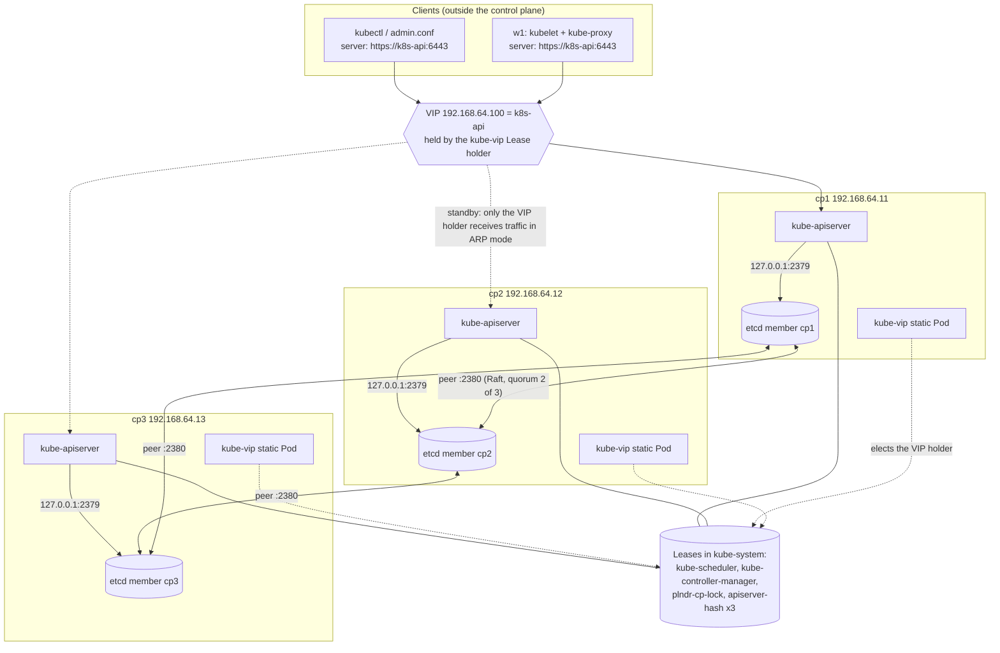

# T4.05 Implement and configure a highly-available control plane

> Competency: "Implement and configure a highly-available control plane" (CKA-4.5) | Domain/weight: CKA - Cluster Architecture, Installation and Configuration (25%) | Est. time: 3.5 h | Prerequisites: T4.02, T4.04

Prerequisite lessons (read them first if a term is new):

- [T4.02 Create and manage Kubernetes clusters using kubeadm](../part4-cka/T4.02-create-and-manage-kubernetes-clusters-using.md) - `kubeadm init`, `kubeadm join`, tokens, the Secret `kubeadm-certs`, static Pods. This lesson builds on all of it.
- [T4.04 Manage the lifecycle of Kubernetes clusters](../part4-cka/T4.04-manage-the-lifecycle-of-kubernetes-clusters.md) - etcd backup and restore, the etcd TLS flags, certificates. This lesson reuses the same `etcdctl` flags.

Shell setup (put this at the top of every terminal; from `00-conventions.md`):

```bash
alias k=kubectl
export do="--dry-run=client -o yaml"
export now="--force --grace-period=0"
source <(kubectl completion bash); complete -o default -F __start_kubectl k
```

Environment for this whole lesson: **vms**. You need four Ubuntu LTS VMs prepared with `env/vm-prereqs.sh`: `cp1`, `cp2`, `cp3` (control planes) and `w1` (worker). A fifth VM `lb` (and a sixth, `lb2`) is optional: it is only used for the HAProxy + keepalived variant (section 2.4 and Lab D). You reach nodes with `ssh <node>` and become root with `sudo -i`, like the exam ([E7, E8](https://docs.linuxfoundation.org/tc-docs/certification/tips-cka-and-ckad)).

Names and addresses used everywhere in this lesson (change them to fit your network, but change them everywhere):

| Item | Value | Note |
|---|---|---|
| VIP (virtual IP) | `192.168.64.100` | Must be on the same subnet as the nodes, not used by anything, and outside your hypervisor's DHCP pool |
| API name | `k8s-api` | Resolves to the VIP through `/etc/hosts` on every node |
| `cp1` / `cp2` / `cp3` | `192.168.64.11` / `.12` / `.13` | Control planes |
| `w1` | `192.168.64.21` | Worker |
| `lb` / `lb2` (optional) | `192.168.64.31` / `.32` | Only for the HAProxy + keepalived variant (section 2.4, Lab D) |
| VIP for the HAProxy variant | `192.168.64.101` | A second free address, so Lab D can run next to the kube-vip VIP |
| Network interface | `enp0s1` | Find yours with `ip -br a`; Multipass on KVM or QEMU often shows `enp0s1`, `ens3` or `enp1s0` |
| kube-vip image | `ghcr.io/kube-vip/kube-vip:v1.3.1` | Pin from the research summary section 5 |

> **How to read the output blocks in this lesson.** Three kinds of blocks carry a label, and you must never mix them up:
>
> - `REAL OUTPUT (Docker, etcd 3.7.0 containers)`: captured on 2026-10-27 by starting plain `registry.k8s.io/etcd:3.7.0-0` containers (three on a Docker network for sections 2.3 and 2.8; one container plus a Docker volume for the snapshot restore and `--force-new-cluster` runs of section 2.13), using HTTP (no TLS) and no Kubernetes. It is real for etcd itself (member list, health, status, quorum loss, remove and re-add, snapshot restore, force-new-cluster). It is **not** a Kubernetes cluster and **not** a VM.
> - `REAL OUTPUT (Docker, kubeadm v1.37.1 --dry-run)` and `REAL OUTPUT (Docker, kube-vip v1.3.1)`: captured the same day by running the real `kubeadm` binary with `--dry-run` (nothing is started) and the real kube-vip image to generate a manifest. Real for what those tools print or write, not a running cluster.
> - `EXPECTED OUTPUT (not captured)`: no Multipass or KVM was available, so nothing that needs running VMs was executed. The shape (columns, wording) is what the tools print; names, ages, hashes and timings will differ. Every such block is listed in section 11.

---

## 1. Why this matters

A cluster with one control-plane node has a single point of failure: when that machine stops, nobody can create, change or scale anything, and a failed disk can destroy the only copy of etcd, the cluster's database. A highly-available (HA) control plane runs three or more control-plane nodes behind one stable address and keeps etcd on a majority (a quorum) of them. In real life the common outages are a rebooted node, a full disk, or a bad kubeconfig that points at one node instead of the shared address. In the CKA you need to understand and build this topology: a stable endpoint, extra control planes joined with `kubeadm`, and healthy etcd members. How HA tasks are phrased in the exam is UNVERIFIED (section 8).

---

## 2. Concepts

### 2.1 What HA means for each control-plane component

The control plane is four programs. Each one has a different way to be "highly available". Know which is which, because the failure drills and the leases in this lesson follow from it.

| Component | How HA works | What runs where in a 3-node HA cluster |
|---|---|---|
| `kube-apiserver` | **Active-active.** Every instance serves requests at the same time. It keeps no state of its own (all state is in etcd), so a load balancer or VIP can send a request to any instance. | 3 instances serving, one per control-plane node |
| `etcd` | **Replicated with a quorum** (Raft). One member is the leader, the others are followers. A write succeeds only when a majority of members have stored it. | 3 members |
| `kube-scheduler` | **Active-standby.** All instances run, but only the one that holds a *Lease* (a lock object, section 2.7) makes decisions. | 3 running, 1 active |
| `kube-controller-manager` | **Active-standby**, same Lease idea. | 3 running, 1 active |

**What "the control plane is down" does and does not break.** The kubelet on each worker keeps running its Pods without help from the control plane, and kube-proxy keeps its existing rules. Running Pods keep serving traffic. What stops is change: no new Pods, no scaling, no replacement of a crashed Pod, no `kubectl`. HA exists so that "change" keeps working while one machine is gone.

**Related but different.** HA of the *control plane* (this lesson) is not HA of *your application* (replicas, PodDisruptionBudgets, anti-affinity) and it is not a *backup*. If someone deletes a namespace, all three etcd members replicate that delete in milliseconds. You still need snapshots (section 2.11).

### 2.2 Topologies: stacked etcd versus external etcd

kubeadm supports two layouts (source: [Options for Highly Available topology](https://kubernetes.io/docs/setup/production-environment/tools/kubeadm/ha-topology/)).

| | **Stacked etcd** (kubeadm default) | **External etcd** |
|---|---|---|
| What it is | Each control-plane node also runs one etcd member as a static Pod. etcd and the API server are "stacked" on the same machine. | etcd runs on its own separate hosts. The control-plane nodes only run apiserver, scheduler and controller-manager and connect to the etcd hosts over TLS. |
| Minimum hosts for HA | 3 (control plane + etcd together) | 6 (3 control plane + 3 etcd) |
| How kubeadm sets it up | Automatic. `kubeadm init` creates the first etcd member, `kubeadm join --control-plane` adds one more each time. | You build the etcd cluster first, then list its endpoints and client certificates in `ClusterConfiguration.etcd.external` |
| Pros | Fewer machines. Simple to bootstrap and to manage. Each apiserver talks to its *local* etcd, so there is no extra network hop. | Control-plane failure and etcd failure are independent: losing a control-plane node does not remove an etcd member. Easier to size and back up etcd separately. |
| Cons | **Coupled failure.** If one node dies you lose an apiserver *and* an etcd member at once, so redundancy shrinks by two things together (the docs call this "compromised redundancy"). | Twice the hosts to buy, patch, and monitor. More certificates to copy. More to get wrong. |
| Where each apiserver connects | `--etcd-servers=https://127.0.0.1:2379` (real, from the dry run in section 2.5) | `--etcd-servers=` a list of the external member URLs |

The Kubernetes docs say to run a minimum of three stacked control-plane nodes for an HA cluster. In this lesson we build **stacked**, because it is the kubeadm default and needs the fewest machines. The external layout is documented at [Set up a High Availability etcd Cluster with kubeadm](https://kubernetes.io/docs/setup/production-environment/tools/kubeadm/setup-ha-etcd-with-kubeadm/); know that its kubeadm config uses this shape:

```yaml
# Fragment only (not a complete file): ClusterConfiguration for an external etcd.
etcd:
  external:
    endpoints:                       # client URLs of every etcd member
      - https://10.0.0.11:2379
      - https://10.0.0.12:2379
      - https://10.0.0.13:2379
    caFile: /etc/kubernetes/pki/etcd/ca.crt                       # CA that signed the etcd server certs
    certFile: /etc/kubernetes/pki/apiserver-etcd-client.crt       # client cert the apiserver presents
    keyFile: /etc/kubernetes/pki/apiserver-etcd-client.key
```

Field notes: `endpoints` has no default and must list every member (a wrong or missing URL means the apiserver cannot reach that member); `caFile`, `certFile` and `keyFile` have no defaults and must be readable on every control-plane node (a missing file makes the apiserver Pod crash-loop with a TLS or file error). Do not mix this with `etcd.local` in the same file: they are alternatives.

**Observe which topology you have** (expected shape, not run for the external case). On any control-plane node:

```bash
sudo grep -- '--etcd-servers' /etc/kubernetes/manifests/kube-apiserver.yaml
k -n kube-system get pods -o name | grep '^pod/etcd-'
```

Stacked prints `--etcd-servers=https://127.0.0.1:2379` (real, section 2.5) and one `pod/etcd-<node>` per control plane. External prints the list of URLs from `etcd.external.endpoints` and **no** `etcd-<node>` Pods, so the `ec` function of section 2.8 does not apply: run `etcdctl` on the etcd hosts instead.

### 2.3 etcd quorum math

**Raft in plain words.** etcd uses the Raft algorithm. The members elect one **leader**. Every write goes to the leader; the leader appends it to its log and sends it to the followers. The write is **committed** (safe to report as done) only when a **majority** of members have it on disk. That majority is the **quorum**:

```
quorum = floor(n / 2) + 1
tolerated failures = n - quorum
```

| Members (n) | Quorum | Failures tolerated | Comment |
|---|---|---|---|
| 1 | 1 | 0 | No HA |
| 2 | 2 | 0 | **Worse than 1**: two machines that can fail, and both are needed |
| 3 | 2 | **1** | The usual minimum |
| 4 | 3 | 1 | Same tolerance as 3, one more machine to fail |
| 5 | 3 | **2** | Common for large production clusters |
| 6 | 4 | 2 | Same tolerance as 5 |
| 7 | 4 | 3 | Rare. More members also means slower writes (the leader waits for more acknowledgements) |

**Why even numbers do not help.** Look at the rows: 4 members tolerate the same single failure as 3, and 6 tolerate the same two as 5. The extra member adds a machine that can break and adds nothing to the number you can lose. It can also hurt in a network split: with 4 members split 2 and 2, **neither** side has 3, so the whole cluster stops. With 3 members split 2 and 1, the side with 2 keeps working. The kubeadm HA page states the same advice: an odd number of control-plane nodes helps leader selection when a machine or zone fails.

**What happens at the limit** (real, from three etcd 3.7.0 containers; see the legend at the top). First, a healthy three-member cluster:

```text
REAL OUTPUT (Docker, etcd 3.7.0 containers, plain HTTP, not Kubernetes)
$ etcdctl member list -w table
┌──────────────────┬─────────┬──────┬─────────────────┬─────────────────┬────────────┐
│        ID        │ STATUS  │ NAME │   PEER ADDRS    │  CLIENT ADDRS   │ IS LEARNER │
├──────────────────┼─────────┼──────┼─────────────────┼─────────────────┼────────────┤
│ 2e26792788a28bd2 │ started │  cp1 │ http://cp1:2380 │ http://cp1:2379 │      false │
│ 44ef65c567f2851a │ started │  cp3 │ http://cp3:2380 │ http://cp3:2379 │      false │
│ f618440bf36a689f │ started │  cp2 │ http://cp2:2380 │ http://cp2:2379 │      false │
└──────────────────┴─────────┴──────┴─────────────────┴─────────────────┴────────────┘
```

I stopped the leader (`cp2`). The cluster elected a new leader, health showed one member down, and a write still worked (2 of 3 is a quorum):

```text
REAL OUTPUT (Docker, etcd 3.7.0 containers)
$ etcdctl endpoint health --cluster -w table        # cp2 stopped
┌─────────────────┬────────┬──────────────┬───────────────────────────┐
│    ENDPOINT     │ HEALTH │     TOOK     │           ERROR           │
├─────────────────┼────────┼──────────────┼───────────────────────────┤
│ http://cp1:2379 │   true │   1.203145ms │                           │
│ http://cp3:2379 │   true │   1.232312ms │                           │
│ http://cp2:2379 │  false │ 5.003943423s │ context deadline exceeded │
└─────────────────┴────────┴──────────────┴───────────────────────────┘
Error: unhealthy cluster
$ etcdctl put /probe after-1-down ; etcdctl get /probe
OK
/probe
after-1-down
```

Then I stopped a second member (`cp3`), so only `cp1` was left (1 of 3, below quorum). Writes and normal reads stop, even though the `cp1` process is running:

```text
REAL OUTPUT (Docker, etcd 3.7.0 containers; JSON log lines trimmed with ...)
$ etcdctl --command-timeout=5s put /probe quorum-lost
{"level":"warn", ... "msg":"retrying of unary invoker failed", ... "method":"/etcdserverpb.KV/Put", ... "error":"rpc error: code = DeadlineExceeded desc = context deadline exceeded"}
Error: context deadline exceeded
$ etcdctl --command-timeout=5s endpoint health
http://cp1:2379 is unhealthy: failed to commit proposal: context deadline exceeded
Error: unhealthy cluster
$ etcdctl --command-timeout=5s get /probe            # default = linearizable read
Error: context deadline exceeded
$ etcdctl --command-timeout=5s get /probe --consistency=s    # serializable read
/probe
after-1-down
```

Read this carefully. The default read is **linearizable**: the member must confirm with the leader that its data is current, so it also needs a quorum. A **serializable** read (`--consistency=s`) is answered from the local copy and can be stale. The Kubernetes API server uses linearizable reads and writes for normal requests, so without a quorum `kubectl` cannot create or list reliably. In the kube-apiserver you see this as `etcdserver: request timed out` (text from the etcd server library; the exact line in your kubectl output is on the "To verify" list). The `cp1` log in the same run said, for its election attempts: `has received 1 MsgPreVoteResp votes and 0 vote rejections`. It asks for votes, gets only its own, and cannot become leader.

Starting `cp2` and `cp3` again brought everything back: all three `true` in `endpoint health --cluster`, and a new write (`recovered`) worked. Nothing was lost because the data directories were intact. That is the first-choice recovery in section 6.3.

**Under the hood: learners.** A member can join as a **learner**: a non-voting member that copies the log until it is caught up. It does not count toward quorum while it is a learner. Adding a voting member that is empty and slow to sync can stall a three-node cluster, which is why `kubeadm join --control-plane` adds the new etcd member as a learner and then promotes it. The kubeadm binary contains the messages `[etcd] Adding etcd member %q as learner`, `[etcd] Promoting the learner %s` and `[etcd] Member %s is not started yet. Waiting for it to be started.` (found with `strings` on kubeadm v1.37.1). In `member list`, a learner shows `IS LEARNER = true` until it is promoted.

### 2.4 A stable endpoint: DNS name or VIP in front of the apiservers

**The problem.** Every client of the API server needs an address. If a kubeconfig says `https://192.168.64.11:6443` (cp1), the cluster has three apiservers but every client still depends on cp1. A kubelet on a worker, kube-proxy, `kubectl` on your laptop, and the cluster-info ConfigMap that new nodes read all store *one address*. HA needs that address to be a **stable endpoint** that survives the loss of any control-plane node.

**The solution.** Put a name (DNS) or a virtual IP (VIP) in front of the apiservers, and use only that name or IP in every kubeconfig. In kubeadm that is `controlPlaneEndpoint`, set at `kubeadm init`.

| Option | How it works | Pros | Cons / traps | How to observe it |
|---|---|---|---|---|
| DNS name with several A records (round-robin) | The name returns the IP of each control plane | No extra software | DNS does not know which node is dead. Clients may get a dead IP and wait for a timeout. Caching makes it worse. Avoid for HA. | `getent ahosts k8s-api` lists every A record, including the address of a node that is down (expected). |
| Cloud load balancer (TCP) | The cloud's L4 load balancer health-checks port 6443 and spreads connections | Managed, no VIP logic to run | Only in a cloud. The kubeadm docs say: put the control planes behind a TCP-forwarding load balancer, use a DNS name, and use a TCP health check on the apiserver port (default 6443). | `nc -zv -w 2 <LB address> 6443` (the command from the kubeadm docs): succeeds when the LB reaches an apiserver, times out when it cannot. |
| **kube-vip** (static Pod on each control plane) | The kube-vip Pods run a leader election with a Lease. The leader adds the VIP to its network interface and announces it with ARP (layer 2) or BGP. If the leader dies, another node wins the Lease and takes over the VIP. | No separate machines. Runs as a static Pod, so it starts before the cluster is up. | In ARP mode only one node holds the VIP at a time, so all API traffic goes to one apiserver (active-standby for traffic). The VIP must be on the nodes' subnet. | `ip -br a show enp0s1` on each node (the VIP is a second address on the holder only) and `k -n kube-system get lease plndr-cp-lock`. |
| HAProxy + keepalived | `haproxy` listens on the VIP and forwards TCP to the three apiservers. `keepalived` (VRRP) moves the VIP between machines. | Real load balancing and health checks | Two extra programs to configure. If HAProxy runs on the control-plane nodes, it cannot also listen on 6443 (the apiserver already does), so it uses another port such as 8443 and `controlPlaneEndpoint` must use that port. | Full config and lab below (Lab D): `ip -br a`, `nc -zv -w 2 <VIP> 6443`, `echo "show stat" \| sudo socat stdio /run/haproxy/admin.sock`. |

The kubeadm HA page tells you to make sure "the address of the load balancer always matches the address of kubeadm's ControlPlaneEndpoint", and to test it with `nc -zv -w 2 <LOAD_BALANCER_IP> <PORT>`. A "connection refused" before the first apiserver exists is expected; a **timeout** means the load balancer cannot reach the control-plane node.

**Always use a name that is in the apiserver certificate.** kubeadm adds the host part of `controlPlaneEndpoint` to the apiserver certificate's SANs (Subject Alternative Names: the names and IPs a certificate is valid for) automatically. The dry run below shows `k8s-api` in the list. If you also want clients to use the bare VIP *IP*, add it with `apiServer.certSANs`, or they will fail with an x509 name error.

```text
REAL OUTPUT (Docker, kubeadm v1.37.1 --dry-run; config in section 4 with certSANs: [192.168.64.100])
[certs] apiserver serving cert is signed for DNS names [cp1 k8s-api kubernetes kubernetes.default kubernetes.default.svc kubernetes.default.svc.cluster.local] and IPs [10.96.0.1 192.168.64.11 192.168.64.100]
```

**kube-vip in detail.**

- It runs as a **static Pod** with `hostNetwork: true` and the capabilities `NET_ADMIN` and `NET_RAW` (to add an IP to an interface and send ARP). A static Pod is a Pod defined by a file in `/etc/kubernetes/manifests`; the kubelet runs it without needing the API server (T4.02).
- Control-plane mode is `--controlplane`; `--arp` selects layer-2 announcement (gratuitous ARP tells the switch "this IP is now on my MAC address"); `--leaderElection` makes the nodes elect the VIP holder with a Lease named `plndr-cp-lock` in `kube-system`.
- Defaults it printed in the generated manifest: lease duration 15 s, renew deadline 10 s, retry period 2 s, port 6443, subnet `/32` (real, from kube-vip v1.3.1).
- **Bootstrap problem.** kube-vip needs a kubeconfig to talk to the API (for the Lease). Since Kubernetes 1.29, kubeadm creates `admin.conf` with RBAC rights granted *after* the cluster is up, and a second file `/etc/kubernetes/super-admin.conf` that works immediately. So on the **first** control plane, before `kubeadm init`, kube-vip must mount `super-admin.conf`. Generate the manifest with `--k8sConfigPath /etc/kubernetes/super-admin.conf` (the flag exists in v1.3.1; the generated `hostPath` changes to the super-admin file; real output in section 4). After `init`, switch it back to `admin.conf`: `super-admin.conf` is a break-glass file with unrestricted rights and should not stay mounted in a long-running Pod. On `cp2` and `cp3`, add the kube-vip manifest **after** `kubeadm join` has written `admin.conf` there.
- **In one line (cp1 only):** before `init` kube-vip reads `super-admin.conf`; after `init` it reads `admin.conf`; on `cp2` and `cp3` it reads `admin.conf` from the start but is added only after `join`. The order is in section 5, steps 1, 3 and 4.
- I tried `kube-vip kubeadm init --interface ... --address ... --controlplane --arp --leaderElection` in Docker too. In v1.3.1 its output kept `admin.conf` as the hostPath, so do not assume that subcommand fixes the bootstrap problem; use `manifest pod --k8sConfigPath` (verified) and confirm on your VMs (section 11).
- kube-vip.io and its GitHub pages are **not** on the exam's allowed documentation list (E13: kubernetes.io/docs, kubernetes.io/blog, helm.sh/docs, gateway-api.sigs.k8s.io for CKA). Do not plan to read them during the exam. Learn the pattern: a static Pod, a VIP on the nodes' subnet, `controlPlaneEndpoint` equal to that VIP's name.

**HAProxy + keepalived in detail.** Two programs with two different jobs, usually on two small separate VMs (`lb`, `lb2`):

- `haproxy` is the **load balancer**. It listens on a port, health-checks each apiserver, and forwards every TCP connection to a healthy one. It does not move any IP address.
- `keepalived` runs **VRRP**. The lb machines compete for one VIP; the winner puts it on its interface and answers ARP for it. Without keepalived the lb machine is itself a single point of failure. With one lb VM (the optional `lb` of this lesson) you still get health-checked balancing across the apiservers, but no failover of the lb.

`/etc/haproxy/haproxy.cfg` (identical on `lb` and `lb2`). Not run on a cluster here (section 11); the HTTPS health check of `/healthz` is the pattern the kubeadm project documents for HAProxy.

```text
global
    log /dev/log local0
    stats socket /run/haproxy/admin.sock mode 660 level admin   # lets you run "show stat" to observe the servers

defaults
    mode tcp                  # pass TLS through untouched; the apiserver still terminates TLS. Default is http: wrong here.
    log global
    option tcplog
    timeout connect 5s        # time allowed to open a connection to an apiserver
    timeout client  1h        # idle time allowed on the client side. kubectl logs -f, exec and watches keep one TCP connection open, so a few seconds here cuts them
    timeout server  1h        # same, apiserver side

frontend apiserver
    bind *:6443               # wildcard on purpose: the backup lb does not own the VIP yet, and a bind to the VIP address would fail there
    default_backend apiservers

backend apiservers
    balance roundrobin        # next server in turn. Default is roundrobin; "leastconn" favours the least busy server
    option httpchk            # health check = an HTTP request, not just a TCP connect
    http-check connect ssl    # the check speaks TLS (the apiserver port is HTTPS only)
    http-check send meth GET uri /healthz
    http-check expect status 200
    default-server inter 3s fall 3 rise 2   # check every 3 s; 3 failures = DOWN; 2 successes = UP again
    server cp1 192.168.64.11:6443 check verify none   # "check" turns the health check on for this server. "verify none" = do not verify the apiserver certificate during the check
    server cp2 192.168.64.12:6443 check verify none
    server cp3 192.168.64.13:6443 check verify none
```

A server with `check` missing is always treated as up, even when its apiserver is dead (risky). A plain TCP `check` only proves that something listens on 6443 (see the health-check trap below). With `inter 3s fall 3` a dead apiserver is removed from rotation after about 9 seconds (reasoned from the settings; measure it in Lab D).

`/etc/keepalived/keepalived.conf` on `lb` (`lb2` differs in the three marked lines):

```text
vrrp_script chk_haproxy {
    script "/usr/bin/pgrep haproxy"   # exit 0 = haproxy is running. Absolute path required. Check with: command -v pgrep
    interval 2                        # run every 2 s
    fall 2                            # 2 failures in a row = the check is "failed"
    rise 2                            # 2 successes in a row = "ok" again
    weight -20                        # while failed, SUBTRACT 20 from this node's priority
}

vrrp_instance VI_1 {
    state BACKUP                      # both nodes start as BACKUP; the priority election decides who becomes MASTER
    interface enp0s1                  # NIC that carries the VIP. Wrong name = no VIP, no error from haproxy
    virtual_router_id 51              # 1-255; the same on lb and lb2; unique among VRRP groups on this subnet
    priority 100                      # 1-254, higher wins, default 100.            lb2: 90
    advert_int 1                      # seconds between VRRP advertisements. Default 1
    unicast_src_ip 192.168.64.31      # this node's IP.                             lb2: 192.168.64.32
    unicast_peer { 192.168.64.32 }    # the other lb node.                          lb2: 192.168.64.31
    virtual_ipaddress {
        192.168.64.101/24 dev enp0s1  # the VIP with the subnet's prefix length (/24 here); a wrong prefix breaks routing
    }
    track_script { chk_haproxy }      # adjust the priority by the result of chk_haproxy
}
```

How to read it:

- **`vrrp_script` and `track_script` are what make the VIP follow a healthy haproxy.** Without them keepalived only notices when keepalived itself or the whole host dies; if only `haproxy` crashes, the VIP stays on a machine that forwards nothing. With them, a failed check lowers the priority by `weight`.
- **The arithmetic must work out.** `lb` is 100 while healthy and 80 when `haproxy` is dead; `lb2` is 90. 80 < 90, so `lb2` wins. If you had used a `weight` of -5, `lb` would be 95 and keep the VIP (risky value: the size of `weight` must be larger than the priority gap).
- **`unicast_src_ip` / `unicast_peer`** send the VRRP adverts as unicast instead of multicast (the default). Use them where multicast is dropped (many clouds and virtual networks). A wrong peer address means neither node hears the other and **both** claim the VIP.
- **`virtual_router_id`** that is also used by another VRRP group on the same subnet makes the VIP flap.
- `authentication { auth_type PASS ... }` is optional and not shown: the password travels in clear text and is not a security boundary (whether your keepalived version still supports it is UNVERIFIED).
- **A single lb VM:** delete the two `unicast_*` lines (no peer exists); the node becomes MASTER by itself and holds the VIP.

Observe it (expected, section 11): on `lb` `ip -br a show enp0s1` shows the VIP, on `lb2` it does not; `nc -zv -w 2 192.168.64.101 6443` from any node connects; and `echo "show stat" | sudo socat stdio /run/haproxy/admin.sock | cut -d, -f1,2,18` prints one `apiservers,cpN,UP` line per apiserver (field 1 is the proxy name, field 2 the server name, field 18 the status). `socat` is not installed by default (`sudo apt-get install -y socat`). Lab D does exactly this.

**Health-check trap in a stacked cluster.** In the stacked layout each apiserver uses only its own local etcd (`--etcd-servers=https://127.0.0.1:2379`). If that one etcd member is sick but the apiserver process is alive, the port still accepts TCP connections. A pure TCP health check keeps sending clients to an apiserver that cannot serve them. The apiserver's HTTP endpoint `/readyz` reports `etcd` failures. Whether your load balancer or kube-vip should use it, and whether anonymous access to `/readyz` is allowed in your cluster, is a design choice; the kubeadm docs recommend the TCP check, so know the limit of it.

**Related but different: the `kubernetes` Service.** Pods inside the cluster reach the API through the ClusterIP Service `kubernetes.default`. Its backends are the real apiserver addresses, published as an EndpointSlice (conventions: teach EndpointSlices, not Endpoints). In an HA cluster `k get endpointslice kubernetes` lists all three addresses on port 6443. That is how in-cluster clients get HA without the VIP. The VIP is for clients *outside* that Service: kubelets, kube-proxy bootstrap, `kubectl`, and anything on your laptop.

### 2.5 Bootstrapping HA with kubeadm: `init`, `--upload-certs`, `join --control-plane`

**What a new control plane needs.** A second control-plane node must sign and verify the same things as the first. So it needs the cluster CA key (`ca.key`), the front-proxy CA, the service-account key pair (`sa.key`, `sa.pub`) and the etcd CA. Copying these by hand is error-prone and risky. kubeadm can do it for you:

1. At `init` you pass `--control-plane-endpoint <stable-name>:6443` and `--upload-certs`.
2. kubeadm encrypts those files with a random 32-byte AES key and stores them in the Secret `kubeadm-certs` in `kube-system`. The key is printed **once** as the **certificate key**.
3. On each new node you run `kubeadm join <endpoint> --token ... --discovery-token-ca-cert-hash ... --control-plane --certificate-key <key>`. The node authenticates with the bootstrap token, downloads the Secret, and decrypts it with the key.

The fixed `init` command (from the entry; the `--control-plane-endpoint` form is also what the docs page shows):

```bash
sudo kubeadm init --control-plane-endpoint k8s-api:6443 --upload-certs
```

The real tail of the output, from the dry run with the config in section 4 (token, hash and key are throwaway values; the hash and key change on every run):

```text
REAL OUTPUT (Docker, kubeadm v1.37.1 --dry-run, trimmed)
[upload-certs] Storing the certificates in Secret "kubeadm-certs" in the "kube-system" Namespace
[upload-certs] Using certificate key:
13f65aeb72152c9966227fc000ccbe145ff580884919bc29efac0e4509106a49
...
You can now join any number of control-plane nodes running the following command on each as root:

  kubeadm join k8s-api:6443 --token mm61xa.y5wdj1e0edh7nvkw \
	--discovery-token-ca-cert-hash sha256:98948567715249a8e6eb1ed0078482aa86258a35300476b2259abdde033382a0 \
	--control-plane --certificate-key 13f65aeb72152c9966227fc000ccbe145ff580884919bc29efac0e4509106a49

Please note that the certificate-key gives access to cluster sensitive data, keep it secret!
As a safeguard, uploaded-certs will be deleted in two hours; If necessary, you can use
"kubeadm init phase upload-certs --upload-certs" to reload certs afterward.

Then you can join any number of worker nodes by running the following on each as root:

kubeadm join k8s-api:6443 --token mm61xa.y5wdj1e0edh7nvkw \
	--discovery-token-ca-cert-hash sha256:98948567715249a8e6eb1ed0078482aa86258a35300476b2259abdde033382a0
```

**The certificate key and its 2-hour TTL (verified).** In the same dry run, the Secret `kubeadm-certs` has an `ownerReference` to a special bootstrap-token Secret whose description decodes to "Proxy for managing TTL for the kubeadm-certs secret". Its `expiration` field decodes (base64) to `2026-10-27T14:51:55Z`, while the run started at `12:51:54Z` (the log line `W1027 12:51:54`). That is two hours. When that token expires, Kubernetes garbage-collects the owned Secret, and the certificate key becomes useless. The Secret data keys are `ca.crt`, `ca.key`, `etcd-ca.crt`, `etcd-ca.key`, `front-proxy-ca.crt`, `front-proxy-ca.key`, `sa.key`, `sa.pub` (real; values were `null` in the dry run). Treat the key like a root password: with it and the Secret, anyone can read your CA private keys. The TTL is the verified value for kubeadm v1.37.1 from a dry run; confirm the deletion on a live cluster (section 11).

**Other places the same facts appear** (all from the kubeadm docs page and the real help output):

| Need | Command | Notes |
|---|---|---|
| New key and re-upload the certs (after 2 h, or to rotate the key) | `sudo kubeadm init phase upload-certs --upload-certs` | Run on a control plane that is already in the cluster. Prints a **new** key. Flags in v1.37.1: `--certificate-key`, `--config`, `--dry-run`, `--kubeconfig`, `--skip-certificate-key-print`, `--upload-certs`. |
| Make your own key | `kubeadm certs certificate-key` | Prints 64 hex characters (a 32-byte AES key). Real example: `de9d6c5b8eacafee8e5bfc54328e4160cdcb71fae0e404a6e6c87091e4c0108a`. |
| New join command that includes the key | `sudo kubeadm token create --print-join-command --certificate-key <key>` | Gives a fresh 24 h token plus the CA hash. Append nothing else; `--control-plane` is added for you when you pass the key (T4.02, section 2.9). |
| Who can read the Secret | RoleBinding `kubeadm:kubeadm-certs` | Binds the group `system:bootstrappers:kubeadm:default-node-token` to `get` on that one Secret (real, from the dry run). |

**What `kubeadm join --control-plane` does** (phases printed by `kubeadm join --help` in v1.37.1, real):

| Phase | What it does |
|---|---|
| `preflight` | Checks ports, swap, runtime, and that the cluster has a stable `controlPlaneEndpoint` |
| `control-plane-prepare/download-certs` | Downloads and decrypts the shared certificates from `kubeadm-certs` |
| `control-plane-prepare/certs` | Creates this node's own certificates (apiserver, etcd server, etcd peer), with its own IP and name |
| `control-plane-prepare/kubeconfig` | Writes `admin.conf`, `controller-manager.conf`, `scheduler.conf` |
| `control-plane-prepare/control-plane` | Writes the static Pod manifests for apiserver, controller-manager, scheduler |
| `kubelet-start` | Starts the kubelet with a bootstrap config |
| `etcd-join` | Adds a new etcd member to the existing cluster (as a learner, then promoted) and writes the etcd manifest |
| `kubelet-wait-bootstrap` | Waits for the kubelet to get its client certificate |
| `control-plane-join/mark-control-plane` | Labels the node `node-role.kubernetes.io/control-plane` and adds the `NoSchedule` taint |
| `wait-control-plane` | Waits for the new control-plane Pods |

Useful `join` flags (real help, v1.37.1): `--control-plane`, `--certificate-key`, `--apiserver-advertise-address` (the IP this node's apiserver advertises; default = default-route interface IP), `--apiserver-bind-port` (default 6443), `--node-name`, `--cri-socket`, `--discovery-token`, `--discovery-token-ca-cert-hash`, `--discovery-token-unsafe-skip-ca-verification` (insecure: skips pinning the CA, avoid), `--token` (sets both discovery and bootstrap token), `--config`, `--dry-run`, `--patches`, `--skip-phases`, `--tls-bootstrap-token`.

**Mixing config files and flags.** `kubeadm init --config` cannot be combined with `--certificate-key`. If you use a config file, put `certificateKey` in `InitConfiguration`, and for a join in `JoinConfiguration.controlPlane` (from the HA docs page). `--upload-certs` is one of the flags that you *can* combine with `--config` (T4.02). A config-file join is in section 4.

**Without a stable endpoint, `join --control-plane` refuses to run.** Its error contains `One or more conditions for hosting a new control plane instance is not satisfied.` and `The cluster has a stable controlPlaneEndpoint address.` (fragments confirmed in the binary, T4.02 section 2.9). You cannot fix that at join time: it comes from `init`. Plan the endpoint before the first `init`.

**Rebalance CoreDNS.** Nodes are usually joined one after another, so the CoreDNS Pods tend to all land on the first node or nodes that were ready. The kubeadm docs say to run `kubectl -n kube-system rollout restart deployment coredns` after at least one new node has joined, to spread them.

### 2.6 Who points where: kubeconfigs and addresses in a stacked HA cluster

After `init`, kubeadm writes five kubeconfig files. Their `server:` lines show who uses the stable endpoint and who uses a local address. This was checked for real by running `kubeadm init phase kubeconfig all` with `controlPlaneEndpoint: k8s-api:6443` and `advertiseAddress: 192.168.64.11`:

```text
REAL OUTPUT (Docker, kubeadm v1.37.1)
/kb/kc/admin.conf:    server: https://k8s-api:6443
/kb/kc/controller-manager.conf:    server: https://192.168.64.11:6443
/kb/kc/kubelet.conf:    server: https://192.168.64.11:6443
/kb/kc/scheduler.conf:    server: https://192.168.64.11:6443
/kb/kc/super-admin.conf:    server: https://k8s-api:6443
```

| Client | Points at | Meaning in HA |
|---|---|---|
| `kubectl` using `admin.conf` (and `~/.kube/config` copies) | `https://k8s-api:6443` (the endpoint) | Survives the loss of any one node |
| kube-scheduler and kube-controller-manager on a control plane | The **local** apiserver (`https://<this node's IP>:6443`) | Each talks to its own node's apiserver. If that apiserver dies, that scheduler instance cannot work, but another node's instance can take the Lease. |
| kubelet on the node that ran `init` (`cp1`) | The local address `https://192.168.64.11:6443` (real, above) | The kubelet on `cp1` depends on `cp1`'s own apiserver. Nodes added by `join` use the discovery endpoint instead. |
| kubelet on workers (joined with `kubeadm join k8s-api:6443 ...`) | `k8s-api:6443` (taken from the join command) | Workers survive control-plane loss. Check with `grep server: /etc/kubernetes/kubelet.conf`. |
| kube-proxy (DaemonSet) | `https://k8s-api:6443` in its ConfigMap (real, from the dry run) | Survives the loss of any one node |
| `cluster-info` ConfigMap in `kube-public` | `https://k8s-api:6443` (real) | Used by new nodes during join discovery |
| each apiserver to etcd | `https://127.0.0.1:2379` (real: `--etcd-servers=https://127.0.0.1:2379`) | Stacked: its own member only |

The consequence for the failure drills: the **VIP only needs to work for clients outside the control-plane node**. When `cp1` dies, `kubectl` through the VIP must reach `cp2` or `cp3`. For the controller-manager and scheduler, "failover" is the Lease moving to a surviving node.

**Changing the endpoint after `init`.** It is hard. The name is baked into the apiserver certificate SANs, the `kubeadm-config` ConfigMap, `cluster-info`, `kube-proxy`, and every kubelet.conf. In practice you rebuild or carefully rewrite all of them. This is why mistake 2 in section 6 is expensive, and why the first rule of HA is: set `controlPlaneEndpoint` at `init`.

### 2.7 Leader election for the scheduler and controller-manager: Leases

**What is a Lease?** A Lease (`coordination.k8s.io/v1`) is a small API object used as a lock. It has a few fields in `spec`: `holderIdentity` (who holds the lock now), `leaseDurationSeconds`, `acquireTime`, `renewTime`, `leaseTransitions` (how many times the holder has changed).

**How leader election works.**

1. Every scheduler instance tries to create or take over the Lease `kube-scheduler` in `kube-system`. The first to succeed becomes the leader and writes its identity (hostname plus a random id) into `holderIdentity`.
2. The leader renews the Lease every few seconds by updating `renewTime`.
3. The others watch it. If `renewTime` is older than `leaseDurationSeconds`, they assume the leader is dead and one of them takes over (`leaseTransitions` goes up by one).
4. The old leader, if it was only slow, notices it failed to renew and stops acting (it must renew before the *renew deadline*).

Defaults, from the [kube-scheduler reference page](https://kubernetes.io/docs/reference/command-line-tools-reference/kube-scheduler/): `--leader-elect-lease-duration` = 15 s, `--leader-elect-renew-deadline` = 10 s, `--leader-elect-retry-period` = 2 s, `--leader-elect-resource-lock` = `leases`, `--leader-elect-resource-name` = `kube-scheduler`. The kube-controller-manager uses the same defaults and the name `kube-controller-manager`. kubeadm's manifests pass `--leader-elect=true` (real, from the dry run for both). So after a leader node dies, expect a standby to take over within roughly the lease duration plus the retry period: about 15 to 20 seconds (reasoned from the defaults; measure it in Lab B).

**The Leases you will see in `kube-system`.**

| Lease name | Holder is | What it is for |
|---|---|---|
| `kube-scheduler` | `<node>_<uuid>` | Leader election of the scheduler |
| `kube-controller-manager` | `<node>_<uuid>` | Leader election of the controller manager |
| `apiserver-<hash>` | `apiserver-<hash>_<uuid>` | **Identity** of each running kube-apiserver (one per instance). They are not leader election. The API servers are all active. Hash comes from the OS hostname. Label `apiserver.kubernetes.io/identity=kube-apiserver` (docs: Leases page). Count them to see how many apiservers are alive. |
| `plndr-cp-lock` | `<node>` (kube-vip) | kube-vip's own election for who holds the VIP. Only if you use kube-vip with `--leaderElection`. |

A different set of Leases, one per node, lives in the namespace `kube-node-lease`: these are **node heartbeats** that the kubelet renews. They are not part of HA of the control plane, but you will see them in `k get lease -A`.

The key command (from the entry), with output of the expected shape:

```bash
k -n kube-system get lease
```

```text
EXPECTED OUTPUT (not captured)
NAME                            HOLDER                                                                       AGE
apiserver-5pzkbs4m3gqlgjh2xn    apiserver-5pzkbs4m3gqlgjh2xn_8d6c0a1e-6c3b-4f0e-bb62-0f1d5a7a0b11            41m
apiserver-gkd7o2w5r4yqa7fbit    apiserver-gkd7o2w5r4yqa7fbit_2a6e9b0c-4f55-4d3a-9d1c-aa0e3c4b7f20            27m
apiserver-vnyj3tq5d2ku4mz6ex    apiserver-vnyj3tq5d2ku4mz6ex_c1f3d9e5-7a28-4a2d-8b37-5f4c9b0d6e61            19m
kube-controller-manager         cp2_5b9d3c7e-1a2f-4c54-9d10-3e6a8f2b7c44                                     41m
kube-scheduler                  cp3_9e1f4a60-b2d7-4b8a-a3c5-61d0e7f89a12                                     41m
plndr-cp-lock                   cp1                                                                          39m
```

Note the pattern: three `apiserver-*` rows (three live API servers), exactly one holder for `kube-scheduler` and for `kube-controller-manager`, and the kube-vip lock. Which node holds each is random. Two ways to read one holder:

```bash
k -n kube-system get lease kube-scheduler -o jsonpath='{.spec.holderIdentity}{"\n"}'
k -n kube-system get lease kube-scheduler kube-controller-manager plndr-cp-lock \
  -o custom-columns=NAME:.metadata.name,HOLDER:.spec.holderIdentity,TRANSITIONS:.spec.leaseTransitions
```

**Under the hood: other things that are not in the entry.** Newer Kubernetes also has *coordinated leader election* (it uses `LeaseCandidate` objects and picks the leader by the oldest compatible version, which helps during upgrades). Whether it is on by default in v1.37 is UNVERIFIED; if you see extra Lease or LeaseCandidate objects, that is the reason. The Leases page also lists a `ControllerManagerReleaseLeaderElectionLockOnExit` gate, alpha since v1.36 and off by default: when on, a stopping controller-manager releases the lock so a standby does not have to wait for the lease to expire. With defaults, a clean shutdown still leaves the lock until it expires.

### 2.8 etcd member management

**Where is `etcdctl`?** kubeadm runs etcd as a container. The node usually has no `etcdctl`, but the etcd image contains it. Two options (T4.04 section 2): install `etcdctl` on the node (same version as the server, 3.7.0), or run it inside the etcd Pod. This lesson uses the second, with one shell function (define it on `cp1`, as your normal user with kubectl access):

```bash
# ec <control-plane-node> <etcdctl args...>  - runs etcdctl inside that node's etcd Pod
ec() { local n=$1; shift; k -n kube-system exec etcd-$n -- etcdctl \
  --endpoints=https://127.0.0.1:2379 \
  --cacert=/etc/kubernetes/pki/etcd/ca.crt \
  --cert=/etc/kubernetes/pki/etcd/server.crt \
  --key=/etc/kubernetes/pki/etcd/server.key "$@"; }
```

The three flags are the same as in T4.04: the CA that signed etcd's server cert, and a client certificate and key (etcd requires a client cert). Pod names are `etcd-<nodename>`. `k exec` goes through the API and the kubelet of that node, so you cannot use `ec` on a node that is down. Pick a node that is up.

**The commands from the entry:**

| Command | What it shows | Reading it |
|---|---|---|
| `ec cp1 member list -w table` | Every member, from the cluster's own membership list | Check: 3 rows, STATUS `started`, PEER ADDRS match each node's IP (`https://<node>:2380`), IS LEARNER `false` |
| `ec cp1 endpoint health --cluster -w table` | One request to each member's client URL (a write-like proposal) | HEALTH `true` for every row. A `false` row names the member and gives the error. |
| `ec cp1 endpoint status --cluster -w table` | Per-member detail | IS LEADER `true` on exactly one row. RAFT TERM equal on all (a term that keeps rising means repeated elections). RAFT APPLIED INDEX close together. DB SIZE similar. |

`--cluster` tells etcdctl: take the endpoint list from the cluster's `member list` instead of from `--endpoints`. Without it you check only the one endpoint you named. Real output from the Docker etcd cluster (plain HTTP, so the ID and URLs differ from kubeadm's):

```text
REAL OUTPUT (Docker, etcd 3.7.0 containers)
$ etcdctl endpoint health --cluster -w table
┌─────────────────┬────────┬────────────┬───────┐
│    ENDPOINT     │ HEALTH │    TOOK    │ ERROR │
├─────────────────┼────────┼────────────┼───────┤
│ http://cp2:2379 │   true │ 1.494933ms │       │
│ http://cp1:2379 │   true │ 1.497975ms │       │
│ http://cp3:2379 │   true │ 1.854895ms │       │
└─────────────────┴────────┴────────────┴───────┘

$ etcdctl endpoint status --cluster -w table        # columns trimmed to the important ones
 ENDPOINT          ID                VERSION  DB SIZE  IS LEADER  RAFT TERM  RAFT INDEX  RAFT APPLIED INDEX
 http://cp1:2379   2e26792788a28bd2  3.7.0    20 kB    false      2          11          11
 http://cp3:2379   44ef65c567f2851a  3.7.0    20 kB    false      2          11          11
 http://cp2:2379   f618440bf36a689f  3.7.0    20 kB    true       2          11          11
```

(The real table also has the columns STORAGE VERSION, IN USE, PERCENTAGE NOT IN USE, QUOTA, IS LEARNER, ERRORS, DOWNGRADE TARGET VERSION and DOWNGRADE ENABLED; I removed some of them only to fit the page.) On kubeadm, with TLS, the same commands look like this (expected shape, three control planes):

```text
EXPECTED OUTPUT (not captured)
$ ec cp1 member list -w table
+------------------+---------+------+----------------------------+----------------------------+------------+
|        ID        | STATUS  | NAME |         PEER ADDRS         |        CLIENT ADDRS        | IS LEARNER |
+------------------+---------+------+----------------------------+----------------------------+------------+
| 3a1f9c7d2b5e8f40 | started | cp1  | https://192.168.64.11:2380 | https://192.168.64.11:2379 |      false |
| 7c20e5b1a94d3f68 | started | cp2  | https://192.168.64.12:2380 | https://192.168.64.12:2379 |      false |
| e5d8b3a06f1c7924 | started | cp3  | https://192.168.64.13:2380 | https://192.168.64.13:2379 |      false |
+------------------+---------+------+----------------------------+----------------------------+------------+
```

**Plain output for scripts.** Without `-w table` the output is plain text with fields separated by `, `. For `member list` the fields are `ID, status, name, peer URL, client URL, is-learner`. For `endpoint status` (real v3.7.0 shape, one line per member) the 9th field is `IS LEADER` and the 11th is `RAFT TERM`: `http://127.0.0.1:2379, 8e9e05c52164694d, 3.7.0, 3.7.0, 20 kB, 16 kB, 20%, 2.1 GB, true, false, 2, 5, 5, , , false`. The Lab B and Lab C checks use these positions.

**Changing membership** (all real subcommands of `etcdctl member`):

| Command | Use it when | Effect and risk |
|---|---|---|
| `member remove <ID>` | A control plane is permanently gone, or you are rebuilding a broken member | Removes it from the cluster. Quorum is recomputed for the smaller size. Real output below. |
| `member add <name> --peer-urls=<url>` | Adding a member by hand | Registers the member *before* it starts; it shows `unstarted` until its process joins. kubeadm does this for you in `join`. |
| `member add ... --learner` + `member promote <ID>` | Adding safely | The new member does not vote until promoted. |
| `member update <ID> --peer-urls=<url>` | The peer URL stored in the cluster is wrong | Rewrites the URL for that member. Needs a quorum. Lab C breaks a cluster with it. |

The real remove and re-add (Docker etcd): remove `cp3`, add it again, start a fresh process with `--initial-cluster-state existing` and an **empty** data directory:

```text
REAL OUTPUT (Docker, etcd 3.7.0 containers)
$ etcdctl member remove 44ef65c567f2851a
Member 44ef65c567f2851a removed from cluster 6c2a9b9db8ba5eab
$ etcdctl member list -w table              # 2 members left
│ 2e26792788a28bd2 │ started │  cp1 │ http://cp1:2380 │ http://cp1:2379 │      false │
│ f618440bf36a689f │ started │  cp2 │ http://cp2:2380 │ http://cp2:2379 │      false │
$ etcdctl member add cp3 --peer-urls=http://cp3:2380
Member 53dbb8d34c07ee60 added to cluster 6c2a9b9db8ba5eab

ETCD_NAME="cp3"
ETCD_INITIAL_CLUSTER="cp1=http://cp1:2380,cp3=http://cp3:2380,cp2=http://cp2:2380"
ETCD_INITIAL_ADVERTISE_PEER_URLS="http://cp3:2380"
ETCD_INITIAL_CLUSTER_STATE="existing"
$ etcdctl member list -w table              # after starting the new cp3 process
│ 2e26792788a28bd2 │ started │  cp1 │ http://cp1:2380 │ http://cp1:2379 │      false │
│ 53dbb8d34c07ee60 │ started │  cp3 │ http://cp3:2380 │ http://cp3:2379 │      false │
│ f618440bf36a689f │ started │  cp2 │ http://cp2:2380 │ http://cp2:2379 │      false │
```

Notice: the re-added `cp3` has a **new member ID** (`53dbb...`, not `44ef6...`). A removed member's ID can never be reused. This is why a member that is removed must start with a clean data directory: a leftover directory holds the old ID and the old cluster state, and etcd will refuse or misbehave. With kubeadm, that means `rm -rf /var/lib/etcd` on the node before it rejoins (Lab C).

### 2.9 Workers and kubeconfigs point at the VIP

A worker joins with `kubeadm join k8s-api:6443 --token <t> --discovery-token-ca-cert-hash sha256:<h>`. The address in that command is the only API address the worker ever learns: it goes into `/etc/kubernetes/kubelet.conf`. So the rule is: **every join command and every kubeconfig must use `k8s-api:6443`, never a node IP.** To check any node, run:

```bash
sudo grep 'server:' /etc/kubernetes/kubelet.conf          # worker: must be https://k8s-api:6443
k config view --minify -o jsonpath='{.clusters[0].cluster.server}{"\n"}'   # your kubectl: must be https://k8s-api:6443
```

Your laptop or the `base` host needs a name that resolves: in this lab `k8s-api` is a line in `/etc/hosts` (`192.168.64.100 k8s-api`). If a worker cannot resolve the name, the kubelet logs a DNS lookup error. In a real network you create a DNS record for the VIP instead.

### 2.10 Failure drills: what to do and what to observe

A drill is only useful if you know what *should* happen. Use this table before you run Lab B.

| Action | What must still work | What changes | Typical time |
|---|---|---|---|
| Power off one control plane (the VIP holder) | `kubectl` through `k8s-api` after a short gap; writes (create a Deployment); running Pods | The VIP moves (kube-vip Lease `plndr-cp-lock` changes holder). If the dead node held the scheduler or controller-manager Lease, it changes. The node becomes `NotReady` after the node-monitor grace period (kube-controller-manager default 50 s, UNVERIFIED for v1.37). `endpoint health --cluster` shows one member unhealthy; `member list` still lists 3. | Gap of roughly 15 to 25 s for the VIP (reasoned from the 15 s lease; measure it) |
| Power off a second control plane | Running Pods only | Quorum lost: API writes fail or hang; `kubectl get` may time out; etcd on the survivor is up but cannot commit (real, section 2.3) | Immediate |
| Power the nodes back on | Everything | The VIP holder is whoever won the election, and does not have to return to the old node. etcd members resync. | A minute or two |

**How to run a drill without fooling yourself.** (1) Observe from a machine that is not the one you power off (`w1` in Lab B). (2) Use a loop that prints time and the result once per second, so the gap is visible. (3) After the drill, check that all three layers recovered: nodes, etcd, Leases.

### 2.11 Backups in an HA cluster

All members hold the same data, so **one snapshot from one healthy member is enough**. Take it from the local endpoint of one control-plane node:

```bash
# on cp1; the snapshot is written inside the etcd container, so use a host-mounted directory
ec cp1 snapshot save /var/lib/etcd/snap-$(date +%F).db
sudo ls -l /var/lib/etcd/snap-*.db
```

Why local: `etcdctl snapshot save` talks to **one** endpoint and streams that member's database. Passing several `--endpoints` or `--cluster` does not save several copies; it can only confuse you about which member you saved. Then copy the file off the node. Keep it off the node because a snapshot on a disk that fails together with the member is no backup.

The rest (the restore command `etcdutl snapshot restore`, deprecations, the static Pod edit) is in [T4.04](../part4-cka/T4.04-manage-the-lifecycle-of-kubernetes-clusters.md). Restoring an **HA** cluster is a different, harder procedure than a single-node restore: a restore creates a *new* cluster ID and new member IDs, so all members must come from the same snapshot (or you rebuild one member and add the others fresh). Section 2.13 gives both procedures with commands.

### 2.12 Removing a control-plane node

The safe order matters, because etcd membership is a separate thing from Kubernetes node membership.

| Step | Where | Command | Why |
|---|---|---|---|
| 1. Drain | any control plane | `k drain cp3 --ignore-daemonsets --delete-emptydir-data` | Moves workloads off (control-plane Pods are static and stay). |
| 2. Take it out of the front end | LB or VIP | kube-vip: nothing to do (the manifest goes away in step 3). HAProxy: remove the `server` line and reload. | Stops new clients from reaching a dying apiserver. |
| 3. Reset the node | the node being removed | `sudo kubeadm reset -f` | Phases (real help): `preflight`, `remove-etcd-member`, `cleanup-node`. The `remove-etcd-member` phase asks etcd to drop this node's member. `cleanup-node` deletes the manifests (this removes the kube-vip manifest too), kubelet state and certificates. It does not clean iptables or CNI config (kubeadm prints a reminder). |
| 4. Delete the Node object | any control plane | `k delete node cp3` | `kubeadm reset` does not delete the Node object. |
| 5. Confirm etcd | any control plane | `ec cp1 member list -w table` | Must show the smaller list. If the node was already dead and unreachable, the `remove-etcd-member` phase could not run: remove the member by hand with `ec cp1 member remove <ID>` using the ID from the table. |

**Careful with the arithmetic.** Going from 3 control planes to 2 *lowers* your safety: two members tolerate **zero** failures (quorum is 2 of 2), which is worse than three. Removing a control plane is a step in a replacement (3 to 2 to 3), or a move to a single node on purpose. Do the replacement quickly and never leave an even count for long. When you remove a node you are the one lowering the failure tolerance, so check the table in 2.3 first.

### 2.13 Recovering etcd in a stacked HA cluster

Pick the path from what you still have. Do not start with the most drastic one.

| Situation | Path | Needs a quorum? |
|---|---|---|
| 2 of 3 members are down but their disks are intact | Start the nodes again (6.3 step 3). Nothing else. | No: the members find each other again |
| 1 member is lost for good, the other 2 are up | Remove the member, reset the node, rejoin it (Lab C, section 2.12) | **Yes**: the remove is a membership change, and 2 of 3 is a quorum |
| Quorum is lost **and** at least one node still has a healthy `/var/lib/etcd` | **Path A: force a new one-member cluster** from the survivor, then add fresh members | No |
| No healthy data directory, or the data itself is wrong (a namespace was deleted) | **Path B: restore one snapshot on every control plane** | No |

**Why `member remove` does not help when quorum is lost.** Adding, removing or updating a member is itself a change that the Raft leader must commit on a majority, like a write. Without a majority it cannot be committed. Real (Docker, etcd 3.7.0): after a member was restarted with 2 of its 3 peers missing, even `etcdctl member list` timed out with `context deadline exceeded while waiting for connections to become ready`, so there was no way to read the IDs or to remove anything. (The 2.3 drill showed the other side: a write on a member that had been running timed out.) That is why this section has two paths that do not need a majority.

**Path A: quorum lost, one healthy data directory (here `cp1`; `cp2` and `cp3` are gone).** `--force-new-cluster` is an etcd flag: "Force to create a new one-member cluster" (real `etcd --help`). It starts the member from its existing data directory but rewrites the membership to contain only itself. Real, in Docker, from a data directory that had been restored with three members:

```text
REAL OUTPUT (Docker, etcd 3.7.0 containers, plain HTTP; member list while only cp1 runs)
$ etcd ... --force-new-cluster       # started once
$ etcdctl member list
dc3b512a95e48fab, started, cp1, http://127.0.0.1:2380, http://127.0.0.1:2379, false
$ etcdctl put /probe after-force ; etcdctl get /probe
OK
/probe
after-force
$ etcd ...                           # restarted WITHOUT the flag, same data directory
$ etcdctl member list
dc3b512a95e48fab, started, cp1, http://127.0.0.1:2380, http://127.0.0.1:2379, false
$ etcdctl get /probe
/probe
after-force
```

The steps on kubeadm (the commands are standard; the kubeadm sequence itself was not drilled, section 11 item 13):

1. On `cp1`, as root: copy the data directory first, because the next step rewrites it: `cp -a /var/lib/etcd /root/etcd-data-copy`.
2. Still on `cp1`: edit `/etc/kubernetes/manifests/etcd.yaml` and add one line `- --force-new-cluster` to the `command:` list (next to the other `- --...` flags). The kubelet notices the file change and recreates the etcd Pod.
3. Check, on `cp1`: `ec cp1 member list -w table` must show **one** row. (If `kubectl` is slow to answer while the apiserver reconnects, use `sudo crictl exec $(sudo crictl ps -q --name etcd) etcdctl ...` with the same three TLS flags as in 2.8.)
4. **Remove the flag again at once:** `sudo sed -i '/--force-new-cluster/d' /etc/kubernetes/manifests/etcd.yaml`. The kubelet restarts etcd. Why: with the flag left in, every restart of this member would reset the membership again and drop members you add later. The data and the one-member list stay (real, above).
5. On each lost node that still exists (`cp2`, `cp3`): save its `kube-vip.yaml`, then `kubeadm reset -f --skip-phases remove-etcd-member` (the member is no longer in the cluster, so there is nothing to remove) and `rm -rf /var/lib/etcd`. If the VM is gone, create a new one with the same name and IP, run `env/vm-prereqs.sh`, and add the `k8s-api` line to `/etc/hosts`.
6. On `cp1`: `k delete node cp2 cp3` (stale Node objects), then a new key and join command exactly as in Lab C step 5.
7. Join `cp2`, wait until `ec cp1 member list -w table` shows it `started` and not a learner, then join `cp3`. One at a time, so the cluster never has two unfinished members at once. Put the kube-vip manifest back on each after its join.
8. Run the three checks of 2.8 and `k get nodes`.

**Path B: restore one snapshot on every control plane.** Use it when no data directory is healthy, or when the data itself must go back to an earlier state. Everything written after the snapshot is lost. Needs a snapshot file (section 2.11 and [T4.04](../part4-cka/T4.04-manage-the-lifecycle-of-kubernetes-clusters.md)) copied to each control plane, and `etcdutl` (T4.04 section 7.0 installs it; the etcd image also contains it, real: `etcdutl version: 3.7.0`). The restore command was run for real in Docker with three members:

```text
REAL OUTPUT (Docker, etcd 3.7.0 containers; log lines trimmed; IDs differ per run)
$ etcdutl snapshot restore /s.db --name cp1 \
    --initial-cluster cp1=https://192.168.64.11:2380,cp2=https://192.168.64.12:2380,cp3=https://192.168.64.13:2380 \
    --initial-cluster-token t405-restore \
    --initial-advertise-peer-urls https://192.168.64.11:2380 --data-dir /r1
... added member {"cluster-id": "62641b696b2a051a", "local-member-id": "0", "added-peer-id": "3305a1f4fddb1bb3", "added-peer-peer-urls": ["https://192.168.64.11:2380"], ...}
... added member {... "added-peer-id": "3b115b9b390ec400", "added-peer-peer-urls": ["https://192.168.64.13:2380"], ...}
... added member {... "added-peer-id": "a838117af758fee5", "added-peer-peer-urls": ["https://192.168.64.12:2380"], ...}
... restored snapshot {"path": "/s.db", ... "data-dir": "/r1", ...}
$ etcdutl snapshot restore /s.db --data-dir /r1        # second run, directory already exists
Error: data-dir "/r1" not empty or could not be read
```

Read it: the restore creates a **new cluster ID** and new member IDs and writes the member list you gave with `--initial-cluster`. It refuses to write into a directory that already has content.

1. **Stop the writers and etcd on every control plane.** On each of `cp1`, `cp2`, `cp3`: `sudo mkdir -p /root/manifests-off && sudo mv /etc/kubernetes/manifests/etcd.yaml /etc/kubernetes/manifests/kube-apiserver.yaml /root/manifests-off/`. Wait until `sudo crictl ps | grep -E 'etcd|kube-apiserver'` prints nothing. Why: nobody may write while the data changes, and etcd must not run on the old directory.
2. **Move the old data away** (do not delete it yet): `sudo mv /var/lib/etcd /var/lib/etcd.old` on each node. The restore needs a directory that does not exist.
3. **Restore on every node from the same snapshot**, changing only `--name` and `--initial-advertise-peer-urls` per node (shown for `cp1`):

   ```bash
   sudo etcdutl snapshot restore /root/snap.db --name cp1 \
     --initial-cluster cp1=https://192.168.64.11:2380,cp2=https://192.168.64.12:2380,cp3=https://192.168.64.13:2380 \
     --initial-cluster-token t405-restore \
     --initial-advertise-peer-urls https://192.168.64.11:2380 \
     --data-dir /var/lib/etcd
   ```

   Why each flag: `--name` must equal the `--name` in that node's `etcd.yaml` (kubeadm uses the node name; check with `grep -- --name /root/manifests-off/etcd.yaml`) or the member will not recognise itself. `--initial-cluster` and `--initial-cluster-token` must be **identical** on all three nodes, because together they define the new cluster. `--initial-advertise-peer-urls` must match the node's own entry in `--initial-cluster` and the flag of the same name in `etcd.yaml`. Without them, the member gets etcd's defaults, name `default` and peer URL `http://localhost:2380` (real: a plain `etcd` started with no flags lists exactly that member; that a restore without the flags stores the same is expected, T4.04 section 2.8, not drilled), which does not match a kubeadm node.
4. **Start everything again:** on each node `sudo mv /root/manifests-off/*.yaml /etc/kubernetes/manifests/`. The kubelet starts etcd and the apiserver; the three members find each other through the restored member list.
5. **Check:** `ec cp1 member list -w table` shows three `started` members with **new IDs**, `endpoint health --cluster` three `true`, `k get nodes` all `Ready`. Anything created after the snapshot is gone; Pods are recreated from the restored objects. When everything is confirmed, delete `/var/lib/etcd.old` on each node.

Members restored from **different** snapshots, or with a different `--initial-cluster-token`, cannot join one cluster: that is the reason for step 3's "identical".


---

## 3. How it works (diagram)



Walkthrough:

1. `kubectl` and the worker's kubelet use only `k8s-api:6443`, which resolves to the VIP. The VIP lives on whichever control-plane node currently holds the `plndr-cp-lock` Lease; the three kube-vip Pods compete for it.
2. The request reaches that node's `kube-apiserver`. The other two apiservers are running too (active-active) and take over the moment the VIP moves.
3. Each apiserver reads and writes its **local** etcd member over `127.0.0.1:2379`. A write is only acknowledged when the Raft leader has it on a majority (2 of 3) of members over the peer port 2380. That majority is what survives when one node dies.
4. The scheduler and controller-manager on every node use their local apiserver. They coordinate through the Leases stored in etcd (via the API); one holder acts, the others stand by.
5. If a node dies, three things move independently: the VIP (kube-vip Lease), the scheduler/controller-manager Leases (if that node held them), and the etcd Raft leader (if that node's member was leader). The checks in Lab B look at each.

---

## 4. Commands and YAML you must produce fast

### Imperative shortcuts

| Task | Command | One-line explanation |
|---|---|---|
| Initialise the first control plane for HA | `sudo kubeadm init --control-plane-endpoint k8s-api:6443 --upload-certs --pod-network-cidr 192.168.0.0/16` | Stable endpoint at birth, certificates uploaded for later joins. Add the pod CIDR your CNI expects (Calico here). |
| Same, from a file | `sudo kubeadm init --config kubeadm-ha.yaml --upload-certs` | Use the file below. `--upload-certs` can be combined with `--config`; `--certificate-key` cannot. |
| Join another control plane | `sudo kubeadm join k8s-api:6443 --token <t> --discovery-token-ca-cert-hash sha256:<h> --control-plane --certificate-key <key>` | `--control-plane` makes the node a control plane; the key decrypts the uploaded certs. |
| Join a worker | `sudo kubeadm join k8s-api:6443 --token <t> --discovery-token-ca-cert-hash sha256:<h>` | Same command without `--control-plane` and the key. |
| New key (after 2 h) | `sudo kubeadm init phase upload-certs --upload-certs` | Re-uploads the certs; prints a new key. |
| Join command with key in one go | `sudo kubeadm token create --print-join-command --certificate-key <key>` | New token plus the CA hash; put the control-plane flags on the line. |
| Make a key by hand | `kubeadm certs certificate-key` | 32 random bytes in hex. |
| Generate the kube-vip manifest | `sudo ctr run --rm --net-host ghcr.io/kube-vip/kube-vip:v1.3.1 vip /kube-vip manifest pod --interface enp0s1 --address 192.168.64.100 --controlplane --arp --leaderElection` | Prints the static Pod YAML to stdout. Pull the image first with `sudo ctr image pull`. |
| Same for the first node, before `init` | add `--k8sConfigPath /etc/kubernetes/super-admin.conf` | Mounts the kubeconfig that already has rights during `init`. |
| Who holds which lock | `k -n kube-system get lease` | See 2.7. |
| etcd members and health | `ec cp1 member list -w table`, `ec cp1 endpoint health --cluster -w table`, `ec cp1 endpoint status --cluster -w table` | See 2.8. Needs the `ec` function. |
| Remove a member | `ec cp1 member remove <ID>` | ID from `member list`. |
| Reset a node | `sudo kubeadm reset -f` | Runs `remove-etcd-member` and `cleanup-node`. Add `--skip-phases remove-etcd-member` if the member is already gone. |
| Print the API address a node uses | `sudo grep server: /etc/kubernetes/kubelet.conf` | Must be the VIP name on every node you joined. |
| Check the VIP is up on this node | `ip -br a show enp0s1` | The VIP appears as a second address on the holder only. |

In this lesson `ctr` stands in for Docker, because the VM has containerd and no Docker. If you have `crictl` only, pull and run the generator on any machine with Docker: `docker run --rm ghcr.io/kube-vip/kube-vip:v1.3.1 manifest pod ...` (this is what produced the real output below).

### Declarative YAML 1: the kube-vip static Pod

This is the **real** output of `kube-vip manifest pod --interface enp0s1 --address 192.168.64.100 --controlplane --arp --leaderElection` from the v1.3.1 image, with comments added. Save it as `/etc/kubernetes/manifests/kube-vip.yaml` on a control-plane node. It is a complete Pod and also valid for `kubectl apply -f` (it is a plain Pod; as a static Pod the kubelet reads the file directly).

```yaml
apiVersion: v1
kind: Pod
metadata:
  name: kube-vip                    # a static Pod's name gets the node name appended (kube-vip-cp1)
  namespace: kube-system
spec:
  containers:
  - args:
    - manager                       # run the kube-vip manager (not a one-shot command)
    env:
    - name: vip_arp                 # --arp: announce the VIP with gratuitous ARP (layer 2). Default false.
      value: "true"
    - name: port                    # --port: apiserver port the VIP represents. Default 6443.
      value: "6443"
    - name: vip_nodename            # name used as the lease holder identity
      valueFrom:
        fieldRef:
          fieldPath: spec.nodeName
    - name: vip_interface           # --interface: NIC that gets the VIP. WRONG name = VIP never appears.
      value: enp0s1
    - name: vip_subnet              # --vipSubnet: prefix length of the VIP. Default 32 (IPv4).
      value: "32"
    - name: dns_mode
      value: first
    - name: dhcp_mode
      value: ipv4
    - name: cp_enable               # --controlplane: control-plane mode (VIP for the API server)
      value: "true"
    - name: cp_namespace
      value: kube-system
    - name: vip_leaderelection      # --leaderElection: use a Kubernetes Lease to pick the VIP holder
      value: "true"
    - name: vip_leasename           # --leaseName: name of the Lease. Default plndr-cp-lock.
      value: plndr-cp-lock
    - name: vip_leaseduration       # --leaseDuration: seconds a leader may hold the lease. Default 15.
      value: "15"
    - name: vip_renewdeadline       # --leaseRenewDuration: seconds the leader may try to renew. Default 10.
      value: "10"
    - name: vip_retryperiod         # --leaseRetry: seconds between tries. Default 2.
      value: "2"
    - name: address                 # --address: the VIP (an IP or a DNS name). Must be free and on the subnet.
      value: 192.168.64.100
    - name: prometheus_server       # metrics endpoint. Default :2112
      value: :2112
    image: ghcr.io/kube-vip/kube-vip:v1.3.1    # pinned tag. Never :latest.
    imagePullPolicy: IfNotPresent
    name: kube-vip
    resources: {}
    securityContext:
      capabilities:
        add:
        - NET_ADMIN                 # needed to add/remove the VIP on the interface
        - NET_RAW                   # needed to send ARP
        drop:
        - ALL
    volumeMounts:
    - mountPath: /etc/kubernetes/admin.conf   # the path kube-vip reads inside the container
      name: kubeconfig
  hostAliases:
  - hostnames:
    - kubernetes
    ip: 127.0.0.1                   # the name "kubernetes" resolves to localhost inside this Pod
  hostNetwork: true                 # required: the VIP is added to the HOST's interface
  volumes:
  - hostPath:
      path: /etc/kubernetes/admin.conf   # on cp1 BEFORE init: change this one line to /etc/kubernetes/super-admin.conf
    name: kubeconfig
status: {}
```

Field notes: risky values are a wrong `vip_interface` (the Pod runs but never owns the VIP), an `address` that is already in use (two machines answer ARP, packets go to the wrong one), a VIP on a different subnet from the nodes (ARP cannot reach clients), and `hostNetwork: false` (the VIP lands inside the Pod's network namespace and does nothing). A `leaseDuration` longer than the outage you can tolerate is also a risk: the VIP stays on a dead node until the lease expires, so a longer value means a longer gap after a node failure.

For the first node, the generator prints the same file with one line different. This is real output from `--k8sConfigPath /etc/kubernetes/super-admin.conf`:

```text
REAL OUTPUT (Docker, kube-vip v1.3.1; tail of the manifest)
    volumeMounts:
    - mountPath: /etc/kubernetes/admin.conf
      name: kubeconfig
  hostAliases:
  ...
  volumes:
  - hostPath:
      path: /etc/kubernetes/super-admin.conf
    name: kubeconfig
```

The mount path inside the container stays `admin.conf`, only the host file changes. The speed sequence for `cp1` is: generate with `--k8sConfigPath`, `kubeadm init`, then `sudo sed -i 's#/etc/kubernetes/super-admin.conf#/etc/kubernetes/admin.conf#' /etc/kubernetes/manifests/kube-vip.yaml` (the kubelet restarts the Pod).

### Declarative YAML 2: kubeadm `ClusterConfiguration` with `controlPlaneEndpoint`, plus `InitConfiguration`

Save as `~/lab/t405/kubeadm-ha.yaml`. It passes `kubeadm config validate` in kubeadm v1.37.1 (real: the command printed `ok`) and `init --dry-run` printed the SAN line shown in 2.4.

```yaml
apiVersion: kubeadm.k8s.io/v1beta4
kind: InitConfiguration
localAPIEndpoint:
  advertiseAddress: 192.168.64.11   # THIS node's own IP that its apiserver advertises. Default: IP of the default-route NIC. NOT the VIP.
  bindPort: 6443                    # apiserver listen port on this node. Default 6443.
nodeRegistration:
  name: cp1                         # Node name. Default: the hostname. Must be unique.
  criSocket: unix:///run/containerd/containerd.sock   # runtime socket. Default: auto-detected.
---
apiVersion: kubeadm.k8s.io/v1beta4
kind: ClusterConfiguration
kubernetesVersion: v1.37.1          # control-plane version. Keep it equal to kubeadm/kubelet. Default: stable-1 (the latest stable release label, needs internet).
clusterName: lab                    # cosmetic name in kubeconfigs. Default: kubernetes.
controlPlaneEndpoint: "k8s-api:6443"   # THE HA FIELD. Stable address for every client. Include the port. Default: unset (uses advertiseAddress of the first node = no HA, cannot be fixed later).
networking:
  podSubnet: 192.168.0.0/16         # must match the CNI pool (Calico default here). Default: none.
  serviceSubnet: 10.96.0.0/12       # ClusterIP range. Default 10.96.0.0/12. Do not overlap with nodes or pods.
  dnsDomain: cluster.local          # default cluster.local
apiServer:
  certSANs:                         # EXTRA names/IPs in the apiserver certificate. controlPlaneEndpoint's host is added automatically.
    - 192.168.64.100                # add the VIP IP so https://192.168.64.100:6443 also validates
etcd:
  local:
    dataDir: /var/lib/etcd          # stacked etcd data directory. Default /var/lib/etcd. Use external: {...} for the other topology.
```

Run it with `sudo kubeadm init --config ~/lab/t405/kubeadm-ha.yaml --upload-certs`. Do not add `--control-plane-endpoint` or `--certificate-key` on the same line.

### Declarative YAML 3: a config-file join for an extra control plane

```yaml
apiVersion: kubeadm.k8s.io/v1beta4
kind: JoinConfiguration
discovery:
  bootstrapToken:
    apiServerEndpoint: k8s-api:6443            # the stable endpoint, never a node IP
    token: abcdef.0123456789abcdef             # from `kubeadm token create` (placeholder value)
    caCertHashes:                              # pins the cluster CA (placeholder value)
      - sha256:0123456789abcdef0123456789abcdef0123456789abcdef0123456789abcdef
controlPlane:                                  # presence of this block = join as a control plane
  localAPIEndpoint:
    advertiseAddress: 192.168.64.12            # THIS node's IP
    bindPort: 6443
  certificateKey: "de9d6c5b8eacafee8e5bfc54328e4160cdcb71fae0e404a6e6c87091e4c0108a"   # placeholder; real one from upload-certs
nodeRegistration:
  name: cp2
  criSocket: unix:///run/containerd/containerd.sock
```

Run with `sudo kubeadm join --config join-cp2.yaml`. This file also passes `kubeadm config validate` in v1.37.1 (real: `ok`); the token, hash and key are placeholders, so a real join needs real values.

### Speed drill (5 to 8 timed mini-tasks)

Target times are for exam pace (about 6 minutes per task on average, E2/E3). Common setup: the HA cluster from section 5 or Lab A is running and you are on `cp1` with a working kubeconfig and the alias `k` (shell setup at the top). Drills that use `ec` also need the function from 2.8 defined in that shell (it calls `k`, so the alias must exist too). Each drill repeats its own one-line setup and ends with cleanup, so the cluster is left as it was found.

**Drill 1 (3 min).** Print a join command for a fourth control plane (new key and a new token).

```bash
# Setup: on cp1 as your normal user (sudo); no namespace or objects needed
KEY=$(sudo kubeadm init phase upload-certs --upload-certs | tail -1)
JOIN=$(sudo kubeadm token create --print-join-command --certificate-key $KEY); echo "$JOIN"
# Cleanup: the drill made TWO tokens (the join token, and the 2 h proxy token that owns the Secret)
k -n kube-system delete secret kubeadm-certs
sudo kubeadm token delete $(echo "$JOIN" | awk '{print $5}')                          # field 5 = the token after --token
sudo kubeadm token delete $(sudo kubeadm token list | awk '/kubeadm-certs/{print $1}')  # proxy token(s); also removes an older one from init if still alive, harmless because the Secret is gone too
sudo kubeadm token list          # only tokens that existed before the drill remain
```

<details><summary>Answer</summary>The first line prints three lines and `tail -1` keeps the key. The second prints `kubeadm join k8s-api:6443 --token ... --discovery-token-ca-cert-hash sha256:... --control-plane --certificate-key <KEY>`. The Secret deletion in cleanup is fine because a later run regenerates it. `kubeadm token list` shows the proxy token by its description (`Proxy for managing TTL for the kubeadm-certs secret`, real from the dry run), which is how the `awk` finds it.</details>

**Drill 2 (2 min).** Which node holds the scheduler Lease, the controller-manager Lease and the VIP lock?

```bash
# Setup: on cp1; read-only, kube-vip Lease plndr-cp-lock exists (Lab A build)
k -n kube-system get lease kube-scheduler kube-controller-manager plndr-cp-lock \
  -o custom-columns=NAME:.metadata.name,HOLDER:.spec.holderIdentity
# Cleanup: none (read-only)
```

<details><summary>Answer</summary>Three rows. `kube-scheduler` and `kube-controller-manager` show `<node>_<uuid>`; `plndr-cp-lock` shows the node name that holds the VIP. They may be three different nodes.</details>

**Drill 3 (3 min).** Prove etcd has three healthy members and find the leader.

```bash
# Setup: on cp1 with k and ec defined; read-only
ec cp1 member list -w table
ec cp1 endpoint health --cluster -w table
ec cp1 endpoint status --cluster -w table          # read the IS LEADER column
# Cleanup: none (read-only)
```

<details><summary>Answer</summary>Three `started` rows with IS LEARNER `false`; three `true` in HEALTH; exactly one `true` in IS LEADER. If you see two leaders or different RAFT TERM values, wait a few seconds and run again.</details>

**Drill 4 (3 min).** Generate a kube-vip manifest for the VIP `192.168.64.101` on `enp0s1` into a scratch file, without touching `/etc/kubernetes/manifests`.

```bash
# Setup: on cp1; the kube-vip image is already pulled (Lab A); writes only ~/lab/t405/kv-drill.yaml
mkdir -p ~/lab/t405
sudo ctr run --rm --net-host ghcr.io/kube-vip/kube-vip:v1.3.1 vip /kube-vip manifest pod \
  --interface enp0s1 --address 192.168.64.101 --controlplane --arp --leaderElection > ~/lab/t405/kv-drill.yaml
grep -c 192.168.64.101 ~/lab/t405/kv-drill.yaml
# Cleanup:
rm ~/lab/t405/kv-drill.yaml
```

<details><summary>Answer</summary>`grep -c` prints `1` (the `address` env value). If the file is empty, the image was not pulled: run `sudo ctr image pull ghcr.io/kube-vip/kube-vip:v1.3.1` first. Never copy the drill file into the manifests directory: it would start a second kube-vip fighting over a second VIP.</details>

**Drill 5 (1 min).** On `w1`, which API address does the kubelet use? (Run this on `w1`: exit `cp1` first, no nested ssh.)

```bash
# Setup: on w1 as a user with sudo (not on cp1); read-only
sudo grep 'server:' /etc/kubernetes/kubelet.conf
# Cleanup: none (read-only)
```

<details><summary>Answer</summary>`server: https://k8s-api:6443`. If you see an IP of a control plane, the node was joined with that IP and loses the API when that node dies.</details>

**Drill 6 (3 min).** Take an etcd snapshot from one member and confirm the file exists.

```bash
# Setup: on cp1 with k and ec defined; writes only /var/lib/etcd/drill.db
ec cp1 snapshot save /var/lib/etcd/drill.db
sudo ls -l /var/lib/etcd/drill.db
# Cleanup:
sudo rm /var/lib/etcd/drill.db
```

<details><summary>Answer</summary>`snapshot save` prints `Snapshot saved at /var/lib/etcd/drill.db` (inside the container, which maps to the host directory). `ls` shows a file of a few MB. One member is enough, section 2.11.</details>

**Drill 7 (3 min).** Write a minimal `ClusterConfiguration` with `controlPlaneEndpoint: lb.lab:6443` and check it with kubeadm.

```bash
# Setup: on cp1; needs the directory ~/lab/t405 (mkdir -p ~/lab/t405) and the kubeadm binary only
cat > ~/lab/t405/drill-cc.yaml <<'EOF'
apiVersion: kubeadm.k8s.io/v1beta4
kind: ClusterConfiguration
controlPlaneEndpoint: "lb.lab:6443"
EOF
kubeadm config validate --config ~/lab/t405/drill-cc.yaml
# Cleanup:
rm ~/lab/t405/drill-cc.yaml
```

<details><summary>Answer</summary>Prints `ok`. A field name typo (for example `controlPlaneEndPoint`) makes kubeadm warn or fail, which is why you validate before running `init`. The API server certificate would then also get `lb.lab` as a SAN.</details>

**Drill 8 (2 min).** How many API servers are running, according to the cluster?

```bash
# Setup: on cp1; read-only
k -n kube-system get lease -l apiserver.kubernetes.io/identity=kube-apiserver --no-headers | wc -l
k get endpointslice kubernetes
# Cleanup: none (read-only)
```

<details><summary>Answer</summary>`3` from the first command (one identity Lease per apiserver). The EndpointSlice `kubernetes` in `default` has the columns `NAME ADDRESSTYPE PORTS ENDPOINTS AGE`: `IPv4`, `6443`, and the three addresses `192.168.64.11,192.168.64.12,192.168.64.13` (bare IPs; the port is in PORTS).</details>

---

## 5. Worked example

This builds the cluster that Lab A asks you to build again from a task card, and it is the baseline that Labs B and C need. Environment: **vms**, `cp1`, `cp2`, `cp3`, `w1`, each prepared with `env/vm-prereqs.sh` (swap off, containerd, kubeadm/kubelet/kubectl 1.37.x). Every output below is `EXPECTED OUTPUT (not captured)` unless it says REAL; no VM was available.

**Step 0. Names and checks (on all four nodes, as root).** Why: every node must resolve `k8s-api` to the VIP, and the VIP must be free.

```bash
# on cp1, cp2, cp3, w1
echo '192.168.64.100 k8s-api' | sudo tee -a /etc/hosts
getent hosts k8s-api                          # 192.168.64.100  k8s-api
ip -br a                                      # note the NIC name; use it as IFACE below
ping -c1 -W1 192.168.64.100 || echo "VIP is free (no reply)"
```

If `ping` answers, someone owns that IP: pick another. The "no reply" case is what you want.

**Step 1. cp1: write the kube-vip manifest.** Why now: the static Pod must exist before `init`, so the VIP is up when kubeadm tries to talk to `k8s-api:6443`.

```bash
sudo ctr image pull ghcr.io/kube-vip/kube-vip:v1.3.1
sudo mkdir -p /etc/kubernetes/manifests ~/lab/t405
sudo ctr run --rm --net-host ghcr.io/kube-vip/kube-vip:v1.3.1 vip /kube-vip manifest pod \
  --interface enp0s1 --address 192.168.64.100 --controlplane --arp --leaderElection \
  --k8sConfigPath /etc/kubernetes/super-admin.conf | sudo tee /etc/kubernetes/manifests/kube-vip.yaml >/dev/null
sudo grep -n 'path:' /etc/kubernetes/manifests/kube-vip.yaml
```

```text
EXPECTED OUTPUT (not captured)
66:      path: /etc/kubernetes/super-admin.conf
```

What to look for: the `hostPath` is `super-admin.conf`. If it says `admin.conf`, kube-vip will lack rights during `init` (section 2.4).

**Step 2. cp1: `kubeadm init`.** Why `--upload-certs`: otherwise cp2 and cp3 cannot get the shared certificates.

```bash
sudo kubeadm init --config ~/lab/t405/kubeadm-ha.yaml --upload-certs | tee ~/lab/t405/init.out
```

The file is in section 4. The kubelet starts the kube-vip Pod as soon as the manifest exists, and kubeadm waits for the control plane. The last lines are the ones in section 2.5 (a control-plane join command with `--certificate-key`, and a worker join command). Save the whole `init.out`.

**Step 3. cp1: kubeconfig, switch kube-vip back, install the CNI.**

```bash
mkdir -p ~/.kube && sudo cp /etc/kubernetes/admin.conf ~/.kube/config && sudo chown $USER: ~/.kube/config
sudo sed -i 's#/etc/kubernetes/super-admin.conf#/etc/kubernetes/admin.conf#' /etc/kubernetes/manifests/kube-vip.yaml
k create -f https://raw.githubusercontent.com/projectcalico/calico/v3.33.0/manifests/calico.yaml
k -n kube-system rollout status ds/calico-node --timeout=240s
k get nodes
```

```text
EXPECTED OUTPUT (not captured)
daemon set "calico-node" successfully rolled out
NAME   STATUS   ROLES           AGE   VERSION
cp1    Ready    control-plane   4m    v1.37.1
```

Why the `sed`: `super-admin.conf` is for the bootstrap window only; `admin.conf` now has the rights. The CNI step is the same one as in T4.02. Prove the VIP works from `cp1` itself:

```bash
ip -br a show enp0s1                          # one line, no index number: name, state, then two addresses 192.168.64.11/24 and 192.168.64.100/32
curl -sk https://k8s-api:6443/healthz ; echo  # ok
k config view --minify -o jsonpath='{.clusters[0].cluster.server}{"\n"}'   # https://k8s-api:6443
```

```text
EXPECTED OUTPUT (not captured)
enp0s1            UP             192.168.64.11/24 192.168.64.100/32 fe80::.../64
ok
https://k8s-api:6443
```

`curl -k` skips certificate checking, fine for a quick check. It prints `ok` only if anonymous access to `/healthz` is allowed (the default in kubeadm clusters, UNVERIFIED for your build); a `401` or `403` still proves a TCP+TLS path to an apiserver.

**Step 4. cp2: join as a control plane.** Why these flags: the endpoint, token and CA hash come from `init.out`; the key decrypts the Secret.

```bash
# on cp2, as root (paste values from init.out)
kubeadm join k8s-api:6443 --token <token> --discovery-token-ca-cert-hash sha256:<hash> \
  --control-plane --certificate-key <key> --apiserver-advertise-address 192.168.64.12
```

```text
EXPECTED OUTPUT (not captured; wording is kubeadm's standard success text)
[preflight] Running pre-flight checks
[download-certs] Downloading the certificates in Secret "kubeadm-certs" in the "kube-system" Namespace
...
[etcd] Adding etcd member ... as learner      (message text from the binary; exact line UNVERIFIED)
...
This node has joined the cluster and a new control plane instance was created:
* Certificate signing request was sent to apiserver and approval was received.
* The Kubelet was informed of the new secure connection details.
* Control plane label and taint were applied to the new node.
* The Kubernetes control plane instances scaled up.
* A new etcd member was added to the local/stacked etcd cluster.
```

`--apiserver-advertise-address` is optional (the default is the default-route IP) but explicit is safer on multi-NIC VMs. Now install kube-vip here, **after** the join, because `admin.conf` now exists on cp2:

```bash
sudo ctr image pull ghcr.io/kube-vip/kube-vip:v1.3.1
sudo ctr run --rm --net-host ghcr.io/kube-vip/kube-vip:v1.3.1 vip /kube-vip manifest pod \
  --interface enp0s1 --address 192.168.64.100 --controlplane --arp --leaderElection \
  | sudo tee /etc/kubernetes/manifests/kube-vip.yaml >/dev/null
```

Why after: before `join` there is no `admin.conf` on cp2, so the kube-vip Pod could not start; kubeadm creates the file during `join`.

**Step 5. cp3: the same.** Repeat step 4 with `--apiserver-advertise-address 192.168.64.13`. If more than two hours have passed since `init`, the certificate key is dead; section 6.1 shows the fix (a new key from `kubeadm init phase upload-certs --upload-certs`).

**Step 6. w1: join as a worker.**

```bash
# on w1, as root (worker command from init.out; note it uses the stable endpoint)
kubeadm join k8s-api:6443 --token <token> --discovery-token-ca-cert-hash sha256:<hash>
sudo grep 'server:' /etc/kubernetes/kubelet.conf
```

```text
EXPECTED OUTPUT (not captured)
    server: https://k8s-api:6443
```

If the token is older than 24 hours, make a fresh one on a control plane: `kubeadm token create --print-join-command`.

**Step 7. cp1: rebalance CoreDNS and check everything.**

```bash
k -n kube-system rollout restart deployment coredns
k get nodes -o wide
k -n kube-system get pods -l tier=control-plane -o wide
k -n kube-system get lease
k get endpointslice kubernetes
ec cp1 member list -w table
ec cp1 endpoint health --cluster -w table
```

```text
EXPECTED OUTPUT (not captured; names, ages and IDs differ)
NAME   STATUS   ROLES           AGE   VERSION   INTERNAL-IP
cp1    Ready    control-plane   14m   v1.37.1   192.168.64.11
cp2    Ready    control-plane   8m    v1.37.1   192.168.64.12
cp3    Ready    control-plane   5m    v1.37.1   192.168.64.13
w1     Ready    <none>          2m    v1.37.1   192.168.64.21

NAME         ADDRESSTYPE   PORTS   ENDPOINTS                                   AGE
kubernetes   IPv4          6443    192.168.64.11,192.168.64.12,192.168.64.13   14m
```

How to read it. Four nodes `Ready`, three with the `control-plane` role. Twelve control-plane Pods (apiserver, scheduler, controller-manager, etcd on each of three nodes) plus three `kube-vip-<node>` Pods in `kube-system`. The EndpointSlice has all three apiserver addresses (bare IPs in ENDPOINTS, the port in PORTS). `member list` has three `started` rows with `IS LEARNER=false`, and `endpoint health --cluster` three `true`. If a member is still a learner (`IS LEARNER=true`), wait one minute and look again; `join` promotes it automatically. This is the state that Lab A's verification and the other labs assume.

---

## 6. Common mistakes and how to fix them

Messages are the texts as the tools print them; where the exact wording is not confirmed, it is shown with a placeholder and listed in section 11.

| Symptom | What you will see | Cause | Fix |
|---|---|---|---|
| Second control plane join fails: certificate key expired | During `kubeadm join --control-plane`: `... Secret "kubeadm-certs" was not found in the "kube-system" Namespace. This Secret might have expired. Please, run `kubeadm init phase upload-certs --upload-certs` on a control plane to generate a new one` (text confirmed in the kubeadm v1.37.1 binary; the part before it is UNVERIFIED) | The certificate key and Secret live 2 hours (verified: owner-token expiry is `+2h`) | On a working control plane: `KEY=$(sudo kubeadm init phase upload-certs --upload-certs \| tail -1)` then `sudo kubeadm token create --print-join-command --certificate-key $KEY`. Run that new line on the joining node. Before re-joining, `sudo kubeadm reset -f` if the failed attempt got past preflight. |
| API down when cp1 dies | `kubectl`: `The connection to the server 192.168.64.11:6443 was refused - did you specify the right host or port?` or `dial tcp 192.168.64.11:6443: i/o timeout` | Your kubeconfig (or a join command) points at cp1's IP, not the VIP name; or the VIP did not move | `k config view --minify -o jsonpath='{.clusters[0].cluster.server}'`. If it is an IP, fix with `k config set-cluster <name> --server=https://k8s-api:6443`. If it is already the VIP, check the VIP side (6.2). For kubelets use `grep server: /etc/kubernetes/kubelet.conf`. |
| etcd loses quorum after 2 of 3 fail | `kubectl` hangs or fails with `etcdserver: request timed out` (wording UNVERIFIED); `ec` on the survivor: `Error: context deadline exceeded`; real etcd: `failed to commit proposal: context deadline exceeded` | 3 members need 2. With 1 alive, no majority exists | First restart the failed nodes (data intact, back in a minute: real, section 2.3). If their disks are gone: `member remove` cannot work without a quorum, so use Path A (force a new cluster from a healthy survivor) or Path B (restore one snapshot on every control plane) of section 2.13; the decision steps are in 6.3. |
| `join --control-plane` refuses to run | `One or more conditions for hosting a new control plane instance is not satisfied.` / `The cluster has a stable controlPlaneEndpoint address.` (confirmed in the binary) | The cluster was `init`ed without `--control-plane-endpoint` | Cannot be fixed at join time. Rebuild with the endpoint, or follow the manual procedure to change the endpoint (hard, 2.6). |
| `kubectl` via the VIP works with name but fails with the IP | `x509: certificate is valid for ..., not 192.168.64.100` (Go's standard wording) | The VIP IP is not in the apiserver certificate SANs; only the name is | Add `apiServer.certSANs` at `init`. After the fact: regenerate the apiserver cert on each control plane (T4.04 certificates) with the new SAN. |
| kube-vip on cp1 never gets going; no VIP | `crictl logs` of the kube-vip container show an authorization failure (exact text UNVERIFIED); `ip -br a` has no VIP | During `init`, `admin.conf` has no rights yet, so the Lease cannot be created | Generate with `--k8sConfigPath /etc/kubernetes/super-admin.conf` for the first node only. |
| VIP appears on two nodes, or flaps | Intermittent `i/o timeout` from clients; `ip -br a` shows the VIP on more than one node | Another device owns the VIP, or two kube-vip configs use different `--address`/`--leaseName` | Check `ping` before assigning; one VIP and one lease name for the whole cluster. |
| VIP never moves after the holder dies | Clients time out for minutes; `plndr-cp-lock` holder still points at the dead node | kube-vip Pods on the other nodes are not running (their manifest was never added, or `vip_interface` is wrong) | `k -n kube-system get pods \| grep kube-vip` should show three; `sudo ls /etc/kubernetes/manifests/kube-vip.yaml` on each node. |
| Removing a node leaves a ghost etcd member | `member list` still shows the old node; `endpoint health --cluster` shows it unhealthy | Node was powered off before `kubeadm reset`, so `remove-etcd-member` could not run | `ec cp1 member remove <ID>`; then `k delete node <name>`. |
| Shrinking 3 to 2 control planes | Cluster works, but one more failure stops it | Quorum of 2 members is 2 | Add a third control plane quickly, or accept the risk knowingly. |

### 6.1 Reasoning path: `join` fails with an expired certificate key

1. **Read the error.** It names `kubeadm-certs` and says it might have expired. That already tells you what to check.
2. **Confirm on a working control plane:** `k -n kube-system get secret kubeadm-certs`. Expected when expired: `Error from server (NotFound): secrets "kubeadm-certs" not found`. If the Secret exists, the key you typed is wrong (a copy/paste error or a key from an earlier `upload-certs` run, which replaces the old one) and the error would be a decryption failure instead.
3. **Re-upload:** `sudo kubeadm init phase upload-certs --upload-certs`. It prints a new key as its last line. The old key is now useless.
4. **Is the token also dead?** The bootstrap token has its own TTL (default 24 h, T4.02). `sudo kubeadm token list` shows `TTL`. If it is gone, create a new one. The easy way is the single command that does both: `sudo kubeadm token create --print-join-command --certificate-key <newkey>`.
5. **Retry the join on the joining node.** If the earlier attempt already wrote files or started a kubelet, `sudo kubeadm reset -f` first.
6. **Prevention:** run the joins within two hours of `init`, or pass a key you control.

### 6.2 Reasoning path: the API is down when `cp1` dies

1. **Where does the client point?** `k config view --minify -o jsonpath='{.clusters[0].cluster.server}'`. An IP of cp1 is the cause: nothing else matters.
2. **If it is `https://k8s-api:6443`, does the name resolve to the VIP?** `getent hosts k8s-api` on the client. A stale `/etc/hosts` line with cp1's IP gives the same symptom.
3. **Is the VIP alive?** From another machine, `ping -c2 192.168.64.100` and `curl -sk https://k8s-api:6443/healthz`. If it fails, the VIP did not move.
4. **Who should hold the VIP?** From a surviving control plane, using its own kubeconfig: `k -n kube-system get lease plndr-cp-lock -o jsonpath='{.spec.holderIdentity}'`. If the holder is the dead node and its `renewTime` is old, the election is just waiting (lease duration 15 s). Wait about 20 seconds, then look again.
5. **If it never moves,** check that kube-vip runs on the survivors: `crictl ps --name kube-vip` on each. Missing Pod means missing manifest or wrong interface name (`ip -br a` shows the right NIC).
6. **Fix and prevent:** point every kubeconfig and join command at the VIP name. Do not "fix" an HA problem by editing kubeconfigs back to a node IP.

### 6.3 Reasoning path: etcd lost quorum (2 of 3 down)

1. **Confirm it is a quorum problem, not a bug in kubectl.** From a control plane that is up: `ec <node> endpoint health --cluster -w table`. One `true` and two `false` or timeouts means 1 of 3 is alive. `ec <node> endpoint status --cluster` shows no leader (every IS LEADER is `false`, or the command errors).
2. **Why are the others down?** Usually the nodes are off (power, hypervisor, disk full, a bad change). Look first: `ssh <node>`, `sudo crictl ps -a --name etcd`, `sudo journalctl -u kubelet -n 50 --no-pager`.
3. **Cheapest fix: bring the nodes back.** The data directories are intact. As soon as the second member returns, a quorum exists again, a leader is elected, and writes work (real: this is what happened in the Docker drill).
4. **If a node's disk is lost, you cannot get that member back.** Do not try `member remove` (it needs the quorum you do not have, real, section 2.13). Ask one question per node: `sudo ls -l /var/lib/etcd/member/snap/db` (a `db` file of megabytes means the data directory is healthy). If at least one node has it, follow **Path A** of section 2.13 on that node (`--force-new-cluster` once, remove the flag, then reset and rejoin the others). If no node has it, follow **Path B** with your newest snapshot ([T4.04](../part4-cka/T4.04-manage-the-lifecycle-of-kubernetes-clusters.md) shows how to take and check it). Neither path was run on a kubeadm cluster here (section 11).
5. **After recovery,** run the three checks of 2.8 and the Lease list.

---

## 7. Labs

**Lab order: A, then B, then C.** Lab A builds the HA cluster. Labs B and C start from that cluster and leave it healthy (three control planes, one worker, all `Ready`), so after A you may run B and C in either order. **Lab D is optional**: it needs one more VM (`lb`), uses the Lab A cluster read-only and can run at any time after A. All labs use **vms**. Teardown for all VMs (and the return to the "prepared, no kubeadm" baseline) is at the end of Lab C, with one extra line for `lb`.

Common variables for all labs (adjust to your network; this is the one place where the addresses are defined, and the commands below use them):

```bash
export VIP=192.168.64.100 IFACE=enp0s1 KV=ghcr.io/kube-vip/kube-vip:v1.3.1
export CP1_IP=192.168.64.11 CP2_IP=192.168.64.12 CP3_IP=192.168.64.13
```

`sudo -i` and `ssh` start new shells that do not have these variables: run the `export` lines again there. The YAML files and the HAProxy and keepalived configs contain literal addresses; edit those by hand.

### Lab A (Easy): Build 3 control planes and 1 worker behind kube-vip

**Environment and setup.** Four fresh VMs, for example with Multipass (sizes: see the RAM note below):

```bash
for n in cp1 cp2 cp3; do multipass launch --name $n --cpus 2 --memory 3G --disk 20G 24.04; done
multipass launch --name w1 --cpus 2 --memory 2G --disk 20G 24.04
multipass list                                    # note the four IPs
```

Prepare each VM: copy `env/vm-prereqs.sh` to it and run it as root (`sudo bash vm-prereqs.sh`). On all four VMs add the name:

```bash
echo '192.168.64.100 k8s-api' | sudo tee -a /etc/hosts      # use YOUR free VIP
```

RAM: kubeadm's own page asks for 2 GB or more per machine (source: [Installing kubeadm](https://kubernetes.io/docs/setup/production-environment/tools/kubeadm/install-kubeadm/)). Three control planes at 3 GB plus one worker at 2 GB is 11 GB for the VMs, so a host with 16 GB is comfortable, and 12 GB is tight. The 3 GB per control plane is a recommendation based on that minimum plus etcd, apiserver and Calico; the real need on your host is UNVERIFIED (section 11). If you use different IPs, change them consistently in the file `kubeadm-ha.yaml` of section 4 and in the commands below.

**Task.** Build a highly-available cluster named `lab` with these properties:

1. The API is reachable at `https://k8s-api:6443`, which is the VIP `192.168.64.100`, provided by kube-vip `v1.3.1` static Pods (ARP mode, leader election) on all three control planes.
2. Nodes `cp1`, `cp2`, `cp3` are control planes with a stacked etcd member each; `w1` is a worker.
3. `controlPlaneEndpoint` is `k8s-api:6443`; the pod network is `192.168.0.0/16` with Calico v3.33.0.
4. Save the output of `kubeadm init` to `~/lab/t405/init.out` on `cp1`, `k get nodes -o wide` to `~/lab/t405/nodes.txt`, and the etcd member table to `~/lab/t405/members.txt`.

**Hints** (collapsed).

<details><summary>Hint 1: order of operations</summary>kube-vip manifest on cp1 first (with the super-admin kubeconfig), then <code>kubeadm init ... --upload-certs</code>, then the CNI, then <code>join --control-plane</code> on cp2 and cp3, then the worker.</details>

<details><summary>Hint 2: where do the kube-vip manifests on cp2 and cp3 come from?</summary>Generate them with the same command, but without <code>--k8sConfigPath</code>, and write them to <code>/etc/kubernetes/manifests/kube-vip.yaml</code> after the join has finished on that node.</details>

<details><summary>Hint 3: nothing answers on the VIP</summary><code>ip -br a show enp0s1</code> on cp1 shows whether the VIP is there. If not, <code>sudo crictl ps -a --name kube-vip</code> and <code>sudo crictl logs &lt;id&gt;</code>. The usual causes are a wrong interface name, or the manifest mounting <code>admin.conf</code> before init.</details>

**Solution** (the explanation of every step is in section 5).

<details><summary>Solution</summary>

On `cp1` (as a user with sudo):

```bash
export VIP=192.168.64.100 IFACE=enp0s1 KV=ghcr.io/kube-vip/kube-vip:v1.3.1
mkdir -p ~/lab/t405 && cd ~/lab/t405
# 1. kube-vip for the FIRST node uses super-admin.conf (admin.conf has no rights until init has finished)
sudo ctr image pull $KV
sudo mkdir -p /etc/kubernetes/manifests
sudo ctr run --rm --net-host $KV vip /kube-vip manifest pod --interface $IFACE --address $VIP \
  --controlplane --arp --leaderElection --k8sConfigPath /etc/kubernetes/super-admin.conf \
  | sudo tee /etc/kubernetes/manifests/kube-vip.yaml >/dev/null
# 2. kubeadm configuration (the file from section 4; edit advertiseAddress to cp1's IP)
#    ... save it as ~/lab/t405/kubeadm-ha.yaml ...
sudo kubeadm init --config ~/lab/t405/kubeadm-ha.yaml --upload-certs | tee ~/lab/t405/init.out
# 3. kubeconfig, kube-vip back to admin.conf, CNI
mkdir -p ~/.kube && sudo cp /etc/kubernetes/admin.conf ~/.kube/config && sudo chown $USER: ~/.kube/config
sudo sed -i 's#/etc/kubernetes/super-admin.conf#/etc/kubernetes/admin.conf#' /etc/kubernetes/manifests/kube-vip.yaml
k create -f https://raw.githubusercontent.com/projectcalico/calico/v3.33.0/manifests/calico.yaml
k -n kube-system rollout status ds/calico-node --timeout=240s
```

On `cp2`, then the same on `cp3` (with its own advertise address), as root, using the values from `init.out`:

```bash
kubeadm join k8s-api:6443 --token <t> --discovery-token-ca-cert-hash sha256:<h> \
  --control-plane --certificate-key <key> --apiserver-advertise-address <this node's IP>
# only AFTER the join has finished: add kube-vip here too (admin.conf now exists)
export VIP=192.168.64.100 IFACE=enp0s1 KV=ghcr.io/kube-vip/kube-vip:v1.3.1
ctr image pull $KV
ctr run --rm --net-host $KV vip /kube-vip manifest pod --interface $IFACE --address $VIP \
  --controlplane --arp --leaderElection > /etc/kubernetes/manifests/kube-vip.yaml
```

On `w1`, as root: `kubeadm join k8s-api:6443 --token <t> --discovery-token-ca-cert-hash sha256:<h>`.

Back on `cp1`: define `ec` (section 2.8), then

```bash
k -n kube-system rollout restart deployment coredns
k get nodes -o wide | tee ~/lab/t405/nodes.txt
ec cp1 member list -w table | tee ~/lab/t405/members.txt
```

Why each step: the endpoint is set at `init` (it cannot be added later); `--upload-certs` lets `cp2`/`cp3` fetch the CA keys; the `super-admin.conf` swap solves the bootstrap rights problem and the `sed` removes the break-glass file afterwards; kube-vip on `cp2`/`cp3` is added after the join because `admin.conf` does not exist before it.

</details>

**Verification.** Run these on `cp1`; every line must print `PASS`:

```bash
test "$(k get nodes --no-headers | wc -l)" = 4 && echo PASS-nodes4 || echo FAIL-nodes4
test "$(k get nodes --no-headers | grep -c ' Ready ')" = 4 && echo PASS-ready || echo FAIL-ready
test "$(k get nodes -l node-role.kubernetes.io/control-plane --no-headers | wc -l)" = 3 && echo PASS-cp3 || echo FAIL-cp3
test "$(k config view --minify -o jsonpath='{.clusters[0].cluster.server}')" = "https://k8s-api:6443" && echo PASS-server || echo FAIL-server
test "$(ec cp1 member list | grep -c ', started, ')" = 3 && echo PASS-members3 || echo FAIL-members3
test "$(ec cp1 endpoint health --cluster 2>&1 | grep -c 'is healthy')" = 3 && echo PASS-health3 || echo FAIL-health3
test "$(k -n kube-system get lease -l apiserver.kubernetes.io/identity=kube-apiserver --no-headers | wc -l)" = 3 && echo PASS-apiserver-leases || echo FAIL-apiserver-leases
test "$(k -n kube-system get pods --no-headers | grep -c '^kube-vip-.*Running')" = 3 && echo PASS-kubevip3 || echo FAIL-kubevip3
test -s ~/lab/t405/init.out && grep -q -- '--certificate-key' ~/lab/t405/init.out && echo PASS-initout || echo FAIL-initout
test "$(grep -c ' Ready ' ~/lab/t405/nodes.txt)" = 4 && test "$(grep -c 'started' ~/lab/t405/members.txt)" = 3 && echo PASS-files || echo FAIL-files
k -n kube-system get ds calico-node -o jsonpath='{.spec.template.spec.containers[*].image}' | grep -q 'calico/node:v3.33.0' && echo PASS-calico || echo FAIL-calico
test "$(k -n kube-system get pods -o jsonpath='{range .items[*]}{.spec.containers[0].image}{"\n"}{end}' | grep -c 'kube-vip:v1.3.1$')" = 3 && echo PASS-kubevip-image || echo FAIL-kubevip-image
k -n kube-system get lease plndr-cp-lock -o jsonpath='{.spec.holderIdentity}{"\n"}'     # a control-plane node name
```

On `w1`: `sudo grep -q 'server: https://k8s-api:6443' /etc/kubernetes/kubelet.conf && echo PASS-w1 || echo FAIL-w1`.

```text
EXPECTED OUTPUT (not captured)
PASS-nodes4
PASS-ready
PASS-cp3
PASS-server
PASS-members3
PASS-health3
PASS-apiserver-leases
PASS-kubevip3
PASS-initout
PASS-files
PASS-calico
PASS-kubevip-image
cp2
```

(The last line is whichever node holds the VIP.)

**Cleanup.** None now: keep the cluster, Labs B and C start from it. Full teardown is at the end of Lab C.

### Lab B (Medium): Kill the leader control plane and watch the API, the Leases and etcd

**Environment and setup.** The HA cluster from Lab A. You need an observer that is not a control plane: use `w1`. Three terminals are used, and nothing is nested:

| Terminal | Machine | What runs there |
|---|---|---|
| 1 | `w1` | The observer commands: namespace, Deployment, Lease and etcd checks, verification |
| 2 | `w1` | The probe loop (leave it running) |
| 3 | your laptop | Only power off and power on: `ssh`, `multipass` |

On your laptop (not inside a VM), copy the admin kubeconfig to `w1` (this is a lab shortcut; the file gives cluster-admin rights, and the cleanup deletes it):

```bash
ssh cp1 sudo cat /etc/kubernetes/admin.conf | ssh w1 'mkdir -p ~/.kube && cat > ~/.kube/config && chmod 600 ~/.kube/config'
```

Then, in terminal 1 on `w1`: set the shell up (alias `k` from the top of the lesson, and define `ec` from section 2.8: it needs `k exec`, so it works from `w1` too), create the namespace, and record the starting state, including who the etcd Raft leader is. In the simple output of `endpoint status`, the fields are separated by `, ` and field 9 is `IS LEADER` (real shape, Docker):

```bash
k create ns lab-t405
mkdir -p ~/lab/t405
k -n kube-system get lease kube-scheduler kube-controller-manager plndr-cp-lock \
  -o custom-columns=NAME:.metadata.name,HOLDER:.spec.holderIdentity | tee ~/lab/t405/before.txt
ec cp1 endpoint status --cluster | tee ~/lab/t405/etcd-status-before.txt
awk -F', ' '$9=="true"{print "etcd leader before:", $1}' ~/lab/t405/etcd-status-before.txt
VIPNODE=$(k -n kube-system get lease plndr-cp-lock -o jsonpath='{.spec.holderIdentity}'); echo $VIPNODE
```

In terminal 3 on the laptop, set the same name: `export VIPNODE=<the name printed above>`.

**Task.** In namespace `lab-t405` and using only `w1` as the observer:

1. Start a probe that writes a line per second to `~/lab/t405/probe.txt` with the time and the result of `k get --raw=/readyz --request-timeout=2s`.
2. Power off the control plane that currently holds the VIP (`$VIPNODE`).
3. While it is off, create a Deployment `web` with image `nginx:1.27` and 3 replicas in `lab-t405` (proof that writes work), and write the Lease holders to `~/lab/t405/after.txt`. None of the three holders may be the powered-off node.
4. Write the etcd view from a surviving node into two files: `~/lab/t405/etcd-after.txt` (`endpoint health --cluster` and `member list`) and `~/lab/t405/etcd-status-after.txt` (`endpoint status --cluster`). Compare the leader and the RAFT TERM with `etcd-status-before.txt`: did the Raft leader move?
5. Power the node back on and wait until all four nodes are `Ready` and all three etcd endpoints are healthy.
6. Write `~/lab/t405/gap.txt` with one line, `gap seconds: <N>`, where N is the time between the first and the last failed probe line (computed from the timestamps).

**Hints** (collapsed).

<details><summary>Hint 1: the probe</summary><code>while true; do printf '%s ' "$(date +%T)"; { k get --raw=/readyz --request-timeout=2s 2&gt;&amp;1; echo; } | head -1; sleep 1; done | tee ~/lab/t405/probe.txt</code>. Run it in terminal 2 on <code>w1</code> and leave it running. (<code>kubectl get --raw</code> prints <code>ok</code> without a newline; the <code>echo</code> ends the line.)</details>

<details><summary>Hint 2: powering off</summary>From terminal 3 on your laptop: <code>ssh $VIPNODE sudo systemctl poweroff</code> (the SSH session drops). Power it back later with <code>multipass start $VIPNODE</code>. Do not power off <code>w1</code>.</details>

<details><summary>Hint 3: using ec when a node is down</summary><code>ec</code> runs <code>k exec</code> into the etcd Pod of the node you name, so name a surviving node, for example <code>cp2</code> if <code>cp1</code> is the dead one.</details>

**Solution.**

<details><summary>Solution</summary>

Terminal 2 on `w1`: start the probe (Hint 1). Terminal 3 on the laptop:

```bash
ssh $VIPNODE sudo systemctl poweroff          # $VIPNODE was exported on the laptop in the setup
```

Terminal 1 on `w1`, about 40 seconds later (after the VIP gap), then:

```bash
k -n lab-t405 create deployment web --image=nginx:1.27 --replicas=3
k -n lab-t405 rollout status deployment/web --timeout=120s
k -n kube-system get lease kube-scheduler kube-controller-manager plndr-cp-lock \
  -o custom-columns=NAME:.metadata.name,HOLDER:.spec.holderIdentity | tee ~/lab/t405/after.txt
SURV=cp2                                         # any node that is not $VIPNODE
{ ec $SURV endpoint health --cluster 2>&1; ec $SURV member list; } | tee ~/lab/t405/etcd-after.txt
ec $SURV endpoint status --cluster 2>&1 | tee ~/lab/t405/etcd-status-after.txt
awk -F', ' '$9=="true"{print "etcd leader after:", $1, "term", $11}' ~/lab/t405/etcd-status-after.txt
k get nodes
```

What you should see (reasoned from the defaults; capture your own numbers): the probe shows `ok` lines, then failed lines while the VIP moves, then `ok` again. A failed probe takes between about 1 and 3 seconds (the 2 s timeout plus the 1 s sleep), so **count seconds from the timestamps, not the lines**. The writes work as soon as the VIP is back. `k get nodes` shows the powered-off node `NotReady` after the node-monitor grace period. `endpoint health --cluster` reports the dead member as unhealthy and the other two healthy; `member list` still lists three members, because a member that is merely down is still a member. `endpoint status --cluster` prints two data rows and an error line for the dead member (its text is not captured, section 11). **Reading the leader move:** if the dead node's etcd member was the Raft leader before (compare with `etcd-status-before.txt`), a different endpoint is leader now and RAFT TERM is higher than before, because every election starts a new term. If the dead node was a follower, the leader and term stay the same: etcd lost a member but needed no election. Both outcomes are correct; this is why the leader of etcd, the VIP holder and the scheduler Lease holder are three independent things. Then:

```bash
multipass start $VIPNODE                         # on the laptop
k get nodes -w                                   # Ctrl-C when all four are Ready
ec cp2 endpoint health --cluster
grep -v ' ok$' ~/lab/t405/probe.txt | awk '{split($1,t,":"); s=t[1]*3600+t[2]*60+t[3]; if(NR==1)f=s; l=s} END{print "gap seconds:", l-f}' | tee ~/lab/t405/gap.txt
```

The `awk` takes the time column of the failed lines, converts it to seconds, and prints last minus first. (It does not handle a run across midnight.) Why it works: three apiservers are active; the VIP moves when the kube-vip Lease holder's lease expires (about 15 s) and another kube-vip wins it. etcd keeps a 2-of-3 quorum so writes succeed. If the dead node held the scheduler or controller-manager Lease, a standby takes it after the lease expires. Stop the probe with Ctrl-C in terminal 2 when done.

</details>

**Verification.** On `w1` after step 5, with the probe stopped; each line must print `PASS`:

```bash
test -n "$VIPNODE" && echo PASS-vipnode || echo FAIL-vipnode
test "$(k -n lab-t405 get deploy web -o jsonpath='{.status.readyReplicas}')" = 3 && echo PASS-web3 || echo FAIL-web3
! grep -q "$VIPNODE" <(awk 'NR>1{print $2}' ~/lab/t405/after.txt | sed 's/_.*//') && echo PASS-leases-moved || echo FAIL-leases-moved
grep -q 'is healthy' ~/lab/t405/etcd-after.txt && grep -q 'unhealthy\|failed' ~/lab/t405/etcd-after.txt && echo PASS-etcd-saw-one-down || echo FAIL-etcd-saw-one-down
test "$(grep -c ', started, ' ~/lab/t405/etcd-after.txt)" = 3 && echo PASS-3-members-listed || echo FAIL-3-members-listed
test "$(awk -F', ' 'NF>=15' ~/lab/t405/etcd-status-before.txt | wc -l)" = 3 && test "$(awk -F', ' '$9=="true"' ~/lab/t405/etcd-status-before.txt | wc -l)" = 1 && echo PASS-status-before || echo FAIL-status-before
test "$(awk -F', ' 'NF>=15' ~/lab/t405/etcd-status-after.txt | wc -l)" = 2 && test "$(awk -F', ' '$9=="true"' ~/lab/t405/etcd-status-after.txt | wc -l)" = 1 && echo PASS-status-after || echo FAIL-status-after
test "$(k get nodes --no-headers | grep -c ' Ready ')" = 4 && echo PASS-4-ready || echo FAIL-4-ready
test "$(ec cp2 endpoint health --cluster 2>&1 | grep -c 'is healthy')" = 3 && echo PASS-etcd-back || echo FAIL-etcd-back
test "$(grep -vc ' ok$' ~/lab/t405/probe.txt)" -ge 1 && echo PASS-outage-seen || echo FAIL-outage-seen
grep -Eq '^gap seconds: [0-9]+$' ~/lab/t405/gap.txt && echo PASS-gap || echo FAIL-gap
```

(The checks on `etcd-after.txt` assume the default simple output of `member list`, as in the solution, because its fields are separated by `, `. The table format would not match them. In the status files, a data row has 16 comma-separated fields in v3.7.0 (real shape), so `NF>=15` counts rows and skips error lines. The `PASS-status-after` line is the proof that the dead member produced no row and that exactly one leader exists among the survivors.)

**Cleanup** (returns the cluster to the Lab A baseline):

```bash
k delete ns lab-t405                                   # on w1, while the kubeconfig still exists
rm -f ~/.kube/config ~/lab/t405/probe.txt ~/lab/t405/before.txt ~/lab/t405/after.txt ~/lab/t405/etcd-after.txt ~/lab/t405/etcd-status-before.txt ~/lab/t405/etcd-status-after.txt ~/lab/t405/gap.txt   # on w1
```

Then on `cp1`: `k get nodes` must show all four nodes `Ready`.

### Lab C (Break-fix): a broken etcd member (wrong peer URL) - remove and rejoin it

**Environment and setup.** The HA cluster from Lab A, healthy. Work on `cp1` for etcd commands (with `ec` defined, and as root for `break.sh`). `cp3` is the member that gets broken.

The fault injector. Run it as root on `cp1` (it reads `CP3_IP` from the common variables, so pass it through `sudo env`) and then do not look at it again:

```bash
cat > ~/lab/t405/break.sh <<'EOF'
#!/usr/bin/env bash
set -euo pipefail
export KUBECONFIG=/etc/kubernetes/admin.conf
E() { kubectl -n kube-system exec etcd-cp1 -- etcdctl --endpoints=https://127.0.0.1:2379 \
  --cacert=/etc/kubernetes/pki/etcd/ca.crt --cert=/etc/kubernetes/pki/etcd/server.crt \
  --key=/etc/kubernetes/pki/etcd/server.key "$@"; }
ID=$(E member list | awk -F', ' '$3=="cp3"{print $1}')
E member update "$ID" --peer-urls=https://${CP3_IP%.*}.113:2380
EOF
sudo env CP3_IP=$CP3_IP bash ~/lab/t405/break.sh
```

**Task.** The control plane has three nodes, but something about the etcd membership was changed. You must end with a three-member, fully healthy etcd cluster in which each member's peer URL is `https://<node IP>:2380`, using this method: remove the broken member from etcd, reset `cp3`, and re-join `cp3` as a control plane with kubeadm. Constraints:

- Keep `cp1` and `cp2` running and the API available through `k8s-api:6443` the whole time.
- `cp3` must run kube-vip again at the end.
- Write what you found, as one line `member <ID> peer <URL>` (the member ID of the bad member and its wrong peer URL), to `~/lab/t405/finding.txt`.

**Hints** (collapsed).

<details><summary>Hint 1: how to look</summary><code>ec cp1 member list -w table</code> next to <code>ec cp1 endpoint health --cluster -w table</code>. Compare each member's PEER ADDRS with that node's real IP. One row will not match.</details>

<details><summary>Hint 2: the order that avoids data loss</summary>(1) Save <code>/etc/kubernetes/manifests/kube-vip.yaml</code> from <code>cp3</code>: <code>kubeadm reset</code> deletes the manifests directory. (2) Remove the member from etcd from a healthy node. (3) Reset <code>cp3</code> and wipe its etcd data directory. (4) Delete the Node object. (5) New certificate key and join command on a healthy control plane. (6) Join <code>cp3</code>, then put the kube-vip manifest back.</details>

<details><summary>Hint 3: the shortcut you are not allowed to use here</summary><code>etcdctl member update &lt;ID&gt; --peer-urls=...</code> would repair a wrong URL in seconds when the data is fine. In this lab you practise remove and rejoin, which is what you need when the member's data is also bad.</details>

**Solution.**

<details><summary>Solution</summary>

1. Diagnose on `cp1`:

   ```bash
   ec cp1 member list -w table
   ec cp1 endpoint health --cluster -w table
   ```

   ```text
   EXPECTED OUTPUT (not captured)
   | 3a1f9c7d2b5e8f40 | started | cp1 | https://192.168.64.11:2380  | ...
   | 7c20e5b1a94d3f68 | started | cp2 | https://192.168.64.12:2380  | ...
   | e5d8b3a06f1c7924 | started | cp3 | https://192.168.64.113:2380 | ...      <- peer URL does not match the node
   ... cp3 row of the health table: may be true or false right after break.sh (see below)
   ```

   What is certain: the member exists and is `started`, but its recorded peer address (`...113`) is not the node's address (192.168.64.13). That comparison is the reliable diagnostic. What is **not** certain is what `endpoint health --cluster` shows right after the change: Raft connections that were already open may keep working until `cp3` restarts or reconnects, so the `cp3` row may still say `true` for a while and then turn `false` with a timeout error (section 11 item 4). Do not wait for it to fail; the wrong URL is a fault either way, because the next restart or reconnect of `cp3` would use it. Note the ID of the bad member.

   ```bash
   BAD=$(ec cp1 member list | awk -F', ' '$3=="cp3"{print $1}'); echo $BAD
   echo "member $BAD peer https://${CP3_IP%.*}.113:2380" > ~/lab/t405/finding.txt
   ```

2. On `cp3` (separate terminal, as root): save the kube-vip manifest, because the reset removes it.

   ```bash
   cp /etc/kubernetes/manifests/kube-vip.yaml /root/kube-vip.yaml
   ```

3. On `cp1`: remove the member. This uses a healthy member's etcd Pod and the quorum of `cp1`+`cp2`.

   ```bash
   ec cp1 member remove $BAD
   ec cp1 member list -w table                 # 2 members now
   ```

4. On `cp3`: reset the node. The member is already gone, so skip the phase that would ask etcd to remove it; also remove the old etcd data so the new member starts clean.

   ```bash
   kubeadm reset -f --skip-phases remove-etcd-member
   rm -rf /var/lib/etcd /etc/cni/net.d
   ```

5. On `cp1`: delete the Node object, then create a fresh key and join command.

   ```bash
   k delete node cp3
   KEY=$(sudo kubeadm init phase upload-certs --upload-certs | tail -1)
   sudo kubeadm token create --print-join-command --certificate-key $KEY
   ```

6. On `cp3`, as root (export `CP3_IP` again in that shell): run the printed command and add `--apiserver-advertise-address $CP3_IP`. Then restore kube-vip:

   ```bash
   kubeadm join k8s-api:6443 --token <t> --discovery-token-ca-cert-hash sha256:<h> \
     --control-plane --certificate-key <key> --apiserver-advertise-address $CP3_IP
   cp /root/kube-vip.yaml /etc/kubernetes/manifests/kube-vip.yaml
   ```

Why each step: step 1 teaches the diagnosis (compare the cluster's idea of the peer URL to reality); step 2 protects the manifest that `reset` deletes; step 3 uses the quorum of the two healthy members to change membership; step 4 wipes state because a leftover data directory carries the old member ID, which etcd will not accept again (real: the re-added member got a new ID); step 5 deletes the stale Node object and makes a key (the old one may be older than two hours); step 6 lets `join` add a fresh learner, promote it and recreate the static Pods.

</details>

**Verification.** On `cp1`; each line must print `PASS`:

```bash
test "$(ec cp1 member list | grep -c ', started, ')" = 3 && echo PASS-3-started || echo FAIL-3-started
test "$(ec cp1 member list | grep -c ', false$')" = 3 && echo PASS-no-learners || echo FAIL-no-learners
ec cp1 member list | grep -q "cp3, https://$CP3_IP:2380" && echo PASS-cp3-url || echo FAIL-cp3-url
! ec cp1 member list | grep -q "${CP3_IP%.*}.113" && echo PASS-no-wrong-url || echo FAIL-no-wrong-url
test "$(ec cp1 endpoint health --cluster 2>&1 | grep -c 'is healthy')" = 3 && echo PASS-health3 || echo FAIL-health3
test "$(k get nodes --no-headers | grep -c ' Ready ')" = 4 && echo PASS-4-ready || echo FAIL-4-ready
test "$(k -n kube-system get pods --no-headers | grep -c '^kube-vip-.*Running')" = 3 && echo PASS-kubevip3 || echo FAIL-kubevip3
grep -Eq "^member [0-9a-f]{16} peer https://${CP3_IP%.*}.113:2380$" ~/lab/t405/finding.txt && echo PASS-finding || echo FAIL-finding
! ec cp1 member list | grep -q "$(awk '{print $2}' ~/lab/t405/finding.txt)" && echo PASS-old-member-gone || echo FAIL-old-member-gone
```

```text
EXPECTED OUTPUT (not captured)
PASS-3-started
PASS-no-learners
PASS-cp3-url
PASS-no-wrong-url
PASS-health3
PASS-4-ready
PASS-kubevip3
PASS-finding
PASS-old-member-gone
```

The last check is what separates the required method from the forbidden shortcut: `member update` would keep the old member ID, so the ID in `finding.txt` would still be in the list; remove and rejoin gives a new ID (real, section 2.8).

**Cleanup and teardown.** Lab C leaves the Lab A baseline in place (a healthy cluster). Remove the helper files: `rm -f ~/lab/t405/break.sh ~/lab/t405/finding.txt` on `cp1` and `rm -f /root/kube-vip.yaml` on `cp3`. To tear the whole lesson down and return the VMs to the "prepared, no kubeadm" baseline, run on each of `cp1`, `cp2`, `cp3`, `w1` (as root):

```bash
kubeadm reset -f
rm -rf /etc/cni/net.d /var/lib/etcd ~/.kube
ip addr del 192.168.64.100/32 dev enp0s1 2>/dev/null || true     # use your VIP and interface; kube-vip's container is killed, not stopped gracefully, so the /32 may stay on the NIC
```

(`kubeadm reset` does not clean iptables or CNI configuration; for a fully clean state, recreate the VMs with `multipass delete --purge cp1 cp2 cp3 w1`, and `multipass delete --purge lb lb2` if you did Lab D.) Remove the `k8s-api` line from `/etc/hosts` on every node.

### Lab D (Optional): HAProxy + keepalived in front of the Lab A cluster

**Environment and setup.** The healthy Lab A cluster plus one extra VM, `lb`. This lab does not change the cluster and does not touch the kube-vip VIP: HAProxy gets its own VIP, `192.168.64.101`, and forwards to the same three apiservers. One `lb` means health-checked balancing but no lb failover (a second VM `lb2` with the config differences from section 2.4 adds it; the checks below work with one).

```bash
multipass launch --name lb --cpus 1 --memory 1G --disk 10G 24.04          # on the laptop
multipass exec lb -- sudo apt-get update
multipass exec lb -- sudo apt-get install -y haproxy keepalived socat
```

Open a shell on `lb` (`ssh lb`) and run `mkdir -p ~/lab/t405` there. Use YOUR interface name below if it is not `enp0s1` (`ip -br a`).

**Task.**

1. On `lb`, configure `haproxy` to listen on port 6443 and balance to `cp1`, `cp2`, `cp3` on port 6443 with an HTTPS health check of `/healthz` that expects status 200.
2. On `lb`, configure `keepalived` (single node, no peers) so that the VIP `192.168.64.101` is on `lb`, with a `vrrp_script` that tracks `haproxy`.
3. Prove it works from `cp1`: `k --server=https://192.168.64.101:6443 --tls-server-name=k8s-api get nodes` lists four `Ready` nodes. (`--tls-server-name` is needed because the apiserver certificate has the names `k8s-api` and the kube-vip VIP in its SANs, not `.101`; this is the x509 trap of section 6.)
4. On `lb`, save the server states to `~/lab/t405/lb-up.txt` while all three apiservers are up.
5. On `cp1`, stop only its apiserver (move the static Pod manifest out of `/etc/kubernetes/manifests`). Wait about 20 seconds, save the server states on `lb` to `~/lab/t405/lb-down.txt`, and show that `kubectl` through `.101` still works (from `cp1` it reaches `cp2` or `cp3` through the lb).
6. Put the manifest back and wait until all four nodes are `Ready` and the three servers are `UP` again.

**Hints** (collapsed).

<details><summary>Hint 1: the files</summary>Write <code>/etc/haproxy/haproxy.cfg</code> and <code>/etc/keepalived/keepalived.conf</code> from section 2.4. For one node delete the two <code>unicast_*</code> lines of keepalived. Check the syntax before restarting: <code>sudo haproxy -c -f /etc/haproxy/haproxy.cfg</code>. Then <code>sudo systemctl restart haproxy keepalived</code>.</details>

<details><summary>Hint 2: the server states</summary><code>echo "show stat" | sudo socat stdio /run/haproxy/admin.sock | cut -d, -f1,2,18</code> prints <code>proxy,server,status</code> lines such as <code>apiservers,cp1,UP</code>. Status text like <code>UP 1/3</code> or <code>DOWN 1/2</code> means a check is still counting: wait a few seconds.</details>

<details><summary>Hint 3: stopping one apiserver</summary>On <code>cp1</code> as root: <code>mv /etc/kubernetes/manifests/kube-apiserver.yaml /root/</code>. The kubelet stops the Pod within about 20 seconds. Put it back with <code>mv /root/kube-apiserver.yaml /etc/kubernetes/manifests/</code>. While it is out, plain <code>k</code> on <code>cp1</code> may fail, because its own apiserver is down and, if <code>cp1</code> holds the kube-vip VIP, kube-vip does not check the apiserver (the health-check trap of 2.4). That is why the proof uses the lb address.</details>

<details><summary>Hint 4: every server stays DOWN although the apiservers are fine</summary>The health check is anonymous. Run <code>curl -sk https://192.168.64.11:6443/healthz</code> from <code>lb</code>: if it prints <code>ok</code>, look at the HAProxy config (<code>sudo journalctl -u haproxy -n 30 --no-pager</code>); if it prints a 401 or 403 body, anonymous access to <code>/healthz</code> is off in your cluster. Then switch the backend to a plain TCP check (delete the four <code>option httpchk</code> / <code>http-check</code> lines and the <code>verify none</code> words) and read the health-check trap in 2.4.</details>

**Solution.**

<details><summary>Solution</summary>

On `lb`: write the two files from section 2.4 (single node: no `unicast_*` lines in keepalived; `unicast_peer` would otherwise point at a machine that does not exist). Then:

```bash
sudo haproxy -c -f /etc/haproxy/haproxy.cfg       # "Configuration file is valid" (wording not captured)
sudo systemctl restart haproxy keepalived
ip -br a show enp0s1                              # the VIP .101/24 is a second address within a few seconds
mkdir -p ~/lab/t405
echo "show stat" | sudo socat stdio /run/haproxy/admin.sock | cut -d, -f1,2,18 | tee ~/lab/t405/lb-up.txt
```

On `cp1` (as the normal user with the alias `k`):

```bash
k --server=https://192.168.64.101:6443 --tls-server-name=k8s-api get nodes
sudo mv /etc/kubernetes/manifests/kube-apiserver.yaml /root/
```

On `lb`, after about 20 seconds:

```bash
echo "show stat" | sudo socat stdio /run/haproxy/admin.sock | cut -d, -f1,2,18 | tee ~/lab/t405/lb-down.txt
```

On `cp1` again: the same `k --server=... get nodes` still works (HAProxy sends it to `cp2` or `cp3`), then `sudo mv /root/kube-apiserver.yaml /etc/kubernetes/manifests/` and wait for `k get nodes`.

Why each step: `haproxy -c` catches a typo before it takes the front end down; the health check turns a dead apiserver into `DOWN` after about 9 s (`inter 3s`, `fall 3`), after which HAProxy stops sending it connections, which is the behaviour a plain DNS name cannot give; the keepalived `track_script` is what ties the VIP to a running `haproxy`; and `--tls-server-name` keeps certificate verification on while the address is one the certificate does not list.

</details>

**Verification.** On `lb` first, after step 4 (before step 5); each line must print `PASS`:

```bash
test "$(ip -br a show enp0s1 | grep -c '192.168.64.101')" = 1 && echo PASS-vip-on-lb || echo FAIL-vip-on-lb
test "$(grep -c '^apiservers,cp[123],UP$' ~/lab/t405/lb-up.txt)" = 3 && echo PASS-3-up || echo FAIL-3-up
sudo pgrep haproxy >/dev/null && sudo pgrep keepalived >/dev/null && echo PASS-running || echo FAIL-running
```

After step 5, still on `lb`:

```bash
grep -q '^apiservers,cp1,DOWN$' ~/lab/t405/lb-down.txt && test "$(grep -c '^apiservers,cp[23],UP$' ~/lab/t405/lb-down.txt)" = 2 && echo PASS-cp1-down-others-up || echo FAIL-cp1-down-others-up
```

On `cp1`, after step 6:

```bash
test "$(k --server=https://192.168.64.101:6443 --tls-server-name=k8s-api get --raw=/healthz)" = ok && echo PASS-via-lb || echo FAIL-via-lb
test "$(k get nodes --no-headers | grep -c ' Ready ')" = 4 && echo PASS-4-ready || echo FAIL-4-ready
test -f /etc/kubernetes/manifests/kube-apiserver.yaml && echo PASS-manifest-back || echo FAIL-manifest-back
```

```text
EXPECTED OUTPUT (not captured)
PASS-vip-on-lb
PASS-3-up
PASS-running
PASS-cp1-down-others-up
PASS-via-lb
PASS-4-ready
PASS-manifest-back
```

**Cleanup.** The cluster is back at the Lab A baseline after step 6. On `lb`: `sudo systemctl stop keepalived haproxy` (keepalived removes the VIP when it stops), then `rm -f ~/lab/t405/lb-*.txt`. When you no longer need the VM: `multipass delete --purge lb` on the laptop.

---

## 8. Exam tips

- **Know what the docs give you in the exam.** The allowed documentation is kubernetes.io/docs, kubernetes.io/blog, helm.sh/docs and, for the CKA, gateway-api.sigs.k8s.io ([E13](https://docs.linuxfoundation.org/tc-docs/certification/certification-resources-allowed)). Bookmark: [Creating Highly Available Clusters with kubeadm](https://kubernetes.io/docs/setup/production-environment/tools/kubeadm/high-availability/) (it has the `init --control-plane-endpoint ... --upload-certs` command, the join command, the 2-hour note, and the CoreDNS restart), [Options for Highly Available topology](https://kubernetes.io/docs/setup/production-environment/tools/kubeadm/ha-topology/), [Set up a High Availability etcd Cluster with kubeadm](https://kubernetes.io/docs/setup/production-environment/tools/kubeadm/setup-ha-etcd-with-kubeadm/) and [Operating etcd clusters for Kubernetes](https://kubernetes.io/docs/tasks/administer-cluster/configure-upgrade-etcd/). kube-vip's own site and GitHub are not on the allowed list, so you cannot rely on reading a kube-vip manifest in the exam.
- **Each task runs on a designated host.** The exam gives an `ssh <nodename>` command, you use `sudo -i` for root, and you exit back to `base` after each task; nested ssh is not supported ([E7, E8](https://docs.linuxfoundation.org/tc-docs/certification/tips-cka-and-ckad)). Plan HA tasks as "one node at a time": do not rely on copying files between nodes with `scp` from one node to another.
- **Tools on the SSH hosts:** kubectl (with a short alias and completion), `yq`, `curl`, `wget`, `man` ([E9](https://docs.linuxfoundation.org/tc-docs/certification/tips-cka-and-ckad)). This lesson's labs use `ctr`, `crictl`, `awk` and `grep`, which are standard on a node but are not listed by the exam page; `etcdctl` is not in the tool list of E9, and whether it is installed on an exam host is UNVERIFIED, so remember the `k exec ... etcd-<node> -- etcdctl` fallback.
- **Speed.** Remember the shape of the commands: `kubeadm init --control-plane-endpoint <name>:6443 --upload-certs`, and `join ... --control-plane --certificate-key <key>`. If the certificate key is older than two hours, do not debug: run `kubeadm init phase upload-certs --upload-certs` and use the new key.
- **Traps to check before moving on.** (1) After a join, do `k get nodes` and `ec <node> member list -w table`: three nodes `Ready` is not enough, three `started` etcd members are the proof. (2) When removing a control plane, you must also remove its etcd member; `kubectl delete node` alone does not. (3) Odd numbers only: do not leave a cluster with 2 control planes. (4) Kubeconfigs and joins must say the endpoint name, not a node IP. (5) Do not reboot the host `base` ([E10](https://docs.linuxfoundation.org/tc-docs/certification/tips-cka-and-ckad)).
- **What the exam will ask about HA** is UNVERIFIED. The competency statement is "Implement and configure a highly-available control plane" (curriculum item CKA-4.5); prepare for building, extending and troubleshooting it.

---

## 9. Quick review

1. What are the quorum and the failure tolerance of a 5-member etcd cluster? Why is a 4-member cluster no better than a 3-member one?
   <details><summary>Answer</summary>Quorum = floor(5/2)+1 = 3, tolerance = 2. A 4-member cluster has quorum 3 and tolerates only 1, the same as 3 members, while adding a machine that can fail; and a 2-2 network split leaves neither side with a majority.</details>
2. Which command prints the HA join line for a new control plane, and what does `--certificate-key` do?
   <details><summary>Answer</summary><code>sudo kubeadm token create --print-join-command --certificate-key &lt;key&gt;</code> (after <code>kubeadm init phase upload-certs --upload-certs</code> gave the key). The key decrypts the certificates stored in the Secret <code>kubeadm-certs</code>, which the joining node downloads.</details>
3. Why does `kubeadm join --control-plane` fail if the cluster was created without `--control-plane-endpoint`?
   <details><summary>Answer</summary>A new control plane needs the cluster to have a stable endpoint address (the join checks "The cluster has a stable controlPlaneEndpoint address"). The endpoint is baked into certificates and kubeconfigs at <code>init</code> and cannot be added later by the join.</details>
4. How long does the certificate key last, and how do you know it expired?
   <details><summary>Answer</summary>Two hours. The join fails with a message that the Secret <code>kubeadm-certs</code> "was not found ... This Secret might have expired", and <code>k -n kube-system get secret kubeadm-certs</code> returns NotFound.</details>
5. Which control-plane components are active-active and which use leader election?
   <details><summary>Answer</summary>The API server is active-active (all instances serve). The scheduler and controller-manager are active-standby, using Leases named <code>kube-scheduler</code> and <code>kube-controller-manager</code> in <code>kube-system</code>. etcd uses Raft with one leader.</details>
6. What command shows the current scheduler leader, and what do the three `apiserver-*` Leases mean?
   <details><summary>Answer</summary><code>k -n kube-system get lease kube-scheduler -o jsonpath='{.spec.holderIdentity}'</code>. The <code>apiserver-&lt;hash&gt;</code> Leases are identities: one per running kube-apiserver, not elections. Three of them mean three live API servers.</details>
7. Write the two etcd commands that prove a three-node cluster is healthy.
   <details><summary>Answer</summary><code>ec cp1 member list -w table</code> (3 <code>started</code>, no learners) and <code>ec cp1 endpoint health --cluster -w table</code> (3 <code>true</code>). <code>endpoint status --cluster</code> shows exactly one IS LEADER.</details>
8. A control plane powers off and `kubectl` through the VIP fails for a few seconds, then works. Why a gap, and what moved?
   <details><summary>Answer</summary>The kube-vip Lease holder died, so the VIP stays unowned until the lease (15 s by default) expires and another node wins it and announces the VIP by ARP. If that node also held the scheduler or controller-manager Lease, those moved after their own lease durations. etcd needed no move unless its leader was on that node; then a new election happens.</details>
9. Why take the etcd snapshot from one member only, and why not pass all endpoints?
   <details><summary>Answer</summary>All members hold identical data; <code>snapshot save</code> streams a single member's database from one endpoint. Several endpoints do not give several copies and obscure which member you saved.</details>
10. What is the safe order to remove a control plane, and why does going from 3 to 2 control planes worry you?
    <details><summary>Answer</summary>Drain, take it out of the VIP or load balancer, <code>kubeadm reset</code> on the node (its <code>remove-etcd-member</code> phase removes the etcd member), delete the Node object, and check <code>member list</code>; if the node was already dead, use <code>member remove &lt;ID&gt;</code>. Two members have quorum 2, so they tolerate zero failures; that is worse than three.</details>
11. Stacked versus external etcd: one advantage and one disadvantage of each.
    <details><summary>Answer</summary>Stacked: fewer hosts (3), but losing a node loses an apiserver and an etcd member together. External: control-plane and etcd failures are independent, but you need at least 6 hosts and more certificates to manage.</details>
12. Why does the first node's kube-vip manifest mount `super-admin.conf`?
    <details><summary>Answer</summary>Before <code>init</code> finishes, <code>admin.conf</code> has no RBAC rights; <code>super-admin.conf</code> works immediately, so kube-vip can create its Lease. After init, switch the mount back to <code>admin.conf</code>.</details>

---

## 10. References

Kubernetes documentation (allowed in the exam):

- https://kubernetes.io/docs/setup/production-environment/tools/kubeadm/high-availability/
- https://kubernetes.io/docs/setup/production-environment/tools/kubeadm/ha-topology/
- https://kubernetes.io/docs/setup/production-environment/tools/kubeadm/setup-ha-etcd-with-kubeadm/
- https://kubernetes.io/docs/tasks/administer-cluster/configure-upgrade-etcd/
- https://kubernetes.io/docs/concepts/architecture/leases/
- https://kubernetes.io/docs/reference/command-line-tools-reference/kube-scheduler/
- https://kubernetes.io/docs/reference/setup-tools/kubeadm/kubeadm-join/
- https://kubernetes.io/docs/reference/setup-tools/kubeadm/kubeadm-reset/
- https://kubernetes.io/docs/reference/setup-tools/kubeadm/kubeadm-init-phase/
- https://kubernetes.io/docs/reference/config-api/kubeadm-config.v1beta4/
- https://kubernetes.io/docs/tasks/administer-cluster/kubeadm/kubeadm-certs/
- https://kubernetes.io/docs/setup/production-environment/tools/kubeadm/install-kubeadm/ (2 GB per machine)

Exam facts used (research summary section 2): https://docs.linuxfoundation.org/tc-docs/certification/tips-cka-and-ckad (E7, E8, E9, E10), https://docs.linuxfoundation.org/tc-docs/certification/certification-resources-allowed (E13).

Study resources used for coverage only (not copied):

- R5 bmuschko/cka-study-guide, chapter 4: https://github.com/bmuschko/cka-study-guide
- R9 walidshaari/Kubernetes-Certified-Administrator: https://github.com/walidshaari/Kubernetes-Certified-Administrator
- R12 kodekloudhub/certified-kubernetes-administrator-course: https://github.com/kodekloudhub/certified-kubernetes-administrator-course

Not allowed in the exam (practice only): kube-vip project `https://github.com/kube-vip/kube-vip` (v1.3.1).

Related lessons: [T4.02](../part4-cka/T4.02-create-and-manage-kubernetes-clusters-using.md), [T4.04](../part4-cka/T4.04-manage-the-lifecycle-of-kubernetes-clusters.md).

---

## 11. To verify

**Known limitation.** This lesson was written without Multipass, KVM or kind. The done criteria "real etcd member list with 3 members" is met only for a **plain etcd 3.7.0 cluster in Docker** (section 2.3 and 2.8), not for a kubeadm stacked etcd on VMs; and "failover drill output captured" is met only for etcd (stop leader, stop a second member, quorum loss, restart, remove and re-add), not for the VIP, the Leases or `kubectl` through the VIP. To meet them fully you need 3 VMs for the control planes plus a worker (Lab A, then Lab B) and to paste the real output in place of the labelled blocks. The limitation is accepted by `00-conventions.md` section 10.

What was verified for real (Docker, 2026-10-27, arm64):

- kube-vip v1.3.1: image pulls, `version` prints `v1.3.1`, `manifest pod` generates the static Pod in section 4 (also with `--k8sConfigPath`, which changes only the hostPath). `kube-vip kubeadm init` output kept `admin.conf` as the hostPath.
- kubeadm v1.37.1 `--dry-run`: `controlPlaneEndpoint` added to SANs, `certSANs` added, the printed join commands, the `kubeadm-certs` Secret and the `+2h` expiry of its owner token, the `--etcd-servers=https://127.0.0.1:2379` flag, the static Pod flags for etcd, the five kubeconfig `server:` lines, `kubeadm config validate` of both config files, `kubeadm reset` phases, `kubeadm join --help` flags and phases, and the strings in the binary for the expired-Secret message and the learner promotion.
- etcd 3.7.0 (plain Docker): the tables and error texts in sections 2.3 and 2.8; the plain `endpoint status` field order and the table columns (2.8, Lab B); `etcdutl snapshot restore` with `--name/--initial-cluster/--initial-cluster-token/--initial-advertise-peer-urls` (three added members, new cluster ID) and its refusal to write into an existing directory; `--force-new-cluster` turning a restored three-member data directory into a one-member cluster that keeps its data across a restart without the flag; `etcdctl member list` timing out on a member restarted with 2 of 3 peers missing (all in section 2.13); `etcdutl` present in the etcd image.

Items **not** verified; each is a block labelled `EXPECTED OUTPUT (not captured)` or a claim that needs a live run:

1. Section 2.7: the `k -n kube-system get lease` listing (names, holders, ages).
2. Section 2.8: the kubeadm-TLS `member list` table (IDs, URLs).
3. Section 5: all outputs (`kube-vip` hostPath line, node lists, `ip -br a` with the VIP, `curl /healthz`, join success text, EndpointSlice, final checks), and the exact `kubeadm join` log lines for etcd learner add and promote.
4. Lab A verification output; Lab B behaviour (the length of the VIP gap, the `NotReady` delay, probe lines); Lab C expected output, in particular that `member update` with a wrong peer URL leaves `cp3` unhealthy in `endpoint health --cluster` and what exact error it shows.
5. **kube-vip v1.3.1 on VMs:** that `ctr run --rm --net-host ... vip /kube-vip manifest pod ...` works as written on containerd 2.x (the image entrypoint is `/kube-vip`, verified in Docker); that kube-vip on the first node with `super-admin.conf` brings up the VIP before `init` completes; the exact log text when `admin.conf` is used too early; ARP behaviour on your hypervisor's virtual network.
6. **Certificate-key TTL in kubeadm 1.37:** two hours, verified from the dry-run object (`expiration` = start + 2 h) and from the printed text; the deletion itself on a live cluster is not observed.
7. **RAM for 3 control-plane VMs:** UNVERIFIED on a live host. The docs minimum is 2 GB per machine; 3 GB per control plane and 2 GB for the worker (11 GB total) is a recommendation, not a measured value. The kubeadm preflight minimum for memory was not checked (the binary contains `the system RAM (%d MB) is less than the minimum %d MB` but the number was not read).
8. The HAProxy and keepalived configs in 2.4 and Lab D were not run. Compare against the docs for your versions: `http-check connect ssl`, `http-check send/expect`, `default-server inter/fall/rise`, `verify none` (HAProxy 2.x syntax), `vrrp_script ... weight -20`, `track_script`, `unicast_*`, that the `/usr/bin/pgrep` path exists, whether keepalived runs the script without `enable_script_security`, the `show stat` field 18 status text (`UP`, `DOWN`, `UP 1/3`), the `Configuration file is valid` wording, and the 9 s removal time (3 s x 3 failed checks). Also `ip -br a` showing the VIP on `lb` and the Lab D failure drill (apiserver manifest moved out) are expected behaviour, not captured.
9. Whether anonymous access to `/healthz` and `/readyz` is on in your cluster (used by the `curl` check in section 5) and whether it is a good basis for a load-balancer health check.
10. The exact `kubectl` error text when etcd has no quorum (`etcdserver: request timed out` is the commonly seen wording), and the `kubectl` message for a refused connection.
11. Coordinated leader election (`LeaseCandidate`) default state in v1.37, and whether extra Leases appear in `kube-system`.
12. The default `--node-monitor-grace-period` (50 s) for kube-controller-manager in v1.37.
13. Section 2.13 on kubeadm 1.37: the etcd behaviour (`--force-new-cluster`, `etcdutl snapshot restore` flags, member IDs and cluster ID) is real in Docker, but the kubeadm sequences around it were not run: editing `etcd.yaml` and the kubelet restart, `crictl exec` as the fallback, `kubeadm reset --skip-phases remove-etcd-member` on a lost node, the rejoin after Path A, moving `etcd.yaml` and `kube-apiserver.yaml` out and back in Path B, that `--name` equals the node name in kubeadm's `etcd.yaml`, and that three members restored this way start and elect a leader under TLS. Also not captured: `member remove` on a member that was already running when quorum was lost (only the restarted-member case, where even `member list` timed out, was captured).
17. Lab B: the exact text of the `endpoint status --cluster` error line for an unreachable member (the checks only count 16-field rows), the time `kubectl get --raw=/readyz` takes to fail on a VIP with no owner (used to explain why seconds must come from timestamps), and whether the Raft leader was on the powered-off node (the lab accepts both outcomes).
18. `kubeadm token list` showing the `kubeadm-certs` proxy token by the description `Proxy for managing TTL for the kubeadm-certs secret` (Drill 1 cleanup relies on it; the text was read from the dry-run Secret, not from a live list).
19. Lab A: the calico-node container image string (`calico/node:v3.33.0`) and the `kube-vip-<node>` Pod names used by the verification greps.
14. `kubeadm join --control-plane` writing `controller-manager.conf` and `scheduler.conf` with the node's own address (verified for `init`; assumed the same for `join`).
15. That a non-empty `/etc/kubernetes/manifests` (with `kube-vip.yaml`) does not stop `kubeadm init` preflight on a real node: observed in Docker (no `DirAvailable` error was printed with a file present), but the other preflight errors in that container could mask a difference.
16. `ctr` availability and usage on exam hosts: not in the E9 tool list, otherwise UNVERIFIED.
