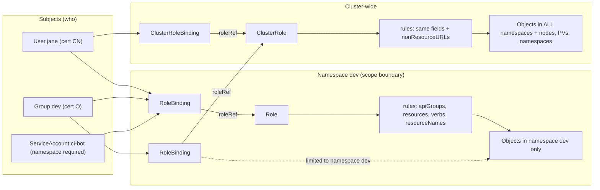

# T4.06 Manage role based access control (RBAC)

> Competency: "Manage role based access control (RBAC)" (CKA-4.1) | Domain/weight: CKA - Cluster Architecture, Installation and Configuration (25%) | Est. time: 3 h | Prerequisites: T3.16, T1.12

Prerequisite lessons (read them first if a term is new):

- [T3.16 Understand authentication, authorization and admission control](../part3-ckad/T3.16-understand-authentication-authorization-and-admission-control.md) - the three gates every API request passes, and where RBAC sits.
- [T1.12 TLS, PKI and openssl for Kubernetes](../part1-linux/T1.12-tls-pki-and-openssl-for-kubernetes.md) - what a CA, a client certificate, `CN` and `O` are, and how to read them with `openssl`.
- Related: [T3.15 Understand ServiceAccounts](../part3-ckad/T3.15-understand-serviceaccounts.md) - the identity a Pod uses. This lesson covers the permission side of a ServiceAccount.

Shell setup (put this at the top of every terminal; from `00-conventions.md`):

```bash
alias k=kubectl
export do="--dry-run=client -o yaml"
export now="--force --grace-period=0"
source <(kubectl completion bash); complete -o default -F __start_kubectl k
```

How the outputs in this lesson were produced: they were captured on a kind v0.33.0 cluster with node image `kindest/node:v1.37.0` (1 control plane + 2 workers, kubectl client v1.37.1, server v1.37.0). That cluster used kind's default CNI instead of Calico, which does not matter for RBAC. Blocks are labelled `REAL OUTPUT (kind v0.33.0, v1.37.0)`. In that run the kubeconfig cluster entry was called `kind-k-t406`. In the standard lab it is `kind-lab`, and on kubeadm it is usually `kubernetes`. Pod name suffixes, timestamps and hashes will differ on your cluster.

---

## 1. Why this matters

RBAC (Role-Based Access Control) is the part of the API server that decides who may do what. If you grant too little, a CI job or a developer gets `Forbidden` and cannot work. If you grant too much (the classic `cluster-admin` for everyone), one leaked token or one typo can delete the whole cluster. In CKA tasks you are asked to create users, roles and bindings with least privilege, then prove the result with `kubectl auth can-i`. The commands are short, but a wrong `apiGroup`, a singular resource name or a missing namespace on a ServiceAccount silently gives the wrong permissions, so you must know the failure modes.

## 2. Concepts

### 2.1 The problem RBAC solves, and where it runs

Every request to the API server passes three gates in order: **authentication** (who are you?), **authorization** (are you allowed to do this?), then **admission** (is the object acceptable?). RBAC is one authorization module. It answers one question: "Does this user, or one of this user's groups, hold a rule that allows this verb on this resource in this namespace?" (Gate details: [T3.16](../part3-ckad/T3.16-understand-authentication-authorization-and-admission-control.md).)

The API server starts with a list of authorization modes. Check them on your cluster:

```bash
k -n kube-system get pod kube-apiserver-<control-plane-node-name> -o yaml | grep authorization-mode
```

```text
REAL OUTPUT (kind v0.33.0, v1.37.0)
    - --authorization-mode=Node,RBAC
```

`Node,RBAC` is the kubeadm default. The modes are asked in order, and the first one that says "allow" wins. If none allows, the request is denied.

**Under the hood.** RBAC has these properties. Remember each of them, because the exam traps come from them.

- **Additive only.** There is no "deny" rule in RBAC. Permissions are the union of every rule in every binding that matches the caller. To remove access you delete or narrow a binding or role.
- **Default deny.** A new user with a valid certificate has no permissions at all, except the small set every authenticated user gets (see `auth can-i --list` below).
- **Users are not objects.** Kubernetes has no `User` API object. A user is just a name (and groups) that the authenticator extracts from a credential, for example the `CN` (common name) and `O` (organization) fields of a client certificate. RBAC compares names as plain strings.
- **No certificate revocation.** If you delete a user's bindings, the user still authenticates, but has no permissions. The certificate itself stays valid until it expires. Keep client certificates short-lived.

### 2.2 The four objects

| Object | Scope | What it holds |
|---|---|---|
| `Role` | One namespace | A list of permission rules for resources in that namespace |
| `ClusterRole` | Whole cluster | Rules that can cover cluster-scoped resources (nodes, PVs, namespaces), non-resource URLs (`/healthz`), or the same rules as a Role but reusable in any namespace |
| `RoleBinding` | One namespace | Connects subjects to a Role or ClusterRole, and grants it **only inside the binding's namespace** |
| `ClusterRoleBinding` | Whole cluster | Connects subjects to a ClusterRole in **every namespace** and for cluster-scoped resources |

A Role says what is allowed. A binding says who gets it. A Role on its own gives nobody anything.

**Which combination do I need?** (all four checked on the lab cluster)

| Goal | Role object | Binding object |
|---|---|---|
| Permissions in one namespace | Role | RoleBinding (`--role`) |
| The same rules reused in many namespaces, one definition | ClusterRole | One RoleBinding per namespace (`--clusterrole`) |
| Permissions in all namespaces (including `-A` listing) | ClusterRole | ClusterRoleBinding |
| Cluster-scoped resources (nodes, PVs, namespaces, CSRs) | ClusterRole | ClusterRoleBinding |

A RoleBinding that points to a ClusterRole is the "namespaced reuse" pattern. The ClusterRole is a template. The RoleBinding limits it to its own namespace. Proof from the lab cluster:

```bash
k create clusterrole pod-reader --verb=get,list --resource=pods
k create rolebinding pr -n lab-t406 --clusterrole=pod-reader --user=bob
k auth can-i list pods --as=bob -n lab-t406
k auth can-i list pods --as=bob -n default
k auth can-i list pods --as=bob --all-namespaces
k create clusterrolebinding pr-all --clusterrole=pod-reader --user=bob
k auth can-i list pods --as=bob -n default
k auth can-i list pods --as=bob -A
```

```text
REAL OUTPUT (kind v0.33.0, v1.37.0)
clusterrole.rbac.authorization.k8s.io/pod-reader created
rolebinding.rbac.authorization.k8s.io/pr created
yes
no
no
clusterrolebinding.rbac.authorization.k8s.io/pr-all created
yes
yes
```

The first three answers are `yes`, `no`, `no`: the RoleBinding works in `lab-t406` only, so `default` and "all namespaces" are denied. After the ClusterRoleBinding, both are `yes`.

A RoleBinding cannot grant cluster-scoped resources. A node is not in any namespace, so a RoleBinding to a ClusterRole that lists `nodes` does nothing for nodes. Use a ClusterRoleBinding.

### 2.3 Rules: apiGroups, resources, subresources, verbs, resourceNames

A rule is a block with up to five fields. A request is allowed by a rule only if **every** field matches.

```yaml
rules:
- apiGroups: [""]              # which API group(s)
  resources: ["pods"]          # which resource type(s), plural lower-case
  resourceNames: ["web"]       # optional: only these object names
  verbs: ["get", "list"]       # which actions
```

**apiGroups.** Resources belong to API groups. The core group has the empty name, written `""`. Everything else has a name. You find the group from the `APIVERSION` column of `k api-resources`: the part before the `/`. For example `apps/v1` means group `apps`; plain `v1` means the core group `""`.

| Group | Examples |
|---|---|
| `""` (core) | pods, services, configmaps, secrets, serviceaccounts, nodes, namespaces, persistentvolumeclaims, persistentvolumes, events |
| `apps` | deployments, replicasets, statefulsets, daemonsets |
| `batch` | jobs, cronjobs |
| `networking.k8s.io` | ingresses, networkpolicies |
| `rbac.authorization.k8s.io` | roles, rolebindings, clusterroles, clusterrolebindings |
| `storage.k8s.io` | storageclasses |
| `autoscaling` | horizontalpodautoscalers |
| `*` | every group (risky) |

A rule with the wrong group does not match, and nothing warns you. `apiGroups: [""]` with `resources: ["deployments"]` is accepted by the API and never matches a Deployment (see section 6).

**resources.** Use the **plural, lower-case** resource name: `pods`, `deployments`, `ingresses`. Not `pod`, not `Deployment`. In YAML the API server does not check the name against real resources, so a typo is accepted and silently useless. `*` means all resources (risky).

**Subresources.** Some actions are separate sub-paths of a resource. You write them as `resource/subresource`. A rule on `pods` does **not** cover `pods/log`.

| Subresource | What it is | Verb you need |
|---|---|---|
| `pods/log` | `kubectl logs` | `get` |
| `pods/exec` | `kubectl exec` | `create` |
| `pods/portforward` | `kubectl port-forward` | `create` |
| `pods/status` | status updates by controllers | `get`, `update`, `patch` |
| `deployments/scale` (group `apps`) | `kubectl scale`, HPA | `get`, `update`, `patch` |
| `serviceaccounts/token` | `kubectl create token` | `create` |

On the lab cluster, a user with `get` on `pods` and `pods/log` could read logs but not exec:

```text
REAL OUTPUT (kind v0.33.0, v1.37.0)
$ k --context=jane exec web-69c6f74b8b-7q57p -- ls
error: unable to upgrade connection: pods "web-69c6f74b8b-7q57p" is forbidden: User "jane" cannot create resource "pods/exec" in API group "" in the namespace "lab-t406"
```

**verbs.** The verb is derived from the HTTP request:

| kubectl action | HTTP | RBAC verb |
|---|---|---|
| `get pod web` | GET one object | `get` |
| `get pods` | GET a collection | `list` |
| `get pods -w`, or a controller watching | GET with `watch=true` | `watch` |
| `create`, `run` | POST | `create` |
| `replace`, `scale` | PUT | `update` |
| `patch`, `label`, `annotate`, `rollout restart` | PATCH | `patch` |
| `delete pod web` | DELETE one | `delete` |
| `delete pods --all` | DELETE collection | `deletecollection` |

Warning: `list` and `watch` return the full objects. A user with `list` on `secrets` can read every secret in the namespace, even without `get`. Treat `list secrets` as `get secrets`.

Special verbs you meet in this lesson: `bind` and `escalate` (section 2.9), `impersonate` (act as another user), `approve` and `sign` (on CSRs and signers). `*` means all verbs. A typo such as `gett` is accepted by the imperative command with only a warning (`Warning: 'gett' is not a standard resource verb`, captured on the lab cluster) and then matches nothing.

**resourceNames.** Limits a rule to named objects, for example one ConfigMap. It works for `get`, `update`, `patch` and `delete`. Two limits:

- You cannot restrict `create` or `deletecollection` by name, because the name is unknown when `create` is authorized (the RBAC docs state this).
- `list` and `watch` are restricted only if the client uses a `metadata.name` field selector. Plain `k get pods` is a `list` with no selector, so it is denied. Proof:

```bash
k create role web-only -n lab-t406 --verb=get,update --resource=pods --resource-name=web
k create rolebinding web-only-bo -n lab-t406 --role=web-only --user=bo
k auth can-i get pods/web --as=bo -n lab-t406      # pod named web
k auth can-i get pods/other --as=bo -n lab-t406    # pod named other
k auth can-i list pods --as=bo -n lab-t406         # list has no name
```

```text
REAL OUTPUT (kind v0.33.0, v1.37.0)
yes
no
no
```

Note that in `can-i`, `pods/web` means "the pod named web", not a subresource. See section 2.8.

**Non-resource URLs.** ClusterRoles (only) can also allow plain URLs such as `/healthz` or `/metrics`, with the field `nonResourceURLs`. Imperative: `k create clusterrole nr --verb=get --non-resource-url=/healthz`. That generates `nonResourceURLs: [/healthz]` with `verbs: [get]` (captured).

### 2.4 Subjects: User, Group, ServiceAccount

A binding lists subjects, the identities that receive the role.

| Kind | `apiGroup` | `namespace` | Where the name comes from |
|---|---|---|---|
| `User` | `rbac.authorization.k8s.io` | not used | Certificate `CN`, token claim, or `--as` |
| `Group` | `rbac.authorization.k8s.io` | not used | Certificate `O` (one per organization), group claim, or `--as-group` |
| `ServiceAccount` | leave it out (default is empty) | **required** | The ServiceAccount object |

A ServiceAccount is a namespaced object. Its username is `system:serviceaccount:<namespace>:<name>` and it belongs to the groups `system:serviceaccounts` and `system:serviceaccounts:<namespace>`. Captured from a real token:

```text
REAL OUTPUT (kind v0.33.0, v1.37.0)
$ k --context=ci auth whoami
ATTRIBUTE                                           VALUE
Username                                            system:serviceaccount:lab-t406:ci-bot
UID                                                 fe174da9-509e-4193-9f38-242c2202d77a
Groups                                              [system:serviceaccounts system:serviceaccounts:lab-t406 system:authenticated]
Extra: authentication.kubernetes.io/credential-id   [JTI=1122f334-2c19-4714-86dc-3b0f498ac2f7]
```

**Why the namespace matters.** Two namespaces can both have a ServiceAccount called `app`. The binding must say which one. The ClusterRoleBinding object rejects a ServiceAccount subject without a namespace:

```text
REAL OUTPUT (kind v0.33.0, v1.37.0)
The ClusterRoleBinding "sa-nons" is invalid: subjects[0].namespace: Required value
```

A RoleBinding accepts it. On v1.37.0 I observed that the API server then treats the missing namespace as "the namespace of the RoleBinding". That works by accident if the ServiceAccount lives in the same namespace as the binding, and fails silently if it lives in another one (section 6). Always write the namespace.

Every authenticated caller is also in the group `system:authenticated`. Names starting with `system:` are reserved for Kubernetes itself. Do not create your own users or groups with that prefix.

**Group via certificate.** A client certificate with subject `/CN=jane/O=dev` authenticates as user `jane` in group `dev`. Binding the **group** `dev` is the easiest way to give a team the same rights: add or remove people by issuing certificates with or without `O=dev`.

### 2.5 Default ClusterRoles: cluster-admin, admin, edit, view

Kubernetes creates user-facing ClusterRoles at startup. You bind them with a RoleBinding or ClusterRoleBinding. You almost never write a copy.

| ClusterRole | Intended use | Can read Secrets | Can edit Roles/RoleBindings | Notes |
|---|---|---|---|---|
| `cluster-admin` | Superuser | yes | yes | Rule `*.*` with verb `*` plus non-resource URL `*`. Bound by the default ClusterRoleBinding `cluster-admin` to group `system:masters` |
| `admin` | Namespace administrator (use with a RoleBinding) | yes | **yes** (roles, rolebindings) | Cannot change ResourceQuotas or the Namespace itself, read only |
| `edit` | Read and write most objects in a namespace | yes | **no** | Can read/write Secrets, run `exec`, and `impersonate` ServiceAccounts, so it is not "safe" |
| `view` | Read only | **no** | no | Cannot see Secrets or Roles |

All of this was checked on the v1.37.0 cluster. These are the lines worth knowing:

```bash
k get clusterrole cluster-admin admin edit view
k describe clusterrole cluster-admin
k describe clusterrole admin | grep -E "rolebindings|roles|localsubject|resourcequotas|namespaces|secrets"
```

```text
REAL OUTPUT (kind v0.33.0, v1.37.0), grep-filtered where noted
NAME            CREATED AT
cluster-admin   2026-10-28T05:47:41Z
admin           2026-10-28T05:47:41Z
edit            2026-10-28T05:47:41Z
view            2026-10-28T05:47:41Z

Name:         cluster-admin
Labels:       kubernetes.io/bootstrapping=rbac-defaults
Annotations:  rbac.authorization.kubernetes.io/autoupdate: true
PolicyRule:
  Resources  Non-Resource URLs  Resource Names  Verbs
  ---------  -----------------  --------------  -----
  *.*        []                 []              [*]
             [*]                []              [*]

(admin, filtered with grep)
  rolebindings.rbac.authorization.k8s.io          []                 []              [create delete deletecollection get list patch update watch]
  roles.rbac.authorization.k8s.io                 []                 []              [create delete deletecollection get list patch update watch]
  localsubjectaccessreviews.authorization.k8s.io  []                 []              [create]
  secrets                                         []                 []              [get list watch create delete deletecollection patch update]
  namespaces/status                               []                 []              [get list watch]
  namespaces                                      []                 []              [get list watch]
  serviceaccounts                                 []                 []              [impersonate create delete deletecollection patch update get list watch]
```

`edit` on v1.37.0 (trimmed with `...`; the full list is about 70 lines):

```text
REAL OUTPUT (kind v0.33.0, v1.37.0)
Name:         edit
Labels:       kubernetes.io/bootstrapping=rbac-defaults
              rbac.authorization.k8s.io/aggregate-to-admin=true
...
  pods                                         []   []   [create delete deletecollection patch update get list watch]
  deployments.apps/scale                       []   []   [create delete deletecollection patch update get list watch]
  deployments.apps                             []   []   [create delete deletecollection patch update get list watch]
  resourceclaims.resource.k8s.io               []   []   [create delete deletecollection patch update get list watch]
  pods/exec                                    []   []   [get list watch create delete deletecollection patch update]
  secrets                                      []   []   [get list watch create delete deletecollection patch update]
  pods/log                                     []   []   [get list watch]
  serviceaccounts                              []   []   [impersonate create delete deletecollection patch update get list watch]
```

Things the output shows that you should remember: `edit` has no `roles` or `rolebindings` rows. It does include `pods/exec`, `secrets` (read and write) and `serviceaccounts` with `impersonate`. The `view` ClusterRole has no `secrets` and no `roles` rows. Rules for the legacy `extensions` group and for `resource.k8s.io` (dynamic resource allocation) are also in `edit`/`view` on this version.

There are other built-in roles for system components, for example `system:node`, `system:basic-user` and `system:discovery`. Leave them alone.

### 2.6 Aggregated ClusterRoles (aggregate-to-* labels)

An **aggregated ClusterRole** has no rules of its own. It has an `aggregationRule` with label selectors. A controller in `kube-controller-manager` copies in the rules of every ClusterRole that matches. Add a new ClusterRole with the right label, and the aggregated role grows by itself.

This is how the built-ins are chained. Captured:

```bash
k get clusterrole admin edit view -o jsonpath='{range .items[*]}{.metadata.name}{" labels="}{.metadata.labels}{" agg="}{.aggregationRule}{"\n"}{end}'
```

```text
REAL OUTPUT (kind v0.33.0, v1.37.0)
admin labels={"kubernetes.io/bootstrapping":"rbac-defaults"} agg={"clusterRoleSelectors":[{"matchLabels":{"rbac.authorization.k8s.io/aggregate-to-admin":"true"}}]}
edit labels={"kubernetes.io/bootstrapping":"rbac-defaults","rbac.authorization.k8s.io/aggregate-to-admin":"true"} agg={"clusterRoleSelectors":[{"matchLabels":{"rbac.authorization.k8s.io/aggregate-to-edit":"true"}}]}
view labels={"kubernetes.io/bootstrapping":"rbac-defaults","rbac.authorization.k8s.io/aggregate-to-edit":"true"} agg={"clusterRoleSelectors":[{"matchLabels":{"rbac.authorization.k8s.io/aggregate-to-view":"true"}}]}
```

Read it like this: `view` is aggregated from every ClusterRole labelled `aggregate-to-view=true`. `view` itself carries the label `aggregate-to-edit=true`, so `edit` includes everything `view` has. `edit` carries `aggregate-to-admin=true`, so `admin` includes everything `edit` has. The chain is view, then edit, then admin.

This is the standard way to make `view`/`edit`/`admin` cover a CRD (see [T4.08](../part4-cka/T4.08-understand-crds-install-and-configure-operators.md)). Example: give every `view` user read access to Roles and RoleBindings.

```bash
k auth can-i list roles --as=bob -n lab-t406      # bob has the view ClusterRole here
k apply -f agg.yaml                                 # the ClusterRole below
k auth can-i list roles --as=bob -n lab-t406
```

```yaml
# agg.yaml
apiVersion: rbac.authorization.k8s.io/v1
kind: ClusterRole
metadata:
  name: view-roles
  labels:
    rbac.authorization.k8s.io/aggregate-to-view: "true"   # selected by the view ClusterRole
rules:
- apiGroups: ["rbac.authorization.k8s.io"]
  resources: ["roles", "rolebindings"]
  verbs: ["get", "list", "watch"]
```

```text
REAL OUTPUT (kind v0.33.0, v1.37.0)
no
clusterrole.rbac.authorization.k8s.io/view-roles created
yes
```

The second answer flipped from `no` to `yes` within about two seconds, with no change to `view` or to Bob's binding. To create your own aggregated role imperatively: `k create clusterrole agg --aggregation-rule="rbac.authorization.k8s.io/aggregate-to-foo=true"`. It generates an `aggregationRule` with that selector and `rules: null` (captured). Warning: do not put `rules` in an aggregated role by hand. The controller overwrites them.

### 2.7 Creating a user end to end

Kubernetes does not create users. You give someone a client certificate signed by the cluster CA, then bind that name. Steps (certificate theory is in [T1.12](../part1-linux/T1.12-tls-pki-and-openssl-for-kubernetes.md)):

1. Make a private key and a certificate signing request (CSR) whose subject is `/CN=<user>/O=<group>`.
2. Submit a `CertificateSigningRequest` object to the API with `signerName: kubernetes.io/kube-apiserver-client` and `usages: ["client auth"]`.
3. An admin approves it with `k certificate approve`. The cluster signs it.
4. Fetch the signed certificate from `.status.certificate` (base64) and decode it.
5. Add credentials and a context to a kubeconfig.
6. Create a Role and RoleBinding. Without them the user can log in and do nothing.

The CSR object fields: `request` is the base64 of the PEM CSR (one line, no wraps). `signerName` for client certificates is `kubernetes.io/kube-apiserver-client`. `usages` must contain `client auth`. `expirationSeconds` is optional; the signer can shorten it; per the CSR docs the minimum is 600 seconds (see section 11). Docs page: <https://kubernetes.io/docs/reference/access-authn-authz/certificate-signing-requests/#normal-user>.

The full run is in section 5. In short:

```bash
openssl genrsa -out jane.key 2048
openssl req -new -key jane.key -subj "/CN=jane/O=dev" -out jane.csr
# write jane-csr.yaml (YAML in section 4), then:
k apply -f jane-csr.yaml
k certificate approve jane
k get csr jane -o jsonpath='{.status.certificate}' | base64 -d > jane.crt
k config set-credentials jane --client-certificate=jane.crt --client-key=jane.key --embed-certs=true
k config set-context jane --cluster=kubernetes --user=jane      # use YOUR cluster name
```

`--cluster` must be the name that is already in the kubeconfig. Find it with `k config get-clusters`. `--embed-certs=true` puts the certificate data inside the kubeconfig so the file is self-contained and can be copied.

### 2.8 Imperative creation and `kubectl auth can-i`

You create RBAC objects with these commands:

| Command | Flags |
|---|---|
| `k create role NAME` | `--verb=a,b` `--resource=pods,pods/log,deployments.apps/scale` `--resource-name=web` (repeat for more names) |
| `k create clusterrole NAME` | same as role, plus `--non-resource-url=/healthz` and `--aggregation-rule=...` |
| `k create rolebinding NAME` | `--role=R` or `--clusterrole=CR`, plus `--user=`, `--group=`, `--serviceaccount=NS:NAME` (repeatable) |
| `k create clusterrolebinding NAME` | `--clusterrole=CR`, plus `--user=`, `--group=`, `--serviceaccount=NS:NAME` |

Details checked on v1.37.0:

- `--resource=deployments.apps/scale` means resource `deployments`, subresource `scale`, group `apps`. The command writes `apiGroups: [apps]` and `resources: [deployments/scale]` (captured).
- Imperative `--resource=deployment` (singular) is **resolved by kubectl** to `apps` / `deployments`. It works, which hides the mistake you can make in YAML.
- `--resource=foo` fails: `the server doesn't have a resource type "foo"`.
- `--serviceaccount` needs `namespace:name`. A bare name fails: `error: serviceaccount must be <namespace>:<name>`.
- All verbs of one imperative command are applied to all resources of that command. To give different verbs to different resources, run `k create role ... $do` for the first, then edit the YAML or use YAML directly.

`kubectl auth can-i` asks the API server "would this request be allowed?" by sending a `SelfSubjectAccessReview`. It prints `yes` or `no` and exits with code 0 or 1.

```bash
k auth can-i VERB RESOURCE [-n NS] [--as USER] [--as-group GROUP] [--subresource SUB] [--list] [-A] [-q]
```

| Flag | Meaning |
|---|---|
| `--as=NAME` | Test as that user. Needs the `impersonate` permission, which cluster-admin has |
| `--as-group=G` | Add a group. It requires `--as`; alone it fails: `error: requesting uid, groups or user-extra for kind-k-t406 without impersonating a user` |
| `-n NS` | The namespace to test in (default: the context's namespace) |
| `--subresource=log` | Test a subresource like `pods/log` |
| `--list` | Show all rules that apply to the caller in that namespace |
| `-A`, `--all-namespaces` | Test across all namespaces (needs a ClusterRoleBinding to be `yes`) |
| `-q` | No output, only the exit code |

**Trap: the slash form means "object name".** In `k auth can-i get pods/log`, kubectl reads `pods/log` as "pod named log". It answers for an object, not the subresource. Use `--subresource`. Captured for a user whose Role allows `get pods`, `get pods/log`, and `get/update/patch deployments/scale`:

```bash
k auth can-i get pods --subresource=log --as=jane -n lab-t406
k auth can-i get pods --subresource=exec --as=jane -n lab-t406
k auth can-i create pods --subresource=exec --as=jane -n lab-t406
k auth can-i update deployments --subresource=scale --as=jane -n lab-t406
k auth can-i update deployments --as=jane -n lab-t406
k auth can-i get pods/log --as=jane -n lab-t406     # WRONG way: "pod named log"
```

```text
REAL OUTPUT (kind v0.33.0, v1.37.0)
yes
no
no
yes
no
yes
```

The last answer is `yes` only because the user can `get` pods. That tests a pod called `log`. Always use `--subresource`.

**Trap: `--as=jane` is only the user.** It does not include groups from a certificate. If Jane gets her rights through group `dev`, then `k auth can-i ... --as=jane` says `no`, while her real kubeconfig works. Test both, using `--as=jane --as-group=dev`.

`--list` shows every rule that applies:

```bash
k auth can-i --list --as=jane -n lab-t406
```

```text
REAL OUTPUT (kind v0.33.0, v1.37.0), role pod-ops bound to jane (filtered to hide the non-resource URL rows)
Resources                                       Non-Resource URLs   Resource Names   Verbs
selfsubjectreviews.authentication.k8s.io        []                  []               [create]
selfsubjectaccessreviews.authorization.k8s.io   []                  []               [create]
selfsubjectrulesreviews.authorization.k8s.io    []                  []               [create]
pods                                            []                  []               [get list watch]
deployments.apps                                []                  []               [get list]
deployments.apps/scale                          []                  []               [get update patch]
pods/log                                        []                  []               [get]
```

The first three rows (and the `/healthz`, `/version`, ... non-resource rows that I filtered out) come from default bindings for every authenticated user, such as `system:basic-user` and `system:discovery`.

**Warning for ServiceAccounts.** Test them with the full username: `--as=system:serviceaccount:<ns>:<name>`. Testing with the wrong namespace gives `no` (captured: `ci-bot` in `lab-t406` is `yes`, in `default` is `no`).

### 2.9 Reconcile, immutability, and escalation protection

**`kubectl auth reconcile -f rbac.yaml`.** `k apply` can update a Role, but it cannot change a binding's `roleRef`. `reconcile` creates missing objects, adds missing rules and subjects, and prints what it changed. By default it only adds. With `--remove-extra-subjects` and `--remove-extra-permissions` it also removes. You do not often need it in the exam; know it exists. Captured, with a file that binds `bob` and `carol`, then a file that only lists `bob`:

```text
REAL OUTPUT (kind v0.33.0, v1.37.0)
$ k auth reconcile -f rbac.yaml
role.rbac.authorization.k8s.io/rec reconciled
	reconciliation required create
	missing rules added:
		{Verbs:[get] APIGroups:[] Resources:[pods] ResourceNames:[] NonResourceURLs:[]}
rolebinding.rbac.authorization.k8s.io/rec reconciled
	reconciliation required create
	missing subjects added:
		{Kind:User APIGroup:rbac.authorization.k8s.io Name:bob Namespace:}
		{Kind:User APIGroup:rbac.authorization.k8s.io Name:carol Namespace:}
(file edited: carol removed, verb list added)
$ k auth reconcile -f rbac.yaml
role.rbac.authorization.k8s.io/rec reconciled
	reconciliation required update
	missing rules added:
		{Verbs:[list] APIGroups:[] Resources:[pods] ResourceNames:[] NonResourceURLs:[]}
rolebinding.rbac.authorization.k8s.io/rec reconciled
(carol is still bound: default reconcile only adds)
$ k auth reconcile -f rbac.yaml --remove-extra-subjects --remove-extra-permissions --dry-run=client
role.rbac.authorization.k8s.io/rec reconciled (dry run)
rolebinding.rbac.authorization.k8s.io/rec reconciled (dry run)
	reconciliation required update
	extra subjects removed:
		{Kind:User APIGroup:rbac.authorization.k8s.io Name:carol Namespace:}
```

**roleRef is immutable.** A binding's `roleRef` (the Role or ClusterRole it points to) cannot be changed after creation. Reason: changing the role would silently change what existing subjects can do, and permission to update the binding is not the same as permission to hand out a different role. To change it, delete the binding and create it again. Captured:

```text
REAL OUTPUT (kind v0.33.0, v1.37.0)
$ k apply -f sa-cross2.yaml           # same name, different roleRef
The RoleBinding "app-pods" is invalid: roleRef: Invalid value: {"APIGroup":"rbac.authorization.k8s.io","Kind":"ClusterRole","Name":"view"}: field is immutable
$ k patch rolebinding app-pods -n lab-t406 --type=json -p='[{"op":"replace","path":"/roleRef/name","value":"view"}]'
The RoleBinding "app-pods" is invalid: roleRef: Invalid value: {"APIGroup":"rbac.authorization.k8s.io","Kind":"Role","Name":"view"}: field is immutable
$ k delete rolebinding app-pods -n lab-t406
rolebinding.rbac.authorization.k8s.io "app-pods" deleted from lab-t406 namespace
```

(You may also see the older wording `cannot change roleRef`. The meaning is the same.) You can change the `subjects` of a binding freely.

**Escalation protection.** RBAC stops you from giving away more than you hold. A user can create or update a Role only if the user already has every permission in it (or holds the `escalate` verb on `roles`/`clusterroles`). A user can create a binding only if the user already has the permissions of the referenced role (or holds the `bind` verb on that role). Without this rule, anyone who can create RoleBindings could bind themselves to `cluster-admin`. Captured: Bob may create `roles` and `rolebindings` in `lab-t406`, plus `get/list pods`:

```text
REAL OUTPUT (kind v0.33.0, v1.37.0)
$ k --as=bob create role ok -n lab-t406 --verb=get --resource=pods
role.rbac.authorization.k8s.io/ok created
$ k --as=bob create role grab -n lab-t406 --verb=delete --resource=secrets
Error from server (Forbidden): roles.rbac.authorization.k8s.io "grab" is forbidden: user "bob" (groups=["system:authenticated"]) is attempting to grant RBAC permissions not currently held:
{APIGroups:[""], Resources:["secrets"], Verbs:["delete"]}
$ k --as=bob create rolebinding grab -n lab-t406 --clusterrole=edit --user=bob
error: failed to create rolebinding: rolebindings.rbac.authorization.k8s.io "grab" is forbidden: user "bob" (groups=["system:authenticated"]) is attempting to grant RBAC permissions not currently held:
{APIGroups:[""], Resources:["bindings"], Verbs:["get" "list" "watch"]}
{APIGroups:[""], Resources:["configmaps"], Verbs:["create" "delete" "deletecollection" "patch" "update" "get" "list" "watch"]}
...  (about 70 more lines: every rule of the edit ClusterRole that Bob lacks)
```

Then the `bind` verb was granted on exactly one ClusterRole:

```bash
k create role binder -n lab-t406 --verb=bind --resource=clusterroles --resource-name=edit
```

(In that command, `bind` is a verb on the **resource** `clusterroles`, with the name `edit` restricting it to that role. Remember the group in YAML is `rbac.authorization.k8s.io`.) After it was bound to Bob, `k --as=bob create rolebinding grab -n lab-t406 --clusterrole=edit --user=bob` succeeded, and Bob could delete pods. So `bind` and `escalate` are powerful. Never give them in a normal role.

**Related but different.** `impersonate` lets you act as someone else (this is what `--as` uses). `escalate` lets you write roles with more permissions than you hold. `bind` lets you attach roles you do not hold. All three are privilege-escalation paths.

### 2.10 Node authorizer and `system:nodes` (awareness)

The first authorization mode is `Node`. It is a special-purpose authorizer for kubelets. A kubelet authenticates with a client certificate whose subject is `CN=system:node:<nodeName>`, `O=system:nodes`. Captured from a worker node container:

```bash
docker exec k-t406-worker openssl x509 -in /var/lib/kubelet/pki/kubelet-client-current.pem -noout -subject
```

```text
REAL OUTPUT (kind v0.33.0, v1.37.0)
subject=O=system:nodes, CN=system:node:k-t406-worker
```

The Node authorizer lets a kubelet read only what it needs: Secrets and ConfigMaps referenced by Pods **scheduled on that node**, its own Node object, and so on. RBAC would be too coarse, because it cannot say "only objects related to my Pods". The `NodeRestriction` admission plugin (enabled in the same API server, `--enable-admission-plugins=NodeRestriction`) additionally limits what a kubelet may write. Captured by impersonating the kubelet identity:

```bash
k auth can-i get secrets --as=system:node:k-t406-worker --as-group=system:nodes -n kube-system
k auth can-i get nodes --as=system:node:k-t406-worker --as-group=system:nodes
k auth can-i list pods --as=system:node:k-t406-worker --as-group=system:nodes -A
k auth can-i create deployments --as=system:node:k-t406-worker --as-group=system:nodes -n lab-t406
k get clusterrolebinding system:node -o wide
```

```text
REAL OUTPUT (kind v0.33.0, v1.37.0)
no - node: No Object name found
Warning: resource 'nodes' is not namespace scoped

no - node: node 'k-t406-worker' cannot read all nodes, only its own Node object
no - node: can only list/watch pods with spec.nodeName field selector
no
NAME          ROLE                      AGE    USERS   GROUPS   SERVICEACCOUNTS
system:node   ClusterRole/system:node   4m2s
```

The binding `system:node` exists but has no subjects. The Node authorizer, not RBAC, does the work for kubelets. Do not add RBAC rules for `system:nodes` to "fix" a kubelet. (Exam relevance: when a node-related request is denied with a message beginning `node:`, it comes from this authorizer.)

### 2.11 Auditing who has access

To find every binding that mentions a name, list both binding kinds across all namespaces and grep. `-o wide` adds the `USERS`, `GROUPS` and `SERVICEACCOUNTS` columns:

```bash
k get rolebindings,clusterrolebindings -A -o wide | grep -E "^NAMESPACE|bob|jane"
```

```text
REAL OUTPUT (kind v0.33.0, v1.37.0), lines cut to fit
NAMESPACE   NAME                                          ROLE                    AGE   USERS   GROUPS   SERVICEACCOUNTS
lab-t406    rolebinding.rbac.authorization.k8s.io/pr      ClusterRole/pod-reader  1s    bob
            clusterrolebinding.rbac.authorization.k8s.io/pr-all   ClusterRole/pod-reader  0s  bob
```

Because the `NAMESPACE` column is empty for ClusterRoleBindings, you can tell the two kinds apart by it. Also check a single subject's effective rules with `k auth can-i --list --as=NAME -n NS`. Remember to check bindings for the user's **groups** and for `system:authenticated` and `system:serviceaccounts`; grep only finds the exact string you give.

---

## 3. How it works (diagram)



Walkthrough:

1. The API server authenticates the request and produces a user name and a list of groups. Those are the **subjects** to look for.
2. It scans the bindings for any whose `subjects` list contains that user, one of those groups, or the ServiceAccount (with the right namespace). RoleBindings count only if they are in the request's namespace. ClusterRoleBindings always count.
3. Each matching binding points through `roleRef` to a Role or ClusterRole. The rules of all those roles are merged (union).
4. The request is allowed if one rule matches the API group, resource (plus subresource), verb and, if present, the object name. If no rule matches, the request is denied. There is no explicit deny.
5. The namespace box is the scope: a RoleBinding to a ClusterRole (dotted line) lets you reuse the rules, but only for objects inside that one namespace. Only a ClusterRoleBinding reaches every namespace and cluster-scoped objects.

---

## 4. Commands and YAML you must produce fast

Create a namespace for the examples first: `k create ns lab-t406`.

### 4.1 Imperative shortcuts (use these first)

```bash
# Role on pods and pods/log (get/list/watch), plus scale on deployments (apps group)
k create role pod-ops -n lab-t406 --verb=get,list,watch --resource=pods,pods/log,deployments.apps/scale
```
Creates a Role in `lab-t406`. Add `$do` to get YAML to edit instead of creating.

```bash
k create clusterrole node-reader --verb=get,list,watch --resource=nodes
k create clusterrolebinding jane-nodes --clusterrole=node-reader --user=jane
```
A cluster-scoped read-only role for nodes and its cluster-wide binding.

```bash
k create rolebinding dev-edit --clusterrole=edit --group=dev -n dev
```
Reuse the built-in `edit` ClusterRole for group `dev`, in namespace `dev` only.

```bash
k create rolebinding pod-ops-jane -n lab-t406 --role=pod-ops --user=jane
k create rolebinding pod-ops-ci   -n lab-t406 --role=pod-ops --serviceaccount=lab-t406:ci-bot
```
Bind a Role to a user, and to a ServiceAccount (`namespace:name`).

```bash
k auth can-i delete pods --as=jane -n dev
k auth can-i --list --as=jane -n lab-t406
k config set-context jane --cluster=kubernetes --user=jane
```
Prove it; list everything; add a context for the user you just made (replace `kubernetes` with the cluster name from `k config get-clusters`).

### 4.2 Declarative YAML

Role with rules on pods and pods/log plus deployments/scale. Every line is explained:

```yaml
# pod-ops.yaml  -> k apply -f pod-ops.yaml   (namespace lab-t406 must exist)
apiVersion: rbac.authorization.k8s.io/v1   # RBAC API group/version (v1 is the only served version)
kind: Role                                   # namespaced; use ClusterRole for cluster scope
metadata:
  name: pod-ops                              # referenced later by roleRef.name
  namespace: lab-t406                        # a Role lives in exactly one namespace; default is the context namespace
rules:
- apiGroups: [""]                            # "" = core group (pods are core)
  resources: ["pods"]                        # plural lower-case. "pod" would never match
  verbs: ["get", "list", "watch"]            # read only. ["*"] would be all verbs (risky)
- apiGroups: [""]                            # pods/log is also core
  resources: ["pods/log"]                    # subresource; NOT covered by "pods"
  verbs: ["get"]                             # kubectl logs needs only get
- apiGroups: ["apps"]                        # deployments are in "apps"
  resources: ["deployments"]                 # lets the user see deployments
  verbs: ["get", "list"]
- apiGroups: ["apps"]
  resources: ["deployments/scale"]           # kubectl scale uses this subresource
  verbs: ["get", "update", "patch"]          # scale reads then updates; "update" is the PUT
  # resourceNames: ["web"]                   # optional: limit to named objects (not valid for create)
```

RoleBinding to a user **and** a ServiceAccount (one object, two subjects):

```yaml
# pod-ops-binding.yaml  -> k apply -f pod-ops-binding.yaml
# Requires: the Role pod-ops and the ServiceAccount: k create sa ci-bot -n lab-t406
apiVersion: rbac.authorization.k8s.io/v1
kind: RoleBinding                            # grants only inside metadata.namespace
metadata:
  name: pod-ops-binding
  namespace: lab-t406                        # the namespace the permissions apply to
roleRef:                                     # immutable after creation. To change: delete and recreate
  apiGroup: rbac.authorization.k8s.io        # always this value
  kind: Role                                 # Role (same namespace) or ClusterRole
  name: pod-ops                              # must exist; a wrong name binds to nothing
subjects:
- kind: User
  name: jane                                 # must equal the certificate CN, exactly (case sensitive)
  apiGroup: rbac.authorization.k8s.io        # required for User and Group
- kind: ServiceAccount
  name: ci-bot
  namespace: lab-t406                        # REQUIRED for ServiceAccount. No apiGroup for this kind
```

ClusterRole plus ClusterRoleBinding for node read access:

```yaml
# node-reader.yaml  -> k apply -f node-reader.yaml
apiVersion: rbac.authorization.k8s.io/v1
kind: ClusterRole                            # no namespace field: cluster-scoped object
metadata:
  name: node-reader
rules:
- apiGroups: [""]
  resources: ["nodes"]                       # cluster-scoped resource, so a ClusterRole is needed
  verbs: ["get", "list", "watch"]
---
apiVersion: rbac.authorization.k8s.io/v1
kind: ClusterRoleBinding                     # all namespaces and cluster-scoped objects
metadata:
  name: jane-nodes
roleRef:
  apiGroup: rbac.authorization.k8s.io
  kind: ClusterRole                          # a ClusterRoleBinding can only reference a ClusterRole
  name: node-reader
subjects:
- kind: User
  name: jane
  apiGroup: rbac.authorization.k8s.io
```

RoleBinding to a built-in ClusterRole for a group (namespaced reuse):

```yaml
# dev-edit.yaml  -> k create ns dev; k apply -f dev-edit.yaml
apiVersion: rbac.authorization.k8s.io/v1
kind: RoleBinding
metadata:
  name: dev-edit
  namespace: dev                             # scope of the grant
roleRef:
  apiGroup: rbac.authorization.k8s.io
  kind: ClusterRole                          # a RoleBinding may point to a ClusterRole
  name: edit                                 # built-in aggregated ClusterRole
subjects:
- kind: Group
  name: dev                                  # matches certificate O=dev
  apiGroup: rbac.authorization.k8s.io
```

The CertificateSigningRequest from the user-creation flow:

```yaml
# jane-csr.yaml  -> k apply -f jane-csr.yaml
apiVersion: certificates.k8s.io/v1
kind: CertificateSigningRequest
metadata:
  name: jane                                  # object name only; the user name comes from the CSR subject CN
spec:
  request: <base64 of jane.csr, one line>     # base64 < jane.csr | tr -d '\n'
  signerName: kubernetes.io/kube-apiserver-client   # signer for client certs
  expirationSeconds: 86400                    # optional lifetime: 24 h (see section 11)
  usages:
  - client auth                               # required for a client certificate
```

Generate the `request:` value without hand-editing. This works on Linux and macOS:

```bash
base64 < jane.csr | tr -d '\n'
```

### 4.3 Speed drill (target about 6 minutes per exam task, so drills should be faster)

Setup (one line): `k create ns lab-t406; k run web -n lab-t406 --image=nginx:1.27` Run the drills, check each with `can-i`, then clean up with the cleanup line.

1. (60 s) Create Role `pod-reader` in `lab-t406` that allows `get,list,watch` on pods. Bind it to user `amy` with RoleBinding `pod-reader-amy`.
2. (45 s) Create ClusterRole `node-reader` (get, list, watch on nodes). Bind it to user `jane` with ClusterRoleBinding `jane-nodes`.
3. (30 s) Give group `dev` the built-in `edit` ClusterRole in `lab-t406` only. Name the binding `dev-edit`.
4. (75 s) Create ServiceAccount `ci-bot` in `lab-t406`. Create a Role `cm-writer` (get, create, delete on configmaps) and bind it to the ServiceAccount.
5. (60 s) Create Role `web-only` that allows `get` and `update` on the pod named `web` only. Bind to user `bo`. Prove that `bo` cannot `list` pods.
6. (90 s) Generate YAML (do not create) for a Role `pod-ops` with get/list/watch/update on `pods`, `pods/log` and `deployments/scale`. Inspect the apiGroups it produced.
7. (45 s) Find every binding in the cluster that mentions user `jane`.
8. (45 s) List what ServiceAccount `ci-bot` in `lab-t406` can do.

Cleanup (last line of the drill): `k delete clusterrolebinding jane-nodes; k delete clusterrole node-reader; k delete ns lab-t406`

<details>
<summary>Answers</summary>

```bash
# 1
k create role pod-reader -n lab-t406 --verb=get,list,watch --resource=pods
k create rolebinding pod-reader-amy -n lab-t406 --role=pod-reader --user=amy
k auth can-i list pods --as=amy -n lab-t406        # yes
k auth can-i delete pods --as=amy -n lab-t406      # no

# 2
k create clusterrole node-reader --verb=get,list,watch --resource=nodes
k create clusterrolebinding jane-nodes --clusterrole=node-reader --user=jane
k auth can-i list nodes --as=jane                  # yes

# 3
k create rolebinding dev-edit --clusterrole=edit --group=dev -n lab-t406
k auth can-i delete pods --as=x --as-group=dev -n lab-t406   # yes
k auth can-i delete pods --as=x --as-group=dev -n default    # no

# 4
k create sa ci-bot -n lab-t406
k create role cm-writer -n lab-t406 --verb=get,create,delete --resource=configmaps
k create rolebinding cm-writer-ci -n lab-t406 --role=cm-writer --serviceaccount=lab-t406:ci-bot
k auth can-i create configmaps --as=system:serviceaccount:lab-t406:ci-bot -n lab-t406   # yes
k auth can-i create secrets    --as=system:serviceaccount:lab-t406:ci-bot -n lab-t406   # no

# 5
k create role web-only -n lab-t406 --verb=get,update --resource=pods --resource-name=web
k create rolebinding web-only-bo -n lab-t406 --role=web-only --user=bo
k auth can-i get pods/web --as=bo -n lab-t406      # yes (object named web)
k auth can-i list pods --as=bo -n lab-t406         # no (list has no name)

# 6
k create role pod-ops -n lab-t406 --verb=get,list,watch,update --resource=pods,pods/log,deployments.apps/scale $do
# apiGroups "" for pods and pods/log, "apps" for deployments/scale

# 7
k get rolebindings,clusterrolebindings -A -o wide | grep -w jane

# 8
k auth can-i --list --as=system:serviceaccount:lab-t406:ci-bot -n lab-t406
```

All of these ran on the lab cluster with the answers shown in the comments.
</details>

---

## 5. Worked example

Goal: create user `jane` (group `dev`) with a certificate, give her read access to pods and logs, scale rights on deployments, and the same Role to a ServiceAccount. Prove allowed and denied cases. Then use the `dev` group, test the failure messages and clean up. The outputs below come from one session on the same kind cluster.

### Step 0. Look at the cluster

```bash
k version
k create ns lab-t406
k get clusterrole cluster-admin admin edit view
```

```text
REAL OUTPUT (kind v0.33.0, v1.37.0)
Client Version: v1.37.1
Kustomize Version: v5.8.1
Server Version: v1.37.0
namespace/lab-t406 created
NAME            CREATED AT
cluster-admin   2026-10-28T05:47:41Z
...
```

### Step 1. Key and CSR (T1.12 skills)

```bash
mkdir -p ~/lab/t406 && cd ~/lab/t406
openssl genrsa -out jane.key 2048
openssl req -new -key jane.key -subj "/CN=jane/O=dev" -out jane.csr
openssl req -in jane.csr -noout -subject
```

```text
REAL OUTPUT (kind v0.33.0, v1.37.0)
subject=CN=jane, O=dev
```

`CN=jane` becomes the user name. `O=dev` becomes the group.

### Step 2. Submit, approve and fetch the certificate

```bash
cat > jane-csr.yaml <<EOF
apiVersion: certificates.k8s.io/v1
kind: CertificateSigningRequest
metadata:
  name: jane
spec:
  request: $(base64 < jane.csr | tr -d '\n')
  signerName: kubernetes.io/kube-apiserver-client
  expirationSeconds: 86400
  usages:
  - client auth
EOF
k apply -f jane-csr.yaml
k get csr jane
k certificate approve jane
k get csr jane
k get csr jane -o jsonpath='{.status.certificate}' | base64 -d > jane.crt
openssl x509 -in jane.crt -noout -subject -issuer -enddate
```

```text
REAL OUTPUT (kind v0.33.0, v1.37.0)
certificatesigningrequest.certificates.k8s.io/jane created
NAME   AGE   SIGNERNAME                            REQUESTOR          REQUESTEDDURATION   CONDITION
jane   0s    kubernetes.io/kube-apiserver-client   kubernetes-admin   24h                 Pending
certificatesigningrequest.certificates.k8s.io/jane approved
NAME   AGE   SIGNERNAME                            REQUESTOR          REQUESTEDDURATION   CONDITION
jane   0s    kubernetes.io/kube-apiserver-client   kubernetes-admin   24h                 Approved,Issued
subject=O=dev, CN=jane
issuer=CN=kubernetes
notAfter=Oct 29 05:46:32 2026 GMT
```

What to look for: `Pending` first, then `Approved,Issued` (the signer is quick). The signed certificate's issuer is the cluster CA (`CN=kubernetes`). `notAfter` is one day away because of `expirationSeconds`. The subject is the same, but `openssl` may print the fields in a different order.

### Step 3. A kubeconfig that holds only Jane

```bash
CLUSTER=$(k config view --minify -o jsonpath='{.clusters[0].name}')
ADMIN_USER=$(k config view --minify -o jsonpath='{.users[0].name}')
ADMIN_CTX=$(k config current-context)
k config view --minify --flatten > jane.kubeconfig        # copy server + CA for the current cluster
export KUBECONFIG=$PWD/jane.kubeconfig
k config set-credentials jane --client-certificate=jane.crt --client-key=jane.key --embed-certs=true
k config set-context jane --cluster=$CLUSTER --user=jane --namespace=lab-t406
k config use-context jane
k config delete-context $ADMIN_CTX; k config delete-user $ADMIN_USER   # drop admin credentials from this file
k config get-contexts
k auth whoami
k get pods
unset KUBECONFIG        # back to your admin kubeconfig
```

```text
REAL OUTPUT (kind v0.33.0, v1.37.0)
User "jane" set.
Context "jane" created.
Switched to context "jane".
deleted context kind-k-t406 from .../jane.kubeconfig
deleted user kind-k-t406 from .../jane.kubeconfig
CURRENT   NAME   CLUSTER       AUTHINFO   NAMESPACE
*         jane   kind-k-t406   jane       lab-t406
ATTRIBUTE                                           VALUE
Username                                            jane
Groups                                              [dev system:authenticated]
Extra: authentication.kubernetes.io/credential-id   [X509SHA256=b0c608caa7e056afee44fe56102acb3ccee3e264a3c676a56ec671b105c5908c]
Error from server (Forbidden): pods is forbidden: User "jane" cannot list resource "pods" in API group "" in the namespace "lab-t406"
```

`k auth whoami` is the best check of which identity the API server sees: user `jane`, groups `dev` and `system:authenticated`. The Forbidden message is correct and expected: no binding yet. Read it: it names the user (`jane`), the verb (`list`), the resource (`pods`), the API group (`""`) and the namespace. Those five facts are exactly what a rule must match.

### Step 4. Role and bindings (admin kubeconfig)

Save the `pod-ops.yaml` from section 4.2, then:

```bash
k apply -f pod-ops.yaml
k create rolebinding pod-ops-jane -n lab-t406 --role=pod-ops --user=jane
k create serviceaccount ci-bot -n lab-t406
k create rolebinding pod-ops-ci -n lab-t406 --role=pod-ops --serviceaccount=lab-t406:ci-bot
k get rolebinding -n lab-t406 -o wide
k describe rolebinding pod-ops-ci -n lab-t406
k describe role pod-ops -n lab-t406
```

```text
REAL OUTPUT (kind v0.33.0, v1.37.0)
role.rbac.authorization.k8s.io/pod-ops created
rolebinding.rbac.authorization.k8s.io/pod-ops-jane created
serviceaccount/ci-bot created
rolebinding.rbac.authorization.k8s.io/pod-ops-ci created
NAME           ROLE           AGE   USERS   GROUPS   SERVICEACCOUNTS
pod-ops-ci     Role/pod-ops   0s                     lab-t406/ci-bot
pod-ops-jane   Role/pod-ops   0s    jane             
Name:         pod-ops-ci
Labels:       <none>
Annotations:  <none>
Role:
  Kind:  Role
  Name:  pod-ops
Subjects:
  Kind            Name    Namespace
  ----            ----    ---------
  ServiceAccount  ci-bot  lab-t406
Name:         pod-ops
Labels:       <none>
Annotations:  <none>
PolicyRule:
  Resources               Non-Resource URLs  Resource Names  Verbs
  ---------               -----------------  --------------  -----
  pods                    []                 []              [get list watch]
  deployments.apps        []                 []              [get list]
  deployments.apps/scale  []                 []              [get update patch]
  pods/log                []                 []              [get]
```

In `describe role`, the `Resources` column joins the resource and group: `deployments.apps/scale` is resource `deployments`, group `apps`, subresource `scale`. That is how you spot a wrong group in one glance. With `-o wide`, the `SERVICEACCOUNTS` column shows `namespace/name`. A blank namespace would show as `/ci-bot`.

### Step 5. Use it as Jane (allowed and denied)

With a Deployment `web` (`k create deployment web --image=nginx:1.27 -n lab-t406`) created by the admin:

```bash
export KUBECONFIG=$HOME/lab/t406/jane.kubeconfig
k get pods
k logs deploy/web | head -2
k delete pod -l app=web
k exec deploy/web -- ls
k scale deploy web --replicas=2
k delete deploy web
k get secrets
unset KUBECONFIG
```

```text
REAL OUTPUT (kind v0.33.0, v1.37.0), pod names differ on your cluster
NAME                   READY   STATUS    RESTARTS   AGE
web-69c6f74b8b-7q57p   1/1     Running   0          10s
/docker-entrypoint.sh: /docker-entrypoint.d/ is not empty, will attempt to perform configuration
/docker-entrypoint.sh: Looking for shell scripts in /docker-entrypoint.d/
Error from server (Forbidden): pods "web-69c6f74b8b-7q57p" is forbidden: User "jane" cannot delete resource "pods" in API group "" in the namespace "lab-t406"
error: unable to upgrade connection: pods "web-69c6f74b8b-7q57p" is forbidden: User "jane" cannot create resource "pods/exec" in API group "" in the namespace "lab-t406"
deployment.apps/web scaled
Error from server (Forbidden): deployments.apps "web" is forbidden: User "jane" cannot delete resource "deployments" in API group "apps" in the namespace "lab-t406"
Error from server (Forbidden): secrets is forbidden: User "jane" cannot list resource "secrets" in API group "" in the namespace "lab-t406"
```

(In my capture I deleted the named pod; `-l app=web` has the same effect: `delete` on `pods` is denied.) `get`, `logs` and `scale` work. `delete`, `exec` and `get secrets` are denied. The Forbidden text always names the resource in the form `resource.group` and the subresource as `pods/exec`.

### Step 6. Prove it from the admin side

Always test with `--subresource` and `-n`. For a ServiceAccount use the full name.

```bash
k auth can-i get pods --as=system:serviceaccount:lab-t406:ci-bot -n lab-t406
k auth can-i get pods --as=system:serviceaccount:lab-t406:ci-bot -n default
k auth can-i get pods --as=system:serviceaccount:default:ci-bot -n lab-t406
k auth can-i get pods --subresource=log --as=jane -n lab-t406
k auth can-i create pods --subresource=exec --as=jane -n lab-t406
```

```text
REAL OUTPUT (kind v0.33.0, v1.37.0)
yes
no
no
yes
no
```

Row 3 shows a ServiceAccount named `ci-bot` in the **other** namespace (`default`) is not covered, because the binding names `lab-t406/ci-bot`.

### Step 7. Group binding, `dev-edit`

Jane's certificate has `O=dev`, so she is in group `dev`. A binding to the group applies to her too:

```bash
k create rolebinding dev-edit --clusterrole=edit --group=dev -n lab-t406
k auth can-i delete pods --as=bob --as-group=dev -n lab-t406
k auth can-i delete pods --as=bob --as-group=dev -n default
```

```text
REAL OUTPUT (kind v0.33.0, v1.37.0)
rolebinding.rbac.authorization.k8s.io/dev-edit created
yes
no
```

I also ran `k --context=jane auth can-i --list -n lab-t406` after creating this binding. The list then contained the full `edit` rules, for example `pods [create delete deletecollection patch update get list watch]`, because Jane's certificate puts her in group `dev`, even though no binding names `jane` for those rules. This is why you must check group bindings when you audit.

### Step 8. Audit and clean up

```bash
k get rolebindings,clusterrolebindings -A -o wide | grep -E "^NAMESPACE|jane|dev"
k delete csr jane
k delete ns lab-t406
rm -rf ~/lab/t406
```

Deleting the namespace removes Roles, RoleBindings and ServiceAccounts inside it. The CSR is cluster-scoped, so delete it yourself. Jane's old certificate stays valid until it expires, but with no bindings it can do nothing.

---

## 6. Common mistakes and how to fix them

| Symptom | What you will see (exact error/event text) | Cause | Fix (command) |
|---|---|---|---|
| `can-i` says yes but the user still gets Forbidden | `$ k auth can-i list pods --as=jane -n lab-t406` prints `yes`, but with the user's kubeconfig: `Error from server (Forbidden): pods is forbidden: User "janet" cannot list resource "pods" in API group "" in the namespace "lab-t406"` | `--as=jane` tests the name you typed. The kubeconfig authenticates as a different name (here the certificate has `CN=janet`) | Run `k auth whoami` with the user's kubeconfig; read the cert: `k config view --raw -o jsonpath='{.users[0].user.client-certificate-data}' \| base64 -d \| openssl x509 -noout -subject`. Then fix the binding subject or reissue the cert |
| `cannot change roleRef` | `The RoleBinding "app-pods" is invalid: roleRef: Invalid value: {...}: field is immutable` | `roleRef` cannot be edited after creation | `k delete rolebinding NAME -n NS`, then recreate with the right role |
| ServiceAccount binding has no effect | `describe` shows a blank namespace; `k get rolebinding -o wide` shows `/app`; the pod gets `Forbidden`. A ClusterRoleBinding refuses: `subjects[0].namespace: Required value` | `subjects[].namespace` missing. The SA is in another namespace than the binding | Add `namespace`. Patch subjects (allowed): `k patch rolebinding NAME -n NS --type=json -p='[{"op":"add","path":"/subjects/0/namespace","value":"default"}]'` |
| Role created for `deployment` does nothing | No error on `k apply`. `k describe role` shows `deployment.apps`. `k get deploy --as=bob` gives `Error from server (Forbidden): deployments.apps is forbidden: User "bob" cannot list resource "deployments" in API group "apps" in the namespace "lab-t406"` | `resources` must be the plural name `deployments`. YAML is not validated against real resource names | Edit the Role to `deployments`. Check: `k auth can-i list deployments.apps --as=bob -n NS` |
| Role with wrong apiGroup | No error. `describe role` shows `deployments` without `.apps` | Used `apiGroups: [""]` for a Deployment (it is in `apps`) | Set `apiGroups: ["apps"]`. In `describe`, resource names with a group suffix such as `.apps` show the group |
| Bob cannot create a role or binding he is allowed to | `is forbidden: user "bob" (groups=["system:authenticated"]) is attempting to grant RBAC permissions not currently held:` followed by the missing rules | Escalation protection: Bob does not hold what the role grants | Give Bob those rights first, or give `bind`/`escalate` on one named role (rare) |
| `can-i --as-group` fails | `error: requesting uid, groups or user-extra for kind-k-t406 without impersonating a user` | `--as-group` needs `--as` | Add `--as=anyname` |
| `can-i` says no for a user who works | `no` for `--as=jane`, but her real kubeconfig works | Her rights come from a group (certificate `O=`), and `--as` has no group | Add `--as-group=dev` |
| `can-i get pods/log` always yes | prints `yes` even though the Role has no `pods/log` | `pods/log` is read as "pod named log" | `k auth can-i get pods --subresource=log` |

### 6.1 The repeatable troubleshooting path

For any "Forbidden" or "RBAC not working" report, run these in order. Each answers one question.

1. **Who does the API server think I am?** `k auth whoami` (with the failing kubeconfig). If the user name is not what you expect, stop: the problem is authentication or the certificate. Decode it: `openssl x509 -noout -subject`.
2. **What exactly was denied?** Read the Forbidden message: user, verb, resource, group, subresource, namespace. Copy these. Do not guess.
3. **Reproduce as admin.** `k auth can-i VERB RESOURCE --subresource=... -n NS --as=USER --as-group=GROUP`. Use the exact verb: `kubectl get pods` is `list`, `kubectl logs` is `get pods/log`, `kubectl exec` is `create pods/exec`.
4. **Which bindings name this subject?** `k get rolebindings,clusterrolebindings -A -o wide | grep -E "USER|GROUP"`. Remember to check each group of the user, and ServiceAccount namespaces.
5. **Does the roleRef point to something that exists?** `k describe rolebinding NAME -n NS` shows `Role:` Kind and Name. Then `k get role NAME -n NS` (or `k get clusterrole NAME`). A typo in a name binds to nothing.
6. **Do the rules match?** `k describe role NAME -n NS`. Compare the `Resources` column (it shows `resource.group/subresource`) to what the Forbidden message said.
7. **Scope.** A RoleBinding grants only in its own namespace. Cluster-scoped resources and `-A` need a ClusterRoleBinding.

### 6.2 Reading the singular-resource and missing-namespace failures

The singular mistake in detail (captured). Role `bad-deploy` was applied from YAML with `resources: ["deployment"]` and bound to user `bob`:

```text
REAL OUTPUT (kind v0.33.0, v1.37.0)
$ k auth can-i list deployments.apps --as=bob -n lab-t406
no
$ k auth can-i list deployment --as=bob -n lab-t406
no
$ k describe role bad-deploy -n lab-t406
...
  Resources        Non-Resource URLs  Resource Names  Verbs
  ---------        -----------------  --------------  -----
  deployment.apps  []                 []              [get list]
$ k patch role bad-deploy -n lab-t406 --type=json -p='[{"op":"replace","path":"/rules/0/resources/0","value":"deployments"}]'
role.rbac.authorization.k8s.io/bad-deploy patched
$ k auth can-i list deployments.apps --as=bob -n lab-t406
yes
```

How to read it: `deployment.apps` has the singular name, so no real request ever matches it. Both `can-i` forms say `no`, including the singular one, because the real request uses the plural. If you create the same role **imperatively** (`--resource=deployment`), kubectl turns it into the plural `deployments` for you (captured), so the mistake only shows up in hand-written YAML.

The missing namespace on a ServiceAccount in another namespace (captured). The ServiceAccount `app` is in `default`; the RoleBinding is in `lab-t406`:

```text
REAL OUTPUT (kind v0.33.0, v1.37.0)
$ k auth can-i get pods --as=system:serviceaccount:default:app -n lab-t406
no
$ k auth can-i get pods --as=system:serviceaccount:lab-t406:app -n lab-t406
yes
$ k get rolebinding app-pods -n lab-t406 -o wide
NAME       ROLE           AGE   USERS   GROUPS   SERVICEACCOUNTS
app-pods   Role/pod-ops   0s                     /app
$ k patch rolebinding app-pods -n lab-t406 --type=json -p='[{"op":"add","path":"/subjects/0/namespace","value":"default"}]'
rolebinding.rbac.authorization.k8s.io/app-pods patched
$ k auth can-i get pods --as=system:serviceaccount:default:app -n lab-t406
yes
```

The `yes` for `lab-t406:app` shows the rule that the empty namespace falls back to the RoleBinding's own namespace. The `/app` in `-o wide` is the warning sign: an empty text before the slash.

### 6.3 `can-i` yes, but real access denied

Captured with a certificate with `CN=janet`, while Role `pod-reader` is bound to user `jane`:

```text
REAL OUTPUT (kind v0.33.0, v1.37.0)
$ k auth can-i list pods --as=jane -n lab-t406
yes
$ KUBECONFIG=janet.kubeconfig k get pods
Error from server (Forbidden): pods is forbidden: User "janet" cannot list resource "pods" in API group "" in the namespace "lab-t406"
$ KUBECONFIG=janet.kubeconfig k auth whoami
ATTRIBUTE                                           VALUE
Username                                            janet
Groups                                              [system:authenticated]
...
$ k config view --raw -o jsonpath='{.users[0].user.client-certificate-data}' | base64 -d | openssl x509 -noout -subject
subject=CN=janet
```

The Forbidden text says `User "janet"`. That is the real identity. The CSR was generated with a different `CN` than the user the Role is bound to. Fix: create the binding for `janet` (or reissue the certificate with the right `CN`). Deleting the CSR object does not help; the certificate in the kubeconfig is what counts. Keep the `CN` and the binding name identical, character for character.

---

## 7. Labs

Order: Easy, then Medium, then Break-fix. Each lab starts from the baseline and returns the cluster to it, so any order works. Environment for all three: **kind** (cluster `lab`, context `kind-lab`; the CSR API works on kind). Every lab uses namespace `lab-t406`. Files go in `~/lab/t406/`. Cluster-scoped objects (CSRs, ClusterRoleBindings) are **not** removed by `env/kind-reset.sh`, so each lab's cleanup deletes them.

Commands in the labs use only `kubectl`, `openssl`, `base64` and standard shell. Whether `openssl` is installed on exam hosts is UNVERIFIED (the tools list at <https://docs.linuxfoundation.org/tc-docs/certification/tips-cka-and-ckad> names kubectl, yq, curl, wget and man). If a task gives you the key or CSR, you do not need it.

### Lab A (Easy): user jane with read-only access to one namespace

**Environment + setup**

```bash
k create ns lab-t406
k create deployment web -n lab-t406 --image=nginx:1.27
k create secret generic db-pass -n lab-t406 --from-literal=password=s3cret
mkdir -p ~/lab/t406 && cd ~/lab/t406
```

**Task.** In namespace `lab-t406`, create a new user `jane`:

1. Generate a key and CSR with subject `/CN=jane` (no group). Create a CertificateSigningRequest named `jane` (client auth, valid 24 hours), approve it and save the signed certificate.
2. Write a kubeconfig `~/lab/t406/jane.kubeconfig` that contains only Jane, with a context called `jane` whose default namespace is `lab-t406`.
3. Create Role `dev-reader` in `lab-t406` that allows `get`, `list` and `watch` on pods, pod logs, services, configmaps and deployments. Bind it to `jane` with RoleBinding `jane-dev-reader`.
4. Jane must not read Secrets, change anything, or see other namespaces.

<details>
<summary>Hint 1</summary>

Use the same flow as section 5. Keep `O` out of the subject so that Jane does not inherit permissions from a group.
</details>

<details>
<summary>Hint 2</summary>

Pod logs are the subresource `pods/log`. The group for deployments is `apps`. With `--resource=deployments.apps` kubectl writes the right group for you.
</details>

<details>
<summary>Hint 3</summary>

If the kubeconfig still has the admin user in it, you cannot tell whether a test used Jane. Use `k config view --minify --flatten` to copy cluster data, then delete the admin context and user from the new file.
</details>

<details>
<summary>Solution</summary>

```bash
cd ~/lab/t406
# 1. Key, CSR, CSR object, approve, certificate.
openssl genrsa -out jane.key 2048
openssl req -new -key jane.key -subj "/CN=jane" -out jane.csr
cat > jane-csr.yaml <<EOF
apiVersion: certificates.k8s.io/v1
kind: CertificateSigningRequest
metadata:
  name: jane
spec:
  request: $(base64 < jane.csr | tr -d '\n')
  signerName: kubernetes.io/kube-apiserver-client
  expirationSeconds: 86400
  usages:
  - client auth
EOF
k apply -f jane-csr.yaml
k certificate approve jane
k get csr jane -o jsonpath='{.status.certificate}' | base64 -d > jane.crt

# 2. Kubeconfig with only jane.
CLUSTER=$(k config view --minify -o jsonpath='{.clusters[0].name}')
ADMIN_USER=$(k config view --minify -o jsonpath='{.users[0].name}')
ADMIN_CTX=$(k config current-context)
k config view --minify --flatten > jane.kubeconfig
KUBECONFIG=jane.kubeconfig k config set-credentials jane --client-certificate=jane.crt --client-key=jane.key --embed-certs=true
KUBECONFIG=jane.kubeconfig k config set-context jane --cluster=$CLUSTER --user=jane --namespace=lab-t406
KUBECONFIG=jane.kubeconfig k config use-context jane
KUBECONFIG=jane.kubeconfig k config delete-context $ADMIN_CTX
KUBECONFIG=jane.kubeconfig k config delete-user $ADMIN_USER

# 3. Role + binding.
k create role dev-reader -n lab-t406 --verb=get,list,watch --resource=pods,pods/log,services,configmaps,deployments.apps
k create rolebinding jane-dev-reader -n lab-t406 --role=dev-reader --user=jane
```

Why each step: the CSR object asks the cluster CA to sign Jane's public key for client auth; approval is the admin's "yes"; the certificate and key become Jane's credentials. The kubeconfig without the admin user makes sure that your tests prove Jane's rights. The Role lists subresource `pods/log` separately because `pods` does not cover it. `deployments.apps` makes kubectl set `apiGroups: [apps]`. Read access to Secrets is simply not in the Role, and RBAC is default-deny, so nothing more is needed.

Note: the CSR is cluster-scoped. Do not forget it in the cleanup.
</details>

**Verification** (each line prints `ok` or `FAIL`; the script must show no `FAIL`):

```bash
J=~/lab/t406/jane.kubeconfig
chk() { want=$1; shift; got=$(k --kubeconfig=$J auth can-i "$@" 2>/dev/null); if [ "$got" = "$want" ]; then echo "ok    $want  $*"; else echo "FAIL  want=$want got=$got  $*"; fi; }
test "$(k --kubeconfig=$J auth whoami -o jsonpath='{.status.userInfo.username}')" = jane && echo "ok    whoami=jane"
chk yes get pods -n lab-t406
chk yes get pods --subresource=log -n lab-t406
chk yes list deployments.apps -n lab-t406
chk yes list services -n lab-t406
chk yes watch configmaps -n lab-t406
chk no get secrets -n lab-t406
chk no delete pods -n lab-t406
chk no create deployments.apps -n lab-t406
chk no get pods -n default
chk no get pods --subresource=exec -n lab-t406
k --kubeconfig=$J get deploy,pods
k --kubeconfig=$J get secrets        # must be Forbidden
```

Captured result of this lab on the lab cluster:

```text
REAL OUTPUT (kind v0.33.0, v1.37.0)
ok    whoami=jane
ok    yes  get pods -n lab-t406
ok    yes  get pods --subresource=log -n lab-t406
ok    yes  list deployments.apps -n lab-t406
ok    yes  list services -n lab-t406
ok    yes  watch configmaps -n lab-t406
ok    no  get secrets -n lab-t406
ok    no  delete pods -n lab-t406
ok    no  create deployments.apps -n lab-t406
ok    no  get pods -n default
ok    no  get pods --subresource=exec -n lab-t406
NAME                  READY   UP-TO-DATE   AVAILABLE   AGE
deployment.apps/web   1/1     1            1           1s

NAME                       READY   STATUS    RESTARTS   AGE
pod/web-69c6f74b8b-llvw6   1/1     Running   0          1s
Error from server (Forbidden): secrets is forbidden: User "jane" cannot list resource "secrets" in API group "" in the namespace "lab-t406"
```

Before the Role exists, the first `chk yes ...` lines print `FAIL`, so the check can fail.

**Cleanup**

```bash
cd ~; rm -rf ~/lab/t406
k delete csr jane
k delete ns lab-t406
```

### Lab B (Medium): delegate namespace admin to a group

**Environment + setup**

```bash
k create ns lab-t406
k create ns lab-t406-b
k create deployment web -n lab-t406 --image=nginx:1.27
k create deployment web -n lab-t406-b --image=nginx:1.27
k create quota team-quota -n lab-t406 --hard=pods=10
```

**Task.**

1. Members of group `platform` must be administrators of namespace `lab-t406` only. Use the built-in `admin` ClusterRole (do not write a custom role). Name the binding `platform-admin`. They must not be able to change the ResourceQuota, and must have no access to `lab-t406-b` or to cluster-scoped objects.
2. Members of group `auditors` must be able to read (not change) most objects in **all** namespaces. Use the built-in `view` ClusterRole and a binding named `auditors-view`.
3. Prove the result with `kubectl auth can-i` using `--as` and `--as-group`.

<details>
<summary>Hint 1</summary>

A ClusterRole can be bound with a RoleBinding (one namespace) or a ClusterRoleBinding (all namespaces). Choose by the scope in each requirement.
</details>

<details>
<summary>Hint 2</summary>

`--as-group` only works together with `--as`. Use any user name, for example `--as=zed --as-group=platform`.
</details>

<details>
<summary>Hint 3</summary>

Check what `admin` allows on `resourcequotas` with `k describe clusterrole admin | grep resourcequotas`. Do not edit the built-in role.
</details>

<details>
<summary>Solution</summary>

```bash
k create rolebinding platform-admin -n lab-t406 --clusterrole=admin --group=platform
k create clusterrolebinding auditors-view --clusterrole=view --group=auditors
```

Why: requirement 1 is one namespace, so a RoleBinding to the ClusterRole `admin`; it grants the `admin` rules inside `lab-t406` and nowhere else. The `admin` role already has read-only access to ResourceQuotas and no cluster-scoped rights. Requirement 2 is all namespaces, so a ClusterRoleBinding. `view` has no Secrets, so auditors cannot read them. Both are groups, so no certificates are needed for the grant, only for the people who log in.
</details>

**Verification** (must print no `FAIL`):

```bash
chk() { want=$1; shift; got=$(k auth can-i "$@" 2>/dev/null); if [ "$got" = "$want" ]; then echo "ok    $want  $*"; else echo "FAIL  want=$want got=$got  $*"; fi; }
P="--as=zed --as-group=platform"; A="--as=ada --as-group=auditors"
chk yes create deployments.apps $P -n lab-t406
chk yes delete pods $P -n lab-t406
chk yes get secrets $P -n lab-t406
chk yes create rolebindings.rbac.authorization.k8s.io $P -n lab-t406
chk no update resourcequotas $P -n lab-t406
chk no get pods $P -n lab-t406-b
chk no list nodes $P
chk no create clusterroles.rbac.authorization.k8s.io $P
chk yes list pods $A -A
chk no get secrets $A -n lab-t406
chk no delete pods $A -n lab-t406
chk no list pods --as=zed -n lab-t406
k get rolebindings,clusterrolebindings -A -o wide | grep -E "platform|auditors"
```

```text
REAL OUTPUT (kind v0.33.0, v1.37.0)
ok    yes  create deployments.apps --as=zed --as-group=platform -n lab-t406
ok    yes  delete pods --as=zed --as-group=platform -n lab-t406
ok    yes  get secrets --as=zed --as-group=platform -n lab-t406
ok    yes  create rolebindings.rbac.authorization.k8s.io --as=zed --as-group=platform -n lab-t406
ok    no  update resourcequotas --as=zed --as-group=platform -n lab-t406
ok    no  get pods --as=zed --as-group=platform -n lab-t406-b
ok    no  list nodes --as=zed --as-group=platform
ok    no  create clusterroles.rbac.authorization.k8s.io --as=zed --as-group=platform
ok    yes  list pods --as=ada --as-group=auditors -A
ok    no  get secrets --as=ada --as-group=auditors -n lab-t406
ok    no  delete pods --as=ada --as-group=auditors -n lab-t406
ok    no  list pods --as=zed -n lab-t406
lab-t406   rolebinding.rbac.authorization.k8s.io/platform-admin   ClusterRole/admin   0s      platform
           clusterrolebinding.rbac.authorization.k8s.io/auditors-view   ClusterRole/view   0s   auditors
```

(The last two lines are cut to the interesting columns.) The final `chk no list pods --as=zed` shows that the `platform` rights come from the group, not from the user name: `zed` without the group has nothing.

**Cleanup**

```bash
k delete clusterrolebinding auditors-view
k delete ns lab-t406 lab-t406-b
```

### Lab C (Break-fix): over-broad cluster-admin and a broken roleRef

**Environment + setup.** Create the namespace, then inject the fault with `break.sh`.

```bash
k create ns lab-t406
k create deployment web -n lab-t406 --image=nginx:1.27
mkdir -p ~/lab/t406 && cd ~/lab/t406
cat > break.sh <<'EOF'
#!/bin/bash
kubectl create sa ci-bot -n lab-t406
kubectl apply -f - <<'YAML'
apiVersion: rbac.authorization.k8s.io/v1
kind: Role
metadata:
  name: deployer
  namespace: lab-t406
rules:
- apiGroups: ["apps"]
  resources: ["deployments"]
  verbs: ["get", "list", "patch", "update"]
- apiGroups: [""]
  resources: ["pods"]
  verbs: ["get", "list"]
---
apiVersion: rbac.authorization.k8s.io/v1
kind: RoleBinding
metadata:
  name: ci-deploy
  namespace: lab-t406
roleRef:
  apiGroup: rbac.authorization.k8s.io
  kind: Role
  name: deployer-role
subjects:
- kind: ServiceAccount
  name: ci-bot
  namespace: default
---
apiVersion: rbac.authorization.k8s.io/v1
kind: ClusterRoleBinding
metadata:
  name: ci-quickfix
roleRef:
  apiGroup: rbac.authorization.k8s.io
  kind: ClusterRole
  name: cluster-admin
subjects:
- kind: ServiceAccount
  name: ci-bot
  namespace: lab-t406
YAML
EOF
bash break.sh
```

Also write the verification script now (it is also used in the Verification section):

```bash
cat > verify.sh <<'EOF'
chk() { want=$1; shift; got=$(kubectl auth can-i "$@" 2>/dev/null); if [ "$got" = "$want" ]; then echo "ok    $want  $*"; else echo "FAIL  want=$want got=$got  $*"; fail=1; fi; }
fail=0
S="--as=system:serviceaccount:lab-t406:ci-bot"
chk yes get deployments.apps $S -n lab-t406
chk yes list deployments.apps $S -n lab-t406
chk yes patch deployments.apps $S -n lab-t406
chk yes update deployments.apps $S -n lab-t406
chk yes list pods $S -n lab-t406
chk no delete deployments.apps $S -n lab-t406
chk no list secrets $S -n lab-t406
chk no list pods $S -n default
chk no list nodes $S
chk no '*' '*' $S
if kubectl get clusterrolebinding -o json | grep -q '"name": "ci-bot"'; then echo "FAIL  a ClusterRoleBinding still names ci-bot"; fail=1; else echo "ok    no ClusterRoleBinding names ci-bot"; fi
exit $fail
EOF
```

**Task.** The ServiceAccount `ci-bot` in `lab-t406` is used by a CI job. It must be able to `get`, `list`, `patch` and `update` Deployments and `get`, `list` Pods **in `lab-t406` only**. Nothing else. At the moment someone has handed it far too much, and a second binding does not work. Fix the cluster so that `verify.sh` passes (exit code 0). Do not edit the Role `deployer`; its rules are correct.

<details>
<summary>Hint 1</summary>

Find every binding that mentions `ci-bot`, in both binding kinds and all namespaces: `k get rolebindings,clusterrolebindings -A -o wide | grep ci-bot`.
</details>

<details>
<summary>Hint 2</summary>

Read the `Role:` and `Subjects:` parts of `k describe rolebinding ci-deploy -n lab-t406` and compare with `k get role -n lab-t406`.
</details>

<details>
<summary>Hint 3</summary>

A binding's `roleRef` cannot be patched. Check the `Namespace` column for the ServiceAccount, too.
</details>

<details>
<summary>Solution</summary>

Diagnose:

```bash
k get rolebindings,clusterrolebindings -A -o wide | grep ci-bot
k describe rolebinding ci-deploy -n lab-t406
k get role -n lab-t406
k auth can-i --list --as=system:serviceaccount:lab-t406:ci-bot -n lab-t406 | head -4
```

What you see (captured):

```text
REAL OUTPUT (kind v0.33.0, v1.37.0), long lines trimmed
lab-t406  rolebinding.../ci-deploy       Role/deployer-role       ...  default/ci-bot
          clusterrolebinding.../ci-quickfix   ClusterRole/cluster-admin  ...  lab-t406/ci-bot
Role:
  Kind:  Role
  Name:  deployer-role
Subjects:
  Kind            Name    Namespace
  ----            ----    ---------
  ServiceAccount  ci-bot  default
NAME       CREATED AT
deployer   2026-10-28T05:52:56Z
Resources                                       Non-Resource URLs                      Resource Names   Verbs
*.*                                             []                                     []               [*]
                                                [*]                                    []               [*]
```

Reading it: (1) `ci-quickfix` binds `cluster-admin` to the ServiceAccount, which is why `--list` shows `*.*` with `*`. This is the over-broad grant. (2) `ci-deploy` points to a Role named `deployer-role`, but the existing Role is `deployer`. (3) its subject is `default/ci-bot`, a different ServiceAccount from the one in `lab-t406`. The binding therefore does nothing; it was hidden behind the cluster-admin grant.

Fix:

```bash
k delete clusterrolebinding ci-quickfix
k patch rolebinding ci-deploy -n lab-t406 --type=json -p='[{"op":"replace","path":"/roleRef/name","value":"deployer"}]'   # fails: immutable
k delete rolebinding ci-deploy -n lab-t406
k create rolebinding ci-deploy -n lab-t406 --role=deployer --serviceaccount=lab-t406:ci-bot
```

The `patch` shows the failure (`field is immutable`); only the delete and create steps are needed. Order matters: after removing `ci-quickfix`, `--list` shows only the basic rows (captured), so you know nothing else gives access. Then you recreate the binding with the right role name and the namespace-qualified ServiceAccount (`namespace:name`), which fixes the roleRef and the subject in one go.
</details>

**Verification**

```bash
bash verify.sh; echo "exit=$?"
```

Before the fix it must fail. Captured:

```text
REAL OUTPUT (kind v0.33.0, v1.37.0), before the fix
ok    yes  get deployments.apps --as=system:serviceaccount:lab-t406:ci-bot -n lab-t406
...
FAIL  want=no got=yes  delete deployments.apps --as=system:serviceaccount:lab-t406:ci-bot -n lab-t406
FAIL  want=no got=yes  list secrets --as=system:serviceaccount:lab-t406:ci-bot -n lab-t406
FAIL  want=no got=yes  list pods --as=system:serviceaccount:lab-t406:ci-bot -n default
FAIL  want=no got=yes  list nodes --as=system:serviceaccount:lab-t406:ci-bot
FAIL  want=no got=yes  * * --as=system:serviceaccount:lab-t406:ci-bot
FAIL  a ClusterRoleBinding still names ci-bot
exit=1
```

After the fix it must pass (11 `ok` lines, exit 0):

```text
REAL OUTPUT (kind v0.33.0, v1.37.0), after the fix
ok    yes  get deployments.apps --as=system:serviceaccount:lab-t406:ci-bot -n lab-t406
ok    yes  list deployments.apps --as=system:serviceaccount:lab-t406:ci-bot -n lab-t406
ok    yes  patch deployments.apps --as=system:serviceaccount:lab-t406:ci-bot -n lab-t406
ok    yes  update deployments.apps --as=system:serviceaccount:lab-t406:ci-bot -n lab-t406
ok    yes  list pods --as=system:serviceaccount:lab-t406:ci-bot -n lab-t406
ok    no  delete deployments.apps --as=system:serviceaccount:lab-t406:ci-bot -n lab-t406
ok    no  list secrets --as=system:serviceaccount:lab-t406:ci-bot -n lab-t406
ok    no  list pods --as=system:serviceaccount:lab-t406:ci-bot -n default
ok    no  list nodes --as=system:serviceaccount:lab-t406:ci-bot
ok    no  * * --as=system:serviceaccount:lab-t406:ci-bot
ok    no ClusterRoleBinding names ci-bot
exit=0
```

(Note: with only the cluster-admin grant removed, the first five `yes` checks would fail, because the binding to the wrong role gives nothing. That is why the delete and recreate are needed.)

**Cleanup**

```bash
cd ~; rm -rf ~/lab/t406
k delete ns lab-t406
k delete clusterrolebinding ci-quickfix --ignore-not-found
```

---

## 8. Exam tips

- **Imperative first.** `k create role`, `k create clusterrole`, `k create rolebinding` and `k create clusterrolebinding` take under a minute. Use YAML only for rules with different verbs on different resources, then start from `$do`.
- **Prove every RBAC task with `can-i`**: one allowed case and one denied case. Add `--subresource=` for `pods/log` and `pods/exec`, and add `--as-group` when the grant is for a group. Do not use `get pods/log` (it means "pod named log").
- **Check the target before you start**: the task says which namespace (and which cluster/host). A RoleBinding goes in the namespace named in the task. Read the host and context in the task infobox (<https://docs.linuxfoundation.org/tc-docs/certification/tips-cka-and-ckad>). The number of contexts in the exam is UNVERIFIED.
- **Traps before you move on**: plural resource names (`deployments`), the right `apiGroups`, `namespace:` on every ServiceAccount subject (`--serviceaccount=NS:NAME`), and `Role` vs `ClusterRole` in `roleRef.kind` (a Role must be in the same namespace as the binding).
- **Docs pages to open** (allowed docs, <https://docs.linuxfoundation.org/tc-docs/certification/certification-resources-allowed>): RBAC reference <https://kubernetes.io/docs/reference/access-authn-authz/rbac/> (the "Command-line utilities" section has `create role` examples), CSR/user flow <https://kubernetes.io/docs/reference/access-authn-authz/certificate-signing-requests/#normal-user>, `can-i` reference <https://kubernetes.io/docs/reference/kubectl/generated/kubectl_auth/kubectl_auth_can-i/>.
- **Do not leave over-broad grants behind.** If a task says "least privilege", never use `cluster-admin` or `*`. The `edit` role still allows reading and writing Secrets and `exec`, so check whether `view` is enough.
- **Time**: the exam is 15-20 tasks in 2 hours (<https://docs.linuxfoundation.org/tc-docs/certification/tips-cka-and-ckad> and <https://docs.linuxfoundation.org/tc-docs/certification/faq-cka-ckad-cks>), about 6 minutes per task on average. A full CSR-to-kubeconfig flow takes the longest, so practise it until the commands are in your fingers.

## 9. Quick review

1. What command creates a ClusterRole `node-reader` that can `get`, `list` and `watch` nodes?
   <details><summary>Answer</summary>`k create clusterrole node-reader --verb=get,list,watch --resource=nodes`</details>
2. Why can a RoleBinding not give access to nodes?
   <details><summary>Answer</summary>Nodes are cluster-scoped, not in any namespace. A RoleBinding only grants inside its own namespace. Use a ClusterRoleBinding.</details>
3. What does binding a ClusterRole with a RoleBinding do?
   <details><summary>Answer</summary>It grants the ClusterRole's namespaced rules only in the RoleBinding's namespace. The ClusterRole is reused as a template (captured: `yes` in `lab-t406`, `no` in `default`).</details>
4. Give the command to check that the group `dev` can delete pods in namespace `dev`.
   <details><summary>Answer</summary>`k auth can-i delete pods --as=anyuser --as-group=dev -n dev` (`--as-group` needs `--as`).</details>
5. Write the rule that lets a user run `kubectl logs` and `kubectl scale` on Deployments.
   <details><summary>Answer</summary>`apiGroups: [""]`, `resources: ["pods/log"]`, `verbs: ["get"]`, plus `apiGroups: ["apps"]`, `resources: ["deployments/scale"]`, `verbs: ["get","update","patch"]`. Reading the Deployment object itself also needs `deployments` `get`.</details>
6. A binding has the wrong `roleRef`. `k edit` fails with `field is immutable`. What now?
   <details><summary>Answer</summary>Delete the binding and create it again with the right role. `roleRef` cannot be changed; `subjects` can.</details>
7. A ServiceAccount binding does nothing. What do you check first?
   <details><summary>Answer</summary>The `namespace` of the subject. Look at `k get rolebinding NAME -n NS -o wide` and the `SERVICEACCOUNTS` column (it should read `namespace/name`, not `/name`). Also check that you test as `system:serviceaccount:<ns>:<name>` in the right namespace.</details>
8. Why does `k auth can-i get pods/log` say `yes` for a user with only `get pods`?
   <details><summary>Answer</summary>kubectl reads `pods/log` as "the pod named log". Use `--subresource=log`.</details>
9. Why can `bob` with `create rolebindings` not bind himself to `edit`?
   <details><summary>Answer</summary>Escalation protection: he can only bind a role whose permissions he already holds, unless he has the `bind` verb for that role. The error says `attempting to grant RBAC permissions not currently held`.</details>
10. Which built-in ClusterRole lets a namespace administrator manage Roles and RoleBindings but not ResourceQuotas?
    <details><summary>Answer</summary>`admin`. It has full access to `roles` and `rolebindings` and only `get/list/watch` on `resourcequotas`. `edit` has no `roles` or `rolebindings`.</details>
11. What makes a ClusterRole "aggregated", and how do you add rules to `view`?
    <details><summary>Answer</summary>It has an `aggregationRule` with label selectors. Create a ClusterRole with the label `rbac.authorization.k8s.io/aggregate-to-view: "true"`. The controller merges its rules into `view`; no change to `view` is needed.</details>
12. A user's request says `User "janet"` in the Forbidden message but you bound `jane`. How do you find out why?
    <details><summary>Answer</summary>`k auth whoami` with that kubeconfig, and decode the certificate: `openssl x509 -noout -subject`. The `CN` is `janet`; create the binding for the right name or reissue the certificate.</details>

## 10. References

Allowed in the exam (see E13 in the research summary: <https://docs.linuxfoundation.org/tc-docs/certification/certification-resources-allowed>):

- RBAC reference: <https://kubernetes.io/docs/reference/access-authn-authz/rbac/>
- Certificate Signing Requests, "Normal user": <https://kubernetes.io/docs/reference/access-authn-authz/certificate-signing-requests/#normal-user>
- `kubectl auth can-i`: <https://kubernetes.io/docs/reference/kubectl/generated/kubectl_auth/kubectl_auth_can-i/>

Study resources (coverage reference only; not allowed in the exam, content here is original):

- R5 bmuschko/cka-study-guide (chapter 6): <https://github.com/bmuschko/cka-study-guide>
- R9 walidshaari/Kubernetes-Certified-Administrator: <https://github.com/walidshaari/Kubernetes-Certified-Administrator>
- R4 bmuschko/cka-crash-course: <https://github.com/bmuschko/cka-crash-course>
- R10 David-VTUK/CKA-StudyGuide: <https://github.com/David-VTUK/CKA-StudyGuide>

Exam facts used: tasks and duration <https://docs.linuxfoundation.org/tc-docs/certification/tips-cka-and-ckad> and <https://docs.linuxfoundation.org/tc-docs/certification/faq-cka-ckad-cks>; allowed docs <https://docs.linuxfoundation.org/tc-docs/certification/certification-resources-allowed>.

## 11. To verify

Known limitation: the standard lab environment (`kind-lab` with Calico, installed by `env/kind-up.sh`) and kubeadm VMs were not used. All outputs in this lesson come from a temporary 3-node kind v0.33.0 cluster (`kindest/node:v1.37.0`, default CNI, cluster name `k-t406`) which was deleted afterwards. RBAC does not depend on the CNI, so this is unlikely to change anything. To fully meet the "done" criteria on the intended environment, re-run the labs on the `lab` kind cluster, and the CSR flow on a kubeadm 1.37 VM cluster (`cp1`, `w1`, `w2`) where the cluster entry is typically called `kubernetes` and the admin certificate group is `kubeadm:cluster-admins` (that group name was seen on kind too, via `k auth whoami` as admin).

Done criteria status:

- Real `can-i` output for allowed and denied cases: met (sections 2.8, 5 and 6, all from the kind cluster).
- User creation flow works end to end: met (CSR, approve, kubeconfig, Role, RoleBinding, test as Jane; section 5 and Lab A).
- Every lab has setup, task, hints, collapsed solution, verification and cleanup: met (each verification was run and shows `ok` / `FAIL` lines).

Items still unconfirmed or only taken from the docs:

1. Default ClusterRoles in 1.37 (`k describe clusterrole edit`): **verified** on v1.37.0 (section 2.5). Re-check on the exam cluster, because the exam runs "approximately 4 to 8 weeks" after a release (E6), so its patch version may differ.
2. Minimum CSR `expirationSeconds` of 600 seconds: taken from the CSR docs, not tested here. A signer may also shorten the requested lifetime. I used 86400.
3. `resourceNames` cannot restrict `create`/`deletecollection`, and `list`/`watch` need a `metadata.name` field selector: stated from the RBAC docs. I verified only that plain `list` is denied for a role with `resourceNames` (section 2.3).
4. The RoleBinding with a ServiceAccount subject and no namespace is treated as the binding's own namespace: **observed** on v1.37.0 (sections 2.4 and 6.2) rather than documented. Always set the namespace anyway.
5. The `cannot change roleRef` wording appears in older docs and posts. On v1.37.0 the error read `... field is immutable` (captured). Both are shown in the lesson.
6. `system:masters` group is unrestricted (it is hard-wired to bypass RBAC): taken from the RBAC docs, not tested here. What I tested: the `cluster-admin` ClusterRoleBinding lists group `system:masters`.
7. Whether `openssl`, `base64` and `docker` are available on exam hosts: UNVERIFIED (the exam hosts list kubectl, yq, curl, wget and man; E9). `docker exec` in section 2.10 is lab-only (kind nodes are containers).
8. The number of kubeconfig contexts and exact cluster names in the exam: UNVERIFIED (E21).
9. `curlimages/curl` is not used in this lesson, so no tag needs pinning. All images are `nginx:1.27`.
10. YAML in section 4 was checked by applying the same objects on the kind cluster (`pod-ops.yaml`, the ServiceAccount binding, `agg.yaml`, the CSR). `node-reader.yaml`, `dev-edit.yaml` and the two-subject `pod-ops-binding.yaml` have the same shape as the imperative commands and YAML bindings that were run, but were not applied as files. Run `k apply -f` on them (with `--dry-run=server`) on a live cluster to confirm.

Self-check:

- [x] Every subtopic bullet from the entry appears in section 2 or 4
- [x] Every "Common mistake" from the entry appears in section 6
- [x] All 3 labs have setup, task, hints, collapsed solution, verification, cleanup
- [x] All YAML is complete and valid for v1.37; no :latest images
- [x] Every "Done criteria" item from the entry is met
- [x] No exam fact without a source URL; unknowns marked UNVERIFIED
- [x] Output blocks are real (kind v0.33.0, v1.37.0) or labelled
