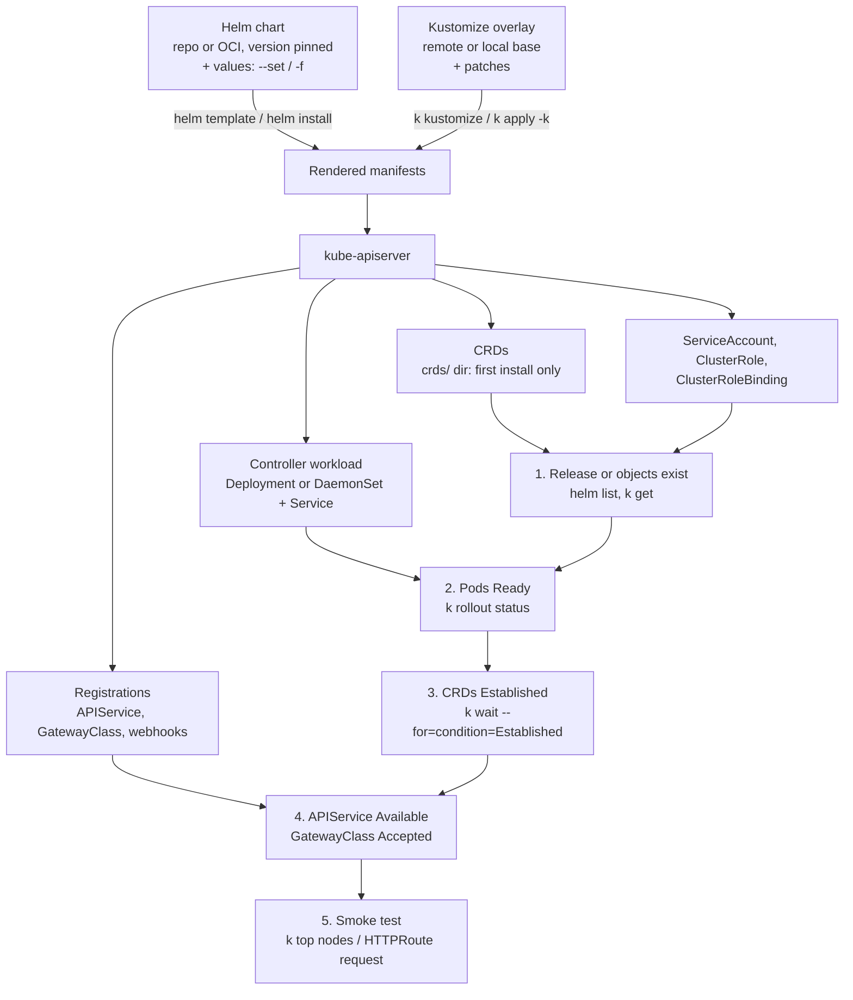

# T4.07 Use Helm and Kustomize to install cluster components

> Competency: "Use Helm and Kustomize to install cluster components" (CKA-4.6) | Domain/weight: CKA — Cluster Architecture, Installation and Configuration (25%) | Est. time: 2.5 h | Prerequisites: T3.19, T3.20

Prerequisite lessons (read them first if a term below is new):

- [T3.19](../part3-ckad/T3.19-use-helm-to-deploy-existing-packages.md): what Helm is, repositories, `install`, `upgrade`, `rollback`, `uninstall`, `template`, where release state lives. This lesson does not re-teach them. It applies them to **cluster add-ons** and adds the admin-side problems: CRDs, cluster-wide objects, version pinning and verification.
- [T3.20](../part3-ckad/T3.20-kustomize.md): `kustomization.yaml`, `resources`, `patches`, bases and overlays, `kubectl apply -k`. This lesson uses them to install and tweak third-party manifests.
- Background for CRDs: [T3.18](../part3-ckad/T3.18-discover-and-use-resources-that-extend.md).

**Shell setup** (define once per terminal; used everywhere below):

```bash
alias k=kubectl
export do="--dry-run=client -o yaml"
export now="--force --grace-period=0"
source <(kubectl completion bash); complete -o default -F __start_kubectl k
```

**Lab environment: kind** (cluster `lab`, context `kind-lab`, 1 control plane + 2 workers, Calico, see [conventions](../00-conventions.md)). Helm is **v4.3.1** and standalone kustomize is **v5.8.3**, both installed with `env/kind-addons.sh helm` and `env/kind-addons.sh kustomize`. `kubectl` v1.37.x already contains kustomize (v5.8.1 in kubectl 1.37.1), so `k apply -k` and `k kustomize` work without the standalone binary. Namespace for drills and labs: `lab-t407`. Files go in `~/lab/t407/`. The nodes need internet access to pull images from `docker.io`, `registry.k8s.io` and `ghcr.io`, and your terminal needs access to `github.com`, `traefik.github.io` and `kubernetes-sigs.github.io`. Create the namespace and the folder once (safe to repeat):

```bash
mkdir -p ~/lab/t407
k create ns lab-t407 $do | k apply -f -
```

**Output policy for this lesson.** The machine-wide kind lock was held by other jobs for the whole 20-minute wait (section 11), so no cluster was created. Output blocks carry one of three labels:

- `REAL OUTPUT (Helm v4.3.1 client, no cluster)`: captured on 2026-10-28 with Helm commands that do not need a cluster (`repo`, `search`, `show`, `template`, `--dry-run=client`, schema errors).
- `REAL OUTPUT (kubectl v1.37.1 / kustomize v5.8.3 client, no cluster)`: captured the same day with `kubectl kustomize` or `kustomize build`, which render YAML locally. Fetching the remote `components.yaml` really happened over the internet.
- `EXPECTED OUTPUT (not captured)`: the shape you should see on a live v1.37 cluster. Pod name hashes, ages, timestamps and exact event wording can differ. Every such block is listed in section 11.

**Pinned versions used in this lesson**, checked on 2026-10-28 with `helm search repo`, `helm show chart` and `curl -I` (details in section 11):

| Component | Install method | Pin | How it was checked |
|---|---|---|---|
| Traefik | Helm chart `traefik/traefik` | chart **42.1.3** (app v3.7.16, image `docker.io/traefik:v3.7.16`) | `helm search repo`, `helm template` |
| metrics-server | Kustomize over the release `components.yaml` | **v0.9.0** (image `registry.k8s.io/metrics-server/metrics-server:v0.9.0`) | `kustomize build` |
| metrics-server | Helm chart `metrics-server/metrics-server` (awareness) | chart 3.14.0 (app 0.9.0) | `helm search repo` |
| Gateway API CRDs | `standard-install.yaml` | **v1.6.3**, standard channel, 10 CRDs | file downloaded and parsed |
| MetalLB | Helm chart `metallb/metallb` | **0.16.1** (app v0.16.1) | `helm show chart` |
| cert-manager | Helm chart `jetstack/cert-manager` | v1.21.3 | `helm show chart` |
| NGINX Gateway Fabric | OCI chart `oci://ghcr.io/nginx/charts/nginx-gateway-fabric` | 2.8.0 | `helm show chart` |
| Envoy Gateway | OCI chart `oci://docker.io/envoyproxy/gateway-helm` | 1.9.3 | `helm show chart` |
| local-path-provisioner | YAML from GitHub | v0.0.37 | URL returns HTTP 200 |
| Calico (operator install) | `operator-crds.yaml`, `tigera-operator.yaml`, `custom-resources.yaml` | v3.33.0 | URLs return HTTP 200, files parsed |

Chart versions move. Your `helm search repo` will show newer ones. The labs pin versions so they stay repeatable.

---

## 1. Why this matters

A new kubeadm cluster is almost empty. It has no metrics (`k top` fails), no ingress or Gateway controller, no load balancer, no certificate manager. An admin fills this gap with **add-ons**, and almost every add-on is delivered as either a **Helm chart** or a set of **YAML manifests** that you tweak with **Kustomize**. If you only know "apply this YAML", you cannot pin a version, cannot see what the chart will create, and cannot cleanly upgrade or remove it.

Real life breaks in four places. A chart installs into the wrong namespace and you cannot move it. A chart's CRDs are not updated by `helm upgrade` and the new controller fails against the old schema. metrics-server is installed, but `k top nodes` says the Metrics API is not available because the kubelet certificates do not match. A `kustomization.yaml` has a typo in a path or a patch target, and the change you meant to make silently does not happen. In the CKA exam you are expected to install and customise one component quickly and prove it works. Which exact component and which Helm version are UNVERIFIED (research summary E23), and so is whether the exam hosts have internet access (no summary row covers it), so practise the method, not one recipe.

---

## 2. Concepts

### 2.1 What a "cluster component" is, and the two delivery formats

**What it is.** A cluster component (also called an add-on) is software that runs on the cluster and extends it. Examples: a CNI plugin, an ingress or Gateway controller, metrics-server, a load balancer controller, a storage provisioner, a certificate manager. The Kubernetes page on add-ons (https://kubernetes.io/docs/concepts/cluster-administration/addons/) lists many of them. Some are installed by `kubeadm` itself (CoreDNS and kube-proxy). The rest are your job.

**The problem it solves.** One add-on is rarely one object. It is a Namespace, ServiceAccounts, ClusterRoles, ClusterRoleBindings, CRDs, a Deployment or DaemonSet, Services, sometimes webhooks and an APIService. Typing that by hand is slow and error-prone. Vendors therefore ship either a **manifest bundle** (one big YAML file) or a **Helm chart** (templated YAML plus a values file).

| | Helm chart | Kustomize over plain manifests |
|---|---|---|
| What you get from the vendor | Templates + `values.yaml` | A fixed YAML file (or a repo folder) |
| How you customise | Values: `--set`, `-f values.yaml` | Patches: JSON6902 or strategic merge, `images`, `namespace` |
| Version pin | `--version 42.1.3` on the chart | A release tag in the URL (`.../download/v0.9.0/...`) or `?ref=v0.9.0` |
| Who tracks what was installed | Helm: a **release** record stored as a Secret | Nobody. Kubernetes only has the objects |
| Upgrade | `helm upgrade` (3-way merge or server-side apply) | Re-run `k apply -k` with the new URL or tag |
| Remove | `helm uninstall` | `k delete -k` (deletes what the overlay renders) |
| Needs a client binary | `helm` | `kubectl` is enough (built-in kustomize) |
| Runs code on the cluster | No. Helm is client-side only | No |

**Under the hood.** Neither tool runs inside the cluster. Both render YAML on your machine and send ordinary API requests. Helm renders Go templates, then creates the objects and stores the release record as a Secret named `sh.helm.release.v1.<release>.v<revision>` in the release namespace (see [T3.19](../part3-ckad/T3.19-use-helm-to-deploy-existing-packages.md) section 2.12). Kustomize reads `kustomization.yaml`, loads the listed resources (files, directories, or URLs), applies transformers (patches, namespace, images) and prints the result. `kubectl apply -k DIR` is "render, then apply".

**What breaks without it.** Without Helm's release record you cannot ask "which version of this add-on is running?" or "what did I change?". Without a pinned version, the same command installs a different thing next month.

**Related but different.**

- An **operator** is a controller that manages an application using CRDs. It is itself installed by a chart or a manifest. Installing the operator is this lesson. Using its custom resources is not.
- `helm template ... | k apply -f -` installs the objects but creates **no** release record. You get no `helm list`, no rollback, no `helm uninstall`.
- `kubeadm`'s own add-ons (CoreDNS, kube-proxy) are managed with `kubeadm`, not Helm (T4.02 and T4.04 cover kubeadm).

### 2.2 Helm for add-ons: the commands in the order you use them

**Add the repository.** A chart repository is a web server with an `index.yaml`. `helm repo add NAME URL` saves its address locally, `helm repo update` downloads the newest index.

```bash
helm repo add traefik https://traefik.github.io/charts
helm repo update
helm search repo traefik/traefik --versions | head -4   # header line + the 3 newest chart versions
```

REAL OUTPUT (Helm v4.3.1 client, no cluster):

```text
"traefik" has been added to your repositories
Hang tight while we grab the latest from your chart repositories...
...Successfully got an update from the "traefik" chart repository
Update Complete. ⎈Happy Helming!⎈
NAME                	CHART VERSION	APP VERSION	DESCRIPTION
traefik/traefik     	42.1.3       	v3.7.16    	A Traefik based Kubernetes ingress controller
traefik/traefik     	42.1.2       	v3.7.16    	A Traefik based Kubernetes ingress controller
traefik/traefik     	42.1.1       	v3.7.16    	A Traefik based Kubernetes ingress controller
```

Read two columns. **CHART VERSION** is what `--version` takes. **APP VERSION** is the version of the software inside (Traefik v3.7.16). They are different numbers. Pinning the app version is not the same as pinning the chart version.

Some projects publish charts in an **OCI registry** instead of a repo. There is no `repo add`. You pass the full URL: `helm install ngf oci://ghcr.io/nginx/charts/nginx-gateway-fabric --version 2.8.0 -n nginx-gateway --create-namespace`.

**Install.** The flags you need for an add-on, with defaults and risks:

| Flag | What it does | Default | Invalid or risky value |
|---|---|---|---|
| `RELEASE` (first argument) | Name of this installation. Used in object names and in `helm list`. | none (required, or use `--generate-name`) | A name that is already used in the namespace: `cannot re-use a name that is still in use` (use `helm upgrade --install`). Names are limited to 53 characters. |
| `-n, --namespace NS` | Namespace of the release record **and** of every namespaced object that does not hard-code its own namespace. | The namespace of your current kube context (usually `default`) | Forgetting it puts the add-on in `default` (section 6). |
| `--create-namespace` | Create the namespace if it does not exist. | off | Without it: `namespaces "traefik" not found`. It never deletes the namespace later. |
| `--version V` | Chart version (not app version). Accepts an exact version or a range such as `42.1.*`. | The newest stable version | Leaving it out means "whatever is newest today". A range is not a pin. |
| `--set a.b=c` | Override one value. Dots go down the tree. | none | `--set` of a list needs braces: `--set 'args={--a,--b}'`. A comma inside a value must be escaped with a backslash. |
| `--set-string` | Same, but force a string (for `"true"`, `"123"`). | | |
| `-f, --values FILE` | A YAML values file. Repeatable. | none | Later files override earlier ones; `--set` overrides all files. |
| `--wait` | Block until the Pods, Services and PVCs are ready. | Helm 4: the `hookOnly` strategy (does not wait for Pods). Helm 3: off. | Without `--wait` the command returns while the Pod is still pulling its image. |
| `--timeout D` | How long `--wait` and hooks may take. | 5m0s | A too-small value marks a healthy-but-slow install as `failed`. |
| `--skip-crds` | Do not install the chart's `crds/` directory. | off (CRDs are installed) | Skipping CRDs when the chart's objects need them fails the install. |
| `--dry-run=client` / `server` | Render without creating. `server` also asks the API server to validate. | `none` | Bare `--dry-run` is deprecated in Helm 4. |

The add-on install pattern you will type most:

```bash
helm install traefik traefik/traefik \
  --namespace traefik --create-namespace \
  --version 42.1.3 \
  --set providers.kubernetesGateway.enabled=true \
  --set service.type=ClusterIP \
  --wait --timeout 3m
```

**Values precedence.** Chart defaults < `-f` files (in the order given) < `--set` flags. If the same key appears twice, the last one wins. A value that does not exist in the chart is **silently ignored** by charts without a schema, so check the key with `helm show values` first. Charts that ship a `values.schema.json` reject unknown keys; section 2.3 shows the exact error.

**Upgrade and roll back.** `helm upgrade RELEASE CHART` computes the difference and applies it. It creates a new **revision**. These are the flags that matter:

| Flag | What it does | Risk |
|---|---|---|
| `-i, --install` | Install if the release does not exist yet. Makes the command repeatable. | None. Preferred in scripts. |
| `--reuse-values` | Start from the values of the last revision, then merge your `--set` and `-f`. | Keeps old defaults even when the new chart version changed them. |
| `--reset-values` | Start from the new chart's defaults. This is what an upgrade does when you pass any `--set` or `-f` ([T3.19](../part3-ckad/T3.19-use-helm-to-deploy-existing-packages.md) section 2.8; with no value flags at all Helm copies the previous user-supplied values). | Forgetting your earlier `--set` flags **resets them**. |
| `--reset-then-reuse-values` | New chart defaults, then the last release's user-supplied values, then your overrides. Listed in `helm upgrade --help` of both Helm 3.19.2 and Helm 4.3.1 (per T3.19). | Often what you want when changing the chart version. |
| `--rollback-on-failure` (Helm 4) / `--atomic` (Helm 3) | Roll back automatically if the upgrade fails. Implies waiting. | `--atomic` still works in Helm 4 but is deprecated. |

```bash
helm history traefik -n traefik            # list revisions
helm rollback traefik 1 -n traefik --wait  # go back to revision 1 (creates revision 3 if 2 existed)
```

A rollback is a **new revision** that copies the old one. It does not delete history. It does **not** touch CRDs (section 2.4).

### 2.3 Inspecting what a chart will install

Do this before you install. It is free and it prevents most surprises.

| Command | Needs a cluster? | Shows | When to use |
|---|---|---|---|
| `helm show chart CHART [--version V]` | no | `Chart.yaml`: name, version, appVersion, `kubeVersion` constraint | Confirm the version and the Kubernetes versions supported |
| `helm show values CHART` | no | The full default `values.yaml` with comments | Find the right key to `--set` |
| `helm show crds CHART` | no | The files in the chart's `crds/` directory | See which CRDs will be installed |
| `helm show readme CHART` | no | The chart README | Install notes of the vendor |
| `helm template RELEASE CHART [-n NS] [-f FILE]` | no | All rendered manifests of the templates (not `crds/`, unless `--include-crds`) | See every object and every value substituted |
| `helm install ... --dry-run=server` | yes | Rendered manifests, validated by the API server | Catch errors the schema cannot |
| `helm get manifest RELEASE -n NS` | yes | Manifests of an **installed** release | Prove what is in the cluster |
| `helm get values RELEASE -n NS [-a]` | yes | The values you supplied (`-a`: all values including defaults) | See what was customised |
| `helm get all / notes / hooks RELEASE` | yes | Everything / the post-install notes / hooks | Read the vendor's next steps |
| `helm status RELEASE -n NS` | yes | Status, revision, last deployed time | Quick health of the record |

The first five commands (`show chart`, `show values`, `show crds`, `show readme`, `template`) need no cluster. They still fetch the chart from the repo the first time, so they need network access to the repo. Run them on the real Traefik chart.

```bash
helm show chart traefik/traefik --version 42.1.3 | grep -E '^(name|version|appVersion|kubeVersion)'
helm show crds  traefik/traefik --version 42.1.3 | grep -c '^kind: CustomResourceDefinition'
helm template traefik traefik/traefik -n traefik --version 42.1.3 \
  --set providers.kubernetesGateway.enabled=true --set service.type=ClusterIP \
  | grep '^kind:' | sort | uniq -c
```

REAL OUTPUT (Helm v4.3.1 client, no cluster):

```text
appVersion: v3.7.16
kubeVersion: '>=1.30.0-0'
name: traefik
version: 42.1.3
25
   1 kind: ClusterRole
   1 kind: ClusterRoleBinding
   1 kind: Deployment
   1 kind: Gateway
   1 kind: GatewayClass
   1 kind: IngressClass
   1 kind: Service
   1 kind: ServiceAccount
```

How to read it. `kubeVersion: '>=1.30.0-0'` means the chart refuses to install on older clusters; v1.37 is fine. The 25 is the count of CRDs in the chart's `crds/` directory. They are **not** in the `helm template` list (no `CustomResourceDefinition` line), because the `crds/` directory is not rendered. Add `--include-crds` to see them. The eight kinds that do render are the controller (Deployment, Service, ServiceAccount, RBAC), plus a `Gateway`, a `GatewayClass` and an `IngressClass`. The `Gateway` and `GatewayClass` objects only appear because `providers.kubernetesGateway.enabled=true`. Those two kinds belong to the **Gateway API CRDs**, which this chart does **not** ship. Section 2.6 and section 6 cover that.

**Schema checks.** Some charts ship `values.schema.json`. Helm validates your values against it before rendering. Traefik's chart does, so a typo in a key is caught (REAL OUTPUT (Helm v4.3.1 client, no cluster)):

```text
$ helm template traefik traefik/traefik --version 42.1.3 --set image.tga=x
Error: values don't meet the specifications of the schema(s) in the following chart(s):
traefik:
- at '/image': additional properties 'tga' not allowed
```

The schema does **not** check everything. `--set service.type=Foo` and `--set ports.web.exposedPort=70000` both pass the schema and render without error (seen). Only the API server rejects them when Helm sends the Service. That is how a release ends up in the `failed` state (lab C).

**Dry run without a cluster.** `helm install --dry-run=client` renders everything and prints the release header. REAL OUTPUT (Helm v4.3.1 client, `KUBECONFIG=/dev/null`, output cut after the header):

```text
NAME: traefik
LAST DEPLOYED: Wed Oct 28 12:04:52 2026
NAMESPACE: traefik
STATUS: pending-install
REVISION: 1
DESCRIPTION: Dry run complete
TEST SUITE: None
HOOKS:
MANIFEST:
---
# Source: traefik/templates/rbac/serviceaccount.yaml
...
```

### 2.4 CRDs in charts, and why `helm upgrade` does not update them

**What a CRD is.** A CustomResourceDefinition teaches the API server a new object type (see [T3.18](../part3-ckad/T3.18-discover-and-use-resources-that-extend.md)). Controllers such as Traefik, cert-manager and MetalLB need their CRDs to exist **before** their Pods start, and before any custom resource (an `IngressRoute`, a `Certificate`, an `IPAddressPool`) is created.

**Where a chart can put CRDs.** There are three patterns. They behave differently, and you must know which one a chart uses.

| Pattern | Where | Installed by `helm install` | Updated by `helm upgrade` | Removed by `helm uninstall` | Example (checked) |
|---|---|---|---|---|---|
| 1. The `crds/` directory | Plain YAML files, **not** templated | Yes, **first install only**. If a CRD already exists it is skipped with a warning. `--skip-crds` skips all. | **No** | **No** | `traefik/traefik` 42.1.3: 25 CRDs |
| 2. Templates | Normal template files; usually behind a value | Yes, when the value is on | Yes (they are ordinary chart objects) | Yes, **unless** the chart adds `helm.sh/resource-policy: keep` | MetalLB 0.16.1: 13 CRDs rendered from a `crds` subchart, no keep annotation (checked). cert-manager v1.21.3: 6 CRDs, only with `--set crds.enabled=true`, with `keep` on by default (checked) |
| 3. A separate CRD chart or manifest | You install it yourself, first | By you | By you | By you | `traefik/traefik-crds` chart exists in the same repo (seen in `helm search repo`). Gateway API CRDs come from `standard-install.yaml` |

The Helm docs state the pattern-1 rule plainly: "There is no support at this time for upgrading or deleting CRDs using Helm. This was an explicit decision after much community discussion due to the danger for unintentional data loss." (https://helm.sh/docs/chart_best_practices/custom_resource_definitions/). Deleting a CRD deletes **every custom resource of that type**, in every namespace. Helm refuses to do that by itself.

**The consequence for upgrades.** If a new chart version needs a new CRD schema, `helm upgrade` installs the new Deployment and RBAC, but the old CRDs stay. The new controller then fails with errors about unknown fields or missing kinds. You update the CRDs yourself, before the upgrade:

```bash
# Server-side apply: CRDs can exceed the 262144-byte annotation limit of client-side apply.
helm show crds traefik/traefik --version 42.1.3 | k apply --server-side --force-conflicts -f -
helm upgrade traefik traefik/traefik -n traefik --version 42.1.3 --reuse-values --wait
```

Why `--server-side`. A normal `k apply` stores the whole object as JSON in the annotation `kubectl.kubernetes.io/last-applied-configuration`. Annotations may not exceed 262144 bytes in total. Large CRDs break this. Two real examples I measured by parsing the files: the Gateway API v1.6.3 `httproutes` CRD is 247,051 bytes as JSON (close to the limit), and Calico v3.33.0's `installations.operator.tigera.io` CRD is 683,760 bytes (over it). Server-side apply stores ownership in `managedFields` instead and has no such limit. `--force-conflicts` takes over fields that another field manager (for example an earlier `kubectl create`) owns.

**Dry-run limit.** The same Helm page says `--dry-run` is not supported for CRDs: Helm cannot create the CRD on a dry run, so a chart that also contains custom resources of that kind fails validation. This is why charts keep CRDs in `crds/` or in a separate chart.

**Gateway API CRDs are not in the Traefik chart.** The chart renders a `Gateway` and a `GatewayClass`, whose CRDs come from the Gateway API project. Install them first (section 2.6). If you skip this, the install fails with `no matches for kind "GatewayClass"` (section 6).

### 2.5 Kustomize for add-ons: remote or local base, plus overlay patches

**What it is.** The vendor gives you one YAML file (for metrics-server: `components.yaml` on its GitHub release page). You do not edit it. You create your own folder with a `kustomization.yaml` that **points at it** and adds **patches**. Your changes stay small, readable and repeatable. The vendor file stays untouched.

**Three ways to point at the vendor manifests.**

| `resources:` entry | Fetched by | Pin with | Notes |
|---|---|---|---|
| `https://github.com/kubernetes-sigs/metrics-server/releases/download/v0.9.0/components.yaml` | HTTP GET from the machine that runs `kubectl` or `kustomize` | The tag in the path | One YAML file. Simple and the form used in this lesson. |
| `github.com/kubernetes-sigs/metrics-server//manifests/base?ref=v0.9.0` | `git fetch` of the repo, then the folder after `//` | `?ref=` tag | A whole kustomize directory in a Git repo. Needs `git` on the machine. Checked: renders 1 APIService, 2 ClusterRoles, 2 ClusterRoleBindings, 1 Deployment, 1 RoleBinding, 1 Service, 1 ServiceAccount. |
| `components.yaml` (a local file, in `base/`) | Read from disk | You downloaded a specific version | Works with no internet at apply time. Download once with `curl -LO URL`. |

**Network needs.** The fetch happens on **your** machine, not in the cluster. If that machine cannot reach GitHub, the build fails (REAL OUTPUT (kubectl v1.37.1 / kustomize v5.8.3 client, no cluster); a dead proxy simulated "no network", the message after `connect:` depends on your network, the line is cut at 400 characters):

```text
Error: accumulating resources: accumulation err='accumulating resources from 'https://github.com/kubernetes-sigs/metrics-server/releases/download/v0.9.0/components.yaml': Get "https://github.com/kubernetes-sigs/metrics-server/releases/download/v0.9.0/components.yaml": proxyconnect tcp: dial tcp 127.0.0.1:9: connect: connection refused': failed to run '/usr/bin/git fetch --depth=1 https://github.co...
```

Notice it falls back to `git`. Two things must also be reachable later: the **nodes** must pull the image (`registry.k8s.io/...`). If you must work offline, keep a downloaded copy as a local base. Whether the exam hosts can reach GitHub is UNVERIFIED (no summary row covers internet access). Among the allowed documentation are the kubernetes.io docs, the Helm docs and `gateway-api.sigs.k8s.io` (E13). Treat "the install needs a download" as a risk, read the task text for a provided file or chart path first, and do not assume internet.

**The overlay that adds an argument.** metrics-server's container has an `args:` list. The patch appends one entry:

```yaml
# ~/lab/t407/metrics-server-overlay/kustomization.yaml
apiVersion: kustomize.config.k8s.io/v1beta1   # fixed value for every kustomization.yaml
kind: Kustomization                             # fixed value
resources:                                      # what to load; entries are rendered in this order
  - https://github.com/kubernetes-sigs/metrics-server/releases/download/v0.9.0/components.yaml
patches:                                        # list of patches (replaces the old patchesJson6902 field)
  - target:                                     # which object(s) the patch applies to
      kind: Deployment                          # match on kind
      name: metrics-server                      # and on metadata.name (must match exactly)
    patch: |-                                   # inline JSON6902 patch: a list of operations
      - op: add                                 # "add" on a list index "-" appends to the end
        path: /spec/template/spec/containers/0/args/-   # container 0 of the Pod template, end of args
        value: --kubelet-insecure-tls            # the new argument
```

REAL OUTPUT (kubectl v1.37.1 / kustomize v5.8.3 client, no cluster). `kustomize build ~/lab/t407/metrics-server-overlay` and the same with `kubectl kustomize` print identical text (checked with `diff`). The part of the Deployment that changed:

```text
      containers:
      - args:
        - --cert-dir=/tmp
        - --secure-port=10250
        - --kubelet-preferred-address-types=InternalIP,ExternalIP,Hostname
        - --kubelet-use-node-status-port
        - --metric-resolution=15s
        - --kubelet-insecure-tls
        image: registry.k8s.io/metrics-server/metrics-server:v0.9.0
```

The rendered kinds, in the order Kustomize prints them: ServiceAccount, 2 ClusterRoles, RoleBinding (`metrics-server-auth-reader`), 2 ClusterRoleBindings, Service, Deployment, APIService (`v1beta1.metrics.k8s.io`).

**Three traps, all reproduced with real output.**

1. **A strategic merge patch on `args` replaces the whole list.** `args` is a plain list of strings with no merge key, so the patch list wins and everything else is dropped. This patch file:

   ```yaml
   apiVersion: apps/v1
   kind: Deployment
   metadata:
     name: metrics-server
     namespace: kube-system
   spec:
     template:
       spec:
         containers:
           - name: metrics-server
             args:
               - --kubelet-insecure-tls
   ```

   renders (REAL OUTPUT (kubectl v1.37.1 / kustomize v5.8.3 client, no cluster)):

   ```text
         - args:
           - --kubelet-insecure-tls
           image: registry.k8s.io/metrics-server/metrics-server:v0.9.0
   ```

   `--secure-port`, `--cert-dir` and the others are gone. The Pod would misbehave. Use the JSON6902 `add .../args/-` form to **append**.
2. **A patch whose `target` matches nothing is silently ignored.** With `name: metrics-servr` (typo), `kustomize build` exits 0 and the flag is missing. `kustomize build . | grep -c -- --kubelet-insecure-tls` printed `0` (seen). The only text containing "insecure" in the whole output was the unrelated `insecureSkipTLSVerify: true` of the APIService, so a loose `grep insecure` would have hidden the problem. Always grep the rendered output for the thing you patched.
3. **The `namespace:` field moves everything, including objects that must stay put.** With `namespace: monitoring` on top of the metrics-server base, the renderer changed these (REAL OUTPUT (kustomize v5.8.3 client, no cluster), columns: kind, name, namespace):

   ```text
   ServiceAccount	metrics-server	monitoring
   ClusterRole	system:aggregated-metrics-reader	-
   ClusterRole	system:metrics-server	-
   RoleBinding	metrics-server-auth-reader	monitoring
   ClusterRoleBinding	metrics-server:system:auth-delegator	-
   ClusterRoleBinding	system:metrics-server	-
   Service	metrics-server	monitoring
   Deployment	metrics-server	monitoring
   APIService	v1beta1.metrics.k8s.io	-   (spec.service.namespace: monitoring)
   ```

   The RoleBinding `metrics-server-auth-reader` is supposed to live in `kube-system` (it grants read on the ConfigMap `extension-apiserver-authentication` that lives there). After the `namespace:` transformer it sits in `monitoring` and no longer grants that access. Moving a vendor bundle to another namespace is not a one-line change. Install it where the vendor expects it unless you know what else to fix.

**A local base plus an overlay.** This is the layout to use when you want the vendor file on disk (no internet at apply time) or when several overlays share one base. The `base/` folder holds the downloaded vendor file and its own `kustomization.yaml`. The `overlay/` folder points at `../base` and holds only your patch. Render-only, so it changes nothing on the cluster:

```bash
mkdir -p ~/lab/t407/lbo/base ~/lab/t407/lbo/overlay && cd ~/lab/t407/lbo
curl -sL -o base/components.yaml https://github.com/kubernetes-sigs/metrics-server/releases/download/v0.9.0/components.yaml
cat > base/kustomization.yaml <<'EOF'
apiVersion: kustomize.config.k8s.io/v1beta1
kind: Kustomization
resources:
  - components.yaml          # a file next to this kustomization.yaml
EOF
cat > overlay/kustomization.yaml <<'EOF'
apiVersion: kustomize.config.k8s.io/v1beta1
kind: Kustomization
resources:
  - ../base                  # a DIRECTORY that contains a kustomization.yaml
patches:
  - target:
      kind: Deployment
      name: metrics-server
    patch: |-
      - op: add
        path: /spec/template/spec/containers/0/args/-
        value: --kubelet-insecure-tls
EOF
k kustomize overlay | grep -c -- --kubelet-insecure-tls    # the overlay: patch present
k kustomize base    | grep -c -- --kubelet-insecure-tls    # the base alone: patch absent
```

REAL OUTPUT (kubectl v1.37.1 client, no cluster):

```text
1
0
```

The base renders the untouched vendor file (`0`), the overlay adds your flag (`1`). To install it you would run `k apply -k overlay` (point `-k` at the overlay folder, not at `base`). A wrong `../base` spelling fails with the path error shown in section 6.

**Apply, diff, delete.**

```bash
k kustomize ~/lab/t407/metrics-server-overlay      # render only; always do this first
k diff -k ~/lab/t407/metrics-server-overlay        # what would change on the cluster
k apply -k ~/lab/t407/metrics-server-overlay       # render and apply
k delete -k ~/lab/t407/metrics-server-overlay      # delete what the overlay renders (CRDs and namespaces too!)
```

`-k` takes a **directory** that contains `kustomization.yaml`, never a file path. `kubectl kustomize --enable-helm` lets Kustomize inflate a Helm chart listed under `helmCharts:` (the flag exists in `k kustomize --help`). It needs the `helm` binary on the machine and is not needed for this lesson.

### 2.6 Typical installs

For each component: how it is delivered, whether it brings CRDs, what you do besides installing, and the quickest proof it works. Versions are the pins above.

| Component | Delivery | CRDs | Extra step after install | Quick verify |
|---|---|---|---|---|
| **metrics-server** | `components.yaml` + kustomize patch (this lesson), or Helm chart `metrics-server/metrics-server` 3.14.0 with `--set 'args={--kubelet-insecure-tls}'` (the chart renders the flag next to the default args; checked with `helm template`) | None. It registers an **APIService** instead (section 2.7) | On kubeadm/kind clusters the kubelet serving certificates are not signed by a CA the Pod trusts, so add `--kubelet-insecure-tls` in a lab. In production give the kubelets proper serving certificates | `k get apiservice v1beta1.metrics.k8s.io`, `k top nodes` |
| **Gateway API CRDs** | `k apply --server-side -f .../v1.6.3/standard-install.yaml` | 10 (BackendTLSPolicy, GatewayClass, Gateway, GRPCRoute, HTTPRoute, ListenerSet, ReferenceGrant, TCPRoute, TLSRoute, UDPRoute) | Install **before** any Gateway controller. The file also contains a ValidatingAdmissionPolicy and binding named `safe-upgrades.gateway.networking.k8s.io` (seen) | `k get crd \| grep gateway.networking.k8s.io` |
| **Traefik** (Ingress and Gateway API) | Helm `traefik/traefik` 42.1.3 | 25 in `crds/` (pattern 1) | `--set providers.kubernetesGateway.enabled=true` for Gateway API; Gateway API CRDs first | Pod Ready, GatewayClass `traefik`, an HTTPRoute smoke test |
| **NGINX Gateway Fabric** | OCI chart `oci://ghcr.io/nginx/charts/nginx-gateway-fabric` 2.8.0 | its own `*.gateway.nginx.org` CRDs in `crds/` (seen with `helm show crds`) | Gateway API CRDs first; read `helm show values` for the GatewayClass name and Service type | GatewayClass `Accepted`, then a route |
| **Envoy Gateway** | OCI chart `oci://docker.io/envoyproxy/gateway-helm` 1.9.3 | The chart's `crds/` already contains the Gateway API CRDs (`gateways`, `httproutes`, ... seen with `helm show crds`) plus its own | Do not install the Gateway API CRDs twice from two sources | GatewayClass `Accepted`, then a route |
| **MetalLB** | Helm `metallb/metallb` 0.16.1 | 13, templated through a subchart (pattern 2, no keep annotation) | It does nothing until you create an `IPAddressPool` and an `L2Advertisement` | A `LoadBalancer` Service gets an `EXTERNAL-IP` |
| **local-path-provisioner** | One YAML: `https://raw.githubusercontent.com/rancher/local-path-provisioner/v0.0.37/deploy/local-path-storage.yaml` (HTTP 200 checked; file read, namespace `local-path-storage`, StorageClass `local-path`) | None in the file | Mark its StorageClass as default only if you want that | A PVC using it becomes `Bound` once a Pod uses it |
| **cert-manager** | Helm `jetstack/cert-manager` v1.21.3 | 6 templated CRDs, **off by default** | `--set crds.enabled=true` (default `false`; `crds.keep=true` by default keeps CRDs on uninstall; checked with `helm show values`) | Three Pods Ready (controller, webhook, cainjector), then a test `Issuer` |
| **Calico (operator)** | Three files from `projectcalico/calico` v3.33.0: `operator-crds.yaml`, `tigera-operator.yaml`, `custom-resources.yaml` | 32 in `operator-crds.yaml`; one is 683,760 bytes as JSON, so use `k create -f` or `k apply --server-side -f`, not plain `k apply` | Pod CIDR in `custom-resources.yaml` (`192.168.0.0/16` by default there, seen) must match your cluster | `k get tigerastatus`, nodes `Ready` |

Do not memorise this table. The method is the same each time: find the vendor's install page, read it for **CRD order**, **required values** and **extra objects**, pin a version, install, verify.

**One runnable block per row.** Every block has the install, the extra object the table names, one verify command and a cleanup. Run them on the kind lab cluster one at a time, and run each cleanup before the next. Two exceptions: **Calico** needs a cluster without a CNI (the VMs of the conventions, or a fresh cluster), because `kind-up.sh` has already installed Calico on the lab cluster, and **local-path-provisioner** should also go on the VMs, because kind ships its own copy of it. Names in the blocks (Deployments, GatewayClass, namespaces) were read from `helm template` output of the pinned charts or from the downloaded YAML. The cluster-side results are `EXPECTED OUTPUT (not captured)` and listed in section 11, item 14. Smoke-test objects go in `lab-t407`.

**metrics-server through Helm** (the variant of the Kustomize install; do not run both):

```bash
helm repo add metrics-server https://kubernetes-sigs.github.io/metrics-server/ && helm repo update
helm install metrics-server metrics-server/metrics-server -n kube-system --version 3.14.0 \
  --set 'args={--kubelet-insecure-tls}' --wait --timeout 3m
k get apiservice v1beta1.metrics.k8s.io          # verify: AVAILABLE True
k top nodes                                       # smoke test; may need up to a minute
helm uninstall metrics-server -n kube-system      # cleanup
```

**Gateway API CRDs** (no controller yet, so this proves only that the API server knows the kinds):

```bash
k apply --server-side -f https://github.com/kubernetes-sigs/gateway-api/releases/download/v1.6.3/standard-install.yaml
k get crd | grep -c gateway.networking.k8s.io     # verify: 10
k delete -f https://github.com/kubernetes-sigs/gateway-api/releases/download/v1.6.3/standard-install.yaml   # cleanup
```

**Traefik:** the full install, HTTPRoute smoke test and cleanup are in section 5 (steps 1 to 8) and lab B.

**NGINX Gateway Fabric** (an OCI chart, so there is no `helm repo add`). Needs the Gateway API CRDs first (previous block, without the cleanup line):

```bash
helm install ngf oci://ghcr.io/nginx/charts/nginx-gateway-fabric --version 2.8.0 \
  -n nginx-gateway --create-namespace --wait --timeout 3m
k get pods -n nginx-gateway                       # verify 1: the Deployment is ngf-nginx-gateway-fabric
k get gatewayclass nginx                          # verify 2: the chart creates GatewayClass "nginx"
# cleanup: the chart's own CRDs (gateway.nginx.org) stay behind, like Traefik's
helm uninstall ngf -n nginx-gateway
helm show crds oci://ghcr.io/nginx/charts/nginx-gateway-fabric --version 2.8.0 | k delete -f - --ignore-not-found
k delete ns nginx-gateway
```

EXPECTED OUTPUT (not captured) for verify 2:

```text
NAME    CONTROLLER                                   ACCEPTED   AGE
nginx   gateway.nginx.org/nginx-gateway-controller   True       30s
```

**Envoy Gateway.** The chart already contains the Gateway API CRDs, so do **not** apply `standard-install.yaml` first (run this on a cluster that does not have them). The chart creates no GatewayClass, so you create one that names the Envoy controller:

```bash
helm install eg oci://docker.io/envoyproxy/gateway-helm --version 1.9.3 \
  -n envoy-gateway-system --create-namespace --wait --timeout 3m
k rollout status deploy/envoy-gateway -n envoy-gateway-system     # verify 1
cat <<'EOF' | k apply -f -
apiVersion: gateway.networking.k8s.io/v1
kind: GatewayClass
metadata:
  name: eg
spec:
  controllerName: gateway.envoyproxy.io/gatewayclass-controller   # the string the chart's own config uses
EOF
k get gatewayclass eg                              # verify 2: ACCEPTED True
# cleanup: this also deletes the Gateway API CRDs the chart carried; fine here because the cluster had none before
k delete gatewayclass eg
helm uninstall eg -n envoy-gateway-system
helm show crds oci://docker.io/envoyproxy/gateway-helm --version 1.9.3 | k delete -f - --ignore-not-found
k delete ns envoy-gateway-system
```

**MetalLB.** The chart installs the controller and the speakers. It does nothing until you give it addresses (`IPAddressPool`) and tell it to announce them (`L2Advertisement`):

```bash
helm repo add metallb https://metallb.github.io/metallb && helm repo update
helm install metallb metallb/metallb -n metallb-system --create-namespace --version 0.16.1 --wait --timeout 3m
k get pods -n metallb-system                       # verify 1: controller Ready, one speaker per node
docker network inspect kind -f '{{range .IPAM.Config}}{{println .Subnet}}{{end}}'   # kind only: find the Docker subnets, then pick unused addresses inside the IPv4 one
```

Save the pool as `~/lab/t407/metallb-pool.yaml`. The range below assumes the Docker subnet `172.18.0.0/16`; replace it with unused addresses from **your** subnet (on VMs, unused addresses of the node subnet):

```yaml
# ~/lab/t407/metallb-pool.yaml
apiVersion: metallb.io/v1beta1
kind: IPAddressPool
metadata:
  name: lab-pool
  namespace: metallb-system     # must be the MetalLB namespace
spec:
  addresses:
    - 172.18.255.200-172.18.255.220   # a range or a CIDR; must not overlap addresses in use
---
apiVersion: metallb.io/v1beta1
kind: L2Advertisement
metadata:
  name: lab-l2
  namespace: metallb-system
spec:
  ipAddressPools:
    - lab-pool                  # announce only this pool
```

Apply it and run the smoke test (a `LoadBalancer` Service must get an address from the pool):

```bash
k apply -f ~/lab/t407/metallb-pool.yaml
k create deploy lb-test -n lab-t407 --image=nginx:1.27 --port=80
k expose deploy lb-test -n lab-t407 --type=LoadBalancer --port=80
k get svc lb-test -n lab-t407                      # verify 2: EXTERNAL-IP inside the pool, not <pending>
# cleanup
k delete svc,deploy lb-test -n lab-t407
k delete -f ~/lab/t407/metallb-pool.yaml
helm uninstall metallb -n metallb-system
k get crd | grep -c metallb.io                     # expect 0: the CRDs are templated (pattern 2), so uninstall removed them
k delete ns metallb-system
```

If applying the pool fails with an admission webhook error right after the install, the webhook backend is not ready yet: wait for the controller Pod to be Ready and apply again (the exact error text is not confirmed, section 11 item 14). EXPECTED OUTPUT (not captured) for verify 2: `EXTERNAL-IP` shows an address from your pool, such as `172.18.255.200`, instead of `<pending>`.

**local-path-provisioner** (VMs; kind already has its own copy in the namespace `local-path-storage`, with a StorageClass named `standard`, so do not apply this on the lab cluster). One YAML file. The provisioner creates a hostPath volume on the node of the Pod, only when a Pod uses the claim (`volumeBindingMode: WaitForFirstConsumer`, read in the file):

```bash
k apply -f https://raw.githubusercontent.com/rancher/local-path-provisioner/v0.0.37/deploy/local-path-storage.yaml
k get pods -n local-path-storage                   # verify 1: local-path-provisioner Ready
k get storageclass local-path                      # verify 2: PROVISIONER rancher.io/local-path, VOLUMEBINDINGMODE WaitForFirstConsumer
# optional: make it the default class only if you want that
k patch storageclass local-path -p '{"metadata":{"annotations":{"storageclass.kubernetes.io/is-default-class":"true"}}}'
```

Smoke test, saved as `~/lab/t407/lpp-test.yaml`. The PVC stays `Pending` until a Pod uses it. That is normal, not an error:

```yaml
# ~/lab/t407/lpp-test.yaml
apiVersion: v1
kind: PersistentVolumeClaim
metadata:
  name: lpp-test
  namespace: lab-t407
spec:
  storageClassName: local-path
  accessModes: ["ReadWriteOnce"]
  resources:
    requests:
      storage: 100Mi
---
apiVersion: v1
kind: Pod
metadata:
  name: lpp-test
  namespace: lab-t407
spec:
  containers:
    - name: c
      image: busybox:1.36
      command: ["sh", "-c", "echo ok > /data/f && sleep 3600"]
      volumeMounts:
        - name: d
          mountPath: /data
  volumes:
    - name: d
      persistentVolumeClaim:
        claimName: lpp-test
```

```bash
k apply -f ~/lab/t407/lpp-test.yaml
k get pvc lpp-test -n lab-t407                     # Pending until the Pod is scheduled, then Bound
k wait --for=condition=Ready pod/lpp-test -n lab-t407 --timeout=120s
k exec -n lab-t407 lpp-test -- cat /data/f         # prints: ok
# cleanup
k delete -f ~/lab/t407/lpp-test.yaml
k delete -f https://raw.githubusercontent.com/rancher/local-path-provisioner/v0.0.37/deploy/local-path-storage.yaml
```

**cert-manager.** The chart ships its CRDs as templates but **off by default**, so `crds.enabled=true` is required. Without it the CRDs are not installed, so `Issuer` and `Certificate` objects are rejected as unknown kinds:

```bash
helm repo add jetstack https://charts.jetstack.io && helm repo update
helm install cert-manager jetstack/cert-manager -n cert-manager --create-namespace --version v1.21.3 \
  --set crds.enabled=true --wait --timeout 5m
k get pods -n cert-manager                         # verify 1: cert-manager, cert-manager-cainjector, cert-manager-webhook, all Ready
k get crd | grep -c cert-manager.io                # verify 2: 6
```

Smoke test with a self-signed `Issuer` and a `Certificate`, saved as `~/lab/t407/cm-test.yaml`. The Certificate becomes `Ready` only if the controller, the webhook and the CRDs all work:

```yaml
# ~/lab/t407/cm-test.yaml
apiVersion: cert-manager.io/v1
kind: Issuer
metadata:
  name: selfsigned
  namespace: lab-t407
spec:
  selfSigned: {}                 # the issuer signs with its own key; no external CA needed
---
apiVersion: cert-manager.io/v1
kind: Certificate
metadata:
  name: smoke
  namespace: lab-t407
spec:
  secretName: smoke-tls          # the Secret cert-manager creates
  dnsNames:
    - smoke.lab.test
  issuerRef:
    name: selfsigned
    kind: Issuer
```

```bash
k apply -f ~/lab/t407/cm-test.yaml
k wait --for=condition=Ready certificate/smoke -n lab-t407 --timeout=60s    # verify 3: condition met
k get secret smoke-tls -n lab-t407                 # type kubernetes.io/tls
# cleanup: the Secret is not deleted with the Certificate by default; the 6 CRDs survive uninstall (crds.keep=true)
k delete -f ~/lab/t407/cm-test.yaml
k delete secret smoke-tls -n lab-t407 --ignore-not-found
helm uninstall cert-manager -n cert-manager
k get crd -o name | grep cert-manager.io | xargs k delete
k delete ns cert-manager
```

**Calico (operator install), on a cluster with no CNI.** Three files, in this order. The CRD file is large (32 CRDs, one of 683,760 bytes as JSON), so use `k create` or `k apply --server-side`, never plain `k apply`. The operator then reads `custom-resources.yaml` and builds Calico:

```bash
B=https://raw.githubusercontent.com/projectcalico/calico/v3.33.0/manifests
k create -f $B/operator-crds.yaml                  # 1. the CRDs (or: k apply --server-side -f ...)
k create -f $B/tigera-operator.yaml                # 2. namespace tigera-operator, RBAC, the operator Deployment
curl -sLO $B/custom-resources.yaml                 # 3. download first: check the pod CIDR before creating it
grep -n 'cidr:' custom-resources.yaml              # 192.168.0.0/16 here; it must equal the cluster's pod CIDR
k create -f custom-resources.yaml                  # an Installation named "default" (plus APIServer, Goldmane, Whisker)
k get tigerastatus                                 # verify 1: calico, apiserver ... AVAILABLE True (takes minutes)
k get nodes                                        # verify 2: all Ready (a node is NotReady until the CNI works)
```

If the cidr differs from the pod CIDR the cluster was created with (`192.168.0.0/16` in the conventions), edit it in `custom-resources.yaml` before the last `k create`. There is no cleanup for a CNI on a working cluster: do not delete it. On a throw-away cluster, `k delete -f custom-resources.yaml` first, then the other two files in reverse order. EXPECTED OUTPUT (not captured) for verify 1: a table with `NAME`, `AVAILABLE`, `PROGRESSING`, `DEGRADED`, `SINCE` and `AVAILABLE` `True` for every row; the exact list of rows depends on the optional components.

### 2.7 Verifying an install

"The command printed no error" is not a result. Check five layers, in this order, and stop at the first that fails. One exception: if the Pods in layer 2 crash-loop or never become Ready right after an install, check layer 3 (CRDs) before you read the logs, because a controller whose CRDs are missing can fail at start or log errors about unknown kinds.

| # | Layer | Command | Healthy |
|---|---|---|---|
| 1 | The record or objects exist | `helm list -A` or `k get all -n NS` | Release `STATUS` is `deployed` (not `failed`, `pending-install`) |
| 2 | Pods are Ready | `k get pods -n NS`, `k rollout status deploy/NAME -n NS` | `READY n/n`, `Running`, no restarts that keep climbing |
| 3 | CRDs are present and accepted | `k get crd \| grep GROUP`, `k wait --for=condition=Established crd/NAME --timeout=60s` | `condition met` |
| 4 | Aggregated APIs and registered classes work | `k get apiservice v1beta1.metrics.k8s.io`, `k get gatewayclass` | APIService `AVAILABLE True`; GatewayClass `ACCEPTED True` |
| 5 | A smoke test uses the feature | `k top nodes`; a request through a route; a test PVC | The thing the add-on exists to do actually happens |

**APIService.** metrics-server does not add a CRD. It registers an aggregated API: the kube-apiserver forwards requests for `metrics.k8s.io/v1beta1` to the metrics-server Service. The APIService object (`v1beta1.metrics.k8s.io`) holds that registration and a status. If the backend is not ready or not reachable, the status is `Available=False` with a reason such as `FailedDiscoveryCheck` or `MissingEndpoints`. Then `k top` fails with `error: Metrics API not available`. See section 6 for the diagnosis order.

**Under the hood of a smoke test.** Layers 1-4 prove the objects exist. They do not prove that traffic flows or that the controller can talk to the API server. Only a request through the feature does. For a Gateway controller that means: backend Pod, Service, `HTTPRoute`, then an HTTP request that reaches the backend (section 5).

### 2.8 Uninstall and leftovers

| Tool | Command | What is removed | What is left behind |
|---|---|---|---|
| Helm | `helm uninstall RELEASE -n NS` | Every object of the release manifest, and the release records (unless `--keep-history`) | CRDs from a `crds/` directory (pattern 1); CRDs with `helm.sh/resource-policy: keep`; the **namespace** created by `--create-namespace`; PVCs and Secrets the Pods created at run time; custom resources users created; objects Helm never owned |
| Kustomize | `k delete -k DIR` | Everything the overlay renders, including **CRDs** and the namespace if it is in the output | Only objects created later by the controllers themselves |

Check what remains:

```bash
helm list -A                                   # no release listed = record gone
k get crd | grep traefik.io                    # CRDs still there?
k get ns traefik                               # namespace still there?
k get clusterrole,clusterrolebinding,ingressclass,gatewayclass | grep -i traefik
```

Deleting leftover CRDs is destructive: `k delete crd NAME` deletes every custom resource of that type in all namespaces. List them first (`k get ingressroutes.traefik.io -A`) and only then delete.

### 2.9 Helm 4 and Helm 3: differences that touch these commands

The version used on the exam is UNVERIFIED (research summary E23). The Helm docs overview page is titled "Helm 4 Overview" and the docs show version 4.3.1. The lesson was written and the flags were read with **Helm v4.3.1**; Helm v3.19.2 was also run for the schema and template commands and printed the same results. Day-to-day commands are the same in both. See also [T3.19](../part3-ckad/T3.19-use-helm-to-deploy-existing-packages.md) section 2.2 for the full table.

| Topic | Helm 3 | Helm 4 (v4.3.1, `--help` read) | What to type so it works in both |
|---|---|---|---|
| Auto-rollback on failed install or upgrade | `--atomic` | `--rollback-on-failure` (`--atomic` deprecated) | Do not rely on it; use `--wait --timeout` and check |
| `--wait` | A switch | Takes a strategy: `watcher` (bare `--wait`), `hookOnly` (when omitted), `legacy` | `--wait --timeout 3m` |
| `--dry-run` | `client` or `server` | `none`, `client`, `server` | Always write `--dry-run=client` or `=server` |
| `helm list` default | Deployed and failed releases | All statuses; filters `--failed`, `--pending`, `--uninstalled`, `--superseded` | `helm list -A` and read the STATUS column |
| `--reset-then-reuse-values` on upgrade | Listed in 3.19.2 help | Listed in 4.3.1 help | Use `--reuse-values` or `-f` explicitly |
| Apply method for new releases | Client-side three-way merge | Server-side apply for a new release | Not visible in these commands |
| CRDs in `crds/` | Install once, never upgrade or delete | The same rule | Treat CRDs as a separate step |

Where the Helm docs are: `https://helm.sh/docs/` is on the allowed list for the exam (research summary E13: https://docs.linuxfoundation.org/tc-docs/certification/certification-resources-allowed). Whether the `helm` binary itself is installed on the exam hosts is UNVERIFIED (E9 lists only `kubectl`, `yq`, `curl`, `wget`, `man`; E23 says tool versions are unknown).

### 2.10 Related but different

- **`kubectl apply -k` vs `kustomize build | kubectl apply -f -`.** Same idea. They can differ in version (kubectl 1.37.1 embeds v5.8.1, standalone is v5.8.3). Use `k apply -k` in the exam; it needs no extra binary.
- **`helm template | k apply -f -` vs `helm install`.** The first leaves no release record. You cannot `helm rollback` it.
- **Chart version vs app version.** `--version` selects the chart. The app version is inside `Chart.yaml`.
- **CRD vs APIService.** A CRD stores new object types in etcd, served by the API server itself. An APIService delegates a whole API group to another server (metrics-server).
- **`--create-namespace` vs `namespace:` in Kustomize.** The first only creates a namespace at install time. The second rewrites the namespace of every object in the output.

---

## 3. How it works (diagram)



Walkthrough:

1. The **source** is either a Helm chart (templates plus the values you give) or a Kustomize overlay (a base plus patches). Both produce the same thing: plain Kubernetes YAML, rendered on your machine.
2. The YAML goes to the API server. Neither tool runs on the cluster. Helm also stores a release record; Kustomize leaves none.
3. The objects fall into four groups: CRDs (from `crds/`, only on first install), RBAC, the controller workload, and registrations that tell Kubernetes about the new feature (APIService, GatewayClass, webhooks).
4. The verification steps follow the same four groups, then the smoke test. Number 3 (CRDs) is listed after Pods only to keep the picture simple; in practice CRDs must exist **before** the controller starts, which is why Gateway API CRDs are applied first.
5. If layer N fails, nothing above it can be trusted. Fix N first.

---

## 4. Commands and YAML you must produce fast

### 4.1 Imperative shortcuts

```bash
# Helm: find, inspect, install
helm repo add traefik https://traefik.github.io/charts && helm repo update   # register the repo, fetch the index
helm search repo traefik/traefik --versions | head                            # which versions exist
helm show values traefik/traefik --version 42.1.3 > values.yaml               # full default values as an editing base
helm show crds  traefik/traefik --version 42.1.3 | grep '^  name:'            # CRDs the chart will install
helm template traefik traefik/traefik -n traefik --version 42.1.3 -f my.yaml | grep '^kind:' | sort | uniq -c   # what it renders
helm install traefik traefik/traefik -n traefik --create-namespace --version 42.1.3 -f my.yaml --wait --timeout 3m
helm upgrade --install traefik traefik/traefik -n traefik --version 42.1.3 -f my.yaml --wait   # repeatable form

# Helm: look at what is installed
helm list -A                                    # releases in all namespaces, with STATUS
helm get manifest traefik -n traefik | grep kind:    # objects of the release
helm get values traefik -n traefik              # the values you supplied
helm history traefik -n traefik && helm rollback traefik 1 -n traefik --wait

# Kustomize with kubectl only
k kustomize DIR | less                          # render, read it
k kustomize DIR | grep -c -- --kubelet-insecure-tls   # prove the patch applied (expect 1)
k apply -k DIR                                  # apply
k get apiservice v1beta1.metrics.k8s.io         # verify an aggregated API

# Standalone kustomize can generate the file for you (not guaranteed on the exam hosts)
cd DIR && kustomize create --resources https://github.com/kubernetes-sigs/metrics-server/releases/download/v0.9.0/components.yaml
```

If `kustomize` is not available, write the `kustomization.yaml` by hand from the Kubernetes docs page https://kubernetes.io/docs/tasks/manage-kubernetes-objects/kustomization/ (allowed in the exam, E13). The overlay below is short enough to type.

### 4.2 The declarative YAML to write from memory

**A. Kustomize overlay that pulls metrics-server and patches the args.** Already shown with comments in section 2.5. Memorise the five lines that matter: `resources:` with the URL, `patches:`, `target:` with `kind` and `name`, `patch: |-`, and the `op: add` / `path: .../args/-` / `value:` triple. Directory name, any name; file name, exactly `kustomization.yaml`.

**B. Helm values file for the Traefik Gateway controller.** Every key below was checked against `helm show values traefik/traefik --version 42.1.3` and the chart templates.

```yaml
# ~/lab/t407/edge-values.yaml  (used with: helm install ... -f edge-values.yaml)
providers:
  kubernetesGateway:
    enabled: true            # default false. true makes Traefik watch Gateway API objects and
                             # makes the chart render a GatewayClass and a Gateway.
                             # Needs the Gateway API CRDs (apply them first).
gateway:
  listeners:
    web:                     # listener name; HTTPRoutes refer to it with sectionName: web
      port: 8000             # must equal a port declared under "ports:" in the chart (web is 8000).
                             # An undeclared port stops the render: "port ... is not declared in ports".
      protocol: HTTP         # HTTP is what we use. HTTPS without certificateRefs stops the render.
      namespacePolicy:
        from: All            # default is the Gateway API default "Same": only routes in the
                             # Gateway's own namespace attach. All lets routes from any namespace attach.
service:
  type: ClusterIP            # chart default is LoadBalancer. On kind or kubeadm without MetalLB the
                             # Service would stay <pending>. An invalid type such as "Foo" passes the
                             # chart schema and is rejected by the API server (release goes "failed").
deployment:
  replicas: 2                # chart default 1. 0 would remove all Pods.
```

Install it, pinned:

```bash
helm install edge traefik/traefik -n edge --create-namespace --version 42.1.3 -f ~/lab/t407/edge-values.yaml --wait --timeout 3m
```

With release `edge` in namespace `edge` the chart renders (REAL, from `helm template`): Service and Deployment `edge-traefik`, ClusterRole and IngressClass names that include the release name, but a Gateway named `traefik-gateway` and a GatewayClass named `traefik` **regardless of release name**. Two releases of this chart in one cluster therefore collide on the GatewayClass `traefik` (cluster-scoped). Install one at a time.

**C. HTTPRoute smoke test objects** (complete, applies cleanly once the Gateway API CRDs exist):

```yaml
# ~/lab/t407/web.yaml
apiVersion: apps/v1
kind: Deployment
metadata:
  name: web
  namespace: lab-t407
spec:
  replicas: 1
  selector:
    matchLabels:
      app: web
  template:
    metadata:
      labels:
        app: web
    spec:
      containers:
        - name: nginx
          image: nginx:1.27          # pinned test image
          ports:
            - containerPort: 80
---
apiVersion: v1
kind: Service
metadata:
  name: web
  namespace: lab-t407
spec:
  selector:
    app: web
  ports:
    - port: 80
      targetPort: 80
---
apiVersion: gateway.networking.k8s.io/v1
kind: HTTPRoute
metadata:
  name: web
  namespace: lab-t407
spec:
  parentRefs:
    - name: traefik-gateway   # the Gateway the chart created
      namespace: edge         # in the release namespace; change to "traefik" for the worked example
      sectionName: web        # listener name from the values file
  hostnames:
    - app.lab.test            # the Host header the test request sends
  rules:
    - backendRefs:
        - name: web           # Service in the same namespace as the route
          port: 80            # Service port
```

### 4.3 Speed drill

Setup (one line): `k create ns lab-t407 $do | k apply -f -; mkdir -p ~/lab/t407; helm repo add traefik https://traefik.github.io/charts; helm repo update`. Gateway API CRDs are **not** needed for these drills. Targets are exam pace (about 6 min per task is the average, E2/E3).

| # | Task | Target |
|---|---|---|
| 1 | Add the Traefik repo and list the three newest chart versions of `traefik/traefik`. | 1 min |
| 2 | How many CRDs does chart `traefik/traefik` version 42.1.3 ship in `crds/`? | 1 min |
| 3 | Render the 42.1.3 chart (release `t`, namespace `lab-t407`) with the Gateway provider on and `service.type=ClusterIP`, and count each `kind`. | 2 min |
| 4 | Install release `drill` of the chart (version 42.1.3, namespace `lab-t407`, `service.type=ClusterIP`) and wait until it is ready. | 3 min |
| 5 | Show the status of `drill` in all namespaces and the list of kinds in its manifest. | 1 min |
| 6 | Upgrade `drill` to 2 replicas keeping the earlier values, show history, then roll back to revision 1. | 3 min |
| 7 | Write `~/lab/t407/drill-ms/kustomization.yaml` that pulls metrics-server v0.9.0 and appends `--kubelet-insecure-tls`; prove it renders once, without applying. | 4 min |
| 8 | Uninstall `drill`, count the Traefik CRDs left behind, then remove them. | 2 min |

Run them in order. Cleanup is task 8 plus:

```bash
helm uninstall drill -n lab-t407 2>/dev/null; helm show crds traefik/traefik --version 42.1.3 | k delete -f - --ignore-not-found
rm -rf ~/lab/t407/drill-ms ~/lab/t407/lbo; k delete ns lab-t407 --ignore-not-found
```

<details><summary>Answers</summary>

```bash
# 1
helm repo add traefik https://traefik.github.io/charts && helm repo update
helm search repo traefik/traefik --versions | head -4        # header line + 3 versions

# 2   -> 25 (REAL OUTPUT in section 2.3)
helm show crds traefik/traefik --version 42.1.3 | grep -c '^kind: CustomResourceDefinition'

# 3   -> the 8 kinds listed in section 2.3
helm template t traefik/traefik -n lab-t407 --version 42.1.3 \
  --set providers.kubernetesGateway.enabled=true --set service.type=ClusterIP \
  | grep '^kind:' | sort | uniq -c

# 4   (no Gateway provider: no Gateway API CRDs needed)
helm install drill traefik/traefik -n lab-t407 --version 42.1.3 \
  --set service.type=ClusterIP --wait --timeout 3m

# 5
helm list -A
helm get manifest drill -n lab-t407 | grep '^kind:' | sort | uniq -c

# 6   --reuse-values keeps service.type=ClusterIP; a plain upgrade would reset it to LoadBalancer
helm upgrade drill traefik/traefik -n lab-t407 --version 42.1.3 --reuse-values --set deployment.replicas=2 --wait
helm history drill -n lab-t407
helm rollback drill 1 -n lab-t407 --wait

# 7
mkdir -p ~/lab/t407/drill-ms && cd ~/lab/t407/drill-ms
cat > kustomization.yaml <<'EOF'
apiVersion: kustomize.config.k8s.io/v1beta1
kind: Kustomization
resources:
  - https://github.com/kubernetes-sigs/metrics-server/releases/download/v0.9.0/components.yaml
patches:
  - target:
      kind: Deployment
      name: metrics-server
    patch: |-
      - op: add
        path: /spec/template/spec/containers/0/args/-
        value: --kubelet-insecure-tls
EOF
k kustomize . | grep -c -- --kubelet-insecure-tls         # expect 1

# 8   -> 25 (plain "traefik.io" matches both traefik.io and hub.traefik.io CRDs)
helm uninstall drill -n lab-t407
k get crd | grep -c 'traefik.io'
helm show crds traefik/traefik --version 42.1.3 | k delete -f -
```

</details>

---

## 5. Worked example

**Goal.** Install the Traefik Gateway controller with Helm (pinned), prove it works with an HTTPRoute, upgrade and roll back, look at the CRD behaviour. Then install metrics-server with Kustomize, see it fail the way it does on kind, and fix it with the args patch.

All blocks in this section are `EXPECTED OUTPUT (not captured)` unless marked REAL. Environment: kind cluster `lab`, Calico, Helm v4.3.1. Namespaces: `traefik` (the controller), `lab-t407` (test backend).

**Step 0. Baseline.** Check the cluster has none of the pieces yet.

```bash
mkdir -p ~/lab/t407 && cd ~/lab/t407
k create ns lab-t407 $do | k apply -f -
helm version --short
k get crd | grep -c -E 'gateway.networking.k8s.io|traefik.io'
k get apiservice v1beta1.metrics.k8s.io 2>&1 | tail -1
```

EXPECTED OUTPUT (not captured):

```text
v4.3.1+gc0d08d0
0
Error from server (NotFound): apiservices.apiregistration.k8s.io "v1beta1.metrics.k8s.io" not found
```

If the counts are not 0 or the APIService exists, a previous lesson left things behind; remove them first.

**Step 1. Gateway API CRDs first.** The Traefik chart will render a `Gateway` and a `GatewayClass`. Their CRDs must exist.

```bash
k apply --server-side -f https://github.com/kubernetes-sigs/gateway-api/releases/download/v1.6.3/standard-install.yaml
k get crd | grep gateway.networking.k8s.io
k wait --for=condition=Established crd/gateways.gateway.networking.k8s.io crd/httproutes.gateway.networking.k8s.io --timeout=60s
```

EXPECTED OUTPUT (not captured):

```text
customresourcedefinition.apiextensions.k8s.io/backendtlspolicies.gateway.networking.k8s.io serverside-applied
... (10 CRDs; names checked in the file: backendtlspolicies, gatewayclasses, gateways, grpcroutes,
    httproutes, listenersets, referencegrants, tcproutes, tlsroutes, udproutes)
validatingadmissionpolicy.admissionregistration.k8s.io/safe-upgrades.gateway.networking.k8s.io serverside-applied
validatingadmissionpolicybinding.admissionregistration.k8s.io/safe-upgrades.gateway.networking.k8s.io serverside-applied
backendtlspolicies.gateway.networking.k8s.io     <timestamp>
...
customresourcedefinition.apiextensions.k8s.io/gateways.gateway.networking.k8s.io condition met
customresourcedefinition.apiextensions.k8s.io/httproutes.gateway.networking.k8s.io condition met
```

What it did: the API server now knows `Gateway`, `HTTPRoute` and friends. `--server-side` avoids the annotation size limit (`httproutes` is 247,051 bytes as JSON). `Established` means the API server finished serving the new type.

**Step 2. Pick and inspect the chart.** Repo, versions, CRDs, rendered kinds (all REAL in section 2.3). Also read the value you are about to set:

```bash
helm repo add traefik https://traefik.github.io/charts && helm repo update
helm show values traefik/traefik --version 42.1.3 | grep -n -A3 'kubernetesGateway:'
```

REAL OUTPUT (Helm v4.3.1 client, no cluster) for the first lines:

```text
151:  kubernetesGateway:
152-    # -- Enable traefik experimental GatewayClass CRD
153-    enabled: false
```

The default is `false`, so without `--set providers.kubernetesGateway.enabled=true` no GatewayClass is created.

**Step 3. Install, pinned, in its own namespace.**

```bash
helm install traefik traefik/traefik \
  --namespace traefik --create-namespace \
  --version 42.1.3 \
  --set providers.kubernetesGateway.enabled=true \
  --set service.type=ClusterIP \
  --set gateway.listeners.web.namespacePolicy.from=All \
  --wait --timeout 3m
```

EXPECTED OUTPUT (not captured):

```text
NAME: traefik
LAST DEPLOYED: <timestamp>
NAMESPACE: traefik
STATUS: deployed
REVISION: 1
DESCRIPTION: Install complete
TEST SUITE: None
NOTES:
...
```

`--wait` held the command until the Deployment's Pod was Ready (the chart's readiness probe is `GET /ping` on port 8080, seen in the rendered Deployment). `--create-namespace` made `traefik`. The Service is `ClusterIP` because the lab has no load balancer controller.

**Step 4. Verify layer by layer.**

```bash
helm list -A
k get pods -n traefik
k get crd | grep -c traefik.io
k get gatewayclass,gateway -A
helm get manifest traefik -n traefik | grep '^kind:' | sort | uniq -c
helm get values traefik -n traefik
```

EXPECTED OUTPUT (not captured):

```text
NAME   	NAMESPACE	REVISION	UPDATED     	STATUS  	CHART         	APP VERSION
traefik	traefik  	1       	<timestamp>	deployed	traefik-42.1.3	v3.7.16

NAME                       READY   STATUS    RESTARTS   AGE
traefik-<hash>-<suffix>    1/1     Running   0          1m

25

NAME                                       CONTROLLER                      ACCEPTED   AGE
gatewayclass.gateway.networking.k8s.io/traefik   traefik.io/gateway-controller   True       1m

NAMESPACE   NAME                                          CLASS     ADDRESS   PROGRAMMED   AGE
traefik     gateway.gateway.networking.k8s.io/traefik-gateway   traefik   ...       ...          1m

   1 kind: ClusterRole
   1 kind: ClusterRoleBinding
   1 kind: Deployment
   1 kind: Gateway
   1 kind: GatewayClass
   1 kind: IngressClass
   1 kind: Service
   1 kind: ServiceAccount

USER-SUPPLIED VALUES:
gateway:
  listeners:
    web:
      namespacePolicy:
        from: All
providers:
  kubernetesGateway:
    enabled: true
service:
  type: ClusterIP
```

How to read it. `helm list` says the record is `deployed`, chart and app versions match the pin. The Pod is `1/1`. The CRD count of 25 is the `crds/` directory, and note: `helm get manifest` has **no** `CustomResourceDefinition` line, because Helm installed `crds/` once and does not track them in the manifest. The GatewayClass `ACCEPTED True` means the controller recognised it. The `ADDRESS` and `PROGRAMMED` columns of the Gateway depend on how Traefik copies an address from the Service; with a `ClusterIP` Service there is no external address, so do not use `PROGRAMMED` as the pass criterion here (UNVERIFIED, listed in section 11). The smoke test below is the pass criterion.

**Step 5. Smoke test with an HTTPRoute.** Deploy the backend, test **before** the route (negative control), add the route, test again. The objects are the ones in section 4.2 C, created here with imperative commands for the backend and with YAML for the route (its `parentRefs` points at namespace `traefik`):

```bash
cd ~/lab/t407
# 1) backend only (imperative)
k create deploy web -n lab-t407 --image=nginx:1.27 --port=80
k expose deploy web -n lab-t407 --port=80
k rollout status deploy/web -n lab-t407

# 2) request through the controller, no route yet
sleep 2; k run curl -n lab-t407 --image=curlimages/curl:8.23.0 --rm -i -q --restart=Never --command -- \
  sh -c 'sleep 2; curl -s -o /dev/null -w "%{http_code}\n" -H "Host: app.lab.test" http://traefik.traefik.svc.cluster.local/'
```

EXPECTED OUTPUT (not captured):

```text
404
```

Traefik answers `404` for a host it has no route for. This proves the Service path to the controller works.

```bash
# 3) add the route (parentRefs namespace is "traefik" in this example)
cat <<'EOF' | k apply -f -
apiVersion: gateway.networking.k8s.io/v1
kind: HTTPRoute
metadata:
  name: web
  namespace: lab-t407
spec:
  parentRefs:
    - name: traefik-gateway
      namespace: traefik
      sectionName: web
  hostnames:
    - app.lab.test
  rules:
    - backendRefs:
        - name: web
          port: 80
EOF
k get httproute web -n lab-t407 -o jsonpath='{.status.parents[0].conditions[*].type}{"\n"}'
sleep 2; k run curl -n lab-t407 --image=curlimages/curl:8.23.0 --rm -i -q --restart=Never --command -- \
  sh -c 'sleep 2; curl -s -w "\nHTTP %{http_code}\n" -H "Host: app.lab.test" http://traefik.traefik.svc.cluster.local/ | tail -6'
```

EXPECTED OUTPUT (not captured):

```text
Accepted ResolvedRefs
...
<title>Welcome to nginx!</title>
...
HTTP 200
```

(If the first line of the curl output is missing, re-run: `-i` attach can drop the first bytes.) The page body comes from the nginx Pod, so the path HTTPRoute -> Traefik -> Service -> Pod works. The route's status shows two conditions, `Accepted` and `ResolvedRefs`, both expected `True`. If `Accepted` is `False`, the reason says why (a wrong `parentRefs` name, or the listener not allowing the route's namespace).

**Step 6. Upgrade, history, rollback.**

```bash
helm upgrade traefik traefik/traefik -n traefik --version 42.1.3 --reuse-values --set deployment.replicas=2 --wait --timeout 3m
helm history traefik -n traefik
k get deploy -n traefik
helm rollback traefik 1 -n traefik --wait --timeout 3m
helm history traefik -n traefik
```

EXPECTED OUTPUT (not captured):

```text
REVISION	UPDATED     	STATUS    	CHART         	APP VERSION	DESCRIPTION
1       	<timestamp>	superseded	traefik-42.1.3	v3.7.16    	Install complete
2       	<timestamp>	deployed  	traefik-42.1.3	v3.7.16    	Upgrade complete

NAME      READY   UP-TO-DATE   AVAILABLE   AGE
traefik   2/2     2            2            5m
...
REVISION	UPDATED     	STATUS    	CHART         	APP VERSION	DESCRIPTION
1       	<timestamp>	superseded	traefik-42.1.3	v3.7.16    	Install complete
2       	<timestamp>	superseded	traefik-42.1.3	v3.7.16    	Upgrade complete
3       	<timestamp>	deployed  	traefik-42.1.3	v3.7.16    	Rollback to 1
```

`--reuse-values` kept `service.type=ClusterIP` and the Gateway values. Without it, a plain `helm upgrade` would have reset to the chart defaults (a `LoadBalancer` Service and one replica). The rollback created revision 3, a copy of revision 1.

**Step 7. See the CRD rule with your own eyes.** Helm did not record the CRDs, so it will not touch them.

```bash
k get crd ingressroutes.traefik.io -o jsonpath='{.metadata.annotations}{"\n"}'
helm get manifest traefik -n traefik | grep -c CustomResourceDefinition
```

EXPECTED OUTPUT (not captured):

```text
{"controller-gen.kubebuilder.io/version":"..."}  (no meta.helm.sh/release-name annotation expected)
0
```

There is no `meta.helm.sh/release-name` annotation, because Helm did not take ownership. This is why `helm upgrade` and `helm uninstall` leave them alone. To update them you run `helm show crds ... | k apply --server-side --force-conflicts -f -` (section 2.4).

**Step 8. Uninstall and leftovers (Traefik).**

```bash
helm uninstall traefik -n traefik
helm list -A
k get crd | grep -c traefik.io
k get ns traefik
k get gatewayclass,ingressclass 2>&1 | grep -i traefik
```

EXPECTED OUTPUT (not captured):

```text
release "traefik" uninstalled
NAME	NAMESPACE	REVISION	UPDATED	STATUS	CHART	APP VERSION
25
NAME      STATUS   AGE
traefik   Active   8m
```

The release, Deployment, Service, RBAC, GatewayClass and IngressClass are gone (the last grep prints nothing). The 25 CRDs and the `traefik` namespace stay. Remove them on purpose:

```bash
helm show crds traefik/traefik --version 42.1.3 | k delete -f -
k delete ns traefik
k delete httproute web -n lab-t407
k delete deploy,svc web -n lab-t407
```

**Step 9. metrics-server with Kustomize: first without the patch.** Apply the vendor manifest directly to see the failure.

```bash
k apply -f https://github.com/kubernetes-sigs/metrics-server/releases/download/v0.9.0/components.yaml
sleep 60
k get pods -n kube-system -l k8s-app=metrics-server
k get apiservice v1beta1.metrics.k8s.io
k top nodes
```

EXPECTED OUTPUT (not captured):

```text
NAME                              READY   STATUS    RESTARTS   AGE
metrics-server-<hash>-<suffix>    0/1     Running   0          1m

NAME                     SERVICE                      AVAILABLE                      AGE
v1beta1.metrics.k8s.io   kube-system/metrics-server   False (MissingEndpoints)       1m

error: Metrics API not available
```

Diagnosis order (the same each time):

1. `k get pods -n kube-system -l k8s-app=metrics-server`: `0/1 Running`. The container runs but its readiness probe (`/readyz`, initial delay 20s, seen in the manifest) fails.
2. `k get apiservice v1beta1.metrics.k8s.io` and `k describe apiservice v1beta1.metrics.k8s.io | grep -A4 'Conditions'`: `Available False`. The reason is `MissingEndpoints` while no Pod is Ready, or `FailedDiscoveryCheck` when there is an endpoint but the API server's check call fails. Both mean "the backend is not serving yet". The condition message says which.
3. `k logs -n kube-system deploy/metrics-server | tail`: the cause. On kind expect lines that say scraping a node failed with a TLS error. The wording after `x509:` depends on the kubelet certificate (for example `cannot validate certificate for <ip> because it doesn't contain any IP SANs`, or `certificate signed by unknown authority`). The cause is the same: the kubelet's serving certificate is not signed by a CA metrics-server trusts.
4. Fix choice: in a lab, `--kubelet-insecure-tls` (skip verification). In production, give kubelets certificates signed by the cluster CA (`serverTLSBootstrap: true` in the kubelet configuration, then approve the pending CSRs) so verification can stay on.

**Step 10. The overlay fix.** Remove the unpatched copy and apply the overlay from section 2.5:

```bash
k delete -f https://github.com/kubernetes-sigs/metrics-server/releases/download/v0.9.0/components.yaml
mkdir -p ~/lab/t407/metrics-server-overlay && cd ~/lab/t407/metrics-server-overlay
cat > kustomization.yaml <<'EOF'
apiVersion: kustomize.config.k8s.io/v1beta1
kind: Kustomization
resources:
  - https://github.com/kubernetes-sigs/metrics-server/releases/download/v0.9.0/components.yaml
patches:
  - target:
      kind: Deployment
      name: metrics-server
    patch: |-
      - op: add
        path: /spec/template/spec/containers/0/args/-
        value: --kubelet-insecure-tls
EOF
k kustomize . | grep -c -- --kubelet-insecure-tls     # prove the patch is in the output: expect 1
k apply -k .
k rollout status deploy/metrics-server -n kube-system --timeout=120s
k get apiservice v1beta1.metrics.k8s.io
sleep 30; k top nodes
```

EXPECTED OUTPUT (not captured):

```text
1
serviceaccount/metrics-server created
clusterrole.rbac.authorization.k8s.io/system:aggregated-metrics-reader created
clusterrole.rbac.authorization.k8s.io/system:metrics-server created
rolebinding.rbac.authorization.k8s.io/metrics-server-auth-reader created
clusterrolebinding.rbac.authorization.k8s.io/metrics-server:system:auth-delegator created
clusterrolebinding.rbac.authorization.k8s.io/system:metrics-server created
service/metrics-server created
deployment.apps/metrics-server created
apiservice.apiregistration.k8s.io/v1beta1.metrics.k8s.io created
deployment "metrics-server" successfully rolled out
NAME                     SERVICE                      AVAILABLE   AGE
v1beta1.metrics.k8s.io   kube-system/metrics-server   True        40s
NAME                 CPU(cores)   CPU(%)   MEMORY(bytes)   MEMORY(%)
lab-control-plane    ...          ...      ...             ...
lab-worker           ...          ...      ...             ...
lab-worker2          ...          ...      ...             ...
```

`k top nodes` may say `metrics not available yet` for up to about a minute, because metrics-server needs its first scrape (the manifest's `--metric-resolution=15s`). Three node rows is the pass criterion.

**Step 11. Cleanup of the worked example.**

```bash
k delete -k ~/lab/t407/metrics-server-overlay
helm show crds traefik/traefik --version 42.1.3 | k delete -f - --ignore-not-found
k delete -f https://github.com/kubernetes-sigs/gateway-api/releases/download/v1.6.3/standard-install.yaml --ignore-not-found
rm -rf ~/lab/t407/metrics-server-overlay ~/lab/t407/lbo
k delete ns lab-t407 --ignore-not-found
```

---

## 6. Common mistakes and how to fix them

| Symptom | What you will see (exact text, or placeholder where the text is not confirmed) | Cause | Fix (command) |
|---|---|---|---|
| `helm upgrade` did not update the CRDs | Upgrade says `deployed`, but the new controller logs errors about unknown fields or missing kinds; `k get crd NAME -o yaml` shows the old schema | `crds/` is installed on first install only. By design Helm never upgrades or deletes those CRDs | `helm show crds CHART --version NEW \| k apply --server-side --force-conflicts -f -` **before** `helm upgrade` |
| metrics-server APIService not available | `k top nodes`: `error: Metrics API not available`. `k get apiservice v1beta1.metrics.k8s.io`: `False (FailedDiscoveryCheck)` or `False (MissingEndpoints)`. Pod `0/1` | The kubelet serving certificate is not trusted by metrics-server, so scraping fails and the Pod never becomes Ready | Lab: add `--kubelet-insecure-tls` with the overlay (section 2.5). Production: proper kubelet serving certs |
| Component installed in the wrong namespace | `helm list -n RIGHT` shows nothing, but `helm list -A` shows the release under `default` (or whatever namespace your context uses); Pods are in that namespace | `-n` was missing, so Helm used the current context namespace. For Kustomize: no `namespace:` field and no namespace in the vendor YAML | Helm cannot move a release: `helm uninstall NAME -n default`, then `helm install ... -n RIGHT --create-namespace`. Kustomize: delete, add `namespace:` (mind the trap in 2.5), apply again |
| Gateway objects rejected at install | `Error: INSTALLATION FAILED: ... no matches for kind "GatewayClass" in version "gateway.networking.k8s.io/v1"` (the surrounding words may differ by Helm version) | The chart renders Gateway API objects, but the Gateway API CRDs are not installed | Apply `standard-install.yaml` first, then install again |
| Values typo | `Error: values don't meet the specifications of the schema(s) ...` and `additional properties 'tga' not allowed` (REAL) | Misspelled key in a chart that ships a schema | `helm show values CHART \| grep -n KEY`, fix the key |
| Release stuck in `failed` | `helm list -A` STATUS `failed`; `helm install` again says `cannot re-use a name that is still in use` | The API server rejected an object (for example an invalid Service type), or `--wait` timed out | Fix the value, then `helm upgrade --install ...`; if that refuses, `helm uninstall` and install again |
| Kustomize path typo | `Error: accumulating resources: ... evalsymlink failure on '.../base' : lstat ...: no such file or directory` (REAL) | `resources:` points at a directory or file that does not exist | `ls` the path from the folder that holds the `kustomization.yaml`; fix `../base` |
| Patch has no effect | `kustomize build` succeeds; `grep -c` of the new flag prints `0` | `target.name` or `kind` does not match any object (silently ignored, REAL) | `k kustomize . \| grep -n 'name:'` to read the real name, fix `target` |
| `k apply -k` fails offline | `Error: accumulating resources ... failed to run '/usr/bin/git fetch ...'` (REAL) | The machine cannot reach the URL in `resources:` | Reach the network, or download the file and use it as a local base |
| LoadBalancer Service never gets an address | `EXTERNAL-IP <pending>` | Chart default `service.type=LoadBalancer` and no load balancer controller | `--set service.type=ClusterIP` in a lab, or install MetalLB and a pool |

### Reasoning on the three failures from the topic list

**A. "Helm upgrade didn't update the CRDs".**

1. Notice: a new chart version lists new fields in its notes, or the controller Pod logs errors such as an unknown field or a missing resource kind.
2. Compare: `helm show crds traefik/traefik --version NEW > new-crds.yaml`, then `k get crd ingressroutes.traefik.io -o yaml | head`. Or `k diff --server-side -f new-crds.yaml` (shows what would change).
3. Confirm Helm does not own them: `helm get manifest NAME -n NS | grep -c CustomResourceDefinition` prints `0` for a `crds/` chart.
4. Fix: `k apply --server-side --force-conflicts -f new-crds.yaml`, then restart the controller (`k rollout restart deploy/NAME -n NS`). Do this **before** future upgrades too.
5. Why not delete the CRD and let Helm re-create it? Deleting a CRD deletes all its custom resources. Never do that on a real cluster to "refresh" it.

**B. metrics-server `FailedDiscoveryCheck`.** Follow the order in section 5, step 9: Pod readiness, APIService condition message, Pod logs, then the fix. Two other causes also produce `FailedDiscoveryCheck`: the API server cannot reach the Pod over the Pod network (a CNI problem, check `k get pods -n kube-system -o wide` and node-to-Pod traffic), or the Service port does not match the Pod port. The log of the Pod tells which: TLS lines point to the kubelet, no log lines at all point to the network. Which reason string you see in this lab (`MissingEndpoints` or `FailedDiscoveryCheck`) is listed in section 11.

**C. Component in the wrong namespace.**

1. `helm list -A` shows the release and its namespace. `k get deploy -A | grep NAME` shows the Pods.
2. Helm ties the release record to the namespace, so you cannot move it. `helm uninstall NAME -n WRONG`.
3. Check cluster-scoped leftovers (they do not depend on the namespace) with `k get clusterrole,clusterrolebinding | grep NAME`.
4. Install again with `-n RIGHT --create-namespace`.
5. For Kustomize, run `k delete -k DIR` first, then add `namespace: RIGHT` and re-apply, after checking with `k kustomize DIR | grep -n namespace:` that objects such as RoleBindings in other namespaces did not move by mistake (section 2.5 trap 3).

---

## 7. Labs

Order: A (easy), then B (medium), then C (break-fix). Each lab cleans up to the baseline (no metrics-server, no Traefik, no Gateway API CRDs unless they were already there), so any order works. Run **one lab at a time**: B and C both create the cluster-scoped GatewayClass `traefik`. Environment for all three: **kind** (cluster `lab`, context `kind-lab`), Helm v4.3.1, kubectl v1.37.x. Files go in `~/lab/t407/`. Tools used in verification are `k`, `helm`, `grep`, `test` and `wc` (no `jq`, as it may not exist on exam hosts).

### Lab A (easy): metrics-server with a kustomize args patch

**Setup.**

```bash
mkdir -p ~/lab/t407/a && cd ~/lab/t407/a
k config use-context kind-lab
test -z "$(k get deploy -n kube-system -o name | grep metrics-server)" && echo baseline-ok
```

Expect `baseline-ok`. If it is missing, run `k delete -k` on the old overlay or `k delete -f` on the old manifest first.

**Task.** In `~/lab/t407/a/` create a Kustomize overlay that installs metrics-server **v0.9.0** from the GitHub release `components.yaml` and appends the argument `--kubelet-insecure-tls` to the container `metrics-server`. Apply it. Wait until the APIService `v1beta1.metrics.k8s.io` is available. Save the output of `k top nodes` to `~/lab/t407/a/top.txt`.

<details><summary>Hint 1</summary>

The `kustomization.yaml` needs `resources:` with the URL and `patches:` with a `target` (kind and name) and an inline JSON6902 patch. See section 2.5.

</details>

<details><summary>Hint 2</summary>

Append to a list with `op: add` and a path that ends in `/-`. The container is at `/spec/template/spec/containers/0`.

</details>

<details><summary>Hint 3</summary>

Render first: `k kustomize . | grep -c -- --kubelet-insecure-tls` must print `1`. `k top nodes` can need up to a minute after the Pod is Ready.

</details>

<details><summary>Solution</summary>

```bash
cd ~/lab/t407/a
cat > kustomization.yaml <<'EOF'
apiVersion: kustomize.config.k8s.io/v1beta1
kind: Kustomization
resources:
  - https://github.com/kubernetes-sigs/metrics-server/releases/download/v0.9.0/components.yaml
patches:
  - target:
      kind: Deployment
      name: metrics-server
    patch: |-
      - op: add
        path: /spec/template/spec/containers/0/args/-
        value: --kubelet-insecure-tls
EOF
k kustomize . | grep -c -- --kubelet-insecure-tls     # 1: the patch matched
k apply -k .
k rollout status deploy/metrics-server -n kube-system --timeout=180s
k wait --for=condition=Available apiservice/v1beta1.metrics.k8s.io --timeout=120s
for i in $(seq 24); do k top nodes > top.txt 2>/dev/null && break; sleep 5; done; cat top.txt
```

Why each step: rendering first proves the target matched (a typo would silently print 0). `k apply -k` sends the rendered objects. `rollout status` waits for the Pod to be Ready, which needs the TLS flag. The APIService `Available` condition proves the API server can reach the backend. The loop retries `k top nodes` for at most 2 minutes (24 tries, 5 seconds apart) to cover the first-scrape delay, and stops by itself if the patch is wrong; an empty `top.txt` then makes `OK-top` fail. Without the patch the Pod stays `0/1` (section 5 step 9).

</details>

**Verification** (each line can fail):

```bash
cd ~/lab/t407/a
test "$(k kustomize . | grep -c -- --kubelet-insecure-tls)" = 1 && echo OK-render
k -n kube-system get deploy metrics-server -o jsonpath='{.spec.template.spec.containers[0].args}' | grep -q -- --kubelet-insecure-tls && echo OK-arg
test "$(k get apiservice v1beta1.metrics.k8s.io -o jsonpath='{.status.conditions[?(@.type=="Available")].status}')" = True && echo OK-apiservice
test "$(grep -c -E 'lab-(control-plane|worker|worker2)' top.txt)" = 3 && echo OK-top
```

Expect four `OK-...` lines.

**Cleanup.**

```bash
k delete -k ~/lab/t407/a
rm -rf ~/lab/t407/a
test -z "$(k get apiservice -o name | grep v1beta1.metrics.k8s.io)" && echo baseline-restored
```

### Lab B (medium): a Gateway controller with Helm, a pinned version, a values file and a smoke test

**Setup.**

```bash
mkdir -p ~/lab/t407/b && cd ~/lab/t407/b
k config use-context kind-lab
k create ns lab-t407 $do | k apply -f -
helm repo add traefik https://traefik.github.io/charts && helm repo update
# Gateway API CRDs: remember whether they were already there, so cleanup restores the baseline
if k get crd gateways.gateway.networking.k8s.io >/dev/null 2>&1; then touch .gw-preexisted; else
  k apply --server-side -f https://github.com/kubernetes-sigs/gateway-api/releases/download/v1.6.3/standard-install.yaml
  k wait --for=condition=Established crd/gateways.gateway.networking.k8s.io crd/httproutes.gateway.networking.k8s.io --timeout=60s
fi
test -z "$(helm list -A -q | grep -x edge)" && echo baseline-ok
```

**Task.** Install the Traefik chart **version 42.1.3** as release `edge` in the namespace `edge` (create it with the install command). Use a values file `~/lab/t407/b/edge-values.yaml` that: enables the Gateway API provider, keeps the listener named `web` on port 8000 allowing routes from **all** namespaces, sets the Service type to `ClusterIP` and runs **2** replicas. Wait for the install to be ready. Then expose the nginx Deployment `web` (image `nginx:1.27`, Service `web`, port 80, both in namespace `lab-t407`) through an HTTPRoute named `web` for host `app.lab.test`, and write the HTTP status code of a request through the controller to `~/lab/t407/b/smoke.txt`. The file must contain `200`.

<details><summary>Hint 1</summary>

`helm show values traefik/traefik --version 42.1.3 | less` and search for `kubernetesGateway`, `gateway:` (listeners), `service:` and `deployment:`. The values in section 4.2 B are the answer for the file.

</details>

<details><summary>Hint 2</summary>

With release `edge` the Service is named `edge-traefik` (release name + chart name). The Gateway is always `traefik-gateway`, in the release namespace. Check with `k get svc,gateway -n edge`.

</details>

<details><summary>Hint 3</summary>

The request must carry the `Host: app.lab.test` header, and go to `http://edge-traefik.edge.svc.cluster.local/`. Run it from a throwaway Pod in the cluster. The HTTPRoute `parentRefs` needs `namespace: edge`.

</details>

<details><summary>Solution</summary>

```bash
cd ~/lab/t407/b
cat > edge-values.yaml <<'EOF'
providers:
  kubernetesGateway:
    enabled: true
gateway:
  listeners:
    web:
      port: 8000
      protocol: HTTP
      namespacePolicy:
        from: All
service:
  type: ClusterIP
deployment:
  replicas: 2
EOF
helm template edge traefik/traefik -n edge --version 42.1.3 -f edge-values.yaml | grep -c '^kind:'   # renders cleanly: 8
helm install edge traefik/traefik -n edge --create-namespace --version 42.1.3 -f edge-values.yaml --wait --timeout 3m
k create deploy web -n lab-t407 --image=nginx:1.27 --port=80
k expose deploy web -n lab-t407 --port=80
k rollout status deploy/web -n lab-t407
cat <<'EOF' | k apply -f -
apiVersion: gateway.networking.k8s.io/v1
kind: HTTPRoute
metadata:
  name: web
  namespace: lab-t407
spec:
  parentRefs:
    - name: traefik-gateway
      namespace: edge
      sectionName: web
  hostnames:
    - app.lab.test
  rules:
    - backendRefs:
        - name: web
          port: 80
EOF
sleep 2; k run curl -n lab-t407 --image=curlimages/curl:8.23.0 --rm -i -q --restart=Never --command -- \
  sh -c 'sleep 2; curl -s -o /dev/null -w "%{http_code}" -H "Host: app.lab.test" http://edge-traefik.edge.svc.cluster.local/' > smoke.txt
cat smoke.txt
```

Why: the values file is the repeatable record of what you customised (better than a long `--set` line). `--version` pins the chart; `--wait` makes the command return only when both Pods are Ready; `--create-namespace` makes `edge`. The listener `namespacePolicy.from: All` is required because the route lives in `lab-t407`, not in `edge`; with the default (`Same`) the route would not attach and the request would return `404`. The request goes to the Service of the controller, which matches the host to the route and forwards to the `web` Service. If `smoke.txt` is empty or lacks the first characters, re-run the last command (attach can lose the first bytes).

</details>

**Verification** (each line can fail):

```bash
cd ~/lab/t407/b
helm status edge -n edge | grep -q '^STATUS: deployed' && echo OK-deployed
helm list -n edge | grep -q 'traefik-42.1.3' && echo OK-pinned
test "$(k get deploy edge-traefik -n edge -o jsonpath='{.status.readyReplicas}')" = 2 && echo OK-replicas
test "$(k get svc edge-traefik -n edge -o jsonpath='{.spec.type}')" = ClusterIP && echo OK-svc-type
test "$(k get gatewayclass traefik -o jsonpath='{.status.conditions[?(@.type=="Accepted")].status}')" = True && echo OK-gatewayclass
grep -qx 200 smoke.txt && echo OK-smoke
```

Expect six `OK-...` lines.

**Cleanup.**

```bash
helm uninstall edge -n edge
helm show crds traefik/traefik --version 42.1.3 | k delete -f - --ignore-not-found
k delete ns edge --ignore-not-found
k delete httproute web -n lab-t407 --ignore-not-found; k delete deploy,svc web -n lab-t407 --ignore-not-found
test -f ~/lab/t407/b/.gw-preexisted || k delete -f https://github.com/kubernetes-sigs/gateway-api/releases/download/v1.6.3/standard-install.yaml --ignore-not-found
rm -rf ~/lab/t407/b
test "$(k get crd 2>/dev/null | grep -c traefik.io)" = 0 && echo baseline-restored
```

### Lab C (break-fix): a failed Helm release and a Kustomize overlay with a wrong path

The scenario: a colleague tried to set up the Traefik controller and metrics-server. Neither works. There is one fault in the Helm part and two in the Kustomize part; do both parts.

**Setup (the script that injects the faults).**

```bash
mkdir -p ~/lab/t407/c && cd ~/lab/t407/c
k config use-context kind-lab
helm repo add traefik https://traefik.github.io/charts && helm repo update
if k get crd gateways.gateway.networking.k8s.io >/dev/null 2>&1; then touch .gw-preexisted; else
  k apply --server-side -f https://github.com/kubernetes-sigs/gateway-api/releases/download/v1.6.3/standard-install.yaml
  k wait --for=condition=Established crd/gateways.gateway.networking.k8s.io --timeout=60s
fi
cat > break.sh <<'EOS'
#!/usr/bin/env bash
set -u
cd ~/lab/t407/c
# Part 1: a Helm release
helm install gw traefik/traefik -n fix --create-namespace --version 42.1.3 \
  --set providers.kubernetesGateway.enabled=true --set service.type=Foo || true

# Part 2: a Kustomize overlay
mkdir -p base overlay
cat > base/kustomization.yaml <<'EOF'
apiVersion: kustomize.config.k8s.io/v1beta1
kind: Kustomization
resources:
  - https://github.com/kubernetes-sigs/metrics-server/releases/download/v0.9.0/components.yaml
EOF
cat > overlay/kustomization.yaml <<'EOF'
apiVersion: kustomize.config.k8s.io/v1beta1
kind: Kustomization
resources:
  - ../bse
patches:
  - target:
      kind: Deployment
      name: metrics-servr
    patch: |-
      - op: add
        path: /spec/template/spec/containers/0/args/-
        value: --kubelet-insecure-tls
EOF
EOS
bash break.sh
```

**Task.** (1) The Helm release `gw` in namespace `fix` must be `deployed`, still chart version **42.1.3**, with the Gateway provider enabled and a `ClusterIP` Service, and its Pod Ready. Do not change the release name or the namespace. (2) Make `k kustomize ~/lab/t407/c/overlay` render metrics-server with `--kubelet-insecure-tls` **exactly once**, apply the overlay, and make the APIService `v1beta1.metrics.k8s.io` available. Edit only files under `~/lab/t407/c/overlay`.

<details><summary>Hint 1</summary>

`helm list -A` shows the STATUS. `helm status gw -n fix` and the error text of the failed install point to which object the API server refused.

</details>

<details><summary>Hint 2</summary>

The values passed at install time are in `helm get values gw -n fix`. Compare them with `helm show values` for the allowed values of the key they set.

</details>

<details><summary>Hint 3</summary>

For the overlay: run `k kustomize ~/lab/t407/c/overlay` and read the error. After that works, grep the output for `kubelet-insecure-tls`. If it is missing, list the real object names with `k kustomize ... | grep -n 'name:'`.

</details>

<details><summary>Solution</summary>

**Part 1.**

```bash
helm list -A                                   # gw  fix  1  ...  failed
helm get values gw -n fix                       # service.type: Foo
```

The Service type `Foo` passed the chart schema and rendering but the API server refused it, so Helm recorded the release as `failed` after creating the objects that come before the Service (ServiceAccount, RBAC). The cure is a corrected upgrade; the release record exists, so Helm can upgrade it:

```bash
helm upgrade gw traefik/traefik -n fix --version 42.1.3 \
  --set providers.kubernetesGateway.enabled=true --set service.type=ClusterIP --wait --timeout 3m
helm list -n fix
```

If `helm upgrade` refuses because of leftover objects, remove the release with `helm uninstall gw -n fix` and run the install again with the corrected value (`helm install gw traefik/traefik -n fix --create-namespace --version 42.1.3 --set ... --wait`). Why both pins stay: the task requires version 42.1.3, so `--version` is repeated; an upgrade without it would move to the newest chart.

**Part 2.**

```bash
k kustomize ~/lab/t407/c/overlay               # Error: ... lstat .../bse: no such file or directory
cd ~/lab/t407/c/overlay
sed -i 's#\.\./bse#../base#' kustomization.yaml    # or edit the line with any editor
k kustomize . | grep -c -- --kubelet-insecure-tls   # 0: renders, but the patch matched nothing
k kustomize . | grep -n -A1 'kind: Deployment'      # the real name is metrics-server
sed -i 's#metrics-servr#metrics-server#' kustomization.yaml
k kustomize . | grep -c -- --kubelet-insecure-tls   # 1
k apply -k .
k rollout status deploy/metrics-server -n kube-system --timeout=180s
k wait --for=condition=Available apiservice/v1beta1.metrics.k8s.io --timeout=120s
```

Fault 1 is a typo in the directory name in `resources:`, which stops the build with a clear error. Fault 2 is a typo in the patch target. It is dangerous because nothing fails: the build succeeds and the argument is simply missing, which only shows up as a Pod stuck `0/1` and an APIService that is not available. That is why you grep the rendered output for the thing you patched before applying.

</details>

**Verification** (each line can fail):

```bash
test "$(helm list -n fix -q --deployed)" = gw && echo OK-deployed
helm list -n fix | grep -q 'traefik-42.1.3' && echo OK-pinned
test "$(k get svc gw-traefik -n fix -o jsonpath='{.spec.type}')" = ClusterIP && echo OK-svc
test "$(k get deploy gw-traefik -n fix -o jsonpath='{.status.readyReplicas}')" = 1 && echo OK-ready
helm get manifest gw -n fix | grep -q '^kind: GatewayClass' && echo OK-gateway-provider
test "$(k kustomize ~/lab/t407/c/overlay | grep -c -- --kubelet-insecure-tls)" = 1 && echo OK-render
test "$(k get apiservice v1beta1.metrics.k8s.io -o jsonpath='{.status.conditions[?(@.type=="Available")].status}')" = True && echo OK-apiservice
```

Expect seven `OK-...` lines. `OK-gateway-provider` fails if the fix turned the Gateway provider off, because the chart renders a `GatewayClass` only when `providers.kubernetesGateway.enabled=true` (section 2.3).

**Cleanup.**

```bash
k delete -k ~/lab/t407/c/overlay
helm uninstall gw -n fix
helm show crds traefik/traefik --version 42.1.3 | k delete -f - --ignore-not-found
k delete ns fix --ignore-not-found
test -f ~/lab/t407/c/.gw-preexisted || k delete -f https://github.com/kubernetes-sigs/gateway-api/releases/download/v1.6.3/standard-install.yaml --ignore-not-found
rm -rf ~/lab/t407/c
test "$(k get crd 2>/dev/null | grep -c traefik.io)" = 0 && echo baseline-restored
```

---

## 8. Exam tips

- **Render before you apply.** `helm template ... | grep '^kind:'` and `k kustomize DIR | grep -n 'WHAT-YOU-PATCHED'` cost seconds and catch typos that otherwise fail silently (a patch with no matching target, a wrong path).
- **Pin and namespace every Helm install.** Type `-n NS --create-namespace --version X` by habit. After the install run `helm list -A`; the STATUS must say `deployed` and the namespace must be the one the task named. A wrong namespace cannot be moved, only reinstalled.
- **Know where the docs are.** Helm: https://helm.sh/docs/ (allowed, research summary E13). Kustomize: https://kubernetes.io/docs/tasks/manage-kubernetes-objects/kustomization/ . Add-on list: https://kubernetes.io/docs/concepts/cluster-administration/addons/ . For Gateway objects: https://gateway-api.sigs.k8s.io (allowed for the CKA only, E13).
- **Check what is on the host.** The exam page lists `kubectl`, `yq`, `curl`, `wget` and `man` on every SSH host (E9). Whether `helm` and a standalone `kustomize` are there is UNVERIFIED (E23). `k kustomize` and `k apply -k` need only `kubectl`, so use them. Do not assume `jq`.
- **Prove it works, do not assume.** Pods Ready, CRDs `Established`, APIService `Available True`, then one smoke request or `k top nodes`. A task that says "make `k top nodes` work" is satisfied by the output, not by an Applied manifest.
- **Traps before you move on.** CRDs are not touched by `helm upgrade` or `helm uninstall` (chart `crds/` pattern). The `namespace:` field in Kustomize can move objects that must stay in `kube-system`. A strategic merge patch on `args` replaces the whole list. Network access to GitHub may not exist: read the task for a file path first.

---

## 9. Quick review

1. What command shows which CRDs a chart will install, without a cluster?

   <details><summary>Answer</summary>`helm show crds CHART --version V`. `helm template` does not print `crds/` unless you add `--include-crds`.</details>

2. Why does `helm upgrade` leave old CRDs in place, and what do you run to update them?

   <details><summary>Answer</summary>Helm installs the `crds/` directory on first install only and never upgrades or deletes it, because deleting a CRD deletes all its custom resources. Update them yourself: `helm show crds CHART --version NEW | k apply --server-side --force-conflicts -f -`.</details>

3. Why use `--server-side` when applying large CRD files?

   <details><summary>Answer</summary>Client-side apply stores the object in an annotation, limited to 262144 bytes in total. Large CRDs (Calico's `installations` CRD is 683,760 bytes as JSON) exceed it. Server-side apply tracks ownership in `managedFields`.</details>

4. Which flag pins the Helm chart, and is that the same as the app version?

   <details><summary>Answer</summary>`--version` pins the chart version. The app version (Traefik v3.7.16 for chart 42.1.3) is a different number inside `Chart.yaml`.</details>

5. What is the order of precedence between chart defaults, `-f` files and `--set`?

   <details><summary>Answer</summary>Defaults, then `-f` files in the order given, then `--set`. The last one wins.</details>

6. What command proves the patch in a kustomize overlay is in the output, and why must you run it?

   <details><summary>Answer</summary>`k kustomize DIR | grep -c -- --kubelet-insecure-tls` (expect 1). A patch whose `target` matches nothing is silently ignored, so a successful build proves nothing.</details>

7. Why does a strategic merge patch with only `args: [--kubelet-insecure-tls]` break metrics-server?

   <details><summary>Answer</summary>`args` is a list of plain strings with no merge key, so the patched list replaces the original list. The other flags (`--secure-port`, `--cert-dir`, ...) disappear. Use a JSON6902 `add` to `.../args/-` to append.</details>

8. `k top nodes` prints `error: Metrics API not available`. What are the first three things you look at?

   <details><summary>Answer</summary>Pod readiness (`k get pods -n kube-system -l k8s-app=metrics-server`), the APIService condition (`k get apiservice v1beta1.metrics.k8s.io`, `k describe` for the message), then the Pod logs (TLS errors from scraping kubelets). In a lab the fix is `--kubelet-insecure-tls`.</details>

9. You installed a release without `-n` and it is in `default`. How do you fix it?

   <details><summary>Answer</summary>A release cannot be moved. `helm list -A` to confirm, `helm uninstall NAME -n default`, then `helm install NAME CHART -n RIGHT --create-namespace --version X`. Check cluster-scoped leftovers too.</details>

10. After `helm uninstall`, what typically stays behind, and what must you check before deleting it?

    <details><summary>Answer</summary>CRDs from `crds/`, CRDs annotated `helm.sh/resource-policy: keep`, the namespace made with `--create-namespace`, PVCs and run-time Secrets. Deleting a CRD deletes all its custom resources in every namespace, so list them first (`k get <kind> -A`).</details>

11. Why did the Traefik chart fail to install on a cluster without Gateway API CRDs, even though the chart ships 25 CRDs of its own?

    <details><summary>Answer</summary>The 25 CRDs belong to the `traefik.io` and `hub.traefik.io` groups. The chart's `Gateway` and `GatewayClass` objects use the `gateway.networking.k8s.io` group, whose CRDs come from the Gateway API project and must be applied first.</details>

12. Name the difference between the CRD patterns of the Traefik chart, the MetalLB chart and the cert-manager chart.

    <details><summary>Answer</summary>Traefik: `crds/` directory (installed once, never upgraded or removed). MetalLB: CRDs inside templates through a subchart, so upgrades update them and uninstall removes them. cert-manager: templated CRDs, off by default (`crds.enabled=true`), with `helm.sh/resource-policy: keep` on by default so uninstall keeps them.</details>

---

## 10. References

Kubernetes and Helm documentation (usable in the exam):

- https://helm.sh/docs/ (allowed in the exam)
- https://helm.sh/docs/chart_best_practices/custom_resource_definitions/ (the CRD rules quoted in section 2.4)
- https://kubernetes.io/docs/tasks/manage-kubernetes-objects/kustomization/
- https://kubernetes.io/docs/concepts/cluster-administration/addons/
- https://gateway-api.sigs.k8s.io (CKA only)

Exam facts used: https://docs.linuxfoundation.org/tc-docs/certification/certification-resources-allowed (E13), https://docs.linuxfoundation.org/tc-docs/certification/tips-cka-and-ckad (E9).

Resources used for coverage:

- R5 bmuschko/cka-study-guide, chapter 8: https://github.com/bmuschko/cka-study-guide
- R9 walidshaari/Kubernetes-Certified-Administrator: https://github.com/walidshaari/Kubernetes-Certified-Administrator
- R4 bmuschko/cka-crash-course: https://github.com/bmuschko/cka-crash-course

Upstream sources checked while writing (not exam docs):

- https://traefik.github.io/charts (Traefik chart repo)
- https://kubernetes-sigs.github.io/metrics-server/ (metrics-server chart repo)
- https://github.com/kubernetes-sigs/metrics-server/releases/download/v0.9.0/components.yaml
- https://github.com/kubernetes-sigs/gateway-api/releases/download/v1.6.3/standard-install.yaml
- https://metallb.github.io/metallb and https://charts.jetstack.io
- https://raw.githubusercontent.com/projectcalico/calico/v3.33.0/manifests/ (`operator-crds.yaml`, `tigera-operator.yaml`, `custom-resources.yaml`)

---

## 11. To verify

**Known limitation.** The machine-wide kind lock `/tmp/kind-lab.lock` was held by other jobs for the whole 20-minute wait on 2026-10-28 (11:44 to 12:04), so no kind cluster was created, and `multipass` is not installed. Therefore the Done criterion "real `helm list` and Pod listings after install" and the "smoke tests prove the component works" criterion are **not met with real captured cluster output**. The lesson meets them with labelled `EXPECTED OUTPUT (not captured)` blocks. To meet them for real you need a 3-node kind cluster `lab` (kind v0.33.0, `kindest/node:v1.37.0`, Calico v3.33.0) with internet access, then re-run section 5 and the three labs and replace the blocks. This limitation is not a content defect.

**What was verified for real** (no cluster needed, 2026-10-28):

- Helm v4.3.1 (downloaded to a scratch folder) and Helm v3.19.2: `repo add/update`, `search repo --versions`, `show chart/values/crds`, `template`, `--include-crds`, schema error for `image.tga`, `install --dry-run=client` with no cluster, flag lists from `--help` (install, upgrade, rollback, uninstall, get, list, status).
- Traefik chart 42.1.3: app v3.7.16, image `docker.io/traefik:v3.7.16`, `kubeVersion >=1.30.0-0`, 25 CRDs in `crds/`, 8 rendered kinds with the Gateway provider, Gateway `traefik-gateway` and GatewayClass `traefik` names independent of the release name, `service.type=Foo` and `ports.web.exposedPort=70000` pass schema and render.
- Chart versions: metrics-server chart 3.14.0 (app 0.9.0), MetalLB 0.16.1 (13 CRDs in templates via a subchart, no keep annotation), cert-manager v1.21.3 (6 CRDs, `crds.enabled` default false, `crds.keep` default true), NGINX Gateway Fabric 2.8.0 and Envoy Gateway 1.9.3 (OCI, `show chart` and `show crds`).
- `kubectl` v1.37.1 (embedded kustomize v5.8.1) and standalone kustomize v5.8.3: metrics-server overlay renders identically; strategic-merge `args` replacement; unmatched patch target ignored silently; missing `../base` error text; `namespace:` transformer moves the `metrics-server-auth-reader` RoleBinding; `github.com/...//manifests/base?ref=v0.9.0` form renders; offline error text (simulated with a dead proxy).
- Gateway API v1.6.3 `standard-install.yaml`: 10 CRDs, bundle-version and channel annotations, ValidatingAdmissionPolicy and binding `safe-upgrades.gateway.networking.k8s.io`, `httproutes` CRD size 247,051 bytes as JSON. Calico v3.33.0: `operator-crds.yaml` has 32 documents, `installations.operator.tigera.io` is 683,760 bytes as JSON; `tigera-operator.yaml` has 7 documents and no CRDs.
- Fix round 1, checked offline on 2026-10-28: `kubectl kustomize` of a local `base/` plus `overlay/` (`resources: ../base`) prints `1` for the overlay and `0` for the base; `helm template` with the pinned charts gave these names: cert-manager (release `cert-manager`) Deployments `cert-manager`, `cert-manager-cainjector`, `cert-manager-webhook` and 6 CRDs with `crds.enabled=true`; MetalLB (release `metallb`) `metallb-controller`, `metallb-speaker`, `metallb-frr-k8s`, `metallb-frr-k8s-statuscleaner`, CRD `ipaddresspools.metallb.io` and `l2advertisements.metallb.io` both `v1beta1`; NGINX Gateway Fabric Deployment `ngf-nginx-gateway-fabric` and GatewayClass `nginx`; Envoy Gateway Deployment `envoy-gateway` in `envoy-gateway-system`, no GatewayClass in the chart, the Gateway API `gatewayclasses` CRD inside its `crds/`, and the controller string `gateway.envoyproxy.io/gatewayclass-controller`; metrics-server chart 3.14.0 renders `--kubelet-insecure-tls` after the default args; Traefik chart renders a `GatewayClass` with `providers.kubernetesGateway.enabled=true` (1) and none with `false` (0). The downloaded local-path-provisioner v0.0.37 YAML has the namespace `local-path-storage`, the StorageClass `local-path` (provisioner `rancher.io/local-path`, `WaitForFirstConsumer`, `Delete`). Calico `tigerastatuses` CRD has the singular `tigerastatus`; `custom-resources.yaml` has an `Installation` with CIDR `192.168.0.0/16`.
- URLs return HTTP 200: metrics-server `components.yaml` v0.9.0, Gateway API `standard-install.yaml` v1.6.3, local-path-provisioner v0.0.37 `local-path-storage.yaml`, Calico v3.33.0 `tigera-operator.yaml`, `operator-crds.yaml` and `custom-resources.yaml`.
- `curlimages/curl:8.23.0` exists as a tag on Docker Hub (listing read 2026-10-28); pulling it on a node was not run.

**Blocks labelled `EXPECTED OUTPUT (not captured)`, to confirm on a live v1.37 cluster:**

1. Section 5 step 0: baseline output (`0` CRDs, APIService `NotFound`).
2. Section 5 step 1: Gateway API CRD apply output, `condition met` lines, and the claim that `--server-side` applies the file cleanly.
3. Section 5 step 3: `helm install` Helm 4 output header.
4. Section 5 step 4: `helm list -A`, Pod listing, 25 CRDs, GatewayClass `ACCEPTED True`, `helm get manifest` kinds, `helm get values`. Also the claim that the Gateway `PROGRAMMED`/`ADDRESS` columns are unreliable with a `ClusterIP` Service (UNVERIFIED).
5. Section 5 step 5: `404` before the route, `200` and the nginx page after, route conditions `Accepted ResolvedRefs`, and the `curlimages/curl:8.23.0` run with `-i -q --command` (the Pod name `curl`, `sleep 2` handling).
6. Section 5 step 6: upgrade, history, rollback tables and revision numbers, and the effect of `--reuse-values` in Helm 4.3.1.
7. Section 5 step 7: CRD annotations and `helm get manifest` count `0` for `CustomResourceDefinition`, and that Helm 4 does not add `meta.helm.sh/release-name` to `crds/` CRDs.
8. Section 5 step 8: uninstall output; CRDs (25) and namespace left; GatewayClass and IngressClass removed.
9. Section 5 step 9: metrics-server unpatched on kind. Specifically: Pod stays `0/1`; the APIService reason (`MissingEndpoints` or `FailedDiscoveryCheck`); the TLS error wording in the Pod logs (the topic list says `FailedDiscoveryCheck`; the reason string is not confirmed); `error: Metrics API not available`.
10. Section 5 step 10: `apply -k` creation lines, rollout message, APIService `True`, `k top nodes` rows, and the time until the first metrics appear.
11. Section 6 table: the exact Helm error wording for `no matches for kind "GatewayClass"`, for a failed install, and for `cannot re-use a name that is still in use` in Helm 4.3.1 (the REAL rows are the schema, path and offline errors).
12. Lab A, B and C verification lines, and the lab C claims: `helm install ... --set service.type=Foo` ends in `failed` with the API server rejecting the Service; `helm upgrade` with the corrected value works on that failed release in Helm 4.3.1; `helm list -n fix -q --deployed` prints exactly `gw`; the Deployment name `gw-traefik` and `readyReplicas` of 1.
13. Lab B: `helm status edge -n edge` prints a line starting `STATUS: deployed`; GatewayClass `traefik` shows `Accepted True` with a `ClusterIP` Service; Deployment `edge-traefik` and Service `edge-traefik` (names computed from `helm template`, not from a live release).
14. Section 2.6 runnable installs, all cluster-side results (the commands and object names were checked offline, see above): metrics-server through Helm 3.14.0 with `--set 'args={--kubelet-insecure-tls}'` ends with `AVAILABLE True`; Gateway API CRDs count of 10; NGINX Gateway Fabric 2.8.0 Pod Ready and GatewayClass `nginx` `Accepted True` (controller name read from `helm template`); Envoy Gateway 1.9.3 Deployment `envoy-gateway` rolls out, and a GatewayClass `eg` with controller `gateway.envoyproxy.io/gatewayclass-controller` becomes `Accepted True`; MetalLB 0.16.1 Pods (controller, speakers, frr-k8s parts), pool and `L2Advertisement` accepted, a `LoadBalancer` Service gets an address from the pool, the wording of a possible webhook error right after install, and `k get crd | grep -c metallb.io` printing `0` after uninstall; local-path-provisioner v0.0.37 on VMs (PVC `Pending` then `Bound`, `cat /data/f` prints `ok`) and the claim that kind ships its own provisioner in `local-path-storage` with the StorageClass `standard`; cert-manager v1.21.3 with `crds.enabled=true` (3 Pods Ready, 6 CRDs, a self-signed `Certificate` becomes `Ready`, the Secret `smoke-tls` survives its Certificate, the 6 CRDs survive uninstall); Calico v3.33.0 operator install on a CNI-less cluster (`k get tigerastatus`, nodes `Ready`).

**Other version-dependent claims not confirmed on a live cluster:**

- Helm version in the exam: UNVERIFIED (research summary E23). Whether the `helm` and `kustomize` binaries exist on the exam hosts: UNVERIFIED (E9 lists only `kubectl`, `yq`, `curl`, `wget`, `man`). Whether the exam hosts have internet access: UNVERIFIED.
- Helm 3 behaviour for `--atomic`, `--wait`, `helm list` default and `--reset-then-reuse-values` is taken from [T3.19](../part3-ckad/T3.19-use-helm-to-deploy-existing-packages.md) section 2.2 and Helm v3.19.2/v4.3.1 `--help`, not from live installs.
- The statement that release names are limited to 53 characters is general Helm knowledge, not rechecked here. That release records are Secrets `sh.helm.release.v1.<release>.v<revision>` is carried from T3.19.
- local-path-provisioner v0.0.37: the downloaded YAML was read (names above) but never applied.
- The Calico operator install order (`operator-crds.yaml`, `tigera-operator.yaml`, `custom-resources.yaml`) is inferred from the file contents of v3.33.0; the vendor's install page was not read for this lesson.
- The MetalLB pool range `172.18.255.200-172.18.255.220` assumes the Docker network `kind` uses `172.18.0.0/16`; this was not checked on a live Docker network.
- `kubectl kustomize --enable-helm` is accepted as a flag (seen in `--help`); inflating a chart with it was not run.
- Behaviour of `metrics-server` `/readyz` before the first successful scrape (the claim that the Pod stays `0/1`) is expected from the manifest's readiness probe, not observed.

