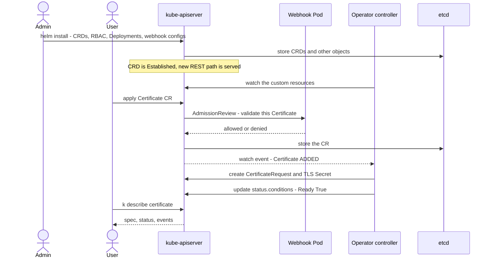

# T4.08 Understand CRDs, install and configure operators

> Competency: "Understand CRDs, install and configure operators" (CKA-4.8) | Domain/weight: CKA — Cluster Architecture, Installation and Configuration (25%) | Est. time: 2.5 h | Prerequisites: T3.18, T4.07

Prerequisite lessons (read them first if a term below is new):

- [T3.18](../part3-ckad/T3.18-discover-and-use-resources-that-extend.md): what a CRD and a custom resource (CR) are, `k get crd`, `k api-resources`, using a CR as a user. This lesson does not re-teach them. It adds the **admin side**: CRD versions and storage, installing and upgrading an operator, its RBAC and scope, health checks, finalizers, admission webhooks.
- [T4.07](../part4-cka/T4.07-use-helm-and-kustomize-to-install.md): `helm repo add`, `helm install`, `helm upgrade`, `helm uninstall`, values, release history, and the CRD problems of charts. This lesson uses those commands to install a real operator.

**Shell setup** (define once per terminal; used everywhere below):

```bash
alias k=kubectl
export do="--dry-run=client -o yaml"
export now="--force --grace-period=0"
source <(kubectl completion bash); complete -o default -F __start_kubectl k
```

**Lab environment: kind** (cluster `lab`, context `kind-lab`, 1 control plane + 2 workers, see [conventions](../00-conventions.md)). Helm is **v4.3.1** (`env/kind-addons.sh helm`). The operator used here is **cert-manager**, installed from the Helm chart `jetstack/cert-manager`, pinned to **v1.21.2** and **v1.21.3** (two real chart versions, so the upgrade lab has something to upgrade). Namespace for drills and labs: `lab-t408`. Files go in `~/lab/t408/`. Your terminal needs access to `charts.jetstack.io`, and the nodes need to pull images from `quay.io`. Create the folder and namespace once (safe to repeat):

```bash
mkdir -p ~/lab/t408
k create ns lab-t408 $do | k apply -f -
```

**Output policy for this lesson.** Every command in sections 2, 5 and 6 and in the labs was run on a real kind cluster on 2026-10-28. Those blocks are labelled exactly `REAL OUTPUT (kind v0.33.0, v1.37.0)`. Differences between that run and the lab environment above (listed again in section 11):

- The capture cluster had 1 control plane + 2 workers and used kind's default CNI (kindnet), not Calico. Nothing in this lesson depends on the CNI.
- The Helm client was **v3.19.2**, not the pinned v4.3.1. The commands used here (`repo add`, `install`, `upgrade`, `history`, `uninstall`, `--set`, `--wait`, `--version`) exist in both. Helm's own message wording may differ in v4.
- The kubectl client was v1.37.1. Pod name hashes, ages, UIDs and timestamps differ on every run.
- Blocks that were not run are labelled `EXPECTED OUTPUT (not captured)` and listed in section 11.

---

## 1. Why this matters

A modern cluster is rarely "Kubernetes only". Databases, certificates, monitoring and backups are installed as **operators**: a controller Pod plus new API types (CRDs) that you configure with YAML. If you do not understand the pieces, simple things go wrong in confusing ways: you apply a Certificate, nothing happens and no error appears; `kubectl apply` fails with `failed calling webhook`; `kubectl delete crd` hangs forever; a `helm uninstall` leaves objects behind (the CRDs, by design).

In the exam you may be asked to install an operator, create its custom resources, and check that it works. The method is always the same: install CRDs and the controller, wait until the controller and its webhook are ready, apply the CR, read `.status` and events. The tools are `kubectl`, `kubectl explain` and the docs (see [section 8](#8-exam-tips)). Which operator and which Helm version the exam uses is UNVERIFIED (research summary E23), so practise the method, not one recipe.

---

## 2. Concepts

### 2.1 CRD lifecycle for admins: install, upgrade, delete, versions, conversion

**What it is.** A **CustomResourceDefinition (CRD)** teaches the API server a new object type. After you create the CRD `certificates.cert-manager.io`, the API server serves a new REST path `/apis/cert-manager.io/v1/namespaces/<ns>/certificates`, and `kubectl get certificate` works. A **custom resource (CR)** is one object of that type. A CRD only stores and validates data. It does nothing by itself. A controller (the operator, next section) acts on the CRs.

**The problem it solves.** Without CRDs, every new feature (certificates, databases) needs a change inside Kubernetes. CRDs let anyone add API types without touching the API server code.

**What breaks without it.** Applying a CR before its CRD exists fails at once. I created a Certificate on a cluster where the chart was installed without CRDs:

```text
REAL OUTPUT (kind v0.33.0, v1.37.0)
$ k apply -f shop.yaml
error: resource mapping not found for name: "shop" namespace: "lab-t408" from "shop.yaml": no matches for kind "Certificate" in version "cert-manager.io/v1"
ensure CRDs are installed first
```

Read this error as: "the API server has no type with this kind and version". Fix: install the CRD (or the version of the CRD that serves this `apiVersion`).

**The lifecycle, one stage at a time.**

| Stage | What you do | What to know |
|---|---|---|
| Install | The operator's chart or manifest creates the CRDs first, then the controller | A CRD becomes usable when its `Established` condition is `True`. `k wait --for=condition=Established crd/NAME` waits for it |
| Upgrade | Apply the new CRD YAML (or `helm upgrade` if the chart templates the CRDs) | Helm's special `crds/` folder is installed once and never upgraded or deleted (see [T4.07](../part4-cka/T4.07-use-helm-and-kustomize-to-install.md)). Many charts therefore template the CRDs behind a value, such as cert-manager's `crds.enabled` |
| Delete | `k delete crd NAME` | This **deletes every CR of that type in every namespace**, then the type. It waits for finalizers (section 2.8). Never delete a CRD to "fix" an operator |

**Versions: served and storage.** One CRD can offer several API versions at once, listed in `spec.versions`. Two booleans matter:

| Field | Meaning | Default | Risky value |
|---|---|---|---|
| `served` | The API server answers requests for this version | none, required | `false` on a version that clients still use: they get `no matches for kind` |
| `storage` | The version used to write objects into etcd. **Exactly one** version must have `storage: true` | none, required | Zero or two `true` values: the CRD is rejected |
| `deprecated` | Clients get a warning header when they use the version | `false` | none, but it does not stop anyone |
| `deprecationWarning` | Text of that warning | a generic message | none |

Objects are stored in etcd in the storage version only. When a client asks for another served version, the API server **converts** the object. The CRD field `spec.conversion.strategy` decides how:

| Strategy | What happens | Use it when |
|---|---|---|
| `None` (default) | Only the `apiVersion` string is rewritten. All other fields are passed through as they are | The schemas of the two versions are identical or compatible |
| `Webhook` | The API server calls an HTTPS service (`spec.conversion.webhook.clientConfig`) to convert between versions | The versions differ in fields. **Awareness only for the CKA**: you will meet it as an operator that ships a conversion webhook. If that webhook is down, any request that needs a conversion fails: reads and lists in a version other than the one stored, and writes in a version other than the storage version (not tested here) |

`status.storedVersions` on the CRD lists every version that **may still have objects in etcd**. The CRD machinery does not trim an entry just because you changed `storage`. In v1.37 the built-in storage version migrator (on by default, section 2.10) can trim it after it has rewritten the objects. This list is what blocks you from deleting an old version from the CRD (section 2.10 shows how it is cleaned).

**Demo on the lab cluster.** I created a tiny CRD with one version, a CR, then upgraded the CRD to two versions, with `v1` as the new storage version. Files are `crd1.yaml`, `crd2.yaml` and `w1.yaml`.

```yaml
# crd1.yaml  - first version of the CRD
apiVersion: apiextensions.k8s.io/v1      # CRDs live in this API group; v1 is the only version in 1.37
kind: CustomResourceDefinition
metadata:
  name: widgets.lab.example.com          # MUST be <plural>.<group>, or the API server rejects it
spec:
  group: lab.example.com                 # the API group of the new type
  scope: Namespaced                      # Namespaced or Cluster. Cannot be changed after creation
  names:
    plural: widgets                      # used in the URL and in 'k get widgets'
    singular: widget
    kind: Widget                         # the kind you write in YAML
    shortNames: [wd]                     # 'k get wd'
  versions:
    - name: v1alpha1
      served: true                       # clients may use it
      storage: true                      # etcd stores objects in this version
      schema:                            # a 'structural' schema is required in apiextensions.k8s.io/v1
        openAPIV3Schema:
          type: object
          properties:
            spec:
              type: object
              properties:
                size:
                  type: integer
      subresources:
        status: {}                       # enables the /status subresource (operators write status there)
```

```yaml
# crd2.yaml  - same CRD with a second version; v1 becomes the storage version
apiVersion: apiextensions.k8s.io/v1
kind: CustomResourceDefinition
metadata:
  name: widgets.lab.example.com
spec:
  group: lab.example.com
  scope: Namespaced
  names:
    plural: widgets
    singular: widget
    kind: Widget
    shortNames: [wd]
  conversion:
    strategy: None                       # the default; written out to make the choice visible
  versions:
    - name: v1alpha1
      served: true                       # still served, so old clients keep working
      storage: false                     # no longer the storage version
      deprecated: true                   # clients now see a warning
      deprecationWarning: "lab.example.com/v1alpha1 Widget is deprecated; use v1"
      schema:
        openAPIV3Schema:
          type: object
          properties:
            spec:
              type: object
              properties:
                size:
                  type: integer
      subresources:
        status: {}
    - name: v1
      served: true
      storage: true                      # exactly one version has storage: true
      schema:
        openAPIV3Schema:
          type: object
          properties:
            spec:
              type: object
              properties:
                size:
                  type: integer
      subresources:
        status: {}
```

```yaml
# w1.yaml  - one CR, written in the old version
apiVersion: lab.example.com/v1alpha1
kind: Widget
metadata:
  name: w1
  namespace: lab-t408
spec:
  size: 3
```

```text
REAL OUTPUT (kind v0.33.0, v1.37.0)
$ k apply -f crd1.yaml
customresourcedefinition.apiextensions.k8s.io/widgets.lab.example.com created
$ k wait --for=condition=Established crd/widgets.lab.example.com --timeout=30s
customresourcedefinition.apiextensions.k8s.io/widgets.lab.example.com condition met
$ k apply -f w1.yaml
widget.lab.example.com/w1 created
$ k get crd widgets.lab.example.com -o jsonpath='{.status.storedVersions}{"\n"}'
["v1alpha1"]
$ k apply -f crd2.yaml
customresourcedefinition.apiextensions.k8s.io/widgets.lab.example.com configured
$ k get crd widgets.lab.example.com -o jsonpath='{.status.storedVersions}{"\n"}'
["v1alpha1","v1"]
$ k -n lab-t408 get widgets.v1alpha1.lab.example.com w1
Warning: lab.example.com/v1alpha1 Widget is deprecated; use v1
NAME   AGE
w1     0s
$ k get crd widgets.lab.example.com
NAME                      SCOPE        VERSIONS               CREATED AT
widgets.lab.example.com   Namespaced   v1(storage),v1alpha1   2026-10-28T05:05:09Z
```

How to read it. After the upgrade, `storedVersions` has **two** entries: `w1` is still stored as `v1alpha1`, and new writes use `v1`. The full syntax `k get widgets.v1alpha1.lab.example.com` (resource.version.group) lets you pick a version. The warning is the `deprecationWarning` text.

### 2.2 The operator pattern: controller + CRDs + RBAC + (webhooks)

**What it is.** An **operator** is a controller that manages one application by watching custom resources. The Kubernetes docs define the pattern at https://kubernetes.io/docs/concepts/extend-kubernetes/operator/. You declare "I want a Certificate for `web.lab.local`" in a CR. The operator runs the steps a human would run (create a key, build a request, sign it, store the Secret, renew it before it expires) and writes the result into `.status`.

**Parts of an operator install.** For cert-manager v1.21.x, the chart created these objects (seen in section 5):

| Part | Object | Job |
|---|---|---|
| API types | 6 CRDs (`certificates`, `certificaterequests`, `issuers`, `clusterissuers`, `orders`, `challenges`) | New kinds you configure |
| Controller | Deployment `cert-manager` | The reconcile loops. This is "the operator" |
| Admission webhook | Deployment `cert-manager-webhook` + Service + `ValidatingWebhookConfiguration` + `MutatingWebhookConfiguration` | Validates (and defaults) CRs on create and update |
| Helper | Deployment `cert-manager-cainjector` | Keeps the CA bundle of the webhook configurations filled in |
| RBAC | ServiceAccounts, ClusterRoles, ClusterRoleBindings, Roles | What the controller may read and write |

Not every operator has a webhook or a helper. The pattern is: CRDs + a controller Deployment + RBAC, and optionally webhooks.

**Operator Lifecycle Manager (OLM) — awareness.** OLM is a separate project that installs and upgrades operators from catalogs (it adds its own CRDs such as `ClusterServiceVersion` and `Subscription`). You may see it on OpenShift and on clusters where an admin chose it. It is not part of Kubernetes, and this lesson uses plain Helm instead. Whichever tool installs it, the result is the same four parts: CRDs, controller, RBAC, optional webhook.

### 2.3 Installing an operator: Helm or manifests

Three common delivery formats:

| Format | Example command pattern | CRDs? | Upgrade | Note |
|---|---|---|---|---|
| Helm chart | `helm install NAME REPO/CHART --version X -n NS --create-namespace --set crds.enabled=true` | Chart-specific switch. **Read the chart values** | `helm upgrade` | Gives release history and rollback |
| One manifest file from the project's release page | `k apply -f cert-manager.yaml` (the URL pattern comes from the project's install docs) | Included | Apply the next release's file | Not run in this lesson; check the project's install page for the URL. No release record. When you have the chart but no `helm install` is wanted, render the same manifests with `helm template` (next paragraph) |
| Kustomize over the project's manifests | `k apply -k DIR` | Included | Change the pinned ref | See [T4.07](../part4-cka/T4.07-use-helm-and-kustomize-to-install.md) |

**The manifest route in practice: `helm template` + server-side apply.** `helm template` renders a chart to plain YAML on your machine; it needs a Helm binary and the chart repository, but no cluster and no release. You then apply that YAML like any manifest file. I ran the render step (Helm v3.19.2, no cluster); the apply step needs a cluster and was not run (section 11):

```bash
k create ns cert-manager
helm template cert-manager jetstack/cert-manager --version v1.21.3 \
  --namespace cert-manager --set crds.enabled=true --no-hooks > cert-manager.yaml
k apply --server-side -f cert-manager.yaml
k -n cert-manager rollout status deploy cert-manager-webhook
```

Why each part: `k create ns` is needed because `helm template` does not emit a Namespace object (it printed none). `--set crds.enabled=true` is the same switch as for `helm install`. `--no-hooks` leaves out the post-install `startupapicheck` Job, which `helm template` would otherwise render (it printed one `Job` without the flag), because a one-shot hook Job does not belong in a manifest you re-apply. `--server-side` avoids the annotation size limit described below. Because no hook waits for the webhook, the last line is your own wait (this is the timing case of section 6.2).

```text
REAL OUTPUT (helm template, Helm v3.19.2, no cluster)
$ grep -E '^kind: ' cert-manager.yaml | sort | uniq -c | sort -rn | head -4
  13 kind: ClusterRole
  10 kind: ClusterRoleBinding
   6 kind: CustomResourceDefinition
   3 kind: ServiceAccount
```

```text
EXPECTED OUTPUT (not captured)
$ k apply --server-side -f cert-manager.yaml
customresourcedefinition.apiextensions.k8s.io/certificaterequests.cert-manager.io serverside-applied
...
deployment.apps/cert-manager-webhook serverside-applied
```

Other operators you will meet follow the same shape: **CloudNativePG** (PostgreSQL clusters) and **prometheus-operator** (Prometheus, Alertmanager, ServiceMonitor CRs) are installed from a Helm chart or release manifests, bring their own CRDs and a controller, and are configured through CRs. I did not run them for this lesson; read their install pages when you need them.

**Large CRDs and `kubectl apply`.** Plain `k apply` (client-side) stores a copy of the whole object in the annotation `kubectl.kubernetes.io/last-applied-configuration`. The total annotation size is limited to 256 KiB. Operators with huge CRDs (prometheus-operator is known for it) exceed it and fail with an error that ends in `metadata.annotations: Too long: <rest of the message not captured>` (exact wording is a placeholder: I did not reproduce it). The fix is **server-side apply**: `k apply --server-side -f crds.yaml`, which does not write that annotation. EXPECTED: not run here (listed in section 11).

**Installing cert-manager with Helm.** The chart has two CRD-related values. I read them from the real chart:

```text
REAL OUTPUT (kind v0.33.0, v1.37.0)
$ helm show values jetstack/cert-manager --version v1.21.3     # excerpt around the CRD values
...
# This option is equivalent to setting crds.enabled=true and crds.keep=true.
# Deprecated: use crds.enabled and crds.keep instead.
installCRDs: false

crds:
  # This option decides if the CRDs should be installed
  # as part of the Helm installation.
  enabled: false

  # This option makes it so that the "helm.sh/resource-policy": keep
  # annotation is added to the CRD. This will prevent Helm from uninstalling
  # the CRD when the Helm release is uninstalled.
  # WARNING: when the CRDs are removed, all cert-manager custom resources
  # (Certificates, Issuers, ...) will be removed too by the garbage collector.
  keep: true
```

| Value | Default | Meaning | Risky value |
|---|---|---|---|
| `crds.enabled` | `false` | Create the 6 CRDs as part of the release | **Left `false`**: the chart installs, but there are no CRDs (see the mistake table, section 6) |
| `crds.keep` | `true` | Add `helm.sh/resource-policy: keep` to each CRD, so `helm uninstall` leaves them | `false`: uninstall deletes the CRDs and with them **every Certificate and Issuer in the cluster** |
| `installCRDs` | `false` | Old name, deprecated. Equals `crds.enabled=true` + `crds.keep=true` | Use `crds.enabled` in new work |

### 2.4 Configuring through CRs; reading `.status` and conditions

**What it is.** You configure an operator by writing CRs. For cert-manager the minimum is an **Issuer** (who signs) and a **Certificate** (what you want). `Issuer` is namespaced. `ClusterIssuer` is the cluster-wide version. A `selfSigned: {}` issuer signs a certificate with its own key, which needs no external service and is perfect for labs. The full YAML with every field explained is in section 4.

**Spec is your wish. Status is the operator's report.** A well-written operator writes progress into `.status`, usually as a list of **conditions**. A condition has `type`, `status` (`True`, `False`, `Unknown`), `reason`, `message`, `lastTransitionTime` and often `observedGeneration`. How to read it:

| Where you look | What it tells you |
|---|---|
| `k get certificate` | Columns `READY` and `SECRET` come from printer columns defined in the CRD. **Empty `READY` means the operator has not written any status yet** |
| `k describe certificate NAME` | Spec, `Status.Conditions`, and an `Events` section from the controller |
| `k get certificate NAME -o jsonpath='{.status.conditions[?(@.type=="Ready")].status}'` | The one value a script or a verification step needs |
| `.status.conditions[].observedGeneration` | If it is lower than `.metadata.generation`, the operator has not seen your latest edit yet |

### 2.5 Operator RBAC, ServiceAccount, namespace and watch scope

**Why.** An operator is a client of the API server. It needs permission to read its own CRs, write their `status`, create child objects (Secrets, Pods) and often to watch several namespaces. That permission comes from a **ServiceAccount** (the identity of the controller Pod) plus **ClusterRoles** and **ClusterRoleBindings** (the grants). If RBAC is missing, the operator logs `forbidden` errors and CRs never become ready.

On the lab cluster the controller runs as ServiceAccount `cert-manager` in namespace `cert-manager`, and the chart created one ClusterRole per job (`cert-manager-controller-certificates`, `...-issuers`, `...-orders` and so on). Look at the rules of one:

```text
REAL OUTPUT (kind v0.33.0, v1.37.0)
$ k get clusterrole cert-manager-controller-certificates -o yaml | sed -n '/^rules/,$p' | head -22
rules:
- apiGroups:
  - cert-manager.io
  resources:
  - certificates
  - certificates/status
  - certificaterequests
  - certificaterequests/status
  verbs:
  - update
  - patch
- apiGroups:
  - cert-manager.io
  resources:
  - certificates
  - certificaterequests
  - clusterissuers
  - issuers
  verbs:
  - get
  - list
  - watch
...
$ k get clusterrolebinding cert-manager-controller-certificates -o jsonpath='{.subjects}{"\n"}'
[{"kind":"ServiceAccount","name":"cert-manager","namespace":"cert-manager"}]
$ k auth can-i update certificates/status --as=system:serviceaccount:cert-manager:cert-manager
yes
$ k auth can-i delete nodes --as=system:serviceaccount:cert-manager:cert-manager
no
```

Notice `certificates/status`. With `subresources.status` enabled on a CRD, the status is a separate endpoint with its own RBAC resource name, so the operator needs `update` on `certificates/status` to report anything. `k auth can-i ... --as=system:serviceaccount:NS:SA` is the fast way to test an operator's permission.

**Watch scope.** A **watch scope** is the set of namespaces whose CRs the operator reacts to. Many operators watch the whole cluster by default and offer a flag or env var to limit it. cert-manager's controller has `--namespace`. I read its help from the real image:

```text
REAL OUTPUT (Docker)
$ docker run --rm quay.io/jetstack/cert-manager-controller:v1.21.3 --help | grep -A1 -- '--namespace'
      --namespace string                                        If set, this limits the scope of cert-manager to a single namespace and ClusterIssuers are disabled. If not specified, all namespaces will be watched
```

If you set that flag to another namespace, CRs in your namespace are ignored: they are created, and nothing happens. Section 6 shows it live. Other operators use other names (a `WATCH_NAMESPACE` environment variable is a common one); always check the Deployment's `args:` and `env:`.

| Scope | Typical RBAC | Effect |
|---|---|---|
| Cluster-wide (default) | ClusterRole + ClusterRoleBinding | Sees CRs in every namespace |
| Single namespace | Role + RoleBinding in that namespace (when the operator supports it) | Sees only that namespace; cannot manage cluster-scoped CRs (such as `ClusterIssuer`) |

### 2.6 Checking operator health

Check in this order. Stop at the first failure.

| # | Check | Command | Healthy looks like |
|---|---|---|---|
| 1 | Pods of the operator run | `k -n cert-manager get deploy,pods` | All Deployments `READY 1/1`, Pods `Running`, restarts low |
| 2 | Webhook is reachable | `k -n cert-manager get endpointslices` | The webhook slice has an IP in `ENDPOINTS` (not `<unset>`) |
| 3 | Operator's own logs | `k -n cert-manager logs deploy/cert-manager` | No repeating `Failed to watch` or `forbidden` lines |
| 4 | Events | `k -n cert-manager get events` and `k describe` on the CR | `Normal` events from the operator's controllers |
| 5 | CR status | `k describe certificate NAME` | `Ready` condition `True` |
| 6 | CRDs exist | `k get crd \| grep cert-manager` | All expected CRDs, version `v1(storage)` |

### 2.7 `kubectl explain` on CRDs and `kubectl get <cr> -A`

`k explain` reads the **OpenAPI schema from the CRD** itself, so it documents custom resources exactly like built-in ones. It works offline from the cluster's own schema, which makes it the fastest way to find a field name when you cannot remember it.

```text
REAL OUTPUT (kind v0.33.0, v1.37.0)
$ k explain certificate.spec | head -22
GROUP:      cert-manager.io
KIND:       Certificate
VERSION:    v1

FIELD: spec <Object>


DESCRIPTION:
    Specification of the desired state of the Certificate resource.
    https://git.k8s.io/community/contributors/devel/sig-architecture/api-conventions.md#spec-and-status
    
FIELDS:
  additionalOutputFormats	<[]Object>
    Defines extra output formats of the private key and signed certificate chain
    to be written to this Certificate's target Secret.

  commonName	<string>
    Requested common name X509 certificate subject attribute.
    More info: https://datatracker.ietf.org/doc/html/rfc5280#section-4.1.2.6
    NOTE: TLS clients will ignore this value when any subject alternative name
    is
    set (see https://tools.ietf.org/html/rfc6125#section-6.4.4).
...
$ k explain certificate.spec.issuerRef
GROUP:      cert-manager.io
KIND:       Certificate
VERSION:    v1

FIELD: issuerRef <Object>
...
FIELDS:
  group	<string>
    Group of the issuer being referred to.
    Defaults to 'cert-manager.io'.

  kind	<string>
    Kind of the issuer being referred to.
    Defaults to 'Issuer'.

  name	<string> -required-
    Name of the issuer being referred to.
```

Useful forms: `k explain certificate.spec --recursive` (every field in one tree), `k explain certificate.spec.privateKey.algorithm`. Find all CR types an operator added: `k api-resources --api-group=cert-manager.io` (shows short names such as `cert`, `iss`, `cr`).

`k get certificate -A` lists CRs in **all namespaces** (`-A` is `--all-namespaces`), which is how you find "which CRs exist before I touch the operator".

### 2.8 Finalizers and deletion order

**What a finalizer is.** A **finalizer** is a string in `metadata.finalizers`. When you delete an object that has finalizers, the API server does not remove it. It only sets `metadata.deletionTimestamp`. The object stays (state `Terminating`) until some controller does its cleanup and **removes its own string** from the list. Then the API server deletes the object for real. Operators use finalizers to run cleanup (delete a cloud disk, deregister something) before the CR disappears.

**The trap.** If the operator that owns the finalizer is gone (scaled to 0, uninstalled, crashing), nobody removes the string, so the CR stays `Terminating` forever, and so does the CRD that is waiting for its CRs.

**Deletion order for removing an operator** (memorise it):

1. Delete the **CRs** (or their namespaces) **while the operator is still running**, so it can finish its cleanup.
2. Uninstall the operator (`helm uninstall`).
3. Delete the **CRDs** last, if you want them gone (charts that keep CRDs, like cert-manager's default, leave this to you).
4. Delete leftovers: the operator namespace.

**Demo with the Widget CRD.** This continues the demo of section 2.1: the CRD `widgets.lab.example.com` (from `crd2.yaml`) and the CR `w1` must exist. cert-manager's CRs carry no finalizers, so I simulated an operator's finalizer by adding one by hand to `w1`. There is no operator for `Widget`, so nobody removes it. This demo ends with the CRD deleted; section 2.10 tells you how to re-create it. Note that `timeout` is a separate program and does not expand the shell alias `k`, so the command below spells out `kubectl`:

```text
REAL OUTPUT (kind v0.33.0, v1.37.0)
$ k -n lab-t408 patch widget w1 --type=merge -p '{"metadata":{"finalizers":["lab.example.com/protect"]}}'
widget.lab.example.com/w1 patched
$ timeout 15 kubectl delete crd widgets.lab.example.com; echo "exit=$?"
customresourcedefinition.apiextensions.k8s.io "widgets.lab.example.com" deleted
exit=124
$ k get crd widgets.lab.example.com
NAME                      SCOPE        VERSIONS               CREATED AT
widgets.lab.example.com   Namespaced   v1(storage),v1alpha1   2026-10-28T05:05:09Z
$ k get crd widgets.lab.example.com -o jsonpath='{.metadata.deletionTimestamp}{"\n"}{.metadata.finalizers}{"\n"}'
2026-10-28T05:07:53Z
["customresourcecleanup.apiextensions.k8s.io"]
$ k get crd widgets.lab.example.com -o jsonpath='{range .status.conditions[*]}{.type}={.status} {.reason}: {.message}{"\n"}{end}'
NamesAccepted=True NoConflicts: no conflicts found
Established=True InitialNamesAccepted: the initial names have been accepted
StorageMigrating=False MigrationSucceeded: The migration has succeeded and the stored versions have been updated
Terminating=True InstanceDeletionInProgress: CustomResource deletion is in progress
$ k -n lab-t408 get widgets -o jsonpath='{.items[0].metadata.deletionTimestamp}{" "}{.items[0].metadata.finalizers}{"\n"}'
2026-10-28T05:07:53Z ["lab.example.com/protect"]
```

How to read it. `kubectl delete` printed `deleted` at once but then waited (my `timeout` killed it after 15 s, exit 124; `k delete crd NAME --wait=false` returns at once instead). The CRD has a `deletionTimestamp` and its own finalizer `customresourcecleanup.apiextensions.k8s.io`, and the condition `Terminating ... InstanceDeletionInProgress` says it is waiting for CRs. The CR `w1` has a `deletionTimestamp` and a finalizer that nobody handles. This is the diagnosis path: **CRD → its conditions → list the CRs → their finalizers → who owns that finalizer.**

The fix in the real world is to start the operator again so it cleans up. The last resort (data loss risk, skips the cleanup) is to remove the finalizer by hand:

```text
REAL OUTPUT (kind v0.33.0, v1.37.0)
$ k -n lab-t408 patch widget w1 --type=merge -p '{"metadata":{"finalizers":null}}'
widget.lab.example.com/w1 patched
$ k get widgets -A
No resources found
```

(The CRD itself disappears a moment later. My `k get crd` straight after the patch still showed it for a second.)

### 2.9 Admission webhooks that block creates; `failurePolicy`

**What it is.** An **admission webhook** is an HTTPS call the API server makes to a Pod before it stores an object. A `ValidatingWebhookConfiguration` can say "no"; a `MutatingWebhookConfiguration` can edit the object. The reference page is https://kubernetes.io/docs/reference/access-authn-authz/extensible-admission-controllers/. Operators use them to reject bad CRs early (a Certificate with no names, for example).

On the lab cluster:

```text
REAL OUTPUT (kind v0.33.0, v1.37.0)
$ k get validatingwebhookconfiguration,mutatingwebhookconfiguration | grep cert-manager
validatingwebhookconfiguration.admissionregistration.k8s.io/cert-manager-webhook   1          31s
mutatingwebhookconfiguration.admissionregistration.k8s.io/cert-manager-webhook     1          31s
$ k get validatingwebhookconfiguration cert-manager-webhook -o jsonpath='{range .webhooks[*]}{.name} failurePolicy={.failurePolicy} timeout={.timeoutSeconds} side={.sideEffects}{"\n"}{.clientConfig.service}{"\n"}{end}'
webhook.cert-manager.io failurePolicy=Fail timeout=30 side=None
{"name":"cert-manager-webhook","namespace":"cert-manager","path":"/validate","port":443}
```

Key fields of each webhook entry:

| Field | Meaning | Default | Risky value |
|---|---|---|---|
| `clientConfig.service` (or `url`) | Where the API server sends the call | none | A Service with no ready Pods: every matching request fails |
| `clientConfig.caBundle` | CA that signed the webhook's serving certificate. The API server refuses a webhook it cannot verify | none | Empty or stale: `x509` errors on every call |
| `rules` | Which operations and resources trigger the call | none | `*` on `pods` cluster-wide: a dead webhook can stop the cluster from starting Pods |
| `failurePolicy` | What the API server does when the call **fails** (cannot connect, times out, returns an error) | `Fail` | `Fail` on a broad rule is safe only if the webhook is highly available; `Ignore` lets requests through unchecked |
| `timeoutSeconds` | Wait time for the call | 10 (max 30). cert-manager sets 30 | Long timeouts make each blocked request slow |
| `sideEffects` | Whether the call changes anything outside the request | none, required | n/a |
| `namespaceSelector` / `objectSelector` | Skip some namespaces or objects | match all | Missing exclusion of the webhook's own namespace can create a deadlock at install time |

**`failurePolicy` in one sentence:** `Fail` means "if I cannot ask the webhook, deny the request"; `Ignore` means "if I cannot ask, allow it". A *denial from a working webhook* is unrelated to `failurePolicy`: that is the webhook doing its job. I triggered one with a Certificate that has no names:

```text
REAL OUTPUT (kind v0.33.0, v1.37.0)
$ k apply -f bad.yaml
Error from server (Forbidden): error when creating "bad.yaml": admission webhook "webhook.cert-manager.io" denied the request: spec: Invalid value: "": at least one of commonName (from the commonName field or from a literalSubject), dnsNames, emailSANs, ipAddresses, otherNames, or uriSANs must be set
```

`Forbidden ... denied the request` = the webhook is alive and rejected your YAML. Fix the YAML. Compare with section 6 for `InternalError ... failed calling webhook`, which means the webhook is **not** answering.

### 2.10 Storage version migration (awareness)

When you change the storage version of a CRD (section 2.1), objects already in etcd keep the **old** encoding until they are rewritten. The old version must stay in `status.storedVersions` until every object is rewritten, so you cannot drop it from the CRD. **Storage version migration** rewrites all objects of a resource to the current storage version.

**This lab step needs the Widget CRD with two stored versions.** The finalizer demo in section 2.8 ended with the CRD deleted, so re-create the state from section 2.1 first: `k apply -f crd1.yaml`, `k wait --for=condition=Established crd/widgets.lab.example.com`, `k apply -f w1.yaml`, `k apply -f crd2.yaml`. Then `k get crd widgets.lab.example.com -o jsonpath='{.status.storedVersions}'` must print `["v1alpha1","v1"]`.

In Kubernetes v1.37 this feature is **enabled by default** and built into the control plane. You do not install anything: the controller `storage-version-migrator-controller` starts inside `kube-controller-manager` (I saw it start in the log), and the metrics endpoint reported the feature `StorageVersionMigrator` as enabled (value `1`). The API `storagemigration.k8s.io/v1` (kind `StorageVersionMigration`, cluster-scoped) is served. You ask for a migration with a tiny object, which names the resource only (group + resource; no version field):

```yaml
# svm.yaml
apiVersion: storagemigration.k8s.io/v1   # served by the API server in v1.37
kind: StorageVersionMigration
metadata:
  name: widgets-to-v1
spec:
  resource:
    group: lab.example.com               # API group of the CRD
    resource: widgets                    # the plural resource name. There is no 'version' field here
```

I tried first with a `version:` field and the API rejected it, which is a useful reminder to run `k explain storageversionmigration.spec.resource`:

```text
REAL OUTPUT (kind v0.33.0, v1.37.0)
$ k apply -f svm.yaml          # first attempt, with a 'version' field under resource
Error from server (BadRequest): error when creating "svm.yaml": StorageVersionMigration in version "v1" cannot be handled as a StorageVersionMigration: strict decoding error: unknown field "spec.resource.version"
$ k apply -f svm.yaml          # corrected file (shown above)
storageversionmigration.storagemigration.k8s.io/widgets-to-v1 created
$ k get storageversionmigration
NAME            RESOURCE                  STATUS
widgets-to-v1   widgets.lab.example.com   Running
... (about 1.5 minutes later)
$ k get storageversionmigration
NAME            RESOURCE                  STATUS
widgets-to-v1   widgets.lab.example.com   Succeeded
$ k get crd widgets.lab.example.com -o jsonpath='{.status.storedVersions}{"\n"}'
["v1"]
```

`storedVersions` shrank from `["v1alpha1","v1"]` to `["v1"]`. Only now is it safe to remove `v1alpha1` from the CRD.

**Do you have to create the object yourself?** What I saw: the feature is on by default, and a hand-made `StorageVersionMigration` trimmed `storedVersions` in about 1.5 minutes. What I did not test: whether the control plane starts a migration by itself right after you change `storage`, and I did not watch `storedVersions` for that. The CRD condition `StorageMigrating=False MigrationSucceeded: ... the stored versions have been updated` (section 2.8) is **not explained**: I did not record whether it was set by the built-in migrator before I created my object or only after it, so do not read it as proof of automatic migration. The reliable check is the value of `status.storedVersions`: if it still lists the old version, create the `StorageVersionMigration` object and check again.

Cleanup of this demo:

```bash
k delete storageversionmigration widgets-to-v1
k delete crd widgets.lab.example.com      # w1 is deleted with it; it has no finalizer in this path
```

### 2.11 Under the hood

- **Creating a CRD.** The `apiextensions-apiserver` part of the API server watches CRDs. When one becomes `Established` it adds REST handlers for the new type, builds its OpenAPI schema (this feeds `k explain`) and starts serving. Objects go into etcd like any other.
- **Validation and pruning.** Every write is checked against the structural schema (`openAPIV3Schema`). Fields not in the schema are **pruned** (silently dropped) unless the schema says `x-kubernetes-preserve-unknown-fields: true`. If your CR "loses" a field, the schema does not have it.
- **How an operator reacts.** The controller opens a **watch** on its CR types (an HTTP stream of ADDED/MODIFIED/DELETED events), keeps a local cache, and runs a **reconcile loop**: compare desired state (`spec`) with actual state, make the missing changes, write `status`. The status write goes to `/status` (needs the RBAC from section 2.5). You saw its traces in the controller log, including harmless lines like `re-queuing item due to optimistic locking on resource`, which means two writers raced and the controller retried.
- **Leader election.** cert-manager runs with a leader lease (arg `--leader-election-namespace=kube-system`). After a restart, the new Pod may wait for the old lease to expire before it reconciles. In my run a CR needed about 30 seconds to become `Ready` after I restored the operator, so wait a minute before you call it broken.
- **Webhook call path.** For a create request, after authentication and authorization, the API server runs mutating webhooks, then schema validation, then validating webhooks, then writes to etcd. A failing `Fail` webhook therefore stops the write.

### 2.12 Related but different

| Often confused | Difference |
|---|---|
| CRD vs **aggregated API** (APIService, e.g. metrics-server) | A CRD is stored by the main API server in etcd. An aggregated API is served by your own extension server |
| **Operator** vs **Helm chart** | A chart is an installer (templates). An operator is software that keeps running and reconciles. Many operators are *installed by* a chart |
| **Admission webhook** vs **conversion webhook** | Admission: allow, deny or edit a write. Conversion: translate between CRD versions on read/write |
| **Finalizer** vs **ownerReference** | A finalizer blocks deletion until cleanup runs. An ownerReference lets the garbage collector delete children when the parent is deleted |
| `Issuer` vs `ClusterIssuer` | Same job; `Issuer` is namespaced, `ClusterIssuer` is cluster-wide |

---

## 3. How it works (diagram)



Walkthrough:

1. The admin installs the CRDs first, then the controller, the webhook and the RBAC. After this the API server serves the new kind.
2. The controller opens a watch on its CR types. It now waits for events.
3. The user applies a CR. The API server calls the webhook. If the webhook denies the CR, or cannot be reached while `failurePolicy` is `Fail`, the request ends here and nothing is stored.
4. If it is allowed, the CR is stored and the watch event reaches the controller.
5. The controller creates child objects (CertificateRequest, Secret) and writes the result into `.status`. The user reads it with `k get`/`k describe`.

---

## 4. Commands and YAML you must produce fast

**Imperative shortcuts.** There is no `k create certificate`, because a CR kind has no built-in generator. The speed comes from these commands:

```bash
# 1. Install the operator with its CRDs and wait until it is ready
helm repo add jetstack https://charts.jetstack.io && helm repo update
helm install cert-manager jetstack/cert-manager --version v1.21.3 \
  --namespace cert-manager --create-namespace --set crds.enabled=true --wait
# One line: repo + install. --wait returns when Pods are Ready. --set crds.enabled=true is the part people forget.

# 2. Prove the CRDs exist
k get crd | grep cert-manager
# Lists the 6 CRDs, scope and versions.

# 3. Find fields without opening a browser
k explain certificate.spec            # fields of the spec
k explain certificate.spec --recursive | less   # whole tree
# Reads the schema from the CRD in the cluster.

# 4. See every CR of a kind, in every namespace
k get certificate -A

# 5. Why is it not Ready?
k describe certificate web -n lab-t408      # conditions + events
k -n cert-manager logs deploy/cert-manager  # the operator's own view

# 6. Get a starting YAML from an existing object
k -n lab-t408 get certificate web -o yaml   # then delete status, uid, resourceVersion, creationTimestamp
```

The exam hosts have `kubectl`, `yq`, `curl`, `wget` and `man` (research summary E9, https://docs.linuxfoundation.org/tc-docs/certification/tips-cka-and-ckad). A `helm` binary is not in that list, so whether Helm is available on an exam host is UNVERIFIED. Docs at https://helm.sh/docs are allowed (E13, https://docs.linuxfoundation.org/tc-docs/certification/certification-resources-allowed). Know the plain-manifest route (`k apply -f`, or `k apply --server-side -f` for large CRDs) as well; section 2.3 shows how to render a chart to a manifest with `helm template`.

**Declarative YAML: self-signed Issuer + Certificate that produces a TLS Secret.** Save as `~/lab/t408/issuer.yaml`:

```yaml
apiVersion: cert-manager.io/v1          # group/version of the cert-manager CRDs
kind: Issuer                            # namespaced signer ('ClusterIssuer' is the cluster-wide kind)
metadata:
  name: selfsigned                      # the Certificate refers to this name
  namespace: lab-t408                   # an Issuer can only be used by Certificates in the SAME namespace
spec:
  selfSigned: {}                        # signer type: sign with the certificate's own key. No settings needed
---
apiVersion: cert-manager.io/v1
kind: Certificate
metadata:
  name: web                             # name of the Certificate object
  namespace: lab-t408
spec:
  secretName: web-tls                   # REQUIRED. The Secret (type kubernetes.io/tls) the operator creates and renews
  duration: 2160h                       # lifetime of the certificate (90 days). Default 90 days if omitted
  renewBefore: 360h                     # start renewing this long before expiry (15 days). Must be < duration
  commonName: web.lab.local             # subject CN. Optional if dnsNames is set. TLS clients prefer the SANs
  dnsNames:                             # subject alternative names. At least one of commonName/dnsNames/... is REQUIRED
    - web.lab.local
  privateKey:
    algorithm: ECDSA                    # RSA (default), ECDSA or Ed25519
    size: 256                           # ECDSA: 256 (default), 384 or 521. RSA: 2048 (default), 4096 or 8192. Ignored for Ed25519. Other values are "not allowed" per the CRD text
  issuerRef:
    name: selfsigned                    # REQUIRED. Which issuer signs this
    kind: Issuer                        # default is Issuer. Use ClusterIssuer for a cluster issuer
                                        # 'group' defaults to cert-manager.io
```

Field notes. The `size` values come from the field description inside the v1.21.3 CRD (I read it in the rendered chart); `k explain certificate.spec.privateKey.size` shows the same text on your cluster. `secretName` is the only output: the operator creates this Secret with keys `tls.crt`, `tls.key` and `ca.crt`. `renewBefore` larger than `duration` makes no sense, and the validation webhook can reject it; I did not test that case, so check with a dry run: `k apply -f x.yaml --dry-run=server` calls the webhook without storing anything (I saw this path run the webhook in section 6).

Minimal version (what you write under time pressure):

```yaml
apiVersion: cert-manager.io/v1
kind: Certificate
metadata:
  name: web
  namespace: lab-t408
spec:
  secretName: web-tls
  dnsNames:
    - web.lab.local
  issuerRef:
    name: selfsigned
```

**Speed drill.** Setup (installs the operator with command 1 above, so it works from a clean cluster; objects use the name `drill`, nothing else in the lab is touched):

```bash
k create ns lab-t408 $do | k apply -f -
mkdir -p ~/lab/t408
helm repo add jetstack https://charts.jetstack.io --force-update && helm repo update
helm upgrade --install cert-manager jetstack/cert-manager --version v1.21.3 \
  --namespace cert-manager --create-namespace --set crds.enabled=true --wait
```

| # | Task | Target time |
|---|---|---|
| 1 | List the cert-manager CRDs with their scope | 30 s |
| 2 | Print only the storage version name of the `certificates.cert-manager.io` CRD | 45 s |
| 3 | Find the required field of `certificate.spec.issuerRef` and the default of `kind` | 45 s |
| 4 | In `lab-t408`, create a self-signed Issuer `drill-issuer` and a Certificate `drill` (secret `drill-tls`, DNS `drill.lab.local`), wait until Ready | 3 min |
| 5 | Print only the `Ready` condition status of `drill` | 45 s |
| 6 | Print the `failurePolicy` of the cert-manager validating webhook | 60 s |
| 7 | Show whether the operator is healthy: Deployments in `cert-manager` and the last 5 log lines of the controller | 90 s |
| 8 | Save a list of all Certificates in all namespaces to `~/lab/t408/certs.txt` | 45 s |

<details><summary>Answers</summary>

```bash
# 1
k get crd | grep cert-manager
# 2  (EXPECTED OUTPUT (not captured): v1 -- I saw v1 as the only version, storage=true)
k get crd certificates.cert-manager.io -o jsonpath='{.spec.versions[?(@.storage==true)].name}{"\n"}'
# 3  name is -required-; kind "Defaults to 'Issuer'"
k explain certificate.spec.issuerRef
# 4
cat > ~/lab/t408/drill.yaml <<'EOF'
apiVersion: cert-manager.io/v1
kind: Issuer
metadata:
  name: drill-issuer
  namespace: lab-t408
spec:
  selfSigned: {}
---
apiVersion: cert-manager.io/v1
kind: Certificate
metadata:
  name: drill
  namespace: lab-t408
spec:
  secretName: drill-tls
  dnsNames:
    - drill.lab.local
  issuerRef:
    name: drill-issuer
EOF
k apply -f ~/lab/t408/drill.yaml
k -n lab-t408 wait --for=condition=Ready certificate/drill --timeout=60s
# 5
k -n lab-t408 get certificate drill -o jsonpath='{.status.conditions[?(@.type=="Ready")].status}{"\n"}'
# 6
k get validatingwebhookconfiguration cert-manager-webhook -o jsonpath='{.webhooks[0].failurePolicy}{"\n"}'
# 7
k -n cert-manager get deploy
k -n cert-manager logs deploy/cert-manager --tail=5
# 8
k get certificate -A > ~/lab/t408/certs.txt
```

Cleanup (CRs first, then the operator, then the CRDs, as in section 2.8; it also removes the Secret explicitly. The labs in section 7 expect a cluster without cert-manager, so the operator goes too):

```bash
k -n lab-t408 delete certificate drill --ignore-not-found
k -n lab-t408 delete issuer drill-issuer --ignore-not-found
k -n lab-t408 delete secret drill-tls --ignore-not-found
helm uninstall cert-manager -n cert-manager
k delete crd -l app.kubernetes.io/instance=cert-manager --ignore-not-found
k delete ns cert-manager --ignore-not-found
rm -f ~/lab/t408/drill.yaml ~/lab/t408/certs.txt
```

</details>

---

## 5. Worked example

Goal: install cert-manager v1.21.2 with its CRDs, inspect what was installed, issue a self-signed certificate, and read the status. Environment: kind (captured on a cluster named `k-t408`; yours is `lab`). All blocks below are `REAL OUTPUT (kind v0.33.0, v1.37.0)`.

**Step 1. Check the cluster has no cert-manager yet.** This is your baseline.

```text
REAL OUTPUT (kind v0.33.0, v1.37.0)
$ k get crd | grep cert-manager
$ k create ns lab-t408
namespace/lab-t408 created
```

(`grep` prints nothing, because there are no CRDs. If you ran the preamble at the top, `lab-t408` already exists and `k create ns` would print `AlreadyExists`: skip it, or use `k create ns lab-t408 $do | k apply -f -`.)

**Step 2. Add the chart repository and look at the available versions.** Pin a version so the lab is repeatable.

```text
REAL OUTPUT (kind v0.33.0, v1.37.0)
$ helm repo add jetstack https://charts.jetstack.io
"jetstack" has been added to your repositories
$ helm search repo jetstack/cert-manager --versions | head -5
NAME                                   	CHART VERSION	APP VERSION	DESCRIPTION
jetstack/cert-manager                  	v1.21.3      	v1.21.3    	A Helm chart for cert-manager
jetstack/cert-manager                  	v1.21.2      	v1.21.2    	A Helm chart for cert-manager
jetstack/cert-manager                  	v1.21.1      	v1.21.1    	A Helm chart for cert-manager
jetstack/cert-manager                  	v1.21.0      	v1.21.0    	A Helm chart for cert-manager
```

**Step 3. Install, with the CRDs switch.** `--wait` makes Helm return only when the Pods are ready. The chart also runs a post-install check job (`startupapicheck`, section 6) before Helm returns.

```text
REAL OUTPUT (kind v0.33.0, v1.37.0)
$ helm install cert-manager jetstack/cert-manager --version v1.21.2 \
    --namespace cert-manager --create-namespace --set crds.enabled=true --wait --timeout 5m
NAME: cert-manager
LAST DEPLOYED: Wed Oct 28 13:02:58 2026
NAMESPACE: cert-manager
STATUS: deployed
REVISION: 1
TEST SUITE: None
NOTES:
cert-manager v1.21.2 has been deployed successfully!
...
```

This took about 25 seconds including image pulls.

**Step 4. Verify the four parts: CRDs, controller, webhook, RBAC.**

```text
REAL OUTPUT (kind v0.33.0, v1.37.0)
$ k get crd | grep cert-manager
certificaterequests.cert-manager.io   Namespaced   v1(storage)   2026-10-28T05:02:58Z
certificates.cert-manager.io          Namespaced   v1(storage)   2026-10-28T05:02:58Z
challenges.acme.cert-manager.io       Namespaced   v1(storage)   2026-10-28T05:02:58Z
clusterissuers.cert-manager.io        Cluster      v1(storage)   2026-10-28T05:02:58Z
issuers.cert-manager.io               Namespaced   v1(storage)   2026-10-28T05:02:58Z
orders.acme.cert-manager.io           Namespaced   v1(storage)   2026-10-28T05:02:58Z
$ k -n cert-manager get deploy,pods,svc
NAME                                      READY   UP-TO-DATE   AVAILABLE   AGE
deployment.apps/cert-manager              1/1     1            1           24s
deployment.apps/cert-manager-cainjector   1/1     1            1           24s
deployment.apps/cert-manager-webhook      1/1     1            1           24s

NAME                                           READY   STATUS    RESTARTS   AGE
pod/cert-manager-54b7dc69c4-rhrvl              1/1     Running   0          24s
pod/cert-manager-cainjector-8677bbdb7f-g4m8n   1/1     Running   0          24s
pod/cert-manager-webhook-55b94f85b4-x4nss      1/1     Running   0          24s

NAME                              TYPE        CLUSTER-IP      EXTERNAL-IP   PORT(S)            AGE
service/cert-manager              ClusterIP   10.96.114.106   <none>        9402/TCP           25s
service/cert-manager-cainjector   ClusterIP   10.96.248.21    <none>        9402/TCP           25s
service/cert-manager-webhook      ClusterIP   10.96.206.143   <none>        443/TCP,9402/TCP   25s
$ k -n cert-manager get deploy cert-manager -o jsonpath='{.spec.template.spec.containers[0].args}{"\n"}{.spec.template.spec.serviceAccountName}{"\n"}'
["--v=2","--cluster-resource-namespace=$(POD_NAMESPACE)","--leader-election-namespace=kube-system","--acme-http01-solver-image=quay.io/jetstack/cert-manager-acmesolver:v1.21.2","--max-concurrent-challenges=60"]
cert-manager
$ k api-resources --api-group=cert-manager.io
NAME                  SHORTNAMES   APIVERSION           NAMESPACED   KIND
certificaterequests   cr,crs       cert-manager.io/v1   true         CertificateRequest
certificates          cert,certs   cert-manager.io/v1   true         Certificate
clusterissuers        ciss         cert-manager.io/v1   false        ClusterIssuer
issuers               iss          cert-manager.io/v1   true         Issuer
```

What to look for: all three Deployments `1/1`; the webhook Service on port 443; the controller args contain **no** `--namespace=...`, so it watches all namespaces; `serviceAccountName: cert-manager`, which matches the ClusterRoleBinding subject in section 2.5. The CRDs show `v1(storage)`.

**Step 5. Apply the Issuer and Certificate from section 4.**

```text
REAL OUTPUT (kind v0.33.0, v1.37.0)
$ k apply -f issuer.yaml
issuer.cert-manager.io/selfsigned created
certificate.cert-manager.io/web created
$ k -n lab-t408 get issuer,certificate,certificaterequest,secret
NAME                                READY   AGE
issuer.cert-manager.io/selfsigned   True    3s

NAME                              READY   SECRET    AGE
certificate.cert-manager.io/web   True    web-tls   3s

NAME                                       APPROVED   DENIED   READY   ISSUER       REQUESTER                                         AGE
certificaterequest.cert-manager.io/web-1   True                True    selfsigned   system:serviceaccount:cert-manager:cert-manager   3s

NAME             TYPE                DATA   AGE
secret/web-tls   kubernetes.io/tls   3      3s
```

The operator created a child **CertificateRequest** `web-1` and the TLS **Secret** `web-tls` with 3 keys, within 3 seconds.

**Step 6. Read the status and events.**

```text
REAL OUTPUT (kind v0.33.0, v1.37.0)
$ k -n lab-t408 describe certificate web
Name:         web
Namespace:    lab-t408
...
Spec:
  Common Name:  web.lab.local
  Dns Names:
    web.lab.local
  Duration:  2160h
  Issuer Ref:
    Kind:  Issuer
    Name:  selfsigned
  Private Key:
    Algorithm:   ECDSA
    Size:        256
  Renew Before:  360h
  Secret Name:   web-tls
Status:
  Conditions:
    Last Transition Time:  2026-10-28T05:03:35Z
    Message:               Certificate is up to date and has not expired
    Observed Generation:   1
    Reason:                Ready
    Status:                True
    Type:                  Ready
  Not After:               2027-01-26T05:03:35Z
  Not Before:              2026-10-28T05:03:35Z
  Renewal Time:            2027-01-11T05:03:35Z
  Revision:                1
Events:
  Type    Reason     Age   From                                       Message
  ----    ------     ----  ----                                       -------
  Normal  Issuing    3s    cert-manager-certificates-trigger          Issuing certificate as Secret does not exist
  Normal  Generated  3s    cert-manager-certificates-key-manager      Stored new private key in temporary Secret resource "web-zl5gf"
  Normal  Requested  3s    cert-manager-certificates-request-manager  Created new CertificateRequest resource "web-1"
  Normal  Issuing    3s    cert-manager-certificates-issuing          The certificate has been successfully issued
$ k -n lab-t408 get certificate web -o jsonpath='{range .status.conditions[*]}{.type}={.status} {.reason}{"\n"}{end}'
Ready=True Ready
$ k get certificate -A
NAMESPACE   NAME   READY   SECRET    AGE
lab-t408    web    True    web-tls   9s
```

How to read it. The `Ready` condition is `True`, `Observed Generation: 1` equals the object's generation, `Not After` is 2160 h (90 days) after `Not Before`, and `Renewal Time` is 15 days before expiry (`renewBefore: 360h`). The events show the four stages: the *trigger* controller decided to issue, the *key-manager* made a key, the *request-manager* created `web-1`, the *issuing* controller stored the Secret.

**Step 7. Read the operator's log for the same object.**

```text
REAL OUTPUT (kind v0.33.0, v1.37.0)
$ k -n cert-manager logs deploy/cert-manager | grep lab-t408 | head -3
I1028 05:03:35.707121       1 conditions.go:102] "Setting lastTransitionTime for Issuer condition" logger="cert-manager" issuer="lab-t408/selfsigned" condition="Ready" lastTransitionTime="2026-10-28 05:03:35.707025697 +0000 UTC m=+28.576437565"
I1028 05:03:35.714799       1 trigger_controller.go:238] "Certificate must be re-issued" logger="cert-manager.controller" key="lab-t408/web" reason="DoesNotExist" message="Issuing certificate as Secret does not exist"
I1028 05:03:35.714821       1 conditions.go:217] "Setting lastTransitionTime for Certificate condition" logger="cert-manager" certificate="lab-t408/web" condition="Issuing" lastTransitionTime="2026-10-28 05:03:35.714816385 +0000 UTC m=+28.584228211"
```

Log lines name the object as `namespace/name`, so `grep lab-t408` or `grep web` filters to your CR.

**Step 8. Check the Secret holds a real certificate** (the `openssl` command is optional and is not in the exam tool list; `k get secret ... -o yaml` is enough there).

```text
REAL OUTPUT (kind v0.33.0, v1.37.0)
$ k -n lab-t408 get secret web-tls -o jsonpath='{.data.tls\.crt}' | base64 -d | openssl x509 -noout -subject -issuer -dates
subject=CN=web.lab.local
issuer=CN=web.lab.local
notBefore=Oct 28 05:03:35 2026 GMT
notAfter=Jan 26 05:03:35 2027 GMT
```

Subject equals issuer because the certificate is self-signed.

**Step 9. Clean up in the right order** (CRs first, operator, then CRDs and namespace). The same real run:

```text
REAL OUTPUT (kind v0.33.0, v1.37.0)
$ k delete ns lab-t408
namespace "lab-t408" deleted
$ helm uninstall cert-manager -n cert-manager
release "cert-manager" uninstalled
$ k get crd | grep cert-manager | wc -l
       6
$ k delete crd -l app.kubernetes.io/instance=cert-manager
customresourcedefinition.apiextensions.k8s.io "certificaterequests.cert-manager.io" deleted
...
$ k delete ns cert-manager
namespace "cert-manager" deleted
```

Uninstall left **6 CRDs** behind, because of `crds.keep: true`. That is the intended safety net.

---

## 6. Common mistakes and how to fix them

| Symptom | What you will see (exact error/event text) | Cause | Fix (command) |
|---|---|---|---|
| CR created, nothing happens | `k get certificate` shows `READY` empty. `k describe` shows `Events: <none>`. No Secret | Operator not running (Deployment at 0 replicas) **or** watching another namespace | Check section below, then `k -n cert-manager scale deploy cert-manager --replicas=1` or remove the wrong arg |
| Create fails: webhook down | `Error from server (InternalError): error when creating "api.yaml": Internal error occurred: failed calling webhook "webhook.cert-manager.io": failed to call webhook: Post "https://cert-manager-webhook.cert-manager.svc:443/validate?timeout=30s": dial tcp 10.96.206.143:443: connect: connection refused` | Webhook Service has no ready Pod | Wait, or fix the webhook Pod: `k -n cert-manager get deploy,pods,endpointslices` and `k -n cert-manager scale deploy cert-manager-webhook --replicas=1` |
| CRD delete hangs | `k delete crd NAME` prints `deleted` then never returns. CRD has `deletionTimestamp` and condition `Terminating=True InstanceDeletionInProgress: CustomResource deletion is in progress` | CRs with finalizers and no running operator | Start the operator, delete the CRs first, then the CRD. Last resort: patch `finalizers: null` |
| CR rejected by a working webhook | `Error from server (Forbidden): ... admission webhook "webhook.cert-manager.io" denied the request: spec: Invalid value: "": at least one of commonName ..., dnsNames, ... must be set` | Bad CR content | Fix the YAML. `k explain` the field |
| CRD missing | `error: resource mapping not found for name: "shop" ... no matches for kind "Certificate" in version "cert-manager.io/v1"` / `ensure CRDs are installed first` | Chart installed without `crds.enabled=true` (or CRDs not applied) | `helm upgrade ... --set crds.enabled=true` (see below) |
| `helm install` hangs then fails | `Error: INSTALLATION FAILED: failed post-install: 1 error occurred: * timed out waiting for the condition` | Same cause: the post-install check job cannot find the CRDs | Same fix, after cleaning the failed release |
| `helm uninstall` leaves objects | Helm prints the CRD names as kept | `crds.keep: true` (`helm.sh/resource-policy: keep`) | Delete the CRDs yourself with `k delete crd -l app.kubernetes.io/instance=cert-manager` after the CRs are gone |

### 6.1 CRs created but nothing happens

**Diagnostic path, in order.** I ran this exact path twice, once for each cause.

1. `k -n lab-t408 get certificate` — READY column empty means no status was ever written.
2. `k -n lab-t408 describe certificate NAME` — `Events: <none>` means no controller has touched it.
3. `k -n cert-manager get deploy` — is the controller up?
4. `k -n cert-manager get deploy cert-manager -o jsonpath='{.spec.template.spec.containers[0].args}'` — is there a scope flag?
5. `k -n cert-manager logs deploy/cert-manager` — errors?

**Cause A: operator scaled to 0.**

```text
REAL OUTPUT (kind v0.33.0, v1.37.0)
$ k -n cert-manager scale deploy cert-manager --replicas=0
deployment.apps/cert-manager scaled
$ k apply -f db.yaml
certificate.cert-manager.io/db created
$ k -n lab-t408 get certificate
NAME   READY   SECRET    AGE
api    True    api-tls   39s
db             db-tls    5s
web    True    web-tls   81s
$ k -n lab-t408 get certificate db -o jsonpath='{.status}{"\n"}'

$ k -n lab-t408 get secret db-tls
Error from server (NotFound): secrets "db-tls" not found
$ k -n lab-t408 describe certificate db | tail -4
  Secret Name:  db-tls
Events:         <none>
$ k -n cert-manager get deploy
NAME                      READY   UP-TO-DATE   AVAILABLE   AGE
cert-manager              0/0     0            0           117s
cert-manager-cainjector   1/1     1            1           117s
cert-manager-webhook      1/1     1            1           117s
```

Notice that the create **succeeded** (the webhook is up), the `READY` cell is empty, `.status` prints an empty line, and the `Events` section is `<none>`. The `cert-manager` Deployment shows `0/0`. Fix: `k -n cert-manager scale deploy cert-manager --replicas=1`, then `k -n cert-manager rollout status deploy cert-manager`. After the restart the CR became `READY True` about 10 seconds later.

**Cause B: operator watching another namespace.** I added `--namespace=lab-other` to the controller args.

```text
REAL OUTPUT (kind v0.33.0, v1.37.0)
$ k -n cert-manager patch deploy cert-manager --type=json -p '[{"op":"add","path":"/spec/template/spec/containers/0/args/-","value":"--namespace=lab-other"}]'
deployment.apps/cert-manager patched
$ k apply -f scoped.yaml
certificate.cert-manager.io/scoped created
$ k -n lab-t408 get certificate scoped
NAME     READY   SECRET       AGE
scoped           scoped-tls   6s
$ k -n cert-manager get deploy cert-manager -o jsonpath='{.spec.template.spec.containers[0].args}{"\n"}'
["--v=2","--cluster-resource-namespace=$(POD_NAMESPACE)","--leader-election-namespace=kube-system","--acme-http01-solver-image=quay.io/jetstack/cert-manager-acmesolver:v1.21.3","--max-concurrent-challenges=60","--namespace=lab-other"]
```

The Deployment is `1/1` and the logs show nothing wrong, so the symptom looks the same as cause A, but the check of `args` reveals the scope flag. Fix: remove that argument (here it is index 5: `k -n cert-manager patch deploy cert-manager --type=json -p '[{"op":"remove","path":"/spec/template/spec/containers/0/args/5"}]'`, found by counting the list above), or run `helm upgrade` with the original values. **Wait up to about a minute**: in my run the CR became `READY True` about 30 seconds after the rollout (new Pod, leader election).

Tell the two causes apart by the Deployment's READY column and the `args:` line. Do not guess.

### 6.2 `failed calling webhook` on create

```text
REAL OUTPUT (kind v0.33.0, v1.37.0)
$ k -n cert-manager scale deploy cert-manager-webhook --replicas=0
deployment.apps/cert-manager-webhook scaled
$ k apply -f api.yaml
Error from server (InternalError): error when creating "api.yaml": Internal error occurred: failed calling webhook "webhook.cert-manager.io": failed to call webhook: Post "https://cert-manager-webhook.cert-manager.svc:443/validate?timeout=30s": dial tcp 10.96.206.143:443: connect: connection refused
$ k apply -f api.yaml --dry-run=server
Error from server (InternalError): error when creating "api.yaml": Internal error occurred: failed calling webhook "webhook.cert-manager.io": failed to call webhook: Post "https://cert-manager-webhook.cert-manager.svc:443/validate?timeout=30s": dial tcp 10.96.206.143:443: connect: connection refused
$ k -n cert-manager get endpointslices
NAME                            ADDRESSTYPE   PORTS     ENDPOINTS    AGE
cert-manager-cainjector-j5wjg   IPv4          9402      10.244.3.3   56s
cert-manager-g6s4c              IPv4          9402      10.244.3.2   56s
cert-manager-webhook-jt7w4      IPv4          <unset>   <unset>      56s
```

**Read the message in pieces.** `InternalError` = the API server failed, not your YAML. `failed calling webhook "webhook.cert-manager.io"` = names the webhook (find it with `k get validatingwebhookconfiguration,mutatingwebhookconfiguration`). `Post "https://cert-manager-webhook.cert-manager.svc:443/validate..."` = the Service `cert-manager-webhook` in namespace `cert-manager`. `connect: connection refused` = nothing accepted the connection. On this kind cluster that is what a Service with **no ready endpoints** looked like. Other texts exist for other causes (a slow Pod gives a timeout message, a wrong CA gives an `x509` message); I did not capture those, so I do not quote them. If you see a different tail after `failed to call webhook:`, the first checks are the same.

**Diagnostic path.** (1) Find the webhook name in the error. (2) Find its Service from the message (`cert-manager-webhook` in `cert-manager`). (3) `k -n cert-manager get endpointslices`: `<unset>` under ENDPOINTS means no ready Pod. (4) `k -n cert-manager get deploy,pods` and `k -n cert-manager describe pod ...` to see why. Fix: bring the webhook Pod back; here `k -n cert-manager scale deploy cert-manager-webhook --replicas=1` and `rollout status`.

**Timing.** The webhook is not ready right after the Pod object exists. cert-manager's chart adds a post-install hook Job (`startupapicheck`) that keeps trying to create a test request until the webhook answers. Helm waits for hooks, so a successful `helm install` already means the webhook works. I tested this: with `--wait` the install took about 25 s, and in a second test without `--wait` the install command still took 90 s (hook Job plus image pulls) and my first `k apply` right after it succeeded. If you install from a plain manifest (`k apply -f`) there is no such hook, so retry after `k -n cert-manager rollout status deploy cert-manager-webhook`.

**`failurePolicy` and the emergency exit.** With `failurePolicy: Fail`, a dead webhook blocks creates for every matching request. For a webhook that matches broad resources, that can stop a cluster. The fast, temporary escape is to set the policy to `Ignore`. I tested the effect with the webhook scaled to 0:

```text
REAL OUTPUT (kind v0.33.0, v1.37.0)
$ k apply -f api.yaml --dry-run=server -o name        # after changing failurePolicy to Ignore (webhook still at 0)
certificate.cert-manager.io/api
$ helm upgrade cert-manager jetstack/cert-manager --version v1.21.2 -n cert-manager --set crds.enabled=true --wait
Release "cert-manager" has been upgraded. Happy Helming!
$ k get validatingwebhookconfiguration cert-manager-webhook -o jsonpath='{.webhooks[0].failurePolicy}{"\n"}'
Fail
```

I changed the policy by piping the object through `jq` and `k apply`. A command that needs no `jq` is the JSON patch below (EXPECTED OUTPUT (not captured), since I did not run exactly this command):

```bash
k patch validatingwebhookconfiguration cert-manager-webhook --type=json \
  -p '[{"op":"replace","path":"/webhooks/0/failurePolicy","value":"Ignore"}]'
```

Two lessons. This turns validation off, so use it only to unblock yourself and undo it after the webhook is healthy. And the next `helm upgrade` put the value back to `Fail`, so Helm manages that object. The mutating webhook is separate: it also had `failurePolicy: Fail`. In my test the `Certificate` create passed with only the validating policy changed, and I did not check which rules the mutating webhook matches, so check both configurations if you are blocked.

### 6.3 CRD delete hangs

The full real transcript is in section 2.8. The path: `k get crd NAME -o jsonpath='{.metadata.deletionTimestamp}'` is set → conditions say `Terminating=True InstanceDeletionInProgress` → `k get <kind> -A` lists the CRs → `-o jsonpath='{.items[*].metadata.finalizers}'` shows who owns the finalizer → start that operator (or, as a last resort, remove the finalizer with a patch).

### 6.4 CRDs missing: `no matches for kind` and the stuck `helm install`

Without `--set crds.enabled=true`, the chart installs only the Pods. These are the pieces I saw, in the order you would meet them.

```text
REAL OUTPUT (kind v0.33.0, v1.37.0)
$ helm install cert-manager jetstack/cert-manager --version v1.21.3 -n cert-manager --create-namespace --wait
(... the command did not return for about 5 minutes ...)
Error: INSTALLATION FAILED: failed post-install: 1 error occurred:
	* timed out waiting for the condition
$ k -n cert-manager get pods
NAME                                       READY   STATUS    RESTARTS      AGE
cert-manager-bc8ddc9f6-th6gh               1/1     Running   0             4m49s
cert-manager-cainjector-557444dc8d-7cqwd   1/1     Running   0             4m49s
cert-manager-startupapicheck-7nhbr         1/1     Running   3 (85s ago)   4m41s
cert-manager-webhook-bf7f8b575-nh2kw       1/1     Running   0             4m49s
$ k -n cert-manager logs job/cert-manager-startupapicheck --tail=1
I1028 05:22:39.409280  1 api.go:103] "Not ready" logger="cert-manager.startupapicheck.checkAPI" err="the cert-manager CRDs are not yet installed on the Kubernetes API server" underlyingError="error finding the scope of the object: failed to get restmapping: no matches for kind \"CertificateRequ...
$ k -n cert-manager logs deploy/cert-manager --tail=1
E1028 05:22:37.946445  1 reflector.go:227] "Failed to watch" err="failed to list *v1.Issuer: the server could not find the requested resource (get issuers.cert-manager.io)" logger="UnhandledError" reflector="k8s.io/client-go@v0.36.2/tools/cache/reflector.go:343" type="*v1.Issuer"
$ k apply -f shop.yaml
error: resource mapping not found for name: "shop" namespace: "lab-t408" from "shop.yaml": no matches for kind "Certificate" in version "cert-manager.io/v1"
ensure CRDs are installed first
```

Note the trap: the controller Pod says `Running 1/1` while it logs `Failed to watch` every few seconds. **Running does not mean working.** Always read the log. Fix: clean the failed release (`helm uninstall cert-manager -n cert-manager`), then install again with `--set crds.enabled=true`. A normal `helm upgrade --install ... --set crds.enabled=true` on a half-installed release works too (I used `upgrade --install` on a clean cluster after cleanup).

### 6.5 What `helm upgrade` does to your values

**Advice:** repeat your values on every `helm upgrade` (`--set crds.enabled=true` or `-f values.yaml`), so you never depend on what Helm remembers. `helm get values cert-manager -n cert-manager` shows what the release currently holds.

**What I observed, and what I did not confirm.** In one test with Helm v3.19.2 I ran a bare `helm upgrade` (no `--set`) right after an upgrade with `--reuse-values`, and `helm get values` afterwards still showed `crds.enabled: true`. I did not investigate why and did not test Helm v4, so I cannot tell you what Helm does when a value is left out, and I do not claim that leaving it out breaks anything. The advice stands on its own: pass the values every time.

---

## 7. Labs

Lab order: Easy, then Medium, then Break-fix. Each lab starts from a clean cluster and ends with a cleanup that returns the cluster to baseline, so any order works. Environment for all three: **kind** (cluster `lab`, context `kind-lab`), Helm v4.3.1, internet access to `charts.jetstack.io` and `quay.io`.

The cleanup used by all labs (save it once as `~/lab/t408/clean.sh`; the order is CRs, operator, CRDs, namespaces, as taught in section 2.8):

```bash
mkdir -p ~/lab/t408
cat > ~/lab/t408/clean.sh <<'EOF'
kubectl delete ns lab-t408 --ignore-not-found
helm uninstall cert-manager -n cert-manager 2>/dev/null
kubectl delete crd -l app.kubernetes.io/instance=cert-manager --ignore-not-found
kubectl delete ns cert-manager --ignore-not-found
EOF
```

I ran this script after each lab; it removed the namespace, the release, the 6 CRDs and the `cert-manager` namespace, and `k get crd | grep -c cert-manager` printed `0` afterwards.

### 7.1 Easy: install cert-manager and issue a self-signed certificate

**Environment and setup.**

```bash
mkdir -p ~/lab/t408 && cd ~/lab/t408
k create ns lab-t408 $do | k apply -f -
helm repo add jetstack https://charts.jetstack.io --force-update
helm repo update
```

**Task.**

1. Install the Helm chart `jetstack/cert-manager`, version `v1.21.3`, as release `cert-manager` in the new namespace `cert-manager`. The CRDs must be installed by the chart. Wait until it is ready.
2. In namespace `lab-t408`, create a self-signed Issuer `selfsigned` and a Certificate `web` that writes the Secret `web-tls` for the DNS name `web.lab.local`.
3. Write the names of the cert-manager CRDs (one per line, `k get crd -o name` format) to `~/lab/t408/crds.txt`.
4. Save the issued certificate (`tls.crt` from the Secret, decoded) to `~/lab/t408/web.crt`.

<details><summary>Hint 1</summary>

The CRDs switch is a chart value. Read `helm show values jetstack/cert-manager --version v1.21.3 | grep -n -A3 '^crds'`.

</details>

<details><summary>Hint 2</summary>

Use `--create-namespace` and `--wait`. Use `k wait --for=condition=Ready certificate/web -n lab-t408` to wait for the CR.

</details>

<details><summary>Hint 3</summary>

The key `tls.crt` contains a dot, so in jsonpath write `{.data.tls\.crt}`. Decode with `base64 -d`.

</details>

<details><summary>Solution</summary>

```bash
# 1. Install operator + CRDs. 'crds.enabled=true' is needed because the default is false.
helm install cert-manager jetstack/cert-manager --version v1.21.3 \
  --namespace cert-manager --create-namespace --set crds.enabled=true --wait

# 2. Issuer and Certificate (the YAML from section 4, minimal Certificate)
cat > ~/lab/t408/easy.yaml <<'EOF'
apiVersion: cert-manager.io/v1
kind: Issuer
metadata:
  name: selfsigned
  namespace: lab-t408
spec:
  selfSigned: {}
---
apiVersion: cert-manager.io/v1
kind: Certificate
metadata:
  name: web
  namespace: lab-t408
spec:
  secretName: web-tls
  dnsNames:
    - web.lab.local
  issuerRef:
    name: selfsigned
EOF
k apply -f ~/lab/t408/easy.yaml
k -n lab-t408 wait --for=condition=Ready certificate/web --timeout=60s

# 3. CRD names
k get crd -o name | grep cert-manager > ~/lab/t408/crds.txt

# 4. The certificate
k -n lab-t408 get secret web-tls -o jsonpath='{.data.tls\.crt}' | base64 -d > ~/lab/t408/web.crt
```

Why each step: the CRDs must exist before any CR (step 1); the Issuer must exist for the Certificate to be signed, and both live in the same namespace; `wait` proves the operator reconciled the CR (a Ready condition, not just "created"); the file in step 3 proves the CRDs came from the chart.

</details>

**Verification** (six checks; each line prints its `PASS-...` label when the check holds and prints nothing when it fails. Which lines I executed is in the note below the block):

```bash
test "$(k -n lab-t408 get certificate web -o jsonpath='{.status.conditions[?(@.type=="Ready")].status}')" = True && echo PASS-ready
test "$(k -n lab-t408 get secret web-tls -o jsonpath='{.type}')" = kubernetes.io/tls && echo PASS-secret
helm list -n cert-manager | grep -q 'cert-manager-v1.21.3' && echo PASS-chart
test "$(k get crd certificates.cert-manager.io -o jsonpath='{.metadata.annotations.helm\.sh/resource-policy}')" = keep && echo PASS-keep
test "$(wc -l < ~/lab/t408/crds.txt | tr -d ' ')" = 6 && echo PASS-crdfile
grep -q 'BEGIN CERTIFICATE' ~/lab/t408/web.crt && echo PASS-crt
```

The Ready, Secret-type and `keep` checks were executed as written (`PASS`); the chart check ran in an equivalent form (`helm list -o json` filtered with `jq`, which is not in the exam tool list). The last two are traced from the earlier `k get crd -o name | grep cert-manager` output (6 names) and the `base64 -d` command shown in section 5; I did not execute the two lines themselves (section 11).

**Cleanup.**

```bash
bash ~/lab/t408/clean.sh
rm -f ~/lab/t408/easy.yaml ~/lab/t408/crds.txt ~/lab/t408/web.crt
k get crd | grep -c cert-manager     # expect 0
```

### 7.2 Medium: upgrade the operator chart and verify the CRs still reconcile

**Environment and setup.** Install the older chart and create two Certificates.

```bash
mkdir -p ~/lab/t408 && cd ~/lab/t408
k create ns lab-t408 $do | k apply -f -
helm repo add jetstack https://charts.jetstack.io --force-update && helm repo update
helm upgrade --install cert-manager jetstack/cert-manager --version v1.21.2 \
  --namespace cert-manager --create-namespace --set crds.enabled=true --wait
cat > medium.yaml <<'EOF'
apiVersion: cert-manager.io/v1
kind: Issuer
metadata:
  name: selfsigned
  namespace: lab-t408
spec:
  selfSigned: {}
---
apiVersion: cert-manager.io/v1
kind: Certificate
metadata:
  name: web
  namespace: lab-t408
spec:
  secretName: web-tls
  dnsNames:
    - web.lab.local
  issuerRef:
    name: selfsigned
---
apiVersion: cert-manager.io/v1
kind: Certificate
metadata:
  name: api
  namespace: lab-t408
spec:
  secretName: api-tls
  dnsNames:
    - api.lab.local
  issuerRef:
    name: selfsigned
EOF
k apply -f medium.yaml
k -n lab-t408 wait --for=condition=Ready certificate --all --timeout=60s
```

**Task.**

1. Upgrade the Helm release `cert-manager` in namespace `cert-manager` to chart version `v1.21.3`. The CRDs must stay managed by the chart (keep the same CRD value you installed with).
2. Prove that the operator still reconciles: delete the Secret `api-tls` in `lab-t408` and wait until it is created again by the operator.
3. Write the image (with tag) of the Deployment `cert-manager`'s first container to `~/lab/t408/controller-image.txt`.

<details><summary>Hint 1</summary>

`helm upgrade RELEASE CHART --version X -n NS ...` and repeat `--set crds.enabled=true`. Check `helm history cert-manager -n cert-manager` afterwards.

</details>

<details><summary>Hint 2</summary>

Reconcile proof: if the Secret that a Certificate points to disappears, cert-manager issues it again and the Certificate's `.status.revision` goes up by one.

</details>

<details><summary>Hint 3</summary>

Controller image: `k -n cert-manager get deploy cert-manager -o jsonpath='{.spec.template.spec.containers[0].image}'`.

</details>

<details><summary>Solution</summary>

```bash
# 1. Upgrade. The CRDs are templated by the chart, so a CRD upgrade comes with the release.
helm repo update
helm upgrade cert-manager jetstack/cert-manager --version v1.21.3 \
  --namespace cert-manager --set crds.enabled=true --wait
helm history cert-manager -n cert-manager        # revision 2, chart cert-manager-v1.21.3

# 2. Reconcile test
k -n lab-t408 delete secret api-tls
until k -n lab-t408 get secret api-tls 2>/dev/null; do sleep 2; done   # operator recreates it
k -n lab-t408 get certificate api -o jsonpath='{.status.revision}{"\n"}' # 2

# 3. Image
k -n cert-manager get deploy cert-manager \
  -o jsonpath='{.spec.template.spec.containers[0].image}' > ~/lab/t408/controller-image.txt
```

Why: `helm upgrade` replaces the chart's templates, including the CRDs (cert-manager's chart templates them, unlike a `crds/` folder), the Deployments and the webhook config. Existing CRs live in etcd and are untouched. Deleting the Secret is the cheapest trigger that forces the new controller to do work: the "trigger" controller sees "Secret does not exist" and issues again. Repeating `--set crds.enabled=true` follows the advice of section 6.5 (pass the values every time); what Helm does when the value is left out was not confirmed.

</details>

Real output of the solution commands in my run:

```text
REAL OUTPUT (kind v0.33.0, v1.37.0)
$ helm upgrade cert-manager jetstack/cert-manager --version v1.21.3 -n cert-manager --set crds.enabled=true --wait
Release "cert-manager" has been upgraded. Happy Helming!
NAME: cert-manager
LAST DEPLOYED: Wed Oct 28 13:16:36 2026
NAMESPACE: cert-manager
STATUS: deployed
REVISION: 2
$ helm history cert-manager -n cert-manager
REVISION	UPDATED                 	STATUS    	CHART               	APP VERSION	DESCRIPTION
1       	Wed Oct 28 13:15:13 2026	superseded	cert-manager-v1.21.2	v1.21.2    	Install complete
2       	Wed Oct 28 13:16:36 2026	deployed  	cert-manager-v1.21.3	v1.21.3    	Upgrade complete
$ k -n lab-t408 delete secret api-tls
secret "api-tls" deleted from lab-t408 namespace
$ k -n lab-t408 get certificate,secret      # 5 s later
NAME                              READY   SECRET    AGE
certificate.cert-manager.io/api   True    api-tls   24s
certificate.cert-manager.io/web   True    web-tls   24s

NAME             TYPE                DATA   AGE
secret/api-tls   kubernetes.io/tls   3      5s
secret/web-tls   kubernetes.io/tls   3      16s
$ k -n lab-t408 get certificate api -o jsonpath='{.status.revision}{"\n"}'
2
```

**Verification** (the first two lines were executed in my run: the image count printed `3` and the chart grep count was `1`; the others are traced from the real output above, the revision value `2` was printed by the jsonpath shown there):

```bash
test "$(k -n cert-manager get deploy -o jsonpath='{.items[*].spec.template.spec.containers[0].image}' | tr ' ' '\n' | grep -c ':v1.21.3$')" = 3 && echo OK-images   # 3 images on v1.21.3
helm list -n cert-manager | grep -q 'cert-manager-v1.21.3' && echo OK-chart
test "$(k -n lab-t408 get certificate api -o jsonpath='{.status.revision}')" = 2 && echo OK-revision
test "$(k -n lab-t408 get secret api-tls -o jsonpath='{.type}')" = kubernetes.io/tls && echo OK-secret
test "$(cat ~/lab/t408/controller-image.txt)" = quay.io/jetstack/cert-manager-controller:v1.21.3 && echo OK-file
k -n lab-t408 get certificate     # both READY True
```

(The `cat` file check follows from the image string I printed with the same jsonpath; the file write itself was not executed. See section 11.)

**Cleanup.**

```bash
bash ~/lab/t408/clean.sh
rm -f ~/lab/t408/medium.yaml ~/lab/t408/controller-image.txt
k get crd | grep -c cert-manager     # expect 0
```

### 7.3 Break-fix: operator scaled to 0 and a webhook blocking creates

**Environment and setup.** Install a healthy operator and an Issuer, and prepare `shop.yaml`:

```bash
mkdir -p ~/lab/t408 && cd ~/lab/t408
k create ns lab-t408 $do | k apply -f -
helm repo add jetstack https://charts.jetstack.io --force-update && helm repo update
helm upgrade --install cert-manager jetstack/cert-manager --version v1.21.3 \
  --namespace cert-manager --create-namespace --set crds.enabled=true --wait
cat > issuer.yaml <<'EOF'
apiVersion: cert-manager.io/v1
kind: Issuer
metadata:
  name: selfsigned
  namespace: lab-t408
spec:
  selfSigned: {}
EOF
cat > shop.yaml <<'EOF'
apiVersion: cert-manager.io/v1
kind: Certificate
metadata:
  name: shop
  namespace: lab-t408
spec:
  secretName: shop-tls
  dnsNames:
    - shop.lab.local
  issuerRef:
    name: selfsigned
EOF
k apply -f issuer.yaml
```

Now inject the fault. Save and run `break.sh`:

```bash
cat > ~/lab/t408/break.sh <<'EOF'
#!/usr/bin/env bash
set -e
kubectl -n cert-manager scale deploy cert-manager-webhook --replicas=0
kubectl -n cert-manager scale deploy cert-manager --replicas=0
kubectl -n cert-manager rollout status deploy cert-manager-webhook --timeout=60s || true
EOF
bash ~/lab/t408/break.sh
```

**Task.** In namespace `lab-t408`, `k apply -f ~/lab/t408/shop.yaml` must succeed, and the Certificate `shop` must become `Ready` with the Secret `shop-tls` created. Fix the cluster. Do not edit `shop.yaml`, and do not delete or weaken the cert-manager webhook configurations (the `failurePolicy` must stay `Fail`).

<details><summary>Hint 1</summary>

Run the apply and read the error text word by word: which webhook, which Service, what kind of connection error? Then look at the Deployments and the EndpointSlices in the operator namespace.

</details>

<details><summary>Hint 2</summary>

After the create works, check the Certificate: `k -n lab-t408 get certificate shop`. Is the `READY` column filled? If not, ask the same question about the controller itself.

</details>

<details><summary>Hint 3</summary>

There are two broken Deployments. Fix the webhook first (so the create works), then the controller (so the CR is processed). Allow up to a minute after the controller is back.

</details>

<details><summary>Solution</summary>

```bash
# Step 1: reproduce and read the error
k apply -f ~/lab/t408/shop.yaml
# Error from server (InternalError): ... failed calling webhook "webhook.cert-manager.io": ... connection refused

# Step 2: find why the webhook does not answer
k -n cert-manager get deploy                  # cert-manager 0/0 and cert-manager-webhook 0/0
k -n cert-manager get endpointslices          # the webhook slice shows <unset> endpoints

# Step 3: bring the webhook back (this fixes the create)
k -n cert-manager scale deploy cert-manager-webhook --replicas=1
k -n cert-manager rollout status deploy cert-manager-webhook
k apply -f ~/lab/t408/shop.yaml               # created

# Step 4: the CR has an empty READY column and no events: the controller is also down
k -n lab-t408 get certificate shop
k -n cert-manager scale deploy cert-manager --replicas=1
k -n cert-manager rollout status deploy cert-manager
k -n lab-t408 wait --for=condition=Ready certificate/shop --timeout=120s
```

Why each step: the first error comes from the API server calling a webhook with no endpoint, so the target is the webhook Deployment, not the YAML. Changing `failurePolicy` would hide the symptom and break the task rule. Once creation works, a CR with an empty `READY` and `Events: <none>` means nobody reconciles it, so the controller is the next suspect; the Deployment at `0/0` confirms it. The order matters only for convenience: the controller could be started first, but the apply would still fail until the webhook is back.

Real output of this exact break and fix, including the second symptom:

```text
REAL OUTPUT (kind v0.33.0, v1.37.0)
$ k apply -f shop.yaml
Error from server (InternalError): error when creating "shop.yaml": Internal error occurred: failed calling webhook "webhook.cert-manager.io": failed to call webhook: Post "https://cert-manager-webhook.cert-manager.svc:443/validate?timeout=30s": dial tcp 10.96.168.159:443: connect: connection refused
$ k -n cert-manager get deploy
NAME                      READY   UP-TO-DATE   AVAILABLE   AGE
cert-manager              0/0     0            0           109s
cert-manager-cainjector   1/1     1            1           109s
cert-manager-webhook      0/0     0            0           109s
$ k -n cert-manager get endpointslices
NAME                            ADDRESSTYPE   PORTS     ENDPOINTS     AGE
cert-manager-cainjector-klc8v   IPv4          9402      10.244.1.18   109s
cert-manager-cl2bl              IPv4          <unset>   <unset>       109s
cert-manager-webhook-z8sn4      IPv4          <unset>   <unset>       109s
$ k -n cert-manager scale deploy cert-manager-webhook --replicas=1
deployment.apps/cert-manager-webhook scaled
$ k apply -f shop.yaml
certificate.cert-manager.io/shop created
$ k -n lab-t408 get certificate shop
NAME   READY   SECRET     AGE
shop           shop-tls   5s
$ k -n cert-manager scale deploy cert-manager --replicas=1
deployment.apps/cert-manager scaled
$ k -n lab-t408 get certificate,secret
NAME                               READY   SECRET     AGE
certificate.cert-manager.io/api    True    api-tls    52s
certificate.cert-manager.io/shop   True    shop-tls   11s
certificate.cert-manager.io/web    True    web-tls    52s

NAME              TYPE                DATA   AGE
secret/api-tls    kubernetes.io/tls   3      33s
secret/shop-tls   kubernetes.io/tls   3      5s
```

(That capture ran on a cluster that already had `api` and `web` Certificates from the medium lab, which is why they appear in the last block. On a clean break-fix lab you will see only `shop`.)

</details>

**Verification** (each must pass; the first would fail with the lab as broken):

```bash
test "$(k -n lab-t408 get certificate shop -o jsonpath='{.status.conditions[?(@.type=="Ready")].status}')" = True && echo PASS-ready
test "$(k -n lab-t408 get secret shop-tls -o jsonpath='{.type}')" = kubernetes.io/tls && echo PASS-secret
test "$(k -n cert-manager get deploy cert-manager cert-manager-webhook -o jsonpath='{.items[*].status.readyReplicas}')" = "1 1" && echo PASS-deploys
test "$(k get validatingwebhookconfiguration cert-manager-webhook -o jsonpath='{.webhooks[0].failurePolicy}')" = Fail && echo PASS-policy
```

The status and Secret checks follow from the output above; the `readyReplicas` and `failurePolicy` expressions use jsonpath forms I ran in other blocks (`failurePolicy` and `{.items[*]...}`), but I did not execute these four lines together (section 11).

**Cleanup.**

```bash
bash ~/lab/t408/clean.sh
rm -f ~/lab/t408/break.sh ~/lab/t408/shop.yaml ~/lab/t408/issuer.yaml
k get crd | grep -c cert-manager     # expect 0
```

---

## 8. Exam tips

- Keep the order **CRDs → controller ready → webhook ready → CR → status**. After installing, run `k get crd | grep NAME`, `k -n NS get deploy,pods` and then apply the CR. If you apply too early, a webhook error is a timing issue, not a wrong YAML.
- When `READY` is empty, do not edit the CR. Check the operator Deployment (`READY` and `args:`), then `k describe` events, then `k logs deploy/...`. A `Running` Pod can still be failing (section 6.4).
- Use `k explain KIND.spec --recursive` for field names. It reads the cluster's CRD, so it always matches the installed version, and costs no time to search.
- Open these pages in the allowed docs when needed: https://kubernetes.io/docs/concepts/extend-kubernetes/operator/ (the pattern), https://kubernetes.io/docs/tasks/extend-kubernetes/custom-resources/custom-resource-definitions/ (CRD fields, versions, conversion), https://kubernetes.io/docs/reference/access-authn-authz/extensible-admission-controllers/ (webhook fields and `failurePolicy`). `helm.sh/docs` is also allowed (research summary E13, https://docs.linuxfoundation.org/tc-docs/certification/certification-resources-allowed). The operator project's own site (cert-manager.io) is not on that list, so do not plan to depend on it.
- Whether the `helm` binary and internet access to a chart repository exist on the exam hosts is UNVERIFIED (E9 lists kubectl, yq, curl, wget, man; E23 says Helm and Kustomize versions are UNVERIFIED). Be ready to apply a downloaded manifest or a given chart path instead.
- Before you move on: never `kubectl delete crd` to "reset" something; delete the CRs first and keep the operator running while you do. After a restore, wait up to a minute for the CR to turn `Ready` (leader election) before you start changing things.

---

## 9. Quick review

1. What are the four parts of a typical operator install, and which one acts on your CRs?
2. What command shows the OpenAPI field list of the `spec` of a custom resource, and where does the data come from?
3. A CRD has `v1alpha1` (`storage: false`) and `v1` (`storage: true`). Which version do clients get, and which is stored in etcd?
4. Why can `kubectl delete crd` hang, and what is the correct deletion order?
5. What does `failurePolicy: Fail` do when the webhook Pod is down? What command shows the policy?
6. A Certificate has an empty `READY` column and `Events: <none>`. What are the two most likely causes and how do you tell them apart?
7. Why does the operator's ClusterRole include `certificates/status` as a separate resource?
8. Which Helm value controls CRD installation in the cert-manager chart, and why do the CRDs survive `helm uninstall`?
9. What is the difference between `Forbidden ... denied the request` and `InternalError ... failed calling webhook`?
10. What is a `StorageVersionMigration` for, and what does `status.storedVersions` show after it succeeds?

<details><summary>Answers</summary>

1. CRDs (new types), the controller Deployment, RBAC (ServiceAccount, ClusterRoles, bindings), and optionally webhooks. The controller acts on your CRs.
2. `k explain certificate.spec` (add `--recursive` for the tree). The data is the OpenAPI schema in the CRD in the cluster.
3. Clients can use either served version (the API server converts when `conversion.strategy` is `None`: only `apiVersion` is rewritten); etcd stores `v1`. Existing objects may still be encoded as `v1alpha1` until rewritten, which is why `storedVersions` can list both.
4. The CRD waits for its CRs to be deleted. CRs with finalizers wait for their operator to clean up. If the operator is gone, they never finish. Delete CRs first, with the operator running, then uninstall the operator, then delete the CRDs.
5. The API server denies every request that matches the webhook's rules, because it cannot ask the webhook (`failed calling webhook` / `connection refused`). `k get validatingwebhookconfiguration NAME -o jsonpath='{.webhooks[0].failurePolicy}'` (and the mutating kind) shows it.
6. The operator Deployment is at 0 replicas, or it is watching another namespace (`--namespace=...` arg). Look at `k -n cert-manager get deploy` (0/0 vs 1/1) and at the Deployment's `args:`.
7. With `subresources.status` enabled, status is a separate endpoint (`/status`) with its own RBAC resource name. Without `update` on it the operator cannot report status.
8. `crds.enabled` (default `false`). They survive because `crds.keep` is `true` by default, which adds `helm.sh/resource-policy: keep` to each CRD.
9. `Forbidden ... denied the request` is a working webhook rejecting your CR content (fix the YAML). `InternalError ... failed calling webhook` means the API server could not reach the webhook at all (fix the webhook Pod/Service).
10. It rewrites all stored objects of a resource to the current storage version. After success the old version disappears from `status.storedVersions` (in the lab: `["v1alpha1","v1"]` became `["v1"]`), so it can be dropped from the CRD safely.

</details>

---

## 10. References

Kubernetes docs (allowed in the exam):

- https://kubernetes.io/docs/concepts/extend-kubernetes/operator/
- https://kubernetes.io/docs/tasks/extend-kubernetes/custom-resources/custom-resource-definitions/
- https://kubernetes.io/docs/reference/access-authn-authz/extensible-admission-controllers/

Study references (for coverage; not exam-allowed resources):

- R5 bmuschko/cka-study-guide, chapter 7 — https://github.com/bmuschko/cka-study-guide
- R9 walidshaari/Kubernetes-Certified-Administrator — https://github.com/walidshaari/Kubernetes-Certified-Administrator
- R4 bmuschko/cka-crash-course — https://github.com/bmuschko/cka-crash-course

Exam facts used (from the research summary): tools on exam hosts (E9) and allowed docs (E13), both at https://docs.linuxfoundation.org/tc-docs/certification/tips-cka-and-ckad and https://docs.linuxfoundation.org/tc-docs/certification/certification-resources-allowed.

Previous lessons: [T3.18](../part3-ckad/T3.18-discover-and-use-resources-that-extend.md), [T4.07](../part4-cka/T4.07-use-helm-and-kustomize-to-install.md).

---

## 11. To verify

**Known limitation.** The lesson was written on a machine without the `lab` kind cluster, but with Docker, so I created a temporary kind v0.33.0 cluster (`k-t408`, node image `kindest/node:v1.37.0` pinned by digest, 1 control plane + 2 workers, default kindnet CNI) and captured real output there. All "Done criteria" that need a live cluster (real CR status conditions, the break-fix webhook error text) are therefore met with real output. The remaining gaps are: the capture used **Helm v3.19.2**, not the pinned v4.3.1; the CNI was kindnet, not Calico; and some lab verification lines were traced from real output but not executed as written (listed below). To close the gaps, run the lessons on the `lab` cluster with `env/kind-up.sh` and `env/kind-addons.sh helm`. The temporary cluster was deleted and the machine-wide kind lock released.

Items not confirmed on a live v1.37 cluster with Helm v4.3.1, or not run at all:

1. **Helm v4.3.1 behaviour.** All Helm output was produced by Helm v3.19.2. Message wording, the default of `--wait`, server-side apply for installs in v4, and the failure text `INSTALLATION FAILED: failed post-install: 1 error occurred: * timed out waiting for the condition` should be re-checked on v4.3.1.
2. **`helm upgrade` without values (section 6.5).** In one Helm v3.19.2 test a bare upgrade kept `crds.enabled: true`, unexplained. Not tested on Helm v4. The lesson tells you to repeat the value.
3. **cert-manager chart values.** Confirmed on chart v1.21.3: `crds.enabled` defaults to `false`, `crds.keep` to `true`, `installCRDs` is deprecated and still present. Re-check when you use a newer chart.
4. **Webhook timing on kind.** Observed: `helm install --wait` completed in about 25 s, and `helm install` without `--wait` returned after about 90 s because of the post-install `startupapicheck` hook, after which the first `k apply` succeeded. The race for plain-manifest installs (no hook) was not reproduced.
5. **Other webhook failure texts.** Only `connection refused` was captured. The timeout and `x509` variants are mentioned without quoting text.
6. **Patch command for `failurePolicy`.** The `k patch validatingwebhookconfiguration cert-manager-webhook --type=json ...` command in section 6.2 was not run (EXPECTED OUTPUT (not captured): `validatingwebhookconfiguration.admissionregistration.k8s.io/cert-manager-webhook patched`). The effect of `Ignore` was tested through `k apply` with a modified object.
7. **Mutating webhook scope.** I did not check which resources the mutating webhook matches.
8. **Speed drill answer 2** (`jsonpath` filter on `.storage==true`) was not run as written; the value `v1` comes from other real output.
9. **Lab verification lines not run as written:** the `wc -l`/`grep -q 'BEGIN CERTIFICATE'` checks in the easy lab, the `controller-image.txt`, revision and Secret-type checks in the medium lab (only the image count and chart grep ran as written), and the four-line verification block in the break-fix lab (its individual jsonpath expressions were run in other blocks). The `readyReplicas` expression `{.items[*].status.readyReplicas}` printing `1 1` is expected, not captured.
10. **Storage version migration.** Observed on the capture cluster: API `storagemigration.k8s.io/v1` is served, the metric `kubernetes_feature_enabled{name="StorageVersionMigrator"}` was `1` (its `stage` label was empty), a manual migration took about 1.5 minutes and trimmed `storedVersions` to `["v1"]`. I did not test automatic migration after a CRD storage change, and the exact feature-gate stage name is not confirmed here. The statement "enabled by default in 1.37" comes from the topic entry plus the metric value above. The CRD condition `StorageMigrating=False MigrationSucceeded` seen in section 2.8 is unexplained (it is not known whether it was set before or after the manual object was created). The section 2.10 re-create steps (`crd1.yaml`, `w1.yaml`, `crd2.yaml`, then the migration) and the cleanup commands after it were traced from the earlier real runs, not re-run in that order.
11. **Conversion webhooks (`strategy: Webhook`), OLM, CloudNativePG, prometheus-operator, and `k apply --server-side` for large CRDs** are described as awareness. None was run. The 256 KiB annotation limit is stated from general Kubernetes knowledge, not captured, and the `Too long` error text in section 2.3 is a placeholder. The statement that a down conversion webhook fails every request needing a conversion is not tested.
12. **Static manifest install of cert-manager.** No release URL is given because I did not verify one. The `helm template ... | k apply --server-side -f -` route in section 2.3 was only rendered (object counts shown, Helm v3.19.2, no cluster); the `k apply --server-side` and `rollout status` steps are EXPECTED OUTPUT (not captured). The `privateKey.size` valid values in section 4 were read from the v1.21.3 CRD description in that render, not from a live cluster.
13. **Exam hosts.** Whether `helm`, internet access, or `openssl` exist on the exam hosts is UNVERIFIED (E9 lists kubectl, yq, curl, wget, man; E23 unverified).
14. **Leader-election delay.** "About 30 seconds" and "about 10 seconds" are from single runs on a small cluster, not guaranteed values.
15. **Calico.** The lab environment uses Calico; the capture used kindnet. Nothing in this lesson depends on it, but the outputs were not captured with Calico.

Self-check:

- [x] Every subtopic bullet from the entry appears in section 2 or 4
- [x] Every "Common mistake" from the entry appears in section 6
- [x] All 3 labs have setup, task, hints, collapsed solution, verification, cleanup
- [x] All YAML is complete and valid for v1.37; no :latest images
- [x] Every "Done criteria" item from the entry is met: real CR status conditions shown [x]; break-fix shows the webhook error text [x]; every lab has setup, task, hints, collapsed solution, verification command and cleanup [x]
- [x] No exam fact without a source URL; unknowns marked UNVERIFIED
- [x] Output blocks are real, or labelled "EXPECTED OUTPUT (not captured)"
