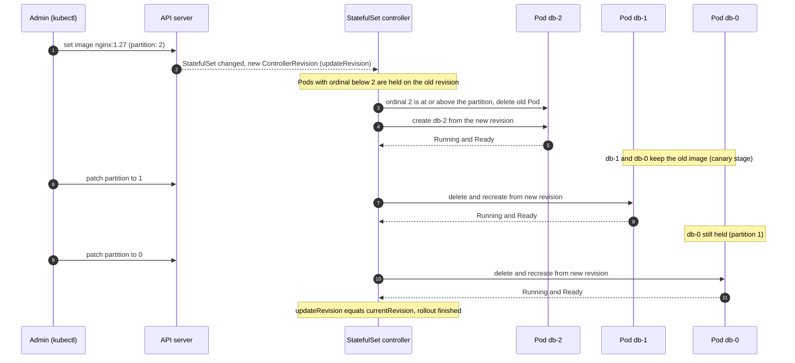

# T4.09 Application deployments: rolling updates and rollbacks (admin view)

> Competency: "Understand application deployments and how to perform rolling update and rollbacks" (CKA-3.1) | Domain/weight: CKA - Workloads and Scheduling (15%) | Est. time: 1.5 h | Prerequisites: T3.10

Shell setup used in every command block of this lesson (see the conventions file):

```bash
alias k=kubectl
export do="--dry-run=client -o yaml"
export now="--force --grace-period=0"
source <(kubectl completion bash); complete -o default -F __start_kubectl k
```

`k` is `kubectl`. `$do` prints the object instead of creating it. `$now` deletes a Pod without waiting.

Output labels: **every output block in this lesson is labelled `EXPECTED OUTPUT (not captured)`.** Nothing here was run on a live v1.37 cluster (details in section 11). Expected blocks use `<hash>`, `<ip>` and `...` for values that differ on every run. Message wording that is not certain is marked `(wording to verify)`. Run the commands yourself on the lab cluster and compare. Node names are written for the cluster built by `env/kind-up.sh`: `lab-control-plane`, `lab-worker`, `lab-worker2`.

## 1. Why this matters

During an incident the question is rarely "how do I write a Deployment". It is "this rollout is stuck, what is it waiting for, and can I undo it without making things worse". The admin must do that for Deployments, DaemonSets and StatefulSets, in namespaces they did not create, while nodes are being drained and PodDisruptionBudgets (PDBs) limit what can be evicted. If you only know the Deployment commands from [T3.10](../part3-ckad/T3.10-deployments-and-rolling-updates.md), you will wait on a StatefulSet update that is correctly doing nothing, roll back to the wrong revision, or restart a workload that did not need it. This lesson adds the admin angle and does not repeat T3.10.

## 2. Concepts

### 2.1 Recap of what T3.10 taught (one table, then move on)

Read [T3.10](../part3-ckad/T3.10-deployments-and-rolling-updates.md) first if any row below is new to you.

| Item | Short version |
|---|---|
| Strategy | `RollingUpdate` (default) replaces Pods gradually. `Recreate` kills all old Pods first. |
| `maxSurge` | How many extra Pods may exist above `replicas` during the update. Default `25%`, rounded up. |
| `maxUnavailable` | How many Pods may be missing below `replicas`. Default `25%`, rounded down. Both cannot be `0` at once. |
| Revision | One Deployment revision = one ReplicaSet (RS). A new revision is created only when `.spec.template` changes. Scaling does not create one. |
| `revisionHistoryLimit` | How many old ReplicaSets are kept so you can roll back. Default `10`. Older ones are deleted and can never be restored. |

What is new here: DaemonSets and StatefulSets also have revisions and rolling updates, but they store them differently and update in different orders. The rest of section 2 covers those differences and the operational problems around them.

### 2.2 The `rollout` subcommands and which workload kinds support them

`kubectl rollout` works on three kinds: Deployments, DaemonSets and StatefulSets (confirm with `k rollout --help`, item 7 in section 11). Not every subcommand works on all three.

| Subcommand | What it does | Deployment | DaemonSet | StatefulSet |
|---|---|---|---|---|
| `rollout status` | Waits and prints progress until the update is done. Exit code `0` = done, non-zero = failed or timed out. | yes | yes (RollingUpdate only) | yes (RollingUpdate only) |
| `rollout history` | Lists revisions. `--revision=N` shows the Pod template of revision N. | yes | yes | yes |
| `rollout undo` | Puts an older template back. `--to-revision=N` picks which. Default is the previous revision. | yes | yes | yes |
| `rollout pause` / `resume` | Pause: template changes do not start a rollout. Resume: apply all the batched changes as one rollout. | yes | no | no |
| `rollout restart` | Restarts every Pod by changing a template annotation. | yes | yes | yes |

The "no" entries are expected kubectl behaviour and were not re-run on v1.37. The expected error text is in the worked example (section 5); the check is listed in section 11.

**Under the hood: where revisions live.**

- A Deployment keeps its history as ReplicaSets. `k get rs -n NS` shows one RS per revision. The revision number is in the annotation `deployment.kubernetes.io/revision`.
- A DaemonSet or StatefulSet keeps its history as `ControllerRevision` objects. `k get controllerrevisions -n NS` lists them. Each one stores a copy of the Pod template and a `revision` number.
- `rollout undo` does not "switch back" to the old object. It copies the old template into the live object. The old revision number disappears and the same template comes back as a new, highest revision number. This is why history can look as if a revision "moved". Example in section 5.

### 2.3 DaemonSet rolling updates

A **DaemonSet** (DS) runs one Pod on every matching node (log collectors, CNI agents, `kube-proxy`). Because there is one Pod per node, "replicas" and "surge" mean something different than for a Deployment.

`.spec.updateStrategy` has two types:

| Type | What happens after you change the template | When to use it |
|---|---|---|
| `RollingUpdate` (default) | The DS controller replaces the Pods itself, node by node, within the `maxUnavailable` / `maxSurge` limits. | Normal case. |
| `OnDelete` | Nothing happens. A node's Pod is replaced with the new template only when you delete that Pod (or the node gets a new Pod). | You must control the exact moment per node, for example an agent that interrupts traffic. |

Fields under `updateStrategy.rollingUpdate`:

| Field | Meaning | Default | Risky / invalid values |
|---|---|---|---|
| `maxUnavailable` | Nodes that may be without a ready daemon Pod at the same time. Integer or percent of nodes. | `1` | `0` is invalid unless `maxSurge` is above `0`. A large value (for example `100%`) takes the agent down on every node at once. |
| `maxSurge` | Nodes that may run two daemon Pods (old and new) during the update. Integer or percent. | `0` | Invalid when `maxUnavailable` is also `0` (nothing could ever move). Do not use it for Pods that bind a `hostPort` (see below). |

`maxSurge` on DaemonSets became stable in Kubernetes v1.25 and should be present in v1.37, but this was **not confirmed on a v1.37 cluster** (it is the first item in section 11). Confirm it in two seconds with `k explain ds.spec.updateStrategy.rollingUpdate.maxSurge`. With `maxSurge: 1` and `maxUnavailable: 0` the controller first starts the new Pod on a node, waits until it is available, and only then removes the old Pod. That gives zero gap on that node. The price: for a moment two Pods run on the same node. If both want the same `hostPort`, the new Pod cannot start and the update stalls. Use plain `maxUnavailable` for those Pods.

Other DaemonSet fields that matter for updates:

- `minReadySeconds` (default `0`): how long a new Pod must be Ready before it counts as available. A value that is too low lets a crash-looping agent look healthy and the rollout rushes on to the next node.
- `revisionHistoryLimit` (default `10`): how many ControllerRevisions are kept.

**Under the hood.** For every node, the DS controller decides "should this node have a Pod?" using the node selector, node affinity and **taints versus tolerations**. A rolling update deletes the old Pod on a node and creates the new one. The reliable cause of a stalled DaemonSet rollout is a new Pod that **exists** but never becomes available: it stays `Pending` (for example not enough CPU or memory), fails to pull its image, or fails its readiness probe. The controller then does not move on to the next node, because the node with the unavailable Pod is expected to use up the `maxUnavailable` budget (this budget behaviour was not observed on v1.37; see section 11). That is failure 3 in section 6.

A node that the new template can no longer run on at all (for example a taint the template does not tolerate) is a different case. The controller only counts nodes where a Pod should run, so such a node may silently drop out of `DESIRED` instead of stalling the rollout. This is also **not observed on v1.37**. The check that tells the cases apart is `k get pods -o wide` compared with `k get nodes`: a missing Pod on a node is the taint/selector case, a Pod that is not Ready is the stall case. In both cases you fix that node or the template.

### 2.4 StatefulSet updates: ordinals, partition, OnDelete

A **StatefulSet** (STS) gives each Pod a stable name (`db-0`, `db-1`, `db-2`) and, normally, its own PersistentVolumeClaim. The number after the name is the **ordinal**. Order matters because databases usually have a primary and replicas, so updates are slow and deliberate.

With `updateStrategy.type: RollingUpdate` the controller updates Pods one at a time in **reverse ordinal order**: `db-2` first, then `db-1`, then `db-0`. It waits for each replaced Pod to be Running and Ready (and, if `minReadySeconds` is set, available) before it touches the next one. If a new Pod never becomes Ready, the rollout stops there.

`rollingUpdate.partition` is a number (default `0`). Only Pods with ordinal **greater than or equal to** the partition get the new template. Pods below it stay on the old revision, and **if you delete one of them it comes back with the old template**, not the new one. That is what makes a canary: set `partition: 2` on three replicas and only `db-2` is updated. Lower the partition step by step (`1`, then `0`) to roll out to the rest. The comparison table:

| Setting | `db-0` | `db-1` | `db-2` | Use |
|---|---|---|---|---|
| `partition: 0` (default) | updated last | updated second | updated first | Full rolling update. |
| `partition: 2` | old | old | updated | Canary on one Pod. |
| `partition: 3` (equals `replicas`) | old | old | old | Template changes are staged but nothing is applied. Useful as a "hold". |
| `partition: 5` (above `replicas`) | old | old | old | Same as above, and a classic reason an update "does nothing". |

`updateStrategy.type: OnDelete` means the controller never replaces Pods for you. After a template change, a Pod runs the new template only after you delete it by hand; the controller then recreates it from the newest revision. Use it when you must pick the order yourself (for example update replicas first, fail over, update the primary last).

| Type | Controller replaces Pods? | Ordering | `partition` has effect? | `k rollout status` works? |
|---|---|---|---|---|
| `RollingUpdate` | yes | High ordinal to low, one at a time | yes | yes |
| `OnDelete` | no | You choose | no | no (it says the strategy does not support status; exact text in section 6) |

Two more fields to know: `podManagementPolicy` and `rollingUpdate.maxUnavailable`. `podManagementPolicy` is `OrderedReady` (default: scale up one Pod at a time in order, scale down in reverse order) or `Parallel` (start or stop all Pods at once). It governs **scale up/down and the Pod deletion order only**. It does not change rolling updates: they always go one Pod at a time, from the highest ordinal to the lowest, whichever policy is set (see the StatefulSet concept page, "Pod management policies"). The `maxUnavailable` field for StatefulSets was introduced as a beta feature behind a feature gate (`MaxUnavailableStatefulSet`). Its status in v1.37 is **UNVERIFIED**: check with `k explain sts.spec.updateStrategy.rollingUpdate.maxUnavailable` before relying on it. This lesson does not need it.

**Warning from the official docs.** With the default `OrderedReady` policy (the docs tie this warning to that policy) a rolling update can get into a broken state: if you push a template whose Pod never becomes Ready, then fix the template, the controller still waits on the broken Pod. You must delete that broken Pod by hand so the controller recreates it from the fixed template. Source: [Updating StatefulSets in the basic tutorial](https://kubernetes.io/docs/tutorials/stateful-application/basic-stateful-set/#updating-statefulsets) and the StatefulSet concept page "Forced rollback".

### 2.5 Rollouts during node maintenance: drain plus PDB

Two separate ways to remove a Pod from a node:

| Operation | How it removes Pods | Does a PDB stop it? |
|---|---|---|
| `k drain NODE` | Calls the **eviction API** for each Pod. | **Yes.** If the eviction would break the budget, the API server answers `429` and drain retries. |
| Rolling update of a Deployment/DS/STS | The workload controller scales an old ReplicaSet down or deletes old Pods itself. It does not use the eviction API. | **No.** A PDB does not slow or block a rollout. |
| `k delete pod` | Plain delete. | **No.** |

So a PDB protects you from *voluntary disruptions* (drain, cluster autoscaler, upgrades), not from your own rollout. The two can add up: if a rollout has already taken one Pod down (`maxUnavailable: 1`) and a drain then evicts another, you can end up below what you intended. Sequence maintenance and rollouts; do not run them at the same time on the same workload.

A **PodDisruptionBudget** has exactly one of:

- `minAvailable`: Pods that must stay Ready (number or percent).
- `maxUnavailable`: Pods that may be down (number or percent).

`k get pdb` shows `ALLOWED DISRUPTIONS`. If that column is `0`, every eviction of a matching Pod is refused. This happens when `minAvailable` is greater than or equal to the number of Ready Pods (for example `minAvailable: 3` with 3 replicas), or when `maxUnavailable: 0`. A drain then loops forever printing `Cannot evict pod as it would violate the pod's disruption budget.` That is the break-fix lab.

Drain flags used in this lesson:

| Flag | What it does | Default | Risk |
|---|---|---|---|
| `--ignore-daemonsets` | Drain skips Pods owned by a DaemonSet and leaves them on the node. | off: drain refuses to continue while DaemonSet Pods are on the node | Low. The Pods would be recreated at once anyway. |
| `--delete-emptydir-data` | Allows evicting Pods that use an `emptyDir` volume. The volume contents are deleted with the Pod. | off: drain refuses such Pods | Data in `emptyDir` is lost. Fine for scratch data. |
| `--timeout=DURATION` | How long drain keeps trying before it gives up and exits with an error. The node stays cordoned. | `0s`, which means wait forever | Without it a PDB-blocked drain never ends. Always set it in scripts and labs. |
| `--force` | Also deletes Pods that no controller owns (bare Pods). They are not recreated anywhere. | off: drain refuses bare Pods | The Pod is gone for good. The break-fix lab forbids it. |
| `--disable-eviction` | Deletes Pods instead of evicting them, which skips the PDB check. | off | Can break the service. Do not use it on a real workload. |

How each workload behaves when its node is drained:

- **Deployment:** the evicted Pod is recreated by the ReplicaSet on another schedulable node. Drain cordons the node first, so the new Pod cannot come back to it.
- **DaemonSet:** drain refuses to proceed unless you pass `--ignore-daemonsets`; the DS Pods are left on the node (they would be recreated at once).
- **StatefulSet:** evicted one Pod at a time like any other. The replacement keeps the same name and must reattach its PVC. If the volume can only be used on the drained node (for example a local volume), the new Pod stays `Pending`.

### 2.6 `progressDeadlineSeconds` and finding stuck rollouts cluster-wide

`spec.progressDeadlineSeconds` on a **Deployment** (default `600`) is how long the controller waits for progress before it marks the rollout as failed. "Progress" means a new Pod was created, became Ready, or an old Pod was removed. When the time runs out the Deployment gets this condition:

```text
type: Progressing, status: "False", reason: ProgressDeadlineExceeded
```

What it does and does not do:

- It **reports** the failure. It does **not** roll back. The new Pods stay as they are (for example in `ImagePullBackOff`) and the old Pods stay up as far as `maxUnavailable` allows.
- It is not counted while the Deployment is paused.
- It must be larger than `minReadySeconds`.
- DaemonSets and StatefulSets have **no** `progressDeadlineSeconds` field. For them you watch `k rollout status --timeout`, the `READY` column (and `UP-TO-DATE` for DaemonSets), and for StatefulSets the revision fields (check 2b below).

Cluster-wide checks (no `jq` needed; the LF tips list kubectl, `yq`, `curl`, `wget` and `man` as the tools on the exam hosts, see [the LF candidate tips](https://docs.linuxfoundation.org/tc-docs/certification/tips-cka-and-ckad)):

```bash
# 1) Deployments whose rollout hit the deadline, all namespaces
k get deploy -A -o jsonpath='{range .items[*]}{.metadata.namespace}{"/"}{.metadata.name}{"\t"}{.status.conditions[?(@.type=="Progressing")].reason}{"\n"}{end}' | grep ProgressDeadlineExceeded

# 2) Deployments and DaemonSets where UP-TO-DATE or READY is below the wanted count
k get deploy,ds -A

# 2b) StatefulSets have no UP-TO-DATE column. Different CUR and UPD revisions mean an update is pending or held
k get sts -A -o custom-columns=NS:.metadata.namespace,NAME:.metadata.name,CUR:.status.currentRevision,UPD:.status.updateRevision,UPDATED:.status.updatedReplicas,READY:.status.readyReplicas

# 3) Pods that are not healthy, all namespaces
k get pods -A --field-selector=status.phase!=Running,status.phase!=Succeeded

# 4) Recent warnings (image pull errors, FailedScheduling, probe failures)
k get events -A --field-selector type=Warning --sort-by=.lastTimestamp
```

How to read `k get deploy -A`: `READY 2/3` means 2 of 3 Pods are Ready. `UP-TO-DATE` is how many Pods match the newest template. `AVAILABLE` is Ready for at least `minReadySeconds`. A stuck rollout usually shows `UP-TO-DATE` greater than `0` but `READY` below `replicas`, or `UP-TO-DATE` stuck at a small number. For check 2b, `CUR` equal to `UPD` means nothing is pending; different values mean an update is still going, held by a partition, or stuck on a Pod that is not Ready (compare `UPDATED` and `READY` with the replica count). A StatefulSet on `OnDelete` also keeps `CUR` and `UPD` different until you delete the old Pods.

### 2.7 Recording the cause and auditing revisions

Out of the box, `k rollout history` shows `CHANGE-CAUSE` as `<none>`. That column is read from the annotation `kubernetes.io/change-cause`. You set it yourself:

```bash
k annotate deploy/web -n NS kubernetes.io/change-cause="bump nginx to 1.27 (ticket 123)" --overwrite
```

The old `--record` flag has been deprecated since v1.22; use the annotation. Whether `--record` still exists in kubectl v1.37 is **UNVERIFIED** (see section 11). **Timing matters:** a new revision copies the annotations the workload has *at the moment of the template change*. So the safe habit for all three kinds is:

1. Set the annotation first (`k annotate ... --overwrite`).
2. Then make the template change (`set image`, `edit`, `rollout restart`).
3. Check with `k rollout history`. If the `CHANGE-CAUSE` column shows `<none>` for the new revision, the order was wrong.

(For a Deployment the controller may also copy a late annotation onto the current ReplicaSet. This was not confirmed on v1.37, so do not depend on it.)

Auditing what changed between revisions:

```bash
k rollout history deploy/web -n NS                      # list
k rollout history deploy/web -n NS --revision=3         # full Pod template of revision 3
diff <(k rollout history deploy/web -n NS --revision=2) <(k rollout history deploy/web -n NS --revision=3)
k get rs -n NS --sort-by=.metadata.creationTimestamp    # the ReplicaSets behind a Deployment
k get controllerrevisions -n NS                         # the revisions behind a DS or STS
```

`--revision=N` prints only the Pod template (image, env, resources, probes). It does **not** show Deployment-level fields such as `replicas`, `strategy` or `selector`. Who made a change is not stored in the revision. That answer is in the API server audit log if audit logging is enabled on the cluster ([auditing docs](https://kubernetes.io/docs/tasks/debug/debug-cluster/audit/)).

### 2.8 `k rollout status --timeout` in scripts

`k rollout status` blocks. In a script you must bound it:

```bash
k rollout status deploy/web -n prod --timeout=120s
echo $?       # 0 = rollout complete; 1 = failed, or timed out
```

On a timeout it exits non-zero and prints `error: timed out waiting for the condition`. For a Deployment that hit its progress deadline it exits non-zero earlier with an `exceeded its progress deadline` message. Use the exit code, not the text:

```bash
k set image deploy/web nginx=nginx:1.27 -n prod
if ! k rollout status deploy/web -n prod --timeout=120s; then
  k rollout undo deploy/web -n prod        # automatic fallback
  k rollout status deploy/web -n prod --timeout=120s
  exit 1
fi
```

Pick the timeout from the numbers: roughly `ceil(replicas / (maxSurge + maxUnavailable)) * (image pull + readiness time)`. It must be at least a little more than the Deployment's `progressDeadlineSeconds` if you want the Deployment's own failure message instead of a plain timeout.

### 2.9 Rolling restart to pick up Secret and ConfigMap changes

Pods read a ConfigMap or Secret in two ways, and they behave differently:

| How the Pod uses it | After you edit the ConfigMap/Secret |
|---|---|
| Environment variable (`env.valueFrom.configMapKeyRef`, `envFrom`) | **Never refreshed.** The value is copied when the container starts. |
| Volume mount | The kubelet updates the files after a delay (its sync period plus cache time). Not instant. The application must also re-read the file. A `subPath` mount is **never** updated. |

Because neither is reliable, the standard way to apply a change is a rolling restart:

```bash
k rollout restart deploy/web -n NS          # one workload
k rollout restart deploy -n prod            # every Deployment in the namespace
k rollout restart ds/agent -n kube-system   # also works on DaemonSets and StatefulSets
```

What it does: it writes the current time into the Pod template annotation `kubectl.kubernetes.io/restartedAt`. That is a template change, so the normal rolling update runs with your `maxSurge` / `maxUnavailable` and creates a new revision. Nothing is deleted at once, so there is no full outage. `k rollout restart` is refused on a paused Deployment (see section 5).

### 2.10 What a rollback does and does not restore

A revision stores the Pod template only. A ConfigMap or Secret is a **separate object** and is **not versioned with the Deployment**.

Example: revision 2 uses image `1.27` and reads ConfigMap `web-cfg`. You edit `web-cfg` and restart (revision 3). Then you roll back to revision 2. You get the old image and the **new** ConfigMap contents, because the old template still points to the name `web-cfg`, and `web-cfg` now holds the new data. If the old image cannot read the new config, the rollback does not fix the problem.

Ways to make config roll back together with the image:

- Put a version in the object name (`web-cfg-v2`) and change the name in the template. Then the template of each revision points at its own ConfigMap, and an undo points back to the old one. Keep the old ConfigMap until you no longer need the old revision.
- Set `immutable: true` on the ConfigMap/Secret so it cannot be edited in place, which forces you to create a new, named copy.
- Generate names with a hash suffix using kustomize `configMapGenerator` (see [T4.07](../part4-cka/T4.07-use-helm-and-kustomize-to-install.md)).

**Related but different.**

- `rollout undo` vs `scale`: undo changes the template; scaling never creates a revision.
- `rollout restart` vs `delete pod`: restart is a controlled rolling update that respects `maxUnavailable`; deleting all Pods is an outage.
- `rollout pause` vs `cordon`: pause stops a Deployment from reacting to template edits; cordon stops the scheduler from putting new Pods on a node. They are unrelated.
- PDB vs `maxUnavailable` in the strategy: the strategy limits your own rollout; the PDB limits evictions by someone else.

## 3. How it works (diagram)

A StatefulSet with 3 replicas, `partition: 2`, and a new image. Only ordinal 2 is updated. Ordinals 1 and 0 are held on the old revision until the partition is lowered.



Walkthrough:

1. Changing the Pod template creates a new ControllerRevision. The controller marks it as `updateRevision`. The old one stays as `currentRevision`.
2. The controller walks ordinals from high to low. It only touches Pods whose ordinal is at or above the partition. With `partition: 2` that is `db-2` alone.
3. It deletes `db-2`, recreates it from the new revision, and waits until it is Ready. This is your canary: test it before going on.
4. `db-1` and `db-0` are not touched. If one of them crashes and is recreated, it comes back from the **old** revision (the partition protects it).
5. When you lower the partition to `1`, then `0`, the controller continues with `db-1` and then `db-0`, one at a time, each waiting for Ready.
6. Only when no Pod is left on the old revision does `currentRevision` become equal to `updateRevision`.

## 4. Commands and YAML you must produce fast

### 4.1 Imperative commands

There is no `k create statefulset` and no `k create daemonset`. The fast way to get a skeleton is `k create deploy ... $do` and edit it (section 4.2). Updates and inspection are all imperative.

```bash
# History and inspection (works for deploy, ds, sts)
k rollout history ds/agent -n kube-system                 # list revisions of a DaemonSet
k rollout history ds/agent -n kube-system --revision=2    # Pod template of revision 2: read this BEFORE undo
k get controllerrevisions -n kube-system                  # the raw objects behind DS/STS history

# Roll back
k rollout undo sts/db --to-revision=2 -n lab-t409e        # StatefulSet back to revision 2
k rollout undo ds/agent -n kube-system                    # DaemonSet to the previous revision

# StatefulSet canary: only ordinals >= 2 get the new template
k patch sts db -n lab-t409e -p '{"spec":{"updateStrategy":{"rollingUpdate":{"partition":2}}}}'

# Restart every Deployment in a namespace (rolling, creates a new revision for each)
k rollout restart deploy -n prod

# Bounded wait for scripts
k rollout status sts/db -n lab-t409e --timeout=120s

# Change the update strategy type
k patch ds agent -n kube-system --type merge -p '{"spec":{"updateStrategy":{"type":"OnDelete","rollingUpdate":null}}}'
```

Notes on the commands:

- `k patch ... -p '...'` defaults to a strategic merge patch. It is fine for `partition`. When you switch `type` to `OnDelete`, also send `"rollingUpdate":null`, otherwise the API server rejects the object because `rollingUpdate` is not allowed with `OnDelete` (see section 6).
- `k rollout undo` without `--to-revision` goes to the revision just before the current one. If the previous revision is also bad, you land on a bad revision. That is why you read `history --revision=N` first.
- The container name for `k set image` is the name inside the Pod template (`agent`, `db`, `nginx`), not the workload name. `k get ds agent -n kube-system -o jsonpath='{.spec.template.spec.containers[*].name}'` prints it.

### 4.2 Declarative YAML

**StatefulSet with a partitioned update (partition 2 of 3).** Save as `~/lab/t409/sts-partition.yaml` (the Easy lab in section 7 writes its own `sts.yaml` without the `updateStrategy` block). It includes the headless Service the StatefulSet needs. It uses namespace `lab-t409e`, the same as the Easy lab, so run `k delete ns lab-t409e` when you have tried it.

```yaml
apiVersion: v1
kind: Service
metadata:
  name: db
  namespace: lab-t409e
spec:
  clusterIP: None            # headless: gives each Pod a stable DNS name (db-0.db, db-1.db, ...)
  selector:
    app: db                  # must match the Pod labels below
  ports:
  - name: web
    port: 80
---
apiVersion: apps/v1
kind: StatefulSet
metadata:
  name: db
  namespace: lab-t409e
spec:
  serviceName: db            # required: name of the headless Service above
  replicas: 3                # creates db-0, db-1, db-2
  selector:
    matchLabels:
      app: db                # immutable after creation; must match template labels
  updateStrategy:
    type: RollingUpdate      # default. The other value is OnDelete (no automatic replacement).
    rollingUpdate:
      partition: 2           # default 0. Only ordinals >= 2 are updated. A value >= replicas freezes the update.
  template:
    metadata:
      labels:
        app: db
    spec:
      containers:
      - name: db
        image: nginx:1.26    # pinned tag. Changing this line is what creates a new revision
        ports:
        - containerPort: 80
          name: web
```

Create the namespace and apply it, then update:

```bash
k create ns lab-t409e
k apply -f ~/lab/t409/sts-partition.yaml
k rollout status sts/db -n lab-t409e --timeout=180s
k set image sts/db db=nginx:1.27 -n lab-t409e
```

Because of `partition: 2`, only `db-2` changes.

**DaemonSet with `maxUnavailable: 1`.** Save as `~/lab/t409/ds.yaml`.

```yaml
apiVersion: apps/v1
kind: DaemonSet
metadata:
  name: agent
  namespace: kube-system
  annotations:
    kubernetes.io/change-cause: "rev1 baseline busybox 1.36"   # shows in rollout history (read at revision creation)
spec:
  selector:
    matchLabels:
      app: agent
  minReadySeconds: 5          # new Pod must stay Ready 5 s before it counts as available (default 0)
  updateStrategy:
    type: RollingUpdate       # default. The alternative is shown in the next block.
    rollingUpdate:
      maxUnavailable: 1       # at most 1 node without a ready agent at a time (default 1; 0 only with maxSurge > 0)
  template:
    metadata:
      labels:
        app: agent
    spec:
      tolerations:
      - key: node-role.kubernetes.io/control-plane
        operator: Exists
        effect: NoSchedule    # without this the agent skips the control-plane node
      containers:
      - name: agent
        image: busybox:1.36
        command: ["sh", "-c", "echo agent started on $(hostname); while true; do sleep 30; done"]
        resources:
          requests:
            cpu: 10m
            memory: 8Mi
```

**The `OnDelete` alternative.** On the DaemonSet above, the only change is the `updateStrategy` block. The YAML below is a trimmed copy of it, named `agent-od` in namespace `lab-t409` (no `minReadySeconds`, no change-cause annotation), which the worked example in section 5 uses.

```yaml
apiVersion: apps/v1
kind: DaemonSet
metadata:
  name: agent-od
  namespace: lab-t409
spec:
  selector:
    matchLabels:
      app: agent-od
  updateStrategy:
    type: OnDelete            # no rollingUpdate block allowed here; Pods change only when deleted
  template:
    metadata:
      labels:
        app: agent-od
    spec:
      tolerations:
      - key: node-role.kubernetes.io/control-plane
        operator: Exists
        effect: NoSchedule
      containers:
      - name: agent
        image: busybox:1.36
        command: ["sh", "-c", "while true; do sleep 30; done"]
```

**Generating a skeleton fast.** In an exam you can build the DaemonSet from a Deployment skeleton:

```bash
k create deploy agent --image=busybox:1.36 -n kube-system $do -- sh -c 'sleep 3600' > ds.yaml
```

Then edit `ds.yaml`: change `kind: Deployment` to `kind: DaemonSet`, delete the `replicas: 1`, `strategy: {}` and `status: {}` lines, and add the `updateStrategy` block. Check it before applying with `k apply -f ds.yaml --dry-run=server`. The same trick works for a StatefulSet: change the kind, delete `strategy: {}`, `status: {}`, add `serviceName:` and keep `replicas:`.

**DaemonSet with surge (`maxSurge: 1`).** The worked example (section 5) runs this one.

```yaml
apiVersion: apps/v1
kind: DaemonSet
metadata:
  name: agent-surge
  namespace: lab-t409
spec:
  selector:
    matchLabels:
      app: agent-surge
  updateStrategy:
    type: RollingUpdate
    rollingUpdate:
      maxUnavailable: 0       # never remove the old Pod first ...
      maxSurge: 1             # ... start the new Pod next to it, then remove the old one
  template:
    metadata:
      labels:
        app: agent-surge
    spec:
      containers:
      - name: agent
        image: busybox:1.36
        command: ["sh", "-c", "while true; do sleep 30; done"]
```

### 4.3 Speed drill

Target total: about 11 minutes for 8 tasks. The exam is 2 hours ([LF FAQ](https://docs.linuxfoundation.org/tc-docs/certification/faq-cka-ckad-cks)) for 15-20 tasks ([LF tips](https://docs.linuxfoundation.org/tc-docs/certification/tips-cka-and-ckad)), so about 6 minutes per task on average. These drill tasks are smaller than exam tasks, so the targets are shorter.

**Setup** (one namespace, `lab-t409d`: Deployment `web` with 2 revisions, StatefulSet `db` and DaemonSet `agent`, all on the default strategies). Expected: all objects Ready after about 1-2 minutes.

```bash
k create ns lab-t409d
k create deploy web -n lab-t409d --image=nginx:1.26 --replicas=3
k rollout status deploy/web -n lab-t409d --timeout=120s
k set image deploy/web nginx=nginx:1.27 -n lab-t409d
k rollout status deploy/web -n lab-t409d --timeout=120s
k apply -n lab-t409d -f - <<'YAML'
apiVersion: v1
kind: Service
metadata:
  name: db
spec:
  clusterIP: None
  selector:
    app: db
  ports:
  - port: 80
---
apiVersion: apps/v1
kind: StatefulSet
metadata:
  name: db
spec:
  serviceName: db
  replicas: 3
  selector:
    matchLabels:
      app: db
  template:
    metadata:
      labels:
        app: db
    spec:
      containers:
      - name: db
        image: nginx:1.26
---
apiVersion: apps/v1
kind: DaemonSet
metadata:
  name: agent
spec:
  selector:
    matchLabels:
      app: agent
  template:
    metadata:
      labels:
        app: agent
    spec:
      containers:
      - name: agent
        image: busybox:1.36
        command: ["sh", "-c", "while true; do sleep 30; done"]
YAML
k rollout status sts/db -n lab-t409d --timeout=180s
k rollout status ds/agent -n lab-t409d --timeout=120s
```

Do the tasks with a timer. Do not open the answers first.

1. (1 min) Print the image stored in **revision 1** of `deploy/web` without changing anything.
2. (1 min) Roll `web` back to revision 1 and print its image.
3. (2 min) Update StatefulSet `db` to `nginx:1.27` so that **only `db-1` and `db-2`** change. Print the image of all three Pods.
4. (1 min) Undo StatefulSet `db` to revision 1.
5. (2 min) Switch DaemonSet `agent` to `OnDelete` with one patch (no YAML editing), set its image to `busybox:1.36.1`, and show that no Pod was replaced.
6. (1 min) Rolling-restart every Deployment in `lab-t409d`.
7. (2 min) Set `web` to the non-existent image `nginx:1.27-nope`, wait at most 20 seconds with `rollout status`, print the exit code, then undo.
8. (1 min) Create a new revision of `web` with a rolling restart and make `rollout history` show the text `restart to reload config` as the cause of that newest revision.

<details><summary>Answers</summary>

```bash
# task 1
k rollout history deploy/web -n lab-t409d --revision=1 | grep Image
# task 2
k rollout undo deploy/web -n lab-t409d --to-revision=1
k rollout status deploy/web -n lab-t409d --timeout=120s
k get deploy web -n lab-t409d -o jsonpath='{.spec.template.spec.containers[0].image}{"\n"}'
# task 3
k patch sts db -n lab-t409d -p '{"spec":{"updateStrategy":{"rollingUpdate":{"partition":1}}}}'
k set image sts/db db=nginx:1.27 -n lab-t409d
k rollout status sts/db -n lab-t409d --timeout=180s
k get pods -n lab-t409d -l app=db -o jsonpath='{range .items[*]}{.metadata.name}{" "}{.spec.containers[0].image}{"\n"}{end}'
# task 4
k rollout undo sts/db -n lab-t409d --to-revision=1
k rollout status sts/db -n lab-t409d --timeout=180s
k get pods -n lab-t409d -l app=db -o jsonpath='{range .items[*]}{.metadata.name}{" "}{.spec.containers[0].image}{"\n"}{end}'
# task 5
k patch ds agent -n lab-t409d --type merge -p '{"spec":{"updateStrategy":{"type":"OnDelete","rollingUpdate":null}}}'
k set image ds/agent agent=busybox:1.36.1 -n lab-t409d
sleep 5
k get pods -n lab-t409d -l app=agent -o jsonpath='{range .items[*]}{.metadata.name}{" "}{.spec.containers[0].image}{"\n"}{end}'
# task 6
k rollout restart deploy -n lab-t409d
k rollout status deploy/web -n lab-t409d --timeout=120s
k rollout history deploy/web -n lab-t409d
# task 7
k set image deploy/web nginx=nginx:1.27-nope -n lab-t409d
k rollout status deploy/web -n lab-t409d --timeout=20s
echo "exit code $?"
k rollout undo deploy/web -n lab-t409d
k rollout status deploy/web -n lab-t409d --timeout=120s
# task 8
k annotate deploy/web -n lab-t409d kubernetes.io/change-cause="restart to reload config" --overwrite
k rollout restart deploy/web -n lab-t409d
k rollout status deploy/web -n lab-t409d --timeout=120s
k rollout history deploy/web -n lab-t409d
```

Notes: in task 3 the patch must come **before or together with** the image change; if you change the image first, `db-2`, `db-1` and `db-0` all update in sequence. In task 5 `"rollingUpdate":null` is needed because the API server refuses a `rollingUpdate` block with `OnDelete`. In task 7 the exit code is `1`. In task 8 the annotation goes **first**, then the restart creates the revision that copies it (section 2.7).

</details>

**Cleanup** (leaves nothing behind):

```bash
k delete ns lab-t409d
```


## 5. Worked example

Goal: run the admin operations of this lesson in one session. You will roll a Deployment, see why config is not rolled back, get a stuck rollout and find it, undo it by reading history first, then update two DaemonSets (surge and `OnDelete`). Environment: kind, namespace `lab-t409`. All output blocks are `EXPECTED OUTPUT (not captured)`.

**Step 0. Files and namespace.** This writes the two DaemonSet files from section 4.2 and the Deployment file:

```bash
mkdir -p ~/lab/t409 && cd ~/lab/t409
k create ns lab-t409
cat > ds-surge.yaml <<'YAML'
apiVersion: apps/v1
kind: DaemonSet
metadata:
  name: agent-surge
  namespace: lab-t409
spec:
  selector:
    matchLabels:
      app: agent-surge
  updateStrategy:
    type: RollingUpdate
    rollingUpdate:
      maxUnavailable: 0
      maxSurge: 1
  template:
    metadata:
      labels:
        app: agent-surge
    spec:
      containers:
      - name: agent
        image: busybox:1.36
        command: ["sh", "-c", "while true; do sleep 30; done"]
YAML
cat > ds-ondelete.yaml <<'YAML'
apiVersion: apps/v1
kind: DaemonSet
metadata:
  name: agent-od
  namespace: lab-t409
spec:
  selector:
    matchLabels:
      app: agent-od
  updateStrategy:
    type: OnDelete
  template:
    metadata:
      labels:
        app: agent-od
    spec:
      tolerations:
      - key: node-role.kubernetes.io/control-plane
        operator: Exists
        effect: NoSchedule
      containers:
      - name: agent
        image: busybox:1.36
        command: ["sh", "-c", "while true; do sleep 30; done"]
YAML
cat > web.yaml <<'YAML'
apiVersion: v1
kind: ConfigMap
metadata:
  name: web-cfg
  namespace: lab-t409
data:
  GREETING: "hello v1"
---
apiVersion: apps/v1
kind: Deployment
metadata:
  name: web
  namespace: lab-t409
spec:
  replicas: 3
  progressDeadlineSeconds: 60     # default 600; shortened so a failure shows up in one minute
  revisionHistoryLimit: 10        # default 10: ReplicaSets kept for rollback
  selector:
    matchLabels:
      app: web
  strategy:
    type: RollingUpdate
    rollingUpdate:
      maxSurge: 1                 # one extra Pod allowed during the update
      maxUnavailable: 0           # never go below 3 ready Pods
  template:
    metadata:
      labels:
        app: web
    spec:
      containers:
      - name: nginx
        image: nginx:1.26
        env:
        - name: GREETING          # read once, when the container starts
          valueFrom:
            configMapKeyRef:
              name: web-cfg
              key: GREETING
YAML
k apply -f web.yaml
k rollout status deploy/web -n lab-t409 --timeout=120s
```

EXPECTED OUTPUT (not captured):

```text
namespace/lab-t409 created
configmap/web-cfg created
deployment.apps/web created
...
deployment "web" successfully rolled out
```

**Step 1. A second revision, with a recorded cause.** Annotate first, then change the template (section 2.7).

```bash
k annotate deploy/web -n lab-t409 kubernetes.io/change-cause="bump nginx to 1.27" --overwrite
k set image deploy/web nginx=nginx:1.27 -n lab-t409
k rollout status deploy/web -n lab-t409 --timeout=120s
k rollout history deploy/web -n lab-t409
k rollout history deploy/web -n lab-t409 --revision=2
```

What to look for: `CHANGE-CAUSE` of revision 2 is your text, revision 1 is `<none>`; `--revision=2` shows `Image: nginx:1.27` and the `GREETING` env entry (the ConfigMap *reference*, not its value).

EXPECTED OUTPUT (not captured):

```text
deployment.apps/web annotated
deployment.apps/web image updated
...
deployment "web" successfully rolled out
deployment.apps/web
REVISION  CHANGE-CAUSE
1         <none>
2         bump nginx to 1.27

deployment.apps/web with revision #2
Pod Template:
  Labels:       app=web
                pod-template-hash=<hash>
  Containers:
   nginx:
    Image:      nginx:1.27
    ...
    Environment:
      GREETING: <set to the key 'GREETING' of config map 'web-cfg'>  Optional: false
  ...
```

**Step 2. Change the ConfigMap; see that nothing happens; restart.**

```bash
k exec -n lab-t409 deploy/web -- printenv GREETING
k patch cm web-cfg -n lab-t409 --type merge -p '{"data":{"GREETING":"hello v2"}}'
k exec -n lab-t409 deploy/web -- printenv GREETING          # still v1: env is read at start
k annotate deploy/web -n lab-t409 kubernetes.io/change-cause="restart to load web-cfg v2" --overwrite
k rollout restart deploy/web -n lab-t409
k rollout status deploy/web -n lab-t409 --timeout=120s
k exec -n lab-t409 deploy/web -- printenv GREETING          # now v2
k rollout history deploy/web -n lab-t409
```

The second `printenv` still printing `hello v1` is the point of the step. The restart creates revision 3 whose template differs from revision 2 only by the annotation `kubectl.kubernetes.io/restartedAt`.

EXPECTED OUTPUT (not captured):

```text
hello v1
configmap/web-cfg patched
hello v1
deployment.apps/web annotated
deployment.apps/web restarted
...
deployment "web" successfully rolled out
hello v2
deployment.apps/web
REVISION  CHANGE-CAUSE
1         <none>
2         bump nginx to 1.27
3         restart to load web-cfg v2
```

**Step 3. A bad image: a rollout that is stuck, not an outage.** Because `maxUnavailable: 0`, the three old Pods keep serving while one new Pod cannot start.

```bash
k annotate deploy/web -n lab-t409 kubernetes.io/change-cause="bump to nginx 1.27-nope" --overwrite
k set image deploy/web nginx=nginx:1.27-nope -n lab-t409
k rollout status deploy/web -n lab-t409 --timeout=20s ; echo "exit code: $?"
k get deploy,rs,pods -n lab-t409
```

Read the output in this order: (1) `rollout status` waits, then times out with a non-zero code; (2) `k get deploy` shows `READY 3/3` but `UP-TO-DATE 1`: users are fine, the update is not; (3) the new Pod is in `ErrImagePull` or `ImagePullBackOff`; (4) there are now two ReplicaSets with Pods.

EXPECTED OUTPUT (not captured):

```text
deployment.apps/web annotated
deployment.apps/web image updated
Waiting for deployment "web" rollout to finish: 1 out of 3 new replicas have been updated...
error: timed out waiting for the condition
exit code: 1
NAME                  READY   UP-TO-DATE   AVAILABLE   AGE
deployment.apps/web   3/3     1            3           ...

NAME                             DESIRED   CURRENT   READY   AGE
replicaset.apps/web-<hash-new>   1         1         0       ...
replicaset.apps/web-<hash-cur>   3         3         3       ...
...

NAME                           READY   STATUS             RESTARTS   AGE
pod/web-<hash-new>-<id>        0/1     ImagePullBackOff   0          ...
pod/web-<hash-cur>-<id>        1/1     Running            0          ...
(two more Running Pods)
```

(Wording of the "Waiting for" line to verify.) After the 60-second `progressDeadlineSeconds`, the second form of failure appears, and the cluster-wide check finds it:

```bash
sleep 60
k rollout status deploy/web -n lab-t409 --timeout=20s ; echo "exit code: $?"
k get deploy -A -o jsonpath='{range .items[*]}{.metadata.namespace}{"/"}{.metadata.name}{"\t"}{.status.conditions[?(@.type=="Progressing")].reason}{"\n"}{end}' | grep ProgressDeadlineExceeded
k get events -n lab-t409 --field-selector type=Warning --sort-by=.lastTimestamp | tail -5
```

EXPECTED OUTPUT (not captured):

```text
error: deployment "web" exceeded its progress deadline
exit code: 1
lab-t409/web	ProgressDeadlineExceeded
... Failed     pod/web-<hash-new>-<id>   Failed to pull image "nginx:1.27-nope": ... not found
... Failed     pod/web-<hash-new>-<id>   Error: ErrImagePull
... BackOff    pod/web-<hash-new>-<id>   Back-off pulling image "nginx:1.27-nope"
```

(Event wording to verify.) The condition is only a report. The Deployment did not roll back by itself.

**Step 4. Roll back: read the history first.** The bad revision is 4. The previous one is revision 3, the restart. You want revision 2 (the clean `1.27` template) to prove the ConfigMap point, but look before you jump:

```bash
k rollout history deploy/web -n lab-t409
k rollout history deploy/web -n lab-t409 --revision=2 | grep -E 'Image|GREETING'
k rollout undo deploy/web -n lab-t409 --to-revision=2
k rollout status deploy/web -n lab-t409 --timeout=120s
k rollout history deploy/web -n lab-t409
k get deploy web -n lab-t409 -o jsonpath='{.spec.template.spec.containers[0].image}{"\n"}'
k get cm web-cfg -n lab-t409 -o jsonpath='{.data.GREETING}{"\n"}'
k exec -n lab-t409 deploy/web -- printenv GREETING
```

Look for two things. First, revision 2 disappears from the list and returns as revision 5 (undo copies the old template into the live object, section 2.2). Second, the Pods now run the old template (revision 2, created when the ConfigMap said `hello v1`) and print `hello v2`: **the rollback did not restore the ConfigMap**.

EXPECTED OUTPUT (not captured):

```text
REVISION  CHANGE-CAUSE
1         <none>
2         bump nginx to 1.27
3         restart to load web-cfg v2
4         bump to nginx 1.27-nope
    Image:      nginx:1.27
      GREETING: <set to the key 'GREETING' of config map 'web-cfg'>  Optional: false
deployment.apps/web rolled back
...
deployment "web" successfully rolled out
REVISION  CHANGE-CAUSE
1         <none>
3         restart to load web-cfg v2
4         bump to nginx 1.27-nope
5         bump nginx to 1.27
nginx:1.27
hello v2
hello v2
```

Revision 5 shows the cause text of the old revision 2 because the cause is stored in the revision's annotations.

**Step 5. Pause, batch changes, resume; what is refused.**

```bash
k rollout pause deploy/web -n lab-t409
k annotate deploy/web -n lab-t409 kubernetes.io/change-cause="batched image and cpu request" --overwrite
k rollout restart deploy/web -n lab-t409                     # refused while paused
k set image deploy/web nginx=nginx:1.27-alpine -n lab-t409   # staged, no rollout
k set resources deploy/web -n lab-t409 --requests=cpu=20m    # staged, no rollout
k rollout history deploy/web -n lab-t409 | tail -2           # still revision 5 at the end
k rollout resume deploy/web -n lab-t409                      # both changes roll out as ONE revision
k rollout status deploy/web -n lab-t409 --timeout=120s
k rollout history deploy/web -n lab-t409 | tail -2
```

EXPECTED OUTPUT (not captured):

```text
deployment.apps/web paused
deployment.apps/web annotated
error: ... can't restart paused deployment (run rollout resume first)
deployment.apps/web image updated
deployment.apps/web resource requirements updated
4         bump to nginx 1.27-nope
5         bump nginx to 1.27
deployment.apps/web resumed
...
deployment "web" successfully rolled out
5         bump nginx to 1.27
6         batched image and cpu request
```

(The restart error wording to verify.) The point: two template edits, one new revision, one rolling update.

**Step 6. DaemonSets: surge, `OnDelete`, history.**

```bash
k apply -f ~/lab/t409/ds-surge.yaml -f ~/lab/t409/ds-ondelete.yaml
k rollout status ds/agent-surge -n lab-t409 --timeout=120s
k explain ds.spec.updateStrategy.rollingUpdate.maxSurge | head -8        # confirms the field exists (v1.37 check)
k set image ds/agent-surge agent=busybox:1.36.1 -n lab-t409
k get pods -n lab-t409 -l app=agent-surge -w                             # Ctrl+C after the update ends
```

If `k explain` prints `field "maxSurge" does not exist`, then `maxSurge` is not available in your version: stop, use `maxUnavailable` only, and report it in section 11. Otherwise, in the watch you should see, for each node, a **new** Pod appear and become Ready **before** the old Pod on that node goes `Terminating` (that is `maxSurge: 1` with `maxUnavailable: 0`). Compare this with a default DaemonSet, where the old Pod disappears first.

```bash
k set image ds/agent-od agent=busybox:1.36.1 -n lab-t409
k rollout status ds/agent-od -n lab-t409 --timeout=10s              # refused for OnDelete
k get pods -n lab-t409 -l app=agent-od -o jsonpath='{range .items[*]}{.metadata.name}{" "}{.spec.nodeName}{" "}{.spec.containers[0].image}{"\n"}{end}'
k delete pod -n lab-t409 -l app=agent-od --field-selector spec.nodeName=lab-worker
sleep 8
k get pods -n lab-t409 -l app=agent-od -o jsonpath='{range .items[*]}{.metadata.name}{" "}{.spec.nodeName}{" "}{.spec.containers[0].image}{"\n"}{end}'
k rollout pause ds/agent-od -n lab-t409                              # refused: Deployments only
k rollout history ds/agent-od -n lab-t409
k get controllerrevisions -n lab-t409
```

EXPECTED OUTPUT (not captured):

```text
daemonset.apps/agent-surge created
daemonset.apps/agent-od created
daemon set "agent-surge" successfully rolled out
...
daemonset.apps/agent-surge image updated
(watch output: new Pod Running before the old one Terminating, per node)
daemonset.apps/agent-od image updated
error: rollout status is only available for RollingUpdate strategy type
agent-od-<id1> lab-control-plane busybox:1.36
agent-od-<id2> lab-worker busybox:1.36
agent-od-<id3> lab-worker2 busybox:1.36
pod "agent-od-<id2>" deleted
agent-od-<id1> lab-control-plane busybox:1.36
agent-od-<id4> lab-worker busybox:1.36.1
agent-od-<id3> lab-worker2 busybox:1.36
error: ... pausing is not supported            (wording to verify)
daemonset.apps/agent-od
REVISION  CHANGE-CAUSE
1         <none>
2         <none>

NAME                         CONTROLLER                  REVISION   AGE
agent-od-<hash1>             daemonset.apps/agent-od     1          ...
agent-od-<hash2>             daemonset.apps/agent-od     2          ...
agent-surge-<hash1>          daemonset.apps/agent-surge  1          ...
agent-surge-<hash2>          daemonset.apps/agent-surge  2          ...
```

Only the Pod on `lab-worker` runs the new image. The other two Pods still run `busybox:1.36` until you delete them: that is `OnDelete`. The real command from the task list, `k rollout history ds/agent -n kube-system`, behaves the same way on the DaemonSet you create in the medium lab (section 7) and also works read-only on the system DaemonSets such as `kube-proxy`:

```bash
k rollout history ds/kube-proxy -n kube-system
```

EXPECTED OUTPUT (not captured):

```text
daemonset.apps/kube-proxy
REVISION  CHANGE-CAUSE
1         <none>
```

**Cleanup.**

```bash
k delete ns lab-t409
```

## 6. Common mistakes and how to fix them

Every message below is expected text, not captured on v1.37. Where the wording is uncertain it is marked `(wording to verify)`. Match the idea, not every character.

| # | Symptom | What you will see | Cause | Fix |
|---|---|---|---|---|
| 1 | StatefulSet update "does nothing" | `k set image sts/db ...` prints `statefulset.apps/db image updated`, yet `k get pods` shows the old image. `k rollout status` prints `partitioned roll out complete: 0 new pods have been updated...` (wording to verify). | `partition` is at or above `replicas`, so no ordinal qualifies. | `k patch sts db -p '{"spec":{"updateStrategy":{"rollingUpdate":{"partition":0}}}}'` |
| 1b | Same, but strategy is `OnDelete` | `k rollout status sts/db` fails with `error: rollout status is only available for RollingUpdate strategy type` (wording to verify). | Controller never replaces Pods for `OnDelete`. | Delete the Pods you want updated, in the order you want (`k delete pod db-2`, check Ready, then the next), or switch the type back with `--type merge -p '{"spec":{"updateStrategy":{"type":"RollingUpdate"}}}'`. |
| 2 | Rollback to the wrong revision | `k rollout undo` ends with `... rolled back`, but the app is still broken. `k rollout history` now shows a new top revision with the same bad content. | You did not read history. Plain `undo` goes to the previous revision, which can be bad too. | `k rollout history KIND/NAME --revision=N` for each candidate, then `k rollout undo KIND/NAME --to-revision=N` |
| 3 | DaemonSet update stuck on one node | `k rollout status ds/agent` keeps printing `Waiting for daemon set "agent" rollout to finish: 2 out of 3 new pods have been updated...` (wording to verify) and never ends. `k get ds` shows `READY` below `DESIRED`. | The new Pod on that node exists but never becomes available: `Pending` (not enough CPU/memory), bad image or a failing probe. With `maxUnavailable: 1` that one node is expected to use the whole budget, so no other node is touched (to verify, section 11). A node whose taint the new Pod no longer tolerates may instead drop out of `DESIRED` with no Pod at all. | Find the node (`k get pods -o wide` against `k get nodes`), read the Pod events, fix that node or the template (details below). |
| 4 | Drain hangs | `error when evicting pods/"web-..." -n "NS" (will retry after 5s): Cannot evict pod as it would violate the pod's disruption budget.` repeated | `k get pdb` shows `ALLOWED DISRUPTIONS 0`, for example `minAvailable: 3` with 3 replicas. | Lower `minAvailable` or `maxUnavailable` sensibly: `k patch pdb NAME -n NS --type merge -p '{"spec":{"minAvailable":2}}'`. Not `--disable-eviction`. |
| 5 | Rollout "stuck" but nothing is down | `k get deploy` shows `READY 3/3`, `UP-TO-DATE 1`. After the deadline: `error: deployment "web" exceeded its progress deadline`. | New Pod cannot start (`ErrImagePull`, `Pending`). `maxUnavailable: 0` protects the old Pods. | `k describe pod` on the new Pod, then fix the template or `k rollout undo deploy/web`. |
| 6 | Edited the Deployment and nothing rolled out | `k set image` works, history has no new revision, Pods unchanged. | The Deployment is paused. `k get deploy web -o jsonpath='{.spec.paused}'` prints `true`. | `k rollout resume deploy/web` |
| 7 | Rollback did not fix the app | Old image runs, behaviour still wrong. | ConfigMap/Secret is not part of a revision; it was edited in place. | Restore the data (`k apply` the old ConfigMap), then `k rollout restart`. For next time, version the ConfigMap name. |
| 8 | `rollout undo` fails | `error: unable to find specified revision 2 in history` (wording to verify) | The revision was pruned (`revisionHistoryLimit`) or never existed. | `k rollout history` to see what is left. Apply the old manifest from Git instead. |
| 9 | Patch to `OnDelete` rejected | An error saying `rollingUpdate` may not be specified when strategy type is `OnDelete` (wording to verify). | The old `rollingUpdate` block is still in the object. | Send `"rollingUpdate":null` in the same patch (section 4.1). |
| 10 | StatefulSet stuck after a bad update was fixed | New template is good, but `db-1` stays `ImagePullBackOff`/not Ready and nothing moves. | With `OrderedReady` the controller waits for the broken Pod and does not replace it with the fixed template. | `k delete pod db-1` (the controller recreates it from the fixed revision). Source: the StatefulSet docs "Forced rollback". |

### 6.1 Reasoning path: StatefulSet update does nothing

1. Confirm the update was accepted: `k get sts db -n NS -o jsonpath='{.spec.template.spec.containers[0].image}{"\n"}'`. It prints the new image. So the API accepted it; the controller is the next suspect.
2. Read the strategy: `k get sts db -n NS -o jsonpath='{.spec.updateStrategy}{"\n"}'`. Expected: `{"rollingUpdate":{"partition":5},"type":"RollingUpdate"}` or `{"type":"OnDelete"}`.
3. Compare revisions: `k get sts db -n NS -o jsonpath='{.status.currentRevision}{" "}{.status.updateRevision}{"\n"}'`. Two different names mean an update is pending; the same name means the controller has nothing left to do.
4. Compare Pods: `k get pods -n NS -l app=db -o jsonpath='{range .items[*]}{.metadata.name}{" "}{.spec.containers[0].image}{"\n"}{end}'`.
5. If the partition is the reason, lower it. If the type is `OnDelete`, delete a Pod. If a Pod is not Ready, see row 10.

### 6.2 Reasoning path: rolled back to the wrong revision

1. `k rollout history deploy/web -n NS` (or `ds/...`, `sts/...`). Note the revision numbers and `CHANGE-CAUSE`.
2. For the revisions you consider: `k rollout history deploy/web -n NS --revision=N`. Look at `Image`, env, resources and probes.
3. If you already ran a plain `undo` and it was wrong, history now has a new top revision. Do not panic: pick the right number from the list and run `undo --to-revision=N` again. Every undo is itself a new revision.
4. Verify the live template: `k get deploy web -n NS -o jsonpath='{.spec.template.spec.containers[0].image}{"\n"}'` and `k rollout status`.

### 6.3 Reasoning path: DaemonSet update stuck on one node

1. `k rollout status ds/agent -n NS --timeout=30s` shows how many nodes are updated. `k get ds agent -n NS` shows `DESIRED`, `READY`, `UP-TO-DATE`, `AVAILABLE`.
2. Find the node that is not Ready: `k get pods -n NS -l app=agent -o wide`. Look for the node whose Pod is `Pending`, `ErrImagePull`, `CrashLoopBackOff`, or **missing** (compare with `k get nodes`).
3. If a Pod exists (the common case): `k describe pod POD -n NS`. The `Events` section tells the cause. Typical lines: `Insufficient cpu` or `Insufficient memory` (wording to verify), `Failed to pull image`, `Readiness probe failed`.
4. If no Pod exists on that node: the node may have dropped out of the DaemonSet's target set. Check taints: `k describe node NODE | grep -A3 Taints` and compare them with `k get ds agent -n NS -o jsonpath='{.spec.template.spec.tolerations}'`. Also check the node selector and affinity in the template. Whether such a node drops out of `DESIRED` or the Pod stays `Pending` was not observed on v1.37 (section 11), so rely on the comparison of `k get pods -o wide` with `k get nodes`.
5. Fix the real cause:
   - Resources: lower the request in the template, or free capacity on the node.
   - Bad image or failing probe: roll back with `k rollout undo ds/agent -n NS --to-revision=N` after reading history.
   - Taint (the no-Pod case): add a matching toleration to the template, or remove the taint if it should not be there (`k taint nodes NODE key:NoSchedule-`).
6. Watch it continue: `k rollout status ds/agent -n NS --timeout=120s`. The controller resumes with the next node as soon as the stuck node has an available Pod.

## 7. Labs

Environment for all three labs: **kind** (the `lab` cluster from `env/kind-up.sh`: 1 control plane, 2 workers, context `kind-lab`). Order: Easy, then Medium, then Break-fix. Each lab ends with cleanup that returns the cluster to its baseline, so any order works. No lab changes a system object other than the one named. The labs were **not run** on a live cluster (see section 11); the scripts were traced by hand, including namespaces and names. If a command behaves differently on your cluster, trust your cluster and report the difference.

### 7.1 Easy: canary a StatefulSet with a partition

**Setup**

```bash
mkdir -p ~/lab/t409 && cd ~/lab/t409
k create ns lab-t409e
cat > sts.yaml <<'YAML'
apiVersion: v1
kind: Service
metadata:
  name: db
  namespace: lab-t409e
spec:
  clusterIP: None
  selector:
    app: db
  ports:
  - name: web
    port: 80
---
apiVersion: apps/v1
kind: StatefulSet
metadata:
  name: db
  namespace: lab-t409e
spec:
  serviceName: db
  replicas: 3
  selector:
    matchLabels:
      app: db
  template:
    metadata:
      labels:
        app: db
    spec:
      containers:
      - name: db
        image: nginx:1.26
        ports:
        - containerPort: 80
          name: web
YAML
k apply -f sts.yaml
k rollout status sts/db -n lab-t409e --timeout=180s
```

Expected: three Pods `db-0`, `db-1`, `db-2` Running, all on `nginx:1.26`.

**Task** (namespace `lab-t409e`, StatefulSet `db`):

1. Update `db` to `nginx:1.27` as a canary: only `db-2` may run the new image. `db-0` and `db-1` must stay on `nginx:1.26`. Write one line per Pod in the form `<pod> <image>` into `~/lab/t409/canary.txt` (the output of the `jsonpath` in hint 3 is exactly that format).
2. Delete `db-0`. When it is Ready again, write its image into `~/lab/t409/db0-after-delete.txt`. Do not update it by hand.
3. Finish the rollout for the remaining Pods using the partition (not by deleting Pods).
4. The new version turned out bad. Roll `db` back to revision 1 so that all Pods run `nginx:1.26`.

<details><summary>Hint 1: how to stage a change without applying it</summary>

Set the partition to the replica count (`3`) first, then change the image. Nothing restarts. Then lower the partition to `2`. `k rollout history sts/db -n lab-t409e` shows that the new revision exists.

</details>

<details><summary>Hint 2: why db-0 stays old</summary>

Ordinals below the partition always use the old revision, even when recreated. You are checking that, not forcing it.

</details>

<details><summary>Hint 3: the jsonpath for the record file</summary>

`k get pods -n lab-t409e -l app=db -o jsonpath='{range .items[*]}{.metadata.name}{" "}{.spec.containers[0].image}{"\n"}{end}'`

</details>

<details><summary>Solution</summary>

```bash
cd ~/lab/t409
# Task 1 (canary): hold everything, then change the image: nothing restarts yet
k patch sts db -n lab-t409e -p '{"spec":{"updateStrategy":{"rollingUpdate":{"partition":3}}}}'
k set image sts/db db=nginx:1.27 -n lab-t409e
k rollout history sts/db -n lab-t409e
# Task 1 (canary): release only ordinal 2
k patch sts db -n lab-t409e -p '{"spec":{"updateStrategy":{"rollingUpdate":{"partition":2}}}}'
k rollout status sts/db -n lab-t409e --timeout=120s
# Task 1 (record): write canary.txt
k get pods -n lab-t409e -l app=db -o jsonpath='{range .items[*]}{.metadata.name}{" "}{.spec.containers[0].image}{"\n"}{end}' | tee canary.txt
# Task 2: delete db-0, it must come back on the OLD image
k delete pod db-0 -n lab-t409e
sleep 5   # give the controller time to recreate the Pod
k wait --for=condition=Ready pod/db-0 -n lab-t409e --timeout=120s
k get pod db-0 -n lab-t409e -o jsonpath='{.spec.containers[0].image}{"\n"}' | tee db0-after-delete.txt
# Task 3: finish the rollout through the partition
k patch sts db -n lab-t409e -p '{"spec":{"updateStrategy":{"rollingUpdate":{"partition":0}}}}'
k rollout status sts/db -n lab-t409e --timeout=180s
# Task 4: roll back to revision 1
k rollout history sts/db -n lab-t409e
k rollout undo sts/db -n lab-t409e --to-revision=1
k rollout status sts/db -n lab-t409e --timeout=180s
```

Why each step:

- Patching the partition to `3` before changing the image means the new revision is created but no ordinal is at or above `3`, so no Pod restarts. This is the "hold" row of the table in section 2.4.
- Lowering to `2` releases only `db-2`. `rollout status` for a partitioned update waits for the released Pods and then reports that the partitioned roll out is complete.
- `canary.txt` captures the mixed state: `db-2` on `1.27`, the other two on `1.26`.
- Deleting `db-0` proves the partition rule: the controller recreates it from the old revision.
- Partition `0` releases `db-1` and then `db-0`, in that order, one at a time.
- `rollout undo --to-revision=1` copies the revision 1 template back. History then lists the revisions again with the old template at the top number (section 2.2).

Expected output for the key steps (message wording to verify):

EXPECTED OUTPUT (not captured)

```text
statefulset.apps/db patched
statefulset.apps/db image updated
statefulset.apps/db
REVISION  CHANGE-CAUSE
1         <none>
2         <none>
statefulset.apps/db patched
partitioned roll out complete: 1 new pods have been updated...
db-0 nginx:1.26
db-1 nginx:1.26
db-2 nginx:1.27
pod "db-0" deleted
pod/db-0 condition met
nginx:1.26
...
partitioned roll out complete: 3 new pods have been updated...   (wording to verify)
statefulset.apps/db
REVISION  CHANGE-CAUSE
1         <none>
2         <none>
statefulset.apps/db rolled back
...
```

(Message wording to verify.)

</details>

**Verification** (every line must print `OK`; a missing line is a failure):

```bash
cd ~/lab/t409
grep -qx 'db-0 nginx:1.26' canary.txt && grep -qx 'db-1 nginx:1.26' canary.txt && grep -qx 'db-2 nginx:1.27' canary.txt && echo "canary.txt OK"
test "$(cat db0-after-delete.txt)" = nginx:1.26 && echo "db-0 came back on the old image OK"
test "$(k get pods -n lab-t409e -l app=db -o jsonpath='{.items[*].spec.containers[0].image}')" = "nginx:1.26 nginx:1.26 nginx:1.26" && echo "all rolled back OK"
test "$(k get sts db -n lab-t409e -o jsonpath='{.spec.updateStrategy.rollingUpdate.partition}')" = 0 && echo "partition 0 OK"
test "$(k get sts db -n lab-t409e -o jsonpath='{.status.currentRevision}')" = "$(k get sts db -n lab-t409e -o jsonpath='{.status.updateRevision}')" && echo "currentRevision equals updateRevision OK"
```

**Cleanup**

```bash
k delete ns lab-t409e
rm -f ~/lab/t409/canary.txt ~/lab/t409/db0-after-delete.txt ~/lab/t409/sts.yaml
```

### 7.2 Medium: roll back a DaemonSet in kube-system safely

This lab creates its own DaemonSet `agent` in `kube-system`. It does not touch any real system DaemonSet.

**Setup** (creates revisions 1 to 4; revisions 3 and 4 are bad on purpose). It takes about 2-3 minutes because two rollouts are allowed to time out.

```bash
mkdir -p ~/lab/t409 && cd ~/lab/t409
cat > ds.yaml <<'YAML'
apiVersion: apps/v1
kind: DaemonSet
metadata:
  name: agent
  namespace: kube-system
  annotations:
    kubernetes.io/change-cause: "rev1 baseline busybox 1.36"
spec:
  selector:
    matchLabels:
      app: agent
  minReadySeconds: 5
  updateStrategy:
    type: RollingUpdate
    rollingUpdate:
      maxUnavailable: 1
  template:
    metadata:
      labels:
        app: agent
    spec:
      tolerations:
      - key: node-role.kubernetes.io/control-plane
        operator: Exists
        effect: NoSchedule
      containers:
      - name: agent
        image: busybox:1.36
        command: ["sh", "-c", "echo agent started on $(hostname); while true; do sleep 30; done"]
        resources:
          requests:
            cpu: 10m
            memory: 8Mi
YAML
k apply -f ds.yaml
k rollout status ds/agent -n kube-system --timeout=180s
# revision 2: a good update
k annotate ds/agent -n kube-system kubernetes.io/change-cause="rev2 busybox 1.36.1" --overwrite
k set image ds/agent agent=busybox:1.36.1 -n kube-system
k rollout status ds/agent -n kube-system --timeout=180s
# revision 3: a typo in the tag (the rollout stalls on one node)
k annotate ds/agent -n kube-system kubernetes.io/change-cause="rev3 bump to 1.36.11" --overwrite
k set image ds/agent agent=busybox:1.36.11 -n kube-system
k rollout status ds/agent -n kube-system --timeout=30s || true
# revision 4: someone "fixes" it by raising the requests (the bad image is still there)
k annotate ds/agent -n kube-system kubernetes.io/change-cause="rev4 raise cpu request" --overwrite
k patch ds agent -n kube-system --type json -p '[{"op":"replace","path":"/spec/template/spec/containers/0/resources/requests/cpu","value":"1000"}]'
k rollout status ds/agent -n kube-system --timeout=30s || true
```

**Task** (namespace `kube-system`, DaemonSet `agent`):

The agent was updated three times after its first version. Users report that the agent is not running on one node. Roll `agent` back to the **newest revision that works**. Decide using the revision contents, not guesses. Write the revision number you chose (the number as shown in `rollout history` before you roll back) into `~/lab/t409/rev.txt`. Do not change any other object in `kube-system`. When finished, `k rollout status` must succeed and all three agent Pods must be Ready.

<details><summary>Hint 1: what is wrong right now</summary>

`k get ds agent -n kube-system` and `k get pods -n kube-system -l app=agent -o wide`. Which node has a Pod that is not Ready? `k describe pod` on it shows the event.

</details>

<details><summary>Hint 2: finding the newest good revision</summary>

`k rollout history ds/agent -n kube-system --revision=N` for N = 1 to 4. A revision is bad if its image cannot be pulled or its CPU request cannot fit on any node.

</details>

<details><summary>Hint 3: the trap</summary>

A plain `k rollout undo ds/agent -n kube-system` goes to revision 3, which is also bad.

</details>

<details><summary>Solution</summary>

```bash
k get ds agent -n kube-system
k get pods -n kube-system -l app=agent -o wide
k rollout history ds/agent -n kube-system
for r in 1 2 3 4; do echo "--- revision $r"; k rollout history ds/agent -n kube-system --revision=$r | grep -E 'Image|cpu'; done
echo 2 > ~/lab/t409/rev.txt
k rollout undo ds/agent -n kube-system --to-revision=2
k rollout status ds/agent -n kube-system --timeout=180s
k get pods -n kube-system -l app=agent
k rollout history ds/agent -n kube-system
```

Why each step:

- `k get ds` and `k get pods -o wide` show that the update is stuck (`READY` below `DESIRED`) and on which node. With `maxUnavailable: 1`, one broken Pod uses the whole budget, so the other nodes are not touched; two agents still run, which is why this is "stuck" and not "down".
- Reading each revision with `--revision=N` shows: 1 `busybox:1.36`; 2 `busybox:1.36.1`; 3 `busybox:1.36.11` (a tag that does not exist, the Pod cannot pull it); 4 the same bad image with `cpu: 1000` (1000 CPUs: no node can fit it, and the image is still bad anyway). Revision 2 is the newest one that runs.
- `undo --to-revision=2` copies that template back. Revision 2 reappears as revision 5.
- `rollout status` confirms the controller finished: it replaces the broken Pods first and then continues with the others.

Expected output for the history before and after (message wording to verify):

EXPECTED OUTPUT (not captured)

```text
daemonset.apps/agent
REVISION  CHANGE-CAUSE
1         rev1 baseline busybox 1.36
2         rev2 busybox 1.36.1
3         rev3 bump to 1.36.11
4         rev4 raise cpu request
...
daemonset.apps/agent rolled back
...
daemon set "agent" successfully rolled out
REVISION  CHANGE-CAUSE
1         rev1 baseline busybox 1.36
3         rev3 bump to 1.36.11
4         rev4 raise cpu request
5         rev2 busybox 1.36.1
```

(Whether the DaemonSet history keeps the `change-cause` of the rolled-back revision is to verify.)

</details>

**Verification**

```bash
test "$(cat ~/lab/t409/rev.txt)" = 2 && echo "rev.txt OK"
test "$(k get ds agent -n kube-system -o jsonpath='{.spec.template.spec.containers[0].image}')" = busybox:1.36.1 && echo "image OK"
test "$(k get ds agent -n kube-system -o jsonpath='{.spec.template.spec.containers[0].resources.requests.cpu}')" = 10m && echo "cpu request OK"
k rollout status ds/agent -n kube-system --timeout=60s
test "$(k get ds agent -n kube-system -o jsonpath='{.status.numberReady}')" = 3 && echo "3 agent Pods ready OK"
test "$(k get ds kube-proxy -n kube-system -o jsonpath='{.status.numberReady}')" = 3 && echo "kube-proxy untouched OK"
```

**Cleanup**

```bash
k delete ds agent -n kube-system
rm -f ~/lab/t409/rev.txt
rm -f ~/lab/t409/ds.yaml
```

### 7.3 Break-fix: stuck rollout across a drain (PDB)

**Setup** (`break.sh`; run it, then do not read it for hints):

```bash
k create ns lab-t409b
k apply -f - <<'YAML'
apiVersion: apps/v1
kind: Deployment
metadata:
  name: web
  namespace: lab-t409b
spec:
  replicas: 3
  selector:
    matchLabels:
      app: web
  strategy:
    type: RollingUpdate
    rollingUpdate:
      maxSurge: 1
      maxUnavailable: 0
  template:
    metadata:
      labels:
        app: web
    spec:
      affinity:
        podAntiAffinity:
          preferredDuringSchedulingIgnoredDuringExecution:
          - weight: 100
            podAffinityTerm:
              topologyKey: kubernetes.io/hostname
              labelSelector:
                matchLabels:
                  app: web
      containers:
      - name: nginx
        image: nginx:1.26
---
apiVersion: policy/v1
kind: PodDisruptionBudget
metadata:
  name: web-pdb
  namespace: lab-t409b
spec:
  minAvailable: 3
  selector:
    matchLabels:
      app: web
YAML
k rollout status deploy/web -n lab-t409b --timeout=180s
k rollout pause deploy/web -n lab-t409b
k set image deploy/web nginx=nginx:1.27 -n lab-t409b
```

**Task** (namespace `lab-t409b`, Deployment `web`, node `lab-worker`):

Deployment `web` (3 replicas) must run `nginx:1.27`, and node `lab-worker` must be drained for maintenance and left cordoned. The update has not gone out and the drain command never finishes. Fix it. Rules: do not delete `web-pdb`, do not use `--disable-eviction` or `--force`, and keep at least 2 `web` Pods Ready at all times. Use `--ignore-daemonsets --delete-emptydir-data` for the drain.

<details><summary>Hint 1: two independent causes</summary>

One thing prevents the update from starting; a different thing prevents the drain. Check `k get deploy web -n lab-t409b -o jsonpath='{.spec.paused}'` and `k get pdb -n lab-t409b`.

</details>

<details><summary>Hint 2: reading the PDB</summary>

`ALLOWED DISRUPTIONS` must be at least 1 for an eviction to pass. Compare `MIN AVAILABLE` with the Ready replicas.

</details>

<details><summary>Hint 3: order</summary>

You may resume first or drain first. Fixing the PDB is needed for the drain either way. A cordoned node (drain cordons it first) receives no new Pods, so all new Pods go to the other worker.

</details>

<details><summary>Solution</summary>

Diagnosis (in this order):

```bash
k rollout status deploy/web -n lab-t409b --timeout=15s
k get deploy,pdb -n lab-t409b
k get pods -n lab-t409b -o wide
k drain lab-worker --ignore-daemonsets --delete-emptydir-data --timeout=30s
```

How to read it:

- `rollout status` waits and times out: the new template is not being rolled out (the paused flag in hint 1 explains why).
- `k get deploy,pdb` shows `READY 3/3` and the PDB with `MIN AVAILABLE 3` and `ALLOWED DISRUPTIONS 0`. Three Ready Pods with `minAvailable: 3` leave no room for any eviction.
- `k drain` cordons the node, then loops on `Cannot evict pod as it would violate the pod's disruption budget`, until the 30 s timeout.

Fix:

```bash
# the drain is refused because ALLOWED DISRUPTIONS is 0
k get pdb web-pdb -n lab-t409b
k patch pdb web-pdb -n lab-t409b --type merge -p '{"spec":{"minAvailable":2}}'
k get pdb web-pdb -n lab-t409b
k drain lab-worker --ignore-daemonsets --delete-emptydir-data --timeout=120s
# the Deployment was also paused: resume applies the staged image
k rollout resume deploy/web -n lab-t409b
k rollout status deploy/web -n lab-t409b --timeout=180s
k get pods -n lab-t409b -o wide
```

Why each step:

- Lowering `minAvailable` to `2` gives `ALLOWED DISRUPTIONS 1`: the drain can evict one Pod, the ReplicaSet creates a replacement on `lab-worker2` (the drained node is cordoned), and when that Pod is Ready the next eviction is allowed. At least 2 Pods stay Ready the whole time.
- A PDB never blocked the rollout, only the drain; the rollout was held by `paused: true`. `k rollout resume` applies the staged `nginx:1.27` template with the Deployment's own `maxSurge: 1`, `maxUnavailable: 0`.
- Using `--disable-eviction` would delete Pods without checking the budget and could take the service down, which the task forbids.

Expected output for the diagnosis and the fix (message wording to verify):

EXPECTED OUTPUT (not captured)

```text
Waiting for deployment "web" rollout to finish: ...        (wording to verify)
error: timed out waiting for the condition
NAME                  READY   UP-TO-DATE   AVAILABLE   AGE
deployment.apps/web   3/3     0            3           ...
NAME                            MIN AVAILABLE   MAX UNAVAILABLE   ALLOWED DISRUPTIONS   AGE
poddisruptionbudget.policy/web-pdb   3          N/A               0                     ...
node/lab-worker cordoned
Warning: ignoring DaemonSet-managed Pods: kube-system/kube-proxy-<id>, ...
evicting pod lab-t409b/web-<hash>-<id>
error when evicting pods/"web-<hash>-<id>" -n "lab-t409b" (will retry after 5s): Cannot evict pod as it would violate the pod's disruption budget.
...
error: ... (drain timed out)                               (wording to verify)
poddisruptionbudget.policy/web-pdb patched
... ALLOWED DISRUPTIONS 1
node/lab-worker already cordoned
evicting pod lab-t409b/web-<hash>-<id>
pod/web-<hash>-<id> evicted
node/lab-worker drained
deployment.apps/web resumed
...
deployment "web" successfully rolled out
```

</details>

**Verification** (every line must print `OK`):

```bash
test "$(k get deploy web -n lab-t409b -o jsonpath='{.spec.template.spec.containers[0].image}')" = nginx:1.27 && echo "template image OK"
test "$(k get deploy web -n lab-t409b -o jsonpath='{.status.updatedReplicas}/{.status.readyReplicas}/{.status.replicas}')" = 3/3/3 && echo "3 of 3 updated and ready OK"
test -z "$(k get pods -n lab-t409b -l app=web -o wide --no-headers | grep ' lab-worker ')" && echo "no web Pod on lab-worker OK"
test "$(k get node lab-worker -o jsonpath='{.spec.unschedulable}')" = true && echo "lab-worker cordoned OK"
test "$(k get pdb web-pdb -n lab-t409b -o jsonpath='{.status.disruptionsAllowed}')" -ge 1 && echo "PDB still there and allows a disruption OK"
mn=$(k get pdb web-pdb -n lab-t409b -o jsonpath='{.spec.minAvailable}'); mu=$(k get pdb web-pdb -n lab-t409b -o jsonpath='{.spec.maxUnavailable}')
test "$mn" = 2 -o "$mu" = 1 && echo "PDB still guarantees 2 Ready Pods (minAvailable 2 or maxUnavailable 1) OK"
test "$(k get deploy web -n lab-t409b -o jsonpath='{.spec.paused}')" != true && echo "not paused OK"
```

**Cleanup** (uncordon and remove the namespace; the cluster is back to baseline):

```bash
k uncordon lab-worker
k delete ns lab-t409b
```

The drill and lab files in `~/lab/t409/` can be removed with `rm -rf ~/lab/t409` when you finish the lesson.

## 8. Exam tips

- Open these three pages before the task needs them and keep the tabs: [Deployment - rolling back](https://kubernetes.io/docs/concepts/workloads/controllers/deployment/#rolling-back-a-deployment), [Perform a rolling update on a DaemonSet](https://kubernetes.io/docs/tasks/manage-daemon/update-daemon-set/) and [StatefulSet - updating](https://kubernetes.io/docs/tutorials/stateful-application/basic-stateful-set/#updating-statefulsets). All are on kubernetes.io/docs, which is an allowed reference ([LF allowed resources](https://docs.linuxfoundation.org/tc-docs/certification/certification-resources-allowed)).
- Always run `k rollout history <kind>/<name> --revision=N` for the candidates **before** `k rollout undo --to-revision=N`. Undo with no flag goes to the previous revision, which may be broken too.
- After any StatefulSet update that "did nothing", check three things in this order: `k get sts NAME -o jsonpath='{.spec.updateStrategy}'` (type and partition), `k get pods -o wide` (which Pods are on which image), `k rollout status` (what it says it is waiting for). Partition too high or `OnDelete` explains most cases.
- Task says "namespace X"? Add `-n X` to every command, including `rollout undo` and `rollout status`. A rollback in the wrong namespace is a silent failure of the wrong object. Check with `k config view --minify | grep namespace` if you switched contexts.
- Use `-p` patches for one-field changes (`partition`, `type`) instead of `k edit`; they are one line and easy to repeat. For several fields use `k edit` or `k apply -f` after a `$do` skeleton.
- After a rollback or restart, wait for `k rollout status ... --timeout=120s` and read its last line. Do not move on while a Deployment is still `Waiting for ...`. If a task mentions drain, also check `k get pdb -A` first; `ALLOWED DISRUPTIONS 0` means the drain will hang.
- The [LF candidate tips](https://docs.linuxfoundation.org/tc-docs/certification/tips-cka-and-ckad) list kubectl, `yq`, `curl`, `wget` and `man`; do not rely on `jq` being present. Use `-o jsonpath` or `-o custom-columns` as shown in this lesson.

## 9. Quick review

1. Which three kinds support `k rollout status`, `history`, `undo` and `restart`? Which of the three cannot be paused?
<details><summary>Answer</summary>Deployments, DaemonSets and StatefulSets. `pause` and `resume` work only on Deployments (DaemonSets and StatefulSets return an error; exact text in section 5).</details>

2. Where is the revision history stored for a Deployment, and where for a DaemonSet or StatefulSet?
<details><summary>Answer</summary>Deployment: one ReplicaSet per revision (`k get rs`). DaemonSet and StatefulSet: ControllerRevision objects (`k get controllerrevisions`).</details>

3. What command shows the image used by revision 2 of `ds/agent` in `kube-system`, without changing anything?
<details><summary>Answer</summary><code>k rollout history ds/agent -n kube-system --revision=2</code></details>

4. A StatefulSet has 3 replicas, `partition: 2`, and you change the image. Which Pods change? What happens if you delete `db-0`?
<details><summary>Answer</summary>Only `db-2` (ordinal 2 is at or above the partition). `db-0` is recreated from the old revision, because ordinals below the partition always keep the old template.</details>

5. A StatefulSet update does nothing. Name two causes and the fix for each.
<details><summary>Answer</summary>The partition is at or above `replicas` (or too high): lower it with <code>k patch sts NAME -p '{"spec":{"updateStrategy":{"rollingUpdate":{"partition":0}}}}'</code>. Or the type is `OnDelete`: delete the Pods you want updated, or switch the type back to `RollingUpdate`.</details>

6. Why can a PDB not stop a Deployment rolling update, but it can stop `k drain`?
<details><summary>Answer</summary>The Deployment controller scales ReplicaSets and deletes Pods directly; it never calls the eviction API. `k drain` evicts Pods through the eviction API, and the API server checks the PDB for every eviction.</details>

7. `k drain NODE --ignore-daemonsets` prints `Cannot evict pod as it would violate the pod's disruption budget` over and over. What do you check and what are the two legitimate fixes?
<details><summary>Answer</summary>Check <code>k get pdb -A</code> for <code>ALLOWED DISRUPTIONS 0</code> and compare <code>minAvailable</code> with the replica count. Fixes: lower <code>minAvailable</code> (or raise replicas so there is room), or wait for another Pod to become Ready. Do not use <code>--disable-eviction</code> on a real workload.</details>

8. Does `progressDeadlineSeconds` roll back a failed rollout? Does it exist on a DaemonSet?
<details><summary>Answer</summary>No to both. It only sets the condition <code>Progressing=False, reason=ProgressDeadlineExceeded</code> on a Deployment. DaemonSets and StatefulSets have no such field; use <code>k rollout status --timeout</code>.</details>

9. You edited a ConfigMap used as environment variables and nothing changed in the running Pods. Why, and what is the command?
<details><summary>Answer</summary>Environment variables are copied at container start and never refreshed. Run <code>k rollout restart deploy/NAME -n NS</code> (works also for ds and sts).</details>

10. After `k rollout undo deploy/web --to-revision=2`, the old image runs but behaves wrongly with the new configuration. Why does undo not fix it, and how do you design to avoid it?
<details><summary>Answer</summary>A revision stores only the Pod template. The ConfigMap/Secret is a separate object that was edited in place, so the old template reads the new data. Version the object name (for example <code>web-cfg-v2</code>, or kustomize hash suffixes) so each template points at its own config.</details>

## 10. References

Kubernetes docs (allowed in the exam):

- [Deployment - Rolling Back a Deployment](https://kubernetes.io/docs/concepts/workloads/controllers/deployment/#rolling-back-a-deployment)
- [Perform a Rolling Update on a DaemonSet](https://kubernetes.io/docs/tasks/manage-daemon/update-daemon-set/)
- [StatefulSet basics - Updating StatefulSets](https://kubernetes.io/docs/tutorials/stateful-application/basic-stateful-set/#updating-statefulsets)
- [Safely drain a node](https://kubernetes.io/docs/tasks/administer-cluster/safely-drain-node/) and [Specifying a Disruption Budget](https://kubernetes.io/docs/tasks/run-application/configure-pdb/)
- [Auditing](https://kubernetes.io/docs/tasks/debug/debug-cluster/audit/)

Resources used to check coverage (not exam references):

- R5: [bmuschko/cka-study-guide](https://github.com/bmuschko/cka-study-guide) (chapter 11)
- R4: [bmuschko/cka-crash-course](https://github.com/bmuschko/cka-crash-course)
- R11: [chadmcrowell/CKA-Exercises](https://github.com/chadmcrowell/CKA-Exercises)

Exam facts cited in this lesson: [LF tips for CKA and CKAD](https://docs.linuxfoundation.org/tc-docs/certification/tips-cka-and-ckad) (tools on the exam hosts) and [LF allowed resources](https://docs.linuxfoundation.org/tc-docs/certification/certification-resources-allowed) (allowed documentation).

## 11. To verify

**Known limitation.** This lesson was written without a live cluster. The author waited 20 minutes for the machine-wide kind lock (the lock stayed taken by other writers), then gave up as the conventions require. Therefore the done criterion "Real rollout history for DS and STS" is **not met**: every output block is `EXPECTED OUTPUT (not captured)`, and the fact the entry asks to verify (DaemonSet `maxSurge` in v1.37) was not confirmed live. To meet them, run the lesson on a 3-node kind cluster (`kindest/node:v1.37.0`, `env/kind-up.sh`), replace each expected block with the real one, and tick the items below. The scripts in sections 4, 5 and 7 were traced by hand (names, namespaces, selectors) but never executed.

Version-dependent facts and unconfirmed behaviours:

1. **DaemonSet `maxSurge` in v1.37** (required by the entry). Expected: present and working (stable since v1.25). Check: `k explain ds.spec.updateStrategy.rollingUpdate.maxSurge`, then section 5 step 6 (new Pod Ready before the old Pod terminates).
2. **StatefulSet `rollingUpdate.maxUnavailable`**: stage and feature gate in v1.37. Check: `k explain sts.spec.updateStrategy.rollingUpdate.maxUnavailable`.
3. **`--record` flag**: whether it still exists in kubectl v1.37 (`k set image --help | grep -i record`).
4. **`kubernetes.io/change-cause` handling**: that a new Deployment ReplicaSet, DaemonSet ControllerRevision and StatefulSet ControllerRevision copy the annotation present at the time of the template change (sections 2.7, 5 steps 1 to 5, medium lab history). Also whether an `undo` keeps the cause text of the restored revision (section 5 step 4, medium lab).
5. **Revision renumbering on `undo`** for Deployments (confirmed from T3.10 knowledge but not re-run), DaemonSets and StatefulSets: the restored revision reappears with the highest number and the old number disappears.
6. **Message wording**, all expected and not captured:
   - `k rollout status deploy` timeout and deadline lines (`error: timed out waiting for the condition`, `error: deployment "web" exceeded its progress deadline`) and the `Waiting for ... rollout to finish` lines.
   - `k rollout status sts` partitioned lines (`partitioned roll out complete: N new pods have been updated...`, `statefulset rolling update complete ...`) including the partition-at-or-above-replicas case (row 1).
   - `k rollout status ds` for `OnDelete` and `k rollout status sts` for `OnDelete`: `error: rollout status is only available for RollingUpdate strategy type`.
   - `k rollout pause` on a DaemonSet or StatefulSet (the "not supported" error), `k rollout restart` on a paused Deployment, `k rollout undo` with an unknown revision.
   - The validation error for `rollingUpdate` with `OnDelete` (row 9).
   - Drain output lines (`Cannot evict pod as it would violate the pod's disruption budget`, `Warning: ignoring DaemonSet-managed Pods`, the timeout error).
   - Event wording for image pull failures and `FailedScheduling`.
7. **Which kinds `k rollout` accepts** (Deployments, DaemonSets, StatefulSets): check `k rollout --help`; and that `pause`/`resume` accept only Deployments.
8. **DaemonSet controller with an untolerated `NoSchedule` taint during an update**: whether the node drops out of `DESIRED` or the Pod stays `Pending`, and what `rollout status` prints (sections 2.3, 6.3). Also whether a Pod that exists but is not available (`Pending`, image pull failure, failing probe) really uses up the `maxUnavailable` budget so that the next node is not touched (section 2.3, row 3).
9. **Medium lab**: that revision 3 (bad tag) and revision 4 (`cpu: 1000`) each stall on exactly one node, that revision 2 is restored with all 3 Pods Ready, and that `kube-proxy` has `numberReady` 3 on the Calico lab cluster.
10. **Break-fix lab**: that `preferredDuringScheduling` anti-affinity leaves at least one `web` Pod on `lab-worker` (otherwise the drain succeeds trivially: re-run `break.sh` after `k delete ns lab-t409b`), and that the drain completes within 120 s after the PDB patch.
11. **Speed drill**: that all 8 answers produce the stated end states, in particular tasks 3 to 5 (partition 1, undo of a StatefulSet, `OnDelete` patch with `rollingUpdate: null`).
12. **StatefulSet "broken state" and "Forced rollback"** wording on the official page (rows 10 and section 2.4) was cited from memory of the docs; re-read https://kubernetes.io/docs/tutorials/stateful-application/basic-stateful-set/#updating-statefulsets and the StatefulSet concept page.
13. **`k create deploy ... $do -- sh -c ...` skeleton converted to a DaemonSet/StatefulSet** passes `--dry-run=server` after the edits in section 4.2.
14. **Pinned images**: `nginx:1.26`, `nginx:1.27`, `nginx:1.27-alpine`, `busybox:1.36`, `busybox:1.36.1` exist on Docker Hub for the architecture of your machine. `nginx:1.27-nope` and `busybox:1.36.11` are meant not to exist.
15. **UNVERIFIED exam facts**: none are stated beyond those cited from the LF pages (2-hour duration, 15-20 tasks, allowed docs, tools on the host).
16. **Cluster-wide StatefulSet check** (section 2.6, check 2b): that the `custom-columns` fields `.status.currentRevision`, `.status.updateRevision`, `.status.updatedReplicas` and `.status.readyReplicas` print as described, including `<none>` for a zero count.
17. **`podManagementPolicy`** (section 2.4): `Parallel` does not affect rolling updates (taken from the StatefulSet concept page; re-read "Pod management policies" to confirm for v1.37).
