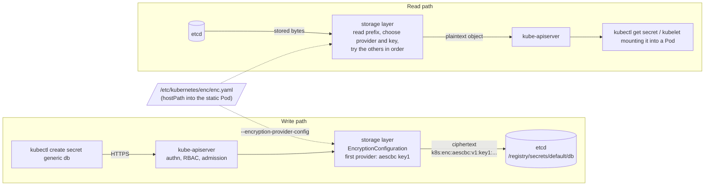

# T4.10 Use ConfigMaps and Secrets to configure applications (admin view, incl. encryption at rest)

> Competency: "Use ConfigMaps and Secrets to configure applications" (CKA-3.2) | Domain/weight: CKA - Workloads and Scheduling (15%) | Est. time: 2 h | Prerequisites: T3.03, T3.04, T4.02

Prerequisite lessons (read them first if a term is new):

- [T3.03 ConfigMaps](../part3-ckad/T3.03-configmaps.md) - how to create a ConfigMap and the four ways a Pod consumes it (env, `envFrom`, volume, command arguments). This lesson does not re-teach them.
- [T3.04 Create & consume Secrets](../part3-ckad/T3.04-create-consume-secrets.md) - Secret types, `stringData`, base64, `secretKeyRef`, Secret volumes.
- [T4.02 Create and manage Kubernetes clusters using kubeadm](../part4-cka/T4.02-create-and-manage-kubernetes-clusters-using.md) - where the static Pod manifests live (`/etc/kubernetes/manifests`) and which add-ons kubeadm installs.

Related lessons: [T4.04 Manage the lifecycle of Kubernetes clusters](../part4-cka/T4.04-manage-the-lifecycle-of-kubernetes-clusters.md) (etcd backup and restore, section 7.0 installs `etcdctl`), and [T4.19 Understand and use CoreDNS](../part4-cka/T4.19-understand-and-use-coredns.md) (the CoreDNS Corefile in depth; the Easy lab here adds a stub domain to it).

Shell setup (from [conventions](../00-conventions.md); put it at the top of every terminal):

```bash
alias k=kubectl
export do="--dry-run=client -o yaml"
export now="--force --grace-period=0"
source <(kubectl completion bash); complete -o default -F __start_kubectl k
```

Lab environments: **kind** (cluster `lab`, context `kind-lab`) for Lab A; **vms** (`cp1`, `w1`, `w2`, kubeadm 1.37.x) for the encryption part, Labs B and C. Namespace: `lab-t410`. Files go in `~/lab/t410/`.

> Output policy. No kind cluster and no VMs could be used when this lesson was written (the one-cluster-at-a-time lock was held by other writers for the full 20 minutes). Instead the author ran the pieces that do not need a kubelet as plain Docker containers. Every output block carries one of these labels:
> - `REAL OUTPUT (Docker rig: etcd 3.7.0-0 + kube-apiserver v1.37.0)`: a real v1.37.0 API server and a real etcd 3.7.0 running as two containers on one Docker network. No kubelet, no kubeadm, no TLS between them, token authentication. The storage layer, the encryption code, RBAC, admission and the error texts are the real v1.37.0 code. Differences from `cp1`: `etcdctl` was run as `docker exec ae-etcd etcdctl ...` (no TLS flags), and "restart the API server" meant "recreate the container with the new flags".
> - `REAL OUTPUT (Docker: kubeadm v1.37.0 dry-run)`: `kubeadm init --dry-run` and `kubeadm upgrade node phase kubelet-config --dry-run` run from the `kindest/node:v1.37.0` image. Nothing was started; kubeadm printed the objects it would create.
> - `REAL OUTPUT (Docker: CoreDNS v1.14.6, busybox:1.36)`: the stub-domain Corefile tested with two CoreDNS containers.
> - `REAL OUTPUT (kubectl v1.37.1 client, --dry-run=client)`: object produced by the client with no cluster.
> - `EXPECTED OUTPUT (not captured)`: the shape you should see on a real v1.37 cluster. Names, ages, UIDs and hashes will differ. Every such block is listed in section 11.
>
> The encryption key shown in this lesson is a throw-away value that protected nothing. Generate your own (section 4).

---

## 1. Why this matters

Applications and cluster components are configured with ConfigMaps (plain settings) and Secrets (passwords, tokens, keys). As an administrator you do more than create them. You change the ConfigMaps that configure CoreDNS, kube-proxy and the kubelet. You make objects immutable so nobody edits them by accident. You protect Secrets inside etcd, because by default every Secret is stored there as readable text and anyone who can read an etcd backup or the etcd disk can read all of them. In real life the failures are quiet: an encryption change that was never applied to old Secrets, a lost key that makes every Secret unreadable, a `list` permission that leaks every password in a namespace. For competency CKA-3.2, practise tasks of this shape: "enable encryption at rest and prove it", "edit a system ConfigMap and make the change take effect", and "recover an API server that no longer starts". (These are practice scenarios, not statements about what the exam will ask.) An API server that is down means every `kubectl` command fails, so you must be able to diagnose it without `kubectl`.

---

## 2. Concepts

### 2.1 Recap: create and consume (T3.03, T3.04)

You already know this part; only the admin-relevant facts are repeated.

| Fact | Detail |
|---|---|
| Objects | ConfigMap (`data`, `binaryData`) holds non-secret settings. Secret (`data` base64, `stringData` plain) holds sensitive values. Both are namespaced `v1` objects. |
| Size limit | 1 MiB of data per object (the API server rejects larger objects). |
| Namespace rule | A Pod can only reference a ConfigMap or Secret in its own namespace. |
| Four ways to consume | env (`valueFrom`), `envFrom`, a volume (each key becomes a file), or command arguments that use env variables. |
| What updates live | Volume files are refreshed by the kubelet after a delay. Environment variables are fixed when the container starts and never change. A `subPath` mount never updates. |
| Base64 is not encryption | A Secret is only base64-encoded text (a reversible encoding). Protection comes from RBAC (section 2.9) and encryption at rest (section 2.4). |

Imperative creation, which the exam rewards:

```bash
k create cm app --from-literal=LOG_LEVEL=info --from-file=app.properties
k create secret generic db --from-literal=password='S3cr3t' --from-file=./tls.key
k create secret tls web-tls --cert=tls.crt --key=tls.key
k create secret docker-registry regcred --docker-server=reg.example.com --docker-username=u --docker-password=p
```

Add `$do` to any of them to get YAML instead of creating the object.

### 2.2 Configuring system components through ConfigMaps

A kubeadm cluster keeps the settings of several system components in ConfigMaps in the `kube-system` namespace. Knowing which ConfigMap feeds which component, and what must happen after you edit it, is a typical admin task.

| ConfigMap | Key(s) | Who reads it | How a change takes effect |
|---|---|---|---|
| `coredns` | `Corefile` | The CoreDNS Pods mount it as a volume at `/etc/coredns`. | The `reload` plugin in the Corefile re-reads the file by itself after the kubelet refreshes the mounted copy (up to a couple of minutes). To be sure and fast: `k -n kube-system rollout restart deploy/coredns`. |
| `kube-proxy` | `config.conf` (a `KubeProxyConfiguration`), `kubeconfig.conf` | The kube-proxy DaemonSet mounts it at `/var/lib/kube-proxy` and starts with `--config=/var/lib/kube-proxy/config.conf`. | kube-proxy reads the file only at start: `k -n kube-system rollout restart ds/kube-proxy`. |
| `kubeadm-config` | `ClusterConfiguration` | Only kubeadm itself (`kubeadm upgrade`, `kubeadm join` for control planes). No running component reads it. | Editing it does **not** change any running Pod. It is the record kubeadm uses the next time it generates manifests or upgrades. |
| `kubelet-config` | `kubelet` (a `KubeletConfiguration`) | Only kubeadm (`kubeadm join`, `kubeadm upgrade node`). The kubelet itself reads the local file `/var/lib/kubelet/config.yaml`. | Editing it changes nothing on existing nodes until you run `kubeadm upgrade node phase kubelet-config` on each node (section 2.11) and restart the kubelet. |
| `cluster-info` (namespace `kube-public`) | `kubeconfig` | Joining nodes use it to learn the API server address and CA certificate. | Rarely edited by hand. |

The exact content kubeadm 1.37 creates (the parts you will edit most):

REAL OUTPUT (Docker: kubeadm v1.37.0 dry-run), the `coredns` ConfigMap:

```yaml
apiVersion: v1
data:
  Corefile: |
    .:53 {
        errors
        health {
           lameduck 5s
        }
        ready
        kubernetes cluster.local in-addr.arpa ip6.arpa {
           pods insecure
           fallthrough in-addr.arpa ip6.arpa
           ttl 30
        }
        prometheus :9153
        forward . /etc/resolv.conf {
           max_concurrent 1000
        }
        cache 30 {
           disable success cluster.local
           disable denial cluster.local
        }
        loop
        reload
        loadbalance
    }
kind: ConfigMap
metadata:
  name: coredns
  namespace: kube-system
```

REAL OUTPUT (Docker: kubeadm v1.37.0 dry-run), the `kube-proxy` ConfigMap (trimmed with `...`; the default `mode` is `iptables`):

```yaml
data:
  config.conf: |-
    apiVersion: kubeproxy.config.k8s.io/v1alpha1
    bindAddress: 0.0.0.0
    clientConnection:
      kubeconfig: /var/lib/kube-proxy/kubeconfig.conf
    clusterCIDR: 192.168.0.0/16
    ...
    mode: iptables
    ...
  kubeconfig.conf: |-
    apiVersion: v1
    kind: Config
    ...
```

REAL OUTPUT (Docker: kubeadm v1.37.0 dry-run), the `kubeadm-config` ConfigMap:

```yaml
data:
  ClusterConfiguration: |
    apiServer: {}
    apiVersion: kubeadm.k8s.io/v1beta4
    certificatesDir: /etc/kubernetes/pki
    clusterName: kubernetes
    dns: {}
    etcd:
      local:
        dataDir: /var/lib/etcd
    imageRepository: registry.k8s.io
    kind: ClusterConfiguration
    kubernetesVersion: v1.37.0
    networking:
      dnsDomain: cluster.local
      podSubnet: 192.168.0.0/16
      serviceSubnet: 10.96.0.0/12
    ...
kind: ConfigMap
metadata:
  name: kubeadm-config
  namespace: kube-system
```

Look at them on a live cluster (the exam-style commands):

```bash
k -n kube-system get cm
k -n kube-system get cm coredns -o yaml
k -n kube-system get cm kube-proxy -o jsonpath='{.data.config\.conf}'     # the backslash escapes the dot in the key name
k -n kube-system get cm kubelet-config -o jsonpath='{.data.kubelet}'
```

EXPECTED OUTPUT (not captured), `k -n kube-system get cm` on a kubeadm 1.37 cluster (the names come from the dry-run above plus the objects every cluster has):

```text
NAME                                                   DATA   AGE
coredns                                                1      2d
extension-apiserver-authentication                     6      2d
kube-apiserver-legacy-service-account-token-tracking   1      2d
kube-proxy                                             2      2d
kube-root-ca.crt                                       1      2d
kubeadm-config                                         1      2d
kubelet-config                                         1      2d
```

**Under the hood: why a ConfigMap edit does not restart anything.** A ConfigMap is just an object in etcd. Nothing watches it for you. For volumes the kubelet notices the new version and rewrites the files in the mounted directory (it swaps a symlink, so readers see the old or the new set, never half of each). The application must then re-read the file. Environment variables are copied into the container once at start. That is why section 2.10 ends with "restart the workload".

**The coredns edit loop** (fully worked in Lab A):

```bash
k -n kube-system get cm coredns -o yaml > ~/lab/t410/coredns.backup.yaml   # always keep a copy first
k -n kube-system edit cm coredns                                            # change the Corefile
k -n kube-system rollout restart deploy/coredns
k -n kube-system rollout status deploy/coredns
```

If the new Corefile has a syntax error, new CoreDNS Pods crash and in-cluster DNS stops. The Pods that already run keep their old config (the `reload` plugin refuses a bad file), so the damage shows up when Pods restart. Keep the backup and read `k -n kube-system logs deploy/coredns` when a rollout stalls.

### 2.3 Immutable ConfigMaps and Secrets

**Problem.** Two problems: (1) someone edits a ConfigMap that hundreds of Pods use and the change reaches every Pod at once, including a typo; (2) in a very large cluster the kubelet on every node keeps an open watch (a long-lived request that streams changes) on every ConfigMap and Secret its Pods use. Tens of thousands of watches load the API server.

**Solution.** Set `immutable: true` on the object. It is a top-level field next to `data`, not inside it. Its default is `false` (field absent). From then on:

- the API server rejects any change to `data`, `binaryData` (ConfigMap) or `data`/`stringData` (Secret);
- you cannot set `immutable` back to `false`;
- you can still change metadata (labels, annotations) and you can delete the object;
- the kubelet does not need a watch on it (the object can never change), which cuts API server load. The official docs state the saving matters for clusters with at least tens of thousands of unique ConfigMap-to-Pod mounts; for the exam the facts above are what counts.

YAML (applies cleanly):

```yaml
apiVersion: v1
kind: ConfigMap
metadata:
  name: app-v1
  namespace: lab-t410
data:
  LOG_LEVEL: info
immutable: true            # default false; cannot be turned back off
```

Make an existing object immutable with a patch:

```bash
k -n lab-t410 patch secret db -p '{"immutable":true}'
k -n lab-t410 patch cm app -p '{"immutable":true}'
```

What you see when you try to change one:

REAL OUTPUT (Docker rig: etcd 3.7.0-0 + kube-apiserver v1.37.0)

```text
$ k patch cm app-v1 -p '{"data":{"LOG_LEVEL":"debug"}}'
The ConfigMap "app-v1" is invalid: data: Forbidden: field is immutable when `immutable` is set
$ k patch cm app-v1 -p '{"immutable":false}'
The ConfigMap "app-v1" is invalid: immutable: Forbidden: field is immutable when `immutable` is set
$ k label cm app-v1 tier=web
configmap/app-v1 labeled
$ k patch secret db -p '{"stringData":{"password":"new"}}'      # db was made immutable first
The Secret "db" is invalid: data: Forbidden: field is immutable when `immutable` is set
```

**How you "change" an immutable object.** Create a new object with a new name (`app-v2`), point the workload at it, and let the Deployment roll out. This is also the safest pattern for any config, because the rollout is automatic and `k rollout undo` goes back to `app-v1`.

```bash
k -n lab-t410 create cm app-v2 --from-literal=LOG_LEVEL=debug
k -n lab-t410 patch deploy web --type=json \
  -p '[{"op":"replace","path":"/spec/template/spec/containers/0/envFrom/0/configMapRef/name","value":"app-v2"}]'
```

Changing the Pod template starts a rolling update by itself. REAL OUTPUT (Docker rig) for the patch: `deployment.apps/web patched`, and `.metadata.generation` went from 1 to 2.

If you delete and recreate an immutable object under the same name, running Pods keep the old mount; recreate the Pods too (`k rollout restart`).

### 2.4 Encryption at rest

**What is stored by default.** The API server writes every object to etcd (the key-value database of the cluster) under the key prefix `/registry`. A Secret `db` in namespace `default` lives at `/registry/secrets/default/db`. By default the value is a protobuf message in plain bytes, so the password is readable in the file on disk, in an etcd snapshot, and in the output of `etcdctl get`. Anyone who can reach etcd (a stolen backup, a compromised control plane host, a misconfigured etcd port) bypasses RBAC completely. Encryption at rest closes that gap: the API server encrypts the value before it writes to etcd and decrypts it after it reads.

What it protects and what it does not:

| Protects against | Does not protect against |
|---|---|
| Reading Secrets from etcd data files or snapshots without the key | A user with RBAC `get`/`list` on Secrets (they get plain values, section 2.9) |
| A stolen etcd backup | Someone who has root on the control plane host and can read the key file (with the `aescbc`/`aesgcm`/`secretbox` providers the key sits in a local file) |
| | Secret data inside Pods (it is plain in the container and in memory on the node) |

**Under the hood: the storage layer.** Encryption happens in the API server's storage layer, between "object" and "bytes in etcd". The configuration is an `EncryptionConfiguration` file that you point the API server to. For each listed resource it builds an ordered list of providers. On write it uses the **first** provider and the **first key** of that provider. On read it looks at the stored bytes, finds the provider from the prefix, and decrypts. Encrypted values start with the text `k8s:enc:<provider>:v1:<keyname>:` followed by ciphertext. That prefix is what you look for when you verify (section 2.5). Plain values start with the four bytes `k8s` followed by a zero byte (hex `6b 38 73 00`).

**Providers.** Each row has an example you can run and a way to see the effect. The prefixes below were observed on a v1.37.0 API server, except `kms` v2, which is taken from the docs and could not be run here (it needs a KMS plugin process).

| Provider | What it does | Key size | Prefix seen in etcd | Notes (source: encrypt-data docs) |
|---|---|---|---|---|
| `identity` | No encryption. Reads and writes plain bytes. | none | `k8s` + NUL (plain) | The default when no config exists. As the **first** provider it means "write plain". |
| `aescbc` | AES-CBC with PKCS#7 padding. | 16, 24 or 32 bytes | `k8s:enc:aescbc:v1:<keyname>:` | Fast. The docs list it as weak (padding-oracle concerns) and not recommended; it is still the docs' worked example and the usual exam answer. |
| `aesgcm` | AES-GCM with a random nonce. | 16, 24 or 32 bytes | `k8s:enc:aesgcm:v1:<keyname>:` | Fastest. Must be rotated every 200,000 writes, so use it only with automated rotation. |
| `secretbox` | XSalsa20 and Poly1305. | 32 bytes | `k8s:enc:secretbox:v1:<keyname>:` | Strong and fast; newer cipher that some audit regimes do not accept. |
| `kms` v2 | Envelope encryption: a data key encrypts the value, a key held in an external KMS encrypts the data key. | 32 bytes (managed by the plugin) | `k8s:enc:kms:v2:<name>:` | Strongest and the right choice for production. Needs a KMS plugin listening on a Unix socket. Stable since v1.29. `kms` v1 is deprecated since v1.28. |

Run-it-yourself example for each (the file is the same shape; only the provider block differs). Check the effect with the prefix command from section 2.5:

```yaml
# provider = aescbc (the worked example of this lesson)
- aescbc:
    keys:
      - name: key1
        secret: VCK9LZUC4uQW0g0qKuIXEXgxPNmGygBmv1zyRmf1ejc=
# provider = aesgcm: same shape, same key sizes
- aesgcm:
    keys:
      - name: key1
        secret: VCK9LZUC4uQW0g0qKuIXEXgxPNmGygBmv1zyRmf1ejc=
# provider = secretbox: key must decode to exactly 32 bytes
- secretbox:
    keys:
      - name: key1
        secret: VCK9LZUC4uQW0g0qKuIXEXgxPNmGygBmv1zyRmf1ejc=
# provider = kms v2: no key in the file; the plugin holds it
- kms:
    apiVersion: v2
    name: myKmsPluginFoo
    endpoint: unix:///tmp/socketfile-foo.sock
    timeout: 3s
```

REAL OUTPUT (Docker rig), prefixes read back after creating one Secret under each provider:

```text
aesgcm    -> k8s:enc:aesgcm:v1:kaesgcm:...
secretbox -> k8s:enc:secretbox:v1:ksecretbox:...
```

(the key names in that test were `kaesgcm` and `ksecretbox`). For `kms` v2 the rig could only check the failure path: with the plugin socket missing the API server still starts, but `readyz` reports `[-]kms-providers failed` and `k create secret` fails with `Internal error occurred: got unexpected nil transformer`.

**The EncryptionConfiguration file, field by field.**

| Field | Meaning | Default / valid values | Risky or invalid values |
|---|---|---|---|
| `apiVersion` | Config API group and version. | `apiserver.config.k8s.io/v1` is the only version in v1.37. | `v1beta1` or `v2` fail at start: `no kind "EncryptionConfiguration" is registered for version ...`. |
| `kind` | `EncryptionConfiguration`. | fixed | any other value fails to decode. |
| `resources[]` | A list of entries. Each entry has its own `resources` and `providers`. | at least one entry | Overlapping wildcards across entries are rejected by the API server. |
| `resources[].resources[]` | Resource names to encrypt: `secrets`, `configmaps`, a custom resource `name.group`, or wildcards (`*.apps`, `*.*`, `*.` for the core group). | Resources not listed are stored plain. | A typo silently encrypts nothing. Check with section 2.5. |
| `providers[]` | Ordered list. **First = used for writes.** All = tried for reads. | One provider type per list item. | Putting `identity` first means "write plain". |
| `keys[].name` | Label stored in the prefix, used for rotation. | any short unique string | Reusing a name for a different key makes old data undecryptable. |
| `keys[].secret` | Base64 of the raw key bytes. | `aescbc`/`aesgcm`: 16, 24 or 32 bytes; `secretbox`: 32 bytes | A wrong length fails at start with `secret is not of the expected length, got 5, expected one of [16 24 32]`. |

**How provider order behaves (tested).** The list order is the whole policy.

| Config for `secrets` | Writes | Reads | Use for | How to observe |
|---|---|---|---|---|
| `aescbc` then `identity` | encrypted | encrypted and plain | Enabling encryption (old plain Secrets stay readable until rewritten). | Old Secret still readable; new one has the prefix. |
| `aescbc` only | encrypted | encrypted only | After everything is rewritten (section 2.6). | A leftover plain Secret now fails: `data from the storage is not transformable ... no matching prefix found`. |
| `identity` then `aescbc` | **plain** | encrypted and plain | Disabling encryption ("decrypt all"). | New writes have no prefix. |
| new key then old key (same provider) | with the new key | with both | Key rotation (section 2.7). | The prefix shows the key name in use. |

**Which API server flag, and why a hostPath volume.** The API server reads the file named by `--encryption-provider-config=<path>` once at start. On a kubeadm cluster the API server is a **static Pod** (a Pod defined by a file in `/etc/kubernetes/manifests` that the kubelet starts by itself, even when the API is down). A static Pod cannot use a Secret or ConfigMap (section 2.8), so the config file must come from the node's disk: you create `/etc/kubernetes/enc/enc.yaml` on the control plane node, add a `hostPath` volume (a directory of the node mounted into the container) and a `volumeMount`, and add the flag. All three edits are needed. A missing mount is the most common reason the API server does not start (section 6).

If you add `--encryption-provider-config-automatic-reload=true`, the API server polls the file about once a minute and applies changes without a restart. REAL OUTPUT (Docker rig): the API server started with `secretbox` first; a new Secret `r1` was stored with `k8s:enc:secretbox:...`. The file was edited to put `aesgcm` first and 75 seconds later, with no restart, a new Secret `r2` was stored with `k8s:enc:aesgcm:...`. The metric `apiserver_encryption_config_controller_automatic_reload_last_timestamp_seconds{...,status="success"}` appeared on `/metrics`.

**More than one control plane node.** Every API server needs the same file and the same keys, or one of them cannot read what another wrote. Roll the change out one node at a time.

### 2.5 Verifying encryption

Do not trust the flag; read the bytes. The key is `/registry/secrets/<namespace>/<name>`. Use `etcdctl` with the etcd client certificates that kubeadm creates (the same ones `etcd.yaml` uses; see [T4.04](../part4-cka/T4.04-manage-the-lifecycle-of-kubernetes-clusters.md) section 7.0 to install the binary):

```bash
export ETCDCTL_ENDPOINTS=https://127.0.0.1:2379
export ETCDCTL_CACERT=/etc/kubernetes/pki/etcd/ca.crt
export ETCDCTL_CERT=/etc/kubernetes/pki/etcd/server.crt
export ETCDCTL_KEY=/etc/kubernetes/pki/etcd/server.key
etcdctl get /registry/secrets/default/db --print-value-only | hexdump -C | head
```

`--print-value-only` prints the value without the key line. `hexdump -C` shows each byte in hex on the left and as text on the right. Read it like this:

- Starts with `6b 38 73 00` (text `k8s.`): stored **plain**. The password is readable further down.
- Starts with `6b 38 73 3a 65 6e 63 3a` (text `k8s:enc:`), then the provider name: stored **encrypted**.

`hexdump` is not on every host and the exam host list (E9: kubectl, `yq`, `curl`, `wget`, `man`) does not mention it, so on a host without it use `head -c 23` to print the readable prefix:

```bash
etcdctl get /registry/secrets/default/db --print-value-only | head -c 23; echo        # k8s:enc:aescbc:v1:key1:
etcdctl get /registry/secrets/ --prefix --keys-only                                   # list every Secret key in etcd
```

If `etcdctl` is not installed you can borrow the one inside the etcd Pod (the etcd image contains `etcdctl`; this works only while the API server is up):

```bash
etcdctl() { kubectl -n kube-system exec etcd-cp1 -- etcdctl --endpoints=https://127.0.0.1:2379 \
  --cacert=/etc/kubernetes/pki/etcd/ca.crt --cert=/etc/kubernetes/pki/etcd/server.crt \
  --key=/etc/kubernetes/pki/etcd/server.key "$@"; }
```

Remember the other half of the test: through the API the value must still read correctly (`k get secret db -o jsonpath='{.data.password}' | base64 -d`). Encrypted in etcd and plain through the API is the goal.

### 2.6 Re-encrypting existing Secrets, and decrypting all

Turning encryption on only affects **new writes**. Every Secret that already exists stays plain in etcd until something writes it again. The documented way to rewrite all of them:

```bash
k get secrets -A -o json | k replace -f -
```

`get -A -o json` lists every Secret in every namespace as one `List` object. `replace -f -` sends each item back as an update. The API server then writes it with the first provider and first key. You need cluster-admin rights because it touches every namespace. `jq` is not needed.

**Under the hood.** An update that changes nothing normally is not written to etcd at all. The rewrite works because the API server notices that the stored bytes were read through a provider or key that is not the current first one, and writes the object again. REAL OUTPUT (Docker rig): the first `replace` turned the plain value of `db` into ciphertext (it was rewritten). A second identical `replace` printed `secret/db replaced` again, but the etcd `mod_revision` of `db` stayed `227` before and after: nothing was written because the value was already current.

If another client changes a Secret between your `get` and your `replace`, that item fails with a `Conflict` error; run the pipeline again. Do the same for `configmaps` if you added them to the config (`k get cm -A -o json | k replace -f -`).

**Removing the safety net.** After every Secret is rewritten and verified, remove `- identity: {}` from the file and restart the API server. From then on a plain Secret can never be read by accident.

**Decrypt all** (turn encryption off): put `identity` first, keep the old provider second, restart the API server, run the same `replace` pipeline, verify every value is plain, and only then remove the flag and the file. Removing the flag first leaves the API server with no provider that understands the stored `k8s:enc:` bytes, so reading those Secrets fails (the exact error text for this case was not captured; see section 11).

### 2.7 Key rotation, backups and a lost key

**Rotation order.** The order matters because during the change every API server must still be able to read every stored value. The sequence below is the one from the docs and was run end to end on the Docker rig (each step is one restart of the API server):

1. Add the new key as the **second** key of the same provider, keep the old key first. Restart every API server. (Now every server can read both keys. Nothing is written with the new key yet.)
2. Make a secure copy of the new key.
3. Swap the order: new key first, old key second. Restart every API server. (New writes use the new key.)
4. Rewrite all Secrets: `k get secrets -A -o json | k replace -f -`.
5. When every Secret shows the new key name in its prefix and you have a backup of the new key, remove the old key. Restart.

REAL OUTPUT (Docker rig), the prefix of Secret `db2` at each step:

```text
start:                                   k8s:enc:aescbc:v1:key1:
after step 1 restart (key1, key2):       k8s:enc:aescbc:v1:key1:
after step 3 restart (key2, key1):       k8s:enc:aescbc:v1:key1:     <- reads still work, writes use key2, nothing rewritten yet
after step 4 replace:                    k8s:enc:aescbc:v1:key2:
after step 5 restart (key2 only):        k8s:enc:aescbc:v1:key2:     and the Secret still reads correctly
```

Doing step 3 before step 1 is the classic mistake: the only server that has the new key writes data the other servers cannot read.

**Lost key.** If the key in the file is wrong or gone and the data in etcd was written with it, the API server cannot decrypt. REAL OUTPUT (Docker rig): the API server was restarted with a different key and no `identity` fallback:

```text
$ k get secret db
Error from server (InternalError): Internal error occurred: StorageError: corrupt object, Code: 7, Key: /secrets/default/db, ResourceVersion: 0, AdditionalErrorMsg: data from the storage is not transformable revision=0: no matching key was found for the provided AES transformer
$ k get secrets
Error from server (StorageReadError): failed to read one or more secrets from the storage: StorageError: corrupt object, Code: 7, Key: /registry/secrets/default/db, ResourceVersion: 0, AdditionalErrorMsg: data from the storage is not transformable revision=0: no matching key was found for the provided AES transformer (and 1 more)
$ k delete secret db2
Error from server (InternalError): Internal error occurred: StorageError: corrupt object, ... no matching key was found for the provided AES transformer
```

Three facts to take from it. (1) One unreadable Secret makes `k get secrets` (a list) fail for the whole namespace or cluster. (2) Even `k delete` fails, because the API server reads the object before it deletes it. (3) The only API-level fix is the old key: put it back (as a second key) and the same Secrets read again. REAL OUTPUT (Docker rig): after restoring the original config, `k get secrets` listed `db2` again. If the key is truly gone, delete the broken keys straight from etcd with `etcdctl del /registry/secrets/default/db` (the Docker rig printed `1`, one key deleted) and recreate the Secret from its source.

So: **keep a copy of the key file somewhere safe, away from the etcd backup.** A snapshot taken with [T4.04](../part4-cka/T4.04-manage-the-lifecycle-of-kubernetes-clusters.md) contains the ciphertext; restoring it into a cluster that does not have the key gives exactly the errors above. The key and the snapshot are only useful as a pair, yet must not be stored together (a thief who gets both can decrypt).

### 2.8 Static Pods cannot reference Secrets or ConfigMaps

A **static Pod** is defined by a manifest file on a node. The kubelet of that node starts it with no instruction from the API server. To make it visible, the kubelet creates a read-only copy in the API called a **mirror Pod**. Because the source of truth is a file and not an API object, a static Pod must not depend on API objects. The docs say it plainly: the spec of a static Pod cannot refer to a ConfigMap or any other API object, and "you cannot use ConfigMaps or Secrets with static Pods".

The API server enforces this when the kubelet registers the mirror Pod. The NodeRestriction admission plugin (kubeadm enables it with `--enable-admission-plugins=NodeRestriction`) rejects a mirror Pod that references them. REAL OUTPUT (Docker rig), the Pod below was created with the identity `system:node:w1`, the mirror-Pod annotation and a controller owner reference to the Node, which is what a kubelet sends:

```text
$ k create -f mirror-cm.yaml       # envFrom: configMapRef
Error from server (Forbidden): ... pods "static-web-w1" is forbidden: node "w1" can not create pods that reference configmaps
$ k create -f mirror-proj.yaml     # projected volume with a configMap source
Error from server (Forbidden): ... pods "static-proj-w1" is forbidden: node "w1" can not create pods that reference configmaps
$ k create -f mirror-vol.yaml      # secret volume
Error from server (Forbidden): ... pods "static-vol-w1" is forbidden: a mirror pod may not reference secrets
$ k create -f mirror-env.yaml      # env valueFrom secretKeyRef
Error from server (Forbidden): ... pods "static-env-w1" is forbidden: a mirror pod may not reference secrets
$ k create -f mirror-ok.yaml       # same Pod with literal env values only
pod/static-ok-w1 created
```

What the kubelet itself does when the Pod will not start (the container cannot get the value) was not captured; see section 11. The practical rule is: **a static Pod gets its configuration from the node's disk.** Use literal `env` values, command-line arguments, or `hostPath` volumes. This is exactly how the control plane works: the API server reads certificates from `/etc/kubernetes/pki` and the encryption file from `/etc/kubernetes/enc` through hostPath mounts. It also means that the encryption key lives on the control plane disk, which is why file permissions on it matter (`chmod 600`, owned by root).

### 2.9 RBAC on Secrets

RBAC (Role-Based Access Control) decides who may do what. For Secrets the verbs matter more than they look:

| Verb | What it allows | Exposure |
|---|---|---|
| `get` | Read one Secret by name. | Reads the values. |
| `list` | List all Secrets in the namespace (or cluster for a ClusterRole). | **Returns every value**, not only names. `list` is as dangerous as `get`. |
| `watch` | Stream changes. | Streams full objects, so it exposes values too. |
| `create` a Pod in the namespace | Start a container that mounts a Secret. | An indirect read of every Secret in that namespace, even without any Secret verb. |

REAL OUTPUT (Docker rig): user `ana` has only `list` on Secrets in `lab-t410`:

```text
$ k -n lab-t410 create role lister --verb=list --resource=secrets
$ k -n lab-t410 create rolebinding lister --role=lister --user=ana
$ for v in get list watch; do echo -n "$v: "; k -n lab-t410 auth can-i $v secrets --as=ana; done
get: no
list: yes
watch: no
$ k -n lab-t410 get secret db --as=ana
Error from server (Forbidden): secrets "db" is forbidden: User "ana" cannot get resource "secrets" in API group "" in the namespace "lab-t410"
$ k -n lab-t410 get secrets --as=ana -o jsonpath='{.items[0].data.password}' | base64 -d
S3cr3t
```

`get` is denied, but `list` returned the password. Limit access by name with `resourceNames`. A `list` rule with `resourceNames` only works when the client filters by name:

```text
$ k -n lab-t410 create role reader2 --verb=list --resource=secrets --resource-name=db
$ k -n lab-t410 create rolebinding r2 --role=reader2 --user=bob
$ k -n lab-t410 get secrets --as=bob
Error from server (Forbidden): secrets is forbidden: User "bob" cannot list resource "secrets" in API group "" in the namespace "lab-t410"
$ k -n lab-t410 get secrets --as=bob --field-selector metadata.name=db
NAME   TYPE     DATA   AGE
db     Opaque   1      0s
```

From the official RBAC docs: the built-in ClusterRole `view` does **not** allow viewing Secrets (reading them would give access to ServiceAccount credentials), while `edit` does allow accessing Secrets and running Pods as any ServiceAccount in the namespace. Prefer `get` with `resourceNames` for one Secret, and never give `list`/`watch` on Secrets unless the subject must see all of them. Nodes are limited by the Node authorizer to the Secrets of Pods scheduled on them; a node identity is not a general reader.

Check what a subject can do: `k auth can-i get secrets -n lab-t410 --as=ana` and `k auth can-i --list -n lab-t410 --as=ana`.

### 2.10 Rolling restarts after config changes

Which consumption mode needs what:

| Consumed as | After you change the ConfigMap/Secret | What to do |
|---|---|---|
| `env` / `envFrom` | Nothing changes inside running containers. | `k rollout restart deploy/<name>` |
| Volume (no `subPath`) | Files change after the kubelet sync (can take a minute or more). The app must re-read them. | Wait, or restart if the app does not re-read. |
| Volume with `subPath` | Never updates. | `k rollout restart` |
| Immutable object | Cannot be edited. | Create `-v2`, change the reference in the template (rolls out by itself). |

```bash
k -n lab-t410 rollout restart deploy/web          # adds the annotation kubectl.kubernetes.io/restartedAt to the Pod template -> new ReplicaSet
k -n lab-t410 rollout status deploy/web           # waits until done
k -n lab-t410 rollout undo deploy/web             # back to the previous template if the new config is bad
k -n kube-system rollout restart ds/kube-proxy    # DaemonSets and StatefulSets work the same way
```

REAL OUTPUT (Docker rig): `rollout restart` printed `deployment.apps/web restarted` and the Pod template annotations became `{"kubectl.kubernetes.io/restartedAt":"2026-10-28T12:14:48+08:00"}`. The rollout itself needs the Deployment controller, which the rig did not run, so `rollout status` is EXPECTED OUTPUT (not captured): `deployment "web" successfully rolled out`.

A rolling restart replaces Pods one by one (governed by `maxSurge`/`maxUnavailable`), so the app stays up if it has more than one replica. The kubelet and the static Pods are not Deployments: restart the kubelet with `systemctl restart kubelet`, and a static Pod by moving its manifest out of the directory and back (section 4).

### 2.11 kubelet-config and node-wide kubelet settings

The kubelet reads its settings from a local file, `/var/lib/kubelet/config.yaml` (a `KubeletConfiguration`, `apiVersion: kubelet.config.k8s.io/v1beta1`). kubeadm also keeps a cluster-wide copy in the `kubelet-config` ConfigMap (key `kubelet`) in `kube-system`. The ConfigMap is a template for **new** nodes and for upgrades, not a live feed.

REAL OUTPUT (Docker: kubeadm v1.37.0 dry-run), excerpt of the `kubelet-config` ConfigMap:

```yaml
data:
  kubelet: |
    apiVersion: kubelet.config.k8s.io/v1beta1
    authentication:
      anonymous:
        enabled: false
    cgroupDriver: systemd
    clusterDNS:
    - 10.96.0.10
    clusterDomain: cluster.local
    ...
    rotateCertificates: true
    staticPodPath: /etc/kubernetes/manifests
    ...
kind: ConfigMap
metadata:
  name: kubelet-config
  namespace: kube-system
```

Two workflows:

| Goal | Steps |
|---|---|
| Change a setting on **one node** | Edit `/var/lib/kubelet/config.yaml` on that node, then `systemctl restart kubelet`. Check with `systemctl status kubelet` and `journalctl -u kubelet -n 30`. |
| Change a setting for **all nodes** | Edit the `kubelet-config` ConfigMap (`k -n kube-system edit cm kubelet-config`), then on **each existing node** run `kubeadm upgrade node phase kubelet-config` and `systemctl restart kubelet`. New nodes get it at `kubeadm join`. |

What `kubeadm upgrade node phase kubelet-config` does: it downloads `kubeadm-config` and `kubelet-config` from the cluster, backs up the current `/var/lib/kubelet/config.yaml`, and writes a fresh one. REAL OUTPUT (Docker: kubeadm v1.37.0 dry-run, pointed at a real v1.37.0 API server that held the two ConfigMaps):

```text
$ kubeadm upgrade node phase kubelet-config --dry-run
[upgrade] Reading configuration from the "kubeadm-config" ConfigMap in namespace "kube-system"...
[dryrun] Would back up kubelet config file to /etc/kubernetes/tmp/.../config.yaml
[kubelet-start] Writing kubelet configuration to file ".../instance-config.yaml"
[dryrun] Would write file "/var/lib/kubelet/instance-config.yaml" with content:
containerRuntimeEndpoint: "unix:///var/run/containerd/containerd.sock"
[kubelet-start] Writing kubelet configuration to file ".../config.yaml"
[dryrun] Would write file "/var/lib/kubelet/config.yaml" with content:
...
[upgrade/kubelet-config] The kubelet configuration for this node was successfully upgraded!
```

Note that kubeadm 1.37 writes two files: the cluster-wide `config.yaml` and a small per-node `instance-config.yaml` (here only the container runtime endpoint, which differs per node). The command does **not** restart the kubelet; you do that. (In the dry-run container the real command stopped with `stat /var/lib/kubelet/config.yaml: no such file or directory` because that container is not a node; on a real node the file exists.) Use `--help` for the flags: `--config`, `--dry-run`, `--kubeconfig` (default `/etc/kubernetes/admin.conf`) and `--patches`.

This connects to section 2.3: the kubelet setting `configMapAndSecretChangeDetectionStrategy` controls how the kubelet learns about ConfigMap and Secret changes (default `Watch`). Immutable objects need no watch. A node-wide change to such a setting uses the workflow above.

### 2.12 Related but different

| Often confused | The difference |
|---|---|
| Encryption at rest vs RBAC | RBAC controls who can ask the API for a Secret. Encryption controls what is on the etcd disk. You need both. |
| Encryption at rest vs TLS | TLS protects data in transit (client to API server, API server to etcd). Encryption at rest protects stored data. |
| `immutable` ConfigMap vs RBAC deny | `immutable` blocks everybody, including admins, until delete and recreate. RBAC only blocks the subjects you did not grant. |
| `identity` provider vs "no config" | The same effect (plain), but `identity` in a config file can also be a read fallback. |
| `kubeadm-config` vs `kubelet-config` | `kubeadm-config` is kubeadm's record of the cluster. `kubelet-config` is a template for kubelet files. Neither is read by running components. |
| KMS v1 vs KMS v2 | v1 is deprecated (slower, one data key per object). v2 uses a data key per API server and is stable since v1.29. |
| ConfigMap volume vs `subPath` | A plain volume refreshes; `subPath` never does. |

---

## 3. How it works (diagram)



Walkthrough:

1. `kubectl create secret` reaches the API server, which authenticates, authorizes (RBAC) and runs admission. Up to here the object is plain.
2. The storage layer takes the first provider of the list (here `aescbc`, key `key1`) and encrypts the serialized object. The stored value begins with `k8s:enc:aescbc:v1:key1:`.
3. etcd stores only ciphertext under `/registry/secrets/default/db`. A snapshot or a disk copy holds the same ciphertext.
4. On a read the storage layer looks at the prefix, picks the matching provider and key, and decrypts. If it finds plain bytes it asks `identity`; if `identity` is not in the list the read fails.
5. The config file comes from the control plane disk through a `hostPath` volume, because a static Pod cannot use a Secret.

---

## 4. Commands and YAML you must produce fast

### 4.1 Imperative shortcuts

```bash
head -c 32 /dev/urandom | base64                      # a fresh 32-byte key, base64 encoded (44 characters ending in =)
k create secret generic db --from-literal=password=S3cr3t -n lab-t410
k patch secret db -n lab-t410 -p '{"immutable":true}' # make an existing object immutable
k create cm app-cfg --from-literal=LOG_LEVEL=info $do | yq '.immutable = true' | k -n lab-t410 apply -f -
k get secrets -A -o json | k replace -f -             # re-encrypt every Secret
etcdctl get /registry/secrets/default/db --print-value-only | hexdump -C | head
etcdctl get /registry/secrets/default/db --print-value-only | head -c 23; echo
k -n kube-system get cm coredns -o yaml
k -n kube-system rollout restart deploy/coredns
k -n lab-t410 create role lister --verb=get --resource=secrets --resource-name=db
k auth can-i list secrets -n lab-t410 --as=ana
crictl ps -a | grep kube-apiserver                    # when the API server is down
crictl logs <container-id> 2>&1 | tail -5
```

Each line in one sentence: line 1 makes the key; lines 2-4 create or harden objects (`yq` is on the exam hosts per E9, `jq` is not); line 5 rewrites all Secrets; lines 6-7 prove the storage form; lines 8-9 read and roll out CoreDNS; lines 10-11 check RBAC; the last two read the crashed API server container.

### 4.2 The EncryptionConfiguration file

Save as `/etc/kubernetes/enc/enc.yaml` on every control plane node. It is **not** applied with `kubectl`; the API server reads it from disk. It is a complete, valid file for v1.37 (checked: a real v1.37.0 API server started with it).

```yaml
apiVersion: apiserver.config.k8s.io/v1      # the only version in v1.37
kind: EncryptionConfiguration               # fixed
resources:
  - resources:                              # which resources this entry covers
      - secrets                             # add "configmaps" here to encrypt ConfigMaps too
    providers:                              # ORDER MATTERS: first = write, all = read
      - aescbc:                             # first provider: new writes are encrypted with this
          keys:
            - name: key1                    # label that appears in the etcd prefix; first key encrypts
              secret: VCK9LZUC4uQW0g0qKuIXEXgxPNmGygBmv1zyRmf1ejc=   # base64 of 16, 24 or 32 random bytes. EXAMPLE ONLY, generate your own
      - identity: {}                        # last: lets the server still READ old plain Secrets; remove it after re-encrypting
```

Protect it: `chmod 600 /etc/kubernetes/enc/enc.yaml` (owner root).

### 4.3 The kube-apiserver manifest edit

Make a backup **outside** `/etc/kubernetes/manifests` (the kubelet starts every non-hidden file it finds in that directory, so a `.bak` copy inside it can become a second Pod; this directory rule is on the "To verify" list):

```bash
mkdir -p /root/backup /etc/kubernetes/enc
cp /etc/kubernetes/manifests/kube-apiserver.yaml /root/backup/
vim /etc/kubernetes/manifests/kube-apiserver.yaml
```

Three edits. This is the real diff (REAL OUTPUT (Docker: kubeadm v1.37.0 dry-run), the original is the `kube-apiserver.yaml` kubeadm 1.37.0 generates; the edited file passed `kubectl apply --dry-run=client`):

```diff
@@ -18,6 +18,7 @@
     - --client-ca-file=/etc/kubernetes/pki/ca.crt
     - --enable-admission-plugins=NodeRestriction
     - --enable-bootstrap-token-auth=true
+    - --encryption-provider-config=/etc/kubernetes/enc/enc.yaml
     - --etcd-cafile=/etc/kubernetes/pki/etcd/ca.crt
@@ -79,6 +80,9 @@
       timeoutSeconds: 15
     volumeMounts:
+    - mountPath: /etc/kubernetes/enc
+      name: enc
+      readOnly: true
     - mountPath: /etc/ssl/certs
       name: ca-certs
       readOnly: true
@@ -102,6 +106,10 @@
       type: RuntimeDefault
   volumes:
   - hostPath:
+      path: /etc/kubernetes/enc
+      type: DirectoryOrCreate
+    name: enc
+  - hostPath:
       path: /etc/ssl/certs
       type: DirectoryOrCreate
     name: ca-certs
```

What each field does: `--encryption-provider-config` is the path **inside the container**. `volumeMounts[].mountPath` must be that path's directory. `volumes[].name` must equal `volumeMounts[].name` (`enc`). `hostPath.path` is the directory on the node. `type: DirectoryOrCreate` creates the directory if it is missing (default type is empty = no check). `readOnly: true` stops the API server writing to its own key file. A wrong value in any of these four places gives the same symptom: the API server exits at start (section 6).

Faster alternative with `yq` (on the exam hosts per E9): edit a **copy**, then copy it into place, so the kubelet never sees a half-written file:

```bash
cp /etc/kubernetes/manifests/kube-apiserver.yaml /root/apiserver.edit.yaml
yq -i '.spec.containers[0].command += ["--encryption-provider-config=/etc/kubernetes/enc/enc.yaml"]
  | .spec.containers[0].volumeMounts += [{"name":"enc","mountPath":"/etc/kubernetes/enc","readOnly":true}]
  | .spec.volumes += [{"name":"enc","hostPath":{"path":"/etc/kubernetes/enc","type":"DirectoryOrCreate"}}]' /root/apiserver.edit.yaml
cp /root/apiserver.edit.yaml /etc/kubernetes/manifests/kube-apiserver.yaml
```

REAL OUTPUT (kubectl v1.37.1 client, --dry-run=client) of `kubectl apply --dry-run=client -f` on the `yq`-edited file: `pod/kube-apiserver created (dry run)`. (`yq` re-indents the file; that is harmless.)

**Restart and wait.** The kubelet notices a changed manifest within about 20 seconds (default `fileCheckFrequency`), stops the old container and starts the new one. A changed enc.yaml with an unchanged manifest does **not** restart the API server. Force it by moving the manifest out and back:

```bash
mv /etc/kubernetes/manifests/kube-apiserver.yaml /root/ ; sleep 25      # kubelet stops the static Pod
mv /root/kube-apiserver.yaml /etc/kubernetes/manifests/
export KUBECONFIG=/etc/kubernetes/admin.conf                            # as root on cp1
until k get --raw /readyz >/dev/null 2>&1; do sleep 3; done; echo up
```

### 4.4 Speed drill

Setup (one block; run once): `k create ns lab-t410`. Then:

```bash
mkdir -p ~/lab/t410 && cd ~/lab/t410
k -n lab-t410 create cm app --from-literal=LOG_LEVEL=info
k -n lab-t410 create secret generic db --from-literal=password=S3cr3t
cat > web.yaml <<'EOF'
apiVersion: apps/v1
kind: Deployment
metadata:
  name: web
  namespace: lab-t410
spec:
  replicas: 1
  selector:
    matchLabels:
      app: web
  template:
    metadata:
      labels:
        app: web
    spec:
      containers:
      - name: web
        image: nginx:1.27
        envFrom:
        - configMapRef:
            name: app
EOF
k apply -f web.yaml
```

Target times are for exam pace (about 6 minutes per task on average: 15-20 tasks in 2 hours, E2/E3). Do them in order; the answers are collapsed.

| # | Task | Target |
|---|---|---|
| 1 | Create an immutable ConfigMap `app-v1` in `lab-t410` with `LOG_LEVEL=info` and prove an edit is rejected. | 2 min |
| 2 | Make the existing Secret `db` immutable. | 1 min |
| 3 | Generate a 32-byte base64 key and write a valid `enc.yaml` (aescbc `key1` then identity) to `~/lab/t410/enc.yaml`. | 3 min |
| 4 | Print the first ten lines of the hexdump of `/registry/secrets/lab-t410/db` (cluster with etcdctl) or state the command. | 2 min |
| 5 | Re-encrypt every Secret in the cluster. | 1 min |
| 6 | Grant user `ana` the right to `get` only the Secret `db` in `lab-t410`, then prove `list` is denied. | 3 min |
| 7 | Change ConfigMap `app` to `LOG_LEVEL=debug` and make Deployment `web` use it. | 2 min |
| 8 | Save the Corefile text from the CoreDNS ConfigMap to `~/lab/t410/Corefile`. | 1 min |

<details><summary>Answers</summary>

```bash
# 1
k -n lab-t410 create cm app-v1 --from-literal=LOG_LEVEL=info $do | yq '.immutable = true' | k apply -f -
k -n lab-t410 patch cm app-v1 -p '{"data":{"LOG_LEVEL":"debug"}}'      # must fail: field is immutable when `immutable` is set

# 2
k -n lab-t410 patch secret db -p '{"immutable":true}'
k -n lab-t410 get secret db -o jsonpath='{.immutable}{"\n"}'            # true

# 3
KEY=$(head -c 32 /dev/urandom | base64)
cat > ~/lab/t410/enc.yaml <<EOF
apiVersion: apiserver.config.k8s.io/v1
kind: EncryptionConfiguration
resources:
  - resources:
      - secrets
    providers:
      - aescbc:
          keys:
            - name: key1
              secret: $KEY
      - identity: {}
EOF
echo "$KEY" | base64 -d | wc -c                                          # 32

# 4  (cp1, etcdctl env vars from section 2.5)
etcdctl get /registry/secrets/lab-t410/db --print-value-only | hexdump -C | head

# 5
k get secrets -A -o json | k replace -f -

# 6
k -n lab-t410 create role getdb --verb=get --resource=secrets --resource-name=db
k -n lab-t410 create rolebinding getdb --role=getdb --user=ana
k -n lab-t410 auth can-i get secret/db --as=ana        # yes
k -n lab-t410 auth can-i list secrets --as=ana         # no

# 7
k -n lab-t410 patch cm app -p '{"data":{"LOG_LEVEL":"debug"}}'
k -n lab-t410 rollout restart deploy/web               # env vars are read only at container start
k -n lab-t410 rollout status deploy/web

# 8
k -n kube-system get cm coredns -o jsonpath='{.data.Corefile}' > ~/lab/t410/Corefile
```

</details>

Cleanup (the drill must leave nothing behind):

```bash
k delete ns lab-t410
rm -rf ~/lab/t410
```

---

## 5. Worked example

Goal: turn on encryption at rest for Secrets on a kubeadm control plane, show the bytes before and after, rewrite the old Secret, then break and repair the key. Environment: **vms** (`cp1`). The commands are what you type on `cp1` as root (`ssh cp1`, `sudo -i`, `export KUBECONFIG=/etc/kubernetes/admin.conf`, etcd variables from section 2.5). **Every output block here comes from the Docker rig** described at the top (a real v1.37.0 API server and etcd 3.7.0 without kubelet), so the commands are shown as typed on `cp1` but the rig ran them as `docker exec ae-etcd etcdctl ...`.

**Step 1. Create a Secret before encryption and read it in etcd.**

```bash
k create secret generic db --from-literal=password=S3cr3t-before
etcdctl get /registry/secrets/default/db --print-value-only | hexdump -C
```

What to look for: the first four bytes `6b 38 73 00` and, near the end, the password as readable text. REAL OUTPUT (Docker rig: etcd 3.7.0-0 + kube-apiserver v1.37.0):

```text
secret/db created
00000000  6b 38 73 00 0a 0c 0a 02  76 31 12 06 53 65 63 72  |k8s.....v1..Secr|
00000010  65 74 12 d3 01 0a ad 01  0a 02 64 62 12 00 1a 07  |et........db....|
00000020  64 65 66 61 75 6c 74 22  00 2a 24 37 38 65 33 64  |default".*$78e3d|
...
000000b0  64 22 3a 7b 7d 7d 2c 22  66 3a 74 79 70 65 22 3a  |d":{}},"f:type":|
000000c0  7b 7d 7d 42 00 12 19 0a  08 70 61 73 73 77 6f 72  |{}}B.....passwor|
000000d0  64 12 0d 53 33 63 72 33  74 2d 62 65 66 6f 72 65  |d..S3cr3t-before|
000000e0  1a 06 4f 70 61 71 75 65  1a 00 22 00 0a           |..Opaque.."..|
000000ed
```

The password `S3cr3t-before` is in plain sight at offset `0xd0`. This is the problem encryption at rest solves. (This dump and the one in step 3 come from two separate runs of the rig, so the object UIDs inside the bytes differ.)

**Step 2. Write the config and edit the manifest.** Use the file from section 4.2 (with your own key) and the three edits from section 4.3. Then restart (move the manifest out and back if only `enc.yaml` changed) and wait for `/readyz`.

**Step 3. Old Secret versus new Secret.** The `identity` fallback keeps old data readable, but old data is still plain until rewritten. REAL OUTPUT (Docker rig):

```text
$ k get secret db -o jsonpath='{.data.password}' | base64 -d
S3cr3t-before
$ etcdctl get /registry/secrets/default/db --print-value-only | hexdump -C | head -3
00000000  6b 38 73 00 0a 0c 0a 02  76 31 12 06 53 65 63 72  |k8s.....v1..Secr|
00000010  65 74 12 d3 01 0a ad 01  0a 02 64 62 12 00 1a 07  |et........db....|
00000020  64 65 66 61 75 6c 74 22  00 2a 24 65 39 63 38 33  |default".*$e9c83|
$ k create secret generic db2 --from-literal=password=S3cr3t-after
secret/db2 created
$ etcdctl get /registry/secrets/default/db2 --print-value-only | hexdump -C | head
00000000  6b 38 73 3a 65 6e 63 3a  61 65 73 63 62 63 3a 76  |k8s:enc:aescbc:v|
00000010  31 3a 6b 65 79 31 3a 9d  d8 df d9 0e 6b 58 ad 16  |1:key1:.....kX..|
00000020  6c 7d f1 f9 46 b8 02 6e  c0 1f e3 04 02 6b 5a aa  |l}..F..n.....kZ.|
00000030  cf 65 89 fe 42 da 35 b8  ad 07 5d 8c 69 ca 9e 70  |.e..B.5...].i..p|
...
```

Reading it: the old `db` still starts with `6b 38 73 00` (plain, `k8s.`), the new `db2` starts with `6b 38 73 3a 65 6e 63 3a` (`k8s:enc:`), then `aescbc:v1:key1:` and unreadable bytes. The `ConfigMap` `app` created earlier is still plain, because `configmaps` is not in the `resources` list.

**Step 4. Rewrite everything and check every Secret.**

```bash
k get secrets -A -o json | k replace -f -
for key in $(etcdctl get /registry/secrets/ --prefix --keys-only | grep .); do
  printf '%-40s %s\n' "$key" "$(etcdctl get "$key" --print-value-only | head -c 23)"
done
k get secret db -o jsonpath='{.data.password}' | base64 -d; echo
```

REAL OUTPUT (Docker rig):

```text
secret/db replaced
secret/db2 replaced
/registry/secrets/default/db             k8s:enc:aescbc:v1:key1:
/registry/secrets/default/db2            k8s:enc:aescbc:v1:key1:
S3cr3t-before
```

On a real cluster the `replace` prints one line per Secret in the cluster (bootstrap tokens, ServiceAccount tokens, TLS Secrets) and the loop lists them all. Every line must show `k8s:enc:`. The Secret still reads correctly through the API.

**Step 5. Break it on purpose: the wrong key.** Restart the API server with a config that has only a different key and no `identity`. The three errors are in section 2.7. Restore the original `enc.yaml` and restart: the same Secrets read again. This is why you keep the old key until you are sure.

**Step 6. Remove the safety net.** After step 4 passed, delete `- identity: {}` from `enc.yaml` and restart the API server. A plain value now fails with `no matching prefix found`. REAL OUTPUT (Docker rig): with only `aescbc` configured, a Secret that was created before encryption was enabled (so still plain) returned:

```text
Error from server (InternalError): Internal error occurred: StorageError: corrupt object, Code: 7, Key: /secrets/default/plain, ResourceVersion: 0, AdditionalErrorMsg: data from the storage is not transformable revision=0: no matching prefix found
```

while the rewritten `db` still listed normally. That error tells you a plain value is left: put `identity` back, run the `replace` pipeline, remove `identity` again.

---

## 6. Common mistakes and how to fix them

| Symptom | What you will see (exact error/event text) | Cause | Fix (command) |
|---|---|---|---|
| API server does not start after the encryption change | `k` says `The connection to the server cp1:6443 was refused`. `crictl ps -a` lists `kube-apiserver` as `Exited`. Log: `"command failed" err="error while parsing file: error while loading file: error reading encryption provider configuration file \"/etc/kubernetes/enc/enc.yaml\": open /etc/kubernetes/enc/enc.yaml: no such file or directory"` | The flag path is wrong, or the `volumeMount`/`volume` is missing so the container cannot see the file. | `crictl logs <id>`; `ls -l /etc/kubernetes/enc/` on the host; fix the flag or add the volume pair in the manifest. |
| API server exits with a key error | `... aescbc.keys[0].secret: Invalid value: "REDACTED": secret is not of the expected length, got 5, expected one of [16 24 32]` | The key does not decode to 16, 24 or 32 bytes (a typed word instead of `head -c 32 /dev/urandom | base64`). | Regenerate the key, rewrite `enc.yaml`, restart. |
| API server exits with a decode error | `error decoding encryption provider configuration file ...: no kind "EncryptionConfiguration" is registered for version "apiserver.config.k8s.io/v1beta1"` (same text for `v2`) | Wrong `apiVersion`. | Use `apiserver.config.k8s.io/v1`. |
| API server exits with a strict decoding error | `strict decoding error: unknown field "resources[0].providers[0].aescbd"` | A misspelled provider or field. | Fix the spelling. |
| Old Secrets are still plain | `hexdump` of an old Secret starts with `6b 38 73 00`; `k get secret` works. No error at all. | Encryption only applies to writes; old Secrets were never rewritten. | `k get secrets -A -o json \| k replace -f -`, then check every key in etcd. |
| Lost key / wrong key | `Internal error occurred: StorageError: corrupt object, Code: 7, Key: /secrets/default/db ... no matching key was found for the provided AES transformer`; `k get secrets` fails with `StorageReadError`; `k delete` fails too. | The key in the file is not the one that wrote the data. | Restore the old key as a second key and restart. If it is truly lost: `etcdctl del /registry/secrets/<ns>/<name>` per broken Secret, then recreate them. |
| Plain Secret unreadable after removing identity | `... data from the storage is not transformable revision=0: no matching prefix found` | `identity` was removed while a plain value was still in etcd. | Put `identity` back (last), restart, run the `replace` pipeline, remove it again. |
| Encrypted Secret unreadable after disabling encryption | Reads of the encrypted Secrets fail (exact text not captured) | The flag was removed before "decrypt all" was finished. | Restore the config, put `identity` first, restart, `replace`, verify plain, then remove the flag. |
| KMS provider not reachable | `readyz` shows `[-]kms-providers failed: reason withheld`; `k create secret` fails with `Internal error occurred: got unexpected nil transformer` | The KMS plugin socket is missing or down. | Start the KMS plugin; check the `endpoint` path. |
| Edit of an immutable object rejected | `The ConfigMap "app-v1" is invalid: data: Forbidden: field is immutable when `immutable` is set` | `immutable: true` is set. | Create `app-v2`, change the reference, `k rollout restart`. Delete the old one when unused. |
| Static Pod with a ConfigMap or Secret | The mirror Pod is never created; the API rejects it: `node "w1" can not create pods that reference configmaps` / `a mirror pod may not reference secrets` | Static Pods cannot reference API objects (section 2.8). | Put the data on the node disk and use `hostPath`, literal `env` or arguments. |
| CoreDNS broken after a Corefile edit | New CoreDNS Pods in `CrashLoopBackOff`; `k -n kube-system logs deploy/coredns` shows a parse error such as `Wrong argument count or unexpected line ending after '.'` | Syntax error in the Corefile. | Restore `coredns.backup.yaml` (`k replace -f`), `rollout restart`. |
| Config change not visible in the app | No error; the Pod still shows the old value. | Env vars are read once; `subPath` never updates. | `k rollout restart deploy/<name>`. |
| A user can read all Secrets without `get` | `k get secrets --as=ana -o jsonpath=...` prints values although `get` is denied. | The role grants `list` (or `watch`). | Replace with `get` + `resourceNames`; check with `k auth can-i`. |

The error lines in the table are copied from the v1.37.0 API server on the Docker rig. Only the file paths were changed to the ones used in this lesson (the rig used `/ae/enc/...`).

### 6.1 A repeatable path when the API server is down after an encryption edit

`kubectl` cannot help, so go to the node. Do these in order and stop at the first line that explains it:

1. `crictl ps -a | grep kube-apiserver`. If no `kube-apiserver` container exists at all, the kubelet could not parse the manifest or does not see the file: check `journalctl -u kubelet -n 50 --no-pager | grep -i apiserver` and `yq . /etc/kubernetes/manifests/kube-apiserver.yaml >/dev/null` (a YAML syntax error). If a container exists with state `Exited`, take its ID (the most recent row; `ATTEMPT` counts restarts).
2. `crictl logs <ID> 2>&1 | tail -5`. The **last** line starting with `E` and `"command failed"` is the reason. Read it as: *where* (which file or field) and *what* (no such file, wrong length, not registered, unknown field).
3. Compare with the table above. "no such file" means check the host file exists (`ls -l /etc/kubernetes/enc/`) and then the mount (flag directory equals `mountPath`, `volumes.name` equals `volumeMounts.name`). "expected length" means the key. "not registered" means `apiVersion`.
4. Fix the file. A changed **manifest** restarts the Pod by itself; a changed **enc.yaml** does not (the kubelet delays restarts of a crashing container, with a growing back-off). Use the move-out/move-in trick from section 4.3.
5. If you are lost, put the backup back: `cp /root/backup/kube-apiserver.yaml /etc/kubernetes/manifests/kube-apiserver.yaml`. The cluster returns to the state before your edit (Secrets written with encryption in the meantime are covered by the "lost key" row).

### 6.2 A repeatable path for "Secrets are still readable in etcd"

1. `etcdctl get /registry/secrets/<ns>/<name> --print-value-only | head -c 23`. If it prints `k8s:enc:aescbc:v1:key1:`, the Secret is encrypted and your premise is wrong.
2. If it prints `k8s` plus garbage: is the flag really in the running container? `crictl inspect <id> | grep encryption` or `ps -ef | grep encryption-provider` on the node. If not, the manifest edit did not take effect.
3. Is the resource in the `resources` list (`secrets`, not `secret`)?
4. Is `aescbc` (not `identity`) the first provider?
5. Was the Secret written after the restart? If not: `replace` pipeline.

---

## 7. Labs

Lab order: A (kind), then B, then C (both on the VMs). B ends by decrypting everything and restoring the original manifest, so C starts from the baseline. A is independent of B and C. Lab files go in `~/lab/t410/`.

For B and C install `etcdctl` on `cp1` (see [T4.04](../part4-cka/T4.04-manage-the-lifecycle-of-kubernetes-clusters.md) section 7.0), or use the `etcdctl` shell function from section 2.5 that borrows the binary from the etcd Pod. Both labs rely on kubeadm 1.37.x and the file layout in section 4.3.

### 7.1 Lab A (Easy): CoreDNS stub domain

Environment: **kind** (`lab`, context `kind-lab`). Everything here is EXPECTED behaviour: the stub-domain Corefile and the lookup were tested with two CoreDNS v1.14.6 containers (Docker), but the in-cluster Pod, Service and rollout were not run.

Scenario: a "corporate DNS" answers names under `corp.test`. Cluster Pods must resolve `db.corp.test` through CoreDNS, which forwards that zone to the corporate DNS.

Setup:

```bash
k config use-context kind-lab
mkdir -p ~/lab/t410 && cd ~/lab/t410
k create ns lab-t410
cat > corp-dns.yaml <<'EOF'
apiVersion: v1
kind: ConfigMap
metadata:
  name: corp-dns-conf
  namespace: lab-t410
data:
  Corefile: |
    corp.test:53 {
        errors
        hosts {
            10.20.30.40 db.corp.test
        }
    }
---
apiVersion: v1
kind: Pod
metadata:
  name: corp-dns
  namespace: lab-t410
  labels:
    app: corp-dns
spec:
  containers:
  - name: coredns
    image: registry.k8s.io/coredns/coredns:v1.14.6
    args: ["-conf", "/etc/coredns/Corefile"]
    ports:
    - {name: dns, containerPort: 53, protocol: UDP}
    - {name: dns-tcp, containerPort: 53, protocol: TCP}
    securityContext:
      allowPrivilegeEscalation: false
      capabilities:
        add: ["NET_BIND_SERVICE"]
        drop: ["ALL"]
      readOnlyRootFilesystem: true
    volumeMounts:
    - {name: conf, mountPath: /etc/coredns, readOnly: true}
  volumes:
  - name: conf
    configMap:
      name: corp-dns-conf
---
apiVersion: v1
kind: Service
metadata:
  name: corp-dns
  namespace: lab-t410
spec:
  selector:
    app: corp-dns
  ports:
  - {name: dns, port: 53, protocol: UDP, targetPort: 53}
  - {name: dns-tcp, port: 53, protocol: TCP, targetPort: 53}
EOF
k apply -f corp-dns.yaml
k -n lab-t410 wait --for=condition=Ready pod/corp-dns --timeout=90s
```

Task (exam style): In cluster `lab`, CoreDNS must forward every query for the zone `corp.test` to the ClusterIP of Service `corp-dns` in namespace `lab-t410`. First save the original ConfigMap manifest to `~/lab/t410/coredns.backup.yaml` and the original Corefile text to `~/lab/t410/Corefile.orig`. Make the change in the ConfigMap `coredns` in `kube-system`, keep the existing `.:53` block unchanged, roll CoreDNS out and confirm that a Pod in `lab-t410` resolves `db.corp.test` to `10.20.30.40` and still resolves `kubernetes.default`.

<details><summary>Hint 1</summary>

The `Corefile` is one key in the ConfigMap. Append a second server block with the zone name; the `forward` plugin needs an IP address, not a name. Get the IP with `k -n lab-t410 get svc corp-dns -o jsonpath='{.spec.clusterIP}'`.

</details>

<details><summary>Hint 2</summary>

`rollout restart` is faster than waiting for the `reload` plugin. Check the new Pods with `k -n kube-system get pods -l k8s-app=kube-dns` and logs with `k -n kube-system logs deploy/coredns`.

</details>

<details><summary>Hint 3</summary>

For the test, run a throw-away Pod with `busybox:1.36` and `nslookup`. If the first output line is missing when you redirect output to a file, run it again (attach can lose the first bytes).

</details>

<details><summary>Solution</summary>

```bash
cd ~/lab/t410
# 1. backups first: a bad Corefile takes DNS down for the whole cluster
k -n kube-system get cm coredns -o yaml > coredns.backup.yaml
k -n kube-system get cm coredns -o jsonpath='{.data.Corefile}' > Corefile.orig

# 2. the IP that CoreDNS must forward to
CORP=$(k -n lab-t410 get svc corp-dns -o jsonpath='{.spec.clusterIP}'); echo $CORP

# 3. keep the original block and append the stub-domain block
cp Corefile.orig Corefile.new
cat >> Corefile.new <<EOF
corp.test:53 {
    errors
    cache 30
    forward . $CORP
}
EOF
k -n kube-system create cm coredns --from-file=Corefile=Corefile.new $do | k replace -f -

# 4. roll out and wait
k -n kube-system rollout restart deploy/coredns
k -n kube-system rollout status deploy/coredns --timeout=120s
```

Why each step: the backup is your undo. `create cm ... $do | k replace -f -` rewrites the whole ConfigMap from a file (no manual editor, no indentation mistakes); it works because kubeadm's `coredns` ConfigMap has only the one key and no labels. The new block is a second server: CoreDNS picks the most specific zone, so `corp.test` names go to the corporate DNS and everything else uses the first block. `cache 30` caches answers 30 seconds. The restart makes the Pods read the new file now.

The edit pipeline (`get ... > file`, append, `create --dry-run | replace`) was run against a real v1.37.0 API server and produced the expected Corefile; the stub block forwarding to a second CoreDNS answered `db.corp.test` with `10.20.30.40` in the Docker test.

</details>

Verification (each line can fail):

```bash
cd ~/lab/t410
sleep 5
k -n lab-t410 run dnstest --image=busybox:1.36 --restart=Never --rm -i -- sh -c 'sleep 2; nslookup db.corp.test; nslookup kubernetes.default' > lookup.txt 2>&1
cat lookup.txt
grep -Eq 'Address:[[:space:]]+10\.20\.30\.40' lookup.txt && echo "stub OK" || echo "stub FAIL"
grep -Eq 'Address:[[:space:]]+10\.96\.0\.1$' lookup.txt && echo "cluster DNS OK" || echo "cluster DNS FAIL"
k -n kube-system get cm coredns -o jsonpath='{.data.Corefile}' | grep -c 'corp.test:53'      # expect 1
```

Re-run the `k run` line if the first output line is missing.

EXPECTED OUTPUT (not captured), `cat lookup.txt` (the format is taken from the Docker test, where busybox printed `Name: db.corp.test` and `Address: 10.20.30.40`):

```text
Server:		10.96.0.10
Address:	10.96.0.10:53

Name:	db.corp.test
Address: 10.20.30.40

Name:	kubernetes.default.svc.cluster.local
Address: 10.96.0.1
```

Cleanup (returns CoreDNS to the baseline):

```bash
cd ~/lab/t410
k -n kube-system create cm coredns --from-file=Corefile=Corefile.orig $do | k replace -f -
k -n kube-system rollout restart deploy/coredns
k -n kube-system rollout status deploy/coredns --timeout=120s
k delete ns lab-t410
rm -rf ~/lab/t410
```

### 7.2 Lab B (Medium): enable encryption at rest and prove it

Environment: **vms** (`cp1`). Everything below is EXPECTED behaviour on VMs; the Secret/etcd behaviour was verified on the Docker rig, the kubelet restart parts were not.

Setup (everything on `cp1`; repeat the shell setup from the top of this lesson in the root shell):

```bash
ssh cp1          # then: sudo -i
alias k=kubectl; export do="--dry-run=client -o yaml"
export KUBECONFIG=/etc/kubernetes/admin.conf
export ETCDCTL_ENDPOINTS=https://127.0.0.1:2379 ETCDCTL_CACERT=/etc/kubernetes/pki/etcd/ca.crt \
       ETCDCTL_CERT=/etc/kubernetes/pki/etcd/server.crt ETCDCTL_KEY=/etc/kubernetes/pki/etcd/server.key
mkdir -p ~/lab/t410 /root/backup
k create ns lab-t410
k -n lab-t410 create secret generic db --from-literal=password=S3cr3t-before
k -n lab-t410 create secret generic api --from-literal=token=abc123
cp /etc/kubernetes/manifests/kube-apiserver.yaml /root/backup/        # outside the manifests directory
etcdctl get /registry/secrets/lab-t410/db --print-value-only | head -c 4 | od -c | head -1    # plain: k 8 s \0
```

Task: On `cp1`, enable encryption at rest for Secrets with `aescbc` (key name `key1`, a fresh 32-byte key) and keep `identity` as the second provider. The configuration file is `/etc/kubernetes/enc/enc.yaml`, mode 600. Edit the `kube-apiserver` static Pod manifest. Then rewrite all Secrets so that every Secret in etcd is encrypted. Save the first four lines of `hexdump -C` of `/registry/secrets/lab-t410/db` to `~/lab/t410/after.txt`. Do not leave the API server down.

<details><summary>Hint 1</summary>

Three edits in the manifest: one flag, one `volumeMount`, one `hostPath` volume. The directory in the flag must be the `mountPath`. Use a copy of the manifest and `yq -i` or `vim`, and keep the backup outside the manifests directory.

</details>

<details><summary>Hint 2</summary>

After the kubelet restarts the API server, wait for `k get --raw /readyz` to print `ok`. If it never does, go to section 6.1: `crictl ps -a`, `crictl logs`.

</details>

<details><summary>Hint 3</summary>

Turning encryption on does not touch existing Secrets. Use `k get secrets -A -o json | k replace -f -` and then check **every** key under `/registry/secrets/`, not only `db`.

</details>

<details><summary>Solution</summary>

```bash
# 1. key and config (the API server reads the file from the host disk through a hostPath mount)
mkdir -p /etc/kubernetes/enc
KEY=$(head -c 32 /dev/urandom | base64)
cat > /etc/kubernetes/enc/enc.yaml <<EOF
apiVersion: apiserver.config.k8s.io/v1
kind: EncryptionConfiguration
resources:
  - resources:
      - secrets
    providers:
      - aescbc:
          keys:
            - name: key1
              secret: $KEY
      - identity: {}
EOF
chmod 600 /etc/kubernetes/enc/enc.yaml
echo "$KEY" > /root/backup/enc.key.txt && chmod 600 /root/backup/enc.key.txt     # keep a copy of the key (the cleanup needs it)
cp /root/backup/kube-apiserver.yaml /root/apiserver.edit.yaml                     # work on a copy of the manifest

# 2. manifest edit on a copy, then put it in place
yq -i '.spec.containers[0].command += ["--encryption-provider-config=/etc/kubernetes/enc/enc.yaml"]
  | .spec.containers[0].volumeMounts += [{"name":"enc","mountPath":"/etc/kubernetes/enc","readOnly":true}]
  | .spec.volumes += [{"name":"enc","hostPath":{"path":"/etc/kubernetes/enc","type":"DirectoryOrCreate"}}]' /root/apiserver.edit.yaml
cp /root/apiserver.edit.yaml /etc/kubernetes/manifests/kube-apiserver.yaml

# 3. wait for the kubelet to restart the API server
sleep 30
until k get --raw /readyz >/dev/null 2>&1; do sleep 3; done; echo up

# 4. old Secrets are still plain; rewrite all
k get secrets -A -o json | k replace -f -

# 5. evidence
etcdctl get /registry/secrets/lab-t410/db --print-value-only | hexdump -C | head -4 | tee ~/lab/t410/after.txt
```

Why: step 1 stores the key where the static Pod can mount it; step 2 gives the API server the flag and the volume (all three, or it exits); step 3 waits because the kubelet restarts the container on its own schedule (about 20 seconds); step 4 is needed because only new writes are encrypted; step 5 proves it from the etcd side. The key copy in `/root/backup` is the "keep the key" rule from section 2.7 (in production keep it on another machine, never next to etcd backups).

</details>

Verification (exit codes can fail):

```bash
test "$(k get --raw /readyz)" = ok && echo "api ready"
grep -q 'k8s:enc:aescbc:v1:key1:' <(etcdctl get /registry/secrets/lab-t410/db --print-value-only | head -c 23) && echo "db encrypted"
bad=0
for key in $(etcdctl get /registry/secrets/ --prefix --keys-only | grep .); do
  [ "$(etcdctl get "$key" --print-value-only | head -c 15)" = "k8s:enc:aescbc:" ] || { echo "PLAIN: $key"; bad=$((bad+1)); }
done
echo "plain secrets left: $bad"                                   # must be 0
head -1 ~/lab/t410/after.txt | grep -q '6b 38 73 3a 65 6e 63 3a' && echo "after.txt OK"
test "$(k -n lab-t410 get secret db -o jsonpath='{.data.password}' | base64 -d)" = "S3cr3t-before" && echo "value readable"
```

EXPECTED OUTPUT (not captured):

```text
api ready
db encrypted
plain secrets left: 0
after.txt OK
value readable
```

Cleanup (this is "decrypt all" and returns the cluster to the baseline; do not skip the order):

```bash
# 1. identity first, aescbc second: new writes are plain, old encrypted data can still be read
KEY=$(cat /root/backup/enc.key.txt)
cat > /etc/kubernetes/enc/enc.yaml <<EOF
apiVersion: apiserver.config.k8s.io/v1
kind: EncryptionConfiguration
resources:
  - resources:
      - secrets
    providers:
      - identity: {}
      - aescbc:
          keys:
            - name: key1
              secret: $KEY
EOF
# 2. restart the API server (enc.yaml changed, the manifest did not)
mv /etc/kubernetes/manifests/kube-apiserver.yaml /root/ ; sleep 25
mv /root/kube-apiserver.yaml /etc/kubernetes/manifests/
until k get --raw /readyz >/dev/null 2>&1; do sleep 3; done
# 3. rewrite all Secrets as plain and prove none is encrypted
k get secrets -A -o json | k replace -f -
n=0; for key in $(etcdctl get /registry/secrets/ --prefix --keys-only | grep .); do
  [ "$(etcdctl get "$key" --print-value-only | head -c 8)" = "k8s:enc:" ] && n=$((n+1)); done; echo "encrypted left: $n"   # must be 0
# 4. only now restore the original manifest and remove the config
cp /root/backup/kube-apiserver.yaml /etc/kubernetes/manifests/kube-apiserver.yaml
until k get --raw /readyz >/dev/null 2>&1; do sleep 3; done
rm -rf /etc/kubernetes/enc /root/apiserver.edit.yaml
k delete ns lab-t410
rm -rf ~/lab/t410
```

(Keep `/root/backup/kube-apiserver.yaml` until Lab C is done; Lab C makes its own copy.)

### 7.3 Lab C (Break-fix): the API server is down after an encryption change

Environment: **vms** (`cp1`), baseline cluster (no encryption). The recovery steps below are EXPECTED behaviour on VMs. The two error texts the solution relies on were captured from a real v1.37.0 API server (section 6 and section 2.7).

Setup: create `break.sh` on `cp1`, run it as root, then wait about 40 seconds.

```bash
ssh cp1          # then: sudo -i
alias k=kubectl; export KUBECONFIG=/etc/kubernetes/admin.conf
mkdir -p ~/lab/t410
cat > ~/lab/t410/break.sh <<'SCRIPT'
#!/usr/bin/env bash
set -euo pipefail
M=/etc/kubernetes/manifests/kube-apiserver.yaml
cp "$M" /root/kube-apiserver.orig.yaml
mkdir -p /etc/kubernetes/enc
cat > /etc/kubernetes/enc/enc.yaml <<'EOF'
apiVersion: apiserver.config.k8s.io/v1
kind: EncryptionConfiguration
resources:
  - resources:
      - secrets
    providers:
      - aescbc:
          keys:
            - name: key1
              secret: c2hvcnQta2V5
      - identity: {}
EOF
perl -0pi -e 's|(    - --enable-admission-plugins=NodeRestriction\n)|$1    - --encryption-provider-config=/etc/kubernetes/enc/enc.yaml\n|' "$M"
SCRIPT
chmod +x ~/lab/t410/break.sh
k create ns lab-t410
k -n lab-t410 create secret generic db --from-literal=password=S3cr3t
~/lab/t410/break.sh
sleep 40
k get nodes
```

Task: An engineer enabled encryption at rest on `cp1` and the cluster is now unreachable (`k get nodes` is refused). Restore the API server **with encryption enabled**: Secrets must be stored with `aescbc` key `key1`, and the existing Secret `lab-t410/db` must still read as `S3cr3t`. Do not delete the `--encryption-provider-config` flag. Save the exact reason the API server failed first, and the reason it failed second, to `~/lab/t410/reasons.txt` (one line each, copied from the container log).

<details><summary>Hint 1</summary>

`kubectl` cannot help. Use `crictl ps -a | grep kube-apiserver` and `crictl logs <id>`. The most recent exited container is the one to read.

</details>

<details><summary>Hint 2</summary>

The file `/etc/kubernetes/enc/enc.yaml` exists on the host. If the log says it cannot open it, ask what the container can see: the manifest's `volumeMounts` and `volumes`.

</details>

<details><summary>Hint 3</summary>

After the first fix the API server may fail again with a different message. A changed manifest restarts the Pod by itself; a changed `enc.yaml` alone may need a move-out/move-in of the manifest.

</details>

<details><summary>Solution</summary>

```bash
export KUBECONFIG=/etc/kubernetes/admin.conf
# 1. find the failing container and read why
crictl ps -a | grep kube-apiserver
ID=$(crictl ps -a --name kube-apiserver -q | head -1)
crictl logs "$ID" 2>&1 | grep 'command failed' | tail -1
```

Reading the output: the container is `Exited` and the last `command failed` line says it cannot open `/etc/kubernetes/enc/enc.yaml: no such file or directory`. The host has the file (`ls -l /etc/kubernetes/enc/`), so the container cannot see it: the manifest has the flag but no `volumeMounts`/`volumes` entry.

```bash
# 2. fix 1: add the mount and the volume (edit a copy, then put it in place)
cp /etc/kubernetes/manifests/kube-apiserver.yaml /root/fix.yaml
yq -i '.spec.containers[0].volumeMounts += [{"name":"enc","mountPath":"/etc/kubernetes/enc","readOnly":true}]
  | .spec.volumes += [{"name":"enc","hostPath":{"path":"/etc/kubernetes/enc","type":"DirectoryOrCreate"}}]' /root/fix.yaml
cp /root/fix.yaml /etc/kubernetes/manifests/kube-apiserver.yaml
sleep 40
ID=$(crictl ps -a --name kube-apiserver -q | head -1)
crictl logs "$ID" 2>&1 | grep 'command failed' | tail -1
```

Now the log says `secret is not of the expected length, got 9, expected one of [16 24 32]`: the key in the file is only 9 bytes (`echo c2hvcnQta2V5 | base64 -d | wc -c` prints 9).

```bash
# 3. fix 2: a real 32-byte key
KEY=$(head -c 32 /dev/urandom | base64)
sed -i "s|secret: .*|secret: $KEY|" /etc/kubernetes/enc/enc.yaml
chmod 600 /etc/kubernetes/enc/enc.yaml
# enc.yaml changed, the manifest did not: restart the static Pod by moving the manifest out and back
mv /etc/kubernetes/manifests/kube-apiserver.yaml /root/ ; sleep 25
mv /root/kube-apiserver.yaml /etc/kubernetes/manifests/
until k get --raw /readyz >/dev/null 2>&1; do sleep 3; done; echo up
# 4. the pre-existing Secret was plain; rewrite it
k get secrets -A -o json | k replace -f -
```

Evidence for the answer file (copied from the logs you read):

```bash
cat > ~/lab/t410/reasons.txt <<'EOF'
open /etc/kubernetes/enc/enc.yaml: no such file or directory
secret is not of the expected length, got 9, expected one of [16 24 32]
EOF
```

Why this order: the log always shows the first problem only, because the API server exits at the first configuration error. Fix and re-read each time. The `identity` provider stayed in the file, so the plain `db` Secret read correctly all the time and no data was lost.

Fast fallback if you cannot find the cause: `cp /root/kube-apiserver.orig.yaml /etc/kubernetes/manifests/kube-apiserver.yaml` returns to the baseline (without encryption) and `kubectl` works again.

</details>

Verification:

```bash
test "$(k get --raw /readyz)" = ok && echo "api ready"
grep -c -- '--encryption-provider-config=/etc/kubernetes/enc/enc.yaml' /etc/kubernetes/manifests/kube-apiserver.yaml     # expect 1
yq '.spec.volumes[] | select(.name=="enc") | .hostPath.path' /etc/kubernetes/manifests/kube-apiserver.yaml                # expect /etc/kubernetes/enc
test "$(k -n lab-t410 get secret db -o jsonpath='{.data.password}' | base64 -d)" = "S3cr3t" && echo "db readable"
export ETCDCTL_ENDPOINTS=https://127.0.0.1:2379 ETCDCTL_CACERT=/etc/kubernetes/pki/etcd/ca.crt ETCDCTL_CERT=/etc/kubernetes/pki/etcd/server.crt ETCDCTL_KEY=/etc/kubernetes/pki/etcd/server.key
test "$(etcdctl get /registry/secrets/lab-t410/db --print-value-only | head -c 23)" = "k8s:enc:aescbc:v1:key1:" && echo "db encrypted"
grep -c . ~/lab/t410/reasons.txt                                                                                         # expect 2
grep -q 'no such file' ~/lab/t410/reasons.txt && grep -q 'expected length' ~/lab/t410/reasons.txt && echo "reasons OK"
```

EXPECTED OUTPUT (not captured):

```text
api ready
1
/etc/kubernetes/enc
db readable
db encrypted
2
reasons OK
```

Cleanup (decrypt, then restore the original manifest; same order as Lab B):

```bash
KEY=$(grep 'secret:' /etc/kubernetes/enc/enc.yaml | awk '{print $2}')
cat > /etc/kubernetes/enc/enc.yaml <<EOF
apiVersion: apiserver.config.k8s.io/v1
kind: EncryptionConfiguration
resources:
  - resources:
      - secrets
    providers:
      - identity: {}
      - aescbc:
          keys:
            - name: key1
              secret: $KEY
EOF
mv /etc/kubernetes/manifests/kube-apiserver.yaml /root/ ; sleep 25
mv /root/kube-apiserver.yaml /etc/kubernetes/manifests/
until k get --raw /readyz >/dev/null 2>&1; do sleep 3; done
k get secrets -A -o json | k replace -f -
cp /root/kube-apiserver.orig.yaml /etc/kubernetes/manifests/kube-apiserver.yaml
until k get --raw /readyz >/dev/null 2>&1; do sleep 3; done
rm -rf /etc/kubernetes/enc /root/fix.yaml /root/kube-apiserver.orig.yaml /root/backup
k delete ns lab-t410
rm -rf ~/lab/t410
```

---

## 8. Exam tips

- **Pace.** 15-20 tasks in 2 hours is about 6 minutes per task ([E2](https://docs.linuxfoundation.org/tc-docs/certification/tips-cka-and-ckad), [E3](https://docs.linuxfoundation.org/tc-docs/certification/faq-cka-ckad-cks)). Encryption at rest is a multi-step task: practise it until the key, the file and the three manifest edits take under 5 minutes.
- **Docs to open.** Encryption: <https://kubernetes.io/docs/tasks/administer-cluster/encrypt-data/> (copy the YAML and the manifest fragment; anchors `#verifying-that-data-is-encrypted` and `#ensure-all-secrets-are-encrypted`). Secrets and static Pod rule: <https://kubernetes.io/docs/concepts/configuration/secret/>. ConfigMaps and immutability: <https://kubernetes.io/docs/concepts/configuration/configmap/>.
- **Back up before you edit** `kube-apiserver.yaml`, and put the backup outside `/etc/kubernetes/manifests`. One typo there takes down `kubectl` for the rest of the task.
- **Tools.** The exam hosts list `kubectl`, `yq`, `curl`, `wget` and `man` ([E9](https://docs.linuxfoundation.org/tc-docs/certification/tips-cka-and-ckad)). `jq`, `hexdump` and `etcdctl` are not in that list: whether they exist on the host is UNVERIFIED. Use `head -c 23` to read the etcd prefix, and know how to read the etcd client flags from `/etc/kubernetes/manifests/etcd.yaml`.
- **Traps to check before you move on.** (1) Did you re-encrypt old Secrets? (2) Does `identity` stay last until you have proved every Secret is encrypted? (3) Is the key backed up away from the etcd backup? (4) Did the API server come back (`k get --raw /readyz`)? (5) For a ConfigMap change: restart the workload, env vars do not update.
- **Host flow.** Tasks run on a designated host; exit back to `base` after each task and do not nest `ssh` ([E7](https://docs.linuxfoundation.org/tc-docs/certification/tips-cka-and-ckad)). Use `sudo -i` for root ([E8](https://docs.linuxfoundation.org/tc-docs/certification/tips-cka-and-ckad)).

---

## 9. Quick review

1. What command shows whether `/registry/secrets/default/db` is encrypted, and what exact text proves it?
2. Why must you run `k get secrets -A -o json | k replace -f -` after enabling encryption?
3. What is the effect of the order of the providers in an `EncryptionConfiguration`?
4. Which three changes do you make in `kube-apiserver.yaml`, and why a `hostPath` volume instead of a Secret?
5. The API server does not start after your edit. Which commands do you run, in which order?
6. In which order do you rotate an encryption key, and what goes wrong if you swap two steps?
7. Why can a user with only `list` on Secrets still read passwords?
8. What does `immutable: true` forbid, what does it still allow, and how do you "change" such a ConfigMap?
9. You edit the `coredns` ConfigMap. What must you do for the change to take effect, and what do you do if CoreDNS then crashes?
10. How do you change a kubelet setting for every node of a kubeadm cluster?

<details><summary>Answers</summary>

1. `etcdctl get /registry/secrets/default/db --print-value-only | hexdump -C | head` (or `... | head -c 23`). The value must start with `k8s:enc:` and the provider and key name, for example `k8s:enc:aescbc:v1:key1:`. Plain starts with `6b 38 73 00`.
2. Encryption only applies to new writes. Existing Secrets stay plain in etcd until they are written again. The pipeline updates every Secret, so the API server writes each with the first provider and key.
3. The first provider is used for writes; all providers are tried for reads. `aescbc` then `identity` = write encrypted, read both. `identity` then `aescbc` = write plain (decrypt all). A plain value with no `identity` in the list fails to read (`no matching prefix found`).
4. Add `--encryption-provider-config=/etc/kubernetes/enc/enc.yaml` to the command, a `volumeMounts` entry with `mountPath: /etc/kubernetes/enc`, and a `volumes` entry with `hostPath: /etc/kubernetes/enc`. The API server is a static Pod and a static Pod cannot reference a Secret or ConfigMap, so the file must come from the node disk.
5. `crictl ps -a | grep kube-apiserver` (is there an `Exited` container?), `crictl logs <id> 2>&1 | tail`, read the `command failed` line, check the host file and the mount, fix the manifest or `enc.yaml`, and if needed restart by moving the manifest out and back. Fallback: restore the backup manifest.
6. Add the new key second, restart all API servers; make it first, restart; run the `replace` pipeline; remove the old key, restart. If you make the new key first before every server knows it, a server writes data the others cannot read.
7. `list` returns the full objects including `data`, so the values are in the response (`-o jsonpath` or `-o yaml` prints them). `watch` does too. Use `get` with `resourceNames`.
8. It forbids changing `data`/`binaryData` and turning `immutable` off. It still allows label and annotation changes and deletion. Create a new object with a new name, update the Pod template to use it (this rolls out), and delete the old object when unused.
9. The Pods must re-read the Corefile: `k -n kube-system rollout restart deploy/coredns` (the `reload` plugin also picks it up, but slowly). If it crashes, read `k -n kube-system logs deploy/coredns`, restore your backup ConfigMap with `k replace -f coredns.backup.yaml` and restart again.
10. Edit the `kubelet-config` ConfigMap in `kube-system`, then on each existing node run `kubeadm upgrade node phase kubelet-config` and `systemctl restart kubelet`. For one node only, edit `/var/lib/kubelet/config.yaml` and restart the kubelet.

</details>

---

## 10. References

Kubernetes documentation (allowed in the exam):

- <https://kubernetes.io/docs/tasks/administer-cluster/encrypt-data/> (EncryptionConfiguration, verification, rotation, decrypt all, automatic reload)
- <https://kubernetes.io/docs/concepts/configuration/secret/> (Secrets, immutable Secrets, static Pod restriction)
- <https://kubernetes.io/docs/concepts/configuration/configmap/> (ConfigMaps, immutable ConfigMaps, static Pod note)
- <https://kubernetes.io/docs/tasks/administer-cluster/kms-provider/> (KMS v2 provider)
- <https://kubernetes.io/docs/tasks/configure-pod-container/static-pod/> (static Pods and mirror Pods)
- <https://kubernetes.io/docs/reference/access-authn-authz/rbac/> (user-facing roles `view`/`edit`)

Study resources used for coverage only (content here is original):

- R5 bmuschko/cka-study-guide, chapter 10: <https://github.com/bmuschko/cka-study-guide>
- R9 walidshaari/Kubernetes-Certified-Administrator: <https://github.com/walidshaari/Kubernetes-Certified-Administrator>
- R4 bmuschko/cka-crash-course: <https://github.com/bmuschko/cka-crash-course>

Exam facts cited: E2, E3, E7, E8, E9 from <https://docs.linuxfoundation.org/tc-docs/certification/tips-cka-and-ckad> and <https://docs.linuxfoundation.org/tc-docs/certification/faq-cka-ckad-cks>.

---

## 11. To verify

**Known limitation.** The "real output captured on a live cluster" done-criterion could not be met in full: neither Multipass VMs nor a kind cluster were available (the machine-wide kind lock was held by other writers for the whole 20-minute wait). The encryption behaviour, the error texts, RBAC, immutability and the NodeRestriction rejection were captured from a real v1.37.0 API server and etcd 3.7.0 run as Docker containers; the kubeadm ConfigMaps and the `kubeadm upgrade node phase kubelet-config` dry-run were captured from kubeadm v1.37.0 in the `kindest/node:v1.37.0` image; the stub-domain Corefile was tested with CoreDNS v1.14.6 containers. To meet the criteria fully you need 3 VMs (`cp1`, `w1`, `w2`) with kubeadm 1.37.x and a 3-node kind cluster, then re-run Labs A, B and C and replace the EXPECTED blocks.

Facts the entry required me to verify:

- [x] EncryptionConfiguration apiVersion in 1.37: `apiserver.config.k8s.io/v1` starts a real v1.37.0 API server; `v1beta1` and `v2` fail with `no kind "EncryptionConfiguration" is registered ...` (Docker rig).
- [x] Static Pod reference prohibition, API side: NodeRestriction rejects mirror Pods that reference ConfigMaps or Secrets (Docker rig, section 2.8).
- [ ] Static Pod reference prohibition, kubelet side: what the kubelet does and what event or log text appears when a static Pod manifest on a real node references a ConfigMap or Secret. Not captured; do not rely on an exact message.

EXPECTED OUTPUT (not captured) blocks and unverified items:

- [ ] Section 2.2: `k -n kube-system get cm` listing on a live kubeadm 1.37 cluster (names from the kubeadm dry-run plus `extension-apiserver-authentication` and `kube-root-ca.crt`; `cluster-info` lives in `kube-public`).
- [ ] Section 2.10: `rollout status deploy/web` output (the rig had no Deployment controller).
- [ ] Section 4.3 and Labs B and C: that a changed `kube-apiserver.yaml` restarts the static Pod within about 20 seconds, that a changed `enc.yaml` alone does not, the move-out/move-in restart trick and its 25-second wait, `crictl ps -a` and `crictl logs` output shapes, the kubelet restart back-off, and the `/readyz` wait loops.
- [ ] Section 4.3: that the kubelet treats every non-hidden file in `/etc/kubernetes/manifests` as a manifest (backups must be outside the directory).
- [ ] Section 2.5: the etcdctl environment variables `ETCDCTL_ENDPOINTS`, `ETCDCTL_CACERT`, `ETCDCTL_CERT`, `ETCDCTL_KEY` and the `kubectl exec etcd-cp1 -- etcdctl` function on a kubeadm node (the Docker rig used `docker exec` without TLS). Whether `etcdctl`, `hexdump` or `jq` exist on exam hosts is UNVERIFIED (E9 lists only kubectl, `yq`, `curl`, `wget`, `man`).
- [ ] Section 2.2 and Lab A: that the CoreDNS `reload` plugin picks up the change within about a minute after the kubelet refreshes the mounted file; Lab A in-cluster Pod, Service, rollout and lookup output on kind (the Corefile logic was tested in Docker).
- [ ] Lab A: the `corp-dns` Pod runs with the kubeadm-style `securityContext` (drop ALL, add NET_BIND_SERVICE, read-only root); the same flags started CoreDNS v1.14.6 in Docker, not in a Pod.
- [ ] Section 2.4: `kms` v2 with a real plugin (prefix `k8s:enc:kms:v2:<name>:` is from the docs); wildcard resources and the `configmaps` entry (from the docs, not run); the docs' statements on `aescbc` strength and the `aesgcm` 200,000-write rotation limit.
- [ ] Section 2.9: the aggregated `view` and `edit` ClusterRoles' effect on Secrets (stated from the RBAC docs; the rig had no controller manager, so the aggregation did not run). The Node authorizer limit on Secrets is stated from general knowledge of Kubernetes, not captured.
- [ ] Section 2.11: `kubeadm upgrade node phase kubelet-config` on a real node (only `--dry-run` was captured; the real run in the container stopped at `stat /var/lib/kubelet/config.yaml`), the new `instance-config.yaml` file in kubeadm 1.37, and the default of `configMapAndSecretChangeDetectionStrategy`.
- [ ] Section 2.6: the explanation that a read through a non-first provider/key marks the object for rewrite is the author's reading of the observed behaviour (first `replace` rewrote `db`, second left revision `227` unchanged); the observation is real, the internal mechanism is not source-checked.
- [ ] Section 2.6 and 6: the error text when encrypted Secrets are read after the encryption flag was removed (not captured).
- [ ] Section 1 and 8: nothing exam-specific is claimed beyond E2, E3, E7, E8 and E9; which tasks appear in the exam is not stated anywhere.

---

## Self-check

- [x] Every subtopic bullet from the entry appears in section 2 or 4
- [x] Every "Common mistake" from the entry appears in section 6
- [x] All 3 labs have setup, task, hints, collapsed solution, verification, cleanup
- [x] All YAML is complete and valid for v1.37; no :latest images
- [ ] Every "Done criteria" item from the entry is met (real hexdump before/after: [x]; apiserver recovery tested: [ ] only the log errors were captured, the kubelet restart steps are EXPECTED; every lab has setup/task/hints/solution/verification/cleanup: [x])
- [x] No exam fact without a source URL; unknowns marked UNVERIFIED
- [x] Output blocks are real, or labelled "EXPECTED OUTPUT (not captured)"
