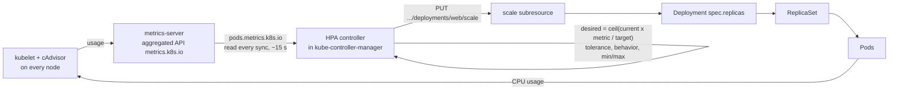

# T4.11 Configure workload autoscaling

> Competency: "Configure workload autoscaling" (CKA-3.3) | Domain/weight: CKA, Workloads and Scheduling (15%) | Est. time: 2.5 h | Prerequisites: T3.23, T3.05

Shell setup (from [conventions](../00-conventions.md); put it at the top of every session):

```bash
alias k=kubectl
export do="--dry-run=client -o yaml"
export now="--force --grace-period=0"
source <(kubectl completion bash); complete -o default -F __start_kubectl k
```

Prerequisites you should have read first: [T3.23 Use built-in CLI tools to monitor applications](../part3-ckad/T3.23-use-built-in-cli-tools-to.md) (`k top`, metrics-server) and [T3.05 Define resource requirements](../part3-ckad/T3.05-define-resource-requirements.md) (requests and limits). This lesson does not re-teach them.

Lab environment: **kind** (1 control plane + 2 workers, cluster `lab`, context `kind-lab`, created with `env/kind-up.sh`) plus **metrics-server v0.9.0** (`env/kind-addons.sh metrics-server`, which adds `--kubelet-insecure-tls` on kind). Namespace: `lab-t411`. Lab files go in `~/lab/t411/`.

Output labels used below:

- `REAL OUTPUT (kind v0.33.0, v1.37.0)` was captured on a 3-node kind cluster named `k-t411` running `kindest/node:v1.37.0` (kubectl client v1.37.1, metrics-server v0.9.0 with `--kubelet-insecure-tls`). That cluster used kind's default CNI (kindnet), not Calico. This does not change anything in this lesson. Your node names are `lab-worker` and `lab-worker2`; Pod name suffixes and ages differ in your run.
- `EXPECTED OUTPUT (not captured)` marks output written from documented behaviour and not run. Each such block is listed in section 11.

---

## 1. Why this matters

Traffic is not constant. If you run a fixed number of replicas, you either pay for idle Pods at night or fall over at the peak. A HorizontalPodAutoscaler (HPA) watches a metric such as CPU and changes the replica count for you. The CKA asks you to configure one correctly.

The most common failure is not a wrong YAML field. It is an HPA that shows `<unknown>` in the TARGETS column and never scales, because metrics-server is missing or the Pods have no CPU request. The second most common failure is an HPA that fights `kubectl apply` or `kubectl scale`. You need to know why both happen and how to prove which one you have.

---

## 2. Concepts

### 2.1 What an HPA is, and what "autoscaling" can mean

**Autoscaling** means a controller changes capacity without you typing a command. Kubernetes has three directions:

| Kind | What changes | Built in? | Object / tool | Section |
|---|---|---|---|---|
| Horizontal Pod scaling | Number of Pod replicas | Yes | `HorizontalPodAutoscaler` (HPA), API `autoscaling/v2` | this lesson, main topic |
| Vertical Pod scaling | CPU and memory of each Pod | No (add-on) | `VerticalPodAutoscaler` (VPA) CRD, separate project. In-place resize of a running Pod is built in and stable since v1.35 | 2.12 |
| Node scaling | Number of nodes | No (add-on) | Cluster Autoscaler or Karpenter | 2.13 |

An HPA is an API object plus a control loop in `kube-controller-manager`. The object says "keep this workload's average CPU near 50%, with 2 to 10 replicas". The loop reads metrics, does arithmetic and writes a new replica count. It does **not** create Pods. It changes `spec.replicas` through the **scale subresource** of the target (a small API endpoint, `.../deployments/web/scale`, that exposes only the replica count). The Deployment controller then creates or deletes Pods as it always does.

The target can be any resource that has a scale subresource: Deployment, ReplicaSet, StatefulSet (and custom resources that implement it). A DaemonSet cannot be a target because it has no replica count. A Job is not a target either.

Without an HPA, nothing changes the replica count except you. Without metrics, the HPA cannot compute anything and does nothing.

### 2.2 The HPA object (`autoscaling/v2`)

`k api-resources | grep -i autoscal` on the lab cluster shows one resource: `horizontalpodautoscalers` (short name `hpa`), group `autoscaling`, version `v2`. The old `autoscaling/v1` object only supported a single CPU percentage. Always write `v2`.

| Field | Meaning | Default | Risky or invalid value |
|---|---|---|---|
| `spec.scaleTargetRef` | The workload to scale: `apiVersion`, `kind`, `name` (same namespace as the HPA). | none, required | A `name` that does not exist: the HPA shows a `FailedGetScale` style condition and does nothing. A `kind` with no scale subresource (DaemonSet) is not scalable. |
| `spec.minReplicas` | Lowest replica count the HPA will set. | `1` | `0` is only accepted with an Object or External metric (see 2.10). Larger than `maxReplicas` is rejected. |
| `spec.maxReplicas` | Highest replica count. Required. | none | Must be at least 1 and at least `minReplicas`. Setting it too high lets a bad metric spawn Pods until the cluster is full. |
| `spec.metrics` | List of metrics. Each item has a `type` and a matching block. | `k autoscale` without `--cpu` produced CPU utilization 80% (observed; a hand-written object without `metrics` was not tested) | See the table in 2.3. |
| `spec.behavior` | Optional rules that limit how fast it scales (2.7). | built-in defaults | `stabilizationWindowSeconds` above 3600 is invalid. |

When you give several metrics, the HPA computes a replica count for each one and uses the **largest** (per the HPA docs, see references). So "CPU 60% and memory 40Mi" means: scale out if either one is too high; scale in only when both are low enough.

### 2.3 Metric types and target types

Each entry in `spec.metrics` has a `type`:

| `type` | Block | Source of the number | API that must exist | Typical use |
|---|---|---|---|---|
| `Resource` | `resource: {name: cpu or memory, target}` | Average across all Pods of the target. CPU and memory only. | `metrics.k8s.io` (metrics-server) | The exam default. |
| `ContainerResource` | `containerResource: {name, container, target}` | Same, but only one named container in each Pod | `metrics.k8s.io` | Pod with a busy app plus a quiet sidecar. Stable since v1.30 per the HPA docs. |
| `Pods` | `pods: {metric: {name}, target}` | A custom per-Pod metric, averaged over Pods | `custom.metrics.k8s.io` (an adapter, for example Prometheus adapter) | Requests per second per Pod. |
| `Object` | `object: {describedObject, metric, target}` | A metric of one other object, for example an Ingress | `custom.metrics.k8s.io` | Requests per second on an Ingress. |
| `External` | `external: {metric, target}` | A metric from outside the cluster | `external.metrics.k8s.io` (an adapter, for example KEDA) | Queue length in a cloud queue. |

For the exam, `Resource` is what you will write. Know the other three exist and which API they need. An HPA that uses `Pods`, `Object` or `External` metrics shows `<unknown>` until an adapter provides that API. Kubernetes itself ships none of them.

The `target` block says how to compare:

| `target.type` | Field | Meaning | Valid for |
|---|---|---|---|
| `Utilization` | `averageUtilization: 60` | Average of (usage / **request**) over all Pods, as a percent | `Resource`, `ContainerResource` only |
| `AverageValue` | `averageValue: 40Mi` | Average raw value per Pod | all types |
| `Value` | `value: "2k"` | Total value of the metric (not divided by Pods) | `Object`, `External` |

A `Utilization` target on a `Pods` metric is invalid. `averageUtilization` is relative to the Pod's request, so it needs a request (next section).

### 2.4 Requests are required for utilization metrics

`averageUtilization` is a percent **of the CPU request**. If a container has no CPU request, the percent is meaningless and the HPA refuses to compute it. The check covers every container in the Pod (a sidecar without a request breaks it too, unless you use `ContainerResource`). Limits are not used for the percent.

We saw this on the real cluster. Deployment `api` had no requests:

REAL OUTPUT (kind v0.33.0, v1.37.0)

```text
$ k -n lab-t411 get hpa api
NAME   REFERENCE        TARGETS              MINPODS   MAXPODS   REPLICAS   AGE
api    Deployment/api   cpu: <unknown>/50%   2         5         2          50s

$ k -n lab-t411 describe hpa api
...
Deployment pods:    2 current / 0 desired
Conditions:
  Type           Status  Reason                   Message
  ----           ------  ------                   -------
  AbleToScale    True    SucceededGetScale        the HPA controller was able to get the target's current scale
  ScalingActive  False   FailedGetResourceMetric  the HPA was unable to compute the replica count: failed to get cpu utilization: missing request for cpu in container nginx of Pod api-7c5b468964-nc6ns
```

An `averageValue` target (for example `averageValue: 500m` for CPU) does not divide by the request, so it can work without requests. In practice you still set requests: the scheduler needs them (see [T3.05](../part3-ckad/T3.05-define-resource-requirements.md)).

### 2.5 `kubectl autoscale` and the flag name in v1.37

The imperative command creates an HPA (it tries `autoscaling/v2` first). The flag you must know changed. I checked the real v1.37 client:

REAL OUTPUT (kind v0.33.0, v1.37.0)

```text
$ k -n lab-t411 autoscale deploy web --cpu-percent=50 --min=2 --max=10
Flag --cpu-percent has been deprecated, Use --cpu with percentage or resource quantity format (e.g., '70%' for utilization or '500m' for milliCPU).
horizontalpodautoscaler.autoscaling/web autoscaled
```

So in v1.37:

| Flag | Status in kubectl 1.37.1 | Meaning |
|---|---|---|
| `--cpu-percent=50` | **Deprecated, still works** (prints the warning above) | CPU utilization 50% |
| `--cpu=50%` | Current | With `%`: `averageUtilization` 50. |
| `--cpu=500m` | Current | Without `%`: a quantity, so `averageValue: 500m`. A bare `--cpu=50` means 50 millicores, **not** 50%. |
| `--memory=70%` / `--memory=200Mi` | Current | Same rules for memory: `%` is utilization, a quantity is `averageValue`. Always write the unit; I did not test a bare number. |
| `--min=N` | Optional | Lower limit. If not set, the server applies the default of 1. |
| `--max=N` | **Required** | Upper limit. |
| `--name=` | Optional | HPA name. Default is the target's name. |

If you give no `--cpu` and no `--memory`, the HPA gets a CPU utilization target of 80% (I checked with `-o yaml`: `averageUtilization: 80`). Always type `--cpu=...` in the exam. Write `--cpu=50%` so you do not depend on a deprecated flag. Use `-h` to see the flags if you forget; `k autoscale -h` is faster than the docs.

`k autoscale` builds only `Resource` metrics, so for behavior, ContainerResource or custom metrics you generate YAML with `$do` and edit it (section 4).

### 2.6 The algorithm

Every sync period (the controller runs about every 15 seconds; the flag is `--horizontal-pod-autoscaler-sync-period`, default 15s per the docs) the controller does this for each metric:

```text
desiredReplicas = ceil( currentReplicas * currentMetricValue / desiredMetricValue )
```

`currentMetricValue` is the **average across the Pods** (for `Utilization`: average of usage divided by request). `ceil` rounds up. Round-up is deliberate: it is safer to have one Pod too many than one too few.

Then the controller applies these rules, in this order:

1. **Skipped Pods (this changes the ratio, so it comes first).** Pods being deleted are ignored. Pods that are not Ready yet, and Pods that have no metric yet, are set aside. If metrics are missing, the controller recomputes the ratio pessimistically: it assumes those Pods use 100% of the target when it considers a scale-down, and 0% when it considers a scale-up. This damps over-reaction while new Pods start.
2. **Tolerance, tested on the recomputed ratio.** If `currentMetricValue / desiredMetricValue` is close enough to 1.0, do nothing. The default tolerance is 0.1 (10%). So `54% / 50% = 1.08` is inside the band, and the replica count stays the same even though `ceil(9 * 1.08)` would be one more.
3. **Several metrics.** Take the largest result.
4. **Behavior.** Apply the scale-up and scale-down policies and the stabilization window (2.7).
5. **Min and max.** Clamp to `[minReplicas, maxReplicas]`.

If the metrics cannot be fetched and the other metrics suggest a scale-down, the HPA skips the scale-down. It will still scale up from the metrics it can read (per the docs).

**Worked example with numbers.** Target 50%, request 20m:

- 2 Pods at 70% average: ratio 1.4, `ceil(2 * 70 / 50) = ceil(2.8) = 3`.
- 6 Pods at 75%: `ceil(6 * 75 / 50) = ceil(9.0) = 9`.
- 9 Pods at 54%: ratio 1.08 is inside the 10% band, so no change (without tolerance: `ceil(9.72) = 10`).
- 9 Pods at 0%: `ceil(0) = 0`, clamped to `minReplicas` 2, but only after the scale-down stabilization window.
- 3 Pods, but one is new and has no metric yet, and the 2 measured Pods average 126%: rule 1 counts the new Pod at 0% for a scale-up, so the average becomes `126 * 2 / 3 = 84%`, and `ceil(3 * 84 / 50) = ceil(5.04) = 6`. The plain formula on 126% would give `ceil(7.56) = 8`.

Section 5 shows that these exact numbers happened on a real cluster.

**Configurable tolerance (stable in v1.37).** The cluster-wide 10% can be changed with the `kube-controller-manager` flag `--horizontal-pod-autoscaler-tolerance`. Since v1.33 (stable in v1.37, per the HPA docs) you can set it **per HPA and per direction**, in the behavior block:

```yaml
spec:
  behavior:
    scaleUp:
      tolerance: "0.05"     # act when metric is more than 5% above target
    scaleDown:
      tolerance: "0.2"      # act when metric is more than 20% below target
```

I checked on the live cluster: `k explain hpa.spec.behavior.scaleDown.tolerance` exists, the feature gate `HPAConfigurableTolerance` is on, and the value is stored as a Quantity (`"0.05"` is stored back as `"50m"`). Use a quoted string or number; a negative value is invalid. A very small tolerance (such as 0) makes the HPA react to noise, so you get flapping. `k describe hpa` does not print the tolerance, so use `k get hpa web -o yaml` to see it.

### 2.7 `behavior`: scaling policies and the stabilization window

Without `behavior`, the HPA uses defaults (confirmed by `k explain hpa.spec.behavior.scaleDown`, and the docs):

| Direction | Stabilization window | Policies | `selectPolicy` |
|---|---|---|---|
| `scaleUp` | 0 seconds | `Percent 100 / 15s` and `Pods 4 / 15s` | `Max` (use the policy that allows the biggest change) |
| `scaleDown` | **300 seconds** | `Percent 100 / 15s` (all Pods may go at once) | `Max` |

**Stabilization window.** The HPA keeps the recommendations it computed during the last N seconds. For scale-down it uses the **highest** recommendation in the window, so a short dip in load does not remove Pods. For scale-up it uses the lowest. The window is why scale-down in the lab feels slow: after the load stops, nothing happens for about five minutes.

**Policies** cap how many Pods may change within a period:

| Field | Meaning | Default | Invalid or risky |
|---|---|---|---|
| `policies[].type` | `Pods` (absolute count) or `Percent` (of current replicas) | none | any other value |
| `policies[].value` | The limit | none | must be above 0 |
| `policies[].periodSeconds` | How far back the limit applies | none | at most 1800 |
| `selectPolicy` | `Max` (largest allowed change), `Min` (smallest allowed change) or `Disabled` (never scale in this direction) | `Max` | `Disabled` blocks scaling in that direction on purpose |
| `stabilizationWindowSeconds` | window length | up 0, down 300 | at most 3600 |
| `tolerance` | see 2.6 | cluster-wide 0.1 | negative |

**Flapping** (replica count goes up, down, up, down) is a symptom of a window that is too short or of a metric that swings. Fix: raise `scaleDown.stabilizationWindowSeconds`, add a slow scale-down policy, or widen the tolerance.

Examples:

```yaml
# Fast up, slow down: at most 1 Pod removed every 60 s, wait 2 min first
behavior:
  scaleUp:
    policies:
    - {type: Percent, value: 100, periodSeconds: 15}
  scaleDown:
    stabilizationWindowSeconds: 120
    policies:
    - {type: Pods, value: 1, periodSeconds: 60}

# Never scale down automatically (keep what scale-up made)
behavior:
  scaleDown:
    selectPolicy: Disabled
```

Observed on the lab cluster: with `scaleUp` policies `Pods 4 / 15s` and `Percent 100 / 15s`, a 2-Pod Deployment went 2, 4, 6 on 15 s steps.

### 2.8 Reading the status: TARGETS and conditions

`k get hpa`:

| Column | Meaning |
|---|---|
| `REFERENCE` | The target |
| `TARGETS` | `current/target`. `cpu: 46%/50%` means 46% now, goal 50%. `<unknown>` means "could not read the metric". With two metrics: `cpu: 0%/60%, memory: 8512Ki/40Mi`. |
| `MINPODS` / `MAXPODS` | Limits |
| `REPLICAS` | Current replicas of the target |

`k describe hpa web` prints the **conditions**, the first place to look when something is wrong:

| Condition | `True` means | Reasons you will see |
|---|---|---|
| `AbleToScale` | The controller can read and write the target's scale | `SucceededGetScale`, `ReadyForNewScale`, `ScaleDownStabilized` (a recent higher recommendation is holding the scale-down), `FailedGetScale` |
| `ScalingActive` | The metrics are readable and a replica count could be computed | `ValidMetricFound`; `False` with `FailedGetResourceMetric` or `InvalidMetricSourceType` etc. |
| `ScalingLimited` | The wanted count was clamped by min, max or a behavior policy | `DesiredWithinRange` (False = fine), `TooFewReplicas`, `TooManyReplicas`, `ScaleUpLimit`, `ScaleDownLimit` |
| `ScaledToZero` | New in the v1.37 output I saw. The HPA holds the workload at 0 | `NotScaledToZero` (normal) |

`ScalingLimited: True` is not an error. It tells you a limit is active. Example from the lab: `TooFewReplicas ... the desired replica count is less than the minimum replica count`.

The Events at the bottom show each change: `SuccessfulRescale  New size: 3; reason: cpu resource utilization (percentage of request) above target`.

### 2.9 Generating load

To test an HPA you need CPU use. The simplest generator is a Pod that calls the Service in a loop:

```bash
k run load --image=busybox:1.36 -- sh -c 'while true; do wget -qO- web; done'
```

`web` is the Service name; it resolves because the load Pod is in the same namespace. Stop the load by deleting the Pod: `k delete pod load $now`. In the exam, `wget` and `curl` exist on the host, and a node can often reach a ClusterIP through kube-proxy too, but a load Pod inside the cluster is the easiest and most portable way to hit a ClusterIP Service.

A tiny `nginx` Pod does little CPU per request. That is why the lab sets a small CPU request (`20m`): utilization is a percent of the request, so a small request makes the percent move with small usage.

### 2.10 Scale to zero (beta in v1.37)

You can set `minReplicas: 0` so an idle workload costs nothing. This is **beta in v1.37 and enabled by default** (feature gate `HPAScaleToZero`). I confirmed on the live API server: `kubernetes_feature_enabled{name="HPAScaleToZero",stage="BETA"} 1`.

The catch: scaling to zero is only allowed when the HPA has at least one `Object` or `External` metric. With zero Pods there is no CPU to measure, so a `Resource` metric alone cannot bring the Pods back. The API server rejects it:

REAL OUTPUT (kind v0.33.0, v1.37.0)

```text
$ k -n lab-t411 patch hpa web --type=merge -p '{"spec":{"minReplicas":0}}'
The HorizontalPodAutoscaler "web" is invalid: spec.metrics: Forbidden: must specify at least one Object or External metric to support scaling to zero replicas
```

While the HPA holds a workload at zero it sets the `ScaledToZero` condition to `True`. If you set the target's replicas to 0 by hand while `minReplicas` is above 0, the HPA stops adjusting the target (maintenance mode) and sets `ScalingActive` to `False` until you restore the replica count (per the docs).

### 2.11 Manual scaling and conflicts with the HPA

`k scale deploy web --replicas=3` writes `spec.replicas`. If an HPA targets that Deployment, the HPA writes the same field again on its next sync. The HPA wins in the long run. Real test (HPA `web`, min 2, scale-down policy 1 Pod per 30 s):

REAL OUTPUT (kind v0.33.0, v1.37.0)

```text
$ k -n lab-t411 scale deploy web --replicas=6
deployment.apps/web scaled
  ... (poll every 15 s)
web   6/6   6     6     12m
web   6/6   6     6     12m
web   6/6   6     6     12m
web   6/6   6     6     13m
web   5/5   5     5     13m
```

Use `k scale` to change the Deployment only when there is **no** HPA. With an HPA, change `minReplicas` and `maxReplicas` instead.

The other conflict is `replicas:` written in the Deployment manifest. Every `k apply -f deployment.yaml` writes that number back and fights the HPA. Real test: I applied a manifest with `replicas: 4` while the HPA wanted 2:

REAL OUTPUT (kind v0.33.0, v1.37.0)

```text
$ k apply -f web-r.yaml          # file has replicas: 4
deployment.apps/web configured
$ k -n lab-t411 get deploy web --no-headers
web   2/4   2     2     2m6s     # apply forced 4; the HPA will bring it back down
```

The fix is to remove `replicas` from the manifest. But there is a one-time trap. If the live object was applied earlier **with** `replicas`, removing the field and applying again resets the replica count to the default (1), and then the HPA raises it to `minReplicas`:

REAL OUTPUT (kind v0.33.0, v1.37.0)

```text
$ k apply -f web-nr.yaml         # same file, replicas line removed
deployment.apps/web configured
$ k -n lab-t411 get deploy web --no-headers
web   1/1   1     1     2m9s     # briefly 1
  ... 20 seconds later
web   2/2   2     2     2m29s    # HPA restored minReplicas
```

The docs describe a way to avoid that dip: run `k apply edit-last-applied deployment/web`, delete the `spec.replicas` line there and save (no Pod count change), then remove it from your file. I did not run that command (see section 11).

### 2.12 Vertical scaling: VPA and in-place resize (awareness)

- **VerticalPodAutoscaler (VPA)** changes the CPU/memory **requests** of Pods. It is a separate project: you install its CRDs and controllers; it is not in the cluster by default. It needs metrics-server too. The docs state that as of v1.37, VPA does not resize Pods in place (that integration is being worked on), so it evicts and recreates Pods to apply new requests. Do not run an HPA and a VPA on the same CPU or memory metric for the same workload: they pull in opposite directions.
- **In-place Pod resize** is built in and stable since v1.35 (per the docs). You change a running Pod's requests and limits through the `resize` subresource, and usually the container is not restarted. I tested on the lab cluster:

REAL OUTPUT (kind v0.33.0, v1.37.0)

```text
$ k -n lab-t411 patch pod web-6c658f8cdc-lkgf4 --subresource resize \
    --patch '{"spec":{"containers":[{"name":"web","resources":{"requests":{"cpu":"30m"},"limits":{"cpu":"250m"}}}]}}'
pod/web-6c658f8cdc-lkgf4 patched
$ k -n lab-t411 get pod web-6c658f8cdc-lkgf4 -o jsonpath='{.spec.containers[0].resources}{"\n"}{.status.containerStatuses[0].restartCount}{"\n"}'
{"limits":{"cpu":"250m","memory":"64Mi"},"requests":{"cpu":"30m","memory":"16Mi"}}
0
```

Two mistakes I made while testing, which you can avoid: `--type=merge` replaces the whole `containers` list and the API rejects it (`resource requests cannot be removed`), so use the default strategic patch for containers; and always send the container `name`.

### 2.13 Node scaling: Cluster Autoscaler and Karpenter (awareness)

An HPA can ask for more Pods than the nodes can hold. The extra Pods stay `Pending` (the scheduler finds no room and `k describe pod` shows a `FailedScheduling` event). A **node autoscaler** watches for Pending Pods and adds nodes; later it removes empty nodes. Two common ones are the **Cluster Autoscaler** (works with node groups) and **Karpenter** (creates nodes to fit the pending Pods). Both are separate projects that need cloud integration. They do not run on kind and are not part of the CKA tasks. The docs page https://kubernetes.io/docs/concepts/cluster-administration/node-autoscaling/ explains them. Rule of thumb: HPA = more Pods, node autoscaler = more room for the Pods.

### 2.14 Under the hood: the metrics pipeline

1. The kubelet on each node reads container usage from the runtime (cAdvisor data) and serves it on its resource-metrics endpoint.
2. **metrics-server** scrapes every kubelet (default every 15 s) and keeps only the latest numbers in memory. It registers an **aggregated API** named `v1beta1.metrics.k8s.io`. The API server forwards `metrics.k8s.io` requests to it.
3. `k top pods` and the HPA both read `pods.metrics.k8s.io`.
4. The HPA controller (inside `kube-controller-manager`) gets the target's Pod list through the scale subresource's label selector, reads the metrics, does the algorithm, and writes the replica count back to the scale subresource.

If metrics-server is gone, the aggregated API reports `MissingEndpoints` and everything that reads it fails. I scaled metrics-server to 0 on the lab cluster:

REAL OUTPUT (kind v0.33.0, v1.37.0)

```text
$ k top pods -n lab-t411
error: Metrics API not available
$ k get apiservice v1beta1.metrics.k8s.io
NAME                     SERVICE                      AVAILABLE                   AGE
v1beta1.metrics.k8s.io   kube-system/metrics-server   False (MissingEndpoints)    21m
$ k -n lab-t411 describe hpa api | grep Warning
  Warning  FailedGetResourceMetric  9s (x5 over 69s)  horizontal-pod-autoscaler  failed to get cpu utilization: unable to get metrics for resource cpu: unable to fetch metrics from resource metrics API: the server is currently unable to handle the request (get pods.metrics.k8s.io)
```

Also, brand-new Pods get a start-up grace: the controller ignores CPU from Pods that are still starting (`--horizontal-pod-autoscaler-initial-readiness-delay` 30 s and `--horizontal-pod-autoscaler-cpu-initialization-period` 5 min are the defaults per the docs). That is why a Java app that is busy while it boots does not trigger a runaway scale-up.

### 2.15 Related but different

- **HPA vs `k scale`:** `k scale` sets a number once; the HPA keeps computing a number.
- **HPA vs PodDisruptionBudget:** an HPA changes how many Pods you want; a PDB limits voluntary evictions (drain). See [T4.12](./T4.12-primitives-for-robust-self-healing-application.md).
- **HPA vs ResourceQuota/LimitRange:** if a ResourceQuota is full, the HPA writes a high replica count, but the ReplicaSet cannot create the Pods. The HPA looks happy, the Deployment shows fewer ready Pods.
- **`maxReplicas` vs node capacity:** `maxReplicas` is only a cap. It does not reserve room on nodes.

---

## 3. How it works (diagram)



Walkthrough:

1. Each kubelet exposes the CPU and memory use of its containers. metrics-server collects them and serves them as `pods.metrics.k8s.io`.
2. About every 15 seconds the HPA controller reads the average metric of the target's Pods and divides it by the target (the request-relative percent for `Utilization`).
3. It applies the formula, the tolerance band, the stabilization window and the policies, then clamps to `minReplicas`..`maxReplicas`.
4. It writes only the replica count, through the scale subresource. Nothing else on the Deployment changes.
5. The Deployment and ReplicaSet controllers create or delete Pods. New Pods start, begin to use CPU, and the loop repeats.

---

## 4. Commands and YAML you must produce fast

### 4.1 Imperative shortcuts

```bash
# HPA: CPU target 50%, 2 to 10 replicas (the current flag; --cpu-percent is deprecated)
k autoscale deploy web --cpu=50% --min=2 --max=10

# Same, old flag from the entry: still works in v1.37, prints a deprecation warning
k autoscale deploy web --cpu-percent=50 --min=2 --max=10

# Two metrics: CPU utilization 60% and memory average value 40Mi
k autoscale deploy web --cpu=60% --memory=40Mi --min=2 --max=8

# Generate YAML to edit (behavior, tolerance, ContainerResource need YAML)
k autoscale deploy web --cpu=60% --memory=40Mi --min=2 --max=8 $do > hpa.yaml

# Watch it work
k get hpa -w
k describe hpa web
k top pods
k top pods --containers

# Manual scale (only when no HPA targets the Deployment)
k scale deploy web --replicas=3

# Change limits later without editing a file
k patch hpa web -p '{"spec":{"maxReplicas":12}}'
```

- `k autoscale ...` creates the HPA in one line. It names it after the target. Add `-n <ns>` in the exam if the task gives a namespace.
- YAML generated with `$do` may have no `metadata.namespace`. When you apply it, give `-n <ns>` (`k -n lab-t411 apply -f hpa.yaml`) or check the file for `namespace:`, otherwise the HPA lands in the current namespace, where its target does not exist.
- `k get hpa -w` streams a new row whenever a displayed value changes, so rows are at irregular times.
- `k top pods` needs metrics-server. If it says `error: Metrics API not available`, fix metrics-server before the HPA.
- `k scale` and `k autoscale` both exist on a Deployment; check `k get hpa` first so you do not scale something an HPA controls.

### 4.2 The declarative YAML

Exam-minimal version. This is the smallest YAML that covers the entry's three requirements (CPU 60% utilization, memory `averageValue`, scale-down window 60 s):

```yaml
apiVersion: autoscaling/v2
kind: HorizontalPodAutoscaler
metadata:
  name: web
  namespace: lab-t411
spec:
  scaleTargetRef:
    apiVersion: apps/v1
    kind: Deployment
    name: web
  minReplicas: 2
  maxReplicas: 8
  metrics:
  - type: Resource
    resource:
      name: cpu
      target:
        type: Utilization
        averageUtilization: 60
  - type: Resource
    resource:
      name: memory
      target:
        type: AverageValue
        averageValue: 40Mi
  behavior:
    scaleDown:
      stabilizationWindowSeconds: 60
```

Full version with every field explained. I applied this file to the lab cluster (it was accepted and ran):

```yaml
apiVersion: autoscaling/v2              # always v2; v1 only has one CPU target
kind: HorizontalPodAutoscaler
metadata:
  name: web
  namespace: lab-t411
spec:
  scaleTargetRef:                       # what to scale (same namespace)
    apiVersion: apps/v1
    kind: Deployment                    # Deployment, ReplicaSet or StatefulSet
    name: web
  minReplicas: 2                        # floor; default 1; 0 only with Object/External metric
  maxReplicas: 8                        # ceiling; required
  metrics:                              # several entries: the HPA uses the largest result
  - type: Resource
    resource:
      name: cpu
      target:
        type: Utilization               # percent of the CPU REQUEST
        averageUtilization: 60
  - type: Resource
    resource:
      name: memory
      target:
        type: AverageValue              # raw value per Pod, no request needed
        averageValue: 40Mi
  behavior:
    scaleUp:
      stabilizationWindowSeconds: 0     # default 0: react at once
      selectPolicy: Max                 # pick the policy that allows the biggest change
      policies:
      - type: Pods                      # at most 4 Pods ...
        value: 4
        periodSeconds: 15               # ... per 15 s
      - type: Percent                   # or 100% of current ...
        value: 100
        periodSeconds: 15
    scaleDown:
      stabilizationWindowSeconds: 60    # default 300: use highest recommendation of last 60 s
      selectPolicy: Min                 # pick the policy that allows the smallest change
      tolerance: "0.05"                 # ignore deviations under 5% (default 0.1, stable in 1.37)
      policies:
      - type: Pods                      # remove at most 1 Pod ...
        value: 1
        periodSeconds: 30               # ... per 30 s
```

Other metric types (a schema-valid reference; I validated this file with `k apply --dry-run=server`, which only checks the schema; there is no adapter on the lab cluster, so it would show `<unknown>` for the custom metrics). `minReplicas: 0` is accepted here because Object and External metrics are present.

```yaml
apiVersion: autoscaling/v2
kind: HorizontalPodAutoscaler
metadata:
  name: multi
  namespace: lab-t411
spec:
  scaleTargetRef:
    apiVersion: apps/v1
    kind: Deployment
    name: web
  minReplicas: 0
  maxReplicas: 5
  metrics:
  - type: ContainerResource
    containerResource:
      name: cpu
      container: web
      target: {type: Utilization, averageUtilization: 70}
  - type: Pods
    pods:
      metric: {name: http_requests_per_second}
      target: {type: AverageValue, averageValue: "100"}
  - type: Object
    object:
      describedObject: {apiVersion: networking.k8s.io/v1, kind: Ingress, name: main}
      metric: {name: requests_per_second}
      target: {type: Value, value: "2k"}
  - type: External
    external:
      metric:
        name: queue_messages_ready
        selector: {matchLabels: {queue: worker_tasks}}
      target: {type: AverageValue, averageValue: "30"}
```

The Deployment the HPA scales. Note: **no `replicas` field**:

```yaml
apiVersion: apps/v1
kind: Deployment
metadata:
  name: web
  namespace: lab-t411
spec:
  selector:
    matchLabels: {app: web}
  template:
    metadata:
      labels: {app: web}
    spec:
      containers:
      - name: web
        image: nginx:1.27
        resources:
          requests: {cpu: 20m, memory: 16Mi}   # required for Utilization targets
          limits: {cpu: 200m, memory: 64Mi}
---
apiVersion: v1
kind: Service
metadata:
  name: web
  namespace: lab-t411
spec:
  selector: {app: web}
  ports:
  - port: 80
    targetPort: 80
```

### 4.3 Speed drill

Setup (one line, run once; cleanup at the end):

```bash
k create ns lab-t411; k -n lab-t411 create deploy web --image=nginx:1.27 --replicas=2; k -n lab-t411 set resources deploy web --requests=cpu=20m,memory=16Mi --limits=cpu=200m,memory=64Mi; k config set-context --current --namespace=lab-t411
```

Work in `lab-t411` (set above). Do the tasks in order. Target times are for exam pace (about 6 minutes per task on average, E2/E3 in the research summary, see https://docs.linuxfoundation.org/tc-docs/certification/faq-cka-ckad-cks).

| # | Task | Target |
|---|---|---|
| 1 | Create an HPA for Deployment `web`: CPU 50%, min 2, max 10, with the imperative command. | 1 min |
| 2 | Delete it. Generate the YAML for CPU 60%, memory 40Mi, min 2, max 8 into `hpa.yaml` without creating anything. | 1 min |
| 3 | Edit `hpa.yaml` to add `behavior.scaleDown.stabilizationWindowSeconds: 60`, then apply it. | 3 min |
| 4 | Raise `maxReplicas` to 12 with one command and print it back. | 1 min |
| 5 | Show the HPA's three condition types and their status in one command. | 2 min |
| 6 | Create a second Deployment `bare` (image `nginx:1.27`, no requests) with an HPA at CPU 50%, then find the exact reason its TARGETS is `<unknown>`. | 3 min |
| 7 | Add a scale-down tolerance of 0.2 to HPA `web` with one patch command. | 2 min |
| 8 | Print the current CPU utilization number of HPA `web` with jsonpath. | 2 min |

Cleanup: `k delete ns lab-t411; k config set-context --current --namespace=default`.

<details><summary>Answers</summary>

1. `k autoscale deploy web --cpu=50% --min=2 --max=10`
2. `k delete hpa web`, then `k autoscale deploy web --cpu=60% --memory=40Mi --min=2 --max=8 $do > hpa.yaml`. The file contains a `status:` block with `currentMetrics: null`; it is harmless on apply.
3. Add under `spec:` the lines `behavior:` / `  scaleDown:` / `    stabilizationWindowSeconds: 60` (indent with spaces), then `k apply -f hpa.yaml`.
4. `k patch hpa web -p '{"spec":{"maxReplicas":12}}'` then `k get hpa web -o jsonpath='{.spec.maxReplicas}{"\n"}'` prints `12`.
5. `k get hpa web -o jsonpath='{range .status.conditions[*]}{.type}={.status}{"\n"}{end}'` (or `k describe hpa web`). Expect `AbleToScale=True`, `ScalingActive=True`, `ScalingLimited` False or True depending on load (an idle HPA at its floor can show `True` with `TooFewReplicas`), and `ScaledToZero=False` on v1.37.
6. `k create deploy bare --image=nginx:1.27 --replicas=2; k autoscale deploy bare --cpu=50% --min=2 --max=5`; wait about 40 s; `k describe hpa bare` shows `ScalingActive False FailedGetResourceMetric ... missing request for cpu in container nginx of Pod bare-...`. Fix: `k set resources deploy bare --requests=cpu=20m`.
7. `k patch hpa web -p '{"spec":{"behavior":{"scaleDown":{"tolerance":"0.2"}}}}'`. Check with `k get hpa web -o jsonpath='{.spec.behavior.scaleDown.tolerance}'` (prints `200m`, the stored form of 0.2).
8. `k get hpa web -o jsonpath='{.status.currentMetrics[0].resource.current.averageUtilization}{"\n"}'` (first metric; for a CPU-first HPA that is the CPU percent).
</details>

---

## 5. Worked example

Goal: create an HPA from the imperative command, push load, watch it scale up, stop the load, watch it scale down, and match the numbers to the formula. Everything below ran on the `k-t411` cluster.

**Step 1. Deploy the app with CPU requests and a Service.** Utilization needs requests. The `set resources` command causes one rolling update, which is why the rollout takes a few seconds.

```bash
k create ns lab-t411; k config set-context --current --namespace=lab-t411
k create deploy web --image=nginx:1.27 --replicas=2
k set resources deploy web --requests=cpu=20m,memory=16Mi --limits=cpu=200m,memory=64Mi
k expose deploy web --port=80
k rollout status deploy web
```

**Step 2. Create the HPA and look at it at once.**

```bash
k autoscale deploy web --cpu=50% --min=2 --max=10
k get hpa
```

REAL OUTPUT (kind v0.33.0, v1.37.0)

```text
NAME   REFERENCE        TARGETS              MINPODS   MAXPODS   REPLICAS   AGE
web    Deployment/web   cpu: <unknown>/50%   2         10        2          0s
```

`<unknown>` here is normal for the first 15 to 60 seconds: the HPA has not fetched metrics yet, and metrics-server needs a first scrape for new Pods. The events show it ("no metrics returned from resource metrics API"). It is a problem only if it stays.

```bash
sleep 60; k get hpa; k top pods
```

REAL OUTPUT (kind v0.33.0, v1.37.0)

```text
NAME   REFERENCE        TARGETS       MINPODS   MAXPODS   REPLICAS   AGE
web    Deployment/web   cpu: 0%/50%   2         10        2          60s
NAME                   CPU(cores)   MEMORY(bytes)
web-75c45c98b9-spgnw   0m           8Mi
web-75c45c98b9-tb442   0m           8Mi
```

**Step 3. Start the watch in one terminal, then the load in another.**

```bash
k get hpa web -w                                              # terminal 1
k run load --image=busybox:1.36 -- sh -c 'while true; do wget -qO- web; done'   # terminal 2
```

REAL OUTPUT (kind v0.33.0, v1.37.0): scale up, then load stopped, then scale down. Rows are trimmed with `...`; the load Pod was deleted at about 2m47s of HPA age (just after the `44%` row at 2m45s), and the `...` hides the idle rows between 3m45s and 7m30s.

```text
NAME   REFERENCE        TARGETS       MINPODS   MAXPODS   REPLICAS   AGE
web    Deployment/web   cpu: 0%/50%   2         10        2          64s
web    Deployment/web   cpu: 2%/50%   2         10        2          75s
web    Deployment/web   cpu: 70%/50%   2         10        2          90s
web    Deployment/web   cpu: 126%/50%   2         10        3          105s
web    Deployment/web   cpu: 75%/50%    2         10        6          2m
web    Deployment/web   cpu: 54%/50%    2         10        9          2m15s
web    Deployment/web   cpu: 46%/50%    2         10        9          2m30s
web    Deployment/web   cpu: 44%/50%    2         10        9          2m45s
web    Deployment/web   cpu: 36%/50%    2         10        9          3m
web    Deployment/web   cpu: 3%/50%     2         10        9          3m15s
web    Deployment/web   cpu: 1%/50%     2         10        9          3m30s
web    Deployment/web   cpu: 0%/50%     2         10        9          3m45s
...
web    Deployment/web   cpu: 0%/50%     2         10        9          7m30s
web    Deployment/web   cpu: 0%/50%     2         10        8          7m45s
web    Deployment/web   cpu: 0%/50%     2         10        7          8m
web    Deployment/web   cpu: 0%/50%     2         10        2          8m15s
web    Deployment/web   cpu: 0%/50%     2         10        2          8m30s
```

Check at the moment of load (`k top pods`, REAL OUTPUT): the single `load` Pod used `712m` of CPU, and each `web` Pod about `8m` to `12m`.

**Step 4. Read the conditions and events after the scale-up.**

```bash
k describe hpa web
```

REAL OUTPUT (kind v0.33.0, v1.37.0), trimmed

```text
Metrics:                                               ( current / target )
  resource cpu on pods  (as a percentage of request):  46% (9m) / 50%
Min replicas:                                          2
Max replicas:                                          10
Deployment pods:                                       9 current / 9 desired
Conditions:
  Type            Status  Reason              Message
  ----            ------  ------              -------
  AbleToScale     True    ReadyForNewScale    recommended size matches current size
  ScalingActive   True    ValidMetricFound    the HPA was able to successfully calculate a replica count from cpu resource utilization (percentage of request)
  ScalingLimited  False   DesiredWithinRange  the desired count is within the acceptable range
  ScaledToZero    False   NotScaledToZero     the HPA controller did not scale the workload to zero
Events:
  Type     Reason             Age   From                       Message
  ----     ------             ----  ----                       -------
  Normal   SuccessfulRescale  74s   horizontal-pod-autoscaler  New size: 3; reason: cpu resource utilization (percentage of request) above target
  Normal   SuccessfulRescale  59s   horizontal-pod-autoscaler  New size: 6; reason: cpu resource utilization (percentage of request) above target
  Normal   SuccessfulRescale  44s   horizontal-pod-autoscaler  New size: 9; reason: cpu resource utilization (percentage of request) above target
```

After the load stopped and the window passed, the events added:

```text
  Normal   SuccessfulRescale  117s  horizontal-pod-autoscaler  New size: 8; reason: All metrics below target
  Normal   SuccessfulRescale  102s  horizontal-pod-autoscaler  New size: 7; reason: All metrics below target
  Normal   SuccessfulRescale  87s   horizontal-pod-autoscaler  New size: 2; reason: All metrics below target
```

**Step 5. Match the numbers to the formula.**

| Observed | Calculation | Result | Matches? |
|---|---|---|---|
| 2 Pods, `70%/50%` (at 90 s) | `ceil(2 * 70 / 50) = ceil(2.8)` | 3 | Yes. Event "New size: 3". |
| 6 Pods, `75%/50%` (at 2 m) | `ceil(6 * 75 / 50) = ceil(9.0)` | 9 | Yes. Event "New size: 9". |
| 9 Pods, `54%/50%` (at 2m15s) | ratio `1.08`, inside the 10% tolerance | stays 9 | Yes. Without the tolerance it would be `ceil(9.72) = 10`. |
| 9 Pods, `46%/50%` | ratio `0.92`, inside tolerance | stays 9 | Yes. |
| 9 Pods, `0%/50%` | `ceil(0) = 0`, clamp to `minReplicas` 2 | wants 2 | Held at 9 by the 300 s scale-down window, then 8, 7, 2. |
| 3 Pods, `126%/50%` (at 105 s) | One of the 3 Pods is new and has no metric yet, so 2 are measured. Rule 1 in 2.6 counts the new Pod at 0% on a scale-up: average `126 * 2 / 3 = 84%`. Then `ceil(3 * 84 / 50) = ceil(5.04)` | 6 | Yes. Event "New size: 6". The plain formula on 126% (`ceil(7.56) = 8`) is not what the controller computes here. Any displayed value above 125% gives a result above 5, so the rounding of the displayed percent does not change the answer. |

The default scale-up policies were not what limited this step. From 3 Pods they allow `3 + 4 = 7` (`Pods 4`) or `3 + 3 = 6` (`Percent 100`), and `selectPolicy: Max` takes 7, above the 6 observed. The same cap logic would not explain the next step (6 to 9), which was also 15 s later.

Three things to notice. First, the `REPLICAS` column of the watch shows the count when the row printed; the new count appears one row later. Second, scale-down started about 4 min 45 s after the load stopped, and went 9, 8, 7, 2, not straight to 2. The window uses the highest recommendation from the last 300 s, so as the old high recommendations age out the allowed minimum drops in steps. This is the documented rule; I did not trace the controller's recommendation list to prove the exact sequence. Third, the 3 to 6 step is explained by the unready-Pod rule (row 3 of the table), not by a policy cap.

**Step 6. Clean up.**

```bash
k delete pod load $now --ignore-not-found; k delete ns lab-t411; k config set-context --current --namespace=default
```

---

## 6. Common mistakes and how to fix them

| Symptom | What you will see (exact text) | Cause | Fix (command) |
|---|---|---|---|
| TARGETS `<unknown>/50%` that never goes away, no metrics-server | `k top pods`: `error: Metrics API not available`. `k get apiservice v1beta1.metrics.k8s.io`: `False (MissingEndpoints)`. HPA event: `failed to get cpu utilization: unable to get metrics for resource cpu: unable to fetch metrics from resource metrics API: the server is currently unable to handle the request (get pods.metrics.k8s.io)` | metrics-server not installed, scaled to 0, or crashing | `k -n kube-system get deploy,pod -l k8s-app=metrics-server`; install or scale it up (`k -n kube-system scale deploy metrics-server --replicas=1`); on kind use `env/kind-addons.sh metrics-server` |
| TARGETS `<unknown>/50%` with metrics-server healthy | `k describe hpa`: `ScalingActive False FailedGetResourceMetric ... failed to get cpu utilization: missing request for cpu in container nginx of Pod api-7c5b468964-nc6ns` | Pods have no CPU request (any container, including sidecars) | `k set resources deploy api --requests=cpu=20m` (or edit the YAML). A new rollout starts; the HPA recovers in about a minute |
| Replicas flap (up, down, up, down) | `k describe hpa`: `SuccessfulRescale` events alternate `New size: 5` and `New size: 3` within minutes | Short or removed scale-down stabilization window, a bursty metric, or a tolerance that is too small | Set `behavior.scaleDown.stabilizationWindowSeconds: 300` (or higher) or a slow scale-down policy: `k patch hpa web -p '{"spec":{"behavior":{"scaleDown":{"stabilizationWindowSeconds":300}}}}'` |
| HPA fights `k apply` | After each `k apply -f deploy.yaml`, replicas jump to the file's number. `k get deploy web` shows `2/4` right after apply while the HPA wanted 2 | `spec.replicas` is written in the manifest | Remove the `replicas:` line from the file; do the one-time clean-up from 2.11 (`k apply edit-last-applied`, or accept the brief dip to 1) |
| HPA fights `k scale` | `k scale deploy web --replicas=6` works, and the count falls back to the HPA's number after the window | An HPA owns the replica count | Do not `k scale` an HPA-managed Deployment. Change `minReplicas`/`maxReplicas`: `k patch hpa web -p '{"spec":{"minReplicas":6}}'` |
| Scale-down seems stuck for minutes | `AbleToScale True ScaleDownStabilized recent recommendations were higher than current one, applying the highest recent recommendation` | Default 300 s scale-down window | Wait, or lower the window: `behavior.scaleDown.stabilizationWindowSeconds` |
| Cannot set `minReplicas: 0` | `The HorizontalPodAutoscaler "web" is invalid: spec.metrics: Forbidden: must specify at least one Object or External metric to support scaling to zero replicas` | CPU/memory alone cannot restart a workload that has no Pods | Add an Object or External metric (needs an adapter), or keep `minReplicas: 1` |
| Replicas stop at `maxReplicas` or at `minReplicas` | `ScalingLimited True TooManyReplicas` or `TooFewReplicas` | A limit is clamping the result. Not an error | Raise `maxReplicas` if the load needs it |
| HPA wants more Pods but they stay `Pending` | `k get pods` shows `Pending`; `k describe pod` shows `0/3 nodes are available: ...` | Not enough node room or quota | Add nodes (node autoscaler), lower requests, or raise quota |

**Troubleshooting path for `<unknown>`.** Run these in order and stop at the first one that is wrong:

1. `k get hpa` and `k describe hpa NAME`: read the `ScalingActive` condition message and the Events. The text names the cause.
2. If the message mentions `pods.metrics.k8s.io` or `Metrics API not available`: `k top pods`, then `k get apiservice v1beta1.metrics.k8s.io` (look at `AVAILABLE`), then `k -n kube-system get pods -l k8s-app=metrics-server` and `k -n kube-system logs deploy/metrics-server`. On kind, a TLS error to kubelets means `--kubelet-insecure-tls` is missing.
3. If the message says `missing request for cpu in container X of Pod Y`: read the Pod template: `k get deploy NAME -o jsonpath='{.spec.template.spec.containers[*].resources}'`. Check every container.
4. If the message says the target was not found: check `scaleTargetRef` kind, name and namespace against `k get deploy`.
5. If `ScalingActive` is `True` but TARGETS is still `<unknown>` for one custom metric, an adapter is missing for that metric API (`k get apiservice | grep metrics`).

I did not reproduce flapping on the lab cluster. The table row is from the documented behavior (see section 11). The `<unknown>` rows, the `missing request` text and the metrics-server outage text above are real.

---

## 7. Labs

Lab order: any order. Each lab creates its own `lab-t411` namespace and its cleanup deletes it, so the cluster returns to baseline. Run only one lab at a time. All three labs assume metrics-server is installed (`k top nodes` works). Environment for all: **kind** cluster `lab` with metrics-server v0.9.0.

Common files: write `~/lab/t411/web.yaml` with the Deployment and Service from section 4.2 (the version with no `replicas` field).

### Lab A (easy): HPA from the imperative command, drive load, watch it scale

**Setup**

```bash
k config use-context kind-lab
mkdir -p ~/lab/t411 && cd ~/lab/t411
k create ns lab-t411
cat > web.yaml <<'EOF'
apiVersion: apps/v1
kind: Deployment
metadata:
  name: web
  namespace: lab-t411
spec:
  selector:
    matchLabels: {app: web}
  template:
    metadata:
      labels: {app: web}
    spec:
      containers:
      - name: web
        image: nginx:1.27
        resources:
          requests: {cpu: 20m, memory: 16Mi}
          limits: {cpu: 200m, memory: 64Mi}
---
apiVersion: v1
kind: Service
metadata:
  name: web
  namespace: lab-t411
spec:
  selector: {app: web}
  ports:
  - port: 80
    targetPort: 80
EOF
k apply -f web.yaml
k -n lab-t411 rollout status deploy web
k top nodes
```

**Task**

In namespace `lab-t411`, Deployment `web` exists (1 replica). Create a HorizontalPodAutoscaler named `web` for it with the imperative command: CPU utilization target 50%, minimum 2 replicas, maximum 10. Start a Pod named `load` (image `busybox:1.36`) that requests `http://web` in an endless loop. When the Deployment has at least 3 ready replicas, write the output of `k get hpa web` to `~/lab/t411/hpa-scaled.txt`. Then delete the `load` Pod and wait until the Deployment is back to exactly 2 ready replicas.

<details><summary>Hints</summary>

1. `k autoscale -h` shows the CPU flag. Use the percent form.
2. The load Pod must be in the same namespace so the name `web` resolves.
3. Scale-down waits for the default 300 s stabilization window. Use `k get hpa web -w` and be patient (about 5 to 6 minutes).
</details>

<details><summary>Solution</summary>

```bash
k -n lab-t411 autoscale deploy web --cpu=50% --min=2 --max=10
```

This creates the HPA. The Deployment goes from 1 to 2 replicas almost at once, because the HPA enforces `minReplicas`.

```bash
k -n lab-t411 run load --image=busybox:1.36 -- sh -c 'while true; do wget -qO- web; done'
k -n lab-t411 get hpa web -w
```

Watch until the `REPLICAS` column is 3 or more (usually under 2 minutes). Press Ctrl+C, then:

```bash
k -n lab-t411 get hpa web > ~/lab/t411/hpa-scaled.txt
k -n lab-t411 delete pod load --force --grace-period=0
k -n lab-t411 get hpa web -w      # wait for REPLICAS 2, about 5 min after the load stops
```

Why each step: the CPU target is a percent of the 20m request, so a few `wget` loops are enough to pass it; the load Pod is deleted to drop CPU to 0; the scale-down waits for the 300 s default window.
</details>

**Verification** (each line prints `OK` or fails with a non-zero exit)

```bash
# while scaled up (after the file is written, before you delete the load Pod; the replica checks can be rerun)
test "$(k -n lab-t411 get hpa web -o jsonpath='{.spec.metrics[0].resource.target.averageUtilization}')" = 50 && echo OK-target
test "$(k -n lab-t411 get hpa web -o jsonpath='{.spec.minReplicas}/{.spec.maxReplicas}')" = 2/10 && echo OK-limits
awk 'NR==2{exit !($7>=3)}' ~/lab/t411/hpa-scaled.txt && echo OK-file-shows-scale-up
# after the load is gone and the window has passed
test "$(k -n lab-t411 get deploy web -o jsonpath='{.status.readyReplicas}')" = 2 && echo OK-back-to-2
```

In `hpa-scaled.txt` the `TARGETS` cell is two words (`cpu:` and `126%/50%`), so `REPLICAS` is field 7. If `readyReplicas` is empty the last `test` fails, which is correct.

**Cleanup**

```bash
k delete pod load -n lab-t411 $now --ignore-not-found
k delete ns lab-t411
rm -rf ~/lab/t411
```

### Lab B (medium): HPA v2 with two metrics and custom behavior

**Setup**

```bash
k config use-context kind-lab
mkdir -p ~/lab/t411 && cd ~/lab/t411
k create ns lab-t411
cat > web.yaml <<'EOF'
apiVersion: apps/v1
kind: Deployment
metadata:
  name: web
  namespace: lab-t411
spec:
  selector:
    matchLabels: {app: web}
  template:
    metadata:
      labels: {app: web}
    spec:
      containers:
      - name: web
        image: nginx:1.27
        resources:
          requests: {cpu: 20m, memory: 16Mi}
          limits: {cpu: 200m, memory: 64Mi}
---
apiVersion: v1
kind: Service
metadata:
  name: web
  namespace: lab-t411
spec:
  selector: {app: web}
  ports:
  - port: 80
    targetPort: 80
EOF
k apply -f web.yaml
k -n lab-t411 rollout status deploy web
```

**Task**

In namespace `lab-t411`, write `~/lab/t411/hpa.yaml` and apply it. It must define HPA `web` (API `autoscaling/v2`) for Deployment `web` with: min 2, max 8; two metrics: CPU utilization 60% and memory average value `40Mi`; scale-up: at most 4 Pods per 15 seconds; scale-down: wait 60 seconds before removing Pods, and remove at most 1 Pod per 30 seconds. Use `k autoscale` to produce the first draft of the file. Then start load Pod `load` (`busybox:1.36`, request loop to `http://web`) and show that the Deployment grows above 2 replicas. Delete the load and show that it returns to 2, one Pod at a time.

<details><summary>Hints</summary>

1. `k -n lab-t411 autoscale deploy web --cpu=60% --memory=40Mi --min=2 --max=8 $do > hpa.yaml` gives both metrics (it needs `-n`, because it looks up the Deployment). You add only `behavior`.
2. `behavior.scaleDown.policies` takes `type: Pods`, `value: 1`, `periodSeconds: 30`. The window is `stabilizationWindowSeconds`, a sibling of `policies`.
3. `k explain hpa.spec.behavior.scaleDown --api-version=autoscaling/v2` lists every field if you forget a name.
</details>

<details><summary>Solution</summary>

```bash
cd ~/lab/t411
k -n lab-t411 autoscale deploy web --cpu=60% --memory=40Mi --min=2 --max=8 $do > hpa.yaml
```

Then edit `hpa.yaml` and add this under `spec:` (keep the generated `metrics`, `minReplicas`, `maxReplicas`, `scaleTargetRef`):

```yaml
  behavior:
    scaleUp:
      policies:
      - type: Pods
        value: 4
        periodSeconds: 15
    scaleDown:
      stabilizationWindowSeconds: 60
      policies:
      - type: Pods
        value: 1
        periodSeconds: 30
```

Apply and check:

```bash
k -n lab-t411 apply -f hpa.yaml
k -n lab-t411 describe hpa web | sed -n '/Behavior/,/Deployment pods/p'
```

Give `-n lab-t411` on the apply: the generated file may have no `metadata.namespace`, and without `-n` the HPA would land in your current namespace, where Deployment `web` does not exist. The generated YAML has no `behavior`, so you must add it; the generated file also contains a `status:` block that `apply` ignores. Then drive load:

```bash
k -n lab-t411 run load --image=busybox:1.36 -- sh -c 'while true; do wget -qO- web; done'
k -n lab-t411 get hpa web -w
k -n lab-t411 delete pod load --force --grace-period=0
k -n lab-t411 get hpa web -w
```

In my run the HPA went 2, 4, 6 on 15 s steps, and after the load stopped it waited about 60 s and then removed one Pod about every 30 s (6, 5, 4, 3, 2).
</details>

**Verification**

```bash
J='{.spec.metrics[0].resource.target.averageUtilization}|{.spec.metrics[1].resource.target.averageValue}|{.spec.minReplicas}|{.spec.maxReplicas}'
test "$(k -n lab-t411 get hpa web -o jsonpath="$J")" = "60|40Mi|2|8" && echo OK-spec
test "$(k -n lab-t411 get hpa web -o jsonpath='{.spec.behavior.scaleDown.stabilizationWindowSeconds}')" = 60 && echo OK-window
test "$(k -n lab-t411 get hpa web -o jsonpath='{.spec.behavior.scaleDown.policies[0].type}/{.spec.behavior.scaleDown.policies[0].value}/{.spec.behavior.scaleDown.policies[0].periodSeconds}')" = Pods/1/30 && echo OK-down-policy
test "$(k -n lab-t411 get hpa web -o jsonpath='{.spec.behavior.scaleUp.policies[0].type}/{.spec.behavior.scaleUp.policies[0].value}/{.spec.behavior.scaleUp.policies[0].periodSeconds}')" = Pods/4/15 && echo OK-up-policy
test "$(k -n lab-t411 get hpa web -o jsonpath='{.status.conditions[?(@.type=="ScalingActive")].status}')" = True && echo OK-active
# after the load is gone and about 4 minutes have passed:
test "$(k -n lab-t411 get deploy web -o jsonpath='{.status.readyReplicas}')" = 2 && echo OK-back-to-2
```

During the load, `k -n lab-t411 get deploy web` must show more than 2 ready replicas at some point. If `memory` prints a strange milli value such as `8764074666m/40Mi` in `TARGETS`, that is how Kubernetes prints a fractional quantity; it does not break the HPA (I saw this once during my run).

**Cleanup**

```bash
k delete pod load -n lab-t411 $now --ignore-not-found
k delete ns lab-t411
rm -rf ~/lab/t411
```

### Lab C (break-fix): HPA stuck at `<unknown>`

**Setup** (`break.sh`; run it, then work on the cluster)

```bash
k config use-context kind-lab
mkdir -p ~/lab/t411 && cd ~/lab/t411
k create ns lab-t411
cat > api.yaml <<'EOF'
apiVersion: apps/v1
kind: Deployment
metadata:
  name: api
  namespace: lab-t411
spec:
  replicas: 4
  selector:
    matchLabels: {app: api}
  template:
    metadata:
      labels: {app: api}
    spec:
      containers:
      - name: api
        image: nginx:1.27
EOF
k apply -f api.yaml
k -n lab-t411 rollout status deploy api
k -n lab-t411 autoscale deploy api --cpu=50% --min=2 --max=6
k -n lab-t411 get hpa api -o jsonpath='{.metadata.uid}' > hpa.uid
```

**Task**

In namespace `lab-t411`, the HPA `api` has to scale Deployment `api`, but `k get hpa api` shows `<unknown>` in TARGETS and nothing scales. The file `~/lab/t411/api.yaml` is the source of truth for the Deployment and the team re-applies it with `k apply -f` after every change. Fix the problem **without deleting the HPA** (the file `~/lab/t411/hpa.uid` holds its UID, and the verification compares it) and without leaving anything in `api.yaml` that would fight the HPA on the next apply. When you are done, TARGETS must show a real CPU percent and the Deployment must have exactly 2 ready replicas (the HPA's `minReplicas`, with no load).

<details><summary>Hints</summary>

1. `k describe hpa api` names the exact cause in the `ScalingActive` condition and the events.
2. Fix the cause in the file, not only on the live object, because the file gets re-applied.
3. Look at the file for a second thing that would fight an HPA on the next `apply`.
</details>

<details><summary>Solution</summary>

Diagnose:

```bash
k -n lab-t411 get hpa api
k -n lab-t411 describe hpa api | sed -n '/Conditions/,$p'
```

Expected: `ScalingActive False FailedGetResourceMetric ... missing request for cpu in container api of Pod api-...`. metrics-server is fine (`k top pods -n lab-t411` works), so the cause is that the container has no CPU request, which `Utilization` needs.

Second problem: `api.yaml` contains `replicas: 4`. Every `k apply -f api.yaml` would reset the count to 4 against the HPA.

Fix both in the file and apply:

```bash
cd ~/lab/t411
sed -i '/^  replicas: 4$/d' api.yaml          # on macOS use: sed -i '' '/^  replicas: 4$/d' api.yaml
cat > patch.txt <<'EOF'
        resources:
          requests: {cpu: 20m, memory: 16Mi}
EOF
cat patch.txt >> api.yaml && rm patch.txt
k apply -f api.yaml
```

The appended block lands under the container because it is the last thing in the file, at the container's indent. Check with `cat api.yaml`. Applying a file without `replicas` that was applied earlier with `replicas` resets the Deployment to 1 replica once (section 2.11), and the HPA raises it to `minReplicas` 2 within about 30 s. The new `requests` also start a rollout, which is why the TARGETS can be `<unknown>` for a short time. Wait for the rollout and a minute:

```bash
k -n lab-t411 rollout status deploy api
k -n lab-t411 get hpa api
```
</details>

**Verification**

```bash
test "$(k -n lab-t411 get hpa api -o jsonpath='{.metadata.uid}')" = "$(cat ~/lab/t411/hpa.uid)" && echo OK-same-hpa-object
grep -q 'replicas' ~/lab/t411/api.yaml && echo FAIL-replicas-still-in-file || echo OK-no-replicas-in-file
grep -q 'cpu:' ~/lab/t411/api.yaml && echo OK-request-in-file || echo FAIL-no-cpu-request
k -n lab-t411 rollout status deploy api --timeout=120s
sleep 60
test "$(k -n lab-t411 get hpa api -o jsonpath='{.status.conditions[?(@.type=="ScalingActive")].status}')" = True && echo OK-active
k -n lab-t411 get hpa api -o jsonpath='{.status.currentMetrics[0].resource.current.averageUtilization}{"\n"}' | grep -Eq '^[0-9]+$' && echo OK-number-in-targets
test "$(k -n lab-t411 get deploy api -o jsonpath='{.status.readyReplicas}')" = 2 && echo OK-2-ready
```

Re-run the last three lines after 30 to 60 more seconds if the first run is too early: after the apply the HPA needs a minute to read metrics from the new Pods.

**Cleanup**

```bash
k delete ns lab-t411
rm -rf ~/lab/t411
```

---

## 8. Exam tips

- **Imperative first, YAML only for `behavior`.** `k autoscale deploy NAME --cpu=60% --memory=40Mi --min=2 --max=8` handles the metrics. For `behavior`, generate with `$do > hpa.yaml`, add the block, apply with `-n <ns>` (generated YAML may lack the namespace). Use `--cpu=...%`; `--cpu-percent` is deprecated in v1.37 (it still runs).
- **Open these pages, they are allowed in the exam** (kubernetes.io/docs is on the allowed list, E13 in the research summary, https://docs.linuxfoundation.org/tc-docs/certification/certification-resources-allowed): https://kubernetes.io/docs/tasks/run-application/horizontal-pod-autoscale/ (field examples for `behavior`), https://kubernetes.io/docs/tasks/run-application/horizontal-pod-autoscale-walkthrough/ (load generator, `k get hpa -w`), https://kubernetes.io/docs/concepts/workloads/autoscaling/ (overview). `k explain hpa.spec.behavior --api-version=autoscaling/v2 --recursive` is faster than searching.
- **Before you start, check the two prerequisites** the HPA needs: `k top pods` works (metrics-server) and the Deployment's containers have CPU requests (`k get deploy NAME -o jsonpath='{.spec.template.spec.containers[*].resources}'`). If the task says "autoscale on CPU utilization" and there are no requests, add them; the HPA will not work otherwise.
- **After you apply, prove it works.** `k get hpa` must show a number, not `<unknown>`, and `k describe hpa NAME` must show `ScalingActive True`. `<unknown>` for the first minute is normal; do not "fix" it before 60 seconds.
- **Do not add `replicas` to a Deployment manifest you also autoscale**, and do not `k scale` it. Change min/max on the HPA.
- **Do not wait for scale-down in the exam** unless the task says to: the default window is 5 minutes. If a task needs to show a quick scale-down, set `behavior.scaleDown.stabilizationWindowSeconds` low.

---

## 9. Quick review

1. What exact command creates an HPA on Deployment `web` with CPU 50%, 2 to 10 replicas in v1.37?
   <details><summary>Answer</summary>`k autoscale deploy web --cpu=50% --min=2 --max=10`. The old `--cpu-percent=50` still works in v1.37 but is deprecated.</details>
2. TARGETS shows `<unknown>/50%`. Which two causes do you check, and with which commands?
   <details><summary>Answer</summary>metrics-server (`k top pods`, `k get apiservice v1beta1.metrics.k8s.io`) and missing CPU requests (`k describe hpa` shows `missing request for cpu in container ...`; `k get deploy -o jsonpath` on the resources).</details>
3. A Deployment with 4 Pods averages 90% CPU against a 60% target, min 2, max 10. What is the desired count?
   <details><summary>Answer</summary>`ceil(4 * 90 / 60) = ceil(6) = 6`. The ratio 1.5 is outside the tolerance, so it scales (subject to the scale-up policies, which allow +4 or +100% per 15 s, so 6 is allowed).</details>
4. A Deployment with 10 Pods averages 54% against a 50% target. Why does the HPA not add a Pod?
   <details><summary>Answer</summary>The ratio is 1.08, inside the 10% default tolerance, so no change. Without the tolerance, `ceil(10 * 1.08) = 11`. You can change the tolerance per direction with `behavior.scaleUp.tolerance` / `behavior.scaleDown.tolerance` (stable in v1.37).</details>
5. Why does the scale-down start about five minutes after the load stops?
   <details><summary>Answer</summary>The default `scaleDown.stabilizationWindowSeconds` is 300. The HPA uses the highest recommendation in that window to avoid flapping. Lower it in `behavior` if needed.</details>
6. Why is `averageUtilization` impossible without requests, but `averageValue` is not?
   <details><summary>Answer</summary>Utilization is usage divided by the request. With no request there is no divisor. `averageValue` is the raw per-Pod number, so it needs no request.</details>
7. You run `k scale deploy web --replicas=6` on a Deployment that has an HPA. What happens, and what should you do instead?
   <details><summary>Answer</summary>The count goes to 6 and the HPA moves it back toward what the metrics say (I saw it drop from 6 to 5 within a minute with a 1-Pod-per-30-s policy). Change `minReplicas`/`maxReplicas` on the HPA instead.</details>
8. Why can `minReplicas: 0` be rejected, and what does it need?
   <details><summary>Answer</summary>With 0 Pods there is no CPU or memory to measure. The API requires at least one Object or External metric (error: `must specify at least one Object or External metric to support scaling to zero replicas`). The feature (`HPAScaleToZero`) is beta and on by default in v1.37.</details>
9. Which `behavior` fields do you set to remove at most one Pod per 30 seconds and wait 60 seconds first?
   <details><summary>Answer</summary>`behavior.scaleDown.stabilizationWindowSeconds: 60` and `behavior.scaleDown.policies: [{type: Pods, value: 1, periodSeconds: 30}]`.</details>
10. HPA, VPA and a node autoscaler: what does each change?
    <details><summary>Answer</summary>HPA changes the Pod count. VPA (separate project) changes Pod requests (does not resize in place as of v1.37 per the docs; a manual in-place resize via the `resize` subresource is stable since v1.35). A node autoscaler (Cluster Autoscaler or Karpenter) changes the node count.</details>
11. After `k apply -f web.yaml` the HPA's work is undone every time. Why, and what is the one-time side effect of the fix?
    <details><summary>Answer</summary>`spec.replicas` is in the manifest, so each apply writes it back. After removing it, the first apply sets the Deployment to the default of 1 replica; the HPA then raises it to `minReplicas`. To avoid the dip use `k apply edit-last-applied deployment/web` and delete `spec.replicas` there first.</details>

---

## 10. References

kubernetes.io (all allowed in the exam):

- https://kubernetes.io/docs/tasks/run-application/horizontal-pod-autoscale/
- https://kubernetes.io/docs/tasks/run-application/horizontal-pod-autoscale-walkthrough/
- https://kubernetes.io/docs/concepts/workloads/autoscaling/
- https://kubernetes.io/docs/concepts/cluster-administration/node-autoscaling/ (Cluster Autoscaler and Karpenter overview)
- https://kubernetes.io/docs/tasks/configure-pod-container/resize-container-resources/ (in-place resize)
- https://kubernetes.io/docs/tasks/debug/debug-cluster/resource-metrics-pipeline/ (metrics-server pipeline)

Study resources used for coverage (not exam-allowed; original text written):

- R5 bmuschko/cka-study-guide (ch 12): https://github.com/bmuschko/cka-study-guide
- R4 bmuschko/cka-crash-course: https://github.com/bmuschko/cka-crash-course
- R9 walidshaari/Kubernetes-Certified-Administrator: https://github.com/walidshaari/Kubernetes-Certified-Administrator

Exam facts used: pace (15-20 tasks in 2 hours) and allowed docs come from https://docs.linuxfoundation.org/tc-docs/certification/tips-cka-and-ckad, https://docs.linuxfoundation.org/tc-docs/certification/faq-cka-ckad-cks and https://docs.linuxfoundation.org/tc-docs/certification/certification-resources-allowed. Anything else about the exam is UNVERIFIED and not claimed.

Cross-links: [T3.23](../part3-ckad/T3.23-use-built-in-cli-tools-to.md), [T3.05](../part3-ckad/T3.05-define-resource-requirements.md), [T4.12](./T4.12-primitives-for-robust-self-healing-application.md).

---

## 11. To verify

**Known limitation.** Most outputs in this lesson are real (REAL OUTPUT, kind v0.33.0, `kindest/node:v1.37.0`, kubectl 1.37.1, metrics-server v0.9.0). The captures were taken on a cluster with kind's default CNI (kindnet), not the Calico setup of `env/kind-up.sh`. No block is labelled `EXPECTED OUTPUT (not captured)`. The items below are the claims and procedures I did not run or confirm on a live v1.37 cluster; a re-run of every lab as written on the standard `lab` cluster (3-node kind with Calico) is still needed to close them.

Facts the entry asked me to verify, and the result:

- `kubectl autoscale` flag names in 1.37: verified on a real v1.37.1 client. `--cpu` (percent or quantity) and `--memory` are current. `--cpu-percent` is deprecated and still works (warning text captured in 2.5).
- Scale to zero feature gate: `kubernetes_feature_enabled{name="HPAScaleToZero",stage="BETA"} 1` on the live API server (beta, on by default). The API rejection without an Object/External metric was captured.
- Configurable tolerance field name: `spec.behavior.scaleUp.tolerance` and `spec.behavior.scaleDown.tolerance` (`k explain` confirmed). The gate `HPAConfigurableTolerance` was on. "Stable in v1.37" is from the HPA docs page text, not from a gate stage I could read (the metrics endpoint showed an empty `stage` label for it).

Not confirmed or not run:

1. The minimal HPA YAML in section 4.2 (the "exam-minimal" one) was not applied. It is a strict subset of the full file, which was applied successfully.
2. The ContainerResource / Pods / Object / External example was checked only with `k apply --dry-run=server` (schema and validation). No metrics adapter was installed, so real scaling on those metrics is untested. Scaling to zero and back with an External metric was not tested.
3. Flapping: not reproduced. The symptom row in section 6 and the advice come from the documented behavior.
4. The 9, 8, 7, 2 scale-down sequence is real; the explanation (old high recommendations age out of the 300 s window) is the documented rule, but I did not dump the recommendations to prove it. The explanation of the 3 to 6 step (new Pod counted at 0% on scale-up: `ceil(3 * 84 / 50) = 6`) matches the arithmetic exactly but is "consistent with", not traced: I did not dump which Pods the controller counted as unready. The scale-up policy cap is ruled out by arithmetic (from 3 Pods the default policies allow 7).
5. The kube-controller-manager defaults quoted from the docs and not read from the live cluster: sync period 15 s, tolerance 0.1 (the 10% default is also in `k explain` output), initial readiness delay 30 s, CPU initialization period 5 min, the "assume 100% / 0% for missing metrics" rule.
6. `k apply edit-last-applied deployment/web` (the way to remove `spec.replicas` without a dip) is quoted from the docs and not run. Section 2.11's dip to 1 replica was run with plain apply.
7. Lab solutions and speed-drill answers were assembled from commands that were run in the capture session, but the three labs were not replayed end to end exactly as written. In particular: the Lab C `sed`/append edit of `api.yaml`, its final `2 ready replicas` timing (the 60 s sleep may need to be longer), and Lab B's step-down timing. The Lab A awk check on field 7 was reasoned from the `get hpa` column layout, not run. The Lab C UID check and the `-n` on the Lab B apply were added in the fix round and not run. Whether `k autoscale ... $do` writes `metadata.namespace` was not checked, which is why the lesson tells you to pass `-n` on apply.
8. The imperative `--cpu=50` (no `%`) meaning "50 millicores" is from the `k autoscale -h` text, not run. A bare `--memory` number was not tested, so the lesson says to always write a unit.
9. VPA: described from the docs; not installed or tested.
10. Memory `TARGETS` sometimes printing as milli-bytes (for example `8764074666m/40Mi`) was seen in real output; the cause (a fractional average of the memory quantity) is my reading, not confirmed.
11. metrics-server scrapes kubelets every 15 s by default (section 2.14): from memory of its defaults, not read from the live deployment.

