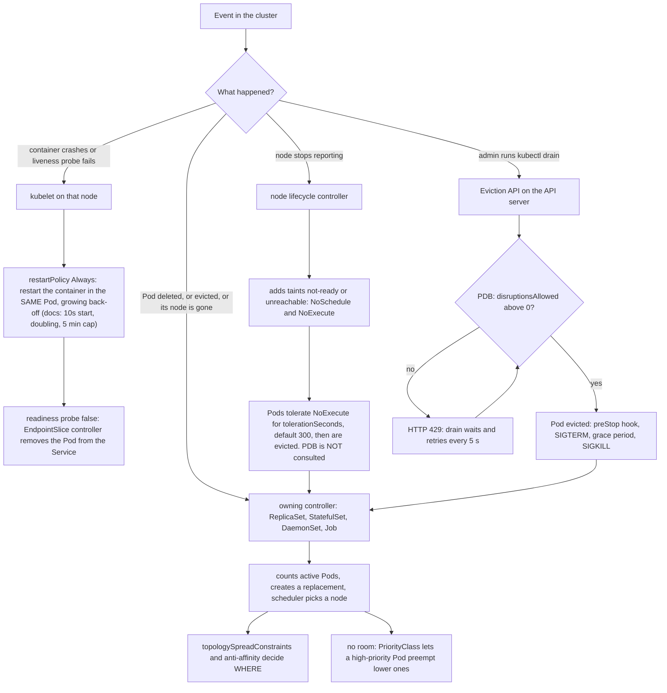

# T4.12 Primitives for robust, self-healing application deployments

> Competency: "Understand the primitives used to create robust, self-healing, application deployments" (CKA-3.4) | Domain/weight: CKA, Workloads and Scheduling (15%) | Est. time: 2 h | Prerequisites: T3.02, T3.09

Shell setup (from [conventions](../00-conventions.md); put it at the top of every session):

```bash
alias k=kubectl
export do="--dry-run=client -o yaml"
export now="--force --grace-period=0"
source <(kubectl completion bash); complete -o default -F __start_kubectl k
```

Lab environment: **kind** (1 control plane + 2 workers, cluster `lab`, context `kind-lab`, created with `env/kind-up.sh`). The node containers are named `lab-control-plane`, `lab-worker` and `lab-worker2`. The outputs in this lesson were captured on a cluster named `k-t412`, so they show `k-t412-worker` where your cluster shows `lab-worker`. Pod names (random suffixes) will differ in your run. Where a table of Pods is wide, the `NOMINATED NODE` and `READINESS GATES` columns were removed.

Output labels used below:

- `REAL OUTPUT (kind v0.33.0, v1.37.0)` was captured on a 3-node kind cluster running `kindest/node:v1.37.0`. That cluster used kind's default CNI (kindnet), not Calico. This does not change anything in this lesson.
- `EXPECTED OUTPUT (not captured)` marks output that is written from the documented behaviour and was not run on a cluster. Each such block is listed in section 11.
- Lab solutions and speed-drill answers were assembled from commands that were run, but not every lab was replayed end to end as written. Section 11 lists what was not replayed.

The examples in section 2 run in namespace `lab-t412`. Create it once with `k create ns lab-t412; k config set-context --current --namespace=lab-t412`. Remove everything from section 2 with `k delete ns lab-t412` (and `k delete pc low high high-nopreempt --ignore-not-found`, because PriorityClasses are cluster-wide).

---

## 1. Why this matters

Kubernetes does not make an application resilient by itself. It gives you building blocks: controllers that recreate Pods, probes, restart policies, disruption budgets, spreading rules, priorities and termination hooks. If you leave one out, a single node loss, a node drain or a rolling update can take the whole app down, even though "it has replicas".

In real life the usual outages are: all replicas sitting on one node, a drain that evicts every Pod at once, a drain that hangs forever because a budget is too strict, and users hitting a Pod that is still starting or already shutting down.

For the CKA you must pick and configure these primitives, then prove they work: drain a node, delete Pods, read the events. This lesson shows each primitive, what it does under the hood, and the exact output you should expect.

---

## 2. Concepts

### 2.1 The big picture: who heals what

"Self-healing" is not one feature. It is several independent loops, each watching a different kind of failure. A **voluntary disruption** is one that an administrator or a controller chooses to cause (drain a node, roll out a new version, delete a Pod). An **involuntary disruption** is one nobody chose (a container crashes, a node loses power, a kernel panic).

| Failure | Who notices | Who fixes it | Primitive you configure |
|---|---|---|---|
| Container process exits or hangs | kubelet on the node | kubelet restarts the container in the same Pod | `restartPolicy`, liveness/startup probes |
| App is up but not ready for traffic | kubelet (readiness probe) | EndpointSlice controller removes the Pod from the Service | readiness probe |
| Pod is deleted or evicted | the owning controller (ReplicaSet, StatefulSet, DaemonSet, Job) | creates a replacement Pod, the scheduler places it | `replicas`, controller type |
| Node stops reporting | node lifecycle controller in kube-controller-manager | taints the node, Pods are evicted after `tolerationSeconds`, controllers replace them | taint tolerations |
| Admin drains a node | `kubectl drain` through the Eviction API | the API server refuses evictions that break a budget | PodDisruptionBudget |
| All replicas on one node | nobody, until it is too late | you, at design time | `topologySpreadConstraints`, anti-affinity |
| Cluster is full, important Pod is Pending | scheduler | preempts (evicts) lower-priority Pods | PriorityClass |
| Pod shuts down while users are connected | kubelet termination sequence | you, with `preStop` and the grace period | `lifecycle.preStop`, `terminationGracePeriodSeconds` |

Keep this table in mind. Each later part explains one row and shows it working on the lab cluster.

### 2.2 Controllers recreate Pods

A bare Pod (created with `k run`) has no controller. If it is deleted, or its node dies, nobody recreates it. A controller is a loop in kube-controller-manager (or, for DaemonSets, a controller plus the scheduler) that compares the desired state with the observed state and fixes the difference. Every Pod it creates carries an `ownerReferences` entry that points back to the controller object. The controller finds "its" Pods by label selector plus that owner reference.

| Controller | Keeps | Replacement Pod identity | Typical use |
|---|---|---|---|
| ReplicaSet (made by a Deployment) | N identical Pods | new random name, new IP | stateless apps; use the Deployment, not the ReplicaSet directly |
| Deployment | a ReplicaSet per version, rolls between them | same as ReplicaSet | stateless apps with rolling updates |
| StatefulSet | N Pods with stable names `db-0`, `db-1` | same name, new UID, same PVC | databases, anything needing stable identity |
| DaemonSet | one Pod per matching node | new random name on the same node | node agents (log shippers, CNI) |
| Job | enough Pods to reach `completions` | new Pod after each failure, up to `backoffLimit` | run-to-completion work |

For the full comparison and when to choose each, see [T3.02](../part3-ckad/T3.02-choose-and-use-the-right-workload.md). For how Deployments, ReplicaSets and owner references work, see [T2.05](../part2-basics/T2.05-controllers-replicasets-deployments-basics-and-garbage.md).

Delete a StatefulSet Pod and a DaemonSet Pod and look at what comes back. The objects used in the captures below are these (save as `~/lab/t412/ctrl.yaml`; the `app` labels are what the `-l "app in (db,agent)"` selector uses):

```yaml
apiVersion: apps/v1
kind: StatefulSet
metadata:
  name: db
spec:
  serviceName: db               # required field; a headless Service of this name is only needed for DNS, not for this test
  replicas: 2
  selector:
    matchLabels:
      app: db
  template:
    metadata:
      labels:
        app: db
    spec:
      containers:
        - name: nginx
          image: nginx:1.27
---
apiVersion: apps/v1
kind: DaemonSet
metadata:
  name: agent
spec:
  selector:
    matchLabels:
      app: agent
  template:
    metadata:
      labels:
        app: agent
    spec:
      containers:
        - name: nginx
          image: nginx:1.27
---
apiVersion: batch/v1
kind: Job
metadata:
  name: flaky
spec:
  backoffLimit: 2               # default is 6; 2 means 3 Pods in total (1 first try + 2 retries)
  template:
    spec:
      restartPolicy: Never      # a failed Pod is NOT restarted in place; the Job creates a new Pod
      containers:
        - name: fail
          image: busybox:1.36
          command: ["sh", "-c", "exit 1"]
```

Apply it with `k apply -f ~/lab/t412/ctrl.yaml`. A DaemonSet runs one Pod on every schedulable node, so on a fresh `lab` cluster you will see one `agent` Pod on each worker (not on the tainted control plane). The capture below lists only one `agent` Pod and puts both `db` Pods on `k-t412-worker2`. I did not record why the other worker had no `agent` Pod in that run, so do not expect your cluster to look identical. The point of the test does not change: the deleted Pods come back, with the identity rules described below.

REAL OUTPUT (kind v0.33.0, v1.37.0):

```text
$ k get pod db-0 -o jsonpath={.metadata.uid}
17824823-92a5-4360-ba36-413834202b6e
$ k delete pod db-0 agent-7hnq8 --wait=false
pod "db-0" deleted from lab-t412 namespace
pod "agent-7hnq8" deleted from lab-t412 namespace
$ k get pods -l "app in (db,agent)" -o wide      # a few seconds later
NAME          READY   STATUS    RESTARTS   AGE     IP            NODE
agent-jz4hw   1/1     Running   0          79s     10.244.1.22   k-t412-worker2
db-0          1/1     Running   0          79s     10.244.1.23   k-t412-worker2
db-1          1/1     Running   0          2m53s   10.244.1.18   k-t412-worker2
$ k get pod db-0 -o jsonpath={.metadata.uid}
2a0c0878-5e2c-459c-aedd-d40fe90182fd
```

Read it like this: the StatefulSet Pod came back with the **same name** (`db-0`) but a **new UID**, so it is a new Pod object. The DaemonSet Pod came back with a **new name** (`agent-jz4hw`). Pods of a Deployment also get new names.

A Job replaces failed Pods until `backoffLimit` is used up. A Job whose command is `exit 1` with `backoffLimit: 2` made 3 Pods and stopped:

REAL OUTPUT (kind v0.33.0, v1.37.0):

```text
$ k describe job flaky | grep -E "Pods Statuses|Backoff|Warning"
Backoff Limit:    2
Pods Statuses:    0 Active (0 Ready) / 0 Succeeded / 3 Failed
  Warning  BackoffLimitExceeded  25s   job-controller  Job has reached the specified backoff limit
```

**Under the hood.** The ReplicaSet controller lists Pods that match its selector and that it owns, counts the ones that are not being deleted, and creates or deletes Pods to match `spec.replicas`. It does not care why a Pod disappeared. That is why deleting a Pod, evicting it, or losing its node all end the same way: the count drops, a new Pod appears.

**What breaks without it.** A bare Pod on a failed node is gone for good. A Deployment with `replicas: 1` recreates the Pod, but there is a gap with zero capacity. Resilience needs `replicas >= 2` plus the placement rules in 2.6.

### 2.3 restartPolicy and kubelet container restarts with backoff

`spec.restartPolicy` tells the **kubelet** what to do when a container in the Pod exits. The kubelet restarts the container **inside the same Pod**, on the same node, with the same Pod IP. The Pod is not rescheduled and the scheduler is not involved.

| restartPolicy | Container exits 0 | Container exits non-zero | Allowed on |
|---|---|---|---|
| `Always` (default) | restart | restart | Pods of Deployment, ReplicaSet, StatefulSet, DaemonSet (these only accept `Always`) |
| `OnFailure` | stay Completed | restart | Pods of Jobs, bare Pods |
| `Never` | stay Completed | stay Failed | Pods of Jobs, bare Pods |

A risky value: `Never` on a long-running bare Pod. One crash and the Pod stays dead.

**One example each (namespace `lab-t412`).** All three Pods run a container that always exits 1, so only the policy differs. The `Always` case is the `crash` Pod captured below.

```bash
k run once --image=busybox:1.36 --restart=Never -- sh -c 'exit 1'     # Never
cat <<'EOF' | k apply -f -
apiVersion: v1
kind: Pod
metadata:
  name: onfail
spec:
  restartPolicy: OnFailure
  containers:
    - name: fail
      image: busybox:1.36
      command: ["sh", "-c", "exit 1"]
EOF
sleep 30; k get pod once onfail
```

EXPECTED OUTPUT (not captured), the shape to look for:

```text
NAME     READY   STATUS             RESTARTS   AGE
once     0/1     Error              0          30s     <- Never: one run, RESTARTS stays 0, the Pod stays dead
onfail   0/1     CrashLoopBackOff   2 (..s ago) 30s    <- OnFailure: same in-place restarts as Always, RESTARTS rises
```

For the exit-0 column of the table, change the command to `exit 0`: `Never` and `OnFailure` Pods end as `Completed` with `RESTARTS 0`, while an `Always` Pod would be started again. (A Deployment cannot use `OnFailure` or `Never`: its API validation accepts only `Always`.)

Restarts use an exponential back-off so a broken container does not burn the CPU. The Kubernetes docs say the delay starts at 10 s, doubles on each restart and is capped at 5 minutes, and that the timer resets after the container has run for 10 minutes without a crash (docs only; see section 11). The Pod shows `CrashLoopBackOff` while it waits. What I observed below does not follow a clean 10/20/40 pattern: the first restart came at once, and the gaps between the following starts were about 14 s, 21 s and 47 s, each longer than the one before.

REAL OUTPUT (kind v0.33.0, v1.37.0), a Pod running `sh -c 'echo start; exit 1'`:

```text
$ k run crash --image=busybox:1.36 -- sh -c 'echo start; exit 1'
$ k get pod crash -w --output-watch-events=false
NAME    READY   STATUS              RESTARTS   AGE
crash   0/1     ContainerCreating   0          0s
crash   1/1     Running             0          7s
crash   0/1     Error               0          7s
crash   1/1     Running             1 (0s ago)   7s
crash   0/1     Error               1 (1s ago)   8s
crash   0/1     CrashLoopBackOff    1 (2s ago)   9s
crash   1/1     Running             2 (14s ago)   21s
crash   0/1     Error               2 (15s ago)   22s
crash   0/1     CrashLoopBackOff    2 (21s ago)   42s
crash   1/1     Running             3 (21s ago)   42s
crash   0/1     CrashLoopBackOff    3 (47s ago)   89s
crash   1/1     Running             4 (47s ago)   89s
```

Read the AGE column: the container was started at 7 s, then restarted at 7 s (first restart, no visible wait), 21 s, 42 s and 89 s. The gaps between restarts are about 14 s, 21 s and 47 s: they grow, but they are not an exact doubling of 10 s. `RESTARTS` counts container restarts, and `(47s ago)` is the time since the last one.

Killing a container from the node shows the same mechanism for a healthy app. The container exits with code 137 (128 + signal 9) and the kubelet starts a new one. The Pod name and IP do not change:

REAL OUTPUT (kind v0.33.0, v1.37.0):

```text
$ docker exec k-t412-worker2 crictl stop 9e23a6dee621...     # container ID of the web Pod
$ k get pod web-86878fc899-mmc2w
NAME                   READY   STATUS    RESTARTS     AGE
web-86878fc899-mmc2w   1/1     Running   1 (6s ago)   38s
$ k get pod web-86878fc899-mmc2w -o jsonpath='{.status.containerStatuses[0].lastState}'
{"terminated":{"containerID":"containerd://9e23a6dee6216d...","exitCode":137,"finishedAt":"2026-10-28T04:09:56Z","reason":"Error","startedAt":"2026-10-28T04:09:24Z"}}
```

**Related but different.** The v1.37 API also has a per-container `restartPolicy` and `restartPolicyRules` (`k explain pod.spec.containers.restartPolicyRules` shows them). Awareness only. You do not need them for this competency.

### 2.4 Liveness, readiness and startup probes

A **probe** is a check the kubelet runs against a container. Full detail (fields, handler types, tuning) is in [T3.09](../part3-ckad/T3.09-implement-probes-and-health-checks.md). The only thing to remember here is what each probe **does when it fails**:

| Probe | Question it asks | Action on failure | If you leave it out |
|---|---|---|---|
| `startupProbe` | Has the app finished starting? | kubelet kills the container (restart per `restartPolicy`). While it has not succeeded, liveness and readiness are not run | slow-starting apps are killed by the liveness probe |
| `livenessProbe` | Is the app stuck beyond repair? | kubelet kills the container, then restarts it | a deadlocked process stays "Running" forever |
| `readinessProbe` | Can the app take traffic right now? | Pod is marked not Ready and removed from the Service's EndpointSlices. **No restart.** | Pod gets traffic as soon as the container starts, and during rolling updates Kubernetes thinks new Pods are ready immediately |

Readiness is the most important probe for zero-downtime: it gates rolling updates (T3.10 / T4.09), it keeps traffic away from a starting Pod, and (section 2.5) it decides which Pods count as "healthy" for a PodDisruptionBudget.

A liveness probe that fails shows up in the events. REAL OUTPUT (kind v0.33.0, v1.37.0), nginx with `livenessProbe.httpGet.path: /nope`, `periodSeconds: 5`, `failureThreshold: 2`:

```text
$ k get pod badlive
NAME      READY   STATUS    RESTARTS      AGE
badlive   1/1     Running   2 (10s ago)   30s
$ k describe pod badlive | sed -n '/Events:/,$p'
  Type     Reason     Age                From     Message
  ----     ------     ----               ----     -------
  Normal   Killing    10s (x2 over 20s)  kubelet  spec.containers{nginx}: Container nginx failed liveness probe, will be restarted
  Normal   Started    9s (x3 over 30s)   kubelet  spec.containers{nginx}: Container started
  Warning  Unhealthy  5s (x5 over 25s)   kubelet  spec.containers{nginx}: Liveness probe failed: HTTP probe failed with statuscode: 404
```

(Lines for `Scheduled`, `Pulled` and `Created` were removed.) Liveness failures end in restarts, which is why you must never point a liveness probe at something the app does not control, such as its database. If the database is down, every replica restarts at once and the outage gets worse.

### 2.5 PodDisruptionBudget (PDB)

**What it is.** A PodDisruptionBudget is an object that limits how many Pods of an application may be down at the same time because of **voluntary** disruptions. It solves one problem: `kubectl drain` (or a cluster autoscaler or an upgrade tool) would otherwise evict every Pod of an app that lives on a node, even if that was all your replicas.

**How it is enforced.** `kubectl drain` does not delete Pods. It calls the **Eviction API** (`POST .../pods/<name>/eviction`). The API server checks every PDB that selects the Pod. If `status.disruptionsAllowed` is 0 it returns HTTP 429 and refuses. If it is above 0, the API server allows the eviction and decrements the number. The **disruption controller** in kube-controller-manager keeps the PDB `status` up to date.

```text
disruptionsAllowed = currentHealthy - desiredHealthy      (never below 0)
```

`currentHealthy` is the number of Ready Pods that match the selector. `desiredHealthy` comes from `minAvailable` (or `expectedPods - maxUnavailable`).

**Fields (policy/v1):**

| Field | Meaning | Default | Risky or invalid value |
|---|---|---|---|
| `spec.minAvailable` | Pods (integer) or percent (`"50%"`) that must stay Ready | none; set exactly one of `minAvailable` or `maxUnavailable` | equal to the replica count (or `100%`): zero evictions ever allowed, drain hangs |
| `spec.maxUnavailable` | Pods or percent that may be down | none | `0`: same as above. Setting both fields is rejected by the API server |
| `spec.selector` | Label selector of the Pods guarded (`matchLabels`) | required in practice | a selector that matches no Pods guards nothing; per the docs an empty selector `{}` matches every Pod in the namespace |
| `spec.unhealthyPodEvictionPolicy` | What to do with Pods that are Running but not Ready | unset, which behaves as `IfHealthyBudget` | `AlwaysAllow` is safe for most apps; see below |

Percentages are rounded up per the docs. A PDB expresses a rule; it does not create or keep Pods. It needs the replicas to exist.

**Which controllers allow which fields (docs, not tested here).** `maxUnavailable` and percentage values need the PDB to know the intended replica count. The API server finds it through the `scale` subresource of the Pods' controller, which Deployment, ReplicaSet, StatefulSet and ReplicationController have. For Pods owned by any other controller, or by none, use an integer `minAvailable` only. Source: https://kubernetes.io/docs/tasks/run-application/configure-pdb/

**Imperative creation.** `k create pdb` supports `--selector`, `--min-available` and `--max-unavailable` (integer or percent). It has no flag for `unhealthyPodEvictionPolicy`; for that you need YAML or `k patch`.

```bash
k create pdb web-pdb --selector=app=web --min-available=2
k create pdb web-pdb --selector=app=web --max-unavailable=1 $do      # preview the YAML
```

**Watching a PDB gate a drain.** First, a PDB where `minAvailable` equals the replica count. The three `web` Pods all run, and `ALLOWED DISRUPTIONS` is 0, so the drain cannot evict anything.

REAL OUTPUT (kind v0.33.0, v1.37.0):

```text
$ k patch pdb web-pdb -p '{"spec":{"minAvailable":3}}'
poddisruptionbudget.policy/web-pdb patched
$ k get pdb
NAME      MIN AVAILABLE   MAX UNAVAILABLE   ALLOWED DISRUPTIONS   AGE
web-pdb   3               N/A               0                     4m30s
$ k drain k-t412-worker2 --ignore-daemonsets --timeout=30s
node/k-t412-worker2 cordoned
Warning: ignoring DaemonSet-managed Pods: kube-system/kindnet-75wvs, kube-system/kube-proxy-rxrh5
evicting pod lab-t412/web-86878fc899-qjvmk
evicting pod lab-t412/web-86878fc899-mmc2w
error when evicting pods/"web-86878fc899-qjvmk" -n "lab-t412" (will retry after 5s): Cannot evict pod as it would violate the pod's disruption budget.
error when evicting pods/"web-86878fc899-mmc2w" -n "lab-t412" (will retry after 5s): Cannot evict pod as it would violate the pod's disruption budget.
...                       (the same two lines repeat every 5 s)
error: unable to drain node "k-t412-worker2" due to error: [error when evicting pods/"web-86878fc899-mmc2w" -n "lab-t412": global timeout reached: 30s, ...], continuing command...
$ k get nodes
NAME                   STATUS                     ROLES           AGE     VERSION
k-t412-control-plane   Ready                      control-plane   6m3s    v1.37.0
k-t412-worker          Ready                      <none>          5m54s   v1.37.0
k-t412-worker2         Ready,SchedulingDisabled   <none>          5m54s   v1.37.0
```

Two things to notice. Without `--timeout` this command would never return. And the node stays **cordoned** (`SchedulingDisabled`) after a failed drain; you must `k uncordon` it yourself.

Now lower `minAvailable` to 2. The budget allows one Pod down at a time. Both Pods are evicted, but **one after the other**: the second eviction is refused (429) until the replacement Pod is Ready on another node.

REAL OUTPUT (kind v0.33.0, v1.37.0):

```text
$ k patch pdb web-pdb -p '{"spec":{"minAvailable":2}}'
poddisruptionbudget.policy/web-pdb patched
$ k drain k-t412-worker2 --ignore-daemonsets --timeout=90s
node/k-t412-worker2 already cordoned
Warning: ignoring DaemonSet-managed Pods: kube-system/kindnet-75wvs, kube-system/kube-proxy-rxrh5
evicting pod lab-t412/web-86878fc899-qjvmk
evicting pod lab-t412/web-86878fc899-mmc2w
error when evicting pods/"web-86878fc899-mmc2w" -n "lab-t412" (will retry after 5s): Cannot evict pod as it would violate the pod's disruption budget.
pod/web-86878fc899-qjvmk evicted
evicting pod lab-t412/web-86878fc899-mmc2w
pod/web-86878fc899-mmc2w evicted
node/k-t412-worker2 drained
```

In another run I sampled `.status.readyReplicas` of the Deployment once per second during a drain that had to move 3 Pods. The lowest value over 45 samples was 2 (4 samples at 2, 41 samples at 3). So the budget held.

**What the PDB does NOT cover.** It only applies to the Eviction API. It is not consulted when you run `k delete pod`, when a Deployment does a rolling update (the update speed is controlled by the Deployment's `maxUnavailable`/`maxSurge`), when the node lifecycle controller evicts Pods from a failed node (2.8), when a container crashes, or when you pass `k drain --disable-eviction`. In the capture below, deleting all three Pods at once under `minAvailable: 2` was accepted:

REAL OUTPUT (kind v0.33.0, v1.37.0):

```text
$ k get pdb
NAME      MIN AVAILABLE   MAX UNAVAILABLE   ALLOWED DISRUPTIONS   AGE
web-pdb   2               N/A               1                     2m38s
$ k delete pod -l app=web --wait=false
pod "web-86878fc899-g8ssp" deleted from lab-t412 namespace
pod "web-86878fc899-kkqsq" deleted from lab-t412 namespace
pod "web-86878fc899-l99rv" deleted from lab-t412 namespace
```

**unhealthyPodEvictionPolicy.** A Pod that is Running but not Ready (for example a crash-looping app that is up for a second between crashes) is not "healthy". With the default behaviour, `IfHealthyBudget`, such a Pod can be evicted only if the application is not already disrupted, meaning `currentHealthy >= desiredHealthy`. If the PDB needs 1 healthy Pod and 0 are healthy, the sick Pod **cannot** be evicted and the drain hangs. The policy `AlwaysAllow` lets a Running-but-not-Ready Pod be evicted whatever the budget says; healthy Pods are still protected.

On the real cluster: `k explain pdb.spec.unhealthyPodEvictionPolicy` lists the enum `AlwaysAllow` and `IfHealthyBudget`, and says that with no policy set "the default behavior will be used, which corresponds to the IfHealthyBudget policy". A PDB created without the field is stored without it (`k get pdb web-pdb -o jsonpath='{.spec}'` printed only `minAvailable` and `selector`). So the default is `IfHealthyBudget`, and nothing is filled in on the object.

REAL OUTPUT (kind v0.33.0, v1.37.0), a 1-replica Deployment whose readiness probe is `exec: false`, and a PDB `minAvailable: 1`:

```text
$ k get pods -l app=sick; k get pdb sick-pdb
NAME                    READY   STATUS    RESTARTS   AGE   IP           NODE
sick-777b448477-wkx4k   0/1     Running   0          16s   10.244.2.6   k-t412-worker
NAME       MIN AVAILABLE   MAX UNAVAILABLE   ALLOWED DISRUPTIONS   AGE
sick-pdb   1               N/A               0                     16s
$ k drain k-t412-worker --ignore-daemonsets --timeout=20s
node/k-t412-worker cordoned
error when evicting pods/"sick-777b448477-wkx4k" -n "lab-t412" (will retry after 5s): Cannot evict pod as it would violate the pod's disruption budget.
...
$ k patch pdb sick-pdb --type=merge -p '{"spec":{"unhealthyPodEvictionPolicy":"AlwaysAllow"}}'
poddisruptionbudget.policy/sick-pdb patched
$ k drain k-t412-worker --ignore-daemonsets --timeout=60s
node/k-t412-worker already cordoned
evicting pod lab-t412/sick-777b448477-wkx4k
pod/sick-777b448477-wkx4k evicted
node/k-t412-worker drained
```

**More `kubectl drain` details.** `drain` first **cordons** the node (marks it unschedulable) and then evicts every Pod. It refuses by default in two cases, and the messages tell you the flag to use:

REAL OUTPUT (kind v0.33.0, v1.37.0), a bare Pod `lone` on the node:

```text
$ k drain k-t412-worker
node/k-t412-worker cordoned
error: unable to drain node "k-t412-worker" due to error: [cannot delete DaemonSet-managed Pods (use --ignore-daemonsets to ignore): kube-system/kindnet-lpgsh, kube-system/kube-proxy-sfq54, cannot delete Pods that declare no controller (use --force to override): lab-t412/lone], continuing command...
$ k drain k-t412-worker --ignore-daemonsets
error: unable to drain node "k-t412-worker" due to error: cannot delete Pods that declare no controller (use --force to override): lab-t412/lone, continuing command...
```

| Flag | Effect | Risk |
|---|---|---|
| `--ignore-daemonsets` | skip DaemonSet Pods (they would come straight back) | none; always needed on real nodes |
| `--force` | also delete bare Pods that no controller owns | those Pods are gone for good |
| `--delete-emptydir-data` | allow evicting Pods that use `emptyDir` volumes | the emptyDir data is lost |
| `--timeout=30s` | give up after this long (default 0 = wait forever) | none; use it in labs and in the exam |
| `--grace-period=N` | override each Pod's grace period | short values skip clean shutdown |
| `--disable-eviction` | use plain delete instead of the Eviction API | **bypasses every PDB** |

### 2.6 Replicas and spreading: topologySpreadConstraints and anti-affinity

Three replicas are not three failure domains if the scheduler puts them on one node. A **topology** is a group of nodes that fail together, identified by a node label: `kubernetes.io/hostname` (one node), `topology.kubernetes.io/zone` (a data center zone). You tell the scheduler to keep replicas of the same app spread across those groups.

There are two tools:

| | `topologySpreadConstraints` | `podAntiAffinity` |
|---|---|---|
| Idea | keep the **difference** in Pod count between domains at most `maxSkew` | "do not put me in a domain that already has a Pod matching this selector" |
| 3 replicas on 2 workers | works: 2 + 1 | `required` form: the third Pod stays Pending (one per node at most) |
| Soft version | `whenUnsatisfiable: ScheduleAnyway` | `preferredDuringSchedulingIgnoredDuringExecution` |
| Best for | "spread evenly" | "never two on the same node" |

**topologySpreadConstraints fields (on the Pod template `spec`):**

| Field | Meaning | Default / note |
|---|---|---|
| `maxSkew` | maximum allowed difference between the fullest and the emptiest domain | required, must be > 0 |
| `topologyKey` | node label that defines a domain | required. A node without this label is not counted |
| `whenUnsatisfiable` | `DoNotSchedule` (Pod stays Pending) or `ScheduleAnyway` (best effort) | required |
| `labelSelector` | which Pods are counted. Normally the same labels as the Deployment's Pods | if you forget it nothing matches, and the constraint does nothing |
| `minDomains` | minimum number of domains; below it the skew counts as against 0 | optional; only with `DoNotSchedule` |
| `nodeAffinityPolicy` | `Honor` (only nodes that match the Pod's nodeSelector/affinity count) or `Ignore` | docs: `Honor` |
| `nodeTaintsPolicy` | `Honor` (only nodes whose taints the Pod tolerates count) or `Ignore` | **`Ignore`**: tainted nodes are counted |
| `matchLabelKeys` | label keys (such as `pod-template-hash`) copied from the Pod into the selector, so old and new ReplicaSets are counted apart | optional |

**A trap you will meet on kind and on kubeadm clusters.** The default for `nodeTaintsPolicy` is `Ignore`. The control-plane node has a `NoSchedule` taint, so your Pods can never run on it, but it is still counted as a domain with 0 Pods. The emptiest domain therefore always has 0 Pods, and with `maxSkew: 1` no worker may hold more than 1 Pod. The third replica stays Pending. REAL OUTPUT (kind v0.33.0, v1.37.0), 3 replicas, `maxSkew: 1`, `DoNotSchedule`, no `nodeTaintsPolicy`:

```text
$ k get pods -o wide
NAME                   READY   STATUS    RESTARTS   AGE   IP           NODE
web-56f8c69c68-hxwr6   1/1     Running   0          25s   10.244.2.2   k-t412-worker
web-56f8c69c68-m5mgc   1/1     Running   0          25s   10.244.1.3   k-t412-worker2
web-56f8c69c68-tmdvv   0/1     Pending   0          25s   <none>       <none>
$ k get events --field-selector reason=FailedScheduling -o custom-columns=MSG:.message
0/3 nodes are available: 1 node(s) had untolerated taint(s), 2 node(s) didn't match pod topology spread constraints. preemption: 0/3 nodes are available: 1 Preemption is not helpful for scheduling, 2 No preemption victims found for incoming pod.
```

The fix is `nodeTaintsPolicy: Honor` (then the control plane is not counted and the result is 2 + 1), or `whenUnsatisfiable: ScheduleAnyway`. The YAML in section 4 uses `Honor`.

**Anti-affinity.** Required anti-affinity with 3 replicas and only 2 schedulable nodes: 2 Pods run, the third waits. The Deployment used in the capture (namespace `lab-t412`):

```bash
k create deploy anti --image=nginx:1.27 --replicas=3 $do > anti.yaml
```

Then add this under `spec.template.spec` in `anti.yaml` (same level as `containers`) and `k apply -f anti.yaml`:

```yaml
      affinity:
        podAntiAffinity:
          requiredDuringSchedulingIgnoredDuringExecution:   # hard rule, checked when a Pod is scheduled
            - topologyKey: kubernetes.io/hostname           # a "domain" is one node
              labelSelector:
                matchLabels:
                  app: anti                                 # Pods with this label count; `k create deploy anti` labels its Pods app=anti
```

The meaning: "do not schedule me onto a node that already runs a Pod with `app=anti`". `required...` is a hard rule (Pod stays Pending). The soft form is `preferredDuringSchedulingIgnoredDuringExecution`, which needs a `weight` (1 to 100) and wraps the term in `podAffinityTerm`:

```yaml
      affinity:
        podAntiAffinity:
          preferredDuringSchedulingIgnoredDuringExecution:
            - weight: 100                                   # how strongly the scheduler prefers it
              podAffinityTerm:
                topologyKey: kubernetes.io/hostname
                labelSelector:
                  matchLabels:
                    app: anti
```

With the soft form all three replicas run (2 + 1): replace the `affinity` block with it and re-apply, then `k get pods -l app=anti -o wide` shows 3 Running and no `FailedScheduling` event (expected, not captured; see section 11). The captured result of the required form:

REAL OUTPUT (kind v0.33.0, v1.37.0):

```text
$ k get pods -l app=anti -o wide
NAME                    READY   STATUS    RESTARTS   AGE   IP            NODE
anti-69bf95ff54-dwfgx   1/1     Running   0          15s   10.244.1.28   k-t412-worker2
anti-69bf95ff54-hmt6b   0/1     Pending   0          15s   <none>        <none>
anti-69bf95ff54-mtssz   1/1     Running   0          15s   10.244.2.5    k-t412-worker
$ k get events --field-selector reason=FailedScheduling -o custom-columns=MSG:.message
0/3 nodes are available: 1 node(s) had untolerated taint(s), 2 node(s) didn't match pod anti-affinity rules. preemption: 0/3 nodes are available: 1 Preemption is not helpful for scheduling, 2 No preemption victims found for incoming pod.
```

Use `required` anti-affinity only when replicas <= schedulable nodes. Otherwise use `preferred` or topology spread.

**Spreading happens only at scheduling time.** The rules say `IgnoredDuringExecution`: the scheduler never moves a running Pod to improve balance. After a drain and an uncordon, or after a node was down, all replicas can sit on one node even though the constraint exists. REAL OUTPUT (kind v0.33.0, v1.37.0), after `k-t412-worker` came back from a stop:

```text
$ k get pods -l app=web -o wide       # after the node came back
NAME                   READY   STATUS    RESTARTS   AGE   IP            NODE
web-b8b5789b-hjdvf     1/1     Running   0          94s   10.244.1.27   k-t412-worker2
...                                                                      (all three on k-t412-worker2)
$ k rollout restart deploy/web        # new Pods are scheduled again, the constraint applies
$ k get pods -l app=web -o wide
NAME                   READY   STATUS        RESTARTS   AGE   IP            NODE
web-86878fc899-qwwzd   1/1     Terminating   0          97s   10.244.1.25   k-t412-worker2
web-b8b5789b-5ssw6     1/1     Running       0          2s    10.244.2.4    k-t412-worker
web-b8b5789b-hjdvf     1/1     Running       0          1s    10.244.1.27   k-t412-worker2
web-b8b5789b-qzr5f     1/1     Running       0          3s    10.244.2.3    k-t412-worker
```

(The first block is abbreviated: all three Pods were on `k-t412-worker2`.) So after node maintenance, check `k get pods -o wide` and run `k rollout restart deploy/<name>` to rebalance. Descheduler-type tools exist for automatic rebalancing, but they are outside this lesson.

### 2.7 PriorityClass and preemption (awareness)

A **PriorityClass** gives Pods an integer priority. When a high-priority Pod cannot be scheduled because the cluster is full, the scheduler may **preempt**: it chooses lower-priority Pods on one node, evicts them, and schedules the high-priority Pod there. This is how critical workloads survive a capacity crunch.

| Field | Meaning | Default |
|---|---|---|
| `value` | the priority; higher wins. A user class may use any value up to and including 1,000,000,000 (docs); larger numbers are reserved for the built-in system classes | required |
| `globalDefault` | if `true`, Pods without a class get this value (only one class may be global default) | `false` |
| `preemptionPolicy` | `PreemptLowerPriority` or `Never` (the Pod queues ahead of others but never evicts anyone) | `PreemptLowerPriority` |
| `description` | free text | none |

The cluster already has two built-in classes. Pods use a class with `spec.priorityClassName`. `k create pc NAME --value=N` builds one imperatively.

**Reproduce it (namespace `lab-t412`).** Two Pods that each ask for 60% of one worker's CPU, pinned to the same worker. The first fits. The second cannot fit next to it, so the scheduler must preempt or leave it Pending.

```bash
mkdir -p ~/lab/t412
k create pc low --value=100
k create pc high --value=100000
CPU=$(k get node lab-worker -o jsonpath='{.status.allocatable.cpu}'); echo "allocatable cpu: $CPU"
REQ="$((CPU * 600))m"       # 60% of the node; assumes allocatable is a whole number of CPUs, as on kind
for P in low high; do
cat > ~/lab/t412/$P-pod.yaml <<EOF
apiVersion: v1
kind: Pod
metadata:
  name: $P-pod
spec:
  priorityClassName: $P                     # the class created above
  nodeSelector:
    kubernetes.io/hostname: lab-worker      # both Pods must compete for the same node
  containers:
    - name: nginx
      image: nginx:1.27
      resources:
        requests:
          cpu: $REQ                         # the scheduler counts requests, not real usage
EOF
done
k apply -f ~/lab/t412/low-pod.yaml
k wait --for=condition=Ready pod/low-pod --timeout=60s
k apply -f ~/lab/t412/high-pod.yaml
k get pods low-pod high-pod -o wide; k get events --sort-by=.lastTimestamp | grep -i preempt
```

`preemptionPolicy` changes the result. A class with `Never` queues ahead of lower classes but evicts nobody. Clean up the first test and run the second:

```bash
k delete pod low-pod high-pod --ignore-not-found --now      # one of them is already gone after preemption
cat > ~/lab/t412/nopreempt.yaml <<'EOF'
apiVersion: scheduling.k8s.io/v1
kind: PriorityClass
metadata:
  name: high-nopreempt
value: 100000
preemptionPolicy: Never          # waits for room, never evicts a lower-priority Pod
EOF
k apply -f ~/lab/t412/nopreempt.yaml
k apply -f ~/lab/t412/low-pod.yaml; k wait --for=condition=Ready pod/low-pod --timeout=60s
sed -e 's/name: high-pod/name: high-pod2/' -e 's/priorityClassName: high/priorityClassName: high-nopreempt/' ~/lab/t412/high-pod.yaml | k apply -f -
k get pods low-pod high-pod2; k describe pod high-pod2 | grep -A3 Events
```

EXPECTED OUTPUT (not captured): `low-pod` stays `Running`, `high-pod2` stays `Pending` with a `FailedScheduling` event `Insufficient cpu`, and no `Preempted` event mentions `high-pod2` (events from the first test may still be listed; check the Pod names in them).

The captured run below used a 12-CPU node, so each request was 7200m.

REAL OUTPUT (kind v0.33.0, v1.37.0):

```text
$ k get pc
NAME                      VALUE        GLOBAL-DEFAULT   AGE   PREEMPTIONPOLICY
high                      100000       false            0s    PreemptLowerPriority
low                       100          false            0s    PreemptLowerPriority
system-cluster-critical   2000000000   false            15m   PreemptLowerPriority
system-node-critical      2000001000   false            15m   PreemptLowerPriority
$ k apply -f ~/lab/t412/high-pod.yaml
pod/high-pod created
$ k get pods low-pod high-pod -o wide
NAME       READY   STATUS        RESTARTS   AGE   IP           NODE
low-pod    1/1     Terminating   0          12s   10.244.2.7   k-t412-worker
high-pod   0/1     Pending       0          12s   <none>       <none>        # NOMINATED NODE = k-t412-worker
$ k get events --sort-by=.lastTimestamp | grep -i preempt
13s   Normal    Preempted   pod/low-pod    Preempted by pod 83f107ce-004e-471d-baf3-36484b4cef43 on node k-t412-worker
```

The `high` Pod first reported `Insufficient cpu`, then the scheduler nominated the node, evicted `low-pod`, and the `high` Pod ran once the victim had gone. Preemption honors a PDB only on a best-effort basis, so do not use it as a replacement for budgets. The detailed scheduling side (resource requests, admission, quotas) is in [T4.13](../part4-cka/T4.13-configure-pod-admission-and-scheduling-limits.md).

### 2.8 Node failure handling: taints and tolerationSeconds

When a node stops sending heartbeats (a kubelet status update or a Lease renewal), the **node lifecycle controller** waits for the node-monitor grace period, then sets the node `Ready` condition to `Unknown` and adds two taints:

- `node.kubernetes.io/unreachable` with effect `NoSchedule` (no new Pods)
- `node.kubernetes.io/unreachable` with effect `NoExecute` (existing Pods are evicted)

A node whose kubelet reports not ready gets the `node.kubernetes.io/not-ready` taints in the same way. A taint with `NoExecute` evicts every Pod that does not **tolerate** it. A toleration may carry `tolerationSeconds`: how long the Pod may stay after the taint appeared. The `DefaultTolerationSeconds` admission plugin adds this toleration to every Pod that has no toleration for these taints:

REAL OUTPUT (kind v0.33.0, v1.37.0):

```text
$ k run probe --image=nginx:1.27
$ k get pod probe -o jsonpath='{range .spec.tolerations[*]}{.key}{"\t"}{.operator}{"\t"}{.effect}{"\t"}{.tolerationSeconds}{"\n"}{end}'
node.kubernetes.io/not-ready	Exists	NoExecute	300
node.kubernetes.io/unreachable	Exists	NoExecute	300
```

So in v1.37 the default is **300 seconds** for both taints. That is why Pods "take 5 minutes to move" after a node dies. The decision is in the Pod spec, so you can change it per workload. The plugin adds the default **per key**: a Pod that sets its own toleration for `not-ready` but not for `unreachable` still gets the 300 s default for `unreachable`. Set both keys (as in 4.3), or half of the failure cases keep the 5-minute delay.

The `fast` Deployment in the capture is this (save as `~/lab/t412/fast.yaml`, namespace `lab-t412`). It has no spread rule, so its Pods may land on either worker:

```yaml
apiVersion: apps/v1
kind: Deployment
metadata:
  name: fast
spec:
  replicas: 4
  selector:
    matchLabels:
      app: fast
  template:
    metadata:
      labels:
        app: fast
    spec:
      tolerations:
        - key: node.kubernetes.io/not-ready
          operator: Exists
          effect: NoExecute
          tolerationSeconds: 20
        - key: node.kubernetes.io/unreachable
          operator: Exists
          effect: NoExecute
          tolerationSeconds: 20
      containers:
        - name: nginx
          image: nginx:1.27
```

I stopped the node container of a kind worker (`docker stop k-t412-worker`) that held all three `web` Pods and the four `fast` Pods. To repeat it, read `k get pods -o wide`, stop the worker that holds the Pods you want to watch, and expect fewer `fast` Pods to be affected if yours are spread. I sampled the cluster every 10 s. Times are seconds after `docker stop`:

REAL OUTPUT (kind v0.33.0, v1.37.0), condensed from the 10-second samples:

```text
t+40s   worker Ready;    no taints;                                   web endpoints: 3 ready addresses
t+51s   worker NotReady; taints unreachable:NoSchedule + NoExecute;   web endpoints: none ready   <- outage starts
t+71s   fast Pods on the dead node: Terminating (20 s after the taint); replacements Running on the other worker
...     (web Pods still shown Running on the dead node, no endpoints)
t+346s  web Pods on the dead node: Terminating (about 300 s after the taint); 3 new web Pods Running on the other worker
```

```text
$ k get events --sort-by=.lastTimestamp | grep TaintManagerEviction | tail -4
5m23s  Normal  TaintManagerEviction  pod/fast-767d49dd94-66c5v  Marking for deletion Pod lab-t412/fast-767d49dd94-66c5v
...
43s    Normal  TaintManagerEviction  pod/web-86878fc899-g9v5x   Marking for deletion Pod lab-t412/web-86878fc899-g9v5x
```

Read it like this:

1. The node was declared `NotReady` between 40 and 51 s after it stopped (the docs name `--node-monitor-grace-period` for this; see section 11). At that moment the endpoints became empty: the Service had **no backend for about 5 minutes** because all three replicas were on the dead node.
2. Pods with `tolerationSeconds: 20` were evicted about 20 s later. The default Pods waited about 300 s. The two `TaintManagerEviction` events are 280 s apart, which is 300 - 20.
3. The old Pods stay in `Terminating` on the dead node because the kubelet there cannot confirm the deletion. The controller does not wait: it already counted them as gone and created replacements elsewhere. When the node returned (`docker start k-t412-worker`) the old Pods were cleaned up.
4. A PDB is **not** consulted for these evictions. Only replicas on **different** nodes reduce the outage.

Trade-off when tuning `tolerationSeconds`: a small value moves Pods fast, but a short network blip then causes a needless reschedule. A large value is slow to recover. Stateful workloads that must not run twice at the same time (a StatefulSet Pod may still be running on an unreachable node) need extra care; the docs for non-graceful node shutdown describe the `node.kubernetes.io/out-of-service` taint for that case (not tested here).

### 2.9 Graceful termination and preStop for zero-downtime

When a Pod is deleted or evicted, the sequence is:

1. The API server sets `metadata.deletionTimestamp`. The Pod goes to `Terminating`.
2. **Two things start at the same time and are not synchronised:** the EndpointSlice controller removes the Pod from Services, and the kubelet runs the `preStop` hook.
3. When `preStop` finishes, the kubelet sends **SIGTERM** to the main process (PID 1) of each container.
4. If the container is still running after `terminationGracePeriodSeconds` (default 30, counted from step 1, so the `preStop` time is included), the kubelet sends **SIGKILL**.

The race in step 2 is the cause of dropped requests. Load balancers, kube-proxy and Ingress controllers learn about the removed endpoint with a delay. If the app stops accepting connections immediately on SIGTERM, requests sent in that delay window fail. A `preStop` hook that just waits a few seconds closes the gap: the Pod keeps serving while the endpoint removal spreads, then gets SIGTERM.

| `lifecycle.preStop` handler | Use |
|---|---|
| `sleep: {seconds: N}` | pure delay. No shell in the image is needed. Exists in v1.37 (`k explain pod.spec.containers.lifecycle.preStop.sleep`) |
| `exec: {command: [...]}` | run a command in the container, for example a drain script |
| `httpGet` | call an HTTP endpoint of the app |

Risky values: `terminationGracePeriodSeconds` shorter than the `preStop` time plus the app's shutdown time means the process is killed in the middle of its cleanup. A very long grace period makes every drain and rollout slow when the app ignores SIGTERM.

Two measurements. A BusyBox Pod that runs `sleep` as PID 1 ignores SIGTERM (PID 1 has no default signal action), so it is killed only when the grace period ends. An nginx Pod with a `preStop` sleep of 8 s stops as soon as the hook finishes.

REAL OUTPUT (kind v0.33.0, v1.37.0), `terminationGracePeriodSeconds` 15 for `nosig2`, 30 and `preStop.sleep.seconds: 8` for `prestop`:

```text
$ k delete pod prestop
pod "prestop" deleted from lab-t412 namespace
took 9 s
$ k delete pod nosig2
pod "nosig2" deleted from lab-t412 namespace
took 16 s
```

(`prestop`: 8 s hook + about 1 s for nginx to stop. `nosig2`: the whole 15 s grace period, plus about 1 s.)

A **zero-downtime recipe** for a Deployment: a readiness probe; `preStop` sleep of 5 to 10 s; an app that closes cleanly on SIGTERM; `terminationGracePeriodSeconds` larger than `preStop` plus the longest request; at least 2 replicas; a PDB. For Deployment rolling updates see [T3.10](../part3-ckad/T3.10-deployments-and-rolling-updates.md).

### 2.10 Owner references and garbage collection

Every Pod made by a controller has `metadata.ownerReferences` that name the controller object. The Kubernetes **garbage collector** (in kube-controller-manager) deletes an object when all of its owners are gone. That is how deleting a Deployment also deletes its ReplicaSet and Pods without any extra command.

REAL OUTPUT (kind v0.33.0, v1.37.0):

```text
$ k get rs -o jsonpath='{range .items[*]}{.metadata.name}{" owner="}{.metadata.ownerReferences[0].kind}/{.metadata.ownerReferences[0].name}{"\n"}{end}'
fast-767d49dd94 owner=Deployment/fast
web-86878fc899 owner=Deployment/web
$ k get pod db-0 -o jsonpath='{.metadata.name}{" owner="}{.metadata.ownerReferences[0].kind}/{.metadata.ownerReferences[0].name}{" controller="}{.metadata.ownerReferences[0].controller}{"\n"}'
db-0 owner=StatefulSet/db controller=true
```

Fields inside one `ownerReferences` entry: `kind`, `name`, `uid` (identify the owner), `controller: true` (this owner manages the object; only one owner may have it), `blockOwnerDeletion: true` (with foreground deletion, the owner cannot be removed before this object).

`kubectl delete` has three **cascade** modes:

| Mode | Command | Effect |
|---|---|---|
| background (default) | `k delete deploy web` | owner deleted at once, the garbage collector deletes the dependents afterwards |
| foreground | `k delete deploy web --cascade=foreground` | owner is marked, dependents are deleted first, then the owner |
| orphan | `k delete deploy web --cascade=orphan` | owner deleted, dependents **stay** and their `ownerReferences` are cleared |

REAL OUTPUT (kind v0.33.0, v1.37.0), a 1-replica Deployment `orph`:

```text
$ k delete deploy orph --cascade=orphan
deployment.apps "orph" deleted from lab-t412 namespace
$ k get rs,pods -l app=orph
NAME                              DESIRED   CURRENT   READY   AGE
replicaset.apps/orph-84bd9947cf   1         1         1       8s

NAME                        READY   STATUS    RESTARTS   AGE
pod/orph-84bd9947cf-rlxt8   1/1     Running   0          8s
$ k get rs -l app=orph -o jsonpath='{.items[0].metadata.ownerReferences}'
                                                   # empty: the ReplicaSet no longer has an owner
$ k delete rs -l app=orph
replicaset.apps "orph-84bd9947cf" deleted from lab-t412 namespace
$ k get rs,pods -l app=orph
No resources found in lab-t412 namespace.
```

Why this matters for resilience: the owner reference is what makes a replacement Pod "belong" to the controller. After the Deployment was orphaned, its ReplicaSet kept running and would still replace its own deleted Pods, but no Deployment manages it any more: there are no rollouts, and `k rollout undo` has nothing to act on. If you then delete that **ReplicaSet** with `--cascade=orphan` too, its Pods lose their last owner and nothing replaces them when they die (this last step follows from the mechanism and was not run, see section 11). See [T2.05](../part2-basics/T2.05-controllers-replicasets-deployments-basics-and-garbage.md) for the basics.

### 2.11 Checking resilience: the test toolbox

Never trust a design you have not broken on purpose. Run each test while a second terminal runs `k get pods -o wide -w`.

| Test | Command | Primitive it tests | What a pass looks like |
|---|---|---|---|
| Delete Pods | `k delete pod -l app=web --wait=false` | controller | new Pods Running within seconds; Service keeps answering if at least one replica stayed up |
| Kill a container | `docker exec <node> crictl stop <id>` (kind) or `ssh <node>` and `crictl stop <id>` on VMs | restartPolicy, kubelet | `RESTARTS` goes up by 1; Pod name and IP unchanged |
| Cordon | `k cordon <node>` | none: it only blocks new Pods from landing on the node | node shows `SchedulingDisabled`; existing Pods keep running |
| Drain | `k drain <node> --ignore-daemonsets --timeout=60s` | PDB, controllers, spread | evictions one at a time within the budget; Pods reappear elsewhere |
| Uncordon | `k uncordon <node>` | none | node schedulable again; Pods do not move back |
| Node failure (kind) | `docker stop <node>`; undo with `docker start <node>` | taints, tolerationSeconds | `NotReady` after ~50 s, Pods move after `tolerationSeconds` |
| Watch the effects | `k get pods -o wide -w`, `k get events --sort-by=.lastTimestamp`, `k get pdb` | all | read the events, not only the Pod list |

**Related but different:**

- `cordon` (stop new Pods) vs `drain` (cordon + evict) vs `delete node` (remove the object; Pods are garbage collected, the kubelet registers the node again if it is still running).
- Eviction (`k drain`, honors a PDB) vs `k delete pod` (does not) vs taint eviction (does not).
- PDB vs the Deployment's `strategy.rollingUpdate.maxUnavailable`: the PDB limits **evictions**; `maxUnavailable` limits **rolling updates**.
- PDB vs ResourceQuota/LimitRange: quotas limit how much you may create; a PDB limits how much may be taken away.
- Liveness (restart) vs readiness (stop traffic, no restart).

---

## 3. How it works (diagram)



Walkthrough:

1. A crash or a failed liveness probe is handled **on the node** by the kubelet, which restarts the container in the same Pod with an exponential back-off. A failed readiness probe never restarts anything; it only removes the Pod from the Service.
2. A deleted or evicted Pod, or a Pod on a lost node, is handled by the **controller**. It creates a new Pod. The scheduler places it, and the spread rules decide whether it lands on a different node from its siblings.
3. A dead node is noticed by the node lifecycle controller, which adds the `NoExecute` taint. The Pods stay until `tolerationSeconds` (300 s by default) has passed, then are evicted. No PDB check happens on this path.
4. `kubectl drain` uses the Eviction API. The PDB decides whether each eviction may go ahead. A refused eviction (429) is retried every 5 seconds, which is why a too-strict PDB looks like a hang.
5. An allowed eviction runs the graceful shutdown (`preStop`, SIGTERM, grace period, SIGKILL), and then the controller creates the replacement. That loops back to step 2.

**Failure matrix, verified by experiment** (3 replicas of nginx, readiness and liveness probes, topology spread on hostname, PDB `minAvailable: 2`, kind v1.37.0):

| Event | Who reacted | What I saw | Recovery time | PDB consulted? |
|---|---|---|---|---|
| Container stopped with `crictl stop` | kubelet | same Pod, `RESTARTS 1`, `lastState.terminated.exitCode: 137` | about 6 s | no |
| Container that always exits 1 | kubelet | `CrashLoopBackOff`; restarts at 7, 21, 42, 89 s | never recovers; waits grow | no |
| Liveness probe returns 404 (failureThreshold 2, period 5 s) | kubelet | `Killing ... failed liveness probe`, `RESTARTS 2` after 30 s | restarts forever | no |
| `k delete pod -l app=web` (all 3) | ReplicaSet | 3 new Pods Running about 2 s later | 2 s | no, all three deleted |
| `k drain` with `minAvailable: 3` of 3 | Eviction API | `Cannot evict pod as it would violate the pod's disruption budget` every 5 s | blocked until the PDB or replicas change | yes, refuses |
| `k drain` with `minAvailable: 2` of 3 | Eviction API + ReplicaSet | evictions one at a time; `readyReplicas` never below 2 | about 10 s | yes, allows 1 at a time |
| Node stopped, default tolerations | node lifecycle controller | NotReady about 50 s, endpoints empty, Pods evicted about 300 s after the taint | about 5 min (outage if all replicas were on that node) | no |
| Node stopped, `tolerationSeconds: 20` | node lifecycle controller | Pods evicted about 20 s after the taint | about 70 s in total | no |
| 3 replicas, `required` anti-affinity, 2 workers | scheduler | 2 Running, 1 Pending, `didn't match pod anti-affinity rules` | stays Pending | n/a |
| 3 replicas, `maxSkew: 1`, `nodeTaintsPolicy` unset | scheduler | 2 Running, 1 Pending, `didn't match pod topology spread constraints` | fix the constraint | n/a |
| Higher-priority Pod needs the CPU | scheduler | `Preempted by pod ...`; victim Terminating | few seconds | no |

---

## 4. Commands and YAML you must produce fast

### 4.1 Imperative shortcuts

```bash
# PodDisruptionBudget: at least 2 Pods must stay Ready.
k create pdb web-pdb --selector=app=web --min-available=2

# Same idea, expressed the other way round: at most 1 Pod may be down. Percent also works: --max-unavailable=25%
k create pdb web-pdb --selector=app=web --max-unavailable=1 $do > pdb.yaml

# See the budget: ALLOWED DISRUPTIONS is currentHealthy - desiredHealthy.
k get pdb

# Deployment skeleton with 3 replicas. Then edit in probes and topologySpreadConstraints.
k create deploy web --image=nginx:1.27 --replicas=3 $do > web.yaml

# Take a node out of service. --timeout stops it from hanging if a PDB blocks.
k drain lab-worker --ignore-daemonsets --timeout=60s
k uncordon lab-worker

# Kill the Pods and watch the controller work. Run the watch in a second terminal.
k delete pod -l app=web --wait=false
k get pods -o wide -w

# PriorityClass.
k create pc high --value=100000 --description="business critical"

# Quick facts.
k get pods -o wide                      # which node is each replica on
k get events --sort-by=.lastTimestamp   # why did the scheduler or kubelet act
k explain pdb.spec                      # field names and enum values, offline of the docs
```

### 4.2 Declarative YAML: Deployment (3 replicas) with probes and spread, plus PDB

Save as `~/lab/t412/web.yaml`. Everything the entry asks for is in this one file: 3 replicas, readiness and liveness probes, `topologySpreadConstraints` on `kubernetes.io/hostname`, and a PDB with `minAvailable: 2`.

```yaml
apiVersion: apps/v1
kind: Deployment
metadata:
  name: web
  labels:
    app: web
spec:
  replicas: 3                       # more than 1, otherwise a PDB cannot allow any eviction
  selector:
    matchLabels:
      app: web                      # must match template labels, immutable after creation
  template:
    metadata:
      labels:
        app: web                    # the PDB and the spread constraint select on this label
    spec:
      terminationGracePeriodSeconds: 30     # default 30; time from delete to SIGKILL, includes preStop
      topologySpreadConstraints:
        - maxSkew: 1                        # replica count may differ by at most 1 between nodes
          topologyKey: kubernetes.io/hostname   # each node is one domain
          whenUnsatisfiable: DoNotSchedule      # Pod stays Pending rather than break the rule; ScheduleAnyway = soft
          nodeTaintsPolicy: Honor               # do not count tainted nodes (the control plane); default Ignore causes a Pending Pod on kind
          labelSelector:
            matchLabels:
              app: web                          # which Pods are counted; same labels as the template
      containers:
        - name: nginx
          image: nginx:1.27                     # pinned tag, never :latest
          ports:
            - containerPort: 80
          readinessProbe:                       # failure removes the Pod from Service endpoints, no restart
            httpGet:
              path: /
              port: 80
            periodSeconds: 5                    # check every 5 s
            failureThreshold: 3                 # 3 failures in a row = not Ready
          livenessProbe:                        # failure makes the kubelet restart the container
            httpGet:
              path: /
              port: 80
            initialDelaySeconds: 10             # wait before the first check
            periodSeconds: 10
            failureThreshold: 3                 # 3 failures in a row = restart
          resources:
            requests:
              cpu: 50m                          # scheduling input, and a sane default for the lab
              memory: 32Mi
---
apiVersion: policy/v1
kind: PodDisruptionBudget
metadata:
  name: web-pdb
spec:
  minAvailable: 2                   # integer or "50%"; set minAvailable OR maxUnavailable, never both
  selector:
    matchLabels:
      app: web                    # guards the Pods of the Deployment above
  # unhealthyPodEvictionPolicy: AlwaysAllow    # optional; unset behaves as IfHealthyBudget
```

Variants to know (each is one small edit of the file above):

| Want | Change |
|---|---|
| allow one Pod down at a time instead | replace `minAvailable: 2` with `maxUnavailable: 1` |
| evict stuck, not-Ready Pods during a drain | add `unhealthyPodEvictionPolicy: AlwaysAllow` under `spec` |
| never two replicas on one node | add under the Pod `spec`: `affinity.podAntiAffinity.requiredDuringSchedulingIgnoredDuringExecution` with `topologyKey: kubernetes.io/hostname` and `labelSelector.matchLabels.app: web` (only valid while replicas <= schedulable nodes; full stanza in 2.6) |
| soft spread | `whenUnsatisfiable: ScheduleAnyway` |
| faster failover after a node loss | add under the Pod `spec` the two tolerations shown in 4.3 |
| smooth shutdown | add `lifecycle.preStop.sleep.seconds: 8` under the container |

### 4.3 Extra YAML: faster failover, preStop and a PriorityClass

```yaml
# Pod template fragment: leave a dead node after 30 s instead of 300 s.
# Set BOTH keys: the admission plugin adds the 300 s default for every key you leave out.
      tolerations:
        - key: node.kubernetes.io/not-ready      # kubelet reports not ready
          operator: Exists                       # any value
          effect: NoExecute                      # the evicting effect
          tolerationSeconds: 30                  # how long the Pod may stay after the taint appears
        - key: node.kubernetes.io/unreachable    # node stopped reporting
          operator: Exists
          effect: NoExecute
          tolerationSeconds: 30
```

```yaml
# Container fragment: keep serving for 8 s while endpoints update, then SIGTERM.
          lifecycle:
            preStop:
              sleep:
                seconds: 8
```

```yaml
apiVersion: scheduling.k8s.io/v1
kind: PriorityClass
metadata:
  name: high
value: 100000                # higher = scheduled first and may preempt lower classes
globalDefault: false         # true would apply to every Pod that names no class
preemptionPolicy: PreemptLowerPriority   # Never = wait in the queue, evict nobody
description: business critical
```

A Pod uses it with `spec.priorityClassName: high`.

### 4.4 Speed drill

Targets are exam pace. Setup (one line), then the eight tasks, then cleanup.

```bash
# Setup: namespace + a 3-replica Deployment named d-web. Do this once.
k create ns lab-t412; k config set-context --current --namespace=lab-t412
k create deploy d-web --image=nginx:1.27 --replicas=3; k rollout status deploy/d-web
```

1. (1 min) Create a PDB `d-pdb` that keeps at least 2 `d-web` Pods available.
2. (3 min) Write, but do not create, a PDB `d-pdb2` for `app=d-web` that allows 1 unavailable Pod and evicts not-Ready Pods anyway. Check it with a server-side dry run.
3. (4 min) Add a readiness probe (HTTP GET `/` port 80, every 5 s) and a liveness probe (same path, `initialDelaySeconds: 10`) to `d-web`.
4. (3 min) Add a spread constraint to `d-web`: `maxSkew: 1` across `kubernetes.io/hostname`, `DoNotSchedule`, that does not count the control-plane node.
5. (3 min) Make `d-web` Pods leave a failed node after 60 seconds.
6. (2 min) Drain `lab-worker` safely (timeout 90 s), check, then put it back.
7. (3 min) Make `d-web` shut down gently: sleep 5 s in `preStop` and allow 40 s grace.
8. (3 min) Create a PriorityClass `d-prio` with value 1000 and use it in `d-web`.

<details><summary>Answers</summary>

```bash
# 1
k create pdb d-pdb --selector=app=d-web --min-available=2
k get pdb d-pdb                       # ALLOWED DISRUPTIONS should be 1

# 2  (YAML in a file, validated by the API server without creating it)
cat > pdb2.yaml <<'EOF'
apiVersion: policy/v1
kind: PodDisruptionBudget
metadata:
  name: d-pdb2
spec:
  maxUnavailable: 1
  unhealthyPodEvictionPolicy: AlwaysAllow
  selector:
    matchLabels:
      app: d-web
EOF
k apply -f pdb2.yaml --dry-run=server
# Do NOT create it: two PDBs on the same Pods make evictions fail (see section 6).

# 3
k patch deploy d-web -p '{"spec":{"template":{"spec":{"containers":[{"name":"nginx","readinessProbe":{"httpGet":{"path":"/","port":80},"periodSeconds":5},"livenessProbe":{"httpGet":{"path":"/","port":80},"initialDelaySeconds":10}}]}}}}'

# 4
k patch deploy d-web -p '{"spec":{"template":{"spec":{"topologySpreadConstraints":[{"maxSkew":1,"topologyKey":"kubernetes.io/hostname","whenUnsatisfiable":"DoNotSchedule","nodeTaintsPolicy":"Honor","labelSelector":{"matchLabels":{"app":"d-web"}}}]}}}}'

# 5
k patch deploy d-web -p '{"spec":{"template":{"spec":{"tolerations":[{"key":"node.kubernetes.io/not-ready","operator":"Exists","effect":"NoExecute","tolerationSeconds":60},{"key":"node.kubernetes.io/unreachable","operator":"Exists","effect":"NoExecute","tolerationSeconds":60}]}}}}'

# 6
k drain lab-worker --ignore-daemonsets --timeout=90s
k get nodes; k get pods -o wide
k uncordon lab-worker

# 7
k patch deploy d-web -p '{"spec":{"template":{"spec":{"terminationGracePeriodSeconds":40,"containers":[{"name":"nginx","lifecycle":{"preStop":{"sleep":{"seconds":5}}}}]}}}}'

# 8
k create pc d-prio --value=1000
k patch deploy d-web -p '{"spec":{"template":{"spec":{"priorityClassName":"d-prio"}}}}'
k get pod -l app=d-web -o jsonpath='{.items[0].spec.priority}'; echo     # 1000
```

A `k patch` on the pod template starts a rolling update, so wait for `k rollout status deploy/d-web` between steps if you check results. Strategic merge matches containers by `name`, which is why `"name":"nginx"` appears in the patches.
</details>

```bash
# Cleanup (returns the cluster to baseline for the worked example and the labs)
k delete deploy d-web; k delete pdb d-pdb --ignore-not-found; k delete pc d-prio --ignore-not-found
k delete ns lab-t412; k config set-context --current --namespace=default
```

---

## 5. Worked example

Goal: build the resilient `web` app from section 4.2, then break it in four ways and watch the primitives respond. Steps 4 to 7 are a sequence: run them in order, because each one starts from the state the last one left. Environment: kind, cluster `lab`. Outputs are the captured ones; names differ in your run.

**Step 1. Create the app and look at the placement.**

```bash
k create ns lab-t412; k config set-context --current --namespace=lab-t412
mkdir -p ~/lab/t412 && cd ~/lab/t412        # paste the YAML from section 4.2 into web.yaml
k apply -f web.yaml
k rollout status deploy/web
k get pods -o wide
k get pdb
```

REAL OUTPUT (kind v0.33.0, v1.37.0):

```text
$ k get pods -o wide
NAME                   READY   STATUS    RESTARTS   AGE   IP           NODE
web-86878fc899-g8ssp   1/1     Running   0          2s    10.244.2.4   k-t412-worker
web-86878fc899-kkqsq   1/1     Running   0          2s    10.244.1.4   k-t412-worker2
web-86878fc899-l99rv   1/1     Running   0          2s    10.244.2.3   k-t412-worker
$ k get pdb
NAME      MIN AVAILABLE   MAX UNAVAILABLE   ALLOWED DISRUPTIONS   AGE
web-pdb   2               N/A               1                     2m38s
```

What to look for: Pods on both workers, none on the control plane, and `ALLOWED DISRUPTIONS 1` (3 healthy - 2 desired). If this shows `0`, some Pod is not Ready yet. Check the PDB status in detail with:

```bash
k get pdb web-pdb -o jsonpath='{.status}{"\n"}'
```

```text
{"conditions":[{"lastTransitionTime":"2026-10-28T04:09:19Z","message":"","observedGeneration":1,"reason":"SufficientPods","status":"True","type":"DisruptionAllowed"}],"currentHealthy":3,"desiredHealthy":2,"disruptionsAllowed":1,"expectedPods":3,"observedGeneration":1}
```

**Step 2. Break 1: delete every Pod.** Open a second terminal with `k get pods -o wide -w`, then:

```bash
k delete pod -l app=web --wait=false
```

REAL OUTPUT (kind v0.33.0, v1.37.0), watch trimmed:

```text
web-86878fc899-g8ssp   1/1   Terminating          0   7s   10.244.2.4   k-t412-worker
web-86878fc899-kkqsq   1/1   Terminating          0   7s   10.244.1.4   k-t412-worker2
web-86878fc899-l99rv   1/1   Terminating          0   7s   10.244.2.3   k-t412-worker
web-86878fc899-mmc2w   0/1   ContainerCreating    0   0s   <none>       k-t412-worker2
web-86878fc899-qjvmk   0/1   ContainerCreating    0   0s   <none>       k-t412-worker2
web-86878fc899-ts62l   0/1   ContainerCreating    0   0s   <none>       k-t412-worker
...
web-86878fc899-mmc2w   1/1   Running              0   2s   10.244.1.6   k-t412-worker2
```

The ReplicaSet created three new Pods in the same second. The old Pods then terminate. The new ones are not Ready for a short time (`0/1`) because the readiness probe has not passed yet. In production this short gap is the reason for 3 replicas **and** `RollingUpdate`, not `k delete pod`.

**Step 3. Break 2: kill a container.**

```bash
P=$(k get pod -l app=web -o jsonpath='{.items[0].metadata.name}')
N=$(k get pod $P -o jsonpath='{.spec.nodeName}')
POD=$(docker exec $N crictl pods --name $P -q)          # the Pod's sandbox ID
CID=$(docker exec $N crictl ps --pod $POD -q | head -1)  # its container ID
docker exec $N crictl stop $CID
k get pod $P
```

On kubeadm VMs the equivalent is `ssh <node>`, `sudo -i`, then the same `crictl` commands. The output is the one in section 2.3: `RESTARTS 1`, `exitCode 137`, same Pod name.

**Step 4. Break 3: drain a node, once with a PDB that blocks and once with one that allows.**

```bash
k patch pdb web-pdb -p '{"spec":{"minAvailable":3}}'
k drain lab-worker2 --ignore-daemonsets --timeout=30s       # blocked, as in section 2.5
k patch pdb web-pdb -p '{"spec":{"minAvailable":2}}'
k drain lab-worker2 --ignore-daemonsets --timeout=90s       # one at a time, succeeds
k get pods -l app=web -o wide
```

REAL OUTPUT (kind v0.33.0, v1.37.0):

```text
$ k get pods -l app=web -o wide
NAME                   READY   STATUS    RESTARTS   AGE     IP           NODE
web-86878fc899-89ltn   1/1     Running   0          9s      10.244.2.7   k-t412-worker
web-86878fc899-g9v5x   1/1     Running   0          3s      10.244.2.8   k-t412-worker
web-86878fc899-ts62l   1/1     Running   0          2m31s   10.244.2.5   k-t412-worker
```

The first drain printed `Cannot evict pod as it would violate the pod's disruption budget` until the timeout. The second one evicted the two Pods one after the other (the first eviction went through, the second was refused once and retried 5 s later). Note the result: **all three Pods are now on one node**, because the other worker is cordoned and the scheduler only moves Pods at creation time.

**Step 5. Uncordon and see that nothing moves back.**

```bash
k uncordon lab-worker2
k get pods -l app=web -o wide          # still all three on the same worker
```

Do **not** run `k rollout restart` yet. The next step needs the bad starting point (all replicas on one node) on purpose.

**Step 6. Break 4: a node dies.** (kind only.) Put a Service in front so you can see the endpoints, then stop the node that has all the Pods. Read its name from the NODE column instead of typing it (after step 4 it is the worker that did not get drained, but check):

```bash
k expose deploy web --port=80
W=$(k get pods -l app=web -o jsonpath='{.items[0].spec.nodeName}'); echo "stopping $W"
k get pods -l app=web -o wide          # confirm: all three Pods on $W
docker stop $W                         # simulate a power loss; the kind node container has the same name as the node
k get nodes -w                         # NotReady after about 50 s; stop the watch with Ctrl-C
k describe node $W | grep -A2 ^Taints
k get endpointslice -l kubernetes.io/service-name=web
```

REAL OUTPUT (kind v0.33.0, v1.37.0), about 6 minutes after the stop:

```text
$ k describe node k-t412-worker | grep -A2 ^Taints
Taints:             node.kubernetes.io/unreachable:NoExecute
                    node.kubernetes.io/unreachable:NoSchedule
Unschedulable:      false
$ k get pods -o wide
NAME                   READY   STATUS        RESTARTS   AGE     IP            NODE
web-86878fc899-89ltn   1/1     Terminating   0          7m13s   10.244.2.7    k-t412-worker
web-86878fc899-bx4qz   1/1     Running       0          43s     10.244.1.26   k-t412-worker2
web-86878fc899-g9v5x   1/1     Terminating   0          7m7s    10.244.2.8    k-t412-worker
web-86878fc899-qwwzd   1/1     Running       0          43s     10.244.1.25   k-t412-worker2
web-86878fc899-rw6vj   1/1     Running       0          43s     10.244.1.24   k-t412-worker2
web-86878fc899-ts62l   1/1     Terminating   0          9m35s   10.244.2.5    k-t412-worker
```

The three old Pods are `Terminating` on the dead node and three replacements run on the other worker. The new Pods appeared only about 300 s after the taint, and the Service had no ready endpoint in between, because **all three replicas had been on the same node**. Had the Pods been spread 2 + 1, the Service would have kept one backend throughout. Bring the node back with `docker start $W` and wait for `k get nodes` to show `Ready`.

**Step 7. Rebalance, then repeat the node loss.** The old Pods are cleaned up when the node returns, and all three replicas now run on the other worker, because nothing moves them back. Re-run scheduling so the spread constraint applies again, then stop the worker that holds only one or two of them:

```bash
k rollout restart deploy/web; k rollout status deploy/web
k get pods -l app=web -o wide          # 2 + 1 across the two workers
W2=$(k get pods -l app=web -o jsonpath='{.items[0].spec.nodeName}')
docker stop $W2; k get endpointslice -l kubernetes.io/service-name=web -w
```

EXPECTED OUTPUT (not captured): the EndpointSlice never goes empty. The endpoint of the Pod on the surviving worker stays ready the whole time, even before the 300 s toleration runs out. That is the difference between 2 + 1 and 3 + 0. Start the node again with `docker start $W2`.

**Cleanup.**

```bash
docker start $W $W2 2>/dev/null; k get nodes      # both workers must be Ready before you go on
k delete ns lab-t412; k config set-context --current --namespace=default
```

---

## 6. Common mistakes and how to fix them

| Symptom | What you will see (exact error/event text) | Cause | Fix (command) |
|---|---|---|---|
| Drain blocked forever | `error when evicting pods/"web-..." -n "lab-t412" (will retry after 5s): Cannot evict pod as it would violate the pod's disruption budget.` repeating; `k get pdb` shows `ALLOWED DISRUPTIONS 0` | PDB `minAvailable` equals the replica count (or `maxUnavailable: 0`), or too few Pods are Ready | `k patch pdb web-pdb -p '{"spec":{"minAvailable":2}}'` (or scale up: `k scale deploy web --replicas=4`), then `k uncordon <node>` |
| All replicas on one node die together | after the node stops: `k get endpointslice` has no ready endpoint, all Pods `Terminating` on one node 5 minutes later | no spread rule, or the node was drained and uncordoned and Pods never moved back | add `topologySpreadConstraints` (section 4.2), then `k rollout restart deploy/web`; check with `k get pods -o wide` |
| Pods take 5 minutes to move after a node dies | node `NotReady`, taint `node.kubernetes.io/unreachable:NoExecute`, Pods still `Running` and then `TaintManagerEviction ... Marking for deletion Pod` 300 s later | the default toleration `tolerationSeconds: 300` added by admission | add tolerations for `not-ready` and `unreachable` with a smaller `tolerationSeconds` (section 4.3); the Pod template changes, so a rollout follows |
| Third replica stays Pending with `maxSkew: 1` | `0/3 nodes are available: 1 node(s) had untolerated taint(s), 2 node(s) didn't match pod topology spread constraints.` | `nodeTaintsPolicy` defaults to `Ignore`; the tainted control plane counts as an empty domain | add `nodeTaintsPolicy: Honor`, or use `ScheduleAnyway` |
| Third replica stays Pending with anti-affinity | `... 2 node(s) didn't match pod anti-affinity rules.` | `required` anti-affinity with more replicas than nodes | use `preferredDuringSchedulingIgnoredDuringExecution` or reduce replicas |
| Drain refuses even with a good PDB | `cannot delete Pods that declare no controller (use --force to override): lab-t412/lone` or `cannot delete DaemonSet-managed Pods (use --ignore-daemonsets to ignore)` | a bare Pod or DaemonSet Pod is on the node | add `--ignore-daemonsets`; for the bare Pod decide: `--force` deletes it for good |
| Drain hangs on one crashing Pod | the PDB shows `ALLOWED DISRUPTIONS 0` and the Pod shows `0/1 Running` | default `IfHealthyBudget` does not allow evicting a not-Ready Pod while the app is below budget | `k patch pdb <name> --type=merge -p '{"spec":{"unhealthyPodEvictionPolicy":"AlwaysAllow"}}'` or fix the Pod |
| Pods still deleted below the budget | PDB shows `MIN AVAILABLE 2` but `k delete pod -l app=web` removed all three | `delete` does not use the Eviction API; neither do taint evictions or rolling updates | do maintenance through `k drain`, not `k delete` |
| Requests fail during rollouts and drains | clients see connection resets | no readiness probe, or no `preStop` delay, or the app exits at once on SIGTERM | add readiness + `preStop` sleep (section 4.3) |
| Node stays `SchedulingDisabled` | `Ready,SchedulingDisabled` in `k get nodes` | a drain that failed or timed out leaves the node cordoned | `k uncordon <node>` |
| A restart storm after a dependency fails | all replicas `Running` with rising `RESTARTS`, events `Liveness probe failed` | liveness probe depends on a downstream service | probe only the container itself; use readiness for dependencies |

**Troubleshooting path 1: a drain that does not finish.** Run the diagnostics in this order:

1. `k get nodes`. The node should show `SchedulingDisabled`: the cordon part worked.
2. Read the drain output. A message `cannot delete ...` means a flag is missing (`--ignore-daemonsets`, `--force`). The message `Cannot evict pod as it would violate...` means a PDB refused.
3. `k get pdb -A`. Look at `ALLOWED DISRUPTIONS`. If it is 0, compute it: `k get pdb <name> -o jsonpath='{.status}'` gives `currentHealthy`, `desiredHealthy`, `expectedPods`.
4. If `currentHealthy` is lower than the replicas, some Pods are not Ready: `k get pods -o wide`, `k describe pod`. Fix those first, or use `unhealthyPodEvictionPolicy: AlwaysAllow` if they are stuck.
5. If `currentHealthy` equals the replicas but `desiredHealthy` also equals them, the budget is too strict. Lower it, or add replicas.
6. After the fix, run the drain again. Finish with `k uncordon <node>` when maintenance ends.

**Troubleshooting path 2: Pods move too slowly or all die together.**

1. `k get pods -o wide`: how many different nodes appear in the NODE column? One means no real redundancy.
2. `k get deploy web -o jsonpath='{.spec.template.spec.topologySpreadConstraints}'` and `...affinity}`: is there a rule? Does its `labelSelector` match the Pod labels (`k get pod --show-labels`)?
3. `k describe pod <pending>` and read the `FailedScheduling` message; the text names which rule failed (see the table).
4. For slow failover read the node and its taints: `k describe node <n> | grep -A3 ^Taints` and the Pod's tolerations: `k get pod <p> -o jsonpath='{.spec.tolerations}'`. A 300 means default.
5. Fix the spec, `k rollout restart`, then re-test with `k drain` or `docker stop` (kind).

**A note on two PDBs.** If two PDBs select the same Pod, the Eviction API fails for that Pod, because the API supports only one PDB per Pod (docs; the error message was not captured here). Keep exactly one PDB per application.

---

## 7. Labs

Order: **Easy, then Medium, then Break-fix.** Every lab ends with a cleanup that returns the cluster to its baseline, so any order works. Environment for all labs: **kind**, cluster `lab` (3 nodes), nodes `lab-control-plane`, `lab-worker`, `lab-worker2`. Namespace `lab-t412`. Lab files go in `~/lab/t412/`.

### 7.1 Easy: kill Pods and containers, observe the controllers and restarts

**Setup**

```bash
k create ns lab-t412; k config set-context --current --namespace=lab-t412
mkdir -p ~/lab/t412
k create deploy web --image=nginx:1.27 --replicas=3
k rollout status deploy/web
k get pods -l app=web -o name | sort > ~/lab/t412/old-pods.txt
```

**Task.** In namespace `lab-t412`:

1. Delete all `web` Pods with one command, without waiting. Wait until the Deployment has 3 ready replicas again. Write the names of the new Pods (`pod/...` form, sorted) to `~/lab/t412/new-pods.txt`.
2. Pick one `web` Pod. Stop its nginx container from the node (not by deleting the Pod). Write that Pod's `RESTARTS` count to `~/lab/t412/restarts.txt`.
3. Create a bare Pod `lone` with image `nginx:1.27`, delete it, and show that nothing recreates it.

<details><summary>Hints</summary>

- `k delete pod -l app=web --wait=false`, then `k rollout status deploy/web` is not enough on its own (the Deployment did not change). Use `k wait --for=condition=Available deploy/web` or watch `k get pods -w`.
- A container belongs to a Pod sandbox on a node. On kind `docker exec <node> crictl pods --name <pod> -q` gives the sandbox ID; `crictl ps --pod <id> -q` lists its containers; `crictl stop <id>` stops one.
- The restart count is `.status.containerStatuses[0].restartCount`.
</details>

<details><summary>Solution</summary>

```bash
# 1. The controller recreates the Pods. wait for readiness, then record the new names.
k delete pod -l app=web --wait=false
sleep 5
k wait --for=condition=Ready pod -l app=web --timeout=90s
k get pods -l app=web -o name | sort > ~/lab/t412/new-pods.txt
```

The ReplicaSet counts Pods owned by it that are not being deleted; as soon as the old ones got a `deletionTimestamp` the count was 0, so it created 3. The `sleep 5` is there so the old, terminating Pods have disappeared from the list before you record names; if `new-pods.txt` has more than 3 lines, wait a few seconds and run the last command again.

```bash
# 2. Stop the container on the node. Replace lab-worker with the node name from -o wide.
P=$(k get pod -l app=web -o jsonpath='{.items[0].metadata.name}')
N=$(k get pod $P -o jsonpath='{.spec.nodeName}')
POD=$(docker exec $N crictl pods --name $P -q)
CID=$(docker exec $N crictl ps --pod $POD -q | head -1)
docker exec $N crictl stop $CID
sleep 8
k get pod $P -o jsonpath='{.status.containerStatuses[0].restartCount}' > ~/lab/t412/restarts.txt
cat ~/lab/t412/restarts.txt
```

The kubelet sees the exited container, `restartPolicy: Always` applies, and it starts a new container in the same Pod. That is why the count is 1 and the Pod name and IP stay the same. The `docker exec <node>` part is specific to kind; on VMs you would `ssh <node>`.

```bash
# 3. A bare Pod has no controller, so nothing replaces it.
k run lone --image=nginx:1.27
k wait --for=condition=Ready pod/lone --timeout=60s
k delete pod lone --now
sleep 5
k get pod lone          # Error from server (NotFound)
```
</details>

**Verification**

```bash
test "$(k get deploy web -o jsonpath='{.status.readyReplicas}')" = 3 && echo "ok: 3 ready"
test "$(wc -l < ~/lab/t412/new-pods.txt)" = 3 && echo "ok: 3 new names"
test "$(comm -12 ~/lab/t412/old-pods.txt ~/lab/t412/new-pods.txt | wc -l)" = 0 && echo "ok: all names are new"
test "$(cat ~/lab/t412/restarts.txt)" = 1 && echo "ok: restart count 1"
test "$(k get pods -l app=web -o jsonpath='{.items[*].status.containerStatuses[0].restartCount}' | tr ' ' '\n' | grep -cx 1)" = 1 && echo "ok: exactly one Pod has restartCount 1"
k get pod lone 2>&1 | grep -q NotFound && echo "ok: bare Pod not recreated"
```

Each line prints `ok:` only when the check passes. A missing line is a failed check.

**Cleanup**

```bash
k delete ns lab-t412; k config set-context --current --namespace=default
rm -f ~/lab/t412/old-pods.txt ~/lab/t412/new-pods.txt ~/lab/t412/restarts.txt
```

### 7.2 Medium: drain a node with a PDB and watch the evictions respect it

**Setup**

```bash
k create ns lab-t412; k config set-context --current --namespace=lab-t412
mkdir -p ~/lab/t412 && cd ~/lab/t412
# Paste the YAML from section 4.2 into web.yaml, then:
k apply -f web.yaml
k rollout status deploy/web
k get pods -l app=web -o wide
```

**Task.** In namespace `lab-t412`, Deployment `web` (3 replicas, PDB `web-pdb`) is running.

1. Find the worker node that runs the most `web` Pods. While you drain it (ignore DaemonSets, 90 s timeout), record the Deployment's ready replica count once per second to `~/lab/t412/ready.txt` (one number per line). The lowest number in the file must be at least 2. Then uncordon the node.
2. The Pods moved during part 1 and do not move back by themselves. Count the `web` Pods per node again and pick the worker that now runs the most of them. Set the PDB to `minAvailable: 3`, try to drain that worker with a 20-second timeout, and save the drain's output to `~/lab/t412/blocked.txt`. Then restore `minAvailable: 2` and uncordon the node.
3. Finish with all nodes `Ready` and schedulable.

<details><summary>Hints</summary>

- Count Pods per node: `k get pods -l app=web -o jsonpath='{range .items[*]}{.spec.nodeName}{"\n"}{end}' | sort | uniq -c`.
- Run the recorder in the background with `( ... ) &` before the drain and `wait` for it afterwards. Print `0` when `readyReplicas` is empty.
- `k drain ... > blocked.txt 2>&1` captures the error lines (they go to stderr).
</details>

<details><summary>Solution</summary>

```bash
cd ~/lab/t412
N=$(k get pods -l app=web -o jsonpath='{range .items[*]}{.spec.nodeName}{"\n"}{end}' | sort | uniq -c | sort -rn | head -1 | awk '{print $2}')
echo "draining $N"

# Recorder: 60 samples, one per second, in the background.
( for i in $(seq 1 60); do r=$(kubectl get deploy web -o jsonpath='{.status.readyReplicas}'); echo "${r:-0}"; sleep 1; done > ~/lab/t412/ready.txt ) &

k drain $N --ignore-daemonsets --timeout=90s
wait
sort -n ~/lab/t412/ready.txt | head -1            # lowest sample, expected 2
k uncordon $N
```

The PDB allows one Pod down at a time, so the drain evicts them one after the other. The sampled minimum is 2, as in the captured run (4 samples at 2, 41 at 3 over 45 samples). The recorder only proves the budget when it is running while the evictions happen, so start it before the drain.

```bash
# Part 2: the budget that blocks. Pods now sit on the other worker, so recount first.
N=$(k get pods -l app=web -o jsonpath='{range .items[*]}{.spec.nodeName}{"\n"}{end}' | sort | uniq -c | sort -rn | head -1 | awk '{print $2}')
k patch pdb web-pdb -p '{"spec":{"minAvailable":3}}'
k get pdb web-pdb                                  # ALLOWED DISRUPTIONS 0
k drain $N --ignore-daemonsets --timeout=20s > ~/lab/t412/blocked.txt 2>&1
tail -3 ~/lab/t412/blocked.txt
k patch pdb web-pdb -p '{"spec":{"minAvailable":2}}'
k uncordon $N
```

With `minAvailable: 3` and 3 healthy Pods, `disruptionsAllowed` is 0, so every eviction returns 429 and the drain retries until the timeout. The Pods stay put. Restoring 2 allows 1 again. A failed drain leaves the node cordoned, which is why `uncordon` is needed.
</details>

**Verification**

```bash
test "$(sort -n ~/lab/t412/ready.txt | head -1)" -ge 2 && echo "ok: never below 2 ready"
grep -q "violate the pod's disruption budget" ~/lab/t412/blocked.txt && echo "ok: strict PDB blocked the drain"
test "$(k get pdb web-pdb -o jsonpath='{.spec.minAvailable}')" = 2 && echo "ok: PDB restored"
test "$(k get nodes --no-headers | grep -c SchedulingDisabled)" = 0 && echo "ok: no cordoned node"
test "$(k get deploy web -o jsonpath='{.status.readyReplicas}')" = 3 && echo "ok: 3 ready"
```

**Cleanup**

```bash
k get nodes                                        # all Ready; uncordon anything still SchedulingDisabled
k delete ns lab-t412; k config set-context --current --namespace=default
rm -f ~/lab/t412/ready.txt ~/lab/t412/blocked.txt ~/lab/t412/web.yaml
```

### 7.3 Break-fix: no probes, one replica and a too-strict PDB

**Setup (injects the fault).** Save as `~/lab/t412/break.sh` and run it.

```bash
mkdir -p ~/lab/t412 && cat > ~/lab/t412/break.sh <<'XEOF'
#!/bin/bash
kubectl get ns lab-t412 >/dev/null 2>&1 || kubectl create ns lab-t412
kubectl -n lab-t412 apply -f - <<'EOF'
apiVersion: apps/v1
kind: Deployment
metadata:
  name: shop
  labels:
    app: shop
spec:
  replicas: 1
  selector:
    matchLabels:
      app: shop
  template:
    metadata:
      labels:
        app: shop
    spec:
      containers:
        - name: nginx
          image: nginx:1.27
          ports:
            - containerPort: 80
---
apiVersion: v1
kind: Service
metadata:
  name: shop
spec:
  selector:
    app: shop
  ports:
    - port: 80
      targetPort: 80
---
apiVersion: policy/v1
kind: PodDisruptionBudget
metadata:
  name: shop-pdb
spec:
  minAvailable: 1
  selector:
    matchLabels:
      app: shop
EOF
kubectl -n lab-t412 rollout status deploy/shop --timeout=90s
XEOF
chmod +x ~/lab/t412/break.sh && ~/lab/t412/break.sh
k config set-context --current --namespace=lab-t412
```

**Task.** In namespace `lab-t412` the Deployment `shop` (Service `shop`, PDB `shop-pdb`) must survive the loss or maintenance of any one worker node without an outage. The platform team cannot drain the node that runs it. Fix it so that:

- `shop` has 3 replicas that run on both workers (at most one more Pod on one node than on the other),
- every Pod has a readiness probe and a liveness probe (HTTP GET `/` on port 80),
- `shop-pdb` still exists and still selects `app=shop`, but allows exactly 1 voluntary disruption when all Pods are healthy,
- draining a worker that runs `shop` Pods finishes without `--force` or `--disable-eviction`, and never leaves fewer than 2 ready replicas. Prove it: while you drain, record the Deployment's ready replica count once per second to `~/lab/t412/shop-ready.txt` (one number per line).

Do not delete and recreate the PDB; edit it. At the end the nodes must be schedulable and the 3 replicas must again run on both workers.

<details><summary>Hints</summary>

- Run `k drain` on the worker that holds the Pod with `--timeout=20s` first and read why it fails. `k get pdb shop-pdb` shows the numbers.
- A PDB with one replica and `minAvailable: 1` can never allow an eviction. Two things must change, not one.
- If you add a spread constraint with `DoNotSchedule` on a kind cluster and a Pod stays Pending, read the `FailedScheduling` event; the control-plane node matters.
- Your proof drain moves the Pods to the other worker, and they do not move back after `uncordon` (section 2.6). Check where they are at the end.
</details>

<details><summary>Solution</summary>

Diagnose first:

```bash
k get pods -o wide
k get pdb shop-pdb                      # ALLOWED DISRUPTIONS 0
k get deploy shop -o jsonpath='{.spec.replicas}{" "}{.spec.template.spec.containers[0].readinessProbe}{"\n"}'
N=$(k get pod -l app=shop -o jsonpath='{.items[0].spec.nodeName}')
k drain $N --ignore-daemonsets --timeout=20s     # Cannot evict pod as it would violate the pod's disruption budget
k uncordon $N
```

Three faults are in play: one replica (so `minAvailable: 1` equals the replica count and no eviction is ever allowed), no probes (Kubernetes treats a Pod as Ready as soon as the container starts, so replacement Pods receive traffic too early), and no spread rule (replicas could end up on one node). Fix them in one file:

```bash
cat > ~/lab/t412/shop-fixed.yaml <<'EOF'
apiVersion: apps/v1
kind: Deployment
metadata:
  name: shop
  labels:
    app: shop
spec:
  replicas: 3
  selector:
    matchLabels:
      app: shop
  template:
    metadata:
      labels:
        app: shop
    spec:
      topologySpreadConstraints:
        - maxSkew: 1
          topologyKey: kubernetes.io/hostname
          whenUnsatisfiable: DoNotSchedule
          nodeTaintsPolicy: Honor
          labelSelector:
            matchLabels:
              app: shop
      containers:
        - name: nginx
          image: nginx:1.27
          ports:
            - containerPort: 80
          readinessProbe:
            httpGet:
              path: /
              port: 80
            periodSeconds: 5
          livenessProbe:
            httpGet:
              path: /
              port: 80
            initialDelaySeconds: 10
            periodSeconds: 10
---
apiVersion: policy/v1
kind: PodDisruptionBudget
metadata:
  name: shop-pdb
spec:
  minAvailable: 2
  selector:
    matchLabels:
      app: shop
EOF
k apply -f ~/lab/t412/shop-fixed.yaml
k rollout status deploy/shop
k get pods -l app=shop -o wide
k get pdb shop-pdb
```

`replicas: 3` plus `minAvailable: 2` gives `disruptionsAllowed = 3 - 2 = 1`. The probes make a Pod count as healthy only when it answers. The spread constraint with `nodeTaintsPolicy: Honor` gives 2 + 1 on the two workers (without `Honor`, the control-plane taint leaves one Pod Pending, see section 6). Captured result of this fix on the lab cluster: one old Pod `Terminating`, three new Pods Running on both workers, `ALLOWED DISRUPTIONS 1`.

Prove it, with a recorder running during the drain:

```bash
N=$(k get pods -l app=shop -o jsonpath='{range .items[*]}{.spec.nodeName}{"\n"}{end}' | sort | uniq -c | sort -rn | head -1 | awk '{print $2}')
( for i in $(seq 1 45); do r=$(kubectl get deploy shop -o jsonpath='{.status.readyReplicas}'); echo "${r:-0}"; sleep 1; done > ~/lab/t412/shop-ready.txt ) &
k drain $N --ignore-daemonsets --timeout=90s; echo "drain exit: $?"
wait
k uncordon $N
```

The drain moved every replica onto the other worker, and `uncordon` does not move them back. Re-run scheduling so the spread constraint puts them on both workers again:

```bash
k rollout restart deploy/shop; k rollout status deploy/shop --timeout=90s
k get pods -l app=shop -o wide          # 2 + 1 across the two workers
```
</details>

**Verification**

```bash
k rollout status deploy/shop --timeout=90s; sleep 5        # the PDB status can lag a moment behind the rollout
test "$(k get deploy shop -o jsonpath='{.spec.replicas}')" = 3 && echo "ok: 3 replicas"
test "$(k get deploy shop -o jsonpath='{.spec.template.spec.containers[0].readinessProbe.httpGet.path}')" = "/" && echo "ok: readiness probe"
test "$(k get deploy shop -o jsonpath='{.spec.template.spec.containers[0].livenessProbe.httpGet.path}')" = "/" && echo "ok: liveness probe"
test "$(k get pods -l app=shop -o jsonpath='{range .items[*]}{.spec.nodeName}{"\n"}{end}' | sort -u | wc -l)" = 2 && echo "ok: replicas on 2 nodes"
test "$(k get pdb shop-pdb -o jsonpath='{.status.disruptionsAllowed}')" = 1 && echo "ok: PDB allows exactly 1"
test "$(k get pdb shop-pdb -o jsonpath='{.spec.selector.matchLabels.app}')" = shop && echo "ok: PDB selects shop"
test "$(sort -n ~/lab/t412/shop-ready.txt | head -1)" -ge 2 && echo "ok: never below 2 ready during the drain"
test "$(k get nodes --no-headers | grep -c SchedulingDisabled)" = 0 && echo "ok: nodes schedulable"
```

The "never below 2 ready" check passes only if the recorder ran during a successful drain, as the Task asks. If `~/lab/t412/shop-ready.txt` does not exist, the check fails: drain a worker with the recorder running, uncordon it, then run `k rollout restart deploy/shop` so the replicas are on both workers again, and re-run the verification.

**Cleanup**

```bash
k get nodes                                        # uncordon anything still SchedulingDisabled
k delete ns lab-t412; k config set-context --current --namespace=default
rm -f ~/lab/t412/break.sh ~/lab/t412/shop-fixed.yaml ~/lab/t412/shop-ready.txt
```

---

## 8. Exam tips

- **Look at `ALLOWED DISRUPTIONS` before you drain.** `k get pdb -A` takes two seconds and tells you if the drain will hang. Always add `--ignore-daemonsets` and a `--timeout`, then `k uncordon` when the task says the node must be usable again.
- **Create the PDB imperatively**, then only edit YAML for what the flags cannot set: `k create pdb web-pdb --selector=app=web --min-available=2`. Check that the selector really matches: `k get pods -l app=web` must list the Pods. For `unhealthyPodEvictionPolicy` use `k patch` or YAML.
- **Know where the docs are.** Pages you may open (allowed documentation sites are listed at https://docs.linuxfoundation.org/tc-docs/certification/certification-resources-allowed): Pod disruptions https://kubernetes.io/docs/concepts/workloads/pods/disruptions/ ; PDB task https://kubernetes.io/docs/tasks/run-application/configure-pdb/ ; spread constraints https://kubernetes.io/docs/concepts/scheduling-eviction/topology-spread-constraints/ ; taint-based evictions https://kubernetes.io/docs/concepts/scheduling-eviction/taint-and-toleration/#taint-based-evictions . Copy the field names from there, and use `k explain pdb.spec` offline of the docs.
- **Traps to check before moving on:** (1) is the third replica Pending (`k get pods`)? (2) did the node stay `SchedulingDisabled`? (3) does the label in `selector` match the Pod template labels? (4) did the rollout finish (`k rollout status`)? (5) did you edit the Pod template when you meant to edit the PDB? Template edits start a rolling update.
- **Time budget.** The exam is 2 hours with 15 to 20 tasks (source: https://docs.linuxfoundation.org/tc-docs/certification/tips-cka-and-ckad and https://docs.linuxfoundation.org/tc-docs/certification/faq-cka-ckad-cks), about 6 minutes per task on average. A PDB or a probe is a 2-minute task; do not spend 10 minutes on it.
- **Tools on the exam hosts** are `kubectl`, `yq`, `curl`, `wget` and `man` (same tips page). The lab commands here that use `docker exec` or `docker stop` are for kind only. For node access the exam uses `ssh <node>` and `sudo -i` (summary E7, E8). On a kubeadm node as root, `crictl` is the tool for container-level tests; whether it is present on the exam hosts is UNVERIFIED, so do not plan a solution that depends on it.

---

## 9. Quick review

1. What single command creates a PDB that keeps at least 2 Pods of `app=web` available?
<details><summary>Answer</summary>`k create pdb web-pdb --selector=app=web --min-available=2`</details>

2. A drain prints `Cannot evict pod as it would violate the pod's disruption budget` over and over. What do you check, and what are two fixes?
<details><summary>Answer</summary>`k get pdb` shows `ALLOWED DISRUPTIONS 0`. The budget needs every replica (or Pods are not Ready). Fixes: lower `minAvailable` / raise `maxUnavailable`, or add replicas, or fix not-Ready Pods (or set `unhealthyPodEvictionPolicy: AlwaysAllow` for stuck ones). Then `k uncordon` the node.</details>

3. Why can `k delete pod -l app=web` remove all three Pods even with `minAvailable: 2`?
<details><summary>Answer</summary>A PDB is enforced only by the Eviction API (`k drain`, autoscaler). Plain delete, rolling updates and taint-based evictions do not consult it.</details>

4. What does the kubelet do when a container with `restartPolicy: Always` keeps crashing, and what do you see?
<details><summary>Answer</summary>It restarts the container in the same Pod with a growing delay (the docs: starts at 10 s, doubles, capped at 5 minutes; in my capture the gaps were about 14 s, 21 s and 47 s). The Pod shows `CrashLoopBackOff` between tries and `RESTARTS` rises.</details>

5. Why do Pods on a dead node take about 5 minutes to be replaced, and how do you shorten it for one Deployment?
<details><summary>Answer</summary>The admission plugin adds tolerations for `node.kubernetes.io/not-ready` and `unreachable` (`NoExecute`) with `tolerationSeconds: 300`. Define your own tolerations for both keys in the Pod template with a smaller `tolerationSeconds`.</details>

6. What is the difference between a liveness and a readiness probe failing?
<details><summary>Answer</summary>Liveness failure: the kubelet restarts the container. Readiness failure: the Pod is marked not Ready and removed from Service endpoints; no restart. Not-Ready Pods also count against a PDB.</details>

7. Three replicas, `maxSkew: 1` on `kubernetes.io/hostname`, `DoNotSchedule`. On a cluster with a tainted control plane the third Pod is Pending. Why, and what is the fix?
<details><summary>Answer</summary>`nodeTaintsPolicy` defaults to `Ignore`, so the tainted control-plane node counts as a domain with 0 Pods and the workers may hold only 1 each. Set `nodeTaintsPolicy: Honor` (or use `ScheduleAnyway`).</details>

8. In which order do preStop, SIGTERM and SIGKILL happen, and what does `terminationGracePeriodSeconds` cover?
<details><summary>Answer</summary>preStop first, then SIGTERM, then SIGKILL when the grace period ends. The period (default 30 s) starts when deletion starts and includes the preStop time. Endpoint removal runs in parallel with preStop, which is why a short preStop sleep prevents failed requests.</details>

9. What does `--cascade=orphan` do, and why do the Pods disappear when their owner is deleted normally?
<details><summary>Answer</summary>`orphan` deletes only the owner; dependents stay and lose their `ownerReferences`. With normal (background) deletion the garbage collector deletes dependents because their `ownerReferences` point to an owner that no longer exists.</details>

10. A Pod is `Running` but `0/1` and its PDB has `minAvailable: 1`. Why does the drain hang, and which field helps?
<details><summary>Answer</summary>The default `IfHealthyBudget` policy lets a not-Ready Pod be evicted only if `currentHealthy >= desiredHealthy`, and here 0 < 1. Setting `unhealthyPodEvictionPolicy: AlwaysAllow` allows evicting it.</details>

11. After a drain and an uncordon, all replicas are on one node. Why did they not spread again, and how do you fix it?
<details><summary>Answer</summary>Spreading is evaluated only when a Pod is scheduled (`IgnoredDuringExecution`). Run `k rollout restart deploy/<name>` so new Pods are scheduled under the constraint.</details>

---

## 10. References

- Disruptions (voluntary and involuntary, PDB concept): https://kubernetes.io/docs/concepts/workloads/pods/disruptions/
- Specifying a Disruption Budget (task): https://kubernetes.io/docs/tasks/run-application/configure-pdb/
- Pod Topology Spread Constraints: https://kubernetes.io/docs/concepts/scheduling-eviction/topology-spread-constraints/
- Taints and tolerations, taint-based evictions: https://kubernetes.io/docs/concepts/scheduling-eviction/taint-and-toleration/#taint-based-evictions
- Study resources for coverage: R5 bmuschko/cka-study-guide (ch 11) https://github.com/bmuschko/cka-study-guide ; R4 bmuschko/cka-crash-course https://github.com/bmuschko/cka-crash-course ; B3 Kubernetes Patterns, 2nd ed. https://k8spatterns.com/
- Exam facts cited above: https://docs.linuxfoundation.org/tc-docs/certification/tips-cka-and-ckad , https://docs.linuxfoundation.org/tc-docs/certification/faq-cka-ckad-cks , https://docs.linuxfoundation.org/tc-docs/certification/certification-resources-allowed
- Prerequisites: [T3.02](../part3-ckad/T3.02-choose-and-use-the-right-workload.md), [T3.09](../part3-ckad/T3.09-implement-probes-and-health-checks.md). Related: [T2.05](../part2-basics/T2.05-controllers-replicasets-deployments-basics-and-garbage.md), [T3.10](../part3-ckad/T3.10-deployments-and-rolling-updates.md), [T4.13](../part4-cka/T4.13-configure-pod-admission-and-scheduling-limits.md)

---

## 11. To verify

**Known limitation.** The outputs in this lesson were captured on a 3-node kind cluster (kind v0.33.0, `kindest/node:v1.37.0`), not on kubeadm VMs, and the cluster used kind's default CNI instead of Calico. The commands that stop or kill things (`docker stop`, `docker exec ... crictl`) are kind-specific; the same behaviour on kubeadm VMs (stopping a VM, `ssh` + `crictl`) was not captured. To meet that, run section 5 on the `vms` environment (3 Ubuntu VMs with kubeadm 1.37) and replace the docker commands with `ssh <node>` + `sudo -i`.

Version-dependent facts that **were** confirmed on the live v1.37.0 cluster:

- Default `tolerationSeconds` for `node.kubernetes.io/not-ready` and `unreachable` is 300 (read from a new Pod's spec).
- `unhealthyPodEvictionPolicy` accepts `AlwaysAllow` and `IfHealthyBudget`; when unset the stored PDB has no value and the behaviour is `IfHealthyBudget` (from `k explain`, and observed with the `sick` Deployment).
- `lifecycle.preStop.sleep` exists and works in v1.37; `restartPolicyRules` exists in `k explain` (not exercised).
- `nodeTaintsPolicy` default (`Ignore`) behaves as described: the control plane counted as an empty domain.

Not confirmed, or taken from the documentation and not tested here:

- [ ] The container restart back-off start (10 s), its doubling, the cap (5 minutes) and the reset after 10 minutes of running are from the docs. What was observed: first restart at once, then gaps of about 14, 21 and 47 s.
- [ ] The node-monitor grace period default (`--node-monitor-grace-period` on kube-controller-manager). The node became `NotReady` 40 to 51 s after the stop in my run, which fits 50 s but was not read from the flag.
- [ ] That percentage values in `minAvailable`/`maxUnavailable` round up, and that `maxUnavailable` and percentages need a controller with a scale subresource (stated in 2.5 from https://kubernetes.io/docs/tasks/run-application/configure-pdb/).
- [ ] That `DefaultTolerationSeconds` adds the 300 s toleration per key (stated in 2.8 from the docs). Only the case of a Pod with no tolerations at all was observed.
- [ ] That an empty PDB `selector: {}` matches every Pod in the namespace (policy/v1 behaviour from the docs).
- [ ] The exact error when two PDBs select the same Pod (only the "one PDB per Pod" rule is cited from the docs).
- [ ] That preemption honors a PDB only on a best-effort basis (stated in 2.7 from the docs; the preemption demo had no PDB).
- [ ] `nodeAffinityPolicy` default `Honor`, and the `minDomains`/`matchLabelKeys` descriptions (from the docs; not exercised).
- [ ] The `node.kubernetes.io/out-of-service` taint behaviour for non-graceful node shutdown (mentioned only).
- [ ] The built-in priority class names and values were read from the cluster (verified); the user class limit (values up to and including 1,000,000,000) is from the docs.
- [ ] Speed-drill answers (4.4) were not replayed as written, except for the individual commands `k create pdb`, `k patch` of probes/spread/tolerations/preStop, `k create pc` and `k drain`, which ran in other forms. The `k apply --dry-run=server` of the PDB with `unhealthyPodEvictionPolicy` was not run.
- [ ] Lab 7.1 (Easy): the verification commands were not run as a script; the individual steps (delete, `crictl stop`, restart count, bare Pod) were.
- [ ] Lab 7.2 (Medium): the recorder, drain and blocked-drain steps ran; the exact `blocked.txt` capture and the verification lines were not replayed.
- [ ] Lab 7.3 (Break-fix): `break.sh` and the fix in `shop-fixed.yaml` ran and gave `ALLOWED DISRUPTIONS 1`, 2 nodes, probes present; the drain of the fixed app with `shop-ready.txt` was not replayed (a similar drain on `web` was).
- [ ] Section 5: the sample outputs of steps 1 to 6 come from different runs, so names and ages do not line up from block to block. The step order in the text (drain, uncordon without rebalancing, stop the node that holds all Pods) was fixed in the review round and was not replayed as one sequence.
- [ ] Section 5 step 7 (rebalance with `rollout restart`, stop a worker with a 2 + 1 spread, the EndpointSlice never empties) is EXPECTED OUTPUT (not captured).
- [ ] Section 2.2 manifests (`db`, `agent`, `flaky`) were written from the object definitions seen in the captures; the manifests were not re-applied as one file. The reason only one `agent` Pod appears in the capture was not recorded.
- [ ] Section 2.3 `restartPolicy` examples `once` (Never) and `onfail` (OnFailure) and their output are EXPECTED OUTPUT (not captured).
- [ ] Section 2.6 `required` anti-affinity manifest (the stanza was written after the capture), the `preferred` form (3 Pods Running) and the 2.7 `preemptionPolicy: Never` example are EXPECTED OUTPUT (not captured). The 2.7 manifests (`low-pod`, `high-pod`) are generated from 60% of the node's allocatable CPU; the capture used a 12-CPU node.
- [ ] Section 2.8 `fast.yaml` was reconstructed from the description of the capture (4 replicas, both tolerations 20 s).
- [ ] Section 2.10: that deleting an orphaned ReplicaSet with `--cascade=orphan` leaves its Pods with no controller follows from the owner reference mechanism and was not run.
- [ ] Lab 7.1 verification changed to an exact count (`grep -cx 1`); lab 7.2 task part 2 and lab 7.3 task, hint, solution (`rollout restart` after the proof drain) and verification were changed in the review round and not replayed.
- [ ] The link to T4.13 (`../part4-cka/T4.13-configure-pod-admission-and-scheduling-limits.md`) is required by the entry. The T4.13 file did not exist when this lesson was written; check the slug against it once it is written.

---

Self-check:

- [x] Every subtopic bullet from the entry appears in section 2 or 4 (controllers 2.2; restartPolicy and backoff 2.3; probes 2.4; PDB with minAvailable/maxUnavailable/selector/unhealthyPodEvictionPolicy and drain/eviction effect 2.5; replicas, anti-affinity, topologySpreadConstraints 2.6; PriorityClass and preemption 2.7; node failure taints and tolerationSeconds 300 in 2.8; graceful termination and preStop 2.9; owner references and GC 2.10; checking resilience 2.11)
- [x] Every "Common mistake" from the entry appears in section 6 (drain blocked, all replicas on one node, 5-minute move)
- [x] All 3 labs have setup, task, hints, collapsed solution, verification and cleanup
- [x] All YAML is complete and valid for v1.37, no `:latest` images (YAML fragments in 4.3 are labelled as fragments)
- [x] Done criteria: real drain output blocked by a PDB is in 2.5 [x]; failure matrix verified by experiment is in section 3 [x]; every lab has setup, task, hints, collapsed solution, verification command and cleanup [x]
- [x] No exam fact without a source URL; unknowns are marked (section 11)
- [x] Output blocks are real (labelled with the kind environment) or described as not replayed in section 11
