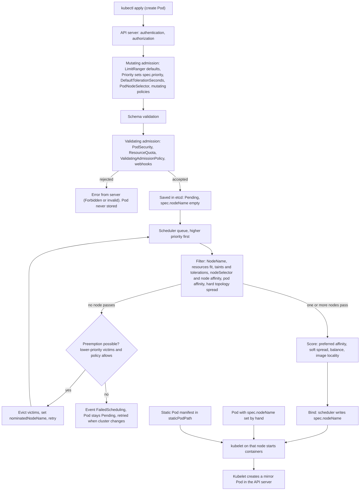

# T4.13 Configure Pod admission and scheduling (limits, node affinity, etc.)

> Competency: "Configure Pod admission and scheduling (limits, node affinity, etc.)" (CKA-3.5) | Domain/weight: CKA, Workloads and Scheduling (15%) | Est. time: 4 h | Prerequisites: T3.06, T4.12, T3.16

Shell setup (from [conventions](../00-conventions.md); put it at the top of every session):

```bash
alias k=kubectl
export do="--dry-run=client -o yaml"
export now="--force --grace-period=0"
source <(kubectl completion bash); complete -o default -F __start_kubectl k
```

Lab environment: **kind** (1 control plane + 2 workers, cluster `lab`, context `kind-lab`, created with `env/kind-up.sh`) for everything except the node-level parts (static Pods and the `kube-apiserver.yaml` admission plugin flag). Those parts are written for the **vms** environment (`cp1`, `w1`, `w2`, reached with `ssh <node>` and `sudo -i`). Every node-level command in this lesson also works on a kind node: replace `ssh w1` + `sudo -i` with `docker exec -it lab-worker bash`. On kind the node names are `lab-control-plane`, `lab-worker` and `lab-worker2`; on the VMs they are `cp1`, `w1` and `w2`. Where the lesson says "worker 1" and "worker 2" it means `lab-worker`/`w1` and `lab-worker2`/`w2`.

Output labels used below:

- `REAL OUTPUT (kind v0.33.0, v1.37.0)` was captured on a 3-node kind cluster running `kindest/node:v1.37.0` (kubectl client v1.37.1). The cluster was named `k-t413`, so node names in the captures read `k-t413-worker` where your cluster shows `lab-worker`. It used kind's default CNI (kindnet), not Calico. That does not change anything here. Pod name suffixes (random) will differ in your run.
- `REAL OUTPUT (kind v0.33.0, v1.37.0; node shell via docker exec, not a kubeadm VM)` marks the node-level captures (static Pods, `kube-apiserver.yaml`). kind nodes are Docker containers that run a real kubelet under systemd, so the files, the kubelet behaviour and the log text are real, but this is not an `ssh` session on a VM.
- `EXPECTED OUTPUT (not captured)` marks anything written from the documentation and never run. Each one is listed in section 11.

Namespace for the examples: `lab-t413`. Create it once with `k create ns lab-t413; k config set-context --current --namespace=lab-t413`. Node labels, node taints and PriorityClasses are cluster-wide and are NOT removed when you delete the namespace, so each example ends with its own undo commands.

---

## 1. Why this matters

When a Pod does not run, only two things can be wrong before it starts: the API server refused it (an **admission** problem, shown as `Error from server (Forbidden)` or `Invalid`), or no node accepted it (a **scheduling** problem, shown as `Pending` plus a `FailedScheduling` event). Almost every "my Pod is stuck" task in the CKA is one of these, and the fix is one label, one taint, one toleration, one number or one policy.

In real clusters the same rules decide where workloads land. Without them, a noisy batch job lands on your database node, all replicas sit on one host, a critical Pod waits behind unimportant ones, or a namespace uses the whole cluster. In the exam you must read the event text fast, name the cause and fix it in a few minutes, so this lesson trains you to read `0/3 nodes are available: ...` the way you read a stack trace.

---

## 2. Concepts

### 2.1 Two gates: admission first, then scheduling

A Pod passes two gates before a container starts. They are different programs with different jobs, and the error you see tells you which one stopped you.

| Gate | Who runs it | Question it answers | What you see when it says no |
|---|---|---|---|
| **Admission** | `kube-apiserver` (plugins and policies) | "May this object exist at all? Should it be changed first?" | `Error from server (Forbidden): ...` or `... is invalid ...`. The Pod is never stored. |
| **Scheduling** | `kube-scheduler` | "Which node should run this stored Pod?" | The Pod is stored, with `STATUS Pending`, `NODE <none>` and a `FailedScheduling` event. |
| Node admission and start | `kubelet` | "Can this node really run it?" | `ContainerCreating`, `ImagePullBackOff`, `CrashLoopBackOff`, ... (see T4.12 and the troubleshooting lessons) |

The most useful single rule in this lesson: **Forbidden means admission, Pending means scheduling.**

The order of work on a create request is: authentication, authorization (RBAC, see [T3.16](../part3-ckad/T3.16-understand-authentication-authorization-and-admission-control.md)), **mutating admission** (plugins that change the object), schema validation, **validating admission** (plugins and policies that accept or refuse), save to etcd. Only then does the scheduler see the Pod. So any admission rule is applied **before** scheduling, and a Pod that admission refused never reaches the scheduler at all.

Which rule lives where:

| Setting | Where you write it | Enforced by | Checked when |
|---|---|---|---|
| `nodeName` | Pod spec | nobody (it replaces the scheduler) | at creation, by the kubelet of that node |
| `nodeSelector`, `affinity`, `tolerations`, `topologySpreadConstraints` | Pod spec | scheduler | at scheduling time only |
| Resource `requests` | container spec | scheduler (fit) and kubelet (cgroups) | scheduling, then run time |
| Resource `limits` | container spec | kubelet and the kernel (cgroups) | run time (CPU throttled, memory OOM-killed) |
| `priorityClassName` | Pod spec | `Priority` admission plugin turns the name into a number; scheduler uses the number | admission, then scheduling |
| LimitRange, ResourceQuota | namespace objects | admission plugins `LimitRanger`, `ResourceQuota` | admission |
| Pod Security Admission labels | namespace labels | admission plugin `PodSecurity` | admission |
| ValidatingAdmissionPolicy | cluster objects | admission (built into the API server) | admission |
| Static Pod manifest | file on a node | the kubelet of that node | the kubelet watches the folder |

### 2.2 Node labels and well-known labels

A **label** is a key/value pair on an object. Node labels are what almost every scheduling rule matches against. The kubelet and the cloud provider set some labels for you. You add the rest with `kubectl label`.

```bash
k get nodes --show-labels                 # every label of every node, in one long line
k get nodes -L disk,topology.kubernetes.io/zone   # show chosen labels as columns (-L = --label-columns)
k get nodes -l disk=ssd                   # filter nodes by a label selector
k label node lab-worker disk=ssd          # add a label
k label node lab-worker disk=nvme --overwrite   # change an existing value (without --overwrite this fails)
k label node lab-worker disk-             # remove the label (trailing minus)
```

REAL OUTPUT (kind v0.33.0, v1.37.0):

```text
$ k get nodes --show-labels
NAME                   STATUS   ROLES           AGE   VERSION   LABELS
k-t413-control-plane   Ready    control-plane   23s   v1.37.0   beta.kubernetes.io/arch=arm64,beta.kubernetes.io/os=linux,kubernetes.io/arch=arm64,kubernetes.io/hostname=k-t413-control-plane,kubernetes.io/os=linux,node-role.kubernetes.io/control-plane=,node.kubernetes.io/exclude-from-external-load-balancers=
k-t413-worker          Ready    <none>          13s   v1.37.0   beta.kubernetes.io/arch=arm64,beta.kubernetes.io/os=linux,kubernetes.io/arch=arm64,kubernetes.io/hostname=k-t413-worker,kubernetes.io/os=linux
k-t413-worker2         Ready    <none>          13s   v1.37.0   beta.kubernetes.io/arch=arm64,beta.kubernetes.io/os=linux,kubernetes.io/arch=arm64,kubernetes.io/hostname=k-t413-worker2,kubernetes.io/os=linux
$ k label node k-t413-worker disk=ssd
node/k-t413-worker labeled
$ k get nodes -L disk
NAME                   STATUS   ROLES           AGE   VERSION   DISK
k-t413-control-plane   Ready    control-plane   47s   v1.37.0   
k-t413-worker          Ready    <none>          37s   v1.37.0   ssd
k-t413-worker2         Ready    <none>          37s   v1.37.0   
```

Labels you can rely on (the first four were present on every kind node above; the zone and region labels appear only where a cloud provider or you set them):

| Label | Value | Use it for |
|---|---|---|
| `kubernetes.io/hostname` | the node name (one value per node) | pin to one node; "one per node" topology key |
| `kubernetes.io/os`, `kubernetes.io/arch` | `linux`, `amd64`/`arm64` | mixed Windows/Linux or multi-architecture clusters |
| `node-role.kubernetes.io/control-plane` | empty string `""` | recognise control-plane nodes. The `ROLES` column of `k get nodes` is just this label's suffix |
| `topology.kubernetes.io/zone` | for example `eu-west-1a` | spread or pin by availability zone (set by cloud providers; on kind and kubeadm VMs it does not exist until you set it) |
| `topology.kubernetes.io/region` | for example `eu-west-1` | spread or pin by region (same remark) |
| `node.kubernetes.io/instance-type` | for example `m5.large` | cloud only |

A label with an empty value (`node-role.kubernetes.io/control-plane=`) is still a label. Match it with the operator `Exists`, not with `In [""]`. `beta.kubernetes.io/*` labels are old deprecated duplicates; use the `kubernetes.io/*` ones.

**Under the hood.** Labels live in the Node object (`metadata.labels`). `kubectl label` is a patch to that object. The scheduler reads node labels from its cache. Changing a label never moves a running Pod (see 2.4).

**Related but different.** The `NodeRestriction` admission plugin stops a kubelet from setting labels under the `node-restriction.kubernetes.io/` prefix on its own Node, so labels in that prefix can be trusted for isolation. You, as admin, can still set them.

### 2.3 nodeName and nodeSelector

**nodeSelector** is the simplest rule: a map of labels that a node must have. All pairs must match (logical AND). It is checked by the scheduler.

```yaml
spec:
  nodeSelector:
    disk: ssd               # the node must carry the label disk=ssd
```

A Pod whose selector matches no node stays `Pending`. REAL OUTPUT (kind v0.33.0, v1.37.0), Pod `sel` with `nodeSelector: {disk: ssd}` and no node labelled yet:

```text
$ k run sel --image=nginx:1.27 --overrides='{"spec":{"nodeSelector":{"disk":"ssd"}}}'
pod/sel created
$ k get pod sel
NAME   READY   STATUS    RESTARTS   AGE
sel    0/1     Pending   0          4s
$ k describe pod sel | grep -A5 Events
Events:
  Type     Reason            Age   From               Message
  ----     ------            ----  ----               -------
  Warning  FailedScheduling  4s    default-scheduler  0/3 nodes are available: 1 node(s) had untolerated taint(s), 2 node(s) didn't match Pod's node affinity/selector. preemption: 0/3 nodes are available: 3 Preemption is not helpful for scheduling.
$ k label node k-t413-worker disk=ssd
node/k-t413-worker labeled
$ k get pod sel -o wide
NAME   READY   STATUS              RESTARTS   AGE   IP       NODE            NOMINATED NODE   READINESS GATES
sel    0/1     ContainerCreating   0          9s    <none>   k-t413-worker   <none>           <none>
```

Read it: the scheduler tried all 3 nodes. The control plane failed on its taint, the two workers on the selector. As soon as the label appeared the scheduler (which watches nodes) retried and placed the Pod. You do not need to recreate the Pod.

**nodeName** is not a rule for the scheduler. It is a field that means "this Pod is already scheduled to that node". Normally the scheduler fills it in by sending a **binding** to the API server. If you set it yourself, the scheduler skips the Pod and the kubelet of that node starts it.

| | `nodeSelector` | `nodeName` |
|---|---|---|
| Who acts | scheduler picks among matching nodes | nobody picks; the named node's kubelet runs it |
| Taints (`NoSchedule`) | respected | **ignored** (the scheduler is not involved) |
| Node does not exist | Pending with a `FailedScheduling` event | Pending forever, with no event at all |
| Use | normal practice | debugging, static-like pinning; avoid in manifests |

REAL OUTPUT (kind v0.33.0, v1.37.0), a Pod with `nodeName: k-t413-control-plane` (a node with a `NoSchedule` taint), and one with a node name that does not exist:

```text
$ k get pod byname -o wide
NAME     READY   STATUS              RESTARTS   AGE   IP       NODE                   NOMINATED NODE   READINESS GATES
byname   0/1     ContainerCreating   0          6s    <none>   k-t413-control-plane   <none>           <none>
$ k get events --field-selector involvedObject.name=byname -o custom-columns=REASON:.reason,FROM:.source.component,MSG:.message
REASON    FROM      MSG
Pulling   kubelet   Pulling image "nginx:1.27"
$ k run ghost --image=nginx:1.27 --overrides='{"spec":{"nodeName":"nope"}}'
$ k describe pod ghost | grep -A4 -E 'Node:|Events'
Node:             nope/
...
Events:                      <none>
```

Notice: no `Scheduled` event for `byname` (the first event is from the kubelet, not from `default-scheduler`), and the Pod ran on the tainted control plane. `ghost` shows `Node: nope/` and an empty event list: no component will ever react to it. If a Pod is Pending with no events, check `spec.nodeName` and `spec.schedulerName` (2.11).

### 2.4 Node affinity

**Node affinity** is a more expressive `nodeSelector`. It adds operators, OR logic between alternatives, and soft preferences. It lives under `spec.affinity.nodeAffinity`. There are two kinds:

| Kind | Meaning | If no node matches |
|---|---|---|
| `requiredDuringSchedulingIgnoredDuringExecution` | **hard** rule: only nodes that match are candidates | Pod stays `Pending` |
| `preferredDuringSchedulingIgnoredDuringExecution` | **soft** rule: matching nodes score higher | Pod still runs, on any other node |

Read the long names in two halves. `DuringScheduling` says when the rule is checked: only while the scheduler picks a node. `IgnoredDuringExecution` says what happens later: if the node's labels change after the Pod runs, the Pod is **not** evicted. (A "RequiredDuringExecution" variant is not part of the API.)

**Required form.** One list of `nodeSelectorTerms`. The terms are **ORed**. Inside one term, the `matchExpressions` are **ANDed**.

```yaml
spec:
  affinity:
    nodeAffinity:
      requiredDuringSchedulingIgnoredDuringExecution:
        nodeSelectorTerms:                  # OR between terms
          - matchExpressions:               # AND between expressions of one term
              - key: disk
                operator: In
                values: ["ssd", "nvme"]
              - key: kubernetes.io/os
                operator: In
                values: ["linux"]
          - matchExpressions:               # alternative term: also accept a node labelled tier=fast
              - key: tier
                operator: Exists
```

**Preferred form.** A list of terms, each with a `weight` (1 to 100) and a `preference` (one term). The scheduler adds the weight of every satisfied term to the node's score.

```yaml
      preferredDuringSchedulingIgnoredDuringExecution:
        - weight: 80                        # 1..100; higher = stronger wish
          preference:
            matchExpressions:
              - key: topology.kubernetes.io/zone
                operator: In
                values: ["zone-a"]
```

**Operators.**

| Operator | Matches a node when | `values` rule | Example |
|---|---|---|---|
| `In` | the label exists and its value is in the list | one or more | `disk In [ssd, nvme]` |
| `NotIn` | the label is absent, or its value is not in the list | one or more | `kubernetes.io/hostname NotIn [w2]` |
| `Exists` | the label key exists (any value, even empty) | must be empty | `disk Exists` |
| `DoesNotExist` | the label key is absent | must be empty | `gpu-broken DoesNotExist` |
| `Gt` | the label value, read as an integer, is greater than the given number | exactly one integer, as a string | `cores Gt ["8"]` |
| `Lt` | the label value, read as an integer, is less than the given number | exactly one integer, as a string | `cores Lt ["8"]` |

Two invalid values the API server rejects at admission (so you see the error at once, not a Pending Pod). REAL OUTPUT (kind v0.33.0, v1.37.0):

```text
$ k apply -f gtbad.yaml            # operator: Gt, values: ["8","9"]
The Pod "gtbad" is invalid: spec.affinity.nodeAffinity.requiredDuringSchedulingIgnoredDuringExecution.nodeSelectorTerms[0].matchExpressions[0].values: Required value: must be specified single value when `operator` is 'Lt' or 'Gt'
$ k apply -f exbad.yaml            # operator: Exists, values: ["ssd"]
The Pod "exbad" is invalid: spec.affinity.nodeAffinity.requiredDuringSchedulingIgnoredDuringExecution.nodeSelectorTerms[0].matchExpressions[0].values: Forbidden: may not be specified when `operator` is 'Exists' or 'DoesNotExist'
```

Quoted numbers matter: write `values: ["8"]`, not `values: [8]`. Labels are strings.

A term can also use `matchFields` (match on a node field, for example `metadata.name`) instead of `matchExpressions`. It is rarely needed; `kubernetes.io/hostname` does the same through a label.

**Run it.** Labels `cores=16` on worker 1 and `cores=4` on worker 2, `disk=ssd` on worker 1. This Pod needs `cores Gt 8`, a `disk` label, no `gpu-broken` label, and a hostname that is not worker 2 (it tolerates the `dedicated` taint that was on worker 1 at the time). REAL OUTPUT (kind v0.33.0, v1.37.0):

```text
$ k get pod ops -o wide --no-headers
ops   1/1   Running   0     5s    10.244.1.18   k-t413-worker   <none>   <none>
```

And a Pod with two ORed required terms (`disk In [ssd]`, or `cores Lt [8]`) plus a preferred term `cores Lt [8]` weight 80 ran on worker 2, which matches the second term and the preference:

```text
$ k get pod orterms -o wide --no-headers
orterms   1/1   Running   0     6s    10.244.2.5   k-t413-worker2   <none>   <none>
```

**nodeSelector and nodeAffinity together.** If a Pod has both, a node must satisfy both. Use one or the other to keep manifests readable.

**IgnoredDuringExecution, shown.** After scheduling, the label is removed from a node. REAL OUTPUT (kind v0.33.0, v1.37.0), Deployment `train` (5 replicas, required `disk In [ssd]`), then `k label node k-t413-worker2 disk-`:

```text
$ k get pods -l app=train -o wide --no-headers | awk '{print $7}' | sort | uniq -c    # before
   3 k-t413-worker
   2 k-t413-worker2
$ k label node k-t413-worker2 disk-
node/k-t413-worker2 unlabeled
$ k get pods -l app=train -o wide --no-headers | awk '{print $7}' | sort | uniq -c    # 3 s later
   3 k-t413-worker
   2 k-t413-worker2
```

The two Pods stay on a node that no longer matches. The rule is applied again only for **new** Pods.

### 2.5 Pod affinity and anti-affinity, with topologyKey

**Pod affinity** says "place me near Pods that match a label selector". **Pod anti-affinity** says "place me away from them". "Near" and "away" are measured by a **topology domain**: a group of nodes that share the same value of a node label, named by `topologyKey`.

| `topologyKey` | A domain is | Meaning of "near" |
|---|---|---|
| `kubernetes.io/hostname` | one node (every node has a unique value) | same node |
| `topology.kubernetes.io/zone` | all nodes of one zone | same zone |
| any label you set, for example `rack` | all nodes with the same `rack` value | same rack |

A node that lacks the `topologyKey` label belongs to no domain, so the rule can never be satisfied there.

Fields of one **term** (type `PodAffinityTerm`; see `k explain pod.spec.affinity.podAffinity.requiredDuringSchedulingIgnoredDuringExecution`):

| Field | Meaning | Default / note |
|---|---|---|
| `topologyKey` | node label that defines a domain | required |
| `labelSelector` | which existing Pods count (`matchLabels` and/or `matchExpressions`) | if empty, every Pod in the considered namespaces matches |
| `namespaces` | list of namespaces to look in | default: the Pod's own namespace |
| `namespaceSelector` | pick namespaces by label (`{}` means all namespaces) | not set: only own namespace |
| `matchLabelKeys`, `mismatchLabelKeys` | label **keys** whose values are taken from the incoming Pod and added to the selector (match or not-match) | optional; used with rollouts, for example `pod-template-hash` |

The required form is a list of terms. The preferred form wraps each term in `podAffinityTerm` and adds a `weight`:

```yaml
spec:
  affinity:
    podAffinity:                                   # attract
      requiredDuringSchedulingIgnoredDuringExecution:
        - topologyKey: kubernetes.io/hostname
          labelSelector:
            matchLabels:
              app: cache
    podAntiAffinity:                               # repel
      preferredDuringSchedulingIgnoredDuringExecution:
        - weight: 100
          podAffinityTerm:
            topologyKey: kubernetes.io/hostname
            labelSelector:
              matchLabels:
                app: web
```

**Run it.** A Pod `cache` (label `app=cache`) is pinned to worker 2. A Deployment `web` (3 replicas) has required `podAffinity` to `app=cache` with `topologyKey: kubernetes.io/hostname`. A Deployment `away` (2 replicas) has required `podAntiAffinity` to `app=cache`. REAL OUTPUT (kind v0.33.0, v1.37.0), at that moment worker 1 carried a `NoSchedule` taint that `away` tolerated:

```text
$ k get pods -o wide --no-headers | awk '{print $1,$7}'       # web (affinity) + cache
cache k-t413-worker2
web-58dc899b5d-hdgv9 k-t413-worker2
web-58dc899b5d-q7b7m k-t413-worker2
web-58dc899b5d-tgq5t k-t413-worker2
$ k get pods -l app=away -o wide --no-headers | awk '{print $1,$7}'   # anti-affinity
away-7bcffbffd8-4qqxm k-t413-worker
away-7bcffbffd8-b98q5 k-t413-worker
```

All three `web` Pods follow `cache` to worker 2. Both `away` Pods avoid worker 2 and share worker 1: anti-affinity only forbids the domain of the matching Pod, it does not spread `away` Pods from each other (to spread them, make `away` anti-affine to its own label, or use topology spread, 2.7).

An affinity target that nothing satisfies leaves the Pod Pending. REAL OUTPUT (kind v0.33.0, v1.37.0), Pod `lonely` with required `podAffinity` to `app=nothing`:

```text
Events:
  Type     Reason            Age   From               Message
  ----     ------            ----  ----               -------
  Warning  FailedScheduling  4s    default-scheduler  0/3 nodes are available: 1 node(s) didn't match pod affinity rules, 2 node(s) had untolerated taint(s). preemption: 0/3 nodes are available: 3 Preemption is not helpful for scheduling.
```

The wording differs from node affinity: `pod affinity rules` (lower-case `pod`) for Pod affinity, `Pod's node affinity/selector` for nodes. For anti-affinity the text is `didn't match pod anti-affinity rules` (captured in [T4.12](../part4-cka/T4.12-primitives-for-robust-self-healing-application.md), section 2.6).

Cost warning from the docs: inter-Pod affinity makes scheduling slower on very large clusters, and the docs advise against it in clusters with several hundred nodes. For plain "spread my replicas", topology spread is cheaper and clearer.

### 2.6 Taints and tolerations

A **taint** on a node repels Pods. A **toleration** on a Pod lets it ignore a matching taint. Think "node says keep out; Pod shows a pass". Affinity is the opposite tool: it **attracts**. Taints are how you reserve nodes (GPU nodes, control plane) and how Kubernetes marks sick nodes.

A taint has a key, an optional value and an effect: `key=value:effect`.

| Effect | New Pods without a toleration | Pods already running without a toleration |
|---|---|---|
| `NoSchedule` | not scheduled here | stay |
| `PreferNoSchedule` | avoided if possible (soft); may still land here | stay |
| `NoExecute` | not scheduled here | **evicted** (immediately, or after `tolerationSeconds`) |

Commands:

```bash
k taint node lab-worker2 dedicated=gpu:NoSchedule     # add
k taint node lab-worker2 dedicated=gpu:NoSchedule-    # remove this exact taint (value and effect named)
k taint node lab-worker2 dedicated:NoSchedule-        # remove by key and effect
k taint node lab-worker2 dedicated-                   # remove every taint with this key (all effects)
k describe node lab-worker2 | grep -i taints          # read taints of one node
k get nodes -o custom-columns='NAME:.metadata.name,TAINTS:.spec.taints[*].key'   # all nodes
```

REAL OUTPUT (kind v0.33.0, v1.37.0):

```text
$ k taint node k-t413-worker dedicated=gpu:NoSchedule
node/k-t413-worker tainted
$ k describe node k-t413-worker | grep -i taints
Taints:             dedicated=gpu:NoSchedule
$ k get nodes -o custom-columns='NAME:.metadata.name,DISK:.metadata.labels.disk,TAINTS:.spec.taints[*].key'
NAME                   DISK     TAINTS
k-t413-control-plane   <none>   node-role.kubernetes.io/control-plane
k-t413-worker          ssd      dedicated
k-t413-worker2         ssd      <none>
$ k taint node k-t413-worker2 dedicated-          # nothing to remove on this node
error: taint "dedicated" not found
```

A Pod with no toleration cannot run on a node whose taints it does not tolerate. REAL OUTPUT (kind v0.33.0, v1.37.0), both workers tainted `dedicated=gpu:NoSchedule`, plain Pod `plain`:

```text
Events:
  Type     Reason            Age   From               Message
  ----     ------            ----  ----               -------
  Warning  FailedScheduling  5s    default-scheduler  0/3 nodes are available: 3 node(s) had untolerated taint(s). preemption: 0/3 nodes are available: 3 Preemption is not helpful for scheduling.
```

**Tolerations.** Fields of one toleration (see `k explain pod.spec.tolerations`): `key`, `operator`, `value`, `effect`, `tolerationSeconds`.

| Field / combination | Meaning |
|---|---|
| `operator: Equal` (the default when omitted) | key, value and effect must all equal the taint's |
| `operator: Exists` | only the key (and effect, if given) must match; `value` must be empty |
| `key` omitted with `operator: Exists` | tolerates **every** taint (risky; this is how DaemonSets such as CNI agents run everywhere) |
| `effect` omitted | matches all effects for that key |
| `tolerationSeconds: N` | only meaningful for `NoExecute`: the Pod may stay N seconds after the taint appears, then is evicted. Omitted = stays forever |

```yaml
tolerations:
  - key: dedicated
    operator: Equal        # same as leaving operator out
    value: gpu
    effect: NoSchedule
  - key: maint
    operator: Exists       # any value of the key "maint"
    effect: NoExecute
    tolerationSeconds: 30  # leave 30 s after the taint is set
```

**A toleration allows, it does not attract.** REAL OUTPUT (kind v0.33.0, v1.37.0), worker 1 tainted `dedicated=gpu:NoSchedule` and labelled `dedicated=gpu`, worker 2 untainted. Deployment `tol-only`, 6 replicas, only the toleration:

```text
$ k get pods -l app=tol-only -o wide --no-headers | awk '{print $7}' | sort | uniq -c
   3 k-t413-worker
   3 k-t413-worker2
```

Half of the Pods landed on the untainted worker. To force them onto the tainted node you need both a toleration (permission) and an affinity or selector (direction). Same Deployment plus `nodeAffinity` required `dedicated In [gpu]` (as the Deployment `gpu-app`):

```text
$ k get pods -l app=gpu-app -o wide --no-headers | awk '{print $7}' | sort | uniq -c
   6 k-t413-worker
```

And the reverse: a node reserved for a team needs a taint (keeps others out) **and** a label (so the team's Pods go there). That pair is the standard pattern.

**PreferNoSchedule** is a soft taint. REAL OUTPUT (kind v0.33.0, v1.37.0): with both workers tainted `soft=yes:PreferNoSchedule`, a Pod with no toleration for it still started (on worker 1, `Running`). The scheduler only scores such nodes lower.

**NoExecute and tolerationSeconds, shown.** Three bare Pods were pinned to worker 2 with `nodeName`: `notol` (no toleration), `tol30` (toleration `maint=true:NoExecute`, `tolerationSeconds: 30`) and, in an earlier run, `tolforever` (toleration `maint:Exists:NoExecute`, no seconds). Then `k taint node k-t413-worker2 maint=true:NoExecute`. REAL OUTPUT (kind v0.33.0, v1.37.0):

```text
$ k get events --sort-by=.lastTimestamp -o custom-columns=AGE:.lastTimestamp,REASON:.reason,OBJ:.involvedObject.name,MSG:.message | grep -E 'Taint|Killing'
2026-10-28T06:16:38Z   TaintManagerEviction   notol   Marking for deletion Pod lab-t413/notol
2026-10-28T06:16:39Z   Killing                notol   Stopping container web
2026-10-28T06:17:08Z   TaintManagerEviction   tol30   Marking for deletion Pod lab-t413/tol30
2026-10-28T06:17:08Z   Killing                tol30   Stopping container web
```

`notol` was evicted at once, `tol30` exactly 30 s later, and `tolforever` was still `Running` after both. Bare Pods are not recreated; a Deployment would get replacements on other nodes. The node lifecycle controller adds `node.kubernetes.io/not-ready` and `node.kubernetes.io/unreachable` taints the same way, and the `DefaultTolerationSeconds` plugin gives every Pod a 300 s toleration for both. That story, with captured timings, is in [T4.12](../part4-cka/T4.12-primitives-for-robust-self-healing-application.md), section 2.8.

**Built-in taints you will see.** `node-role.kubernetes.io/control-plane:NoSchedule` (kubeadm and kind put it on control-plane nodes; the captured control-plane node above has it), `node.kubernetes.io/not-ready`, `node.kubernetes.io/unreachable`, `node.kubernetes.io/memory-pressure`, `disk-pressure`, `pid-pressure`, `network-unavailable`, and `node.kubernetes.io/unschedulable` (added by `kubectl cordon`, which also sets `spec.unschedulable`). `not-ready` and `unreachable` are set with both `NoSchedule` and `NoExecute`; the pressure taints and `network-unavailable` use `NoSchedule`.

### 2.7 topologySpreadConstraints

Affinity answers "near or away from some Pods". **Topology spread** answers "keep my replicas evenly distributed over domains". For each domain it counts the Pods that match the selector. The **skew** is `(Pods in this domain) - (Pods in the domain with the fewest)`. A constraint says: placing this Pod must not make any skew larger than `maxSkew`.

The field table is the same as in [T4.12](../part4-cka/T4.12-primitives-for-robust-self-healing-application.md) section 2.6; here is the exam-ready summary with the defaults and risky values:

| Field | Meaning | Default / risky value |
|---|---|---|
| `maxSkew` | largest allowed difference between fullest and emptiest domain | required, integer > 0. `0` is invalid |
| `topologyKey` | node label that defines domains | required. Nodes without it are not counted at all |
| `whenUnsatisfiable` | `DoNotSchedule` = hard (Pod Pending); `ScheduleAnyway` = soft (scheduler only prefers a balanced node) | required |
| `labelSelector` | which Pods are counted | if it matches nothing (a typo), the constraint does nothing |
| `minDomains` | minimum number of domains; fewer domains makes the "emptiest" count as 0 | only with `DoNotSchedule` (the API server enforces it) |
| `nodeAffinityPolicy` | `Honor` = only nodes matching the Pod's nodeSelector/affinity count as domains; `Ignore` = all nodes | nil behaves as `Honor` |
| `nodeTaintsPolicy` | `Honor` = nodes with taints the Pod does not tolerate are not counted; `Ignore` = all nodes counted | nil behaves as **`Ignore`** (confirmed by `k explain`) |
| `matchLabelKeys` | label keys copied from the incoming Pod into the selector (for example `pod-template-hash`, so old and new ReplicaSets are counted apart) | optional |

**Run it: 6 replicas on 3 nodes.** The control plane is a node too, but it is tainted. With `nodeTaintsPolicy: Honor` and a toleration for the control-plane taint, all three nodes are used. REAL OUTPUT (kind v0.33.0, v1.37.0), Deployment `spread3` (6 replicas, `maxSkew: 1`, `topologyKey: kubernetes.io/hostname`, `DoNotSchedule`, tolerations for `dedicated=gpu:NoSchedule` and for `node-role.kubernetes.io/control-plane:NoSchedule`):

```text
$ k get pods -l app=spread3 -o wide --no-headers | awk '{print $7}' | sort | uniq -c
   2 k-t413-control-plane
   2 k-t413-worker
   2 k-t413-worker2
$ k scale deploy spread3 --replicas=8
$ k get pods -l app=spread3 -o wide --no-headers | awk '{print $7}' | sort | uniq -c
   2 k-t413-control-plane
   3 k-t413-worker
   3 k-t413-worker2
```

Without the control-plane toleration (Deployment `spread2`, same constraint with `Honor`), the control plane is not counted and 6 Pods split 3 and 3 over the two workers:

```text
   3 k-t413-worker
   3 k-t413-worker2
```

**The trap (default `Ignore`).** Same 6 replicas, same constraint, but no `nodeTaintsPolicy` and no control-plane toleration (Deployment `ign`). The tainted control plane still counts as a domain with 0 Pods, so with `maxSkew: 1` no worker may hold more than 1 Pod. REAL OUTPUT (kind v0.33.0, v1.37.0):

```text
$ k get pods -l app=ign -o wide --no-headers | awk '{print $3,$7}' | sort | uniq -c
   4 Pending <none>
   1 Running k-t413-worker
   1 Running k-t413-worker2
```

The `FailedScheduling` text for this case (captured in T4.12) contains `node(s) didn't match pod topology spread constraints`. Fixes: add `nodeTaintsPolicy: Honor`, raise `maxSkew`, or use `ScheduleAnyway`.

**Spread is evaluated only at scheduling time.** Like affinity, it never moves running Pods. After node maintenance, `k rollout restart deploy/<name>` makes new Pods obey the rule again.

**Cluster defaults.** The scheduler applies built-in soft spreading by hostname and zone to Pods that set no constraints of their own (documented default constraints; not verified here, see section 11). Your own `topologySpreadConstraints` replace those defaults for that Pod.

### 2.8 Resource requests in scheduling; LimitRange and ResourceQuota as admission

Full background is in [T3.05](../part3-ckad/T3.05-define-resource-requirements.md) and [T3.06](../part3-ckad/T3.06-requests-limits-and-quotas-resourcequota-and.md). What matters for scheduling:

- The scheduler's resource filter (`NodeResourcesFit`) adds up the **requests** of the Pods already assigned to a node and checks that the new Pod's requests fit in the node's **allocatable** (capacity minus what the system reserves). It never looks at real usage and never at limits.
- A Pod without requests counts as 0 and fits anywhere. That is how a node gets overcommitted.
- `k describe node <name>` has an `Allocated resources` table: what the scheduler believes is used.

A request bigger than any node can give is stuck forever. REAL OUTPUT (kind v0.33.0, v1.37.0), a Pod requesting `cpu: 100`, `memory: 1Ti`:

```text
Events:
  Type     Reason            Age   From               Message
  ----     ------            ----  ----               -------
  Warning  FailedScheduling  4s    default-scheduler  0/3 nodes are available: 1 node(s) had untolerated taint(s), 2 Insufficient cpu, 2 Insufficient memory. preemption: 0/3 nodes are available: 3 Preemption is not helpful for scheduling.
```

Note `2 Insufficient cpu, 2 Insufficient memory` for two workers: one node can be reported under several resource reasons, so the numbers in the message may add to more than the node count. The fix is to lower the request (`k set resources deploy/report --requests=cpu=200m,memory=64Mi`) or add capacity.

**LimitRange and ResourceQuota are admission, not scheduling.** They are checked by the plugins `LimitRanger` and `ResourceQuota` when the Pod is created, so a violation is `Forbidden` and the Pod never exists. A `LimitRange` can also **mutate** the Pod by adding default requests and limits. REAL OUTPUT (kind v0.33.0, v1.37.0), namespace with a LimitRange (`max cpu 500m`, default request `100m`/`64Mi`, default limit `200m`/`128Mi`) and a ResourceQuota (`pods: 2`, `requests.cpu: 250m`):

```text
$ k -n lab-t413-q run big --image=nginx:1.27 --overrides='{"spec":{"containers":[{"name":"big","image":"nginx:1.27","resources":{"limits":{"cpu":"1"}}}]}}'
Error from server (Forbidden): pods "big" is forbidden: maximum cpu usage per Container is 500m, but limit is 1
$ k -n lab-t413-q run a --image=nginx:1.27 ; k -n lab-t413-q run b --image=nginx:1.27
pod/a created
pod/b created
$ k -n lab-t413-q run c --image=nginx:1.27
Error from server (Forbidden): pods "c" is forbidden: exceeded quota: rq, requested: pods=1,requests.cpu=100m, used: pods=2,requests.cpu=200m, limited: pods=2,requests.cpu=250m
$ k -n lab-t413-q get pod a -o jsonpath='{.spec.containers[0].resources}{"\n"}'
{"limits":{"cpu":"200m","memory":"128Mi"},"requests":{"cpu":"100m","memory":"64Mi"}}
$ k -n lab-t413-q delete pod b --now ; k -n lab-t413-q run d --image=nginx:1.27 --overrides='{"spec":{"containers":[{"name":"d","image":"nginx:1.27","resources":{"requests":{"cpu":"200m"}}}]}}'
Error from server (Forbidden): pods "d" is forbidden: exceeded quota: rq, requested: requests.cpu=200m, used: requests.cpu=100m, limited: requests.cpu=250m
```

The Pods `a` and `b` never specified resources; the LimitRange added them (so they counted `100m` each against the quota). The message names the quota (`rq`), what the Pod asks for (`requested`), what is already used and the hard limit (`limited`). Compare with the scheduler: `Insufficient cpu` is the **node** being full (Pending); `exceeded quota` is the **namespace** being full (Forbidden). Pods that exist but are rejected by a quota for a Deployment appear as ReplicaSet events, not as Pending Pods; read `k describe rs` in that case.

By the documentation, when a quota tracks `requests.cpu` or `requests.memory`, a Pod that sets no such request is rejected unless a LimitRange default fills it in (not run here; section 11).

### 2.9 PriorityClass and preemption

A **PriorityClass** is a cluster-wide object that maps a name to an integer priority. A Pod names one with `spec.priorityClassName`. The scheduler orders its waiting queue by priority (higher first) and, when a high-priority Pod does not fit, may **preempt**: evict lower-priority Pods from a node to make room.

| Field | Meaning | Default / risky value |
|---|---|---|
| `value` | the priority; higher wins | required. Users may set at most 1,000,000,000; above that is reserved for system classes (error below) |
| `globalDefault` | if `true`, Pods with no `priorityClassName` get this class | `false`. Only one class may be the global default. Existing Pods are not changed |
| `preemptionPolicy` | `PreemptLowerPriority` (may evict) or `Never` (queues ahead, never evicts) | `PreemptLowerPriority` |
| `description` | free text | none |

Imperative: `k create priorityclass high --value=100000` (short name `pc`). The command also has `--global-default`, `--description` and `--preemption-policy`. REAL OUTPUT (kind v0.33.0, v1.37.0):

```text
$ k get pc
NAME                      VALUE        GLOBAL-DEFAULT   AGE     PREEMPTIONPOLICY
system-cluster-critical   2000000000   false            7m32s   PreemptLowerPriority
system-node-critical      2000001000   false            7m32s   PreemptLowerPriority
$ k create pc high --value=100000 --dry-run=client -o yaml
apiVersion: scheduling.k8s.io/v1
kind: PriorityClass
metadata:
  name: high
preemptionPolicy: PreemptLowerPriority
value: 100000
$ k create pc toohigh --value=1000000001
error: failed to create priorityclass: PriorityClass.scheduling.k8s.io "toohigh" is invalid: value: Forbidden: maximum allowed value of a user defined priority is 1000000000
```

Use the priority in a Pod: `spec.priorityClassName: high`. The `Priority` admission plugin copies the number into `spec.priority`. An unknown name is an **admission** error, not a Pending Pod. REAL OUTPUT (kind v0.33.0, v1.37.0):

```text
Error from server (Forbidden): error when creating "STDIN": pods "high-pod2" is forbidden: no PriorityClass with name high-nopreempt was found
```

**Preemption, shown.** Worker 1 (allocatable CPU 12 on this machine) has the label `disk=ssd`. Two Pods select that label and each requests 60% of the CPU (7200m). `low-pod` (class `low`, value 100) runs. `high-pod` (class `high`, value 100000) cannot fit next to it. REAL OUTPUT (kind v0.33.0, v1.37.0):

```text
$ k get pods -o wide --no-headers | awk '{print $1,$2,$3,$7}'      # 1 s after creating high-pod
high-pod 0/1 ContainerCreating k-t413-worker
low-pod 0/1 Completed k-t413-worker
$ k get pods -o wide --no-headers | awk '{print $1,$2,$3,$7}'      # 8 s later
high-pod 1/1 Running k-t413-worker
$ k get events --sort-by=.lastTimestamp | grep -E 'Preempt'
9s   Normal    Preempted        pod/low-pod    Preempted by pod e120d82e-0eed-41a3-b00a-b28290d8d1ba on node k-t413-worker
9s   Warning   FailedScheduling pod/high-pod   0/3 nodes are available: 1 Insufficient cpu, 1 node(s) didn't match Pod's node affinity/selector, 1 node(s) had untolerated taint(s). preemption: found a potential placement for pod on node k-t413-worker, preempting 1 victims
```

(`Completed` is how the victim's nginx container looks after SIGTERM; the Pod is then deleted. The two `awk` outputs are from one run, a few seconds apart.) Read the `FailedScheduling` text: it is the normal first failure (`1 Insufficient cpu`) followed by the **preemption** clause: the scheduler found a node where removing one victim makes room. The victim is gracefully terminated, the node is recorded in the high Pod's `status.nominatedNodeName`, and the Pod is scheduled once the room exists.

With `preemptionPolicy: Never` (class `high-nopreempt`, same value) the high Pod waits. REAL OUTPUT (kind v0.33.0, v1.37.0):

```text
$ k get pods --no-headers | awk '{print $1,$2,$3}'
high-pod2 0/1 Pending
low-pod 1/1 Running
Events:
  Warning  FailedScheduling  5s  default-scheduler  0/3 nodes are available: 1 Insufficient cpu, 1 node(s) didn't match Pod's node affinity/selector, 1 node(s) had untolerated taint(s). preemption: not eligible due to preemptionPolicy=Never.
```

Preemption honours PodDisruptionBudgets only as a best effort, so a PDB is not a safe guard against it (see T4.12). Priority never affects Pods that are already running, except as victims for a higher Pod.

### 2.10 Static Pods

A **static Pod** is a Pod that one kubelet runs directly from a manifest file on its own node. There is no scheduler and no controller involved. kubeadm uses this to run the control plane: `etcd`, `kube-apiserver`, `kube-controller-manager` and `kube-scheduler` are static Pods. It solves the chicken-and-egg problem: you cannot ask the API server to schedule the API server.

How it works:

1. The kubelet reads `staticPodPath` from its config file and watches that folder. kubeadm sets `staticPodPath: /etc/kubernetes/manifests` in `/var/lib/kubelet/config.yaml`. (The kubelet command line has `--config=/var/lib/kubelet/config.yaml`.) The config file may also set `staticPodURL`, an HTTP address of a manifest.
2. For every valid Pod file, the kubelet creates the containers. It names the Pod `<metadata.name>-<nodeName>`.
3. So that you can see it, the kubelet creates a read-only **mirror Pod** in the API server. It has the annotations `kubernetes.io/config.source: file`, `kubernetes.io/config.mirror` and `kubernetes.io/config.hash`, and an `ownerReference` to the **Node** (not to a ReplicaSet).
4. If you edit the file, the kubelet recreates the Pod. If you delete or move the file, the Pod stops. No kubelet restart is needed.

REAL OUTPUT (kind v0.33.0, v1.37.0; node shell via docker exec, not a kubeadm VM). The files on the control plane, the setting on a worker and the kubelet command line:

```text
$ docker exec k-t413-control-plane ls /etc/kubernetes/manifests
etcd.yaml
kube-apiserver.yaml
kube-controller-manager.yaml
kube-scheduler.yaml
$ docker exec k-t413-worker ls -la /etc/kubernetes/manifests
total 0
drwxr-xr-x 1 root root  0 Aug 20 11:30 .
drwxr-xr-x 1 root root 30 Oct 28 06:11 ..
$ docker exec k-t413-worker grep -n staticPodPath /var/lib/kubelet/config.yaml
52:staticPodPath: /etc/kubernetes/manifests
$ docker exec k-t413-worker ps -o args= -C kubelet | tr ' ' '\n' | grep -E '^--(config|kubeconfig)'
--kubeconfig=/etc/kubernetes/kubelet.conf
--config=/var/lib/kubelet/config.yaml
```

On a VM the same facts come from `ssh w1`, `sudo -i`, `ls /etc/kubernetes/manifests`, `grep staticPodPath /var/lib/kubelet/config.yaml`, and `systemctl cat kubelet` (shows the `--config` flag; not captured, section 11).

Drop a manifest on worker 1. The manifest is in section 4. REAL OUTPUT (kind v0.33.0, v1.37.0; node shell via docker exec, not a kubeadm VM):

```text
$ k get pods -A -o wide | grep static
default   static-web-k-t413-worker   1/1   Running   0   12s   10.244.1.32   k-t413-worker   <none>   <none>
$ k get pod static-web-k-t413-worker -n default -o jsonpath='{.metadata.annotations}{"\n"}{.metadata.ownerReferences}{"\n"}'
{"kubernetes.io/config.hash":"49ab8dbe2d8823652483c57c507b3242","kubernetes.io/config.mirror":"49ab8dbe2d8823652483c57c507b3242","kubernetes.io/config.seen":"2026-10-28T06:21:21.333123859Z","kubernetes.io/config.source":"file"}
[{"apiVersion":"v1","controller":true,"kind":"Node","name":"k-t413-worker","uid":"9fba3141-e835-4cdf-ac16-73688fdf9780"}]
```

Facts to read from this: the namespace is `default` (a static Pod has no namespace unless the manifest sets `metadata.namespace`, and that namespace must exist); the name is `static-web` + `-` + node name; the owner is a Node.

**You cannot remove a static Pod with kubectl.** Deleting the mirror Pod only removes the API object; the kubelet makes a new mirror. REAL OUTPUT (kind v0.33.0, v1.37.0; node shell via docker exec, not a kubeadm VM):

```text
$ k -n default delete pod static-web-k-t413-worker --now
pod "static-web-k-t413-worker" deleted from default namespace
$ k -n default get pod static-web-k-t413-worker          # 8 s later
NAME                       READY   STATUS    RESTARTS   AGE
static-web-k-t413-worker   0/1     Pending   0          8s
```

(The Pod was re-created within seconds and reached `Running` again; the first status of the new mirror is Pending.) To remove it, delete the file: `rm /etc/kubernetes/manifests/static-web.yaml` on that node. Seconds later `k get pod` returns `NotFound`.

**A broken manifest fails silently in kubectl.** If the YAML does not parse, the Pod does not appear and `kubectl` shows nothing. The error is only in the kubelet log: `journalctl -u kubelet`. REAL OUTPUT (kind v0.33.0, v1.37.0; node shell via docker exec, not a kubeadm VM), file with one line indented wrongly:

```text
$ k -n default get pod static-web-k-t413-worker
Error from server (NotFound): pods "static-web-k-t413-worker" not found
$ docker exec k-t413-worker journalctl -u kubelet --no-pager -n 400 | grep -i manifests | tail -1
Oct 28 06:23:42 k-t413-worker kubelet[235]: E1028 06:23:42.874399     235 file.go:186] "Could not process manifest file" err="/etc/kubernetes/manifests/static-web.yaml: couldn't parse as pod(yaml: line 8: did not find expected key), please check config file" path="/etc/kubernetes/manifests/static-web.yaml"
```

Notice that the old (working) Pod was removed as soon as the file became invalid. If `staticPodPath` itself is wrong or points to a different folder than the one you wrote into, the symptom is the same (no Pod, no error about your file); check the setting first, then the log.

Other facts: static Pods cannot use ConfigMaps, Secrets or ServiceAccounts (they would need the API server that may not exist yet); they cannot be scaled or rolled out; the kubelet restarts them if their containers die. Because there is no scheduler involved, scheduling rules such as `nodeSelector`, `affinity` and node taints do not apply to a static Pod: it always runs on the node whose folder holds the file.

### 2.11 Multiple schedulers and schedulerName (awareness)

A cluster can run more than one scheduler. Each Pod chooses with `spec.schedulerName`. The default value is `default-scheduler`. A scheduler only handles Pods that name it. Typical reasons: a custom algorithm for batch jobs, or several profiles in the same binary (one `KubeSchedulerConfiguration` with several `profiles`, each with its own `schedulerName`).

A second scheduler is usually another copy of `kube-scheduler` started with `--config` pointing to a `KubeSchedulerConfiguration` (`apiVersion: kubescheduler.config.k8s.io/v1`) whose `profiles[].schedulerName` is `my-scheduler`, with its own leader-election lock name. You run it as a Deployment or a static Pod. That setup is outside the exam-core, so this lesson only trains the symptom.

If a Pod names a scheduler that does not exist, nobody looks at it. REAL OUTPUT (kind v0.33.0, v1.37.0), Pod with `schedulerName: my-scheduler`:

```text
$ k get pod other
NAME    READY   STATUS    RESTARTS   AGE
other   0/1     Pending   0          5s
$ k describe pod other | grep -E 'Node:|Events'
Node:             <none>
Events:                      <none>
```

No `FailedScheduling` event, because no scheduler tried. The rule: a Pending Pod with **no events at all** points to `spec.schedulerName` or to a `nodeName` that does not exist (2.3). A Pending Pod **with** a `FailedScheduling` event was seen by a scheduler.

### 2.12 Admission: plugins, Pod Security Admission, ValidatingAdmissionPolicy

**What admission does.** After authentication and authorization, every create/update/delete passes through admission controllers: first the **mutating** ones (they may change the object), then schema validation, then the **validating** ones (they accept or reject; they cannot change it). A rejection from any of them fails the request. The concept is in [T3.16](../part3-ckad/T3.16-understand-authentication-authorization-and-admission-control.md); here is what you must be able to configure.

**Which plugins are on.** Plugins are compiled into `kube-apiserver` and switched on by name. REAL OUTPUT (kind v0.33.0, v1.37.0), from `kube-apiserver -h` run inside the API server Pod (`k -n kube-system exec kube-apiserver-<node> -- kube-apiserver -h`), trimmed to the sentence about the default set:

```text
--enable-admission-plugins strings   admission plugins that should be enabled in addition to default enabled ones (NamespaceLifecycle, LimitRanger, ServiceAccount, TaintNodesByCondition, PodSecurity, Priority, DefaultTolerationSeconds, DefaultStorageClass, StorageObjectInUseProtection, PodGroupProtection, PersistentVolumeClaimResize, RuntimeClass, CertificateApproval, CertificateSigning, ClusterTrustBundleAttest, CertificateSubjectRestriction, DefaultIngressClass, PodTopologyLabels, NodeDeclaredFeatureValidator, PodResizeValidator, MutatingAdmissionPolicy, MutatingAdmissionWebhook, ValidatingAdmissionPolicy, ValidatingAdmissionWebhook, ResourceQuota). Comma-delimited list of admission plugins: AlwaysAdmit, AlwaysDeny, AlwaysPullImages, ... PodNodeSelector, ... PodTolerationRestriction, ...
```

And the flag that kubeadm (kind uses kubeadm) writes on top of those defaults:

```text
$ k -n kube-system get pod kube-apiserver-k-t413-control-plane -o jsonpath='{.spec.containers[0].command}' | tr ',' '\n' | grep -i admission
"--enable-admission-plugins=NodeRestriction"
```

So in v1.37 the plugins on by default include the ones this lesson uses (`LimitRanger`, `ResourceQuota`, `Priority`, `DefaultTolerationSeconds`, `TaintNodesByCondition`, `PodSecurity`, `ValidatingAdmissionPolicy`, `MutatingAdmissionPolicy`, webhooks), and kubeadm adds `NodeRestriction`. These plugins are **off** by default but exist: `AlwaysPullImages` (forces `imagePullPolicy: Always`), `PodNodeSelector` (namespace-wide node selector), `PodTolerationRestriction` (namespace-wide tolerations), `ExtendedResourceToleration`, `LimitPodHardAntiAffinityTopology`, `EventRateLimit`, `DenyServiceExternalIPs` and others. `--disable-admission-plugins` switches off a default one. Several newer names in the list (`PodGroupProtection`, `NodeDeclaredFeatureValidator`, `PodResizeValidator`, `PodTopologyLabels`) are internal and not needed for the exam.

**Enabling a plugin.** The API server is a static Pod, so you edit its manifest on the control-plane node and the kubelet restarts it:

```bash
ssh cp1 ; sudo -i
cp /etc/kubernetes/manifests/kube-apiserver.yaml /root/kube-apiserver.yaml.bak     # backup OUTSIDE the manifests folder
grep -n enable-admission-plugins /etc/kubernetes/manifests/kube-apiserver.yaml
sed -i 's/--enable-admission-plugins=NodeRestriction/--enable-admission-plugins=NodeRestriction,PodNodeSelector/' /etc/kubernetes/manifests/kube-apiserver.yaml
# wait until kubectl works again (30-60 s), then check:
k -n kube-system get pod -l component=kube-apiserver -o yaml | grep enable-admission
```

Never leave a backup copy of the manifest inside `/etc/kubernetes/manifests`: the kubelet would run it as a second static Pod. REAL OUTPUT (kind v0.33.0, v1.37.0; node shell via docker exec, not a kubeadm VM):

```text
19:    - --enable-admission-plugins=NodeRestriction
19:    - --enable-admission-plugins=NodeRestriction,PodNodeSelector
api back after ~45s
    - --enable-admission-plugins=NodeRestriction,PodNodeSelector
```

During the restart `kubectl` fails (on kind with `Unable to connect to the server: EOF`; on a VM the text is a "connection refused" message, not captured). The scheduler and controller manager restarted once as well in the capture (`RESTARTS 1`) because they lost their API connection; wait for them before you test scheduling.

What the plugin then does. With `PodNodeSelector` and the namespace annotation `scheduler.alpha.kubernetes.io/node-selector=disk=ssd`, every Pod in that namespace gets `nodeSelector disk=ssd` added, and a Pod that asks for a conflicting value is **rejected**. REAL OUTPUT (kind v0.33.0, v1.37.0; node shell via docker exec, not a kubeadm VM):

```text
$ k annotate ns lab-t413-ns scheduler.alpha.kubernetes.io/node-selector=disk=ssd
namespace/lab-t413-ns annotated
$ k -n lab-t413-ns run plain --image=nginx:1.27 ; k -n lab-t413-ns get pod plain -o jsonpath='{.spec.nodeSelector}{"\n"}'
pod/plain created
{"disk":"ssd"}
$ k -n lab-t413-ns run conflict --image=nginx:1.27 --overrides='{"spec":{"nodeSelector":{"disk":"hdd"}}}'
Error from server (Forbidden): pods "conflict" is forbidden: pod node label selector conflicts with its namespace node label selector
```

(Right after the API server came back, creating a Pod in a brand-new namespace failed once with `error looking up service account lab-t413-ns/default: serviceaccount "default" not found`. The default ServiceAccount is created a moment after the namespace; retry.)

**A mistake here takes the cluster down.** A typo in the plugin name makes the API server exit at start-up. REAL OUTPUT (kind v0.33.0, v1.37.0; node shell via docker exec, not a kubeadm VM), after changing `PodNodeSelector` to `PodNodeSelectr`:

```text
$ k get nodes
Unable to connect to the server: EOF
$ crictl ps -a --name kube-apiserver      # on the control-plane node
CONTAINER      IMAGE          CREATED          STATE     NAME             ATTEMPT   ...
660cddc5e2870  6003d52023b9d  1 second ago     Exited    kube-apiserver   2         ...
$ crictl logs <container-id> | tail -1
E1028 06:27:05.387358       1 run.go:72] "command failed" err="enable-admission-plugins plugin \"PodNodeSelectr\" is unknown"
```

`kubectl` cannot help you now. Use `crictl ps -a` and `crictl logs` on the control-plane node (that is why you keep the backup copy), then restore the file; the kubelet restarts the API server again (back in about 15 s in the capture).

**Pod Security Admission (PSA).** PSA is the built-in `PodSecurity` plugin. It reads **labels on the namespace**; no other object is needed. Concept and the three standards are in T3.16; the scheduling-relevant part is that it can refuse your Pod before the scheduler sees it.

| Label | Value | Effect |
|---|---|---|
| `pod-security.kubernetes.io/enforce` | `privileged`, `baseline` or `restricted` | violating Pods are **rejected** |
| `pod-security.kubernetes.io/warn` | same | the request succeeds, kubectl prints a `Warning:` |
| `pod-security.kubernetes.io/audit` | same | the request succeeds, a violation is written to the audit log |
| `pod-security.kubernetes.io/<mode>-version` | `latest` or `v1.NN` | pin the checks to a Kubernetes version (default `latest`) |

REAL OUTPUT (kind v0.33.0, v1.37.0):

```text
$ k label ns lab-t413-psa pod-security.kubernetes.io/enforce=restricted pod-security.kubernetes.io/warn=restricted pod-security.kubernetes.io/audit=restricted
$ k -n lab-t413-psa run web --image=nginx:1.27
Error from server (Forbidden): pods "web" is forbidden: violates PodSecurity "restricted:latest": allowPrivilegeEscalation != false (container "web" must set securityContext.allowPrivilegeEscalation=false), unrestricted capabilities (container "web" must set securityContext.capabilities.drop=["ALL"]), runAsNonRoot != true (pod or container "web" must set securityContext.runAsNonRoot=true), seccompProfile (pod or container "web" must set securityContext.seccompProfile.type to "RuntimeDefault" or "Localhost")
$ k label ns lab-t413-psa pod-security.kubernetes.io/enforce=baseline --overwrite
$ k -n lab-t413-psa run priv --image=nginx:1.27 --overrides='{"spec":{"containers":[{"name":"priv","image":"nginx:1.27","securityContext":{"privileged":true}}]}}'
Error from server (Forbidden): pods "priv" is forbidden: violates PodSecurity "baseline:latest": privileged (container "priv" must not set securityContext.privileged=true)
$ k label ns lab-t413-psa pod-security.kubernetes.io/enforce-          # keep only warn+audit
$ k -n lab-t413-psa run web2 --image=nginx:1.27
Warning: would violate PodSecurity "restricted:latest": allowPrivilegeEscalation != false (container "web2" must set securityContext.allowPrivilegeEscalation=false), unrestricted capabilities (...), runAsNonRoot != true (...), seccompProfile (...)
pod/web2 created
```

The error lists **every** violated check with the field to set. Fix the Pod's `securityContext` as the text says, or relax the namespace label. PSA checks Pods, and the Pods that controllers create (a Deployment is accepted, but its ReplicaSet cannot create Pods; the error then shows in `k describe rs`).

**ValidatingAdmissionPolicy (VAP).** A VAP lets you write your own validation rule in **CEL** (Common Expression Language, a small expression language) without a webhook server. It is GA: in v1.37 the API version is `admissionregistration.k8s.io/v1`. REAL OUTPUT (kind v0.33.0, v1.37.0):

```text
$ k api-resources | grep -i admissionpolic | awk '{print $1,$2}'
mutatingadmissionpolicies admissionregistration.k8s.io/v1
mutatingadmissionpolicybindings admissionregistration.k8s.io/v1
validatingadmissionpolicies admissionregistration.k8s.io/v1
validatingadmissionpolicybindings admissionregistration.k8s.io/v1
```

(`MutatingAdmissionPolicy`, the CEL way to change objects, is also `v1` in 1.37. It is awareness only. There is no `vap` short name: `k get vap` answers `the server doesn't have a resource type "vap"`.)

You need two objects. The **policy** says what to check; the **binding** says where it applies and what to do on failure.

| Field | Where | Meaning |
|---|---|---|
| `matchConstraints.resourceRules` | policy | which API groups, versions, operations and resources it looks at |
| `validations[].expression` | policy | CEL; `true` means allowed. Variables: `object`, `oldObject`, `params`, `request` |
| `validations[].message` / `messageExpression` / `reason` | policy | text shown on denial; `reason` sets the HTTP reason (`Invalid`, `Forbidden`, ...) |
| `failurePolicy` | policy | `Fail` (default) or `Ignore` if the expression itself errors |
| `paramKind` | policy | optional type of a parameter object (for example a ConfigMap) |
| `policyName` | binding | which policy |
| `validationActions` | binding | list of `Deny`, `Warn`, `Audit` |
| `matchResources.namespaceSelector` / `objectSelector` | binding | limit by namespace or object labels |
| `paramRef` | binding | which parameter object |

A policy does nothing until a binding with a non-empty `validationActions` exists. REAL OUTPUT (kind v0.33.0, v1.37.0), policy `require-team-label` (YAML in section 4) bound to namespaces labelled `policy=enforced`:

```text
$ k get validatingadmissionpolicy
NAME                 VALIDATIONS   PARAMKIND   AGE
require-team-label   1             <unset>     6s
$ k -n lab-t413-vap run nolabel --image=nginx:1.27
The pods "nolabel" is invalid: : ValidatingAdmissionPolicy 'require-team-label' with binding 'require-team-label-binding' denied request: every Pod must carry a team label
$ k -n lab-t413-vap run withlabel --image=nginx:1.27 -l team=blue
pod/withlabel created
$ k -n default run outside --image=nginx:1.27          # namespace without the label
pod/outside created
```

The denial text names the **policy**, the **binding** and your `message`. Search for them with `k get validatingadmissionpolicy,validatingadmissionpolicybinding`. The API server also type-checks the CEL against the Pod schema and reports mistakes in the policy status. REAL OUTPUT (kind v0.33.0, v1.37.0), with `object.metadata.labelz.size() > 0`:

```text
$ k get validatingadmissionpolicy broken -o jsonpath='{.status.typeChecking}'
{"expressionWarnings":[{"fieldRef":"spec.validations[0].expression","warning":"/v1, Kind=Pod: ERROR: <input>:1:16: undefined field 'labelz'\n | object.metadata.labelz.size() > 0\n | ...............^\n"}]}
```

**Which admission tool for which job.**

| Need | Use |
|---|---|
| Block privileged/root Pods in a namespace | PSA labels (no code) |
| Cap a namespace's total CPU, memory or object count | ResourceQuota |
| Default or cap per-container resources | LimitRange |
| Custom rule on any field ("every Pod has a `team` label", "replicas ≤ 5") | ValidatingAdmissionPolicy |
| Namespace-wide `nodeSelector` / tolerations | `PodNodeSelector` / `PodTolerationRestriction` plugins (must be enabled) |
| Rule that needs external data or a call-out | validating webhook (T3.16) |

### 2.13 Reading FailedScheduling messages

Every scheduling failure writes one event on the Pod. Read it with:

```bash
k describe pod <pod> | grep -A5 Events
k get events --field-selector reason=FailedScheduling -o custom-columns=MSG:.message
k get events --sort-by=.lastTimestamp          # whole namespace, newest last
```

The format is `0/N nodes are available: <count> <reason>, <count> <reason>, ... preemption: <summary>`. `N` is the number of nodes the scheduler knows. Each node is listed under the reason it failed on (a node may appear under several resource reasons, as in `Insufficient cpu` plus `Insufficient memory`). The clause after `preemption:` says whether evicting Pods could help.

| Text in the event (captured in v1.37) | Meaning | First fix to try |
|---|---|---|
| `N node(s) had untolerated taint(s)` | N nodes carry a taint the Pod does not tolerate | add a toleration, or remove the taint if it is wrong. Read taints: `k describe node X \| grep Taints` |
| `N node(s) didn't match Pod's node affinity/selector` | `nodeSelector` or node affinity matches no label on those nodes | `k get nodes --show-labels`; label the node or fix the spelling |
| `N node(s) didn't match pod affinity rules` | no running Pod matches the Pod-affinity selector in that domain | check the target Pod's labels, namespace and `topologyKey` |
| `N node(s) didn't match pod anti-affinity rules` | every candidate domain already has a matching Pod (from T4.12) | use `preferred`, or fewer replicas than domains |
| `N node(s) didn't match pod topology spread constraints` | placing the Pod would break `maxSkew` (from T4.12) | check `nodeTaintsPolicy`, `maxSkew`, `labelSelector` |
| `N Insufficient cpu` / `N Insufficient memory` | requests do not fit in what is left of allocatable | lower the request or free capacity: `k describe node X` > `Allocated resources` |
| `preemption: ... Preemption is not helpful for scheduling` | evicting Pods would not change the answer (labels, taints) | fix the real cause above; capacity is not the problem |
| `preemption: not eligible due to preemptionPolicy=Never` | this Pod's class forbids preemption | change class or free capacity |
| `preemption: found a potential placement for pod on node X, preempting 1 victims` | lower-priority Pods will be evicted | wait; check `Preempted` events |

Reasons that exist but were not reproduced here (written from the documentation, not captured): `node(s) were unschedulable` (a cordoned node), `node(s) didn't have free ports for the requested pod ports` (hostPort), `node(s) didn't find available persistent volumes to bind` and `volume node affinity conflict` (storage; see T4.14).

On kind, the control-plane taint adds `1 node(s) had untolerated taint(s)` to nearly every message. Mentally subtract it, and read the rest.

---

## 3. How it works (diagram)



How to read it:

1. Everything above the "saved in etcd" box is **admission**. A refusal there ends the story with a `Forbidden` or `invalid` error. Admission also edits the Pod on the way in (defaults from a LimitRange, the number for the priority class).
2. The stored Pod is `Pending` with no node. The scheduler takes Pods from its queue, highest priority first, and runs **filter**: each rule removes nodes. `taints`, `affinity`, `nodeSelector` and `requests` are all filters.
3. If the filter leaves nothing, the scheduler tries **preemption** (only for a class that allows it) and otherwise writes the `FailedScheduling` event and waits. A change that could help (a new label, a freed node) wakes the Pod up again.
4. If nodes remain, **score** ranks them (preferred affinity, soft spread) and **bind** writes `spec.nodeName`. The kubelet then pulls images and starts containers.
5. Two paths skip the scheduler on purpose: a Pod with `nodeName` set by hand, and a static Pod read from a file by the kubelet. The kubelet then reports a read-only mirror Pod so that you can see it.

---

## 4. Commands and YAML you must produce fast

### 4.1 Imperative shortcuts

There is no `kubectl run` flag for affinity, tolerations or spread. The fast routes are: a one-line JSON `--overrides` for small things, or `$do` to generate a Pod and add a block by hand.

```bash
k label node lab-worker disk=ssd                  # add a node label
k label node lab-worker disk-                     # remove it (trailing minus)
k get nodes --show-labels                         # all labels
k get nodes -L disk                               # one label as a column
k taint node lab-worker2 dedicated=gpu:NoSchedule # add a taint
k taint node lab-worker2 dedicated-               # remove every taint with key "dedicated"
k describe node lab-worker2 | grep -i taints      # read taints
k get nodes -o custom-columns='NAME:.metadata.name,TAINTS:.spec.taints[*].key'   # taints of all nodes
k create priorityclass high --value=100000        # a PriorityClass (add --global-default or --preemption-policy=Never if asked)
k run sel --image=nginx:1.27 --overrides='{"spec":{"nodeSelector":{"disk":"ssd"}}}'          # selector in one line
k run tol --image=nginx:1.27 --overrides='{"spec":{"tolerations":[{"key":"dedicated","operator":"Equal","value":"gpu","effect":"NoSchedule"}]}}'   # toleration in one line
k run gpu-pod --image=nginx:1.27 $do > gpu-pod.yaml    # skeleton, then add affinity/spread by hand
k describe pod p | grep -A5 Events                # why Pending
k get events --field-selector reason=FailedScheduling -o custom-columns=MSG:.message      # all scheduling failures, message only
k explain pod.spec.affinity.nodeAffinity --recursive     # field names, offline
k label ns lab-t413 pod-security.kubernetes.io/enforce=baseline   # Pod Security Admission
ls /etc/kubernetes/manifests                      # on a node: static Pods
```

Copy the long blocks (affinity, spread) from `https://kubernetes.io/docs/concepts/scheduling-eviction/assign-pod-node/` and `.../topology-spread-constraints/`, then change the names. That is faster than typing them.

### 4.2 Declarative YAML: required node affinity, toleration and topology spread in one Pod

Save as `~/lab/t413/gpu-pod.yaml`. Every field is explained in a comment.

```yaml
apiVersion: v1
kind: Pod
metadata:
  name: gpu-pod
  labels:
    app: gpu-pod                          # the spread constraint below counts Pods with this label
spec:
  affinity:                               # attract: which nodes are allowed
    nodeAffinity:
      requiredDuringSchedulingIgnoredDuringExecution:   # hard rule; checked only at scheduling time
        nodeSelectorTerms:                # list of terms; the terms are ORed
          - matchExpressions:             # list of expressions; ANDed inside one term
              - key: disk                 # node label key
                operator: In              # In, NotIn, Exists, DoesNotExist, Gt, Lt
                values: ["ssd"]           # strings; Exists/DoesNotExist must have no values; Gt/Lt exactly one
  tolerations:                            # permission, not direction: lets the Pod onto the tainted node
    - key: dedicated                      # taint key to match
      operator: Equal                     # Equal (default) compares value too; Exists ignores value
      value: gpu                          # must equal the taint value when operator is Equal
      effect: NoSchedule                  # NoSchedule, PreferNoSchedule or NoExecute; empty = any effect
                                          # tolerationSeconds: only valid with NoExecute
  topologySpreadConstraints:              # keep matching Pods evenly spread
    - maxSkew: 1                          # max difference in Pod count between two domains (> 0)
      topologyKey: kubernetes.io/hostname # a domain is one node
      whenUnsatisfiable: DoNotSchedule    # hard; ScheduleAnyway = soft
      nodeTaintsPolicy: Honor             # do not count nodes whose taints the Pod does not tolerate
      labelSelector:                      # which Pods are counted (include the Pod's own label)
        matchLabels:
          app: gpu-pod
  containers:
    - name: web
      image: nginx:1.27
```

A single Pod makes the spread rule trivial, so the real use is the same three blocks in a Deployment's `spec.template.spec` (section 5 does that with 4 replicas). The lab setup that makes `gpu-pod` schedulable is: `k label node lab-worker disk=ssd` and, if you want the toleration to matter, `k taint node lab-worker dedicated=gpu:NoSchedule`.

### 4.3 Declarative YAML: static Pod, PriorityClass, ValidatingAdmissionPolicy

**Static Pod.** Put this file in the kubelet's `staticPodPath` on the target node (`/etc/kubernetes/manifests/static-web.yaml`, as root). Nothing else is required. No `namespace` means `default`.

```yaml
apiVersion: v1
kind: Pod
metadata:
  name: static-web                  # the mirror Pod will be "static-web-<nodeName>"
  labels:
    role: static
spec:
  containers:
    - name: web
      image: nginx:1.27
```

Fast way on the node: `kubectl run static-web --image=nginx:1.27 --dry-run=client -o yaml > /etc/kubernetes/manifests/static-web.yaml` (write the flags out; `$do` exists only if you defined it in that shell). A client-side dry run needs no API access. Check with `k get pods -A | grep static` from where kubectl works.

**PriorityClass** (the declarative form of `k create pc`):

```yaml
apiVersion: scheduling.k8s.io/v1
kind: PriorityClass
metadata:
  name: critical
value: 100000                       # integer, at most 1000000000 for user classes
globalDefault: false                # true = Pods without a class get this one (only one class may be true)
preemptionPolicy: PreemptLowerPriority   # or Never
description: "latency-critical services"
```

**ValidatingAdmissionPolicy and binding** (captured behaviour in 2.12):

```yaml
apiVersion: admissionregistration.k8s.io/v1
kind: ValidatingAdmissionPolicy
metadata:
  name: require-team-label
spec:
  failurePolicy: Fail                     # what to do if the expression itself errors (Fail or Ignore)
  matchConstraints:
    resourceRules:                        # which requests this policy sees
      - apiGroups: [""]                   # "" = the core group
        apiVersions: ["v1"]
        operations: ["CREATE", "UPDATE"]
        resources: ["pods"]
  validations:
    - expression: "has(object.metadata.labels) && 'team' in object.metadata.labels"   # CEL; true = allow
      message: "every Pod must carry a team label"     # shown in the denial
      reason: Invalid
---
apiVersion: admissionregistration.k8s.io/v1
kind: ValidatingAdmissionPolicyBinding
metadata:
  name: require-team-label-binding
spec:
  policyName: require-team-label          # which policy
  validationActions: ["Deny"]             # Deny, Warn, Audit (a list)
  matchResources:
    namespaceSelector:                    # only namespaces that carry this label
      matchLabels:
        policy: enforced
```

Apply the policy, label a test namespace `policy=enforced`, wait a few seconds for the policy to become active, then create a Pod without the label.

### 4.4 Speed drill

Targets are for exam pace: the exam has 15-20 tasks in 2 hours (source: https://docs.linuxfoundation.org/tc-docs/certification/tips-cka-and-ckad and https://docs.linuxfoundation.org/tc-docs/certification/faq-cka-ckad-cks), about 6 minutes per task on average. These drills are small, so the targets are shorter. Setup (cluster `lab`; on VMs use your node names):

```bash
k create ns lab-t413 2>/dev/null; k config set-context --current --namespace=lab-t413
export W1=lab-worker W2=lab-worker2        # VMs: export W1=w1 W2=w2
```

1. (2 min) Label `$W1` with `disk=ssd`. Run Pod `d1` (nginx:1.27) that may only run on nodes with that label. Show which node it uses.
2. (3 min) Taint `$W2` with `dedicated=gpu:NoSchedule`. Create Deployment `d2` (nginx:1.27, 4 replicas) and show that no replica runs on `$W2`.
3. (3 min) Create Pod `d3` (nginx:1.27) that runs on `$W2` despite the taint.
4. (1 min) Remove the taint from `$W2`.
5. (2 min) Create PriorityClass `d5` with value 5000. Run Pod `d5` that uses it. Print the Pod's numeric priority.
6. (3 min) Run Pod `d6` (nginx:1.27) with `nodeSelector zone=eu`. It is Pending: print the scheduler's reason, then make it run without touching the Pod.
7. (4 min) Create a static Pod `st1` (nginx:1.27) on `$W2` and show its mirror Pod.
8. (3 min) Create namespace `lab-t413-d8` that rejects privileged Pods. Prove it with a privileged Pod.

<details><summary>Answers</summary>

```bash
# 1
k label node $W1 disk=ssd
k run d1 --image=nginx:1.27 --overrides='{"spec":{"nodeSelector":{"disk":"ssd"}}}'
k get pod d1 -o wide                          # NODE must be $W1

# 2
k taint node $W2 dedicated=gpu:NoSchedule
k create deploy d2 --image=nginx:1.27 --replicas=4
k get pods -l app=d2 -o wide                  # no replica on $W2

# 3: toleration lets it in; the selector sends it there
k run d3 --image=nginx:1.27 --overrides='{"spec":{"nodeSelector":{"kubernetes.io/hostname":"'$W2'"},"tolerations":[{"key":"dedicated","operator":"Equal","value":"gpu","effect":"NoSchedule"}]}}'
k get pod d3 -o wide

# 4
k taint node $W2 dedicated-

# 5
k create pc d5 --value=5000
k run d5 --image=nginx:1.27 --overrides='{"spec":{"priorityClassName":"d5"}}'
k get pod d5 -o jsonpath='{.spec.priority}{"\n"}'     # 5000

# 6
k run d6 --image=nginx:1.27 --overrides='{"spec":{"nodeSelector":{"zone":"eu"}}}'
k describe pod d6 | grep -A5 Events           # ... didn't match Pod's node affinity/selector
k label node $W2 zone=eu                      # the scheduler retries on its own
k get pod d6 -o wide

# 7  (kind: docker exec; VMs: ssh $W2, sudo -i, then the cat line)
docker exec -i $W2 sh -c 'cat > /etc/kubernetes/manifests/st1.yaml' <<'EOF'
apiVersion: v1
kind: Pod
metadata:
  name: st1
spec:
  containers:
    - name: web
      image: nginx:1.27
EOF
sleep 10; k -n default get pod st1-$W2

# 8
k create ns lab-t413-d8
k label ns lab-t413-d8 pod-security.kubernetes.io/enforce=baseline
k -n lab-t413-d8 run priv --image=nginx:1.27 --overrides='{"spec":{"containers":[{"name":"priv","image":"nginx:1.27","securityContext":{"privileged":true}}]}}'
# Error from server (Forbidden): ... violates PodSecurity "baseline:latest": privileged ...
```

Cleanup (the drills must leave nothing behind):

```bash
k delete pod d1 d3 d5 d6 --now --ignore-not-found; k delete deploy d2 --ignore-not-found; k delete pc d5 --ignore-not-found
k label node $W1 disk- ; k label node $W2 zone- ; k taint node $W2 dedicated- 2>/dev/null
docker exec $W2 rm -f /etc/kubernetes/manifests/st1.yaml        # VMs: ssh $W2 'sudo rm -f /etc/kubernetes/manifests/st1.yaml'
k delete ns lab-t413-d8 --ignore-not-found
```

</details>

---

## 5. Worked example

Goal: reserve a GPU-style node, show that a toleration alone does not send Pods there, then place a Deployment with required node affinity, a toleration and topology spread, and read what the scheduler did. All output below is REAL OUTPUT (kind v0.33.0, v1.37.0) from cluster `k-t413`; names `k-t413-worker`/`k-t413-worker2` are your `lab-worker`/`lab-worker2`.

**Step 0. Setup.**

```bash
k create ns lab-t413; k config set-context --current --namespace=lab-t413
k label node lab-worker dedicated=gpu                 # direction: the label to match
k taint node lab-worker dedicated=gpu:NoSchedule      # repel everyone else
```

**Step 1. A toleration without a direction.** The Deployment tolerates the taint and has nothing else:

```bash
k apply -f - <<'EOF'
apiVersion: apps/v1
kind: Deployment
metadata:
  name: tol-only
spec:
  replicas: 6
  selector:
    matchLabels:
      app: tol-only
  template:
    metadata:
      labels:
        app: tol-only
    spec:
      tolerations:
        - key: dedicated
          operator: Equal
          value: gpu
          effect: NoSchedule
      containers:
        - name: web
          image: nginx:1.27
EOF
k rollout status deploy/tol-only --timeout=120s
k get pods -l app=tol-only -o wide --no-headers | awk '{print $1,$7}'
k get pods -l app=tol-only -o wide --no-headers | awk '{print $7}' | sort | uniq -c
```

```text
tol-only-54fd7b5d78-68tfr k-t413-worker2
tol-only-54fd7b5d78-946fk k-t413-worker2
tol-only-54fd7b5d78-hg7z4 k-t413-worker
tol-only-54fd7b5d78-xj8hf k-t413-worker
tol-only-54fd7b5d78-z826m k-t413-worker
tol-only-54fd7b5d78-zw8mc k-t413-worker2
   3 k-t413-worker
   3 k-t413-worker2
```

Look at the result: the taint did not keep them out (they tolerate it) and did not pull them in (3 went to the untainted node). A toleration only removes a filter.

**Step 2. Add direction.** Same Deployment (named `gpu-app`) plus required node affinity on the label:

```bash
k delete deploy tol-only --now
k apply -f - <<'EOF'
apiVersion: apps/v1
kind: Deployment
metadata:
  name: gpu-app
spec:
  replicas: 6
  selector:
    matchLabels:
      app: gpu-app
  template:
    metadata:
      labels:
        app: gpu-app
    spec:
      tolerations:
        - key: dedicated
          operator: Equal
          value: gpu
          effect: NoSchedule
      affinity:
        nodeAffinity:
          requiredDuringSchedulingIgnoredDuringExecution:
            nodeSelectorTerms:
              - matchExpressions:
                  - key: dedicated
                    operator: In
                    values: ["gpu"]
      containers:
        - name: web
          image: nginx:1.27
EOF
k rollout status deploy/gpu-app --timeout=120s
k get pods -l app=gpu-app -o wide --no-headers | awk '{print $7}' | sort | uniq -c
```

```text
   6 k-t413-worker
```

Now all six are on the tainted node. The taint keeps strangers away; the affinity brings your Pods in; the toleration lets them through. You need all three.

**Step 3. Spread over the nodes that match.** Switch to a label that both workers carry, keep the taint on worker 1, and add spread. This is the Deployment form of the Pod in section 4.2.

```bash
k delete deploy gpu-app --now
k label node lab-worker lab-worker2 disk=ssd
k get nodes -o custom-columns='NAME:.metadata.name,DISK:.metadata.labels.disk,TAINTS:.spec.taints[*].key'
```

```text
NAME                   DISK     TAINTS
k-t413-control-plane   <none>   node-role.kubernetes.io/control-plane
k-t413-worker          ssd      dedicated
k-t413-worker2         ssd      <none>
```

```bash
k apply -f - <<'EOF'
apiVersion: apps/v1
kind: Deployment
metadata:
  name: train
spec:
  replicas: 4
  selector:
    matchLabels:
      app: train
  template:
    metadata:
      labels:
        app: train
    spec:
      affinity:
        nodeAffinity:
          requiredDuringSchedulingIgnoredDuringExecution:
            nodeSelectorTerms:
              - matchExpressions:
                  - key: disk
                    operator: In
                    values: ["ssd"]
      tolerations:
        - key: dedicated
          operator: Equal
          value: gpu
          effect: NoSchedule
      topologySpreadConstraints:
        - maxSkew: 1
          topologyKey: kubernetes.io/hostname
          whenUnsatisfiable: DoNotSchedule
          nodeTaintsPolicy: Honor
          labelSelector:
            matchLabels:
              app: train
      containers:
        - name: web
          image: nginx:1.27
EOF
k rollout status deploy/train --timeout=90s
k get pods -o wide
POD=$(k get pod -l app=train -o name | head -1); k describe $POD | grep -A4 Events
```

```text
deployment "train" successfully rolled out
NAME                     READY   STATUS    RESTARTS   AGE   IP            NODE             NOMINATED NODE   READINESS GATES
train-58b579994c-gr28w   1/1     Running   0          1s    10.244.2.25   k-t413-worker2   <none>           <none>
train-58b579994c-lh84f   1/1     Running   0          1s    10.244.1.40   k-t413-worker    <none>           <none>
train-58b579994c-xl4w2   1/1     Running   0          1s    10.244.1.39   k-t413-worker    <none>           <none>
train-58b579994c-z79ld   1/1     Running   0          1s    10.244.2.26   k-t413-worker2   <none>           <none>
Events:
  Type    Reason     Age   From               Message
  ----    ------     ----  ----               -------
  Normal  Scheduled  1s    default-scheduler  Successfully assigned lab-t413/train-58b579994c-gr28w to k-t413-worker2
  Normal  Pulled     0s    kubelet            spec.containers{web}: Container image "nginx:1.27" already present on machine and can be accessed by the pod
```

What to look for: two Pods per node (skew 0). The control plane is not counted because it has no `disk` label (node affinity filters it first, `nodeAffinityPolicy` defaults to `Honor`). The `Scheduled` event comes from `default-scheduler`, which proves the scheduler placed them.

Scale to 5 and the skew stays at most 1:

```bash
k scale deploy train --replicas=5; k rollout status deploy/train >/dev/null
k get pods -l app=train -o wide --no-headers | awk '{print $7}' | sort | uniq -c
```

```text
   3 k-t413-worker
   2 k-t413-worker2
```

**Step 4. Rules are applied at scheduling time only.** Remove the label from worker 2 (see the capture in 2.4): the two Pods on worker 2 keep running. Put the label back before you clean up:

```bash
k label node lab-worker2 disk-
k get pods -l app=train -o wide --no-headers | awk '{print $7}' | sort | uniq -c    # still 3 and 2
k label node lab-worker2 disk=ssd
```

**Step 5. The admission gate in front of all this.** In a namespace that enforces the `baseline` Pod Security standard, a privileged Pod is refused before the scheduler is involved (REAL OUTPUT in 2.12, copied here):

```bash
k create ns lab-t413-psa
k label ns lab-t413-psa pod-security.kubernetes.io/enforce=baseline
k -n lab-t413-psa run priv --image=nginx:1.27 --overrides='{"spec":{"containers":[{"name":"priv","image":"nginx:1.27","securityContext":{"privileged":true}}]}}'
```

```text
Error from server (Forbidden): pods "priv" is forbidden: violates PodSecurity "baseline:latest": privileged (container "priv" must not set securityContext.privileged=true)
```

`k get pod -n lab-t413-psa` returns nothing: the Pod was never stored, so there is nothing for the scheduler to do. This is the difference between "Forbidden" and "Pending".

**Cleanup.**

```bash
k delete deploy train; k delete ns lab-t413 lab-t413-psa
k taint node lab-worker dedicated-
k label node lab-worker dedicated- disk- ; k label node lab-worker2 disk-
k get nodes -o custom-columns='NAME:.metadata.name,TAINTS:.spec.taints[*].key'    # only the control-plane taint remains
```

---

## 6. Common mistakes and how to fix them

| Symptom | What you will see (exact text, v1.37) | Cause | Fix (commands) |
|---|---|---|---|
| Pod `Pending`, selector or affinity not met | `0/3 nodes are available: 1 node(s) had untolerated taint(s), 2 node(s) didn't match Pod's node affinity/selector. preemption: 0/3 nodes are available: 3 Preemption is not helpful for scheduling.` | The label is missing on the nodes, or the Pod has a typo (`sdd` instead of `ssd`) | `k get nodes --show-labels \| tr ',' '\n' \| grep disk` to see real values; `k get pod p -o jsonpath='{.spec.nodeSelector}'` or `-o yaml \| grep -A8 affinity` for what the Pod wants; then `k label node W disk=ssd`, or fix the Deployment (`k edit deploy`). For a bare Pod, delete and recreate (affinity cannot be edited) |
| Pod runs on a tainted node, or on a node you did not want | no error at all. In 2.6 a Deployment with only a toleration ran 3 of 6 on the other worker | A toleration **allows** the node, it does not **attract** | add `nodeAffinity`/`nodeSelector` to the Pod (and a label on the node): `k label node W dedicated=gpu` + required `dedicated In [gpu]` |
| Pod `Pending`, taints | `0/3 nodes are available: 3 node(s) had untolerated taint(s). preemption: ... Preemption is not helpful for scheduling.` | Every node has a taint the Pod does not tolerate | `k describe node W \| grep -i taints`; add the toleration (a bare Pod accepts only **added** tolerations on update, otherwise recreate) or `k taint node W key-` if the taint is wrong |
| Pod `Pending`, too big | `0/3 nodes are available: 1 node(s) had untolerated taint(s), 2 Insufficient cpu, 2 Insufficient memory. preemption: ... Preemption is not helpful for scheduling.` | request is larger than any node's free allocatable (a typo such as `64Gi` for `64Mi`) | `k describe node W \| grep -A8 'Allocated resources'`; `k set resources deploy/X --requests=cpu=200m,memory=64Mi` |
| Third replica `Pending` with topology spread | `... didn't match pod topology spread constraints` (T4.12 capture). In 2.7: 1 Running per worker, 4 Pending | the tainted control plane counts as a domain with 0 Pods (`nodeTaintsPolicy` default `Ignore`) | add `nodeTaintsPolicy: Honor`, or `whenUnsatisfiable: ScheduleAnyway`, or a bigger `maxSkew` |
| Required Pod affinity target missing | `0/3 nodes are available: 1 node(s) didn't match pod affinity rules, 2 node(s) had untolerated taint(s). ...` | no Pod with that label in that namespace/domain | `k get pods -A --show-labels \| grep app=cache`; check `namespaces`/`topologyKey` |
| Static Pod does not appear | `k get pod` shows nothing; `Error from server (NotFound): pods "static-web-W1" not found`. Kubelet log: `"Could not process manifest file" err="/etc/kubernetes/manifests/static-web.yaml: couldn't parse as pod(yaml: line 8: did not find expected key), please check config file"` | YAML does not parse, or the file is not in `staticPodPath` (wrong folder or a different path in `/var/lib/kubelet/config.yaml`), or you looked at the wrong node name | on the node: `grep staticPodPath /var/lib/kubelet/config.yaml`; `ls /etc/kubernetes/manifests`; `journalctl -u kubelet --no-pager \| grep -i manifest \| tail`; fix the YAML. Name check: `k get pod -n default \| grep W1` |
| `kubectl delete` does not remove a static Pod | Pod is back within seconds, `Pending` then `Running`, age resets | it is a mirror of a file | delete the file on the node: `rm /etc/kubernetes/manifests/NAME.yaml` |
| New Pods rejected after enabling an admission plugin | `Error from server (Forbidden): pods "conflict" is forbidden: pod node label selector conflicts with its namespace node label selector` (PodNodeSelector) | the plugin enforces a namespace-wide rule (annotation `scheduler.alpha.kubernetes.io/node-selector`) | read the message; `k get ns NS -o yaml \| grep -A3 annotations`; make the Pod agree, or remove the annotation. Same pattern for other plugins: the text names the rule |
| Whole cluster unreachable after editing `kube-apiserver.yaml` | `Unable to connect to the server: EOF` (kind) / connection refused (VM); `crictl logs`: `enable-admission-plugins plugin "PodNodeSelectr" is unknown` | typo in the plugin name | on the control-plane node: `crictl ps -a --name kube-apiserver`, `crictl logs <id> \| tail`, restore the backup copy of the manifest |
| `Forbidden` on create, namespace limits | `exceeded quota: rq, requested: pods=1,requests.cpu=100m, used: pods=2,requests.cpu=200m, limited: pods=2,requests.cpu=250m` or `maximum cpu usage per Container is 500m, but limit is 1` | ResourceQuota or LimitRange (admission) | `k describe quota,limitrange -n NS`; lower the Pod's numbers or raise the quota |
| `Forbidden` on create, Pod security | `violates PodSecurity "restricted:latest": allowPrivilegeEscalation != false (...), ...` | namespace enforces a Pod Security standard | add the `securityContext` fields the message lists, or `k label ns NS pod-security.kubernetes.io/enforce=baseline --overwrite` if the task allows |
| `invalid` on create, custom policy | `ValidatingAdmissionPolicy 'require-team-label' with binding 'require-team-label-binding' denied request: every Pod must carry a team label` | a ValidatingAdmissionPolicy bound to this namespace | `k get validatingadmissionpolicy,validatingadmissionpolicybinding`; `k get validatingadmissionpolicy NAME -o yaml`; satisfy the rule |
| Unknown priority class | `pods "high-pod2" is forbidden: no PriorityClass with name high-nopreempt was found` | typo, or the class was not created yet (it is cluster-wide) | `k get pc`; create it or fix `priorityClassName` |
| High-priority Pod does not preempt | `... preemption: not eligible due to preemptionPolicy=Never.` | the class says `Never` | use a class with `PreemptLowerPriority`, or free capacity |
| Pending with **no events** | `Events: <none>`, `Node: <none>` (or `Node: nope/`) | `schedulerName` names a scheduler that does not run, or `nodeName` is wrong | `k get pod p -o jsonpath='{.spec.schedulerName} {.spec.nodeName}{"\n"}'` |
| Taint removal fails | `error: taint "dedicated" not found` | wrong key, or already removed | `k describe node W \| grep -i taints`, then repeat with the exact `key[=value]:effect-` |
| Node label change fails | `error: 'disk' already has a value (ssd), and --overwrite is false` | label exists | `k label node W disk=nvme --overwrite` |

(The last row's text is the standard kubectl message and was not triggered in this session; the others were captured or taken from the earlier lessons as stated.)

### Troubleshooting path for a stuck Pod

Run these in order. Stop at the first step that explains it.

1. **Forbidden or invalid at create?** Then it is admission. Read the sentence after `is forbidden:`. `exceeded quota` is a ResourceQuota, `maximum`/`minimum ... usage per` is a LimitRange, `violates PodSecurity` is a namespace label, `ValidatingAdmissionPolicy '...'` is a policy, `no PriorityClass` is a missing class, `conflicts with its namespace` is a plugin like PodNodeSelector. The Pod does not exist, so do not look for events.
2. **Pod exists but `Pending`?** `k get pod p -o wide`. NODE is `<none>`, so the scheduler has not bound it.
3. `k describe pod p | grep -A5 Events`. No events at all: check `k get pod p -o jsonpath='{.spec.schedulerName} {.spec.nodeName}{"\n"}'` (2.11, 2.3).
4. A `FailedScheduling` event: read the reason words (table in 2.13). The counts tell you how many nodes failed on each rule. Ignore the control-plane node's taint.
5. Confirm with data from the nodes, not by guessing: labels (`k get nodes --show-labels`), taints (`k describe node W | grep -i taints`), capacity (`k describe node W` > `Allocated resources`), existing Pods (`k get pods -A -o wide`).
6. Fix the smallest thing: label or taint a node (no Pod restart needed, the scheduler retries on its own), or change the workload. For a Deployment use `k edit` or `k patch`; a bare Pod's `affinity` and `nodeSelector` cannot be edited, so delete and recreate; for tolerations the API allows only additions on an existing Pod.
7. Verify: `k get pod p -o wide` shows a node and `Running`. If the event changes to a different reason, a second rule was also failing (the break-fix lab has three).

<!--CONTINUE-->
