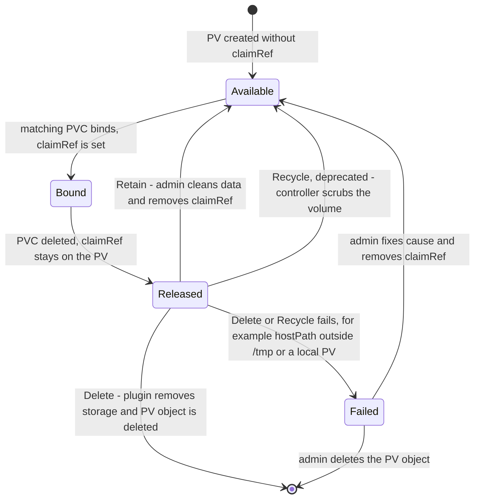

# T4.14 Configure volume types, access modes and reclaim policies

> Competency: "Configure volume types, access modes and reclaim policies" (CKA-1.2) | Domain/weight: CKA, Storage (10%) | Est. time: 2 h | Prerequisites: T3.07

Shell setup used in every command below (from the guide conventions):

```bash
alias k=kubectl
export do="--dry-run=client -o yaml"
export now="--force --grace-period=0"
source <(kubectl completion bash); complete -o default -F __start_kubectl k
```

Prerequisite: PV and PVC basics (what a claim is, how a Pod mounts it) are taught in [T3.07](../part3-ckad/T3.07-utilize-persistent-and-ephemeral-volumes.md). This lesson does not re-teach them. It is about the administrator side: which volume source to pick, which access mode to declare, and what happens to the data when the claim goes away.

## 1. Why this matters

A PersistentVolume (PV) is a piece of storage that an administrator describes to the cluster. If you pick the wrong access mode, the claim never binds and the Pod stays `Pending`. If you leave the wrong reclaim policy on a volume, deleting one claim can destroy the data for good, or it can leave a volume stuck in `Released` so that nobody can use it again. Each of these is a short, mechanical task (create a PV, fix a mismatch, change a policy, free a stuck volume), and each one goes quickly only if you already know the matching rules. Practise them as short timed tasks.

## 2. Concepts

### 2.1 The big picture in one paragraph

A **PV** is a cluster-wide object (no namespace) that points at real storage. A **PVC** (PersistentVolumeClaim) is a namespaced request for storage. A controller inside `kube-controller-manager` (the PV controller) watches both and binds one claim to one volume when the volume satisfies the claim. After binding, a Pod mounts the claim. When the claim is deleted, the controller looks at the PV's **reclaim policy** to decide what happens to the volume and its data. Everything in this lesson is a field on the PV that controls one of these three steps: where the data lives (volume source), who may mount it (access modes), and what happens afterwards (reclaim policy).

### 2.2 PV volume sources

The volume source is the field under `spec` that says where the bytes are. A PV has exactly one source. You choose it by setting one of these keys.

| Source | Where the data lives | Typical use | Access modes it can honestly offer | Notes |
|---|---|---|---|---|
| `hostPath` | A directory on the node's own disk | Single-node labs, kind, tests | `ReadWriteOnce` | Data exists only on the node where the Pod runs. Another node has a different directory with the same path. Unsafe in production. |
| `local` | A disk, partition or directory on one specific node | Fast node-local storage in real clusters | `ReadWriteOnce` | **Requires `nodeAffinity`** on the PV so the scheduler knows which node holds the data. Needs a StorageClass with `volumeBindingMode: WaitForFirstConsumer` to be useful. |
| `nfs` | A directory exported by an NFS server | Shared files, many Pods on many nodes | `ReadWriteOnce`, `ReadOnlyMany`, `ReadWriteMany` | Needs an NFS server and NFS client tools on every node. Supports `mountOptions`. |
| `csi` | Anything a CSI driver manages | Cloud disks and files (EBS, Azure Disk, GCE PD, EFS, Ceph) | Depends on the driver | The modern, general mechanism. The in-tree cloud types (for example `awsElasticBlockStore`) are replaced by CSI drivers. |

Awareness of the cloud types: in real clusters the cloud block disks (AWS EBS, Azure Disk, GCE Persistent Disk) are `ReadWriteOnce` (one node at a time). Cloud file shares (AWS EFS, Azure Files, GCP Filestore) and NFS are `ReadWriteMany`. A StorageClass normally creates these for you, so you rarely write them by hand ([T4.16](../part4-cka/T4.16-implement-storage-classes-and-dynamic-volume.md) covers StorageClasses and provisioners). You should only recognise a `csi:` block and know that the `driver` and `volumeHandle` fields are the identity of the volume.

**Related but different.** The `hostPath` source on a **PV** is not the same thing as a `hostPath` volume written directly inside a **Pod** spec. Both mount a node directory. The PV version goes through claims and binding, so it follows all the rules in this lesson. The Pod version is a direct mount and has no claim, no reclaim policy and no access mode.

**hostPath `type` field.** Under `hostPath` you can set `type`. `""` (empty, the default) does no check. `DirectoryOrCreate` creates the directory (mode 0755) if it is missing. `Directory` fails the mount if the directory does not exist. `FileOrCreate`, `File`, `Socket`, `CharDevice` and `BlockDevice` work the same way for those kinds. Risky value: an unset type with a missing directory gives a mount error and the Pod stays in `ContainerCreating`. Use `DirectoryOrCreate` in labs.

**local `path` field.** The `local` source has `path` and optionally `fsType`. It has no `type` field. The directory must already exist on the node, or the Pod gets a mount error. Create it yourself first (`ssh w1`, then `sudo mkdir -p /mnt/disks/vol1`).

### 2.3 capacity

`spec.capacity.storage` is the size the PV offers, for example `1Gi`. It is a quantity. `Gi` is a power of two (1024 x 1024 x 1024 bytes). `G` is a power of ten. `1G` is smaller than `1Gi`, and mixing them up causes size mismatches.

Binding rule: the PV capacity must be **greater than or equal to** the claim request. The claim gets the whole PV. A 500Mi claim bound to a 1Gi PV shows `CAPACITY 1Gi` on the claim, and the other 500Mi is not available to anybody else. For static volumes Kubernetes does not enforce the size on a hostPath or NFS directory. It is a matching label, not a quota. CSI drivers that create real disks do enforce it.

### 2.4 Access modes

An access mode tells the cluster how many nodes (or Pods) may use the volume at the same time and whether they may write. You set a **list** in `spec.accessModes` on both the PV and the PVC.

| Mode | Short | Meaning | Common backing storage |
|---|---|---|---|
| `ReadWriteOnce` | RWO | Mounted read-write by **one node** at a time. Several Pods on that same node can all use it. | Block disks, hostPath, local |
| `ReadOnlyMany` | ROX | Mounted read-only by **many nodes** at the same time. | NFS, some cloud disks in read-only mode, file shares |
| `ReadWriteMany` | RWX | Mounted read-write by **many nodes** at the same time. | NFS, CephFS, EFS, Azure Files |
| `ReadWriteOncePod` | RWOP | Mounted read-write by **a single Pod** in the whole cluster. A second Pod that uses the claim stays `Pending`. | CSI drivers only |

Points that cause mistakes:

- **RWO is per node, not per Pod.** Two Pods on the same node can both mount an RWO claim read-write. If a second Pod is scheduled to another node, it fails with a "Multi-Attach" style error (exact wording depends on the driver; see To verify).
- **RWOP is stricter than RWO.** It limits the volume to one Pod. The Kubernetes docs say it is supported **only for CSI volumes**. A hostPath, local or NFS PV cannot offer it. The mode is stable since v1.29 (source: the persistent-volumes page under References).
- **Modes are mostly a matching label.** For hostPath and many static volumes nothing stops two nodes from using the volume. The mode is what binding compares. Real enforcement (attach and detach) is done by the CSI driver and the attach/detach controller.
- **A volume has one mode at a time in practice.** A PV can list several modes (for example NFS: `[ReadWriteOnce, ReadOnlyMany, ReadWriteMany]`), but it is mounted using one of them at a time.
- **Binding rule for modes:** the claim's modes must all be present in the PV's list (the claim's list must be a subset of the PV's list). A claim for `ReadWriteMany` cannot bind a PV that lists only `ReadWriteOnce`.

What each volume source supports (use this to decide quickly):

```
Access-mode matrix (what the volume source can honestly offer)

Volume source        RWO    ROX    RWX    RWOP
-------------------  -----  -----  -----  -----
hostPath             yes    no     no     no
local                yes    no     no     no   (RWOP needs CSI)
nfs                  yes    yes    yes    no   (RWOP needs CSI)
csi: block disk      yes    maybe  no     yes  (EBS, Azure Disk, GCE PD; driver decides)
csi: file share      yes    yes    yes    yes  (EFS, Azure Files, CephFS; driver decides)

Legend: "yes" = supported, "no" = not supported, "maybe" = depends on the driver.
Source of truth: the "Access Modes" table on the persistent-volumes page.
For csi, the driver documentation is the final word; the "Access Modes" table
says "depends on the driver".
```

The `hostPath` row says RWO: that is the mode the docs list for hostPath. It does not mean other modes are blocked by the kernel. It means a PV you declare as RWX on hostPath is misleading, because the data is on one node only.

**Runnable examples for RWX, ROX and RWOP.** Environment: **kind**, namespace `lab-t414`. Each test uses its own PV, class label and claim, so they do not interfere. The class names (`am-a`, `am-b`, `am-c`) are plain labels: no StorageClass objects exist for them, as with `manual` elsewhere in this lesson. Run the setup once, then the three tests in order.

```bash
mkdir -p ~/lab/t414 && cd ~/lab/t414
k create ns lab-t414
```

**Test A: RWX claim against an RWO-only PV (stays Pending).**

```bash
cat <<'EOF' | k apply -f -
apiVersion: v1
kind: PersistentVolume
metadata:
  name: am-rwo
spec:
  capacity:
    storage: 1Gi
  accessModes: [ReadWriteOnce]
  persistentVolumeReclaimPolicy: Retain
  storageClassName: am-a
  hostPath:
    path: /mnt/data/am-rwo
    type: DirectoryOrCreate
---
apiVersion: v1
kind: PersistentVolumeClaim
metadata:
  name: am-rwx
  namespace: lab-t414
spec:
  storageClassName: am-a
  accessModes: [ReadWriteMany]
  resources:
    requests:
      storage: 500Mi
EOF
sleep 5
k get pvc am-rwx -n lab-t414                       # STATUS Pending
k get pv am-rwo -o custom-columns=NAME:.metadata.name,MODE:.spec.accessModes,STATUS:.status.phase
k describe pvc am-rwx -n lab-t414 | tail -4
test "$(k get pvc am-rwx -n lab-t414 -o jsonpath='{.status.phase}')" = Pending && echo OK-A1
```

What to look for: the claim is `Pending` and the PV is still `Available`, so nothing is wrong with the PV; the claim's `ReadWriteMany` is not in the PV's list `[ReadWriteOnce]`. The event names the problem only indirectly (see section 6), so you find the real cause by comparing the two mode lists. A claim's modes cannot be edited, so delete it and ask for a mode the PV has:

```bash
k delete pvc am-rwx -n lab-t414
cat <<'EOF' | k apply -f -
apiVersion: v1
kind: PersistentVolumeClaim
metadata:
  name: am-rwo-claim
  namespace: lab-t414
spec:
  storageClassName: am-a
  accessModes: [ReadWriteOnce]
  resources:
    requests:
      storage: 500Mi
EOF
k wait --for=jsonpath='{.status.phase}'=Bound pvc/am-rwo-claim -n lab-t414 --timeout=60s && echo OK-A2
```

**Test B: ROX volume mounted read-only.** The container mount is `readOnly: true`, which is what makes a read-only volume actually read-only for the Pod.

```bash
cat <<'EOF' | k apply -f -
apiVersion: v1
kind: PersistentVolume
metadata:
  name: am-rox
spec:
  capacity:
    storage: 1Gi
  accessModes: [ReadOnlyMany]
  persistentVolumeReclaimPolicy: Retain
  storageClassName: am-b
  hostPath:
    path: /mnt/data/am-rox
    type: DirectoryOrCreate
---
apiVersion: v1
kind: PersistentVolumeClaim
metadata:
  name: am-rox-claim
  namespace: lab-t414
spec:
  storageClassName: am-b
  accessModes: [ReadOnlyMany]
  resources:
    requests:
      storage: 500Mi
---
apiVersion: v1
kind: Pod
metadata:
  name: rox-pod
  namespace: lab-t414
spec:
  containers:
  - name: c
    image: busybox:1.36
    command: ["sleep", "3600"]
    volumeMounts:
    - name: data
      mountPath: /data
      readOnly: true                 # the read-only guarantee comes from this mount flag
  volumes:
  - name: data
    persistentVolumeClaim:
      claimName: am-rox-claim
EOF
k wait --for=condition=Ready pod/rox-pod -n lab-t414 --timeout=90s
k exec rox-pod -n lab-t414 -- touch /data/x; echo "exit=$?"
k exec rox-pod -n lab-t414 -- ls -A /data && echo OK-B1
! k exec rox-pod -n lab-t414 -- touch /data/x 2>/dev/null && echo OK-B2
```

What to look for: the claim binds (the PV lists `ReadOnlyMany`), the read works, and the write fails with a read-only file system error. `OK-B2` fails if the mount is writable. Without `readOnly: true`, this hostPath volume would be writable even though the claim says `ReadOnlyMany`: for static hostPath volumes the mode is a binding label (see the points above), not a kernel rule. A real ROX use case is a shared NFS export or a file-share CSI volume; this lab has no NFS server, so hostPath stands in for it.

EXPECTED OUTPUT (not captured)
```
touch: /data/x: Read-only file system
command terminated with exit code 1
exit=1
OK-B1
OK-B2
```

**Test C: ReadWriteOncePod, the second Pod stays Pending.** Both Pods are pinned to the same node on purpose, so you see that RWOP is stricter than RWO (which would allow two Pods on one node).

```bash
cat <<'EOF' | k apply -f -
apiVersion: v1
kind: PersistentVolume
metadata:
  name: am-rwop
spec:
  capacity:
    storage: 1Gi
  accessModes: [ReadWriteOncePod]
  persistentVolumeReclaimPolicy: Retain
  storageClassName: am-c
  hostPath:
    path: /mnt/data/am-rwop
    type: DirectoryOrCreate
---
apiVersion: v1
kind: PersistentVolumeClaim
metadata:
  name: am-rwop-claim
  namespace: lab-t414
spec:
  storageClassName: am-c
  accessModes: [ReadWriteOncePod]
  resources:
    requests:
      storage: 500Mi
---
apiVersion: v1
kind: Pod
metadata:
  name: rwop-1
  namespace: lab-t414
spec:
  nodeSelector:
    kubernetes.io/hostname: lab-worker
  containers:
  - name: c
    image: busybox:1.36
    command: ["sleep", "3600"]
    volumeMounts:
    - name: data
      mountPath: /data
  volumes:
  - name: data
    persistentVolumeClaim:
      claimName: am-rwop-claim
EOF
k wait --for=condition=Ready pod/rwop-1 -n lab-t414 --timeout=90s
k get pvc am-rwop-claim -n lab-t414
```

Second Pod, same claim, same node:

```bash
cat <<'EOF' | k apply -f -
apiVersion: v1
kind: Pod
metadata:
  name: rwop-2
  namespace: lab-t414
spec:
  nodeSelector:
    kubernetes.io/hostname: lab-worker
  containers:
  - name: c
    image: busybox:1.36
    command: ["sleep", "3600"]
    volumeMounts:
    - name: data
      mountPath: /data
  volumes:
  - name: data
    persistentVolumeClaim:
      claimName: am-rwop-claim
EOF
sleep 10
k get pod rwop-1 rwop-2 -n lab-t414
k describe pod rwop-2 -n lab-t414 | tail -5
test "$(k get pod rwop-1 -n lab-t414 -o jsonpath='{.status.phase}')" = Running && echo OK-C1
test "$(k get pod rwop-2 -n lab-t414 -o jsonpath='{.status.phase}')" = Pending && echo OK-C2
```

What to look for: `rwop-1` is `Running`, `rwop-2` stays `Pending`, and the `FailedScheduling` event on `rwop-2` mentions the `ReadWriteOncePod` access mode (exact wording not captured). Delete `rwop-1` and the scheduler lets `rwop-2` start. The docs say RWOP is for CSI volumes only; this test uses a hostPath PV to watch the scheduling rule, and whether the PV controller accepts a `ReadWriteOncePod` hostPath PV is UNVERIFIED (section 11, item 2). If `OK-C1` does not print, run `k describe pvc am-rwop-claim -n lab-t414` and record what you see.

EXPECTED OUTPUT (not captured)
```
NAME     READY   STATUS    RESTARTS   AGE
rwop-1   1/1     Running   0          40s
rwop-2   0/1     Pending   0          10s
...
Events:
  Warning  FailedScheduling  <age>  default-scheduler  <message that names the ReadWriteOncePod access mode and the claim already in use>
OK-C1
OK-C2
```

**Cleanup for tests A to C.**

```bash
k delete ns lab-t414
k delete pv am-rwo am-rox am-rwop --ignore-not-found
rmdir ~/lab/t414 2>/dev/null
for n in lab-control-plane lab-worker lab-worker2; do docker exec $n sh -c 'rm -rf /mnt/data/am-*'; done   # kind only
```

### 2.5 volumeMode: Filesystem vs Block

`spec.volumeMode` on the PV (and on the PVC) says how the storage is shown to the container.

| Value | Default? | What the container sees | How the Pod uses it |
|---|---|---|---|
| `Filesystem` | Yes | A directory. Kubernetes formats the device with a filesystem if it is empty (CSI and local block devices). | `volumeMounts` with `mountPath` |
| `Block` | No | A raw block device, no filesystem. Used by databases that manage their own disk. | `volumeDevices` with `devicePath` (not `volumeMounts`) |

Binding rule: the PV and PVC **must have the same `volumeMode`**. A `Filesystem` claim never binds a `Block` PV and the other way round. The claim stays `Pending`. Risky value: setting `volumeMode: Block` on a `hostPath` PV is not supported. Block mode works with `local` (when `path` is a block device), `csi` and other block-capable sources.

Block PV and Pod, complete example (needs a real block device on the node; see the optional setup below):

```yaml
apiVersion: v1
kind: PersistentVolume
metadata:
  name: pv-block
spec:
  capacity:
    storage: 1Gi
  volumeMode: Block              # raw device, no filesystem
  accessModes: [ReadWriteOnce]
  persistentVolumeReclaimPolicy: Retain
  storageClassName: local-block
  local:
    path: /dev/loop20            # a block device node on the node
  nodeAffinity:
    required:
      nodeSelectorTerms:
      - matchExpressions:
        - key: kubernetes.io/hostname
          operator: In
          values: ["lab-worker"]
---
apiVersion: v1
kind: PersistentVolumeClaim
metadata:
  name: claim-block
  namespace: lab-t414
spec:
  storageClassName: local-block
  volumeMode: Block              # must equal the PV
  accessModes: [ReadWriteOnce]
  resources:
    requests:
      storage: 1Gi
---
apiVersion: v1
kind: Pod
metadata:
  name: block-pod
  namespace: lab-t414
spec:
  containers:
  - name: c
    image: busybox:1.36
    command: ["sh", "-c", "ls -l /dev/xvda && sleep 3600"]
    volumeDevices:               # NOT volumeMounts
    - name: disk
      devicePath: /dev/xvda      # the device appears here inside the container
  volumes:
  - name: disk
    persistentVolumeClaim:
      claimName: claim-block
```

Optional setup on kind (not needed for the labs): `docker exec lab-worker sh -c 'truncate -s 1G /var/blk.img && losetup /dev/loop20 /var/blk.img'`. The loop device name can differ on your machine. The StorageClass `local-block` must exist with `provisioner: kubernetes.io/no-provisioner` (see 2.9). Treat this block as awareness for the exam. If you try it, the expected result is that the claim only binds when its `volumeMode` is `Block`; change the claim to `Filesystem` and it stays `Pending`.

### 2.6 Reclaim policies

The reclaim policy is `spec.persistentVolumeReclaimPolicy` on the **PV**. It answers one question: when the bound claim is deleted, what happens to the volume?

| Policy | What happens after the PVC is deleted | Data | Next step for the PV |
|---|---|---|---|
| `Retain` | The PV stays, phase becomes `Released`. The PV still remembers the old claim in `spec.claimRef`. | Kept | An administrator must clean the data and clear `claimRef` by hand before reuse. |
| `Delete` | The controller asks the volume plugin to delete the real storage, then deletes the PV object. | Destroyed | PV object disappears. Only works if the plugin can delete. CSI drivers and cloud disks can. The in-tree hostPath deleter only accepts paths under `/tmp/` (the labs use `/mnt/...`, so for them it fails and the PV goes to `Failed`); `local` has no deleter at all. Warning: a hostPath PV under `/tmp/` with `Delete` really does remove the data. |
| `Recycle` | Deprecated. Runs a basic scrub (`rm -rf /thevolume/*`) and returns the PV to `Available`. | Wiped | The docs for v1.37 still list it; only `nfs` and `hostPath` support it. Do not use it. Use dynamic provisioning instead. |

**Recycle status in 1.37.** The persistent-volumes page for v1.37 says the `Recycle` policy is deprecated and that "only `nfs` and `hostPath` volume types support recycling". So it is deprecated, not removed. I read this on the docs page; I did not test it on a cluster (listed in To verify).

**Defaults, and why they surprise people.**

| How the PV was created | Default reclaim policy |
|---|---|
| Static: you wrote the PV YAML and did not set the field | `Retain` |
| Dynamic: a StorageClass created the PV | Copied from the StorageClass `reclaimPolicy`, which defaults to `Delete` |

So the same claim deleted on a static PV keeps the data, and on a dynamic PV usually destroys it. If you need the data to survive a dynamic claim, set `reclaimPolicy: Retain` on the StorageClass (it only affects PVs created afterwards) or patch the PV after it is created.

Set the policy in YAML or patch it later. Patching is the tool you use under pressure:

```bash
k patch pv pv1 -p '{"spec":{"persistentVolumeReclaimPolicy":"Retain"}}'
```

Do it **before** you delete the claim. After the PVC is gone and the policy was `Delete`, the data is already being removed.

A common confusion: the policy belongs to the PV, not to the PVC. Deleting the PV object itself (`k delete pv pv1`) never deletes the underlying storage when the policy is `Retain`: the directory or disk stays, only the Kubernetes object is gone. A bound PV with the `kubernetes.io/pv-protection` finalizer stays in `Terminating` until the claim is released.

### 2.7 PV phases

`status.phase` on the PV is the lifecycle state.

| Phase | Meaning | What moves it forward |
|---|---|---|
| `Available` | Free, no claim bound | A matching PVC appears |
| `Bound` | Bound to a PVC | The PVC is deleted |
| `Released` | The PVC was deleted, but the storage has not been reclaimed. The PV still has the old `claimRef`. | Admin cleans data and removes `claimRef` (Retain), or the controller deletes it (Delete) |
| `Failed` | Automatic reclamation failed (for example a `Delete` policy on a hostPath PV whose path is not under `/tmp/`, or on a `local` PV) | Admin fixes the cause or deletes the PV object |

A `Released` PV is **not** `Available`. A new PVC will not bind to it, even when every other field matches. This is deliberate: the previous user's data is still there, and Kubernetes does not hand it to a new user automatically.

**Reusing a Released PV (Retain).** The safe order is: (1) make sure nothing mounts it, (2) clean the data on the storage, (3) clear `claimRef`. Clearing first and cleaning later lets a new claim grab a dirty volume.

```bash
k patch pv pv1 --type=json -p '[{"op":"remove","path":"/spec/claimRef"}]'
```

`--type=json` is a JSON Patch with an explicit `remove` operation. You cannot remove a field with the default strategic merge patch the same way. After the patch, the controller sets the phase to `Available`. If a claim is already waiting that matches, it binds immediately.

### 2.8 mountOptions

`spec.mountOptions` is a list of extra options passed to the `mount` command when the node mounts the volume, for example `["hard", "nfsvers=4.1"]` for NFS. Kubernetes does **not** validate them. A bad option makes the mount fail, so the Pod stays in `ContainerCreating` with a mount error in `k describe pod`. The docs say mount options are supported for `csi` (including migrated cloud types), `iscsi` and `nfs` volumes. Do not put them on `hostPath` or `local` PVs, because the docs do not list those types. The old annotation `volume.beta.kubernetes.io/mount-options` is deprecated; use the field.

### 2.9 local volumes and WaitForFirstConsumer

A `local` volume lives on one node. If the claim bound immediately, the scheduler could later put the Pod on another node and the Pod would be unable to start. The fix is delayed binding: the StorageClass has `volumeBindingMode: WaitForFirstConsumer`. The claim stays `Pending` until a Pod that uses it is scheduled. Then the scheduler picks a node that satisfies the Pod and the PV's `nodeAffinity`, and the claim binds to a PV on that node.

`Immediate` is the default binding mode: bind as soon as a match exists. For `local` PVs you should always use `WaitForFirstConsumer`.

A StorageClass for static local PVs has no provisioner that creates volumes, so it uses the placeholder name `kubernetes.io/no-provisioner`:

```yaml
apiVersion: storage.k8s.io/v1
kind: StorageClass
metadata:
  name: local-storage
provisioner: kubernetes.io/no-provisioner   # nothing creates volumes; admin makes the PVs
volumeBindingMode: WaitForFirstConsumer     # bind only when a Pod needs the claim
reclaimPolicy: Delete                       # field default; ignored for static PVs (they use their own policy)
```

A `PVC` waiting for the first consumer shows `Pending` with an event whose reason is `WaitForFirstConsumer`. That is normal. It is not an error. Do not "fix" it; create the Pod.

**nodeAffinity on a PV.** `spec.nodeAffinity.required.nodeSelectorTerms` limits which nodes can use the PV. Pods that use the PV are only scheduled on nodes selected by the affinity. It is required for `local` volumes: the API server rejects a local PV without it (message contains `Local volume requires node affinity`). The label `kubernetes.io/hostname` is on every node and equals the node name in kind and kubeadm clusters (verify with `k get nodes --show-labels` if unsure).

### 2.10 Volume expansion basics

You can grow a claim in place only if its StorageClass has `allowVolumeExpansion: true` and the CSI driver supports resizing. You then edit the PVC `spec.resources.requests.storage` to a larger value. You cannot shrink a claim. Static PVs without a StorageClass that allows it cannot be expanded by editing the claim. Details and the full procedure are in [T4.16](../part4-cka/T4.16-implement-storage-classes-and-dynamic-volume.md). For this lesson remember only: the field lives on the StorageClass, and if an edit of a claim's requested size is rejected, check `allowVolumeExpansion` on its class first (message wording not captured).

### 2.11 VolumeAttributesClass (awareness)

A `VolumeAttributesClass` (VAC) is a cluster-scoped object that names a set of driver-specific volume settings, such as provisioned IOPS or throughput. It is GA (`storage.k8s.io/v1`) since v1.34. A claim uses it with `spec.volumeAttributesClassName`, and an administrator can change the class later to change the settings of a live volume (for example, move a disk from "silver" to "gold" performance) without recreating it. It only works when the CSI driver supports modifying volumes. Do not confuse it with a StorageClass: a StorageClass is chosen at creation time and cannot change; a VolumeAttributesClass can be switched afterwards.

```yaml
apiVersion: storage.k8s.io/v1
kind: VolumeAttributesClass
metadata:
  name: silver
driverName: ebs.csi.aws.com      # must be a CSI driver that supports ModifyVolume
parameters:
  iops: "4000"                   # keys and values are driver-specific strings
  throughput: "125"
```

The `k get pv` output has a `VOLUMEATTRIBUTESCLASS` column (shows `<unset>` when unused). Delete the object with `k delete volumeattributesclass silver`.

### 2.12 Under the hood

- **Binding.** The PV controller loops over unbound claims. For each claim it searches PVs where: the storage class name is equal (empty string only matches empty), the `volumeMode` is equal, the claim modes are a subset of the PV modes, the PV capacity is at least the claim request, the PV `claimRef` is empty (or already points at this claim), the PV `nodeAffinity` is satisfiable (for delayed binding), and the claim's `selector` (if any) matches the PV labels. It picks the smallest PV that fits. If the claim sets `spec.volumeName`, only that PV is considered (a pre-bind). When it binds, it writes `claimRef` on the PV and `volumeName` on the claim, and sets both phases to `Bound`.
- **Release.** When the claim is deleted, the controller sees a PV whose `claimRef` points at a claim that no longer exists. It sets the phase to `Released`, then acts on the reclaim policy. `claimRef` stays on the PV. That leftover reference (name, namespace and UID of the old claim) is why a new claim with the same name still does not bind.
- **Delete.** For in-tree plugins that can delete, `kube-controller-manager` deletes the storage. For CSI, the external-provisioner sidecar of the driver deletes the volume. The in-tree hostPath deleter only works for paths under `/tmp/`, and the `local` plugin has no deleter, so for the lab paths (`/mnt/...`) and for `local` PVs the controller records a failure and sets `Failed`.
- **Mounting.** The kubelet on the Pod's node mounts the volume. For CSI, the attach/detach controller and the driver's node plugin do the attach and mount. The kubelet applies `mountOptions` during the mount.
- **Protection.** Finalizers (`kubernetes.io/pvc-protection`, `kubernetes.io/pv-protection`) stop deletion while a claim is used by a Pod or a PV is bound.

## 3. How it works (diagram)



Walkthrough:

1. A new PV starts `Available`. It waits until a claim matches its class, modes, size and volumeMode.
2. Binding writes `claimRef` into the PV and the phase becomes `Bound`. The Pod uses the claim.
3. Deleting the PVC does not delete the PV. The phase becomes `Released` and `claimRef` is still there.
4. Reclaim policy decides the branch. `Retain` leaves it `Released` until you clean the data and remove `claimRef`, which sends it back to `Available`.
5. `Delete` makes the controller remove the storage and then the PV object. If the plugin cannot delete the storage (hostPath outside `/tmp/`, `local`), the PV goes to `Failed` and waits for you.
6. `Recycle` (deprecated) is the third branch: the controller scrubs the volume and the PV returns to `Available` without any admin step. It is drawn in the diagram for completeness; do not use it.

## 4. Commands and YAML you must produce fast

### 4.1 Imperative shortcuts

There is no `k create pv` or `k create pvc`. You write the YAML (copy it from the docs page or from a template you remember). These are the commands you do use:

```bash
# one-line overview with the fields the task usually asks about
k get pv -o custom-columns=NAME:.metadata.name,MODE:.spec.accessModes,RECLAIM:.spec.persistentVolumeReclaimPolicy,STATUS:.status.phase
```
Lists every PV with modes, reclaim policy and phase. Run it first, before and after every change.

```bash
k patch pv pv1 -p '{"spec":{"persistentVolumeReclaimPolicy":"Retain"}}'
```
Changes the policy of a live PV. Do this before deleting a claim whose data you need.

```bash
k patch pv pv1 --type=json -p '[{"op":"remove","path":"/spec/claimRef"}]'
```
Makes a `Released` PV bindable again by deleting the stale claim reference.

```bash
k get pv -o custom-columns=NAME:.metadata.name,CLAIM:.spec.claimRef.name,NS:.spec.claimRef.namespace
k explain pv.spec.local          # field help from the cluster's API schema, no browser needed (needs a working cluster)
k explain pv.spec --recursive | less
k get pv pv1 -o yaml > pv1.yaml  # start a new PV from an existing one
k get pvc,pv -n lab-t414         # claims and volumes together
k describe pvc claim1 -n lab-t414  # the Events at the bottom explain Pending
```

### 4.2 Declarative YAML

hostPath PV (1Gi, RWO, Retain, class `manual`) and a claim that binds to it:

```yaml
apiVersion: v1
kind: PersistentVolume
metadata:
  name: pv1                              # PVs have no namespace
spec:
  capacity:
    storage: 1Gi                         # size offered; claim request must be <= this
  accessModes:
    - ReadWriteOnce                      # list; claim modes must be a subset
  persistentVolumeReclaimPolicy: Retain  # Retain | Delete | Recycle (deprecated); default Retain for static PVs
  storageClassName: manual               # must equal the claim's value; "manual" is just a label here
  hostPath:                              # exactly one volume source
    path: /mnt/data/pv1                  # directory on the node
    type: DirectoryOrCreate              # create it if missing (default type "" checks nothing)
---
apiVersion: v1
kind: PersistentVolumeClaim
metadata:
  name: claim1
  namespace: lab-t414                    # claims are namespaced; create the namespace first
spec:
  storageClassName: manual               # must equal the PV; "" would mean "no class", omitted means "default class"
  accessModes:
    - ReadWriteOnce
  resources:
    requests:
      storage: 500Mi                     # <= PV capacity; the claim still gets the whole 1Gi PV
```

Pod that mounts the claim:

```yaml
apiVersion: v1
kind: Pod
metadata:
  name: app1
  namespace: lab-t414
spec:
  containers:
  - name: c
    image: busybox:1.36
    command: ["sh", "-c", "date >> /data/log.txt; sleep 3600"]
    volumeMounts:
    - name: data
      mountPath: /data                   # where the claim appears in the container
  volumes:
  - name: data
    persistentVolumeClaim:
      claimName: claim1                  # claim in the same namespace as the Pod
```

Local PV with nodeAffinity, its StorageClass and a claim (create the directory on the node first):

```yaml
apiVersion: storage.k8s.io/v1
kind: StorageClass
metadata:
  name: local-storage
provisioner: kubernetes.io/no-provisioner   # admin creates the PVs by hand
volumeBindingMode: WaitForFirstConsumer     # claim waits for a Pod, so node choice is correct
---
apiVersion: v1
kind: PersistentVolume
metadata:
  name: local-pv1
spec:
  capacity:
    storage: 1Gi
  volumeMode: Filesystem                 # default; Block is the other value
  accessModes:
    - ReadWriteOnce                      # local volumes are RWO
  persistentVolumeReclaimPolicy: Retain
  storageClassName: local-storage
  local:
    path: /mnt/disks/vol1                # must already exist on the node
  nodeAffinity:                          # REQUIRED for local PVs
    required:
      nodeSelectorTerms:
      - matchExpressions:
        - key: kubernetes.io/hostname
          operator: In
          values:
          - lab-worker                   # the node that owns the directory
---
apiVersion: v1
kind: PersistentVolumeClaim
metadata:
  name: local-claim
  namespace: lab-t414
spec:
  storageClassName: local-storage
  accessModes:
    - ReadWriteOnce
  resources:
    requests:
      storage: 1Gi
```

NFS PV with mount options (the object applies without an NFS server; a Pod mounting it would need a working server at that address):

```yaml
apiVersion: v1
kind: PersistentVolume
metadata:
  name: nfs-pv1
spec:
  capacity:
    storage: 5Gi
  accessModes:
    - ReadWriteMany                      # NFS can offer all three modes
  persistentVolumeReclaimPolicy: Retain
  storageClassName: nfs
  mountOptions:                          # not validated; a wrong option makes the mount fail
    - hard
    - nfsvers=4.1
  nfs:
    server: 10.0.0.50                    # NFS server address (example value)
    path: /srv/nfs/share                 # exported directory on that server
```

CSI PV (awareness only, you normally let a StorageClass create these):

```yaml
apiVersion: v1
kind: PersistentVolume
metadata:
  name: csi-pv-demo
spec:
  capacity:
    storage: 10Gi
  accessModes:
    - ReadWriteOnce
  persistentVolumeReclaimPolicy: Retain
  storageClassName: csi-demo
  csi:
    driver: ebs.csi.aws.com              # name the CSI driver registered
    volumeHandle: vol-0123456789abcdef0  # the driver's ID for the real disk (example value)
    fsType: ext4                         # filesystem to create or expect
```

A StorageClass that keeps data on claim deletion (for dynamic volumes; kind ships a local-path provisioner):

```yaml
apiVersion: storage.k8s.io/v1
kind: StorageClass
metadata:
  name: keep-data
provisioner: rancher.io/local-path   # the provisioner kind installs (check with k get sc)
reclaimPolicy: Retain                # PVs created from this class start as Retain (default is Delete)
volumeBindingMode: WaitForFirstConsumer
allowVolumeExpansion: false          # field default; set true only if the driver can resize
```

### 4.3 Speed drill

Targets are exam pace. Setup: `k create ns lab-t414` and note your node name with `k get nodes`. The drill uses PV names starting with `d-` and the claim `d-claim`. Answers are collapsed. The cleanup at the end removes every object the drill creates, including the namespace and `~/lab/t414`.

1. (3 min) Create PV `d-pv1`: hostPath `/mnt/data/d1`, 1Gi, RWO, Retain, class `manual`.
2. (1 min) List all PVs showing name, access modes, reclaim policy and phase.
3. (1 min) Change `d-pv1` to `Delete`, check, then change it back to `Retain`.
4. (2 min) Create claim `d-claim` in `lab-t414`: 500Mi, RWO, class `manual`. Confirm both are `Bound`.
5. (2 min) Delete the claim. Confirm the PV is `Released`. Make it `Available` again.
6. (1 min) Print PV name and the claim name it is bound to for every PV.
7. (3 min) Create local PV `d-local` (1Gi, RWO, Retain, class `local-storage`, path `/mnt/disks/d-local`) pinned to a worker node.
8. (1 min) Find the allowed values of `volumeMode` using only the terminal.

<details><summary>Answers</summary>

```bash
# 1
mkdir -p ~/lab/t414
cat > ~/lab/t414/d-pv1.yaml <<'EOF'
apiVersion: v1
kind: PersistentVolume
metadata:
  name: d-pv1
spec:
  capacity:
    storage: 1Gi
  accessModes: [ReadWriteOnce]
  persistentVolumeReclaimPolicy: Retain
  storageClassName: manual
  hostPath:
    path: /mnt/data/d1
    type: DirectoryOrCreate
EOF
k apply -f ~/lab/t414/d-pv1.yaml

# 2
k get pv -o custom-columns=NAME:.metadata.name,MODE:.spec.accessModes,RECLAIM:.spec.persistentVolumeReclaimPolicy,STATUS:.status.phase

# 3
k patch pv d-pv1 -p '{"spec":{"persistentVolumeReclaimPolicy":"Delete"}}'
k get pv d-pv1 -o jsonpath='{.spec.persistentVolumeReclaimPolicy}{"\n"}'
k patch pv d-pv1 -p '{"spec":{"persistentVolumeReclaimPolicy":"Retain"}}'

# 4
cat <<'EOF' | k apply -f -
apiVersion: v1
kind: PersistentVolumeClaim
metadata:
  name: d-claim
  namespace: lab-t414
spec:
  storageClassName: manual
  accessModes: [ReadWriteOnce]
  resources:
    requests:
      storage: 500Mi
EOF
k get pv d-pv1; k get pvc d-claim -n lab-t414

# 5
k delete pvc d-claim -n lab-t414
k get pv d-pv1                               # STATUS Released
k patch pv d-pv1 --type=json -p '[{"op":"remove","path":"/spec/claimRef"}]'
k get pv d-pv1                               # STATUS Available

# 6
k get pv -o custom-columns=NAME:.metadata.name,CLAIM:.spec.claimRef.name

# 7  (replace lab-worker with a worker name from k get nodes; create the dir on that node first)
cat <<'EOF' | k apply -f -
apiVersion: v1
kind: PersistentVolume
metadata:
  name: d-local
spec:
  capacity:
    storage: 1Gi
  accessModes: [ReadWriteOnce]
  persistentVolumeReclaimPolicy: Retain
  storageClassName: local-storage
  local:
    path: /mnt/disks/d-local
  nodeAffinity:
    required:
      nodeSelectorTerms:
      - matchExpressions:
        - key: kubernetes.io/hostname
          operator: In
          values: ["lab-worker"]
EOF

# 8
k explain pv.spec.volumeMode        # Filesystem or Block
```

Cleanup:

```bash
k delete pvc d-claim -n lab-t414 --ignore-not-found
k delete pv d-pv1 d-local --ignore-not-found
k delete ns lab-t414 --ignore-not-found
rm -f ~/lab/t414/d-pv1.yaml
rmdir ~/lab/t414 2>/dev/null
for n in lab-control-plane lab-worker lab-worker2; do docker exec $n rm -rf /mnt/data/d1; done   # kind only
```
</details>

## 5. Worked example

Environment: **kind** (cluster `lab`, nodes `lab-control-plane`, `lab-worker`, `lab-worker2`). Goal: watch one static PV go through `Available`, `Bound`, `Released`, `Available` and see what `Delete` does to a hostPath PV. Every output block below is labelled `EXPECTED OUTPUT (not captured)`: the machine-wide kind lock was not free during the writing session (see section 11).

**Step 1: create the namespace and the PV.**

```bash
mkdir -p ~/lab/t414 && cd ~/lab/t414
k create ns lab-t414
cat > pv1.yaml <<'EOF'
apiVersion: v1
kind: PersistentVolume
metadata:
  name: pv1
spec:
  capacity:
    storage: 1Gi
  accessModes: [ReadWriteOnce]
  persistentVolumeReclaimPolicy: Retain
  storageClassName: manual
  hostPath:
    path: /mnt/data/pv1
    type: DirectoryOrCreate
EOF
k apply -f pv1.yaml
k get pv -o custom-columns=NAME:.metadata.name,MODE:.spec.accessModes,RECLAIM:.spec.persistentVolumeReclaimPolicy,STATUS:.status.phase
```

What to look for: the custom-columns command prints the access modes list in square brackets. The phase is `Available` because no claim exists.

EXPECTED OUTPUT (not captured)
```
persistentvolume/pv1 created
NAME   MODE               RECLAIM   STATUS
pv1    [ReadWriteOnce]    Retain    Available
```

**Step 2: bind a claim and write data.** The Pod is pinned to `lab-worker` so that we know which node holds the data.

```bash
cat > claim1.yaml <<'EOF'
apiVersion: v1
kind: PersistentVolumeClaim
metadata:
  name: claim1
  namespace: lab-t414
spec:
  storageClassName: manual
  accessModes: [ReadWriteOnce]
  resources:
    requests:
      storage: 500Mi
---
apiVersion: v1
kind: Pod
metadata:
  name: app1
  namespace: lab-t414
spec:
  nodeSelector:
    kubernetes.io/hostname: lab-worker
  containers:
  - name: c
    image: busybox:1.36
    command: ["sh", "-c", "echo hello > /data/hello.txt; sleep 3600"]
    volumeMounts:
    - name: data
      mountPath: /data
  volumes:
  - name: data
    persistentVolumeClaim:
      claimName: claim1
EOF
k apply -f claim1.yaml
k wait --for=condition=Ready pod/app1 -n lab-t414 --timeout=90s
k get pv pv1
```

The claim binds at once because the class `manual` has no StorageClass object, so there is no delayed binding. The PV row now shows the claim.

EXPECTED OUTPUT (not captured)
```
NAME   CAPACITY   ACCESS MODES   RECLAIM POLICY   STATUS   CLAIM             STORAGECLASS   VOLUMEATTRIBUTESCLASS   REASON   AGE
pv1    1Gi        RWO            Retain           Bound    lab-t414/claim1   manual         <unset>                          40s
```

**Step 3: delete the Pod and the claim. See `Released`.** Delete the Pod first, otherwise the claim stays `Terminating` because of the `pvc-protection` finalizer.

```bash
k delete pod app1 -n lab-t414 $now
k delete pvc claim1 -n lab-t414
k get pv pv1
k get pv pv1 -o jsonpath='{.spec.claimRef}{"\n"}'
docker exec lab-worker cat /mnt/data/pv1/hello.txt     # kind only; on VMs: ssh w1, then sudo cat
```

What to look for: `STATUS Released`, the `CLAIM` column still names `lab-t414/claim1`, and the data is still on the node. `claimRef` still holds the old name, namespace and UID.

EXPECTED OUTPUT (not captured)
```
NAME   CAPACITY   ACCESS MODES   RECLAIM POLICY   STATUS     CLAIM             STORAGECLASS   ...
pv1    1Gi        RWO            Retain           Released   lab-t414/claim1   manual         ...
{"apiVersion":"v1","kind":"PersistentVolumeClaim","name":"claim1","namespace":"lab-t414","resourceVersion":"<n>","uid":"<uid>"}
hello
```

**Step 4: a new claim stays Pending.**

```bash
k apply -f claim1.yaml 2>&1 | head -1    # recreates the claim and the Pod; ignore the Pod for now
k get pvc -n lab-t414
k describe pvc claim1 -n lab-t414 | tail -5
```

The same name and the same fields do not help. The old `claimRef` carries the old claim UID, so the controller will not bind this new claim to it. The claim is `Pending` and `pv1` stays `Released`.

The event text below is a placeholder.

EXPECTED OUTPUT (not captured)
```
NAME     STATUS    VOLUME   CAPACITY   ACCESS MODES   STORAGECLASS   AGE
claim1   Pending                                      manual         10s
...
Events:
  Type     Reason   Message
  Warning  <reason> <message that says no PV is available for the claim>
```

**Step 5: free the volume the safe way.** Clean first, then clear `claimRef`.

```bash
k delete pod app1 -n lab-t414 $now        # stop the new Pod so nothing mounts the data
docker exec lab-worker sh -c 'rm -rf /mnt/data/pv1/*'      # kind; on VMs run it over ssh on the node
k patch pv pv1 --type=json -p '[{"op":"remove","path":"/spec/claimRef"}]'
k get pv pv1
k get pvc claim1 -n lab-t414
```

After the patch the controller finds the pending claim `claim1` and binds it right away.

EXPECTED OUTPUT (not captured)
```
NAME   CAPACITY   ACCESS MODES   RECLAIM POLICY   STATUS   CLAIM             STORAGECLASS   ...
pv1    1Gi        RWO            Retain           Bound    lab-t414/claim1   manual         ...
NAME     STATUS   VOLUME   CAPACITY   ACCESS MODES   STORAGECLASS   AGE
claim1   Bound    pv1      1Gi        RWO            manual         1m
```

**Step 6: what Delete does to a hostPath PV.** Change the policy, delete the claim, and look at the PV.

```bash
k patch pv pv1 -p '{"spec":{"persistentVolumeReclaimPolicy":"Delete"}}'
k delete pvc claim1 -n lab-t414
sleep 10
k get pv pv1
k describe pv pv1 | tail -6
```

The hostPath deleter only accepts paths under `/tmp/`, and this PV uses `/mnt/data/pv1`, so the controller cannot delete the storage and marks the PV `Failed`. The PV object and the directory both remain. (Had the path been under `/tmp/`, the directory would have been removed.)

The event text is a placeholder (see section 11).

EXPECTED OUTPUT (not captured)
```
NAME   CAPACITY   ACCESS MODES   RECLAIM POLICY   STATUS   CLAIM             STORAGECLASS   ...
pv1    1Gi        RWO            Delete           Failed   lab-t414/claim1   manual         ...
...
Events:
  Warning  VolumeFailedDelete  persistentvolume-controller  <message; expected to say the hostPath deleter only supports /tmp/ paths and name /mnt/data/pv1>
```

**Step 7: dynamic volumes use Delete by default.** kind ships a StorageClass named `standard`.

```bash
k get sc
k get sc standard -o jsonpath='{.reclaimPolicy}{"  "}{.volumeBindingMode}{"\n"}'
```

EXPECTED OUTPUT (not captured)
```
NAME                 PROVISIONER             RECLAIMPOLICY   VOLUMEBINDINGMODE      ALLOWVOLUMEEXPANSION   AGE
standard (default)   rancher.io/local-path   Delete          WaitForFirstConsumer   false                  1h
Delete  WaitForFirstConsumer
```

A claim without `storageClassName` uses this class, gets a PV with policy `Delete`, and the PV disappears when the claim is deleted (the easy lab proves this).

**Cleanup.**

```bash
k delete ns lab-t414
k delete pv pv1
rm -rf ~/lab/t414
for n in lab-control-plane lab-worker lab-worker2; do docker exec $n rm -rf /mnt/data; done   # kind only
```

## 6. Common mistakes and how to fix them

Troubleshooting path for any claim that will not bind (run in this order):

1. `k get pvc -n <ns>` : is it `Pending`?
2. `k describe pvc <name> -n <ns>` : read the Events at the bottom. They name the problem (no PV, class not found, waiting for first consumer).
3. `k get pv -o custom-columns=NAME:.metadata.name,MODE:.spec.accessModes,RECLAIM:.spec.persistentVolumeReclaimPolicy,STATUS:.status.phase` : is there an `Available` PV at all? A PV in `Released` or `Bound` is out of the game.
4. `k get pv,pvc -o wide` and compare six fields side by side: class, modes, capacity, volumeMode, `claimRef`, and (for local) node affinity.
5. Fix the side that is allowed to change. A PVC's class, modes and `volumeMode` cannot be edited after creation. A PV's fields can mostly be patched (the volume source and `nodeAffinity` cannot). If the claim is wrong, delete and recreate the claim.

| Symptom | What you will see | Cause | Fix |
|---|---|---|---|
| PV stuck `Released` after the PVC was deleted; a new claim does not bind | `k get pv`: `STATUS Released`, `CLAIM` still shows the old claim. New PVC `Pending`. | Retain keeps `claimRef`, which names the old claim UID | Clean the data on the node first. Then `k patch pv pv1 --type=json -p '[{"op":"remove","path":"/spec/claimRef"}]'`. The PV becomes `Available`. |
| PVC `Pending` with an RWX request | `k get pvc`: `STATUS Pending`, `VOLUME` empty. Event: when the class is a label with no StorageClass object, expect a warning that contains `storageclass.storage.k8s.io "<class>" not found` (not captured); with no class set at all, it is `no persistent volumes available for this claim and no storage class is set`. Either way the event does not name the mismatching field. Pod: `pod has unbound immediate PersistentVolumeClaims`. | PVC asks `ReadWriteMany`, but the PV or the driver offers only `ReadWriteOnce` | Compare modes: `k get pv -o custom-columns=NAME:.metadata.name,MODE:.spec.accessModes`. Delete the claim and recreate it with a mode the PV lists, or use a source that really supports RWX (NFS, a file-share CSI driver). |
| Data gone after deleting the PVC | The PV object is gone too. The directory or disk is empty or removed. | Dynamic PV with policy `Delete` (the StorageClass default) | Prevent it: `k patch pv <pv> -p '{"spec":{"persistentVolumeReclaimPolicy":"Retain"}}'` **before** deleting the claim. For all future volumes set `reclaimPolicy: Retain` in the StorageClass. |
| PVC `Pending`, class mismatch | Event contains `storageclass.storage.k8s.io "<class>" not found` when the claim's class has no StorageClass object (not captured). A class label that the PV does not carry gives the same event, so compare the two `storageClassName` values yourself. | PVC `storageClassName` differs from the PV's | `k get pvc claim -o jsonpath='{.spec.storageClassName}'` and the same on the PV. Patch the PV: `k patch pv pv1 -p '{"spec":{"storageClassName":"manual"}}'`, or recreate the claim with the right class. |
| PVC `Pending`, size too big | No PV is large enough. The event text is the same family as above and does not name the size (not captured). | PVC requests 5Gi, PV offers 1Gi | Lower the request (recreate the claim) or provide a bigger PV. |
| PVC `Pending` with `volumeMode: Block` on one side only | No matching volume event | `volumeMode` differs between PV and PVC | Use the same `volumeMode` on both. The claim has to be recreated. |
| Local PV rejected by the API | `PersistentVolume "x" is invalid: spec.nodeAffinity: Required value: Local volume requires node affinity` (text from memory; the key phrase is the last part) | A `local` PV has no `nodeAffinity` | Add `nodeAffinity.required.nodeSelectorTerms`, then apply again. |
| Claim with a local PV stays `Pending` | `k describe pvc`: reason `WaitForFirstConsumer` | The StorageClass delays binding until a Pod uses the claim | Not a fault. Create the Pod that mounts the claim. |
| Pod `ContainerCreating` on a local PV | `k describe pod`: a mount error naming the path | The directory does not exist on the node | On the node: `sudo mkdir -p <path>`. |
| hostPath PV with `Delete` goes `Failed` | `STATUS Failed`; event `VolumeFailedDelete` (message wording not captured, see section 11) | The hostPath deleter only works for paths under `/tmp/`; `local` has no deleter | Delete the PV object (`k delete pv x`), clean the directory by hand. Use `Retain` for hostPath and local PVs. |
| Second Pod cannot mount an RWO claim | Pod `ContainerCreating` or `Pending`; with a CSI disk a "Multi-Attach" style event (wording depends on the driver) | RWO allows one node; the second Pod landed on another node | Use `nodeName`/affinity to put both Pods on one node, or switch to a RWX source. |
| Mount fails after adding options | Pod `ContainerCreating`, mount error in events | Bad entry in `mountOptions` (not validated) | Fix the options on the PV, then delete the Pod. |

## 7. Labs

Run the labs in any order. Each one ends with a cleanup that returns the cluster to its baseline. Environment for all three: **kind** (cluster `lab`, context `kind-lab`). Node names are `lab-control-plane`, `lab-worker`, `lab-worker2`. Files go to `~/lab/t414/`. If you use kubeadm VMs instead, replace each `docker exec lab-worker <cmd>` with `ssh w1`, then `sudo -i`, then `<cmd>`, and use your node name in place of `lab-worker`. Without the `kind` containers the `docker exec` lines do not work.

All outputs in this section are expected values. They are not captured.

### 7.1 Easy: one PV per reclaim policy

**Setup.**

```bash
mkdir -p ~/lab/t414 && cd ~/lab/t414
k create ns lab-t414
for p in retain delete default; do
  extra=""
  case $p in retain) extra="persistentVolumeReclaimPolicy: Retain";; delete) extra="persistentVolumeReclaimPolicy: Delete";; esac
  cat <<EOF | k apply -f -
apiVersion: v1
kind: PersistentVolume
metadata:
  name: e-$p
spec:
  capacity:
    storage: 1Gi
  accessModes: [ReadWriteOnce]
  storageClassName: manual
  ${extra}
  hostPath:
    path: /mnt/data/e-$p
    type: DirectoryOrCreate
EOF
done
```

(The `default` PV has an empty line instead of a policy field on purpose.)

**Task.** The three PVs `e-retain`, `e-delete` and `e-default` exist (all 1Gi, RWO, class `manual`). In namespace `lab-t414`: (a) create three claims `c-retain`, `c-delete` and `c-default`, each requesting 1Gi, RWO, class `manual`, and pre-bound to the PV of the matching name with `spec.volumeName`. Wait until all are `Bound`. (b) Save the output of the custom-columns command (name, modes, reclaim policy, phase) for the three PVs in `~/lab/t414/before.txt`. (c) Delete the three claims, wait 10 seconds, and save the same output to `~/lab/t414/after.txt`. (d) Create claim `c-dyn` (100Mi, RWO, **no** `storageClassName`) and Pod `p-dyn` (`busybox:1.36`, `sleep 3600`, claim mounted at `/data`). Record the PV name in `~/lab/t414/dyn-pv.txt`, delete the Pod and the claim, and confirm that this PV is gone.

<details><summary>Hint 1</summary>

`volumeName` in the claim spec pins the claim to one PV. There is no `k create pvc`; write the YAML.
</details>
<details><summary>Hint 2</summary>

Which policy does `e-default` show? The PV had no policy field, and the API server filled in the default for static volumes.
</details>
<details><summary>Hint 3</summary>

The kind default class `standard` waits for the first consumer. The claim is `Pending` until the Pod exists. Get the PV name with `k get pvc c-dyn -n lab-t414 -o jsonpath='{.spec.volumeName}'` after it is `Bound`.
</details>

<details><summary>Solution</summary>

```bash
cd ~/lab/t414
for p in retain delete default; do
cat <<EOF | k apply -f -
apiVersion: v1
kind: PersistentVolumeClaim
metadata:
  name: c-$p
  namespace: lab-t414
spec:
  storageClassName: manual
  volumeName: e-$p            # pre-bind: only this PV is considered
  accessModes: [ReadWriteOnce]
  resources:
    requests:
      storage: 1Gi
EOF
done
k wait --for=jsonpath='{.status.phase}'=Bound pvc/c-retain pvc/c-delete pvc/c-default -n lab-t414 --timeout=60s

CC='NAME:.metadata.name,MODE:.spec.accessModes,RECLAIM:.spec.persistentVolumeReclaimPolicy,STATUS:.status.phase'
k get pv e-retain e-delete e-default -o custom-columns=$CC > before.txt
k delete pvc c-retain c-delete c-default -n lab-t414
sleep 10
k get pv e-retain e-delete e-default -o custom-columns=$CC > after.txt
cat before.txt after.txt

cat <<'EOF' | k apply -f -
apiVersion: v1
kind: PersistentVolumeClaim
metadata:
  name: c-dyn
  namespace: lab-t414
spec:
  accessModes: [ReadWriteOnce]
  resources:
    requests:
      storage: 100Mi
---
apiVersion: v1
kind: Pod
metadata:
  name: p-dyn
  namespace: lab-t414
spec:
  containers:
  - name: c
    image: busybox:1.36
    command: ["sleep", "3600"]
    volumeMounts:
    - name: data
      mountPath: /data
  volumes:
  - name: data
    persistentVolumeClaim:
      claimName: c-dyn
EOF
k wait --for=jsonpath='{.status.phase}'=Bound pvc/c-dyn -n lab-t414 --timeout=90s
k get pvc c-dyn -n lab-t414 -o jsonpath='{.spec.volumeName}' > dyn-pv.txt
k get pv "$(cat dyn-pv.txt)" -o jsonpath='{.spec.persistentVolumeReclaimPolicy}{"\n"}'   # Delete
k delete pod p-dyn -n lab-t414 $now
k delete pvc c-dyn -n lab-t414
k wait --for=delete pv/"$(cat dyn-pv.txt)" --timeout=90s
```

Why each step: pre-binding with `volumeName` makes the result deterministic when three PVs look alike. The Pod must go before the PVC, because a claim used by a Pod is protected by a finalizer. The `before.txt` and `after.txt` files let you compare phases. The dynamic part shows the StorageClass default (`Delete`) deleting both the storage and the PV object.

This is the expected content of `cat before.txt after.txt`.

EXPECTED OUTPUT (not captured)
```
NAME        MODE              RECLAIM   STATUS
e-default   [ReadWriteOnce]   Retain    Bound
e-delete    [ReadWriteOnce]   Delete    Bound
e-retain    [ReadWriteOnce]   Retain    Bound
NAME        MODE              RECLAIM   STATUS
e-default   [ReadWriteOnce]   Retain    Released
e-delete    [ReadWriteOnce]   Delete    Failed
e-retain    [ReadWriteOnce]   Retain    Released
```

How to read it: `e-default` shows `Retain` although you never set it: that is the default for static PVs. `e-delete` is `Failed` because the hostPath deleter only handles paths under `/tmp/` and these PVs use `/mnt/data/...`. The other two are `Released`.
</details>

**Verification.**

```bash
cd ~/lab/t414
test "$(k get pv e-default -o jsonpath='{.spec.persistentVolumeReclaimPolicy}')" = Retain && echo OK1
test "$(k get pv e-retain  -o jsonpath='{.status.phase}')" = Released && echo OK2
test "$(k get pv e-default -o jsonpath='{.status.phase}')" = Released && echo OK3
test "$(k get pv e-delete  -o jsonpath='{.status.phase}')" = Failed && echo OK4
grep -q 'e-retain .*Released' after.txt && grep -q 'e-delete .*Failed' after.txt && echo OK5
! k get pv "$(cat dyn-pv.txt)" 2>/dev/null && test -s dyn-pv.txt && echo OK6
```

All six lines must print.

**Cleanup.**

```bash
k delete ns lab-t414
k delete pv e-retain e-delete e-default --ignore-not-found
rm -rf ~/lab/t414
for n in lab-control-plane lab-worker lab-worker2; do docker exec $n rm -rf /mnt/data; done
```

### 7.2 Medium: reuse a Released PV for a new claim, safely

**Setup.** A local PV on `lab-worker` was used by team A. The script reproduces that history so you start with a `Released` PV that still holds data.

```bash
mkdir -p ~/lab/t414 && cd ~/lab/t414
k create ns lab-t414
docker exec lab-worker mkdir -p /mnt/disks/t414          # on VMs: ssh to the node, sudo mkdir -p
cat <<'EOF' | k apply -f -
apiVersion: storage.k8s.io/v1
kind: StorageClass
metadata:
  name: local-storage
provisioner: kubernetes.io/no-provisioner
volumeBindingMode: WaitForFirstConsumer
---
apiVersion: v1
kind: PersistentVolume
metadata:
  name: m-local
spec:
  capacity:
    storage: 1Gi
  accessModes: [ReadWriteOnce]
  persistentVolumeReclaimPolicy: Retain
  storageClassName: local-storage
  local:
    path: /mnt/disks/t414
  nodeAffinity:
    required:
      nodeSelectorTerms:
      - matchExpressions:
        - key: kubernetes.io/hostname
          operator: In
          values: ["lab-worker"]
---
apiVersion: v1
kind: PersistentVolumeClaim
metadata:
  name: team-a
  namespace: lab-t414
spec:
  storageClassName: local-storage
  accessModes: [ReadWriteOnce]
  resources:
    requests:
      storage: 1Gi
---
apiVersion: v1
kind: Pod
metadata:
  name: team-a-pod
  namespace: lab-t414
spec:
  containers:
  - name: c
    image: busybox:1.36
    command: ["sh", "-c", "echo secret > /data/secret.txt; sleep 3600"]
    volumeMounts:
    - name: data
      mountPath: /data
  volumes:
  - name: data
    persistentVolumeClaim:
      claimName: team-a
EOF
k wait --for=condition=Ready pod/team-a-pod -n lab-t414 --timeout=90s
sleep 3
k delete pod team-a-pod -n lab-t414 $now
k delete pvc team-a -n lab-t414
sleep 5
k get pv m-local
```

Expected start state: `m-local` is `Released`, claim `lab-t414/team-a`.

**Task.** Team B needs the storage. In namespace `lab-t414`, create claim `team-b` (500Mi, RWO, class `local-storage`) and Pod `team-b-pod` (`busybox:1.36`, `sleep 3600`) that mounts it at `/data`. The claim must bind to the existing PV `m-local`; do not delete or recreate the PV. Team B must not see any of team A's files. The PV must keep the `Retain` policy.

<details><summary>Hint 1</summary>

`k describe pv m-local` and `k get pv m-local -o yaml | grep -A6 claimRef`. Why does a new claim not bind to a `Released` PV?
</details>
<details><summary>Hint 2</summary>

Order matters. If you clear `claimRef` first, another claim could bind the volume while it still holds team A's data. Clean first.
</details>
<details><summary>Hint 3</summary>

The directory is on node `lab-worker` at `/mnt/disks/t414`. Delete the contents, not the directory itself (the `local` source needs the path to exist).
</details>

<details><summary>Solution</summary>

```bash
# 1. Confirm the state and the reason.
k get pv m-local                                   # Released
k get pv m-local -o jsonpath='{.spec.claimRef.name}{"\n"}'     # team-a (stale reference)

# 2. Clean the data on the node (nothing mounts the volume now).
docker exec lab-worker sh -c 'ls -A /mnt/disks/t414; rm -rf /mnt/disks/t414/* /mnt/disks/t414/.[!.]*'
docker exec lab-worker sh -c 'ls -A /mnt/disks/t414'            # prints nothing

# 3. Only now clear claimRef.
k patch pv m-local --type=json -p '[{"op":"remove","path":"/spec/claimRef"}]'
k get pv m-local                                   # Available

# 4. New claim and Pod.
cat <<'EOF' | k apply -f -
apiVersion: v1
kind: PersistentVolumeClaim
metadata:
  name: team-b
  namespace: lab-t414
spec:
  storageClassName: local-storage
  accessModes: [ReadWriteOnce]
  resources:
    requests:
      storage: 500Mi
---
apiVersion: v1
kind: Pod
metadata:
  name: team-b-pod
  namespace: lab-t414
spec:
  containers:
  - name: c
    image: busybox:1.36
    command: ["sleep", "3600"]
    volumeMounts:
    - name: data
      mountPath: /data
  volumes:
  - name: data
    persistentVolumeClaim:
      claimName: team-b
EOF
k wait --for=condition=Ready pod/team-b-pod -n lab-t414 --timeout=90s
```

Why: `Released` is the controller's way to say "someone else's data is on this volume". Step 2 removes the data (the administrator's job under `Retain`). Step 3 makes the PV bindable. The claim is `Pending` (reason `WaitForFirstConsumer`) until the Pod in step 4 exists, then it binds to `m-local` because the class, mode and size match and the PV's node affinity points at `lab-worker`.
</details>

**Verification.**

```bash
test "$(k get pv m-local -o jsonpath='{.status.phase}')" = Bound && echo OK1
test "$(k get pv m-local -o jsonpath='{.spec.claimRef.name}')" = team-b && echo OK2
test "$(k get pv m-local -o jsonpath='{.spec.persistentVolumeReclaimPolicy}')" = Retain && echo OK3
test "$(k get pod team-b-pod -n lab-t414 -o jsonpath='{.status.phase}')" = Running && echo OK4
test -z "$(k exec team-b-pod -n lab-t414 -- ls -A /data)" && echo OK5
```

All five lines must print. OK5 fails if `secret.txt` is still there.

**Cleanup.**

```bash
k delete ns lab-t414
k delete pv m-local --ignore-not-found
k delete sc local-storage --ignore-not-found
rm -rf ~/lab/t414
docker exec lab-worker rm -rf /mnt/disks/t414
```

### 7.3 Break-fix: a claim that will not bind

**Setup.** Save the script as `break.sh` and run it.

```bash
mkdir -p ~/lab/t414 && cd ~/lab/t414
cat > break.sh <<'EOS'
#!/bin/bash
kubectl create ns lab-t414 --dry-run=client -o yaml | kubectl apply -f -
cat <<'EOF' | kubectl apply -f -
apiVersion: v1
kind: PersistentVolume
metadata:
  name: bf-pv
spec:
  capacity:
    storage: 2Gi
  accessModes: [ReadOnlyMany]
  persistentVolumeReclaimPolicy: Retain
  storageClassName: manul
  hostPath:
    path: /mnt/data/bf
    type: DirectoryOrCreate
---
apiVersion: v1
kind: PersistentVolumeClaim
metadata:
  name: data-claim
  namespace: lab-t414
spec:
  storageClassName: manual
  accessModes: [ReadWriteOnce]
  resources:
    requests:
      storage: 1Gi
---
apiVersion: v1
kind: Pod
metadata:
  name: bf-app
  namespace: lab-t414
spec:
  containers:
  - name: c
    image: busybox:1.36
    command: ["sh", "-c", "echo ok > /data/ok.txt; sleep 3600"]
    volumeMounts:
    - name: data
      mountPath: /data
  volumes:
  - name: data
    persistentVolumeClaim:
      claimName: data-claim
EOF
EOS
bash break.sh
```

**Task.** In namespace `lab-t414`, Pod `bf-app` is `Pending`. The claim `data-claim` and the Pod belong to the application team: do not edit, delete or recreate them. Make `data-claim` bind to PV `bf-pv` so that `bf-app` reaches `Running` and writes `/data/ok.txt`. The PV keeps the `Retain` policy and must not be given a different name. Do not change the capacity.

<details><summary>Hint 1</summary>

`k describe pvc data-claim -n lab-t414`, then print both objects side by side with `k get pv bf-pv -o yaml` and `k get pvc data-claim -n lab-t414 -o yaml`. Compare class, modes and size.
</details>
<details><summary>Hint 2</summary>

There is more than one mismatch. After fixing the first one the claim may stay `Pending`.
</details>
<details><summary>Hint 3</summary>

Which side can be edited? A claim's class and modes cannot be changed in place. The PV is unbound, so its fields can be patched.
</details>

<details><summary>Solution</summary>

Diagnosis:

```bash
k get pvc,pod -n lab-t414                     # claim Pending, Pod Pending
k describe pvc data-claim -n lab-t414          # event expected to contain: storageclass.storage.k8s.io "manual" not found (not captured); it does not say which field differs
k describe pod bf-app -n lab-t414 | tail -5   # pod has unbound immediate PersistentVolumeClaims
k get pv bf-pv -o custom-columns=NAME:.metadata.name,MODE:.spec.accessModes,CLASS:.spec.storageClassName,SIZE:.spec.capacity.storage
```

Comparison:

| Field | PVC `data-claim` | PV `bf-pv` | Verdict |
|---|---|---|---|
| storageClassName | `manual` | `manul` (typo) | mismatch |
| accessModes | `ReadWriteOnce` | `ReadOnlyMany` | PVC mode not in the PV list: mismatch |
| capacity | 1Gi | 2Gi | fine (PV is large enough) |
| volumeMode | Filesystem (default) | Filesystem (default) | fine |

Fix on the PV, which is unbound and so editable:

```bash
k patch pv bf-pv -p '{"spec":{"storageClassName":"manual","accessModes":["ReadWriteOnce"]}}'
k get pvc data-claim -n lab-t414 -w            # becomes Bound
k wait --for=condition=Ready pod/bf-app -n lab-t414 --timeout=90s
```

The claim stays `Pending` until both fields match, so fixing one is not enough. A merge patch replaces the whole `accessModes` list, which is what you want. If your cluster rejects the patch (see section 11), delete the unbound PV with `k delete pv bf-pv` and re-apply the PV with the two fields corrected: nothing is bound to it, so no data is lost.
</details>

**Verification.**

```bash
test "$(k get pvc data-claim -n lab-t414 -o jsonpath='{.status.phase}')" = Bound && echo OK1
test "$(k get pvc data-claim -n lab-t414 -o jsonpath='{.spec.volumeName}')" = bf-pv && echo OK2
test "$(k get pv bf-pv -o jsonpath='{.spec.persistentVolumeReclaimPolicy}')" = Retain && echo OK3
test "$(k get pv bf-pv -o jsonpath='{.spec.capacity.storage}')" = 2Gi && echo OK4
test "$(k get pod bf-app -n lab-t414 -o jsonpath='{.status.phase}')" = Running && echo OK5
test "$(k exec bf-app -n lab-t414 -- cat /data/ok.txt)" = ok && echo OK6
```

All six lines must print.

**Cleanup.**

```bash
k delete ns lab-t414
k delete pv bf-pv --ignore-not-found
rm -rf ~/lab/t414
for n in lab-control-plane lab-worker lab-worker2; do docker exec $n rm -rf /mnt/data; done
```

## 8. Exam tips

- Open the PV page at https://kubernetes.io/docs/concepts/storage/persistent-volumes/ and copy the example YAML. Search the page for `hostPath`, `local` or `nfs` and adjust. Typing it from memory is slower than editing the example.
- The 3-line change you need most often: `k patch pv <name> -p '{"spec":{"persistentVolumeReclaimPolicy":"Retain"}}'`. The step-by-step page is https://kubernetes.io/docs/tasks/administer-cluster/change-pv-reclaim-policy/.
- Before moving on from a storage task, check three things: `k get pv,pvc -A` shows `Bound`, the Pod is `Running`, and the policy and modes match what the task asked for.
- A claim's class, modes and `volumeMode` cannot be edited. If the claim is wrong, delete and recreate it. If the PV is wrong and unbound, patch it.
- `Released` PV and "reuse it": clean the data, then clear `claimRef`. Never reverse the order.
- Pace: the exam has 15-20 tasks in 2 hours (https://docs.linuxfoundation.org/tc-docs/certification/tips-cka-and-ckad and https://docs.linuxfoundation.org/tc-docs/certification/faq-cka-ckad-cks), so a PV plus claim plus Pod task should take a few minutes at most. Use `k explain pv.spec` when you forget a field name.
- Docs allowed in the exam include kubernetes.io/docs (https://docs.linuxfoundation.org/tc-docs/certification/certification-resources-allowed). Bookmark: https://kubernetes.io/docs/concepts/storage/persistent-volumes/#access-modes, https://kubernetes.io/docs/concepts/storage/persistent-volumes/#reclaiming, https://kubernetes.io/docs/concepts/storage/volumes/.

## 9. Quick review

1. Which command shows name, access modes, reclaim policy and phase of all PVs?
2. Why is a PV in `Released` not picked up by a new claim with the same name?
3. What is the default reclaim policy of a PV you write by hand, and of one created by a StorageClass?
4. Why does a hostPath PV with path `/mnt/...` and `Delete` end in `Failed`?
5. A claim asks for `ReadWriteMany`, the PV lists `ReadWriteOnce`. What do you see and what do you do?
6. What is the difference between `ReadWriteOnce` and `ReadWriteOncePod`, and which volume types support the second?
7. Why does a `local` PV need `nodeAffinity` and why use `WaitForFirstConsumer`?
8. Which command removes `claimRef` from a PV, and what must you do before you run it?
9. What must be equal on a PV and PVC for binding, and which of these can you still edit on the claim?
10. How does a VolumeAttributesClass differ from a StorageClass?

<details><summary>Answers</summary>

1. `k get pv -o custom-columns=NAME:.metadata.name,MODE:.spec.accessModes,RECLAIM:.spec.persistentVolumeReclaimPolicy,STATUS:.status.phase`.
2. The PV keeps `spec.claimRef` with the old claim's UID. Binding only accepts a PV with an empty `claimRef` (or one that names the claim itself). The controller treats leftover data as not yet reclaimed.
3. Static: `Retain`. Dynamic: whatever the StorageClass `reclaimPolicy` says, default `Delete`.
4. The controller needs a volume plugin that can delete the storage. The hostPath deleter only works for paths under `/tmp/` (so `/mnt/...` fails) and `local` has no deleter, so reclaim fails and the PV is marked `Failed`.
5. The claim is `Pending` because its mode is not in the PV's list. Compare with `k get pv -o custom-columns=NAME:.metadata.name,MODE:.spec.accessModes`. Recreate the claim with `ReadWriteOnce`, or use storage that supports RWX such as NFS.
6. RWO: one node at a time (many Pods on that node). RWOP: one Pod in the cluster. RWOP is supported only for CSI volumes.
7. The data is on one node, so the PV must name it, or the scheduler could place the Pod elsewhere. `WaitForFirstConsumer` delays binding until the Pod is scheduled so the choice of node and PV agree.
8. `k patch pv pv1 --type=json -p '[{"op":"remove","path":"/spec/claimRef"}]'`. First stop all Pods that use the data and clean the data on the storage.
9. Class name, `volumeMode`, access modes (claim subset of PV), size (PV >= claim), and `claimRef` free. On the claim you can only grow `resources.requests.storage` (and only with expansion allowed); class, modes and `volumeMode` cannot be edited.
10. A StorageClass is picked at creation and holds provisioner settings. A VolumeAttributesClass (GA v1.34) holds tunable settings (for example IOPS) that a CSI driver can change on an existing volume by editing `volumeAttributesClassName`.
</details>

## 10. References

- https://kubernetes.io/docs/concepts/storage/persistent-volumes/#access-modes
- https://kubernetes.io/docs/concepts/storage/persistent-volumes/#reclaiming
- https://kubernetes.io/docs/concepts/storage/volumes/
- https://kubernetes.io/docs/tasks/administer-cluster/change-pv-reclaim-policy/
- Study resources for coverage (not to copy): https://github.com/bmuschko/cka-study-guide (ch 15-16), https://github.com/bmuschko/cka-crash-course, https://github.com/walidshaari/Kubernetes-Certified-Administrator
- Exam facts used: https://docs.linuxfoundation.org/tc-docs/certification/tips-cka-and-ckad, https://docs.linuxfoundation.org/tc-docs/certification/faq-cka-ckad-cks, https://docs.linuxfoundation.org/tc-docs/certification/certification-resources-allowed
- Related lessons: [T3.07](../part3-ckad/T3.07-utilize-persistent-and-ephemeral-volumes.md), [T4.16](../part4-cka/T4.16-implement-storage-classes-and-dynamic-volume.md)

## 11. To verify

**Known limitation.** The "real PV phase transitions captured" done criterion is **not met**. This session had a kind v0.33.0 binary available, and a first cluster was created, but the machine-wide kind lock (`/tmp/kind-lab.lock`) was held by other writers. That cluster was created before it was clear that the lock was held by someone else, so it was deleted at once. After waiting about 20 minutes without winning the lock, every output block in this lesson was labelled `EXPECTED OUTPUT (not captured)`. To meet the criterion, run section 5 and the three labs on a 3-node kind cluster (kind v0.33.0, `kindest/node:v1.37.0`) or on 3 kubeadm VMs and replace the blocks with real output. Items 1 to 12 below were read from the docs or written from knowledge, not tested.

1. Recycle status in 1.37: read on https://kubernetes.io/docs/concepts/storage/persistent-volumes/ (deprecated, only `nfs` and `hostPath` support recycling). Not tested on a cluster.
2. ReadWriteOncePod with the lab drivers: the docs say CSI only (stable since v1.29). Not tested. Open question: what exactly happens on kind with an RWOP claim against a hostPath PV (section 2.4 Test C assumes the PV and claim bind and the scheduler keeps the second Pod `Pending`; also unknown is the exact `FailedScheduling` wording) or against the `standard` (local-path) class (rejected, Pending or accepted without enforcement). Also check whether `rancher.io/local-path` in the pinned kind image is a CSI driver (the lesson assumes it is not).
3. Exact `k get pv` column layout in v1.37, including the `VOLUMEATTRIBUTESCLASS` column.
4. Event text. Written from knowledge of the PV controller, not captured: `no persistent volumes available for this claim and no storage class is set` (claim without a class) and `storageclass.storage.k8s.io "<name>" not found` (class label with no StorageClass object; the event reason is expected to be `ProvisioningFailed`). Still placeholders: the exact reasons, and the events for RWX, size and `volumeMode` mismatches when the class object does exist (then a provisioner may create a new PV instead of staying Pending), and the `WaitForFirstConsumer` message.
5. hostPath PV with `Delete`: the in-tree hostPath deleter is believed to accept only `/tmp/` paths and to fail otherwise, with a `VolumeFailedDelete` event (message is a placeholder in the lesson). Confirm on v1.37: the event text, that the phase is `Failed` and not `Released` for `/mnt/...` paths, that a `/tmp/...` path with `Delete` removes the directory, and the event for a `local` PV with `Delete` (believed: no deletable volume plugin).
6. The local PV validation message `Local volume requires node affinity`.
7. PV `spec.accessModes` and `spec.storageClassName` are patchable on an unbound PV (used by the break-fix lab). The fallback of deleting and recreating the PV is given in the solution.
8. `k wait --for=jsonpath='{.status.phase}'=Bound pvc/a pvc/b ...` with several resources of the same kind, and `k wait --for=delete pv/<name>`, on kubectl 1.37.1.
9. That the claim `c-dyn` without `storageClassName` uses kind's `standard` class and its PV is deleted after the claim.
10. Section 2.4 Tests A to C (RWX Pending, ROX read-only write failure with the exact `touch` error text, RWOP second Pod Pending) are all expected output only. `volumeMode: Block` optional recipe on kind (`losetup` inside a kind node, device name `/dev/loop20`).
11. Multi-Attach event wording for an RWO volume used from two nodes (driver dependent).
12. Exam facts: only those cited with a URL in section 8 are used. The exact alias name for kubectl on exam hosts is UNVERIFIED (we use `k` as the guide convention).

## Self-check

- [x] Every subtopic bullet from the entry appears in section 2 or 4
- [x] Every "Common mistake" from the entry appears in section 6
- [x] All 3 labs have setup, task, hints, collapsed solution, verification, cleanup
- [x] All YAML is complete and valid for v1.37; no :latest images (not applied on a live cluster; see section 11)
- [x] Every "Done criteria" item: access-mode matrix included [x]; every lab has setup, task, hints, collapsed solution, verification command and cleanup [x]; real PV phase transitions captured [ ] NOT MET (limitation stated at the start of section 11)
- [x] No exam fact without a source URL; unknowns marked UNVERIFIED
- [x] Output blocks are real, or labelled "EXPECTED OUTPUT (not captured)"
