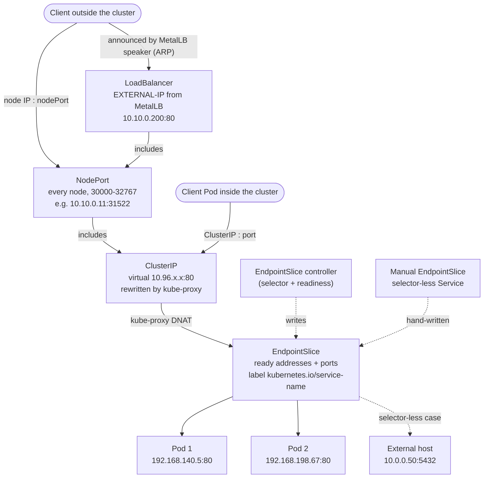

# T4.18 Use ClusterIP, NodePort, LoadBalancer service types and endpoints

> Competency: "Use ClusterIP, NodePort, LoadBalancer service types and endpoints" (CKA-5.3) | Domain/weight: CKA — Servicing and Networking (20%) | Est. time: 2.5 h | Prerequisites: T3.12, T4.17

Prerequisite lessons (read them first if a term below is new):

- [T3.12](../part3-ckad/T3.12-provide-and-troubleshoot-access-to-applications.md): what a Service is, the four port fields, selectors, DNS names, sessionAffinity, headless Services. This lesson does not re-teach them. It adds the admin side: how addresses and ports are allocated, how traffic enters the cluster, and how the endpoint objects behind a Service work.
- [T4.17](../part4-cka/T4.17-understand-connectivity-between-pods.md): the Pod network, the Service CIDR versus Pod CIDR versus node network, and how a packet travels between nodes.
- Background for the kube-proxy section: [T1.09](../part1-linux/T1.09-packet-filtering-iptables-and-nftables-basics.md) (iptables and nftables).

**Shell setup** (define once per terminal; used everywhere below):

```bash
alias k=kubectl
export do="--dry-run=client -o yaml"
export now="--force --grace-period=0"
source <(kubectl completion bash); complete -o default -F __start_kubectl k
```

**Where commands run.** Environment for the whole lesson: **vms**. Three Ubuntu LTS VMs `cp1`, `w1`, `w2`, prepared with `env/vm-prereqs.sh`, kubeadm 1.37.x, containerd 2.x, Calico v3.33.0, and MetalLB (chart 0.16.1) with an address range on the VM network. Cluster commands (`k ...`) run on `cp1`. Node commands (`iptables-save`, `nft`, `ip`) run on the node: `ssh w1`, then `sudo -i`, and `exit` when done. Never ssh from one node to another: each exam task is done on a designated host, you get an `ssh <nodename>` command, `sudo -i` gives root, and nested ssh is not supported ([LF tips page](https://docs.linuxfoundation.org/tc-docs/certification/tips-cka-and-ckad)). Open one terminal per node.

**About the outputs in this lesson.** This is a **vms** topic and the machine it was written on has no Multipass or KVM, so no cluster command could be run. Every cluster or node output block is labelled `EXPECTED OUTPUT (not captured)` and is listed in section 11. What I did check is the source code: I read the Kubernetes v1.37.1 source (kubeadm defaults, the Service warning text, the NodePort allocator, the kube-proxy health-check handler, the kubectl table printers, the kube-proxy chain names) and the MetalLB v0.16.1 source and manifests (CRD names, fields, printed columns, event text). Those facts are marked "checked in source" and listed in section 11 so you can confirm them on a live cluster. Treat the exact addresses and the exact wording of anything not marked "checked in source" as a guide, not a byte-for-byte promise.

**Example addresses used in every output, YAML and the diagram.** Your VMs will have different addresses. Read the pattern, not the digits. Replace them with your own wherever you see them.

| Item | Value in this lesson | Where it comes from |
|---|---|---|
| Node network | `10.10.0.0/24`: `cp1` 10.10.0.10, `w1` 10.10.0.11, `w2` 10.10.0.12 | The VM hypervisor (example) |
| Pod CIDR | `192.168.0.0/16` | `kubeadm init --pod-network-cidr`, Calico IPPool |
| Service CIDR | `10.96.0.0/12` | kubeadm default `serviceSubnet` (checked in source, section 2.3) |
| MetalLB pool for the worked example and the Easy lab | `10.10.0.200-10.10.0.220` | A free range on the node network, outside DHCP (example) |
| MetalLB pool for the break-fix lab | `10.10.0.230-10.10.0.235` | Same rule (example) |
| "External database" in the Medium lab | `cp1` itself, 10.10.0.10, port 5432 | A tiny web server started on the node (stand-in) |

---

## 1. Why this matters

A Pod IP changes every time a Pod is replaced, so nothing should talk to a Pod directly. A Service gives clients one stable address, and the Service **type** decides who can use it: only Pods (`ClusterIP`), anyone who can reach a node (`NodePort`), or anyone who can reach an address handed out by a load balancer (`LoadBalancer`). Behind every Service there is a list of real Pod addresses, kept in **EndpointSlice** objects. When a Service "does not work", that list is the first thing an admin reads.

Two things break in real life. First, on a kubeadm (bare-metal or VM) cluster nothing answers a `LoadBalancer` request, so the Service sits at `EXTERNAL-IP <pending>` forever until you install a controller such as MetalLB and give it a pool of addresses. Second, a NodePort that works from inside the cluster times out from outside because a firewall blocks the node port range. In the CKA domain "Servicing and Networking" (20% of the curriculum), you are expected to pick the right type, read endpoints, and fix both failures quickly. What exact tasks the exam asks for is UNVERIFIED; prepare to create, change and repair Services, not to memorise one recipe.

---

## 2. Concepts

### 2.1 The three types are layers, not alternatives

**What it is.** `ClusterIP`, `NodePort` and `LoadBalancer` build on each other. Each one contains the one before it.

| Type | What it adds | Who can reach it | Allocated by | Needs a controller outside Kubernetes? |
|---|---|---|---|---|
| `ClusterIP` (default) | A virtual IP from the Service CIDR | Pods and nodes in the cluster | kube-apiserver | No |
| `NodePort` | The same port number opened on **every** node, plus a ClusterIP | Anything that can reach a node IP | kube-apiserver (port from the node port range) | No |
| `LoadBalancer` | An external address from a load balancer, plus a NodePort and a ClusterIP | Anything that can reach that external address | A load balancer controller (cloud or MetalLB) | **Yes** |
| `ExternalName` (section 2.10) | A DNS CNAME only. No IP, no proxy | Pods, through DNS | Nobody (just DNS) | No |

**The problem it solves.** Pods need a stable address (ClusterIP). Clients outside the cluster need a way in without knowing Pod IPs (NodePort: any node, one known port). Production clients want one clean address and port, not "any of these three nodes on port 31522" (LoadBalancer). Each type solves the next problem on top of the previous one.

**How you see the layering.** Change the type of one Service and watch what stays. The ClusterIP is not replaced when you move from `ClusterIP` to `NodePort` to `LoadBalancer`; the node port is not replaced when you move to `LoadBalancer`. Section 5 does exactly this.

**What breaks without it.** If you think a LoadBalancer Service is something Kubernetes provides by itself, you will wait for an `EXTERNAL-IP` that never comes (section 2.5). If you think a NodePort is open only on the nodes that run the Pods, you will wrongly decide a node is "not part of the Service" (it is open on all of them).

**Related but different.**

- `hostPort` in a Pod spec binds a port on one node for one Pod. A NodePort binds the same port on every node for a whole Service. They are different mechanisms (see [T3.12](../part3-ckad/T3.12-provide-and-troubleshoot-access-to-applications.md) section 2.13).
- A Service routes at layer 4 (IP and port). Ingress and Gateway route at layer 7 (host and path) and sit in front of Services.
- `kubectl port-forward` is a debugging tunnel through the API server, not a Service type.

### 2.2 Under the hood: who does what

A Service is only an API object. Several components turn it into working traffic. When a Service misbehaves, finding which of these did not do its job is the whole skill.

| Step | Component | Runs where | Visible result |
|---|---|---|---|
| 1. Pick the ClusterIP, the `nodePort`, and for `Local` policy the `healthCheckNodePort` when the Service is created | kube-apiserver (allocators) | control plane | `k get svc` shows CLUSTER-IP and PORT(S) |
| 2. Keep the list of ready Pod addresses | EndpointSlice controller | in kube-controller-manager | `k get endpointslices` |
| 3. Mirror a hand-written legacy Endpoints object into slices | EndpointSlice mirroring controller | in kube-controller-manager | slices with another `managed-by` label (section 2.8) |
| 4. Hand out an external address and write it to `status.loadBalancer` | Load balancer controller: the cloud provider's, or MetalLB | cloud, or a Deployment in `metallb-system` | `EXTERNAL-IP` column |
| 5. Announce that address on the network | The cloud load balancer, or the MetalLB speaker Pod on a node | cloud, or every node | the address answers ARP/ping from your LAN |
| 6. Turn Service plus slices into packet rewriting rules | kube-proxy | **every node**, as a DaemonSet | iptables or nftables rules (section 2.12) |

kubeadm installs steps 1, 2, 3 and 6. It installs **nothing** for steps 4 and 5. That single fact explains the most common LoadBalancer failure on bare metal.

### 2.3 Service CIDR and IP allocation (ServiceCIDR and IPAddress objects)

**What it is.** The Service CIDR is the block of addresses that ClusterIPs are drawn from. These addresses are virtual: no network interface owns them, and kube-proxy rewrites them to a Pod IP before the packet leaves the node ([T4.17](../part4-cka/T4.17-understand-connectivity-between-pods.md) explains why it must not overlap the Pod CIDR or the node network).

**Where it is set.** The kube-apiserver flag is `--service-cluster-ip-range`. On a kubeadm cluster you do not type that flag; kubeadm writes it into `/etc/kubernetes/manifests/kube-apiserver.yaml` from `networking.serviceSubnet` in the `ClusterConfiguration` (or from `kubeadm init --service-cidr`). The kubeadm default is `10.96.0.0/12` (checked in source: `DefaultServicesSubnet = "10.96.0.0/12"` in the v1.37.1 kubeadm v1beta4 defaults). That block runs from 10.96.0.0 to 10.111.255.255, so it can collide with some VM networks.

```bash
# On cp1: where the flag lives and what it says (as root, because /etc/kubernetes is root-only)
sudo grep service-cluster-ip-range /etc/kubernetes/manifests/kube-apiserver.yaml
# Without logging in to the node (works from anywhere with kubectl):
k -n kube-system get pod -l component=kube-apiserver -o yaml | grep service-cluster-ip-range
```

EXPECTED OUTPUT (not captured):

```text
    - --service-cluster-ip-range=10.96.0.0/12
```

**The IP allocation objects (awareness).** Older clusters tracked used ClusterIPs in a hidden bitmap inside etcd, so the range could never change. Current clusters track them as real API objects in the `networking.k8s.io/v1` group (both types are registered in the v1.37.1 `networking/v1` API, checked in source):

| Object | Scope | What it is | `k get` columns (checked in source) |
|---|---|---|---|
| `ServiceCIDR` | Cluster | A range of addresses Services may use. The API server creates one named `kubernetes` from `--service-cluster-ip-range` | `NAME`, `CIDRS`, `AGE` |
| `IPAddress` | Cluster | One object per allocated ClusterIP. Its name **is** the IP. `spec.parentRef` names the Service that owns it | `NAME`, `PARENTREF`, `AGE` |

```bash
k get servicecidrs
k get ipaddresses
k get ipaddress 10.96.0.1 -o yaml     # who owns this address?
```

EXPECTED OUTPUT (not captured):

```text
NAME         CIDRS          AGE
kubernetes   10.96.0.0/12   3d

NAME         PARENTREF                       AGE
10.96.0.1    services/default/kubernetes     3d
10.96.0.10   services/kube-system/kube-dns   3d
...
```

`10.96.0.1` is always the first usable address and belongs to the `kubernetes` Service in the `default` namespace (the in-cluster path to the API server). `10.96.0.10` is the usual kube-dns address on kubeadm.

**Why it matters to an admin.** If the Service CIDR runs out ("range is full"), you can add another range by creating a second `ServiceCIDR` object. You no longer have to rebuild the cluster or restart the API server with a new flag. A ServiceCIDR cannot be removed while any IPAddress still lives inside it, so a range in use is protected. Step-by-step: [Extend Service IP ranges](https://kubernetes.io/docs/tasks/network/extend-service-ip-ranges/) (page name UNVERIFIED, see section 11).

```yaml
apiVersion: networking.k8s.io/v1
kind: ServiceCIDR
metadata:
  name: extra-range            # any DNS-subdomain name; the built-in one is called "kubernetes"
spec:
  cidrs:
  - 10.200.0.0/16              # must not overlap the Pod CIDR, node network, or another ServiceCIDR
                               # (up to 2 values: one IPv4 and/or one IPv6 for dual stack)
```

Do not apply this on your lab cluster unless you want to practice. It is shown so you recognise the object.

**Invalid values you will meet.** Setting `spec.clusterIP` by hand to an address outside every ServiceCIDR, or one that is already taken, is rejected at create time. The exact error wording in v1.37 is UNVERIFIED (section 11). The special values are an empty string (let the API server pick) and `None` (headless, see [T3.12](../part3-ckad/T3.12-provide-and-troubleshoot-access-to-applications.md)).

### 2.4 ClusterIP and NodePort: the admin details

**ClusterIP.** Covered in [T3.12](../part3-ckad/T3.12-provide-and-troubleshoot-access-to-applications.md). In this lesson it is the base layer: every NodePort and LoadBalancer Service also has one, and traffic that enters through the node port or the load balancer is rewritten to the ClusterIP's endpoints by the same rules.

**NodePort range.** The kube-apiserver flag `--service-node-port-range` sets which ports may be used as node ports. The default is **30000-32767** (checked in source: `Base: 30000, Size: 2768`). If you leave `spec.ports[].nodePort` empty the API server picks a free port from that range; if you set it, it must be inside the range and unused. Out of range and in-use values are rejected (messages checked in source):

EXPECTED OUTPUT (not captured; message text checked in source):

```text
The Service "web" is invalid: spec.ports[0].nodePort: Invalid value: 40000: provided port is not in the valid range. The range of valid ports is 30000-32767
```

An already-used port gives `provided port is already allocated`. The range is cluster-wide: two Services in two namespaces cannot share a node port.

To change the range on a kubeadm cluster, edit the static Pod manifest on every control-plane node. The kubelet notices the file change and restarts the API server by itself:

```bash
sudo vim /etc/kubernetes/manifests/kube-apiserver.yaml
#   under spec.containers[0].command add:   - --service-node-port-range=20000-32767
k -n kube-system get pod -l component=kube-apiserver -w      # wait for the new Pod to be Running
```

Risky values: a range that includes ports that host daemons already use on the nodes (for example 22, 10250, 6443) makes kube-proxy and the host fight over the port; a range smaller than the number of NodePort Services you need makes new Services fail with `range is full`. Check existing node ports before you shrink it: `k get svc -A -o jsonpath='{range .items[*]}{.metadata.name}{" "}{.spec.ports[*].nodePort}{"\n"}{end}'`.

**Opening the node port range on firewalls.** A NodePort listens on every node, so the range must be reachable on **every** node from wherever the clients are. Two places can block it:

1. A firewall **outside** the node (a cloud security group, a corporate firewall, a router). Open TCP (and UDP if you expose UDP) `30000-32767` to the client network on every node.
2. A firewall **on** the node (`ufw`, `firewalld`, hand-written nftables). On Ubuntu with ufw the rule is `sudo ufw allow 30000:32767/tcp`. Note that a node firewall that only filters packets destined to the node itself (the `INPUT` hook) does not see NodePort traffic after kube-proxy has rewritten the destination to a Pod IP; such packets are forwarded, not delivered locally. A firewall that drops in the earliest hook (`prerouting`) or in the forward path does see them. The break-fix lab uses an early drop on purpose. Whether a given firewall product blocks NodePorts depends on which hooks its rules use, so test, do not assume.

**How to tell a firewall from a Service problem.** From a Pod, `curl <nodeIP>:<nodePort>` and `curl <ClusterIP>:<port>` work, and on the node itself `curl <that node's own IP>:<nodePort>` works, but the same URL from another machine times out. Two different symptoms matter: a **timeout** means packets are dropped somewhere (firewall, routing, NetworkPolicy); **connection refused** means something answered with a reset (for example kube-proxy rejecting a Service with no endpoints). More than one cause produces each symptom, so use the checks above to separate them.

Declarative NodePort Service with an explicit port:

```yaml
apiVersion: v1
kind: Service
metadata:
  name: web-np
  namespace: lab-t418
spec:
  type: NodePort              # adds a node port on every node (and still has a ClusterIP)
  selector:
    app: web                  # Pods with this label become the endpoints
  ports:
  - name: http
    protocol: TCP             # default TCP; UDP and SCTP also allowed
    port: 80                  # the Service port (on the ClusterIP)
    targetPort: 80            # the Pod port; number or container port name; default = port
    nodePort: 30080           # optional; must be inside --service-node-port-range; empty = auto
```

### 2.5 LoadBalancer on bare metal: MetalLB, IPAddressPool, L2Advertisement

**What it is.** A `type: LoadBalancer` Service tells the cluster: "give me an external address". Kubernetes itself does nothing with that request. A **load balancer controller** watches for such Services, provisions the address, and writes it into the Service status:

```text
status:
  loadBalancer:
    ingress:
    - ip: 10.10.0.200        # or "hostname: abc.elb.amazonaws.com" on clouds that give a DNS name
```

(This is read-only status written by the controller. Never put it in a manifest you apply.) `k get svc` copies it into the `EXTERNAL-IP` column. Until then the column shows `<pending>`.

**The problem it solves, and what breaks without it.** On a cloud, the provider's controller (inside `cloud-controller-manager`) calls the cloud API and creates a real load balancer. A kubeadm cluster on your own VMs or bare metal has no cloud API, so **no controller exists**, and every LoadBalancer Service stays `<pending>`. **MetalLB** fills the gap: it is a controller plus a per-node "speaker" that announces addresses on your LAN.

**How MetalLB works (layer 2 mode, the one this lesson uses).**

1. You give MetalLB a **pool** of free addresses on the node network (`IPAddressPool`).
2. The MetalLB **controller** (a Deployment) assigns the next free pool address to each LoadBalancer Service and writes `status.loadBalancer.ingress`. It also posts a Service event: `Assigned IP "10.10.0.200"` (reason `IPAllocated`), or `Failed to allocate IP for "<ns>/<name>": no available IPs` (reason `AllocationFailed`). Both texts are checked in the v0.16.1 source.
3. An **L2Advertisement** tells MetalLB to announce pool addresses at layer 2. One **speaker** (a DaemonSet Pod) is elected for each address and answers ARP requests for it, so clients on the same network send the traffic to that node's MAC address.
4. The packet arrives on that node. kube-proxy has already programmed a rule for the external address on every node, so it is rewritten to a Pod just like NodePort traffic (section 2.12).

L2 mode is not a real load balancer on the wire: one node receives all the traffic for an address, then kube-proxy spreads it over Pods. If that node dies, another speaker takes over the address. MetalLB also has a BGP mode (`BGPPeer`, `BGPAdvertisement`) for routers that speak BGP; it is awareness material here. With kube-proxy in `ipvs` mode L2 needs `strictARP: true`; this lesson uses iptables (the default), so you do not need it.

**The MetalLB custom resources (checked in the v0.16.1 manifest).** The install adds nine CRDs: `ipaddresspools`, `l2advertisements`, `bgppeers`, `bgpadvertisements`, `bfdprofiles`, `communities`, `configurationstates`, `servicel2statuses` and `servicebgpstatuses` (all in group `metallb.io`). You write only the first two for layer 2. The last two are read-only status objects; `k -n metallb-system get servicel2statuses` shows which node announces each Service (columns `Allocated Node`, `Service Name`, `Service Namespace`).

**Install (reproducible).** Helm is not needed on the exam hosts for this; it is only the lab installer. Pin the versions from the course environment: Helm v4.3.1 and the MetalLB chart 0.16.1 (app v0.16.1).

```bash
# one time, on cp1 (skip if helm already exists). dpkg's architecture name matches Helm's tarball name.
ARCH=$(dpkg --print-architecture)
curl -fsSL https://get.helm.sh/helm-v4.3.1-linux-${ARCH}.tar.gz | tar -xz -C /tmp
sudo mv /tmp/linux-${ARCH}/helm /usr/local/bin/helm

helm repo add metallb https://metallb.github.io/metallb
helm repo update
helm install metallb metallb/metallb --version 0.16.1 \
  --namespace metallb-system --create-namespace --wait
k -n metallb-system get pods
k get crd | grep metallb.io
```

Without Helm, the plain manifest from the same release also works: `k apply -f https://raw.githubusercontent.com/metallb/metallb/v0.16.1/config/manifests/metallb-native.yaml` (the URL exists, checked). Whichever you use, wait until the controller Pod is Ready before you create a pool: MetalLB registers validating webhooks (for example `ipaddresspoolvalidationwebhook.metallb.io`), and a pool created while the webhook has no running backend is rejected (section 6).

EXPECTED OUTPUT (not captured):

```text
NAME                                  READY   STATUS    RESTARTS   AGE
metallb-controller-7d8f9c6b5-x2k4p    1/1     Running   0          40s
metallb-speaker-4hq8z                 4/4     Running   0          40s
metallb-speaker-9bd6m                 4/4     Running   0          40s
metallb-speaker-tl7wq                 4/4     Running   0          40s
```

(Pod name suffixes, the container count of the speaker, and whether a speaker runs on `cp1` depend on the chart; see section 11.)

**IPAddressPool fields (v1beta1, checked in the v0.16.1 source).**

| Field | Meaning | Default | Risky / invalid value |
|---|---|---|---|
| `spec.addresses` (required) | List of CIDRs (`10.10.0.192/28`) or ranges (`10.10.0.200-10.10.0.220`) MetalLB may hand out | none | Addresses that a node, a router, or a DHCP server already uses: two machines answer ARP for the same IP and clients reach the wrong one. A range outside the node network: nobody on the LAN can ARP for it |
| `spec.autoAssign` | `true`: the pool is used for any Service. `false`: only Services that ask for this pool by annotation | `true` | `false` and no annotation on the Service: the Service stays `<pending>` with an `AllocationFailed ... no available IPs` event |
| `spec.avoidBuggyIPs` | Skip addresses ending in `.0` and `.255` | `false` | Needed only for very old clients |
| `spec.serviceAllocation`, `namespaces`, `serviceSelectors` | Limit which namespaces or Services may use the pool | none | Over-restrictive selectors leave Services pending |

`metadata.namespace` must be the MetalLB namespace (`metallb-system` here); a pool in another namespace is ignored.

**L2Advertisement fields.**

| Field | Meaning | Default | Risky / invalid value |
|---|---|---|---|
| `spec.ipAddressPools` | Names of pools to announce | **empty = all pools** | A name that does not exist: that advertisement announces nothing |
| `spec.ipAddressPoolSelectors` | Select pools by label instead of by name | none | |
| `spec.nodeSelectors` | Only these nodes may announce | all nodes | Selecting nodes that cannot reach the client network |
| `spec.interfaces` | Only announce on these NIC names | all | A NIC name that does not exist |

A pool without any advertisement still gets addresses assigned, but nobody announces them. The Service shows an `EXTERNAL-IP`, yet clients on the LAN get no answer. This "assigned but unreachable" failure is in section 6.

**Choosing which address a Service gets (annotations).** Use annotations, not the old `spec.loadBalancerIP` field (deprecated since Kubernetes 1.24; `kubectl expose --load-balancer-ip` still sets it, so do not use that flag):

```text
metadata.annotations:
  metallb.io/address-pool: lab-pool            # take an address from this pool (works even when autoAssign is false)
  metallb.io/loadBalancerIPs: 10.10.0.205      # ask for this exact address (must be inside a pool)
```

A complete Service with both annotations is in section 4.2. Imperatively: `k -n lab-t418 annotate svc web metallb.io/address-pool=lab-pool`.

Both annotation names are checked in the v0.16.1 source.

**Other LoadBalancer fields worth knowing.**

| Field | Meaning | Default |
|---|---|---|
| `spec.loadBalancerClass` | Which controller handles this Service. MetalLB, started without `--lb-class`, **ignores** any Service that sets a class (checked in source) | unset |
| `spec.allocateLoadBalancerNodePorts` | `false` skips the node ports for LB Services (only valid if the LB sends to Pods directly) | `true` |
| `spec.loadBalancerSourceRanges` | Allowed client CIDRs; kube-proxy enforces it | none |
| `status.loadBalancer.ingress[].ipMode` | `VIP` or `Proxy`; set by the controller. With `VIP`, kube-proxy programs rules for the address on every node, so in-cluster traffic to it is handled locally. With `Proxy`, traffic to it must pass through the load balancer. Leave alone | `VIP` |

`loadBalancerClass` is immutable after the Service is created; to change it you delete and recreate the Service.

**Imperative way, and checking EXTERNAL-IP.**

```bash
k expose deploy web --type=LoadBalancer --port=80
k get svc web -o wide
curl http://<lb-ip>
```

Read the columns as: `TYPE` `LoadBalancer`, `CLUSTER-IP` the virtual IP, `EXTERNAL-IP` the address (or `<pending>`), `PORT(S)` `80:<nodePort>/TCP`, `SELECTOR` the label it matches. Full walkthrough in section 5.

### 2.6 externalTrafficPolicy: Cluster versus Local

**What it is.** A field on NodePort and LoadBalancer Services: `spec.externalTrafficPolicy`. It controls how traffic that **enters from outside** (through a node port or a load balancer address) is routed to Pods. It is rejected on a plain ClusterIP Service.

**The problem it solves.** With the default, a request that lands on a node may be sent to a Pod on another node. To make the reply find its way back through the same node, kube-proxy rewrites the source address to the node's own address (SNAT). The Pod therefore never sees the real client IP. If the application needs the client IP (logging, allow-lists, rate limits), you must use `Local`.

| | `Cluster` (default) | `Local` |
|---|---|---|
| Where traffic may go | Any ready endpoint in the cluster | Only ready endpoints on **the node that received the packet** |
| Client source IP seen by the Pod | **Lost**: SNAT to a node address (or tunnel address) | **Preserved** |
| Extra network hop | Possible (node to node) | None |
| A node with no local endpoint | Forwards to another node | **Drops the traffic** (the node refuses to forward) |
| Load spread | Even over all endpoints | Uneven: traffic is split over nodes first and then over that node's Pods, so a Pod on a node with few Pods gets a bigger share than a Pod on a crowded node |
| `healthCheckNodePort` | Not allocated | **Allocated** by the API server (LoadBalancer type) |

**The health check node port.** For a LoadBalancer Service with `Local`, the API server allocates `spec.healthCheckNodePort` (a port from the node port range; immutable once set). kube-proxy on every node opens that port and answers HTTP: status `200` if the node has at least one local ready endpoint, `503` if not, with a JSON body `{"service":{"namespace":...,"name":...},"localEndpoints":<n>,"serviceProxyHealthy":<bool>}` (checked in source). A cloud load balancer probes it and sends traffic only to nodes with local endpoints. MetalLB in L2 mode uses the same information to elect only nodes with local endpoints as the announcing node. This is why `Local` works well with a load balancer and badly with "any node's NodePort".

```bash
k patch svc web -p '{"spec":{"externalTrafficPolicy":"Local"}}'
k get svc web -o jsonpath='{.spec.externalTrafficPolicy}{"  "}{.spec.healthCheckNodePort}{"\n"}'
curl -s http://<node-ip>:<healthCheckNodePort>/healthz        # 200 + JSON on a node with a Pod, 503 on a node without
```

**Risky value:** `Local` with Pods on only one node, reached through a NodePort on the other nodes: those requests are dropped (timeouts). Fix: use a load balancer that health-checks nodes, or accept `Cluster`. Observation steps with real client IPs are in section 5.

### 2.7 internalTrafficPolicy

**What it is.** `spec.internalTrafficPolicy` applies to traffic that comes **from inside the cluster** (Pods and nodes) to the ClusterIP. Values:

| Value | Behaviour | Default |
|---|---|---|
| `Cluster` | Use any ready endpoint in the cluster | yes |
| `Local` | Use only ready endpoints **on the same node as the client**. If the node has none, the traffic is **dropped** (no fallback) | no |

**The problem it solves.** Node-local agents (a logging collector DaemonSet, a node-local cache) should talk to the copy on their own node, saving a network hop and keeping traffic on the node.

**Related but different.** `internalTrafficPolicy` is about clients **inside** (ClusterIP). `externalTrafficPolicy` is about clients **outside** (node port, load balancer). They are independent fields on the same Service. Set it like this:

```bash
k patch svc web -p '{"spec":{"internalTrafficPolicy":"Local"}}'
```

Observation (client Pod pinned to a node with and without an endpoint) is in section 5.

### 2.8 EndpointSlices

**What it is.** An **EndpointSlice** (`discovery.k8s.io/v1`) is a list of network endpoints (addresses plus ports) that back a Service. kube-proxy and CoreDNS read slices, not Services, to know where to send traffic.

**The problem it solves, and the old API.** The older `Endpoints` object kept every address of a Service in one object. With thousands of Pods one change rewrote and re-sent the whole object to every node. EndpointSlices split the list into small objects (at most 100 endpoints each by default, a limit of the controller manager flag `--max-endpoints-per-slice`; the API allows up to 1000). Only the changed slice is sent. The `v1 Endpoints` API is **deprecated**; read slices and mention Endpoints only if a question uses the word (the warning text is `Warning: v1 Endpoints is deprecated in v1.33+; use discovery.k8s.io/v1 EndpointSlice`, UNVERIFIED, section 11).

**Fields you must know.**

| Field | Meaning | Values / default |
|---|---|---|
| `addressType` | What kind of address each endpoint has | `IPv4`, `IPv6`, `FQDN`. Immutable |
| `endpoints[].addresses` | One or more addresses of the same type | Required, at least one |
| `endpoints[].conditions.ready` | Can receive normal traffic | `true`/`false`. `nil` (unset) must be read as `true` |
| `endpoints[].conditions.serving` | Would be ready if it were not terminating | Differs from `ready` only while the Pod is shutting down |
| `endpoints[].conditions.terminating` | The Pod has a deletion timestamp | `true` while shutting down |
| `endpoints[].nodeName`, `zone`, `hostname`, `targetRef` | Where the endpoint is and which Pod it is | Set by the controller for Pod endpoints |
| `ports[]` | `name`, `port`, `protocol`, `appProtocol` | One entry per distinct Service port |
| Label `kubernetes.io/service-name` | Which Service this slice belongs to | Required for a slice to be used |
| Label `endpointslice.kubernetes.io/managed-by` | Who owns the slice | `endpointslice-controller.k8s.io` for slices the built-in controller writes |

**The three conditions, in plain words.**

| State of the Pod | `ready` | `serving` | `terminating` | Who uses the endpoint |
|---|---|---|---|---|
| Running and passing its readiness probe | true | true | false | Everyone |
| Running but failing its readiness probe | false | false | false | Nobody |
| Being deleted, still passing readiness | **false** | true | true | Normally nobody; kube-proxy may use it as a last resort when no ready endpoint exists for traffic that needs `Local` placement, so connections do not fail during a rolling update |
| Being deleted and not passing readiness | false | false | true | Nobody |

`ready` is always false while a Pod terminates, so older consumers remove it at once. `serving` lets smarter consumers keep sending traffic to a Pod that is still answering. (The "last resort" use is the `ProxyTerminatingEndpoints` behaviour; confirm the exact rule in section 11.)

**How slices are created.** For a Service **with** a selector, the EndpointSlice controller creates and updates slices, sets the `kubernetes.io/service-name` label and `managed-by: endpointslice-controller.k8s.io`, and deletes them when the Service goes. For a Service **without** a selector it does nothing; you write the slice (section 2.9). A hand-written slice is never touched by the built-in controller as long as its `managed-by` label has a different value.

**Reading them.**

```bash
k get endpointslices -o wide
k get endpointslices -l kubernetes.io/service-name=web
k get endpointslice <name> -o yaml                  # see conditions, nodeName, targetRef
```

`-o wide` has the same five columns as the default output: `NAME`, `ADDRESSTYPE`, `PORTS`, `ENDPOINTS`, `AGE`. The `ENDPOINTS` column shows at most three addresses, then `+ N more...`; an empty slice prints `<unset>` (checked in the kubectl printer source). **It lists every address in the slice, including endpoints that are not ready.** So "I can see the Pod IP in `ENDPOINTS`" does not prove traffic reaches it. To see readiness:

```bash
k get endpointslices -l kubernetes.io/service-name=web \
  -o jsonpath='{range .items[*].endpoints[*]}{.addresses[0]}{"  ready="}{.conditions.ready}{"  serving="}{.conditions.serving}{"  terminating="}{.conditions.terminating}{"\n"}{end}'
```

The slice name is the Service name plus a random suffix (`web-x7k2p`), so filter by label, never by guessing the name.

### 2.9 Selector-less Services with manual EndpointSlices (external database)

**What it is.** A Service with no `spec.selector`. Kubernetes still gives it a ClusterIP and a DNS name, but there are no Pods to match, so the EndpointSlice controller creates nothing. You supply the backend addresses yourself in an EndpointSlice.

**The problem it solves.** Pods in the cluster need a stable in-cluster name (`ext-db`) for something that is not a Pod: a database on a VM, a service in another cluster, a backend you are migrating in. Applications use `ext-db:5432`, and you change the real address in one place.

**Choosing between the two ways to reach "something outside".**

| Target | Use | Why |
|---|---|---|
| An **IP address** (`10.0.0.50`) | Selector-less Service + manual EndpointSlice | kube-proxy load balances and rewrites to that IP |
| A **DNS name** (`db.example.com`) | `ExternalName` Service (section 2.10) | Only a DNS CNAME; no proxying |

Declarative pair (this is the YAML the exam-style task asks you to produce; every line is explained in section 4.2):

```yaml
apiVersion: v1
kind: Service
metadata:
  name: ext-db
  namespace: lab-t418
spec:
  ports:
  - name: pg
    port: 5432
    targetPort: 5432
---
apiVersion: discovery.k8s.io/v1
kind: EndpointSlice
metadata:
  name: ext-db-1
  namespace: lab-t418
  labels:
    kubernetes.io/service-name: ext-db
    endpointslice.kubernetes.io/managed-by: manual
addressType: IPv4
ports:
- name: pg
  protocol: TCP
  port: 5432
endpoints:
- addresses:
  - 10.0.0.50
  conditions:
    ready: true
```

**Rules that make or break it.**

- The slice must be in the **same namespace** as the Service and carry the label `kubernetes.io/service-name: <service name>`. Without the label the slice is ignored (section 6, failure 3).
- The slice `ports[].name` must match the Service `ports[].name`. The slice's `port` number is where traffic goes (this is the real target port; the Service `targetPort` does not change it for a selector-less Service).
- Use a `managed-by` value of your own. Never copy `endpointslice-controller.k8s.io`; that value tells the built-in controller the slice is its own.
- Endpoint addresses must not be loopback (127.0.0.0/8, ::1), link-local (169.254.0.0/16, fe80::/10), or the ClusterIP of another Service (kube-proxy cannot use a virtual IP as a destination).
- The controller does not health-check an external address. You set `conditions.ready` yourself; if the backend dies, traffic still goes there until you change the slice.
- A hand-written slice is not deleted when you delete the Service (the controller does not own it). Delete both.

### 2.10 ExternalName Services

**What it is.** A Service with `type: ExternalName` and `spec.externalName: <DNS name>`. It has no ClusterIP, no selector, no endpoints and no kube-proxy rules. When a Pod looks up `pay.lab-t418.svc.cluster.local`, cluster DNS answers with a **CNAME** to the external name, and the Pod then resolves that.

```yaml
apiVersion: v1
kind: Service
metadata:
  name: pay
  namespace: lab-t418
spec:
  type: ExternalName
  externalName: pay.example.com     # a DNS name, not an IP address; trailing dot not needed
```

```bash
k create service externalname pay --external-name=pay.example.com -n lab-t418     # imperative
```

**The problem it solves.** One stable in-cluster name for an outside DNS name, so you can move the target later by editing one field.

**Limits (what to say when asked "why does it not work").**

- No proxying: the client connects straight to the target. Port numbers are not translated, and `ports` on the Service are not used for routing.
- HTTP `Host` headers and TLS server names are the Service name (`pay`), not `pay.example.com`, so some HTTPS or virtual-host targets reject the request.
- An IP address in `externalName` is not a supported way to reach an IP; use a selector-less Service plus a slice.
- The name is resolved by the client's resolver at lookup time; no kube-proxy rule exists, so `NetworkPolicy` and Service-level features do not apply to the Service itself.

### 2.11 Service `externalIPs` is deprecated: do not use it

**What it is.** `spec.externalIPs` is a list of addresses on which a Service accepts traffic, on any node that receives it. Kubernetes does not manage those addresses: you must route them to a node yourself.

**Status.** Deprecated in v1.36, with removal planned for v1.43 (this lesson takes both from the topic specification; confirm against the v1.36 release notes, section 11). In v1.37 the API server returns a warning when you create or update such a Service. Text checked in the v1.37.1 source (`pkg/api/service/warnings.go`):

```text
Warning: spec.externalIPs is deprecated and may no longer be implemented in some clusters
```

(The leading `Warning: ` is added by kubectl when it prints an API warning.) For a headless Service the warning is `spec.externalIPs is ignored for headless services`; for `ExternalName` it is `spec.externalIPs is ignored when spec.type is "ExternalName"`.

**Why it is a risk.** Anyone who can create a Service can claim any IP, including one used by a real server or a node, and pull that traffic into the cluster (a known man-in-the-middle problem, CVE-2020-8554). The API server has an admission plugin, `DenyServiceExternalIPs`, to block the field.

| Need | Use instead |
|---|---|
| A stable external address | `LoadBalancer` with MetalLB (section 2.5) |
| A fixed port on every node | `NodePort` |
| HTTP/HTTPS routing | Ingress or Gateway (Part 3) |

This lesson uses `externalIPs` in no lab and in no solution. `kubectl expose --external-ip` sets this field, so do not use that flag either.

### 2.12 How kube-proxy implements the types

**What it is.** kube-proxy runs on every node (a DaemonSet in `kube-system`; its settings are in the ConfigMap `kube-proxy`). It watches Services and EndpointSlices and writes packet-rewriting rules into the kernel. It does **not** touch packets itself: the kernel does. A Service has no process listening on its ClusterIP; the address exists only as a match in a rule.

**Modes (see [T1.09](../part1-linux/T1.09-packet-filtering-iptables-and-nftables-basics.md) for the tools).**

| Mode | Kernel mechanism | Status | Notes |
|---|---|---|---|
| `iptables` | netfilter rules in the `nat` table | **Default on Linux** when `mode` is empty (checked in kube-proxy source) | Rule list grows with Services; fine for lab and exam clusters |
| `nftables` | an nftables table named `kube-proxy` | Supported alternative | With the `nftables` mode and no `nodePortAddresses` set, node ports answer only on each node's primary IP (checked in source) |
| `ipvs` | IP Virtual Server | **Deprecated** | Do not use; L2 MetalLB needs `strictARP` with it |

```bash
k -n kube-system get cm kube-proxy -o yaml | grep -E '^\s+mode:'      # mode: "" means the default, iptables
k -n kube-system get ds kube-proxy
```

**How each type becomes rules (iptables mode).** Chain name prefixes are checked in the v1.37.1 source; the hash after the prefix is generated.

| Chain | Role |
|---|---|
| `KUBE-SERVICES` | Entry point for traffic from Pods and the node. One rule per ClusterIP and port (and per LoadBalancer address) jumps to that Service's chain |
| `KUBE-NODEPORTS` | Matches traffic to a local address on a node port and jumps to the Service |
| `KUBE-EXT-<hash>` | External traffic path: marks the packet for masquerade (SNAT) when the policy is `Cluster` |
| `KUBE-SVC-<hash>` | The Service: picks one endpoint chain at random (`-m statistic --mode random`) |
| `KUBE-SVL-<hash>` | The Service chain used for `Local` traffic: picks only among local endpoints |
| `KUBE-FW-<hash>` | LoadBalancer path when `loadBalancerSourceRanges` is set |
| `KUBE-SEP-<hash>` | One endpoint: the DNAT to `PodIP:targetPort` |

So: **ClusterIP** = a `KUBE-SERVICES` match on `clusterIP:port` then `KUBE-SVC` then `KUBE-SEP` then DNAT. **NodePort** = the same, entered from `KUBE-NODEPORTS` through `KUBE-EXT`. **LoadBalancer** = also matches the external address in `KUBE-SERVICES`, so a packet to `10.10.0.200:80` arriving at any node is handled exactly like a NodePort packet. **ExternalName** and **headless** = no rules at all. A Service with no ready endpoints gets a reject rule, which is why a client sees *connection refused* quickly instead of a timeout (iptables mode; the symptom in nftables mode is UNVERIFIED).

```bash
# On a worker (ssh w1; sudo -i). iptables mode:
iptables-save -t nat | grep 'lab-t418/web'                  # rule comments carry namespace/name
iptables -t nat -L KUBE-SERVICES -n | head -20
# nftables mode:
nft list table ip kube-proxy | head -60
```

### 2.13 Related but different: quick reference

| Pair | Difference |
|---|---|
| `type` versus `externalTrafficPolicy` | `type` decides *how many entry points* exist; the policy decides *where they send traffic and whether the client IP survives* |
| `externalTrafficPolicy` versus `internalTrafficPolicy` | Outside clients versus inside clients |
| `EndpointSlice` versus `Endpoints` | Slices scale and are current; Endpoints is deprecated |
| Selector-less Service + slice versus `ExternalName` | IP target with proxying versus DNS name with no proxying |
| `NodePort` versus `LoadBalancer` | A LoadBalancer is a NodePort plus an external address; the external address needs a controller |
| ClusterIP `Service` versus `Pod` IP | The Service IP is virtual and stable; the Pod IP is real and short-lived |

---

## 3. How it works (diagram)



Walkthrough:

1. The three types are layers. A `LoadBalancer` Service **contains** a NodePort, and a NodePort **contains** a ClusterIP. Each layer adds one way in: the external address, the node port, the virtual IP.
2. Outside clients arrive through the external address (the MetalLB speaker answers ARP for it) or through a node IP and the node port. Inside clients use the ClusterIP. All three entry points end at the same place.
3. The ClusterIP is not a real address. kube-proxy on the node that receives the packet matches it and rewrites the destination (DNAT) to one **ready** address read from the EndpointSlice.
4. For a Service with a selector the EndpointSlice controller keeps the slice in step with matching Pods that are ready. For a selector-less Service you write the slice by hand and it can point outside the cluster.
5. `externalTrafficPolicy` changes only the outside arrows (SNAT or not, which nodes may forward). `internalTrafficPolicy` changes only the inside arrow.
6. Failure reading order, top to bottom: external address (pending?), node port (reachable?), ClusterIP (works from a Pod?), slice (any ready endpoint?), Pod (listening?).

---

## 4. Commands and YAML you must produce fast

### 4.1 Imperative shortcuts

Setup for the examples: namespace `lab-t418` and a Deployment `web` with the label `app=web`.

```bash
k create ns lab-t418
k -n lab-t418 create deploy web --image=nginx:1.27 --replicas=2
```

| Command | What it does |
|---|---|
| `k -n lab-t418 expose deploy web --port=80` | ClusterIP Service `web`. The selector is copied from the Deployment's Pod template labels. `--target-port` defaults to `--port` |
| `k -n lab-t418 expose deploy web --type=NodePort --port=80 --name=web-np` | NodePort Service with an auto-picked node port. You cannot set the node port with `expose` |
| `k -n lab-t418 create svc nodeport web-np --tcp=80:80 --node-port=30080` | NodePort with a **chosen** node port. `--tcp=<port>:<targetPort>`. The selector defaults to `app=<service name>`, so the name must equal the Pod label value |
| `k -n lab-t418 expose deploy web --type=LoadBalancer --port=80` | LoadBalancer Service `web`. This is the command to type; then read `EXTERNAL-IP` |
| `k -n lab-t418 create svc loadbalancer web-lb --tcp=80:80` | Same, with an explicit name and selector `app=web-lb` |
| `k -n lab-t418 get svc web -o wide` | Adds the `SELECTOR` column; check `EXTERNAL-IP` here |
| `k -n lab-t418 get endpointslices -o wide` | The backends of every Service in the namespace |
| `k -n lab-t418 get endpointslices -l kubernetes.io/service-name=web` | Only the slices of Service `web` |
| `k -n lab-t418 patch svc web -p '{"spec":{"type":"NodePort"}}'` | Change the type in place (the ClusterIP stays) |
| `k -n lab-t418 patch svc web -p '{"spec":{"externalTrafficPolicy":"Local"}}'` | Keep the client IP |
| `k -n lab-t418 patch svc web -p '{"spec":{"internalTrafficPolicy":"Local"}}'` | Node-local routing for in-cluster clients |
| `k create service externalname pay --external-name=pay.example.com -n lab-t418` | ExternalName Service |
| `k get ipaddresspools -n metallb-system` | MetalLB pools: `NAME`, `AUTO ASSIGN`, `AVOID BUGGY IPS`, `ADDRESSES` (columns checked in source) |
| `k get l2advertisements -n metallb-system` | MetalLB advertisements: `NAME`, `IPADDRESSPOOLS`, `IPADDRESSPOOL SELECTORS`, `INTERFACES` (columns checked in source) |
| `curl http://<lb-ip>` | Test the LoadBalancer from a machine on the node network (`cp1` is fine) |
| `k -n lab-t418 get svc web -o jsonpath='{.status.loadBalancer.ingress[0].ip}'` | Just the external IP, for scripts |

Add `$do` to any `create`/`expose` to print YAML instead of creating: `k -n lab-t418 expose deploy web --type=LoadBalancer --port=80 $do > svc.yaml`.

### 4.2 Declarative YAML

**MetalLB IPAddressPool and L2Advertisement** (apply on `cp1` after MetalLB is running):

```yaml
apiVersion: metallb.io/v1beta1
kind: IPAddressPool
metadata:
  name: lab-pool                  # referenced by name from the L2Advertisement
  namespace: metallb-system       # must be the MetalLB namespace, else the pool is ignored
spec:
  addresses:                      # required; CIDRs or start-end ranges
  - 10.10.0.200-10.10.0.220       # free addresses on the node network, outside DHCP, not any node IP
  autoAssign: true                # default true; false = only Services that ask by annotation
---
apiVersion: metallb.io/v1beta1
kind: L2Advertisement
metadata:
  name: lab-l2
  namespace: metallb-system
spec:
  ipAddressPools:                 # which pools to announce via ARP; empty list = all pools
  - lab-pool
```

```bash
k apply -f metallb-pool.yaml
k get ipaddresspools -n metallb-system
k get l2advertisements -n metallb-system
```

**Service without a selector plus a manual EndpointSlice** to an external database at `10.0.0.50:5432`:

```yaml
apiVersion: v1
kind: Service
metadata:
  name: ext-db
  namespace: lab-t418
spec:                              # no selector on purpose: nothing creates endpoints automatically
  ports:
  - name: pg                       # the slice port below must carry the same name
    protocol: TCP                  # default TCP
    port: 5432                     # what clients use: ext-db:5432
    targetPort: 5432               # kept for documentation; the slice port decides the real destination
---
apiVersion: discovery.k8s.io/v1
kind: EndpointSlice
metadata:
  name: ext-db-1                   # any name; the controller is not involved
  namespace: lab-t418              # same namespace as the Service
  labels:
    kubernetes.io/service-name: ext-db                     # REQUIRED: ties the slice to the Service
    endpointslice.kubernetes.io/managed-by: manual         # your own value; not the built-in controller's
addressType: IPv4                  # IPv4 | IPv6 | FQDN; immutable
ports:
- name: pg                         # matches Service port name "pg"
  protocol: TCP
  port: 5432                       # destination port on the external host
endpoints:
- addresses:
  - 10.0.0.50                      # the external database (not loopback, not link-local, not a ClusterIP)
  conditions:
    ready: true                    # you set this; nothing health-checks the address
```

```bash
k apply -f ext-db.yaml
k -n lab-t418 get endpointslices -l kubernetes.io/service-name=ext-db -o wide
```

EXPECTED OUTPUT (not captured; the printer columns are checked in source):

```text
NAME       ADDRESSTYPE   PORTS   ENDPOINTS    AGE
ext-db-1   IPv4          5432    10.0.0.50    5s
```

**LoadBalancer Service that keeps the client IP and asks for a pool and an address** (all optional fields explained):

```yaml
apiVersion: v1
kind: Service
metadata:
  name: web-lb
  namespace: lab-t418
  annotations:
    metallb.io/address-pool: lab-pool          # optional: take the address from this pool
    metallb.io/loadBalancerIPs: 10.10.0.205    # optional: this exact address (must be inside the pool and free)
spec:
  type: LoadBalancer                # ClusterIP + NodePort are created too
  selector:
    app: web
  externalTrafficPolicy: Local      # default Cluster; Local keeps the client IP, allocates healthCheckNodePort
  internalTrafficPolicy: Cluster    # default Cluster; Local = only endpoints on the client's node
  ports:
  - name: http
    protocol: TCP
    port: 80
    targetPort: 80
```

### 4.3 Speed drill

Setup (one line; run once). It creates the namespace, a Deployment `web` with two replicas, and a ClusterIP Service `web`. Every task is in `lab-t418`.

```bash
k create ns lab-t418; k -n lab-t418 create deploy web --image=nginx:1.27 --replicas=2; k -n lab-t418 expose deploy web --port=80
```

Tasks (target time in brackets). Do not open the answers until you have tried.

1. (2 min) Create a NodePort Service `web-np` for the Deployment `web`, Service port 80, node port exactly 30090.
2. (2 min) Create a LoadBalancer Service `web-lb` for `web` with one command. Print its node port.
3. (2 min) Make `web-lb` keep client IPs and print the health check node port it received.
4. (2 min) Make Service `web-np` send in-cluster traffic only to endpoints on the client's own node. Print the value back.
5. (4 min) Create a Service `ext-db` with no selector, port 5432, that reaches `10.0.0.50:5432` through a hand-written EndpointSlice. Show the slice for that Service.
6. (1 min) Create an ExternalName Service `pay` that points to `pay.example.com`.
7. (2 min) Print every address behind Service `web` with its `ready` condition, one per line.
8. (2 min) Find the cluster's Service CIDR in two ways (the API server flag, and the API objects).

<details><summary>Answers</summary>

```bash
# 1
k -n lab-t418 create svc nodeport web-np --tcp=80:80 --node-port=30090
# create svc nodeport defaults the selector to app=web-np, which matches nothing. Fix it so it selects the Deployment's Pods:
k -n lab-t418 set selector svc web-np app=web
k -n lab-t418 get svc web-np -o wide

# 2
k -n lab-t418 expose deploy web --type=LoadBalancer --port=80 --name=web-lb
k -n lab-t418 get svc web-lb -o jsonpath='{.spec.ports[0].nodePort}{"\n"}'
#   EXTERNAL-IP stays <pending> until a pool exists; the node port is already allocated.

# 3
k -n lab-t418 patch svc web-lb -p '{"spec":{"externalTrafficPolicy":"Local"}}'
k -n lab-t418 get svc web-lb -o jsonpath='{.spec.healthCheckNodePort}{"\n"}'

# 4
k -n lab-t418 patch svc web-np -p '{"spec":{"internalTrafficPolicy":"Local"}}'
k -n lab-t418 get svc web-np -o jsonpath='{.spec.internalTrafficPolicy}{"\n"}'

# 5  (YAML from section 4.2, saved as ext-db.yaml)
k apply -f ext-db.yaml
k -n lab-t418 get endpointslices -l kubernetes.io/service-name=ext-db -o wide

# 6
k create service externalname pay --external-name=pay.example.com -n lab-t418
k -n lab-t418 get svc pay -o wide

# 7
k -n lab-t418 get endpointslices -l kubernetes.io/service-name=web \
  -o jsonpath='{range .items[*].endpoints[*]}{.addresses[0]}{"  ready="}{.conditions.ready}{"\n"}{end}'

# 8
k -n kube-system get pod -l component=kube-apiserver -o yaml | grep service-cluster-ip-range
k get servicecidrs
```

Notes. In answer 1, `k create svc nodeport` sets the selector to `app=<name>`; here the name `web-np` would match nothing, so the second command repairs it (`k set selector` works on Services). A faster way is `k -n lab-t418 expose deploy web --type=NodePort --port=80 --name=web-np $do > s.yaml`, add the `nodePort: 30090` line with an editor, then `k apply -f s.yaml`.

</details>

Cleanup (the next section assumes a clean cluster; the second command waits until the namespace is really gone, so the next `k create ns lab-t418` does not fail):

```bash
k delete ns lab-t418
k wait --for=delete ns/lab-t418 --timeout=120s
```

---

## 5. Worked example

One Deployment, exposed step by step as `ClusterIP`, then `NodePort`, then `LoadBalancer`. We watch the layers, read the EndpointSlices, fix the pending address with MetalLB, keep the client IP with `Local`, and look at the kube-proxy rules. All output is `EXPECTED OUTPUT (not captured)`; addresses follow the example table at the top. Run cluster commands on `cp1`.

### Step 0. Prepare

Install MetalLB once per cluster (commands in section 2.5, which you can paste), then:

```bash
k create ns lab-t418
k -n lab-t418 create deploy web --image=nginx:1.27 --replicas=3
k -n lab-t418 rollout status deploy/web
k -n metallb-system get pods                 # controller 1/1 Running, one speaker per node
```

The MetalLB install is **not** removed by this lesson's cleanup. It is part of the baseline for the labs.

### Step 1. ClusterIP

```bash
k -n lab-t418 expose deploy web --port=80
k -n lab-t418 get svc web -o wide
k -n lab-t418 get endpointslices -o wide
```

EXPECTED OUTPUT (not captured):

```text
NAME   TYPE        CLUSTER-IP     EXTERNAL-IP   PORT(S)   AGE   SELECTOR
web    ClusterIP   10.96.134.21   <none>        80/TCP    4s    app=web

NAME        ADDRESSTYPE   PORTS   ENDPOINTS                                          AGE
web-x7k2p   IPv4          80      192.168.140.5,192.168.198.67,192.168.140.6         4s
```

What to read: `CLUSTER-IP` comes from the Service CIDR; `EXTERNAL-IP` is `<none>` because this type has no external address; `SELECTOR app=web` is what the controller matches. The slice name is the Service name plus a random suffix, and it lists the three Pod IPs (you can match them with `k -n lab-t418 get pods -o wide`).

Test from inside with a throw-away Pod:

```bash
k -n lab-t418 run t --rm -i --restart=Never --image=busybox:1.36 -- sh -c "sleep 2; wget -qO- -T3 http://web | grep -o '<title>.*</title>'"
```

EXPECTED OUTPUT (not captured):

```text
<title>Welcome to nginx!</title>
pod "t" deleted
```

### Step 2. NodePort (the ClusterIP stays)

```bash
k -n lab-t418 patch svc web -p '{"spec":{"type":"NodePort"}}'
k -n lab-t418 get svc web
NP=$(k -n lab-t418 get svc web -o jsonpath='{.spec.ports[0].nodePort}'); echo "nodePort=$NP"
W1=$(k get node w1 -o jsonpath='{.status.addresses[?(@.type=="InternalIP")].address}')
W2=$(k get node w2 -o jsonpath='{.status.addresses[?(@.type=="InternalIP")].address}')
curl -s -o /dev/null -w "w1 %{http_code}\n" http://$W1:$NP
curl -s -o /dev/null -w "w2 %{http_code}\n" http://$W2:$NP
```

EXPECTED OUTPUT (not captured):

```text
NAME   TYPE       CLUSTER-IP     EXTERNAL-IP   PORT(S)        AGE
web    NodePort   10.96.134.21   <none>        80:31522/TCP   40s
nodePort=31522
w1 200
w2 200
```

What to read: the `CLUSTER-IP` is unchanged. `PORT(S)` now reads `80:31522/TCP`: Service port, then node port. The node port answers on both workers, whichever node runs the Pods. If you pick a node port yourself it must lie in the node port range (section 2.4).

### Step 3. LoadBalancer: pending, then fixed

```bash
k -n lab-t418 patch svc web -p '{"spec":{"type":"LoadBalancer"}}'
k -n lab-t418 get svc web -o wide
k -n lab-t418 describe svc web | sed -n '/Events/,$p'
```

EXPECTED OUTPUT (not captured):

```text
NAME   TYPE           CLUSTER-IP     EXTERNAL-IP   PORT(S)        AGE   SELECTOR
web    LoadBalancer   10.96.134.21   <pending>     80:31522/TCP   2m    app=web

Events:  <none>
```

MetalLB is installed but has no pool, so there is nothing to assign. The controller only logs this at debug level (checked in source), so the Service shows **no event**. That silence is the clue: the Service is fine, the missing piece is the pool. The node port and ClusterIP did not change; they are the lower layers. Now add the pool and advertisement from section 4.2:

```bash
cat <<'YAML' | k apply -f -
apiVersion: metallb.io/v1beta1
kind: IPAddressPool
metadata:
  name: lab-pool
  namespace: metallb-system
spec:
  addresses:
  - 10.10.0.200-10.10.0.220
---
apiVersion: metallb.io/v1beta1
kind: L2Advertisement
metadata:
  name: lab-l2
  namespace: metallb-system
spec:
  ipAddressPools:
  - lab-pool
YAML
k get ipaddresspools -n metallb-system
k -n lab-t418 get svc web -o wide
k -n lab-t418 get svc web -o jsonpath='{.status.loadBalancer.ingress[0].ip}{"\n"}'
k -n lab-t418 describe svc web | sed -n '/Events/,$p'
```

EXPECTED OUTPUT (not captured; event text checked in the MetalLB v0.16.1 source):

```text
NAME       AUTO ASSIGN   AVOID BUGGY IPS   ADDRESSES
lab-pool   true          false             ["10.10.0.200-10.10.0.220"]

NAME   TYPE           CLUSTER-IP     EXTERNAL-IP   PORT(S)        AGE   SELECTOR
web    LoadBalancer   10.96.134.21   10.10.0.200   80:31522/TCP   3m    app=web

10.10.0.200

Events:
  Type    Reason       Age   From                Message
  ----    ------       ----  ----                -------
  Normal  IPAllocated  10s   metallb-controller  Assigned IP "10.10.0.200"
  Normal  nodeAssigned  10s   metallb-speaker     announcing from node "w1" with protocol "layer2"
```

(The reason and message of both events are checked in the MetalLB v0.16.1 source; the `From` column text and the node name are examples.) Test from `cp1`, which is on the node network:

```bash
LB=$(k -n lab-t418 get svc web -o jsonpath='{.status.loadBalancer.ingress[0].ip}')
curl -s -o /dev/null -w "lb %{http_code}\n" http://$LB
k -n metallb-system get servicel2statuses
```

EXPECTED OUTPUT (not captured):

```text
lb 200
NAME       ALLOCATED NODE   SERVICE NAME   SERVICE NAMESPACE
l2-xxxxx   w1               web            lab-t418
```

`ALLOCATED NODE` is the node whose speaker answers ARP for `10.10.0.200`. If your laptop can route to the node network you can also `curl http://10.10.0.200` from it.

The one-command form is `k -n lab-t418 expose deploy web --type=LoadBalancer --port=80` (on a fresh Service). It ends in the same state; we used `patch` so you could see the layers.

### Step 4. Read the EndpointSlice, including conditions

```bash
k -n lab-t418 get endpointslices -l kubernetes.io/service-name=web -o yaml | sed -n '1,45p'
k -n lab-t418 get endpointslices -l kubernetes.io/service-name=web \
  -o jsonpath='{range .items[*].endpoints[*]}{.addresses[0]}{"  ready="}{.conditions.ready}{"  serving="}{.conditions.serving}{"  terminating="}{.conditions.terminating}{"  node="}{.nodeName}{"\n"}{end}'
```

EXPECTED OUTPUT (not captured):

```text
apiVersion: v1
items:
- addressType: IPv4
  apiVersion: discovery.k8s.io/v1
  endpoints:
  - addresses:
    - 192.168.140.5
    conditions:
      ready: true
      serving: true
      terminating: false
    nodeName: w1
    targetRef:
      kind: Pod
      name: web-6d9f8c7b5-4kq2m
      namespace: lab-t418
  ...
  kind: EndpointSlice
  metadata:
    labels:
      endpointslice.kubernetes.io/managed-by: endpointslice-controller.k8s.io
      kubernetes.io/service-name: web
    name: web-x7k2p
    ...
  ports:
  - name: ""
    port: 80
    protocol: TCP

192.168.140.5  ready=true  serving=true  terminating=false  node=w1
192.168.198.67  ready=true  serving=true  terminating=false  node=w2
192.168.140.6  ready=true  serving=true  terminating=false  node=w1
```

Now see what "no endpoints" looks like, then restore:

```bash
k -n lab-t418 scale deploy web --replicas=0
k -n lab-t418 get endpointslices -o wide
k -n lab-t418 get svc web                         # the Service itself is unchanged
k -n lab-t418 scale deploy web --replicas=3 && k -n lab-t418 rollout status deploy/web
```

EXPECTED OUTPUT (not captured; the `<unset>` text is checked in the printer source):

```text
NAME        ADDRESSTYPE   PORTS   ENDPOINTS   AGE
web-x7k2p   IPv4          80      <unset>     6m
```

### Step 5. externalTrafficPolicy: Cluster versus Local, with the real client IP

The test reads the client address in the nginx access log. Use `cp1` as the client (its address is 10.10.0.10). Run one request, then read the last log line of one Pod. To avoid guessing which Pod served it, tail all three:

```bash
k -n lab-t418 patch svc web -p '{"spec":{"externalTrafficPolicy":"Cluster"}}'
curl -s -o /dev/null http://$LB
k -n lab-t418 logs -l app=web --tail=1 --prefix | tail -3          # Cluster: look at the first field of the newest line
k -n lab-t418 patch svc web -p '{"spec":{"externalTrafficPolicy":"Local"}}'
k -n lab-t418 get svc web -o jsonpath='{.spec.externalTrafficPolicy}{"  hcPort="}{.spec.healthCheckNodePort}{"\n"}'
curl -s -o /dev/null http://$LB
k -n lab-t418 logs -l app=web --tail=1 --prefix | tail -3          # Local: the first field is 10.10.0.10
```

EXPECTED OUTPUT (not captured; the Cluster address is CNI- and node-dependent, see section 11):

```text
[pod/web-6d9f8c7b5-4kq2m/nginx] 10.10.0.11 - - [28/Oct/2026:09:14:02 +0000] "GET / HTTP/1.1" 200 615 "-" "curl/8.5.0" "-"
...
Local  hcPort=32301
[pod/web-6d9f8c7b5-9wzr7/nginx] 10.10.0.10 - - [28/Oct/2026:09:14:40 +0000] "GET / HTTP/1.1" 200 615 "-" "curl/8.5.0" "-"
```

What to read: under `Cluster` the first field is a node (or tunnel) address, not `10.10.0.10`: the client IP was replaced by SNAT. Under `Local` it is the real `10.10.0.10`. Now the health check port, from `cp1`, against a node that has a Pod and one that has none. Scale to one replica, find its node, then probe both workers:

```bash
HC=$(k -n lab-t418 get svc web -o jsonpath='{.spec.healthCheckNodePort}')
k -n lab-t418 scale deploy web --replicas=1 && k -n lab-t418 rollout status deploy/web
k -n lab-t418 get pod -l app=web -o wide
curl -s -w "  -> %{http_code}\n" http://$W1:$HC/healthz
curl -s -w "  -> %{http_code}\n" http://$W2:$HC/healthz
```

EXPECTED OUTPUT (not captured; JSON shape checked in source):

```text
NAME                  READY   STATUS    ...   NODE
web-6d9f8c7b5-4kq2m   1/1     Running   ...   w1

{"service":{"namespace":"lab-t418","name":"web"},"localEndpoints":1,"serviceProxyHealthy":true}  -> 200
{"service":{"namespace":"lab-t418","name":"web"},"localEndpoints":0,"serviceProxyHealthy":true}  -> 503
```

That 200/503 pair is what a load balancer uses to decide which nodes may receive traffic. Calling the **node port** of `w2` (the node with no Pod) now times out under `Local`:

```bash
NP=$(k -n lab-t418 get svc web -o jsonpath='{.spec.ports[0].nodePort}')
curl -s -m 4 -o /dev/null -w "w1 %{http_code}\n" http://$W1:$NP
curl -s -m 4 -o /dev/null -w "w2 %{http_code}\n" http://$W2:$NP; echo "exit=$?"
```

EXPECTED OUTPUT (not captured):

```text
w1 200
w2 000
exit=28
```

(`curl -w` prints `000` when no HTTP response arrives; exit code 28 is curl's "operation timed out". The output assumes the Pod runs on `w1`; if it runs on `w2` the two lines swap.) Return to the default before moving on: `k -n lab-t418 patch svc web -p '{"spec":{"externalTrafficPolicy":"Cluster"}}'`.

### Step 6. internalTrafficPolicy: Local

One replica is running (from Step 5). Find its node, then pin one client to that node and one to the other worker with `nodeName` (setting `nodeName` skips the scheduler, so the control-plane taint does not matter, but we use the two workers anyway):

```bash
NODE=$(k -n lab-t418 get pod -l app=web -o jsonpath='{.items[0].spec.nodeName}')
OTHER=$(printf '%s\n' w1 w2 | grep -vx "$NODE")
k -n lab-t418 patch svc web -p '{"spec":{"internalTrafficPolicy":"Local"}}'
for N in $NODE $OTHER; do
  echo "== client on $N"
  k -n lab-t418 run c-$N --rm -i --restart=Never --image=busybox:1.36 \
    --overrides="{\"spec\":{\"nodeName\":\"$N\"}}" \
    -- sh -c "sleep 2; wget -qO- -T3 http://web | grep -o '<title>.*</title>'"
done
```

EXPECTED OUTPUT (not captured):

```text
== client on w1
<title>Welcome to nginx!</title>
pod "c-w1" deleted
== client on w2
wget: download timed out
pod "c-w2" deleted
```

The first client (on the node that has the endpoint, `w1` in this output) works; the second client (on the other node) gets no answer (the exact failure text may be `timed out` or `Connection refused`; see section 11). Set it back: `k -n lab-t418 patch svc web -p '{"spec":{"internalTrafficPolicy":"Cluster"}}'`.

### Step 7. ExternalName

```bash
k -n lab-t418 create service externalname alias --external-name=web.lab-t418.svc.cluster.local
k -n lab-t418 get svc alias
k -n lab-t418 run t --rm -i --restart=Never --image=busybox:1.36 -- sh -c "sleep 2; nslookup alias.lab-t418.svc.cluster.local"
```

EXPECTED OUTPUT (not captured; `nslookup` formatting differs by busybox version):

```text
NAME    TYPE           CLUSTER-IP   EXTERNAL-IP                         PORT(S)   AGE
alias   ExternalName   <none>       web.lab-t418.svc.cluster.local      <none>    3s
Server:   10.96.0.10
...
Name:     alias.lab-t418.svc.cluster.local
Address:  10.96.134.21
```

`CLUSTER-IP` is `<none>`: there is no virtual IP, only a DNS answer. The name resolves to whatever the target resolves to (here the ClusterIP of `web`).

### Step 8. See the rules kube-proxy wrote

On the worker (terminal 2: `ssh w1`, then `sudo -i`):

```bash
iptables-save -t nat | grep 'lab-t418/web' | head -12
```

EXPECTED OUTPUT (not captured; hashes will differ):

```text
-A KUBE-NODEPORTS -p tcp -m comment --comment "lab-t418/web" -m tcp --dport 31522 -j KUBE-EXT-XXXXXXXXXXXXXXXX
-A KUBE-SERVICES -d 10.96.134.21/32 -p tcp -m comment --comment "lab-t418/web cluster IP" -m tcp --dport 80 -j KUBE-SVC-XXXXXXXXXXXXXXXX
-A KUBE-SERVICES -d 10.10.0.200/32 -p tcp -m comment --comment "lab-t418/web loadbalancer IP" -m tcp --dport 80 -j KUBE-EXT-XXXXXXXXXXXXXXXX
-A KUBE-SVC-XXXXXXXXXXXXXXXX -m comment --comment "lab-t418/web -> 192.168.140.5:80" -j KUBE-SEP-XXXXXXXXXXXXXXXX
-A KUBE-SEP-XXXXXXXXXXXXXXXX -p tcp -m comment --comment "lab-t418/web" -m tcp -j DNAT --to-destination 192.168.140.5:80
```

Match this to section 2.12: the three entry points (node port, cluster IP, load balancer IP) all lead to the same Service chain, and the endpoint chain does the DNAT to the Pod. If your kube-proxy runs in nftables mode, use `nft list table ip kube-proxy | grep -n 'lab-t418/web'`.

### Step 9. Cleanup (back to baseline: MetalLB installed, no pool)

```bash
k delete ns lab-t418
k -n metallb-system delete ipaddresspool lab-pool
k -n metallb-system delete l2advertisement lab-l2
```

---

## 6. Common mistakes and how to fix them

Text that is "checked in source" was read in the Kubernetes v1.37.1 or MetalLB v0.16.1 source. Everything else about wording is a guide; the failure is real, the exact words may differ.

| # | Symptom | What you will see | Cause | Fix (command) |
|---|---|---|---|---|
| 1 | LoadBalancer Service never gets an address | `k get svc web`: `EXTERNAL-IP <pending>`. `k describe svc web`: **no events** if MetalLB has no pool; `AllocationFailed  Failed to allocate IP for "lab-t418/web": no available IPs` if a pool exists but cannot serve this Service (pool full, or `autoAssign: false` without an annotation) | kubeadm has no load balancer controller; or MetalLB is installed without a usable pool | `k get pods -n metallb-system`; `k get ipaddresspools -n metallb-system`; install MetalLB, then `k apply -f metallb-pool.yaml` (section 4.2) |
| 2 | The app sees the wrong client IP | Access logs show a node address, never the real client | `externalTrafficPolicy: Cluster` (default) SNATs external traffic | `k patch svc web -p '{"spec":{"externalTrafficPolicy":"Local"}}'`. Accept that nodes without a local Pod stop serving and the spread is uneven |
| 3 | A hand-written EndpointSlice has no effect | `k get endpointslices -l kubernetes.io/service-name=ext-db` prints `No resources found in lab-t418 namespace.`; clients get an immediate `Connection refused` (iptables mode) | The slice has no label `kubernetes.io/service-name: ext-db` (or a wrong value, or is in another namespace) | `k -n lab-t418 label endpointslice ext-db-1 kubernetes.io/service-name=ext-db` |
| 4 | NodePort works from a Pod but not from outside | `curl -m 5 http://<node-ip>:<nodePort>` from another machine: `curl: (28) Connection timed out after 5001 milliseconds`; from the node itself it usually works | A firewall on the path or on the node drops the node port range | Open `30000-32767/tcp` on every node (`sudo ufw allow 30000:32767/tcp`, cloud security group, or remove the nft/iptables drop rule) |
| 5 | Service has no backends | `k get endpointslices -o wide`: `ENDPOINTS <unset>`; clients: `Connection refused` | `selector` matches no Pod, or the Pods are not Ready | `k get svc web -o jsonpath='{.spec.selector}'`; `k get pods --show-labels`; fix the selector (`k set selector svc web app=web`) or the readiness probe |
| 6 | The LoadBalancer has an address but nobody on the LAN reaches it | `EXTERNAL-IP 10.10.0.200`, `curl` from another machine times out | No `L2Advertisement` for the pool; or the pool range is on a different network from the nodes; or another host already owns the IP | `k get l2advertisements -n metallb-system`; `k -n metallb-system get servicel2statuses`; `arping -I <nic> 10.10.0.200` from a LAN machine |
| 7 | Only some nodes answer on the node port | With `Local`: nodes without a Pod time out | `externalTrafficPolicy: Local` drops on nodes with no local endpoint | Send traffic only to nodes with a Pod (health-checked load balancer), or use `Cluster` |
| 8 | Service rejected at creation | `The Service "web" is invalid: spec.ports[0].nodePort: Invalid value: 40000: provided port is not in the valid range. The range of valid ports is 30000-32767` (checked in source). Or `provided port is already allocated` | Port outside `--service-node-port-range`, or used by another Service | Pick a port in range (`k get svc -A` to see used ones), or leave `nodePort` empty |
| 9 | MetalLB pool or advertisement rejected | `Error from server (InternalError): ... Internal error occurred: failed calling webhook "ipaddresspoolvalidationwebhook.metallb.io": ...` (webhook name checked in the manifest; the rest of the line varies) | You applied the pool before the MetalLB controller (which serves the webhook) was Ready | `k -n metallb-system get pods`; `k -n metallb-system get endpointslices` (the webhook Service must have an endpoint); retry after the controller is `1/1 Running` |
| 10 | ExternalName does not connect | DNS answers, TLS error `certificate is valid for pay.example.com, not pay`, or no answer for an IP | The client sends the Service name as host/SNI; or an IP was used as `externalName` | Use the real name in the client, or use a selector-less Service plus an EndpointSlice for IP targets |

### 6.1 Reasoning: EXTERNAL-IP stays `<pending>` (failure 1)

The Service is fine; something that should react to it did not. Walk down the list in this order:

```bash
k get svc web -o wide                                     # 1. Is it really type LoadBalancer? Is EXTERNAL-IP <pending>?
k describe svc web | sed -n '/Events/,$p'                 # 2. Any events? Read the Reason column.
k get pods -n metallb-system                              # 3. Is a controller running at all?
k get ipaddresspools -n metallb-system                    # 4. Is there a pool? AUTO ASSIGN true? Addresses right?
k get l2advertisements -n metallb-system                  # 5. Is the pool announced?
k -n metallb-system logs deploy/metallb-controller --tail=20    # 6. What did the controller decide? (deployment name depends on the install method)
```

How to read it:

- Step 3 says `No resources found` or the namespace does not exist: **no controller**. Nothing in Kubernetes assigns external addresses on kubeadm. Install MetalLB (section 2.5).
- Steps 3 fine, step 4 says `No resources found`: MetalLB has no addresses to give. It logs this at debug level only, so step 2 shows **no events**. Create the pool and advertisement (section 4.2).
- Step 2 shows `AllocationFailed ... no available IPs`: a pool exists but cannot serve this Service. Look at the pool's `AUTO ASSIGN` column (`false` needs the `metallb.io/address-pool` annotation), the range size against the number of LoadBalancer Services, and any `serviceAllocation`/namespace restrictions.
- Everything exists but the Service stays `<pending>`: check `k get svc web -o jsonpath='{.spec.loadBalancerClass}'`. A set class makes MetalLB ignore the Service; the field cannot be changed, so delete and recreate the Service without it.

### 6.2 Reasoning: client IP lost (failure 2)

1. Confirm the symptom with a real request, not by assumption. From a machine with a known IP: `curl -s -o /dev/null http://<lb-ip>`, then read the first field of the newest access-log line: `k -n lab-t418 logs -l app=web --tail=1 --prefix`.
2. Read the policy: `k get svc web -o jsonpath='{.spec.externalTrafficPolicy}'`. `Cluster` explains it: kube-proxy marks external traffic for masquerade so the reply can return through the node that received it.
3. Fix with `Local`. Then check the two consequences: `k get svc web -o jsonpath='{.spec.healthCheckNodePort}'` shows the new port, and every node without a local Pod answers `503` on that port and drops node-port traffic. If the Pods all sit on one node, spread them (more replicas, or `topologySpreadConstraints`) or traffic concentrates on that node.
4. Check with the request from step 1 again. The first field must now be the client's own address. If it is still a node address, the traffic did not enter through the Service address you think (a second proxy or load balancer in front also rewrites it).

### 6.3 Reasoning: manual EndpointSlice ignored (failure 3)

The Service object looks right (`k get svc ext-db` shows a ClusterIP) and the slice exists (`k get endpointslices` lists `ext-db-1`), yet clients cannot connect.

```bash
k -n lab-t418 get svc ext-db -o wide                          # 1. SELECTOR is <none>: expected for this design
k -n lab-t418 get endpointslices --show-labels                # 2. Is the label kubernetes.io/service-name=ext-db on the slice?
k -n lab-t418 get endpointslices -l kubernetes.io/service-name=ext-db     # 3. The query kube-proxy effectively makes: empty = ignored
k -n lab-t418 get endpointslice ext-db-1 -o yaml              # 4. Port name equals the Service port name? Address valid? ready: true?
```

Step 3 is the decisive test: kube-proxy and DNS find a Service's slices through that label. An empty answer means the slice is invisible to them. After the fix, step 3 lists the slice and the same `wget`/`nc` from a Pod works. If the label is present but traffic still fails, the next suspects are in order: the slice port `name` differs from the Service port name (kube-proxy matches by name), the address is wrong or unreachable from the Pod network (test it directly: `wget -T3 http://10.0.0.50:5432` from a Pod), and `conditions.ready` is `false`.

### 6.4 Reasoning: NodePort blocked by a firewall (failure 4)

A timeout can have many causes, so separate them with three tests, in this order (all from `cp1` unless noted):

```bash
k -n lab-t418 run t --rm -i --restart=Never --image=busybox:1.36 -- sh -c "sleep 2; wget -qO- -T3 http://shop | grep -c nginx"   # 1. ClusterIP from a Pod works? => Service, slices and Pods are fine
# On the target node (ssh w1; sudo -i):
curl -s -m 5 -o /dev/null -w '%{http_code}\n' http://<w1-ip>:30081      # 2. node port on the node itself works?
# Back on cp1:
curl -s -m 5 -o /dev/null -w '%{http_code}\n' http://<w1-ip>:30081      # 3. from another machine: timeout?
```

- Test 1 fails: it is not a firewall. Go back to failure 5 (endpoints).
- Test 1 and 2 work, test 3 times out: the Service is healthy and only **inbound** traffic from other machines is lost. That is the firewall pattern. (Test 2 usually passes because a request made on the node itself takes a different hook path: kube-proxy's local output rules rewrite the destination before any early inbound filter sees it. This is a pattern, not a guarantee; section 11 lists it.)
- Find the filter on the node: `nft list ruleset` and `iptables-save` (look for `drop`/`reject` on a `dport` range that contains your node port, and for counters that grow when you retry test 3), `ufw status verbose`, and then outside the node (cloud security group).
- Fix: allow the range, or delete the offending rule. Retest 3.

---

## 7. Labs

**Lab order.** Any order. Each lab ends with a cleanup that returns the cluster to the baseline: MetalLB installed (section 2.5) with **no** pool or advertisement, and no `lab-t418` namespace. Do the worked example (section 5) first if you have not installed MetalLB yet.

**Environment (all labs): vms.** `cp1`, `w1`, `w2` as at the top of the lesson, MetalLB chart 0.16.1 installed. `k` commands run on `cp1`; node commands run in a second terminal on the node (`ssh w1`, `sudo -i`). If your node network is not `10.10.0.0/24`, replace the addresses in the pool YAML and in the checks.

### 7.1 Lab Easy: expose one app as all three types

**Setup** (cp1):

```bash
mkdir -p ~/lab/t418
k create ns lab-t418
k -n lab-t418 create deploy store --image=nginx:1.27 --replicas=2
k -n lab-t418 rollout status deploy/store
```

**Task.** In namespace `lab-t418` the Deployment `store` (2 replicas, label `app=store`) exists.

1. In namespace `metallb-system` create an `IPAddressPool` named `lab-pool` with the range `10.10.0.200-10.10.0.220` and an `L2Advertisement` named `lab-l2` that announces that pool.
2. Create three Services for `store`: `store-ip` (type ClusterIP, port 80), `store-np` (type NodePort, port 80, node port exactly **30080**) and `store-lb` (type LoadBalancer, port 80).
3. Write the external IP of `store-lb` (only the address) to `~/lab/t418/lb-ip.txt`.
4. Prove access from inside the cluster (a throw-away Pod using the Service name) and from outside (`curl` from `cp1` to the load balancer address and to the node port on both workers).

<details><summary>Hints</summary>

1. `k create svc clusterip|nodeport|loadbalancer NAME --tcp=80:80` sets the selector to `app=NAME`, which does **not** match `app=store`. Either generate YAML with `$do` and fix the selector, or run `k set selector svc NAME app=store` afterwards.
2. `--node-port=30080` is a flag of `k create svc nodeport`.
3. The address is at `.status.loadBalancer.ingress[0].ip`. If `EXTERNAL-IP` stays `<pending>`, you are missing the pool or the advertisement (section 6.1).

</details>

<details><summary>Solution</summary>

**Why in this order.** The pool must exist before the LoadBalancer Service can receive an address, and the Services need the right selector or they have no endpoints.

```bash
cat <<'YAML' | k apply -f -
apiVersion: metallb.io/v1beta1
kind: IPAddressPool
metadata:
  name: lab-pool
  namespace: metallb-system
spec:
  addresses:
  - 10.10.0.200-10.10.0.220
---
apiVersion: metallb.io/v1beta1
kind: L2Advertisement
metadata:
  name: lab-l2
  namespace: metallb-system
spec:
  ipAddressPools:
  - lab-pool
YAML

k -n lab-t418 create svc clusterip store-ip --tcp=80:80
k -n lab-t418 create svc nodeport store-np --tcp=80:80 --node-port=30080
k -n lab-t418 create svc loadbalancer store-lb --tcp=80:80
for s in store-ip store-np store-lb; do k -n lab-t418 set selector svc $s app=store; done     # the defaults were app=store-ip, ...

k -n lab-t418 get svc -o wide
k -n lab-t418 get endpointslices -o wide                      # each Service has a slice with 2 addresses
k -n lab-t418 get svc store-lb -o jsonpath='{.status.loadBalancer.ingress[0].ip}' > ~/lab/t418/lb-ip.txt
cat ~/lab/t418/lb-ip.txt
```

**Test inside** (ClusterIP by name, DNS and kube-proxy):

```bash
k -n lab-t418 run t --rm -i --restart=Never --image=busybox:1.36 -- sh -c "sleep 2; wget -qO- -T3 http://store-ip | grep -o '<title>.*</title>'"
```

**Test outside** (from `cp1`, which is outside the Pod network):

```bash
LB=$(cat ~/lab/t418/lb-ip.txt)
W1=$(k get node w1 -o jsonpath='{.status.addresses[?(@.type=="InternalIP")].address}')
W2=$(k get node w2 -o jsonpath='{.status.addresses[?(@.type=="InternalIP")].address}')
curl -s -o /dev/null -w "lb %{http_code}\n" http://$LB
curl -s -o /dev/null -w "w1 %{http_code}\n" http://$W1:30080
curl -s -o /dev/null -w "w2 %{http_code}\n" http://$W2:30080
```

Expected: `200` three times. Note that `store-lb` also owns its own node port (auto-assigned) and a ClusterIP: a LoadBalancer Service contains the other two layers.

</details>

**Verification** (each line prints `PASS-n` or `FAIL-n`):

```bash
LB=$(k -n lab-t418 get svc store-lb -o jsonpath='{.status.loadBalancer.ingress[0].ip}')
W1=$(k get node w1 -o jsonpath='{.status.addresses[?(@.type=="InternalIP")].address}')
W2=$(k get node w2 -o jsonpath='{.status.addresses[?(@.type=="InternalIP")].address}')
test "$(k -n metallb-system get ipaddresspool lab-pool -o name)" = ipaddresspool.metallb.io/lab-pool && echo PASS-1 || echo FAIL-1
test "$(k -n metallb-system get l2advertisement lab-l2 -o jsonpath='{.spec.ipAddressPools[0]}')" = lab-pool && echo PASS-2 || echo FAIL-2
test "$(k -n lab-t418 get svc store-ip -o jsonpath='{.spec.type}')" = ClusterIP && echo PASS-3 || echo FAIL-3
test "$(k -n lab-t418 get svc store-np -o jsonpath='{.spec.type}/{.spec.ports[0].nodePort}')" = NodePort/30080 && echo PASS-4 || echo FAIL-4
echo "$LB" | grep -Eq '^[0-9]+(\.[0-9]+){3}$' && echo PASS-5 || echo FAIL-5
test "$(cat ~/lab/t418/lb-ip.txt)" = "$LB" && echo PASS-6 || echo FAIL-6
for s in store-ip store-np store-lb; do
  test "$(k -n lab-t418 get endpointslices -l kubernetes.io/service-name=$s -o jsonpath='{.items[*].endpoints[*].conditions.ready}')" = "true true" && echo "PASS-7 $s" || echo "FAIL-7 $s"
done
test "$(curl -s -m 5 -o /dev/null -w '%{http_code}' http://$LB)" = 200 && echo PASS-8 || echo FAIL-8
test "$(curl -s -m 5 -o /dev/null -w '%{http_code}' http://$W1:30080)" = 200 && echo PASS-9 || echo FAIL-9
test "$(curl -s -m 5 -o /dev/null -w '%{http_code}' http://$W2:30080)" = 200 && echo PASS-10 || echo FAIL-10
k -n lab-t418 run v --rm -i --restart=Never --image=busybox:1.36 -- sh -c "sleep 2; wget -qO- -T3 http://store-ip" | grep -q 'Welcome to nginx' && echo PASS-11 || echo FAIL-11
```

If `PASS-11` fails but the others pass, re-run once (the first bytes of an attached Pod's output can be lost).

**Cleanup:**

```bash
k delete ns lab-t418
k -n metallb-system delete ipaddresspool lab-pool
k -n metallb-system delete l2advertisement lab-l2
rm -rf ~/lab/t418
```

### 7.2 Lab Medium: Service without a selector to an external endpoint

**Setup** (cp1). A tiny web server on port 5432 stands in for an external database on a machine outside the Pod network. (`python3` is part of the Ubuntu server image.)

```bash
mkdir -p ~/lab/t418/extdb
echo external-db-ok > ~/lab/t418/extdb/index.html
nohup python3 -m http.server 5432 --bind 0.0.0.0 --directory ~/lab/t418/extdb > ~/lab/t418/extdb.log 2>&1 &
echo $! > ~/lab/t418/extdb.pid
sleep 1; curl -s http://127.0.0.1:5432/index.html          # external-db-ok
CP1=$(k get node cp1 -o jsonpath='{.status.addresses[?(@.type=="InternalIP")].address}'); echo "external address: $CP1"
k create ns lab-t418
```

**Task.** The "database" listens on `cp1` at port 5432 (address in `$CP1`). It is not a Pod and has no label. In namespace `lab-t418`:

1. Create a Service `ledger-db` (ClusterIP) with port 5432 named `pg` and **no selector**.
2. Create an EndpointSlice `ledger-db-1` that makes `ledger-db` reach `cp1` on port 5432. The endpoint must be marked ready.
3. Any Pod in `lab-t418` must get the text `external-db-ok` from `http://ledger-db:5432`.
4. Create an ExternalName Service `ledger-alias` whose target is `ledger-db.lab-t418.svc.cluster.local`.
5. Save the output of `k get endpointslices -l kubernetes.io/service-name=ledger-db -o wide` (namespace `lab-t418`) to `~/lab/t418/ledger-slice.txt`.

<details><summary>Hints</summary>

1. `k create svc clusterip` always adds a selector (`app=<name>`) and names the port `5432-5432`. For this task write the YAML yourself (section 4.2 has the shape).
2. The slice needs a label that names the Service, the same port **name** as the Service, and an address that is not loopback or link-local.
3. If a Pod gets `Connection refused` at once, run `k -n lab-t418 get endpointslices -l kubernetes.io/service-name=ledger-db`. An empty result tells you which label is missing.

</details>

<details><summary>Solution</summary>

**Why a hand-written slice.** With no selector the EndpointSlice controller has nothing to match, so it creates no slice. You provide one, and kube-proxy then treats it like any other.

```bash
CP1=$(k get node cp1 -o jsonpath='{.status.addresses[?(@.type=="InternalIP")].address}')
cat <<YAML | k apply -f -
apiVersion: v1
kind: Service
metadata:
  name: ledger-db
  namespace: lab-t418
spec:
  ports:
  - name: pg
    protocol: TCP
    port: 5432
    targetPort: 5432
---
apiVersion: discovery.k8s.io/v1
kind: EndpointSlice
metadata:
  name: ledger-db-1
  namespace: lab-t418
  labels:
    kubernetes.io/service-name: ledger-db
    endpointslice.kubernetes.io/managed-by: manual
addressType: IPv4
ports:
- name: pg
  protocol: TCP
  port: 5432
endpoints:
- addresses:
  - $CP1
  conditions:
    ready: true
YAML

k create service externalname ledger-alias --external-name=ledger-db.lab-t418.svc.cluster.local -n lab-t418
k -n lab-t418 get endpointslices -l kubernetes.io/service-name=ledger-db -o wide | tee ~/lab/t418/ledger-slice.txt
k -n lab-t418 run t --rm -i --restart=Never --image=busybox:1.36 -- sh -c "sleep 2; wget -qO- -T3 http://ledger-db:5432"
```

The heredoc delimiter is **not** quoted (`<<YAML`) on purpose, so the shell replaces `$CP1` with the real address.

**Prove the label matters** (then restore it):

```bash
k -n lab-t418 label endpointslice ledger-db-1 kubernetes.io/service-name-          # remove the label
k -n lab-t418 get endpointslices -l kubernetes.io/service-name=ledger-db          # No resources found
k -n lab-t418 run t --rm -i --restart=Never --image=busybox:1.36 -- sh -c "sleep 2; wget -qO- -T3 http://ledger-db:5432"   # fails
k -n lab-t418 label endpointslice ledger-db-1 kubernetes.io/service-name=ledger-db
```

</details>

**Verification:**

```bash
CP1=$(k get node cp1 -o jsonpath='{.status.addresses[?(@.type=="InternalIP")].address}')
test -z "$(k -n lab-t418 get svc ledger-db -o jsonpath='{.spec.selector}')" && echo PASS-1 || echo FAIL-1
test "$(k -n lab-t418 get svc ledger-db -o jsonpath='{.spec.type}/{.spec.ports[0].name}/{.spec.ports[0].port}')" = ClusterIP/pg/5432 && echo PASS-2 || echo FAIL-2
test "$(k -n lab-t418 get endpointslices -l kubernetes.io/service-name=ledger-db -o jsonpath='{.items[0].endpoints[0].addresses[0]}/{.items[0].endpoints[0].conditions.ready}/{.items[0].ports[0].name}')" = "$CP1/true/pg" && echo PASS-3 || echo FAIL-3
k -n lab-t418 run v --rm -i --restart=Never --image=busybox:1.36 -- sh -c "sleep 2; wget -qO- -T3 http://ledger-db:5432" | grep -qx external-db-ok && echo PASS-4 || echo FAIL-4
test "$(k -n lab-t418 get svc ledger-alias -o jsonpath='{.spec.type}/{.spec.externalName}')" = ExternalName/ledger-db.lab-t418.svc.cluster.local && echo PASS-5 || echo FAIL-5
grep -q "$CP1" ~/lab/t418/ledger-slice.txt && grep -q ledger-db-1 ~/lab/t418/ledger-slice.txt && echo PASS-6 || echo FAIL-6
```

If only `PASS-4` fails, re-run it once (lost first bytes); if it keeps failing, run the `curl http://$CP1:5432/` from `cp1` to confirm the stand-in server is still running.

**Cleanup:**

```bash
kill "$(cat ~/lab/t418/extdb.pid)"
k delete ns lab-t418
rm -rf ~/lab/t418
```

### 7.3 Lab Break-fix: LoadBalancer pending and NodePort blocked

**Setup and fault injection.** Run `break.sh` part 1 on `cp1`, then part 2 as root on **each** of `w1` and `w2` (one terminal per node). Do not read the scripts if you want an honest exercise; the solution is collapsed below.

```bash
# break.sh, part 1 (cp1)
mkdir -p ~/lab/t418
k create ns lab-t418
k -n lab-t418 create deploy shop --image=nginx:1.27 --replicas=2
k -n lab-t418 rollout status deploy/shop
cat <<'YAML' | k apply -f -
apiVersion: metallb.io/v1beta1
kind: IPAddressPool
metadata:
  name: shop-pool
  namespace: metallb-system
spec:
  addresses:
  - 10.10.0.230-10.10.0.235
  autoAssign: false
---
apiVersion: metallb.io/v1beta1
kind: L2Advertisement
metadata:
  name: shop-l2
  namespace: metallb-system
spec:
  ipAddressPools:
  - shop-pool
---
apiVersion: v1
kind: Service
metadata:
  name: shop
  namespace: lab-t418
spec:
  type: LoadBalancer
  selector:
    app: shop
  ports:
  - name: http
    protocol: TCP
    port: 80
    targetPort: 80
    nodePort: 30081
YAML
k -n lab-t418 get svc shop -o jsonpath='{.metadata.uid}' > ~/lab/t418/shop.uid
```

```bash
# break.sh, part 2 (run as root on w1, then on w2)
nft add table inet fwlab
nft add chain inet fwlab pre '{ type filter hook prerouting priority raw; policy accept; }'
nft add rule inet fwlab pre tcp dport 30000-32767 counter drop
```

**Task.** After a change window, the Service `shop` in namespace `lab-t418` has two problems for its users: it never receives an external address, and its node port does not answer from other machines. Fix **every** fault so that:

1. `shop` gets an `EXTERNAL-IP` from the MetalLB pool `shop-pool` (10.10.0.230-10.10.0.235). Do not delete or recreate the Service, the Deployment or the namespace.
2. `curl http://<external-ip>` from `cp1` returns the nginx page.
3. `curl http://<w1-ip>:30081` and `curl http://<w2-ip>:30081` from `cp1` return the nginx page.
4. Write the external IP (only the address) to `~/lab/t418/shop-ip.txt`.

<details><summary>Hints</summary>

1. `k describe svc shop` shows events. Then read the pool: `k get ipaddresspools -n metallb-system`. Look at every column.
2. Separate the NodePort problem into three tests: ClusterIP from a Pod, the node port on the node itself, the node port from `cp1` (section 6.4). The result tells you whether to look at the Service or at the node.
3. On the node, `nft list ruleset` shows all tables, including ones nobody remembers. Look for `drop` and for a counter that grows when you retry from `cp1`.

</details>

<details><summary>Solution</summary>

**Fault 1: pending address.** Diagnose in the section 6.1 order.

```bash
k -n lab-t418 get svc shop -o wide                    # EXTERNAL-IP <pending>
k -n lab-t418 describe svc shop | sed -n '/Events/,$p'   # AllocationFailed ... no available IPs (message checked in the MetalLB v0.16.1 source)
k get ipaddresspools -n metallb-system                # shop-pool: AUTO ASSIGN false
k get l2advertisements -n metallb-system              # shop-l2 exists and announces shop-pool: not the problem
```

The pool exists and is announced, but `autoAssign: false` means MetalLB hands out its addresses only to Services that ask for the pool by name. Two valid fixes:

```bash
# A. Ask for the pool on this Service only (the pool stays opt-in; preferred)
k -n lab-t418 annotate svc shop metallb.io/address-pool=shop-pool
# B. Or make the pool automatic for every LoadBalancer Service in the cluster
# k -n metallb-system patch ipaddresspool shop-pool --type=merge -p '{"spec":{"autoAssign":true}}'

k -n lab-t418 get svc shop -o wide                    # EXTERNAL-IP 10.10.0.23x
k -n lab-t418 get svc shop -o jsonpath='{.status.loadBalancer.ingress[0].ip}' > ~/lab/t418/shop-ip.txt
```

Fix A changes only this Service. Fix B changes how the whole cluster allocates, so use it only when that is what you want.

**Fault 2: node port blocked.** Run the three tests from section 6.4.

```bash
# cp1
k -n lab-t418 run t --rm -i --restart=Never --image=busybox:1.36 -- sh -c "sleep 2; wget -qO- -T3 http://shop | grep -c nginx"    # works: Service and Pods are fine
W1=$(k get node w1 -o jsonpath='{.status.addresses[?(@.type=="InternalIP")].address}')
curl -s -m 5 -o /dev/null -w '%{http_code}\n' http://$W1:30081          # 000 after 5 s: timeout
```

On `w1` (`ssh w1`, `sudo -i`):

```bash
curl -s -m 5 -o /dev/null -w '%{http_code}\n' http://<w1-ip>:30081     # 200 on the node itself
nft list ruleset | grep -n -B3 -A3 drop                                # table inet fwlab, chain pre, tcp dport 30000-32767 counter packets N bytes M drop
```

The counter grows each time you retry from `cp1`: that is the proof. The Service and the Pods are healthy; a rule in an early inbound hook drops the node port range before kube-proxy's translation. Remove it on `w1` and on `w2`:

```bash
nft delete table inet fwlab
nft list ruleset | grep -c fwlab          # 0
exit
```

In a real cluster the equivalent fix is to allow the range in the node firewall (`ufw allow 30000:32767/tcp`) or the cloud security group. This rule lives only in memory, so a reboot also clears it; a persistent rule would be in `/etc/nftables.conf` or the firewall tool's own config, and you would have to edit it there.

</details>

**Verification** (run on `cp1`):

```bash
W1=$(k get node w1 -o jsonpath='{.status.addresses[?(@.type=="InternalIP")].address}')
W2=$(k get node w2 -o jsonpath='{.status.addresses[?(@.type=="InternalIP")].address}')
LB=$(k -n lab-t418 get svc shop -o jsonpath='{.status.loadBalancer.ingress[0].ip}')
echo "$LB" | grep -Eq '^10\.10\.0\.23[0-5]$' && echo PASS-1 || echo FAIL-1
test "$(cat ~/lab/t418/shop-ip.txt)" = "$LB" && echo PASS-2 || echo FAIL-2
test "$(k -n lab-t418 get svc shop -o jsonpath='{.metadata.uid}')" = "$(cat ~/lab/t418/shop.uid)" && echo PASS-3 || echo FAIL-3
test "$(curl -s -m 5 -o /dev/null -w '%{http_code}' http://$LB)" = 200 && echo PASS-4 || echo FAIL-4
test "$(curl -s -m 5 -o /dev/null -w '%{http_code}' http://$W1:30081)" = 200 && echo PASS-5 || echo FAIL-5
test "$(curl -s -m 5 -o /dev/null -w '%{http_code}' http://$W2:30081)" = 200 && echo PASS-6 || echo FAIL-6
```

All six must print `PASS`. Before any fix, `FAIL-1`, `FAIL-2`, `FAIL-4`, `FAIL-5` and `FAIL-6` are expected (`PASS-3` holds as long as you did not recreate the Service). If your pool range differs, change the regex in line 4 of the block.

**Cleanup:**

```bash
# cp1
k delete ns lab-t418
k -n metallb-system delete ipaddresspool shop-pool
k -n metallb-system delete l2advertisement shop-l2
rm -rf ~/lab/t418
# on w1 and on w2, as root (no error if the rule is already gone):
nft delete table inet fwlab 2>/dev/null; true
```

---

## 8. Exam tips

- **Pick the fastest generator.** `k expose deploy NAME --type=... --port=...` copies the selector from the Deployment, so it is right the first time. `k create svc nodeport|loadbalancer|clusterip NAME --tcp=P:T` is the way to set `--node-port`, but it invents the selector `app=NAME`; fix it with `k set selector svc NAME key=value` or generate YAML with `$do` and edit. Always finish with `k get endpointslices -l kubernetes.io/service-name=NAME`: an empty or `<unset>` `ENDPOINTS` column means the selector is wrong.
- **Pages to open in the exam browser** (allowed documentation is `kubernetes.io/docs`, `kubernetes.io/blog`, `helm.sh/docs` and, for CKA only, `gateway-api.sigs.k8s.io`; source: [LF resources page](https://docs.linuxfoundation.org/tc-docs/certification/certification-resources-allowed)):
  - https://kubernetes.io/docs/concepts/services-networking/service/ (types, `externalTrafficPolicy`, selector-less Services, ExternalName)
  - https://kubernetes.io/docs/concepts/services-networking/endpoint-slices/ (fields, conditions, custom slices and their labels)
  - https://kubernetes.io/docs/tasks/access-application-cluster/create-external-load-balancer/ (what a LoadBalancer Service needs, preserving the client IP)
  - https://kubernetes.io/docs/concepts/services-networking/service-traffic-policy/ (`internalTrafficPolicy`, `externalTrafficPolicy`)
- **MetalLB's own documentation site is not on the allowed list** (the list above has no MetalLB site), so learn the `IPAddressPool` and `L2Advertisement` YAML by heart (section 4.2). Whether the exam cluster has a LoadBalancer controller at all is UNVERIFIED; treat "`EXTERNAL-IP` pending" as a question to answer (is there a controller? is there a pool?) before you start debugging the Service.
- **Two traps to check before you move on.** (1) A manual EndpointSlice needs the `kubernetes.io/service-name` label and a port name equal to the Service port name. (2) After setting `externalTrafficPolicy: Local`, a node with no local Pod drops node-port traffic; a "NodePort stopped working on one node" report may simply be this.
- **Node-level fixes mean `ssh` and `sudo -i`.** Each task is done on a designated host; you get an `ssh <nodename>` command, `sudo -i` gives root, and nested ssh is not supported, so exit back before the next node (source: [LF tips page](https://docs.linuxfoundation.org/tc-docs/certification/tips-cka-and-ckad)). The same page lists the tools on those hosts: kubectl, `yq`, `curl`, `wget`, `man`. Test with `curl`; do not count on `jq`.
- **Do not use `externalIPs`** (deprecated; section 2.11). If a task sounds like "give this Service an address", use `LoadBalancer`; if it says "a fixed port on each node", use `NodePort` with an explicit `nodePort`.

---

## 9. Quick review

1. **Which command creates a LoadBalancer Service for the Deployment `web` on port 80, and where do you read the address?**
   <details><summary>Answer</summary>`k expose deploy web --type=LoadBalancer --port=80`; then `k get svc web -o wide`. The `EXTERNAL-IP` column holds the address (`<pending>` until a controller assigns one). The raw value is `k get svc web -o jsonpath='{.status.loadBalancer.ingress[0].ip}'`.</details>
2. **Why does a LoadBalancer Service stay `<pending>` on a kubeadm cluster, and what are the two things you must add?**
   <details><summary>Answer</summary>kubeadm installs no load balancer controller; nothing reacts to the request. Install a controller (MetalLB) and give it addresses with an `IPAddressPool`; add an `L2Advertisement` so the addresses are announced on the network.</details>
3. **Why is a LoadBalancer Service "a NodePort plus something"?**
   <details><summary>Answer</summary>The external address is forwarded to the node port on a node, and the node port is rewritten to the ClusterIP's endpoints by kube-proxy. All three layers exist on the same Service object (`k get svc` shows CLUSTER-IP, EXTERNAL-IP and the node port in `PORT(S)`).</details>
4. **Where is the NodePort range set, what is the default, and what must you open on a firewall?**
   <details><summary>Answer</summary>kube-apiserver flag `--service-node-port-range`, default 30000-32767. Open that TCP range (and UDP if used) on every node to the client network. kubeadm clusters: edit `/etc/kubernetes/manifests/kube-apiserver.yaml`.</details>
5. **What does `externalTrafficPolicy: Local` change, and what are the two costs?**
   <details><summary>Answer</summary>It stops SNAT, so the Pod sees the real client IP, and it only uses endpoints on the receiving node. Costs: a node without a local ready Pod drops the traffic, and load spreads unevenly (per node first, then per Pod). It also allocates `healthCheckNodePort`, which a load balancer probes (200 with a local endpoint, 503 without).</details>
6. **What does `internalTrafficPolicy: Local` do when the client's node has no endpoint?**
   <details><summary>Answer</summary>The traffic is dropped; there is no fallback to other nodes. Use it only when every node that has clients also has an endpoint (for example a DaemonSet).</details>
7. **A Service has no `ENDPOINTS` (`<unset>`). Name the checks in order.**
   <details><summary>Answer</summary>`k get svc NAME -o jsonpath='{.spec.selector}'`, `k get pods --show-labels` (labels match?), `k get pods` (Ready?), then the slice: `k get endpointslices -l kubernetes.io/service-name=NAME -o yaml` (`ready` conditions, port). A not-ready Pod's address can still appear in the `ENDPOINTS` column; read `conditions.ready` to be sure.</details>
8. **What are `ready`, `serving` and `terminating` on an endpoint?**
   <details><summary>Answer</summary>`ready`: can receive normal traffic (unset means true). `serving`: would be ready ignoring shutdown. `terminating`: the Pod is being deleted. While terminating, `ready` is false but `serving` may still be true.</details>
9. **You wrote an EndpointSlice for a selector-less Service and clients are refused. What is the most likely cause?**
   <details><summary>Answer</summary>The slice lacks the label `kubernetes.io/service-name: <service>` (or has a different value, namespace, or port name). `k get endpointslices -l kubernetes.io/service-name=<service>` returns nothing. Fix: `k label endpointslice NAME kubernetes.io/service-name=<service>`.</details>
10. **When do you use ExternalName instead of a selector-less Service plus an EndpointSlice?**
    <details><summary>Answer</summary>ExternalName for a DNS name (the answer is a CNAME, no proxying, no port change, Host/TLS names will not match). Selector-less plus slice for an IP address (kube-proxy load balances and rewrites to it).</details>
11. **What is the status of `spec.externalIPs`, and what do you use instead?**
    <details><summary>Answer</summary>Deprecated in v1.36 with removal planned for v1.43 (per the topic specification). The API server returns the warning `spec.externalIPs is deprecated and may no longer be implemented in some clusters`. Use LoadBalancer (MetalLB on bare metal) or NodePort.</details>
12. **Where is the Service CIDR defined and how do you list the allocated ClusterIPs?**
    <details><summary>Answer</summary>`--service-cluster-ip-range` on kube-apiserver (kubeadm default `10.96.0.0/12`, from `serviceSubnet`). `k get servicecidrs` shows the ranges, `k get ipaddresses` shows one object per allocated ClusterIP with its owning Service.</details>

---

## 10. References

Official documentation (all allowed in the exam):

- Service: https://kubernetes.io/docs/concepts/services-networking/service/
- EndpointSlices: https://kubernetes.io/docs/concepts/services-networking/endpoint-slices/
- Create an external load balancer: https://kubernetes.io/docs/tasks/access-application-cluster/create-external-load-balancer/
- Service traffic policy: https://kubernetes.io/docs/concepts/services-networking/service-traffic-policy/
- Extend Service IP ranges: https://kubernetes.io/docs/tasks/network/extend-service-ip-ranges/ (extra, not in the topic entry; page name UNVERIFIED, section 11)

Resources used for coverage only (content here is original):

- R5 bmuschko/cka-study-guide, chapter 17: https://github.com/bmuschko/cka-study-guide
- R14 The Kubernetes Networking Guide: https://www.tkng.io/
- R4 bmuschko/cka-crash-course: https://github.com/bmuschko/cka-crash-course

Not allowed in the exam but used for this lesson (lab tooling): MetalLB https://metallb.io/ and the MetalLB v0.16.1 source at https://github.com/metallb/metallb; Kubernetes source v1.37.1 at https://github.com/kubernetes/kubernetes.

Exam facts cited: https://docs.linuxfoundation.org/tc-docs/certification/tips-cka-and-ckad and https://docs.linuxfoundation.org/tc-docs/certification/certification-resources-allowed.

---

## 11. To verify

**Known limitation.** This lesson was written on a machine without Multipass or KVM, and T4.18 is a **vms** topic, so no cluster command was run and the done criteria "real outputs for all three types" and "MetalLB setup reproducible" are **not met by capture**: every cluster and node output block is labelled `EXPECTED OUTPUT (not captured)`. The MetalLB setup is written to be reproducible (pinned chart 0.16.1, Helm v4.3.1, verified URLs, verified CRD names and fields) but it was not executed. To meet both criteria you need the three-VM cluster (cp1, w1, w2) with a free address range on the VM network. Reviewers should not raise this limitation as a major problem on its own.

**Checked in source (read, not run).** Please confirm each on a live cluster:

1. kubeadm default service subnet `10.96.0.0/12` (`DefaultServicesSubnet`, kubernetes v1.37.1 `cmd/kubeadm/app/apis/kubeadm/v1beta4/defaults.go`). Also run `k get servicecidrs` and `k get ipaddresses` and compare with the example output in 2.3 (column names come from the printer source).
2. The `externalIPs` warning text `spec.externalIPs is deprecated and may no longer be implemented in some clusters` (`pkg/api/service/warnings.go`, v1.37.1). Create a Service with `externalIPs` on a 1.37 cluster and confirm that kubectl prints it with the `Warning: ` prefix. Also confirm "deprecated in v1.36, removal planned in v1.43" against the v1.36 release notes (taken from the topic specification, not read from an official page).
3. NodePort default range `30000-32767` and the two error texts (`provided port is not in the valid range. The range of valid ports is 30000-32767`, `provided port is already allocated`).
4. kube-proxy defaults to `iptables` when `mode` is empty; `nftables` mode defaults `nodePortAddresses` to the primary IP; chain prefixes `KUBE-SVC-`, `KUBE-SVL-`, `KUBE-FW-`, `KUBE-EXT-`, `KUBE-SEP-` and the nftables table name `kube-proxy`. Also confirm that the kubeadm kube-proxy ConfigMap has `mode: ""` on 1.37 (section 2.12 greps for it).
5. The health check node port handler: HTTP 200/503 and the JSON keys `service`, `localEndpoints`, `serviceProxyHealthy`. Confirm the path `/healthz` is accepted (the handler appears to ignore the path).
6. kubectl printers: `get endpointslices` shows `ENDPOINTS` for every address including not-ready ones, three at most then `+ N more...`, and `<unset>` when empty.
7. MetalLB v0.16.1: chart 0.16.1 = app v0.16.1; CRD names; `IPAddressPool`/`L2Advertisement` at `metallb.io/v1beta1` with the printed columns; annotations `metallb.io/address-pool` and `metallb.io/loadBalancerIPs`; event reasons and messages `IPAllocated`/`Assigned IP "..."`, `AllocationFailed`/`Failed to allocate IP for "ns/name": no available IPs`, `nodeAssigned`/`announcing from node "..." with protocol "layer2"`; no event when there are no pools; Services with a `loadBalancerClass` are ignored without `--lb-class`; `ipaddresspoolvalidationwebhook.metallb.io` webhook name; `servicel2statuses` columns.

**Output blocks to capture** (all `EXPECTED OUTPUT (not captured)`): 2.3 (`servicecidrs`, `ipaddresses`, apiserver flag), 2.4 (nodePort error), 2.5 (MetalLB Pods), section 4.2 (slice listing), section 5 steps 1-8 (every block), section 6 (error texts and symptoms in the table, apart from those checked in source), section 7 lab outputs.

**Version-dependent or unconfirmed claims.**

1. Helm v4.3.1 install commands (`helm install ... --version 0.16.1 --wait`) and the resulting Pod names (`metallb-controller`, `metallb-speaker`, 4 containers per speaker) and whether a speaker runs on `cp1`. `k -n metallb-system logs deploy/metallb-controller` assumes that Deployment name.
2. `ipMode` on `status.loadBalancer.ingress[]` (values `VIP`/`Proxy`) and whether MetalLB sets it.
3. `ProxyTerminatingEndpoints`: the exact rule for when kube-proxy uses terminating-but-serving endpoints (section 2.8, condition table).
4. Warning text of the deprecated Endpoints API: `v1 Endpoints is deprecated in v1.33+; use discovery.k8s.io/v1 EndpointSlice`.
5. `--max-endpoints-per-slice` default 100 and API maximum 1000.
6. The page https://kubernetes.io/docs/tasks/network/extend-service-ip-ranges/ exists with that name, and a `ServiceCIDR` cannot be deleted while `IPAddress` objects use it.
7. The exact error for a hand-set `spec.clusterIP` outside the Service CIDR.
8. Section 5 step 5: the client address that nginx logs under `Cluster` (a node or tunnel IP depending on Calico and the announcing node) and under `Local` (the real `10.10.0.10`); that `curl` from `cp1` to the load balancer address works while `cp1` itself might be the announcing node.
9. Section 5 step 6: whether the second client under `internalTrafficPolicy: Local` shows `wget: download timed out` or `Connection refused` in iptables mode. Section 5 step 7: `nslookup` output format of `busybox:1.36`.
10. Section 5 step 8: the exact `--comment` strings in the `iptables-save` lines (`cluster IP`, `loadbalancer IP`).
11. Failure 3 symptom (immediate `Connection refused` when the Service has no endpoints) in iptables mode; the nftables-mode symptom is UNVERIFIED.
12. Lab Medium: `python3 -m http.server` is present on the VM image; the node IP of `cp1` is reachable from Pods; `k create svc clusterip --tcp=5432:5432` names the port `5432-5432`.
13. Lab Break-fix: the `nft` rule in hook `prerouting`, priority `raw`, drops node-port traffic from `cp1` to `w1`/`w2` while a request made on the node itself passes (section 6.4 test 2). If Calico's own raw-table rules or the node image change the outcome, adjust the fault. With `autoAssign: false` and no annotation, MetalLB raises `AllocationFailed` (checked in source, not run).
14. `kubectl expose --help` in kubectl 1.37.1 still lists `--external-ip` and `--load-balancer-ip` (read from the local client help); both are best avoided.
15. Exam facts used: docs allowed and tools on hosts come from the LF pages cited in section 8. Whether the exam cluster has MetalLB or any LoadBalancer controller: UNVERIFIED.
