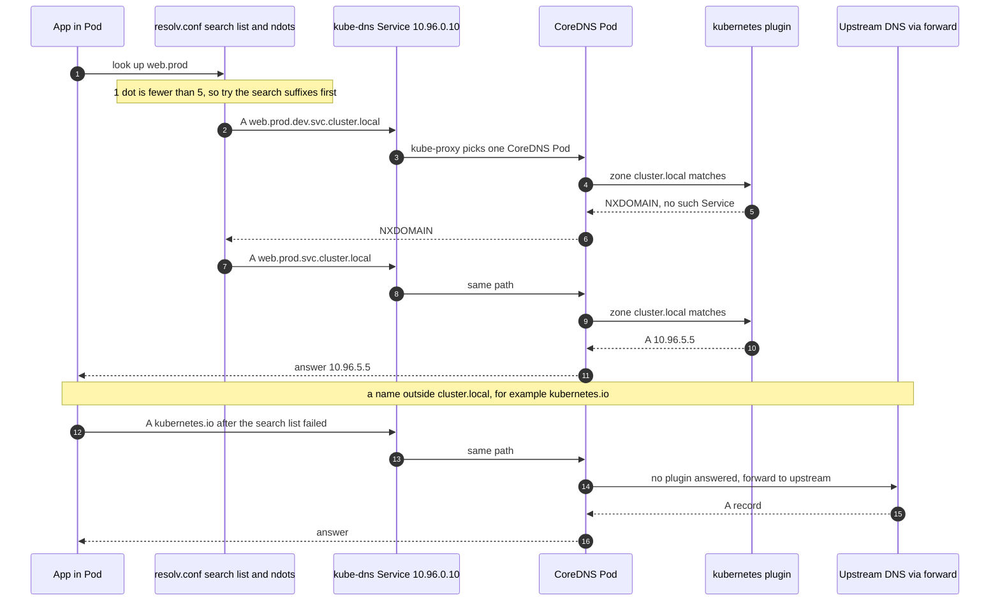

# T4.19 Understand and use CoreDNS

> Competency: "Understand and use CoreDNS" (CKA-5.6) | Domain/weight: CKA — Servicing and Networking (20%) | Est. time: 2.5 h | Prerequisites: T1.08, T4.18

Prerequisite lessons (read them first if a term below is new):

- [T1.08](../part1-linux/T1.08-linux-networking-ii-dns-ports-sockets.md): how a Linux machine resolves names, `/etc/resolv.conf` (`nameserver`, `search`, `options`), `dig` and `nslookup`. This lesson does not re-teach them. It shows how Kubernetes generates that file for every Pod and what answers the queries.
- [T4.18](../part4-cka/T4.18-use-clusterip-nodeport-loadbalancer-service-types.md): ClusterIP Services, headless Services, EndpointSlices, how kube-proxy turns a Service IP into Pod IPs. CoreDNS is reached through a ClusterIP Service, so everything in that lesson applies to DNS too.
- Background on Service names: [T3.12](../part3-ckad/T3.12-provide-and-troubleshoot-access-to-applications.md).

**Shell setup** (define once per terminal; used everywhere below):

```bash
alias k=kubectl
export do="--dry-run=client -o yaml"
export now="--force --grace-period=0"
source <(kubectl completion bash); complete -o default -F __start_kubectl k
```

**Where commands run.** Environment for the whole lesson: **kind** (cluster `lab`, context `kind-lab`, 1 control plane + 2 workers, created with `env/kind-up.sh`). Namespace for all labs: `lab-t419`. Lab files live in `~/lab/t419/`. Node commands in this lesson use `docker exec lab-worker ...` because kind nodes are containers. On the exam you would use `ssh <node>` and `sudo -i` instead; each task is done on a designated host, and nested ssh is not supported ([LF tips page](https://docs.linuxfoundation.org/tc-docs/certification/tips-cka-and-ckad)).

**About the outputs in this lesson.** No kind cluster was available when this lesson was written, so output blocks carry one of three labels:

| Label | What it is | How much to trust it |
|---|---|---|
| `REAL OUTPUT (Docker, kubeadm v1.37.0 ...)` | The real `kubeadm` binary from the `kindest/node:v1.37.0` image, run in a plain Docker container. It prints the exact CoreDNS manifests kubeadm 1.37 installs. | Exact for the manifests. Not a live cluster. |
| `REAL OUTPUT (Docker, CoreDNS v1.14.6 ...)` | The real CoreDNS binary (`registry.k8s.io/coredns/coredns:v1.14.6`, the version kubeadm 1.37 installs) run in Docker with Corefiles that use the same plugins, queried with `jessie-dnsutils:1.3`. The `kubernetes` plugin needs an API server, so these runs use `hosts` entries as stand-ins for Services. | Exact for plugin behaviour, error text and log format. Record contents are stand-ins, not cluster records. |
| `EXPECTED OUTPUT (not captured)` | Output from a live cluster that was not captured. The shape is right; addresses, Pod names and timings differ in your cluster. | A guide, not a byte-for-byte promise. Every one is listed in section 11. |

The "real `dig` outputs for A, SRV and headless records" done criterion is therefore not met with live-cluster output. Section 11 starts with a Known limitation paragraph that says what is needed.

**Example addresses used in the expected outputs.** Your cluster will have different digits. Read the pattern, not the digits.

| Item | Value in this lesson | Where it comes from |
|---|---|---|
| Service CIDR / kube-dns ClusterIP | `10.96.0.0/16` (kind default; kubeadm's own default is `10.96.0.0/12`), kube-dns `10.96.0.10` | The 10th address of the Service CIDR (kubeadm default `clusterDNS`, confirmed in section 2.5) |
| ClusterIP of Service `web` | `10.96.141.20` | Allocated by the API server |
| Pod `db-0` / `db-1` IPs | `192.168.171.66` / `192.168.54.67` | Calico pod CIDR `192.168.0.0/16` |

---

## 1. Why this matters

Every Service name you type, `web`, `db.prod`, `kubernetes.default`, is turned into an IP by CoreDNS. When CoreDNS is down, slow or misconfigured, almost every application fails at the same moment, and the error looks like a network problem ("could not resolve host") even though the network is fine. The CKA expects you to read and change the Corefile (CoreDNS's config file, stored in a ConfigMap), add forwarding or fixed host entries, and repair broken DNS fast. A one-character typo in the Corefile can take down name resolution for the whole cluster, so you also need to know exactly where the error shows up and how to roll back.

---

## 2. Concepts

### 2.1 CoreDNS Deployment and the kube-dns Service

**What it is.** Cluster DNS is a normal workload in the `kube-system` namespace. A Deployment named `coredns` runs the CoreDNS server (2 replicas by default on kubeadm). A Service named `kube-dns` gives those Pods one stable ClusterIP. Pods send DNS queries to that IP.

**The problem it solves.** Pod IPs change all the time and a Service IP is not memorable. DNS gives every Service a stable name. Without cluster DNS, every app would need the IP address of every Service it calls.

**Why the Service is still called `kube-dns`.** Old Kubernetes versions ran an older server called kube-dns. When CoreDNS replaced it, the Service name and the Pod label `k8s-app=kube-dns` stayed the same so that existing tools, monitoring and selectors kept working. The Pods you see today run CoreDNS. The Kubernetes docs page "Using CoreDNS for Service Discovery" calls CoreDNS "the default implementation of Kubernetes cluster DNS", and its change history has a commit titled "Update for deprecation of kube-dns". That page does not state a version number, so the claim "the old kube-dns server is deprecated in v1.37" is UNVERIFIED (section 11). It changes nothing in practice: the kubeadm 1.37 binary installs only CoreDNS (the manifest below), and the Service name stays `kube-dns`. **The names to remember are Deployment `coredns`, Service `kube-dns`, label `k8s-app=kube-dns`.** **the names to remember are Deployment `coredns`, Service `kube-dns`, label `k8s-app=kube-dns`.**

Here is what kubeadm 1.37 installs. It was printed with `kubeadm init phase addon coredns --print-manifest`. The table after the output explains each part.

REAL OUTPUT (Docker, kubeadm v1.37.0 from the `kindest/node:v1.37.0` image, not a cluster). This is the Deployment, trimmed with `...`:

```yaml
apiVersion: apps/v1
kind: Deployment
metadata:
  name: coredns
  namespace: kube-system
  labels:
    k8s-app: kube-dns
spec:
  replicas: 2
  strategy:
    type: RollingUpdate
    rollingUpdate:
      maxUnavailable: 1
  selector:
    matchLabels:
      k8s-app: kube-dns
  template:
    ...
    spec:
      priorityClassName: system-cluster-critical
      serviceAccountName: coredns
      affinity:
        podAntiAffinity:
          preferredDuringSchedulingIgnoredDuringExecution:
          - weight: 100
            ...
              topologyKey: kubernetes.io/hostname
      tolerations:
      - key: CriticalAddonsOnly
        operator: Exists
      - key: node-role.kubernetes.io/control-plane
        effect: NoSchedule
      containers:
      - name: coredns
        image: registry.k8s.io/coredns/coredns:v1.14.6
        resources:
          limits:
            memory: 170Mi
          requests:
            cpu: 100m
            memory: 70Mi
        args: [ "-conf", "/etc/coredns/Corefile" ]
        ports: (53/UDP dns, 53/TCP dns-tcp, 9153 metrics, 8080 liveness-probe, 8181 readiness-probe)
        livenessProbe:   httpGet /health on port liveness-probe, initialDelaySeconds 60
        readinessProbe:  httpGet /ready  on port readiness-probe
        securityContext:
          allowPrivilegeEscalation: false
          capabilities: { add: [NET_BIND_SERVICE], drop: [ALL] }
          readOnlyRootFilesystem: true
      dnsPolicy: Default
      volumes:
        - name: config-volume
          configMap:
            name: coredns
            items:
            - key: Corefile
              path: Corefile
```

(The `ports:`, probe and `securityContext` lines above are shortened for space; the kubeadm output spells them out as normal YAML.)

How to read it:

| Piece | What it does | Why it matters when debugging |
|---|---|---|
| `replicas: 2`, `maxUnavailable: 1` | Two Pods, and a rolling update may take one down at a time. | Scaling to 0 or a crash loop on both Pods means no DNS. |
| `podAntiAffinity` (preferred) | The scheduler tries to put the two Pods on different nodes. It is a preference, not a rule. | With a one-node cluster both land on one node. |
| `tolerations` for `node-role.kubernetes.io/control-plane` | Pods may run on control plane nodes. | They are often there. |
| `args: ["-conf", "/etc/coredns/Corefile"]` | The server reads its config from this path. | The ConfigMap key `Corefile` is mounted at that path. |
| `configMap: name: coredns`, key `Corefile` | The ConfigMap `coredns` is mounted read-only. | **Editing the ConfigMap is how you change DNS** (section 2.7). |
| `readinessProbe` `/ready` on 8181 | The Pod joins the Service endpoints only when the `ready` plugin says it is ready. | A Pod that is Running but not Ready is not in the kube-dns endpoints. |
| `livenessProbe` `/health` on 8080 | kubelet restarts the container if `health` stops answering. | Used with `lameduck` (section 2.2). |
| `dnsPolicy: Default` | **CoreDNS itself does not use cluster DNS.** Its own `/etc/resolv.conf` is copied from the node. | This is why `forward . /etc/resolv.conf` sends queries to the node's upstream DNS, and why a bad node resolv.conf causes a loop (section 2.10). |
| `readOnlyRootFilesystem: true`, `NET_BIND_SERVICE` only | Hardened container. It can bind port 53 and nothing else special. | You cannot `exec` in and edit the file. Change the ConfigMap instead. |

The Service (also printed by kubeadm):

```yaml
apiVersion: v1
kind: Service
metadata:
  name: kube-dns
  namespace: kube-system
  labels:
    k8s-app: kube-dns
    kubernetes.io/cluster-service: "true"
    kubernetes.io/name: "CoreDNS"
  annotations:
    prometheus.io/port: "9153"
    prometheus.io/scrape: "true"
spec:
  clusterIP: 10.96.0.10          # kubeadm puts the real clusterDNS address here
  ports:
  - { name: dns, port: 53, protocol: UDP, targetPort: 53 }
  - { name: dns-tcp, port: 53, protocol: TCP, targetPort: 53 }
  - { name: metrics, port: 9153, protocol: TCP, targetPort: 9153 }
  selector:
    k8s-app: kube-dns
```

(The port lines are joined to save space and the kubeadm-only `resourceVersion: "0"` line is left out. The `spec.clusterIP` is the template placeholder in the kubeadm binary; on a real cluster it is the address kubeadm computes, `10.96.0.10` for the default Service range.)

**Under the hood: how a Pod query reaches CoreDNS.** (1) When kubelet starts a Pod it writes `/etc/resolv.conf` into it, with `nameserver <clusterDNS>`; that value is the kube-dns ClusterIP (section 2.5). (2) The app's resolver sends a UDP packet to that ClusterIP on port 53. (3) kube-proxy rules on the node rewrite the destination to one of the Pod IPs listed in the EndpointSlices of the `kube-dns` Service, exactly as for any Service ([T4.18](../part4-cka/T4.18-use-clusterip-nodeport-loadbalancer-service-types.md)). (4) The packet crosses the Pod network to a CoreDNS Pod. (5) CoreDNS answers. DNS therefore needs three things to work: the CoreDNS Pods Ready, the EndpointSlice populated, and a Pod network that carries port 53 (UDP and TCP).

**Under the hood: how CoreDNS knows your Services.** The `coredns` ServiceAccount has a ClusterRole that lets it list and watch Services, EndpointSlices, Namespaces and Pods. The `kubernetes` plugin keeps an in-memory copy and answers from it. That is why answers for `cluster.local` names are fast and why CoreDNS needs its own readiness check: until it has synced, it must not receive traffic.

### 2.2 The Corefile

**What it is.** The Corefile is CoreDNS's configuration. It is a list of **server blocks**. A server block starts with a **zone** and a port, `.:53 {`, and ends with `}`. Inside are **plugins** (one per line, some with a `{ ... }` body of options). A plugin is a small function in the request path. A query enters, each plugin may answer it, change it, or pass it to the next plugin.

**The problem it solves.** One binary must answer cluster names itself, send everything else to an upstream resolver, expose health checks and metrics, and survive config mistakes. Plugins let you turn each of those on or off with one line.

In Kubernetes the Corefile lives in the ConfigMap `coredns` in `kube-system`, under the key `Corefile`.

REAL OUTPUT (Docker, kubeadm v1.37.0 from the `kindest/node:v1.37.0` image, not a cluster). The `data` section of the ConfigMap that kubeadm 1.37 creates. This is the **default Corefile**:

```yaml
apiVersion: v1
kind: ConfigMap
metadata:
  name: coredns
  namespace: kube-system
data:
  Corefile: |
    .:53 {
        errors
        health {
           lameduck 5s
        }
        ready
        kubernetes cluster.local in-addr.arpa ip6.arpa {
           pods insecure
           fallthrough in-addr.arpa ip6.arpa
           ttl 30
        }
        prometheus :9153
        forward . /etc/resolv.conf {
           max_concurrent 1000
        }
        cache 30 {
           disable success cluster.local
           disable denial cluster.local
        }
        loop
        reload
        loadbalance
    }
```

On kind, kubeadm creates this same ConfigMap, so `k -n kube-system get cm coredns -o yaml` should show the same text. That comparison is the first check in section 5.

**Zone matching.** `.:53` means "the root zone, port 53", which matches every name. If you add a second block such as `example.local:53 { ... }`, CoreDNS picks the block with the **longest matching zone** for each query. This was confirmed in Docker: `db.example.local` went to the `example.local` block and `kubernetes.io` went to `.`.

**Plugin order in the file does not matter.** The order in which plugins run is fixed when CoreDNS is compiled. Confirmed in Docker: with `hosts` written before `rewrite`, the rewrite still ran first. You can place a new line anywhere inside the block.

Every plugin in the default Corefile:

| Plugin (and options) | What it does | Default / risky value |
|---|---|---|
| `errors` | Prints errors to standard output (the Pod log). | Without it, upstream failures are silent. |
| `health { lameduck 5s }` | Serves `/health` on port 8080. `lameduck` keeps answering for 5 seconds after a shutdown signal so in-flight queries finish. | Liveness probe depends on it. |
| `ready` | Serves `/ready` on port 8181; answers 200 only when all plugins that report readiness are ready (the `kubernetes` plugin is ready after it syncs). | Readiness probe depends on it. |
| `kubernetes cluster.local in-addr.arpa ip6.arpa { ... }` | Answers names in the **cluster domain** (`cluster.local`) and the reverse zones from the Kubernetes API. **The first word after `kubernetes` must equal the kubelet `clusterDomain`** (section 2.5). | A mismatch means no Service name resolves. |
| `pods insecure` | Pod A records (section 2.3). Values: `disabled` (no Pod records), `insecure` (answer for any dashed IP without checking), `verified` (answer only if a Pod with that IP exists in that namespace). | `insecure` is the kubeadm default and exists for compatibility with the old kube-dns. |
| `fallthrough in-addr.arpa ip6.arpa` | If the plugin has no answer for these zones, pass the query to the next plugin (`forward`). So reverse lookups of non-cluster IPs still reach the upstream. | There is **no** `fallthrough` for `cluster.local`: a missing name inside the cluster domain gets `NXDOMAIN` and never goes upstream. |
| `ttl 30` | TTL (seconds clients may cache) in answers for cluster records. | Default is 5. |
| `prometheus :9153` | Exposes metrics. | Port matches the Service `metrics` port. |
| `forward . /etc/resolv.conf { max_concurrent 1000 }` | Sends any query not answered earlier to the nameservers listed in a file (here the Pod's own `/etc/resolv.conf`, i.e. the node's, because `dnsPolicy: Default`). You can also give IPs: `forward . 8.8.8.8 1.1.1.1`. `max_concurrent` caps in-flight upstream queries so a slow upstream cannot make CoreDNS run out of memory. | Pointing at a resolver that is CoreDNS itself causes a loop (section 2.10). |
| `cache 30 { disable success cluster.local; disable denial cluster.local }` | Caches answers for at most 30 seconds. Cluster names are not cached, because the `kubernetes` plugin already answers from memory. | After you change an upstream, old answers can live for up to 30 s. |
| `loop` | At startup sends a test query and checks whether it comes back to itself. If it does, CoreDNS stops with a fatal error. | Stops a forwarding loop from eating all CPU. |
| `reload` | Re-reads the Corefile when its content changes (section 2.7). | A reload that fails keeps the old config. |
| `loadbalance` | Shuffles the order of records in an answer so clients spread over several IPs (for headless Services). | Round-robin. |

**Plugins you add yourself in this lesson:**

| Plugin | Use | Example line |
|---|---|---|
| `log` | Print one line per query (section 2.9). Applies **per server block**: only blocks that contain `log` are logged. | `log` |
| `hosts` | Fixed name-to-IP entries, like `/etc/hosts` but cluster-wide (section 2.6). **Always write `fallthrough`**, or every other name fails. | `hosts { 10.1.2.3 legacy.corp.test; fallthrough }` (one entry per line) |
| `rewrite` | Change the name in the query before the other plugins see it (section 2.6). | `rewrite name exact old-api.corp.test new-api.corp.test` |

### 2.3 Record types

**What it is.** A DNS name maps to a record. CoreDNS builds the records from Kubernetes objects. This is the full list the `kubernetes` plugin serves. Cluster domain is `cluster.local`, `<ns>` is the namespace.

| Kubernetes object | Query name | Record | Answer |
|---|---|---|---|
| ClusterIP Service | `<svc>.<ns>.svc.cluster.local` | A (AAAA for an IPv6 Service) | The ClusterIP. |
| Headless Service (`clusterIP: None`) | `<svc>.<ns>.svc.cluster.local` | A / AAAA | **All ready Pod IPs**, one record each, shuffled by `loadbalance`. |
| Headless Service, Pod with `hostname` and `subdomain` (StatefulSet Pods have both) | `<hostname>.<svc>.<ns>.svc.cluster.local` | A / AAAA | That one Pod's IP. This is the per-Pod record. |
| Named Service port | `_<port-name>._<protocol>.<svc>.<ns>.svc.cluster.local` | SRV | priority, weight, port number and target name. |
| Any Pod IP | `<ip-with-dashes>.<ns>.pod.cluster.local` | A | The IP, if `pods insecure` (section 2.2). `192.168.171.66` becomes `192-168-171-66`. |
| ExternalName Service | `<svc>.<ns>.svc.cluster.local` | CNAME | The external DNS name ([T4.18](../part4-cka/T4.18-use-clusterip-nodeport-loadbalancer-service-types.md) section 2.10). |
| Service ClusterIP (reverse) | `20.141.96.10.in-addr.arpa` | PTR | The Service name. |

**SRV in plain words.** An SRV record answers "which host and port serve the named port `http` over TCP?". The query name has the port **name** (from `ports[].name` in the Service, which is why a multi-port Service must name its ports) and the protocol, each with a leading underscore. The answer has four numbers and a name: `priority weight port target`.

- For a ClusterIP Service there is one answer: target is the Service name, port is the Service port, for example `0 100 80 web.lab-t419.svc.cluster.local.`.
- For a headless Service there is one answer per ready Pod, and the target is the per-Pod name. Weight is 100 divided by the number of answers (50 and 50 for two Pods). The weight rule is UNVERIFIED (section 11).
- A headless Service does **no port translation**: the SRV port is the Pod's real port, and a client must connect to that port on the Pod IP.

**Per-Pod records need a `hostname` and a `subdomain`.** A Pod's A record under a headless Service exists only if the Pod has `spec.hostname` (default: the Pod name) and `spec.subdomain` equal to the headless Service name, and the Service selects the Pod. A StatefulSet with `serviceName: db` sets both for you, so `db-0.db.<ns>.svc.cluster.local` works. For a plain Pod you set them yourself (try it in section 5, step 7, optional).

**Only ready Pods are listed.** A headless Service returns only addresses of ready Pods, unless the Service sets `publishNotReadyAddresses: true`. A headless name that resolves to nothing often means no Pod is Ready or the selector matches nothing (see [T4.18](../part4-cka/T4.18-use-clusterip-nodeport-loadbalancer-service-types.md) for reading EndpointSlices).

### 2.4 Pod DNS configuration: resolv.conf, dnsPolicy and dnsConfig

**What it is.** Every Pod gets its own `/etc/resolv.conf`, written by kubelet when the Pod starts. A Pod field `dnsPolicy` chooses the recipe, and an optional field `dnsConfig` adds or replaces parts.

**The generated file for the default policy** (`ClusterFirst`) in a Pod in namespace `lab-t419`:

The command is `k -n lab-t419 exec dnsutils -- cat /etc/resolv.conf`.

EXPECTED OUTPUT (not captured)

```
search lab-t419.svc.cluster.local svc.cluster.local cluster.local
nameserver 10.96.0.10
options ndots:5
```

Your node's own search domains, if it has any, are appended to the `search` line.

| Line | Meaning |
|---|---|
| `search` | A list of suffixes to try when a name is not "absolute". The first suffix is the Pod's own namespace, so `web` means `web.lab-t419.svc.cluster.local`. The second lets `web.prod` reach another namespace. The third is the cluster domain. |
| `nameserver` | Where to send queries: the kube-dns ClusterIP (`clusterDNS`, section 2.5). |
| `options ndots:5` | If a name has **fewer than 5 dots**, try the search suffixes first and the name as written last. `web.prod` (1 dot) is expanded before it is tried as written. |

**What `ndots:5` costs.** `kubernetes.io` has one dot, so the resolver tries `kubernetes.io.<ns>.svc.cluster.local`, then `kubernetes.io.svc.cluster.local`, then `kubernetes.io.cluster.local`, and only then `kubernetes.io`. That is three failed queries before the useful one. The pattern was reproduced in Docker with a resolv.conf of the same shape. The CoreDNS log shows each attempt in order.

REAL OUTPUT (Docker, CoreDNS v1.14.6 with a `hosts` stand-in and `forward . 9.9.9.9`, `jessie-dnsutils:1.3` using `search dev.svc.cluster.local svc.cluster.local cluster.local` and `options ndots:5`). Not a cluster: here every candidate also goes to the upstream, whereas in a real cluster the `kubernetes` plugin itself answers `NXDOMAIN` for the three `cluster.local` candidates.

```
# dig +search +short kubernetes.io      (external name, 1 dot)
15.197.167.90
3.33.186.135

# CoreDNS log (log plugin) for that one command:
[INFO] 192.168.148.3:50090 - 11586 "A IN kubernetes.io.dev.svc.cluster.local. udp 64 false 4096" NXDOMAIN qr,rd,ra 70 0.04...
[INFO] 192.168.148.3:47805 - 28410 "A IN kubernetes.io.svc.cluster.local. udp 60 false 4096" NXDOMAIN qr,rd,ra 66 0.0460...
[INFO] 192.168.148.3:46524 - 16038 "A IN kubernetes.io.cluster.local. udp 56 false 4096" NXDOMAIN qr,rd,ra 62 0.04093725...
[INFO] 192.168.148.3:36612 - 19016 "A IN kubernetes.io. udp 42 false 4096" NOERROR qr,rd,ra 100 0.047857889s
```

To avoid the waste: write an absolute name with a trailing dot (`kubernetes.io.`), or lower `ndots` for a Pod with `dnsConfig` (below).

**`dnsPolicy` values.**

| `dnsPolicy` | What kubelet writes | Use it for | How to observe |
|---|---|---|---|
| `ClusterFirst` (the default if you omit the field) | Cluster nameserver plus cluster search list. Names outside `cluster.local` are forwarded by CoreDNS. | Normal Pods. | `cat /etc/resolv.conf` shows `nameserver 10.96.0.10`. |
| `Default` (**not** the default despite the name) | A copy of the node's resolv.conf. No cluster names. | Pods that must use the node's resolver only; CoreDNS itself. | `cat /etc/resolv.conf` shows the node's nameserver; `nslookup web.lab-t419` fails. |
| `ClusterFirstWithHostNet` | Same as `ClusterFirst`, but for Pods with `hostNetwork: true`. | Host-network Pods that still need Service names. | A hostNetwork Pod shows the cluster nameserver. |
| `None` | **Nothing generated.** Only what you put in `dnsConfig`. `dnsConfig` is required with this value. | Full control, tests, special resolvers. | The file contains exactly your `dnsConfig`. |

A Pod with `hostNetwork: true` and `dnsPolicy: ClusterFirst` silently falls back to `Default` behaviour. That is a common trap: a host-network Pod cannot resolve `web.lab-t419` until you set `ClusterFirstWithHostNet`.

One runnable example for each value (apply, then read resolv.conf). It needs the namespace `lab-t419`, so run `bash ~/lab/t419/setup.sh` (section 5 step 1) first. The Pod for `None` points at the kube-dns ClusterIP `10.96.0.10`; check yours with `k -n kube-system get svc kube-dns -o jsonpath='{.spec.clusterIP}'` and edit if it differs.

```yaml
# ~/lab/t419/policies.yaml
apiVersion: v1
kind: Pod
metadata:
  name: pol-clusterfirst
  namespace: lab-t419
spec:
  dnsPolicy: ClusterFirst          # same as omitting the field
  containers:
    - name: c
      image: registry.k8s.io/e2e-test-images/jessie-dnsutils:1.3
      command: ["sleep", "3600"]
---
apiVersion: v1
kind: Pod
metadata:
  name: pol-default
  namespace: lab-t419
spec:
  dnsPolicy: Default               # node's resolv.conf, no cluster names
  containers:
    - name: c
      image: registry.k8s.io/e2e-test-images/jessie-dnsutils:1.3
      command: ["sleep", "3600"]
---
apiVersion: v1
kind: Pod
metadata:
  name: pol-hostnet
  namespace: lab-t419
spec:
  hostNetwork: true                # uses the node's network namespace
  dnsPolicy: ClusterFirst          # falls back to Default behaviour because of hostNetwork
  containers:
    - name: c
      image: registry.k8s.io/e2e-test-images/jessie-dnsutils:1.3
      command: ["sleep", "3600"]
---
apiVersion: v1
kind: Pod
metadata:
  name: pol-hostnet-cfwhn
  namespace: lab-t419
spec:
  hostNetwork: true
  dnsPolicy: ClusterFirstWithHostNet   # cluster DNS even with hostNetwork
  containers:
    - name: c
      image: registry.k8s.io/e2e-test-images/jessie-dnsutils:1.3
      command: ["sleep", "3600"]
---
apiVersion: v1
kind: Pod
metadata:
  name: pol-none
  namespace: lab-t419
spec:
  dnsPolicy: None                  # ignore everything except dnsConfig
  dnsConfig:
    nameservers:
      - 10.96.0.10                 # kube-dns ClusterIP in this lab cluster
    searches:
      - lab-t419.svc.cluster.local
    options:
      - name: ndots
        value: "1"                 # a string; unquoted 1 is rejected
  containers:
    - name: c
      image: registry.k8s.io/e2e-test-images/jessie-dnsutils:1.3
      command: ["sleep", "3600"]
```

Run `k apply -f policies.yaml` and `k -n lab-t419 wait --for=condition=Ready pod --all --timeout=120s`, then:

EXPECTED OUTPUT (not captured)

```
$ for p in pol-clusterfirst pol-default pol-hostnet pol-hostnet-cfwhn pol-none; do echo "== $p"; k -n lab-t419 exec $p -- cat /etc/resolv.conf; done
== pol-clusterfirst
search lab-t419.svc.cluster.local svc.cluster.local cluster.local
nameserver 10.96.0.10
options ndots:5
== pol-default
<the node's resolv.conf: its own nameserver and search lines>
== pol-hostnet
<the node's resolv.conf again, because ClusterFirst falls back to Default with hostNetwork>
== pol-hostnet-cfwhn
search lab-t419.svc.cluster.local svc.cluster.local cluster.local
nameserver 10.96.0.10
options ndots:5
== pol-none
search lab-t419.svc.cluster.local
nameserver 10.96.0.10
options ndots:1
```

Clean up with `k delete -f ~/lab/t419/policies.yaml --wait=false`.

**`dnsConfig` fields.**

| Field | Type | What it does | Default | Risky value |
|---|---|---|---|---|
| `nameservers` | list of IP strings | Extra resolvers. With `None`, the only resolvers. With other policies they are **added** to the generated ones. | empty | More than 3: the API server allows **at most 3** addresses. With `None` and no nameserver the Pod is rejected. |
| `searches` | list of domain strings | Extra search suffixes, merged with the generated ones; duplicates are removed. | empty | More than **32** search domains, or a total length of all search domains above **2048** characters (limits apply to the node file, the Pod `dnsConfig` and the merged result). Older container runtimes (containerd 1.5.5 or earlier, CRI-O 1.21 or earlier) have their own lower limits and can leave such Pods Pending. |
| `options` | list of `{name, value}` | Resolver options such as `ndots`, `timeout`, `attempts`, `single-request-reopen`. `value` is a **string**, and optional for flag-style options. | `ndots:5` for cluster policies | `value: 2` without quotes fails to decode (it must be `"2"`). |

The limits above (3 nameservers, 32 search domains, 2048 characters) are from the "Pod's DNS Config" and "DNS search domain list limits" sections of https://kubernetes.io/docs/concepts/services-networking/dns-pod-service/ (the search-list limit is stable since v1.28).

A Pod that keeps `ClusterFirst` and only lowers ndots (the usual performance fix):

```yaml
spec:
  dnsConfig:
    options:
      - name: ndots
        value: "2"
```

### 2.5 kubelet: clusterDNS and clusterDomain

**What it is.** kubelet is the component that writes every Pod's `resolv.conf`. It needs two facts from its own config file (`KubeletConfiguration`, by default `/var/lib/kubelet/config.yaml` on kubeadm nodes): `clusterDNS`, the list of DNS server IPs to put in Pods (the kube-dns ClusterIP), and `clusterDomain`, the suffix used for the `search` line (`cluster.local`). A third field, `resolvConf`, names the file kubelet copies for the `Default` policy (and for CoreDNS itself).

REAL OUTPUT (Docker, `kubeadm config print init-defaults --component-configs KubeletConfiguration`, kubeadm v1.37.0). Only the relevant lines:

```
networking:
  dnsDomain: cluster.local
  serviceSubnet: 10.96.0.0/12
...
clusterDNS:
- 10.96.0.10
clusterDomain: cluster.local
```

How the pieces connect: kubeadm takes `serviceSubnet`, computes the 10th address (`10.96.0.10`) as the kube-dns ClusterIP, puts it in the kube-dns Service and writes the same value into the kubelet config on every node. `dnsDomain` becomes the zone after `kubernetes` in the Corefile and `clusterDomain` in kubelet. **These three must agree.** If you set a custom domain with kubeadm, they all change together; if you edit one by hand, Service names stop resolving.

To read it on a node: `docker exec lab-worker grep -A1 '^clusterDNS' /var/lib/kubelet/config.yaml` on kind, or `ssh <node>`, `sudo grep -A1 '^clusterDNS' /var/lib/kubelet/config.yaml` on a VM (and `grep '^clusterDomain'` for the domain).

- **Changing it.** Edit the file on the node, then `systemctl restart kubelet`. **Running Pods keep their old resolv.conf**; only Pods created afterwards get the new one. On kubeadm clusters the master copy is the ConfigMap `kubelet-config` in `kube-system`, which new nodes read when they join.
- **Old flags.** The kubelet flags `--cluster-dns` and `--cluster-domain` are the older way to set the same values; prefer the config file.
- **`resolvConf`.** If a node runs `systemd-resolved`, `/etc/resolv.conf` on the node usually points at a local stub (`127.0.0.53`). Copying that into a Pod is useless, so kubeadm points `resolvConf` at `/run/systemd/resolve/resolv.conf`, which lists the real upstreams. If this is wrong you get the loop in section 2.10.

### 2.6 Custom forwarding (stub domains), `hosts` and `rewrite`

**Stub domain (forward one zone to another DNS server).**

*What it is.* A new server block for one zone that sends those queries to a specific server. *Problem it solves.* Your company runs an internal DNS server for `example.local`. Pods must resolve `db.example.local`, but the node's public resolver does not know it. Without a stub domain the query goes to `forward . /etc/resolv.conf` and fails.

```
example.local:53 {
    errors
    cache 30
    forward . 10.0.0.53
}
```

`10.0.0.53` is the internal DNS server. Queries for names ending in `.example.local` go there; everything else still uses the `.:53` block. Each server block needs its own plugins, so `errors` and `cache` are repeated. `log` is also per block.

REAL OUTPUT (Docker, CoreDNS v1.14.6). A main CoreDNS with the block above forwarding `example.local` to a second CoreDNS that serves `db.example.local`, queried with `dig +short @<main> ...`:

```
== db.example.local
10.20.30.40
== legacy.corp.test     (from the hosts block below)
10.1.2.3
== old-api.corp.test    (from the rewrite rule below)
10.9.9.9
== kubernetes.io        (not in any special zone: goes to the normal upstream)
15.197.167.90
3.33.186.135
```

**`hosts` (fixed entries).**

```
hosts {
    10.1.2.3 legacy.corp.test
    fallthrough
}
```

Each line is `IP name [more names]`, like `/etc/hosts`. Without `fallthrough`, a name that the plugin does not know ends the query, so **every other name fails**. This was shown in Docker.

REAL OUTPUT (Docker, CoreDNS v1.14.6), a `hosts` block **without** `fallthrough` followed by `forward . 9.9.9.9`:

```
== legacy.corp.test
legacy.corp.test.	3600	IN	A	10.1.2.3
== kubernetes.io
;; ->>HEADER<<- opcode: QUERY, status: SERVFAIL, id: 8235
```

Two more rules, both verified in Docker. The `hosts` plugin may appear **only once per server block**; a second one stops CoreDNS at startup with `plugin/hosts: this plugin can only be used once per Server Block`, so put all entries in one block. And the answer TTL is 3600 seconds by default, so clients may cache the fixed entry for an hour.

**`rewrite` (change the query name).**

*What it is.* A plugin that changes the name in a query before the plugins after it see the query. *Problem it solves.* An application still asks for an old name (`old-api.corp.test`) that you want to answer with the data of a new name (`new-api.corp.test`), and you cannot change the application. Without `rewrite` you would have to duplicate the record under both names.

Syntax: `rewrite name <type> <from> <to>`. The type says how `<from>` is matched. Every row below except the last was run in Docker (CoreDNS v1.14.6, a `hosts` block as stand-in target).

| Form | Matches | Example line | What `dig` shows (REAL, Docker) |
|---|---|---|---|
| `name exact A B` | The whole name equals A | `rewrite name exact old-api.corp.test new-api.corp.test` | `dig old-api.corp.test` answers `old-api.corp.test. 3600 IN A 10.9.9.9`: the **original** name is put back in the answer. |
| `name suffix A B` | The name ends with A; that end becomes B | `rewrite name suffix .legacy.test .corp.test` | `dig billing.legacy.test` answers `billing.corp.test. 3600 IN A 10.8.8.2`: the answer carries the **rewritten** name. |
| `name regex PATTERN REPLACEMENT` | Go regular expression; `{1}` is the first group | `rewrite name regex ^(.*)\.regex\.test\.$ {1}.corp.test.` | `dig pay.regex.test` answers `pay.corp.test. 3600 IN A 10.8.8.3` (rewritten name in the answer). |
| `answer name PATTERN REPLACEMENT` | Rewrites names inside the **answer**; used together with a name rule in the block form | see the block below | `dig pay.regex.test` answers `pay.regex.test. 3600 IN A 10.8.8.3`: the answer name is mapped back. |
| `name prefix A B`, `name substring A B` | Name starts with A / contains A | `rewrite name prefix old- new-` | UNVERIFIED: in the Docker test these two did not change the query (the lookup went upstream and returned NXDOMAIN). Use `exact`, `suffix` or `regex`, and always confirm a rewrite with a lookup. |

The block form that rewrites both the question and the answer name:

```
rewrite stop {
    name regex ^(.*)\.regex\.test\.$ {1}.corp.test.
    answer name ^(.*)\.corp\.test\.$ {1}.regex.test.
}
```

The Corefile used for the `exact` run (the target name must exist, here as a `hosts` entry; that is why the `hosts` block holds **two** entries):

```
.:53 {
    errors
    hosts {
        10.1.2.3 legacy.corp.test
        10.9.9.9 new-api.corp.test
        fallthrough
    }
    rewrite name exact old-api.corp.test new-api.corp.test
    forward . 9.9.9.9
}
```

In a cluster the target is usually a Service name: `rewrite name exact legacy.prod.svc.cluster.local web.prod.svc.cluster.local` makes the old Service name answer with the ClusterIP of `web`. Section 5 step 11 does exactly this in the lab namespace.

REAL OUTPUT (Docker, CoreDNS v1.14.6). `dig old-api.corp.test` against the Corefile above:

```
;; QUESTION SECTION:
;old-api.corp.test.		IN	A

;; ANSWER SECTION:
old-api.corp.test.	3600	IN	A	10.9.9.9
```

The question and answer both say `old-api.corp.test`, but the data comes from the `new-api.corp.test` entry. Without the `10.9.9.9 new-api.corp.test` line the rewritten name has no record and the lookup ends in `NXDOMAIN` (from the upstream).

**Where the edit goes.** In the cluster you put the `hosts` and `rewrite` lines inside the existing `.:53 { ... }` block and add the stub domain as a **new block after it** (section 4 has the full ConfigMap).

### 2.7 Applying Corefile changes: reload versus rollout restart

**The chain.** `k edit cm coredns` changes the ConfigMap in etcd. kubelet then updates the mounted file inside each CoreDNS Pod; that takes up to about a minute because kubelet syncs ConfigMap volumes periodically. The `reload` plugin checks the Corefile content at an interval (30 seconds by default, with random jitter added) and, when it differs, reloads gracefully. Total delay: up to a couple of minutes. Both timings are from memory and listed in section 11.

| Way to apply | Speed | Effect on a bad Corefile |
|---|---|---|
| Wait for `reload` | slow (up to ~2 min) | **Safe.** The running CoreDNS keeps its old config and logs the error. |
| `k -n kube-system rollout restart deploy coredns` | immediate, Pods replaced one at a time | **Dangerous.** The new Pod cannot start, goes into `CrashLoopBackOff`, and the rollout stalls with half of your capacity gone. |

REAL OUTPUT (Docker, CoreDNS v1.14.6). The Corefile on a mounted file is edited so that line 14 reads `forwrd` instead of `forward`. After the reload interval the running server logs this and **keeps serving** with the old config:

```
[INFO] Reloading
[ERROR] Restart failed: /etc/coredns/Corefile:14 - Error during parsing: Unknown directive 'forwrd'
[ERROR] plugin/reload: Corefile changed but reload failed: starting with listener file descriptors: /etc/coredns/Corefile:14 - Error during parsing: Unknown directive 'forwrd'
```

Then the container was restarted with the same bad file. It cannot start at all:

```
/etc/coredns/Corefile:14 - Error during parsing: Unknown directive 'forwrd'
```

(exit code 1, state `exited`). In Kubernetes, that is `CrashLoopBackOff`.

Lessons: (1) **save a copy before you edit**: `k -n kube-system get cm coredns -o yaml > ~/coredns-backup.yaml`. A ConfigMap has no `rollout undo`; `rollout undo` reverts the Deployment, not the ConfigMap. (2) After an edit, read the Pod logs for `Reloading complete` or an error. (3) A running Pod hiding a typo is a time bomb: the typo explodes at the next restart, node drain or upgrade.

### 2.8 Scaling CoreDNS and NodeLocal DNSCache

**Scaling.** CoreDNS is a stateless Deployment, so scaling is `k -n kube-system scale deploy coredns --replicas=3`. kubeadm starts with 2. Add replicas when DNS latency rises under load or you want more spread across nodes. A cluster with thousands of Pods usually scales CoreDNS with the number of nodes; a "cluster proportional autoscaler" add-on exists for that but is not installed by kubeadm. Replicas set by `kubectl scale` stay until something rewrites the Deployment (for example a `kubeadm upgrade` may reset the count to its own default; UNVERIFIED, section 11).

**NodeLocal DNSCache (awareness).** A DaemonSet that runs a small caching DNS agent on every node. It listens on a link-local address on the node (the Kubernetes docs example uses `169.254.20.10`), and Pods send queries there first. Cache hits are answered on the node. Misses go to CoreDNS through a separate Service. Benefits: lower latency, fewer cross-node UDP packets, and fewer problems with the connection tracking table when many queries go to the same ClusterIP. How you see it: the Pod's `nameserver` line shows the node-local address instead of `10.96.0.10`, and `kube-system` has a DaemonSet `node-local-dns`. It is not installed by default. Docs: https://kubernetes.io/docs/tasks/administer-cluster/nodelocaldns/ (not part of the entry's page list; mentioned only for awareness).

### 2.9 Debugging DNS

**The tools.** Use a Pod that has `dig` and `nslookup`. The Kubernetes docs use `registry.k8s.io/e2e-test-images/jessie-dnsutils:1.3`; run in Docker, it contains `dig 9.9.5`, `nslookup` and `host`, and its manifest lists amd64, arm, arm64, ppc64le and s390x. One-shot form:

```bash
k run dns --rm -it --image=registry.k8s.io/e2e-test-images/jessie-dnsutils:1.3 --restart=Never -- dig +search web.prod
```

`--rm` deletes the Pod when the command ends, `-it` attaches the terminal, `--restart=Never` makes it a plain Pod. The `dig +search` flag matters: **plain `dig` ignores the search list and ndots**; it asks for exactly the name you type. `+search` makes `dig` behave like an application. `nslookup` always uses the search list. Both were confirmed in Docker:

REAL OUTPUT (Docker, `jessie-dnsutils:1.3` against CoreDNS v1.14.6 `hosts` stand-in; resolv.conf `search dev.svc.cluster.local svc.cluster.local cluster.local`, `ndots:5`):

```
# dig web.prod                       (no +search: the name exactly as typed)
;; ->>HEADER<<- opcode: QUERY, status: NXDOMAIN, id: 16621

# dig +search +short web.prod
10.96.5.5

# nslookup web.prod
Server:		192.168.148.2
Address:	192.168.148.2#53

Name:	web.prod.svc.cluster.local
Address: 10.96.5.5
```

`dig +search +showsearch web.prod` prints each attempt (first `web.prod.dev.svc.cluster.local.` gets `NXDOMAIN`, then `web.prod.svc.cluster.local.` gets `NOERROR` with the answer).

**Read the answer status.** The status in the `dig` header tells you where to look:

| What you see | Meaning | Look at |
|---|---|---|
| `connection timed out; no servers could be reached`, **or** an immediate refused-style message (for example `communications error ... connection refused`; wording not captured) | The query never reached a working CoreDNS. Both outcomes are possible: with kube-proxy in iptables mode, a Service with no ready endpoints gets a REJECT rule, so the client is refused quickly ([T4.18](../part4-cka/T4.18-use-clusterip-nodeport-loadbalancer-service-types.md), the iptables rules part); when packets are dropped (NetworkPolicy, CNI, firewall) or another data path is used, the client waits and times out. | CoreDNS Pods, kube-dns endpoints, NetworkPolicy, CNI (section 6). |
| `status: NXDOMAIN` | CoreDNS answered: this name does not exist. | Spelling, namespace, whether the Service exists, `hosts` without `fallthrough`, wrong search path. |
| `status: SERVFAIL` | CoreDNS is alive but failed to get an answer. | `forward` upstream, `errors` log lines. |
| `status: NOERROR` with no ANSWER | The name exists, but not for that record type. | Query the other type (`A` versus `AAAA` versus `SRV`). |

**CoreDNS logs.** `k -n kube-system logs -l k8s-app=kube-dns` prints the last 10 lines of every CoreDNS Pod (with a selector, kubectl defaults to 10 lines per Pod). Add `--tail=50` or `--prefix` as needed. Errors show up through the `errors` plugin. To see **every query**, add the `log` plugin:

```
.:53 {
    errors
    log
    ...
}
```

REAL OUTPUT (Docker, CoreDNS v1.14.6 with `log`). One line per query; read: client address and port, DNS message ID, `"type class name proto size do bufsize"`, response code, flags, response size, duration:

```
[INFO] 192.168.148.4:58820 - 32376 "A IN legacy.corp.test. udp 45 false 4096" NOERROR qr,aa,rd 66 0.000166335s
[INFO] 192.168.148.4:47557 - 36896 "A IN kubernetes.io. udp 42 false 4096" NOERROR qr,rd,ra 89 0.00222977s
```

`log` is per server block: in the Docker run a query for `db.example.local` (answered by the `example.local` block, which had no `log`) did not appear. Turn `log` off again when you are done, because it writes a line per query and costs CPU and disk.

**Check the Service and its endpoints.** `k -n kube-system get svc kube-dns` must show a ClusterIP. The Pods behind it are listed in the EndpointSlice objects of the Service:

```bash
k -n kube-system get endpointslices -l kubernetes.io/service-name=kube-dns
```

No slice, or a slice with no addresses, means no Ready CoreDNS Pod ([T4.18](../part4-cka/T4.18-use-clusterip-nodeport-loadbalancer-service-types.md)). The old `Endpoints` API (`k -n kube-system get endpoints kube-dns`) still works but is deprecated.

### 2.10 Loop detection and the systemd-resolved crash

**What it is.** A forwarding loop is when CoreDNS forwards a query to a server that sends it straight back to CoreDNS. Each round adds load; the CPU and memory grow until the Pod is killed. The `loop` plugin prevents that: at startup it sends a test `HINFO` query with a random name. If the same query arrives back, CoreDNS knows it is forwarding to itself and **exits on purpose** with a fatal error.

**How you get one.** `forward . /etc/resolv.conf` copies the nameservers from the Pod's resolv.conf. CoreDNS runs with `dnsPolicy: Default`, so that file is the node's. On a node using `systemd-resolved` the file says `nameserver 127.0.0.53`. Inside the CoreDNS Pod, `127.0.0.53` is the Pod's own loopback, which CoreDNS (listening on all addresses, port 53) answers itself. So it forwards to itself.

REAL OUTPUT (Docker, CoreDNS v1.14.6). The Corefile uses `forward . /etc/resolv.conf` and `loop`, and the container's resolv.conf is `nameserver 127.0.0.53`:

```
CoreDNS-1.14.6
linux/arm64, go1.26.5, 424d125
[FATAL] plugin/loop: Loop (127.0.0.1:60469 -> :53) detected for zone ".", see https://coredns.io/plugins/loop#troubleshooting. Query: "HINFO 105278165752077002.4175470026992444170."
```

In Kubernetes the Pod shows `Error` and then `CrashLoopBackOff`, with this line in `k -n kube-system logs <pod>` (or `--previous`).

**Fixes, from best to quickest:**

1. Make kubelet hand out the real upstream list: set `resolvConf: /run/systemd/resolve/resolv.conf` in the kubelet config on each node (section 2.5), restart kubelet, then recreate the CoreDNS Pods.
2. Edit the node's `/etc/resolv.conf` to list real upstream resolvers instead of `127.0.0.53`.
3. Quick, local to CoreDNS: edit the Corefile and replace `forward . /etc/resolv.conf` with real upstreams, for example `forward . 9.9.9.9 1.1.1.1` (use your site's resolvers). Then restart the Deployment. This starts cleanly in Docker.

Do **not** delete the `loop` line to "make the crash go away". The Pod would start and then burn CPU in the loop.

### 2.11 Related but different

- **`/etc/hosts` and `hostAliases`.** A Pod's `spec.hostAliases` adds lines to that one Pod's `/etc/hosts`. It does not touch DNS. The `hosts` plugin is cluster-wide DNS.
- **ExternalName versus a stub domain.** An ExternalName Service makes one in-cluster name a CNAME to one external name. A stub domain forwards a whole zone.
- **kube-proxy versus DNS.** DNS turns a name into a ClusterIP. kube-proxy turns the ClusterIP into a Pod. "Name resolves but the connection fails" is a Service or network problem, not DNS ([T4.18](../part4-cka/T4.18-use-clusterip-nodeport-loadbalancer-service-types.md)).
- **NetworkPolicy.** A default-deny egress policy blocks DNS too. See the allow-DNS example in section 6.

---

## 3. How it works (diagram)



How to read it:

1. The app asks the C library resolver for `web.prod`. The library reads `/etc/resolv.conf`: `ndots:5` and one dot in the name mean "expand with the search list before trying the name as written".
2. Each candidate name goes as a UDP query to the `nameserver` line, which is the kube-dns ClusterIP. kube-proxy rewrites that destination to a Ready CoreDNS Pod (steps 3 and 4).
3. CoreDNS matches the zone. Names under `cluster.local` go to the `kubernetes` plugin, which answers from its in-memory copy of Services, EndpointSlices and Pods. A non-existing name inside the zone is `NXDOMAIN` and does not go upstream.
4. A name outside the cluster domain is not answered by any earlier plugin, so `forward` sends it to the upstream list (the node's resolvers by default) and returns the result.
5. Every step can fail on its own. That is why the failure statuses in section 2.9 point to different places.

---

## 4. Commands and YAML you must produce fast

### 4.1 Imperative shortcuts

```bash
# Look at the whole DNS system in one go (what, where, how many)
k -n kube-system get deploy,po,svc,endpointslices -l k8s-app=kube-dns
# The Corefile text only (good for copy and paste, and for diff)
k -n kube-system get cm coredns -o jsonpath='{.data.Corefile}'
# Save a backup BEFORE you edit
k -n kube-system get cm coredns -o yaml > ~/coredns-backup.yaml
# Edit the Corefile in place (opens vim); add your lines, save, quit
k -n kube-system edit cm coredns
# Apply the change now instead of waiting for reload
k -n kube-system rollout restart deploy coredns
k -n kube-system rollout status deploy coredns --timeout=90s
# Logs of all CoreDNS Pods (last 10 lines each); add --tail=50 for more
k -n kube-system logs -l k8s-app=kube-dns
# Scale
k -n kube-system scale deploy coredns --replicas=3
# One-shot lookup from a throw-away Pod (+search behaves like an app)
k run dns --rm -it --image=registry.k8s.io/e2e-test-images/jessie-dnsutils:1.3 --restart=Never -- dig +search web.prod
# Lookup from an existing Pod
k -n lab-t419 exec dnsutils -- dig +short web.lab-t419.svc.cluster.local
k -n lab-t419 exec dnsutils -- dig +short SRV _http._tcp.db.lab-t419.svc.cluster.local
# A Pod skeleton, then add dnsPolicy/dnsConfig by hand
k -n lab-t419 run x --image=registry.k8s.io/e2e-test-images/jessie-dnsutils:1.3 $do --command -- sleep 3600 > x.yaml
```

A helper for non-interactive Corefile changes (write the new Corefile to a file, then replace the ConfigMap with it exactly):

```bash
setcore() { k -n kube-system create cm coredns --from-file=Corefile="$1" $do | k -n kube-system replace -f -; }
```

`create cm --from-file=Corefile=FILE $do` renders a ConfigMap with key `Corefile`. `replace` swaps the live object for it. Unlike `apply`, `replace` does not warn about a missing last-applied annotation.

### 4.2 Declarative YAML: the Corefile edit and the custom-DNS Pod

The full ConfigMap with the default Corefile plus a `hosts` block, a `rewrite` rule and a stub domain. Comments (`#`) are legal in a Corefile. Change `10.0.0.53` to your internal DNS server. Apply with `k apply -f coredns-cm.yaml` (the "missing last-applied annotation" warning is normal for a kubeadm-created object), then `k -n kube-system rollout restart deploy coredns`.

```yaml
apiVersion: v1
kind: ConfigMap
metadata:
  name: coredns                       # must stay "coredns": the Deployment mounts this name
  namespace: kube-system
data:
  Corefile: |
    .:53 {                            # zone "." = every name, listen on port 53
        errors                        # print errors to the Pod log
        health {                      # /health on 8080 (liveness probe)
           lameduck 5s                # keep answering 5 s after a shutdown signal
        }
        ready                         # /ready on 8181 (readiness probe)
        kubernetes cluster.local in-addr.arpa ip6.arpa {   # cluster.local must equal kubelet clusterDomain
           pods insecure              # Pod A records: any dashed IP
           fallthrough in-addr.arpa ip6.arpa   # reverse zones: ask the next plugin if unknown
           ttl 30                     # TTL (seconds) for cluster answers
        }
        hosts {                       # ADDED: fixed entries, one hosts block per server block
           10.1.2.3 legacy.corp.test
           10.9.9.9 new-api.corp.test # target of the rewrite below: it must exist
           fallthrough                # REQUIRED: unknown names continue to the next plugin
        }
        rewrite name exact old-api.corp.test new-api.corp.test   # ADDED: query-name rewrite
        prometheus :9153              # metrics on 9153
        forward . /etc/resolv.conf {  # everything else goes to the node's resolvers
           max_concurrent 1000        # cap on in-flight upstream queries
        }
        cache 30 {                    # cache for at most 30 s
           disable success cluster.local   # no cache for cluster names
           disable denial cluster.local
        }
        loop                          # exit on forwarding loop
        reload                        # re-read Corefile when it changes
        loadbalance                   # shuffle answer order
    }
    example.local:53 {                # ADDED: stub domain, longest zone match wins
        errors
        cache 30
        forward . 10.0.0.53           # internal DNS server for *.example.local
    }
```

A Pod with its own DNS settings (`dnsPolicy: None` plus `dnsConfig`):

```yaml
apiVersion: v1
kind: Pod
metadata:
  name: custom-dns
  namespace: lab-t419
spec:
  dnsPolicy: None                       # generate nothing; use dnsConfig only
  dnsConfig:                            # REQUIRED when dnsPolicy is None
    nameservers:                        # up to 3 IPs; at least 1 when policy is None
      - 10.96.0.10                      # kube-dns ClusterIP in this lab cluster
    searches:                           # suffixes tried for names with fewer than ndots dots
      - lab-t419.svc.cluster.local
      - svc.cluster.local
      - cluster.local
    options:                            # list of name/value pairs
      - name: ndots                     # resolver option name
        value: "2"                      # value is a STRING; quote numbers
      - name: timeout                   # seconds before the resolver retries another server
        value: "3"
  containers:
    - name: c
      image: registry.k8s.io/e2e-test-images/jessie-dnsutils:1.3
      command: ["sleep", "3600"]
```

The command is `k -n lab-t419 exec custom-dns -- cat /etc/resolv.conf`.

EXPECTED OUTPUT (not captured)

```
search lab-t419.svc.cluster.local svc.cluster.local cluster.local
nameserver 10.96.0.10
options ndots:2 timeout:3
```

### 4.3 Speed drill

Setup (once, needs section 5 step 1 done): `bash ~/lab/t419/setup.sh`. Targets are exam pace (about 6 minutes per task on average: the exam has 15-20 tasks in 2 hours, per the [LF tips page](https://docs.linuxfoundation.org/tc-docs/certification/tips-cka-and-ckad) and the [LF FAQ](https://docs.linuxfoundation.org/tc-docs/certification/faq-cka-ckad-cks)). These drills are shorter than a full exam task.

| # | Task | Target |
|---|---|---|
| 1 | Print only the Corefile text of the cluster. | 1 min |
| 2 | Show how many CoreDNS replicas are ready and which image they run. | 1 min |
| 3 | List the Pod IPs that currently serve the kube-dns Service. | 1 min |
| 4 | Print the SRV targets of the named port `http` of headless Service `db` (ns `lab-t419`). | 2 min |
| 5 | Create Pod `drill-dns` in `lab-t419` (image `registry.k8s.io/e2e-test-images/jessie-dnsutils:1.3`, `sleep 3600`) with `dnsPolicy: None`, nameserver = kube-dns ClusterIP, search `lab-t419.svc.cluster.local`, ndots 1. Show its resolv.conf. | 4 min |
| 6 | Scale CoreDNS to 3 replicas, wait for the rollout, then scale back to the original count. | 2 min |
| 7 | Turn on query logging in the cluster Corefile, run one query, show one logged line, then switch logging off again. | 5 min |
| 8 | Read `clusterDNS` and `clusterDomain` from the kubelet config of `lab-worker`. | 2 min |

<details><summary>Answers</summary>

```bash
# 1
k -n kube-system get cm coredns -o jsonpath='{.data.Corefile}'

# 2
k -n kube-system get deploy coredns -o wide
# READY should read 2/2 (or the current count), IMAGES shows registry.k8s.io/coredns/coredns:v1.14.6

# 3
k -n kube-system get endpointslices -l kubernetes.io/service-name=kube-dns
# the ENDPOINTS column lists the Pod IPs; k -n kube-system get po -l k8s-app=kube-dns -o wide shows the same IPs

# 4
k -n lab-t419 exec dnsutils -- dig +short SRV _http._tcp.db.lab-t419.svc.cluster.local
# two lines like "0 50 80 db-0.db.lab-t419.svc.cluster.local." The 4th column is the target.

# 5
IP=$(k -n kube-system get svc kube-dns -o jsonpath='{.spec.clusterIP}')
cat <<EOF | k apply -f -
apiVersion: v1
kind: Pod
metadata:
  name: drill-dns
  namespace: lab-t419
spec:
  dnsPolicy: None
  dnsConfig:
    nameservers: ["$IP"]
    searches: ["lab-t419.svc.cluster.local"]
    options:
      - name: ndots
        value: "1"
  containers:
    - name: c
      image: registry.k8s.io/e2e-test-images/jessie-dnsutils:1.3
      command: ["sleep", "3600"]
EOF
k -n lab-t419 wait --for=condition=Ready pod/drill-dns --timeout=90s
k -n lab-t419 exec drill-dns -- cat /etc/resolv.conf
# search lab-t419.svc.cluster.local / nameserver <IP> / options ndots:1

# 6
k -n kube-system scale deploy coredns --replicas=3
k -n kube-system rollout status deploy coredns --timeout=90s
k -n kube-system scale deploy coredns --replicas="$(cat ~/lab/t419/replicas.orig)"

# 7 (interactive: add a line "    log" under "    errors" in the .:53 block, then save)
k -n kube-system edit cm coredns
k -n kube-system rollout restart deploy coredns; k -n kube-system rollout status deploy coredns --timeout=90s
k -n lab-t419 exec dnsutils -- dig +short web.lab-t419.svc.cluster.local
k -n kube-system logs -l k8s-app=kube-dns --tail=5 | grep 'web.lab-t419'
# Switch off: bash ~/lab/t419/restore.sh   (written in section 5 step 1)

# 8
docker exec lab-worker sh -c "grep -A1 '^clusterDNS' /var/lib/kubelet/config.yaml; grep '^clusterDomain' /var/lib/kubelet/config.yaml"
# expect: clusterDNS: / - 10.96.0.10 / clusterDomain: cluster.local
# on a VM:  ssh <node>  then  sudo grep -A1 '^clusterDNS' /var/lib/kubelet/config.yaml; sudo grep '^clusterDomain' /var/lib/kubelet/config.yaml
```

</details>

Cleanup for the drills:

```bash
k -n lab-t419 delete pod drill-dns --ignore-not-found --wait=false
bash ~/lab/t419/restore.sh
```

---

## 5. Worked example

**Goal.** On the kind cluster, look at the CoreDNS parts, resolve a Service, a headless Service, SRV records and Pod records, read the generated resolv.conf, turn on query logging, scale CoreDNS, and rewrite one Service name to another. Every cluster output below is `EXPECTED OUTPUT (not captured)` unless marked otherwise.

### Step 1: lab files and baseline

This block creates the application objects, three helper files, and saves a baseline of the cluster Corefile and replica count so every lab can restore it. Run it once before you change CoreDNS. It is safe to run again.

```bash
mkdir -p ~/lab/t419 && cd ~/lab/t419

cat > base.yaml <<'EOF'
apiVersion: apps/v1
kind: Deployment
metadata:
  name: web
  namespace: lab-t419
spec:
  replicas: 2
  selector:
    matchLabels:
      app: web
  template:
    metadata:
      labels:
        app: web
    spec:
      containers:
        - name: nginx
          image: nginx:1.27
          ports:
            - containerPort: 80
---
apiVersion: v1
kind: Service
metadata:
  name: web
  namespace: lab-t419
spec:
  selector:
    app: web
  ports:
    - name: http
      port: 80
      targetPort: 80
---
apiVersion: v1
kind: Service
metadata:
  name: db
  namespace: lab-t419
spec:
  clusterIP: None
  selector:
    app: db
  ports:
    - name: http
      port: 80
      targetPort: 80
---
apiVersion: apps/v1
kind: StatefulSet
metadata:
  name: db
  namespace: lab-t419
spec:
  serviceName: db
  replicas: 2
  selector:
    matchLabels:
      app: db
  template:
    metadata:
      labels:
        app: db
    spec:
      containers:
        - name: nginx
          image: nginx:1.27
          ports:
            - containerPort: 80
---
apiVersion: v1
kind: Pod
metadata:
  name: dnsutils
  namespace: lab-t419
spec:
  containers:
    - name: dnsutils
      image: registry.k8s.io/e2e-test-images/jessie-dnsutils:1.3
      command: ["sleep", "3600"]
EOF

cat > setup.sh <<'EOF'
#!/usr/bin/env bash
set -euo pipefail
cd ~/lab/t419
kubectl get ns lab-t419 >/dev/null 2>&1 || kubectl create ns lab-t419
# Save the baseline once (only if it is missing or does not look like a Corefile).
if ! grep -q 'kubernetes cluster.local' Corefile.orig 2>/dev/null; then
  kubectl -n kube-system get cm coredns -o jsonpath='{.data.Corefile}' > Corefile.orig
  kubectl -n kube-system get deploy coredns -o jsonpath='{.spec.replicas}' > replicas.orig
fi
kubectl apply -f base.yaml
kubectl -n lab-t419 rollout status deploy/web --timeout=120s
kubectl -n lab-t419 rollout status sts/db --timeout=180s
kubectl -n lab-t419 wait --for=condition=Ready pod/dnsutils --timeout=120s
EOF

cat > restore.sh <<'EOF'
#!/usr/bin/env bash
set -euo pipefail
cd ~/lab/t419
kubectl -n kube-system create cm coredns --from-file=Corefile=Corefile.orig --dry-run=client -o yaml | kubectl -n kube-system replace -f -
kubectl -n kube-system scale deploy coredns --replicas="$(cat replicas.orig)"
kubectl -n kube-system rollout restart deploy coredns
kubectl -n kube-system rollout status deploy coredns --timeout=120s
EOF

bash setup.sh
```

If `Corefile.orig` ever contains a modified Corefile (for example you ran `setup.sh` while a lab change was still in place), delete `Corefile.orig` and `replicas.orig` only after restoring the real default by hand from section 2.2.

What it does: `setup.sh` creates the namespace, applies `web` (Deployment plus ClusterIP Service), `db` (headless Service plus a 2-replica StatefulSet, so Pods `db-0` and `db-1`) and the long-lived Pod `dnsutils`, then waits for them. `restore.sh` writes the saved Corefile back with `replace`, restores the replica count and restarts CoreDNS.

### Step 2: find the DNS system

```bash
k -n kube-system get deploy,po,svc,endpointslices -l k8s-app=kube-dns
```

EXPECTED OUTPUT (not captured)

```
NAME                      READY   UP-TO-DATE   AVAILABLE   AGE
deployment.apps/coredns   2/2     2            2           1h

NAME                           READY   STATUS    RESTARTS   AGE
pod/coredns-7d8c...-4kqzv      1/1     Running   0          1h
pod/coredns-7d8c...-t9xlm      1/1     Running   0          1h

NAME               TYPE        CLUSTER-IP   EXTERNAL-IP   PORT(S)                  AGE
service/kube-dns   ClusterIP   10.96.0.10   <none>        53/UDP,53/TCP,9153/TCP   1h

NAME                                         ADDRESSTYPE   PORTS          ENDPOINTS                         AGE
endpointslice.discovery.k8s.io/kube-dns-xxxxx   IPv4       9153,53,53     192.168.171.65,192.168.54.66      1h
```

What to look for: `2/2` ready, a ClusterIP (`10.96.0.10`), and two endpoint addresses that equal the two Pod IPs. All three must be true for DNS to work. Next, compare the Corefile with the kubeadm default shown in section 2.2:

```bash
k -n kube-system get cm coredns -o jsonpath='{.data.Corefile}'
```

It should print the default Corefile from section 2.2 (the `.:53` block with the `kubernetes`, `forward` and `cache` plugins). If kind prints something different, trust your cluster over this lesson and note the difference.

### Step 3: what the Pod gets

```bash
k -n lab-t419 exec dnsutils -- cat /etc/resolv.conf
```

EXPECTED OUTPUT (not captured)

```
search lab-t419.svc.cluster.local svc.cluster.local cluster.local
nameserver 10.96.0.10
options ndots:5
```

The nameserver must equal the kube-dns ClusterIP from step 2. The first search entry is the Pod's namespace.

### Step 4: A records for a ClusterIP Service

```bash
k -n lab-t419 get svc web -o jsonpath='{.spec.clusterIP}{"\n"}'
k -n lab-t419 exec dnsutils -- dig +short web.lab-t419.svc.cluster.local
k -n lab-t419 exec dnsutils -- dig web.lab-t419.svc.cluster.local
```

EXPECTED OUTPUT (not captured)

```
10.96.141.20
10.96.141.20

; <<>> DiG 9.9.5-9+deb8u15-Debian <<>> web.lab-t419.svc.cluster.local
;; Got answer:
;; ->>HEADER<<- opcode: QUERY, status: NOERROR, id: 2417
;; flags: qr aa rd; QUERY: 1, ANSWER: 1, AUTHORITY: 0, ADDITIONAL: 1
...
;; QUESTION SECTION:
;web.lab-t419.svc.cluster.local.	IN	A

;; ANSWER SECTION:
web.lab-t419.svc.cluster.local.	30	IN	A	10.96.141.20

;; SERVER: 10.96.0.10#53(10.96.0.10)
```

Read it: `NOERROR` with `ANSWER: 1`; the data is the ClusterIP; `30` is the `ttl 30` of the `kubernetes` plugin; `SERVER` is the kube-dns ClusterIP; the `aa` flag says CoreDNS is authoritative for the zone.

The short names work through the search list. From the same Pod, `nslookup web` and `nslookup web.lab-t419` both end at the same IP. From another namespace only `web.lab-t419` (or the full name) works:

```bash
k run dns --rm -it --image=registry.k8s.io/e2e-test-images/jessie-dnsutils:1.3 --restart=Never -- dig +search +short web.lab-t419
```

EXPECTED OUTPUT (not captured)

The output is `10.96.141.20` followed by a line such as `pod "dns" deleted from default namespace`. The first candidate `web.lab-t419.default.svc.cluster.local` fails, the second, `web.lab-t419.svc.cluster.local`, succeeds.

### Step 5: SRV, headless and Pod records

```bash
k -n lab-t419 exec dnsutils -- dig +short SRV _http._tcp.web.lab-t419.svc.cluster.local
k -n lab-t419 exec dnsutils -- dig +short db.lab-t419.svc.cluster.local
k -n lab-t419 exec dnsutils -- dig +short db-0.db.lab-t419.svc.cluster.local
k -n lab-t419 exec dnsutils -- dig +short SRV _http._tcp.db.lab-t419.svc.cluster.local
k -n lab-t419 get pod db-0 -o jsonpath='{.status.podIP}{"\n"}'
k -n lab-t419 exec dnsutils -- dig +short 192-168-171-66.lab-t419.pod.cluster.local
k -n lab-t419 exec dnsutils -- dig +short -x 10.96.141.20
```

EXPECTED OUTPUT (not captured)

```
0 100 80 web.lab-t419.svc.cluster.local.        <- SRV of the ClusterIP Service: one answer, weight 100
192.168.171.66                                   <- headless db: all ready Pod IPs, one per line
192.168.54.67
192.168.171.66                                   <- per-Pod record db-0.db...
0 50 80 db-0.db.lab-t419.svc.cluster.local.      <- SRV of the headless Service: one answer per Pod
0 50 80 db-1.db.lab-t419.svc.cluster.local.
192.168.171.66                                   <- kubectl: the IP of db-0
192.168.171.66                                   <- Pod A record from the dashed IP
web.lab-t419.svc.cluster.local.                  <- PTR of the Service ClusterIP
```

Explain each name:

- `_http._tcp.web...` is built from the **port name** `http` in the Service and the protocol `tcp`. The answer says "port 80 on target `web...`". Target `web.lab-t419.svc.cluster.local.` is the Service itself, so a client then resolves that to the ClusterIP.
- `db...` (headless) returns Pod IPs directly, with no virtual IP in between. The order may differ per query because of `loadbalance`.
- `db-0.db...` has three parts: Pod hostname (`db-0`, from the StatefulSet), Service name (`db`, the `subdomain`), namespace. Only StatefulSet-like Pods have this stable name.
- The SRV of the headless Service has two answers, one per Pod, and the port is the **Pod** port (80); a headless Service does no translation.
- `192-168-171-66.lab-t419.pod.cluster.local` is computed from the Pod IP. It resolves because of `pods insecure`; the name proves nothing about whether such a Pod exists.
- The PTR record turns an IP back into a name; it works for Service ClusterIPs because the `kubernetes` plugin also serves `in-addr.arpa`.

### Step 6: external names and the forward plugin

```bash
k -n lab-t419 exec dnsutils -- dig +short kubernetes.io
```

EXPECTED OUTPUT (not captured)

The output is one or more IPv4 addresses. This name is not in `cluster.local`, so the `kubernetes` plugin does not answer, and `forward` sends the query to the node's upstream. If this fails while step 4 works, the problem is the `forward` line (section 6).

### Step 7: per-Pod record for a plain Pod (optional)

A Pod outside a StatefulSet gets a per-Pod record when you set `hostname` and `subdomain` and a label that the headless Service selects:

```yaml
apiVersion: v1
kind: Pod
metadata:
  name: extra
  namespace: lab-t419
  labels:
    app: db
spec:
  hostname: extra
  subdomain: db
  containers:
    - name: nginx
      image: nginx:1.27
```

After `k apply -f` this file and the Pod becomes Ready, `dig +short extra.db.lab-t419.svc.cluster.local` returns its IP, and the `db` headless name now returns three IPs. Remove it with `k -n lab-t419 delete pod extra`, otherwise the lab counts are wrong.

### Step 8: query logging

```bash
cd ~/lab/t419
k -n kube-system get cm coredns -o jsonpath='{.data.Corefile}' > Corefile.cur
awk '{print} /^    errors$/ {print "    log"}' Corefile.cur > Corefile.log
setcore() { k -n kube-system create cm coredns --from-file=Corefile="$1" $do | k -n kube-system replace -f -; }
setcore Corefile.log
k -n kube-system rollout restart deploy coredns
k -n kube-system rollout status deploy coredns --timeout=90s
k -n lab-t419 exec dnsutils -- dig +short web.lab-t419.svc.cluster.local
k -n kube-system logs -l k8s-app=kube-dns --tail=5 | grep web.lab-t419
```

The shape of the log line was captured in Docker (section 2.9); the cluster lines below were not.

EXPECTED OUTPUT (not captured)

```
10.96.141.20
[INFO] 192.168.171.70:41326 - 6191 "A IN web.lab-t419.svc.cluster.local. udp 59 false 4096" NOERROR qr,aa,rd 112 0.000197s
```

What the commands did: `awk` copied the Corefile and added `log` after `errors`; `setcore` replaced the ConfigMap; the restart made the new Pods read it at once instead of waiting for `reload`. The query log shows the client Pod IP, the name asked and `NOERROR`. Now turn it off:

```bash
bash ~/lab/t419/restore.sh
```

### Step 9: scale CoreDNS

```bash
k -n kube-system scale deploy coredns --replicas=3
k -n kube-system get po -l k8s-app=kube-dns -o wide
k -n kube-system scale deploy coredns --replicas="$(cat ~/lab/t419/replicas.orig)"
```

EXPECTED OUTPUT (not captured)

After the first command there are three Pods; with the anti-affinity preference they sit on different nodes when there are enough nodes. The kube-dns EndpointSlice gains a third address once the new Pod is Ready.

### Step 10: kubelet settings

```bash
docker exec lab-worker sh -c "grep -A1 '^clusterDNS' /var/lib/kubelet/config.yaml; grep '^clusterDomain' /var/lib/kubelet/config.yaml"
```

The same values appear in the REAL kubeadm output of section 2.5.

EXPECTED OUTPUT (not captured)

```
clusterDNS:
- 10.96.0.10
clusterDomain: cluster.local
```

### Step 11: rewrite one Service name to another

The name `legacy.lab-t419.svc.cluster.local` does not exist, so it gives `NXDOMAIN`. A `rewrite` rule makes it answer with the data of Service `web`.

```bash
cd ~/lab/t419
k -n lab-t419 exec dnsutils -- dig +short legacy.lab-t419.svc.cluster.local        # before: prints nothing
k -n kube-system get cm coredns -o jsonpath='{.data.Corefile}' > Corefile.cur
awk '{print} /^    ready$/ {print "    rewrite name exact legacy.lab-t419.svc.cluster.local web.lab-t419.svc.cluster.local"}' Corefile.cur > Corefile.rw
grep -c '^    rewrite name exact' Corefile.rw                                       # must print 1
setcore() { k -n kube-system create cm coredns --from-file=Corefile="$1" $do | k -n kube-system replace -f -; }
setcore Corefile.rw
k -n kube-system rollout restart deploy coredns
k -n kube-system rollout status deploy coredns --timeout=90s
k -n lab-t419 exec dnsutils -- dig +short legacy.lab-t419.svc.cluster.local
test "$(k -n lab-t419 exec dnsutils -- dig +short legacy.lab-t419.svc.cluster.local)" = "$(k -n lab-t419 get svc web -o jsonpath='{.spec.clusterIP}')" && echo rewrite-ok
```

EXPECTED OUTPUT (not captured)

```
(empty line or nothing: the "before" lookup)
1
10.96.141.20
rewrite-ok
```

What the commands did: `awk` copied the Corefile and added the `rewrite` line after `ready` (inside the `.:53` block; the order of plugin lines does not matter). `rewrite` runs before the `kubernetes` plugin, so the query for `legacy...` is answered as if it were `web...`, and the answer keeps the name you asked for. The `test` fails (prints nothing) if the rule is missing, because the "before" lookup returns no address. Put the cluster back:

```bash
bash ~/lab/t419/restore.sh
```

### Cleanup

```bash
k delete ns lab-t419
bash ~/lab/t419/restore.sh
```

---

## 6. Common mistakes and how to fix them

### 6.1 A repeatable DNS triage path

Run these in order. Stop at the first one that fails.

1. **From a client Pod, look at the exact symptom.** `k -n lab-t419 exec dnsutils -- dig web.lab-t419.svc.cluster.local` (full name, no search list). Compare the result with the table in section 2.9: timeout or refused, `NXDOMAIN`, or `SERVFAIL`.
2. **Is the nameserver line right?** `k -n lab-t419 exec dnsutils -- cat /etc/resolv.conf`. The `nameserver` must equal `k -n kube-system get svc kube-dns -o jsonpath='{.spec.clusterIP}'`. If not, look at kubelet `clusterDNS` and the Pod's `dnsPolicy`.
3. **Are the CoreDNS Pods up?** `k -n kube-system get deploy,po -l k8s-app=kube-dns`. Zero replicas, `CrashLoopBackOff`, `Pending` or `0/1` Ready: go to the logs (step 5).
4. **Does the Service have endpoints?** `k -n kube-system get endpointslices -l kubernetes.io/service-name=kube-dns`. No addresses means no Ready Pod. If the Pods are Ready but the slice is empty, check the Service selector `k8s-app=kube-dns`.
5. **Read the CoreDNS log.** `k -n kube-system logs -l k8s-app=kube-dns --tail=20`. For a crashed Pod add `--previous`. Parse errors, `plugin/loop`, and upstream timeouts all appear here.
6. **Is the Corefile what you think?** `k -n kube-system get cm coredns -o jsonpath='{.data.Corefile}'`.
7. **Test the layers apart.** A cluster name works but an external name does not: `forward`. External works but cluster names fail: the `kubernetes` plugin line, the cluster domain, or `hosts` without `fallthrough`. Both fail: the Pods or the path to them (steps 3 and 4, NetworkPolicy, CNI).

### 6.2 Table

| Symptom | What you will see | Cause | Fix |
|---|---|---|---|
| All lookups fail | `dig`: a quick refused-style error (kube-proxy iptables mode rejects a Service with no endpoints, see [T4.18](../part4-cka/T4.18-use-clusterip-nodeport-loadbalancer-service-types.md)) **or** `connection timed out; no servers could be reached` (EXPECTED; the exact text depends on the client and on the kube-proxy mode). `k -n kube-system get po -l k8s-app=kube-dns` shows `No resources found`, `0/1`, `Pending` or `CrashLoopBackOff`. `k -n kube-system get deploy coredns` shows `0/0`. The EndpointSlice has no addresses. | CoreDNS Pods are down (scaled to 0, crashing, unschedulable) so the kube-dns Service has no endpoints. | `k -n kube-system scale deploy coredns --replicas=2`; if Pods crash, `k -n kube-system logs -l k8s-app=kube-dns --tail=20`, fix the cause (rows below), `k -n kube-system rollout restart deploy coredns`. |
| CoreDNS in `CrashLoopBackOff`, log says `Loop ... detected` | `[FATAL] plugin/loop: Loop (127.0.0.1:60469 -> :53) detected for zone ".", see https://coredns.io/plugins/loop#troubleshooting. Query: "HINFO ..."` (REAL, Docker). | `forward . /etc/resolv.conf` reads a node resolv.conf that points at a local stub resolver (`127.0.0.53`), which inside the Pod is CoreDNS itself (section 2.10). | Best: set kubelet `resolvConf: /run/systemd/resolve/resolv.conf`, restart kubelet, recreate CoreDNS Pods. Quick: `k -n kube-system edit cm coredns`, replace the `forward` line with real upstreams (`forward . 9.9.9.9 1.1.1.1`), `k -n kube-system rollout restart deploy coredns`. Do not remove `loop`. |
| External names fail, cluster names work | `dig kubernetes.io` gives `status: SERVFAIL` after a delay (REAL, Docker: `status: SERVFAIL`, query time 1004 msec). CoreDNS log: `[ERROR] plugin/errors: 2 kubernetes.io. A: read udp 192.168.148.3:34534->192.0.2.1:53: i/o timeout` (REAL, Docker). `web.lab-t419` still resolves. | The `forward` line points at an upstream that is wrong or unreachable, or a node resolv.conf that has no working resolver. Cluster names do not use `forward`. | Read the upstream IP in the error text. `k -n kube-system edit cm coredns` and set `forward . /etc/resolv.conf` (or working upstream IPs). Wait for reload or `rollout restart`. Check from a Pod: `dig +short kubernetes.io`. |
| Corefile typo breaks DNS cluster-wide | New Pods: `CrashLoopBackOff`. Log: `/etc/coredns/Corefile:12 - Error during parsing: Unknown directive 'promethius'` (REAL, Docker, with the exact Corefile of the break-fix lab). Missing brace: `Corefile:22 - Syntax error: Unexpected token 'loadbalance', expecting '}'` (REAL, Docker). Running Pods that tried to reload: `[ERROR] plugin/reload: Corefile changed but reload failed: ...` and they keep the old config. | Syntax error or unknown plugin name. A reload hides it; a restart exposes it. | `k -n kube-system logs -l k8s-app=kube-dns --tail=20` (add `--previous` if needed): the line number is in the message. Fix that line (`k edit cm coredns`) or restore your backup (`k replace -f ~/coredns-backup.yaml` may conflict on `resourceVersion`; `setcore` with a saved Corefile file does not). Then `k -n kube-system rollout restart deploy coredns`. |
| Every name fails after adding `hosts` | `dig kubernetes.io`: `status: SERVFAIL` (REAL, Docker) while the name you added resolves. Cluster names fail too. | `hosts` block has no `fallthrough`. | Add `fallthrough` inside the `hosts` block; apply and restart. |
| CoreDNS will not start after adding a second `hosts` block | `plugin/hosts: this plugin can only be used once per Server Block` (REAL, Docker) | `hosts` may appear once per server block. | Merge the entries into one block. |
| Host-network Pod cannot resolve Service names | `nslookup web.lab-t419` gives `NXDOMAIN` or `can't resolve`; resolv.conf is the node's. | `hostNetwork: true` with the default `ClusterFirst` falls back to `Default`. | Set `dnsPolicy: ClusterFirstWithHostNet` in the Pod spec and recreate the Pod. |
| Pod with `dnsPolicy: None` is rejected | EXPECTED: `Pod "x" is invalid: spec.dnsConfig: Required value: must provide `dnsConfig` when `dnsPolicy` is None` (wording not captured) | `None` requires `dnsConfig` with at least one nameserver. | Add `dnsConfig.nameservers`. |
| `dnsConfig` option rejected | EXPECTED: an error like `cannot unmarshal number into Go struct field PodDNSConfigOption... of type string` (exact text not captured) for `value: 2`. | `options[].value` is a string. | Quote it: `value: "2"`. |
| Service names do not resolve after a custom cluster domain | `NXDOMAIN` for `web.lab-t419.svc.cluster.local` or for the new domain. | The kubelet `clusterDomain`, the `kubernetes <domain>` line in the Corefile, and the names you type do not match (section 2.5). | Make all three the same. Restart kubelet; recreate Pods (resolv.conf is written at Pod start). |
| DNS times out only in namespaces with network policies | `dig`: timeout from a Pod in a namespace with a default-deny egress policy; the same query from another namespace works. | The policy blocks egress to port 53 of CoreDNS. | Add an allow rule for DNS (the YAML below). |
| Name resolves but the connection fails | `dig` gives the right ClusterIP; `curl` fails. | Not DNS: Service has no endpoints, wrong port, or network path ([T4.18](../part4-cka/T4.18-use-clusterip-nodeport-loadbalancer-service-types.md)). | Check `k get endpointslices`. |

The allow-DNS rule for the policy row (shown for reference; **do not apply it in the labs**, because a policy that selects all Pods in the namespace and lists only DNS under `egress` blocks all other egress from that namespace):

```yaml
apiVersion: networking.k8s.io/v1
kind: NetworkPolicy
metadata:
  name: allow-dns-egress
  namespace: lab-t419
spec:
  podSelector: {}                   # every Pod in the namespace
  policyTypes:
    - Egress
  egress:
    - to:
        - namespaceSelector:
            matchLabels:
              kubernetes.io/metadata.name: kube-system
          podSelector:
            matchLabels:
              k8s-app: kube-dns
      ports:
        - protocol: UDP
          port: 53
        - protocol: TCP
          port: 53
```

### 6.3 Reading the four required failures, step by step

**All lookups fail.** First tell "no server" from "server says no". A timeout or an immediate "connection refused" is the first kind (nobody answered); a status such as `NXDOMAIN` or `SERVFAIL` is the second. Then `get deploy,po`: if READY is `0/0` somebody scaled to zero (`scale --replicas=2`); if the Pods exist but are not Ready, read `describe po` events and logs; if Pods are Ready but lookups still fail without an answer, compare the Pod's `nameserver` with the Service ClusterIP and read the EndpointSlice. Fix the cause, then confirm with a fresh `dig`.

**Loop crash.** The Pod list shows `CrashLoopBackOff` with a restart count that keeps growing. The log has `[FATAL] plugin/loop`. Look at the node's resolver: `docker exec lab-worker cat /etc/resolv.conf` (kind) or `ssh <node>` then `cat /etc/resolv.conf`. A `127.0.0.x` address there is the cause. Apply a fix from section 2.10 and watch the Pods become Ready.

**External names fail, cluster names work.** The cluster names prove CoreDNS and the Service path are fine. So look only at `forward`: print the Corefile, read the upstream, and read the `errors` line. A timeout against an IP means that IP does not answer; `SERVFAIL` after the delay is CoreDNS reporting the upstream failure.

**Corefile typo.** The parse error tells you the file and line (`Corefile:12`). Count lines in the output of `get cm coredns -o jsonpath='{.data.Corefile}'` (for example with `... | cat -n`). Fix, then restart; a CrashLoopBackOff Pod waits longer and longer between retries, so `rollout restart` saves time.

---

## 7. Labs

**Lab order.** Easy, then Medium, then Break-fix. Each lab restores the cluster to baseline in its cleanup, so any order works. Environment for all three: **kind** (cluster `lab`, context `kind-lab`). If `~/lab/t419/setup.sh` does not exist, go back to section 5, step 1 and run that block first.

### 7.1 Easy: resolve Service, headless Pod and SRV records

**Setup**

```bash
bash ~/lab/t419/setup.sh
mkdir -p ~/lab/t419/easy
```

**Task.** In namespace `lab-t419` there is a ClusterIP Service `web`, a headless Service `db` backed by a StatefulSet (Pods `db-0`, `db-1`) and a Pod `dnsutils`. Using `dnsutils`, write these files in `~/lab/t419/easy/`:

1. `svc-ip.txt`: the A record answer for the full name of Service `web`.
2. `db-ips.txt`: all A record answers for the headless Service `db` (one per line).
3. `db-srv.txt`: the SRV answers for port name `http`, protocol TCP, of Service `db`.
4. `podname.txt`: the DNS name, in the `pod.cluster.local` form, of Pod `db-0` (computed from its IP).
5. Write down for yourself what each of the four names means (which Kubernetes object it comes from). There is no file to check for this one.

<details><summary>Hint 1</summary>

The full Service name is `<service>.<namespace>.svc.cluster.local`. Redirect only the stdout of `k exec`, for example `k -n lab-t419 exec dnsutils -- dig +short NAME > file`.

</details>

<details><summary>Hint 2</summary>

The SRV name starts with `_<port-name>._<protocol>.`, then the Service name. `dig +short SRV NAME` prints `priority weight port target`.

</details>

<details><summary>Hint 3</summary>

Get the Pod IP with `k -n lab-t419 get pod db-0 -o jsonpath='{.status.podIP}'`, turn dots into dashes with `tr . -`, and append `.lab-t419.pod.cluster.local`.

</details>

<details><summary>Solution</summary>

```bash
cd ~/lab/t419/easy

# 1. A record of the ClusterIP Service: the answer is the ClusterIP.
k -n lab-t419 exec dnsutils -- dig +short web.lab-t419.svc.cluster.local > svc-ip.txt

# 2. A records of the headless Service: no ClusterIP exists, so the answer is every ready Pod IP.
k -n lab-t419 exec dnsutils -- dig +short db.lab-t419.svc.cluster.local > db-ips.txt

# 3. SRV records: port NAME "http" and protocol "tcp" make the leading labels.
k -n lab-t419 exec dnsutils -- dig +short SRV _http._tcp.db.lab-t419.svc.cluster.local > db-srv.txt

# 4. Pod A record name: dashed IP + namespace + ".pod.cluster.local".
echo "$(k -n lab-t419 get pod db-0 -o jsonpath='{.status.podIP}' | tr . -).lab-t419.pod.cluster.local" > podname.txt

cat svc-ip.txt db-ips.txt db-srv.txt podname.txt
```

Why each step: `dig +short` prints only the answer data, which is what the file should hold. Plain `dig` does not use the search list, so the full names are required. The headless Service answer lists Pod IPs because a headless Service has no virtual IP: DNS returns the endpoints themselves. The SRV answer has two lines, one per Pod, because each Pod is a separate target.

For item 5, the answers are in section 5, step 5: `web...` is the Service (stable virtual IP), `db...` is the headless Service (Pod IPs), `_http._tcp.db...` is SRV (port name and protocol), `<dashed-ip>.lab-t419.pod.cluster.local` is a Pod record created by `pods insecure`.

The last `cat` prints:

EXPECTED OUTPUT (not captured)

```
10.96.141.20
192.168.171.66
192.168.54.67
0 50 80 db-0.db.lab-t419.svc.cluster.local.
0 50 80 db-1.db.lab-t419.svc.cluster.local.
192-168-171-66.lab-t419.pod.cluster.local
```

</details>

**Verification** (each line prints `ok` or fails; the first line that fails shows what is wrong)

```bash
cd ~/lab/t419/easy
test "$(cat svc-ip.txt)" = "$(k -n lab-t419 get svc web -o jsonpath='{.spec.clusterIP}')" && echo 1-ok
diff <(sort db-ips.txt) <(k -n lab-t419 get pods -l app=db -o jsonpath='{range .items[*]}{.status.podIP}{"\n"}{end}' | sort) && echo 2-ok
test "$(awk '{print $3,$4}' db-srv.txt | sort | tr '\n' ' ')" = "80 db-0.db.lab-t419.svc.cluster.local. 80 db-1.db.lab-t419.svc.cluster.local. " && echo 3-ok
test "$(k -n lab-t419 exec dnsutils -- dig +short "$(cat podname.txt)")" = "$(k -n lab-t419 get pod db-0 -o jsonpath='{.status.podIP}')" && echo 4-ok
```

**Cleanup**

```bash
k delete ns lab-t419
rm -rf ~/lab/t419/easy
```

### 7.2 Medium: add a stub domain and a custom hosts entry

**Setup.** Besides the common objects, this lab starts a small internal DNS server (a second CoreDNS with Service `corp-dns`) that answers `db.example.local` with `10.20.30.40`. It listens on port 5353 inside its Pod, so it needs no special privileges; the Service exposes it on port 53.

```bash
bash ~/lab/t419/setup.sh
cd ~/lab/t419
cat > corp-dns.yaml <<'EOF'
apiVersion: v1
kind: ConfigMap
metadata:
  name: corp-dns
  namespace: lab-t419
data:
  Corefile: |
    example.local:5353 {
        errors
        hosts {
            10.20.30.40 db.example.local
        }
    }
---
apiVersion: v1
kind: Pod
metadata:
  name: corp-dns
  namespace: lab-t419
  labels:
    app: corp-dns
spec:
  containers:
    - name: coredns
      image: registry.k8s.io/coredns/coredns:v1.14.6
      args: ["-conf", "/etc/coredns/Corefile"]
      ports:
        - containerPort: 5353
          protocol: UDP
        - containerPort: 5353
          protocol: TCP
      volumeMounts:
        - name: conf
          mountPath: /etc/coredns
          readOnly: true
  volumes:
    - name: conf
      configMap:
        name: corp-dns
---
apiVersion: v1
kind: Service
metadata:
  name: corp-dns
  namespace: lab-t419
spec:
  selector:
    app: corp-dns
  ports:
    - name: dns
      port: 53
      protocol: UDP
      targetPort: 5353
    - name: dns-tcp
      port: 53
      protocol: TCP
      targetPort: 5353
EOF
k apply -f corp-dns.yaml
k -n lab-t419 wait --for=condition=Ready pod/corp-dns --timeout=90s
# Before the change this prints nothing (the node's resolver does not know example.local):
k -n lab-t419 exec dnsutils -- dig +short db.example.local
```

**Task.** Change cluster DNS (the ConfigMap `coredns` in `kube-system`; do not create new Deployments) so that:

1. Every name under `example.local` is forwarded to the ClusterIP of Service `corp-dns` in namespace `lab-t419`.
2. `legacy.corp.test` resolves to `10.1.2.3` through a `hosts` block.
3. Cluster names and external names still resolve.
4. The change is active now (do not just wait for reload).
5. Save the final Corefile text in `~/lab/t419/Corefile.final`.

<details><summary>Hint 1</summary>

A stub domain is a new server block after the `.:53 { ... }` block: `example.local:53 { ... forward . <IP> }`. Get the IP with `k -n lab-t419 get svc corp-dns -o jsonpath='{.spec.clusterIP}'`.

</details>

<details><summary>Hint 2</summary>

The `hosts` plugin goes inside the `.:53` block and needs `fallthrough`. If you forget it, every other name returns `SERVFAIL`.

</details>

<details><summary>Hint 3</summary>

Start from the saved baseline (`Corefile.orig`), write the new text to `Corefile.final`, replace the ConfigMap from that file, then `rollout restart` the Deployment.

</details>

<details><summary>Solution</summary>

```bash
cd ~/lab/t419
CORP=$(k -n lab-t419 get svc corp-dns -o jsonpath='{.spec.clusterIP}')

# Build the new Corefile from the baseline:
#  - after the "ready" line add the hosts block (inside the . block, with fallthrough)
#  - at the end add the example.local server block with forward to corp-dns
awk -v ip="$CORP" '
  { print }
  /^    ready$/ { print "    hosts {\n        10.1.2.3 legacy.corp.test\n        fallthrough\n    }" }
  END { print "example.local:53 {\n    errors\n    cache 30\n    forward . " ip "\n}" }
' Corefile.orig > Corefile.final
cat Corefile.final

# Replace the ConfigMap exactly with that file, then restart so Pods read it now.
k -n kube-system create cm coredns --from-file=Corefile=Corefile.final $do | k -n kube-system replace -f -
k -n kube-system rollout restart deploy coredns
k -n kube-system rollout status deploy coredns --timeout=120s
```

Why each part: a stub domain is a separate server block because the longest matching zone wins, so `example.local` names never reach the `.` block's `forward . /etc/resolv.conf`. The `hosts` block sits in the `.` block because `legacy.corp.test` is under no special zone. `fallthrough` hands every other name to the next plugin, so cluster and external names still work. `replace` from a file keeps the Corefile text exactly as written. The restart is needed because waiting for the `reload` plugin takes up to a couple of minutes.

If you prefer to do it by hand: `k -n kube-system edit cm coredns`, add the `hosts { ... }` lines inside the first block and the new `example.local:53 { ... }` block after the first block's closing brace, save, then restart as above. Keep the indentation inside the ConfigMap: Corefile lines sit under `Corefile: |` with 4 spaces.

`cat Corefile.final` prints the default Corefile from section 2.2 with the two additions:

EXPECTED OUTPUT (not captured)

```
.:53 {
    errors
    health {
       lameduck 5s
    }
    ready
    hosts {
        10.1.2.3 legacy.corp.test
        fallthrough
    }
    kubernetes cluster.local in-addr.arpa ip6.arpa {
    ...
    loadbalance
}
example.local:53 {
    errors
    cache 30
    forward . 10.96.88.12
}
```

</details>

**Verification**

```bash
test "$(k -n lab-t419 exec dnsutils -- dig +short db.example.local)" = "10.20.30.40" && echo 1-stub-ok
test "$(k -n lab-t419 exec dnsutils -- dig +short legacy.corp.test)" = "10.1.2.3" && echo 2-hosts-ok
k -n lab-t419 exec dnsutils -- dig +short web.lab-t419.svc.cluster.local | grep -qx "$(k -n lab-t419 get svc web -o jsonpath='{.spec.clusterIP}')" && echo 3-cluster-ok
k -n lab-t419 exec dnsutils -- dig +short kubernetes.io | grep -q '^[0-9]' && echo 4-external-ok
grep -q '^example.local:53 {' ~/lab/t419/Corefile.final && echo 5-file-ok
```

**Cleanup**

```bash
bash ~/lab/t419/restore.sh
k delete ns lab-t419
rm -f ~/lab/t419/Corefile.final ~/lab/t419/corp-dns.yaml
```

### 7.3 Break-fix: broken Corefile and CoreDNS scaled to 0

**Setup.** `break.sh` injects the faults. Run `setup.sh` first so the baseline is saved. After `break.sh` runs, nothing resolves in the cluster.

```bash
bash ~/lab/t419/setup.sh
cat > ~/lab/t419/break.sh <<'EOF'
#!/usr/bin/env bash
set -euo pipefail
cd ~/lab/t419
cat > Corefile.tmp <<'CF'
.:53 {
    errors
    health {
       lameduck 5s
    }
    ready
    kubernetes cluster.local in-addr.arpa ip6.arpa {
       pods insecure
       fallthrough in-addr.arpa ip6.arpa
       ttl 30
    }
    promethius :9153
    forward . 192.0.2.1 {
       max_concurrent 1000
    }
    cache 30 {
       disable success cluster.local
       disable denial cluster.local
    }
    loop
    reload
    loadbalance
}
CF
kubectl -n kube-system create cm coredns --from-file=Corefile=Corefile.tmp --dry-run=client -o yaml | kubectl -n kube-system replace -f -
rm -f Corefile.tmp
kubectl -n kube-system scale deploy coredns --replicas=0
EOF
bash ~/lab/t419/break.sh
```

**Task.** Applications in namespace `lab-t419` report that no name can be resolved. Restore cluster DNS by editing the existing ConfigMap `coredns` and Deployment `coredns` in `kube-system` (do not delete them), so that:

1. CoreDNS runs with its original replica count (the number is in `~/lab/t419/replicas.orig`) and all Pods are Ready.
2. `web.lab-t419.svc.cluster.local` resolves from Pod `dnsutils`.
3. An external name (`kubernetes.io`) resolves from Pod `dnsutils`.
4. Write the log line that shows why the new CoreDNS Pods crash (the `Unknown directive` line) to `~/lab/t419/bf-error.txt`.

<details><summary>Hint 1</summary>

Follow the triage path in section 6.1. `exec` into `dnsutils` still works when DNS is broken (it does not need DNS), so use it to test. Look at the Deployment before the ConfigMap.

</details>

<details><summary>Hint 2</summary>

When Pods start and crash, `k -n kube-system logs -l k8s-app=kube-dns --tail=20` (add `--previous` if the first try is empty) names the file, line and word that is wrong.

</details>

<details><summary>Hint 3</summary>

There are two Corefile problems. The second one only appears after the first is fixed and the Pods run: cluster names will work but one kind of name will not. Which kind, and which plugin handles it?

</details>

<details><summary>Solution</summary>

**1. Observe the symptom.**

```bash
k -n lab-t419 exec dnsutils -- dig +time=2 +tries=1 web.lab-t419.svc.cluster.local
```

The exact text depends on the client and on how kube-proxy treats a Service with no endpoints (section 2.9).

EXPECTED OUTPUT (not captured)

```
;; connection timed out; no servers could be reached
```

or, if kube-proxy runs in iptables mode (the kind default) and rejects the Service that has no endpoints, a quick refused-style error such as `communications error ... connection refused` instead. Either way no server answered, and it is not `NXDOMAIN`. So the problem is before or inside CoreDNS, not in the name. The difference between the two outcomes is explained in section 2.9 and [T4.18](../part4-cka/T4.18-use-clusterip-nodeport-loadbalancer-service-types.md).

**2. Check the Pods and the Service endpoints.**

```bash
k -n kube-system get deploy,po -l k8s-app=kube-dns
k -n kube-system get endpointslices -l kubernetes.io/service-name=kube-dns
```

EXPECTED OUTPUT (not captured)

```
NAME                      READY   UP-TO-DATE   AVAILABLE   AGE
deployment.apps/coredns   0/0     0            0           1h

No resources found in kube-system namespace.
```

(and the EndpointSlice shows no addresses). READY `0/0` means somebody scaled the Deployment to 0. Fix 1: scale it back.

```bash
k -n kube-system scale deploy coredns --replicas="$(cat ~/lab/t419/replicas.orig)"
k -n kube-system get po -l k8s-app=kube-dns
```

EXPECTED OUTPUT (not captured)

The new Pods go `Error`, then `CrashLoopBackOff`.

**3. Read the log of the crashing Pods.**

```bash
k -n kube-system logs -l k8s-app=kube-dns --tail=20
```

The failure, reproduced in Docker with the exact Corefile that `break.sh` writes (this is the CoreDNS binary's real message; in the Pod the text is the same):

REAL OUTPUT (Docker, CoreDNS v1.14.6):

```
maxprocs: Leaving GOMAXPROCS=12: CPU quota undefined
/etc/coredns/Corefile:12 - Error during parsing: Unknown directive 'promethius'
```

Save the line for the task: 

```bash
k -n kube-system logs -l k8s-app=kube-dns --tail=20 | grep 'Unknown directive' | head -1 > ~/lab/t419/bf-error.txt
cat ~/lab/t419/bf-error.txt
```

If the file is empty, the Pods have not crashed yet or the line is only in the previous container: add `--previous` to the `logs` command and run it again.

**4. Fix the typo.** The line number in the message (`Corefile:12`) is the line inside the Corefile text. Edit the ConfigMap and change `promethius` to `prometheus`:

```bash
k -n kube-system edit cm coredns
```

`reload` cannot help here, because the Pods are not running, so restart the Deployment:

```bash
k -n kube-system rollout restart deploy coredns
k -n kube-system rollout status deploy coredns --timeout=120s
```

The Pods now run. Test:

```bash
k -n lab-t419 exec dnsutils -- dig +short web.lab-t419.svc.cluster.local
k -n lab-t419 exec dnsutils -- dig kubernetes.io | grep -E 'status|Query time'
```

EXPECTED OUTPUT (not captured)

The first command prints the ClusterIP, the second shows `status: SERVFAIL` after a delay. Cluster names work, external names do not.

**5. Find the second fault.** Cluster names work, so the `kubernetes` plugin and the Service path are fine. External names depend only on `forward`.

```bash
k -n kube-system logs -l k8s-app=kube-dns --tail=5
```

The format of the line, captured in Docker with a dead upstream and the `errors` plugin (REAL OUTPUT, Docker, CoreDNS v1.14.6):

```
[ERROR] plugin/errors: 2 kubernetes.io. A: read udp 192.168.148.3:34534->192.0.2.1:53: i/o timeout
```

EXPECTED OUTPUT (not captured)

From the cluster you get the same shape with the Pod's own IP, and `192.0.2.1:53` as the unreachable upstream. The upstream `192.0.2.1` answers nothing, so every external query times out. Fix: put back the original line.

```bash
k -n kube-system edit cm coredns
# change:  forward . 192.0.2.1 {      to:  forward . /etc/resolv.conf {
k -n kube-system rollout restart deploy coredns
k -n kube-system rollout status deploy coredns --timeout=120s
```

Why the restart again: the running Pods would pick up the change by themselves through `reload`, but a restart is deterministic and takes seconds instead of up to a couple of minutes. In an exam always follow with a real lookup.

(Emergency alternative if you saved a good Corefile: `bash ~/lab/t419/restore.sh`. In a real incident you rarely have the baseline, so the manual route above is the one to practise.)

</details>

**Verification**

```bash
test "$(k -n kube-system get deploy coredns -o jsonpath='{.status.readyReplicas}')" = "$(cat ~/lab/t419/replicas.orig)" && echo 1-replicas-ok
k -n lab-t419 exec dnsutils -- dig +short web.lab-t419.svc.cluster.local | grep -qx "$(k -n lab-t419 get svc web -o jsonpath='{.spec.clusterIP}')" && echo 2-cluster-ok
k -n lab-t419 exec dnsutils -- dig kubernetes.io | grep -q 'status: NOERROR' && echo 3-external-ok
grep -q 'Unknown directive' ~/lab/t419/bf-error.txt && echo 4-log-ok
k -n kube-system get cm coredns -o jsonpath='{.data.Corefile}' | grep -q '^    loop$' && echo 5-loop-kept-ok
```

**Cleanup**

```bash
bash ~/lab/t419/restore.sh
k delete ns lab-t419
rm -f ~/lab/t419/break.sh ~/lab/t419/bf-error.txt
```

---

## 8. Exam tips

- **Back up first, edit second.** `k -n kube-system get cm coredns -o yaml > ~/coredns-backup.yaml` takes five seconds. A ConfigMap has no `rollout undo`. If you break it, restore the Corefile text and restart the Deployment.
- **Know which way to apply.** `reload` is safe but slow and hides errors; `rollout restart deploy coredns` is immediate but shows the error as a crash. After any change, run `dig`/`nslookup` from a Pod and read `k -n kube-system logs -l k8s-app=kube-dns --tail=20`. Never finish a DNS task without one real lookup.
- **Always `fallthrough` in `hosts`**, and put a stub domain in its own server block. Both are one-line mistakes that break everything else.
- **Use `dig +search` or `nslookup` for names the way apps ask**; plain `dig` ignores the search list. Use the full name `svc.ns.svc.cluster.local` to separate search-path problems from server problems. The exam hosts list `kubectl`, `yq`, `curl`, `wget` and `man` ([LF tips page](https://docs.linuxfoundation.org/tc-docs/certification/tips-cka-and-ckad)); do not rely on `dig` being installed there. A throw-away Pod (`k run dns --rm -it --image=... --restart=Never -- nslookup ...`) gives you the tools if the image is allowed to pull. Whether the lab image can be pulled in the exam environment is UNVERIFIED.
- **Docs to open** (all under the allowed `kubernetes.io/docs` ([LF resources page](https://docs.linuxfoundation.org/tc-docs/certification/certification-resources-allowed))): the DNS for Services and Pods page for names, records and `dnsPolicy`/`dnsConfig` field tables: https://kubernetes.io/docs/concepts/services-networking/dns-pod-service/ ; the custom nameserver page for stub domains and upstream forwarding: https://kubernetes.io/docs/tasks/administer-cluster/dns-custom-nameservers/ ; the debugging page for the dnsutils Pod and the checklist: https://kubernetes.io/docs/tasks/administer-cluster/dns-debugging-resolution/ ; the CoreDNS page for how the add-on is installed and upgraded: https://kubernetes.io/docs/tasks/administer-cluster/coredns/ .
- **Traps to check before moving on.** (1) Did you edit the right ConfigMap and namespace (`-n kube-system`, name `coredns`)? (2) Is the cluster domain in the Corefile the same as the kubelet `clusterDomain`? (3) Are the CoreDNS Pods Ready after your change, and does the kube-dns EndpointSlice list them? (4) Did you put `10.x` values into YAML that expects strings (`dnsConfig.options[].value` must be a quoted string)? (5) Did the Pod you test with get created after the change, if the change was in kubelet settings?

---

## 9. Quick review

1. What are the names of the Deployment, Service and Pod label of cluster DNS, and in which namespace?

<details><summary>Answer</summary>

Deployment `coredns`, Service `kube-dns`, label `k8s-app=kube-dns`, namespace `kube-system`. The Service keeps the old name for compatibility.

</details>

2. Which command prints only the Corefile text?

<details><summary>Answer</summary>

`k -n kube-system get cm coredns -o jsonpath='{.data.Corefile}'`

</details>

3. Why does `forward . /etc/resolv.conf` send queries to the node's resolvers and not to CoreDNS?

<details><summary>Answer</summary>

The CoreDNS Pod uses `dnsPolicy: Default`, so its own `/etc/resolv.conf` is a copy of the node's. The `forward` plugin reads that file.

</details>

4. Give the DNS names for: a ClusterIP Service `web` in namespace `prod`; the SRV record for its port named `http`; Pod `db-0` of headless Service `db` in `prod`; a Pod with IP `10.244.1.5` in `prod`.

<details><summary>Answer</summary>

`web.prod.svc.cluster.local`; `_http._tcp.web.prod.svc.cluster.local`; `db-0.db.prod.svc.cluster.local`; `10-244-1-5.prod.pod.cluster.local`.

</details>

5. What does `ndots:5` do to the lookup of `web.prod`, and why is `kubernetes.io` slower than expected in a Pod?

<details><summary>Answer</summary>

`web.prod` has fewer than 5 dots, so the search suffixes are tried first (`web.prod.<ns>.svc.cluster.local`, then `web.prod.svc.cluster.local` succeeds). `kubernetes.io` also has fewer than 5 dots, so it is tried with every suffix (and fails each time) before the plain name. Fix: write `kubernetes.io.` or lower `ndots` with `dnsConfig`.

</details>

6. Which `dnsPolicy` do you need for a `hostNetwork: true` Pod that must resolve Service names?

<details><summary>Answer</summary>

`ClusterFirstWithHostNet`. With the default `ClusterFirst`, host-network Pods fall back to the node's resolv.conf.

</details>

7. How do you make `*.example.local` resolve through an internal DNS server at `10.0.0.53`?

<details><summary>Answer</summary>

Add a server block to the Corefile: `example.local:53 { errors; cache 30; forward . 10.0.0.53 }` (one plugin per line), then apply (wait for reload or `rollout restart deploy coredns`).

</details>

8. Why must a `hosts` block contain `fallthrough`?

<details><summary>Answer</summary>

Without it, a name that is not in the block ends the query instead of passing to the next plugin, so cluster and external names fail (`SERVFAIL` in the Docker test).

</details>

9. CoreDNS is in CrashLoopBackOff and the log shows `plugin/loop ... Loop ... detected`. What is the cause and the fix?

<details><summary>Answer</summary>

`forward . /etc/resolv.conf` found a loopback resolver (for example `127.0.0.53` from systemd-resolved) in the node's resolv.conf, so CoreDNS forwards to itself. Fix: give kubelet the real file (`resolvConf: /run/systemd/resolve/resolv.conf`) or edit the `forward` line to real upstream IPs; restart. Do not remove `loop`.

</details>

10. You edited the Corefile with a typo and the cluster still resolves names. Why, and what will happen next?

<details><summary>Answer</summary>

The running Pods tried to reload, failed, logged `plugin/reload: Corefile changed but reload failed` and kept the old config. The next restart (rollout, drain, upgrade) will crash the Pods with `Unknown directive` or a syntax error, and DNS goes down.

</details>

11. A name resolves with `dig +short` and the full name but not with the short name in another namespace. What is the difference?

<details><summary>Answer</summary>

Short names rely on the search list, whose first entry is the Pod's own namespace. From another namespace you must add the namespace (`web.prod`) or use the full name.

</details>

12. What shows which Pods serve DNS behind the Service?

<details><summary>Answer</summary>

`k -n kube-system get endpointslices -l kubernetes.io/service-name=kube-dns` (the old `Endpoints` API still works but is deprecated).

</details>

---

## 10. References

Exam-allowed docs ([allowed resources](https://docs.linuxfoundation.org/tc-docs/certification/certification-resources-allowed)):

- https://kubernetes.io/docs/concepts/services-networking/dns-pod-service/
- https://kubernetes.io/docs/tasks/administer-cluster/dns-custom-nameservers/
- https://kubernetes.io/docs/tasks/administer-cluster/dns-debugging-resolution/
- https://kubernetes.io/docs/tasks/administer-cluster/coredns/
- https://kubernetes.io/docs/tasks/administer-cluster/nodelocaldns/ (awareness only; not in the entry's list and not fetched while writing)

Coverage resources used to check the topic list (not copied from):

- R5 bmuschko/cka-study-guide: https://github.com/bmuschko/cka-study-guide
- R14 The Kubernetes Networking Guide: https://www.tkng.io/
- R9 walidshaari/Kubernetes-Certified-Administrator: https://github.com/walidshaari/Kubernetes-Certified-Administrator
- R4 bmuschko/cka-crash-course: https://github.com/bmuschko/cka-crash-course

Exam facts cited in this lesson: https://docs.linuxfoundation.org/tc-docs/certification/tips-cka-and-ckad and https://docs.linuxfoundation.org/tc-docs/certification/faq-cka-ckad-cks.

Prerequisites: [T1.08](../part1-linux/T1.08-linux-networking-ii-dns-ports-sockets.md), [T4.18](../part4-cka/T4.18-use-clusterip-nodeport-loadbalancer-service-types.md).

---

## 11. To verify

**Known limitation.** The lab conventions allow capturing real output from a 3-node kind cluster, but no kind cluster was created for this lesson. Therefore two done criteria are only partly met:

- "Real dig outputs for A, SRV and headless records": the `dig` outputs for ClusterIP A, SRV, headless and per-Pod records in sections 4 and 5 are `EXPECTED OUTPUT (not captured)`. What is real: the search-list/`ndots` behaviour and `dig +search`/`nslookup` output (Docker, section 2.4 and 2.9), the default Corefile, Deployment, Service and kubelet defaults (real kubeadm 1.37 binary, sections 2.1, 2.2, 2.5), and the stub domain, `hosts`, `rewrite`, `log`, `reload`, `loop` and parse-error behaviour (real CoreDNS v1.14.6 in Docker, sections 2.6 to 2.10).
- "Break-fix includes log output of the failure": included as REAL OUTPUT (Docker) with the exact Corefile of `break.sh` (`Corefile:12 - Error during parsing: Unknown directive 'promethius'`), plus the real upstream-timeout error line. The Pod-level `kubectl logs` and `get po` blocks are expected, not captured.

To meet both fully, run the lab on a 3-node kind cluster (`env/kind-up.sh`) or 3 kubeadm VMs, and paste the outputs over the `EXPECTED OUTPUT` blocks.

**Checked on a real binary (not a live cluster):**

| Item | Result | Source |
|---|---|---|
| Default Corefile shipped by kubeadm 1.37 | As printed in section 2.2: `errors`, `health { lameduck 5s }`, `ready`, `kubernetes cluster.local in-addr.arpa ip6.arpa { pods insecure; fallthrough in-addr.arpa ip6.arpa; ttl 30 }`, `prometheus :9153`, `forward . /etc/resolv.conf { max_concurrent 1000 }`, `cache 30 { disable success cluster.local; disable denial cluster.local }`, `loop`, `reload`, `loadbalance` | `kubeadm init phase addon coredns --print-manifest` with kubeadm v1.37.0 (Docker) |
| CoreDNS version bundled with kubeadm 1.37 | `registry.k8s.io/coredns/coredns:v1.14.6` | `kubeadm config images list` and the printed Deployment, kubeadm v1.37.0 (Docker). The same command printed control-plane images `v1.37.1`, because it looks up the newest patch version online. |
| `dnsutils` image tag | `registry.k8s.io/e2e-test-images/jessie-dnsutils:1.3` pulled and run; manifest lists amd64, arm, arm64, ppc64le, s390x; contains `dig 9.9.5`, `nslookup`, `host` | `docker manifest inspect` and `docker run` |
| Loop, parse error, reload failure, upstream timeout, `hosts` once per block, `hosts` without `fallthrough`, `rewrite name exact`, `name suffix`, `name regex`, `answer name`, longest-zone match, `log` per block, plugin order | Texts and behaviour as quoted in the lesson | CoreDNS v1.14.6 in Docker |

**Not confirmed on a live v1.37 cluster (all `EXPECTED OUTPUT (not captured)` blocks and these claims):**

1. Section 2.1 and 5 step 2: the `get deploy,po,svc,endpointslices` listing, Pod names, ages and the EndpointSlice name.
2. Section 2.4: resolv.conf contents for each `dnsPolicy` (policies.yaml), the node resolv.conf on kind, and `custom-dns` resolv.conf (`options ndots:2 timeout:3`).
3. Section 5 steps 3 to 6: `dig` A output for `web`, SRV, headless, per-Pod, dashed-Pod and PTR answers, the search-list lookup from another namespace, `pod "dns" deleted from default namespace` text (kubectl wording).
4. SRV weight rule: `100` for one answer and `50` each for two (from memory of the CoreDNS `kubernetes` plugin; also confirm the SRV port for a headless Service is the Pod port).
5. TTL `30` on cluster answers (from the Corefile `ttl 30`), and "default `ttl` of the `kubernetes` plugin is 5" in section 2.2 (from memory). The `3600` TTL of `hosts` answers was seen in Docker.
6. Section 2.7: timing of ConfigMap volume update (up to about a minute) and `reload` interval (30 s default with jitter); the success log line `Reloading complete` (not captured; only the failure path was captured).
7. Section 2.1: "kube-dns itself deprecated in v1.37". The docs page https://kubernetes.io/docs/tasks/administer-cluster/coredns/ shows a change-history commit "Update for deprecation of kube-dns" but gives no version number, so v1.37 stays UNVERIFIED. To close it, read the v1.37 release notes. The Service name `kube-dns` does not change either way. Also unverified: whether `kubeadm upgrade` resets a manually scaled CoreDNS replica count.
8. Section 6: the exact validation messages for `dnsPolicy: None` without `dnsConfig` and for `value: 2`. (The `dnsConfig` limits of 3 nameservers, 32 search domains and 2048 characters were checked against the dns-pod-service docs page.)
9. Section 2.5: kubeadm setting `resolvConf: /run/systemd/resolve/resolv.conf` when systemd-resolved is active (from the kubeadm docs; not re-checked), and that `kubelet-config` ConfigMap is the master copy.
10. Sections 2.9, 6 and 7.3: the exact client-side error text when the kube-dns Service has no endpoints (timeout in some data paths, quick refusal when kube-proxy iptables mode rejects the Service) and the `CrashLoopBackOff` pod listing.
11. Section 7: all three labs were traced command by command against object names, namespaces and ports but not run. The kind Corefile is assumed to equal the kubeadm default; the Medium lab assumes the kind node can resolve `kubernetes.io`; the internal DNS Pod assumes the CoreDNS image can bind port 5353 as its default non-root user (confirmed in Docker, not in a Pod).
12. Section 7.1 verification item 3 assumes SRV answers for headless `db` print as `0 50 80 db-N.db.lab-t419.svc.cluster.local.` (see item 4).
13. NodeLocal DNSCache details (address `169.254.20.10`, DaemonSet name `node-local-dns`) are from memory of the docs.
14. Section 5 step 11: the cluster output of the `rewrite` step (not captured). Section 2.6: `rewrite name prefix` and `name substring` did not change the query in the Docker test; the cause was not found, so their behaviour is UNVERIFIED.
15. Exam facts used: duration and task count (2 hours, 15-20 tasks) and the tools on exam hosts come from the LF pages cited in section 4.3 and 8; whether `dig` or the dnsutils image is available in the exam is UNVERIFIED.

---

Self-check:

- [x] Every subtopic bullet from the entry appears in section 2 or 4
- [x] Every "Common mistake" from the entry appears in section 6
- [x] All 3 labs have setup, task, hints, collapsed solution, verification, cleanup
- [x] All YAML is complete and valid for v1.37; no :latest images
- [ ] Every "Done criteria" item from the entry is met (one is not, by accepted limitation):
  - [ ] Real dig outputs for A, SRV and headless records (NOT met with live-cluster output; labelled `EXPECTED OUTPUT (not captured)`; see section 11 Known limitation)
  - [x] Break-fix includes log output of the failure (real CoreDNS message captured in Docker with the exact `break.sh` Corefile; Pod-level logs expected)
  - [x] Every lab has setup, task, hints, collapsed solution, verification command and cleanup
- [x] No exam fact without a source URL; unknowns marked UNVERIFIED
- [x] Output blocks are real, or labelled "EXPECTED OUTPUT (not captured)"
