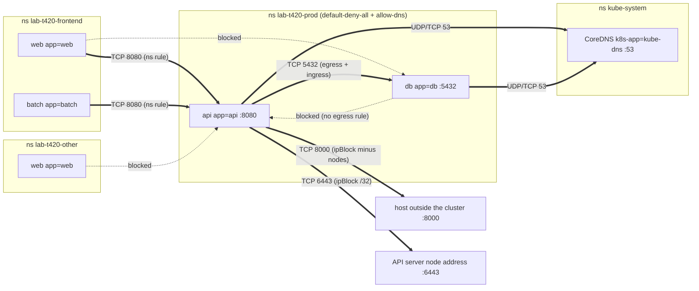

# T4.20 Define and Enforce Network Policies

> Competency: "Define and enforce Network Policies" (CKA-5.2) | Domain/weight: CKA, Servicing and Networking (20%) | Est. time: 2.5 h | Prerequisites: T3.14, T4.17

Shell setup (from [conventions](../00-conventions.md); put it at the top of every session):

```bash
alias k=kubectl
export do="--dry-run=client -o yaml"
export now="--force --grace-period=0"
source <(kubectl completion bash); complete -o default -F __start_kubectl k
```

Lab environment for this lesson: **kind** (3 nodes, `disableDefaultCNI: true`, Calico v3.33.0, from `env/kind-up.sh`). A NetworkPolicy lab only works on a cluster whose network plugin enforces policy, so the plugin matters more here than in most lessons. Namespaces: `lab-t420-*`. Files go in `~/lab/t420/`. Docker must be running: two labs use a plain container as a "host outside the cluster".

> Pod network pitfall (met while writing this lesson, same as in [T3.14](../part3-ckad/T3.14-demonstrate-basic-understanding-of-networkpolicies.md)). `env/kind.yaml` uses the Pod network `192.168.0.0/16`. If your Docker `kind` network uses a subnet inside it, Pods cannot reach the API server and the cluster half-works. Check with `docker network inspect kind -f '{{range .IPAM.Config}}{{.Subnet}} {{end}}'`. On the machine used for this lesson it printed `fc00:f853:ccd:e793::/64 192.168.147.0/24`, so the cluster was created with `podSubnet: 10.244.0.0/16` and, in the Calico manifest, `CALICO_IPV4POOL_CIDR` was uncommented and set to `10.244.0.0/16`. All captured output below comes from that cluster (Pod IPs are `10.244.x.x`, node and "external" addresses are `192.168.147.x`). Your addresses will differ. The scripts below read addresses from Docker and kubectl, so they do not need editing.

> Output policy. Blocks labelled `REAL OUTPUT (kind v0.33.0, v1.37.0, Calico v3.33.0)` were captured on a live cluster (kubectl client v1.37.1, server v1.37.0). The one block labelled `EXPECTED OUTPUT (not captured)` is listed in section 11. Pod IPs, ages and hash suffixes will differ on your cluster.

---

## 1. Why this matters

In a real cluster, a NetworkPolicy that is "applied" is not always a NetworkPolicy that is enforced. The API server stores the object whether or not the network plugin reads it, so the failure is silent: the YAML looks perfect and every Pod can still reach the database. The opposite failure also happens: a namespace-wide default-deny goes in and DNS, the API server and the database path all break at once, because each connection needs permission at **both** ends. In the exam, a NetworkPolicy task is a few lines of YAML, but one wrong dash (OR instead of AND), one wrong label, or a missing DNS rule turns a 3-minute task into a 15-minute one. This lesson gives you the namespace baseline pattern, the cross-namespace and egress rules, and a repeatable test matrix that proves the result instead of hoping.

[T3.14](../part3-ckad/T3.14-demonstrate-basic-understanding-of-networkpolicies.md) taught the object itself. This lesson is the admin layer on top: namespaces, egress, ports, verification, and the limits of the standard API. [T4.17](../part4-cka/T4.17-understand-connectivity-between-pods.md) taught how Pod-to-Pod traffic flows (the Pod network, Services and kube-proxy). You need both: a policy is a filter on that traffic path.

---

## 2. Concepts

### 2.1 Recap of the policy semantics (see T3.14)

This is a ten-line recap. The full explanation, with captures, is in [T3.14](../part3-ckad/T3.14-demonstrate-basic-understanding-of-networkpolicies.md).

- A NetworkPolicy is namespaced. `spec.podSelector` chooses the Pods it protects, **in its own namespace only**.
- A Pod is **isolated for a direction** (ingress or egress) once at least one policy selects it and lists that direction in `policyTypes`. An isolated direction allows only what the union of the selecting policies allows.
- There are only allow rules. There is no deny rule and no priority. Allow rules from all selecting policies are united.
- A connection needs both ends to agree: the sender's egress and the receiver's ingress. A side that is not isolated allows everything in that direction.
- Replies to an allowed connection pass automatically (the rules are stateful).
- A peer is a `podSelector`, a `namespaceSelector`, or an `ipBlock`. One list item with both selectors is **AND**. Two list items is **OR**.
- `ingress: [{}]` is "allow everything". No `ingress` key (with `Ingress` in `policyTypes`) is "allow nothing".

If any line here is new to you, stop and read T3.14 first.

### 2.2 Enforcement needs a policy-capable CNI, and how to verify it

The **CNI** (Container Network Interface) plugin is the software that wires Pods into the network. The API server only stores NetworkPolicy objects. The CNI plugin's agent on each node reads them and writes packet filter rules. If the plugin has no policy engine, the object is accepted and ignored. There is no warning, no event and no status field that says "not enforced".

| CNI plugin | Enforces the standard NetworkPolicy API? | Notes |
|---|---|---|
| Calico | Yes | Used in this guide (v3.33.0). Agent: `calico-node` DaemonSet, which contains the policy engine (Felix). Writes iptables rules (or eBPF programs in eBPF mode) |
| Cilium | Yes | Enforces with eBPF. Not tested in this lesson |
| Flannel (plain) | No | Provides networking only. Objects are accepted and ignored. Flannel is often paired with a second plugin for policy |
| No CNI with a policy engine | No | Same: silent no-op |

Whether the exam clusters enforce policy, and with which plugin, is UNVERIFIED (research summary E23, no official page says). The exam asks for the correct object. Do not spend exam time on the plugin unless a task says a policy "has no effect".

**Verification routine, three levels, cheapest first.**

Level 1, name the plugin. Look at what runs in `kube-system`:

```bash
k -n kube-system get ds
k -n kube-system get ds calico-node -o jsonpath='{.spec.template.spec.containers[0].image}{"\n"}'
```

```text
REAL OUTPUT (kind v0.33.0, v1.37.0, Calico v3.33.0)
NAME          DESIRED   CURRENT   READY   UP-TO-DATE   AVAILABLE   NODE SELECTOR            AGE
calico-node   3         3         3       3            3           kubernetes.io/os=linux   92s
kube-proxy    3         3         3       3            3           kubernetes.io/os=linux   108s
quay.io/calico/node:v3.33.0
```

`calico-node` with `DESIRED=3` and `READY=3` means the agent runs on all three nodes. A node without a ready agent has Pods whose policies are not enforced. `kube-flannel-ds` alone, or no policy-capable agent, means no enforcement.

Level 2, test behaviour. This is the only proof. Make a server and a client in a throwaway namespace, show that the connection works, apply a default-deny, and show that it stops. Save this as `~/lab/t420/verify-cni.sh`:

```bash
shopt -s expand_aliases; alias k=kubectl
k create ns lab-t420-check
k -n lab-t420-check run srv --image=busybox:1.36 -l app=srv -- \
  sh -c 'mkdir -p /www && echo ok > /www/index.html && exec httpd -f -p 8080 -h /www'
k -n lab-t420-check run cli --image=busybox:1.36 -- sleep 3600
k -n lab-t420-check wait --for=condition=Ready pod --all --timeout=90s
IP=$(k -n lab-t420-check get pod srv -o jsonpath='{.status.podIP}')
echo "before policy:"; k -n lab-t420-check exec cli -- wget -qO- -T2 $IP:8080
k -n lab-t420-check apply -f - <<'YAML'
apiVersion: networking.k8s.io/v1
kind: NetworkPolicy
metadata:
  name: deny-ingress
spec:
  podSelector: {}
  policyTypes:
  - Ingress
YAML
sleep 4
echo "after policy:"; k -n lab-t420-check exec cli -- wget -qO- -T2 $IP:8080 2>&1 || true
```

The test uses the Pod IP because a bare Pod has no Service name. `wget -T2` gives up after 2 seconds, so a drop shows up quickly.

```text
REAL OUTPUT (kind v0.33.0, v1.37.0, Calico v3.33.0)
before policy:
ok
networkpolicy.networking.k8s.io/deny-ingress created
after policy:
wget: download timed out
command terminated with exit code 1
```

If the second answer is `ok` instead of a timeout, the plugin is not enforcing. This is the symptom of mistake 1 in section 6. If the second answer is still `ok` right after `apply`, wait a few seconds and run it again before you conclude anything: the node agent needs a moment to program rules.

Level 3, look on the node. Calico's rules are visible as iptables chains. On a kind node (a Docker container) run:

```bash
docker exec k-t420-worker sh -c 'iptables-save | grep -c "cali-"; iptables-save | grep -E "^:cali-(tw|fw|pi|po)" | head -8'
```

```text
REAL OUTPUT (kind v0.33.0, v1.37.0, Calico v3.33.0; trimmed)
313
:cali-fw-cali323deb2e963 - [0:0]
:cali-fw-cali34562c08471 - [0:0]
:cali-pi-_D798oQv3wSe2o08WCRK - [0:0]
```

`cali-fw-<interface>` and `cali-tw-<interface>` are the per-Pod chains for traffic **from** and **to** a workload. `cali-pi-...` and `cali-po-...` are the per-policy chains for ingress and egress rules. Seeing them proves Calico programmed something; only the Level 2 test proves it blocks.

What a non-enforcing cluster would show for the same probe:

```text
EXPECTED OUTPUT (not captured)
before policy:
ok
networkpolicy.networking.k8s.io/deny-ingress created
after policy:
ok
```

**Fix for a non-enforcing cluster.** Install a plugin that has a policy engine. On a kubeadm cluster, that means applying the Calico manifest (see the [Calico page](https://kubernetes.io/docs/tasks/administer-cluster/network-policy-provider/calico-network-policy/) listed in section 10). The CNI choice is made at cluster setup (see [T4.03](../part4-cka/T4.03-understand-extension-interfaces-cni-csi-cri.md)). Changing it on a running cluster is a maintenance operation, not an exam one-liner.

### 2.3 Namespace baselines: default-deny both ways, then allow DNS

The standard admin pattern, applied to every namespace that holds workloads:

1. **Isolate everything**: one `default-deny-all` policy (`podSelector: {}`, `policyTypes: [Ingress, Egress]`, no rules).
2. **Re-open DNS**: one `allow-dns` egress policy (every Pod may send UDP and TCP port 53 to the cluster DNS Pods in `kube-system`).
3. **Add one small allow policy per real connection**, written for both ends (sender egress, receiver ingress).

Why a baseline. Without it, a Pod is open until someone remembers to protect it. With it, every new Pod starts closed, and each hole is a policy someone had to write and review. Because policies only add allowances, the baseline can be reasoned about: the effective rules for a Pod are exactly the union of the policies that select it.

Why DNS must be re-opened. Clients reach Services by name. A name lookup is a UDP packet (TCP for large answers) to the cluster DNS Pods (CoreDNS), which run in `kube-system` with the label `k8s-app=kube-dns`. A default-deny egress drops that packet too. The Pod's `/etc/resolv.conf` points at the DNS **Service** IP (here `10.96.0.10`). The packet is rewritten to a CoreDNS Pod IP before the policy is checked (section 2.7), so the rule selects the **CoreDNS Pods**, not the Service IP.

Why the namespace needs the baseline on both directions. Ingress-only deny leaves Pods free to call out, which is how data leaves after a compromise. Egress-only deny leaves Pods open to scanning from neighbours. The exam wording "default-deny" without a direction is best read from the task text; when it says "all traffic" or "ingress and egress", write both.

What this costs you: **every connection now needs two policies** (sender egress and receiver ingress), plus DNS for the name lookup. Section 5 builds a full example and shows the symptom when one half is missing.

### 2.4 Cross-namespace rules with `kubernetes.io/metadata.name`

A `namespaceSelector` matches **labels on Namespace objects**, not names. A new namespace has no labels you chose. The control plane adds exactly one automatic label, `kubernetes.io/metadata.name=<namespace name>`, to every namespace, and it cannot be changed. So "from the namespace `frontend`" is written:

```yaml
- namespaceSelector:
    matchLabels:
      kubernetes.io/metadata.name: frontend
```

| Selecting a namespace by | Works when | Fails when |
|---|---|---|
| `kubernetes.io/metadata.name: <name>` | Always: the label exists on every namespace | You mistype the namespace name |
| A label you added (`team=fe`) | Someone labelled the namespace | The label is missing or has a different value or key |
| `name: <name>` (very common mistake) | Never by default: no namespace has a `name` label | Always, unless somebody added that label by hand |

Look at the real labels with `k get ns --show-labels`:

```text
REAL OUTPUT (kind v0.33.0, v1.37.0, Calico v3.33.0; trimmed)
NAME                 STATUS   AGE     LABELS
kube-system          Active   111s    kubernetes.io/metadata.name=kube-system
lab-t420-frontend    Active   5m16s   kubernetes.io/metadata.name=lab-t420-frontend
lab-t420-other       Active   5m16s   kubernetes.io/metadata.name=lab-t420-other
lab-t420-prod        Active   5m16s   kubernetes.io/metadata.name=lab-t420-prod
```

A rule that uses a label that does not exist matches **no** namespace, and the policy then allows nobody. It does not fail loudly. The fix is either to switch to `kubernetes.io/metadata.name` or to add the label: `k label ns frontend team=fe`.

A `namespaceSelector` alone matches **every Pod** in the matching namespaces. To narrow it to certain Pods in that namespace, put a `podSelector` in the **same list item** (AND). See section 2.8.

### 2.5 Egress to external CIDRs with `ipBlock`/`except`, and egress to the API server

An `ipBlock` matches an address range. It is meant for addresses outside the cluster, because Pod IPs change.

| Field | Meaning | Rules and risks |
|---|---|---|
| `ipBlock.cidr` | Range of addresses that match | Required. `0.0.0.0/0` matches every IPv4 address, **including Pod, Service-backend and node addresses**. A `/24` that contains your nodes also matches your nodes |
| `ipBlock.except` | List of sub-ranges carved out of `cidr` | Each entry must be a strict subset of `cidr`. The API server rejects the policy otherwise (exact text below) |

Validation text, captured by sending an `except` that lies outside `cidr`:

```text
REAL OUTPUT (kind v0.33.0, v1.37.0, Calico v3.33.0)
The NetworkPolicy "bad" is invalid: spec.egress[0].to[0].ipBlock.except[0]: Invalid value: "10.1.0.0/24": must be a strict subset of `cidr`
```

Use `except` to remove what a wide range must not include. Section 5 allows the whole Docker network `192.168.147.0/24` on TCP 8000 **except** the three node addresses, so the "external" server is reachable while the nodes are not.

**Egress to the API server.** Some Pods (operators, controllers, anything using a ServiceAccount token to call Kubernetes) need the API. A Pod calls `https://kubernetes.default.svc` (Service `kubernetes`, ClusterIP `10.96.0.1`, port 443). Kube-proxy rewrites that to the real API server address and port: here `192.168.147.7:6443`. Policies are checked **after** this rewrite (section 2.7), so the rule must name the real address:

```yaml
- to:
  - ipBlock:
      cidr: 192.168.147.7/32       # the control-plane node address (use YOUR value)
  ports:
  - protocol: TCP
    port: 6443                     # the API server port, not the Service port 443
```

Find the values in one command: `k get endpointslice -l kubernetes.io/service-name=kubernetes` (address and port) and `k get svc kubernetes` (the Service view, `443`). Section 5 proves that a rule written against `10.96.0.1/32` port `443` does **not** work. On a multi-control-plane cluster the EndpointSlice lists several addresses; the rule needs all of them.

A caution on `ipBlock` for Pod IPs. `ipBlock` is meant for ranges outside the cluster, and Pod IPs are short-lived. In the captured runs, Calico matched an `ipBlock` against a node address (the API server rule worked) and against a Docker host. How a given plugin treats an `ipBlock` that covers Pod addresses was not tested (section 11). Do not build Pod-to-Pod rules on `ipBlock`; use selectors.

### 2.6 Port ranges (`endPort`) and named ports

```yaml
ports:
- protocol: TCP          # TCP (default), UDP or SCTP
  port: 8080             # a number, or a container port NAME
  endPort: 8082          # optional: with a numeric port, allows 8080..8082 inclusive
```

| Form | Allows | Valid? |
|---|---|---|
| `port: 8080` | TCP 8080 | Yes |
| `port: 8080`, `endPort: 8082` | TCP 8080, 8081, 8082 | Yes. The plugin must support `endPort`; Calico does |
| `port: http` | Whichever number the **destination Pod** gave the container port named `http` | Yes |
| `port: http`, `endPort: 8082` | n/a | **Rejected** by the API server |
| `endPort: 8082` with no `port` | n/a | **Rejected** |
| `port: 8080`, `endPort: 8079` | n/a | **Rejected** |

The three rejections, captured with `--dry-run=server`:

```text
REAL OUTPUT (kind v0.33.0, v1.37.0, Calico v3.33.0)
The NetworkPolicy "bad" is invalid: spec.ingress[0].ports[0].endPort: Invalid value: 8082: may not be specified when `port` is non-numeric
The NetworkPolicy "bad" is invalid: spec.ingress[0].ports[0].endPort: Invalid value: 8079: must be greater than or equal to `port`
The NetworkPolicy "bad" is invalid: spec.ingress[0].ports[0].endPort: Invalid value: 8082: may not be specified when `port` is not specified
```

**Named ports.** A container can name a port (`ports: [{name: http, containerPort: 8080}]`). A policy can then say `port: http`. The benefit: if the app moves from 8080 to 9090, only the Pod spec changes and the policy keeps working. The risk: the name is looked up on each destination Pod. A Pod that has no port with that name matches nothing. In the captured run a Pod listened on 8080 (named `http`), 8081 and 8085. Policy `port: 8080, endPort: 8082` allowed 8080 and 8081 and blocked 8085. Replacing it with `port: http` allowed only 8080. Section 5 has the commands and output.

### 2.7 Ordering, additivity, and Service traffic (policies see Pod IPs, after DNAT)

**Ordering.** There is none. Policies are not evaluated in sequence. All the allow rules of all the policies that select a Pod are combined into one set. Applying `allow-dns` before or after `api-egress` gives the same result. You cannot narrow by adding a second policy; to narrow, edit or delete the wide one. In section 5 the `api` Pod is selected by four policies (`default-deny-all`, `allow-dns`, `api-ingress`, `api-egress`), and both its DNS lookups and its database call work: that is the union.

**Service traffic.** A client dials a Service name and port, for example `api-80:80`. Kube-proxy rewrites the destination in the node's packet filter (a step called **DNAT**, destination network address translation) from the Service ClusterIP and port to a backend Pod IP and the Pod's `targetPort`. The NetworkPolicy check happens after that rewrite. So:

- a policy never sees a ClusterIP as a destination, and never sees a Service port; it sees `<Pod IP>:<targetPort>`.
- an **ingress** rule must use the Pod's port (`8080`), not the Service port (`80`).
- an **egress** rule must select the backend Pods (by labels) or their addresses, not the Service ClusterIP.

This is why the API server rule in section 2.5 uses the node address and `6443`. It is also why `ipBlock: 10.96.215.46/32` (a Service ClusterIP) fails: section 5, step 9 shows both the working Pod-selector rule and the failing ClusterIP rule.

DNS is the same case: the lookup goes to the DNS Service IP, but the rule that matters selects the CoreDNS Pods.

### 2.8 The AND versus OR trap (merge the selectors)

In `from:` or `to:`, one list item holding `namespaceSelector` **and** `podSelector` is AND. Two list items are OR. One misplaced dash changes the meaning:

```yaml
# AND: Pods labelled app=web that live in namespace frontend
- from:
  - namespaceSelector:
      matchLabels:
        kubernetes.io/metadata.name: frontend
    podSelector:                       # no dash: same item
      matchLabels:
        app: web
```

```yaml
# OR: EVERY Pod in namespace frontend, plus app=web Pods in the policy's OWN namespace
- from:
  - namespaceSelector:
      matchLabels:
        kubernetes.io/metadata.name: frontend
  - podSelector:                       # dash: new item
      matchLabels:
        app: web
```

`k describe netpol` shows the difference. AND prints one `From:` block with two selectors under it. OR prints two `From:` blocks with one selector each. Section 5 step 8 shows both outputs and the matching test results.

### 2.9 Testing matrix with `nc`/`wget` from labelled clients

A policy is correct when a **matrix of expected results** holds, not when the YAML looks right. The routine:

1. Write the expected table first (sender, receiver, port, ALLOW or DENY), including the DENY rows. DENY rows are where over-broad rules are found.
2. Create one client Pod per sender identity, with the labels (and in the namespaces) the table needs. A policy sees labels and namespaces, so a client with the wrong labels tests nothing.
3. Probe each row with `nc -z -w2 <host> <port>` (TCP connect check with a 2 second timeout) or `wget -qO- -T2 http://host:port` (fetch with a 2 second timeout). Always use a timeout; a dropped packet otherwise hangs for a long time.
4. Compare. Print one line per row. Exit non-zero on any mismatch, so the script can fail.

How to read a failed probe (busybox `nc` and `wget`, as captured):

| You see | Meaning | Check next |
|---|---|---|
| `nc: bad address 'db.lab-t420-prod'` or `wget: bad address '...'` | The **name** did not resolve | Is DNS egress allowed for the **sender**? Is the name spelled right? |
| `Connection timed out` / `wget: download timed out` | Packets were dropped or never answered. A policy drop looks like this. So does a wrong IP, a wrong port, or a Pod that is not ready | `k describe netpol`, the labels, the port, `k get pods -o wide` |
| Fails at once with exit status 1 and no "timed out" message (observed when connecting to a closed port on a Pod with no policy) | Not the same picture as a silent drop, which waits for the whole timeout. Do not assume more than that | The destination port and the Pod's listener |

One fact to keep in mind: `DENY` in a script means "the connection did not complete". The script cannot tell a policy drop from a typo in a name. That is why the DNS check is a separate row in the lab scripts.

### 2.10 CNI-specific extensions (awareness only)

Plugins add their own policy objects. They exist because the standard API cannot express some needs: cluster-wide scope, explicit deny rules, ordering, logging, rules against nodes or DNS names.

| Plugin | Object (awareness) | What it adds |
|---|---|---|
| Calico | `GlobalNetworkPolicy` and `NetworkPolicy` in group `crd.projectcalico.org` (CRDs `globalnetworkpolicies.crd.projectcalico.org`, `networkpolicies.crd.projectcalico.org`, and others) | Cluster-wide policies, deny and log actions, order numbers, tiers |
| Cilium | `CiliumNetworkPolicy`, `CiliumClusterwideNetworkPolicy` | L7 and DNS-name rules, cluster-wide scope. Not installed or tested here |

On the lab cluster, Calico's CRDs are there, and no Calico policy exists until someone creates one:

```text
REAL OUTPUT (kind v0.33.0, v1.37.0, Calico v3.33.0)
$ k get globalnetworkpolicies.crd.projectcalico.org
No resources found
```

(`k get crd` lists 22 CRDs in the `crd.projectcalico.org` group on this cluster, among them `globalnetworkpolicies`, `networkpolicies`, `felixconfigurations`, `ippools` and `tiers`.) **The exam uses the standard `networking.k8s.io/v1` NetworkPolicy API.** The allowed documentation is kubernetes.io, helm.sh/docs and gateway-api.sigs.k8s.io for CKA (E13), which does not include Calico or Cilium docs. Do not plan to solve a task with a plugin object.

### 2.11 AdminNetworkPolicy and BaselineAdminNetworkPolicy (awareness only)

The standard NetworkPolicy is written by namespace owners and cannot be overridden by a cluster administrator. The **network-policy-api** project (a Kubernetes SIG Network project, outside the core Kubernetes API) defines cluster-scoped policies for admins. The project's home page (https://network-policy-api.sigs.k8s.io/, read on the day this lesson was written) lists `AdminNetworkPolicy` and `BaselineAdminNetworkPolicy` as the *previous* APIs, in group `policy.networking.k8s.io/v1alpha1`, and `ClusterNetworkPolicy` as the *active* API, which is meant to combine the two.

What you can verify on a cluster, using the lab:

```bash
k api-resources --api-group=networking.k8s.io          # core: NetworkPolicy, Ingress, ... (no admin policy)
k api-resources --api-group=policy.networking.k8s.io   # present only if a plugin or you installed the CRDs
```

```text
REAL OUTPUT (kind v0.33.0, v1.37.0, Calico v3.33.0)
NAME                     SHORTNAMES   APIVERSION                          NAMESPACED   KIND
clusternetworkpolicies   cnp          policy.networking.k8s.io/v1alpha2   false        ClusterNetworkPolicy
```

So: `networking.k8s.io/v1` core has `NetworkPolicy` only. On this cluster the Calico v3.33.0 manifest installed a `ClusterNetworkPolicy` CRD (`policy.networking.k8s.io/v1alpha2`, cluster-scoped, with a `priority` field from 0 to 1000 where a lower number wins, per `k explain clusternetworkpolicy.spec`). Whether a given plugin acts on these objects is up to the plugin. Treat them as: not core, not in the CKA curriculum text for this competency, not in the exam unless a task says so. You only need to recognise the names and know that they do not replace the standard API.

### 2.12 Under the hood

1. `k apply` sends the policy to the API server. It validates the schema (the `endPort` and `except` checks above) and stores it in etcd. Nothing else happens in the control plane.
2. On each node the CNI agent watches NetworkPolicy, Pod and Namespace objects. For each local Pod, it works out which policies select it. It expands `podSelector`, `namespaceSelector` and `ipBlock` into sets of addresses and keeps them current as Pods come and go.
3. The agent writes filter rules on the node: Calico adds the `cali-*` chains seen in section 2.2. Cilium uses eBPF programs instead.
4. A packet leaving a Pod passes the sender's egress rules, then reaches the node's network stack, where kube-proxy has already installed the Service DNAT rules. Calico's checks see the packet **after** that rewrite. On the receiving node the destination Pod's ingress rules are applied.
5. Allowed connections are tracked. Reply packets match the tracking entry, so they need no rule.
6. Traffic to and from the node a Pod runs on is always allowed. The NetworkPolicy concepts page says so in its list of what a Pod can communicate with ("traffic to and from the node where a Pod is running is always allowed"), which is why the kubelet's health probes keep working under a default-deny.

Because rules are programmed by node agents, there is a short delay between `apply` and enforcement. The lab scripts use `sleep 4` before testing.

### 2.13 Related but different

| Often confused with | Difference |
|---|---|
| Service | Gives a stable name and load-balances. Does not restrict who may connect |
| Ingress / Gateway API | Route **external** HTTP traffic in. A default-deny in the controller's namespace can block the controller Pod itself |
| RBAC | Controls who may call the Kubernetes **API**. A NetworkPolicy controls **network** packets |
| Pod Security / admission | Restrict what a Pod may run. They do not filter traffic |
| `hostNetwork: true` Pods | Share the node's network namespace. Whether policy applies to them depends on the plugin: do not rely on it. UNVERIFIED here |

---

## 3. How it works (diagram)

Namespaces, Pods and the allowed edges after the baseline and allow policies from section 5. Solid arrows are allowed. Dotted arrows are blocked. The CoreDNS Pods and the API server are reached through the Pod's egress rules.



Expected connectivity matrix (the test script in section 5 checks every row):

| # | From | To | Port | Expected | Why |
|---|---|---|---|---|---|
| 1 | frontend/web | prod/api | 8080 | ALLOW | `api-ingress` allows the frontend namespace |
| 2 | frontend/batch | prod/api | 8080 | ALLOW | same rule: the namespace-only form lets in every Pod there |
| 3 | other/web | prod/api | 8080 | DENY | namespace `other` is not in the rule |
| 4 | frontend/web | prod/db | 5432 | DENY | `db-ingress` allows only `app=api` |
| 5 | prod/api | prod/db | 5432 | ALLOW | `api-egress` (sender) and `db-ingress` (receiver) |
| 6 | prod/api | external host | 8000 | ALLOW | `ipBlock` rule, nodes excluded |
| 7 | prod/api | API server (via `kubernetes.default.svc:443`) | 6443 after DNAT | ALLOW | `ipBlock` `/32` of the node address |
| 8 | prod/db | prod/api | 8080 | DENY | `db` has no egress rule except DNS |

Walkthrough:

1. `default-deny-all` isolates every Pod in `lab-t420-prod` in both directions. Nothing in or out is allowed, DNS included.
2. `allow-dns` re-opens UDP and TCP 53 from every Pod in the namespace to the CoreDNS Pods only. This is why the lookups from `api` and `db` work.
3. `api-ingress` lets the namespace `lab-t420-frontend` in on TCP 8080. `web` and `batch` both arrive; `other/web` does not.
4. A connection needs both ends. `api` → `db` works because `api-egress` lets `api` send to `db:5432` **and** `db-ingress` lets `db` receive from `api`. `db` has no egress rule beyond DNS, so `db` → `api` is blocked.
5. The external host and the API server are not Pods, so the rules use `ipBlock`. The API server rule names the real node address and port, because the check happens after the Service rewrite.

---

## 4. Commands and YAML you must produce fast

### 4.1 There is no imperative command for a NetworkPolicy

`kubectl create networkpolicy` does not exist. Fastest options in the exam:

1. **Copy from the docs page** (https://kubernetes.io/docs/concepts/services-networking/network-policies/) and edit. Open it before the first NetworkPolicy task.
2. **Type the default-deny shapes from memory.** They are 8 lines.
3. **Find a field with `k explain`**: `k explain netpol.spec.egress.to.ipBlock`, `k explain netpol.spec.ingress.ports`.

Always check before you apply: `k apply -f x.yaml --dry-run=server` (validates, creates nothing).

The commands around a policy:

| Command | What it does |
|---|---|
| `k get netpol -A` | All policies in all namespaces (`netpol` is the short name) |
| `k describe netpol -n prod` | Every policy in namespace `prod`, printed in plain words. Read AND/OR here |
| `k get netpol <name> -n prod -o yaml` | The stored YAML, with defaulted `policyTypes` |
| `k get ns --show-labels` | The labels `namespaceSelector` can match |
| `k label ns frontend team=fe` | Add a namespace label (`--overwrite` to change one) |
| `k get pods -n prod --show-labels` | The labels `podSelector` can match |
| `k run t -n other --rm -it --image=busybox:1.36 --restart=Never -- nc -zv -w2 api.prod 8080` | One-shot test client in namespace `other` |
| `k exec -n frontend web -- nc -zv -w2 api.prod 8080` | The same test from an existing labelled Pod |

Reading the one-shot command: `k run t -n other` makes a Pod `t` in `other`. `--rm -it` attaches your terminal and deletes the Pod on exit. `--restart=Never` makes it a bare Pod. After `--` comes the command: `nc -zv -w2 api.prod 8080` opens a TCP connection to `api.prod:8080` and closes it (`-z`), prints the result (`-v`), and gives up after 2 seconds (`-w2`). `api.prod` is Service `api` in namespace `prod`. A test Pod made with `k run` has **no labels except `run=t`**; to test a rule that needs `app=web`, add `-l app=web`.

Real result of this command on the lab cluster (namespaces `lab-t420-other` and `lab-t420-prod`), from a script without a terminal, so `-i` replaced `-it`; the attach banner lines differ with a terminal:

```text
REAL OUTPUT (kind v0.33.0, v1.37.0, Calico v3.33.0; trimmed)
$ k -n lab-t420-other run t --rm -i --image=busybox:1.36 --restart=Never -- nc -zv -w2 api.lab-t420-prod 8080
...
nc: api.lab-t420-prod (10.96.71.31:8080): Connection timed out
pod "t" deleted from lab-t420-other namespace
```

This is the blocked case. Before any policy, the same command printed `api.lab-t420-prod (10.96.71.31:8080) open`.

### 4.2 The YAML to produce: default-deny-all, allow DNS, allow ingress from a namespace

The task from the entry: namespace `prod` gets default-deny for ingress and egress, DNS egress allowed, and ingress to `app=api` from the namespace `frontend` on TCP 8080. Three policies, applied with `-n prod`.

**(1) Default-deny all.**

```yaml
apiVersion: networking.k8s.io/v1      # the only stable version of this kind
kind: NetworkPolicy
metadata:
  name: default-deny-all              # any name; say what it does
spec:
  podSelector: {}                     # {} = every Pod in the namespace
  policyTypes:                        # which directions become isolated
  - Ingress                           # no 'ingress:' list below = allow nothing in
  - Egress                            # no 'egress:' list below = allow nothing out (DNS too)
```

**(2) Allow DNS egress to the cluster DNS Pods.**

```yaml
apiVersion: networking.k8s.io/v1
kind: NetworkPolicy
metadata:
  name: allow-dns
spec:
  podSelector: {}                     # every Pod in this namespace may look up names
  policyTypes:
  - Egress                            # only the outgoing side; ingress is not touched
  egress:
  - to:                               # one item: namespace AND pod (no dash on podSelector)
    - namespaceSelector:
        matchLabels:
          kubernetes.io/metadata.name: kube-system   # the automatic label
      podSelector:
        matchLabels:
          k8s-app: kube-dns                          # CoreDNS Pods (also the label on kube-dns)
    ports:
    - protocol: UDP                   # normal lookups
      port: 53
    - protocol: TCP                   # large answers fall back to TCP
      port: 53
```

**(3) Allow ingress to `app=api` from namespace `frontend` on 8080.**

```yaml
apiVersion: networking.k8s.io/v1
kind: NetworkPolicy
metadata:
  name: api-ingress
spec:
  podSelector:                        # WHO IS PROTECTED: the api Pods of namespace prod
    matchLabels:
      app: api
  policyTypes:
  - Ingress                           # only incoming is restricted by this policy
  ingress:
  - from:                             # allowed sources; entries are OR
    - namespaceSelector:              # every Pod in the namespace named frontend
        matchLabels:
          kubernetes.io/metadata.name: frontend
    ports:
    - protocol: TCP                   # the default; written for clarity
      port: 8080                      # the Pod's port (the targetPort), not a Service port
```

Apply: `k apply -n prod -f default-deny-all.yaml -f allow-dns.yaml -f api-ingress.yaml`. A policy lives in the namespace of the Pods it protects, not in the clients' namespace. To tighten (3) to certain client Pods, add `podSelector` **without a dash** under the same item (section 2.8).

**Field notes for the three policies.**

| Field | Default | Risky or invalid value |
|---|---|---|
| `spec.podSelector` | The docs list it as required; always write it | `{}` selects every Pod; a typo in a label selects none, so the policy protects nothing |
| `spec.policyTypes` | `Ingress` always; `Egress` added if the policy has an `egress` section | Omitting it on an egress-only policy isolates ingress too (see [T3.14](../part3-ckad/T3.14-demonstrate-basic-understanding-of-networkpolicies.md)). Write it |
| `from[].namespaceSelector` | none | Label that no namespace has: matches nothing |
| `ports[].protocol` | `TCP` | `UDP` for DNS; `SCTP` needs plugin support |
| `ports[].port` | all ports (when `ports` is absent) | The Service port instead of the Pod port |

**More shapes you will need.** Egress to an external CIDR (illustrative documentation range, with a carved-out sub-range):

```yaml
apiVersion: networking.k8s.io/v1
kind: NetworkPolicy
metadata:
  name: api-ext-egress
spec:
  podSelector:
    matchLabels:
      app: api
  policyTypes:
  - Egress
  egress:
  - to:
    - ipBlock:
        cidr: 203.0.113.0/24          # allow this range ...
        except:
        - 203.0.113.64/28             # ... except this sub-range (must be strictly inside cidr)
    ports:
    - protocol: TCP
      port: 443
```

Port range and named port:

```yaml
apiVersion: networking.k8s.io/v1
kind: NetworkPolicy
metadata:
  name: multi-range
spec:
  podSelector:
    matchLabels:
      app: multi
  policyTypes:
  - Ingress
  ingress:
  - from:
    - namespaceSelector:
        matchLabels:
          kubernetes.io/metadata.name: metrics
    ports:
    - protocol: TCP
      port: 8000                      # first port of the range
      endPort: 8100                   # last port, inclusive; numeric port only
```

```yaml
apiVersion: networking.k8s.io/v1
kind: NetworkPolicy
metadata:
  name: web-named
spec:
  podSelector:
    matchLabels:
      app: web
  policyTypes:
  - Ingress
  ingress:
  - from:
    - podSelector:
        matchLabels:
          app: lb
    ports:
    - protocol: TCP
      port: http                      # the NAME of a container port on the web Pods
```

### 4.3 Speed drill

Setup (one line): `k create ns lab-t420-drill && k config set-context --current --namespace=lab-t420-drill && mkdir -p ~/lab/t420`. Work in `~/lab/t420/`. Targets are exam pace (average about 6 minutes per task, from 15-20 tasks in 2 hours: [E2](https://docs.linuxfoundation.org/tc-docs/certification/tips-cka-and-ckad), [E3](https://docs.linuxfoundation.org/tc-docs/certification/faq-cka-ckad-cks)); NetworkPolicy tasks should be at the fast end. Validate each with `k apply --dry-run=server -f file.yaml` before applying.

| # | Task | Target |
|---|---|---|
| 1 | Create `default-deny-all` (ingress and egress) for the whole namespace | 45 s |
| 2 | Create `allow-dns` so every Pod can send DNS (UDP and TCP 53) to the cluster DNS Pods and nothing else | 90 s |
| 3 | Create `api-ingress`: `app=api` accepts TCP 8080 from every Pod of namespace `frontend` | 90 s |
| 4 | Tighten `api-ingress`: only `app=web` Pods of namespace `frontend` (replace the same policy) | 60 s |
| 5 | Create `api-ext-egress`: `app=api` may send TCP 443 to `203.0.113.0/24` except `203.0.113.64/28` | 2 min |
| 6 | Create `multi-range`: `app=multi` accepts TCP 8000 to 8100 from namespace `metrics` | 90 s |
| 7 | Create `web-named`: `app=web` accepts the container port named `http` from `app=lb` Pods of the same namespace | 90 s |
| 8 | Read-only: a policy has `- namespaceSelector: {team: fe}` and `- podSelector: {app: web}` as two list items. Who can connect? | 60 s |

<details><summary>Answers</summary>

```bash
# 1
cat > ~/lab/t420/d1.yaml <<'EOF'
apiVersion: networking.k8s.io/v1
kind: NetworkPolicy
metadata:
  name: default-deny-all
spec:
  podSelector: {}
  policyTypes:
  - Ingress
  - Egress
EOF
k apply -f ~/lab/t420/d1.yaml

# 2
cat > ~/lab/t420/d2.yaml <<'EOF'
apiVersion: networking.k8s.io/v1
kind: NetworkPolicy
metadata:
  name: allow-dns
spec:
  podSelector: {}
  policyTypes:
  - Egress
  egress:
  - to:
    - namespaceSelector:
        matchLabels:
          kubernetes.io/metadata.name: kube-system
      podSelector:
        matchLabels:
          k8s-app: kube-dns
    ports:
    - protocol: UDP
      port: 53
    - protocol: TCP
      port: 53
EOF
k apply -f ~/lab/t420/d2.yaml

# 3
cat > ~/lab/t420/d3.yaml <<'EOF'
apiVersion: networking.k8s.io/v1
kind: NetworkPolicy
metadata:
  name: api-ingress
spec:
  podSelector:
    matchLabels:
      app: api
  policyTypes:
  - Ingress
  ingress:
  - from:
    - namespaceSelector:
        matchLabels:
          kubernetes.io/metadata.name: frontend
    ports:
    - protocol: TCP
      port: 8080
EOF
k apply -f ~/lab/t420/d3.yaml

# 4: add the podSelector in the same list item (no dash), then apply again
cat > ~/lab/t420/d4.yaml <<'EOF'
apiVersion: networking.k8s.io/v1
kind: NetworkPolicy
metadata:
  name: api-ingress
spec:
  podSelector:
    matchLabels:
      app: api
  policyTypes:
  - Ingress
  ingress:
  - from:
    - namespaceSelector:
        matchLabels:
          kubernetes.io/metadata.name: frontend
      podSelector:
        matchLabels:
          app: web
    ports:
    - protocol: TCP
      port: 8080
EOF
k apply -f ~/lab/t420/d4.yaml
k describe netpol api-ingress | grep -A3 "From:"      # one From block with two selectors = AND

# 5
cat > ~/lab/t420/d5.yaml <<'EOF'
apiVersion: networking.k8s.io/v1
kind: NetworkPolicy
metadata:
  name: api-ext-egress
spec:
  podSelector:
    matchLabels:
      app: api
  policyTypes:
  - Egress
  egress:
  - to:
    - ipBlock:
        cidr: 203.0.113.0/24
        except:
        - 203.0.113.64/28
    ports:
    - protocol: TCP
      port: 443
EOF
k apply -f ~/lab/t420/d5.yaml

# 6
cat > ~/lab/t420/d6.yaml <<'EOF'
apiVersion: networking.k8s.io/v1
kind: NetworkPolicy
metadata:
  name: multi-range
spec:
  podSelector:
    matchLabels:
      app: multi
  policyTypes:
  - Ingress
  ingress:
  - from:
    - namespaceSelector:
        matchLabels:
          kubernetes.io/metadata.name: metrics
    ports:
    - protocol: TCP
      port: 8000
      endPort: 8100
EOF
k apply -f ~/lab/t420/d6.yaml

# 7
cat > ~/lab/t420/d7.yaml <<'EOF'
apiVersion: networking.k8s.io/v1
kind: NetworkPolicy
metadata:
  name: web-named
spec:
  podSelector:
    matchLabels:
      app: web
  policyTypes:
  - Ingress
  ingress:
  - from:
    - podSelector:
        matchLabels:
          app: lb
    ports:
    - protocol: TCP
      port: http
EOF
k apply -f ~/lab/t420/d7.yaml
```

Task 8: the two list items are OR. Allowed: every Pod in any namespace labelled `team=fe`, plus every `app=web` Pod in the policy's **own** namespace. It is not "app=web Pods from team=fe". The fix is to delete the dash before `podSelector`.

Cleanup: `k config set-context --current --namespace=default && k delete ns lab-t420-drill && rm -f ~/lab/t420/d?.yaml`

</details>

(All YAML documents in this drill were accepted by `k apply --dry-run=server` on the lab cluster. Drill 4 replaces the policy of drill 3 by applying a file with the same name.)

---

## 5. Worked example

Goal: build the namespace baseline for `lab-t420-prod`, add the allow rules one at a time, and watch the test matrix of section 3 go from "everything open" to exactly the expected table. All captures are `REAL OUTPUT (kind v0.33.0, v1.37.0, Calico v3.33.0)` unless a block says otherwise. Run the steps in order.

**The cast:**

| Namespace | Pod | Labels | Listens | Service |
|---|---|---|---|---|
| `lab-t420-prod` | `api` | `app=api` | 8080 | `api` (8080) |
| `lab-t420-prod` | `db` | `app=db` | 5432 | `db` (5432) |
| `lab-t420-frontend` | `web`, `batch` | `app=web`, `app=batch` | none (clients) | none |
| `lab-t420-other` | `web` | `app=web` | none (client) | none |
| host outside the cluster | Docker container `ext-t420` | n/a | 8000 | n/a |

### Step 1: confirm the plugin enforces policy

Run the Level 1 and Level 2 checks of section 2.2 (`~/lab/t420/verify-cni.sh`). Do not continue until the second `wget` times out. Then remove the throwaway namespace: `k delete ns lab-t420-check`.

### Step 2: build the cast

Save as `~/lab/t420/base.sh` and run `bash ~/lab/t420/base.sh`:

```bash
shopt -s expand_aliases
alias k=kubectl
for ns in lab-t420-prod lab-t420-frontend lab-t420-other; do k create ns $ns; done
# server Pods: busybox httpd listeners that print a marker
k -n lab-t420-prod run api --image=busybox:1.36 -l app=api -- \
  sh -c 'mkdir -p /www && echo api-ok > /www/index.html && exec httpd -f -p 8080 -h /www'
k -n lab-t420-prod run db --image=busybox:1.36 -l app=db -- \
  sh -c 'mkdir -p /www && echo db-ok > /www/index.html && exec httpd -f -p 5432 -h /www'
k -n lab-t420-prod expose pod api --port=8080
k -n lab-t420-prod expose pod db --port=5432
# client Pods
k -n lab-t420-frontend run web   --image=busybox:1.36 -l app=web   -- sleep 3600
k -n lab-t420-frontend run batch --image=busybox:1.36 -l app=batch -- sleep 3600
k -n lab-t420-other    run web   --image=busybox:1.36 -l app=web   -- sleep 3600
for ns in lab-t420-prod lab-t420-frontend lab-t420-other; do
  k -n $ns wait --for=condition=Ready pod --all --timeout=120s
done
# a "host outside the cluster": a container on the Docker network that kind uses
docker rm -f ext-t420 >/dev/null 2>&1
docker run -d --name ext-t420 --network kind busybox:1.36 \
  sh -c 'mkdir -p /www && echo ext-ok > /www/index.html && exec httpd -f -p 8000 -h /www'
```

The server Pods run busybox's `httpd` in the foreground (`-f`) on the port the Service targets. The first lines of the script define `k` because a script does not see your interactive alias.

Next, collect the addresses the policies need. Save as `~/lab/t420/vars.sh`; you will `source` it:

```bash
SUBNET=$(docker network inspect kind -f '{{range .IPAM.Config}}{{.Subnet}} {{end}}' | tr ' ' '\n' | grep -E '^[0-9]+\.[0-9]+\.[0-9]+\.[0-9]+/' | head -1)
EXT=$(docker inspect -f '{{.NetworkSettings.Networks.kind.IPAddress}}' ext-t420)
CP=$(kubectl get endpointslice -l kubernetes.io/service-name=kubernetes -o jsonpath='{.items[0].endpoints[0].addresses[0]}')
N1=$(kubectl get nodes -o jsonpath='{.items[0].status.addresses[0].address}')
N2=$(kubectl get nodes -o jsonpath='{.items[1].status.addresses[0].address}')
N3=$(kubectl get nodes -o jsonpath='{.items[2].status.addresses[0].address}')
```

`SUBNET` is the IPv4 subnet of the Docker network, `EXT` the external server, `CP` the API server address and `N1`-`N3` the three node addresses. Check them:

```bash
. ~/lab/t420/vars.sh; echo $SUBNET $EXT $CP $N1 $N2 $N3
k get pods -A -o wide | grep lab-t420
```

```text
REAL OUTPUT (kind v0.33.0, v1.37.0, Calico v3.33.0; trimmed)
192.168.147.0/24 192.168.147.10 192.168.147.7 192.168.147.7 192.168.147.8 192.168.147.9
lab-t420-frontend    batch   1/1   Running   0   11s   10.244.160.196   k-t420-worker
lab-t420-frontend    web     1/1   Running   0   11s   10.244.160.195   k-t420-worker
lab-t420-other       web     1/1   Running   0   11s   10.244.104.69    k-t420-worker2
lab-t420-prod        api     1/1   Running   0   11s   10.244.160.193   k-t420-worker
lab-t420-prod        db      1/1   Running   0   11s   10.244.160.194   k-t420-worker
```

### Step 3: the test script and the default-allow baseline

Save as `~/lab/t420/matrix.sh` (`chmod +x`). It needs `EXT` in the environment (`export EXT`). It prints one line per row of the expected matrix and exits with the number of mismatches:

```bash
#!/usr/bin/env bash
probe() { kubectl -n "$1" exec "$2" -- nc -z -w2 "$3" "$4" >/dev/null 2>&1 && echo ALLOW || echo DENY; }
bad=0
check() {  # namespace pod target port expected
  got=$(probe "$1" "$2" "$3" "$4")
  [ "$got" = "$5" ] && r=ok || { r=MISMATCH; bad=$((bad+1)); }
  printf '%-18s %-6s -> %-26s %-5s expect=%-5s got=%-5s %s\n' "$1" "$2" "$3" "$4" "$5" "$got" "$r"
}
check lab-t420-frontend web   api.lab-t420-prod       8080 ALLOW
check lab-t420-frontend batch api.lab-t420-prod       8080 ALLOW
check lab-t420-other    web   api.lab-t420-prod       8080 DENY
check lab-t420-frontend web   db.lab-t420-prod        5432 DENY
check lab-t420-prod     api   db.lab-t420-prod        5432 ALLOW
check lab-t420-prod     api   "$EXT"                  8000 ALLOW
check lab-t420-prod     api   kubernetes.default.svc  443  ALLOW
check lab-t420-prod     db    api.lab-t420-prod       8080 DENY
exit $bad
```

`kubectl exec` runs the probe inside the client Pod, so the client's namespace and labels decide which policies apply. Before any policy exists, the result is default allow. Spot checks from namespace `other`:

```bash
k get netpol -A
k -n lab-t420-other exec web -- nc -zv -w2 api.lab-t420-prod 8080
k -n lab-t420-other exec web -- nc -zv -w2 $EXT 8000
k -n lab-t420-other exec web -- nc -zv -w2 kubernetes.default.svc 443
k -n lab-t420-other exec web -- wget -qO- -T2 --no-check-certificate https://kubernetes.default.svc
```

```text
REAL OUTPUT (kind v0.33.0, v1.37.0, Calico v3.33.0)
No resources found
api.lab-t420-prod (10.96.71.31:8080) open
192.168.147.10 (192.168.147.10:8000) open
kubernetes.default.svc (10.96.0.1:443) open
wget: server returned error: HTTP/1.1 403 Forbidden
```

All paths are open, including the API server (the `403` is the API server answering an anonymous request: reachable, not authorised). Notice that `nc` prints the **Service ClusterIP** `10.96.0.1:443` here, while the policy will see the real node address after DNAT.

### Step 4: default-deny both ways, and read the symptoms

```bash
mkdir -p ~/lab/t420 && cd ~/lab/t420
cat > default-deny-all.yaml <<'EOF'
apiVersion: networking.k8s.io/v1
kind: NetworkPolicy
metadata:
  name: default-deny-all
spec:
  podSelector: {}
  policyTypes:
  - Ingress
  - Egress
EOF
k -n lab-t420-prod apply -f default-deny-all.yaml; sleep 4
k -n lab-t420-prod exec api -- nslookup db.lab-t420-prod
k -n lab-t420-prod exec api -- nc -zv -w2 db.lab-t420-prod 5432
k -n lab-t420-prod exec api -- nc -zv -w2 $(k -n lab-t420-prod get pod db -o jsonpath='{.status.podIP}') 5432
k -n lab-t420-frontend exec web -- nc -zv -w2 api.lab-t420-prod 8080
k -n lab-t420-prod describe netpol default-deny-all
```

```text
REAL OUTPUT (kind v0.33.0, v1.37.0, Calico v3.33.0)
;; connection timed out; no servers could be reached
nc: bad address 'db.lab-t420-prod'
nc: 10.244.160.194 (10.244.160.194:5432): Connection timed out
nc: api.lab-t420-prod (10.96.71.31:8080): Connection timed out
Name:         default-deny-all
Namespace:    lab-t420-prod
Spec:
  PodSelector:     <none> (Allowing the specific traffic to all pods in this namespace)
  Allowing ingress traffic:
    <none> (Selected pods are isolated for ingress connectivity)
  Allowing egress traffic:
    <none> (Selected pods are isolated for egress connectivity)
  Policy Types: Ingress, Egress
```

Read the four failures as a diagnosis path:

1. `nslookup ... no servers could be reached` and `nc: bad address`: the **name** cannot be resolved because egress to DNS is dropped. The Pod is not even reaching CoreDNS.
2. The same `nc` by **Pod IP** reaches the next failure: `Connection timed out`. With a name that resolves, the packets are still dropped: egress from `api` and ingress to `db` are both closed.
3. `frontend/web` → `api` (name resolves because `frontend` has no policy) times out: **ingress** to `api` is closed. The two kinds of message (`bad address` vs `timed out`) tell you which side to fix first.

The `describe` text confirms the shape: `<none> (Allowing the specific traffic to all pods in this namespace)` is `podSelector: {}`; both directions read `<none> (Selected pods are isolated...)`.

### Step 5: allow DNS, then ingress from the frontend namespace

```bash
cat > allow-dns.yaml <<'EOF'
apiVersion: networking.k8s.io/v1
kind: NetworkPolicy
metadata:
  name: allow-dns
spec:
  podSelector: {}
  policyTypes:
  - Egress
  egress:
  - to:
    - namespaceSelector:
        matchLabels:
          kubernetes.io/metadata.name: kube-system
      podSelector:
        matchLabels:
          k8s-app: kube-dns
    ports:
    - protocol: UDP
      port: 53
    - protocol: TCP
      port: 53
EOF
cat > api-ingress.yaml <<'EOF'
apiVersion: networking.k8s.io/v1
kind: NetworkPolicy
metadata:
  name: api-ingress
spec:
  podSelector:
    matchLabels:
      app: api
  policyTypes:
  - Ingress
  ingress:
  - from:
    - namespaceSelector:
        matchLabels:
          kubernetes.io/metadata.name: lab-t420-frontend
    ports:
    - protocol: TCP
      port: 8080
EOF
k -n lab-t420-prod apply -f allow-dns.yaml -f api-ingress.yaml; sleep 4
. ~/lab/t420/vars.sh; export EXT; ~/lab/t420/matrix.sh; echo exit=$?
k -n lab-t420-prod describe netpol allow-dns api-ingress
```

```text
REAL OUTPUT (kind v0.33.0, v1.37.0, Calico v3.33.0)
lab-t420-frontend  web    -> api.lab-t420-prod            8080  expect=ALLOW got=ALLOW ok
lab-t420-frontend  batch  -> api.lab-t420-prod            8080  expect=ALLOW got=ALLOW ok
lab-t420-other     web    -> api.lab-t420-prod            8080  expect=DENY  got=DENY  ok
lab-t420-frontend  web    -> db.lab-t420-prod             5432  expect=DENY  got=DENY  ok
lab-t420-prod      api    -> db.lab-t420-prod             5432  expect=ALLOW got=DENY  MISMATCH
lab-t420-prod      api    -> 192.168.147.10               8000  expect=ALLOW got=DENY  MISMATCH
lab-t420-prod      api    -> kubernetes.default.svc       443   expect=ALLOW got=DENY  MISMATCH
lab-t420-prod      db     -> api.lab-t420-prod            8080  expect=DENY  got=DENY  ok
exit=3
Name:         allow-dns
Namespace:    lab-t420-prod
Spec:
  PodSelector:     <none> (Allowing the specific traffic to all pods in this namespace)
  Not affecting ingress traffic
  Allowing egress traffic:
    To Port: 53/UDP
    To Port: 53/TCP
    To:
      NamespaceSelector: kubernetes.io/metadata.name=kube-system
      PodSelector: k8s-app=kube-dns
  Policy Types: Egress
...
Name:         api-ingress
Namespace:    lab-t420-prod
Spec:
  PodSelector:     app=api
  Allowing ingress traffic:
    To Port: 8080/TCP
    From:
      NamespaceSelector: kubernetes.io/metadata.name=lab-t420-frontend
  Not affecting egress traffic
  Policy Types: Ingress
```

Rows 1 to 4 and row 8 are already right. The three `MISMATCH` rows are the egress connections from `api`: the policies do not allow them yet. That is expected here, and it is a good habit: apply one step, run the matrix, and read which rows moved. Note that `frontend/batch` is allowed (row 2) because this rule names the namespace only.

### Step 6: both ends of `api` to `db`, the external host, and the API server

```bash
. ~/lab/t420/vars.sh
cat > db-ingress.yaml <<'EOF'
apiVersion: networking.k8s.io/v1
kind: NetworkPolicy
metadata:
  name: db-ingress
spec:
  podSelector:
    matchLabels:
      app: db
  policyTypes:
  - Ingress
  ingress:
  - from:
    - podSelector:
        matchLabels:
          app: api
    ports:
    - protocol: TCP
      port: 5432
EOF
cat > api-egress.yaml <<EOF
apiVersion: networking.k8s.io/v1
kind: NetworkPolicy
metadata:
  name: api-egress
spec:
  podSelector:
    matchLabels:
      app: api
  policyTypes:
  - Egress
  egress:
  - to:                              # rule 1: the database, same namespace
    - podSelector:
        matchLabels:
          app: db
    ports:
    - protocol: TCP
      port: 5432
  - to:                              # rule 2: an external network, minus the cluster nodes
    - ipBlock:
        cidr: $SUBNET
        except:
        - $N1/32
        - $N2/32
        - $N3/32
    ports:
    - protocol: TCP
      port: 8000
  - to:                              # rule 3: the API server by its real address (after DNAT)
    - ipBlock:
        cidr: $CP/32
    ports:
    - protocol: TCP
      port: 6443
EOF
k -n lab-t420-prod apply -f db-ingress.yaml -f api-egress.yaml; sleep 4
export EXT; ~/lab/t420/matrix.sh; echo exit=$?
k -n lab-t420-prod describe netpol api-egress
```

The heredoc for `api-egress.yaml` has no quotes around `EOF`, so the shell fills in `$SUBNET`, `$N1`... before the file is written. (The `db-ingress.yaml` heredoc is quoted because it has nothing to fill in.)

```text
REAL OUTPUT (kind v0.33.0, v1.37.0, Calico v3.33.0)
lab-t420-frontend  web    -> api.lab-t420-prod            8080  expect=ALLOW got=ALLOW ok
lab-t420-frontend  batch  -> api.lab-t420-prod            8080  expect=ALLOW got=ALLOW ok
lab-t420-other     web    -> api.lab-t420-prod            8080  expect=DENY  got=DENY  ok
lab-t420-frontend  web    -> db.lab-t420-prod             5432  expect=DENY  got=DENY  ok
lab-t420-prod      api    -> db.lab-t420-prod             5432  expect=ALLOW got=ALLOW ok
lab-t420-prod      api    -> 192.168.147.10               8000  expect=ALLOW got=ALLOW ok
lab-t420-prod      api    -> kubernetes.default.svc       443   expect=ALLOW got=ALLOW ok
lab-t420-prod      db     -> api.lab-t420-prod            8080  expect=DENY  got=DENY  ok
exit=0
Name:         api-egress
Namespace:    lab-t420-prod
Spec:
  PodSelector:     app=api
  Not affecting ingress traffic
  Allowing egress traffic:
    To Port: 5432/TCP
    To:
      PodSelector: app=db
    ----------
    To Port: 8000/TCP
    To:
      IPBlock:
        CIDR: 192.168.147.0/24
        Except: 192.168.147.7/32, 192.168.147.8/32, 192.168.147.9/32
    ----------
    To Port: 6443/TCP
    To:
      IPBlock:
        CIDR: 192.168.147.7/32
        Except: 
  Policy Types: Egress
```

Exit status 0 and eight `ok` lines: the matrix of section 3 holds. Look at what made this work. `api` → `db` needed `api-egress` (sender) **and** `db-ingress` (receiver). The `api` Pod is selected by four policies (`default-deny-all`, `allow-dns`, `api-ingress`, `api-egress`); its DNS lookups and its database call both work, which is additivity. The external host worked because its address is inside `$SUBNET` and not in `except`.

### Step 7: list and inspect, the way you would on an unknown cluster

```bash
k get netpol -A
k describe netpol -n lab-t420-prod
k get ns --show-labels
```

```text
REAL OUTPUT (kind v0.33.0, v1.37.0, Calico v3.33.0; trimmed)
NAMESPACE        NAME               POD-SELECTOR   AGE
lab-t420-prod    allow-dns          <none>         3m29s
lab-t420-prod    api-egress         app=api        3m5s
lab-t420-prod    api-ingress        app=api        3m29s
lab-t420-prod    db-ingress         app=db         3m5s
lab-t420-prod    default-deny-all   <none>         4m46s
```

`POD-SELECTOR <none>` is the display for `podSelector: {}`. On an unknown cluster this is the first command: which namespaces have a baseline, and which have no policy at all?

### Step 8: AND versus OR, with proof

Tighten `api-ingress` to `app=web` Pods of the frontend namespace (AND), then break it into two list items (OR):

```bash
cat > api-ingress-and.yaml <<'EOF'
apiVersion: networking.k8s.io/v1
kind: NetworkPolicy
metadata:
  name: api-ingress
spec:
  podSelector:
    matchLabels:
      app: api
  policyTypes:
  - Ingress
  ingress:
  - from:
    - namespaceSelector:
        matchLabels:
          kubernetes.io/metadata.name: lab-t420-frontend
      podSelector:
        matchLabels:
          app: web
    ports:
    - protocol: TCP
      port: 8080
EOF
sed '/^      podSelector:/s/^      /    - /' api-ingress-and.yaml > api-ingress-or.yaml
grep -n -B1 podSelector api-ingress-or.yaml
k -n lab-t420-prod apply -f api-ingress-and.yaml; sleep 4
k -n lab-t420-prod describe netpol api-ingress | sed -n 7,12p; ~/lab/t420/matrix.sh | sed -n 1,3p
k -n lab-t420-prod apply -f api-ingress-or.yaml; sleep 4
k -n lab-t420-prod describe netpol api-ingress | sed -n 7,14p; ~/lab/t420/matrix.sh | sed -n 1,3p
```

The `sed` replaces the 6 leading spaces of the `podSelector:` line under `from` with `    - `, which turns the selector into its own list item. If the output of the `grep` does not show a dash before `podSelector`, fix the file by hand: the OR file must look like the OR example in section 2.8.

```text
REAL OUTPUT (kind v0.33.0, v1.37.0, Calico v3.33.0; AND version)
    From:
      NamespaceSelector: kubernetes.io/metadata.name=lab-t420-frontend
      PodSelector: app=web
lab-t420-frontend  web    -> api.lab-t420-prod            8080  expect=ALLOW got=ALLOW ok
lab-t420-frontend  batch  -> api.lab-t420-prod            8080  expect=ALLOW got=DENY  MISMATCH
lab-t420-other     web    -> api.lab-t420-prod            8080  expect=DENY  got=DENY  ok
```

```text
REAL OUTPUT (kind v0.33.0, v1.37.0, Calico v3.33.0; OR version)
    From:
      NamespaceSelector: kubernetes.io/metadata.name=lab-t420-frontend
    From:
      PodSelector: app=web
lab-t420-frontend  web    -> api.lab-t420-prod            8080  expect=ALLOW got=ALLOW ok
lab-t420-frontend  batch  -> api.lab-t420-prod            8080  expect=ALLOW got=ALLOW ok
lab-t420-other     web    -> api.lab-t420-prod            8080  expect=DENY  got=DENY  ok
```

In the AND version, `batch` is blocked (its label is not `app=web`) and the matrix row 2 reports a mismatch against the namespace-only expectation: the tighter rule changed the behaviour, as intended. In the OR version, `batch` is let in again, because the first list item admits the whole namespace. `describe` shows it: one `From:` block with two selectors is AND; two `From:` blocks is OR. Restore the namespace-only policy for the next steps: `k -n lab-t420-prod apply -f api-ingress.yaml`.

### Step 9: Service traffic is checked after DNAT

**(a) The API server rule must name the real address.** Rewrite rule 3 against the Service address and port (`10.96.0.1/32`, `443`), apply, and test; then restore:

```bash
sed -e "s|cidr: $CP/32|cidr: 10.96.0.1/32|" -e 's|port: 6443|port: 443|' api-egress.yaml | k -n lab-t420-prod apply -f -
sleep 4; k -n lab-t420-prod exec api -- nc -zv -w2 kubernetes.default.svc 443
k -n lab-t420-prod apply -f api-egress.yaml
```

```text
REAL OUTPUT (kind v0.33.0, v1.37.0, Calico v3.33.0)
networkpolicy.networking.k8s.io/api-egress configured
nc: kubernetes.default.svc (10.96.0.1:443): Connection timed out
```

**(b) An egress rule against a Service ClusterIP does not match, a Pod selector does.** Add a second Service `api-80` (Service port 80, `targetPort` 8080) and give `frontend/batch` an egress policy:

```bash
k -n lab-t420-prod create service clusterip api-80 --tcp=80:8080
k -n lab-t420-prod patch svc api-80 -p '{"spec":{"selector":{"app":"api"}}}'
cat > batch-egress.yaml <<'EOF'
apiVersion: networking.k8s.io/v1
kind: NetworkPolicy
metadata:
  name: batch-egress
spec:
  podSelector:
    matchLabels:
      app: batch
  policyTypes:
  - Egress
  egress:
  - to:
    - namespaceSelector:
        matchLabels:
          kubernetes.io/metadata.name: kube-system
      podSelector:
        matchLabels:
          k8s-app: kube-dns
    ports:
    - {protocol: UDP, port: 53}
    - {protocol: TCP, port: 53}
  - to:
    - namespaceSelector:
        matchLabels:
          kubernetes.io/metadata.name: lab-t420-prod
      podSelector:
        matchLabels:
          app: api
    ports:
    - protocol: TCP
      port: 8080
EOF
k -n lab-t420-frontend apply -f batch-egress.yaml; sleep 4
k -n lab-t420-frontend exec batch -- nc -zv -w2 api-80.lab-t420-prod 80
```

```text
REAL OUTPUT (kind v0.33.0, v1.37.0, Calico v3.33.0)
api-80.lab-t420-prod (10.96.215.46:80) open
```

The client dialled Service port **80**; the policy only allows Pod port **8080** and it still works, because the check happens after the rewrite to `<api Pod IP>:8080`. Now replace the second rule with one that names the ClusterIP and the Service port:

```bash
CIP=$(k -n lab-t420-prod get svc api-80 -o jsonpath='{.spec.clusterIP}')
cat <<EOF | k -n lab-t420-frontend apply -f -
apiVersion: networking.k8s.io/v1
kind: NetworkPolicy
metadata:
  name: batch-egress
spec:
  podSelector:
    matchLabels:
      app: batch
  policyTypes:
  - Egress
  egress:
  - to:
    - namespaceSelector:
        matchLabels:
          kubernetes.io/metadata.name: kube-system
      podSelector:
        matchLabels:
          k8s-app: kube-dns
    ports:
    - {protocol: UDP, port: 53}
    - {protocol: TCP, port: 53}
  - to:
    - ipBlock:
        cidr: $CIP/32
    ports:
    - protocol: TCP
      port: 80
EOF
sleep 4; k -n lab-t420-frontend exec batch -- nc -zv -w2 api-80.lab-t420-prod 80
k -n lab-t420-frontend delete netpol batch-egress
```

```text
REAL OUTPUT (kind v0.33.0, v1.37.0, Calico v3.33.0)
nc: api-80.lab-t420-prod (10.96.215.46:80): Connection timed out
```

Same client, same command, now blocked: the rule named the ClusterIP and port 80, which the policy engine never sees.

**(c) `except` really removes addresses.** Put the external host into the `except` list, test, and restore:

```bash
sed -e "s|- $N1/32|- $EXT/32|" api-egress.yaml | k -n lab-t420-prod apply -f -
sleep 4; k -n lab-t420-prod exec api -- nc -zv -w2 $EXT 8000
k -n lab-t420-prod apply -f api-egress.yaml; sleep 4
k -n lab-t420-prod exec api -- nc -zv -w2 $EXT 8000
```

```text
REAL OUTPUT (kind v0.33.0, v1.37.0, Calico v3.33.0)
nc: 192.168.147.10 (192.168.147.10:8000) Connection timed out
192.168.147.10 (192.168.147.10:8000) open
```

### Step 10: port ranges and named ports

```bash
cat > multi-pod.yaml <<'EOF'
apiVersion: v1
kind: Pod
metadata:
  name: multi
  labels:
    app: multi
spec:
  containers:
  - name: srv
    image: busybox:1.36
    command: ["sh", "-c"]
    args:
    - |
      mkdir -p /www && echo multi-ok > /www/index.html
      httpd -p 8080 -h /www
      httpd -p 8081 -h /www
      httpd -p 8085 -h /www
      exec sleep 3600
    ports:
    - name: http          # named port: a policy can say "port: http"
      containerPort: 8080
EOF
cat > multi-range.yaml <<'EOF'
apiVersion: networking.k8s.io/v1
kind: NetworkPolicy
metadata:
  name: multi-range
spec:
  podSelector:
    matchLabels:
      app: multi
  policyTypes:
  - Ingress
  ingress:
  - from:
    - namespaceSelector:
        matchLabels:
          kubernetes.io/metadata.name: lab-t420-frontend
    ports:
    - protocol: TCP
      port: 8080
      endPort: 8082
EOF
k -n lab-t420-prod apply -f multi-pod.yaml
k -n lab-t420-prod wait --for=condition=Ready pod/multi --timeout=60s
t() { IP=$(k -n lab-t420-prod get pod multi -o jsonpath='{.status.podIP}')
  for p in 8080 8081 8085; do printf "port %s: " $p
    k -n lab-t420-frontend exec web -- nc -z -w2 $IP $p >/dev/null 2>&1 && echo ALLOW || echo DENY; done; }
echo "== before any allow"; t
k -n lab-t420-prod apply -f multi-range.yaml; sleep 4; echo "== endPort 8080-8082"; t
sed -e '/endPort/d' -e 's/port: 8080/port: http/' multi-range.yaml > multi-named.yaml
k -n lab-t420-prod apply -f multi-named.yaml; sleep 4; echo "== named port http"; t
```

`multi` is selected by `default-deny-all` only until `multi-range` exists, so it starts fully closed. Its three `httpd` listeners daemonise (no `-f`), and `exec sleep` keeps the container alive.

```text
REAL OUTPUT (kind v0.33.0, v1.37.0, Calico v3.33.0)
== before any allow
port 8080: DENY
port 8081: DENY
port 8085: DENY
== endPort 8080-8082
port 8080: ALLOW
port 8081: ALLOW
port 8085: DENY
== named port http
port 8080: ALLOW
port 8081: DENY
port 8085: DENY
```

The range allowed 8081 (inside 8080-8082) and blocked 8085. The named port resolved to 8080 only.

### Step 11: what is in the cluster beyond the standard API

```bash
k get crd | grep -iE "networkpol"
k api-resources --api-group=policy.networking.k8s.io
```

```text
REAL OUTPUT (kind v0.33.0, v1.37.0, Calico v3.33.0; trimmed)
clusternetworkpolicies.policy.networking.k8s.io
globalnetworkpolicies.crd.projectcalico.org
networkpolicies.crd.projectcalico.org
stagedglobalnetworkpolicies.crd.projectcalico.org
...
NAME                     SHORTNAMES   APIVERSION                          NAMESPACED   KIND
clusternetworkpolicies   cnp          policy.networking.k8s.io/v1alpha2   false        ClusterNetworkPolicy
```

Note: `networkpolicies.crd.projectcalico.org` is Calico's own object, different from the standard `networkpolicies.networking.k8s.io`. `k get netpol` always means the standard one.

### Cleanup

```bash
k delete ns lab-t420-prod lab-t420-frontend lab-t420-other
docker rm -f ext-t420
rm -f ~/lab/t420/*.yaml
```

---

## 6. Common mistakes and how to fix them

Troubleshooting path, in this order: (1) Is the plugin enforcing (section 2.2)? (2) `k get netpol -A` and `k describe netpol -n <ns>`: which policies select the Pod, in which direction? (3) `k get pods --show-labels` and `k get ns --show-labels`: do the labels in the rule exist? (4) Which end is missing: sender egress or receiver ingress? (5) Which port: the Pod port, after the Service rewrite? (6) Name or address: does DNS work for the sender?

| Symptom | What you will see (exact text) | Cause | Fix (command) |
|---|---|---|---|
| Policies written, but traffic still flows | The probe in section 2.2 prints `ok` after the policy. `k get netpol` lists the policy normally; there is no warning anywhere | The CNI plugin has no policy engine (for example only Flannel), or `calico-node` is not ready on the node where the Pod runs | `k -n kube-system get ds` to name the plugin; install a policy-capable plugin (Calico) and re-run the Level 2 test. On a node with an unready agent: `k -n kube-system get pods -o wide \| grep calico-node` |
| Pods cannot resolve names after default-deny | `nc: bad address 'db.lab-t420-prod'`; `nslookup`: `;; connection timed out; no servers could be reached`. The same call by Pod IP gives `Connection timed out` | The sender's egress is isolated and no rule allows DNS to the CoreDNS Pods | Create `allow-dns` (UDP and TCP 53 to `kube-system`, `k8s-app=kube-dns`) in that namespace: `k apply -n <ns> -f allow-dns.yaml` |
| A rule allows the wrong peers | `k describe netpol` shows **two** `From:` blocks (one `NamespaceSelector`, one `PodSelector`). A client that should be blocked connects (in the capture, `frontend/batch` got through) | OR instead of AND: `podSelector` was written as its own list item (with a dash) | Merge the selectors into one item: remove the dash before `podSelector`, apply again, and check that `describe` shows one `From:` block with both selectors |
| A cross-namespace rule matches nothing | `describe` shows `NamespaceSelector: name=lab-t420-bf-fe`; `k get ns --show-labels` shows only `kubernetes.io/metadata.name=...` | The rule uses a label (`name=`) the namespace does not have | Use `kubernetes.io/metadata.name: <ns>`, or add the label: `k label ns <ns> name=<ns>` |
| The right client is blocked after an ingress rule was added | `nc: ... Connection timed out` from the right namespace and labels; `describe` shows the rule with `To Port: 80/TCP` | The policy has the Service port (80). Policies see the Pod port (8080) after the rewrite | Edit `port:` to the Pod port; find it with `k get endpointslice -n <ns>` (column PORTS) |
| A connection is blocked although the sender has an egress rule | The sender's `describe` is right; `nc` times out | The receiver is ingress-isolated and has no rule for the sender (one half of the pair is missing) | Add the ingress policy on the receiver: `k apply -n <receiver-ns> -f <receiver>-ingress.yaml`. Always write both halves |
| Egress to a Service does not work although a rule names the Service | `nc: <service>.<ns> (<ClusterIP>:<port>): Connection timed out` | The egress rule uses `ipBlock` with the ClusterIP and Service port. Policies see the backend Pod | Select the backend Pods with `namespaceSelector` + `podSelector` and the Pod port |
| Pods that call the API server fail after default-deny egress | `nc: kubernetes.default.svc (10.96.0.1:443): Connection timed out` | No egress rule for the API server address, or a rule written against `10.96.0.1:443` | Find the real address: `k get endpointslice -l kubernetes.io/service-name=kubernetes`; allow that `/32` on `6443` |
| An `ipBlock` allows more than intended | A host that should be blocked answers (in the lab, the second external container answered on 8000). `describe` shows `Except: ` empty | The `cidr` is a whole subnet (or `0.0.0.0/0`) and no `except` carves out the hosts that must stay closed | Narrow `cidr` to `/32`, or add `except` entries. Re-test the DENY row of the matrix |
| The API server refuses the policy | `The NetworkPolicy "bad" is invalid: ... ipBlock.except[0]: Invalid value: "10.1.0.0/24": must be a strict subset of `cidr``; or an `endPort` message (section 2.6) | An `except` outside `cidr`; `endPort` with a named port, with no `port`, or below `port` | Fix the field and re-run `k apply --dry-run=server -f file.yaml` |

**Mistake 1, worked through.** The reasoning, as you would run it: (1) `k get netpol -n prod` shows the policy, so the API server has it. (2) `k -n kube-system get ds`: only `kube-flannel-ds`, no policy agent. (3) Run the Level 2 probe: it prints `ok` after the deny. Conclusion: not enforced. If instead `calico-node` is listed, check `READY`; the probe then tells you whether it works. The fix is not a YAML edit.

**Mistake 2, worked through.** Reading order: `bad address` means resolution failed, so the policy problem is the DNS leg, not the target leg. Check `k get netpol -n <ns>` for an egress policy that selects the Pod; check that one of them allows port 53 to `kube-dns`; fix; then run the target probe again (it may now fail for the second reason, a missing allow rule for the target).

**Mistake 3, worked through.** `describe` is the quickest reading tool. Count the `From:` blocks. One block with two selectors under it is AND. Two blocks is OR. Then fix the YAML (remove the dash), apply, and re-run the one DENY row that exposed the problem.

---

## 7. Labs

Lab order: Easy, then Medium, then Break-fix. Each lab uses its own namespaces and cleans up, so any order works. Environment for all three: **kind** (`lab` cluster with Calico, or the lesson's own `k-t420` cluster), plus Docker for the "outside host" containers. Run `docker rm -f ext-t420 ext2-t420` first if an earlier lab left them behind.

### Lab A (Easy): baseline default-deny for three namespaces, DNS allowed

**Setup** (`~/lab/t420/easy-setup.sh`):

```bash
shopt -s expand_aliases; alias k=kubectl
for ns in lab-t420-a lab-t420-b lab-t420-c; do
  k create ns $ns
  k -n $ns run srv --image=busybox:1.36 -l app=srv -- \
    sh -c 'mkdir -p /www && echo srv-ok > /www/index.html && exec httpd -f -p 8080 -h /www'
  k -n $ns run cli --image=busybox:1.36 -l app=cli -- sleep 3600
  k -n $ns expose pod srv --port=8080
done
for ns in lab-t420-a lab-t420-b lab-t420-c; do k -n $ns wait --for=condition=Ready pod --all --timeout=120s; done
```

**Task.** In each of the namespaces `lab-t420-a`, `lab-t420-b` and `lab-t420-c`, create exactly two NetworkPolicies: `default-deny-all` (ingress and egress, all Pods) and `allow-dns` (all Pods may send UDP and TCP 53 to the Pods labelled `k8s-app=kube-dns` in namespace `kube-system`, and nothing else). Save the YAML in `~/lab/t420/default-deny-all.yaml` and `~/lab/t420/allow-dns.yaml`. When done, name resolution works from `cli` in every namespace, and `cli` can no longer reach `srv` in its own namespace.

<details><summary>Hints</summary>

1. The same two files can be applied to all three namespaces with `-n`. Policies do not carry a namespace in `metadata` if you use `-n`.
2. The DNS rule selects Pods in another namespace, so it needs a `namespaceSelector`. The automatic label `kubernetes.io/metadata.name` identifies `kube-system`.
3. Put `namespaceSelector` and `podSelector` in the same list item (no dash on the second), so only the DNS Pods match, not all of `kube-system`.

</details>

<details><summary>Solution</summary>

Why each piece: `default-deny-all` makes every Pod isolated in both directions, so by itself it breaks DNS. `allow-dns` adds the one egress hole that lets the Pods resolve names. The policies live in each namespace because a policy only selects Pods in its own namespace.

```bash
shopt -s expand_aliases; alias k=kubectl
mkdir -p ~/lab/t420
cat > ~/lab/t420/default-deny-all.yaml <<'YAML'
apiVersion: networking.k8s.io/v1
kind: NetworkPolicy
metadata:
  name: default-deny-all
spec:
  podSelector: {}
  policyTypes:
  - Ingress
  - Egress
YAML
cat > ~/lab/t420/allow-dns.yaml <<'YAML'
apiVersion: networking.k8s.io/v1
kind: NetworkPolicy
metadata:
  name: allow-dns
spec:
  podSelector: {}
  policyTypes:
  - Egress
  egress:
  - to:
    - namespaceSelector:
        matchLabels:
          kubernetes.io/metadata.name: kube-system
      podSelector:
        matchLabels:
          k8s-app: kube-dns
    ports:
    - protocol: UDP
      port: 53
    - protocol: TCP
      port: 53
YAML
for ns in lab-t420-a lab-t420-b lab-t420-c; do
  k -n $ns apply -f ~/lab/t420/default-deny-all.yaml -f ~/lab/t420/allow-dns.yaml
done
```

</details>

**Verification** (`~/lab/t420/easy-verify.sh`; exits non-zero if any check fails):

```bash
shopt -s expand_aliases; alias k=kubectl
sleep 4; fail=0
for ns in lab-t420-a lab-t420-b lab-t420-c; do
  names=$(k -n $ns get netpol -o jsonpath='{range .items[*]}{.metadata.name}{" "}{end}' | tr ' ' '\n' | sort | xargs)
  [ "$names" = "allow-dns default-deny-all" ] && echo "$ns policies ok" || { echo "$ns policies WRONG: $names"; fail=1; }
  k -n $ns exec cli -- nslookup srv.$ns.svc.cluster.local >/dev/null 2>&1 && echo "$ns dns ok" || { echo "$ns dns FAIL"; fail=1; }
  k -n $ns exec cli -- nc -z -w2 srv.$ns 8080 >/dev/null 2>&1 && { echo "$ns same-ns traffic still ALLOWED (should be denied)"; fail=1; } || echo "$ns same-ns traffic denied ok"
done
exit $fail
```

Run it before the solution (it fails: no policies, traffic allowed) and after (it passes). Captured results:

```text
REAL OUTPUT (kind v0.33.0, v1.37.0, Calico v3.33.0; before the solution, trimmed)
lab-t420-a policies WRONG: 
lab-t420-a dns ok
lab-t420-a same-ns traffic still ALLOWED (should be denied)
...
exit=1
```

```text
REAL OUTPUT (kind v0.33.0, v1.37.0, Calico v3.33.0; after the solution)
lab-t420-a policies ok
lab-t420-a dns ok
lab-t420-a same-ns traffic denied ok
lab-t420-b policies ok
lab-t420-b dns ok
lab-t420-b same-ns traffic denied ok
lab-t420-c policies ok
lab-t420-c dns ok
lab-t420-c same-ns traffic denied ok
exit=0
```

(The script uses the full name `srv.<ns>.svc.cluster.local` for `nslookup`: busybox `nslookup` did not apply the Pod's DNS search list when tested, so the short name `db.lab-t420-prod` returned `NXDOMAIN` on the lab cluster, while `nc` and `wget` resolve short names.)

**Cleanup:**

```bash
k delete ns lab-t420-a lab-t420-b lab-t420-c
rm -f ~/lab/t420/default-deny-all.yaml ~/lab/t420/allow-dns.yaml ~/lab/t420/easy-*.sh
```

### Lab B (Medium): implement a connectivity matrix exactly

**Setup** (`~/lab/t420/med-setup.sh`):

```bash
shopt -s expand_aliases; alias k=kubectl
for ns in lab-t420-m1 lab-t420-m2 lab-t420-m3; do k create ns $ns; done
srv() {  # srv NAMESPACE NAME LABEL "PORTS..."  -> a Pod with one busybox httpd per port
  cmd="mkdir -p /www && echo $2-ok > /www/index.html"
  for p in $4; do cmd="$cmd && httpd -p $p -h /www"; done
  k -n $1 run $2 --image=busybox:1.36 -l app=$3 -- sh -c "$cmd && exec sleep 3600"
}
srv lab-t420-m2 api api "8080 9100"
srv lab-t420-m3 db  db  "5432"
k -n lab-t420-m1 run web   --image=busybox:1.36 -l app=web   -- sleep 3600
k -n lab-t420-m1 run probe --image=busybox:1.36 -l app=probe -- sleep 3600
k -n lab-t420-m2 run job   --image=busybox:1.36 -l app=job   -- sleep 3600
k -n lab-t420-m2 expose pod api --port=8080
k -n lab-t420-m2 expose pod api --name=api-metrics --port=9100
k -n lab-t420-m3 expose pod db  --port=5432
docker rm -f ext-t420 >/dev/null 2>&1
docker run -d --name ext-t420 --network kind busybox:1.36 \
  sh -c 'mkdir -p /www && echo ext-ok > /www/index.html && exec httpd -f -p 8000 -h /www'
for ns in lab-t420-m1 lab-t420-m2 lab-t420-m3; do k -n $ns wait --for=condition=Ready pod --all --timeout=120s; done
```

**Task.** Namespaces `lab-t420-m1`, `lab-t420-m2` and `lab-t420-m3` hold the Pods created above. Enforce this connectivity and nothing else. In all three namespaces, every Pod is isolated for ingress and egress, and every Pod may send DNS to the cluster DNS Pods. Besides DNS, only these connections are allowed (everything else is denied):

| From | To | Port | Result |
|---|---|---|---|
| `m1/web` (`app=web`) | `m2/api` (`app=api`) | TCP 8080 | ALLOW |
| `m1/probe` (`app=probe`) | `m2/api` | TCP 9100 | ALLOW |
| `m2/api` | `m3/db` (`app=db`) | TCP 5432 | ALLOW |
| `m2/api` | the Docker container `ext-t420` (find its IP with `docker inspect`) | TCP 8000 | ALLOW |
| every other combination, including `m1/probe` → `m2/api:8080`, `m1/web` → `m2/api:9100`, `m2/job` → anything, `m3/db` → anything | | | DENY |

Write your policies as YAML files in `~/lab/t420/`. Write and run a test script `~/lab/t420/matrix.sh` that probes every row of the table (and DNS from one Pod per namespace) and exits non-zero on any mismatch.

<details><summary>Hints</summary>

1. Each ALLOW row needs two policies: the sender's egress and the receiver's ingress. The external host is not a Pod, so only the sender's egress is needed (with `ipBlock`).
2. `web` must reach `api` on 8080 only, and `probe` on 9100 only. Use two rules in `api-ingress`, each with `namespaceSelector` **and** `podSelector` in one item. Each ports list belongs to its own rule.
3. Write the baseline (`default-deny-all` and `allow-dns`) first and apply it to all three namespaces. Run your script after each step and watch the rows change.

</details>

<details><summary>Solution</summary>

Why each file exists. The baseline isolates all Pods and re-opens DNS. `web-egress` and `probe-egress` are the sender halves of rows 1 and 2; `api-ingress` is their receiver half (two rules, so each client gets only its own port). `api-egress` is the sender half of rows 3 and 4 (the external host is a `/32` `ipBlock`). `db-ingress` is the receiver half of row 3. `job` and `db` have no egress rules beyond DNS, so every other row stays denied.

```bash
shopt -s expand_aliases; alias k=kubectl
EXT=$(docker inspect -f '{{.NetworkSettings.Networks.kind.IPAddress}}' ext-t420)
mkdir -p ~/lab/t420
M1=lab-t420-m1; M2=lab-t420-m2; M3=lab-t420-m3
cat > ~/lab/t420/baseline.yaml <<'YAML'
apiVersion: networking.k8s.io/v1
kind: NetworkPolicy
metadata:
  name: default-deny-all
spec:
  podSelector: {}
  policyTypes:
  - Ingress
  - Egress
---
apiVersion: networking.k8s.io/v1
kind: NetworkPolicy
metadata:
  name: allow-dns
spec:
  podSelector: {}
  policyTypes:
  - Egress
  egress:
  - to:
    - namespaceSelector:
        matchLabels:
          kubernetes.io/metadata.name: kube-system
      podSelector:
        matchLabels:
          k8s-app: kube-dns
    ports:
    - protocol: UDP
      port: 53
    - protocol: TCP
      port: 53
YAML
for ns in $M1 $M2 $M3; do k -n $ns apply -f ~/lab/t420/baseline.yaml; done

cat > ~/lab/t420/m1.yaml <<'YAML'
apiVersion: networking.k8s.io/v1
kind: NetworkPolicy
metadata:
  name: web-egress
spec:
  podSelector:
    matchLabels:
      app: web
  policyTypes:
  - Egress
  egress:
  - to:
    - namespaceSelector:
        matchLabels:
          kubernetes.io/metadata.name: lab-t420-m2
      podSelector:
        matchLabels:
          app: api
    ports:
    - protocol: TCP
      port: 8080
---
apiVersion: networking.k8s.io/v1
kind: NetworkPolicy
metadata:
  name: probe-egress
spec:
  podSelector:
    matchLabels:
      app: probe
  policyTypes:
  - Egress
  egress:
  - to:
    - namespaceSelector:
        matchLabels:
          kubernetes.io/metadata.name: lab-t420-m2
      podSelector:
        matchLabels:
          app: api
    ports:
    - protocol: TCP
      port: 9100
YAML
cat > ~/lab/t420/m2.yaml <<YAML
apiVersion: networking.k8s.io/v1
kind: NetworkPolicy
metadata:
  name: api-ingress
spec:
  podSelector:
    matchLabels:
      app: api
  policyTypes:
  - Ingress
  ingress:
  - from:
    - namespaceSelector:
        matchLabels:
          kubernetes.io/metadata.name: lab-t420-m1
      podSelector:
        matchLabels:
          app: web
    ports:
    - protocol: TCP
      port: 8080
  - from:
    - namespaceSelector:
        matchLabels:
          kubernetes.io/metadata.name: lab-t420-m1
      podSelector:
        matchLabels:
          app: probe
    ports:
    - protocol: TCP
      port: 9100
---
apiVersion: networking.k8s.io/v1
kind: NetworkPolicy
metadata:
  name: api-egress
spec:
  podSelector:
    matchLabels:
      app: api
  policyTypes:
  - Egress
  egress:
  - to:
    - namespaceSelector:
        matchLabels:
          kubernetes.io/metadata.name: lab-t420-m3
      podSelector:
        matchLabels:
          app: db
    ports:
    - protocol: TCP
      port: 5432
  - to:
    - ipBlock:
        cidr: $EXT/32
    ports:
    - protocol: TCP
      port: 8000
YAML
cat > ~/lab/t420/m3.yaml <<'YAML'
apiVersion: networking.k8s.io/v1
kind: NetworkPolicy
metadata:
  name: db-ingress
spec:
  podSelector:
    matchLabels:
      app: db
  policyTypes:
  - Ingress
  ingress:
  - from:
    - namespaceSelector:
        matchLabels:
          kubernetes.io/metadata.name: lab-t420-m2
      podSelector:
        matchLabels:
          app: api
    ports:
    - protocol: TCP
      port: 5432
YAML
k -n $M1 apply -f ~/lab/t420/m1.yaml
k -n $M2 apply -f ~/lab/t420/m2.yaml
k -n $M3 apply -f ~/lab/t420/m3.yaml
```

(The `m2.yaml` heredoc is unquoted so `$EXT` is filled in. The others are quoted because they hold no variables.)

</details>

**Verification** (the reference test script; save as `~/lab/t420/matrix.sh` and compare with yours):

```bash
shopt -s expand_aliases; alias k=kubectl
EXT=$(docker inspect -f '{{.NetworkSettings.Networks.kind.IPAddress}}' ext-t420)
M1=lab-t420-m1; M2=lab-t420-m2; M3=lab-t420-m3
bad=0
chk() {  # namespace pod target port expected
  if k -n "$1" exec "$2" -- nc -z -w2 "$3" "$4" >/dev/null 2>&1; then got=ALLOW; else got=DENY; fi
  if [ "$got" = "$5" ]; then s=ok; else s=WRONG; bad=$((bad+1)); fi
  printf '%-4s %-7s -> %-26s %-5s want=%-5s got=%-5s %s\n' "${1#lab-t420-}" "$2" "$3" "$4" "$5" "$got" "$s"
}
sleep 4
chk $M1 web   api.$M2         8080 ALLOW
chk $M1 probe api.$M2         8080 DENY
chk $M1 probe api-metrics.$M2 9100 ALLOW
chk $M1 web   api-metrics.$M2 9100 DENY
chk $M2 job   api.$M2         8080 DENY
chk $M2 api   db.$M3          5432 ALLOW
chk $M2 job   db.$M3          5432 DENY
chk $M1 web   db.$M3          5432 DENY
chk $M3 db    api.$M2         8080 DENY
chk $M2 api   $EXT            8000 ALLOW
chk $M2 job   $EXT            8000 DENY
for p in $M1/web $M2/api $M3/db; do
  k -n ${p%/*} exec ${p#*/} -- nslookup kubernetes.default.svc.cluster.local >/dev/null 2>&1 \
    && echo "dns ${p} ok" || { echo "dns ${p} FAIL"; bad=$((bad+1)); }
done
echo "mismatches: $bad"; test $bad -eq 0
```

The port 9100 rows use the Service `api-metrics` because Service `api` only exposes 8080. Captured results:

```text
REAL OUTPUT (kind v0.33.0, v1.37.0, Calico v3.33.0; before the solution, trimmed)
m1   web     -> api.lab-t420-m2            8080  want=ALLOW got=ALLOW ok
m1   probe   -> api.lab-t420-m2            8080  want=DENY  got=ALLOW WRONG
m1   probe   -> api-metrics.lab-t420-m2    9100  want=ALLOW got=ALLOW ok
m1   web     -> api-metrics.lab-t420-m2    9100  want=DENY  got=ALLOW WRONG
m2   job     -> api.lab-t420-m2            8080  want=DENY  got=ALLOW WRONG
...
```

```text
REAL OUTPUT (kind v0.33.0, v1.37.0, Calico v3.33.0; after the solution)
m1   web     -> api.lab-t420-m2            8080  want=ALLOW got=ALLOW ok
m1   probe   -> api.lab-t420-m2            8080  want=DENY  got=DENY  ok
m1   probe   -> api-metrics.lab-t420-m2    9100  want=ALLOW got=ALLOW ok
m1   web     -> api-metrics.lab-t420-m2    9100  want=DENY  got=DENY  ok
m2   job     -> api.lab-t420-m2            8080  want=DENY  got=DENY  ok
m2   api     -> db.lab-t420-m3             5432  want=ALLOW got=ALLOW ok
m2   job     -> db.lab-t420-m3             5432  want=DENY  got=DENY  ok
m1   web     -> db.lab-t420-m3             5432  want=DENY  got=DENY  ok
m3   db      -> api.lab-t420-m2            8080  want=DENY  got=DENY  ok
m2   api     -> 192.168.147.10             8000  want=ALLOW got=ALLOW ok
m2   job     -> 192.168.147.10             8000  want=DENY  got=DENY  ok
dns lab-t420-m1/web ok
dns lab-t420-m2/api ok
dns lab-t420-m3/db ok
mismatches: 0
```

**Cleanup:**

```bash
k delete ns lab-t420-m1 lab-t420-m2 lab-t420-m3
docker rm -f ext-t420
rm -f ~/lab/t420/baseline.yaml ~/lab/t420/m?.yaml ~/lab/t420/matrix.sh ~/lab/t420/med-*.sh
```

### Lab C (Break-fix): misconfigured policies

**Setup.** Run `break.sh`. It builds three namespaces, two "outside" containers, and a set of policies that is supposed to implement the spec below.

`break.sh`:

```bash
shopt -s expand_aliases; alias k=kubectl
FE=lab-t420-bf-fe; OT=lab-t420-bf-other; AP=lab-t420-bf-app
for ns in $FE $OT $AP; do k create ns $ns; done
k -n $AP run api --image=busybox:1.36 -l app=api -- \
  sh -c 'mkdir -p /www && echo api-ok > /www/index.html && exec httpd -f -p 8080 -h /www'
k -n $AP run db --image=busybox:1.36 -l app=db -- \
  sh -c 'mkdir -p /www && echo db-ok > /www/index.html && exec httpd -f -p 5432 -h /www'
k -n $AP expose pod api --port=8080
k -n $AP expose pod db --port=5432
k -n $FE run web --image=busybox:1.36 -l app=web -- sleep 3600
k -n $OT run web --image=busybox:1.36 -l app=web -- sleep 3600
for n in ext-t420 ext2-t420; do
  docker rm -f $n >/dev/null 2>&1
  docker run -d --name $n --network kind busybox:1.36 \
    sh -c "mkdir -p /www && echo $n-ok > /www/index.html && exec httpd -f -p 8000 -h /www"
done
EXT=$(docker inspect -f '{{.NetworkSettings.Networks.kind.IPAddress}}' ext-t420)
SUBNET=$(docker network inspect kind -f '{{range .IPAM.Config}}{{.Subnet}} {{end}}' | tr ' ' '\n' | grep -E '^[0-9]+\.[0-9]+\.[0-9]+\.[0-9]+/' | head -1)
for ns in $FE $OT $AP; do k -n $ns wait --for=condition=Ready pod --all --timeout=120s; done
k -n $AP apply -f - <<YAML
apiVersion: networking.k8s.io/v1
kind: NetworkPolicy
metadata:
  name: default-deny-all
spec:
  podSelector: {}
  policyTypes: [Ingress, Egress]
---
apiVersion: networking.k8s.io/v1
kind: NetworkPolicy
metadata:
  name: api-ingress
spec:
  podSelector:
    matchLabels:
      app: api
  policyTypes: [Ingress]
  ingress:
  - from:
    - namespaceSelector:
        matchLabels:
          name: $FE
      podSelector:
        matchLabels:
          app: web
    ports:
    - protocol: TCP
      port: 8080
---
apiVersion: networking.k8s.io/v1
kind: NetworkPolicy
metadata:
  name: db-ingress
spec:
  podSelector:
    matchLabels:
      app: db
  policyTypes: [Ingress]
  ingress:
  - from:
    - podSelector:
        matchLabels:
          app: api
    ports:
    - protocol: TCP
      port: 5432
---
apiVersion: networking.k8s.io/v1
kind: NetworkPolicy
metadata:
  name: api-egress
spec:
  podSelector:
    matchLabels:
      app: api
  policyTypes: [Egress]
  egress:
  - to:
    - podSelector:
        matchLabels:
          app: db
    ports:
    - protocol: TCP
      port: 5432
  - to:
    - ipBlock:
        cidr: $SUBNET
    ports:
    - protocol: TCP
      port: 8000
YAML
```

**Task.** Namespace `lab-t420-bf-app` holds `api` and `db`. Namespace `lab-t420-bf-fe` holds the client `web`; `lab-t420-bf-other` holds another `web`. Two Docker containers act as outside hosts: `ext-t420` (allowed) and `ext2-t420` (must be blocked). The policies in `lab-t420-bf-app` were meant to implement exactly this, but some rows fail. Fix the policies (edit or add; do not delete `default-deny-all`) so that the following holds, and nothing else is allowed:

| From | To | Port | Result |
|---|---|---|---|
| `lab-t420-bf-fe/web` | `api` | TCP 8080 | ALLOW |
| `lab-t420-bf-other/web` | `api` | TCP 8080 | DENY |
| `lab-t420-bf-fe/web` | `db` | TCP 5432 | DENY |
| `api` | `db`, **by name** `db.lab-t420-bf-app` | TCP 5432 | ALLOW |
| `api` | `ext-t420` | TCP 8000 | ALLOW |
| `api` | `ext2-t420` | TCP 8000 | DENY |

Save the fixed YAML of every policy you change in `~/lab/t420/`.

<details><summary>Hints</summary>

1. Run the verification script first and read which rows are `WRONG`. For each, ask: which direction (egress at the sender, ingress at the receiver), and is it a name, a label, or an address problem?
2. `k get ns lab-t420-bf-fe --show-labels` and `k describe netpol -n lab-t420-bf-app` side by side: do the labels in the rule exist? Test `api` → `db` once by name and once by Pod IP; compare the two error messages.
3. `k describe netpol api-egress -n lab-t420-bf-app`: read the `IPBlock` section. Which hosts does that range include?

</details>

<details><summary>Solution</summary>

Three faults, found by reading the failing rows.

1. **Row `fe/web` → `api` fails.** `describe` shows `NamespaceSelector: name=lab-t420-bf-fe`, but `k get ns --show-labels` shows only `kubernetes.io/metadata.name=lab-t420-bf-fe`. The rule uses a label the namespace does not have, so it matches no namespace. Fix: use the automatic label.
2. **Row `api` → `db` by name fails.** The same call by Pod IP works; by name the error is `nc: bad address 'db'`. The namespace has default-deny egress and no DNS rule. Fix: add `allow-dns`.
3. **Row `api` → `ext2-t420` is open.** `describe` shows `IPBlock: CIDR: <the whole Docker subnet>` with an empty `Except`. The range includes `ext2-t420`. Fix: narrow the `cidr` to the single allowed host (`/32`).

```bash
shopt -s expand_aliases; alias k=kubectl
FE=lab-t420-bf-fe; AP=lab-t420-bf-app
EXT=$(docker inspect -f '{{.NetworkSettings.Networks.kind.IPAddress}}' ext-t420)
mkdir -p ~/lab/t420
# fix 1: select the namespace by the automatic label
k -n $AP patch netpol api-ingress --type=json -p \
  '[{"op":"replace","path":"/spec/ingress/0/from/0/namespaceSelector/matchLabels","value":{"kubernetes.io/metadata.name":"'$FE'"}}]'
# fix 2: DNS egress for the namespace
cat > ~/lab/t420/allow-dns.yaml <<'YAML'
apiVersion: networking.k8s.io/v1
kind: NetworkPolicy
metadata:
  name: allow-dns
spec:
  podSelector: {}
  policyTypes:
  - Egress
  egress:
  - to:
    - namespaceSelector:
        matchLabels:
          kubernetes.io/metadata.name: kube-system
      podSelector:
        matchLabels:
          k8s-app: kube-dns
    ports:
    - protocol: UDP
      port: 53
    - protocol: TCP
      port: 53
YAML
k -n $AP apply -f ~/lab/t420/allow-dns.yaml
# fix 3: narrow the ipBlock to the one allowed host
k -n $AP patch netpol api-egress --type=json -p \
  '[{"op":"replace","path":"/spec/egress/1/to/0/ipBlock/cidr","value":"'$EXT'/32"}]'
k -n $AP get netpol api-ingress api-egress -o yaml > ~/lab/t420/fixed-policies.yaml
```

Each patch uses a JSON patch path into the policy; `egress/1` is the second egress rule (the ipBlock rule), `ingress/0/from/0` is the first peer of the first rule. Equivalent: `k edit netpol` or editing the YAML and applying it again.

</details>

**Verification** (`~/lab/t420/bf-verify.sh`; fails before the fix, passes after):

```bash
shopt -s expand_aliases; alias k=kubectl
FE=lab-t420-bf-fe; OT=lab-t420-bf-other; AP=lab-t420-bf-app
EXT=$(docker inspect -f '{{.NetworkSettings.Networks.kind.IPAddress}}' ext-t420)
EXT2=$(docker inspect -f '{{.NetworkSettings.Networks.kind.IPAddress}}' ext2-t420)
bad=0
chk() {  # namespace pod target port expected
  if k -n "$1" exec "$2" -- nc -z -w2 "$3" "$4" >/dev/null 2>&1; then got=ALLOW; else got=DENY; fi
  if [ "$got" = "$5" ]; then s=ok; else s=WRONG; bad=$((bad+1)); fi
  printf '%-18s %-4s -> %-26s %-5s want=%-5s got=%-5s %s\n' "$1" "$2" "$3" "$4" "$5" "$got" "$s"
}
sleep 4
chk $FE web api.$AP 8080 ALLOW
chk $OT web api.$AP 8080 DENY
chk $FE web db.$AP  5432 DENY
chk $AP api db.$AP  5432 ALLOW
chk $AP api $EXT    8000 ALLOW
chk $AP api $EXT2   8000 DENY
echo "mismatches: $bad"; test $bad -eq 0
```

```text
REAL OUTPUT (kind v0.33.0, v1.37.0, Calico v3.33.0; right after break.sh)
lab-t420-bf-fe     web  -> api.lab-t420-bf-app        8080  want=ALLOW got=DENY  WRONG
lab-t420-bf-other  web  -> api.lab-t420-bf-app        8080  want=DENY  got=DENY  ok
lab-t420-bf-fe     web  -> db.lab-t420-bf-app         5432  want=DENY  got=DENY  ok
lab-t420-bf-app    api  -> db.lab-t420-bf-app         5432  want=ALLOW got=DENY  WRONG
lab-t420-bf-app    api  -> 192.168.147.10             8000  want=ALLOW got=ALLOW ok
lab-t420-bf-app    api  -> 192.168.147.11             8000  want=DENY  got=ALLOW WRONG
mismatches: 3
```

```text
REAL OUTPUT (kind v0.33.0, v1.37.0, Calico v3.33.0; after the fixes)
lab-t420-bf-fe     web  -> api.lab-t420-bf-app        8080  want=ALLOW got=ALLOW ok
lab-t420-bf-other  web  -> api.lab-t420-bf-app        8080  want=DENY  got=DENY  ok
lab-t420-bf-fe     web  -> db.lab-t420-bf-app         5432  want=DENY  got=DENY  ok
lab-t420-bf-app    api  -> db.lab-t420-bf-app         5432  want=ALLOW got=ALLOW ok
lab-t420-bf-app    api  -> 192.168.147.10             8000  want=ALLOW got=ALLOW ok
lab-t420-bf-app    api  -> 192.168.147.11             8000  want=DENY  got=DENY  ok
mismatches: 0
```

(Container addresses differ on your machine.) The two rows that must stay `DENY` and pass before the fix are not evidence of anything: they pass because of the faults. They matter after the fix, which is why they are in the script.

**Cleanup:**

```bash
k delete ns lab-t420-bf-fe lab-t420-bf-other lab-t420-bf-app
docker rm -f ext-t420 ext2-t420
rm -f ~/lab/t420/allow-dns.yaml ~/lab/t420/fixed-policies.yaml ~/lab/t420/bf-verify.sh
```

---

## 8. Exam tips

- **Open the docs page first** and copy: https://kubernetes.io/docs/concepts/services-networking/network-policies/ . Allowed documentation is kubernetes.io/docs ([E13](https://docs.linuxfoundation.org/tc-docs/certification/certification-resources-allowed)). Also bookmark https://kubernetes.io/docs/tasks/administer-cluster/declare-network-policy/ (a walkthrough with a test Pod) and https://kubernetes.io/docs/tasks/administer-cluster/network-policy-provider/calico-network-policy/ (how Calico is installed).
- **Write the expected matrix in the terminal before writing YAML** (two minutes). Then apply, run the probes, and fix the rows that disagree. Include DENY rows.
- **Check the selector facts before you apply**: `k get ns --show-labels` for namespace labels, `k get pods --show-labels` for Pod labels. When the task names a namespace and does not mention a label, use `kubernetes.io/metadata.name`.
- **Both ends, plus DNS.** After a default-deny, list each needed connection and write the sender egress and receiver ingress. Add DNS egress. This is the usual cause of "my policy is right but nothing works".
- **Look at AND versus OR in `k describe netpol`** before you move on: one `From:` block = AND.
- **Apply `--dry-run=server` first** to catch `endPort` and `except` errors.
- **Test with a throwaway Pod that has the right labels**: `k run t -n other -l app=web --rm -it --image=busybox:1.36 --restart=Never -- nc -zv -w2 api.prod 8080`. The exam hosts have kubectl, yq, curl, wget and man ([E9](https://docs.linuxfoundation.org/tc-docs/certification/tips-cka-and-ckad)); do not assume `nc` exists on the host, it is in the busybox Pod. Which test images exist in the exam cluster is UNVERIFIED.

---

## 9. Quick review

1. What command lists every NetworkPolicy in the cluster, and what does `POD-SELECTOR <none>` mean?
2. A teammate applies a default-deny to a namespace and `kubectl exec` into a Pod shows `bad address` for every Service name. Why, and what is the fix?
3. How do you prove that the CNI plugin enforces NetworkPolicy, in under a minute?
4. Which label do you use to select the namespace `frontend` in a `namespaceSelector`, and why is `name: frontend` wrong?
5. A rule lists a `namespaceSelector` and a `podSelector` as two list items. Who is allowed? How do you change it to "only these Pods in that namespace"?
6. Why must an ingress rule use `port: 8080` when the client calls Service port 80? What is the same rule for an egress rule that must reach a Service?
7. A Pod must reach the API server after a default-deny egress. What do you write, and where do you find the values?
8. `ports: [{port: 8000, endPort: 8100}]` is valid. Name three variations that the API server rejects.
9. An `ipBlock` has `cidr: 10.0.0.0/8` and `except: [10.1.0.0/16]`. What does it match? What if `except` is `[192.168.0.0/24]`?
10. What are `GlobalNetworkPolicy` and `ClusterNetworkPolicy`? Are they part of the exam's standard API?

<details><summary>Answers</summary>

1. `k get netpol -A`. `<none>` is the display for `podSelector: {}`: the policy selects every Pod in its namespace.
2. The Pods are egress-isolated and nothing allows DNS, so the lookup to the CoreDNS Pods is dropped. Create an `allow-dns` egress policy: UDP and TCP 53 to Pods with `k8s-app=kube-dns` in namespace `kube-system`.
3. Create a server and a client Pod in a throwaway namespace, connect with `wget -T2` by Pod IP (works), apply a default-deny ingress, connect again. A timeout means enforcement. Also check `k -n kube-system get ds` for the plugin agent (`calico-node`).
4. `kubernetes.io/metadata.name: frontend`. Namespaces get only that one label automatically; no namespace has a `name` label unless someone adds it, so `name: frontend` matches nothing.
5. Every Pod in the namespaces matched by the first, plus the matching Pods in the policy's own namespace (OR). Remove the dash before `podSelector` so both selectors sit in one item (AND).
6. Policies are checked after kube-proxy rewrites the Service address and port to the backend Pod IP and `targetPort`, so they see the Pod port. For egress to a Service, select the backend Pods by label (and namespace) and use the Pod port. A rule for the ClusterIP and Service port does not match (section 5 step 9).
7. An egress `ipBlock` `/32` for the API server's real address on `6443` (not `10.96.0.1:443`). Find it with `k get endpointslice -l kubernetes.io/service-name=kubernetes`.
8. `endPort` with a named `port` (for example `http`), `endPort` below `port`, and `endPort` with no `port`.
9. All of `10.0.0.0/8` except `10.1.0.0/16`. A `192.168.0.0/24` `except` is rejected because it is not a strict subset of `cidr`.
10. Plugin or project objects: `GlobalNetworkPolicy` is Calico's cluster-wide policy (group `crd.projectcalico.org`); `ClusterNetworkPolicy` is the network-policy-api project's cluster-scoped policy (`policy.networking.k8s.io`, alpha). Neither is part of the standard `networking.k8s.io/v1` NetworkPolicy API used in the exam. Solve tasks with `NetworkPolicy`.

</details>

---

## 10. References

Kubernetes docs (allowed in the exam):

- https://kubernetes.io/docs/concepts/services-networking/network-policies/
- https://kubernetes.io/docs/tasks/administer-cluster/declare-network-policy/
- https://kubernetes.io/docs/tasks/administer-cluster/network-policy-provider/calico-network-policy/

Exam facts used (research summary): [tips for CKA and CKAD](https://docs.linuxfoundation.org/tc-docs/certification/tips-cka-and-ckad) (E2, E7, E9), [FAQ](https://docs.linuxfoundation.org/tc-docs/certification/faq-cka-ckad-cks) (E3, E4), [allowed resources](https://docs.linuxfoundation.org/tc-docs/certification/certification-resources-allowed) (E13).

Study resources (for coverage; not copied):

- R13 ahmetb/kubernetes-network-policy-recipes: https://github.com/ahmetb/kubernetes-network-policy-recipes
- R5 bmuschko/cka-study-guide (chapter 20): https://github.com/bmuschko/cka-study-guide
- R4 bmuschko/cka-crash-course: https://github.com/bmuschko/cka-crash-course

Awareness (not for use in the exam): https://network-policy-api.sigs.k8s.io/ (AdminNetworkPolicy, BaselineAdminNetworkPolicy, ClusterNetworkPolicy; outside the core API).

Related lessons: [T3.14](../part3-ckad/T3.14-demonstrate-basic-understanding-of-networkpolicies.md), [T4.17](../part4-cka/T4.17-understand-connectivity-between-pods.md), [T4.03](../part4-cka/T4.03-understand-extension-interfaces-cni-csi-cri.md).

---

## 11. To verify

**Known limitation.** All captured output came from a 3-node kind cluster (kind v0.33.0, `kindest/node:v1.37.0`, Calico v3.33.0, Pod network `10.244.0.0/16` instead of the conventions' `192.168.0.0/16` because of the Docker subnet clash described at the top). The conventions ask for the cluster `lab` with `192.168.0.0/16`; the Pod subnet change does not alter any policy behaviour but means Pod IPs in the captures differ from a default setup. Nothing was run on kubeadm VMs. Items that need a different environment are listed below. Done criteria that need "real output" are met for kind; the VM variant would need three VMs with Calico v3.33.0.

Items not confirmed on a live cluster:

1. **A non-enforcing CNI (Flannel only).** The Flannel and "no policy engine" rows of the table in section 2.2 come from the documented model, not from a test. The block in section 2.2 labelled `EXPECTED OUTPUT (not captured)` (the probe printing `ok` after the deny) is the expected behaviour from the documented model, not a capture. It needs a cluster with a CNI that has no policy engine.
2. **Enforcement on kubeadm VMs with Calico.** Calico was tested only on kind (iptables dataplane, IPIP/VXLAN settings of the standard manifest). Other dataplanes (eBPF), encapsulation modes, or a different Pod CIDR were not tried.
3. **Cilium behaviour.** `CiliumNetworkPolicy` and Cilium's handling of `ipBlock`, `endPort` and named ports were not tested. The table in section 2.10 is awareness only.
4. **`ipBlock` against Pod IPs and hostNetwork Pods.** The docs say the behaviour for Pod and node addresses is plugin-dependent. This lesson only showed `ipBlock` working against a Docker host and a node address (the API server). Behaviour for `hostNetwork: true` Pods was not tested (section 2.13 says UNVERIFIED).
5. **ClusterNetworkPolicy semantics.** Only the CRD's existence, `v1alpha2`, scope and `priority` description (from `k explain`) were checked, plus the network-policy-api home page text. Evaluation order against standard policies, and whether Calico v3.33.0 acts on the objects, were not tested.
6. **The exam cluster's CNI.** UNVERIFIED (research summary E23). The lesson assumes the exam requires correct standard NetworkPolicy objects and does not require installing a CNI.
7. **Name-resolution detail.** On the lab cluster, busybox `nslookup db.lab-t420-prod` returned `NXDOMAIN` while `nc db.lab-t420-prod 5432` resolved; the lesson reports this as observed, with the full name used in scripts. The cause (busybox `nslookup` and the search list) was not investigated further.
8. **Images.** `busybox:1.36` was used everywhere; `curlimages/curl` was not used, so no tag needs confirming.
9. **Time-limit and exam-environment statements** come only from the cited E-rows. Nothing else about the exam is claimed.
