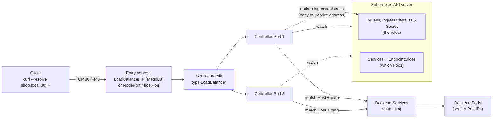

# T4.21 Know how to use Ingress controllers and Ingress resources

> Competency: "Know how to use Ingress controllers and Ingress resources" (CKA-5.5) | Domain/weight: CKA — Servicing and Networking (20%) | Est. time: 2.5 h | Prerequisites: T3.13, T4.07, T4.18

Prerequisite lessons (read them first if a term below is new):

- [T3.13](../part3-ckad/T3.13-use-ingress-rules-to-expose-applications.md): the Ingress **resource** from the application side: `rules`, `host`, `path`, `pathType`, `defaultBackend`, `tls`, `kubectl create ingress`, and the 404/503 behaviour of a controller. This lesson only recaps it (section 2.5). It adds the admin side: how a controller is installed, how it is exposed, how classes and addresses work, and how to debug it.
- [T4.07](../part4-cka/T4.07-use-helm-and-kustomize-to-install.md): Helm commands (`helm repo add`, `helm install`, `helm upgrade`, `--reuse-values`, CRDs in charts, uninstall leftovers). This lesson uses them and does not re-teach them.
- [T4.18](../part4-cka/T4.18-use-clusterip-nodeport-loadbalancer-service-types.md): Service types, node ports, and MetalLB (`IPAddressPool`, `L2Advertisement`). The controller is exposed by one of those Service types, so read it first.
- Linked for cert-manager (section 2.9): [T4.08](../part4-cka/T4.08-understand-crds-install-and-configure-operators.md), which covers CRDs and operators.

**Shell setup** (define once per terminal; used everywhere below):

```bash
alias k=kubectl
export do="--dry-run=client -o yaml"
export now="--force --grace-period=0"
source <(kubectl completion bash); complete -o default -F __start_kubectl k
```

**Environment for the whole lesson: kind.** The `lab` cluster from `env/kind-up.sh` (kind v0.33.0, `kindest/node:v1.37.0`, 1 control plane + 2 workers, context `kind-lab`). Ingress does not depend on the CNI, so the default CNI is fine too. Helm v4.3.1 and `docker` must be on your PATH. Files go in `~/lab/t421/`. Namespace for the apps: `lab-t421`.

**Two lab helpers.** Create them once. `ct` runs `curl` from a throw-away container on the Docker network named `kind`. It works on Linux, macOS and Windows hosts. (On macOS and Windows the MetalLB addresses are inside Docker's VM, so a plain `curl` from the host cannot reach them. On the exam you use plain `curl`; the exam hosts have it, [E9](https://docs.linuxfoundation.org/tc-docs/certification/tips-cka-and-ckad).) `lbip` prints the external IP of a Service.

```bash
mkdir -p ~/lab/t421
cat > ~/lab/t421/env.sh <<'EOF'
alias k=kubectl
export do="--dry-run=client -o yaml"
export now="--force --grace-period=0"
ct()   { docker run --rm --network kind curlimages/curl:8.11.1 "$@"; }
lbip() { kubectl -n "$1" get svc "$2" -o jsonpath='{.status.loadBalancer.ingress[0].ip}'; }
EOF
source ~/lab/t421/env.sh
```

**About the outputs in this lesson.** Read this before you trust a block.

- `REAL OUTPUT (helm template, chart traefik 42.1.3)`: I ran `helm template` on this machine against the real chart. It needs no cluster and shows exactly what the chart creates.
- `REAL OUTPUT (Docker)`: a plain Linux/curl command that I ran in Docker containers. It is not a kind result.
- `REAL OUTPUT (kubectl v1.37.1 client, --dry-run=client)`: client-side YAML generation, no cluster.
- `REAL OUTPUT (kind v0.33.0, v1.37.0, from T3.13)`: output that the [T3.13](../part3-ckad/T3.13-use-ingress-rules-to-expose-applications.md) lesson captured on a real kind cluster with the same Traefik chart. I quote it and say so. I did not re-run it for this lesson.
- `EXPECTED OUTPUT (not captured)`: everything else. A kind cluster was not available to me while writing (another job held the machine-wide kind lock for over 20 minutes), so cluster outputs are labelled expected and are listed in section 11. The shape is right; addresses, ages and hash suffixes will differ on your cluster.
- Facts I fetched from kubernetes.io and GitHub on 2026-10-28 are marked "checked".

**Example addresses used in the outputs.** Read the pattern, not the digits.

| Item | Value in this lesson | Where it comes from |
|---|---|---|
| Docker network `kind` | `172.18.0.0/16` (yours may differ) | `docker network inspect kind` |
| MetalLB pool `lab-pool` | `172.18.255.200-172.18.255.220` | The script `pool.sh` in section 5 builds it from your real subnet |
| Controller A (release `traefik`) | `172.18.255.200` | First free address in the pool |
| Controller B (release `traefik-b`, Medium lab) | `172.18.255.201` | Next free address |
| Worker node | `lab-worker`, `172.18.0.3` | `k get nodes -o wide` |

---

## 1. Why this matters

An Ingress is only a set of rules stored in the API. Nothing in Kubernetes acts on it until an **Ingress controller** runs in the cluster. If the controller is missing, wrongly exposed, or not watching your class, every Ingress you write is ignored and users see a connection error or a `404`. Real clusters break in three quiet ways: the controller Service never gets an external address, an Ingress names a class no controller owns, and two controllers both claim the same Ingress.

As an admin you install and operate the controller, not only the rules. The popular `ingress-nginx` controller is retired, so you must be able to install a maintained one (this lesson uses Traefik) and wire up its IngressClass and Service. Which controller the CKA exam cluster uses is UNVERIFIED (research-summary fact E23: not published, UNVERIFIED), so the skill to practise is "discover what is installed, then use it", not one memorised recipe.

---

## 2. Concepts

### 2.1 What an Ingress controller is (four parts)

**What it is.** An Ingress controller is a program, running as Pods in your cluster, that does two jobs:

1. It **watches** the API for `Ingress`, `IngressClass`, `Service`, `EndpointSlice` and TLS `Secret` objects.
2. It **runs a reverse proxy** (Traefik, HAProxy, Envoy, NGINX and others) and rewrites the proxy's routing table whenever those objects change.

Kubernetes itself ships no Ingress controller in `kube-controller-manager`. The docs say the project supports and maintains the AWS and GCE controllers (checked on https://kubernetes.io/docs/concepts/services-networking/ingress-controllers/); every other controller is a third-party add-on you install. The same page says: "In order for an Ingress to work in your cluster, there must be an ingress controller running."

**The problem it solves.** One reverse proxy with one external address can serve many hostnames and paths. You write the routing as data (Ingress objects) and the controller turns it into proxy config. Without a controller you would run one LoadBalancer Service per application, or edit proxy config files by hand.

**The four parts you must be able to name.** A working controller install is these four things. Each row says what breaks without it. The "Traefik chart 42.1.3" column is from `helm template` (REAL OUTPUT below).

| Part | What it is | What breaks without it | Traefik chart 42.1.3 creates |
|---|---|---|---|
| Workload | `Deployment` (a few replicas) or `DaemonSet` (one per node) running the proxy + the watch loop | No proxy runs: nobody answers on the entry address | `Deployment/traefik`, 1 replica, image `docker.io/traefik:v3.7.16` |
| Entry Service | A `Service` of type `NodePort` or `LoadBalancer` that sends outside traffic to the controller Pods | Traffic cannot reach the Pods from outside the cluster | `Service/traefik`, type `LoadBalancer`, ports 80 and 443 |
| IngressClass | A cluster-scoped object whose `spec.controller` string names the controller | Ingresses cannot say which controller they want; no default class | `IngressClass/traefik`, default, `controller: traefik.io/ingress-controller` |
| RBAC | `ServiceAccount` + `ClusterRole` + `ClusterRoleBinding` | The controller gets `403 Forbidden` from the API: it sees no Ingresses, or cannot write the address back | `ServiceAccount/traefik`, `ClusterRole/traefik-traefik`, `ClusterRoleBinding/traefik-traefik` |

There is a fifth part for many controllers: **CRDs**. Traefik ships 25 CustomResourceDefinitions (REAL OUTPUT below) for its own `IngressRoute` and `Middleware` objects. You do not need them for plain Ingress.

REAL OUTPUT (helm template, chart traefik 42.1.3). Which objects the chart renders, and what RBAC the ClusterRole grants (the rule lines are trimmed to the Ingress-related ones):

```
$ helm template traefik traefik/traefik --version 42.1.3 -n traefik | grep -E '^kind:'
kind: ServiceAccount
kind: ClusterRole
kind: ClusterRoleBinding
kind: Service
kind: Deployment
kind: IngressClass

$ helm template traefik traefik/traefik --version 42.1.3 -n traefik --include-crds | grep -c '^kind: CustomResourceDefinition'
25

# ClusterRole rules (trimmed)
- apiGroups: [""]                    resources: [configmaps, nodes, services]       verbs: [get, list, watch]
- apiGroups: [discovery.k8s.io]      resources: [endpointslices]                    verbs: [get, list, watch]
- apiGroups: [""]                    resources: [pods]                              verbs: [get, list, watch]
- apiGroups: [""]                    resources: [secrets]                           verbs: [get, list, watch]
- apiGroups: [extensions, networking.k8s.io]  resources: [ingressclasses, ingresses]  verbs: [get, list, watch]
- apiGroups: [extensions, networking.k8s.io]  resources: [ingresses/status]            verbs: [update]
- apiGroups: [""]                    resources: [namespaces]                        verbs: [list, watch]
```

Read the RBAC rules as a map of what the controller does: it **reads** Services, EndpointSlices and Pods (to find backends), **reads** Secrets (TLS certificates), **reads** Ingresses and IngressClasses (the rules), and **writes** only `ingresses/status` (the address, section 2.7). The written form of the rules above uses one line per rule only to save space; the real objects are normal RBAC YAML.

**Under the hood.** The controller uses the same API calls as `kubectl get --watch`. It opens a long-lived `list + watch` connection for each type (client libraries call this an *informer*). When you create an Ingress, the API server stores it in etcd and sends a watch event to every controller Pod. Each Pod renders a new proxy configuration in memory and swaps it in without dropping connections. This takes about a second or two; T3.13 measured 3-10 seconds before a changed route answered correctly, so wait a few seconds before you decide a route is broken. The proxy sends requests directly to Pod IP addresses taken from EndpointSlices (Traefik's default, `nativeLBByDefault: false`), so the backend `Service` is used as a lookup for "which Pods", not as a hop.

### 2.2 Which controller? The retirement facts

**Checked on 2026-10-28.**

- The Kubernetes blog post https://kubernetes.io/blog/2025/11/11/ingress-nginx-retirement/ (Kubernetes SIG Network and the Security Response Committee) says: best-effort maintenance continues until March 2026; afterwards "there will be no further releases, no bugfixes, and no updates to resolve any security vulnerabilities". "The GitHub repositories will be made read-only." "Existing deployments of Ingress NGINX will not be broken." Installation artifacts (Helm charts, images) "will remain available".
- The GitHub API for `kubernetes/ingress-nginx` returned `"archived": true` and a last push on 2026-03-23. So the repository is archived.
- The follow-up statement https://kubernetes.io/blog/2026/01/29/ingress-nginx-statement/ says none of the alternatives is a "direct drop-in replacement", so migration "will require planning and engineering time".
- The blog gives a check for your own cluster. It needs cluster-admin rights:

```bash
k get pods --all-namespaces --selector app.kubernetes.io/name=ingress-nginx
```

- The Ingress docs (https://kubernetes.io/docs/concepts/services-networking/ingress/ and the controllers page) carry the same note: "The Kubernetes project recommends using Gateway instead of Ingress. The Ingress API has been frozen." The frozen API is still generally available, "no plans to remove Ingress from Kubernetes", and "no further changes or updates" will be made to it. See section 2.10.

**What this means for you.** Do not choose `ingress-nginx` for new work. Annotations such as `nginx.ingress.kubernetes.io/rewrite-target` belong to that controller and do nothing on others. The controllers page lists third-party choices alphabetically; Traefik is one of them. This guide uses Traefik v3.7.x (chart 42.1.3, app v3.7.16) because it runs on kind, serves both Ingress and Gateway API, and is the pinned add-on in `env/kind-addons.sh`.

**The exam controller is UNVERIFIED.** Research-summary fact E23 says the versions of the Ingress or Gateway controller used in the exam are not published. If a task mentions Ingress, find the controller yourself:

```bash
k get ingressclass                                   # which classes exist, which is (default)
k get pods -A | grep -i -E 'ingress|traefik|nginx|haproxy|envoy|contour|gateway'
k get svc -A | grep -i -E 'ingress|traefik|nginx|haproxy|envoy|contour|gateway'
```

### 2.3 Installing a controller with Helm (Traefik)

Helm basics are in [T4.07](../part4-cka/T4.07-use-helm-and-kustomize-to-install.md). Helm docs (https://helm.sh/docs) are allowed on the exam ([E13](https://docs.linuxfoundation.org/tc-docs/certification/certification-resources-allowed)).

**The command (from the topic entry).**

```bash
helm repo add traefik https://traefik.github.io/charts
helm repo update
helm install traefik traefik/traefik -n traefik --create-namespace
```

Each part:

| Part | Meaning |
|---|---|
| `helm repo add traefik URL` | Registers the chart repository under the local name `traefik` |
| `helm install traefik traefik/traefik` | Release name `traefik` (first), chart `traefik` from repo `traefik` (second) |
| `-n traefik` | Namespace for the release's namespaced objects (Deployment, Service, ServiceAccount) |
| `--create-namespace` | Creates that namespace. Without it, a missing namespace is an error |
| `--version 42.1.3` | Not in the entry's command, but add it in the lab. Without it Helm installs the newest chart, and your results differ from this guide |
| `--wait` | Waits until Pods are Ready **and** Service external IPs exist. Do **not** use it before MetalLB has a pool: the LoadBalancer stays `<pending>` and Helm times out (T3.13 hit exactly this) |
| `--set a.b=c` / `-f values.yaml` | Change chart values. Use `helm show values traefik/traefik --version 42.1.3` to see all of them |

Check what you got:

```bash
k get ingressclass                      # the class the chart made, and whether it is (default)
k -n traefik get pods,svc               # controller Pods Ready? Service type and EXTERNAL-IP?
k -n traefik logs deploy/traefik        # startup lines and routing errors
```

**Chart defaults I verified with `helm template` (this answers the "Traefik chart IngressClass defaults" item).**

REAL OUTPUT (helm template, chart traefik 42.1.3):

```
apiVersion: networking.k8s.io/v1
kind: IngressClass
metadata:
  annotations:
    ingressclass.kubernetes.io/is-default-class: "true"
  name: traefik
spec:
  controller: traefik.io/ingress-controller
```

And the relevant values (`helm show values traefik/traefik --version 42.1.3`):

```yaml
ingressClass:
  enabled: true          # create the IngressClass
  isDefaultClass: true   # put the is-default-class annotation on it
  name: ""               # empty = use the release/chart name -> "traefik"
service:
  spec:
    type: LoadBalancer   # the Service type. The key is service.spec.type, NOT service.type
hostNetwork: false
```

The Traefik container arguments that matter for Ingress (REAL OUTPUT, helm template, same chart):

```
- --entryPoints.web.address=:8000/tcp
- --entryPoints.websecure.address=:8443/tcp
- --providers.kubernetesingress
- --providers.kubernetesingress.allowEmptyServices=true
- --providers.kubernetesingress.ingressendpoint.publishedservice=traefik/traefik
- --entryPoints.websecure.http.tls=true
```

Read them: Traefik listens on **8000** and **8443** inside the Pod (it runs as a non-root user, so it cannot bind ports below 1024). The Service has `port: 80` with `targetPort: web`, where `web` is the **name** of container port 8000. So a client uses port 80 and the Service translates it. `publishedservice=traefik/traefik` means "copy the address of Service `traefik` in namespace `traefik` onto every Ingress I handle" (section 2.7). `allowEmptyServices=true` is why a route to a Service with no ready Pods answers `503` instead of `404` (section 2.8).

### 2.4 IngressClass: `spec.controller`, the default class, and several controllers

**What it is.** `IngressClass` (`networking.k8s.io/v1`, cluster-scoped, no namespace) links an Ingress to a controller.

```yaml
apiVersion: networking.k8s.io/v1
kind: IngressClass
metadata:
  name: traefik
  annotations:
    ingressclass.kubernetes.io/is-default-class: "true"
spec:
  controller: traefik.io/ingress-controller
```

| Field | What it does | Default / risk |
|---|---|---|
| `metadata.name` | The name an Ingress puts in `spec.ingressClassName` | A name no Ingress uses is harmless; a name an Ingress uses but nobody creates means the Ingress is ignored (T3.13 real: `nginx` on a Traefik cluster gave `404`, no event) |
| `spec.controller` | A string that identifies the controller implementation. The controller reads its own string and takes the classes that carry it | Required in practice. **Immutable** after creation (delete and recreate to change it). Wrong string = no controller claims the class |
| `spec.parameters` | Optional reference to another object (`apiGroup`, `kind`, `name`, optional `namespace` and `scope`: `Cluster` or `Namespace`) that holds extra settings for the class | Default scope is cluster-wide. Most controllers, including Traefik, leave it empty (`PARAMETERS <none>`) |
| annotation `ingressclass.kubernetes.io/is-default-class` | Value `"true"` (a string) marks the class as the cluster default | Any other value, or a boolean `true` written without quotes in YAML, is not "true" and is rejected or ignored |

**How a class is chosen (docs, checked).** Set `spec.ingressClassName: <class name>` on the Ingress. If you omit it and **exactly one** class is marked default, the API server writes that class into the Ingress when it is created. The older annotation `kubernetes.io/ingress.class` is deprecated; `ingressClassName` replaces it. If you omit it and no class is default, the field stays empty and, for most controllers, the Ingress is ignored. The docs add a caution: with **more than one** default class, "the admission controller prevents creating new Ingress objects that don't have an ingressClassName specified". Fix: at most one default.

The default is applied **at creation time**. Changing which class is default later does not change existing Ingresses. (T3.13 captured an Ingress created without a class, once while the annotation was present, once after it was removed.)

**Several controllers side by side.** The docs say you may run any number of controllers using classes. Two cases behave differently:

| Case | How the Ingress picks its controller | What you must configure |
|---|---|---|
| Different products (for example Traefik and HAProxy) | Each product has its own `spec.controller` string. The class name leads to the string, and only the matching product acts | One IngressClass per product, each with its own controller string. One default at most |
| The **same product twice** (two Traefik releases) | Both IngressClasses carry the same string `traefik.io/ingress-controller` (REAL OUTPUT, helm template of two releases: both rendered with that string). The string cannot separate them | Give each release a different class **name** and tell each controller to filter by it. Traefik has `providers.kubernetesIngress.ingressClass` for this (chart value). The Medium lab does it |

REAL OUTPUT (helm template, chart traefik 42.1.3, release `traefik-b` in namespace `traefik-b` with `ingressClass.name=traefik-b`, `isDefaultClass=false`, `providers.kubernetesIngress.ingressClass=traefik-b`): the second class and the filter argument.

```
kind: IngressClass
metadata:
  annotations:
    ingressclass.kubernetes.io/is-default-class: "false"
  name: traefik-b
spec:
  controller: traefik.io/ingress-controller
...
- --providers.kubernetesingress.ingressendpoint.publishedservice=traefik-b/traefik-b
- --providers.kubernetesingress.ingressClass=traefik-b
```

Note that the ClusterRole of release B is named `traefik-b-traefik-b`, so two releases do not collide on RBAC objects.

**What "fighting" means.** If two controllers both think an Ingress is theirs (both default and no class set, or two releases that do not filter), each writes its own address to the Ingress status. The ADDRESS column flips between the two IPs, and requests reach whichever answered first. The ADDRESS column therefore tells you which controller owns an Ingress (section 6.3).

Who answers exactly when two Traefik releases do not filter is UNVERIFIED here (listed in section 11). The rule you can rely on is the general one: give each controller its own class name and a filter, mark one class default, and always write `ingressClassName`.

### 2.5 The Ingress resource: recap

Full teaching is in [T3.13](../part3-ckad/T3.13-use-ingress-rules-to-expose-applications.md). This table is the minimum you need to read an Ingress in seconds.

| Field | Meaning | Default / invalid values |
|---|---|---|
| `spec.ingressClassName` | Which IngressClass (so which controller) | Empty = default class applied at creation if there is exactly one |
| `spec.rules[].host` | Exact host (`shop.local`) or one-label wildcard (`*.shop.local`) | Empty host = matches any host. IPs are not allowed as hosts |
| `spec.rules[].http.paths[].path` | URL path | Must start with `/` for `Prefix` and `Exact` |
| `...paths[].pathType` | `Exact`, `Prefix`, `ImplementationSpecific` | **Required.** Missing = rejected by the API server. `Prefix` matches whole path elements (`/api` matches `/api/x`, not `/apix`) |
| `...backend.service.name` + `port.number` or `port.name` | The Service to forward to, in the **same namespace** as the Ingress | A wrong name or port makes the route vanish (Traefik answers `404`) |
| `spec.defaultBackend` | Service for requests that match no rule | With rules present, Traefik still answered `404` (T3.13 real). Controller behaviour varies |
| `spec.tls[].hosts` + `secretName` | Hosts covered by the certificate, and the Secret that holds it | The Secret must be type `kubernetes.io/tls` in the Ingress's namespace |

`k create ingress` generates all of this. REAL OUTPUT (kubectl v1.37.1 client, `--dry-run=client`):

```
$ k create ingress web -n lab-t421 --class=traefik --rule='shop.local/*=web:80,tls=shop-tls' $do
apiVersion: networking.k8s.io/v1
kind: Ingress
metadata:
  name: web
  namespace: lab-t421
spec:
  ingressClassName: traefik
  rules:
  - host: shop.local
    http:
      paths:
      - backend:
          service:
            name: web
            port:
              number: 80
        path: /
        pathType: Prefix
  tls:
  - hosts:
    - shop.local
    secretName: shop-tls
status:
  loadBalancer: {}
```

The trailing `*` in `shop.local/*` is what makes `pathType: Prefix`. Without it the rule is `Exact` (T3.13 shows `/other` then gives `404`).

### 2.6 Exposing the controller: NodePort, LoadBalancer (MetalLB), hostPort, hostNetwork

The controller Pods have Pod IPs only. Outside clients need a stable entry. There are four ways. The Service types themselves are explained in [T4.18](../part4-cka/T4.18-use-clusterip-nodeport-loadbalancer-service-types.md); this section shows how they apply to a controller.

| Mode | Client connects to | How you set it (Traefik chart 42.1.3) | Needs | Typical use | Watch out for |
|---|---|---|---|---|---|
| **LoadBalancer** | One external IP, ports 80/443 | The chart default: `service.spec.type: LoadBalancer` | A load balancer controller: a cloud provider, or **MetalLB** on bare metal and kind | Production | Without such a controller, `EXTERNAL-IP` stays `<pending>` forever |
| **NodePort** | `<any node IP>:30080` | `--set service.spec.type=NodePort --set ports.web.nodePort=30080` | Nothing extra; a firewall must allow the port | Labs, or behind an external load balancer you run yourself | Ports are in the range 30000-32767 by default, so users must type a port. Ingress `ADDRESS` stays empty (section 2.7) |
| **hostPort** | `<node IP of a node that runs a controller Pod>:80` | `--set ports.web.hostPort=80` | CNI that supports `hostPort` (the portmap plugin) | Small clusters without a load balancer | Only nodes that run a controller Pod answer. A second Pod wanting the same host port on the same node stays `Pending` |
| **hostNetwork** | `<node IP>:<port the proxy binds>` | `--set hostNetwork=true --set deployment.kind=DaemonSet` (and update-strategy values) | A DaemonSet so there is one Pod per node | Edge nodes, very high throughput | The Pod shares the node's network namespace. Port conflicts with other node processes. Pod needs `dnsPolicy: ClusterFirstWithHostNet` to resolve cluster names |

**LoadBalancer + MetalLB (the lab default).** MetalLB is a load balancer controller for clusters that have none. It watches Services of type `LoadBalancer`, takes an address from an `IPAddressPool` you define, and in layer-2 mode announces it with ARP from one node. The pool and `L2Advertisement` YAML is in section 5. Your cluster needs MetalLB installed (chart 0.16.1) and a pool with free addresses on the node network. On kind, "the node network" is the Docker network named `kind`.

**NodePort: runnable example and what to observe.**

```bash
helm upgrade traefik traefik/traefik -n traefik --version 42.1.3 --reuse-values \
  --set service.spec.type=NodePort --set ports.web.nodePort=30080 --set ports.websecure.nodePort=30443
k -n traefik get svc traefik                      # TYPE NodePort, PORT(S) 80:30080/TCP,443:30443/TCP
NODE=$(k get node lab-worker -o jsonpath='{.status.addresses[?(@.type=="InternalIP")].address}')
ct -s -H 'Host: shop.local' http://$NODE:30080/    # works on any node IP
```

REAL OUTPUT (helm template, chart traefik 42.1.3) of the Service that these values produce:

```
spec:
  type: NodePort
  ports:
  - port: 80
    name: web
    targetPort: web
    protocol: TCP
    nodePort: 30080
  - port: 443
    name: websecure
    targetPort: websecure
    protocol: TCP
    nodePort: 30443
```

On kind, switching a Service from `LoadBalancer` to `NodePort` frees the MetalLB address; the Ingress `ADDRESS` then empties after a few seconds. (The previous lesson T3.13 used exactly this NodePort form and observed an empty ADDRESS while routes still worked.)

**hostPort: runnable example and what to observe.**

```bash
helm upgrade traefik traefik/traefik -n traefik --version 42.1.3 --reuse-values --set ports.web.hostPort=80
k -n traefik get pod -l app.kubernetes.io/name=traefik -o wide        # which node runs the Pod?
ct -s -H 'Host: shop.local' http://<that node IP>:80/
```

REAL OUTPUT (helm template, chart traefik 42.1.3): the container port block that `ports.web.hostPort=80` renders. The container still listens on 8000; the node forwards its port 80 to it:

```
        - containerPort: 8000
          hostPort: 80
          name: web
          protocol: TCP
```

**hostNetwork: runnable example and what to observe.**

```bash
helm upgrade traefik traefik/traefik -n traefik --version 42.1.3 --reuse-values \
  --set hostNetwork=true --set deployment.kind=DaemonSet --set service.enabled=false \
  --set updateStrategy.rollingUpdate.maxUnavailable=1 --set updateStrategy.rollingUpdate.maxSurge=0
k -n traefik get ds,pod -o wide                  # one Pod per node, Pod IP = node IP
ct -s -H 'Host: shop.local' http://<node IP>:8000/   # the proxy binds 8000 on the node, not 80
```

REAL OUTPUT (helm template, chart traefik 42.1.3): the render shows `kind: DaemonSet`, `hostNetwork: true`, and `--entryPoints.web.address=:8000/tcp`. Without the two `updateStrategy` values the chart refuses to render and prints this real error:

```
Error: execution error at (traefik/templates/daemonset.yaml:16:14): maxUnavailable should be greater than 0 when using hostNetwork.
```

The error exists because with host ports only one Pod can run per node, so a rolling update must remove an old Pod before it starts a new one. Binding the node's port 80 additionally needs `ports.web.port=80` and permission to bind a low port; I did not render or run that combination (section 11).

Return to the baseline (`LoadBalancer`) after trying a mode: `helm upgrade traefik traefik/traefik -n traefik --version 42.1.3 --reset-values`, or uninstall and reinstall.

**Related to exposure: `externalTrafficPolicy`.** A LoadBalancer or NodePort Service with the default `Cluster` policy hides the real client IP (SNAT). If your app must see client IPs, T4.18 explains `externalTrafficPolicy: Local`.

### 2.7 Ingress `status.loadBalancer`: how the ADDRESS is filled

`k get ingress` shows an ADDRESS column. It is read from `status.loadBalancer.ingress[]` of the Ingress. **Nobody writes this for you except the controller.** The mechanism for Traefik:

1. The Traefik argument `ingressendpoint.publishedservice=traefik/traefik` names a Service.
2. Traefik reads that Service's own `status.loadBalancer.ingress` (the external IP or host name, set by MetalLB or a cloud).
3. For every Ingress it serves, Traefik updates `ingresses/status` with that same value. This is why the ClusterRole has the `update` verb on `ingresses/status`.

Consequences:

| Situation | ADDRESS | Routes work? |
|---|---|---|
| Controller Service is `LoadBalancer` with an IP | That IP | Yes |
| Controller Service is `LoadBalancer`, `<pending>` | Empty | Only via NodePort, if the Service has one |
| Controller Service is `NodePort` | Empty (a NodePort Service has no LB status; T3.13 real) | Yes, on the node port |
| Cloud load balancer with a DNS name (for example an AWS ELB) | A host name instead of an IP | Yes |
| Class not owned by any running controller | Empty | **No** |
| Controller lacks RBAC `update ingresses/status` | Empty | Yes (routing uses read access) |

An empty ADDRESS on its own does not prove a broken route. It is a hint. Always check the class and test with `curl`.

You can force a value with chart settings `providers.kubernetesIngress.ingressEndpoint.ip` or `.hostname` (REAL: both exist in `helm show values`, default empty). Use it when a load balancer sits in front of your nodes and is not a Service in the cluster.

### 2.8 Controller logs and what `404`, `502` and `503` mean

The status code tells you **who** answered and **why**. For every case below, the controller's own response page (not your app) is what you see.

| Code and body (Traefik) | Who made it | Meaning | First checks |
|---|---|---|---|
| `404` `404 page not found` | The controller | No route matches the `Host` + path. Causes: wrong host in the request, wrong path/`pathType`, the Ingress is ignored (wrong class), or the route was dropped because the Service name/port is wrong | `k describe ingress`, `k get ingressclass`, the controller log |
| `503` `no available server` | The controller | The route exists, but the Service has **no ready endpoints** (0 Pods, selector mismatch, Pods not Ready) | `k get endpointslices -l kubernetes.io/service-name=NAME`, `k get pods` |
| `502` `Bad Gateway` | The controller | The route exists and the Service has endpoints, but the connection to the Pod failed or was reset: Pod port wrong, Pod crashed, or the app speaks another protocol | Compare the EndpointSlice PORTS with the container port; `k logs` of the app Pod |

`404` and `503` are REAL OUTPUT (kind v0.33.0, v1.37.0, from T3.13). `502` is the standard HTTP meaning of a failed upstream connection; the exact Traefik text was not captured on kind (section 11).

```
$ curl -s -w ' [%{http_code}]\n' -H 'Host: shop.local' http://localhost:30080/        # REAL, from T3.13
no available server
 [503]
$ curl -s -w ' [%{http_code}]\n' -H 'Host: nohost.local' http://localhost:30080/      # REAL, from T3.13: body is 404 page not found
404 page not found
 [404]
```

**Reading the controller log.** `k -n traefik logs deploy/traefik` prints the log of one Pod of the Deployment. Add `--tail=50`, `-f` (follow) or `--since=5m`. With several replicas use a label selector: `k -n traefik logs -l app.kubernetes.io/name=traefik --tail=50 --prefix`. REAL log lines from T3.13 (colour codes removed) when the backend Service or port in an Ingress does not exist:

```
ERR Cannot create service error="service not found" ingress=badsvc namespace=lab-t313 ... serviceName=webb
ERR Cannot create service error="service port not found" ingress=badport namespace=lab-t313 ... serviceName=web
```

Traefik log level is `INFO` by default in the chart (`--log.level=INFO`, REAL). Its access log is not turned on by the chart's default arguments (no `--accesslog` argument appears in the REAL argument list above), so a successful request leaves no line. For a `502`, the log text I did not capture; look for an `ERR` line that names the Pod address and a connection error.

### 2.9 TLS termination and cert-manager

**What TLS termination means.** The client speaks HTTPS to the controller. The controller decrypts, then talks plain HTTP to the Pod (unless you configure backend TLS, which is controller specific). The certificate and key are in a Kubernetes Secret.

**The Secret.** Type `kubernetes.io/tls`, with keys `tls.crt` and `tls.key`, in the **same namespace as the Ingress**. Create it with `k create secret tls NAME --cert=tls.crt --key=tls.key`. See T3.13 for the walk-through. The docs say the Ingress supports one TLS port, 443, and uses SNI (the client sends the host name in the TLS handshake) to pick the certificate; the certificate must contain the host name (a SAN or CN). The `hosts` in `spec.tls` must match the hosts in the rules.

**What goes wrong (REAL, from T3.13).** The controller does not fail the request. It falls back to its **default certificate**, and the client sees the wrong subject. `curl -skv` showed `subject: CN=TRAEFIK DEFAULT CERT`. Three causes: the Secret is missing or in another namespace; the Secret's certificate does not name the host; or the host is not listed in a `tls` entry. Traefik also logs an `Error configuring TLS` line that names the missing Secret.

**HTTP versus HTTPS entry points.** The chart's argument `--entryPoints.websecure.http.tls=true` (REAL) makes the `websecure` entry point (port 443 on the Service) terminate TLS. An Ingress without extra annotations is served on both `web` (80) and `websecure` (443). To limit an Ingress to HTTPS only, Traefik uses the annotation `traefik.ingress.kubernetes.io/router.entrypoints: websecure` (REAL, from T3.13). Annotations are controller specific.

**cert-manager integration** (link: [T4.08](../part4-cka/T4.08-understand-crds-install-and-configure-operators.md); the cert-manager chart is `jetstack/cert-manager` v1.21.3 in [T4.07](../part4-cka/T4.07-use-helm-and-kustomize-to-install.md)). cert-manager is an operator that obtains certificates and stores them in Secrets, and renews them. For Ingress, the flow is:

1. You create an `Issuer` or `ClusterIssuer` (for example `selfSigned`, or ACME for Let's Encrypt).
2. You annotate the Ingress with `cert-manager.io/cluster-issuer: <issuer name>` and add `spec.tls[].secretName`.
3. cert-manager's *ingress shim* creates a `Certificate` object from the Ingress, obtains the certificate, and writes it into the Secret named in `secretName`.
4. The controller watches that Secret and starts serving the certificate. cert-manager renews it before expiry.

I did not run this flow (section 11). The YAML is in section 5, step 8, marked "not run".

### 2.10 The Ingress API is frozen: awareness of Gateway API and ingress2gateway

- **Frozen** (docs, checked): the Ingress API is GA and stays, but gets no new features. New work in Kubernetes networking goes to **Gateway API**. The Kubernetes docs recommend Gateway over Ingress. The CKA allows https://gateway-api.sigs.k8s.io in the exam ([E13](https://docs.linuxfoundation.org/tc-docs/certification/certification-resources-allowed)). The Gateway API lesson is T4.22 in this guide; it is not a prerequisite here.
- **Why migrate**: `ingress-nginx` is archived (section 2.2). Many clusters rely on its annotations, which no other controller supports in the same way.
- **ingress2gateway** is a SIG Network tool that converts Ingress objects (and some controller annotations) into Gateway API objects, and prints warnings for settings it cannot translate. The Kubernetes blog post "Announcing Ingress2Gateway 1.0" (https://kubernetes.io/blog/2026/03/20/ingress2gateway-1-0-release/, checked) calls it "a migration assistant, not a one-shot replacement": it migrates what it can, tells you what is unsupported, and you review the result. The GitHub API shows the latest release of `kubernetes-sigs/ingress2gateway` as `v1.2.0` (published 2026-07-07). I did not run the tool. This is an awareness item: know that it exists, what it does, and that you must review its output.
- Traefik in this guide can serve both Ingress and Gateway API from one install (`providers.kubernetesGateway.enabled=true`, needs the Gateway API CRDs first; see the note in T3.13 about the add-on script).

### 2.11 Testing without DNS: `curl --resolve host:port:ip`

Host-based routing needs the request's `Host` header to equal the rule host. Real DNS is not needed.

| Method | Command | What it does | Weakness |
|---|---|---|---|
| `--resolve` | `curl --resolve shop.local:80:172.18.255.200 http://shop.local/` | Tells curl "treat `shop.local:80` as this IP". curl then sends `Host: shop.local` (plus the port if it is not the default) and, for HTTPS, uses `shop.local` as the SNI name | The **port in `--resolve` must equal the port in the URL**; otherwise curl does the normal DNS lookup and fails |
| `-H 'Host:'` | `curl -H 'Host: shop.local' http://172.18.255.200/` | Sends the header only | For HTTPS the SNI name is the IP, so the controller serves the default certificate |
| `/etc/hosts` | `172.18.255.200 shop.local` | Persistent mapping | Needs root and a file edit; forget to remove it |

Use `--resolve` by default. REAL OUTPUT (Docker): a plain HTTP server in a container (`busybox:1.36` `httpd` on port 8080) and `curlimages/curl:8.11.1` on the same Docker network. First with `--resolve`, then without:

```
$ curl -sv --resolve shop.local:8080:192.168.148.2 http://shop.local:8080/
shop v1
* Added shop.local:8080:192.168.148.2 to DNS cache
* Hostname shop.local was found in DNS cache
*   Trying 192.168.148.2:8080...
* Connected to shop.local (192.168.148.2) port 8080
> GET / HTTP/1.1
> Host: shop.local:8080
> User-Agent: curl/8.11.1
> Accept: */*
< HTTP/1.1 200 OK
...
$ curl -sS http://shop.local:8080/
curl: (6) Could not resolve host: shop.local
```

Notice `Host: shop.local:8080` has the port. Use a non-default port only if you must. On the lab, the controller listens on 80 and 443, so the header is plain `shop.local`. (When the URL port is not 80 or 443, Traefik is believed to ignore the port part of the Host header when it matches a rule. That is UNVERIFIED; section 11.)

### 2.12 Related but different

- **Ingress versus Service of type LoadBalancer.** A LoadBalancer Service gives one address per Service and works at layer 4 (TCP). Ingress gives one address for many hosts and paths at layer 7 (HTTP), and the controller itself sits behind one LoadBalancer Service.
- **Ingress controller versus Ingress resource.** The resource is data. The controller is a running program. Deleting the controller does not delete Ingress objects; they just stop working (and keep their last ADDRESS until the controller changes it).
- **Ingress versus Traefik `IngressRoute`.** `IngressRoute` is a Traefik CRD (`traefik.io`) with more features. It is not portable. The exam competency is the Kubernetes `Ingress` kind.
- **Ingress versus Gateway API.** Gateway API splits the roles (infrastructure, cluster operator, app developer) into `GatewayClass`, `Gateway` and `HTTPRoute`. It is the successor, covered in T4.22.
- **kube-proxy versus the Ingress controller.** kube-proxy forwards Service traffic at layer 4 inside the node; it never looks at host names or paths. The controller is a layer-7 proxy that you run.

---

## 3. How it works (diagram)



Walkthrough:

1. The client connects to the entry address (a MetalLB IP, a node port, or a host port) and sends `Host: shop.local`.
2. The entry Service spreads connections over the controller Pods. The Service never reads the Host header; that is the controller's job.
3. Each controller Pod keeps a **watch** on the API server (dotted arrows). It reads Ingress rules and the class, the TLS Secret, and the Services and EndpointSlices.
4. The Pod picks the rule that matches Host and path. The backend Service is used to find ready Pod IPs; the request goes straight to one Pod IP.
5. The Pod also writes the entry Service's address back into `status.loadBalancer` of each Ingress it owns. That is the ADDRESS column.
6. Failures map to places on the diagram: no answer at all = the entry (Service or MetalLB); `404` = no matching rule or class; `503` = no ready endpoints; `502` = endpoint found but unreachable.

---

## 4. Commands and YAML you must produce fast

### 4.1 Imperative shortcuts

```bash
# 1. Find the controller and its class
k get ingressclass                                       # NAME  CONTROLLER  PARAMETERS  AGE; "(default)" marks the default class
k describe ingressclass traefik                          # annotations and controller string
k get pods,svc -A | grep -i -E 'ingress|traefik|nginx|haproxy|envoy|contour'

# 2. Install a controller with Helm (the entry's command; add --version when you need repeatable results)
helm repo add traefik https://traefik.github.io/charts && helm repo update
helm install traefik traefik/traefik -n traefik --create-namespace

# 3. Inspect the install
k get svc -n traefik                                     # TYPE, EXTERNAL-IP, PORT(S)
k -n traefik logs deploy/traefik                         # controller log
k -n traefik get deploy traefik -o jsonpath='{.spec.template.spec.containers[0].args}'   # what it was told to watch

# 4. Make Ingresses
k create ingress shop --class=traefik --rule='shop.local/*=shop:80,tls=shop-tls' -n lab-t421
k create secret tls shop-tls --cert=tls.crt --key=tls.key -n lab-t421

# 5. Default class on / off
k annotate ingressclass traefik ingressclass.kubernetes.io/is-default-class=true --overwrite
k annotate ingressclass traefik ingressclass.kubernetes.io/is-default-class-

# 6. Is the controller allowed to do its job?
k auth can-i update ingresses/status --as=system:serviceaccount:traefik:traefik
k auth can-i list ingresses -A --as=system:serviceaccount:traefik:traefik

# 7. Address and test
k get ingress -A                                         # CLASS and ADDRESS columns
curl --resolve shop.local:80:<ip> http://shop.local/     # on the lab: ct -s --resolve ...
```

| Command | What it does |
|---|---|
| `k get ingressclass` | Lists classes. `(default)` is shown for the one with the annotation set to `"true"` |
| `helm install traefik traefik/traefik -n traefik --create-namespace` | Installs the controller (Deployment, Service, IngressClass, RBAC, CRDs) |
| `k get svc -n traefik` | Shows type and EXTERNAL-IP. `<pending>` = no load balancer controller or no pool |
| `k -n traefik logs deploy/traefik` | Log of the controller; errors about classes, services, Secrets |
| `k annotate ... is-default-class=true --overwrite` | Sets the default class. A trailing `-` after the key removes the annotation |
| `k auth can-i ... --as=system:serviceaccount:NS:SA` | Checks RBAC for the controller's ServiceAccount (`traefik` in namespace `traefik`) |
| `curl --resolve host:port:ip URL` | Fakes DNS for one request |

### 4.2 Declarative YAML: a default IngressClass and an Ingress with TLS

This is the class the Traefik chart creates, written out by hand. If you install a controller from plain manifests, you write this yourself. Applying it over the chart's own object is harmless (same name, same content). **Careful:** if you use a *different* name and keep the chart's class, you have two default classes and the API server rejects new Ingresses that omit `ingressClassName` (section 2.4).

```yaml
apiVersion: networking.k8s.io/v1
kind: IngressClass
metadata:
  name: traefik                                   # the name Ingresses put in spec.ingressClassName; cluster-scoped, no namespace
  annotations:
    ingressclass.kubernetes.io/is-default-class: "true"   # a STRING "true"; at most ONE class in the cluster should carry it
spec:
  controller: traefik.io/ingress-controller       # must equal the string the controller expects; immutable after creation
  # parameters:                                   # optional; not used by Traefik
  #   apiGroup: k8s.example.com                   # API group of the parameters object
  #   kind: IngressParameter                      # kind of the parameters object
  #   name: external-config                       # name of the parameters object
  #   scope: Cluster                              # Cluster (default) or Namespace; Namespace needs a namespace field
```

The Ingress with TLS. Namespace `lab-t421` must exist and the Secret `shop-tls` must exist in it (create it in section 5, step 7).

```yaml
apiVersion: networking.k8s.io/v1
kind: Ingress
metadata:
  name: shop
  namespace: lab-t421                  # the Ingress, its Services and its TLS Secret must all be in THIS namespace
spec:
  ingressClassName: traefik            # names the IngressClass above; if omitted, the default class is used at creation time
  tls:
  - hosts:
    - shop.local                       # must match a rule host below, and the certificate must name it (SAN)
    secretName: shop-tls               # Secret of type kubernetes.io/tls with tls.crt and tls.key, same namespace
  rules:
  - host: shop.local                   # exact host; an empty host would match every host
    http:
      paths:
      - path: /                        # URL path; must start with /
        pathType: Prefix               # required; Prefix = whole path elements, Exact = identical string
        backend:
          service:
            name: shop                 # Service in the same namespace
            port:
              number: 80               # the Service port (not the container port); port.name is also allowed
```

Imperative way to the same Ingress: `k -n lab-t421 create ingress shop --class=traefik --rule='shop.local/*=shop:80,tls=shop-tls' $do > shop-ing.yaml`. The result matches the REAL dry-run output in section 2.5, except for name and namespace.

### 4.3 Speed drill

Target times are exam pace. **Setup** (needs the cluster with MetalLB, a pool, and Traefik from section 5 steps 1-3, and the apps from step 4):

```bash
source ~/lab/t421/env.sh
k get ns lab-t421 >/dev/null 2>&1 || { k create ns lab-t421 && k apply -f ~/lab/t421/apps.yaml; }
k -n lab-t421 wait --for=condition=Available deploy --all --timeout=120s
```

| # | Task | Target |
|---|---|---|
| 1 | Print the name of the cluster's default IngressClass into `~/lab/t421/default-class.txt` | 1 min |
| 2 | Write an IngressClass named `internal` for controller `traefik.io/ingress-controller` (not default) and apply it | 3 min |
| 3 | Make `internal` the only default class, then restore `traefik` as the only default | 3 min |
| 4 | Create Ingress `d4` in `lab-t421` for host `d4.local` to Service `shop:80`, class `traefik`, with TLS Secret `d4-tls`; save the YAML to `~/lab/t421/d4.yaml` without applying | 2 min |
| 5 | Write the controller Service's external IP to `~/lab/t421/ip.txt` | 1 min |
| 6 | Request `shop.local` through that IP; the answer must be `shop` | 1 min |
| 7 | Find out whether the controller ServiceAccount may update `ingresses/status` | 1 min |
| 8 | Create an Ingress for a Service that does not exist and find the error in the controller log | 3 min |

<details><summary>Answers</summary>

```bash
# 1
k get ingressclass -o jsonpath='{range .items[*]}{.metadata.name}{" "}{.metadata.annotations.ingressclass\.kubernetes\.io/is-default-class}{"\n"}{end}' | awk '$2=="true"{print $1}' > ~/lab/t421/default-class.txt
cat ~/lab/t421/default-class.txt                 # traefik   (or read the "(default)" mark in `k get ingressclass`)

# 2
cat <<'EOF' | k apply -f -
apiVersion: networking.k8s.io/v1
kind: IngressClass
metadata:
  name: internal
spec:
  controller: traefik.io/ingress-controller
EOF

# 3 (remove from traefik first, so there is never a moment with two defaults)
k annotate ingressclass traefik ingressclass.kubernetes.io/is-default-class-
k annotate ingressclass internal ingressclass.kubernetes.io/is-default-class=true
k get ingressclass                               # internal (default)
# restore
k annotate ingressclass internal ingressclass.kubernetes.io/is-default-class-
k annotate ingressclass traefik ingressclass.kubernetes.io/is-default-class=true
k get ingressclass                               # traefik (default)

# 4
k -n lab-t421 create ingress d4 --class=traefik --rule='d4.local/*=shop:80,tls=d4-tls' $do > ~/lab/t421/d4.yaml
grep -E 'ingressClassName|secretName|host:' ~/lab/t421/d4.yaml

# 5
k -n traefik get svc traefik -o jsonpath='{.status.loadBalancer.ingress[0].ip}' > ~/lab/t421/ip.txt; cat ~/lab/t421/ip.txt

# 6 (needs Ingress "shop" from section 5 step 4; on the exam use plain curl)
ct -s --resolve shop.local:80:$(cat ~/lab/t421/ip.txt) http://shop.local/

# 7
k auth can-i update ingresses/status --as=system:serviceaccount:traefik:traefik      # yes

# 8
k -n lab-t421 create ingress d8 --class=traefik --rule='d8.local/*=nosuch:80'
sleep 5; k -n traefik logs deploy/traefik --tail=20 | grep -i nosuch     # ERR Cannot create service error="service not found" ... serviceName=nosuch
```

Why drill 3 removes the annotation first: with two defaults an Ingress created without `ingressClassName` is rejected. Doing the removal first avoids that window.

</details>

Cleanup (drill objects only; leaves the worked-example state alone):

```bash
k delete ingressclass internal --ignore-not-found
k -n lab-t421 delete ingress d4 d8 --ignore-not-found
k annotate ingressclass traefik ingressclass.kubernetes.io/is-default-class=true --overwrite
rm -f ~/lab/t421/default-class.txt ~/lab/t421/d4.yaml ~/lab/t421/ip.txt
```

---

## 5. Worked example

Goal: install Traefik on kind, see it stuck at `<pending>`, fix that with MetalLB, route two hosts, then watch `404`, `503`, `502`, an HTTPS handshake, and the logs. Every cluster output in this section is `EXPECTED OUTPUT (not captured)` unless it says otherwise. The commands are the ones I would run; I traced each name, namespace and port (apps listen on 8080, Services on 80, Traefik on 8000 behind Service port 80).

**Step 0. Cluster, helpers, Helm repos, MetalLB.** Create `~/lab/t421/baseline.sh` and run it. It is idempotent.

```bash
cat > ~/lab/t421/baseline.sh <<'EOF'
#!/usr/bin/env bash
set -euo pipefail
helm repo add metallb https://metallb.github.io/metallb >/dev/null
helm repo add traefik https://traefik.github.io/charts >/dev/null
helm repo update >/dev/null
helm status metallb -n metallb-system >/dev/null 2>&1 || \
  helm install metallb metallb/metallb -n metallb-system --create-namespace --version 0.16.1 --wait --timeout 300s
EOF
chmod +x ~/lab/t421/baseline.sh && ~/lab/t421/baseline.sh
k config current-context                    # kind-lab
k -n metallb-system get pods
```

```
EXPECTED OUTPUT (not captured)
kind-lab
NAME                                  READY   STATUS    RESTARTS   AGE
metallb-controller-...                1/1     Running   0          40s
metallb-speaker-...                   4/4     Running   0          40s     (one per node; READY count may differ)
```

**Step 1. Install Traefik with the entry's command (pool does not exist yet).** Do not add `--wait`.

```bash
helm install traefik traefik/traefik -n traefik --create-namespace --version 42.1.3
k -n traefik rollout status deploy/traefik
k get ingressclass
k -n traefik get pods,svc
```

```
EXPECTED OUTPUT (not captured)
deployment "traefik" successfully rolled out
NAME                CONTROLLER                      PARAMETERS   AGE
traefik (default)   traefik.io/ingress-controller   <none>       25s

NAME                          READY   STATUS    RESTARTS   AGE
pod/traefik-...               1/1     Running   0          25s

NAME              TYPE           CLUSTER-IP     EXTERNAL-IP   PORT(S)                      AGE
service/traefik   LoadBalancer   10.96.205.71   <pending>     80:3xxxx/TCP,443:3xxxx/TCP   25s
```

What to see: the IngressClass `traefik` is the default (answers the "chart defaults" question; checked with `helm template`). The Service is `LoadBalancer` and `EXTERNAL-IP` is `<pending>`: MetalLB is installed but has no addresses to give. The random node ports (`3xxxx`) are assigned by the API server.

**Step 2. Read what the chart made (the four parts).**

```bash
k -n traefik get deploy,svc,sa
k get clusterrole,clusterrolebinding | grep traefik
k auth can-i list ingresses -A --as=system:serviceaccount:traefik:traefik
k auth can-i update ingresses/status --as=system:serviceaccount:traefik:traefik
k auth can-i delete secrets -A --as=system:serviceaccount:traefik:traefik
```

```
EXPECTED OUTPUT (not captured)
...                                   (Deployment traefik 1/1, Service traefik, ServiceAccount traefik)
clusterrole.rbac.authorization.k8s.io/traefik-traefik                              ...
clusterrolebinding.rbac.authorization.k8s.io/traefik-traefik                       ...
yes
yes
no
```

The last answer is `no`: the ClusterRole lets the controller read Secrets but never delete them (the rules in section 2.1).

**Step 3. Give MetalLB an address pool; the Service gets an IP.** The script reads your Docker subnet and builds a range at the top of it. It assumes a `/16` such as `172.18.0.0/16`.

```bash
cat > ~/lab/t421/pool.sh <<'EOF'
#!/usr/bin/env bash
set -euo pipefail
PREFIX=$(docker network inspect kind -f '{{range .IPAM.Config}}{{println .Subnet}}{{end}}' | grep -E '^[0-9]+\.[0-9]+\.' | head -1 | cut -d. -f1-2)
until kubectl apply -f - <<YAML
apiVersion: metallb.io/v1beta1
kind: IPAddressPool
metadata:
  name: lab-pool
  namespace: metallb-system
spec:
  addresses:
  - ${PREFIX}.255.200-${PREFIX}.255.220
---
apiVersion: metallb.io/v1beta1
kind: L2Advertisement
metadata:
  name: lab-l2
  namespace: metallb-system
spec:
  ipAddressPools:
  - lab-pool
YAML
do echo "waiting for the MetalLB webhook"; sleep 5; done
EOF
chmod +x ~/lab/t421/pool.sh && ~/lab/t421/pool.sh
sleep 5
k -n traefik get svc traefik
lbip traefik traefik; echo
```

```
EXPECTED OUTPUT (not captured)
ipaddresspool.metallb.io/lab-pool created
l2advertisement.metallb.io/lab-l2 created
NAME      TYPE           CLUSTER-IP     EXTERNAL-IP      PORT(S)                      AGE
traefik   LoadBalancer   10.96.205.71   172.18.255.200   80:3xxxx/TCP,443:3xxxx/TCP   2m
172.18.255.200
```

The `until ... do` loop retries because the MetalLB admission webhook may not answer in the first seconds after the Pods are Ready. In `IPAddressPool`, `addresses` is the range; in `L2Advertisement`, `ipAddressPools` names the pool to announce. Without the advertisement the address is assigned but nobody answers ARP for it. (Details: T4.18.)

**Step 4. Two apps and two Ingresses.** Save as `~/lab/t421/apps.yaml`. The image `hashicorp/http-echo:1.0` answers every request with the text you give it, so the answer proves which backend you reached. Each app listens on 8080, and its Service port is 80 with `targetPort: http` (the container port's name).

```bash
cat > ~/lab/t421/apps.yaml <<'EOF'
apiVersion: apps/v1
kind: Deployment
metadata:
  name: shop
  namespace: lab-t421
spec:
  replicas: 1
  selector:
    matchLabels: {app: shop}
  template:
    metadata:
      labels: {app: shop}
    spec:
      containers:
      - name: echo
        image: hashicorp/http-echo:1.0
        args: ["-listen=:8080", "-text=shop"]
        ports:
        - {name: http, containerPort: 8080}
---
apiVersion: v1
kind: Service
metadata:
  name: shop
  namespace: lab-t421
spec:
  selector: {app: shop}
  ports:
  - {name: http, port: 80, targetPort: http}
---
apiVersion: apps/v1
kind: Deployment
metadata:
  name: blog
  namespace: lab-t421
spec:
  replicas: 1
  selector:
    matchLabels: {app: blog}
  template:
    metadata:
      labels: {app: blog}
    spec:
      containers:
      - name: echo
        image: hashicorp/http-echo:1.0
        args: ["-listen=:8080", "-text=blog"]
        ports:
        - {name: http, containerPort: 8080}
---
apiVersion: v1
kind: Service
metadata:
  name: blog
  namespace: lab-t421
spec:
  selector: {app: blog}
  ports:
  - {name: http, port: 80, targetPort: http}
EOF
k create ns lab-t421
k apply -f ~/lab/t421/apps.yaml
k -n lab-t421 wait --for=condition=Available deploy --all --timeout=120s
k -n lab-t421 create ingress shop --class=traefik --rule='shop.local/*=shop:80'
k -n lab-t421 create ingress blog --class=traefik --rule='blog.local/*=blog:80'
sleep 5
k -n lab-t421 get ingress
```

```
EXPECTED OUTPUT (not captured)
NAME   CLASS     HOSTS        ADDRESS          PORTS   AGE
blog   traefik   blog.local   172.18.255.200   80      6s
shop   traefik   shop.local   172.18.255.200   80      7s
```

Both Ingresses show the controller's address: that is the status copy from section 2.7. Check the apps have endpoints before blaming the controller: `k -n lab-t421 get endpointslices` (look for the Pod IP and port 8080).

**Step 5. Test with `curl --resolve`.**

```bash
LB=$(lbip traefik traefik)
ct -s -w ' [%{http_code}]\n' --resolve shop.local:80:$LB http://shop.local/
ct -s -w ' [%{http_code}]\n' --resolve blog.local:80:$LB http://blog.local/
ct -s -w ' [%{http_code}]\n' --resolve nope.local:80:$LB http://nope.local/
```

```
EXPECTED OUTPUT (not captured)
shop
 [200]
blog
 [200]
404 page not found
 [404]
```

(The 404 body and the `[404]` format match the REAL T3.13 capture. The `shop`/`blog` answers are what `http-echo` prints.) The unknown host gets `404`: the controller is reachable, but no rule has that host.

**Step 6. The three error codes, one by one.**

```bash
# 404 was shown above (no route). Now 503: route exists, zero ready Pods.
k -n lab-t421 scale deploy/blog --replicas=0
sleep 5
ct -s -w ' [%{http_code}]\n' --resolve blog.local:80:$LB http://blog.local/
k -n lab-t421 get endpointslices -l kubernetes.io/service-name=blog
k -n lab-t421 scale deploy/blog --replicas=1
k -n lab-t421 wait --for=condition=Available deploy/blog --timeout=60s

# 502: Service has an endpoint, but its target port is wrong (9090; the app listens on 8080)
k -n lab-t421 expose deploy shop --name=shop-bad --port=80 --target-port=9090
k -n lab-t421 create ingress bad --class=traefik --rule='bad.local/*=shop-bad:80'
sleep 5
ct -s -w ' [%{http_code}]\n' --resolve bad.local:80:$LB http://bad.local/
k -n lab-t421 get endpointslices -l kubernetes.io/service-name=shop-bad
k -n lab-t421 get pod -l app=shop -o jsonpath='{.items[0].spec.containers[0].ports[0].containerPort}{"\n"}'
```

```
EXPECTED OUTPUT (not captured)
no available server
 [503]
NAME         ADDRESSTYPE   PORTS   ENDPOINTS   AGE
blog-xxxxx   IPv4          <unset> <unset>     5m
...
Bad Gateway
 [502]
NAME             ADDRESSTYPE   PORTS   ENDPOINTS      AGE
shop-bad-xxxxx   IPv4          9090    10.244.1.12    10s
8080
```

(The `503` block and the empty `<unset>` EndpointSlice are the shapes from T3.13's REAL capture. The `502` block is the standard result of a refused backend connection; its exact body is not captured.)

How to read the 502 case: the EndpointSlice proves a ready Pod exists, so it is not a `503`. The port in the slice (`9090`) differs from the container port (`8080`). The controller reached the Pod IP, got "connection refused", and answered `502`. Fix: `k -n lab-t421 patch svc shop-bad --type=json -p='[{"op":"replace","path":"/spec/ports/0/targetPort","value":8080}]'`, wait a few seconds, then `curl` again for `shop [200]`. (The Endpoints API is deprecated; this guide reads EndpointSlices.)

**Step 7. TLS termination.** (`openssl` is not in the exam tool list, [E9](https://docs.linuxfoundation.org/tc-docs/certification/tips-cka-and-ckad); exam tasks give you the certificate files. You need it only to make a lab certificate.)

```bash
mkdir -p ~/lab/t421/tls && cd ~/lab/t421/tls
openssl req -x509 -newkey rsa:2048 -nodes -keyout tls.key -out tls.crt -days 30 \
  -subj '/CN=shop.local' -addext 'subjectAltName=DNS:shop.local'
k -n lab-t421 create secret tls shop-tls --cert=tls.crt --key=tls.key
cd ~
cat <<'EOF' | k apply -f -
apiVersion: networking.k8s.io/v1
kind: Ingress
metadata:
  name: shop
  namespace: lab-t421
spec:
  ingressClassName: traefik
  tls:
  - hosts:
    - shop.local
    secretName: shop-tls
  rules:
  - host: shop.local
    http:
      paths:
      - path: /
        pathType: Prefix
        backend:
          service:
            name: shop
            port:
              number: 80
EOF
sleep 8
ct -sk -w ' [%{http_code}]\n' --resolve shop.local:443:$LB https://shop.local/
ct -skv --resolve shop.local:443:$LB https://shop.local/ 2>&1 | grep -E 'subject:|issuer:'
```

```
EXPECTED OUTPUT (not captured)
Warning: ...   (k apply on an object created by "create ingress": a harmless last-applied-annotation warning)
shop
 [200]
*  subject: CN=shop.local
*  issuer: CN=shop.local
```

`-k` skips certificate verification because the certificate is self-signed. The subject is `CN=shop.local`, not `CN=TRAEFIK DEFAULT CERT`: the Secret was found and used. `--resolve shop.local:443:...` also makes curl send `shop.local` as the SNI name; `-H 'Host: shop.local'` would not.

**Step 8. cert-manager annotations (not run).** After cert-manager is installed ([T4.07](../part4-cka/T4.07-use-helm-and-kustomize-to-install.md), [T4.08](../part4-cka/T4.08-understand-crds-install-and-configure-operators.md)), this is all an Ingress needs. I did not install cert-manager here.

```yaml
apiVersion: cert-manager.io/v1
kind: ClusterIssuer
metadata:
  name: selfsigned
spec:
  selfSigned: {}                                  # signs certificates with their own key; fine for a lab, no browser trusts it
---
apiVersion: networking.k8s.io/v1
kind: Ingress
metadata:
  name: shop-cm
  namespace: lab-t421
  annotations:
    cert-manager.io/cluster-issuer: selfsigned    # tells cert-manager's ingress shim which issuer to use
spec:
  ingressClassName: traefik
  tls:
  - hosts:
    - shopcm.local
    secretName: shopcm-tls                        # cert-manager creates and fills this Secret
  rules:
  - host: shopcm.local
    http:
      paths:
      - path: /
        pathType: Prefix
        backend:
          service:
            name: shop
            port:
              number: 80
```

Check with `k -n lab-t421 get certificate,secret shopcm-tls`. Expect a `Certificate` named `shopcm-tls` with `READY True`, then the same `curl --resolve shopcm.local:443:$LB` test.

**Step 9. Controller logs.**

```bash
k -n lab-t421 create ingress oops --class=traefik --rule='oops.local/*=nosuchsvc:80'
sleep 5
k -n traefik logs deploy/traefik --tail=30 | grep -i nosuchsvc
```

```
EXPECTED OUTPUT (not captured)
<time> ERR Cannot create service error="service not found" ingress=oops namespace=lab-t421 ... serviceName=nosuchsvc
```

The line shape is the REAL one from T3.13 (`ERR Cannot create service error="service not found" ingress=... namespace=... serviceName=...`); the timestamp and exact field order are placeholders.

**Step 10. Cleanup (back to the baseline: cluster + MetalLB + pool, no Traefik, no lab namespace).**

```bash
k delete ns lab-t421
helm uninstall traefik -n traefik
k delete ns traefik
rm -rf ~/lab/t421/tls
k get ingressclass          # No resources found (the Traefik CRDs stay; they are harmless)
```

---

## 6. Common mistakes and how to fix them

| Symptom | What you will see | Cause | Fix |
|---|---|---|---|
| Ingress has no ADDRESS | `k get ingress`: ADDRESS column empty. `k describe ingress`: `Ingress Class: nginx` (or similar) and `Events: <none>`. The request gets `404 page not found` | The class does not exist or no running controller owns it; or the controller is not running; or the entry Service is `<pending>`/NodePort (route may still work) | `k get ingressclass`, then `k patch ingress NAME --type=json -p='[{"op":"replace","path":"/spec/ingressClassName","value":"traefik"}]'`. If the controller is missing, install it. If the Service is `<pending>`, install MetalLB and a pool |
| `502 Bad Gateway` | `curl` prints `Bad Gateway`, HTTP 502. `k describe ingress` looks normal | Backend Pods not ready, or the Service `targetPort`/container port is wrong, so the controller's connection is refused or reset | `k get endpointslices -l kubernetes.io/service-name=NAME` (PORTS must equal the container port); `k get pods`; fix the Service `targetPort` |
| Two controllers fight over Ingresses | ADDRESS shows the other controller's IP or flips between two IPs. Creating an Ingress without a class is rejected by the API server when two classes are default (exact wording not captured). Both controllers log the same Ingress | Both IngressClasses are default, or no `ingressClassName` is set, or two releases of the same product do not filter by class | Keep one default: `k annotate ingressclass X ingressclass.kubernetes.io/is-default-class-`. Write `ingressClassName` on every Ingress. Give each release its own class name and filter |
| `404 page not found` although the Ingress exists | Body `404 page not found`, HTTP 404 | Wrong `Host` in the request, wrong path or `pathType`, Ingress ignored (class), or the backend Service/port name is wrong so the route was dropped | `k describe ingress NAME` (check Host/Path/Backends), `k get ingressclass`, controller log; send the right host with `--resolve` |
| `503 no available server` | Body `no available server`, HTTP 503 | Route is fine, Service has no ready endpoints | `k get endpointslices -l kubernetes.io/service-name=NAME`; fix selector/replicas/readiness |
| `EXTERNAL-IP` of the controller Service is `<pending>` | `k -n traefik get svc`: `EXTERNAL-IP <pending>`; `helm install --wait` times out | No load balancer controller, or MetalLB has no pool or no `L2Advertisement` | Install MetalLB, apply `IPAddressPool` + `L2Advertisement`; `k -n metallb-system get ipaddresspool,l2advertisement` |
| HTTPS shows the wrong certificate | `curl -skv`: `subject: CN=TRAEFIK DEFAULT CERT` (REAL, T3.13). Controller log: `Error configuring TLS ...` naming the Secret | Secret missing, in the wrong namespace, certificate does not name the host, or host not in `spec.tls` | `k -n NS get secret NAME`; recreate it in the Ingress's namespace with `k create secret tls`; check the SAN with `openssl x509 -in tls.crt -noout -ext subjectAltName` |
| Annotations from `ingress-nginx` have no effect | Redirect or rewrite does not happen; no error | `nginx.ingress.kubernetes.io/*` annotations are read only by ingress-nginx | Use the new controller's own mechanism (Traefik: Middleware, entry-point annotation), or Gateway API |
| Curl cannot resolve the host | `curl: (6) Could not resolve host: shop.local` (REAL, Docker) | No DNS for the made-up host; no `--resolve` | `curl --resolve shop.local:80:IP http://shop.local/` with the same port in both |

### 6.1 Reasoning: Ingress has no ADDRESS (failure 1)

An empty ADDRESS has several possible causes. Walk this path in order; stop when you find one.

1. `k get ingress -A` — is `CLASS` filled? If it shows `<none>`, no default class existed when the Ingress was created.
2. `k get ingressclass` — is the class named in the Ingress in the list? A class name that is not listed is the commonest cause: T3.13 REAL capture shows an Ingress with `CLASS nginx` on a cluster that lists only `traefik (default)`.
3. `k describe ingress NAME` — read `Ingress Class:` and the Events. An ignored Ingress shows **no events at all** (REAL, T3.13), because the controller ignores it silently.
4. `k -n traefik get pods,svc` — is the controller Running? Is `EXTERNAL-IP` set? A `<pending>` Service has nothing to copy, so ADDRESS stays empty even for a correctly classed Ingress. The route may work through the node port.
5. `k -n traefik get deploy traefik -o jsonpath='{.spec.template.spec.containers[0].args}'` — find `ingressClass=` (a filter that excludes your class) and `publishedservice=` (the Service whose address is copied; if it names a Service that does not exist, ADDRESS stays empty).
6. `k auth can-i update ingresses/status --as=system:serviceaccount:traefik:traefik` — `no` means the controller cannot write the address (routes still work).
7. `k -n traefik logs deploy/traefik` — look for `ERR` lines.

Fix according to what you found: correct the class (patch), start the controller, give the Service an IP, or restore RBAC.

### 6.2 Reasoning: 502 Bad Gateway (failure 2)

1. Run `curl -si ...`. A `502` from the controller means the route matched (otherwise you would get `404`) and a backend address was chosen (otherwise `503`).
2. `k -n NS get endpointslices -l kubernetes.io/service-name=NAME`. Read `PORTS` and `ENDPOINTS`. If `ENDPOINTS` is `<unset>`, it is a `503` case, not `502`. If an address is listed, note the port.
3. `k -n NS get pod -l SELECTOR -o jsonpath='{.items[*].spec.containers[*].ports}'` and the container logs. The port a process really listens on can differ from what the manifest says; `k exec POD -- netstat -tln` or the logs show it.
4. If the port numbers differ, the Service `targetPort` is wrong (or points at a container port name that is not the one that listens). Patch it.
5. If the port is right but the Pod just crashed or restarted, wait for Ready or fix the Pod (see [T3.12](../part3-ckad/T3.12-provide-and-troubleshoot-access-to-applications.md)).
6. If the app speaks HTTPS but the Service is plain HTTP (or the reverse), the handshake fails and the result is also a `502`; fix the backend protocol (controller specific).

### 6.3 Reasoning: two controllers fight (failure 3)

1. `k get ingressclass` — how many say `(default)`? More than one is the first bug: remove the annotation from all but one with `k annotate ingressclass NAME ingressclass.kubernetes.io/is-default-class-`.
2. `k get ingress -A -o wide` — look at CLASS and ADDRESS. If an Ingress with class A has controller B's IP, B is also processing it. Repeating `k get ingress -w` and seeing the ADDRESS change means both are writing.
3. `k get pods -A | grep -i -E 'ingress|traefik|nginx|haproxy'` — which controllers run?
4. For two releases of the same product: `k -n NS get deploy NAME -o jsonpath='{.spec.template.spec.containers[0].args}'` — does each have its own class filter (Traefik: `--providers.kubernetesingress.ingressClass=<name>`)?
5. Fix: one default class; `ingressClassName` on every Ingress; separate class names and filters. Re-check the ADDRESS column: each Ingress should show only its owner's IP.

---

## 7. Labs

**Lab order.** Any order. Each lab starts from the same baseline: the kind cluster `lab`, MetalLB installed, pool `lab-pool` applied, **no** Traefik, no `lab-t421`, `traefik` or `traefik-b` namespace. Each lab ends with a cleanup that returns to that baseline. If you have not created the helpers and scripts yet, do section 5 steps 0 to 4 first (steps 0, 3 and 4 create `baseline.sh`, `pool.sh` and `apps.yaml`), then run section 5 step 10 to return to the baseline.

**Environment (all labs): kind.** Start each lab with:

```bash
source ~/lab/t421/env.sh
~/lab/t421/baseline.sh && ~/lab/t421/pool.sh
```

### 7.1 Lab Easy: install Traefik, expose it with MetalLB, route two hosts

**Setup:**

```bash
k create ns lab-t421
k apply -f ~/lab/t421/apps.yaml
k -n lab-t421 wait --for=condition=Available deploy --all --timeout=120s
```

**Task.** Namespace `lab-t421` has Deployments and Services `shop` and `blog` (Service port 80).

1. Install Traefik as Helm release `traefik` in a new namespace `traefik`, chart version `42.1.3`, default values.
2. Wait until its Service has an external IP and write only that address to `~/lab/t421/lb-ip.txt`.
3. Create Ingress `shop` (host `shop.local`) and Ingress `blog` (host `blog.local`) in `lab-t421`, both with class `traefik`, path `/` and `pathType: Prefix`, forwarding to the Service of the same name on port 80.
4. Write the ADDRESS of Ingress `shop` to `~/lab/t421/ing-addr.txt`.
5. Prove that both hosts answer with their own name, and that an unknown host gets `404`.

<details><summary>Hints</summary>

- A plain `helm install` plus `k -n traefik rollout status deploy/traefik` is enough. The pool already exists in the baseline, so the Service gets its address within a few seconds.
- `lbip traefik traefik` prints the external IP (helper from the top of the lesson).
- `k create ingress NAME --class=... --rule='host/*=svc:port'`: the `*` gives `Prefix`.
- The ADDRESS is in `.status.loadBalancer.ingress[0].ip` of the Ingress.

</details>

<details><summary>Solution</summary>

```bash
helm install traefik traefik/traefik -n traefik --create-namespace --version 42.1.3
k -n traefik rollout status deploy/traefik
until [ -n "$(lbip traefik traefik)" ]; do sleep 2; done
lbip traefik traefik > ~/lab/t421/lb-ip.txt
k -n lab-t421 create ingress shop --class=traefik --rule='shop.local/*=shop:80'
k -n lab-t421 create ingress blog --class=traefik --rule='blog.local/*=blog:80'
sleep 6
k -n lab-t421 get ingress shop -o jsonpath='{.status.loadBalancer.ingress[0].ip}' > ~/lab/t421/ing-addr.txt
```

Why each step: the chart creates a `LoadBalancer` Service, MetalLB gives it an address from the pool, and the `until` loop waits for that. The address file is the one thing you read from `status`. `create ingress` sets `ingressClassName`, builds one rule per host, and uses `Prefix` because of the trailing `*`. The sleep gives Traefik time to load the routes and to write the status.

</details>

**Verification** (each line prints PASS or FAIL):

```bash
LB=$(cat ~/lab/t421/lb-ip.txt)
echo "$LB" | grep -Eq '^[0-9]+(\.[0-9]+){3}$' && echo PASS-ip || echo FAIL-ip
test "$(cat ~/lab/t421/ing-addr.txt)" = "$LB" && echo PASS-addr || echo FAIL-addr
test "$(ct -s --resolve shop.local:80:$LB http://shop.local/)" = shop && echo PASS-shop || echo FAIL-shop
test "$(ct -s --resolve blog.local:80:$LB http://blog.local/)" = blog && echo PASS-blog || echo FAIL-blog
test "$(ct -s -o /dev/null -w '%{http_code}' --resolve nope.local:80:$LB http://nope.local/)" = 404 && echo PASS-404 || echo FAIL-404
```

```
EXPECTED OUTPUT (not captured)
PASS-ip
PASS-addr
PASS-shop
PASS-blog
PASS-404
```

**Cleanup:**

```bash
k delete ns lab-t421
helm uninstall traefik -n traefik
k delete ns traefik
rm -f ~/lab/t421/lb-ip.txt ~/lab/t421/ing-addr.txt
```

### 7.2 Lab Medium: two IngressClasses side by side

**Setup:**

```bash
k create ns lab-t421
k apply -f ~/lab/t421/apps.yaml
k -n lab-t421 wait --for=condition=Available deploy --all --timeout=120s
cat > ~/lab/t421/a-values.yaml <<'EOF'
ingressClass:
  name: traefik
  isDefaultClass: true
providers:
  kubernetesIngress:
    ingressClass: traefik
EOF
cat > ~/lab/t421/b-values.yaml <<'EOF'
ingressClass:
  name: traefik-b
  isDefaultClass: false
providers:
  kubernetesIngress:
    ingressClass: traefik-b
EOF
```

**Task.** Run two Traefik instances in the same cluster.

1. Release `traefik` in namespace `traefik` (values `a-values.yaml`): IngressClass `traefik`, the cluster default, handling only its own class.
2. Release `traefik-b` in namespace `traefik-b` (values `b-values.yaml`): IngressClass `traefik-b`, **not** default, handling only its own class. Skip the CRDs the second time.
3. Write the external IP of release A to `~/lab/t421/a-ip.txt` and of release B to `~/lab/t421/b-ip.txt`.
4. Ingress `shop` (host `shop.local`) uses class `traefik`; Ingress `blog` (host `blog.local`) uses class `traefik-b`. Both go to the Service of the same name on port 80, in `lab-t421`.
5. Create Ingress `noclass` for host `noclass.local` to Service `shop:80` **without** setting a class, and write the class name the API server stored to `~/lab/t421/noclass-class.txt`.
6. Show that `shop.local` is served only through A's address and `blog.local` only through B's.

<details><summary>Hints</summary>

- Install A first: the Traefik CRDs come with it. Install B with `--skip-crds`.
- `k create ingress` has `--class`. For `noclass` leave it out.
- Compare the Ingress ADDRESS with each controller's IP: it tells you which controller owns the Ingress.
- If the cross-check shows both controllers answering, read the arguments of both Deployments and look for `ingressClass=` (section 2.4).

</details>

<details><summary>Solution</summary>

```bash
helm install traefik traefik/traefik -n traefik --create-namespace --version 42.1.3 -f ~/lab/t421/a-values.yaml
helm install traefik-b traefik/traefik -n traefik-b --create-namespace --version 42.1.3 --skip-crds -f ~/lab/t421/b-values.yaml
k -n traefik rollout status deploy/traefik
k -n traefik-b rollout status deploy/traefik-b
until [ -n "$(lbip traefik traefik)" ] && [ -n "$(lbip traefik-b traefik-b)" ]; do sleep 2; done
lbip traefik traefik > ~/lab/t421/a-ip.txt
lbip traefik-b traefik-b > ~/lab/t421/b-ip.txt
k -n lab-t421 create ingress shop --class=traefik   --rule='shop.local/*=shop:80'
k -n lab-t421 create ingress blog --class=traefik-b --rule='blog.local/*=blog:80'
k -n lab-t421 create ingress noclass --rule='noclass.local/*=shop:80'
k -n lab-t421 get ingress noclass -o jsonpath='{.spec.ingressClassName}' > ~/lab/t421/noclass-class.txt
sleep 8
k -n lab-t421 get ingress
```

Why each step: the two values files give each release its own IngressClass name and a filter, so the same product can run twice. B is not default, so only A's class is default. `--skip-crds` avoids creating the 25 Traefik CRDs a second time. The service names are the release names (`traefik` and `traefik-b`) because the chart derives them from the release. `noclass` has no class, so the API server writes the one default class, `traefik`, at creation time.

</details>

**Verification:**

```bash
A=$(cat ~/lab/t421/a-ip.txt); B=$(cat ~/lab/t421/b-ip.txt)
test -n "$A" -a -n "$B" -a "$A" != "$B" && echo PASS-two-ips || echo FAIL-two-ips
test "$(k get ingressclass -o jsonpath='{range .items[*]}{.metadata.name}{" "}{.metadata.annotations.ingressclass\.kubernetes\.io/is-default-class}{"\n"}{end}' | grep -c ' true$')" = 1 && echo PASS-one-default || echo FAIL-one-default
test "$(cat ~/lab/t421/noclass-class.txt)" = traefik && echo PASS-noclass || echo FAIL-noclass
test "$(ct -s --resolve shop.local:80:$A http://shop.local/)" = shop && echo PASS-shop-on-A || echo FAIL-shop-on-A
test "$(ct -s --resolve blog.local:80:$B http://blog.local/)" = blog && echo PASS-blog-on-B || echo FAIL-blog-on-B
test "$(ct -s -o /dev/null -w '%{http_code}' --resolve blog.local:80:$A http://blog.local/)" = 404 && echo PASS-blog-not-on-A || echo FAIL-blog-not-on-A
test "$(ct -s -o /dev/null -w '%{http_code}' --resolve shop.local:80:$B http://shop.local/)" = 404 && echo PASS-shop-not-on-B || echo FAIL-shop-not-on-B
test "$(k -n lab-t421 get ingress shop -o jsonpath='{.status.loadBalancer.ingress[0].ip}')" = "$A" && echo PASS-addr-shop || echo FAIL-addr-shop
test "$(k -n lab-t421 get ingress blog -o jsonpath='{.status.loadBalancer.ingress[0].ip}')" = "$B" && echo PASS-addr-blog || echo FAIL-addr-blog
```

```
EXPECTED OUTPUT (not captured)
PASS-two-ips
PASS-one-default
PASS-noclass
PASS-shop-on-A
PASS-blog-on-B
PASS-blog-not-on-A
PASS-shop-not-on-B
PASS-addr-shop
PASS-addr-blog
```

The two "not on" checks and the ADDRESS checks are the ones that need the class filter. If one of them prints FAIL, both controllers are serving the same Ingress. The filter behaviour of Traefik 3.7 for `spec.ingressClassName` is listed in section 11 as not verified on a live cluster.

**Cleanup:**

```bash
k delete ns lab-t421
helm uninstall traefik-b -n traefik-b
helm uninstall traefik -n traefik
k delete ns traefik-b traefik
rm -f ~/lab/t421/a-ip.txt ~/lab/t421/b-ip.txt ~/lab/t421/noclass-class.txt ~/lab/t421/a-values.yaml ~/lab/t421/b-values.yaml
```

### 7.3 Lab Break-fix: wrong Service ports and a wrong class

**Setup** (a healthy cluster state; do not read the break script before you try):

```bash
k create ns lab-t421
k apply -f ~/lab/t421/apps.yaml
k -n lab-t421 wait --for=condition=Available deploy --all --timeout=120s
helm install traefik traefik/traefik -n traefik --create-namespace --version 42.1.3
k -n traefik rollout status deploy/traefik
until [ -n "$(lbip traefik traefik)" ]; do sleep 2; done
k -n lab-t421 create ingress shop --class=traefik --rule='shop.local/*=shop:80'
k -n lab-t421 create ingress blog --class=traefik --rule='blog.local/*=blog:80'
sleep 8
LB=$(lbip traefik traefik)
ct -s --resolve shop.local:80:$LB http://shop.local/      # shop
ct -s --resolve blog.local:80:$LB http://blog.local/      # blog
```

**Fault injection** `break.sh`:

```bash
cat > ~/lab/t421/break.sh <<'EOF'
#!/usr/bin/env bash
set -euo pipefail
kubectl -n traefik patch svc traefik --type=json \
  -p='[{"op":"replace","path":"/spec/ports/0/targetPort","value":8081}]'
kubectl -n lab-t421 patch ingress shop --type=json \
  -p='[{"op":"replace","path":"/spec/ingressClassName","value":"nginx"}]'
EOF
chmod +x ~/lab/t421/break.sh && ~/lab/t421/break.sh
sleep 8
```

**Task.** After a "migration" the users report that neither `shop.local` nor `blog.local` answers through the controller's external IP. The controller Deployment and the Pods are Running and must not be reinstalled or restarted. Do not delete or recreate the Ingresses or the Service (patch them). Make both hosts return their own name again. Write the external IP to `~/lab/t421/fixed-ip.txt`.

<details><summary>Hints</summary>

1. Test from the outside first, then work inward in the order of the diagram: entry Service, then class, then routes. `curl` prints `000` (nothing answered) when the connection fails and `404` when the controller answers without a route.
2. Compare the Service port mapping with the port the Traefik container listens on: `k -n traefik get svc traefik -o yaml` and `k -n traefik get endpointslices` against `k -n traefik get pod -o jsonpath='{.items[0].spec.containers[0].ports}'`.
3. After the entry works, one host still answers `404`. `k get ingress -A` and `k get ingressclass` side by side.

</details>

<details><summary>Solution</summary>

Diagnosis, in order:

```bash
LB=$(lbip traefik traefik)
ct -s -m5 -o /dev/null -w '%{http_code}\n' --resolve blog.local:80:$LB http://blog.local/     # 000: no answer at all
k -n traefik get svc traefik                    # EXTERNAL-IP is set, so MetalLB is fine
k -n traefik get endpointslices -l kubernetes.io/service-name=traefik     # PORTS shows 8081 for web
k -n traefik get pod -o jsonpath='{.items[0].spec.containers[0].ports[?(@.name=="web")].containerPort}{"\n"}'   # 8000
```

The `web` port of the Service sends traffic to Pod port 8081, but Traefik listens on 8000 (container port named `web`). Fix it by pointing the Service back at the named port:

```bash
k -n traefik patch svc traefik --type=json -p='[{"op":"replace","path":"/spec/ports/0/targetPort","value":"web"}]'
sleep 3
ct -s --resolve blog.local:80:$LB http://blog.local/        # blog now works
ct -s -w ' [%{http_code}]\n' --resolve shop.local:80:$LB http://shop.local/    # 404 page not found [404]
```

`blog` works because its class is right. `shop` gets `404`: the controller is reachable but ignores the Ingress.

```bash
k get ingress -n lab-t421 shop                  # CLASS nginx, ADDRESS empty
k describe ingress -n lab-t421 shop | grep -i 'class\|events' -A1
k get ingressclass                              # only: traefik (default)
k -n lab-t421 patch ingress shop --type=json -p='[{"op":"replace","path":"/spec/ingressClassName","value":"traefik"}]'
sleep 6
ct -s --resolve shop.local:80:$LB http://shop.local/        # shop
lbip traefik traefik > ~/lab/t421/fixed-ip.txt
```

Why this order and why these fixes: a `000` from curl means the packet never got a reply, so you start at the entry. The Service's port mapping decides whether a connection reaches the proxy; here it reached Pod port 8081 and was refused. Once the entry works, only the Ingress that no controller owns remains, and `describe` shows no events for it, which is the signature of an ignored Ingress. The patches keep the Helm chart's objects in place. Because Helm owns the Service, a later `helm upgrade` would re-apply the chart's value (`web`), so the patch matches the chart; the same fix through Helm is `helm upgrade traefik traefik/traefik -n traefik --version 42.1.3 --reset-values`.

</details>

**Verification:**

```bash
LB=$(cat ~/lab/t421/fixed-ip.txt)
test "$LB" = "$(lbip traefik traefik)" && echo PASS-ip || echo FAIL-ip
test "$(ct -s --resolve shop.local:80:$LB http://shop.local/)" = shop && echo PASS-shop || echo FAIL-shop
test "$(ct -s --resolve blog.local:80:$LB http://blog.local/)" = blog && echo PASS-blog || echo FAIL-blog
test "$(k -n lab-t421 get ingress shop -o jsonpath='{.spec.ingressClassName}')" = traefik && echo PASS-class || echo FAIL-class
test "$(k -n traefik get endpointslices -l kubernetes.io/service-name=traefik -o jsonpath='{.items[0].ports[?(@.name=="web")].port}')" = 8000 && echo PASS-port || echo FAIL-port
test "$(k -n traefik get deploy traefik -o jsonpath='{.metadata.generation}')" = 1 && echo PASS-not-reinstalled || echo FAIL-not-reinstalled
```

```
EXPECTED OUTPUT (not captured)
PASS-ip
PASS-shop
PASS-blog
PASS-class
PASS-port
PASS-not-reinstalled
```

Before the fix, `PASS-shop`, `PASS-blog`, `PASS-class` and `PASS-port` print FAIL. The last check passes only if the Deployment was never edited (generation 1), which proves you fixed the Service and the Ingress, not the controller.

**Cleanup:**

```bash
k delete ns lab-t421
helm uninstall traefik -n traefik
k delete ns traefik
rm -f ~/lab/t421/break.sh ~/lab/t421/fixed-ip.txt
```

---

## 8. Exam tips

- **Discover before you act.** `k get ingressclass` and `k get pods,svc -A | grep -i -E 'ingress|traefik|nginx|haproxy|envoy'` tell you which controller and class exist. The exam's controller is UNVERIFIED (research-summary fact E23); never assume `nginx` or `traefik`.
- **Write `ingressClassName` every time.** It avoids default-class surprises, and `k create ingress NAME --class=CLASS --rule='host/*=svc:port,tls=secret'` writes it for you. Add `$do` and check the YAML before applying.
- **Open these pages (allowed docs, [E13](https://docs.linuxfoundation.org/tc-docs/certification/certification-resources-allowed)):** https://kubernetes.io/docs/concepts/services-networking/ingress-controllers/ (classes, several controllers, default class), https://kubernetes.io/docs/concepts/services-networking/ingress/ (YAML examples, TLS, default class caution), and for Helm https://helm.sh/docs. The blog https://kubernetes.io/blog/2025/11/11/ingress-nginx-retirement/ is also allowed and explains the retirement.
- **Read the code to read the problem.** `404` = no route (host, path, class, wrong backend name). `503` = no ready endpoints. `502` = wrong backend port or crashed Pod. `000` from curl = nothing answered (entry Service or firewall).
- **Check the entry Service first.** `k -n NS get svc` — `<pending>` on a LoadBalancer on bare metal means no load balancer controller or pool. A NodePort needs the node IP and the node port, not 80.
- **Traps before moving on:** the Secret is in the Ingress's namespace and is type `kubernetes.io/tls`; `pathType` is set; the Service port in the Ingress is the Service port (not the container port); only one default class; `--resolve` uses the same port as the URL. `openssl` and `jq` may not exist on the exam hosts ([E9](https://docs.linuxfoundation.org/tc-docs/certification/tips-cka-and-ckad) lists kubectl, yq, curl, wget, man), so use `jsonpath` and files given in the task.

---

## 9. Quick review

1. Name the four parts of a working Ingress controller install.
2. What happens to an Ingress if no controller is running, and what does `k get ingress` show?
3. Which command shows the default IngressClass, and which annotation makes a class the default?
4. What does `spec.controller` of an IngressClass contain, and can you change it later?
5. What happens if two IngressClasses are marked default?
6. A LoadBalancer controller Service shows `EXTERNAL-IP <pending>` on kind. Why, and what do you install?
7. Give two ways other than a LoadBalancer Service to expose a controller, and one drawback of each.
8. An Ingress ADDRESS is empty but `curl` works. What explains it?
9. What do `404`, `502` and `503` from the controller each tell you?
10. Why is `ingress-nginx` a poor choice for new clusters, and what tool helps move Ingress objects to Gateway API?

<details><summary>Answers</summary>

1. The workload (Deployment or DaemonSet), the entry Service (NodePort or LoadBalancer), the IngressClass, and RBAC (ServiceAccount, ClusterRole, ClusterRoleBinding). CRDs for controller-specific objects are a common fifth part.
2. Nothing acts on it. It stays in the API but is not served. `k get ingress` shows the object with an empty ADDRESS, and requests get a connection error or no answer.
3. `k get ingressclass` (the default shows `(default)`). The annotation is `ingressclass.kubernetes.io/is-default-class: "true"`.
4. A string that names the controller implementation (Traefik: `traefik.io/ingress-controller`). It is immutable; delete and recreate the class to change it.
5. The API server rejects new Ingress objects that omit `ingressClassName` (docs). Fix: keep one default, and write the class name explicitly.
6. No load balancer controller has an address to give. Install MetalLB (chart 0.16.1) and apply an `IPAddressPool` plus an `L2Advertisement` with free addresses on the Docker `kind` network.
7. NodePort: users need a high port (30000-32767 by default) and the ADDRESS stays empty. hostPort: only nodes that run a controller Pod answer, and two Pods on one node cannot share the port. hostNetwork: the Pod shares the node's network, so port conflicts and a DaemonSet are needed.
8. The controller Service is NodePort or `<pending>`, so there is no address to copy. Routes can work through the node port. (Or RBAC lacks `update ingresses/status`.)
9. `404`: no route matched (host, path, class, wrong backend name). `503`: route found but no ready endpoints. `502`: endpoint found but the connection failed (wrong port, crashed Pod, wrong protocol).
10. It is archived: no releases, bug fixes or security patches since March 2026 (blog and GitHub `archived: true`). Use a maintained controller or Gateway API; `ingress2gateway` translates Ingress objects and annotations to Gateway API and warns about what it cannot translate.

</details>

---

## 10. References

Kubernetes docs and blog (allowed on the exam):

- https://kubernetes.io/docs/concepts/services-networking/ingress-controllers/
- https://kubernetes.io/docs/concepts/services-networking/ingress/
- https://kubernetes.io/blog/2025/11/11/ingress-nginx-retirement/
- https://kubernetes.io/blog/2026/01/29/ingress-nginx-statement/ (checked)
- https://kubernetes.io/blog/2026/03/20/ingress2gateway-1-0-release/ (checked)
- https://helm.sh/docs (Helm commands)

Exam facts used: https://docs.linuxfoundation.org/tc-docs/certification/tips-cka-and-ckad (E9), https://docs.linuxfoundation.org/tc-docs/certification/certification-resources-allowed (E13).

Resources used for coverage only (no text copied):

- R5 bmuschko/cka-study-guide: https://github.com/bmuschko/cka-study-guide (ch 18)
- R4 bmuschko/cka-crash-course: https://github.com/bmuschko/cka-crash-course
- R9 walidshaari/Kubernetes-Certified-Administrator: https://github.com/walidshaari/Kubernetes-Certified-Administrator

Other pages I read: Traefik Helm chart repo https://traefik.github.io/charts (chart 42.1.3, app v3.7.16), MetalLB chart repo https://metallb.github.io/metallb (0.16.1).

---

## 11. To verify

**Known limitation.** The topic's done criterion "real curl output through the controller" is met only partly. A kind cluster was not available while I wrote this lesson (the machine-wide kind lock was held by other jobs for more than 20 minutes, so I did not start my own cluster). So every output from a live cluster below is labelled `EXPECTED OUTPUT (not captured)`, except the lines that I quote from the T3.13 capture (real kind v0.33.0, v1.37.0 output of the same Traefik chart 42.1.3, including real `404`/`503` curl output and Traefik log lines). To meet the criterion fully you need the 3-node kind cluster (`env/kind-up.sh`) and one run of section 5 and the three labs.

What I did check for real: the Traefik chart contents with `helm template` (IngressClass defaults, Service type, ports, arguments, RBAC, hostPort, hostNetwork error, second-release class and filter arguments, 25 CRDs); `kubectl create ingress` YAML with the v1.37.1 client; `curl --resolve` behaviour and the `busybox:1.36` `httpd` and `curlimages/curl:8.11.1` images in Docker; the Kubernetes docs and blog pages (retirement, frozen API, default-class caution, multiple controllers); the GitHub `archived` flag of `kubernetes/ingress-nginx` and the latest `ingress2gateway` release tag.

Items still to confirm on a live v1.37 cluster:

1. Every `EXPECTED OUTPUT (not captured)` block in sections 5 and 7: Step 0 (MetalLB Pods), Step 1 (`<pending>` Service), Step 2 (RBAC `can-i` answers), Step 3 (pool and IP), Step 4 (Ingress ADDRESS), Step 5 (200/404 curls), Step 6 (`503` and `502` blocks), Step 7 (HTTPS subject), Step 9 (log line), and the verification blocks of the three labs.
2. **`502 Bad Gateway` body and Traefik's log text** for a refused backend connection. I wrote the standard HTTP status and described the log line generally only.
3. **Two-default rejection text.** The exact error message the API server prints when an Ingress without a class is created while two IngressClasses are default (docs state the behaviour, not captured).
4. **Traefik class filtering.** That `--providers.kubernetesingress.ingressClass=<name>` makes a Traefik release serve only Ingresses with `spec.ingressClassName: <name>` (the chart comment talks about the annotation). The Medium lab's "not on A / not on B" checks decide this. Also what two **unfiltered** Traefik releases do with each other's Ingresses.
5. **Port in the Host header.** That Traefik matches `Host: shop.local:30080` against a rule for `shop.local`. All `--resolve` examples in the lab use ports 80 and 443 to avoid the question.
6. **hostPort and hostNetwork** on kind: that `ports.web.hostPort=80` works with the CNI you use, and what is needed for the proxy to bind port 80 directly under `hostNetwork`.
7. **NodePort switch on kind:** that `helm upgrade --reuse-values --set service.spec.type=NodePort` frees the MetalLB address and empties the Ingress ADDRESS.
8. **cert-manager flow** (Step 8, the `ClusterIssuer` and the annotated Ingress) was not run; verify with cert-manager v1.21.3.
9. **MetalLB pool script** assumes the Docker network `kind` has an IPv4 `/16` subnet and that MetalLB L2 announcements are reachable from other containers on that network.
10. **`curlimages/curl:8.11.1`** was checked in Docker against a plain HTTP server only; the tag works in a kind cluster as well (the `ct` helper runs it in Docker, not in a Pod).
11. **Exam controller** (UNVERIFIED, E23), and whether `jq`/`openssl` exist on exam hosts (E9 lists only kubectl, yq, curl, wget, man).
12. **`ingress2gateway` usage.** I read the release blog and the GitHub release tag only; I did not run the tool or check its CLI flags.
