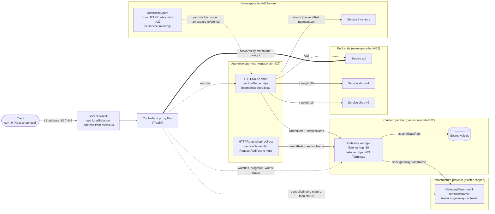

# T4.22 Use the Gateway API to manage Ingress traffic

> Competency: "Use the Gateway API to manage Ingress traffic" (CKA-5.4) | Domain/weight: CKA — Servicing and Networking (20%) | Est. time: 3.5 h | Prerequisites: T4.21, T3.18

Prerequisite lessons (read them first if a term below is new):

- [T4.21](../part4-cka/T4.21-know-how-to-use-ingress-controllers.md): what an Ingress controller is, why a controller must exist before any rule works, how a controller is exposed with a `LoadBalancer` Service and MetalLB, and how to debug a 404 or 503. Gateway API uses the same ideas with new objects. This lesson does not re-teach them.
- [T3.18](../part3-ckad/T3.18-discover-and-use-resources-that-extend.md): CustomResourceDefinitions (CRDs). Every Gateway API object is a CRD that you install yourself. If `k get crd`, `k explain` on a custom kind, or "a CRD with a controller" is new to you, read T3.18 first.
- Linked for context: [T4.18](../part4-cka/T4.18-use-clusterip-nodeport-loadbalancer-service-types.md) (Service types and MetalLB) and [T3.13](../part3-ckad/T3.13-use-ingress-rules-to-expose-applications.md) (the Ingress resource, which section 2.11 converts).

**Shell setup** (define once per terminal; used everywhere below):

```bash
alias k=kubectl
export do="--dry-run=client -o yaml"
export now="--force --grace-period=0"
source <(kubectl completion bash); complete -o default -F __start_kubectl k
```

**Environment for the whole lesson: kind.** The `lab` cluster from `env/kind-up.sh` (kind v0.33.0, `kindest/node:v1.37.0`, 1 control plane + 2 workers, context `kind-lab`). Gateway API does not depend on the CNI, so the default CNI is fine. Helm and `docker` must be on your PATH. Files go in `~/lab/t422/`. Namespaces: `lab-t422` (Gateway, routes, most apps), `lab-t422-store` (a second team's Service, used for cross-namespace references) and `lab-t422-team` (a second team that wants to attach routes).

**Four lab helpers.** Create them once (the full set of lab files is created in section 5, step 0). `ct` runs `curl` from a throw-away container on the Docker network named `kind`, so it works on Linux, macOS and Windows hosts. (On macOS and Windows the MetalLB addresses live inside Docker's VM, so a plain `curl` from the host cannot reach them. On the exam you use plain `curl`; the exam hosts have it, [E9](https://docs.linuxfoundation.org/tc-docs/certification/tips-cka-and-ckad).) `gwaddr` prints the address a Gateway reports. `split` and `splits` send N requests and count which app answered.

```bash
mkdir -p ~/lab/t422
cat > ~/lab/t422/env.sh <<'EOF'
alias k=kubectl
export do="--dry-run=client -o yaml"
export now="--force --grace-period=0"
ct()     { docker run --rm --network kind curlimages/curl:8.11.1 "$@"; }
gwaddr() { kubectl -n "$1" get gateway "$2" -o jsonpath='{.status.addresses[0].value}'; }
# split <gateway-ip> <host> [count]   : plain HTTP, counts answers per app
split()  { docker run --rm --network kind -e GW="$1" -e H="$2" -e N="${3:-100}" --entrypoint sh curlimages/curl:8.11.1 \
             -c 'for i in $(seq 1 $N); do curl -s -H "Host: $H" http://$GW/; done' | cut -d' ' -f1 | sort | uniq -c; }
# splits <gateway-ip> <host> [count]  : HTTPS (self-signed, so -k), counts answers per app
splits() { docker run --rm --network kind -e GW="$1" -e H="$2" -e N="${3:-100}" --entrypoint sh curlimages/curl:8.11.1 \
             -c 'for i in $(seq 1 $N); do curl -sk --resolve $H:443:$GW https://$H/; done' | cut -d' ' -f1 | sort | uniq -c; }
EOF
source ~/lab/t422/env.sh
```

**About the outputs in this lesson.** Read this before you trust a block.

- `REAL OUTPUT (kind v0.33.0, v1.37.0)`: I ran it on 2026-10-28 on a real kind cluster named `k-t422` (1 control plane + 2 workers, `kindest/node:v1.37.0` pinned by digest, containerd 2.3.4, the **default kindnet CNI**, not Calico). Client: kubectl v1.37.1 and Helm v3.19.2 (the pin in the conventions is Helm v4.3.1; I did not test Helm 4). Installed: Gateway API CRDs v1.6.3 (standard), MetalLB chart 0.16.1, Traefik chart 42.1.3 (Traefik v3.7.16), NGINX Gateway Fabric chart 2.8.0 (for one step). The Docker network `kind` on my machine is `192.168.147.0/24`, so the MetalLB pool is `192.168.147.200-220`. Yours will differ (often `172.18.0.0/16`); read the pattern, not the digits.
- `REAL OUTPUT (ingress2gateway v1.2.0)`: output of the conversion tool run on this machine.
- `REAL OUTPUT (Docker)` is not used: all curl runs were made from a container on the kind network, and they are kind results.
- `EXPECTED OUTPUT (not captured)`: everything I did not run exactly as written. Each one is listed in section 11.
- The Traefik address in the outputs is `192.168.147.200` in most steps. In the combined listing at the end of step 8 it is `192.168.147.201`: I deleted and re-created the MetalLB pool in between (step 13 shows why), and MetalLB handed out the addresses in a different order. Always read the address with `gwaddr`; never hard-code it.

---

## 1. Why this matters

The **Gateway API** is the recommended successor to Ingress, and the CKA competency list now names it. In real clusters Gateway API replaces the pile of controller-specific Ingress annotations with typed fields, and it splits one object into roles (infrastructure, cluster operator, app developer). What breaks if you do not know it: you cannot tell why a route is silently ignored (the answer is always in a status condition you did not read), you apply a route before the CRDs exist, or you forget that a cross-namespace reference needs a `ReferenceGrant`. On the exam there is no `kubectl create gateway` shortcut, so you must produce a Gateway and an HTTPRoute from the allowed docs, fast ([E13](https://docs.linuxfoundation.org/tc-docs/certification/certification-resources-allowed) lists `gateway-api.sigs.k8s.io` as an allowed site for the CKA only).

---

## 2. Concepts

### 2.1 Why Gateway API exists (the Ingress problems it solves)

An Ingress ([T3.13](../part3-ckad/T3.13-use-ingress-rules-to-expose-applications.md)) can say "host + path goes to Service". Everything else is an annotation, and each controller invents its own annotations: rewrite, redirect, canary, timeouts. Annotations are untyped strings. They are not portable. One object mixes the concerns of the cluster operator (ports, TLS certificates) and the application developer (paths). And Ingress only describes HTTP.

Gateway API fixes this with several small objects, each owned by one role, all with typed fields:

| Ingress | Gateway API |
|---|---|
| `IngressClass` | `GatewayClass` |
| the Ingress object (listener + rules mixed) | `Gateway` (listeners) + `HTTPRoute` (rules) |
| annotations for redirect, rewrite, canary | typed `filters` and `backendRefs[].weight` |
| TLS in `spec.tls` of every Ingress | TLS on the Gateway listener, once |
| HTTP only | HTTP, gRPC, TCP, UDP, TLS routes |
| an Ingress can only name Services in its own namespace | cross-namespace references, allowed one by one with a `ReferenceGrant` |
| no status about each rule | per-route and per-listener status conditions |

### 2.2 The resources and who owns them

| Resource | Scope | Role that owns it | What it is |
|---|---|---|---|
| `GatewayClass` | cluster | infrastructure provider | Names a controller (`controllerName`). Like a StorageClass or IngressClass: "which implementation handles Gateways of this class". |
| `Gateway` | namespaced | cluster operator | A request for a traffic entry point: a set of **listeners** (port, protocol, hostname, TLS) and the rules for which routes may attach. |
| `HTTPRoute` | namespaced | application developer | Host/path/header/query/method matches, filters, and the Services that receive traffic. Attaches to a Gateway with `parentRefs`. |
| `GRPCRoute` | namespaced | application developer | Same idea for gRPC: match on service and method names. |
| `TCPRoute`, `UDPRoute` | namespaced | application developer | Raw L4 forwarding by port. **Standard channel, API version `v1`, since Gateway API v1.6** ([release blog](https://kubernetes.io/blog/2026/08/03/gateway-api-v1-6-release/)). `v1alpha2` of each is deprecated. |
| `TLSRoute` | namespaced | application developer | Routes TLS connections by SNI name (Terminate or Passthrough). In the v1.6.3 standard bundle it is served as `v1` (I read the CRD file and ran `k api-resources`). Which release first graduated it: see section 11. |
| `ReferenceGrant` | namespaced | owner of the *target* object | Permission for objects in another namespace to reference things in this namespace. |
| `BackendTLSPolicy`, `ListenerSet` | namespaced | various | Also in the v1.6.3 standard bundle at `v1`. `BackendTLSPolicy` configures TLS from the gateway to a backend. `ListenerSet` lets other teams add listeners to a Gateway. Awareness only; not needed for the tasks in this lesson. |

All of them live in the API group `gateway.networking.k8s.io`. Experimental objects now live in a separate group, `gateway.networking.x-k8s.io`, with an `X` prefix (`XBackend`, `XMesh`, ...). They are in `experimental-install.yaml`, not in `standard-install.yaml` (I counted the CRD names in both files; section 2.3).

**REAL OUTPUT (kind v0.33.0, v1.37.0)** of `k api-resources --api-group=gateway.networking.k8s.io`. Note the short names: `gc`, `gtw`, `refgrant`, `lset`, `btlspolicy`.

```
NAME                 SHORTNAMES   APIVERSION                     NAMESPACED   KIND
backendtlspolicies   btlspolicy   gateway.networking.k8s.io/v1   true         BackendTLSPolicy
gatewayclasses       gc           gateway.networking.k8s.io/v1   false        GatewayClass
gateways             gtw          gateway.networking.k8s.io/v1   true         Gateway
grpcroutes                        gateway.networking.k8s.io/v1   true         GRPCRoute
httproutes                        gateway.networking.k8s.io/v1   true         HTTPRoute
listenersets         lset         gateway.networking.k8s.io/v1   true         ListenerSet
referencegrants      refgrant     gateway.networking.k8s.io/v1   true         ReferenceGrant
tcproutes                         gateway.networking.k8s.io/v1   true         TCPRoute
tlsroutes                         gateway.networking.k8s.io/v1   true         TLSRoute
udproutes                         gateway.networking.k8s.io/v1   true         UDPRoute
```

### 2.3 Installing the CRDs

**Why you do it.** Gateway API is not built into the API server. It is a set of CRDs ([T3.18](../part3-ckad/T3.18-discover-and-use-resources-that-extend.md)) that a cluster admin installs once, per cluster. The controller does not own them, and a GatewayClass or Gateway cannot even be created without them. Without the CRDs, every command on a Gateway API kind fails (section 6, mistake 8).

**The command** (the version is pinned: v1.6.3):

```bash
k apply --server-side -f https://github.com/kubernetes-sigs/gateway-api/releases/download/v1.6.3/standard-install.yaml
```

Why `--server-side`: the upstream install instructions use it, because CRD manifests are large and the client-side `kubectl apply` stores a copy of the whole object in an annotation (limit 262,144 bytes). On my cluster a plain client-side apply of the v1.6.3 *standard* bundle also worked (I tested by deleting the HTTPRoute CRD and re-applying), so the limit is not a problem for this bundle. Follow the docs anyway: the experimental bundle is larger, and server-side apply also makes later channel upgrades cleaner.

**Channels.**

| Channel | File | Contains | Use it for |
|---|---|---|---|
| Standard | `standard-install.yaml` | GatewayClass, Gateway, HTTPRoute, GRPCRoute, ReferenceGrant, TCPRoute, UDPRoute, TLSRoute, BackendTLSPolicy, ListenerSet (10 CRDs in v1.6.3) | Production, exam, this lesson |
| Experimental | `experimental-install.yaml` | Everything in Standard plus `gateway.networking.x-k8s.io` kinds: `XBackend`, `XBackendTrafficPolicy`, `XMesh` (v1.6.3) | Trying features that can still change or be removed |

The bundle also installs a `ValidatingAdmissionPolicy` named `safe-upgrades.gateway.networking.k8s.io` and its binding. Its CEL expressions read the `gateway.networking.k8s.io/bundle-version` and `gateway.networking.k8s.io/channel` annotations on CRDs, and its purpose is to stop a CRD downgrade or a channel switch by accident. Every CRD in the bundle carries those two annotations, so you can always ask a cluster which bundle it has:

**REAL OUTPUT (kind v0.33.0, v1.37.0)**

```
$ k get crd gateways.gateway.networking.k8s.io -o jsonpath='{.metadata.annotations}'
{"api-approved.kubernetes.io":"https://github.com/kubernetes-sigs/gateway-api/pull/4530","gateway.networking.k8s.io/bundle-version":"v1.6.3","gateway.networking.k8s.io/channel":"standard"}
```

### 2.4 GatewayClass, controllerName and picking an implementation

A `GatewayClass` is one small object:

```yaml
apiVersion: gateway.networking.k8s.io/v1
kind: GatewayClass
metadata:
  name: traefik                          # the name a Gateway puts in spec.gatewayClassName
spec:
  controllerName: traefik.io/gateway-controller   # which controller owns Gateways of this class
```

`controllerName` is a string in the form `domain/path`. It does not start anything. It is a label that a running controller compares with its own name: the controller watches all GatewayClasses, picks those whose `controllerName` equals its own, and sets `status.conditions[Accepted]=True` on them. If no controller with that name runs, the class stays at `Accepted=Unknown`, and every Gateway of that class stays at `Programmed=Unknown`. You will see this in step 12 of the worked example.

Most implementations install their own GatewayClass (the Traefik Helm chart creates `traefik`, NGINX Gateway Fabric creates `nginx`). `parametersRef` is an optional field that points to an implementation-specific config object.

**Picking an implementation.** Which controller the exam cluster runs is UNVERIFIED (no official page says; research item E23), so learn the pattern: run `k get gatewayclass`, read the name, and use that name in your Gateway.

| Implementation (pin in this guide) | `controllerName` (what I saw) | Notes |
|---|---|---|
| Traefik (chart 42.1.3, Traefik v3.7.16) | `traefik.io/gateway-controller` | One shared Traefik Deployment serves all Gateways. A Gateway listener port must match a Traefik entry point port (step 5). Does not support the `RequestMirror` filter (step 9). Serves Ingress and Gateway API from the same Pod. Listed as conformant with v1.6 in the [release blog](https://kubernetes.io/blog/2026/08/03/gateway-api-v1-6-release/) on its publish day. |
| NGINX Gateway Fabric v2.8.0 | `gateway.nginx.org/nginx-gateway-controller` | A control-plane Deployment, plus one nginx Deployment and one `LoadBalancer` Service **per Gateway** (I saw `nginx-gw-nginx`). Supports `RequestMirror` (step 9). Also listed as conformant with v1.6 in the blog. |
| Envoy Gateway v1.9.3 | UNVERIFIED (not installed) | Not tested here. |
| Cilium | UNVERIFIED (not installed) | Not tested here. Its Gateway API support is part of the CNI. |

Do not extrapolate "supported" from this table. Every implementation supports a subset of the API. The GatewayClass status tells you which subset: Traefik lists its `Supported Features` there.

**REAL OUTPUT (kind v0.33.0, v1.37.0)** of `k describe gatewayclass traefik` (trimmed; the real list has about 30 entries):

```
Spec:
  Controller Name:  traefik.io/gateway-controller
Status:
  Conditions:
    Last Transition Time:  2026-10-28T06:14:27Z
    Message:               Handled by Traefik controller
    Observed Generation:   1
    Reason:                Handled
    Status:                True
    Type:                  Accepted
  Supported Features:
    Name:  BackendTLSPolicy
    Name:  GRPCRoute
    Name:  Gateway
    Name:  HTTPRoute
    Name:  HTTPRouteBackendRequestHeaderModification
    Name:  HTTPRoutePathRedirect
    Name:  HTTPRoutePathRewrite
    Name:  HTTPRouteSchemeRedirect
    ...
    Name:  ReferenceGrant
    Name:  TLSRoute
```

`HTTPRouteRequestMirror` is not in Traefik's list. That one missing line explains the failure in step 9.

### 2.5 Gateway and listeners

A `Gateway` asks a controller for an entry point. It says which GatewayClass, and lists **listeners**. A listener is one (port, protocol, optional hostname) the Gateway accepts traffic on.

| Field | What it does | Default | Invalid or risky values |
|---|---|---|---|
| `spec.gatewayClassName` | The class that picks the controller. | none (required) | A class that no controller serves: the Gateway stays `Programmed=Unknown` forever. A typo gives the same result. |
| `listeners[].name` | Name of the listener. Routes use it as `sectionName`. | none (required) | Must be unique inside the Gateway. At most 64 listeners (CRD limit). |
| `listeners[].protocol` | `HTTP`, `HTTPS`, `TLS`, `TCP`, `UDP`. Decides which route kinds can attach. | none (required) | `HTTPS` without `tls` is accepted by the API server (I ran a server dry run) but the controller will mark the listener invalid. |
| `listeners[].port` | The port the Gateway listens on. | none (required) | The controller must be able to serve it. Traefik rejects port 80 if its entry point listens on 8000 (`PortUnavailable`, step 5). |
| `listeners[].hostname` | If set, only requests for this name (or the wildcard) match this listener. | unset (any host) | A route whose `hostnames` do not overlap gets `NoMatchingListenerHostname`. |
| `listeners[].tls.mode` | `Terminate` (the Gateway decrypts) or `Passthrough` (the Gateway forwards encrypted bytes by SNI, TLSRoute only). | `Terminate` | `Passthrough` belongs to listeners with `protocol: TLS` and `TLSRoute`, not to HTTPRoute listeners. |
| `listeners[].tls.certificateRefs` | The Secrets (type `kubernetes.io/tls`) holding the certificate. Each has `name` and optional `namespace`, `kind` (default `Secret`), `group` (default core). At most 64. | none | A Secret that does not exist: `InvalidCertificateRef`. A Secret in another namespace without a `ReferenceGrant`: `RefNotPermitted` (section 2.9). |
| `listeners[].allowedRoutes.namespaces.from` | Which namespaces' routes may attach: `Same`, `All`, `Selector`. | `Same` | `All` lets any team attach to your Gateway. `Selector` needs `selector.matchLabels` on the *namespace*. |
| `listeners[].allowedRoutes.kinds` | Restricts the route kinds (for example only `HTTPRoute`). At most 8. | the kinds the protocol implies | A kind the protocol cannot carry makes the listener invalid. |
| `spec.addresses` | Ask for specific addresses. | unset (controller picks) | Implementation-specific support. |

The three `from` values, each with one way to see the effect:

| `from` | Meaning | Example (patch command) | How you observe it |
|---|---|---|---|
| `Same` | only routes in the Gateway's own namespace | (the default; see `gateway.yaml` in section 4) | A route in `lab-t422-team` gets `Accepted=False`, reason `NotAllowedByListeners` (step 10) |
| `All` | routes from every namespace | `k -n lab-t422 patch gateway web-gw --type=json -p '[{"op":"replace","path":"/spec/listeners/0/allowedRoutes/namespaces","value":{"from":"All"}}]'` | The team route turns `Accepted=True`; `attachedRoutes` for the listener increases |
| `Selector` | only routes from namespaces with a matching label | the patch in step 10 (`matchLabels: shared-gw-access: "true"`) then `k label ns ...` | Routes in unlabelled namespaces flip to `NotAllowedByListeners` at once |

**TLS, in two modes.**

| Mode | Where TLS ends | Route kind | Needs |
|---|---|---|---|
| `Terminate` | at the Gateway; traffic to the backend is plain HTTP (unless a BackendTLSPolicy says otherwise) | `HTTPRoute`, `GRPCRoute` | `certificateRefs` to a TLS Secret |
| `Passthrough` | at the backend; the Gateway only reads the SNI name | `TLSRoute` | `protocol: TLS`; no certificate on the Gateway |

This lesson runs `Terminate` (the exam-style task). `Passthrough` and `TLSRoute` are awareness: they need Traefik's `experimentalChannel` option according to the chart's values file comments, which I did not test (section 11).

**The Gateway address.** `status.addresses` is the address clients use. Where it comes from depends on the controller, but on a bare-metal or kind cluster it is nearly always the external address of a `LoadBalancer` Service, so you need a LoadBalancer implementation, MetalLB ([T4.18](../part4-cka/T4.18-use-clusterip-nodeport-loadbalancer-service-types.md), [T4.21](../part4-cka/T4.21-know-how-to-use-ingress-controllers.md)).

- Traefik: the chart starts Traefik with `--providers.kubernetesgateway.statusaddress.service.name=traefik` (I read it in `helm template`), so every Gateway reports the address of the one `traefik` Service.
- NGINX Gateway Fabric: it creates a new Service for each Gateway (`<gateway>-nginx`), so every Gateway has its own address.
- With no pool in MetalLB, the Service shows `<pending>` and the Gateway shows an empty `ADDRESS` but can still be `PROGRAMMED=True` (real output, step 13). `PROGRAMMED` does not mean "reachable from outside".

### 2.6 HTTPRoute

An `HTTPRoute` has four parts: which Gateway (and listener) to attach to, which hostnames, a list of rules, and per rule: matches, filters, backends.

**parentRefs: how a route attaches.**

| Field | Meaning | Default |
|---|---|---|
| `name` | The Gateway name | required |
| `namespace` | The Gateway's namespace | the route's namespace |
| `sectionName` | The listener `name` to attach to. Omitted: attach to every listener that accepts the route. | unset |
| `port` | Attach by listener port instead (extended feature) | unset |

A route attaches if every check passes: the Gateway exists and is handled by a controller; the `sectionName` (if any) names a real listener; the route's namespace is allowed by the listener's `allowedRoutes`; the route kind is allowed by the listener; and the route's `hostnames` overlap with the listener's `hostname`. If one check fails, the route gets `Accepted=False` with a reason that tells you which (section 2.10).

**hostnames.** A list (max 16) of names or `*.wildcard.names`. A request matches only if its `Host` header matches one. If omitted, the route matches the listener's hostnames.

**rules[].matches.** Each match is an AND of its parts; the list of matches is an OR. An empty `matches` list means "everything" (a `PathPrefix: /` match is the default).

| Match | Fields | Types | Notes |
|---|---|---|---|
| `path` | `type`, `value` | `Exact`, `PathPrefix`, `RegularExpression` (implementation-specific) | `PathPrefix` matches on path segments: `/api` matches `/api` and `/api/x` but not `/apiary`. The API server rejects a `value` that does not start with `/` (real error, section 6). |
| `headers` | `type`, `name`, `value` | `Exact`, `RegularExpression` | Header name matching is case-insensitive. |
| `queryParams` | `type`, `name`, `value` | `Exact`, `RegularExpression` | |
| `method` | one HTTP method | `GET`, `HEAD`, `POST`, `PUT`, `DELETE`, `CONNECT`, `OPTIONS`, `TRACE`, `PATCH` | |

When several rules could match, the spec orders them by specificity, not by position in the file: exact path first, then the longest prefix, then a method match, then more header matches, then more query parameter matches (from the API reference; see section 11). So the order of `/` and `/api` rules does not matter. A `/api` request goes to the `/api` rule.

**backendRefs.**

| Field | Meaning | Default | Risky values |
|---|---|---|---|
| `name` | The Service name | required | A name that does not exist: `BackendNotFound`, and the route answers 500 (observed on Traefik). |
| `port` | The Service **port** (a number; a port *name* is not allowed) | required for a Service | A port the Service does not have: `BackendNotFound` ("service port 8080 not found"). |
| `namespace` | Namespace of the Service | the route's namespace | A different namespace needs a `ReferenceGrant`. |
| `weight` | Share of traffic (0 to any integer) | `1` | `0` = no traffic. It is **not** a percentage. `weight / sum of weights` is the share. |
| `kind`, `group` | What kind of backend | `Service`, core | Other kinds exist (`XBackend` in the experimental group). At most 16 backends per rule. |

Use **EndpointSlices**, not the deprecated Endpoints API, when you check that a backend has Pods: `k get endpointslices -l kubernetes.io/service-name=api`.

**One Route, many listeners.** If a route has no `sectionName`, it attaches to all listeners of the Gateway that accept it. In my `gateway.yaml` the HTTPS listener has `hostname: shop.local`, so a route for `shop.local` without a `sectionName` would be served on both port 80 and port 443. The redirect pattern (below) needs the opposite: one route per listener.

### 2.7 Filters

A filter changes the request or response between the Gateway and the backend. Filters are typed. `k explain httproute.spec.rules.filters.type` lists the types on your cluster; on v1.6.3 they are `RequestHeaderModifier`, `ResponseHeaderModifier`, `RequestMirror`, `RequestRedirect`, `URLRewrite`, `ExtensionRef` and `CORS`. The API classifies each as Core (all implementations must support), Extended (should), or implementation-specific. Support is per controller: check the GatewayClass status and the controller logs.

| Filter | What it does | Key fields | Observed on |
|---|---|---|---|
| `RequestHeaderModifier` | Change request headers before they reach the backend | `set` (name, value), `add`, `remove` (list of names) | Traefik: works |
| `RequestRedirect` | Answer the client with a redirect | `scheme` (`http` or `https`), `hostname`, `port`, `path` (`ReplaceFullPath` or `ReplacePrefixMatch`), `statusCode` (`301`, `302`, `303`, `307`, `308`; default `302`) | Traefik: works (`301` with `Location`) |
| `URLRewrite` | Change the path or host sent to the backend | `hostname`, `path.type` (`ReplaceFullPath`, `ReplacePrefixMatch`), `replaceFullPath` or `replacePrefixMatch` | Traefik: works (`/old/page` arrived as `/new/page`) |
| `RequestMirror` | Copy each request to a second backend; the client never sees its response | `backendRef` (name, port), and `percent` or `fraction` | Traefik: **not supported** (route answers 500). NGINX Gateway Fabric: works. |

Two validation rules in the v1.6.3 CRD (read from the file, `x-kubernetes-validations`) catch common slips at `k apply` time: a rule with a `RequestRedirect` filter must **not** have `backendRefs` (a redirect ends the request at the Gateway, so a redirect rule has `filters` only), and a `RequestRedirect` or `URLRewrite` with `path.type: ReplacePrefixMatch` needs **exactly one** `PathPrefix` match in that rule.

### 2.8 Traffic splitting (canary) with weights

Put two Services in the same rule's `backendRefs`. The share each one gets is `weight / sum(weights)`.

```yaml
backendRefs:
- {name: shop-v1, port: 80, weight: 90}   # 90 / (90 + 10) = 90 percent
- {name: shop-v2, port: 80, weight: 10}   # 10 percent
```

| Weights | Result | Use |
|---|---|---|
| `90` / `10` | 90 / 10 split | canary |
| `1` / `1` (or both unset) | 50 / 50 | A/B |
| `100` / `0` | all to v1; v2 is wired but dark | pre-stage a release |
| `9` / `1` | the same 90 / 10 split (weights are ratios) | |

The spec says the proportion may differ by "some epsilon" depending on the implementation. Traefik's weighted round robin gave me exact counts: 180 and 20 for 200 requests with 90/10 (section 5, step 7). Do not assume other controllers are exact: a random pick gives noisy counts. For a proof, use a loop of 100 or more requests and accept a range.

### 2.9 Cross-namespace references and ReferenceGrant

Gateway API separates two questions.

1. **May this route attach to this Gateway?** The Gateway owner answers with `allowedRoutes` (section 2.5). It sits on the Gateway.
2. **May this object reference that object in another namespace?** The owner of the *target* answers with a `ReferenceGrant`, in the **target's namespace**.

What needs a `ReferenceGrant`:

| Reference | From (kind, namespace) | To (kind) | Seen when missing |
|---|---|---|---|
| route `backendRefs[].namespace` to a Service elsewhere | `HTTPRoute` / `GRPCRoute` / ... | `Service` | route `ResolvedRefs=False`, reason `RefNotPermitted` |
| Gateway `certificateRefs[].namespace` to a Secret elsewhere | `Gateway` | `Secret` | listener `ResolvedRefs=False`, reason `RefNotPermitted` |
| a route's `parentRefs` to a Gateway elsewhere | none | none | does **not** use a grant; use `allowedRoutes` |

```yaml
apiVersion: gateway.networking.k8s.io/v1
kind: ReferenceGrant
metadata:
  name: allow-lab-t422-routes
  namespace: lab-t422-store            # lives with the TARGET (the Service owner)
spec:
  from:                                # who is allowed to reference
  - group: gateway.networking.k8s.io
    kind: HTTPRoute
    namespace: lab-t422                # only routes in this namespace
  to:                                  # what they may reference
  - group: ""                          # "" is the core API group
    kind: Service
    name: inventory                    # optional: omit to allow every Service in the namespace
```

Remember the direction: `from` is the referrer; `to` is the target; the object lives next to the target. A `ReferenceGrant` is an API-level permission only. It does not open or close network traffic: for that you need a NetworkPolicy ([T4.20](../part4-cka/T4.20-define-and-enforce-network-policies.md)). On my cluster `ReferenceGrant` is served as both `v1` and `v1beta1` (storage version `v1beta1`), so either `apiVersion` works.

### 2.10 Status conditions: how you debug Gateway API

Gateway API controllers report everything in `.status.conditions`. They post **no Events** for these problems (`Events: <none>` in every `describe` I ran), so `k describe` and the status fields are your debugging tools.

**Gateway.**

| Where | Condition | Meaning | Reasons I saw |
|---|---|---|---|
| `status.conditions` | `Accepted` | A controller took the Gateway | `Accepted`, `ListenersNotValid` (Traefik, when no listener is valid), `Pending` (no controller) |
| `status.conditions` | `Programmed` | The data plane has the config | `Programmed`, `Invalid`, `Pending` |
| `status.listeners[].conditions` | `Accepted`, `ResolvedRefs`, `Programmed` (per listener) | The same, for each listener | `PortUnavailable`, `InvalidCertificateRef`, `RefNotPermitted` |
| `status.listeners[].attachedRoutes` | a count | Routes attached to that listener | |
| `status.addresses` | the address | Where to send traffic | |

A Gateway can be `Programmed=True` while one of its listeners is not. Always read the listener conditions, not just the first lines.

**Route.** One entry per parent in `status.parents[]`, each with `controllerName`, `parentRef` and `conditions`:

| Condition | Meaning | `False` reasons I saw |
|---|---|---|
| `Accepted` | The parent took the route (attachment worked) | `NotAllowedByListeners`, `NoMatchingParent`, `NoMatchingListenerHostname`, `HostnameConflict` |
| `ResolvedRefs` | Every backend (and filter) reference resolved | `BackendNotFound`, `RefNotPermitted` |

**Read them with** `k describe gateway web-gw` and `k describe httproute shop`, or in one line:

```bash
k -n lab-t422 get httproute shop -o jsonpath='{range .status.parents[*].conditions[*]}{.type}={.status} reason={.reason} msg="{.message}"{"\n"}{end}'
```

`observedGeneration` in each condition must equal `metadata.generation`; if it is lower, the controller has not looked at your last edit yet.

### 2.11 Migrating an Ingress to an HTTPRoute

| Ingress field | Gateway API equivalent |
|---|---|
| `spec.ingressClassName: traefik` | `Gateway.spec.gatewayClassName: traefik` (an operator-owned object) |
| `rules[].host` | `HTTPRoute.spec.hostnames[]` (and `listeners[].hostname`) |
| `paths[].path` + `pathType: Prefix` | `matches[].path` with `type: PathPrefix` |
| `pathType: Exact` | `type: Exact` |
| `pathType: ImplementationSpecific` | no direct equivalent: decide `Exact`, `PathPrefix` or `RegularExpression` by hand |
| `backend.service.name` + `port.number` | `backendRefs[].name` + `port` |
| `backend.service.port.name` | not allowed: use the port number |
| `defaultBackend` | a rule with no `matches` (matches `/`) |
| `spec.tls[].secretName` | `Gateway.listeners[].tls.certificateRefs` on an HTTPS listener |
| annotations (rewrite, redirect, timeouts, ...) | filters, `timeouts`, or implementation policy objects; there is no 1:1 mapping |

**ingress2gateway** is the SIG Network tool that does this conversion (the blog calls it "Your Path to Gateway API"). The latest release on 2026-10-28 was v1.2.0. You point it at a cluster namespace or a file and it prints Gateway API YAML. It is awareness only: the exam host tool list is `kubectl`, `yq`, `curl`, `wget` and `man` ([E9](https://docs.linuxfoundation.org/tc-docs/certification/tips-cka-and-ckad)), so do not expect it there. Learn the manual mapping above. Section 5, step 11 runs it and checks its output.

Ingress and Gateway API can run side by side: the same Traefik Pod served the old Ingress and the new HTTPRoute for the same host in my test. That allows a safe migration: create the Gateway and route, test with `curl -H 'Host: ...'`, then delete the Ingress.

### 2.12 No imperative generators: how to produce YAML fast

`k create -h` has no `gateway` or `httproute` subcommand (I counted zero matches for "gateway" in its output). So the fast path is:

1. Open the exact page in the allowed docs: [gateway-api.sigs.k8s.io/guides/](https://gateway-api.sigs.k8s.io/guides/) (HTTP routing, redirects and rewrites, traffic splitting, routing across namespaces, TLS). Copy the example into a file.
2. Edit the few fields (names, namespaces, class, Service names).
3. Use `k explain` for field names and enums; it works for CRDs: `k explain httproute.spec.rules.filters.requestRedirect` and `k explain gateway.spec.listeners.allowedRoutes.namespaces.from` both worked on my cluster.
4. `k apply -f`, then read the status. A typo in a field name fails at the API server (`strict decoding error: unknown field ...`, real output in section 6).

**Docs version trap.** On 2026-10-28 the page `gateway-api.sigs.k8s.io/guides/` still showed the install command with `v1.6.1`, and its text still said the experimental channel contains TCPRoute, TLSRoute and UDPRoute, which the v1.6 blog contradicts (they are in Standard from v1.6). Docs pages can lag the release. The CRDs on the cluster are the truth: use `k api-resources` and `k explain`.

### 2.13 Under the hood

- **Everything is a CRD plus a controller.** The API server stores Gateways and routes like any object. It does not route traffic. A controller (a Pod) does `list` and `watch` on GatewayClass, Gateway, the route kinds, ReferenceGrant, Services, EndpointSlices and Secrets, and builds a data plane config from them. The Traefik chart's ClusterRole shows this: `get/list/watch` on the Gateway API kinds, and `update` on the `/status` subresources. It has **no** UDPRoute or ListenerSet rule (I read the rendered ClusterRole), which is a hint that the controller does not handle those kinds.
- **Status is written by the controller, not computed by the API server.** If no controller runs, no status appears (`Unknown` / `Pending`, `Waiting for controller`, timestamp `1970-01-01`).
- **Attachment is a handshake.** The route asks (`parentRefs`); the listener allows (`allowedRoutes`, hostname, kind). The controller evaluates both sides and reports on the route.
- **The data plane differs by implementation.** Traefik reconfigures one shared proxy. NGINX Gateway Fabric creates a new nginx Deployment and Service for each Gateway (I saw `pod/nginx-gw-nginx-...` and `service/nginx-gw-nginx` appear in `lab-t422` after I created the Gateway). So "the Gateway" is a spec; what runs is the controller's choice.
- **Traffic path** (Traefik): client, `LoadBalancer` IP (MetalLB), a node port, the Traefik Pod, a Pod IP of the chosen Service. The Gateway API does not change how Services and kube-proxy work after the proxy.

### 2.14 Related but different

| Often confused | The difference |
|---|---|
| `IngressClass` vs `GatewayClass` | Same job (which controller). `GatewayClass` is cluster-scoped and has a status you can read; `IngressClass` has no per-class status. |
| `Gateway` vs the `LoadBalancer` Service | The Service is what gives the proxy an external IP. The Gateway describes ports, hostnames and TLS for the proxy. Controllers usually need both. |
| `allowedRoutes` vs `ReferenceGrant` | `allowedRoutes`: may this *route* attach to my *Gateway*. `ReferenceGrant`: may this *object* reference that *object* in another namespace. Different checks, different objects, different failures. |
| `weight` vs a percentage | Weights are ratios. `90`/`10` and `9`/`1` are the same. |
| `Accepted` vs `ResolvedRefs` on a route | `Accepted`: attachment to the parent worked. `ResolvedRefs`: the Services and filters it names exist and are permitted. A route can be Accepted and still serve errors. |
| `Programmed=True` vs reachable | `Programmed` is about config in the data plane. Reachability also needs an address (a LoadBalancer IP) and a network path. |

---

## 3. How it works (diagram)



How to read it:

1. Three roles, three kinds of object: the provider owns `GatewayClass` (which controller), the operator owns `Gateway` (ports, TLS, who may attach), the developer owns `HTTPRoute` (paths, filters, Services).
2. The arrows on the left of each box are **references written in YAML**: `gatewayClassName`, `certificateRefs`, `parentRefs` + `sectionName`, `backendRefs`. If the name on the arrow does not exist, the controller reports it in a status condition.
3. The dashed arrows are **what the controller does**: it matches its own `controllerName` to the class, watches Gateways and routes, programs its proxy, and writes `status` back. The solid thick arrow is the data path.
4. The cross-namespace Service `inventory` is reachable only because the `ReferenceGrant` sits in *its* namespace and names the route's namespace as `from`.
5. Client traffic never goes through the Gateway object. It goes to the proxy Pod behind the `LoadBalancer` Service. The Gateway object only describes what the proxy should do.

---

## 4. Commands and YAML you must produce fast

### 4.1 Imperative shortcuts

There is no `k create gateway` or `k create httproute` (section 2.12). These are the commands you can type from memory:

```bash
k apply --server-side -f https://github.com/kubernetes-sigs/gateway-api/releases/download/v1.6.3/standard-install.yaml   # install the CRDs once
k get gatewayclass,gateway,httproute -A          # the one-screen overview: class ACCEPTED, gateway PROGRAMMED + ADDRESS, routes + HOSTNAMES
k get gc,gtw,refgrant -A                         # short names (gc = gatewayclass, gtw = gateway, refgrant = referencegrant)
k describe gateway web-gw -n lab-t422            # listener conditions, attachedRoutes, addresses
k describe httproute shop -n lab-t422            # status.parents[].conditions: Accepted, ResolvedRefs
k explain httproute.spec.rules.filters.requestRedirect   # field names, enums, defaults, straight from the CRD
k -n lab-t422 create secret tls web-tls --cert=tls.crt --key=tls.key   # the TLS Secret a listener refers to ($do prints it)
k label ns lab-t422-team shared-gw-access=true   # the label a Selector listener looks for
```

One line you will use all day: all conditions of a route, readable:

```bash
k -n lab-t422 get httproute shop -o jsonpath='{range .status.parents[*].conditions[*]}{.type}={.status} reason={.reason} msg="{.message}"{"\n"}{end}'
```

And the same for every route of the cluster, as a table (REAL OUTPUT in step 10 uses it):

```bash
k get httproute -A -o custom-columns=NS:.metadata.namespace,NAME:.metadata.name,ACCEPTED:'.status.parents[0].conditions[?(@.type=="Accepted")].status',REASON:'.status.parents[0].conditions[?(@.type=="Accepted")].reason'
```

### 4.2 The declarative YAML you must produce in under 5 minutes

The task shape: **a Gateway with HTTP :80 and HTTPS :443 (Terminate), plus an HTTPRoute with two path rules, a 90/10 weighted split, and an HTTP to HTTPS redirect.** In practice that is one Gateway and two HTTPRoutes (a redirect rule cannot share a rule with `backendRefs`, and the redirect belongs to the HTTP listener). Prerequisites: the Secret `web-tls` and the Services `api`, `shop-v1`, `shop-v2` in `lab-t422` (the lab files from section 5 create them). Save it as `~/lab/t422/shop.yaml`:

```yaml
apiVersion: gateway.networking.k8s.io/v1
kind: Gateway
metadata:
  name: web-gw                  # the name routes use in parentRefs
  namespace: lab-t422
spec:
  gatewayClassName: traefik     # a GatewayClass from `k get gatewayclass`. Unknown class = Programmed stays Unknown
  listeners:
  - name: http                  # unique per Gateway; routes select it with sectionName
    protocol: HTTP              # HTTP | HTTPS | TLS | TCP | UDP
    port: 80                    # must be a port the controller really listens on
    allowedRoutes:
      namespaces:
        from: Same              # Same (default) | All | Selector
  - name: https
    protocol: HTTPS
    port: 443
    hostname: shop.local        # optional; only this host is served on this listener
    tls:
      mode: Terminate           # Terminate (default) | Passthrough (protocol TLS only)
      certificateRefs:
      - name: web-tls           # Secret of type kubernetes.io/tls, same namespace unless a ReferenceGrant exists
    allowedRoutes:
      namespaces:
        from: Same
---
apiVersion: gateway.networking.k8s.io/v1
kind: HTTPRoute
metadata:
  name: shop
  namespace: lab-t422
spec:
  parentRefs:                   # which Gateway(s) to attach to
  - name: web-gw
    sectionName: https          # only the https listener; omit to attach to every listener that accepts the route
  hostnames:
  - shop.local                  # Host header must match; must overlap the listener hostname
  rules:
  - matches:
    - path:
        type: PathPrefix        # Exact | PathPrefix | RegularExpression
        value: /api             # must start with /
    backendRefs:
    - name: api                 # a Service in this namespace
      port: 80                  # the Service port (number)
  - matches:
    - path:
        type: PathPrefix
        value: /
    backendRefs:                # canary: share = weight / sum of weights
    - name: shop-v1
      port: 80
      weight: 90                # default 1; 0 means no traffic; not a percentage
    - name: shop-v2
      port: 80
      weight: 10
---
apiVersion: gateway.networking.k8s.io/v1
kind: HTTPRoute
metadata:
  name: shop-redirect
  namespace: lab-t422
spec:
  parentRefs:
  - name: web-gw
    sectionName: http           # only the plain-HTTP listener
  hostnames:
  - shop.local
  rules:
  - filters:                    # a rule with RequestRedirect must have NO backendRefs
    - type: RequestRedirect
      requestRedirect:
        scheme: https           # http | https. Port omitted: the well-known port of the scheme (443)
        statusCode: 301         # 301 | 302 (default) | 303 | 307 | 308
```

What to say out loud while you type it (the order I use on a timer): GatewayClass name from `k get gc`; Gateway with two listeners; Secret name; route 1 attached by `sectionName`; two rules; weights; route 2 with the redirect; `k apply -f`; `k get gc,gtw,httproute -A`; read `PROGRAMMED` and the conditions.

Variants of the same objects that the docs examples show (no new fields to learn): `hostnames` with a wildcard (`*.example.com`), a second `parentRefs` entry for another Gateway, `matches` with `headers`, `queryParams` or `method`, a `ReferenceGrant`. Section 5 runs each.

A `GRPCRoute` (verified `Accepted=True` on Traefik for host `grpc.local` on the `http` listener):

```yaml
apiVersion: gateway.networking.k8s.io/v1
kind: GRPCRoute
metadata:
  name: grpc-demo
  namespace: lab-t422
spec:
  parentRefs:
  - name: web-gw
    sectionName: http
  hostnames:
  - grpc.local
  rules:
  - matches:
    - method:
        service: shop.v1.Catalog   # gRPC service name
        method: List               # gRPC method name
    backendRefs:
    - name: api
      port: 80
```

A TCPRoute at `v1` (the API server accepted this with `--dry-run=server`; I did not run a TCP data path):

```yaml
apiVersion: gateway.networking.k8s.io/v1
kind: TCPRoute
metadata:
  name: tcp-app
  namespace: lab-t422
spec:
  parentRefs:
  - name: web-gw
    sectionName: foo        # a listener with protocol TCP (this one does not exist in web-gw; dry-run only)
  rules:
  - backendRefs:
    - name: api
      port: 80
```

With the old version the same file fails: `v1alpha2` is not served in the v1.6.3 standard bundle (real output):

```
error: resource mapping not found for name: "tcp-app" namespace: "lab-t422" from "STDIN": no matches for kind "TCPRoute" in version "gateway.networking.k8s.io/v1alpha2"
ensure CRDs are installed first
```

### 4.3 Speed drill

Targets are exam pace (about 6 minutes per task on average, [E2/E3](https://docs.linuxfoundation.org/tc-docs/certification/tips-cka-and-ckad)). **Setup for all drills (once):** the cluster is at the section 5 baseline (CRDs, MetalLB, Traefik installed; run `~/lab/t422/lab-up.sh` from section 7 if not) and `~/lab/t422/baseline.sh` has just run (namespaces `lab-t422`, `lab-t422-store`, `lab-t422-team` with their apps; Secret `web-tls`). The drills build on each other in order. **Cleanup after the last drill:** `~/lab/t422/baseline.sh`.

| # | Task | Target |
|---|---|---|
| 1 | Print the `controllerName` of GatewayClass `traefik`, and list every Gateway API kind with its short name. | 1 min |
| 2 | In `lab-t422`: Gateway `d-gw` (class `traefik`, listener `http`, HTTP 80, routes from `Same`). HTTPRoute `d-route` for host `d.local`: `/api` to Service `api`, everything else to `shop-v1`. Prove both with curl. | 4 min |
| 3 | Change `/` to an 80/20 split between `shop-v1` and `shop-v2`. Prove it with a 100-request loop. | 3 min |
| 4 | Add a rule: requests with header `x-canary: true` go to `shop-v2`. Prove it. | 3 min |
| 5 | Add path `/stock` to Service `inventory` in namespace `lab-t422-store`. Make `ResolvedRefs` True. | 4 min |
| 6 | Change `d-gw` so that only namespaces labelled `shared-gw-access=true` may attach routes; label `lab-t422` so `d-route` stays attached. | 3 min |
| 7 | One command that prints namespace, name, Accepted status and reason for every HTTPRoute. | 1 min |
| 8 | Without the internet: find the default `statusCode` of `requestRedirect` and the allowed values. | 1 min |

<details><summary>Answers</summary>

**Drill 1.**

```bash
k get gatewayclass traefik -o jsonpath='{.spec.controllerName}{"\n"}'
k api-resources --api-group=gateway.networking.k8s.io
```

**Drill 2.**

```bash
k apply -f - <<'EOF'
apiVersion: gateway.networking.k8s.io/v1
kind: Gateway
metadata: {name: d-gw, namespace: lab-t422}
spec:
  gatewayClassName: traefik
  listeners:
  - name: http
    protocol: HTTP
    port: 80
    allowedRoutes:
      namespaces: {from: Same}
---
apiVersion: gateway.networking.k8s.io/v1
kind: HTTPRoute
metadata: {name: d-route, namespace: lab-t422}
spec:
  parentRefs:
  - {name: d-gw, sectionName: http}
  hostnames: [d.local]
  rules:
  - matches:
    - path: {type: PathPrefix, value: /api}
    backendRefs:
    - {name: api, port: 80}
  - matches:
    - path: {type: PathPrefix, value: /}
    backendRefs:
    - {name: shop-v1, port: 80}
EOF
sleep 4
GW=$(gwaddr lab-t422 d-gw); ct -s -H 'Host: d.local' http://$GW/api; ct -s -H 'Host: d.local' http://$GW/
```

Expect `app=api ...` then `app=shop-v1 ...`. The rule order in the file does not matter (most specific path wins).

**Drill 3.**

```bash
k -n lab-t422 patch httproute d-route --type=json -p '[{"op":"replace","path":"/spec/rules/1/backendRefs","value":[{"name":"shop-v1","port":80,"weight":80},{"name":"shop-v2","port":80,"weight":20}]}]'
split $(gwaddr lab-t422 d-gw) d.local 100
```

Expect about 80 of `app=shop-v1` and 20 of `app=shop-v2` (Traefik gave exact counts for 90/10 in section 5).

**Drill 4.**

```bash
k -n lab-t422 patch httproute d-route --type=json -p '[{"op":"add","path":"/spec/rules/-","value":{"matches":[{"headers":[{"type":"Exact","name":"x-canary","value":"true"}]}],"backendRefs":[{"name":"shop-v2","port":80}]}}]'
sleep 3
ct -s -H 'Host: d.local' -H 'x-canary: true' http://$(gwaddr lab-t422 d-gw)/
```

Expect `app=shop-v2 ...` every time. A header match on a rule has more matches than the plain `/` rule, so it is chosen first (section 2.6).

**Drill 5.**

```bash
k -n lab-t422 patch httproute d-route --type=json -p '[{"op":"add","path":"/spec/rules/-","value":{"matches":[{"path":{"type":"PathPrefix","value":"/stock"}}],"backendRefs":[{"name":"inventory","namespace":"lab-t422-store","port":80}]}}]'
k -n lab-t422 get httproute d-route -o jsonpath='{range .status.parents[*].conditions[*]}{.type}={.status} reason={.reason}{"\n"}{end}'   # ResolvedRefs=False RefNotPermitted
k apply -f - <<'EOF'
apiVersion: gateway.networking.k8s.io/v1
kind: ReferenceGrant
metadata: {name: allow-lab-t422, namespace: lab-t422-store}
spec:
  from:
  - {group: gateway.networking.k8s.io, kind: HTTPRoute, namespace: lab-t422}
  to:
  - {group: "", kind: Service, name: inventory}
EOF
sleep 3
ct -s -H 'Host: d.local' http://$(gwaddr lab-t422 d-gw)/stock
```

Expect `app=inventory ...`. The grant is in `lab-t422-store` (the target's namespace).

**Drill 6.**

```bash
k -n lab-t422 patch gateway d-gw --type=json -p '[{"op":"replace","path":"/spec/listeners/0/allowedRoutes/namespaces","value":{"from":"Selector","selector":{"matchLabels":{"shared-gw-access":"true"}}}}]'
k label ns lab-t422 shared-gw-access=true
k get httproute -A -o wide
```

Without the label, `d-route` flips to `Accepted=False` / `NotAllowedByListeners`; with it, back to `True`.

**Drill 7.** The `custom-columns` command in section 4.1.

**Drill 8.**

```bash
k explain httproute.spec.rules.filters.requestRedirect.statusCode
```

The `ENUM` is `301 302 303 307 308`. The CRD default is `302` (read from the CRD file: `default: 302`).

</details>

---

## 5. Worked example

Goal: from an empty kind cluster, install the CRDs and a controller, publish `shop.local` over HTTP and HTTPS, split traffic 90/10, redirect HTTP to HTTPS, use filters, attach a route from another namespace, grant a cross-namespace reference, and migrate an Ingress. Every step says what to look at.

### Step 0. Create the lab files

```bash
mkdir -p ~/lab/t422/tls && cd ~/lab/t422
source ~/lab/t422/env.sh        # from the top of this lesson

# 0.1 a self-signed certificate for shop.local (lab only; a real cluster uses a certificate from a CA you trust)
openssl req -x509 -newkey rsa:2048 -nodes -days 30 -keyout tls/tls.key -out tls/tls.crt \
  -subj "/CN=shop.local" -addext "subjectAltName=DNS:shop.local"

# 0.2 the apps: every app answers with its own name, the Host header, the URI it saw and the x-lab header
cat > apps.sh <<'EOF'
#!/usr/bin/env bash
# Creates the echo apps used by the lesson. Each app answers with its own name.
set -euo pipefail
app() {  # app <namespace> <name>
kubectl -n "$1" apply -f - <<YAML
apiVersion: apps/v1
kind: Deployment
metadata:
  name: $2
spec:
  replicas: 1
  selector:
    matchLabels: {app: $2}
  template:
    metadata:
      labels: {app: $2}
    spec:
      containers:
      - name: nginx
        image: nginx:1.27
        env:
        - {name: APP, value: $2}
        ports:
        - containerPort: 80
        volumeMounts:
        - {name: conf, mountPath: /etc/nginx/templates}
      volumes:
      - name: conf
        configMap: {name: echo-conf}
---
apiVersion: v1
kind: Service
metadata:
  name: $2
spec:
  selector: {app: $2}
  ports:
  - {port: 80, targetPort: 80}
YAML
}
conf() {  # conf <namespace>
kubectl -n "$1" apply -f - <<'YAML'
apiVersion: v1
kind: ConfigMap
metadata:
  name: echo-conf
data:
  default.conf.template: |
    server {
      listen 80;
      location / {
        default_type text/plain;
        return 200 "app=${APP} host=$host uri=$request_uri x-lab=$http_x_lab\n";
      }
    }
YAML
}
for ns in lab-t422 lab-t422-store lab-t422-team; do kubectl get ns "$ns" >/dev/null 2>&1 || kubectl create ns "$ns"; conf "$ns"; done
app lab-t422 shop-v1
app lab-t422 shop-v2
app lab-t422 api
app lab-t422 mirror
app lab-t422-store inventory
app lab-t422-team team-app
kubectl -n lab-t422 rollout status deploy/shop-v1 deploy/shop-v2 deploy/api deploy/mirror --timeout=120s
EOF

# 0.3 MetalLB address pool that works for /16 and /24 Docker networks
cat > pool.sh <<'EOF'
#!/usr/bin/env bash
set -euo pipefail
SUBNET=$(docker network inspect kind -f '{{range .IPAM.Config}}{{println .Subnet}}{{end}}' | grep -E '^[0-9]+\.[0-9]+\.[0-9]+\.[0-9]+/' | head -1)
MASK=${SUBNET#*/}; IP=${SUBNET%/*}
if [ "$MASK" -le 16 ]; then P=$(echo "$IP" | cut -d. -f1-2).255; else P=$(echo "$IP" | cut -d. -f1-3); fi
until kubectl apply -f - <<YAML
apiVersion: metallb.io/v1beta1
kind: IPAddressPool
metadata:
  name: lab-pool
  namespace: metallb-system
spec:
  addresses:
  - ${P}.200-${P}.220
---
apiVersion: metallb.io/v1beta1
kind: L2Advertisement
metadata:
  name: lab-l2
  namespace: metallb-system
spec:
  ipAddressPools:
  - lab-pool
YAML
do echo "waiting for the MetalLB webhook"; sleep 5; done
EOF

# 0.4 reset the three namespaces to the baseline: apps + TLS secret, no Gateways, no routes
cat > baseline.sh <<'EOF'
#!/usr/bin/env bash
# Return to the lesson baseline: apps + TLS secret, no Gateways, no routes.
set -euo pipefail
cd "$(dirname "$0")"
kubectl delete ns lab-t422 lab-t422-store lab-t422-team --ignore-not-found --wait=true
./apps.sh
kubectl -n lab-t422 create secret tls web-tls --cert=tls/tls.crt --key=tls/tls.key
EOF
chmod +x apps.sh pool.sh baseline.sh
```

The `echo-conf` ConfigMap uses the nginx image's template feature: the entrypoint runs `envsubst` on `/etc/nginx/templates/*.template` and keeps nginx's own `$host` and `$request_uri` untouched, because only variables that exist in the container environment (`APP`) are replaced. All six apps share the same file; only `APP` differs.

### Step 1. Without the CRDs, nothing works

Before installing anything, try to use a Gateway API kind. Write the first route file (it is also used in step 6):

```bash
cat > ~/lab/t422/route-http.yaml <<'EOF'
apiVersion: gateway.networking.k8s.io/v1
kind: HTTPRoute
metadata:
  name: shop
  namespace: lab-t422
spec:
  parentRefs:
  - name: web-gw
    sectionName: http
  hostnames:
  - shop.local
  rules:
  - matches:
    - path:
        type: PathPrefix
        value: /api
    backendRefs:
    - name: api
      port: 80
  - matches:
    - path:
        type: PathPrefix
        value: /
    backendRefs:
    - name: shop-v1
      port: 80
      weight: 90
    - name: shop-v2
      port: 80
      weight: 10
EOF
cat ~/lab/t422/route-http.yaml | k apply -f -
k get gatewayclass
```

**REAL OUTPUT (kind v0.33.0, v1.37.0)**

```
error: resource mapping not found for name: "shop" namespace: "lab-t422" from "STDIN": no matches for kind "HTTPRoute" in version "gateway.networking.k8s.io/v1"
ensure CRDs are installed first
error: the server doesn't have a resource type "gatewayclass"
```

What to see: kubectl asks the API server for a mapping from `kind: HTTPRoute` in `gateway.networking.k8s.io/v1` to a REST resource. There is none, because no CRD defines it. The fix is not in the YAML. Install the CRDs:

```bash
k apply --server-side -f https://github.com/kubernetes-sigs/gateway-api/releases/download/v1.6.3/standard-install.yaml
k get crd | grep gateway.networking
k get crd gateways.gateway.networking.k8s.io -o jsonpath='{.metadata.annotations}'; echo
```

**REAL OUTPUT (kind v0.33.0, v1.37.0)**

```
customresourcedefinition.apiextensions.k8s.io/backendtlspolicies.gateway.networking.k8s.io serverside-applied
customresourcedefinition.apiextensions.k8s.io/gatewayclasses.gateway.networking.k8s.io serverside-applied
customresourcedefinition.apiextensions.k8s.io/gateways.gateway.networking.k8s.io serverside-applied
customresourcedefinition.apiextensions.k8s.io/grpcroutes.gateway.networking.k8s.io serverside-applied
customresourcedefinition.apiextensions.k8s.io/httproutes.gateway.networking.k8s.io serverside-applied
customresourcedefinition.apiextensions.k8s.io/listenersets.gateway.networking.k8s.io serverside-applied
customresourcedefinition.apiextensions.k8s.io/referencegrants.gateway.networking.k8s.io serverside-applied
customresourcedefinition.apiextensions.k8s.io/tcproutes.gateway.networking.k8s.io serverside-applied
customresourcedefinition.apiextensions.k8s.io/tlsroutes.gateway.networking.k8s.io serverside-applied
customresourcedefinition.apiextensions.k8s.io/udproutes.gateway.networking.k8s.io serverside-applied
validatingadmissionpolicy.admissionregistration.k8s.io/safe-upgrades.gateway.networking.k8s.io serverside-applied
validatingadmissionpolicybinding.admissionregistration.k8s.io/safe-upgrades.gateway.networking.k8s.io serverside-applied
backendtlspolicies.gateway.networking.k8s.io   Namespaced   v1(storage)           2026-10-28T06:10:55Z
gatewayclasses.gateway.networking.k8s.io       Cluster      v1(storage),v1beta1   2026-10-28T06:10:55Z
gateways.gateway.networking.k8s.io             Namespaced   v1(storage),v1beta1   2026-10-28T06:10:55Z
grpcroutes.gateway.networking.k8s.io           Namespaced   v1(storage)           2026-10-28T06:10:55Z
httproutes.gateway.networking.k8s.io           Namespaced   v1(storage),v1beta1   2026-10-28T06:10:55Z
listenersets.gateway.networking.k8s.io         Namespaced   v1(storage)           2026-10-28T06:10:55Z
referencegrants.gateway.networking.k8s.io      Namespaced   v1,v1beta1(storage)   2026-10-28T06:10:55Z
tcproutes.gateway.networking.k8s.io            Namespaced   v1(storage)           2026-10-28T06:10:55Z
tlsroutes.gateway.networking.k8s.io            Namespaced   v1(storage)           2026-10-28T06:10:55Z
udproutes.gateway.networking.k8s.io            Namespaced   v1(storage)           2026-10-28T06:10:55Z
{"api-approved.kubernetes.io":"https://github.com/kubernetes-sigs/gateway-api/pull/4530","gateway.networking.k8s.io/bundle-version":"v1.6.3","gateway.networking.k8s.io/channel":"standard"}
```

What to see: ten CRDs, all `serverside-applied`; `v1` is the storage version for all except `ReferenceGrant`; the bundle annotation says `v1.6.3` / `standard`. TLSRoute, TCPRoute and UDPRoute are in the Standard channel (answers the "TLSRoute?" question for this version). Nothing runs yet: CRDs are only types.

### Step 2. A way to get external addresses (MetalLB)

A `LoadBalancer` Service needs an implementation on a bare cluster ([T4.18](../part4-cka/T4.18-use-clusterip-nodeport-loadbalancer-service-types.md)). Install MetalLB chart 0.16.1 and the pool:

```bash
helm repo add metallb https://metallb.github.io/metallb && helm repo update
helm upgrade --install metallb metallb/metallb -n metallb-system --create-namespace --version 0.16.1 --wait --timeout 5m
~/lab/t422/pool.sh
```

**REAL OUTPUT (kind v0.33.0, v1.37.0)** (the `helm` output is shortened to its last lines)

```
NOTES:
MetalLB is now running in the cluster.
...
ipaddresspool.metallb.io/lab-pool created
l2advertisement.metallb.io/lab-l2 created
```

### Step 3. Install a controller and read its GatewayClass

Install Traefik with the chart defaults first (this is what `env/kind-addons.sh traefik` does, plus the Gateway provider). Step 5 shows why the defaults need one more change.

```bash
helm repo add traefik https://traefik.github.io/charts && helm repo update
helm upgrade --install traefik traefik/traefik -n traefik --create-namespace --version 42.1.3 \
  --set providers.kubernetesGateway.enabled=true --set gateway.enabled=false --wait --timeout 5m
k get gatewayclass
k -n traefik get svc traefik
```

`providers.kubernetesGateway.enabled=true` turns on Traefik's Gateway provider. `gateway.enabled=false` stops the chart from creating its own default Gateway (we write our own).

**REAL OUTPUT (kind v0.33.0, v1.37.0)**

```
⚠️ DEPRECATION WARNING: Gateway API CRDs will no longer be shipped with this chart in a future major version.
You will need to install them yourself before deploying Traefik v3.7:
  kubectl apply -f https://github.com/kubernetes-sigs/gateway-api/releases/download/v1.5.1/standard-install.yaml
NAME      CONTROLLER                      ACCEPTED   AGE
traefik   traefik.io/gateway-controller   True       22s
NAME      TYPE           CLUSTER-IP    EXTERNAL-IP       PORT(S)                      AGE
traefik   LoadBalancer   10.96.3.140   192.168.147.200   80:30368/TCP,443:30815/TCP   22s
```

What to see: the chart created the GatewayClass `traefik` for you, and Traefik set `ACCEPTED=True` (the name match from section 2.4). The Service is `LoadBalancer` with an address from the pool. The chart's own warning shows that you install the CRDs, in the version you choose (it names v1.5.1; this lesson uses v1.6.3). The chart did not replace the v1.6.3 CRDs: after the install `bundle-version` was still `v1.6.3` on every CRD (checked with `k get crd -o custom-columns`).

### Step 4. Apps and the TLS Secret

```bash
~/lab/t422/baseline.sh
```

**REAL OUTPUT (kind v0.33.0, v1.37.0)** (last lines)

```
deployment "api" successfully rolled out
deployment "mirror" successfully rolled out
secret/web-tls created
```

### Step 5. The Gateway (and its first failure)

```bash
cat > ~/lab/t422/gateway.yaml <<'EOF'
apiVersion: gateway.networking.k8s.io/v1
kind: Gateway
metadata:
  name: web-gw
  namespace: lab-t422
spec:
  gatewayClassName: traefik
  listeners:
  - name: http
    protocol: HTTP
    port: 80
    allowedRoutes:
      namespaces:
        from: Same
  - name: https
    protocol: HTTPS
    port: 443
    hostname: shop.local
    tls:
      mode: Terminate
      certificateRefs:
      - name: web-tls
    allowedRoutes:
      namespaces:
        from: Same
EOF
k apply -f ~/lab/t422/gateway.yaml
sleep 5
k -n lab-t422 get gateway web-gw
k -n lab-t422 describe gateway web-gw | sed -n '/^Status/,$p'
```

**Part 1. REAL OUTPUT (kind v0.33.0, v1.37.0)**: the Gateway is not programmed.

```
NAME     CLASS     ADDRESS           PROGRAMMED   AGE
web-gw   traefik   192.168.147.200   False        6s
Status:
  Addresses:
    Type:   IPAddress
    Value:  192.168.147.200
  Conditions:
    Last Transition Time:  2026-10-28T06:15:16Z
    Message:               At least one Listener must be valid
    Observed Generation:   1
    Reason:                ListenersNotValid
    Status:                False
    Type:                  Accepted
    Last Transition Time:  2026-10-28T06:15:16Z
    Message:               No Listener is valid
    Observed Generation:   1
    Reason:                Invalid
    Status:                False
    Type:                  Programmed
  Listeners:
    Attached Routes:  0
    Conditions:
      Last Transition Time:  2026-10-28T06:15:16Z
      Message:               Cannot find entryPoint for Gateway: no matching entryPoint for port 80 and protocol "HTTP"
      Observed Generation:   1
      Reason:                PortUnavailable
      Status:                False
      Type:                  Accepted
    Name:                    http
    ...
    Attached Routes:  0
    Conditions:
      Last Transition Time:  2026-10-28T06:15:16Z
      Message:               Cannot find entryPoint for Gateway: no matching entryPoint for port 443 and protocol "HTTPS"
      Observed Generation:   1
      Reason:                PortUnavailable
      Status:                False
      Type:                  Accepted
    Name:                    https
```

How to read it, top down: the Gateway has an address (the Traefik Service) but `PROGRAMMED=False`. The Gateway-level message ("No Listener is valid") only says that something below is wrong. The per-listener `Accepted` condition has the real reason: `PortUnavailable`, "no matching entryPoint for port 80". Traefik listens on its own **entry points**, and the chart's defaults listen on container ports **8000** (`web`) and **8443** (`websecure`); only the Service maps 80 and 443 to them (I read `--entryPoints.web.address=:8000/tcp` in `helm template`). A Gateway listener's `port` must be a port the controller really serves.

**Part 2. Two fixes.** (a) Use the entry point ports in the Gateway (`port: 8000`, `port: 8443`), or (b) make Traefik listen on 80 and 443 so the portable YAML from the docs works unchanged. We take (b), because the docs examples use 80 and 443:

```bash
helm upgrade traefik traefik/traefik -n traefik --version 42.1.3 \
  --set providers.kubernetesGateway.enabled=true --set gateway.enabled=false \
  --set ports.web.port=80 --set ports.websecure.port=443 --wait --timeout 3m
k -n traefik get pods
k -n lab-t422 get gateway web-gw
```

`ports.web.port` and `ports.websecure.port` are the container ports (and so the entry point addresses). The Service ports stay 80 and 443. Binding to ports below 1024 worked here with the chart's default security settings on containerd 2.3.4; I did not test other runtimes.

**REAL OUTPUT (kind v0.33.0, v1.37.0)**

```
⚠️ DEPRECATION WARNING: Gateway API CRDs will no longer be shipped with this chart in a future major version.
...
NAME                       READY   STATUS      RESTARTS   AGE
traefik-69c8c46b54-fb8ch   1/1     Running     0          22s
traefik-8f558765d-z96jc    0/1     Completed   0          94s
NAME     CLASS     ADDRESS           PROGRAMMED   AGE
web-gw   traefik   192.168.147.200   True         35s
```

The old Pod finished (`Completed`); the new one runs; the Gateway flipped to `True` without you touching it, because the controller re-evaluates on its own.

**Part 3. A healthy Gateway.** `k -n lab-t422 describe gateway web-gw | sed -n '/^Spec/,$p'` (REAL OUTPUT, kind v0.33.0, v1.37.0, trimmed):

```
Spec:
  Gateway Class Name:  traefik
  Listeners:
    Allowed Routes:
      Namespaces:
        From:  Same
    Name:      http
    Port:      80
    Protocol:  HTTP
    Allowed Routes:
      Namespaces:
        From:  Same
    Hostname:  shop.local
    Name:      https
    Port:      443
    Protocol:  HTTPS
    Tls:
      Certificate Refs:
        Group:
        Kind:   Secret
        Name:   web-tls
      Mode:     Terminate
Status:
  Addresses:
    Type:   IPAddress
    Value:  192.168.147.200
  Conditions:
    ...
    Message:               Gateway successfully scheduled
    Reason:                Accepted
    Status:                True
    Type:                  Accepted
    ...
    Message:               Gateway successfully programmed
    Reason:                Programmed
    Status:                True
    Type:                  Programmed
  Listeners:
    Attached Routes:  0
    Conditions:
      ... (Accepted, ResolvedRefs, Programmed all True, "No error found")
    Name:                    http
    Supported Kinds:
      Group:          gateway.networking.k8s.io
      Kind:           HTTPRoute
      Group:          gateway.networking.k8s.io
      Kind:           GRPCRoute
    Attached Routes:  0
    ...
    Name:                    https
Events:       <none>
```

What to see: the API server filled in defaults you did not write (`Group:`, `Kind: Secret` for the certificate ref). `Supported Kinds` is what each listener will accept (HTTPRoute and GRPCRoute for HTTP/HTTPS). `Attached Routes: 0` until step 6. `Events: <none>`: status is the only report.

### Step 6. The first HTTPRoute

```bash
k apply -f ~/lab/t422/route-http.yaml
sleep 3
k -n lab-t422 get httproute
k -n lab-t422 describe httproute shop | sed -n '/^Spec/,$p' | head -60
GW=$(gwaddr lab-t422 web-gw); echo GW=$GW
ct -s -H 'Host: shop.local' http://$GW/api
ct -s -H 'Host: shop.local' http://$GW/
ct -s -o /dev/null -w '%{http_code}\n' -H 'Host: other.local' http://$GW/
```

**REAL OUTPUT (kind v0.33.0, v1.37.0)** (this is an **accepted** route)

```
httproute.gateway.networking.k8s.io/shop created
NAME   HOSTNAMES        AGE
shop   ["shop.local"]   3s
Spec:
  Hostnames:
    shop.local
  Parent Refs:
    Group:         gateway.networking.k8s.io
    Kind:          Gateway
    Name:          web-gw
    Section Name:  http
  Rules:
    Backend Refs:
      Group:
      Kind:    Service
      Name:    api
      Port:    80
      Weight:  1
    Matches:
      Path:
        Type:   PathPrefix
        Value:  /api
    Backend Refs:
      Group:
      Kind:    Service
      Name:    shop-v1
      Port:    80
      Weight:  90
      Group:
      Kind:    Service
      Name:    shop-v2
      Port:    80
      Weight:  10
    Matches:
      Path:
        Type:   PathPrefix
        Value:  /
Status:
  Parents:
    Conditions:
      Last Transition Time:  2026-10-28T06:16:02Z
      Message:
      Observed Generation:   1
      Reason:                Accepted
      Status:                True
      Type:                  Accepted
      Last Transition Time:  2026-10-28T06:16:02Z
      Message:
      Observed Generation:   1
      Reason:                ResolvedRefs
      Status:                True
      Type:                  ResolvedRefs
    Controller Name:         traefik.io/gateway-controller
    Parent Ref:
      Group:         gateway.networking.k8s.io
      Kind:          Gateway
      Name:          web-gw
      Section Name:  http
Events:              <none>
GW=192.168.147.200
app=api host=shop.local uri=/api x-lab=
app=shop-v1 host=shop.local uri=/ x-lab=
404
```

What to see:

- The defaults the API server added: `Weight: 1` on `api`, `Group:` empty (core), `Kind: Service`.
- Under `Status > Parents`: one entry for the parent `web-gw / http`, written by `traefik.io/gateway-controller`, with `Accepted=True` and `ResolvedRefs=True`. These are the two conditions that mean "attached and every reference found".
- `/api` reached the `api` app, with the URI unchanged. `/` reached `shop-v1`. On the exam you would type the plain form of the same test: `curl -H 'Host: shop.local' http://<gw-ip>/api` (`ct` only exists because the lab addresses are inside Docker).
- An unknown host (`other.local`) gives `404` from the proxy itself: no route matched. That is the normal answer for "no route", not an error in the Gateway.

### Step 7. Prove the 90/10 split

```bash
split $(gwaddr lab-t422 web-gw) shop.local 200
split $(gwaddr lab-t422 web-gw) shop.local 200
```

**REAL OUTPUT (kind v0.33.0, v1.37.0)**

```
 180 app=shop-v1
  20 app=shop-v2
 180 app=shop-v1
  20 app=shop-v2
```

Two runs of 200 requests: 180/20 both times, which is exactly 90/10. Traefik uses a weighted round robin, so the counts are exact. A random-pick controller will give noisy counts that only average out. Then change `weight: 90` and `weight: 10` to `1` and `1`, re-apply, and run `split` again: you get 100/100.

### Step 8. HTTPS and the HTTP to HTTPS redirect

First the redirect route (it takes the `http` listener), then move `shop` to the `https` listener.

```bash
cat > ~/lab/t422/route-redirect.yaml <<'EOF'
apiVersion: gateway.networking.k8s.io/v1
kind: HTTPRoute
metadata:
  name: shop-redirect
  namespace: lab-t422
spec:
  parentRefs:
  - name: web-gw
    sectionName: http
  hostnames:
  - shop.local
  rules:
  - filters:
    - type: RequestRedirect
      requestRedirect:
        scheme: https
        statusCode: 301
EOF
k apply -f ~/lab/t422/route-redirect.yaml
k -n lab-t422 patch httproute shop --type=json -p '[{"op":"replace","path":"/spec/parentRefs/0/sectionName","value":"https"}]'
sleep 3
GW=$(gwaddr lab-t422 web-gw)
ct -si -H 'Host: shop.local' "http://$GW/api?x=1" | head -5
ct -sk --resolve shop.local:443:$GW https://shop.local/api
ct -sk --resolve shop.local:443:$GW https://shop.local/
ct -sk --resolve other.local:443:$GW https://other.local/ -o /dev/null -w '%{http_code}\n'
ct -sv -k --resolve shop.local:443:$GW https://shop.local/api 2>&1 | grep -E 'subject:|issuer:|SSL connection'
```

`--resolve shop.local:443:$GW` tells curl to connect to the Gateway address while using `shop.local` as the TLS name and `Host` header. `-k` skips verification because the certificate is self-signed.

**REAL OUTPUT (kind v0.33.0, v1.37.0)**

```
httproute.gateway.networking.k8s.io/shop-redirect created
httproute.gateway.networking.k8s.io/shop patched
HTTP/1.1 301 Moved Permanently
Location: https://shop.local/api?x=1
Date: Wed, 28 Oct 2026 06:16:30 GMT
Content-Length: 17

app=api host=shop.local uri=/api x-lab=
app=shop-v1 host=shop.local uri=/ x-lab=
404
* SSL connection using TLSv1.3 / TLS_AES_128_GCM_SHA256 / x25519 / RSASSA-PSS
*  subject: CN=shop.local
*  issuer: CN=shop.local
```

What to see: plain HTTP gets `301` with `Location: https://shop.local/api?x=1`. The redirect kept the path and the query string, and with `scheme: https` and no `port` it went to the default HTTPS port. On HTTPS the same two rules answer. `https://other.local` gets `404`: the listener has `hostname: shop.local`. The certificate shown is the one from `web-tls`: **TLS terminated at the Gateway**.

Now the whole picture (this listing is from a re-run on a fresh baseline, which is why the Gateway address ends in `.201`, see "About the outputs"):

```bash
k get gatewayclass,gateway,httproute -A
```

**REAL OUTPUT (kind v0.33.0, v1.37.0)**

```
NAME                                             CONTROLLER                                   ACCEPTED   AGE
gatewayclass.gateway.networking.k8s.io/nginx     gateway.nginx.org/nginx-gateway-controller   True       6m26s
gatewayclass.gateway.networking.k8s.io/traefik   traefik.io/gateway-controller                True       9m46s

NAMESPACE   NAME                                       CLASS     ADDRESS           PROGRAMMED   AGE
lab-t422    gateway.gateway.networking.k8s.io/web-gw   traefik   192.168.147.201   True         5s

NAMESPACE   NAME                                                HOSTNAMES        AGE
lab-t422    httproute.gateway.networking.k8s.io/shop            ["shop.local"]   5s
lab-t422    httproute.gateway.networking.k8s.io/shop-redirect   ["shop.local"]   5s
```

(The `nginx` class is there because step 9 installed NGINX Gateway Fabric on the same cluster.)

### Step 9. Matches and filters

Two routes on the plain HTTP listener, with different host names so they do not collide with `shop.local`:

```bash
cat > ~/lab/t422/route-filters.yaml <<'EOF'
apiVersion: gateway.networking.k8s.io/v1
kind: HTTPRoute
metadata:
  name: filters
  namespace: lab-t422
spec:
  parentRefs:
  - name: web-gw
    sectionName: http
  hostnames:
  - filters.local
  rules:
  - matches:
    - path: {type: PathPrefix, value: /headers}
    filters:
    - type: RequestHeaderModifier
      requestHeaderModifier:
        set:
        - {name: x-lab, value: from-gateway}
        remove:
        - x-secret
    backendRefs:
    - {name: api, port: 80}
  - matches:
    - path: {type: PathPrefix, value: /old}
    filters:
    - type: URLRewrite
      urlRewrite:
        path:
          type: ReplacePrefixMatch
          replacePrefixMatch: /new
    backendRefs:
    - {name: api, port: 80}
  - matches:
    - path: {type: PathPrefix, value: /mirror}
    filters:
    - type: RequestMirror
      requestMirror:
        backendRef:
          name: mirror
          port: 80
    backendRefs:
    - {name: api, port: 80}
EOF
cat > ~/lab/t422/route-match.yaml <<'EOF'
apiVersion: gateway.networking.k8s.io/v1
kind: HTTPRoute
metadata:
  name: match
  namespace: lab-t422
spec:
  parentRefs:
  - name: web-gw
    sectionName: http
  hostnames:
  - match.local
  rules:
  - matches:
    - headers:
      - {type: Exact, name: x-canary, value: "true"}
    backendRefs:
    - {name: shop-v2, port: 80}
  - matches:
    - queryParams:
      - {type: Exact, name: v, value: "2"}
    backendRefs:
    - {name: shop-v2, port: 80}
  - matches:
    - method: POST
      path: {type: Exact, value: /orders}
    backendRefs:
    - {name: api, port: 80}
  - backendRefs:
    - {name: shop-v1, port: 80}
EOF
k apply -f ~/lab/t422/route-filters.yaml -f ~/lab/t422/route-match.yaml
sleep 3
GW=$(gwaddr lab-t422 web-gw)
echo "--- RequestHeaderModifier"; ct -s -H 'Host: filters.local' -H 'x-lab: client' -H 'x-secret: 1' "http://$GW/headers/a"
echo "--- URLRewrite";            ct -s -H 'Host: filters.local' "http://$GW/old/page"
echo "--- matches"
ct -s -H 'Host: match.local' http://$GW/
ct -s -H 'Host: match.local' -H 'x-canary: true' http://$GW/
ct -s -H 'Host: match.local' "http://$GW/?v=2"
ct -s -X POST -H 'Host: match.local' "http://$GW/orders"
ct -s -H 'Host: match.local' "http://$GW/orders"
```

**REAL OUTPUT (kind v0.33.0, v1.37.0)**

```
httproute.gateway.networking.k8s.io/filters created
httproute.gateway.networking.k8s.io/match created
--- RequestHeaderModifier
app=api host=filters.local uri=/headers/a x-lab=from-gateway
--- URLRewrite
app=api host=filters.local uri=/new/page x-lab=
--- matches
app=shop-v1 host=match.local uri=/ x-lab=
app=shop-v2 host=match.local uri=/ x-lab=
app=shop-v2 host=match.local uri=/?v=2 x-lab=
app=api host=match.local uri=/orders x-lab=
app=shop-v1 host=match.local uri=/orders x-lab=
```

What to see: (1) the client sent `x-lab: client` and the backend saw `from-gateway`: `set` overwrote it; `x-secret` was removed before the backend. (2) `/old/page` arrived as `/new/page`: `ReplacePrefixMatch` swapped the matched prefix. (3) The header rule, the query rule and the method+path rule each pick their backend. A `GET /orders` falls through to the last rule (no matches, so `/`). A POST to `/orders` is the only request that gets `api`.

**RequestMirror: the filter that "worked" but did not.** `/mirror` is in the same route. Call it on Traefik:

```bash
ct -s -o /dev/null -w '%{http_code}\n' -H 'Host: filters.local' "http://$GW/mirror/x"
k -n lab-t422 get httproute filters -o jsonpath='{range .status.parents[*].conditions[*]}{.type}={.status}({.reason}) {end}{"\n"}'
k -n traefik logs deploy/traefik --tail=300 | grep -i mirror | head -2
```

**REAL OUTPUT (kind v0.33.0, v1.37.0)**

```
500
Accepted=True(Accepted) ResolvedRefs=True(ResolvedRefs)
... ERR Unable to load HTTPRoute filters error="unsupported filter RequestMirror" http_route=filters namespace=lab-t422 providerName=kubernetesgateway
```

This is the lesson: the route says `Accepted=True` and `ResolvedRefs=True`, yet `/mirror` answers `500`. Status only covers attachment and references. A filter that the controller does not implement shows up in the **controller logs**, not in the route status (on this Traefik version). The fix is a controller that supports the filter. Install NGINX Gateway Fabric 2.8.0 beside Traefik and try the same filter there:

```bash
helm install ngf oci://ghcr.io/nginx/charts/nginx-gateway-fabric --version 2.8.0 -n nginx-gateway --create-namespace --wait --timeout 5m
k get gatewayclass
cat > ~/lab/t422/ngf.yaml <<'EOF'
apiVersion: gateway.networking.k8s.io/v1
kind: Gateway
metadata:
  name: nginx-gw
  namespace: lab-t422
spec:
  gatewayClassName: nginx
  listeners:
  - name: http
    protocol: HTTP
    port: 80
    allowedRoutes:
      namespaces:
        from: Same
---
apiVersion: gateway.networking.k8s.io/v1
kind: HTTPRoute
metadata:
  name: mirror-demo
  namespace: lab-t422
spec:
  parentRefs:
  - name: nginx-gw
  hostnames:
  - mirror.local
  rules:
  - filters:
    - type: RequestMirror
      requestMirror:
        backendRef:
          name: mirror
          port: 80
    backendRefs:
    - {name: api, port: 80}
EOF
k apply -f ~/lab/t422/ngf.yaml
sleep 35
k -n lab-t422 get gateway,svc | grep -i nginx
NG=$(gwaddr lab-t422 nginx-gw)
for i in 1 2 3; do ct -s -H 'Host: mirror.local' "http://$NG/hello$i"; done
sleep 2
echo "--- mirror app access log"; k -n lab-t422 logs deploy/mirror --tail=3 | cut -c1-110
echo "--- api app access log";    k -n lab-t422 logs deploy/api --tail=3 | cut -c1-110
```

**REAL OUTPUT (kind v0.33.0, v1.37.0)**

```
NAME      CONTROLLER                                   ACCEPTED   AGE
nginx     gateway.nginx.org/nginx-gateway-controller   True       13s
traefik   traefik.io/gateway-controller                True       3m33s
gateway.gateway.networking.k8s.io/nginx-gw   nginx     192.168.147.201   True         25s
service/nginx-gw-nginx   LoadBalancer   10.96.129.207   192.168.147.201   80:31484/TCP   25s
app=api host=mirror.local uri=/hello1 x-lab=
app=api host=mirror.local uri=/hello2 x-lab=
app=api host=mirror.local uri=/hello3 x-lab=
--- mirror app access log
10.244.2.6 - - [28/Oct/2026:06:18:35 +0000] "GET /hello1 HTTP/1.1" 200 48 "-" "curl/8.11.1" "192.168.147.10"
10.244.2.6 - - [28/Oct/2026:06:18:36 +0000] "GET /hello2 HTTP/1.1" 200 48 "-" "curl/8.11.1" "192.168.147.10"
10.244.2.6 - - [28/Oct/2026:06:18:36 +0000] "GET /hello3 HTTP/1.1" 200 48 "-" "curl/8.11.1" "192.168.147.10"
--- api app access log
10.244.2.6 - - [28/Oct/2026:06:18:35 +0000] "GET /hello1 HTTP/1.1" 200 45 "-" "curl/8.11.1" "192.168.147.10"
...
```

What to see: the client got the answers of `api` only; the `mirror` app's own access log recorded the same three requests. That is mirroring. Two different controllers, the same Gateway API YAML, a different result for one filter. Note also `parentRefs` without `sectionName`: it attached to every listener (there is only one).

The `nginx-gw-nginx` Service is the per-Gateway Service that NGINX Gateway Fabric created; the Gateway address is that Service's address.

### Step 10. Namespaces, `allowedRoutes` and `ReferenceGrant`

A team in `lab-t422-team` wants to attach a route to `web-gw`:

```bash
cat > ~/lab/t422/team-route.yaml <<'EOF'
apiVersion: gateway.networking.k8s.io/v1
kind: HTTPRoute
metadata:
  name: team
  namespace: lab-t422-team
spec:
  parentRefs:
  - name: web-gw
    namespace: lab-t422
    sectionName: http
  hostnames:
  - team.local
  rules:
  - backendRefs:
    - name: team-app
      port: 80
EOF
k apply -f ~/lab/t422/team-route.yaml
sleep 3
k -n lab-t422-team describe httproute team | sed -n '/^Status/,$p'
k -n lab-t422 get gateway web-gw -o jsonpath='{range .status.listeners[*]}{.name} attached={.attachedRoutes}{"\n"}{end}'
```

**REAL OUTPUT (kind v0.33.0, v1.37.0)** (this is a **rejected** route)

```
httproute.gateway.networking.k8s.io/team created
Status:
  Parents:
    Conditions:
      Last Transition Time:  2026-10-28T06:18:49Z
      Message:
      Observed Generation:   1
      Reason:                NotAllowedByListeners
      Status:                False
      Type:                  Accepted
      Last Transition Time:  2026-10-28T06:18:49Z
      Message:
      Observed Generation:   1
      Reason:                ResolvedRefs
      Status:                True
      Type:                  ResolvedRefs
    Controller Name:         traefik.io/gateway-controller
    Parent Ref:
      Group:         gateway.networking.k8s.io
      Kind:          Gateway
      Name:          web-gw
      Namespace:     lab-t422
      Section Name:  http
Events:              <none>
http attached=3
https attached=1
```

Reading it: `Accepted=False`, reason `NotAllowedByListeners`. `ResolvedRefs=True`: `team-app` exists, so the backend is fine; the route simply is not attached. The listener `http` has `from: Same` and the route lives in another namespace. `attached=3` are the three routes in `lab-t422` (`shop-redirect`, `filters`, `match`). The fix is on the Gateway (the operator's decision): select namespaces by label.

```bash
k -n lab-t422 patch gateway web-gw --type=json -p '[{"op":"replace","path":"/spec/listeners/0/allowedRoutes/namespaces","value":{"from":"Selector","selector":{"matchLabels":{"shared-gw-access":"true"}}}}]'
sleep 3
k get httproute -A -o custom-columns=NS:.metadata.namespace,NAME:.metadata.name,ACCEPTED:'.status.parents[0].conditions[?(@.type=="Accepted")].status',REASON:'.status.parents[0].conditions[?(@.type=="Accepted")].reason'
k label ns lab-t422 lab-t422-team shared-gw-access=true
sleep 3
k get httproute -A -o custom-columns=NS:.metadata.namespace,NAME:.metadata.name,ACCEPTED:'.status.parents[0].conditions[?(@.type=="Accepted")].status',REASON:'.status.parents[0].conditions[?(@.type=="Accepted")].reason'
ct -s -H 'Host: team.local' http://$(gwaddr lab-t422 web-gw)/
```

**REAL OUTPUT (kind v0.33.0, v1.37.0)**

```
gateway.gateway.networking.k8s.io/web-gw patched
NS              NAME            ACCEPTED   REASON
lab-t422-team   team            False      NotAllowedByListeners
lab-t422        filters         False      NotAllowedByListeners
lab-t422        match           False      NotAllowedByListeners
lab-t422        mirror-demo     True       Accepted
lab-t422        shop            True       Accepted
lab-t422        shop-redirect   False      NotAllowedByListeners
namespace/lab-t422 labeled
namespace/lab-t422-team labeled
NS              NAME            ACCEPTED   REASON
lab-t422-team   team            True       Accepted
lab-t422        filters         True       Accepted
lab-t422        match           True       Accepted
lab-t422        mirror-demo     True       Accepted
lab-t422        shop            True       Accepted
lab-t422        shop-redirect   True       Accepted
app=team-app host=team.local uri=/ x-lab=
```

What to see, and a trap: after the patch (before labelling anything) the routes in `lab-t422` itself also turned `NotAllowedByListeners`, because `Selector` replaces `Same`: **the Gateway's own namespace needs the label too**. `shop` stayed `True` because it is on the `https` listener (still `Same`), and `mirror-demo` belongs to the other Gateway. Labelling both namespaces fixed everything within seconds.

**The ReferenceGrant.** Now a route in `lab-t422` that sends `/` of `d1.local` to `inventory` in `lab-t422-store`. The helper `mk` prints a small route (host, listener, Service, port, optional Service namespace); it is also used in section 6:

```bash
mk() { # mk <route> <listener> <service> <port> <service-namespace|""> <host>
cat <<YAML
apiVersion: gateway.networking.k8s.io/v1
kind: HTTPRoute
metadata:
  name: $1
  namespace: lab-t422
spec:
  parentRefs:
  - name: web-gw
    sectionName: $2
  hostnames:
  - $6
  rules:
  - backendRefs:
    - name: $3
      port: $4
${5:+      namespace: $5}
YAML
}
mk d1 http inventory 80 lab-t422-store d1.local | k apply -f -
sleep 3
k -n lab-t422 get httproute d1 -o jsonpath='{range .status.parents[*].conditions[*]}{.type}={.status} reason={.reason} msg="{.message}"{"\n"}{end}'
ct -s -o /dev/null -w 'http=%{http_code}\n' -H 'Host: d1.local' http://$(gwaddr lab-t422 web-gw)/
cat > ~/lab/t422/refgrant.yaml <<'EOF'
apiVersion: gateway.networking.k8s.io/v1
kind: ReferenceGrant
metadata:
  name: allow-lab-t422-routes
  namespace: lab-t422-store
spec:
  from:
  - group: gateway.networking.k8s.io
    kind: HTTPRoute
    namespace: lab-t422
  to:
  - group: ""
    kind: Service
    name: inventory
EOF
k apply -f ~/lab/t422/refgrant.yaml
sleep 3
k -n lab-t422 get httproute d1 -o jsonpath='{range .status.parents[*].conditions[*]}{.type}={.status} reason={.reason}{"\n"}{end}'
ct -s -H 'Host: d1.local' http://$(gwaddr lab-t422 web-gw)/
k -n lab-t422-store delete referencegrant allow-lab-t422-routes
sleep 3
k -n lab-t422 get httproute d1 -o jsonpath='{range .status.parents[*].conditions[*]}{.type}={.status} reason={.reason}{"\n"}{end}'
```

**REAL OUTPUT (kind v0.33.0, v1.37.0)**

```
httproute.gateway.networking.k8s.io/d1 created
Accepted=True reason=Accepted msg=""
ResolvedRefs=False reason=RefNotPermitted msg="Cannot load HTTPBackendRef core/Service/lab-t422-store/inventory: missing ReferenceGrant"
http=500
referencegrant.gateway.networking.k8s.io/allow-lab-t422-routes created
Accepted=True reason=Accepted
ResolvedRefs=True reason=ResolvedRefs
app=inventory host=d1.local uri=/ x-lab=
referencegrant.gateway.networking.k8s.io "allow-lab-t422-routes" deleted from lab-t422-store namespace
Accepted=True reason=Accepted
ResolvedRefs=False reason=RefNotPermitted
```

What to see: before the grant: `Accepted=True` (the route is attached) but `ResolvedRefs=False`, `RefNotPermitted`, and the request answers `500`. With the grant: both `True` and the Service in the other namespace answers. Delete the grant and it breaks again at once. The message names the exact object that needs permission (`core/Service/lab-t422-store/inventory`) and the fix ("missing ReferenceGrant").

### Step 11. Migrate an Ingress to an HTTPRoute

Here is an "old" Ingress for host `legacy.local` that Traefik already serves:

```bash
cat > ~/lab/t422/ingress-old.yaml <<'EOF'
apiVersion: networking.k8s.io/v1
kind: Ingress
metadata:
  name: legacy
  namespace: lab-t422
spec:
  ingressClassName: traefik
  tls:
  - hosts: [legacy.local]
    secretName: web-tls
  rules:
  - host: legacy.local
    http:
      paths:
      - path: /api
        pathType: Prefix
        backend:
          service: {name: api, port: {number: 80}}
      - path: /
        pathType: Prefix
        backend:
          service: {name: shop-v1, port: {number: 80}}
EOF
k apply -f ~/lab/t422/ingress-old.yaml
sleep 3
GW=$(gwaddr lab-t422 web-gw)
ct -s -H 'Host: legacy.local' http://$GW/api; ct -s -H 'Host: legacy.local' http://$GW/
```

**REAL OUTPUT (kind v0.33.0, v1.37.0)**

```
ingress.networking.k8s.io/legacy created
app=api host=legacy.local uri=/api x-lab=
app=shop-v1 host=legacy.local uri=/ x-lab=
```

Convert it with ingress2gateway v1.2.0 (download the binary for your OS from its GitHub releases page into any directory on your PATH):

```bash
ingress2gateway print --providers=traefik -n lab-t422 --no-color > /tmp/legacy-gw.yaml
cat /tmp/legacy-gw.yaml
```

**REAL OUTPUT (ingress2gateway v1.2.0)** (the warning goes to stderr; stdout is the YAML)

```
┌─ WARN  ────────────────────────────────────────
│  Gateway API does not support configuring URL normalization (RFC 3986, Section 6). Please check if this matters for your use case and consult implementation-specific details.
│  source: STANDARD_EMITTER
└─
apiVersion: gateway.networking.k8s.io/v1
kind: Gateway
metadata:
  annotations:
    gateway.networking.k8s.io/generator: ingress2gateway-1.2.0
  name: traefik
  namespace: lab-t422
spec:
  gatewayClassName: traefik
  listeners:
  - hostname: legacy.local
    name: legacy-local-http
    port: 80
    protocol: HTTP
  - hostname: legacy.local
    name: legacy-local-https
    port: 443
    protocol: HTTPS
    tls:
      certificateRefs:
      - group: ""
        kind: Secret
        name: web-tls
---
apiVersion: gateway.networking.k8s.io/v1
kind: HTTPRoute
metadata:
  annotations:
    gateway.networking.k8s.io/generator: ingress2gateway-1.2.0
  name: legacy-legacy-local
  namespace: lab-t422
spec:
  hostnames:
  - legacy.local
  parentRefs:
  - name: traefik
  rules:
  - backendRefs:
    - name: api
      port: 80
    matches:
    - path:
        type: PathPrefix
        value: /api
  - backendRefs:
    - name: shop-v1
      port: 80
    matches:
    - path:
        type: PathPrefix
        value: /
status:
  parents: []
```

Read it against the mapping table in section 2.11: `ingressClassName: traefik` became `gatewayClassName: traefik` on a new Gateway named `traefik` (one listener per scheme, with the host); `tls.secretName` became `certificateRefs`; the two paths became two rules with `PathPrefix`. Notice what the tool cannot guess: it created its **own** Gateway instead of using `web-gw`, and it gave no `tls.mode` (the default `Terminate` applies). A real migration reviews that output; do not apply it blindly. Apply it, test, then delete the Ingress:

```bash
k apply -f /tmp/legacy-gw.yaml
sleep 4
k -n lab-t422 get httproute legacy-legacy-local -o jsonpath='{range .status.parents[*].conditions[*]}{.type}={.status} reason={.reason}{"\n"}{end}'
k -n lab-t422 delete ingress legacy
sleep 3
GW=$(gwaddr lab-t422 web-gw)
ct -s -H 'Host: legacy.local' http://$GW/api
ct -s -H 'Host: legacy.local' http://$GW/
ct -sk --resolve legacy.local:443:$GW https://legacy.local/api
```

**REAL OUTPUT (kind v0.33.0, v1.37.0)**

```
gateway.gateway.networking.k8s.io/traefik created
httproute.gateway.networking.k8s.io/legacy-legacy-local created
Accepted=True reason=Accepted
ResolvedRefs=True reason=ResolvedRefs
ingress.networking.k8s.io "legacy" deleted from lab-t422 namespace
app=api host=legacy.local uri=/api x-lab=
app=shop-v1 host=legacy.local uri=/ x-lab=
app=api host=legacy.local uri=/api x-lab=
```

What to see: the new route is `Accepted` and answers on HTTP and HTTPS after the Ingress is gone. The `status: parents: []` at the end of the tool output is ignored on create (the controller wrote its own status).

### Step 12. A Gateway with no controller

```bash
k apply -f - <<'EOF'
apiVersion: gateway.networking.k8s.io/v1
kind: GatewayClass
metadata:
  name: ghost
spec:
  controllerName: example.com/nobody-runs-this
---
apiVersion: gateway.networking.k8s.io/v1
kind: Gateway
metadata:
  name: ghost-gw
  namespace: lab-t422
spec:
  gatewayClassName: ghost
  listeners:
  - {name: http, protocol: HTTP, port: 80}
EOF
sleep 4
k get gatewayclass
k -n lab-t422 get gateway
k -n lab-t422 describe gateway ghost-gw | sed -n '/^Status/,$p'
```

**REAL OUTPUT (kind v0.33.0, v1.37.0)**

```
gatewayclass.gateway.networking.k8s.io/ghost created
gateway.gateway.networking.k8s.io/ghost-gw created
NAME      CONTROLLER                                   ACCEPTED   AGE
ghost     example.com/nobody-runs-this                 Unknown    4s
nginx     gateway.nginx.org/nginx-gateway-controller   True       2m15s
traefik   traefik.io/gateway-controller                True       5m35s
NAME       CLASS     ADDRESS           PROGRAMMED   AGE
ghost-gw   ghost                       Unknown      4s
nginx-gw   nginx     192.168.147.201   True         116s
web-gw     traefik   192.168.147.200   True         4m36s
Status:
  Conditions:
    Last Transition Time:  1970-01-01T00:00:00Z
    Message:               Waiting for controller
    Reason:                Pending
    Status:                Unknown
    Type:                  Accepted
    Last Transition Time:  1970-01-01T00:00:00Z
    Message:               Waiting for controller
    Reason:                Pending
    Status:                Unknown
    Type:                  Programmed
Events:                    <none>
```

What to see: the GatewayClass is `ACCEPTED=Unknown`; the Gateway is `PROGRAMMED=Unknown` with `Reason: Pending` and `Message: Waiting for controller`, and a timestamp of `1970-01-01` because nobody ever wrote the status (these are the API server's placeholder conditions). `Unknown` is not `False`: nobody has said "no". It means that no controller claims this class. A class-name typo in the Gateway (`gatewayClassName: traefic`) gave the same result in my run. The fix is to install the implementation or correct the name or `controllerName`.

### Step 13. Optional: a Gateway with no address pool

`PROGRAMMED` does not promise reachability. This step uses NGINX Gateway Fabric (installed in step 9) because it creates one Service per Gateway, so a new Gateway means a new `LoadBalancer` Service. Delete the pool, create a Gateway of class `nginx`, look, then restore the pool. (In my session I ran this last, which is why the outputs of steps 10 to 12 show the addresses from before it.)

```bash
k -n metallb-system delete ipaddresspool lab-pool
k -n lab-t422 apply -f - <<'EOF'
apiVersion: gateway.networking.k8s.io/v1
kind: Gateway
metadata: {name: nginx-gw, namespace: lab-t422}
spec:
  gatewayClassName: nginx
  listeners:
  - {name: http, protocol: HTTP, port: 80}
EOF
sleep 25
k -n lab-t422 get gateway nginx-gw
k -n lab-t422 get svc nginx-gw-nginx
~/lab/t422/pool.sh >/dev/null
sleep 8
k -n lab-t422 get gateway nginx-gw
k -n lab-t422 get svc nginx-gw-nginx
k -n traefik get svc traefik
```

(If you still have `nginx-gw` from step 9, delete it first: `k -n lab-t422 delete gateway nginx-gw httproute mirror-demo`.)

**REAL OUTPUT (kind v0.33.0, v1.37.0)**

```
NAME       CLASS   ADDRESS   PROGRAMMED   AGE
nginx-gw   nginx             True         25s
NAME             TYPE           CLUSTER-IP      EXTERNAL-IP   PORT(S)        AGE
nginx-gw-nginx   LoadBalancer   10.96.203.209   <pending>     80:31644/TCP   25s
--- after ~/lab/t422/pool.sh again (second pair):
NAME       CLASS   ADDRESS           PROGRAMMED   AGE
nginx-gw   nginx   192.168.147.200   True         34s
NAME             TYPE           CLUSTER-IP      EXTERNAL-IP       PORT(S)        AGE
nginx-gw-nginx   LoadBalancer   10.96.203.209   192.168.147.200   80:31644/TCP   34s
```

The first pair is before the pool is restored; the second pair is after. In the real run the third command also printed the Traefik Service with the address `192.168.147.201` (it was `.200` before). What to see: `ADDRESS` is empty while the Service is `<pending>` and appears as soon as MetalLB has a pool. Also note the side effect I hit: re-creating the pool made MetalLB reassign addresses (the Traefik Service moved from `.200` to `.201`). A Gateway address is not permanent unless you pin it.

### Step 14. Cleanup

```bash
k delete gateway,httproute -A --all
k delete gatewayclass ghost --ignore-not-found
k delete ns lab-t422 lab-t422-store lab-t422-team
helm uninstall ngf -n nginx-gateway      # only if you did step 9's NGINX part
```

Leave the CRDs, MetalLB and Traefik: sections 4 and 7 use them. (If you remove Traefik later, `helm uninstall traefik -n traefik` does not remove the CRDs of Gateway API, because you installed those yourself.)

---

## 6. Common mistakes and how to fix them

All messages in this section are copied from the real cluster of steps 0 to 14 (Traefik chart 42.1.3, Gateway API v1.6.3). **The `reason` values are part of the Gateway API spec and are the same on every controller; the `message` text is controller-specific.** Other controllers may phrase the message differently.

### 6.1 Symptom table

| # | Symptom | What you will see (exact text) | Cause | Fix (command) |
|---|---|---|---|---|
| 1 | Route exists but gets no traffic, `404` from the proxy | route `Accepted=False`, `reason=NotAllowedByListeners` | The listener's `allowedRoutes.namespaces.from` is `Same` (default) or a `Selector` that does not match the route's namespace | Operator: `k -n lab-t422 patch gateway web-gw --type=json -p '[{"op":"replace","path":"/spec/listeners/0/allowedRoutes/namespaces","value":{"from":"All"}}]'`, or label the route's namespace for a `Selector` |
| 2 | Route not attached after a typo in `sectionName` | route `Accepted=False`, `reason=NoMatchingParent` | `parentRefs[].sectionName` names a listener that does not exist. (The lesson entry lists a `sectionName` mismatch under `NotAllowedByListeners`; on Traefik I got `NoMatchingParent`, which is the spec's reason for "no listener matches the parentRef".) | `k -n lab-t422 patch httproute a1 --type=json -p '[{"op":"replace","path":"/spec/parentRefs/0/sectionName","value":"http"}]'` |
| 3 | Route not attached, host does not fit the listener | route `Accepted=False`, `reason=NoMatchingListenerHostname` | The route's `hostnames` do not overlap the listener's `hostname` | Fix `hostnames` on the route or `hostname` on the listener |
| 4 | Route attached, requests answer `500` | `ResolvedRefs=False`, `reason=BackendNotFound`, `msg="Cannot load HTTPBackendRef lab-t422/shopp: getting service: service "shopp" not found"` | Wrong Service name | `k -n lab-t422 get svc`, then fix `backendRefs[].name` |
| 5 | Same, but the name is right | `ResolvedRefs=False`, `reason=BackendNotFound`, `msg="Cannot load HTTPBackendRef lab-t422/api: service port 8080 not found"` | `backendRefs[].port` is not a port of the Service | `k -n lab-t422 get svc api -o jsonpath='{.spec.ports[*].port}'`, then fix `port` |
| 6 | Backend in another namespace gives `500` | `ResolvedRefs=False`, `reason=RefNotPermitted`, `msg="Cannot load HTTPBackendRef core/Service/lab-t422-store/inventory: missing ReferenceGrant"` | Cross-namespace `backendRef` and no `ReferenceGrant` in the Service's namespace | Create the grant in `lab-t422-store` (section 2.9): `k apply -f ~/lab/t422/refgrant.yaml` |
| 7 | Gateway never becomes ready | `k get gateway`: `PROGRAMMED Unknown`, no `ADDRESS`; describe: `Reason: Pending`, `Message: Waiting for controller` | No controller for the GatewayClass (nothing runs, or `controllerName` is wrong), or a typo in `gatewayClassName` | `k get gatewayclass`: `ACCEPTED` must be `True`. Install the implementation, or fix the name |
| 8 | `no matches for kind HTTPRoute` | `error: resource mapping not found for name: "shop" namespace: "lab-t422" from "STDIN": no matches for kind "HTTPRoute" in version "gateway.networking.k8s.io/v1"` then `ensure CRDs are installed first`; or `error: the server doesn't have a resource type "gatewayclass"` | The CRDs are not installed (or the wrong version: `v1alpha2` kinds are not served in the v1.6.3 standard bundle) | `k apply --server-side -f https://github.com/kubernetes-sigs/gateway-api/releases/download/v1.6.3/standard-install.yaml` |
| 9 | Gateway `PROGRAMMED False`, listeners invalid | listener `Accepted=False`, `reason=PortUnavailable`, `msg=Cannot find entryPoint for Gateway: no matching entryPoint for port 80 and protocol "HTTP"` | The listener port is not a port the controller serves (Traefik's default entry points are 8000 and 8443) | Use the controller's ports, or reconfigure it (step 5) |
| 10 | HTTPS listener not working, Gateway still `PROGRAMMED True` | listener `ResolvedRefs=False`, `reason=InvalidCertificateRef`, `msg="Cannot load CertificateRef lab-t422/web-tls-missing: getting secret: secret "web-tls-missing" not found"`; or `reason=RefNotPermitted`, `msg="Cannot reference CertificateRef lab-t422-store/store-tls: missing ReferenceGrant"` | Secret name wrong, or in another namespace without a grant (`from.kind: Gateway`, `to.kind: Secret`) | Fix the name, or add the `ReferenceGrant` |
| 11 | Route is `Accepted` and `ResolvedRefs`, but that path answers `500` | status all `True`; controller log: `ERR Unable to load HTTPRoute filters error="unsupported filter RequestMirror"` | The controller does not implement that filter | Check the GatewayClass `Supported Features` and the controller logs; use a controller that supports it |
| 12 | `k apply` itself fails | `strict decoding error: unknown field "spec.rules[0].backendRefs[0].wieght"`; or `spec.rules[0].matches[0].path: Invalid value: value must be an absolute path and start with '/' when type one of ['Exact', 'PathPrefix']` | A typo in a field name, or a path without a leading `/` | `k explain httproute.spec.rules.backendRefs`, then fix the YAML |
| 13 | A second route kind for the same host is rejected | route `Accepted=False`, `reason=HostnameConflict` (seen on Traefik when a GRPCRoute used a hostname that an HTTPRoute already served on the same listener) | Two routes of different kinds claim the same host on the same listener | Use a different hostname for the second route, or a separate listener |
| 14 | `404 page not found` for a route that is `Accepted` | All conditions `True`; an unknown `Host` gets `404` too | Your request did not match: wrong `Host` header, path or scheme/port | `ct -v -H 'Host: shop.local' http://$GW/...` and compare with `hostnames` and `matches` |

### 6.2 A repeatable troubleshooting path

Run these in order. Each step narrows the problem to one object.

1. **Is the API there?** `k api-resources --api-group=gateway.networking.k8s.io`. Empty: mistake 8.
2. **Is there a controller for the class?** `k get gatewayclass`. `ACCEPTED` must be `True`. `Unknown`: mistake 7.
3. **Is the Gateway programmed, with an address?** `k get gateway -A`. Look at `CLASS`, `ADDRESS`, `PROGRAMMED`. Empty `ADDRESS`: the Service has no external address (step 13). `False` or `Unknown`: go on.
4. **Which listener is unhappy?** `k describe gateway web-gw -n lab-t422`. Read `Status > Listeners`: each listener has its own `Accepted`, `ResolvedRefs`, `Programmed` and `Attached Routes`. A Gateway can be `PROGRAMMED=True` while one listener is broken (mistakes 9 and 10).
5. **Is the route attached?** `k describe httproute shop -n lab-t422`. `Status > Parents > Conditions > Accepted`. `False`: the `reason` is the answer (mistakes 1, 2, 3, 13).
6. **Do the references resolve?** Same place, `ResolvedRefs`. `False`: `BackendNotFound` (check `k get svc` and the port) or `RefNotPermitted` (check `k get referencegrant -n <target-ns>`) (mistakes 4, 5, 6).
7. **Does the backend have Pods?** `k -n lab-t422 get endpointslices -l kubernetes.io/service-name=api`. No endpoints: the Service selector or the Pods are wrong ([T4.18](../part4-cka/T4.18-use-clusterip-nodeport-loadbalancer-service-types.md)).
8. **Is it the controller?** `k -n traefik logs deploy/traefik --tail=100 | grep -i err`. A filter or feature the controller does not implement shows here (mistake 11).
9. **Test from the client side with the right Host header.** `ct -s -o /dev/null -w '%{http_code}\n' -H 'Host: shop.local' http://$GW/`. `404` from the proxy means no route matched. `500` means a route matched but a reference or filter failed.

One more rule: **read the status again after each fix.** Traefik reported only one `ResolvedRefs` message at a time. In the break-fix lab, fixing the `sectionName` makes the next problem visible.

### 6.3 Walk-throughs with real output

Create the helper `mk` from step 10 first, then reproduce the faults. (They all use the `http` or `https` listener of `web-gw` and the apps from the baseline; `a1` to `e1` are throw-away route names.)

```bash
show() { k -n lab-t422 get httproute "$1" -o jsonpath='{range .status.parents[*].conditions[*]}{.type}={.status} reason={.reason} msg="{.message}"{"\n"}{end}'; }
GW=$(gwaddr lab-t422 web-gw)
echo "### A sectionName typo";            mk a1 htp api 80 "" a1.local | k apply -f -; sleep 3; show a1
echo "### B wrong service name";          mk b1 http shopp 80 "" b1.local | k apply -f -; sleep 3; show b1; ct -s -o /dev/null -w 'http=%{http_code}\n' -H 'Host: b1.local' http://$GW/
echo "### C wrong port";                  mk c1 http api 8080 "" c1.local | k apply -f -; sleep 3; show c1; ct -s -o /dev/null -w 'http=%{http_code}\n' -H 'Host: c1.local' http://$GW/
echo "### D cross-namespace, no grant";   mk d1 http inventory 80 lab-t422-store d1.local | k apply -f -; sleep 3; show d1
echo "### E host does not fit listener";  mk e1 https api 80 "" shop.example.com | k apply -f -; sleep 3; show e1
```

**REAL OUTPUT (kind v0.33.0, v1.37.0)**

```
### A sectionName typo
httproute.gateway.networking.k8s.io/a1 created
Accepted=False reason=NoMatchingParent msg=""
ResolvedRefs=True reason=ResolvedRefs msg=""
### B wrong service name
httproute.gateway.networking.k8s.io/b1 created
Accepted=True reason=Accepted msg=""
ResolvedRefs=False reason=BackendNotFound msg="Cannot load HTTPBackendRef lab-t422/shopp: getting service: service "shopp" not found"
http=500
### C wrong port
httproute.gateway.networking.k8s.io/c1 created
Accepted=True reason=Accepted msg=""
ResolvedRefs=False reason=BackendNotFound msg="Cannot load HTTPBackendRef lab-t422/api: service port 8080 not found"
http=500
### D cross-namespace, no grant
httproute.gateway.networking.k8s.io/d1 created
Accepted=True reason=Accepted msg=""
ResolvedRefs=False reason=RefNotPermitted msg="Cannot load HTTPBackendRef core/Service/lab-t422-store/inventory: missing ReferenceGrant"
### E host does not fit listener
httproute.gateway.networking.k8s.io/e1 created
Accepted=False reason=NoMatchingListenerHostname msg=""
ResolvedRefs=True reason=ResolvedRefs msg=""
```

(In that run `d1` was recreated after step 10; if you still have `d1` from step 10 the apply just reconfigures it.)

How to read it. **A:** `Accepted=False` / `NoMatchingParent`: the parent (Gateway `web-gw`) exists but no listener is called `htp`. The backend `api` is fine (`ResolvedRefs=True`), which tells you the problem is the attachment, not the Service. Fix: `sectionName: http`. **B and C:** the opposite: `Accepted=True` (attached) and `ResolvedRefs=False`. The message names the Service (`shopp`) or the port (`8080`). Check with `k -n lab-t422 get svc shopp` (not found) and `k -n lab-t422 get svc api -o jsonpath='{.spec.ports[*].port}'` (80). The Service exists; only the port number is wrong. **D:** `RefNotPermitted`; the namespace of the Service is in the message; add the grant from step 10. **E:** the https listener has `hostname: shop.local`; `shop.example.com` never overlaps.

The same method for the Gateway side (the certificate), on the `https` listener:

```bash
lst() { k -n lab-t422 get gateway web-gw -o jsonpath='{range .status.listeners[?(@.name=="https")].conditions[*]}{.type}={.status} reason={.reason} msg="{.message}"{"\n"}{end}'; }
echo "### missing secret"
k -n lab-t422 patch gateway web-gw --type=json -p '[{"op":"replace","path":"/spec/listeners/1/tls/certificateRefs/0/name","value":"web-tls-missing"}]'
sleep 3; lst; k -n lab-t422 get gateway web-gw
echo "### secret in another namespace, no grant"
k -n lab-t422-store create secret tls store-tls --cert=$HOME/lab/t422/tls/tls.crt --key=$HOME/lab/t422/tls/tls.key
k -n lab-t422 patch gateway web-gw --type=json -p '[{"op":"replace","path":"/spec/listeners/1/tls/certificateRefs/0","value":{"name":"store-tls","namespace":"lab-t422-store"}}]'
sleep 3; lst
echo "### grant for the Secret"
k apply -f - <<'EOF'
apiVersion: gateway.networking.k8s.io/v1
kind: ReferenceGrant
metadata:
  name: allow-gw-cert
  namespace: lab-t422-store
spec:
  from:
  - group: gateway.networking.k8s.io
    kind: Gateway
    namespace: lab-t422
  to:
  - group: ""
    kind: Secret
    name: store-tls
EOF
sleep 3; lst
echo "### restore"
k -n lab-t422 patch gateway web-gw --type=json -p '[{"op":"replace","path":"/spec/listeners/1/tls/certificateRefs/0","value":{"name":"web-tls"}}]'
k -n lab-t422-store delete referencegrant allow-gw-cert; k -n lab-t422-store delete secret store-tls
sleep 3; lst
```

**REAL OUTPUT (kind v0.33.0, v1.37.0)**

```
### missing secret
gateway.gateway.networking.k8s.io/web-gw patched
ResolvedRefs=False reason=InvalidCertificateRef msg="Cannot load CertificateRef lab-t422/web-tls-missing: getting secret: secret "web-tls-missing" not found"
Programmed=False reason=Invalid msg="Invalid CertificateRefs"
NAME     CLASS     ADDRESS           PROGRAMMED   AGE
web-gw   traefik   192.168.147.200   True         4m53s
### secret in another namespace, no grant
secret/store-tls created
gateway.gateway.networking.k8s.io/web-gw patched
ResolvedRefs=False reason=RefNotPermitted msg="Cannot reference CertificateRef lab-t422-store/store-tls: missing ReferenceGrant"
Programmed=False reason=Invalid msg="Invalid CertificateRefs"
### grant for the Secret
referencegrant.gateway.networking.k8s.io/allow-gw-cert created
Accepted=True reason=Accepted msg="No error found"
ResolvedRefs=True reason=ResolvedRefs msg="No error found"
Programmed=True reason=Programmed msg="No error found"
### restore
gateway.gateway.networking.k8s.io/web-gw patched
referencegrant.gateway.networking.k8s.io "allow-gw-cert" deleted from lab-t422-store namespace
secret "store-tls" deleted from lab-t422-store namespace
Accepted=True reason=Accepted msg="No error found"
ResolvedRefs=True reason=ResolvedRefs msg="No error found"
Programmed=True reason=Programmed msg="No error found"
```

How to read it: the **listener** is `Programmed=False` while the **Gateway** row still says `PROGRAMMED True` (the HTTP listener is fine). That is why step 4 of the troubleshooting path says to read the listener conditions. The second case uses the same `RefNotPermitted` reason as the backend case, with a different message and a different grant (`from.kind: Gateway`, `to.kind: Secret`).

API-level rejections (mistake 12), with `--dry-run=server` so nothing is created:

```bash
k apply --dry-run=server -f - <<'EOF'
apiVersion: gateway.networking.k8s.io/v1
kind: HTTPRoute
metadata: {name: bad, namespace: lab-t422}
spec:
  parentRefs: [{name: web-gw}]
  rules:
  - backendRefs: [{name: api, port: 80, wieght: 5}]
EOF
k apply --dry-run=server -f - <<'EOF'
apiVersion: gateway.networking.k8s.io/v1
kind: HTTPRoute
metadata: {name: bad2, namespace: lab-t422}
spec:
  parentRefs: [{name: web-gw}]
  rules:
  - matches: [{path: {type: PathPrefix, value: "api"}}]
    backendRefs: [{name: api, port: 80}]
EOF
```

**REAL OUTPUT (kind v0.33.0, v1.37.0)**

```
Error from server (BadRequest): error when creating "STDIN": HTTPRoute in version "v1" cannot be handled as a HTTPRoute: strict decoding error: unknown field "spec.rules[0].backendRefs[0].wieght"
The HTTPRoute "bad2" is invalid: spec.rules[0].matches[0].path: Invalid value: value must be an absolute path and start with '/' when type one of ['Exact', 'PathPrefix']
```

Note what is **not** rejected: a Gateway with an `HTTPS` listener and no `tls` block passed `--dry-run=server` (`gateway.gateway.networking.k8s.io/bad3 created (server dry run)`). The API server only checks the schema. Whether the listener is usable is the controller's job, and you find out in the status.

---

## 7. Labs

**Lab order:** A (Easy) first, because it builds the baseline; then B (Medium) and C (Break-fix) in any order. All three use namespace `lab-t422` (plus `lab-t422-store` and `lab-t422-team` where stated).

**Baselines.** B0 = a fresh `lab` cluster. B1 = B0 + Gateway API CRDs v1.6.3 + MetalLB with the pool + Traefik (chart 42.1.3, listening on 80 and 443). Lab A goes from B0 to B1 and ends by removing only its own objects, so the cluster is left at B1. Labs B and C start at B1: if your cluster is not at B1, run this script (it is safe to run twice):

```bash
cat > ~/lab/t422/lab-up.sh <<'EOF'
#!/usr/bin/env bash
# Bring the cluster to baseline B1 and reset the lab namespaces.
set -euo pipefail
cd "$(dirname "$0")"
kubectl apply --server-side -f https://github.com/kubernetes-sigs/gateway-api/releases/download/v1.6.3/standard-install.yaml
helm repo add metallb https://metallb.github.io/metallb >/dev/null
helm repo add traefik https://traefik.github.io/charts >/dev/null
helm repo update >/dev/null
helm upgrade --install metallb metallb/metallb -n metallb-system --create-namespace --version 0.16.1 --wait --timeout 5m
./pool.sh
helm upgrade --install traefik traefik/traefik -n traefik --create-namespace --version 42.1.3 \
  --set providers.kubernetesGateway.enabled=true --set gateway.enabled=false \
  --set ports.web.port=80 --set ports.websecure.port=443 --wait --timeout 5m
./baseline.sh
EOF
chmod +x ~/lab/t422/lab-up.sh
```

The lab files (`env.sh`, `apps.sh`, `pool.sh`, `baseline.sh`, `tls/`) are from section 5, step 0. In every lab terminal run the shell setup from the top of the lesson and `source ~/lab/t422/env.sh`.

### Lab A (Easy): CRDs, a controller, one host to one Service

**Environment:** kind, baseline B0 (fresh cluster; no Gateway API, no controller, no MetalLB).

**Setup:**

```bash
source ~/lab/t422/env.sh; cd ~/lab/t422
helm repo add metallb https://metallb.github.io/metallb && helm repo update
helm upgrade --install metallb metallb/metallb -n metallb-system --create-namespace --version 0.16.1 --wait --timeout 5m
./pool.sh
./baseline.sh            # namespaces + apps + Secret web-tls; no Gateway API yet
```

**Task.** The cluster has no Gateway API and no Gateway controller. Namespace `lab-t422` has the Services `api`, `shop-v1` and `shop-v2` and the Secret `web-tls`.

1. Install the Gateway API CRDs, release v1.6.3, standard channel.
2. Install Traefik with Helm (repo `https://traefik.github.io/charts`, chart `traefik/traefik`, version `42.1.3`, release `traefik`, namespace `traefik`) so that it handles Gateway API objects. Do not let the chart create its own Gateway.
3. In `lab-t422` create a Gateway `easy-gw` with one listener named `web`: protocol HTTP, **port 80**, routes from the same namespace only. Use the GatewayClass that the controller created.
4. Create an HTTPRoute `easy` that sends host `easy.local` (all paths) to Service `api`, port 80, through `easy-gw`.
5. Write the address of `easy-gw` into `~/lab/t422/easy-ip.txt`. Write the response of `curl -H 'Host: easy.local' http://<that address>/` into `~/lab/t422/easy-out.txt`.

**Hints**

<details><summary>Hint 1</summary>

The Helm flags that turn on the Gateway provider are `--set providers.kubernetesGateway.enabled=true` and `--set gateway.enabled=false`. After the install run `k get gatewayclass`.

</details>

<details><summary>Hint 2</summary>

If `k get gateway -n lab-t422` shows `PROGRAMMED False`, run `k -n lab-t422 describe gateway easy-gw` and read the **listener** conditions, not only the Gateway ones. A message that starts with "Cannot find entryPoint" is about the port.

</details>

<details><summary>Hint 3</summary>

Traefik's chart defaults listen on 8000 and 8443 inside the Pod. You can either set the Gateway listener to the Pod's port, or make Traefik listen on 80 and 443: `--set ports.web.port=80 --set ports.websecure.port=443`. The task says port 80, so change Traefik.

</details>

<details><summary>Solution</summary>

```bash
# 1. CRDs (the cluster cannot even store a Gateway before this)
k apply --server-side -f https://github.com/kubernetes-sigs/gateway-api/releases/download/v1.6.3/standard-install.yaml

# 2. Controller. The Gateway provider is off by default; the chart's default Gateway is not wanted;
#    ports.* make Traefik listen on 80/443 so a listener on port 80 is a valid port.
helm repo add traefik https://traefik.github.io/charts && helm repo update
helm upgrade --install traefik traefik/traefik -n traefik --create-namespace --version 42.1.3 \
  --set providers.kubernetesGateway.enabled=true --set gateway.enabled=false \
  --set ports.web.port=80 --set ports.websecure.port=443 --wait --timeout 5m
k get gatewayclass                      # traefik, ACCEPTED True

# 3 + 4. Gateway and route
k apply -f - <<'EOF'
apiVersion: gateway.networking.k8s.io/v1
kind: Gateway
metadata:
  name: easy-gw
  namespace: lab-t422
spec:
  gatewayClassName: traefik
  listeners:
  - name: web
    protocol: HTTP
    port: 80
    allowedRoutes:
      namespaces:
        from: Same
---
apiVersion: gateway.networking.k8s.io/v1
kind: HTTPRoute
metadata:
  name: easy
  namespace: lab-t422
spec:
  parentRefs:
  - name: easy-gw
    sectionName: web
  hostnames:
  - easy.local
  rules:
  - backendRefs:
    - name: api
      port: 80
EOF
sleep 5
k get gc,gtw -A; k -n lab-t422 get httproute easy

# 5. Address and response
gwaddr lab-t422 easy-gw > ~/lab/t422/easy-ip.txt
ct -s -H 'Host: easy.local' http://$(cat ~/lab/t422/easy-ip.txt)/ > ~/lab/t422/easy-out.txt
cat ~/lab/t422/easy-ip.txt ~/lab/t422/easy-out.txt
```

Why each step: the CRDs define the kinds; the controller turns objects into proxy config and sets status; the listener port must be one the proxy serves (step 2's `ports.*`); the route has no `matches`, which means all paths; the address comes from the Traefik `LoadBalancer` Service, so it needs the MetalLB pool from the setup. `ct` runs `curl` on the Docker network.

</details>

**Verification** (each line must print `PASS`; a `FAIL` tells you which part to look at):

```bash
cd ~/lab/t422
k get crd gateways.gateway.networking.k8s.io -o yaml | grep -q 'bundle-version: v1.6.3' && echo "PASS crd v1.6.3" || echo "FAIL crd v1.6.3"
test "$(k get gatewayclass traefik -o jsonpath='{.status.conditions[?(@.type=="Accepted")].status}')" = True && echo "PASS class accepted" || echo "FAIL class accepted"
test "$(k -n lab-t422 get gateway easy-gw -o jsonpath='{.status.conditions[?(@.type=="Programmed")].status}')" = True && echo "PASS gateway programmed" || echo "FAIL gateway programmed"
test "$(k -n lab-t422 get httproute easy -o jsonpath='{.status.parents[0].conditions[*].status}')" = "True True" && echo "PASS route accepted+resolved" || echo "FAIL route accepted+resolved"
test -s easy-ip.txt && test "$(cat easy-ip.txt)" = "$(gwaddr lab-t422 easy-gw)" && echo "PASS ip file" || echo "FAIL ip file"
grep -q '^app=api host=easy.local uri=/ ' easy-out.txt && echo "PASS response file" || echo "FAIL response file"
```

```
EXPECTED OUTPUT (not captured)
PASS crd v1.6.3
PASS class accepted
PASS gateway programmed
PASS route accepted+resolved
PASS ip file
PASS response file
```

(The commands of the solution were run in steps 1 to 6 of section 5; these exact verification lines were not run as one script.)

**Cleanup** (returns to baseline B1: CRDs, MetalLB and Traefik stay):

```bash
k delete ns lab-t422 lab-t422-store lab-t422-team --ignore-not-found
rm -f ~/lab/t422/easy-ip.txt ~/lab/t422/easy-out.txt
```

### Lab B (Medium): path routing, canary, HTTPS redirect, Ingress migration

**Environment:** kind, baseline B1.

**Setup:**

```bash
source ~/lab/t422/env.sh; cd ~/lab/t422
./lab-up.sh                                   # idempotent; ends with ./baseline.sh
cat > ingress-old.yaml <<'EOF'
apiVersion: networking.k8s.io/v1
kind: Ingress
metadata:
  name: legacy
  namespace: lab-t422
spec:
  ingressClassName: traefik
  tls:
  - hosts: [legacy.local]
    secretName: web-tls
  rules:
  - host: legacy.local
    http:
      paths:
      - path: /api
        pathType: Prefix
        backend:
          service: {name: api, port: {number: 80}}
      - path: /
        pathType: Prefix
        backend:
          service: {name: shop-v1, port: {number: 80}}
EOF
k apply -f ingress-old.yaml
```

**Task.** In namespace `lab-t422` (Services `api`, `shop-v1`, `shop-v2`, Secret `web-tls` exist):

1. Create Gateway `med-gw` (GatewayClass `traefik`) with two listeners: `http` (HTTP, port 80) and `https` (HTTPS, port 443, hostname `med.local`, TLS terminated with Secret `web-tls`). Only routes from the same namespace may attach.
2. Create HTTPRoute `med` for host `med.local` on the `https` listener: path prefix `/api` goes to Service `api`; every other path goes to `shop-v1` (weight 90) and `shop-v2` (weight 10).
3. Create HTTPRoute `med-redirect` on the `http` listener for host `med.local` that redirects every request to HTTPS with status `301`.
4. The Ingress `legacy` (host `legacy.local`) must be migrated: create HTTPRoute `legacy` on the `http` listener of `med-gw` with the same host and the same two path rules, then delete the Ingress `legacy`.

**Hints**

<details><summary>Hint 1</summary>

A rule that has a `RequestRedirect` filter must not have `backendRefs`. That is why the redirect is a separate route, attached to the `http` listener with `sectionName`.

</details>

<details><summary>Hint 2</summary>

Mapping the Ingress by hand: `host` becomes `hostnames`, `pathType: Prefix` becomes `type: PathPrefix`, `backend.service.name` and `port.number` become `backendRefs[].name` and `port`. Look at the table in section 2.11. If `ingress2gateway` is installed, `ingress2gateway print --providers=traefik -n lab-t422` shows its version, but it makes its own Gateway; the task asks for a route on `med-gw`.

</details>

<details><summary>Hint 3</summary>

Prove the split with `splits $(gwaddr lab-t422 med-gw) med.local 100` and the redirect with `ct -sI -H 'Host: med.local' http://$(gwaddr lab-t422 med-gw)/api`. If a route is not taking traffic, run the one-line condition command from section 4.1.

</details>

<details><summary>Solution</summary>

```bash
cat > ~/lab/t422/med.yaml <<'EOF'
apiVersion: gateway.networking.k8s.io/v1
kind: Gateway
metadata:
  name: med-gw
  namespace: lab-t422
spec:
  gatewayClassName: traefik
  listeners:
  - name: http
    protocol: HTTP
    port: 80
    allowedRoutes:
      namespaces:
        from: Same
  - name: https
    protocol: HTTPS
    port: 443
    hostname: med.local
    tls:
      mode: Terminate
      certificateRefs:
      - name: web-tls
    allowedRoutes:
      namespaces:
        from: Same
---
apiVersion: gateway.networking.k8s.io/v1
kind: HTTPRoute
metadata:
  name: med
  namespace: lab-t422
spec:
  parentRefs:
  - name: med-gw
    sectionName: https
  hostnames:
  - med.local
  rules:
  - matches:
    - path: {type: PathPrefix, value: /api}
    backendRefs:
    - {name: api, port: 80}
  - backendRefs:
    - {name: shop-v1, port: 80, weight: 90}
    - {name: shop-v2, port: 80, weight: 10}
---
apiVersion: gateway.networking.k8s.io/v1
kind: HTTPRoute
metadata:
  name: med-redirect
  namespace: lab-t422
spec:
  parentRefs:
  - name: med-gw
    sectionName: http
  hostnames:
  - med.local
  rules:
  - filters:
    - type: RequestRedirect
      requestRedirect:
        scheme: https
        statusCode: 301
---
apiVersion: gateway.networking.k8s.io/v1
kind: HTTPRoute
metadata:
  name: legacy
  namespace: lab-t422
spec:
  parentRefs:
  - name: med-gw
    sectionName: http
  hostnames:
  - legacy.local
  rules:
  - matches:
    - path: {type: PathPrefix, value: /api}
    backendRefs:
    - {name: api, port: 80}
  - matches:
    - path: {type: PathPrefix, value: /}
    backendRefs:
    - {name: shop-v1, port: 80}
EOF
k apply -f ~/lab/t422/med.yaml
sleep 5
k -n lab-t422 get gateway,httproute
k -n lab-t422 delete ingress legacy       # only after the HTTPRoute works (test first, delete second)
```

Why: `med` sits on `https` only, `med-redirect` on `http` only (so port 80 never serves content for `med.local`, it redirects); the second rule of `med` has no `matches`, which means `/`; weights are ratios; `legacy` uses `sectionName: http` because the Ingress was served on port 80 (its TLS part could be added as a third listener, as `ingress2gateway` does). The Ingress is deleted last so the host is never without a server.

</details>

**Verification:**

```bash
cd ~/lab/t422
GW=$(gwaddr lab-t422 med-gw)
test "$(k -n lab-t422 get gateway med-gw -o jsonpath='{.status.conditions[?(@.type=="Programmed")].status}')" = True && echo "PASS gateway programmed" || echo "FAIL gateway programmed"
for r in med med-redirect legacy; do
  test "$(k -n lab-t422 get httproute $r -o jsonpath='{.status.parents[0].conditions[*].status}')" = "True True" && echo "PASS route $r" || echo "FAIL route $r"
done
ct -sI -H 'Host: med.local' http://$GW/api | tr -d '\r' | grep -q '^Location: https://med.local/api$' && echo "PASS redirect location" || echo "FAIL redirect location"
ct -sI -H 'Host: med.local' http://$GW/api | head -1 | grep -q ' 301 ' && echo "PASS redirect 301" || echo "FAIL redirect 301"
ct -sk --resolve med.local:443:$GW https://med.local/api | grep -q '^app=api ' && echo "PASS https /api" || echo "FAIL https /api"
V2=$(splits $GW med.local 100 | awk '$2=="app=shop-v2"{print $1}'); V2=${V2:-0}
test "$V2" -ge 3 && test "$V2" -le 25 && echo "PASS canary v2=$V2 of 100" || echo "FAIL canary v2=$V2 of 100"
ct -s -H 'Host: legacy.local' http://$GW/api | grep -q '^app=api ' && echo "PASS legacy /api" || echo "FAIL legacy /api"
! k -n lab-t422 get ingress legacy >/dev/null 2>&1 && echo "PASS ingress deleted" || echo "FAIL ingress deleted"
```

I ran the solution and the individual curl commands one by one on the same cluster (REAL OUTPUT, kind v0.33.0, v1.37.0):

```
gateway.gateway.networking.k8s.io/med-gw created
httproute.gateway.networking.k8s.io/med created
httproute.gateway.networking.k8s.io/med-redirect created
httproute.gateway.networking.k8s.io/legacy created
ingress.networking.k8s.io "legacy" deleted from lab-t422 namespace
HTTP/1.1 301 Moved Permanently
Location: https://med.local/api
app=api host=med.local uri=/api x-lab=
  90 app=shop-v1
  10 app=shop-v2
app=api host=legacy.local uri=/api x-lab=
Error from server (NotFound): ingresses.networking.k8s.io "legacy" not found
```

The `PASS`/`FAIL` wrapper script itself was not run as written:

```
EXPECTED OUTPUT (not captured)
PASS gateway programmed
PASS route med
PASS route med-redirect
PASS route legacy
PASS redirect location
PASS redirect 301
PASS https /api
PASS canary v2=10 of 100
PASS legacy /api
PASS ingress deleted
```

The canary window (3 to 25 out of 100) is wide on purpose: Traefik gave exactly 10, but a random-pick controller will not.

**Cleanup:**

```bash
k delete ns lab-t422 lab-t422-store lab-t422-team --ignore-not-found
rm -f ~/lab/t422/ingress-old.yaml ~/lab/t422/med.yaml
```

### Lab C (Break-fix): a broken Gateway setup, fix it from the status

**Environment:** kind, baseline B1.

**Setup** (creates the baseline, then injects the fault):

```bash
source ~/lab/t422/env.sh; cd ~/lab/t422
./lab-up.sh
cat > break.sh <<'EOF'
#!/usr/bin/env bash
set -euo pipefail
kubectl apply -f - <<'YAML'
apiVersion: gateway.networking.k8s.io/v1
kind: Gateway
metadata:
  name: bf-gw
  namespace: lab-t422
spec:
  gatewayClassName: traefik
  listeners:
  - name: http
    protocol: HTTP
    port: 80
    hostname: bf.local
    allowedRoutes:
      namespaces:
        from: Same
---
apiVersion: gateway.networking.k8s.io/v1
kind: HTTPRoute
metadata:
  name: bf
  namespace: lab-t422
spec:
  parentRefs:
  - name: bf-gw
    sectionName: web
  hostnames:
  - bf.local
  rules:
  - matches:
    - path: {type: PathPrefix, value: /api}
    backendRefs:
    - {name: api, port: 8080}
  - matches:
    - path: {type: PathPrefix, value: /stock}
    backendRefs:
    - {name: inventory, namespace: lab-t422-store, port: 80}
  - matches:
    - path: {type: PathPrefix, value: /}
    backendRefs:
    - {name: shop-v1, port: 80}
YAML
EOF
cat > bf-verify.sh <<'EOF'
#!/usr/bin/env bash
# prints PASS/FAIL lines; exit 1 on any FAIL
GW=$(kubectl -n lab-t422 get gateway bf-gw -o jsonpath='{.status.addresses[0].value}')
rc=0
chk() { # <expected-substring> <path>
  out=$(docker run --rm --network kind curlimages/curl:8.11.1 -s -m 5 -H 'Host: bf.local' "http://$GW$2" || true)
  if echo "$out" | grep -q "$1"; then echo "PASS $2 -> $1"; else echo "FAIL $2 (wanted $1, got: ${out:-nothing})"; rc=1; fi
}
chk 'app=shop-v1' /
chk 'app=api' /api
chk 'app=inventory' /stock
exit $rc
EOF
chmod +x break.sh bf-verify.sh
./break.sh
```

**Task.** A colleague set up `bf-gw` and the HTTPRoute `bf` in namespace `lab-t422` for host `bf.local`. Three paths must work through the Gateway: `/` must reach `shop-v1`, `/api` must reach `api`, and `/stock` must reach `inventory` (a Service owned by another team in `lab-t422-store`). They do not. Fix the setup. You may change the Gateway and the HTTPRoute and add objects, but you must not change the Services. Find every problem using the status conditions, not by guessing. Make `./bf-verify.sh` print three `PASS` lines.

**Hints**

<details><summary>Hint 1</summary>

Start with `k -n lab-t422 get gateway,httproute`, then `k -n lab-t422 describe httproute bf`. Read `Status > Parents > Conditions`. Fix one thing, wait three seconds, read the status again: the controller may only show the first reference problem.

</details>

<details><summary>Hint 2</summary>

`Accepted` is about the attachment to the Gateway (names, listener names, namespaces, hostnames). `ResolvedRefs` is about the backends. Compare `spec.parentRefs[].sectionName` with the listener `name` in `k -n lab-t422 get gateway bf-gw -o yaml`.

</details>

<details><summary>Hint 3</summary>

For the backend that lives in another namespace, the object you need is created in that other namespace. For the port, compare `backendRefs[].port` with `k -n lab-t422 get svc api -o jsonpath='{.spec.ports[*].port}'`.

</details>

<details><summary>Solution</summary>

**Diagnosis.**

```bash
k -n lab-t422 get gateway bf-gw                      # PROGRAMMED True: the Gateway itself is fine
k -n lab-t422 get httproute bf -o jsonpath='{range .status.parents[*].conditions[*]}{.type}={.status} reason={.reason} msg="{.message}"{"\n"}{end}'
```

Real status at the start (REAL OUTPUT, kind v0.33.0, v1.37.0):

```
Accepted=False reason=NoMatchingParent msg=""
ResolvedRefs=False reason=RefNotPermitted msg="Cannot load HTTPBackendRef core/Service/lab-t422-store/inventory: missing ReferenceGrant"
```

Fault 1: `NoMatchingParent`. The parentRef asks for the listener `web`; the Gateway's only listener is called `http`. Until the route is attached nothing else matters (every request returns `404`).

```bash
k -n lab-t422 patch httproute bf --type=json -p '[{"op":"replace","path":"/spec/parentRefs/0/sectionName","value":"http"}]'
sleep 3
k -n lab-t422 get httproute bf -o jsonpath='{range .status.parents[*].conditions[*]}{.type}={.status} reason={.reason} msg="{.message}"{"\n"}{end}'
```

Now `Accepted=True`, and `ResolvedRefs=False` with `RefNotPermitted` for `inventory`. Fault 2: the cross-namespace backend has no `ReferenceGrant`. Fault 3 is hidden behind it: the controller reports only the first failing reference, and `/api` is pointed at port 8080 while Service `api` listens on 80. Fix the port, then add the grant in the **target** namespace:

```bash
k -n lab-t422 get svc api -o jsonpath='{.spec.ports[*].port}{"\n"}'     # 80
k -n lab-t422 patch httproute bf --type=json -p '[{"op":"replace","path":"/spec/rules/0/backendRefs/0/port","value":80}]'
k apply -f - <<'EOF'
apiVersion: gateway.networking.k8s.io/v1
kind: ReferenceGrant
metadata:
  name: from-lab-t422
  namespace: lab-t422-store
spec:
  from:
  - group: gateway.networking.k8s.io
    kind: HTTPRoute
    namespace: lab-t422
  to:
  - group: ""
    kind: Service
EOF
sleep 3
k -n lab-t422 get httproute bf -o jsonpath='{range .status.parents[*].conditions[*]}{.type}={.status} reason={.reason}{"\n"}{end}'
./bf-verify.sh
```

Why each fix: the `sectionName` must equal a listener `name` or the route has no parent; the Service port must be a port of the Service, or the reference does not resolve (the reason `BackendNotFound` covers a wrong name and a wrong port; the message tells which); a `backendRef` into another namespace is only allowed if the owner of that namespace says so with a `ReferenceGrant` that names the route's kind and namespace in `from`. This `to` rule omits `name`, so it covers every Service in `lab-t422-store`; naming `inventory` (as in section 2.9) is stricter and also correct.

</details>

**Verification** (it can fail: before the fix it prints `FAIL` three times and exits 1):

```bash
cd ~/lab/t422
./bf-verify.sh; echo "exit=$?"
test "$(k -n lab-t422 get httproute bf -o jsonpath='{.status.parents[0].conditions[*].status}')" = "True True" && echo "PASS conditions" || echo "FAIL conditions"
```

**REAL OUTPUT (kind v0.33.0, v1.37.0)** of `./bf-verify.sh`, before the fix and after the fix (my run echoed `rc=1` before and `rc=0` after):

```
FAIL / (wanted app=shop-v1, got: 404 page not found)
FAIL /api (wanted app=api, got: 404 page not found)
FAIL /stock (wanted app=inventory, got: 404 page not found)
rc=1
...
PASS / -> app=shop-v1
PASS /api -> app=api
PASS /stock -> app=inventory
rc=0
```

The extra `PASS conditions` line was not run as written (`EXPECTED OUTPUT (not captured)`: it prints `PASS conditions` after the fix).

**Cleanup:**

```bash
k delete ns lab-t422 lab-t422-store lab-t422-team --ignore-not-found
rm -f ~/lab/t422/break.sh ~/lab/t422/bf-verify.sh
```

**Full teardown (after all labs):** `kind delete cluster --name lab && env/kind-up.sh`, or `helm uninstall traefik -n traefik; helm uninstall metallb -n metallb-system; k delete -f https://github.com/kubernetes-sigs/gateway-api/releases/download/v1.6.3/standard-install.yaml`.

---

## 8. Exam tips

- **Docs you may open** (CKA only for the Gateway API site; [E13](https://docs.linuxfoundation.org/tc-docs/certification/certification-resources-allowed)): <https://kubernetes.io/docs/concepts/services-networking/gateway/>, <https://gateway-api.sigs.k8s.io/>, <https://gateway-api.sigs.k8s.io/guides/>, and the release post <https://kubernetes.io/blog/2026/08/03/gateway-api-v1-6-release/>. Practise finding the HTTP routing, redirects and rewrites, traffic splitting, routing across namespaces and TLS examples before the exam; copy, then edit.
- **First two commands in any Gateway task:** `k get gatewayclass` (the class name and `ACCEPTED`) and `k get gateway -A` (does a Gateway already exist, which listener names, which namespace). Which controller the exam cluster runs is UNVERIFIED (research item E23), so never assume `traefik`.
- **Status is your test.** After `k apply`, run `k describe httproute <name>` and look for `Accepted=True` and `ResolvedRefs=True`. If it is `False`, the `reason` names the fault (section 6). Then `curl -H 'Host: ...'` once, with plain `curl` (it is on every exam SSH host, [E9](https://docs.linuxfoundation.org/tc-docs/certification/tips-cka-and-ckad)).
- **Four checks before you move on:** (1) `sectionName` equals a listener name; (2) the route's namespace is allowed by `allowedRoutes` (default is `Same`); (3) `backendRefs[].port` is the Service port number; (4) any cross-namespace reference has a `ReferenceGrant` in the **target** namespace with `from` naming the **referrer**.
- **Time:** the exam averages about 6 minutes per task ([E2/E3](https://docs.linuxfoundation.org/tc-docs/certification/tips-cka-and-ckad): 15-20 tasks in 2 hours). Do not type a canary route from memory; open the traffic-splitting guide, copy it, change the names and weights.
- **Do not install the CRDs on an exam cluster unless a task asks.** Check first with `k api-resources | grep gateway`. (Whether the exam cluster already has them is UNVERIFIED.) `ingress2gateway` is not on the exam host tool list (E9).

---

## 9. Quick review

**1. Which three roles own which three objects?**

<details><summary>Answer</summary>

GatewayClass is owned by the infrastructure provider (which controller). Gateway is owned by the cluster operator (listeners, TLS, which namespaces may attach). HTTPRoute is owned by the application developer (matches, filters, backends).

</details>

**2. What command installs the Gateway API standard channel at v1.6.3, and why `--server-side`?**

<details><summary>Answer</summary>

`k apply --server-side -f https://github.com/kubernetes-sigs/gateway-api/releases/download/v1.6.3/standard-install.yaml`. It is the form the project documents: CRD manifests are large, and server-side apply avoids the last-applied annotation size limit and gives clean ownership for later upgrades. (The standard bundle also worked client-side on my cluster.)

</details>

**3. What does `controllerName` on a GatewayClass do, and what do you see if nothing serves it?**

<details><summary>Answer</summary>

It is the name a controller compares with its own to decide which classes (and so which Gateways) it owns. If no controller has that name, the class shows `ACCEPTED Unknown`, and Gateways of the class show `PROGRAMMED Unknown` with `Reason: Pending`, `Message: Waiting for controller`.

</details>

**4. A route is `Accepted=False` with `NotAllowedByListeners`. Whose object do you change and what do you check?**

<details><summary>Answer</summary>

The Gateway's (the operator's) listener. Check `allowedRoutes.namespaces.from`: `Same` (default), `All`, or `Selector` (and the namespace label). With a `Selector`, the Gateway's own namespace needs the label too.

</details>

**5. A route is `Accepted=True` but `ResolvedRefs=False` with `BackendNotFound`. Name two causes and the check for each.**

<details><summary>Answer</summary>

Wrong Service name (`k get svc`) or a port that the Service does not expose (`k get svc <name> -o jsonpath='{.spec.ports[*].port}'`). Use the port number, not a port name.

</details>

**6. In which namespace does a `ReferenceGrant` go, and what do `from` and `to` mean?**

<details><summary>Answer</summary>

In the namespace of the object being referenced (the target, for example the Service). `from` lists the kind and namespace of the referrer (for example HTTPRoute in `lab-t422`). `to` lists what may be referenced (for example Service, optionally one name). It is an API permission, not a network rule.

</details>

**7. Why do `weight: 90` and `weight: 10` give a 90/10 split, and what would `weight: 0` do?**

<details><summary>Answer</summary>

Share = weight / sum of weights across the rule's backendRefs. Weights are ratios, not percentages (9 and 1 give the same split). Weight 0 sends no traffic to that backend. The default weight is 1.

</details>

**8. How do you redirect HTTP to HTTPS, and why must the redirect be in its own route?**

<details><summary>Answer</summary>

An HTTPRoute attached to the HTTP listener (`sectionName: http`) with a rule that has a `RequestRedirect` filter (`scheme: https`, `statusCode: 301`). The CRD forbids `backendRefs` in a rule with `RequestRedirect`, and the content route should sit on the HTTPS listener only, or it would also be served on HTTP.

</details>

**9. There is no `k create gateway`. Where do you get valid YAML on the exam, and how do you check a field?**

<details><summary>Answer</summary>

From the allowed docs (the gateway-api.sigs.k8s.io guides and the kubernetes.io Gateway page), edited. Check fields with `k explain httproute.spec.rules.filters` (it works because the CRDs carry schemas). The API server rejects unknown fields and bad paths on apply.

</details>

**10. A Gateway shows `PROGRAMMED True` but HTTPS does not work. Where do you look?**

<details><summary>Answer</summary>

In the listener conditions of `k describe gateway ...` (`Status > Listeners`). A listener can be `Programmed=False` (for example `InvalidCertificateRef`, or `RefNotPermitted` for the certificate Secret) while the Gateway-level condition is still True.

</details>

---

## 10. References

**Allowed in the exam (CKA)**, per [E13](https://docs.linuxfoundation.org/tc-docs/certification/certification-resources-allowed):

- <https://kubernetes.io/docs/concepts/services-networking/gateway/>
- <https://gateway-api.sigs.k8s.io/>
- <https://gateway-api.sigs.k8s.io/guides/>
- <https://kubernetes.io/blog/2026/08/03/gateway-api-v1-6-release/>

**Exam rules cited in this lesson:** <https://docs.linuxfoundation.org/tc-docs/certification/certification-resources-allowed> (E13), <https://docs.linuxfoundation.org/tc-docs/certification/tips-cka-and-ckad> (E2, E9).

**Coverage references used while writing (not exam docs; background reading):**

- R5 bmuschko/cka-study-guide: <https://github.com/bmuschko/cka-study-guide> (chapter 19)
- R9 walidshaari/Kubernetes-Certified-Administrator: <https://github.com/walidshaari/Kubernetes-Certified-Administrator>
- R4 bmuschko/cka-crash-course: <https://github.com/bmuschko/cka-crash-course>

**Tools and releases used in the labs (not exam docs):** the CRD bundle <https://github.com/kubernetes-sigs/gateway-api/releases/download/v1.6.3/standard-install.yaml>; Traefik chart <https://traefik.github.io/charts>; NGINX Gateway Fabric chart `oci://ghcr.io/nginx/charts/nginx-gateway-fabric` 2.8.0; MetalLB chart <https://metallb.github.io/metallb> 0.16.1; ingress2gateway <https://github.com/kubernetes-sigs/ingress2gateway> v1.2.0.

---

## 11. To verify

**Known limitation.** Most of this lesson was run on a real kind cluster (v0.33.0, `kindest/node:v1.37.0`, 1 control plane + 2 workers). It is not the `lab` cluster of the conventions: it used the default kindnet CNI instead of Calico, and Helm v3.19.2 instead of the pinned Helm v4.3.1. The entry's "or kubeadm VMs" variant was not used, the exam implementation is UNVERIFIED, and a few commands were written from tested building blocks without being run as written (listed below). To close the gaps you need the standard 3-node `lab` cluster from `env/kind-up.sh` (Calico, Helm 4.3.1) and an official statement of which Gateway implementation the exam uses.

Unconfirmed or partly confirmed:

1. **Exam implementation (UNVERIFIED).** Which Gateway controller and which GatewayClass name the exam cluster uses (research item E23). Whether the Gateway API CRDs are pre-installed on exam clusters (UNVERIFIED).
2. **Helm 4.3.1.** All Helm commands ran with Helm v3.19.2. `helm upgrade --install ... --wait` should behave the same on v4.3.1; not tested.
3. **Calico / `env/kind-up.sh` cluster.** Not tested. Gateway API does not use the CNI, but the output was not captured there.
4. **Docker network.** My kind network was `192.168.147.0/24` (pool `192.168.147.200-220`). `pool.sh` also has a branch for `/16` networks such as `172.18.0.0/16` (pool `172.18.255.200-220`); that branch was not run.
5. **Which release first graduated TLSRoute to Standard.** I confirmed that the v1.6.3 `standard-install.yaml` contains `tlsroutes` served at `v1` (CRD file and `k api-resources`). The v1.6 release blog covers TCPRoute and UDPRoute only.
6. **Path match precedence and PathPrefix segment matching** (exact, longest prefix, method, headers, query params; `/api` does not match `/apiary`) are stated from the Gateway API reference. I tested only that `/api` and `/` rules pick correctly, with `/api` listed first.
7. **`safe-upgrades` ValidatingAdmissionPolicy.** I read that it exists and which annotations its expressions use; I did not test that it blocks a downgrade or a channel switch.
8. **Docs site state.** On 2026-10-28 `gateway-api.sigs.k8s.io/guides/` still showed `v1.6.1` in the install command and described TCPRoute, TLSRoute and UDPRoute as experimental. This will change; re-check the page.
9. **Controller-specific behaviour** observed only on Traefik v3.7.16 (chart 42.1.3) and NGINX Gateway Fabric 2.8.0: listener ports must match entry points (Traefik); `RequestMirror` unsupported while the route status stays `True` (Traefik); `HostnameConflict` for a GRPCRoute and an HTTPRoute with the same host on one listener (Traefik); exact 180/20 and 90/10 counts (Traefik weighted round robin); a `500` for unresolved backends; all message texts are Traefik's. Traefik's `experimentalChannel` option for TCPRoute/TLSRoute (from the chart's values comments) was not tested. Envoy Gateway v1.9.3 and Cilium were not installed.
10. **Commands not run verbatim.** Section 4.3 drills 3 to 6 use JSON patches (`replace` of a backendRefs array, `add` to `/spec/rules/-`) built from the same constructs I ran, but I did not run those exact patches. The same applies to the `PASS`/`FAIL` wrapper blocks of Labs A and B and the `PASS conditions` line of Lab C (marked `EXPECTED OUTPUT (not captured)`), and to the TCPRoute and GRPCRoute data path (only the API accepted the TCPRoute; the GRPCRoute was `Accepted=True` but no gRPC traffic was sent).
11. **Binding to ports 80 and 443 in the Traefik Pod without extra privileges** worked with containerd 2.3.4 in kind; other runtimes were not tested.
12. **ingress2gateway** v1.2.0 was the latest release on 2026-10-28 (the blog announced 1.0). I tested the `traefik` provider with `--input-file` and with `-n`; other providers and the `--emitter` options were not tested. Whether the tool exists on the exam host is UNVERIFIED (it is not in the E9 tool list).
13. **MetalLB address reassignment.** After deleting and re-creating the pool the Traefik Service moved from `.200` to `.201`. Whether MetalLB always reorders like this is not established.
14. **Experimental channel contents** (`xbackends`, `xbackendtrafficpolicies`, `xmeshes`) come from counting CRD names in `experimental-install.yaml` v1.6.3; the experimental channel was not installed.
15. **Client-side apply of the standard bundle.** It worked on my cluster (HTTPRoute CRD deleted and re-applied); I did not test it on a cluster that never had the CRDs, or the experimental bundle.
