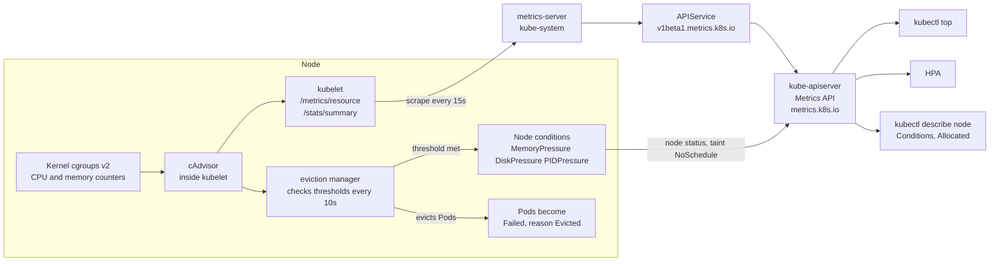

# T4.24 Monitor cluster and application resource usage

> Competency: "Monitor cluster and application resource usage" (CKA-2.3) | Domain/weight: CKA, Troubleshooting (30%) | Est. time: 1.5 h | Prerequisites: T3.23, T1.10

Shell setup (from [conventions](../00-conventions.md); put it at the top of every session):

```bash
alias k=kubectl
export do="--dry-run=client -o yaml"
export now="--force --grace-period=0"
source <(kubectl completion bash); complete -o default -F __start_kubectl k
```

Lab environment: **kind** (cluster `lab`, context `kind-lab`, 1 control plane + 2 workers) plus the add-on `env/kind-addons.sh metrics-server` (metrics-server v0.9.0 with `--kubelet-insecure-tls`). Namespaces: `lab-t424` and `lab-t424-b`. Files go in `~/lab/t424/`. On kind, "go to the node" means `docker exec lab-worker <command>`. On kubeadm VMs it means `ssh w1` and then `sudo -i`, like the exam ([E7, E8](https://docs.linuxfoundation.org/tc-docs/certification/tips-cka-and-ckad)).

Output labels used below:

- `REAL OUTPUT (kind v0.33.0, v1.37.0)` was captured on this machine on a 3-node kind cluster with the pinned `kindest/node:v1.37.0` image, kubectl v1.37.1 and metrics-server v0.9.0. That cluster was named `k-t424` (nodes `k-t424-control-plane`, `k-t424-worker`, `k-t424-worker2`) and used kind's default CNI (kindnet), not Calico. On your `lab` cluster the nodes are `lab-control-plane`, `lab-worker`, `lab-worker2`. Pod name suffixes, ages and numbers will differ on your machine.
- The Docker engine on the capture machine was OrbStack, with 12 CPUs and about 16 GiB of memory. Every kind node therefore reports `cpu: 12` and `memory: 16424480Ki`, and percentages in `top` look tiny. On a smaller machine they will be larger.
- `EXPECTED OUTPUT (not captured)` marks text that was written from documented behaviour and not run. Each such block is listed in section 11.

Prerequisites, not re-taught here: `kubectl top`, metrics-server and the Metrics API basics, [T3.23 Use built-in CLI tools to monitor applications](../part3-ckad/T3.23-use-built-in-cli-tools-to.md); cgroups and what a "memory limit" is in the kernel, [T1.10 Linux namespaces and cgroups v2](../part1-linux/T1.10-linux-namespaces-and-cgroups-v2.md); requests, limits and QoS, [T3.05 Define resource requirements](../part3-ckad/T3.05-define-resource-requirements.md). This lesson adds the cluster-admin side: nodes, allocation versus usage, pressure and eviction.

---

## 1. Why this matters

An administrator has to answer two questions fast: "which node or Pod is using the most CPU or memory right now?" and "is any node close to running out?". If you cannot answer, a node runs out of memory or disk, the kubelet (the node agent) starts killing Pods, and you find out from users. A task on this topic may be small and mechanical, for example "write the name of the node with the highest memory use to a file" (this is practice material for the skill, not a reported exam question). The whole exam is 15-20 tasks in 2 hours, about 6 minutes per task ([E2](https://docs.linuxfoundation.org/tc-docs/certification/tips-cka-and-ckad), [E3](https://docs.linuxfoundation.org/tc-docs/certification/faq-cka-ckad-cks)). Typical slips for tasks of this kind (advice, not exam reports) are a broken metrics-server, an answer file that contains the header word `NAME`, and confusing "reserved" (requests) with "used" (usage).

---

## 2. Concepts

### 2.1 Two views of the same node: reserved and used

A node has a fixed size (**Capacity**). Two different numbers describe how full it is, and they answer different questions.

| View | Question it answers | Where it comes from | Command | Changes when |
|---|---|---|---|---|
| **Requests-based** (allocation) | "How much has the scheduler promised to Pods?" | The `resources.requests` of every Pod assigned to the node, added up | `k describe node X`, section "Allocated resources" | A Pod is created, deleted or resized |
| **Usage-based** | "How much are the containers really using right now?" | The kernel's cgroup counters, read by the kubelet, collected by metrics-server | `k top nodes`, `k top pods` | Every few seconds, as load changes |

The scheduler places Pods using **requests only**. It never looks at usage. The kubelet's eviction logic (section 2.7) uses **usage**. So a node can be 90% allocated and almost idle, or 5% allocated and out of memory. Both are real, and you must know which number a task asks for. The worked example in section 5 shows a node that is 77% allocated and 4% used at the same time.

**Related but different: three ways a Pod dies for lack of resources.**

| Event | Who decides | Trigger | What you see | Restarts in place? |
|---|---|---|---|---|
| **Cannot be scheduled** | Scheduler | No node has enough unreserved requests | Pod `Pending`, event `FailedScheduling ... Insufficient cpu` | n/a |
| **OOMKilled** | Linux kernel (cgroup memory limit) | One container goes over its own memory limit | `OOMKilled`, exit code 137 | Yes, if `restartPolicy` allows |
| **Evicted** | kubelet (node-pressure eviction) | The whole node is short of memory, disk or PIDs | Pod phase `Failed`, reason `Evicted` | No. The Pod is not running again; a `Failed` record stays until it is deleted or garbage collected. A controller makes a new Pod, possibly on another node |

REAL OUTPUT (kind v0.33.0, v1.37.0), a container that wrote 100 MB into a memory-backed volume with a 50Mi limit. `RESTARTS 0` together with `OOMKilled` means the Pod had `restartPolicy: Never`. The manifest below is the equivalent (the original file was not kept, see section 11):

```yaml
apiVersion: v1
kind: Pod
metadata:
  name: oom
  namespace: lab-t424
spec:
  restartPolicy: Never          # default is Always; with Always the container is restarted and the Pod shows CrashLoopBackOff
  containers:
  - name: fill
    image: busybox:1.36
    command: ["sh", "-c", "dd if=/dev/zero of=/cache/fill bs=1M count=100; sleep 3600"]
    volumeMounts:
    - {name: cache, mountPath: /cache}
    resources:
      limits:
        memory: 50Mi            # 100 MB in a tmpfs volume is charged to this container, so the kernel kills it
  volumes:
  - name: cache
    emptyDir: {medium: Memory}
```

```text
$ k get pod oom -n lab-t424
NAME   READY   STATUS      RESTARTS   AGE
oom    0/1     OOMKilled   0          20s
```

That Pod was killed by the kernel for going over its own limit. It is not an eviction. With `restartPolicy: Never`, both an OOM kill and an eviction leave the Pod in phase `Failed`; with the default `Always`, an OOM-killed container is restarted instead (status `OOMKilled`, later `CrashLoopBackOff`). Delete it with `k delete pod oom -n lab-t424 $now` when you are done.

### 2.2 The metrics pipeline and metrics-server health (link T3.23)

[T3.23](../part3-ckad/T3.23-use-built-in-cli-tools-to.md) explains the pipeline and how to install metrics-server. Here is the short version you need for troubleshooting.

1. The kubelet reads CPU and memory counters from the kernel through cAdvisor (a library built into the kubelet).
2. The kubelet serves them on `/metrics/resource` (and on the older `/stats/summary`).
3. metrics-server (a Deployment in `kube-system`) scrapes every kubelet every 15 seconds (`--metric-resolution=15s` in its manifest) and keeps only the latest sample in memory.
4. metrics-server answers the **Metrics API**, group `metrics.k8s.io`. The API server forwards requests for that group to it because an **APIService** object named `v1beta1.metrics.k8s.io` points at the Service `kube-system/metrics-server`.
5. `kubectl top` and the Horizontal Pod Autoscaler (HPA) read the Metrics API.

So `kubectl top` works only if all of these are healthy: the kubelets, the metrics-server Pod (Ready), its Service and EndpointSlice, and the APIService (`Available=True`). That is also your troubleshooting order, from the API side down.

Health check, three commands:

```bash
k -n kube-system get deploy,po -l k8s-app=metrics-server   # Pod 1/1 Ready?
k get apiservice v1beta1.metrics.k8s.io                     # AVAILABLE True?
k top nodes                                                  # numbers, not an error?
```

REAL OUTPUT (kind v0.33.0, v1.37.0):

```text
$ k -n kube-system get deploy,po -l k8s-app=metrics-server
NAME                             READY   UP-TO-DATE   AVAILABLE   AGE
deployment.apps/metrics-server   1/1     1            1           114s

NAME                                  READY   STATUS    RESTARTS   AGE
pod/metrics-server-84c99cb944-9l7sq   1/1     Running   0          114s

$ k get apiservice v1beta1.metrics.k8s.io
NAME                     SERVICE                      AVAILABLE   AGE
v1beta1.metrics.k8s.io   kube-system/metrics-server   True        114s
```

**Which versions of `metrics.k8s.io` exist in v1.37?** Two true statements, both checked:

- The Kubernetes documentation page for the resource metrics pipeline says the **Metrics API is Stable since Kubernetes v1.37** and shows request URLs under `/apis/metrics.k8s.io/v1/...`.
- The metrics-server v0.9.0 you install in the labs still registers only `v1beta1`. On the kind cluster, `k api-versions | grep metrics` printed only `metrics.k8s.io/v1beta1`, and asking for `/v1/` returned `NotFound`.

REAL OUTPUT (kind v0.33.0, v1.37.0):

```text
$ k api-versions | grep metrics
metrics.k8s.io/v1beta1

$ k get --raw /apis/metrics.k8s.io
{"kind":"APIGroup","apiVersion":"v1","name":"metrics.k8s.io","versions":[{"groupVersion":"metrics.k8s.io/v1beta1","version":"v1beta1"}],"preferredVersion":{"groupVersion":"metrics.k8s.io/v1beta1","version":"v1beta1"}}

$ k get --raw /apis/metrics.k8s.io/v1/nodes
Error from server (NotFound): the server could not find the requested resource
```

The practical rule: do not hard-code a version. Use `kubectl top`, which finds the served version itself, and use `k api-versions | grep metrics` when you need to know. The group is stable in the documentation, but which version a given metrics-server serves is up to that metrics-server release.

The raw API is also useful when `top` formats something you want unformatted (CPU in nanocores, memory in Ki):

```text
$ k get --raw /apis/metrics.k8s.io/v1beta1/nodes/k-t424-worker
{"kind":"NodeMetrics","apiVersion":"metrics.k8s.io/v1beta1","metadata":{"name":"k-t424-worker", ...},"timestamp":"2026-10-28T05:18:11Z","window":"10.005s","usage":{"cpu":"507825687n","memory":"302568Ki"}}
```

`window` is the time span over which the CPU rate was measured. CPU is a rate (cores used on average over that window). Memory is the **working set** at that instant: memory in use that the kernel cannot easily take back. It is not the same as "used" in `free -m`.

### 2.3 `kubectl top nodes` and `kubectl top pods`

Flags are from `k top node -h` and `k top pod -h` on kubectl v1.37.1:

| Flag | Applies to | What it does | Default | Trap |
|---|---|---|---|---|
| `-A`, `--all-namespaces` | pod | All namespaces (adds a NAMESPACE column) | current namespace only | Without `-A` you only see the namespace in your context |
| `--sort-by=cpu` or `memory` | node, pod | Sort descending (biggest first) | unsorted | Only `cpu` and `memory` are accepted. The header line is not sorted, it stays first |
| `--containers` | pod | One row per container instead of per Pod | off | Adds a second column (container name), which shifts `awk` column numbers |
| `--no-headers` | node, pod | Remove the header line | off | Forget it and `head -1` returns the header word |
| `-l`, `--selector` | node, pod | Filter by label | none | Works for nodes too: `k top node -l kubernetes.io/hostname=w1` |
| `--field-selector` | pod | Filter by field | none | Limited set of fields |
| `--sum` | pod | Add a total line at the end | off | The total line is text, not data: do not pipe it into `awk` sums |
| `--show-capacity` | node | Percentages relative to Capacity, not Allocatable | Allocatable | On kind both are equal, so output looks identical |
| `--show-swap` | node, pod | Add a SWAP column | off | Shows `0Mi` unless swap is enabled for the node |
| `--use-protocol-buffers` | node, pod | Fetch the data in protobuf format | `true` | Rarely needed. `=false` falls back to JSON |

REAL OUTPUT (kind v0.33.0, v1.37.0):

```text
$ k top nodes
NAME                   CPU(cores)   CPU(%)   MEMORY(bytes)   MEMORY(%)
k-t424-control-plane   37m          0%       609Mi           3%
k-t424-worker          508m         4%       295Mi           1%
k-t424-worker2         308m         2%       164Mi           1%

$ k top pods -A --sort-by=cpu | head -5
NAMESPACE            NAME                                           CPU(cores)   MEMORY(bytes)
lab-t424-b           batch-5f56c5d49b-6pfbj                         301m         0Mi
lab-t424-b           batch-5f56c5d49b-59d7t                         300m         0Mi
lab-t424             cpu-hog-589d7b756f-thsvn                       200m         0Mi
kube-system          kube-apiserver-k-t424-control-plane            10m          257Mi

$ k top pods -A --sort-by=memory | head -5
NAMESPACE            NAME                                           CPU(cores)   MEMORY(bytes)
kube-system          kube-apiserver-k-t424-control-plane            10m          257Mi
lab-t424             mem-hog-7764df6946-ckfrm                       0m           150Mi
kube-system          kube-controller-manager-k-t424-control-plane   4m           72Mi
kube-system          etcd-k-t424-control-plane                      6m           40Mi

$ k top pod -n lab-t424 --containers
POD                        NAME   CPU(cores)   MEMORY(bytes)
cpu-hog-589d7b756f-thsvn   burn   200m         0Mi
mem-hog-7764df6946-ckfrm   fill   0m           150Mi

$ k top pod -n lab-t424 --sum
NAME                       CPU(cores)   MEMORY(bytes)
cpu-hog-589d7b756f-thsvn   200m         0Mi
mem-hog-7764df6946-ckfrm   0m           150Mi
                           ________     ________
                           200m         150Mi
```

How to read it:

- `m` means millicores: `200m` is 0.2 of one CPU core. `508m` on a 12-core node is 4%.
- `CPU(%)` and `MEMORY(%)` are relative to the node's **Allocatable** (508m of 12000m = 4%). Use `--show-capacity` to divide by Capacity.
- Memory is in `Mi`. A tiny value prints as `0Mi`, and an idle container prints `0m`. That is not an error.
- The `head -5` in the entry's command keeps the header line, so you see four data rows.
- A Pod younger than the scrape interval has no data yet. Asking for it by name gave this on v1.37:

```text
$ k top pod fresh -n lab-t424
Error from server (NotFound): podmetrics.metrics.k8s.io "lab-t424/fresh" not found
```

Wait 30-60 seconds and run it again. The same Pod then printed `fresh   0m   0Mi`.

### 2.4 `kubectl describe node`: Capacity, Allocatable, Allocated resources, Conditions

`k describe node NAME` has four sections you must be able to read. REAL OUTPUT (kind v0.33.0, v1.37.0), trimmed with `...`:

```text
$ k describe node k-t424-worker
Name:               k-t424-worker
...
Taints:             <none>
Unschedulable:      false
...
Conditions:
  Type             Status  LastHeartbeatTime                 LastTransitionTime                Reason                       Message
  ----             ------  -----------------                 ------------------                ------                       -------
  MemoryPressure   False   Wed, 28 Oct 2026 13:17:23 +0800   Wed, 28 Oct 2026 13:16:21 +0800   KubeletHasSufficientMemory   kubelet has sufficient memory available
  DiskPressure     False   Wed, 28 Oct 2026 13:17:23 +0800   Wed, 28 Oct 2026 13:16:21 +0800   KubeletHasNoDiskPressure     kubelet has no disk pressure
  PIDPressure      False   Wed, 28 Oct 2026 13:17:23 +0800   Wed, 28 Oct 2026 13:16:21 +0800   KubeletHasSufficientPID      kubelet has sufficient PID available
  Ready            True    Wed, 28 Oct 2026 13:17:23 +0800   Wed, 28 Oct 2026 13:16:35 +0800   KubeletReady                 kubelet is posting ready status
...
Capacity:
  cpu:                12
  ephemeral-storage:  138110042112
  memory:             16424480Ki
  pods:               110
Allocatable:
  cpu:                12
  ephemeral-storage:  138110042112
  memory:             16424480Ki
  pods:               110
...
Non-terminated Pods:          (5 in total)
  Namespace                   Name                        CPU Requests  CPU Limits  Memory Requests  Memory Limits  Age
  ---------                   ----                        ------------  ----------  ---------------  -------------  ---
  kube-system                 kindnet-vnqtp               100m (0%)     0 (0%)      50Mi (0%)        0 (0%)         2m9s
  kube-system                 kube-proxy-6z55s            0 (0%)        0 (0%)      0 (0%)           0 (0%)         2m9s
  lab-t424-b                  batch-5f56c5d49b-6pfbj      100m (0%)     300m (2%)   16Mi (0%)        64Mi (0%)      80s
  lab-t424                    cpu-hog-589d7b756f-thsvn    100m (0%)     200m (1%)   16Mi (0%)        64Mi (0%)      80s
  lab-t424                    mem-hog-7764df6946-ckfrm    10m (0%)      0 (0%)      64Mi (0%)        400Mi (2%)     80s
Allocated resources:
  (Total limits may be over 100 percent, i.e., overcommitted.)
  Resource           Requests    Limits
  --------           --------    ------
  cpu                310m (2%)   500m (4%)
  memory             146Mi (0%)  528Mi (3%)
  ephemeral-storage  0 (0%)      0 (0%)
Events:
  ...
```

| Section | Meaning | Use it to |
|---|---|---|
| **Capacity** | What the machine has. | Know the hardware size. |
| **Allocatable** | What Pods may use: Capacity minus what the node keeps for itself. The scheduler fits Pods against this. | Know the real budget. |
| **Non-terminated Pods** | Every Pod on this node with its requests and limits. | Find which Pod holds the reservation. |
| **Allocated resources** | Sum of requests and sum of limits, with the percentage of Allocatable. | Judge how full the node is **for the scheduler**. |
| **Conditions** | `MemoryPressure`, `DiskPressure`, `PIDPressure` (True means the kubelet crossed an eviction threshold) and `Ready`. | Judge how full the node is **in reality**. |

Notes:

- **Allocatable = Capacity - kube-reserved - system-reserved - the hard eviction threshold.** `kube-reserved` and `system-reserved` are kubelet settings that hold back room for Kubernetes daemons and the OS. In the kubelet config file they are the maps `kubeReserved` and `systemReserved`, for example `kubeReserved: {cpu: 100m, memory: 200Mi}` (default: none; large values shrink Allocatable and leave less room for Pods). On kind none are set, so Capacity and Allocatable are equal. On a kubeadm VM, expect Allocatable memory to be a little lower than Capacity (see section 11).
- **Limits can exceed 100%.** The line "Total limits may be over 100 percent, i.e., overcommitted" is normal. Only **requests** are bounded by Allocatable, because the scheduler refuses to place a Pod whose requests do not fit.
- To print just this block, use the `sed` range from the entry. REAL OUTPUT (kind v0.33.0, v1.37.0):

```text
$ k describe node k-t424-worker | sed -n '/Allocated resources/,/Events/p'
Allocated resources:
  (Total limits may be over 100 percent, i.e., overcommitted.)
  Resource           Requests    Limits
  --------           --------    ------
  cpu                310m (2%)   500m (4%)
  memory             146Mi (0%)  528Mi (3%)
  ephemeral-storage  0 (0%)      0 (0%)
Events:
```

The same trick for conditions: `k describe node w1 | sed -n '/^Conditions/,/^Addresses/p'`. For a scriptable check, use JSONPath. REAL OUTPUT (kind v0.33.0, v1.37.0):

```text
$ k get node k-t424-worker -o jsonpath='{range .status.conditions[*]}{.type}={.status}{"\n"}{end}'
MemoryPressure=False
DiskPressure=False
PIDPressure=False
Ready=True
```

### 2.5 Requests-based versus usage-based: reading the two together

Compare the two views for the same node and decide what is wrong.

| `describe node` Allocated (requests) | `top node` (usage) | Meaning | Action |
|---|---|---|---|
| High (90%) | Low (5%) | Pods **reserve** a lot but use little. New Pods will be `Pending` although the node is idle. | Lower the requests of over-sized Pods (right-size), or add nodes. Do not add memory to the node. |
| Low (10%) | High (95%) | Pods **use** far more than they asked for (no requests, or requests too small). The node can hit memory pressure and evict Pods. | Set realistic requests and limits so the scheduler spreads load and eviction picks the right victims. |
| High | High | The node is really full. | Add capacity or move workloads. |
| Low | Low | Healthy and spare room. | Nothing. |

A common source of confusion is a task that says "which node is **most loaded**" without saying how (advice, not an exam report). Read the wording: "allocated", "requested" or "reserved" means `describe node`. "Using", "consumption" or "highest usage" means `top`. If the wording is truly ambiguous, answer the one the commands in the task text point to, and `top` is the safer default for "usage". Section 5 builds this exact situation and shows both numbers.

### 2.6 Node-level checks: free, df, top, crictl stats, systemd-cgtop

`kubectl top` stops at the container. When you suspect the node itself (a full disk, a runaway system process, a Pod you cannot see in the API), `ssh` to the node, run `sudo -i`, and use Linux tools. Whether `crictl` and `systemd-cgtop` are installed on the exam nodes is UNVERIFIED ([E9](https://docs.linuxfoundation.org/tc-docs/certification/tips-cka-and-ckad) lists only kubectl, yq, curl, wget and man; no source covers the nodes). `free`, `df` and `top` are standard Linux tools and are very likely there, but that is also not confirmed.

| Tool | Answers | Typical command | Caveat |
|---|---|---|---|
| `free -m` | How much RAM is used, free and available on the machine | `free -m` | Look at the `available` column, not `free`. The kubelet does **not** use `free` for its eviction decision. It reads cgroups ([docs](https://kubernetes.io/docs/concepts/scheduling-eviction/node-pressure-eviction/)) |
| `df -h` | Which filesystem is filling | `df -h /var/lib/kubelet /var/lib/containerd` | These two paths are where kubelet data and container images and layers live. A full `/var` gives `DiskPressure` |
| `top` (or `top -b -n1`) | Which Linux process burns CPU or RAM | `top -b -n1 \| head -15` | Shows processes, not Pods. A container's process appears as a plain `sh` or its binary |
| `crictl stats` | CPU and memory per **container**, straight from the container runtime, no API server needed | `crictl stats` | Needs `sudo`. Works even when the API server or metrics-server is down |
| `systemd-cgtop` | CPU and memory per **cgroup** (systemd unit and the `kubepods` slice) | `systemd-cgtop -b -n1 --depth=2` | Shows `kubelet.service`, `containerd.service` and all Pods together under `kubelet-kubepods.slice`. Needs cgroup v2 ([T1.10](../part1-linux/T1.10-linux-namespaces-and-cgroups-v2.md)) |

REAL OUTPUT (kind v0.33.0, v1.37.0), commands run with `docker exec k-t424-worker ...` (on kind the node is a container, so `free` and `df` show the whole Docker host VM, not a separate machine; on a real VM they show that VM). The `df` list is trimmed to the first lines:

```text
$ free -m
               total        used        free      shared  buff/cache   available
Mem:           16039        4375        7835         244        4324       11663
Swap:              0           0           0

$ df -h
Filesystem      Size  Used Avail Use% Mounted on
overlay         129G   44G   86G  34% /
tmpfs            64M     0   64M   0% /dev
shm             7.9G     0  7.9G   0% /dev/shm
tmpfs           7.9G  8.9M  7.9G   1% /run
...

$ top -b -n1 | head -15
top - 05:18:31 up 2 days,  1:53,  0 users,  load average: 3.93, 3.91, 4.19
Tasks:  20 total,   3 running,  17 sleeping,   0 stopped,   0 zombie
%Cpu(s): 10.7 us,  0.0 sy,  0.0 ni, 86.4 id,  0.0 wa,  0.0 hi,  2.9 si,  0.0 st
MiB Mem :  16039.5 total,   7843.1 free,   4367.3 used,   4325.1 buff/cache
MiB Swap:      0.0 total,      0.0 free,      0.0 used.  11672.3 avail Mem

    PID USER      PR  NI    VIRT    RES    SHR S  %CPU  %MEM     TIME+ COMMAND
   1191 root      20   0    4116    760    616 R  30.0   0.0   0:21.58 sh
   1132 root      20   0    4116   1032    888 R  20.0   0.0   0:15.02 sh
      1 root      20   0   25400  13300   9144 S   0.0   0.1   0:00.28 systemd
...
    231 root      20   0 2715472  66768  30520 S   0.0   0.4   0:01.08 kubelet

$ crictl stats
CONTAINER           NAME                CPU %               MEM                 DISK                INODES              SWAP
2a0cbc7b6eff8       kindnet-cni         0.00                17.75MB             28.67kB             26                  0B
364d2bb6f2756       burn                29.98               147.5kB             4.096kB             13                  0B
400da9450295d       fill                0.00                157.4MB             4.096kB             14                  0B
cd8964239f56d       kube-proxy          0.00                21.64MB             28.67kB             25                  0B
edf1192562af0       burn                19.92               147.5kB             4.096kB             13                  0B

$ systemd-cgtop -b -n1 --depth=2
/                                         128      -   414.4M        -        -
init.scope                                  2      -      39M        -        -
kubelet.slice                              52      -   291.6M        -        -
kubelet.slice/kubelet-kubepods.slice       33      -   248.2M        -        -
kubelet.slice/kubelet.service              19      -    43.4M        -        -
system.slice                               74      -    79.3M        -        -
system.slice/containerd.service            73      -    70.2M        -        -
system.slice/systemd-journald.service       1      -     9.1M        -        -
```

Reading it:

- The two busy `sh` processes at the top of `top` are the two `burn` containers (`while true; do :; done`). `crictl stats` names them `burn` with CPU 29.98 and 19.92 (percent of one core). They match the 300m and 200m limits you saw in `kubectl top`. The three tools tell one story from different angles.
- `crictl stats` shows `fill` with 157.4MB. That is the memory-backed volume the Pod wrote, which counts as the container's memory.
- `systemd-cgtop` shows all Pods together as one line, `kubelet-kubepods.slice`, then `kubelet.service` and `containerd.service` as separate lines. If a system daemon grows, this is the view that shows it. The "memory" column is the group's kernel memory counter (`memory.current`). On the capture node `cat /sys/fs/cgroup/kubelet.slice/kubelet-kubepods.slice/memory.current` printed `124538880` (about 119 MiB at that moment).
- `crictl stats` prints a screen-clear escape sequence when run in a terminal. In a file it is harmless text. Add `-o json` for machine-readable output.

### 2.7 Eviction: thresholds, node conditions and evicted Pods

**What problem eviction solves.** Memory is not compressible. When a node runs out, the Linux kernel's out-of-memory (OOM) killer picks a process, possibly the kubelet or a system daemon. To avoid that, the kubelet's **eviction manager** watches the node and, when a resource drops below a **threshold**, it kills Pods itself, in a planned order, to protect the node. Without eviction one greedy Pod can take the whole node down.

**Signals** (what the kubelet measures), from the [node-pressure eviction page](https://kubernetes.io/docs/concepts/scheduling-eviction/node-pressure-eviction/):

| Signal | Meaning | Node condition it sets |
|---|---|---|
| `memory.available` | Capacity minus working set (computed from cgroups, not from `free`) | `MemoryPressure` |
| `nodefs.available`, `nodefs.inodesFree` | Free space and free inodes on the node's main filesystem (holds `/var/lib/kubelet`, logs, `emptyDir`) | `DiskPressure` |
| `imagefs.available`, `imagefs.inodesFree` | Free space and inodes where the runtime stores images | `DiskPressure` |
| `containerfs.available`, `containerfs.inodesFree` | Same, for container writable layers if on their own filesystem | `DiskPressure` |
| `pid.available` | Free process IDs | `PIDPressure` |

**Hard versus soft thresholds.** Thresholds have the form `signal<quantity`, for example `memory.available<100Mi`. In the kubelet **config file** you write the quantity without the `<`.

| Kind | Config field | Needs a grace period? | What the kubelet does when met | Example (config file) |
|---|---|---|---|---|
| **Hard** | `evictionHard` | No | Marks the condition and kills Pods **immediately**, with no graceful shutdown | `memory.available: "300Mi"` |
| **Soft** | `evictionSoft` + `evictionSoftGracePeriod` | Yes, the kubelet refuses to start without one | Marks the condition at once, but evicts only if the threshold stays met for the whole grace period. Pods get a graceful shutdown capped by `evictionMaxPodGracePeriod` | `evictionSoft: {memory.available: "500Mi"}` and `evictionSoftGracePeriod: {memory.available: "1m30s"}` |

Other eviction fields in the kubelet config:

| Field | What it does | Default | Risky value |
|---|---|---|---|
| `evictionMinimumReclaim` | Once evicting, free at least this much beyond the threshold (stops repeated small evictions) | none | Huge values evict more Pods than needed |
| `evictionPressureTransitionPeriod` | How long the kubelet waits before it clears a pressure condition (prevents flapping) | `5m` | `0s` is converted to the default `5m`. A very short value lets the condition flap |
| `evictionMaxPodGracePeriod` | Maximum shutdown time (seconds) for soft evictions | `0` | Not set with soft thresholds: Pods are killed immediately |
| `mergeDefaultEvictionSettings` | If `true`, thresholds you do **not** list keep their defaults | `false` | See the trap below |

**Default hard thresholds (Linux), v1.37.** I checked both the v1.37.0 source (`DefaultEvictionHard` in `pkg/kubelet/eviction/defaults_linux.go`) and the docs page:

| Signal | Default |
|---|---|
| `memory.available` | `100Mi` |
| `nodefs.available` | `10%` |
| `nodefs.inodesFree` | `5%` |
| `imagefs.available` | `15%` |
| `imagefs.inodesFree` | `5%` |

**The trap: one change turns the rest off.** The defaults apply only if you set **none** of the `evictionHard` entries. If you set any one (for example only `memory.available`), the others are set to **0**, which means "never trigger", unless you also set `mergeDefaultEvictionSettings: true`. The kubelet's field documentation says it directly: "If false, and if any signal is specified in this configuration then other signals that are not specified in this configuration will be set to 0."

**kind is the proof.** kind writes three entries, all `0%`, and no `memory.available`. REAL OUTPUT (kind v0.33.0, v1.37.0), the live configuration of the kubelet, read through the API server (`configz`):

```text
$ k get --raw /api/v1/nodes/k-t424-worker/proxy/configz | tr ',' '\n' | grep -i 'evict\|mergeDefault'
"evictionHard":{"imagefs.available":"0%"
"evictionPressureTransitionPeriod":"5m0s"
"mergeDefaultEvictionSettings":false

$ docker exec k-t424-worker grep -n -A4 '^evictionHard' /var/lib/kubelet/config.yaml
23:evictionHard:
24-  imagefs.available: 0%
25-  nodefs.available: 0%
26-  nodefs.inodesFree: 0%
27-evictionPressureTransitionPeriod: 0s
```

So on a stock kind node, `memory.available` has **no threshold at all** and `mergeDefaultEvictionSettings` is `false`. Memory pressure never triggers by itself on kind. A kubeadm VM is different: its kubelet config file has no `evictionHard` key, so the five defaults above apply (section 11 lists this as not captured). The medium lab changes the threshold on purpose so you can watch eviction safely on kind.

The `tr` splits the one-line JSON at every comma, so the `evictionHard` map is cut after its first entry. Parsing the same JSON as a whole (done with a small Python script on the capture machine) gave `{'imagefs.available': '0%', 'nodefs.available': '0%', 'nodefs.inodesFree': '0%'}` and `mergeDefaultEvictionSettings` = `False`. The `config.yaml` grep above shows the full map. The transition period is `0s` in the file and `5m0s` in the running kubelet, because `0s` is converted to the default.

**Node conditions and taints.** When a threshold is met the kubelet sets the matching condition (`MemoryPressure`, `DiskPressure`, `PIDPressure`) to `True`. The control plane then adds a **taint** with effect `NoSchedule` so the scheduler stops putting new Pods there. REAL OUTPUT (kind v0.33.0, v1.37.0), while the lab pressure was active:

```text
MemoryPressure=True KubeletHasInsufficientMemory
[{"effect":"NoSchedule","key":"node.kubernetes.io/memory-pressure","timeAdded":"2026-10-28T05:20:04Z"}]
```

The kubelet updates conditions every `--node-status-update-frequency` (default 10 s), and it checks eviction thresholds every housekeeping interval (default 10 s). The condition stays `True` for the transition period after the pressure ends, then clears with its taint.

**Which Pods are evicted first.** The kubelet ranks Pods by (1) whether usage exceeds requests, (2) Pod priority, (3) how far usage is above requests. Pods that use more than they requested go first. Pods that stay within requests go last. The docs state that the kubelet does **not** use the QoS class to order eviction. QoS only gives a rough guide, since a BestEffort Pod has request 0 and is therefore always "above request". The kubelet also does not honour PodDisruptionBudgets for node-pressure eviction (budgets apply to API-initiated eviction such as `kubectl drain`, see [T4.12](../part4-cka/T4.12-primitives-for-robust-self-healing-application.md)).

**What an evicted Pod looks like.** The Pod is not deleted. It stays in the API with phase `Failed`, `reason: Evicted` and a message that says which resource and which container. It keeps showing in `k get pods` until someone deletes it, or the Pod garbage collector (a loop in kube-controller-manager) removes old terminated Pods after their count passes a limit. The flag that sets the limit, `--terminated-pod-gc-threshold`, and its default are from memory and were not checked (section 11), so do not count on automatic clean-up. If a Deployment owns it, the ReplicaSet creates a **new** Pod, so evicted records pile up. REAL OUTPUT (kind v0.33.0, v1.37.0):

```text
$ k describe pod evict-me -n lab-t424 | sed -n '1,13p'
Name:             evict-me
Namespace:        lab-t424
Priority:         0
Service Account:  default
Node:             k-t424-worker/192.168.147.2
Start Time:       Wed, 28 Oct 2026 13:19:53 +0800
Labels:           <none>
Annotations:      <none>
Status:           Failed
Reason:           Evicted
Message:          The node was low on resource: memory. Threshold quantity: 15045Mi, available: 15369992Ki. Container fill was using 1018540Ki, request is 0, has larger consumption of memory.
IP:               10.244.2.7

$ k get pods -n lab-t424
NAME                       READY   STATUS                   RESTARTS   AGE
evict-me                   0/1     Error                    0          99s
mem-hog-7764df6946-ckfrm   0/1     ContainerStatusUnknown   1          4m22s
mem-hog-7764df6946-mpfxm   1/1     Running                  0          87s
survivor                   1/1     Running                  0          2m1s
```

**Do not trust the STATUS column here.** On kubectl v1.37.1 an evicted Pod showed `Error` or `ContainerStatusUnknown` in `k get pods`, not `Evicted`. Use `describe` (the `Reason` line), the events, or the field selector `status.phase=Failed` (below) to find evicted Pods.

```text
$ k get events -A --field-selector reason=Evicted
NAMESPACE   LAST SEEN   TYPE      REASON    OBJECT                         MESSAGE
lab-t424    72s         Warning   Evicted   pod/evict-me                   The node was low on resource: memory. Threshold quantity: 15045Mi, available: 15369992Ki. Container fill was using 1018540Ki, request is 0, has larger consumption of memory.
lab-t424    75s         Warning   Evicted   pod/mem-hog-7764df6946-ckfrm   The node was low on resource: memory. Threshold quantity: 15045Mi, available: 15216228Ki. Container fill was using 153752Ki, request is 64Mi, has larger consumption of memory.

$ k get pods -A --field-selector=status.phase=Failed
NAMESPACE   NAME                       READY   STATUS                   RESTARTS   AGE
lab-t424    evict-me                   0/1     Error                    0          85s
lab-t424    mem-hog-7764df6946-ckfrm   0/1     ContainerStatusUnknown   1          4m8s
```

The same capture shows a second Pod, `mem-hog`, evicted a few seconds earlier. It had a request of 64Mi and was using about 150Mi, so it was also "above request". Its Deployment immediately made a replacement, which the scheduler placed on the other worker because the first worker carried the `memory-pressure` taint. Do not try to predict the exact victim order from a short test. The kubelet ranks Pods from its latest stats.

**The DiskPressure path (not captured on kind).** Memory is the only pressure type that was reproduced for this lesson. Disk is the other common cause of evicted Pods, and it is diagnosed differently because the cause is a file, not a process. The commands below are standard Linux and `crictl`; the message texts and the order of kubelet actions come from the node-pressure eviction page and were not run here (section 11 item 7).

EXPECTED OUTPUT (not captured), an eviction caused by node disk. The text after `...` is a placeholder for values I did not see:

```text
Status:   Failed
Reason:   Evicted
Message:  The node was low on resource: ephemeral-storage. Threshold quantity: ..., available: .... Container NAME was using ..., request is 0, has larger consumption of ephemeral-storage.
```

A Pod that goes over its **own** `ephemeral-storage` limit is evicted with a different text (`Pod ephemeral local storage usage exceeds the total limit of containers ...`, also not captured). That is the storage twin of OOMKilled: it is the Pod's own limit, not node pressure.

Diagnostic order:

1. `k describe node NODE`. Look for `DiskPressure   True   ...   KubeletHasDiskPressure` in Conditions and the taint `node.kubernetes.io/disk-pressure:NoSchedule` in `Taints`. `False` means the cause is not disk (go back to memory).
2. `k get events -A --field-selector reason=Evicted`. The message names the resource (`ephemeral-storage`) and the container that used most.
3. On the node (`ssh NODE`, `sudo -i`; on kind `docker exec NODE ...`): `df -h /var/lib/kubelet /var/lib/containerd` shows which filesystem is full. `df -i` of the same paths shows inode exhaustion (the `inodesFree` signals). If both paths are on `/`, one number covers all.
4. Find what is big: `du -xsh /var/lib/kubelet/pods/* 2>/dev/null | sort -h | tail -5` (Pod volumes, including `emptyDir`), `du -xsh /var/log/pods/* | sort -h | tail -5` (container logs), `du -xsh /var/lib/containerd` (images and writable layers).
5. Map a directory to a Pod. The directory name under `/var/lib/kubelet/pods/` is the Pod UID: `k get pod -A -o custom-columns=NS:.metadata.namespace,NAME:.metadata.name,UID:.metadata.uid | grep UID_FROM_DIRECTORY`.
6. Free space safely: `crictl images` then `crictl rmi --prune` (removes images no container uses), `journalctl --disk-usage` then `journalctl --vacuum-size=200M`, and delete the heavy Pod's data by deleting the Pod (its `emptyDir` goes with it). Do not delete files under `/var/lib/containerd` or `/var/lib/kubelet` by hand.
7. Fix the cause so it does not return: give the Pod an `ephemeral-storage` request and limit, put a `sizeLimit` on every `emptyDir`, and let the kubelet rotate logs (config fields `containerLogMaxSize` and `containerLogMaxFiles`, defaults `10Mi` and `5`).

```yaml
    resources:
      requests:
        ephemeral-storage: 1Gi   # scheduler reserves this much node disk; 0 (unset) makes the Pod the first eviction candidate
      limits:
        ephemeral-storage: 2Gi   # the Pod is evicted if it writes more than this (logs, writable layer, emptyDir)
```

Before it evicts anything for `DiskPressure`, the kubelet first tries to free space itself: it deletes dead containers and unused images (image garbage collection starts at `imageGCHighThresholdPercent`, default 85 percent of the image filesystem). If that frees enough, no Pod is evicted.

**Under the hood: how `memory.available` is computed.** The kubelet takes the node's memory capacity and subtracts the **working set** of the root cgroup, then (as documented) it treats `inactive_file` pages as reclaimable and does not count them. I checked the formula on the capture node. Capacity was `16424480Ki`, which is 16818667520 bytes. One call to the summary API returned `workingSetBytes` 313393152 and `availableBytes` 16505274368 for the node, and 16818667520 - 313393152 = 16505274368 exactly. That is why `free -m` and the kubelet disagree. Since v1.37 (beta, on by default) the kubelet also subtracts huge-page memory on nodes that use it (feature gate `HugepageAwareEviction`, per the same docs page).

**Under the hood: what happens before Pods are killed.** For `DiskPressure` the kubelet first tries to free node-level space: it removes dead Pods and containers, then unused images. Only if that is not enough does it evict Pods. For memory there is nothing to reclaim at node level, so it goes straight to evicting Pods. If memory grows faster than the kubelet's polling, the kernel's OOM killer may act first. The docs describe `--kernel-memcg-notification` (config field `kernelMemcgNotification`, default `false`: the kubelet then asks the kernel to notify it when a memory threshold is crossed instead of waiting for the next poll) and `--system-reserved` / `--kube-reserved` (config fields `systemReserved` and `kubeReserved`, section 2.4) as ways to reduce that risk. Unlike eviction, an OOM-killed container is restarted by the kubelet according to `restartPolicy`.

### 2.8 The kubelet's own endpoints: `/metrics/resource` and the summary API

The kubelet is the source of all the numbers. You can read them directly, which is what metrics-server does. The API server proxies to each node, so you need no extra access.

| Endpoint | Format | Contents | Used by |
|---|---|---|---|
| `/metrics/resource` | Prometheus text | `container_cpu_usage_seconds_total`, `container_memory_working_set_bytes`, `pod_memory_working_set_bytes`, `node_cpu_usage_seconds_total`, `node_memory_working_set_bytes`, `resource_scrape_error` | metrics-server v0.6.0 and later ([docs](https://kubernetes.io/docs/tasks/debug/debug-cluster/resource-metrics-pipeline/)) |
| `/stats/summary` (Summary API) | JSON | Node, system containers and per-Pod CPU, memory, filesystem, network, with `availableBytes` for memory | Older metrics-server versions, and your own checks. The docs index lists the API as `v1alpha1` |

```bash
k get --raw /api/v1/nodes/lab-worker/proxy/metrics/resource | head -30
k get --raw /api/v1/nodes/lab-worker/proxy/stats/summary | head -60
```

REAL OUTPUT (kind v0.33.0, v1.37.0), `/metrics/resource` trimmed:

```text
# HELP container_cpu_usage_seconds_total [STABLE] Cumulative cpu time consumed by the container in core-seconds
# TYPE container_cpu_usage_seconds_total counter
container_cpu_usage_seconds_total{container="burn",namespace="lab-t424",pod="cpu-hog-589d7b756f-thsvn"} 12.791962 1793164699891
...
# HELP container_memory_working_set_bytes [STABLE] Current working set of the container in bytes
# TYPE container_memory_working_set_bytes gauge
container_memory_working_set_bytes{container="fill",namespace="lab-t424",pod="mem-hog-7764df6946-ckfrm"} 1.57442048e+08 1793164704156
...
node_memory_working_set_bytes 3.13393152e+08 1793164732005
resource_scrape_error 0
```

`container_cpu_usage_seconds_total` is a cumulative counter, so a rate needs two samples. That is the only reason `top` has a short delay. This is the same reading that `kubectl top` shows as a formatted number. `resource_scrape_error 0` means the kubelet could read its stats. Use these endpoints when metrics-server is broken and you still need a number for a node, or to read `node_memory_working_set_bytes` for the eviction maths in the medium lab. Awareness only: you do not need to memorise the JSON of the summary API.

### 2.9 Monitoring stacks (Prometheus): awareness

`kubectl top` shows only **now**, only CPU and memory, and only what metrics-server holds in RAM. It has no history and no alerts. Production clusters add a monitoring stack. The usual one is **Prometheus** (stores time series and runs alert rules) with:

- **cAdvisor** metrics from the kubelet (`container_*` series, far more detailed than `/metrics/resource`),
- **node_exporter** for machine-level numbers (disk, network, load),
- **kube-state-metrics** for object state (for example, requested resources per Pod and restarts),
- **Alertmanager** for notifications and **Grafana** for dashboards.

These are the tools that tell you "this node has been above 90% memory every night for a week". They are not part of the kubectl-only toolkit. The exam hosts list `kubectl`, `yq`, `curl`, `wget` and `man` ([E9](https://docs.linuxfoundation.org/tc-docs/certification/tips-cka-and-ckad)). Whether the exam sets any task that needs a monitoring stack is UNVERIFIED; if a task names a tool, use the task text and the allowed docs. For this topic you need to recognise the names and know what they add. The exam-allowed documentation does not cover installing them (see section 11).

### 2.10 Writing answers to files and per-namespace aggregation with awk

Tasks of this kind often ask you to write an answer to a file (for example "write X to /path/file"; this is advice on technique, not an exam report). The rules that avoid lost points:

1. **Write only what was asked.** If it says "the name", the file contains only the name and one newline. Use `--no-headers` so the header word is not the first line.
2. **Use `>` to write, not `>>`**, so a retry does not leave two lines.
3. **Take a column with `awk '{print $N}'`.** With `-A` the Pod name is column 2. Without `-A` it is column 1. With `--containers` and `-A` there are five columns.
4. **Read the file back** with `cat` before you move on.

The entry's one-liner, which writes the node using the most memory:

```bash
k top nodes --sort-by=memory --no-headers | head -1 | awk '{print $1}' > /opt/node.txt
```

Two environment notes. `awk` is a standard Linux tool but it is not in the exam tool list ([E9](https://docs.linuxfoundation.org/tc-docs/certification/tips-cka-and-ckad)), so its presence on the exam host is UNVERIFIED. If you want to avoid it, `tr -s ' ' | cut -d' ' -f1` also takes column 1 of the space-padded `top` output. And if the shell answers `Permission denied` on a path under `/opt`, write with `... | sudo tee /opt/node.txt` instead of `>` (whether the task user can write there is also UNVERIFIED; `tee` echoes the name to the screen, which is harmless).

The same shape for a Pod: `k top pod -n lab-t424 --sort-by=cpu --no-headers | head -1 | awk '{print $1}' > ~/lab/t424/pod.txt`.

**Per-namespace aggregation with `awk`.** `kubectl top` has no "group by namespace". `awk` can add the columns. With `-A --no-headers` the columns are: 1 namespace, 2 Pod, 3 CPU, 4 memory. `awk` converts a string such as `200m` or `150Mi` to a number by reading the leading digits, so `+=` works on them. REAL OUTPUT (kind v0.33.0, v1.37.0):

```text
$ k top pods -A --no-headers | awk '{cpu[$1]+=$3; mem[$1]+=$4} END{for(n in cpu) print n, cpu[n]"m", mem[n]"Mi"}' | sort -k2 -n -r
lab-t424-b 601m 0Mi
lab-t424 200m 150Mi
kube-system 34m 546Mi
local-path-storage 1m 10Mi

$ k top pods -A --no-headers | awk '/^lab-t424/ {cpu[$1]+=$3} END{for(n in cpu) print n, cpu[n]"m"}' | sort -k2 -n -r | head -1
lab-t424-b 601m
```

How the `awk` works: `cpu[$1]+=$3` keeps one running total per namespace (an associative array indexed by column 1). `END{...}` runs after the last line and prints each total. `sort -k2 -n -r` sorts by column 2 as a number, biggest first. Add `/^lab-t424/` to restrict to namespaces whose names start with that text.

Two limits to know: this adds CPU as millicores only if every value ends in `m`, and it adds memory as `Mi` only if every value is in `Mi`. Look at a few raw rows (`head`) to confirm the units before you trust a sum. For a quick answer this is fine. If units are mixed, the sum is wrong.

---

## 3. How it works (diagram)



Walkthrough:

1. The Linux kernel counts CPU time and memory per cgroup. The kubelet's built-in cAdvisor reads those counters and exposes them on `/metrics/resource` and `/stats/summary`.
2. metrics-server scrapes every kubelet every 15 seconds and serves the newest sample through the APIService `v1beta1.metrics.k8s.io`. The API server forwards Metrics API requests to it. `kubectl top` and the HPA are its two consumers.
3. If metrics-server is down, only the left-to-right path from "scrape" onward breaks. The kubelet, the eviction manager and the Pods keep running, which is why `top` can fail while the node is healthy.
4. The eviction manager is a separate loop inside the same kubelet. It compares the same counters with the thresholds. When one is crossed it sets a node condition (visible in `describe node`) and the control plane adds a `NoSchedule` taint.
5. If the threshold stays crossed after the kubelet frees what it can, it evicts Pods. This path does **not** go through metrics-server, so eviction works even when `top` does not.
6. `describe node` shows both worlds: **Allocated** (requests, from the API objects) and **Conditions** (the kubelet's view of real pressure).

---

## 4. Commands and YAML you must produce fast

### 4.1 Imperative shortcuts

```bash
# 1. Is metrics-server healthy? (Pod Ready, APIService Available, top prints numbers)
k -n kube-system get deploy,po -l k8s-app=metrics-server
k get apiservice v1beta1.metrics.k8s.io

# 2. Node and Pod usage, biggest first
k top nodes --sort-by=memory
k top pods -A --sort-by=cpu | head -5           # header + 4 rows
k top pod -n NS --containers                    # per container

# 3. The entry's answer-file one-liner (node with most memory used)
k top nodes --sort-by=memory --no-headers | head -1 | awk '{print $1}' > /opt/node.txt

# 4. Reserved (requests) view of one node
k describe node w1 | sed -n '/Allocated resources/,/Events/p'

# 5. Pressure conditions of every node: node name, plus only the pressure lines that are True
#    (no line under a Name: means that node has no pressure)
k describe nodes | grep -E '^Name:|MemoryPressure|DiskPressure|PIDPressure' | grep -E '^Name:|True'

# 6. Evicted / failed Pods in every namespace
k get pods -A --field-selector=status.phase=Failed
k get events -A --field-selector reason=Evicted

# 7. Clean up the failed records (after you understood the cause)
k delete pods -A --field-selector=status.phase=Failed

# 8. On the node (ssh w1, then sudo -i)
free -m; df -h; top -b -n1 | head -15; crictl stats; systemd-cgtop -b -n1 --depth=2
```

What each does, in one line: (1) checks the pipeline before you trust `top`; (2) sorts so the answer is the first data row; (3) saves a node name without the header; (4) shows what is reserved; (5) shows real pressure for all nodes in one go (`describe nodes` with an `s` prints every node; the first `grep` keeps the node names and the three condition lines, the second keeps only names and `True` lines, so `Ready   True` is already gone); (6) lists victims of node-pressure eviction; (7) removes the Failed records; (8) the Linux view of the same node.

To create the lab Pods quickly, generate the skeleton and edit it. These are the generators only; section 5 step 4 runs the `reserved` Deployment with sizes computed from your node:

```bash
k run survivor --image=busybox:1.36 -n lab-t424 $do -- sleep 3600 > survivor.yaml
k create deploy reserved -n lab-t424 --image=busybox:1.36 -- sleep 3600
k set resources deploy reserved -n lab-t424 --requests=cpu=1,memory=1Gi   # example sizes; step 4 derives them
```

### 4.2 Declarative YAML

The entry's task is an imperative one-liner, so there is no object to declare for it. Two YAML pieces matter for this topic. The first applies with `kubectl apply -f`. The second is a file on the node, not a Kubernetes object.

**A. A memory-hungry Pod (applies with `kubectl apply -f`).** It writes 150 MB into a memory-backed volume, so its memory shows up in `top`:

```yaml
apiVersion: v1
kind: Pod
metadata:
  name: mem-demo
  namespace: lab-t424
spec:
  containers:
  - name: fill
    image: busybox:1.36                  # pinned tag, never :latest
    command: ["sh", "-c", "dd if=/dev/zero of=/cache/fill bs=1M count=150; sleep 3600"]
    # dd writes 150 MiB of zeros into /cache. That volume is RAM (tmpfs), so the
    # 150 MiB is charged to this container's memory.
    volumeMounts:
    - name: cache
      mountPath: /cache
    resources:
      requests:
        memory: 64Mi                     # what the scheduler reserves; usage above this makes the Pod an eviction candidate first
        cpu: 10m
      limits:
        memory: 400Mi                    # kernel kills the container (OOMKilled) above this; must be >= request
  volumes:
  - name: cache
    emptyDir:
      medium: Memory                     # tmpfs in RAM; the default (empty) medium would use node disk
      sizeLimit: 300Mi                   # writes beyond this fail; keep it below the memory limit's room
```

If `limits.memory` were smaller than what you write (the OOM example in section 2.1 used 50Mi against 100 MB), the container is OOMKilled. If you left `requests.memory` out, the Pod would be BestEffort, request 0, and always the first eviction candidate.

**B. The kubelet file fragment (a file on the node, read by the kubelet; not for `kubectl apply`).** This is what you add to `/var/lib/kubelet/config.yaml` on a kubeadm node to raise the memory threshold and keep the other defaults:

```yaml
apiVersion: kubelet.config.k8s.io/v1beta1
kind: KubeletConfiguration
mergeDefaultEvictionSettings: true       # keep default values for signals not listed below (default false)
evictionHard:
  memory.available: "300Mi"              # hard threshold: no grace period, Pods killed at once (default 100Mi)
evictionSoft:
  memory.available: "500Mi"              # soft threshold: needs the grace period below or the kubelet will not start
evictionSoftGracePeriod:
  memory.available: "1m30s"              # signal must stay under 500Mi this long before soft eviction starts
evictionMaxPodGracePeriod: 30            # cap (seconds) on the Pod shutdown time during soft eviction; 0 means kill at once
evictionPressureTransitionPeriod: 5m0s   # keep MemoryPressure=True this long after pressure ends (default 5m)
```

Change the file, then `systemctl restart kubelet`. Check what the kubelet really uses (the file is not the truth, the running process is): `k get --raw /api/v1/nodes/w1/proxy/configz`. A typo in the file stops the kubelet, and the node goes `NotReady`, so use the exam's rule: change one thing, restart, check `k get nodes`.

### 4.3 Speed drill

Setup (one line): the drills only read the cluster. They need the workloads of section 5 (namespaces `lab-t424` and `lab-t424-b` with `cpu-hog`, `mem-hog`, `batch`) and metrics-server running. Wait 60 seconds after the workloads start. `mkdir -p ~/lab/t424/drill`.

Targets are exam pace (about 6 minutes per average task). Answers are collapsed.

1. (1 min) Print all nodes sorted by memory usage, biggest first.
2. (1.5 min) Write only the name of the node with the highest memory usage to `~/lab/t424/drill/node.txt`.
3. (2 min) Write the names of the 3 Pods with the highest memory usage in all namespaces, one per line, to `~/lab/t424/drill/pods.txt`.
4. (1.5 min) Show CPU and memory per **container** for every Pod in `lab-t424`.
5. (2 min) Print only the `cpu` line of "Allocated resources" for node `lab-worker`.
6. (1.5 min) Show, per node, which of `MemoryPressure`, `DiskPressure`, `PIDPressure` are `True`.
7. (1 min) List every Pod in the cluster that is in phase `Failed`.
8. (1 min) Tell whether metrics-server is healthy in one command, without running `top`.

<details><summary>Answers</summary>

```bash
# 1
k top nodes --sort-by=memory

# 2   (the --no-headers flag keeps NAME out of the file)
k top nodes --sort-by=memory --no-headers | head -1 | awk '{print $1}' > ~/lab/t424/drill/node.txt
cat ~/lab/t424/drill/node.txt

# 3   (-A adds the namespace column, so the Pod name is column 2)
k top pods -A --sort-by=memory --no-headers | head -3 | awk '{print $2}' > ~/lab/t424/drill/pods.txt
cat ~/lab/t424/drill/pods.txt

# 4
k top pod -n lab-t424 --containers

# 5   (the -w makes grep match the whole word, so it will not match other lines)
k describe node lab-worker | sed -n '/Allocated resources/,/Events/p' | grep -w cpu

# 6   (first grep: node names + the three pressure lines; second grep: keep names and True lines.
#      On a healthy cluster you see only the three Name: lines, because all three conditions are False)
k describe nodes | grep -E '^Name:|MemoryPressure|DiskPressure|PIDPressure' | grep -E '^Name:|True'

# 7
k get pods -A --field-selector=status.phase=Failed

# 8   (AVAILABLE must be True)
k get apiservice v1beta1.metrics.k8s.io
```

Drill 3 on the capture cluster printed `kube-apiserver-k-t424-control-plane`, `mem-hog-7764df6946-mpfxm`, `kube-controller-manager-k-t424-control-plane`. Drill 2's pipeline printed `k-t424-control-plane` (the control plane held the most memory). Your Pod names will differ.

</details>

Cleanup: `rm -rf ~/lab/t424/drill`. The drills created no cluster objects.

---

## 5. Worked example

Goal: build the situation the topic is about on the lab cluster: Pods that use CPU, a Pod that uses memory, and a node that is mostly **reserved** but nearly **idle**. Then read every view of it.

**Step 1. Setup.** Make sure metrics-server is installed (`env/kind-addons.sh metrics-server`), then create the namespaces and workloads.

```bash
mkdir -p ~/lab/t424 && cd ~/lab/t424
k create ns lab-t424
k create ns lab-t424-b
cat > wl.yaml <<'EOF'
apiVersion: apps/v1
kind: Deployment
metadata:
  name: cpu-hog
  namespace: lab-t424
spec:
  replicas: 1
  selector:
    matchLabels:
      app: cpu-hog
  template:
    metadata:
      labels:
        app: cpu-hog
    spec:
      containers:
      - name: burn
        image: busybox:1.36
        command: ["sh", "-c", "while true; do :; done"]
        resources:
          requests:
            cpu: 100m
            memory: 16Mi
          limits:
            cpu: 200m
            memory: 64Mi
---
apiVersion: apps/v1
kind: Deployment
metadata:
  name: mem-hog
  namespace: lab-t424
spec:
  replicas: 1
  selector:
    matchLabels:
      app: mem-hog
  template:
    metadata:
      labels:
        app: mem-hog
    spec:
      containers:
      - name: fill
        image: busybox:1.36
        command: ["sh", "-c", "dd if=/dev/zero of=/cache/fill bs=1M count=150; sleep 3600"]
        volumeMounts:
        - name: cache
          mountPath: /cache
        resources:
          requests:
            cpu: 10m
            memory: 64Mi
          limits:
            memory: 400Mi
      volumes:
      - name: cache
        emptyDir:
          medium: Memory
          sizeLimit: 300Mi
---
apiVersion: apps/v1
kind: Deployment
metadata:
  name: batch
  namespace: lab-t424-b
spec:
  replicas: 2
  selector:
    matchLabels:
      app: batch
  template:
    metadata:
      labels:
        app: batch
    spec:
      containers:
      - name: burn
        image: busybox:1.36
        command: ["sh", "-c", "while true; do :; done"]
        resources:
          requests:
            cpu: 100m
            memory: 16Mi
          limits:
            cpu: 300m
            memory: 64Mi
EOF
k apply -f wl.yaml
k get po -n lab-t424 -o wide; k get po -n lab-t424-b -o wide
```

The busy loops are capped by CPU limits (200m for `cpu-hog`, 300m for each `batch` Pod). A limit makes the result predictable: `cpu-hog` uses about 200m and the two `batch` Pods about 300m each, so namespace `lab-t424-b` always has the larger total. `mem-hog` keeps about 150 MiB in a memory volume.

REAL OUTPUT (kind v0.33.0, v1.37.0), Pod placement (the NOMINATED NODE and READINESS GATES columns are removed). Note the scheduler spread them by its own rules, so your placement may differ:

```text
NAME                       READY   STATUS    RESTARTS   AGE   IP           NODE
cpu-hog-589d7b756f-thsvn   1/1     Running   0          79s   10.244.2.3   k-t424-worker
mem-hog-7764df6946-ckfrm   1/1     Running   0          79s   10.244.2.4   k-t424-worker
batch-5f56c5d49b-59d7t     1/1     Running   0          79s   10.244.1.3   k-t424-worker2
batch-5f56c5d49b-6pfbj     1/1     Running   0          79s   10.244.2.5   k-t424-worker
```

**Step 2. Check the pipeline, then read usage.** Wait about a minute for the first scrape. First the three health commands (section 2.2). Then:

```bash
k top nodes
k top pods -A --sort-by=cpu | head -5
k top pods -A --sort-by=memory | head -5
```

The outputs are in section 2.3. What to look for: `k-t424-worker` runs 508m because it hosts `cpu-hog` (200m) plus one `batch` Pod (300m) plus overhead. The top three CPU rows are the three busy Pods, and `mem-hog` is the biggest user in `lab-t424` for memory at 150Mi.

**Step 3. Answer the exam-style questions.** Run these from `~/lab/t424`.

```bash
k top nodes --sort-by=memory --no-headers | head -1 | awk '{print $1}' > node.txt
cat node.txt
k top pods -A --no-headers | awk '/^lab-t424/ {c[$1]+=$3} END{for(n in c) print n, c[n]}' | sort -k2 -n -r | head -1 | awk '{print $1}' > ns.txt
cat ns.txt
```

REAL OUTPUT (kind v0.33.0, v1.37.0), from the same session:

```text
k-t424-control-plane
lab-t424-b
```

The control plane is the node using the most memory (609Mi) because it runs the API server and etcd. The namespace with the most CPU among those starting with `lab-t424` is `lab-t424-b`. Note that the second command ends with a second `awk '{print $1}'` so the file holds only the name, not `lab-t424-b 601`.

**Step 4. Reserved versus used.** Create a Pod that reserves most of a worker's CPU but does nothing. Both requests are computed from the node, so the demo works on any Docker VM size: CPU is 75% of allocatable CPU (`9` on the capture host, which had 12) and memory is about 50% of allocatable memory (about `8010Mi` on the capture host, which had `16424480Ki`; the capture itself used `8Gi`, which is also about 50% there). The Pod is pinned to one worker by label so the numbers land on one node.

```bash
NODE=lab-worker
CPU=$(k get node $NODE -o jsonpath='{.status.allocatable.cpu}')                 # whole number such as 12 (see the note below)
MEM_KI=$(k get node $NODE -o jsonpath='{.status.allocatable.memory}' | tr -d 'Ki')
MEM=$((MEM_KI/1024/2))Mi                                                        # about 50% of allocatable memory
echo "reserving cpu=$((CPU*3/4)) memory=$MEM"
k create deploy reserved -n lab-t424 --image=busybox:1.36 --replicas=1 -- sleep 3600
k -n lab-t424 patch deploy reserved --type=merge -p "{\"spec\":{\"template\":{\"spec\":{\"nodeSelector\":{\"kubernetes.io/hostname\":\"$NODE\"}}}}}"
k -n lab-t424 set resources deploy reserved --requests=cpu=$((CPU*3/4)),memory=$MEM
k -n lab-t424 rollout status deploy/reserved --timeout=90s
sleep 45
k describe node $NODE | sed -n '/Allocated resources/,/Events/p'
k top nodes
k top pod -n lab-t424
```

The arithmetic `$((CPU*3/4))` works when allocatable CPU is a whole number such as `12`. If your node prints millicores such as `3920m`, type the request by hand as about 75% of it. `MEM_KI` assumes the memory is printed in `Ki`, which is what kind and kubeadm nodes report. `tr -d 'Ki'` deletes every `K` and `i` character, which is safe for a value such as `16424480Ki` and wrong for any other unit. Wait the 45 seconds so the `top` sample includes the new Pod. If `rollout status` times out, the node is too small for the request: run `k -n lab-t424 describe pod -l app=reserved` and read the `FailedScheduling` event.

REAL OUTPUT (kind v0.33.0, v1.37.0), where the node name is `k-t424-worker`. This capture used `memory=8Gi` (not the derived value), so the memory line shows 8274Mi, which is 82Mi of other requests plus 8192Mi. Your memory line will differ slightly with the derived value. The `mem-hog` Pod name here (`...mpfxm`) differs from step 1 (`...ckfrm`) because the capture ran Lab B between the two, and the kubelet evicted the first `mem-hog` Pod; its Deployment made a replacement. If you run the steps in order, your name stays the same as in step 1:

```text
Allocated resources:
  (Total limits may be over 100 percent, i.e., overcommitted.)
  Resource           Requests      Limits
  --------           --------      ------
  cpu                9300m (77%)   500m (4%)
  memory             8274Mi (51%)  128Mi (0%)
  ephemeral-storage  0 (0%)        0 (0%)
Events:

$ k top nodes
NAME                   CPU(cores)   CPU(%)   MEMORY(bytes)   MEMORY(%)
k-t424-control-plane   41m          0%       690Mi           4%
k-t424-worker          516m         4%       187Mi           1%
k-t424-worker2         310m         2%       330Mi           2%

$ k top pod -n lab-t424
NAME                        CPU(cores)   MEMORY(bytes)
cpu-hog-589d7b756f-thsvn    200m         0Mi
mem-hog-7764df6946-mpfxm    0m           150Mi
reserved-79c8b47b7f-nwjg2   0m           0Mi
```

The same node is **77% allocated for CPU and 51% for memory** and **4% used for CPU and 1% for memory**. The `reserved` Pod uses `0m` and `0Mi`. This is the "node shows 90% allocated but low usage" mistake in numbers. Nothing is wrong with the node. The reservation is just large. If you now tried to add a Pod requesting more than the node can ever offer, it stays `Pending` even though the node is idle. Ask for one CPU more than allocatable, so the demo fails on any host size (`13` on the 12-CPU capture host):

```bash
k -n lab-t424 set resources deploy reserved --requests=cpu=$((CPU+1)),memory=$MEM
sleep 10
k get po -n lab-t424 -l app=reserved --field-selector=status.phase=Pending -o jsonpath='{.items[0].status.conditions[0].message}{"\n"}'
```

REAL OUTPUT (kind v0.33.0, v1.37.0), with `cpu=13,memory=8Gi` on the 12-CPU capture host (the node counts and reasons depend on your cluster; the numbers in the message are from the capture):

```text
$ k -n lab-t424 set resources deploy reserved --requests=cpu=13,memory=8Gi
$ k get po -n lab-t424 -l app=reserved --field-selector=status.phase=Pending -o jsonpath='{.items[0].status.conditions[0].message}{"\n"}'
0/3 nodes are available: 1 Insufficient cpu, 1 Insufficient memory, 1 node(s) didn't match Pod's node affinity/selector, 1 node(s) had untolerated taint(s). preemption: 0/3 nodes are available: 3 Preemption is not helpful for scheduling.
```

Because a request one CPU above allocatable can never fit the node, the scheduler gives each node its own reason. The control plane is untolerated (taint), the other worker fails the node selector, and the pinned worker has insufficient CPU. The scheduler used requests only, and never looked at usage.

**Step 5. Look at the node itself.**

```bash
docker exec lab-worker free -m          # on a VM: ssh w1 ; sudo -i ; free -m
docker exec lab-worker crictl stats
docker exec lab-worker systemd-cgtop -b -n1 --depth=2
k get --raw /api/v1/nodes/lab-worker/proxy/metrics/resource | grep '^node_'
```

Outputs are in section 2.6 and 2.8. The check is that the three views agree: `top`, `crictl stats` and the Prometheus text show the same busy `burn` containers and the same 150-MB `fill` container.

**Step 6. Clean up the example.** `k delete deploy reserved -n lab-t424`. Keep the other workloads for the labs, or remove everything with `k delete ns lab-t424 lab-t424-b`.

---

## 6. Common mistakes and how to fix them

| Symptom | What you will see (exact text) | Cause | Fix (command) |
|---|---|---|---|
| `kubectl top` fails, no metrics-server | `error: Metrics API not available` | The APIService is missing or unavailable | `k get apiservice v1beta1.metrics.k8s.io`. If missing: install metrics-server. If present: read its AVAILABLE column and follow the path below |
| `top` fails, Pod not Ready | `error: Metrics API not available`; APIService `AVAILABLE` shows `False (MissingEndpoints)`; message `endpointslices for service/metrics-server in "kube-system" have no addresses with port name "https"`; Pod `0/1`, event `Readiness probe failed: HTTP probe failed with statuscode: 500` | metrics-server cannot scrape the kubelets, so its readiness check fails | `k -n kube-system logs deploy/metrics-server`. On kind the error is `x509: cannot validate certificate for 192.168.147.5 because it doesn't contain any IP SANs`. Add the flag `--kubelet-insecure-tls` to the Deployment args. **Risk:** this flag turns off verification of the kubelet's certificate, so metrics-server cannot tell a real kubelet from an imposter. It is acceptable on kind and in labs, not in production. The proper fix is kubelet serving certificates signed by the cluster CA (`serverTLSBootstrap: true` in the kubelet config, then approve the certificate requests; not tested here, section 11) |
| `top` fails, Service points to the wrong port | `AVAILABLE` shows `False (FailedDiscoveryCheck)`; message `failing or missing response from https://10.96.133.142:443/apis/metrics.k8s.io/v1beta1: Get "https://10.96.133.142:443/apis/metrics.k8s.io/v1beta1": dial tcp 10.96.133.142:443: connect: connection refused` | The Service `targetPort` does not match the container port (10250, named `https`). Pod is Ready but the API server cannot reach it | `k -n kube-system get svc metrics-server -o jsonpath='{.spec.ports}'`; set `targetPort` back to `https` |
| `top pod NAME` for a new Pod | `Error from server (NotFound): podmetrics.metrics.k8s.io "lab-t424/fresh" not found` | No scrape has happened yet since the Pod started | Wait 30-60 s and repeat. Not a fault |
| Node shows 90% allocated but is idle | `describe node`: `cpu 9300m (77%)`; `top nodes`: `516m 4%` | Confusing **requests** (reserved) with **usage** | Say which you mean. Right-size requests: `k set resources deploy NAME --requests=cpu=100m,memory=128Mi`. Do not add nodes for this |
| Evicted Pods pile up | `k get pods` shows many `Error` or `ContainerStatusUnknown` rows; `k describe pod` shows `Status: Failed` / `Reason: Evicted` / `The node was low on resource: memory. Threshold quantity: ..., available: ... Container X was using ..., request is 0, has larger consumption of memory.` (captured). For disk the resource word is `ephemeral-storage` (EXPECTED OUTPUT, not captured, see section 2.7) | The node reached `MemoryPressure` or `DiskPressure`. The Pods are records of past kills, not running Pods | Find the cause first: `k describe node NODE` (Conditions and taints), then the resource named in the message. Memory: `k top pods -A --sort-by=memory`, set requests and limits, move or remove the hog. Disk: the seven-step DiskPressure path in section 2.7 (`df -h`, `du -xsh`, `crictl rmi --prune`, `journalctl --vacuum-size`, `ephemeral-storage` limits). Then `k delete pods -A --field-selector=status.phase=Failed` |
| Answer file has the word `NAME` | First line of the file is `NAME` | Missing `--no-headers` | Re-run with `--no-headers` and use `>` (not `>>`) |
| Wrong node or Pod in the file | File holds the first **row** of unsorted data | Missing `--sort-by=cpu` or `memory`, or sorted by the wrong key | `k top ... --sort-by=memory --no-headers \| head -1`. Check with `k top` that the first row really is the largest |
| `OOMKilled` read as eviction | `STATUS OOMKilled`, exit code 137 | Container exceeded its **own** memory limit | Raise `limits.memory` or fix the leak. No node pressure is involved. Check `k describe pod` `Last State` |
| Memory pressure never triggers on kind | `MemoryPressure=False` even with a huge Pod | The kind kubelet config sets `evictionHard` without `memory.available` and `mergeDefaultEvictionSettings` is `false` | Expected on kind. Use the medium lab to lower the threshold. On kubeadm nodes the defaults apply |

**A repeatable troubleshooting path for "kubectl top fails".** Always go from the API side down, and stop at the first failure:

1. `k top nodes`. If it prints numbers, you are done. `error: Metrics API not available` means the Metrics API is not answering.
2. `k get apiservice v1beta1.metrics.k8s.io`. Read AVAILABLE. If the APIService does not exist, metrics-server is not installed.
3. If `False (MissingEndpoints)`: the Service has no ready backend. Go to step 4.
   If `False (FailedDiscoveryCheck)`: there is a backend, but the API server cannot get a valid answer from it. The message holds the address and the network error. Compare the Service `targetPort` with the container port, and check the metrics-server Pod's `Ready` state and logs.
4. `k -n kube-system get deploy,po,endpointslices -l k8s-app=metrics-server`. Pod `0/1`? Then `describe` the Pod (events: `Readiness probe failed`) and read `logs`. Pod `1/1`? Then the problem is the Service, not the Pod.
5. `k -n kube-system logs deploy/metrics-server`. Typical lines: `Failed probe ... err="no metrics to serve"` and `Failed to scrape node ... x509: cannot validate certificate`. The second line names the real cause.
6. Fix in place with `k -n kube-system edit deploy metrics-server` or `patch`. Never delete the APIService to "reset" it.
7. Verify with `k get apiservice v1beta1.metrics.k8s.io` (True) and `k top nodes` (numbers). Allow up to 30 seconds after a fix.

Lab C below walks through this path with real output. One more thing to know: the lab's `break.sh` scales the Deployment to zero first and back to one at the end, so the old Pod is gone and a new Pod starts with the faulty settings. I chose that so the failure is visible at once; I did not test what happens if you change only the Service or only the args of a running Deployment (section 11), so do not assume `top` fails immediately in that case.

**A repeatable path for "evicted Pods keep appearing".** (1) `k get pods -A --field-selector=status.phase=Failed` and `k get events -A --field-selector reason=Evicted`: how many, on which node. (2) `k describe pod` of one: read the resource in `The node was low on resource: ...`. (3) `k describe node NODE`: is the matching condition (`MemoryPressure` or `DiskPressure`) `True` now, and is the taint present? (4) `memory`: `k top pods -A --sort-by=memory` and compare each Pod's usage with its request; `ephemeral-storage`: the node commands in section 2.7. (5) Fix the cause (requests and limits, move the hog, free disk), wait for the condition to clear (it stays `True` for `evictionPressureTransitionPeriod`, default 5 minutes), then delete the `Failed` records.

---

## 7. Labs

Lab order: A (Easy), then B (Medium), then C (Break-fix). Each lab returns the cluster to its baseline, so any order works as long as the setup of section 5 step 1 (the namespaces and `~/lab/t424/wl.yaml`) was done. If the lab cluster was reset, redo that step first. Each verification line prints `PASS-n` or `FAIL-n` for check n, so a wrong result is visible.

### Lab A (Easy): top consumers per namespace into a file

**Environment:** kind, cluster `lab`, metrics-server installed.

**Setup:**

```bash
mkdir -p ~/lab/t424 && cd ~/lab/t424
test -f wl.yaml || echo "run section 5 step 1 first (writes wl.yaml)"
k get ns lab-t424 >/dev/null 2>&1 || k create ns lab-t424
k get ns lab-t424-b >/dev/null 2>&1 || k create ns lab-t424-b
k apply -f wl.yaml
sleep 75    # wait for the first metrics scrape
k top pods -A | grep lab-t424    # should print 4 rows with numbers; if empty, wait 30 s more
```

**Task:** The workloads in namespaces `lab-t424` and `lab-t424-b` are running. Write three answers, each a single line containing only the name, with no header:

1. `~/lab/t424/top-cpu-pod.txt`: the Pod in namespace `lab-t424` that uses the most CPU.
2. `~/lab/t424/top-mem-pod.txt`: the Pod in namespace `lab-t424` that uses the most memory.
3. `~/lab/t424/top-ns.txt`: of all namespaces whose name starts with `lab-t424`, the namespace whose Pods use the most CPU in total.

<details><summary>Hints</summary>

1. `k top pod -n lab-t424 --sort-by=cpu --no-headers` puts the biggest row first. Take the first column of the first line.
2. Same command with `--sort-by=memory`.
3. No flag groups by namespace. Use `k top pods -A --no-headers`, sum column 3 per namespace with `awk` (an array indexed by column 1), keep only names that start with `lab-t424` using `/^lab-t424/`, sort numerically, take the first line and the first column.

</details>

<details><summary>Solution</summary>

```bash
cd ~/lab/t424
# 1. --no-headers: no NAME header line. head -1: biggest row first because of --sort-by.
#    awk '{print $1}': without -A the Pod name is column 1.
k top pod -n lab-t424 --sort-by=cpu --no-headers | head -1 | awk '{print $1}' > top-cpu-pod.txt

# 2. Same, sorted by memory.
k top pod -n lab-t424 --sort-by=memory --no-headers | head -1 | awk '{print $1}' > top-mem-pod.txt

# 3. -A adds the namespace as column 1 and moves CPU to column 3.
#    c[$1]+=$3 keeps one total per namespace ("200m" is read as 200).
#    sort -k2 -n -r orders by that total, biggest first. The last awk keeps only the name.
k top pods -A --no-headers | awk '/^lab-t424/ {c[$1]+=$3} END{for(n in c) print n, c[n]}' | sort -k2 -n -r | head -1 | awk '{print $1}' > top-ns.txt

head top-cpu-pod.txt top-mem-pod.txt top-ns.txt
```

Why each step is needed: `--no-headers` stops the word `NAME` becoming line 1. `--sort-by` makes the answer the first row. The `awk` column number depends on `-A`. The final `awk` removes the number, because the task asks for the name only. The CPU limits give a predictable result: `lab-t424-b` has two 300m Pods (about 600m total) and `lab-t424` has one 200m Pod.

</details>

**Verification:**

```bash
cd ~/lab/t424
test "$(wc -l < top-cpu-pod.txt | tr -d ' ')" = 1 && grep -q '^cpu-hog-' top-cpu-pod.txt && echo PASS-1 || echo FAIL-1
test "$(wc -l < top-mem-pod.txt | tr -d ' ')" = 1 && grep -q '^mem-hog-' top-mem-pod.txt && echo PASS-2 || echo FAIL-2
test "$(cat top-ns.txt)" = lab-t424-b && echo PASS-3 || echo FAIL-3
```

REAL OUTPUT (kind v0.33.0, v1.37.0): the three files contained `cpu-hog-589d7b756f-thsvn`, `mem-hog-7764df6946-mpfxm` and `lab-t424-b`, and all three checks printed OK (the capture used `OK1`, `OK2`, `OK3` as labels for the same tests).

**Cleanup:**

```bash
rm -f ~/lab/t424/top-cpu-pod.txt ~/lab/t424/top-mem-pod.txt ~/lab/t424/top-ns.txt
# leave the workloads for Lab B, or remove them: k delete ns lab-t424 lab-t424-b
```

### Lab B (Medium): create memory pressure on a node and watch conditions and evictions (safely)

**Environment:** kind, cluster `lab`. Node `lab-worker` is used. The VM variant is at the end of the solution. **What makes this safe:** you do not fill the machine's memory (the hog writes about 1 GB, and the setup pre-check warns if the Docker VM has less than about 3 GiB available). You raise the node's memory threshold so that a 1 GB Pod crosses it. The pressure is only inside one worker, nothing else on your computer is affected, and the cleanup restores the original kubelet file.

**Setup:**

```bash
mkdir -p ~/lab/t424 && cd ~/lab/t424
test -f wl.yaml || echo "run section 5 step 1 first"
k get ns lab-t424 >/dev/null 2>&1 || k create ns lab-t424
k get ns lab-t424-b >/dev/null 2>&1 || k create ns lab-t424-b
k apply -f wl.yaml
NODE=lab-worker
# Pre-check: the hog writes about 1 GB into RAM, so the Docker VM needs roughly 3 GiB of available memory.
# (Column 7 of "free -m" is "available". On kind this is the Docker host VM, not the node alone.)
docker exec $NODE free -m | awk '/^Mem:/{ if ($7 < 3000) print "WARNING: only " $7 " MiB available, give Docker more memory or stop here"; else print "OK: " $7 " MiB available" }'
cat > pressure.yaml <<'EOF'
apiVersion: v1
kind: Pod
metadata:
  name: survivor
  namespace: lab-t424
spec:
  nodeSelector:
    kubernetes.io/hostname: NODE
  containers:
  - name: app
    image: busybox:1.36
    command: ["sleep", "3600"]
    resources:
      requests:
        cpu: 50m
        memory: 32Mi
      limits:
        cpu: 50m
        memory: 32Mi
---
apiVersion: v1
kind: Pod
metadata:
  name: evict-me
  namespace: lab-t424
spec:
  nodeSelector:
    kubernetes.io/hostname: NODE
  containers:
  - name: fill
    image: busybox:1.36
    command: ["sh", "-c", "dd if=/dev/zero of=/cache/fill bs=1M count=1000; sleep 3600"]
    volumeMounts:
    - name: cache
      mountPath: /cache
  volumes:
  - name: cache
    emptyDir:
      medium: Memory
      sizeLimit: 1200Mi
EOF
sed "s/NODE/$NODE/" pressure.yaml > pressure-n.yaml
awk 'BEGIN{RS="---\n"; ORS=""} NR==1{print}' pressure-n.yaml > survivor.yaml
awk 'BEGIN{RS="---\n"; ORS=""} NR==2{print}' pressure-n.yaml > evict-me.yaml
k apply -f survivor.yaml
k wait --for=condition=Ready pod/survivor -n lab-t424 --timeout=60s
```

`survivor` is a Guaranteed Pod (requests equal limits). `evict-me` has no requests (BestEffort) and writes about 1 GB into a memory volume. Neither is applied yet beyond `survivor`.

**Task:** On node `lab-worker` the kubelet will start with a memory eviction threshold that is only 700 MiB below the node's current available memory. Do the following in order:

1. Compute the threshold: node memory capacity minus the node's working set minus 700 MiB, in MiB. Put it in `evictionHard` as `memory.available` in the kubelet config on `lab-worker`, set `evictionPressureTransitionPeriod` to `20s`, and restart the kubelet. Keep a copy of the original file.
2. Apply `evict-me.yaml`. Observe the node condition and taint, and the Pod states, for about 90 seconds.
3. Write the final phase and reason of `evict-me` (for example `Failed/Evicted`) to `~/lab/t424/evict-reason.txt`, and write the resource named in the eviction message (the word after `low on resource:`) to `~/lab/t424/evict-resource.txt`.
4. Restore the original kubelet configuration and make the node healthy again.

<details><summary>Hints</summary>

1. `memory.available` is capacity minus working set. Capacity is `k get node lab-worker -o jsonpath='{.status.capacity.memory}'` (in Ki). The working set is the `node_memory_working_set_bytes` line in `/metrics/resource` (section 2.8). Convert both to MiB.
2. On kind, the kubelet file is inside the node container: `docker exec lab-worker ...`. Insert one line under `evictionHard:` (`sed '/^evictionHard:/a\...'`). A copy first: `cp config.yaml config.yaml.orig`.
3. To watch the condition, loop: `k get node lab-worker -o jsonpath='{.status.conditions[?(@.type=="MemoryPressure")].status}'` plus the taints with `-o jsonpath='{.spec.taints}'`, every 6 seconds. The pressure lasts only about half a minute with a 20 s transition period, so start the loop before you apply `evict-me`.
4. To restore: copy the `.orig` file back and restart the kubelet. Delete the Pods and the `Failed` records in both lab namespaces.

</details>

<details><summary>Solution</summary>

```bash
cd ~/lab/t424
NODE=lab-worker

# 1. Compute the threshold.
#    capacity (Ki) from the Node; working set (bytes) from the kubelet; both converted to MiB.
CAP_KI=$(k get node $NODE -o jsonpath='{.status.capacity.memory}' | tr -d 'Ki')
WS=$(k get --raw /api/v1/nodes/$NODE/proxy/metrics/resource | awk '/^node_memory_working_set_bytes/{printf "%d", $2}')
THRESH=$(awk -v c=$CAP_KI -v w=$WS 'BEGIN{printf "%d", c/1024 - w/1048576 - 700}')
echo "threshold will be ${THRESH}Mi"

# Back up, then insert memory.available under evictionHard and shorten the transition period.
docker exec $NODE cp /var/lib/kubelet/config.yaml /var/lib/kubelet/config.yaml.orig
docker exec $NODE sed -i \
  -e "/^evictionHard:/a\\  memory.available: \"${THRESH}Mi\"" \
  -e 's/^evictionPressureTransitionPeriod:.*/evictionPressureTransitionPeriod: 20s/' \
  /var/lib/kubelet/config.yaml
docker exec $NODE grep -n -B1 -A6 '^evictionHard' /var/lib/kubelet/config.yaml
docker exec $NODE systemctl restart kubelet
sleep 20
# The running kubelet, not the file, is the truth:
k get --raw /api/v1/nodes/$NODE/proxy/configz | tr ',' '\n' | grep -i 'evict'
```

REAL OUTPUT (kind v0.33.0, v1.37.0), values from the capture (`k-t424-worker`):

```text
threshold will be 15045Mi            (CAP_KI=16424480 WS=308436992 AVAIL_MI=15745)
23:evictionHard:
24-  memory.available: "15045Mi"
25-  imagefs.available: 0%
26-  nodefs.available: 0%
27-  nodefs.inodesFree: 0%
28-evictionPressureTransitionPeriod: 20s
```

and the running kubelet (read through `configz` and parsed with Python on the capture machine) reported `{'imagefs.available': '0%', 'memory.available': '15045Mi', 'nodefs.available': '0%', 'nodefs.inodesFree': '0%'}` with a transition period of `20s`. With the `tr`/`grep` form above you will see `"memory.available":"15045Mi"` in the output once the change is live.

```bash
# 2. Start the watch loop, then apply the hog (do this in a second terminal, or run the loop in the background).
for i in $(seq 1 14); do
  echo "--- t+$((i*6))s $(date +%T)"
  k get node $NODE -o jsonpath='{range .status.conditions[?(@.type=="MemoryPressure")]}{.type}={.status} {.reason}{"\n"}{end}{.spec.taints}{"\n"}'
  k get pods -n lab-t424 --no-headers | grep -v hog
  sleep 6
done &
k apply -f evict-me.yaml
wait
```

REAL OUTPUT (kind v0.33.0, v1.37.0), the middle of the watch, trimmed:

```text
--- t+12s 13:19:59
MemoryPressure=False KubeletHasSufficientMemory
evict-me                   1/1     Running   0          6s
survivor                   1/1     Running   0          28s
--- t+18s 13:20:05
MemoryPressure=True KubeletHasInsufficientMemory
[{"effect":"NoSchedule","key":"node.kubernetes.io/memory-pressure","timeAdded":"2026-10-28T05:20:04Z"}]
evict-me                   1/1     Running             0          12s
survivor                   1/1     Running             0          34s
--- t+24s 13:20:11
MemoryPressure=True KubeletHasInsufficientMemory
[{"effect":"NoSchedule","key":"node.kubernetes.io/memory-pressure","timeAdded":"2026-10-28T05:20:04Z"}]
evict-me                   0/1     Error                    0          18s
survivor                   1/1     Running                  0          40s
--- t+48s 13:20:35
MemoryPressure=False KubeletHasSufficientMemory
evict-me                   0/1     Error                    0          43s
survivor                   1/1     Running                  0          65s
```

What to see: first `False`; then the hog writes about 1 GB, the available memory drops below the threshold and the condition turns `True` with the `memory-pressure` taint; then `evict-me` is killed (shown as `Error` in this kubectl version); about 20-30 seconds after the memory is freed the condition returns to `False` and the taint goes. `survivor` (Guaranteed, within its requests) is never touched. `mem-hog` may also be evicted, because it uses more than its 64Mi request. Its Deployment makes a new Pod elsewhere.

```bash
# 3. Persistent evidence (the condition was temporary, the Pod record is not).
k get pod evict-me -n lab-t424 -o jsonpath='{.status.phase}/{.status.reason}{"\n"}' > evict-reason.txt
k get pod evict-me -n lab-t424 -o jsonpath='{.status.message}' | grep -o 'low on resource: [a-z-]*' | awk '{print $NF}' > evict-resource.txt
cat evict-reason.txt evict-resource.txt
k get events -n lab-t424 --field-selector reason=Evicted
```

Expected content (the capture printed `Failed / Evicted`, and the message began `The node was low on resource: memory.`): `evict-reason.txt` = `Failed/Evicted`, `evict-resource.txt` = `memory`.

```bash
# 4. Restore.
k delete pod evict-me survivor -n lab-t424 --wait=false
k delete pods -n lab-t424 --field-selector=status.phase=Failed
k delete pods -n lab-t424-b --field-selector=status.phase=Failed
docker exec $NODE cp /var/lib/kubelet/config.yaml.orig /var/lib/kubelet/config.yaml
docker exec $NODE rm /var/lib/kubelet/config.yaml.orig
docker exec $NODE systemctl restart kubelet
sleep 15
k get --raw /api/v1/nodes/$NODE/proxy/configz | tr ',' '\n' | grep -i 'evict'
k get node $NODE -o jsonpath='{.status.conditions[?(@.type=="MemoryPressure")].status}{"\n"}'
```

After the restore the capture showed the original three `0%` entries (and no `memory.available`), and the condition was `False`.

**VM variant (kubeadm, `ssh w1` then `sudo -i`; not run, see section 11).** The kubeadm kubelet file has no `evictionHard` key, so append the whole fragment from section 4.2 (B) instead of inserting a line, with `mergeDefaultEvictionSettings: true`, then `systemctl restart kubelet`. Back up first with `cp /var/lib/kubelet/config.yaml /root/config.yaml.orig`, and restore it afterwards. The Pod commands stay on the machine where you run `kubectl`.

</details>

**Verification:**

```bash
cd ~/lab/t424
test "$(cat evict-reason.txt)" = "Failed/Evicted" && echo PASS-1 || echo FAIL-1
test "$(cat evict-resource.txt)" = "memory" && echo PASS-2 || echo FAIL-2
# Baseline restored: no pressure, no extra eviction threshold, no leftover Pods.
test "$(k get node lab-worker -o jsonpath='{.status.conditions[?(@.type=="MemoryPressure")].status}')" = False && echo PASS-3 || echo FAIL-3
k get --raw /api/v1/nodes/lab-worker/proxy/configz | grep -q 'memory.available' && echo FAIL-4 || echo PASS-4
test -z "$(k get pods -n lab-t424 --field-selector=status.phase=Failed --no-headers; k get pods -n lab-t424-b --field-selector=status.phase=Failed --no-headers)" && echo PASS-5 || echo FAIL-5
```

Checks 1 and 2 read the files you wrote. Check 3 fails if the node is still under pressure. Check 4 fails if the temporary `memory.available` entry is still in the running kubelet (it greps for the signal name, which is absent in the original kind config). Check 5 fails if Failed Pod records remain in the two lab namespaces (it is scoped to them, so Failed Pods from other labs do not make it fail). If check 3 fails right after the restore, wait 20 seconds and run it again.

**Cleanup:**

```bash
rm -f ~/lab/t424/pressure*.yaml ~/lab/t424/survivor.yaml ~/lab/t424/evict-me.yaml ~/lab/t424/evict-reason.txt ~/lab/t424/evict-resource.txt
# the kubelet restore is already done in solution step 4
```

If you used `docker exec` from a different shell and lost the `.orig` file, the baseline kind kubelet file has `evictionHard` with three `0%` entries, `evictionPressureTransitionPeriod: 0s`, and no `memory.available`. Recreate the cluster with `kind delete cluster --name lab && env/kind-up.sh` if in doubt.

### Lab C (Break-fix): metrics-server is broken

**Environment:** kind, cluster `lab`, metrics-server installed by `env/kind-addons.sh metrics-server` (this matters: `break.sh` assumes that install, where `--kubelet-insecure-tls` is the sixth argument).

**Setup:** confirm `k top nodes` works, then inject the fault.

```bash
mkdir -p ~/lab/t424 && cd ~/lab/t424
k top nodes    # must print numbers before you break it
cat > break.sh <<'EOF'
#!/bin/bash
kubectl -n kube-system scale deploy metrics-server --replicas=0
kubectl -n kube-system patch svc metrics-server --type=json \
  -p '[{"op":"replace","path":"/spec/ports/0/targetPort","value":9999}]'
kubectl -n kube-system patch deploy metrics-server --type=json \
  -p '[{"op":"remove","path":"/spec/template/spec/containers/0/args/5"}]'
kubectl -n kube-system scale deploy metrics-server --replicas=1
EOF
bash break.sh
sleep 60
```

**Task:** `kubectl top nodes` fails. Without deleting the metrics-server Deployment, Service or APIService, make `kubectl top nodes` print node usage again. Write the reason shown in the APIService `Available` condition **at the moment you first look** to `~/lab/t424/first-reason.txt`. (The first look is before you change anything.)

<details><summary>Hints</summary>

1. Start from the API side: `k top nodes`, then `k get apiservice v1beta1.metrics.k8s.io`. The `AVAILABLE` column carries a reason in brackets.
2. A reason about endpoints means the Pod is not Ready. Describe the Pod and read its logs. A reason about discovery means a Ready Pod cannot be reached. Compare the Service `targetPort` with the container's port.
3. There are two separate faults. After you fix the first, the APIService reason changes, and that is progress, not failure.

</details>

<details><summary>Solution</summary>

```bash
cd ~/lab/t424

# 1. First look: the symptom and the APIService reason.
k top nodes
k get apiservice v1beta1.metrics.k8s.io
k get apiservice v1beta1.metrics.k8s.io -o jsonpath='{.status.conditions[0].reason}{"\n"}' > first-reason.txt
cat first-reason.txt
```

REAL OUTPUT (kind v0.33.0, v1.37.0):

```text
$ k top nodes
error: Metrics API not available

$ k get apiservice v1beta1.metrics.k8s.io
NAME                     SERVICE                      AVAILABLE                  AGE
v1beta1.metrics.k8s.io   kube-system/metrics-server   False (MissingEndpoints)   11m

$ k get apiservice v1beta1.metrics.k8s.io -o jsonpath='{.status.conditions[0].reason}{" | "}{.status.conditions[0].message}{"\n"}'
MissingEndpoints | endpointslices for service/metrics-server in "kube-system" have no addresses with port name "https"
```

`MissingEndpoints` means the Service has no ready backend. That points at the Pod.

```bash
# 2. Look at the Pod: not Ready, and why.
k -n kube-system get deploy,po,endpointslices -l k8s-app=metrics-server
k -n kube-system describe po -l k8s-app=metrics-server | sed -n '/^Events/,$p'
k -n kube-system logs deploy/metrics-server --tail=5
```

REAL OUTPUT (kind v0.33.0, v1.37.0), trimmed:

```text
NAME                             READY   UP-TO-DATE   AVAILABLE   AGE
deployment.apps/metrics-server   0/1     1            0           11m

NAME                                  READY   STATUS    RESTARTS   AGE
pod/metrics-server-6bcd67b6cf-zlws9   0/1     Running   0          60s

Events:
  Warning  Unhealthy  9s (x4 over 39s)  kubelet  spec.containers{metrics-server}: Readiness probe failed: HTTP probe failed with statuscode: 500

I1028 05:27:40.377310  1 server.go:192] "Failed probe" probe="metric-storage-ready" err="no metrics to serve"
E1028 05:27:45.227435  1 scraper.go:149] "Failed to scrape node" err="Get \"https://192.168.147.5:10250/metrics/resource\": tls: failed to verify certificate: x509: cannot validate certificate for 192.168.147.5 because it doesn't contain any IP SANs" node="k-t424-control-plane"
```

The Pod runs, but it fails its readiness check (`no metrics to serve`) because it cannot scrape the kubelets: their certificates have no IP SANs. kind and many lab clusters use self-signed kubelet certificates, so this lab's metrics-server needs `--kubelet-insecure-tls`. **Fault 1: that argument was removed.** Put it back:

```bash
# 3. Fix fault 1: add the flag back to the Deployment.
k -n kube-system patch deploy metrics-server --type=json \
  -p '[{"op":"add","path":"/spec/template/spec/containers/0/args/-","value":"--kubelet-insecure-tls"}]'
k -n kube-system rollout status deploy/metrics-server --timeout=120s
sleep 20
k top nodes
k get apiservice v1beta1.metrics.k8s.io
k get apiservice v1beta1.metrics.k8s.io -o jsonpath='{.status.conditions[0].reason}{" | "}{.status.conditions[0].message}{"\n"}'
```

REAL OUTPUT (kind v0.33.0, v1.37.0):

```text
error: Metrics API not available

NAME                     SERVICE                      AVAILABLE                      AGE
v1beta1.metrics.k8s.io   kube-system/metrics-server   False (FailedDiscoveryCheck)   12m

FailedDiscoveryCheck | failing or missing response from https://10.96.133.142:443/apis/metrics.k8s.io/v1beta1: Get "https://10.96.133.142:443/apis/metrics.k8s.io/v1beta1": dial tcp 10.96.133.142:443: connect: connection refused
```

The reason changed from `MissingEndpoints` to `FailedDiscoveryCheck`. The Pod is Ready now. The API server tries to reach it through the Service and is refused. A Service forwards to its `targetPort`, so compare it with the real container port:

```bash
# 4. Find fault 2: Service targetPort versus container port.
k -n kube-system get svc metrics-server -o jsonpath='{.spec.ports}{"\n"}'
k -n kube-system get deploy metrics-server -o jsonpath='{.spec.template.spec.containers[0].ports}{"\n"}'
k -n kube-system get endpointslices -l kubernetes.io/service-name=metrics-server -o jsonpath='{.items[0].ports}{"\n"}'
```

REAL OUTPUT (kind v0.33.0, v1.37.0):

```text
[{"appProtocol":"https","name":"https","port":443,"protocol":"TCP","targetPort":9999}]
[{"containerPort":10250,"name":"https","protocol":"TCP"}]
[{"appProtocol":"https","name":"https","port":9999,"protocol":"TCP"}]
```

The container listens on 10250 (port name `https`), but the Service sends traffic to 9999, and the EndpointSlice copied that. **Fault 2: `targetPort` is 9999.** The original value is the port name `https`.

```bash
# 5. Fix fault 2.
k -n kube-system patch svc metrics-server --type=json \
  -p '[{"op":"replace","path":"/spec/ports/0/targetPort","value":"https"}]'
sleep 25
k get apiservice v1beta1.metrics.k8s.io
k top nodes
```

REAL OUTPUT (kind v0.33.0, v1.37.0):

```text
NAME                     SERVICE                      AVAILABLE   AGE
v1beta1.metrics.k8s.io   kube-system/metrics-server   True        12m
NAME                   CPU(cores)   CPU(%)   MEMORY(bytes)   MEMORY(%)
k-t424-control-plane   37m          0%       671Mi           4%
k-t424-worker          508m         4%       192Mi           1%
k-t424-worker2         308m         2%       301Mi           1%
```

`k edit` on the Deployment and the Service would also work. The `patch` forms are shown because they are exact and copy-paste safe.

Why the order of the symptoms matters: `MissingEndpoints` (no ready backend) and `FailedDiscoveryCheck` (backend present, answer not received) are different stages. Reading the reason tells you which object to inspect next. The first-reason file is `MissingEndpoints`.

</details>

**Verification:**

```bash
cd ~/lab/t424
test "$(cat first-reason.txt)" = MissingEndpoints && echo PASS-1 || echo FAIL-1
k top nodes >/dev/null 2>&1 && echo PASS-2 || echo FAIL-2
test "$(k get apiservice v1beta1.metrics.k8s.io -o jsonpath='{.status.conditions[?(@.type=="Available")].status}')" = True && echo PASS-3 || echo FAIL-3
test "$(k -n kube-system get svc metrics-server -o jsonpath='{.spec.ports[0].targetPort}')" = https && echo PASS-4 || echo FAIL-4
k -n kube-system get deploy metrics-server -o jsonpath='{.spec.template.spec.containers[0].args}' | grep -q kubelet-insecure-tls && echo PASS-5 || echo FAIL-5
```

Check 2 prints `FAIL-2` while the fault is present (it ran `error: Metrics API not available` in the capture). If you fixed only fault 1, check 3 and check 4 still fail.

**Cleanup:** none needed beyond `rm -f ~/lab/t424/break.sh ~/lab/t424/first-reason.txt`. A correct fix returns metrics-server to its baseline. If you gave up, restore it by running the two `patch` commands of steps 3 and 5, or re-apply the add-on with `env/kind-addons.sh metrics-server` (this re-adds the manifest values and the flag).

---

## 8. Exam tips

- **Always `--no-headers` before `head -1` and `awk`.** And sort first (`--sort-by=cpu` or `memory`), then take the first row. Read the file back with `cat`. Time budget for a task like this: aim for under 2 minutes (advice; the exam average is about 6 minutes per task, [E2, E3](https://docs.linuxfoundation.org/tc-docs/certification/faq-cka-ckad-cks)). If `> /opt/...` is denied, try `| sudo tee /opt/...` (permissions on the exam host are UNVERIFIED).
- **Read the wording: "requests/allocated/reserved" is `describe node`; "usage/consumption" is `top`.** If a node looks full but `top` is low, say so rather than guess.
- **If `top` fails, do not reinstall.** Run the path in section 6: APIService reason, then Pod and logs, then Service port. Fix in place with `patch` or `edit`.
- **Do node-level commands on the node.** `ssh NODE`, then `sudo -i`, then `crictl stats` or `systemd-cgtop`; exit back to the base host after the task, and do not nest `ssh` ([E7, E8](https://docs.linuxfoundation.org/tc-docs/certification/tips-cka-and-ckad)). On the exam hosts the tools listed are `kubectl`, `yq`, `curl`, `wget`, `man` ([E9](https://docs.linuxfoundation.org/tc-docs/certification/tips-cka-and-ckad)), so use `grep`, `sed` and `awk` rather than `jq` in answers. `awk`, `crictl` and `systemd-cgtop` are not on that list either, so their presence on the exam hosts is UNVERIFIED; practise a fallback (`tr -s ' ' | cut -d' ' -f1` for `awk`, `top` and `free` for `crictl stats`).
- **Docs pages to open** (exact URLs): https://kubernetes.io/docs/tasks/debug/debug-cluster/resource-usage-monitoring/ (overview), https://kubernetes.io/docs/tasks/debug/debug-cluster/resource-metrics-pipeline/ (Metrics API and metrics-server), https://kubernetes.io/docs/concepts/scheduling-eviction/node-pressure-eviction/ (thresholds, defaults, ranking, field names).
- **Traps to check before moving on:** the file has exactly one line; `Failed` Pods are only records, so find the cause before deleting them; do not edit the kubelet file unless the task says so (a wrong value can make the node `NotReady`); and never leave a temporary kubelet change behind.

---

## 9. Quick review

1. Which command shows the five biggest CPU consumers across the cluster, and why does the output hold four data rows?
2. A task says "write the name of the node with the highest memory usage to a file". Give the one-liner, and say what each of the three pipe stages does.
3. Why can a node be 90% allocated and 4% used at the same time? Which command shows each number?
4. `k top nodes` prints `error: Metrics API not available`. What are your first two commands, and what does each failure reason (`MissingEndpoints` and `FailedDiscoveryCheck`) tell you?
5. Name the three node conditions that report pressure, and the one taint effect added to a node under memory pressure.
6. What are the default hard eviction thresholds on a Linux kubelet in v1.37, and what happens to the others if you set only `memory.available` without `mergeDefaultEvictionSettings`?
7. Why does `free -m` not decide whether the kubelet evicts Pods?
8. An evicted Pod is not running. Where do you still find it, how do you see why, and why does `k get pods` not say `Evicted` in the STATUS column?
9. What is the difference between an OOMKilled container and an evicted Pod? Which is restarted by the kubelet?
10. Name two kubelet endpoints that carry resource metrics, say which one metrics-server v0.6.0 and later uses, and name the tool you would add for history and alerts.

<details><summary>Answers</summary>

1. `k top pods -A --sort-by=cpu | head -5`. `head -5` counts the header line, so four rows of data. Add `--no-headers` if you want five data rows with `head -5`.
2. `k top nodes --sort-by=memory --no-headers | head -1 | awk '{print $1}' > /opt/node.txt`. `--sort-by=memory` puts the biggest user first and `--no-headers` removes the header line. `head -1` keeps only that first row. `awk '{print $1}'` keeps column 1, the node name. `>` writes it to the file.
3. Allocation counts **requests**, and the scheduler uses only those. Usage is what containers really consume. A Pod can reserve a lot and do nothing (section 5 showed 77% allocated, 4% used). `k describe node NAME` (Allocated resources) shows the first. `k top nodes` shows the second.
4. `k get apiservice v1beta1.metrics.k8s.io` (read AVAILABLE) and `k -n kube-system get deploy,po,endpointslices -l k8s-app=metrics-server`. `MissingEndpoints`: the Service has no ready backend, so look at the Pod's readiness, events and logs. `FailedDiscoveryCheck`: a backend exists but the API server cannot get an answer, so compare the Service `targetPort` with the container port.
5. `MemoryPressure`, `DiskPressure`, `PIDPressure`. The taint effect is `NoSchedule` (key `node.kubernetes.io/memory-pressure` for memory).
6. `memory.available<100Mi`, `nodefs.available<10%`, `nodefs.inodesFree<5%`, `imagefs.available<15%`, `imagefs.inodesFree<5%`. If you set only one signal and leave `mergeDefaultEvictionSettings` at `false`, every signal you did not list is set to 0, which means it never triggers. Set it to `true` to keep their defaults.
7. The kubelet computes `memory.available` from cgroup data (node capacity minus the working set, with inactive file cache treated as reclaimable), not from `free`. The two numbers differ, and the docs say so.
8. The Pod stays in the API with phase `Failed` and reason `Evicted` until deleted or garbage collected. Use `k describe pod` (Reason and Message), `k get events -A --field-selector reason=Evicted`, or `k get pods -A --field-selector=status.phase=Failed`. In kubectl v1.37.1 the STATUS column showed the container's terminated reason (`Error` or `ContainerStatusUnknown`), not the Pod reason.
9. OOMKilled: the kernel kills one container that exceeded **its own** memory limit (exit code 137). The kubelet restarts it according to `restartPolicy`. Evicted: the kubelet kills the whole Pod because the **node** is under pressure. It is not restarted in place. A controller makes a new Pod.
10. `/metrics/resource` (used by metrics-server v0.6.0 and later) and `/stats/summary` (the older Summary API). For history and alerts add Prometheus (with Alertmanager and Grafana).

</details>

---

## 10. References

Kubernetes documentation (allowed in the exam):

- https://kubernetes.io/docs/tasks/debug/debug-cluster/resource-usage-monitoring/
- https://kubernetes.io/docs/tasks/debug/debug-cluster/resource-metrics-pipeline/
- https://kubernetes.io/docs/concepts/scheduling-eviction/node-pressure-eviction/

Exam facts used (Linux Foundation pages, not part of the exam docs):

- https://docs.linuxfoundation.org/tc-docs/certification/tips-cka-and-ckad (E1, E2, E7, E8, E9)
- https://docs.linuxfoundation.org/tc-docs/certification/faq-cka-ckad-cks (E3)

Coverage resources studied (not copied):

- R5 bmuschko/cka-study-guide, chapter 22: https://github.com/bmuschko/cka-study-guide
- R4 bmuschko/cka-crash-course: https://github.com/bmuschko/cka-crash-course
- R11 chadmcrowell/CKA-Exercises: https://github.com/chadmcrowell/CKA-Exercises

Source checked for the default thresholds (not an exam doc): the `DefaultEvictionHard` map in `pkg/kubelet/eviction/defaults_linux.go` and the `evictionHard` and `mergeDefaultEvictionSettings` field comments in `staging/src/k8s.io/kubelet/config/v1beta1/types.go`, both at the `v1.37.0` tag of github.com/kubernetes/kubernetes.

Related lessons: [T3.23](../part3-ckad/T3.23-use-built-in-cli-tools-to.md), [T1.10](../part1-linux/T1.10-linux-namespaces-and-cgroups-v2.md), [T3.05](../part3-ckad/T3.05-define-resource-requirements.md), [T4.12](../part4-cka/T4.12-primitives-for-robust-self-healing-application.md).

---

## 11. To verify

**Known limitation.** No kubeadm VM was available on the capture machine (no multipass, no VMs). All cluster output in this lesson comes from a 3-node kind cluster. The done criteria "real top and describe-node outputs" and "pressure lab includes safe cleanup" are met on kind. What is not met is any evidence from a **kubeadm 1.37 VM** (Ubuntu, cgroup v2, real systemd, default kubelet config). To meet it you need 3 VMs (`cp1`, `w1`, `w2`) prepared by `env/vm-prereqs.sh`, or a fresh capture there. Reviewers should not raise this limitation alone as a major problem.

Items checked, with what was and was not confirmed:

1. **`evictionHard` defaults in v1.37.** Confirmed in the v1.37.0 source (`DefaultEvictionHard`: `memory.available` 100Mi, `nodefs.available` 10%, `nodefs.inodesFree` 5%, `imagefs.available` 15%, `imagefs.inodesFree` 5%) and on the node-pressure eviction docs page (same five, plus `memory.available<500Mi` for Windows). **Not observed on a live default kubelet**: the kind kubelet overrides them (three `0%` entries, no `memory.available`; observed live through `configz`). The comment in `types.go` lists only four defaults (it omits `imagefs.inodesFree`); the code and the docs page list five. I followed the code and the docs.
2. **`metrics.k8s.io` served versions in v1.37.** Observed live with metrics-server v0.9.0: only `v1beta1` (`/v1/` returned `NotFound`). The docs page says the Metrics API is Stable since v1.37 and shows `/apis/metrics.k8s.io/v1/...`. Whether a newer metrics-server that registers `v1` exists, and whether it replaces `v1beta1`, was **not tested**.
3. **kubeadm VM kubelet config.** The statement "a kubeadm kubelet file has no `evictionHard` key, so the five defaults apply" is from the docs and the code logic, not from a VM. EXPECTED OUTPUT (not captured), on a kubeadm node: `grep -n evict /var/lib/kubelet/config.yaml` prints nothing, and `configz` shows `"mergeDefaultEvictionSettings":false` with the default `evictionHard`.
4. **Allocatable on a VM.** The formula "Allocatable = Capacity - kube-reserved - system-reserved - eviction threshold" is the documented rule. On kind there are no reservations and the memory threshold is 0, so Capacity equals Allocatable. A VM with the default `memory.available<100Mi` should show Allocatable memory about 100Mi lower than Capacity. Not captured.
5. **VM node tools.** `free -m`, `df -h`, `top`, `crictl stats` and `systemd-cgtop` outputs are from a kind node container under OrbStack (Docker host with 12 CPUs, 16 GiB). `free` and `df` show the host VM's numbers, not a separate machine. No output was captured from an Ubuntu VM or from `ssh w1`.
6. **Pressure lab on a VM.** The "VM variant" (append the fragment with `mergeDefaultEvictionSettings: true`) was not run. The kind variant was run in separate steps on the cluster `k-t424` and not replayed end to end as written on a cluster named `lab`; names differ (`lab-worker` vs `k-t424-worker`). The captured run used a transition period of `20s`, 700 MiB margin and a 1000 MB hog.
7. **DiskPressure and PIDPressure.** Not triggered. The taint keys `node.kubernetes.io/disk-pressure` and `node.kubernetes.io/pid-pressure` (effect `NoSchedule`) are from the documented condition-to-taint mapping and not observed. Only the memory case was captured. The whole DiskPressure path in section 2.7 is EXPECTED OUTPUT (not captured): the eviction message texts for `ephemeral-storage` (the node-pressure text and the Pod-limit text), the `df`/`du`/`crictl images`/`crictl rmi --prune`/`journalctl --vacuum-size` diagnostic commands (not run for this lesson, and `crictl rmi --prune` needs a recent crictl), the `containerLogMaxSize`/`containerLogMaxFiles` defaults (`10Mi`, `5`) and the `imageGCHighThresholdPercent` default (85) were written from memory of the kubelet documentation and not checked in this session. To meet this item, fill a node's `/var/lib/kubelet` on a VM and capture `describe node` and the eviction event.
8. **Eviction order.** The ranking rules come from the docs. In the capture, `mem-hog` (usage about 150Mi, request 64Mi) was evicted a few seconds before `evict-me` (usage about 1 GB, request 0). I did not establish why; the lesson says not to predict the victim order from a short test.
9. **Pod garbage collection of Failed Pods.** The statement that terminated Pods are removed by the Pod garbage collector after their count passes a limit is from memory of the controller's behaviour and the flag name, not checked in this session. The limit's default value is not stated in the lesson.
10. **Prometheus stack.** Section 2.9 is awareness only: component names and roles are general knowledge and were not verified against kubernetes.io pages or run. The exam tool list is from E9. Whether the exam includes a Prometheus task is UNVERIFIED.
11. **Windows and HugepageAwareEviction.** The v1.37 beta feature gate `HugepageAwareEviction` and the Windows 500Mi default are quoted from the docs page. Not tested.
12. **Easy-lab verification** was run on macOS (`wc -l`, `awk`, `sort`, `grep`, with `tr -d ' '` to strip padding). The same commands are expected on Linux, but they were not run there.
13. **Commands not replayed verbatim.** The capture ran the kubelet edit, the pressure test, the restore and the break-fix steps as separate commands. These lines were written from those runs but not executed exactly as printed: the `tr ',' '\n' | grep -i 'evict'` form for Lab B steps 1 and 4, the `grep -q 'memory.available'` check (Lab B check 4), the `jsonpath` lines that write `evict-reason.txt` and `evict-resource.txt`, and the Lab A and Lab C verification lines. The `tr`/`grep` form was run once for `evict|mergeDefault` and printed what section 2.7 shows. The Lab A pass line is the real result of the same tests that were run under the labels `OK1`-`OK3`.
14. **Exam statement:** "the exam hosts list kubectl, yq, curl, wget, man" and the `ssh`/`sudo -i` flow are from E7-E9 (tips page). The exact exam alias name is UNVERIFIED (the page says "kalias").
15. **OOM manifest.** The `oom` Pod manifest in section 2.1 is reconstructed from the captured status (`OOMKilled`, `RESTARTS 0`, 50Mi limit, 100 MB written to a memory volume). The original file was not kept, so the manifest was not run as printed.
16. **Step 4 sizes.** The derived `MEM` value and the `cpu=$((CPU+1))` Pending demo in section 5 step 4 were not run as printed; the captured run used `memory=8Gi` and `cpu=13` on a 12-CPU host. The commands are the same shape, and the memory line of the output will differ slightly.
17. **Reload behaviour of metrics-server faults.** I did not test whether `kubectl top` keeps working after only the Service `targetPort` or only the args of a running Deployment are changed. The lesson makes no claim about it. The reasoning is limited to what `break.sh` does (scale to zero, break, scale to one).
18. **Kubelet serving certificates.** The proper fix for the `--kubelet-insecure-tls` risk (`serverTLSBootstrap: true` plus approving the certificate requests) is written from the documentation and not tested. `kubeReserved`, `systemReserved` and `kernelMemcgNotification` field names and the default `false` are from the kubelet configuration reference and not tested on a node.
19. **Pod garbage collection.** The flag name `--terminated-pod-gc-threshold` in section 2.7 is from memory; its default and exact behaviour were not checked. (This replaces the narrower wording in item 9.)
20. **Pressure filter command.** `k describe nodes | grep -E '^Name:|MemoryPressure|DiskPressure|PIDPressure' | grep -E '^Name:|True'` (section 4.1 and drill 6) was traced against the captured `describe node` text (condition lines start with the type name and contain `False` or `True`) but not run as printed.

---

Self-check:

- [x] Every subtopic bullet from the entry appears in section 2 or 4 (metrics-server install/health and `metrics.k8s.io` versions 2.2; `top` flags 2.3; `describe node` 2.4; requests vs usage 2.5; node tools 2.6; eviction thresholds and evicted Pods 2.7; `/metrics/resource` and summary API 2.8; Prometheus awareness 2.9; answer files and awk aggregation 2.10 and 4)
- [x] Every "Common mistake" from the entry appears in section 6 (top fails, 90% allocated vs low usage, evicted Pods piling up)
- [x] All 3 labs have setup, task, hints, collapsed solution, verification, cleanup
- [x] All YAML is complete and valid for v1.37; no :latest images (the kubelet fragment is labelled as a node file, not for `kubectl apply`)
- [x] Done criteria: real `top` and `describe node` outputs (kind v0.33.0, v1.37.0) [x]; pressure lab has safe cleanup [x]; every lab has setup, task, hints, collapsed solution, verification command and cleanup [x]
- [x] No exam fact without a source URL; unknowns marked UNVERIFIED
- [x] Output blocks are real (labelled `REAL OUTPUT (kind v0.33.0, v1.37.0)`) or labelled `EXPECTED OUTPUT (not captured)` and listed in section 11
